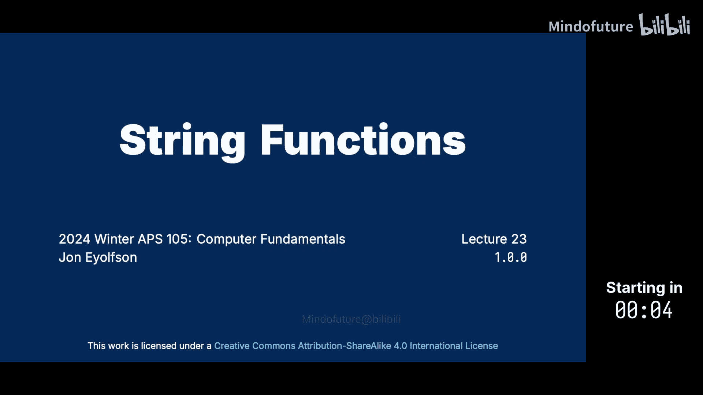
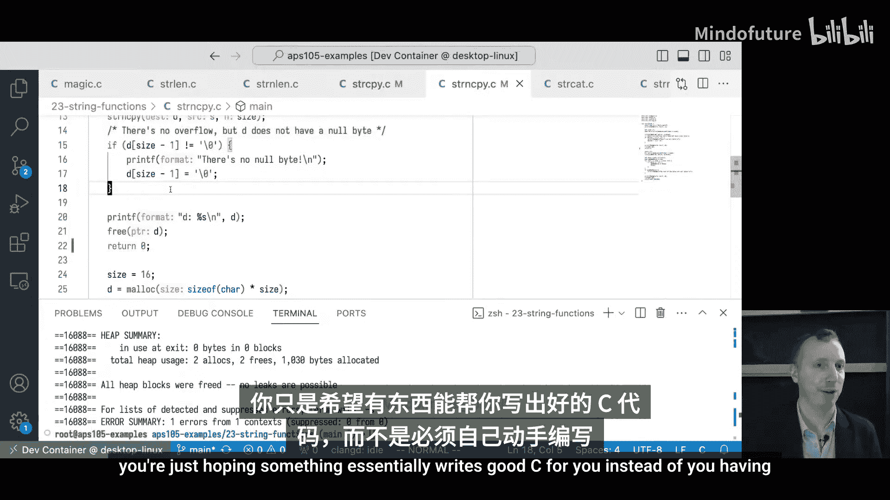
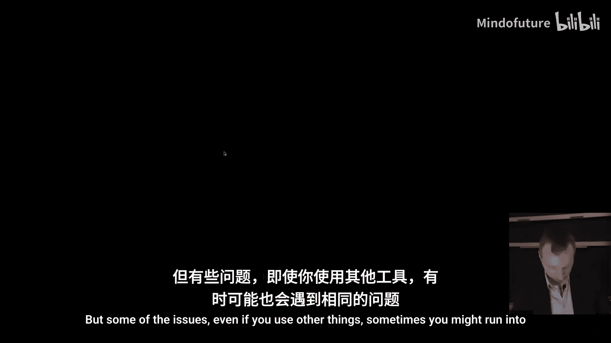
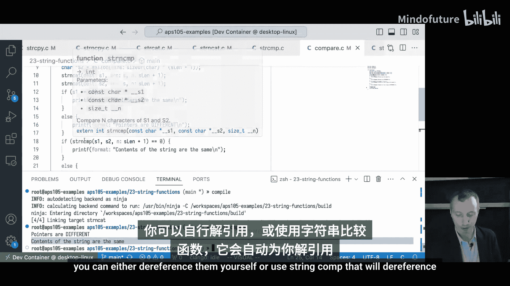
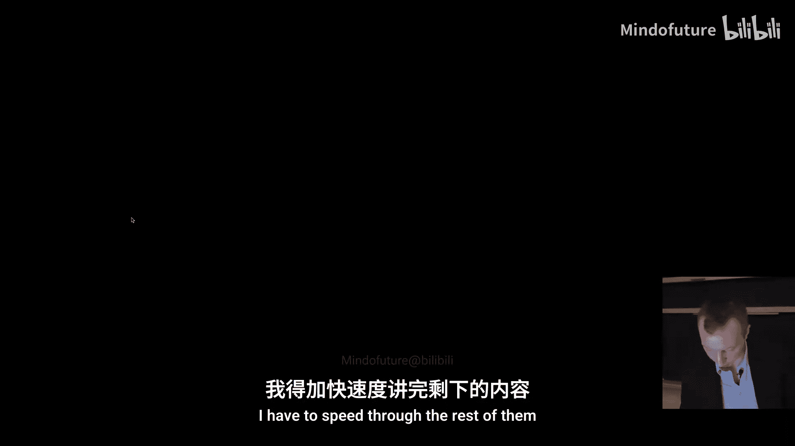
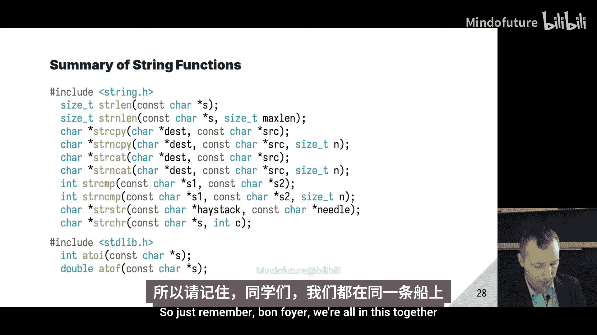

# 【多伦多大学】C语言计算机编程-｜-Computer-Fundamentals-｜-2024-p23-P23_字符串函数--BV1zL6GBwEGe_p23-

Alrighty， welcome back to 105， so learned about strings last lecture。Guess what In this lecture。

 we get to use strings even more so。

There are luckily a bunch of string functions for us in the standard library。

 which we will go over today。You don't have to do anything special except for just doing an include string dot H at the top of your file with the rest of your includes for the standard Lib。

 standard I O and all of that。So throughout this thing。

 just remember that strings are arrays of characters that end with a null byte and they could be allocated anywhere on the heap on the stack doesn't really matter so keep that in mind because some of these functions are tricky to use correctly because well in order to store a string while we need like the length of the string。

 so how many characters actually comprise of the actual string。

 plus we need one additional by to hold that null character in order to actually successfully hold a C string。

So sometimes remembering that we need another bite for the null bite causes a lot of issues。

 And then sometimes， you know， the character pointer might point towards an array of characters that is not null terminated。

 So someone forgot。 And that causes all sorts of issues that we kind of touched on last lecture。

So previously， we wrote a function called string length to get the length of a string。

 Turns out we didn't actually need to write that。 So we didn't have to write it ourselves。

 There is a function called St lane。 so it's string length。 again。

 they just shortened it because I guess making things like saving， typing some characters。 was very。

 very important。 So they named it S T R short for string。 And then L E N L short for length。

So this function takes a single argument， so a pointer to essentially an array of characters。

 and then they put a cons there because this function will not modify any of the values。

 so it can be a cons cha because it will not modify them。

And then it returns a size underscore t again that's basically like an integer for the purposes of this course where you could just explicitly cast that size T to an int and everything should work just fine so just returns the length of the string for you and the rules are that S has to be a null terminated string so throughout this lecture and throughout people talking about C code。

You might hear people saying hey， this is a null terminated string， or this is a C string。

 those two things mean exactly the same thing， so if I say C string。

 even if you hear that in other programming languages。

 it means that it is an array of characters and you know when to stop actually looking at characters in that array whenever you hit a null byte so they mean the exact same thing。

 I will probably also use them interchangeably during the lecture year。So as a quick little example。

Let's go to this。 So if I have the string hellello world， and then I call string length on it。

 I should get back the length of the string。 I can convert it to an integer。

 everything should be okay and store it in a variable called S lane。

 So now if I print off whatever this value is without even running this code。

 can anyone tell me what the length of the string Hello space world is。Again， this goes against my。

Goes against my counting of like I can't camp past seven， so I'll need some help with this。

So how many characters are actually in hello world？2。Yeah。

I think it's 1111 right everyone agree with 11， so we've got H ELLO and then a space that counts as a character so that is up to6 and then for the rest of it 7。

8，9，10，11， so there are 11 characters of string and to store it in memory while it needs 12 bytes right because I need that null character at the end of it to actually let's see know that I'm done with this string。

So if I go ahead and I run it。11， I have 11 characters。 So any questions about that。

 Just a function we can go ahead and use。Perfect， so。

There might be the case where you're not sure if that string is null terminated and if that string is null terminated while that function string length。

 we implemented it before it just keeps on going until it eventually finds a null byte and maybe it would access invalid memory or something like that So there is another version of string length that actually has a limit so there is again wide they shorten it。

 I don't know basically it's the same thing but it has a limit and they just called the limit n。

 So this takes two arguments so the string to get the length for and then another size here for max length。

 So the rule with this one is is it will only access the values in that SRA from like index0 all the way up to max length minus-1 so it would access that most max lengthng bytes even。

There's no null byte。 so it will stop if it makes it to the end of math max length。

 This reads the last character， and then it will just return that value。

 So it will turn max length as the length of the string。 even if it's longer than that。

 this function sets a limit on。 So the maximum value that this function would return is max length again。

 even if the underlying string is larger。So to， to do。So now if we do that。

 while maybe this string like this string pointer or this cha pointer， we get back from a user。

 maybe we're not sure it's null terminated， maybe we're not sure where it came from or something like that。

But we know that at least 5 B of it is valid。 Well。

 we might try stir N length with the string and give it the max length of 5。 So in that case。

 it would only access the bytes。H， E， L， L， O， and then stop。So in this case， if I do。

 if I give it the max length the5， this string is actually longer。 So if I run this。

 it should just return simply 5。 So just ran out of space。 But the nice thing about this is。😊。

If I know how many bytes are like storing or how many valid bytes of memory this pointer points to。

 well， I can set that at the max length and then I'm sure that I won't get a seg fault or anything like that。

 I might get a maximum that is not accurate， but I'm sure to not corrupt memory or anything like that。

 which is probably actually more important。 So this function is something we would want to use if we do not trust the user。

And yeah， a good suggestion of like， well， I won't really know the max length here。

 Like I don't know how long the string could possibly be。

 but the idea here is you might not know how long the string will be。

 but you know how much memory you set aside for it。 So just in case they did not null terminated。

 you don't want just some random just some random data you want to actually make sure it stops before it just starts reading anything。

 So if you're sure it's nu terminated， you can just use stir length。

 but if you're unsure for any reason， you should probably use this function and set a limit。

 So in case it is not null terminated， you won't run into issues。2。

So next function is there is a function to copy a string。

 So remember if we just like a git a pointer like if we just do char star S。

 so a pointer to a bunch of characters that we assume it is an array and we do this Well it pointing to memory that is read only so we are not allowed to modify it So if we wanted to modify it well and we didn't want to store it on the stack。

 we could go ahead malloc some memory and then we could copy the contents of that string to the region of memory。

 we malllocked and then we can go ahead and we can modify it。

 So that is what this string copy does So takes some takes two arguments So source is the pointer to the string to copy you might notice here it has a con So that means it will not modify that string。

 so it is safe to use even if it is read。OnlyAnd then the pointer to this char should also be an array called destination。

 So that is where I am copying the values of the string2。

And it needs to actually represent valid memory， so I would have to， in this case。

To store hello world， that is 11 characters。 plus I need a null byte。

 So what I could do is I could just malloc 12 bys and then the pointer I got back from malloc。

 I can use it as the destination pointer and then use this hellello world as a source and it will go ahead。

 copy all those values， including the nullbyte into my array， and then I can use。

That now as a string。 So source is a C string to copy values from D is the location in memory to copy the values to。

 And you are responsible for making sure that you have mallloed， at least string length。

Whatever like the source string is， sorry this should be source， not just s。

 so like the length of the source string plus one because you need that null character。

 so you need to make sure you set enough memory aside because。

Whatever you copy will be null terminated。So let's look at that example。So。Here， oh。

 I made a common mistake here。 So what I did is I have the string hellello world。

 So this is takes up。12 bytes in total because it is again， 11 characters plus the null byte。

 so if I made a mistake， I could mall space for only five characters and then I could do the string copy so I'm using memory I shouldn't be。

 but it turns out if I run it。Well， I'm not sure what will happen， but I'm feeling lucky。

 and this will probably work by accident。 So here I get the same string both times because well string copy doesn't know the size like how many valid bytes D points too。

 So it just randomly copies or just copies everything and goes off the bounds of the array and just starts using some invalid memory。

 So we could have se faulted。 but in this case， we didn't。 if we use our good old friend， Velgrind。

 Velgrind will be very， very， very unhappy。So if we look through。

 we get like pages and pages of errors of we invalid write of size1， invalid write， invalid write。

 invalid read， because we're accessing memory we shouldn't have。In order to use this correctly， well。

 I needed at least 12 B here， right， So now if I have 12 B， I compile pile， still runs。

And still work。 So I get hello world both times， But vgriin doesn't yell at me or anything like that。

 And， of course， I should remember to go ahead and 3 D at the end。So any questions about that， Yeah。

like that。え啲。Yeah， so if I did like a stack allocation and did I， let's say T， but made it too small。

 No， I mean no， I just。It C。And copy。Oh， yeah， string copy doesn't care if I set set aside 12 B on the stack here and did something like this and just copied it to T。

T， and then I don't have to free。Then that also works。 No prob Lamo。So that also works， but。

What I could have done before without having to do the copy。 Remember。

 if I just do something like this， kind， it automatically does that copying for us。So。This is。

 you' pretty much only use the string copy if we are using malloc。Alright。

 any other questions about this。Makes sense。 And well， this one is also hard to use correctly， so。

You might be asking like， oh， okay， well， what if I actually don't know the size of this string and I don't know how much memory to set aside。

 Well， as you might imagine， there is a function for that。

 So there is a version of this that has that end。 So there is some limits。 So instead。

 there is stir and copy again， why they even forgot。

 like felt the need to get rid of the O to make it three characters。 Don't ask me。But same idea here。

 So this is the pointer to a cha array to actually write the values to。 This is the source。

 And then there is a third argument N。 So this function will always write N characters to dust。

 So in other words。Another way of saying its writing characters to dust is saying that it will assign values all the way starting at dust at index0。

 all the way up to dust at index n minus-1。And yeah， there's another question going back。

 Why did we use string copy with malloc， So the reason I use string copy with malloc is because if I just malloc some space here。

 if I go back to the code。So if I just malloc some space here， well that' it's uninitialized。

 I don't know what the values are。 So in order to make the string look exactly the same。

 I just need to copy the string to that region of memory。

 And now I can go ahead and I can do things like I can just modify it if I want。So I could modify it。

Couldn't before， so。In that case， it would make it lowercase because before I could not just do that with the S。

 right。So I'm not allowed to do that with S because it's read only memory。

 and I am not allowed to assign it。So I could have done it on the stack。

 but I just showed you how to do it on the heap as well。Okay， hopefully that got that。So yeah。

Let's go over the limits。So。Looks a bit weird because it says it always writes in characters to dust。

 And you might be like， okay， well， what if the so string has more characters in dust or what if it has actually less characters。

 so。If n， like the size， the number of bytes is going to write is less than the string length。

Plus one， so it doesn't have enough room to hold the entire string pointed to by source。

And the null byte。 Well， then it just copies up to that many bytes。

 and the resulting string is not null terminated。 and you may have issues， so。

It will just try for some reason。It just copies all the way and would not put a null bitete at the end。

Otherwise。If N is greater than stir length of the source string plus one。

 So it has more space than is needed。 Well， then it will fill the rest of the bytes。With just zeros。

 So all the values from。String length。 So where the null byte would be。

 So this would definitely be the null byte because it's a copy of the source string。

 But it would make all the other bytes also 0 all the way up to。And including D  for n-1。

 So we can see an example of that。So here's that same one。 So here I'll show you。

 I had the string Hello world。 I will print it off。 And then I'm going to just。Create a size。

 so I'm going to keep track of how many characters I'm actually mallocing so let's say I mall six characters。

 so I malloc size of char times size， so this should be6， and then I get a pointer back。

Now if I do string copy。Dusestt size， well。How many bytes do I need to store this string？12， right。

 same string as before。 And then well， I only have 6。 So this will only， if I give n as size。

 it will only copy bys at index。0，1，2，3，4，5 from this。 So it would copy H， E， L， L， O。

 and then it would stop。 So it would stop。 It would not have a null byte or anything like that。

 So if I tried to print D here。I'm not sure what I would get。 I would get hello。

 And then maybe I got lucky。 And there was a null bite there。 Maybe I get random stuff。 So to check。

I just checked。 so I looked at the last bite it would have written and then check if it is not equal to the null bite。

 if it isn't， I'll just yell。 Oh， crap。 There's no null bite and I will change it to null myself。

 In that case， Well， it would just replace the O with a null bite and it should。Funly。

 just print off hell。Right。Her stories。 It has6 bys。 So it would copy H， E， L， L， O and then a space。

 And then it would change， take that space and change that space to a null byte。

 And then it would just say hello， right， if I set the size as 5， I would just say 5。

 I wanted to avoid that。 So it didn't say that。 So this should just print hello。 That's it。

 And it should also print that There's no null bitete。So also to check I can go ahead。

 allocate 16 bytes just to make sure that what I said was true， so I'm pointing to 16 bytes。

 I do the same string copy but now I have way more bytes than are required。

 So I just wrote a little loop that starts at the length of the string so that should be where the first null byte is and then it goes up to the size and it checks that everything else is a zero。

 so if it encounters a not0， it flips padded zeros to false and then breaks out of the loop and then this whole thing would be false and we would never see this printed。

But since it does actually write zeros to every single memory location。

 we will see that the rest of the bytes are null bytes， and then we are done。

 So let us run this quick。Oops。So if we run that， see hello world， see that there is no null bitete。

 and then we put one in。 so we replace the space by the null bite。 So when we print the string。

 it is not complete garbage and just says hello。 And then when it was too big。

 it just says the rest of the bites are null bites。

 So any questions about that specifically the first one。 So this。

Willll get you into trouble because it's the first function we've seen where the resulting string may not be now terminated。

 So if I。Let's say I just here， let's say we finished our program here。

So if I didn't have this check。And I just use the string directly。 It is not null terminated。

 so our program is technically incorrect and see how easy that was to screw up our program。

 if we just don't know that this can result in a non nonterinated string。

 sometimes if we go ahead and run it in this case， it looks okay because we got lucky。

 if we actually go ahead and use velgri on it， it will be very， very well， not very。

 very unhappy because we're off by one。 but it's fairly unhappy。

 and it says here you know we access some memory， we got lucky but it was past the size that we all。

 So it eventually hit a null byte。 So what we actually saw that we can't really see is it printed Tello and then a space and then it hit the null byte。

So questions about that。Yeah。の。There is， so the question is basically。

 why doesn't it do what I did there automatically？Your guess is as good as mine。

So that's just the way it was written。 You just have to remember that's how it works。

 And it would probably be smarter if you always use that， in fact。

 for in some other implementations of like libraries and operating systems。

 it actually behaves like that and。Typically that those systems are a lot more secure because while it's really easy to make a mistake with this。

 right， but that is the story of C， it is very easy to make mistakes。

 which is why I'm doing string functions all this lecture。Any other questions。Allright。

 so we'll see more things we can break。Yeah， and then someone's also asking just to clarify on the security thing。

 does see have any rules that avoid us from getting access to things we shouldn't have access to。

 The answer to that is no， So in order to prevent you from having things like in checking that you shouldn't access things that you shouldn't access。

 Well， turns out that's slow。 So that's slow。 sometimes it makes the programming language way more complicated。

 C is actually a fairly small programming language is just really hard to get right。

 So you either make things slow or you make a programming language that's very， very complicated。

 So there is current moves to。Try and get rid of C and replace it by something that is more complicated。

 but。Helps you prevent these issues。But in terms of learning about how a computer works。

 C is actually quite close to how a computer works。

 And you're just hoping something essentially writes good C for you instead of you having to write it yourself。

But some of the issues， even if you use other things， sometimes you might run into the same issues。

 or sometimes， you know， they might implement it in C。 And then at some point。

 someone has to implement it。 and they might screw up this。 And then， well。

 then you're in for a world of hurt。

So。Next function is kind of like string copy so we can basically extend a string with the content of another。

 So in other words， we can concatenate strings together。

 So we're just kind of adding stuff on to the end of one string。 So is short for string cat。

 So cat is short for concatenate。 and it takes a destination string and then a string that we are going to copy from。

And it does the copying just like string copy， except it will start copying at the end of the destination。

 So it starts at the end of the destination kind of taxed on to the end of it。

 So it starts copying source from the null byte of destination。

 So it will replace that with the contents of source， including the null byte。

 So this destination must be able to hold。 well， the number of bytes in the source string。

 plus the number of bytes that we are using with the current string。

 And then plus the null byte at the end。So that makes sense。 It kind of adds two strings together。So。

 let's see that example。So， here。We have the little string。 I just put a space world here。

And then I declare。An int size of 12， because I want to set aside 12 B。 So I malloc 12 characters。

 And then， well， I need to copy the string hello to dust。 So after this。Because I have enough space。

If I wanted to， I could just。If I printed。If I printed a D， well。

 it would just print off hello and everything would be okay。Now。If I do string cat。

 So concatenate S onto D。 Well it's going to look at the string hello。 So it's going to go H E， L。

 L O， and then to the null by， which would be the next character。 It's like， okay。

 now I will start copying from source。 So it will copy the space and then the world。

 and then put a null by at the end of that。 So our resulting string will just be hello space world。

 The same 12 byte string we had before。 So if we run the。😊，We get hello world all as one string。

 It just kind of。Coopied them all together if we wanted to， right， we don't really need cat。

 It's just a nice function to have。 I could have just started writing。

 I could have just done another string copy and just move the pointer forward a little bit and just made sure I started copying at the end and it would have done the same thing。

 but you can go ahead and use string cat and they'll automatically go to the end for you。

 so you don't have to remember how many characters there are in that string。W do do do。And yeah。

 online line tent here。 This hello would have a null byte because we did the string copy this。

The number of bytes needed to hold this is 6， and our size is 12。

 so we have enough bytes to actually hold it。 so we are all good。So yeah。

 it would be an null terminated string here。 So this function goes to the end， taxon space world。

 and then puts a null bitete at the end。 So we finally get the string Hello world。

 So questions about that。😊，Yeah， so is this string library faster than if we were to implement these assumptions？

Yeah， so the question is is a string library？Faster than if we were to implement them ourselves。

 answer to that is， yeah， it should be faster。 Also， it saves you from having to write it yourself。

 which is most of the point， but it。They do some tricks to make it slightly faster， too。And also。

It works on。Depending on the implementation， it works on more complicated things because this is only English。

 What if you had I don't know， another language or something like that。

 you might like it only holds a byte per character。

 and if you look at all the languages in the world， there' is not 255 characters。

 So it might have to do something more complicated than that。 but for this， it'll be pretty fast。

And work with ASCI。 So we're just assuming。Just US characters。

 because that actually fits in a bitete。Alright， so here's our example。

 If we want to implement string cat like。If you want， if you if thought the name was done。

 dumb or something like that， you could implement this like this。

 So we figure out the length of dust。 So we just store the string length。

 And then we declare a variable called I and size T basically an integer。

 And then we can just start at I equals 0。 and then copy from the source string until there is not a new by or null byte。

 So this is just our condition。 And then we can just increment I every time through。

 So this would start writing at dust L。 So。Destt land plus 0。

 So that's where the null byte was originally。 And it would go ahead and start writing。

Overriding that null byte with the characters from source。

 And then as soon as we encounter a null byte from source， this loop would terminate。

 and then I would essentially be the index。That should be the end of the string。

 So it just changes desk length plus I and then writes the null by there。

 So it's always null terminated。So this is basically the implementation of stirirca。

 and I should delete that because I had a typo oops。All right， questions about that。Because， well。

This one's hard to use， too， because guess what， if I。Did。But。Oh， crap。 Now I don't have enough room。

 like I have enough room to store hello， but I don't have enough room to store hello world。

 and I know how many bys I set aside。 So maybe I would like to set a limit on that like we've seen in other functions。

 So there is another version of stern cat that has a limit。 This one， it's called stir endca。

 So we got dust source。 And then the number of bites we copy at most。

 And this will copy at most end bys from source and isn't directly related to dust。

 which is kind of annoying because that's like the memory we're allocating。

 and we actually know the size of that。And also， if you use this function。

This source does not have to be null terminated。 So it would just read up to N bytes。

 And then it stops there， no matter。Whether or not it was null terminated。And this function。

 it will always add a null bitete to the end of destination。

 So in order to not run into memory issues， this one is harder to use。

And dust might must point to at least string length。

 So how many characters were in the original string。Plus。

 the end characters we copy from source plus one by for the null byte in order to be valid。Which。

Makes it a lot trickier to use。If we go back to it， so say。For some reason。

 I just decided to allocate this on the array because if I do this。This will not have a null bite。

 right， I will have space。 And then John， So this does not have a null bite。 So if I just use stirca。

 well， I would be in for a world of hurt because I'd be running into invalid memory all the time。

 so I could should only write read four Btes from this。So if I allocate。

 let's say I just allocate 10 bytes， well， then I can malloc my 10 bytes。I can copy hello to it。

 So this would be。5 characters plus the null terminator。 So it would be 6 bys。

 And then I can do this。 So this does not take into account the number of bys D has。

 So it would just copy array length bytes。So they would only copy 4 B from here and then tack them into D。

 So I would get hellello， which is 5 B， and then a space J， O， N。 and then an null B。

 So it would be 10 B in total。 And turns out it can actually fit。So， if I do that。And I run it。

So looks correct。 So fits。 everything is good。 But if I go ahead and say it was too small。So。

If I only allocate 8 B， well， this function doesn't help me at all。 It just says。

 copies all the bytes。Up to 4。 So goes all the way up to 4。 and then just。At a new line at the end。

 And then that or sorry， a null bitete at the end。 And that's it。 So this one。

 even though it looks like it works， it has some problems。 So if I wanted it to work a bit better。

I should use this one。 So I know how much memory I set aside。 so I set aside size bys。 And then well。

 I can take that and use that to calculate how many bytes I can copy at most。

 So it would be size and then minus the string length of whatever already existed。 So in this case。

-5。 And then there also has to be an null byte at the end。 So I should -1。

 And then that is how many bytes I can copy at most。 So now if I set my size to 8。 Well， I have 8。-5。

-1。So what's that that is two。 So at most， it should just copy two Btes from this array here。

 and I won't have any issues。 So， oh， sorry， just John， Yeah， two Btes。

 which would be the space in the J。 So now this doesn't have any memory problems whatsoever。

 It all fits within。 and this one's actually safe to use。

 but you have to remember to do this big calculation。In order to figure out， okay。

 how many bytes at most can I actually write to the end of the string before I'm using invalid memory。

So is that okay for everyone？So。Probably the most important one to do because you will probably use this function。

 And this one is really really easy to screw up because you might just think that， oh， yeah， well。

 I'll put a limit on it and I'll just limit the number of bytes I copy from the source string and I will be fine。

 but that doesn't take into account the number of bytes you actually have to store the result。

 So always have to remember that one。All right， so good about that。

 probably the most tricky one to get right。So。That's an example。

 So we can also compare strings to each other。 So has anyone ever like in Windows or anything like organized by file name and like the file names are in weird orders that you don't really expect。

Especially if they start with numbers。 so we'll get into that。

We can compare strings with each other using this function called stir comp。 again。

 short first string compare。 So we're just comparing the content of two strings with another。

 So this function returns an integer。😊，If it returns a negative value， it means S2 is larger than S1。

 If it returns a0， it means the strings are equal， so the content is the same。

 and if it returns of positive value， it means S1 is greater than S2。

So note this is the function you need to use to compare strings。 otherwise， if I just say， hey。

 S1 equal equal S2。They're just pointers。 C doesn't care。

 You're just seeing if this address equals another address。

 which isn't going to help you if you actually care about the contents of the string being different or not。

So this is how it works with different strings， so it compares the ASI values and then stops when the first character differs。

 So if you organize like in windows，Sometimes well you might have a 9 and then a 10。

 well you might want the 10 to come after the9 that would make sense。

 but if you name a file called 9 something and then 10 something well in Windows likely you'll see the 10 first before the9 because how it compares it is it just compares the first character in both。

 So 9 to a1， and one is less than 9 so that means。This like 10， the string 10 is less than 9。

 So it would be positive， which means 9 is greater than 10。

 So if you sorted by lowest first or tried to do alphabetical， then 10 would come first。

 even though well， you as a human probably reads that as a number and you're like， what the hell。

10 is definitely greater than 9。So if I do。Like if your string ends before。

 so if I do J O compared to John， this would be negative， which means JO is less than John。

 so if it encounters the end of a string， when comparing the two characters。

 so it would essentially compare the null byte to an n， then while the null byte is always smaller。

 so it would say Joe is less than John。And again， it just does character by character。 So if I do A。

 A， A， B， well， it would just compare the first A with the B， A is less than B， and then it's done。

 They're different。 So it would say A， A A is less than B doesn't really care about the length。

So that explains the ordering of files in Windows because it tries to do alphabetical。

 and they essentially just use this function。And yeah， a combination of letters and numbers。 again。

 just searches for the first thing that is different。

 So we can go ahead and play with some if you want any examples， so。If I just compare alpha and beta。

 well， I'll just。Call string comparison on them。 See if it's less than 0。

 That means S1 is less than S2。 If it's greater than 0， that means S 2， S1 is greater than S 2。

 Otherwise， the only other result is that it returned to 0， and that means they are the same。

So if I run this。Groups。Should say that S1 is less than S2， because， well， it would just。

Check A and check B。 A is less than B。 It's done。So you can go ahead and play with this if you have any other questions with that。

 But the important thing is to know。You might be tempted to actually just compare the pointers。

 So let's say here， I have。Some string testing。 And then I calculate its length。Then I get。

 I mall two pointers。 I can hold it。 S1 and S 2， and then copy it to both of them。

So the contents of the string should be the same。 So I copy the same string to both S1 and S2。

 It can hold it， but you might be tempted， and you will probably run into this several times。

So I'm explicitly showing this again just to make sure you don't do this。

 So the contents are the same。 But if I do S1 equal equal S2， that compares the pointer values。

 So if I compare the pointer values and they're different。 Well。

 I don't know whether or not the strings are different or not。

 I would actually have to see their values。 This just compares the pointers。

 it should say that the pointers are different because I got two different things back from malloc。

It would be the case， however， that if the pointers are equal。

 then their contents are the same because they're the same string。

 so you might get into the situation where you accidentally write equal equals but turns out there's the same pointer value as well as being the same and it works and then suddenly your program doesn't work and you're like what the hell。

 my program worked before and you might just skip over this line assuming that it worked when it really didn't。

 So now， and yeah， so if you dereference then they would have different values。

 essentially string end comp is going to or string comp in this case I used end comp。

I'll show that later。It will go ahead， check all the values and see。

 do the comparison between the values。 So here， if I compare the two strings。

 I should see that the contents of the string are the same。 And then， of course， oops。

 that's some testing code。 Then， of course， I could go ahead and free them。So now， if I run this。

It should indeed say that the pointers are different， oops。So the pointers are different。

 but the contents of the string are the same。Right， so I copied the same string to them。 They both。

 if I were to print them both， they both say testing。

 but they're stored in different memory locations。So。Just remember。

 if you want to compare the contents of the string。

 you can either de referenceence them yourself or use string comp that will dereence them for you。

Alright， I have to speed through the rest of them。

So。Whoops。So。There's a comparison function that you can set a limit on。 So there's stir n compare。

 So it compares like the other one at most n bytes。 If the strings。

 these strings do not have to be null terminated and it just stops reading early in the case that there is a null character。

So as a quick example of that one。If I do like have the strings， John Elsson and John Stewart。

 and then I compare only using the first three Bs， while the first three Bs of them are both John J O N。

 So I should get that they are exactly the same。 So if I run this。

I see that they're the same because it only compares the first three B。All right。So。

We can also search so there's a function that kind of does what was on your midterm so you can see if a string is within a larger string using Strstr。

 so it essentially takes a really long string that they call a haystack and then lets you find a substr in it or just some other word and it returns a pointer to the starting character wherever it matched and then or it returns a null if it didn't find anything So if the pointer is not null it points to essentially a character within that string So how it would look is sorry I have to go fast。

 we have lots of time next lecture So if I have the string。

 this is a long line and I do search for the string long well that one is actually in it and it will return a char pointer oops。

 it will turn a char pointer。To the first character。 So this L。 So in this case。

 it would go ahead F would be it would find long and the pointer would be pointing to right here this L。

 And if I went ahead and printed it out， it would just print long line。

 so it would print long line all the way to the end， which is where the null byte would be。All right。

So sorry， again， going fast。 So we can also just find a character in a string。 So there is star char。

 So I take a big string and I look for a character in it。

 It returns a pointer to that character within the string or like the other function null if it doesn't exist。

So if I have hellello world and I look for W， while it would be found and the first W would be right here。

 so it would return a pointer right to that W。 So if I printed it。

 it would print starting at that W all the way until it encounters a nullbyte。

 which in this case it would just print world。All right。2 minutes。

 so we can convert strings to an in or a double as well。

 These functions are in standard Lib dot H and not string dot H。 But they look like this。

 There's A O T I。Which takes a string and then converts it to an integer， and then A， O T F。

 which takes a string and converts it to a double and gives you that value back， so。In this example。

 if I give it the string 12，3，4， it goes ahead and converts that to an integer for me。

 and then I get the value。 So if I printed the value back out， it would be 1，2，3，4。

 similar for A O T F。 if I just gave it the string 1。337。

 and then I printed the value while it would print out 1。337， probably with some other zeros。

Because I believe by default， it will print six decimal places unless you tell it not to。So。

At the end of the slides， this is a nice reference for you。

 That is all the functions we have used today。 So most of them are in string dot H。

 basically string length， string copy， string concatenate string comparison and then searching for a string within a string searching for a character within a string and then these two ones will convert a string to an int or convert a string to a double。

 And yeah， someone also asked， what if you give a string that has weird characters in it for these functions。

 And while they would fail。 they wouldn't be able to convert it。 And。😊。

Looking up if they have an error or not， it is actually kind of a pain。

 but you would have to look it up。 We might go over it tomorrow。

 You probably won't use these in a lab。 If you have to use one of these in a lab。

 I will tell you how to use it correctly。If it's possible to have an error。 So just remember。

 boom for you， we're all this together。

