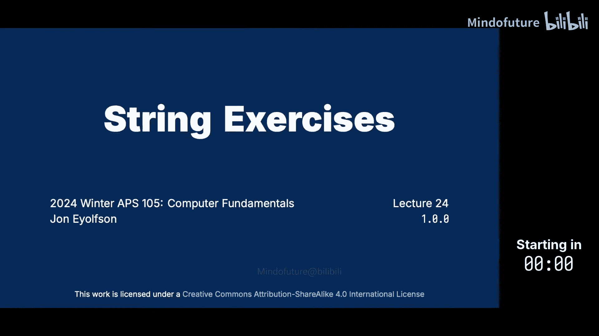
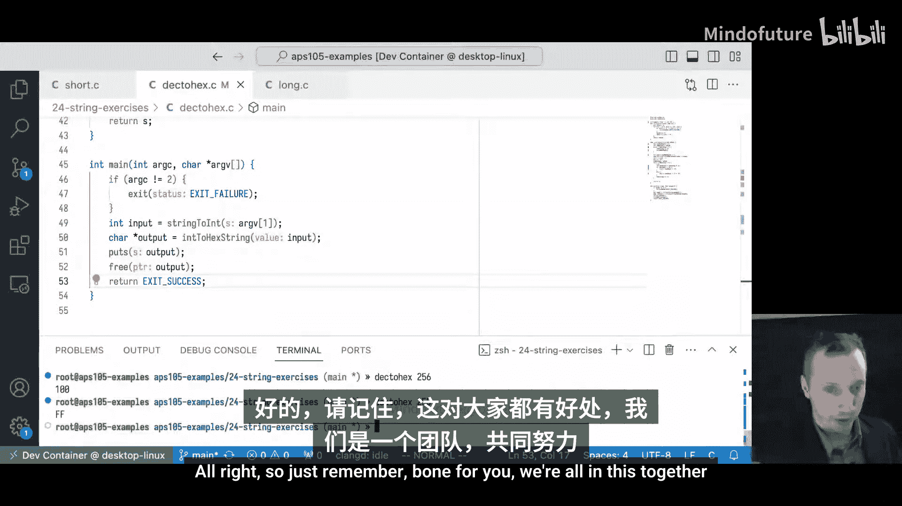

# 【多伦多大学】C语言计算机编程-｜-Computer-Fundamentals-｜-2024-p24-P24_字符串练习--BV1zL6GBwEGe_p24-

。

Allrighty， welcome back to 105， so。Did a whole bunch of strings today was this week was string week。

Anyone， any questions about strings that we've had so far？

And in that we're ahead of other sections so we can just go ahead and practice today。So。

 pop quiz then。What is the last value in the C string。Yeah。The null bitete。 right， Allright， good。

 So using that， we should be able to carry our our adventure。 So that is like。😊。

The main thing to take away from C strings， it's just an array of characters。

 but only difference is that it ends in a and null byte。 So we'll do two quick exam questions。

 and then I will show you something cool and possibly useful。

 but let's take a look at the exam questions。 So this says。

Completely following function below to alter a string to remove any leading zeroes。

 You are not allowed to change any part of the provided C program。

 So they want us to write this printum function。 They give us it I equals 0 while the。Character。

 the current character， the string is a0 increment I。

Then we're allowed to write something on this line， right before the print F。

 And I guess the print F should just print out the number without any leading zeros。 oops。 Allright。

 My camera is probably gonna get stuck down there。 No， we're good。Alright。

 so they give us a little main that they kind of test the program with。 So it just。

Deeccllars a array of characters which is of length 10， so let's make sure that actually fits， So 1。

2，3，4，5，6，7，8，9， and then a null bitete so fits so something weird wouldn't happen so that's a good thing to Sandy check even though they don't ask you to then I call printum。

So it says whenever we complete the program， it should print out。

Well'll just get rid of all the zeros and print out8，9，8。7，6。 So we can see what it does initially。

 So initially， well， if we want to test it， string would be pointing to the first character in this C string。

And we would have a variable whenever we'd use this function called， let's use purple I。

 and it would start with the value 0。 So if we execute this。Function。With that test function。 well。

 while string I equals 0。 So right now， I is equal to 0。

 So we look at the first character and see that it is a 0。 So that is true。

 So all we'll do is increment I and then go through and try the loop again。Next time。

 through the loop。We are looking at the character at index 1， which is this0。 So that would be true。

 We'd go ahead， increment I from 1 to 2。Then look at that character， okay， well， that is also a zero。

We would increment I， go through， move it again， and then finally。Go through。

 look at the next character， okay， move I again。Now it's four。

 and now whenever we looked at the character at index。4， it would be an 8。 So that would be false。

 and we would break out of the loop， and we would run this code。 So currently， I is equal to 4。

 And maybe we can use that to go ahead and get rid of all these zeroes because it seems to also match the number of zeros。

 It just count the number of zeros for us。 So if I want to make sure that line printed。

Just the string without any leading zeros。 What should I write on the next line。And。This question。

 I think， was worth a bunch of marks。 And we can solve it in one line。So right now， if I ran it。

 it would just print like 0，0，0，0。 And then the actual number。 What if I did something like。

String equals string plus one。 What would it print？Yeah。Yep。Yeah， three zeros。 and then a number。

 So if I is a number of zeros， how would I make it just print the number without any zeros， yeah。

Plus I。 Yeah， so I can solve this in one line。 It could just be string equals string plus I。

 So that does point arithmetic。 So all it's doing is reassigning the pointer string to be equal to well。

 the old value of string， which would point。At the first0。 And then plus I。 So in this case， it's4。

 So it would just move it up。4 characters So 1，2，3，4。 And then if we print it as a string， well。

Still has an null bite at the end。 It's still a C string。

 We're just skipping the first four characters。 So if I wanted to write that even smaller。

 I could just do string plus equals I and get all my marks。 Yay， So questions about that one。

And we can do that because it says。You can alter the string。 Well。

 it turns out we didn't really have to alter it。 doesn't say you have to keep the original one intact or return a pointer to the original or anything like that。

 so we can go ahead and reuse it。 We don't have to copy the string。

 We don't have to do anything like that， yep。So if I did， instead， I did string。Equals to string。

Square bracket I。So what would that do。So what is string square bracket I？Yes，8， specifically。

 that's the character 8， right。And since it's that character8。

 we have a little bit of a mismatch because。The type of this string。

 it's like a pointer to a character and8 itself is a character， right。

So that would be like the value of that character， which is just8。 So if we say this。Then well。

 we would whoops。Then we would take 8。 And then while that's just some special number。

 It converts to， I forget the exact same in the 40s or something like that。

 And then wed use 40 as an address。 And then we'd probably get some weird bug。

 So I've seen this on piazza。 people。 I've used this with like lab 6 and stuff like that。

 And they have encountered weird errors because of that。

 So just do not assign a pointer to a character。 Otherwise， you'll have trouble。 So basically。

Whateverver you use the subscript， whatever the type of this is， you just get rid of a star。

 And that's like the resulting type。 So if I access an element of a。Char star。 Well。

 that will just give me a character and be some just a single character。

So any other questions about this one？Okay， well， let's do the long version and then do something fun。

😊，So。This has a lot of text。 Allright， So write a function， so。Called last string in string。

 the prototype of which is provided below。It returns a pointer to the last occurrence of string S1 in the string S2。

 If the string S1 cannot be found in the string S2， the function returns null。

 So we're looking for a string within a string or substr。

 So we might immediately think we should use that stir stir function。 but if we skip to the bottom。

 it says we can use any function except for the one that。We probably want to use so。The。

 our first idea is unfortunately out。 So that it says for this example。

 if we're looking for the string is as S 1 in the string， this is a sample string。

 So if we just look at all the matches of is。There's an is right here in this。

 And then there's one right here。A second one， which is just the word is。

 So if we used stir stir and looked for what is， we would essentially just get this one， right。

 or pointer to that one。But we want the second one， so it says。

The pointer of the should be the second is of the string。

 so we should return essentially a pointer right there。So then it gives another example。

 if we're looking for the string of the in the string D with a capital T， Apple。

 the function should return null。 This is because T is lowercase in the。

And in the actual string we're looking at， it is a capital。So any ideas how we would solve this。

 And I'll give you a hint。 The solution is very， very wordy and long and。I argue confusing。Yeah。

One other function， not looking for like a sub string， but looking for。Yeah， right。Al started。

I guess that。But like， I mean， kind you iterate。So as you find like。We看 the。Yeah。

 but then you also like have to。Yeah。We job about。你食で。没带。Yeah。Yeah， so one way I could look at it。

 So useful function might be something like。Stir cut， stir。N comp。Something like that。 And like。

I try to look for。Essentially， this string。In the other string。 And like。

 maybe I just start at the first character， see if it matches。 And then if I have a match。

 will I still have to go until I find the last match。 And then the last match can stay around。到时。A。

Yeah， I could could do that。 so I could， you know。Try and see starting at the beginning of the search string。

Like try and match those two characters with the two characters I'm looking for。

 So this with is not a match。 This， not a match。 Oh， this is a match， not a match， not a match。 Oh。

 that's a match。 And then nothing else would be a match。 And maybe I return the other one。

Could I do it in a way where I don't have to， as soon as I find the match， I can just finish。

 I can just be done。Why， why not？Yeah， we're looking for the last one。

Is there any reason I can't do the opposite and be like， okay， start here。 look。

 look at these two characters。 No， okay， next， next， next， next， next， next， next， next， next， next。

 next。 Oh， yeahy， I'm done。 I found it is。So the way at least I thought of this initially。Is okay。

 Well， given I'm searching for is in a string。Generally。If the size of this is like 2。

 So its length is 2。Well， then I start looking at the last two characters。And then I in general。

 would look at all groups of two characters， like that。Until I reach zero， and if I don't find it。

 then I return null， I haven't found it in a string。 I can't move it past zero。 otherwise， you know。

 memory errors。 if I do this， very much memory errors over here。And then。Yeah， just start at the end。

So if I were to write something like that， well， I kind of， I can use stir length。

 So that's probably a good function to use for the purposes of this。

 So what's it called blasting and string。 And I have to return a char。So if I had to write that。Okay。

 I'm not gonna write the whole last string。In string。And then。Char star S1， which I'm looking for。

Charge star S2。So if I have something like that， I don't know。Maybe I get。

 I need the length of both strings because I need to know when to stop and how big of a thing to search for。

 So let's just get those just in case。 So the string length of S1。It。D length。Is stir length。Of S 2。

So could do something like that。 And then I have a four loop。 So 4。Int。I。

 so I want to start at the very end。 So if I want to start at the very end of S 2， well。

 that would be like S 2 L。Minus1， right？Because I want to make so it's zero indexed so I could access the bytes from 0 all the way up to S2 L。

Mus1。Although I could access S2 lend， but it would be a null byte， right。

So if I want to make sure that。I start at the index such that， you know， in this case。

I actually am looking at the beginning of two characters well。Here would be my length。Os。Sorry。

 I have my index up my first character。And then while I have to move it back。String length。

 essentially， plus  one。So it turns out they cancel out。

 and the first character I would look at is S2 length minus S1 length。So in this case。I just。

If I access index S2 length， it would be like here， which would be like a null byte。

 and then I just back up the length of S1 that I'm searching for so I would back up two characters in this example so I would start at the end right。

So that's what I would start with。And then my condition， well， I want to keep on going， oops。

 while I。Is greater equal to 0。 And then I could do not plus plus I。 sorry， minus minus I。So yeah。

 I almost set myself up in some infinite loop。And then in here， then I can do the comparison， right。

 so I could do。Stir N comp。With S。2 or S1。And then。S 2 plus I， right？

 So I just want to move that character。 In this case。

 I want to move the S 2 pointer to point to the N。 So that would just be S 2 plus I。 and then。

I could give it S1 length。 So I only want to look at the number of characters matching S1。

 And then I could check if it is 0， which means they are the same。 So if the value is 0。

 then I simply just return。S2 plus I。And then。If I。Don't return。

 And I make it to the end of this for loop。 Then I know I haven't found Diddley's squat。

 and I can just return。No。So questions about that one。Yep， like just in general。

 those string functions technically late。You could use them for a raising。

umbDid the just like assume that？Characers。That wasそ。Like late。嗯的。

Because those are like this is like say it's whites。Yeah。It's still like the string comparisons。Yeah。

 so the string comparison is bite by byte ASI comparison in order。And。Like if it just like happened。

放一我。Yeah， so the question is， just would this work if it was an in array instead or same idea。

I'm just thinking about。Is there still other。Yeah， so everything's a number at the end of the day。

 But the how they're like stored in memory might might be different in a way that causes it to behave slightly differently。

I'd have to look at specific example and weird things probably happen that you don't expect。Yeah。

Could another way that you can solve this be？Maybe let's see it like a pointer that points to S。Yep。

Wai， wait， that's。Yeah， S2 is a big one， it's kind of weird。We'm going to S2。有呢个 while。

W this pointer。てのバ。So not while that pointer wouldn't equal the null byte。 way you de reference it。

 Yeah， yeah。Yeah。Could you iterate that pointer like could you say let's see you like a pointer。

Like I see you called the point your a say that a points。Mm。Yep， yep yeah。 so the question is。

 can I use like just pointer arithmetic on that， like if I do plus plus a and a' is a pointer or in this case。

 even if I do plus plus S 2 and S2 is a pointer。That's the same as S 2 equals S2 plus 1。

 So that'll just do the point arithmetic。 move it forward one element。

 then you can just iterate through the whole big string。てでござい。Yep。Yeah， another one。

 which I think is what the solution does， is it goes forward and just if there's a match。

 it stores it。 And then at the end， it just returns the last match。

So I could just make a variable called match， initialize it to null， go through the。

 go through it forward and just update it every time I find a match。 And then if there's a match。

 like， I just return it when I'm done。 And then if nothing's found， it'll still be null。

 will be good， Otherwise， it'll find the last one， right。

 because it'll keep on updating that variable。 So both ways are fine this way， you would argue is。

Like faster， so。Like， you might have to match like a thousand times if this was gigantic。

 but we don't really care。 We just care if you get a solution， not the best solution。All right。

 other questions about that？Allright， well， here， question for you then。

 So if instead of stir and comp。If I just did stirir comp and did this。Would this work？你。Yeah。

 it would only work for like the first one， right， because。First one， it would compare like I。Well。

 and。For this one， it assumes that for stir comp， they both have to be null terminated strings。

 right。 So S 2 is just I S。 That's the full C string。

 And then if I start at the beginning or at the end， first time through， it'd compare I S versus N G。

 But the second time through。When I move the pointer here， well。

 then that string until the null bitete would be I N G。Because， well， I。

 there's not a null bitete at G。 So we would go ahead and just。Try and match the remaining string。

Until it hits a new byte。 So that's why we had to use。Stir and comp。 and we had to limit it。不。Okay。

 so the next thing is。Not testable， but useful because we will write a program that。

You might actually get to use so。Fun。Fact。The main you have been writing is only one of two options。

So there's actually another prototype for main。 again， not covered in this course。

 but most people write programs like this。 So if you know， like。

 if you ever wondered how your compiler works， if you did by hand。

 you wrote like GCC and then like a file name and something like that。 Well。

 this is how they wrote GCC。 So they had to go ahead。

And take your function like whatever your file name you typed and actually open a file and all that stuff。

 So GCC would have a main that looks more like this。 And we can actually finally read it now。

 So looks a bit scary again， but。Main takes an integer。 So arg C。

 And then anyone want to tell me what the hell the type of this is。Oh。top it。Yeah。

 what is the type of that or Anyone want to explain this to me in English。Yeah。Yeah， well。

 I guess you can't tell me。 So it's an array of character pointers in this。

 It is technically an array of C strings because they tell you that。 So this version of main。

 it allows you to just access arguments as the user type them。

 So Arg C is the number of C strings type to run your program。 Well they don't have to be C strings。

 It makes some C strings。 So it's the number of strings typed to run your program。

 So if you ran GCC by hand。 and like the GCC file name， stuff like that。

 they would all be individual arguments。 And then Arg V is short for。Argument values。

 And that is the actual array of C strings that you typed into your program。

 And because it gives you the count， you know how many elements are in this array。

 So it basically tells you how many C strings there are。So the offering system。

 whatever I type stuff like on your terminal or sometimes it's called a command line。

 the offering system removes all the white space for you。

 So assuming I had a program named Hex to decimal and if I ran it using like hex to De 255。

 well then crap Typo here。 we would have arg C equal to 2 and then just the way it works is the first argument or the argument at index 0 is going to be the name the user type to run your program。

 So in here would be Hex to De and then the second one would be。The next argument。

 and it would just be the string 2，5，5。So。We can write this program。

 so we can actually write a program that converts。Deimal to hex。 So let's just write it， so。

We're going to not use。 We saw A2 I that tried to convert。 But I had the question last time like。

 what if you input it an A or something like that。 Turn out the answer is it just returns the value 0 and you will not know if there's an error or not because the user could have actually type 0。

 So we're going to have to write our own A2 I because we're going to have the rule where if there's any problems with the input or anything like that。

 we'll just exit with exit failure。 So。We want to actually handle some invalid input here in this scenario。

 So we would have to think， how do we take that string of 2，55 and convert it to an integer？

 So any thoughts of how I would do that。 So we could say here that。呃。So， for example。

 if we input the string to 55。We want to output the int。255。So like that 255， that's like。Yeah，2。

55 in decimal。Yeah， so first off， yeah， let's read character by character。 So that's a good start。

 So for in I equals 0。Oh， well， can't read character by character。

 I don't know how many things there are。 Well， I can。 if I want， I could write it like this。

So start I is 0 and then check that This isn't an null byte。 And then I could increment I。

So if I want to write it a for loop instead of a while， again。

 you can write whatever wherever you want。 So this would go character by character， right。

So how do I actually convert it to the decimal。 So the first character would be like a two。

The character， too。So if I do that。I mean。So check that。こ then回。Yeah， so first。

 let's check that there it's a valid number。I'm not going to assume the user is smart at all。

 which is generally what you should do。 So first I'll check that okay well is SI in this case。

 we only want the character is0 through9 and they go in that order in terms of values so I know it's invalid if the current character is less than zero I don't know what the hell it is or if the current character is greater than9。

 so that's the last one， I don't know what the hell it is so I could just exit with exit。Failure。

 And then we are at least better off than A O T I， where we just stop running if the user does something stupid。

So now I'm sure that that character is valid。 So in this case。If I took the， if it was two。Well。

 then I would have the character 2 minus the ASI value of 0。 So this would also be ASI。

 So it's the ASI 2 minus the ASI 1， and they all differ by one。 So like， for example， if I just did。

This， well， that would result in 0。 This would result in  one。 This would result in 2。 So in general。

 I want this。 So this will give me my digit 2。So。If I just do that and I run this function。Well。

 first time it updates the value to 2， then it updates the value to 5。 Then it updates it to 5。

 and we lose out。 So what should I do here to get 2，55， So I'm close。

 This value every time through here is like。Just the number I got before。

You probably need to get the length。Nope so yeah， one way you could think of is I get the length of the string。

 and then I could go backwards and do multiples of two。Mly the current value。诶。Yes。Yeah。

 so the current trick is I could do this， whoops。So start off with the value of 0。

 And then the first time through， I just increase that by 10 looks a bit weird right now。

 but 10 times 0 is still 0。 And then I would add in this case 2。 So now the value is 2。

 Then next time through。Okay， if I make sure it's a valid character。

 then essentially I know I have a next digit。 So multiplying it by 10。

 essentially just shifts it up the column right。 If I just had like the1s column。

 the ones column and everything。 So it would take that number turned into 20。

 And then the current input is 5。 So then I'd get 25 at the end。 And if I just wrote 25。

 that would be fine。 But it would loop again， come through here， multiply it by 10。 So I'd get 250。

 and then I would just add  five to it， and then I get 255。So， that's AO TI。But better。

 because you can't write garbage to it。Questions about that one。 Yeah， like line 9。

 when you're exiting you're exiting like these。Yeah。

So like if you were to like not and do that and like signal。To the color of。Lei。That way。It is like。

So， the。So， yeah， the question is， say I didn't want exit。 I want to just like， tell the user that。

 hey， they input a stupid number。Like through the return。Like bird。So you， you can't do it。

 So the programmer that calls it is like the user。 So the user in this case would be me。

 So if I type Hex to S， and then I do like a。Well， that's just me。

 And this -1 tells me I did something stupid， but you can't continue the program。

 They just have to run it again。 but I could print off like。Hey， give me valid input。T me。

So I could do that because。if I run that， that just means I have to run again。 Okay。

 I didn't give them valid input。 Maybe I do that。 I was wondering from the context of May like you're calling this。

Yeah， but I'm calling this from main。 Oh， sorry， I should look at the code。 So here's my main。

 So it checks if there's two arguments。 If there's not two arguments。

 like if the user only types one exits failure， and then it just gives it the first argument。

 So it's user's input， whatever they type。 So they can't retry it， the operating system called main。

I was just wondering like in a case like you wanted to。Handle the actual。But like you know。

 how like some like we had like these。这个。Yeah。Like you can do it here。The user can ask。Yeah。

 so in this case， the best you can do is just give an error message。

 and then if your program can't continue。It won't。 You just can't retry Ma。

 They have to run the program again。 but like maybe I could write this like， okay。

 maybe input put a number or something like that but just basically have to just give an error message and tell them to try again。

Because。Yeah， in some programs， some programs might just， if it does other things。

 it might just skip this， give you an error message， but continue on doing other things。 And this。

 this program only is one job。 So it makes sense to just quit it。Alright。

 so what about the other part。 So this one wants to， give an integer value。

 produce a hexadecimal string。Turns out we've pretty much done that before， though， it's not too bad。

So remember， we kind of know， or at least before we went through。啊。

Using an integer and went by and went through like each single digit。 So it turns out。

We can do the same thing here， except our base is 16 and not 10 but。Works out the same。

So how would I do that。Yeah， I can just keep dividing by 16， right， like before， if it was。

 if we wanted to count how many digits there were。And it was。Just a normal string。 or sorry。

 if it was decimal， we would do something like this， right， like numb digits。Equals zero。

 and then well， I would like to do well。Actually， let's make another variable int。Meaning。

Equals value。I could do something like well， remaining。Is greater than 0。

 And it was every single decimal digit。 What did I do， I got the digit by doing， like， remaining。

Mod 10， right？And then， I did remaining。Equals， or I could just do it like that， right？Sorry。Nope。

 not mod equal to。 So this would just be like to get the current digit， right。

So some something like that。So， hexadeimal。Isn't any scary。 It's just a different base， so。

Turns out I don't really need the digit because I'm just counting how many hex digits there are。

 So let's be clear。 numbm hex digits。 So I don't need the digit for now。 I'm just going to count。

 So I would just divide equal by 16 instead and then increment the number of nu hex digits。

Because if I need to make it a string， well， one thing I should do is I should probably figure out how big the damnm string needs to be first。

So if I conclude that I need numb hex digits， how big should my string be to hold it？

 That is a C string。So should it just be， my sea string is just numb hex digits large。Plus one。

 right， because it's a C string， it needs a null bite at the end。

So the size of the string that or the size。How much memory I need or how many character I need。

 I one character for each hex digit and then one for the null byte so I can go ahead maloc it and then well I'll set the first byte just equal or the last byte equal to the null byte so that I make sure that it is null terminated and then I could set the I as just the size minus-1 because in this。

In this example， if this was just。The number of digits。

 we would start off by like the last digit at the end， right？ So if this was， if the value was 2。

55 and I did this in base 10， I we got the digits like 5，5 then 2。 So it starts at the end。

 So I should probably start filling in my string at the end。

 So what I could do is same idea as before。So set the remaining equals to the value， and then。

Each time through， I just decrement it。 And here， I don't need the number of hex digits。

And I'm going backwards。 Well， first， let's get the。Heex digit so I could do in。

Heex digigit equals remaining。Mod 16， like before。 And then this is the hex digit that I want to write。

 essentially。Starting at the end。 So currently， I， well that value was the null byte。

 So I probably want to back it up by one each time through the loop。

 So I'm actually writing them backwards。 So now all I have to do is take this hex digit and be able to convert it to a character。

So this text digit will be between 0 and 9， right。So。If the he digit is a 0 or a 9。

 how do I get the character 0 to 9。So if， so the hex digit。Is less than 10。

Then I could just do something like S I equals。The hex digit。Oops。Plus。0ero， right？

So it' the hex digit 0， well。0 plus the character 0。 If it's one， adds one， and we get one。

 So what about if it is greater than 10。We might forgot hex did it。 So remember， past that。

 they just made up numbers， so。They started at Hex digit 10 equals a， yeah。You can't type cast。

Exis the car。Yeah， if I type cast Hex digit， which is an int to a char。

It would just use that number and then look up whatever ASI value that is。

 It wouldn't actually change the value， but we would interpret that as just whatever that number is。

 which。Okay， we can't see it here， but if you go like ASItableable。com。

 you can look up and see what they are。No relation really between the number。

 like the integer number and what character it is。Bish。So here I could do like hex digit。Well。

 in this case， hex digit， if my first one would be。Capital A。 But if I did that。

 text digit right now would start at 10， and I want to start at 0。 So it's just text digit-10 whoops。

Oh oh。Didn't mean to do that right。Saaved。Allright， so just be hex digit-10 plus a。

 and then that would。Fuill in that hex digit。 I'd get。A all the way up to F。

 And then I'm turns out I'm done， right， That's all I have to do。

And then my useful program should actually work。 So if I compile this。

 let's make sure we don't have any bugs。 So if I do dust2 hes。Let's say I start with zero， oops。

What did I do wrong， that I compile？All right， debugging live， what have I done wrong？Oh， yeah。

 if it's 0， maybe it just doesn't。Do it。 Let's see one， okay。Yes， educate is 0。 Okay。

 didn't test that。 So one gives us 1，2 gives us 2，3 gives us 3。9 gives us 9。

 and then 10 should give us a， right。 So if we did it right， we get a， Co， C。 if we go up to 15。

 we get F， if we go up to 16， we get 1，0 in。If we do something cool， we get 2，55。 That's F F。256。1，0。

0。Cool， right， and we could use this。 We don't have to convert decimal to hex by ourselves。

 We could just use this program if we really wanted to。Or we could type into Google。

 but we made something useful ourselves。So。Question about。

 a questions about this as we have written it， why I did anything that I did。why didt they？Sorry。

What return。Oh。Yeah， there's no prompt， it just so how it works is。Just wasnt problem think of cons。

Yeah。Oh， okay。Yeah， so here what I did。 I was also a good programmer。

 so I got a string back as output。 I outputted it， and I malled it。 So I made sure to free it。

 So if I also just you know， just use velgri on this。Our favorite tool， two allocations， two freezes。

All he blocks free， no leaks possible。 It didn't yell at me。 It didn't do anything。

 Everything was fantastic。😊，But code of works。So。If you ever wondered like on a web thing。

 why some colors were like F， F， F， F， F， F， F， F， well。2，55 is like the highest number it can go to。

 Turn out that。We got that。 So questions about that before we get released for one weekend。Cool。

 this is probably。More like useful programs， you will actually end up writing because you don't have that awkward thing where you're waiting for user input or anything like that。

 This kind of works like your compiler。 So this is how you would actually write how most normal people write C programs。

 No one really use the scan F。 They'll just ask for like they'll just use the command line arguments。

 and then maybe they might like read a file or something like that， which we might not touch。

 But we have extra time and anyone's interested。 I can do it since we're ahead of other things。

 But yeah， we can go enjoy a weekend format minutes early。 Jo。 Allright， so just remember。

 boom and for you。 We're on this together。

