# 【多伦多大学】C语言计算机编程-｜-Computer-Fundamentals-｜-2024-p26-P26_更多递归--BV1zL6GBwEGe_p26-

。

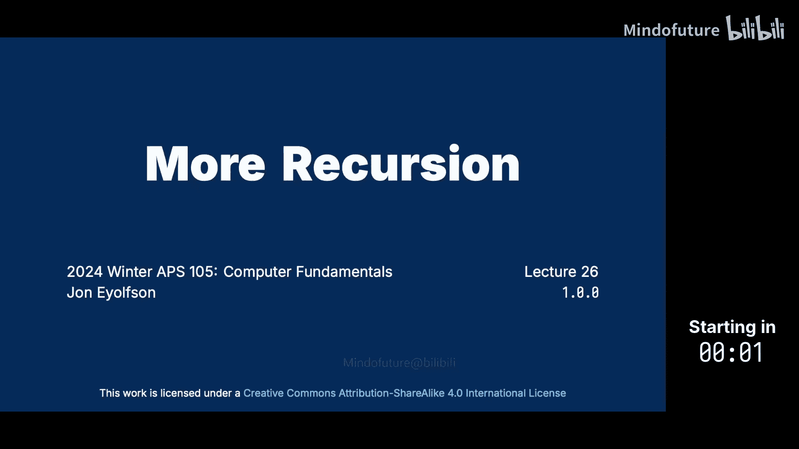

Allrighty， welcome back to 105， so we get to do some more recursion today。

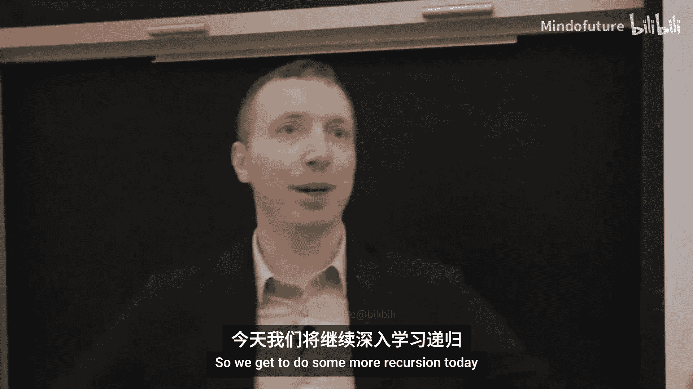

So。Just。As a reminder， recursion kind of a hard topic to wrap your head around。

 but really just two rules so a recursive function is a function that calls itself and we need two things in order for it to be useful and to actually give us some result So today I have some props so we get to figure out a fun toy but before that we'll go over some more problems。

So we need two things。 we need first our base case， so that is a simple solution that we know。

 and then we do a recursive step， so we reduce the problem and solve it in terms of a smaller version of itself and those are the only two things we don't have to for some problems we don't have to think more than that if the solution is really。

 really complicated。 All we need is these two things and then we actually have a solution for it。

So another thing we could do is compute the greatest common divisor， typically another。

Prime example of using recursion。 So the greatest common divisor or GD of two integers。

 A And B is just the largest integer D。 That is a divisor of both A And B。

 And for the purposes of this， we'll just assume that all the integers are positive and greater than 0。

 So there is a algorithm for this called the Euclidean algorithm。😊。

And it says to find the largest common divisor between two integers。

 given that a is greater than or equal to B， all we have to do is to find the greatest common divisor of A and B。

 just replace it with B。As the first argument and then the second one could just be a mod B。

 so basically we get the remainder of the larger number and we just recursively do that over and over and over again until eventually one of the arguments becomes zero so we have a zero divisor。

 which means that well it divides evenly and then that remaining number would be our greatest common divisor。

Don't worry about this algorithm。 This is all in the math。

 We will just worry about actually implementing this so we can actually write a recursive solution to this problem。

So what it would look like。Is。Well。Let's go there。So we can just go ahead and implement it directly。

 So if we're doing the greatest common divisor of A and B and we know that B is equal to zero。

 then that is our base case， so we can just return A， so A is actually D。

 which would be our greatest common divisor。Now this is a case where a is greater than or equal to B。

 then we can just return the greatest common divisor of will we switch the argument。

 So the first argument becomes the current value of B。 and then the new value of B becomes a mod B。

 So we also have to worry about the case where a is less than B。 and for that。

 while we can simply just do else and then return and just swap the two arguments around。

 so we make sure that if if a is smaller than B， we'll just swap the arguments around and then suddenly it will become。

This will be true because， well， now a will be greater than or equal to B， so。For the rest of it。

I use the other version of main because I don't want to have two scan F and hit enter a bunch of times because I'm lazy。

 so I just check that I have three arguments or the program name and then two numbers that I'll give to a to I which is our string function that converts the string to a actual integer I'll check that they are both greater than0。

 So if either is equal to0 or less than I will just exit with an exit failure。

 then other than that I will just return the greatest common divisor so。

If we think about the greatest common divisor between like 20 and 8， well。

 common divisors between both numbers are one， two， so two can divide evenly for that and then four。

 and then that's it so our common divisors are one，2， and four。

 so with this algorithm we should get the result for because that is the greatest common divisor。

So if we run it， we get。4our。So fun。 We can just implement it。

 get the greatest common divisor works for arguments。 If we reverse it too。 So if we reverse it。

 we get。😊，Go ahead， and we get。The first call is A is8 and B is 20。

 but then we would go into this L statement， it would go ahead， swap them around。

 and now we would get what we had before， so how this would work is if we call GCD20 and then 8 what's going to happen is in this case well 20 is greater than or equal to B so we would do swap them and then this would evaluate GCD of8 and then we would do 20 mod 8。

So what's 20 mod8 quick？4， right。 So it's just 4。 So this would evaluate to 4。

 So in order to do GCD of 8 and 4。Well， we swap the arguments， we get four。

 and then we would get8 mod4， which is just simply equal to0。 and then well。

 whenever we call this function。This would hit our base case。 So this would just。

Go ahead and directly return 4。 And then we go ahead。 We get four as our final answer。

whyhy this works， you can ask math people， but this is how our computer would actually go ahead and evaluate all of these。

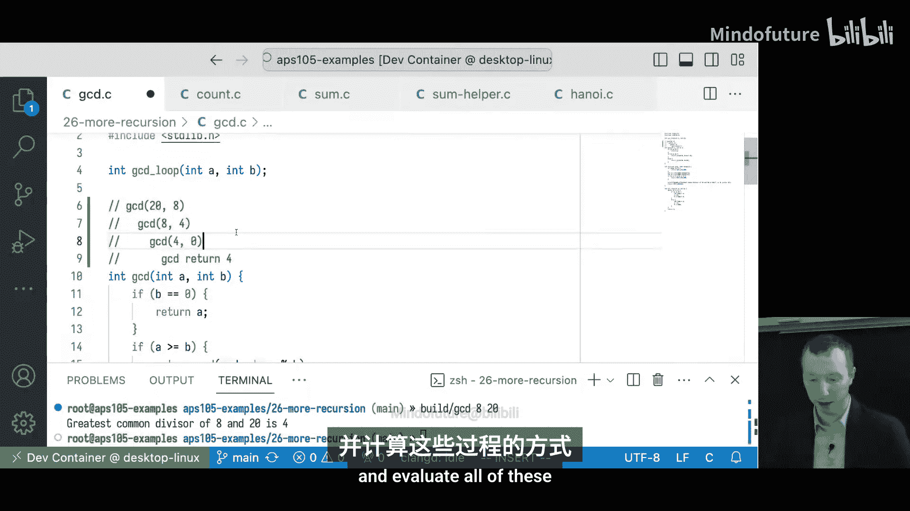

So。Let us get into some more examples。 So here's that。 So you can have it for more practice。

 if you want。

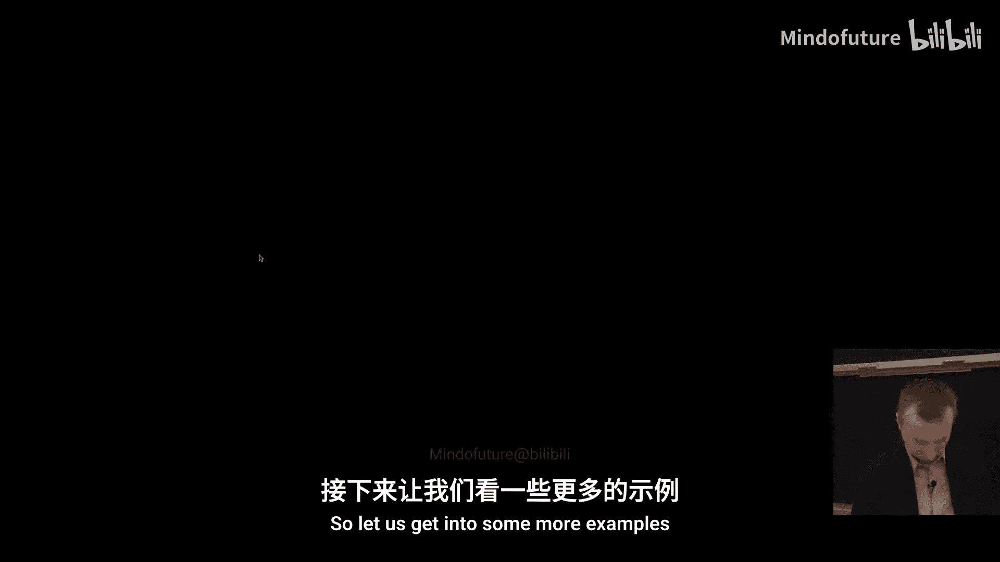

We could write this in terms of a loop as well， so you could try and solve this using in terms of a loop if you just want to get some more practice with C and converting these two things and just thinking about solving the same problem the same way。

So another thing we could do is， well， recursion looks a lot like loops。

 So maybe we try to count to5 recursively。 So let's stop and think for a minute that if I was to use recursion。

 how could I actually count to 5 recursively。 So I only want to do one step at a time。

 And then aside from that， I should call myself。 So let's think of the two things we need。

 we need a base case and then we need to just solve a single step of it。

So I will give you about a minute or two， and then we can。Yeah， a minute or two。 think。

 then we can try and implement it。我门嗯。And as a hint。

 we'd probably just want to write a function that returns nothing。

 And we just give it an int of the number of numbers to count。 So it should print out like。Hopefully。

1，2，3，4，5。 if we give it count of 5。Allright， Any thoughts。So what is a。Well， what。

 what would be a good base case in this scenario。If I want to count， if I give it n of 5。

 I want it to count down like1，2，3，4，5。 And that's it。Y。So n equals1 is a base case。 So if n is 1。

 what do I want to do。So， well， in this case， I just want to print， right， So just print， print in。这。

😔，Okay。And then print and then return so that I'm done， so this would be mega basease case。Okay。

 then what would I want to do as my recursive step？Anyone for the recursive step， then。第二。

So just count n minus1。So I should just count one less， and that should work。Yeah。Print。

 where do you want me to print。Light whoops。So print here。いです。さ？

Do you want me to just put like the count thing here？So that's gonna be the same as if I do。 Well。

 count doesn't actually return anything， right？ So if I put。Count here。It doesn't have a value。

 So it's not going to work。 So I have to do something like that。 So that。Okay， well。

 let's try try it。So， build。Bone。So， y。1，2，3，4，5，6，7， all the way up to 5。So。

What we could do instead， if we want to get rid of one print F。

 Well we could think of our base case is just n is equal to0， then we don't have to do anything。

 So we could just return And now we do that。 So we call count of5。 Well， in order to do count of 5。

 we have to count to 4 first to count to4 first， we have to count to3。 Then we have to count to2。

 Then we have to count to 1。 And then we have to count to0， which won't do anything。

 And then we'll go ahead and then print 1，2，3，4，5。 So this is pretty much exactly the same as just doing a while loop。

 The only thing that might be confusing。 is what happens if I do that instead。

So if I move the print before the recursive call。Yeah， do it backwards right， so in this case。

 if I compile it。And run it now it's just backwards。 So I get five first， then4， then3， then2。

 then one。 And why is that， Well， I do the print F before I do the recursive step。

 So if I call count of5。 Well， first thing it's going to do is go into the recursive step。

 then print out5 first before it recursively calls itself， then would call count of4。

 So that would go into the recursive step， it would print4， then do count 3。

 then count 3 would return。Or print three that does count two， print  two， does count1， prints 1。

 then it calls count zero and then count zero does nothing。

 and then the whole thing just returns and returns nothing because it is a void function。So everyone。

 okay with that。 So print F。 So with recursion gets a bit weird。 You have to think about like。

 what happens in what order， because。Just moving a line by one。

 suddenly just changes counting from 5 to 1 to 1 to 5。 So this will become more important later。

 But I'm showing you this now。 just so you can kind of。

Wrap your head around what happens if I just move a print F line。

 if I'm calling a function recursively。So to， to do。So here is the solution to you。

 I just remove the L statement。 Otherwise it's exactly the same。So。

What about computing the sum of an array recursively，h， can we do that as more practice？

So let's think about how we would write a function to compute the sum of an array using recursion。So。

哦。Do this。 So we've wrote this function before using a while loop or a4。Sorry， a for loop。But now。

 we can go ahead。And just practice writing it recursively， and。

Good to get into this mind of thinking， because when we try to solve a baby's game。

 we will need to think recursively。😊，So let's think about how we would calculate the sum of an array using recursion。

 So I will give you a minute or two to ponder this。 and then we will try。And do it。

And it's just going to be an。Integer array。 So if I wanted to， I could write it like this。

 But remember， array decays a thing means the same thing。Ill leave as a pointer。哦。All right。

 anyone with an idea or a solution to this？Yeah。So my base case could be if the array length is1。

Alright， oops， if the length， All right， let's do some other practice。 if I do this。Is that smart？No。

 that is assignment， not a equivalent。 So here， so this is my base case。 here。

 I'll go ahead and write in a comment base case。 So if my array length is one， what should I do。

Just the returns， the value of the array。 So what would。The first element， which would be index。

 what？0， so just return index 0。 Okay， sure。Okay， then what about my recursive step。

So what should my recursive step be recursive？Sttop。So how do I solve it in terms of itself， Yeah。

 Well you could the first element as later。The first element。Sorry， use the first element and add。

The sum of。Yeah， so use the first element and then， well， I need a return。のは。

looked depending on what's easier。Yeah， so I could do first or second。 So if I start with the first。

 let's just say we start with the first。 What should， what should my smaller problem be。4。Yeah。

 so I can use pointer arithme tick here。 So if I do array plus one， that will go to the next element。

 So I'm adding this number and then I'm trying to add a smaller array。

 So I'm doing the sum of the remaining array minus the first element。

 So that would be array plus one to move that pointer forward one。

 What should I do with array length。Can you drop through really？Yeah。

 array length also needs to go down by one because I'm making my array one smaller。

 I'm moving an element， so I also need to adjust the array length。So。

And then I need to make sure that I go ahead and I return something to。So let's see if that works。

 So let's compile。 So in my main， my array just has。The elements 1，2，3，4，5。

 if I add them all together。 It should be 15。 if we have written our program correctly。

 then I use that funny array length macro I had before because while it is defined and declared in the main function。

 So array length would work。 array Mac， this array length macro would not work in the sum function because of array decay。

 so。Here， I'm just printing the result， which should be 15 if we implement this correctly。B。Cool。

So we got our answer recursively。 We could also go ahead and just add the last element to the back means the same thing。

 I could also change my base case if I want。 So I could just say。

 maybe I want to cover the case where the array length is 0。 Maybe I just。Make my a array link。

Make my base case， the array length of 0 and just return 0。 So in case you pass an empty array。

 maybe we get a， maybe we get a proper solution for that。 But same thing， I'm just going to get 15。

All right， cool。 Any questions about that。

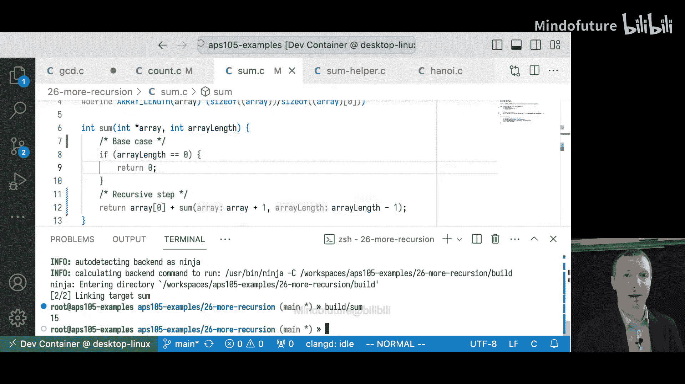

Alrighty， so we are experts now。

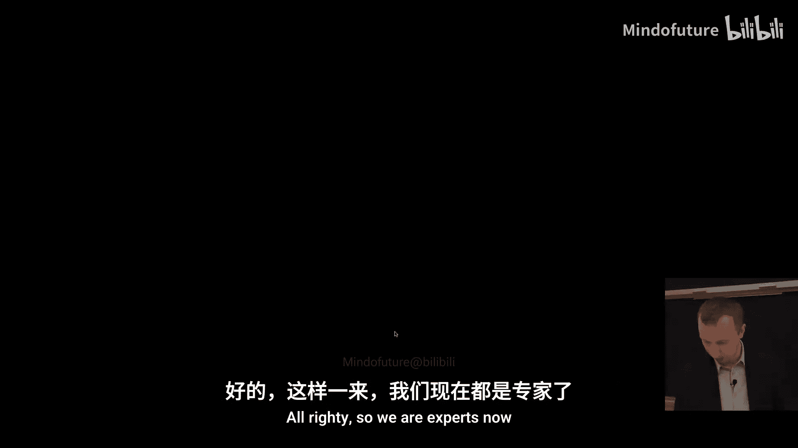

嗯。So again， here you have the solution in your slides means the same thing。So。

You could think of another solution here。 Let's go ahead and think of another solution。

So you might be like， oh， okay， well， I should just go ahead and maybe I just add another argument to here。

That just says， I don't know， the current sum。So add another argument that has the current sum。

 and then my base case could be if the rate is empty， well。

 then I should just return the current sum and the idea is going to be。

 while I keep on just keeping track of this current sum。

 so I could change my recursive step instead of being。This， we had the same idea where we sum the。

Smaller version of the array by one。 But we would just take the current sum。

 and then we would add the current index to it instead of just， you know。

 returning the value directly。 We'll just use a function argument for that。 So this。Will also work。

 The only difference is， well， I should just give my current sum as0 whenever I am using it。

 But other than that， if I go ahead and compile it， this will work just fine。 So another solution。

 if you wanted technically， this is like if we remember the tail recursion thing。

 We don't have to remember this is like the tail recursive version of it。

 So you might see a function like this and be like， wow， why does it have an extra argument。

 that is real ugly to use， I don't want to have to remember to put a zero on it。

 Like I just want to sum an array， I don't really care about this extra value。

 So if you happen to think of this as a solution。 It is all right。

 But what typically you do is you just could rename this as like a helper function。 So generally。

 if it's a function that。You're using for recursion that you don't want someone to actually use。

 You might call it a helper function， just something as weird programmers do。

 So we instead rename it helper function。 And then we could instead define some。

Just using those two arguments。So that it's a bit nicer to use。

 So I don't have to remember to use the third argument。 And for some。

 its implementation could just be。Actually， just using the helper function passing in the array and the array length and then just setting the number by itself so that when I go to use the function in main。

 I don't have to remember to go ahead and always tack on a0。 So now I compile and run that。

 I get 15 again， again， means the same thing just if you do happen to think of an easier solution that just needs more function arguments typical thing to do write a helper function。

 Go ahead and just have a function with a better less arguments and have it call that helper function for for you。

 So any questions about that before we get to actually figure out。

How mean parents are to their babies， apparently。That will make sense in a second。So。Let's see。

 So that So， okay， so now the thing that will make sense， so。

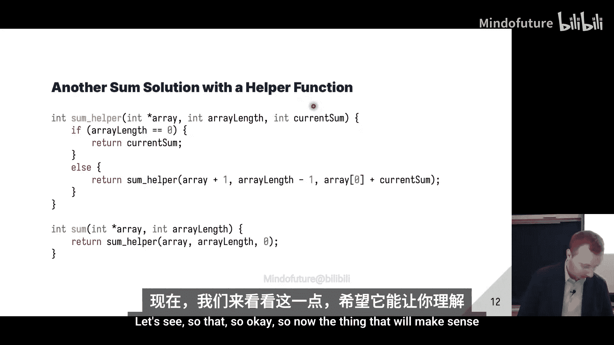

There is this。 I don't know if you can see it。 So wooden toys accompany your baby to grow up。

So this is the tower of Hanoi， it says。Let's see who we got got。对。36 months plus。

So I hope everyone is of age for this。 So hopefully we can solve this。

So has anyone ever seen this before the Towers of Hanoi？So we have one， two people。 All right。

 so I'll do a simpler version of it。So。The rule。All right。

 I have a green screen effect on apparently。Oh， right。 I do。 Can I turn that off。Filter。Look。You can。

呃。Filterters。He， there we go。 Alright， so green screen， in fact， removed。 Alright。

 so the rule of this game is they are。3， well they call them。 There are three。 Let's call them rods。

 And our goal is we want to move all four of these disks from this rod to this rod。

 And the rules are of。As follows， I can only move one of these disc at a time。

 so I can only move one disk at a time from rod to rod。

 And the other rule is that see how they are different sizes。 So it goes from big to small。

 The other rule is I'm not allowed to place a big disc on top of a small disk。

 So I'm not allowed to do something like this。 This is invalid。 We are not allowed to do this。

 So the only valid move I would have is to do something like this。

 So using those rules we need to get all of these disks from this over to here following those rules。

 So let's make it a bit easy first。So。If I just have two disks， what's my first move。

So I have to move this。Let's see。 Should I move it here or here。Alright， one。2，3。So I'll call them 1。

2，3。 So we got twos。 Alright， so drop this here。 Lou to do that。 Alright， so now with this disc。

I can't do that， but I can do this。So that's fine。 And now I can take this disc。Move it here。 Oh。

 wait， that didn't do anything。 Allright， this is why they give it to the baby。 Alright。

 so I can move it there， boom。 So that's solved。 So how many steps did that take us。

So in order to move all these discs from this peg to this one， it was one。To。3。Not too bad。

 all right。Let's do hard mode。So now we got three。Alright， should I move the green1 to disk。Wu。2 or3。

So A votes for two。Votes for three。Alright， everyone's smarter than I。 Allright， So I do this。 Okay。

 so now I only have one move， right， I can only， well， I could move the green  one back。

 but that one really makes sense。 So I can only move this  one。

 I can't move it on top of the green  one because it is bigger， So I have to move it here。

So now what should I move。The green one， where do I move the green one。Here。Okay。

 the green one goes here， all right， so green one goes there。

And now the blue one can move to where it should go， and now the green one no。Green one moves here。

And we go here。And we go here， right。So how many steps was that here easy solve。Alright。

 so that was what。1。2。3。For。5，6。7even。Okay。So how do I solve this with four disks now？

This gonna be on the final。 Yes， this will be on your final。😊，And remember。那这个。So yeah。

 you only have to be， what's that3。 Why is it a month， Why doesn't it just say three plus。

 I don't know。It makes me feel older if it's in months。Allright， so this this。

 where do I want to move it， Let's see votes for two。Okay， three。Okay， no， all right。

 so I move it here， okay。Here。Yeah， here。Here。Oh。し。No。Oh， you got bamboozled。そでは？It is。👏All right。

👏Okay。So。I'm not doing this， so。This is too hard， so。Did anyone。

Think of how to solve this recursively。So did anyone catch it while we were solving it when it was easier。

So maybe here， let's do four again。So see if you can spot any recursive steps here。 So what I do。嗯。

Make sure。う。猪。Anyone spot anything recursive？So。Was there at any point I solved this problem。

 So this is essentially the problem is I have four disks。

 I want to move them from rod 1 to rod 3 using rod 2 as just kind of a spare rod that's chilling around。

So is there a way to solve this problem in terms of three disks， So this could be my smaller problem。

 right， just having three disks。So anyone wants to tell me how I solve this problem in terms of solving these three。

Yeah。Crowuncing the smallest。It Britain' smallest disk。Right。So you're。

 you're thinking of just in terms of smallness， what's happening to that， right。

like the way that that's changing position。The other one can。是这么。They kind of follow。

 but we want to think it in terms of like solving it with a smaller problem in the the case these3。

 yeah。If you're like。And对。Every single time you move like n minus one to the middle one。

 and then you move the bottommost one。

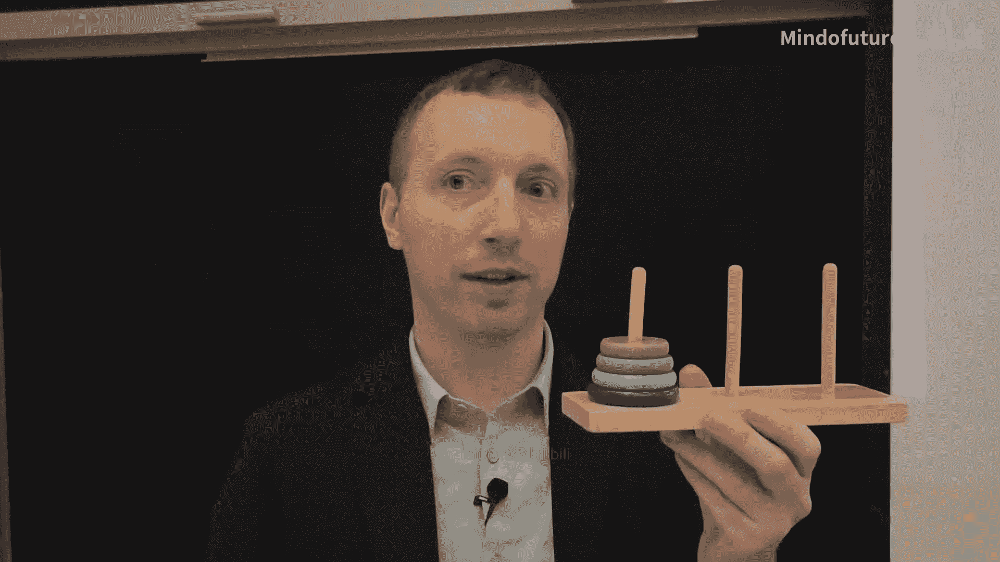

Yeah， in terms of smaller problems， like a recursive problem。

 So I want to move these four disk from rod 1 to rod 3。 and I can use rod 2 as a spare。 Well。

 my recursive solution could be， well， if I put it in terms of a smaller problem。 Well。

 I really just want to move these three disks。 So this is my smaller problem。

 I want to move them to rod2， using rod 3 as a spare。 So I could use that whatever I want。

 And now well， this is my one step I have to make。 I just move the big as disc to here。The。

 the big asterisk， it's the technical term。 Again， it'll be on your exam。 So then after that。

 my other。Thing I need to do is I have to move these three disks。 So， again。

 another smaller problem from rod 2 to rod 3 using rod 1 as a spare。 So I do that。Right。

 so that works even for。This。So even if I have eight。So at 8， that is 8。 So even if I have 8， well。

 I could move 7。To disk or to rod 2， then move the big one to rod 3。 Then I would take these ones。

 all seven of them and move them to rod 3。 And then I would be done。 right。

 So let's write a recursive program for that。Because turns out doing this recursively is a lot easier。

 So let me go ahead and switch。To。All right， we will show these babies what for。

I'm going to define a function， so。I'll give it four parameters here。

 So an int of the number of disks I want to move。And then。I'm taking。

 I'm just going to give an integer number to the from rod and then one to the two rod。

 So I'm moving from in this case， how I want to use it is to solve a problem of moving any number of disks。

 I'm moving them from rod 1 to rod 3， Like I numbered them in the example。

 and then I'm using rod 2 as my spare rod。And then with this function。

 I want to return the number of steps I need to take。 So I'll give you a hint for our base case。

We're going to print the number of moves and just go ahead and keep track of them for my base case。

 All my base case is， if I have no disks to move。Then I don't have to do anything， right。

 I can just return 0。 I'm not moving anything。 Don't have to do anything。

 Don't really have to worry about anything past that。So。What was my recursive step。

 So I want a new variable called Step。 So let's go back。So how would I explain my first step。

 So my step should be， Let's see。 So if I have N this。On Rod 1。

 I want to take n minus-1 disks of these。And then if my goal is to get this whole stack from rod 1 to rod 3。

 well， I need to take my big stack， which is n-1 and move them from rod 1 to rod 2， right。So。

If I just go ahead and try to program that， well， that should be Hanoi。D minus1。

 so that's my current disk。My from rod。 So initially， it's rod， it's rod 1，2， and 3。

 So I'm just giving them numbers to be more generic， so。They start on the from rod。

But I want to move them to the spare rod， right， So their destination。

 which is the second number or second rod in this in this function argument， basically this argument。

 I want to move them to the spare rod。 and then I'm using whatever was the two rod as the current spare rod。

 right， so。That's one part of the problem。 And then my other step is， let's see。

 So that should solve this part。 Now I need to express just moving the big big disk。

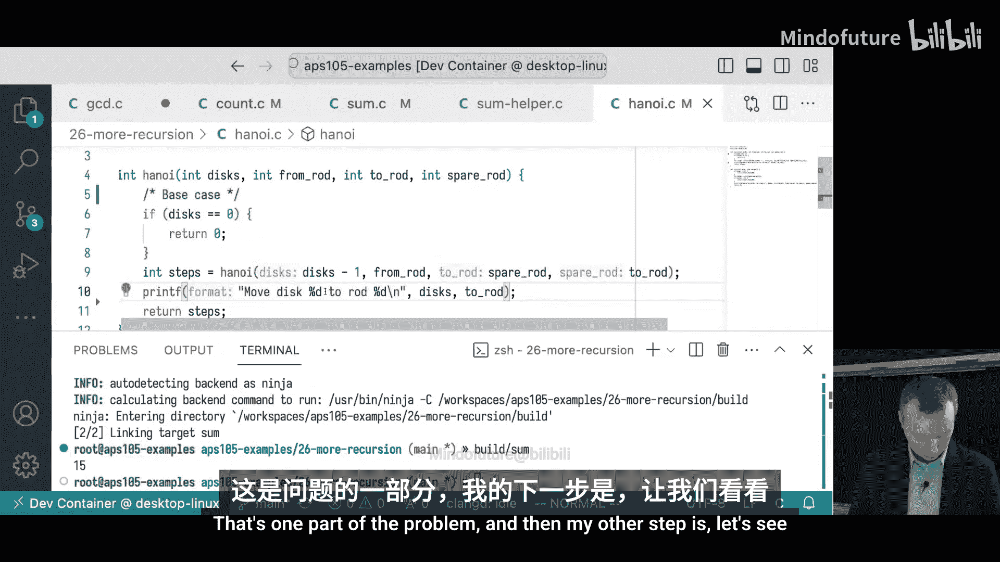

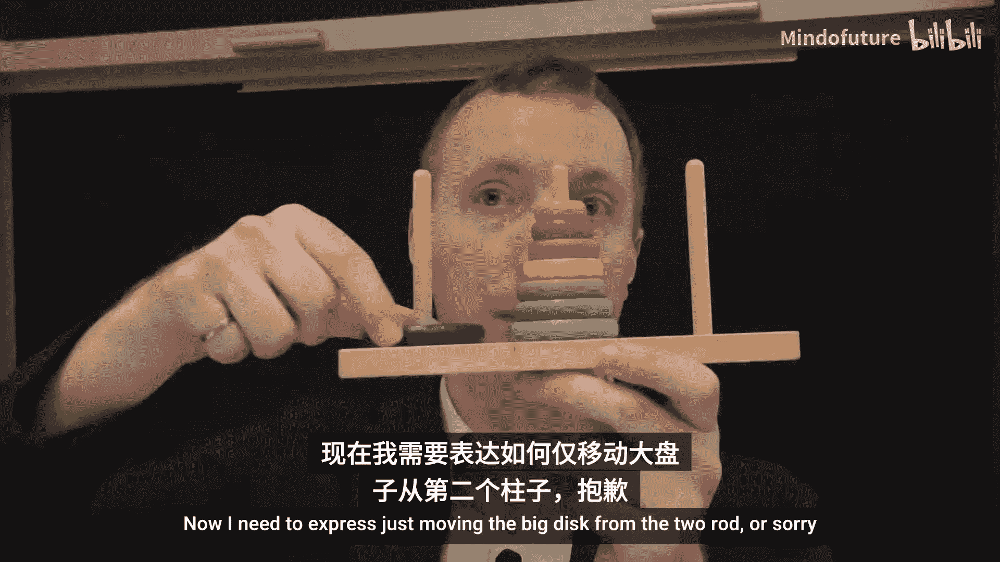

From the two rod。Or sorry， from the from rod to the two rod， so。

I can just say move the disk to rod to rod。 And then that also counts as an additional step， right。

 So I just add one to the steps because I just moved the big one。Then the other part of the problem。

Is the last step。 So the last step is to move this current stack。

 which is n-1 disk from the current spare rod because that's where they are all the way over to the two rod like that。

 And then I can use this one as a spare。So if I go back to it， I would do steps。

Plus equal Hannoi disk -1。 So currently they're on the spare rod。

 and then I want to move them to the two rod。 And then I can use the from rod as the spare rod。

And then just return the number of steps。So。That。Believe it or not， that's the whole solution， so。

Now if we go ahead and build this。Assuming I haven't screwed it up。

So we could see solving the Hannoi with one disk。 So it just says， move disk 1 to rod 3。

That's the same as we got。 right， We just moved the dis to Ro 3。 We solved it in one step。

About two steps。 Well it says we move disk1。 So I ordered the disc in terms of like disk 1 is the smallest then disk2 is slightly larger than that than disc3。

 So this says move disc1 to rod 2， move disc2 to rod 3， Mo disc 1 to rod 3 and then we're done。

 Now we can give it with two，3， make sure that it matches So it was7 steps like we did before it seems to work。

 Let's what's my time。 Oh yeah， we got time。Alright， so here is with four disks。

 So this is about where I maxed out and。My。My intellectual capacity got exceeded here。

 So let's see if this one works。 so you can still kind of see it。

 So first step it says this is disk 1，2，3 and 4。 So it says move disk 1 to rod 2。

 move disk 2 to rod 3。Move disc1 to rod3。So that's right here。 That says move disk 3 to rod 2。

Move disc1 to rod 1。This is Rod1。 So move this2 to rod 2。Move disc1 to rod。2 like this。

 and see this is the first half of our recursive solution。 If we're just taking into account disk4。

 then it says disk 4 moves to rod 3， and then we just do the same steps over well。

 not the same steps。 we do the other subprom。 So we move disc 1 to rod 3 disc 2 to rod 1。

 disk 1 to rod1。And then disc 3 to rod 3。Disk 1 to rod 2。Just two to rod three。

 and then the final step should be。Disk 1，2， rod，3。And it's 15 steps。 And we have a solution for it。

 right。So now to get off why I said this is mean to babies。 So remember， the current thing is this，8。

 right， How many steps do you think this takes。2，2000。So， well。

 good thing we wrote a program to do it for us， right。

 So I don't have to worry about moving disks around for like an hour。 So let's go ahead and see， so。

😊，Was ate this？So let's see all the instructions it will give us。255。So。Now。

 you can see why this was designed for babies because in if the baby is really， really smart。

 still takes some 255 steps to do it， which should keep them occupied for like a good hour or two。

 right？ So this is why this is a good child's toy because provably it just wastes their time。So。

 and it gets worse。 if， if your child's really， really smart， this scales up， right。

 I just make my own little disk and then give them 9。 And then suddenly， it takes 511。 Okay， well。

 smart baby。 Allright， give them 10 discs。Oh that'll keep them busy。 And then， you know。

 if you really want to keep your busy baby or your baby busy for a lifetime， just give them 20。こ。

Probably shouldn't have done that。So that should keep your baby busy for pretty much a lifetime。

 And yeah， it's basically to the power of n minus-1。So any questions about that。

 So now we can prove that this toy。Is kind of。Cruel the babies because， well， I mean， come on。

 Am I really gonna do 255 steps to do that， How long would I， that take me。

 I could follow the steps that are there， But yeah， it takes a while。Cool， though， right？Alright。

 any other questions。Cool， so practical use of recurion。 finally， because I give you a challenge。

 Try and write that with a loop。😊，It will be， you can do it。But to think of the solution。

 you probably ought to think of the recursive solution anyways。

 but still try and do it turns out to be fairly tricky。 But we'll have time。

 So just remember pulling for you。 We're on this together。

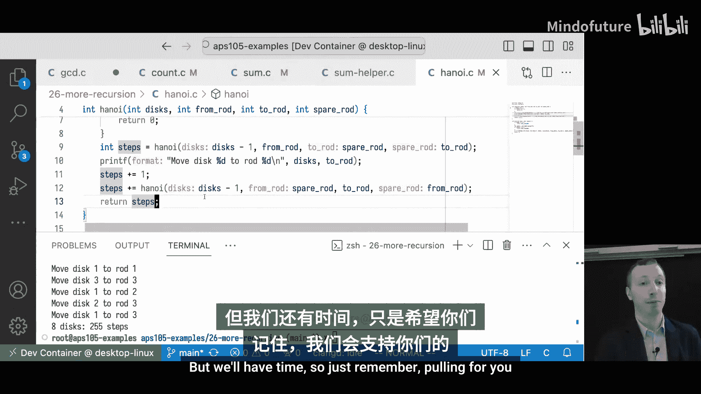