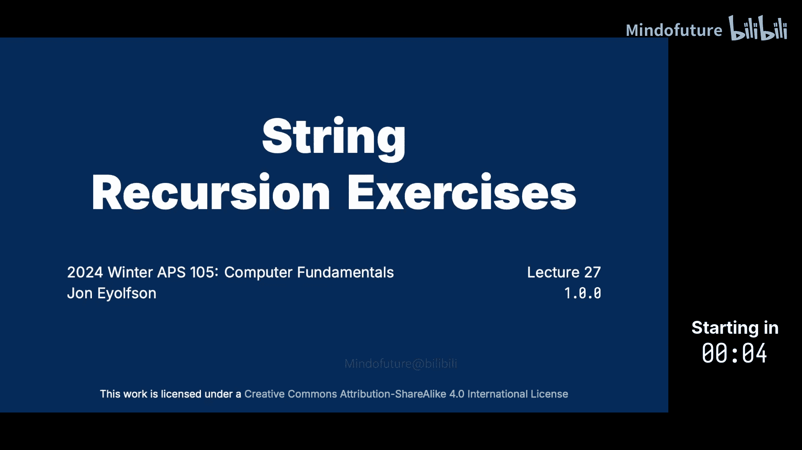
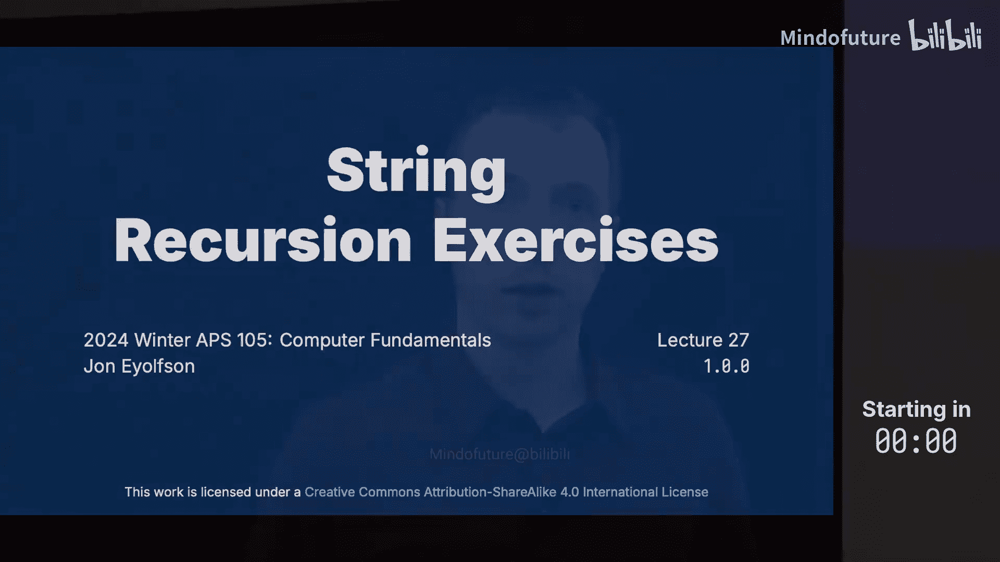
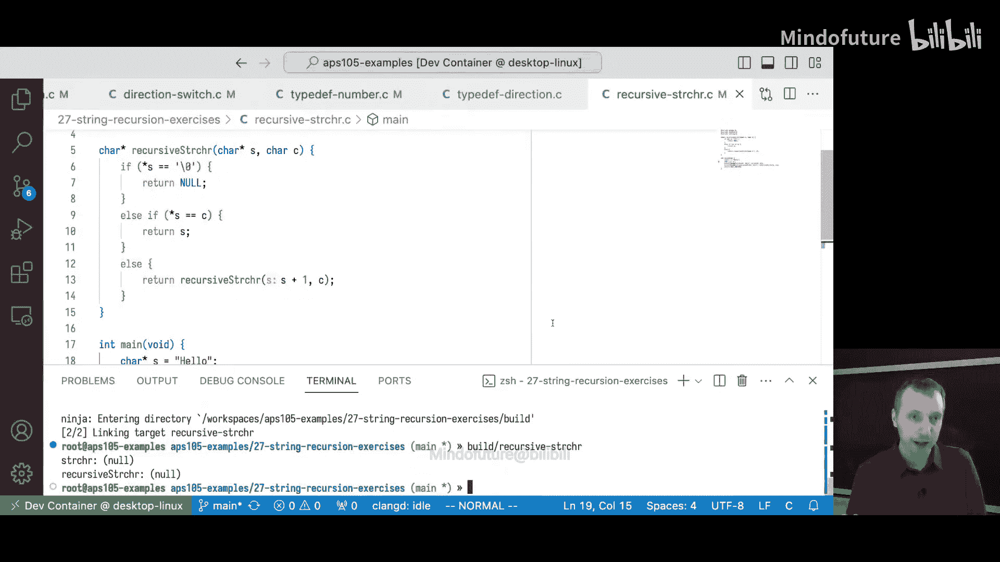

# 【多伦多大学】C语言计算机编程-｜-Computer-Fundamentals-｜-2024-p27-P27_字符串递归练习--BV1zL6GBwEGe_p27-

。

Alrighty， welcome back to 105。 So we got good news and we got bad news， which would you like first。😊。

ラに。There are， there is good news and bad news。 What would you like first。Bad news。 Allright。

 So the bad news is not bad news for。Yeah， not bad news for anyone here。

 but course staff ran the plagiarism detection， and most of the people that cheated were in my section。

so in your section yeah， we're in this section， which is disappointing because I get to have fun meetings with no one that I can see in this class。

 So anyone that attends lectures is good， but someone watching this recording。Yeah， disappointing。

 so。And it's only lab6。 so hopefully I do not see you in that context， but I guess for the good news。

 so the good news I'm away at a conference next Wednesday and Friday and we are ahead of the other sections so they're canceled yay。

 so next Wednesday， so I'll post it on Caucus next Wednesday and Friday I will not be here。

 so I will not be doing lectures and。😊，To make up for it。 since our exam is like the second last day。

 I will just do like an online two hour review session like a week before the final。

 whenever seems good to make up for that two hours。

 And we'll just do final review close to the final because for some reason。

 your final is like at the very end because。You got unlucky。 So that sound good。All right。Sorry。

Next Wednesday and Friday， yeah， March 20th and 22nd， and I'll make an announcement for that too。

Allright， so yeah， we're ahead of the other section so we get some more practice today。

 so we are doing recursion on string。 so third time I say this now， so this is fairly important。

 So a recursive function function that calls itself two things。 we need a base case。

 So a simple solution we know and a recursive step to reduce the problem to a smaller version of itself。

😊，Specifically with strings， there's like three general major ways to think about recursive solution with strings。

 so the smaller problem could just be like a character followed by a smaller string。

 whatever's remaining， maybe a smaller string than followed by a single character。

And then you just do that。 So that's working from the end instead of the beginning。

 Or maybe it is two characters enclo a smaller screen。 So a start， like one at the front。

 one at the back。 And then you make the string smaller。 Look at those two， make the string smaller。

 so on and so forth。 so。We can do some more practice。

 so can we recursively check if a string is a palindrome。

 which means a palindrome is just a string that's the same forwards。Forwards， yeah。

Forward as it is backwards， like race car， like mom， like dad， like。I'm out。 wow， wow。

 wow is a good one。呃。Yeah I't know really any other ones。

Let's go ahead and try to come up with a solution for it。 So here。

I just wrote a little main function that again， does the second version。

 which takes arguments from the command line or from typing in their terminal。 So again。

 check that there is two arguments。 First， is's going be the program name。

 And then the second I assume is just going to be the string。

 we're going to check whether or not is a palindrome。 So if I just do is palindrome。

 and I do race car。Wops， raise it。 So this should tell me if this function returns true。

 it should say indicate that it is a palindrome。 If it's false， it should say it is not。

 And since we have not implemented anything， it says race car is not a palindrome。

 which is not true because currently， this is my implementation for the is palindrome function。

So any ideas of how I would write this function recursively。So again。

 think of what our base case or base cases are and then a recursive solution to said problem。Yep。

 well what comes to mind is that the family is one character。Yeah， so。We're too carefully。

Honestly think。没事。Yeah， so， maybe base case E is。So let's say we need the length of a string。

 So whoops， then。Wored about it。Yeah， well， so maybe， so our base case， maybe if the lay is one。

We just return true。And then。など行て。Yeah。Yeah，要 see。So。We could return。S 0。やるケ。嗯。Yeah。

 so we get a bit problem here once we do our recursive stuff because we wantan to like chop off。

The first and the last， right？ So the way I have it written right now is。I could do that。

 but that just chops off the first， right？So。Because like， you need to。First。

 you also need to check that the current pair。Like that's your check。Yeah。

 and we kind of need to check if the first and the last are also equal。 So looks base Casey， but。

We need a bit more help here。 So we kind of want to。Inclose it from both sides。Yeah， so yeah。I think。

The two main base cases would be like one of them is。

first character does not equal the last character。We just。Return like a false。And then。Maybe。

The second base case is like if the first character is like equal to the last character。きちたくにる。

Eventually different years ago。Oh， so when like we make a string so small that it's just one character or0。

Yeah， it like， I mean。What they came about for the rehesive stuff is just like。So like let's。

 let's think。 So if we have the example race car。 So maybe， well。

 our recursive step could be like we just check the the first and the last character。

 and then if they're not equal， we know for sure it's not in palindrome right， but oh， yeah。

 I think we do need the case for。For 0， yeah like length。

That becomes here it could be like one of the。It was like， you check。You check first and last。

Still do check up the first one。So like basically。Length is like two or greater。Iterative stuff。

And otherwise， so if it's， but I would argue。 So the comment is， if it's two or greater， I should。

Or if it's exactly two， I should check both characters as part of my base case。

I just feel like it could be moved into the recursive case。It has like enough material to。 Yeah。

 so like the case of length 2 should kind of cover the recursive case。 right， Okay， so， yeah。

 so in this case， maybe if we think about this， you know。

 R like the first and last character the same。 So it might be a palindrome。

 So we just have to check the inner string。 So we might check， you know。Was this ace？AC。So。

Is that right here。 And then we would check。Oh。C， A， then we check these characters。 Okay。

 they're the same。 So we keep on trying。 and then maybe we check。Oops。

 and then we would have the string， what。Kick kick， almost kick needs Ks。So then， oh， okay。

 C and C are the same。 So then we just have a single character。 And then that feels base Casey。

 like just a single thing。Is a palindrome by definition， or maybe there's no characters left。

 Like our indexes are the same。 So with this。It kind of looks like the information we need is like we need one。

 what indexes to compare for the characters， right， So this one would be like。

 we're comparing 0 and whatever the like the string length -1。

So that might lend us to think that we probably need a helper function。

 We need more arguments than just a string， right， yeah。Did get。Yep。そしくな。たポイントです。Yeah。Yeah， yeah。

のこ園の。のえ。コメント？So not quite。 We do need a helper function。 You're right that we could have two strings。

 but we still have to make another function， maybe yet。I think in your helper function。

 you probably need to like。系。Actually before that， you need to set the base case。

So in the helper function， first thing， usually， we just think about what like arguments we need。

 So we need the string。 and indexes for the first Yeah， so we could do what you said。

 like we could make another string or another pointer that points the last and move them。

 or I could use indexes directly indexes might make more sense to me。

 So I could be do like the first index。 and then the last index， something like that。So。Now。Okay。

What our base case was before is like if two if the first and the last characters did not equal each other。

 right， we know for sure it's not a palindrome， so that could be one of our base cases。So if。

The first character does not equal oops。The last character， then for sure， it is not a pound。

 we can stop。 We don't have to worry about anything， right。

So what would our other base case be like when we essentially get down to a single character。Yeah。

Well， I think it would depend on whether the word ofre checking is。odd。

I think you remember glitters you not。You could have either like one character in the middle or no character。

SoYeah。Yeah， yeah。 good。Yeah， first cross。Yes。Yeah。

 so our two cases we're kind of worried about is the first should always be the lower index than than the last right So at least we need to make sure that if first is greater than last。

 then while there's really nothing to compare like we overshot it。

 So that means it is a poundunddrome， we also have to consider the case where first is equal to last。

 which means a string is of length one right， So all we would say is greater than or equal to last and that covers both。

So that looks like kind of our two base cases， right。

 We either compare the characters and they're not a pound drone for sure or。

Hopefully we have checked everything else， and we are down to either a single character or crossed over。

 which means essentially we're down to no characters。 So those looks like good base cases to me。

And again， since there's return statement， it could be Els if it could be if doesn't really matter。

 And then let's have a recursive step。Could be in and else， could not be。 It doesn't matter。

So what would our recursive step be，ops， basically。Yeah。First plus one last。So return。

 So we need to name this something better， so。Okay。Health， allright。

 It's harder to type standing than it is sitting for some reason。

 So I have to call my helper function， then give it S。And then what else should I give it。

Yeah first plus one， last minus one， so I'm moving one character forward each time and one character backwards。

 so I'm just squishing it by one each time， right？So that looks good to me。

 Anyone have any arguments with that。Allright， looks pretty decent to me。

 So that is my helper function。 But we were tasked with writing this is pollindrome。

 which doesn't take anything。So what should I write for my Iporome function that just takes a C string。

Just do a call to helper。Yeah， so my first should be zero。Yeah。

 so the second one should be string length -1 because their index is right。

We want to go to the last character If we index like string length directly， like。

The byte at index string length。 That should be a null byte。 So it would be valid。

 would be a nullbte， but we don't want to check the nullbte versus anything。 So because it's 0 index。

 it should be string length， -1。So let's hope we go， so。It says race car is a palinro。So。

Maybe we just wrote it bad。 So let's see race caught。Oh， not a palindrome， sweet。Single。

 let's do single letter。 A is a pound drone。 That's good。A A， A A is a poundro。What about。

 what about just empty， nothing。It's a palindrome。Makes sense。Let's scream。Here's a pal Joe。

Seems to work， Yeah。A we to make helpYeah， on an exam， if， if you're given a task。

 you're totally allowed to make helper functions。In the interest of time， I would just， you know。

 for an exam， I would probably do this。And just name it helper because the less you have to write。

 the better。But yeah， should be the same thing。So I would just write that on an exam。And yeah。

 so there's a question， why was this reading it as blank。

 So just has to do with how your shell works。 like whatever you're typing into works。

 I shouldn't say the word shell because you don't know what that is。Basically。

 whatever I type to run this， if I just give it empty quotes。

 it's kind of like seaishh rules where that kind of just represents a string。

 a string that has nothing in it。 Because if I just did quotes， and I did high， whoops。

I didn't build it。 Oh， yeah， I didn't build it。Okay， oh， right， because I didn't call the helper。

 All right， I'll just rename it。So if I do double quotes in high， it just takes a string high。

 the double quotes don't go in。Kind of like， if I wanted to put double quotes literally in a string in C。

 I would have to like escape them the same way。 So funnily enough。

 it should say that's a palindrome because double quotes equal double quotes。So that would also work。

 But that's just rules for like。How this runs， it kind of derives the same rules as C。All right。

 any other questions with that。Cool， so we can get some fun stuff， too。😊，So here's that。

I will prefit or。I'll preempt this by saying。The following Im about to show you is more features and C that you shouldn't use for this course。

 However， you might have to read them or use them in the future， although some of them are bad ideas。

 So one turnernary conditional operator。It's ugly。 Some people use it。

 So if you ever see a question mark in C， it's valid。 So it's another expression。

 And the syntax is a conditional。 So something that will evaluate either to true or false。

And then a question mark。And then while the value to。

Evaluate this expression to if that condition is true and then cool in and then evaluate if it is false。

 So you can use it in the lab if you really want， because we don't really read your code， but。

Like this stuff， unless it's very simple， I suggest not doing this。Because。

This might save you like declaring a variable and then an if and an else。

 So if I declared a variable and then did like if conditional。

 set it to true set or set to this value。 If it was true， else set to this value。

 it'd be the same thing。 This is just done in one line。 So some examples are， well。

 this one's really， really small。 But if you did true， question mark 1 Co and 0， true is true。

 So the value of this expression will just be one， if I do false question mark 0。Colon0。 Well。

 it's false。 So the result of this whole expression is going to be 0。So you can choose to use it。

 use it for really simple things because if you do some gigantic piece of thing and then a question mark at the end。

 it might just look like you're questioning your own sanity or something like that。

 and then like if the value is really complicated， it like quickly becomes really annoying to read。

 especially if youd like read your code later and like you even forget question marks exist。

It's like the only time you use question marks。 So you might want to avoid it。 but for little things。

Where it is very obvious， you may use it， but。Generally discourage because it's just something else you have to remember。

It doesn't really give you any features aside from just making things a bit shorter and more compact。

 which， you know， I mean， that's the whole principle behindnd like mathematical notation。

 No one can read it， but you can write it really fast。 Yeah。かわるか。And I exam， it would save you time。

 Are I allowed to put it on。That's a good question。We will have to see。

 because youre the only section that has seen this。Yeah， I would play it safe and not， especially。

Yes， some of the grading kind of gets sketchy as it is already。Probably best to avoid this。Alright。

 other fun thing you can do。Is you can give your own meaning to numbers and use that meaning with something called an a nu。

 short for enumeration。It's basically defining your own type。

 So the syntax for it is is like typically represents some type of category or something like that。

 So you could say a nu and then give it a name。 And then you could essentially just give a name to some value and then actually。

Tll C like the actual integer value you want that name to represent because Mio ASi at the end of the day。

 it just is a mapping to a character to a number and defined by the ASI standard。

 And you can go ahead， you can define your own magic numbers if you want。

 So if you want to define your own Eum。 It's a new type。 So you can just use that variable as a type。

 it should be just below the includes and not within a function。 So for example。We could So， yeah。

 question。 is it by any chance similar to a class an object in Java， It's our own type。 It's our own。

 It's essentially our own integer type。 So it just converts directly to a number。 We will get into。

 if you've heard of the word class or anything like that will get into that in the next lecture And all sections will have that only we talk about inums because you know。

 you'll probably see it in C。 So how is it used。 So you might create an enum。Like。

 typically for a month， maybe I don't want to remember the month number。 Like， I't know。

 for the longest time， I couldn't figure out what month number may was。

 and I'd have to like Google it every time。 So if you were dumb like me。

 you might just rather have names。 you can refer instead of the numbers。

 So I could create an nu called month。 and then just give each name。 So each month name。

 its own number， that corresponds to its actual month number。 like January could be one。

 February could be2。 March could be3。So on and so forth。I could do this without an aum。

 It just helps you read your code a bit better。 So like， for example， it's basically an int。

And how I would use it is instead of declaring the type as int month， I could just use a nu month。

 And then that is the type。 And I could also just call my variable month。

 if I want to not be creative。 And why would I do that， Well。

 because if I write a function like this， it reads a bit better。

 You can actually kind of understand what the hell I'm talking about。 So if I write a function that。

is is winter semester where you give it a month that tells you whether or not this month is actually in the winter semester。

 Well， without this， I'd have to write， like return if the month is equal to 1 or 2 or 3 or 4。

Maybe it's easier to read if you just say， hey， it's a month， January， February， March or April。

 and then someone reading this might be like， oh， okay， well， that's obviously right。

 I don't have to look up anything else。 See to be good And how you would use it in your program。

 if you use it as like a scan F， it's just an integer。

 So I could just say enter month one through 12 do a scan F with a percent D specifier because it's an integer。

And then my function would go ahead and work as I expect。 So here's what that would look like。

 And maybe I。Do month， enter a month。 Let's say whatever the month3 was。 That's this month， right。

 March， yep， All right， I'm great。 And it says， yeah， probably in the winter semester。😊。

So just makes it a bit easy to read。And yeah， and Eums are only for ants。

In other languages or like in the next C， C plus plus。

 you can use it for doubles and stuff like that。 But in C is basically just an integer。

 They keep it simple， y。我你自己们问。So。Enum Month is like the type like saying this。 It matches that。

 So it's basically the exact same is just saying int。 So is basically saying it's an int called Mon。

 But instead of int， I have to write Enum monthth。 And I just called my Enna monthth month because I'm not creative。

But like， I could change this to any name I want as long as I update everything else。

 like I could change this to M。 but then I just have to update my variables。And that's no problem。

 But if I change this Eum month to。Any name， it's going to say。

 I don't know what the hell that is because it has to match。That type up there。

So you might see this in code。 You might not。 basically， it's just。

 you can create your own magical numbers because， well， all computers are， are magical numbers。

 And guess what， L O Ms， like the big， large language models well。😊，They just assign。

Parts of words to numbers and then generate random more numbers。 Yay， everything's a number。嗯。Okay。

 yeah， I answered that where in C， it is basically just an integer， so whoops。So。

I could also do like a nu that represents maybe a direction or something like that。 So like。

 maybe I say。North is one。 And then here I don't specify numbers for anything else。

 So C has some very simple rules where it will assign numbers for you。

 So it will just assign them to you sequentially。 So if I just say one and say nothing else。 Well。

 then that means east is going to be 2。 it's basically going just take that number incremented every single time。

 So in this case， east would be 2， South would be 3 and West would be 4。

 So just assigns numbers in the order that you write them in after that and none。

 And if I didn't say north is equal to1， the default is the first thing is just equal to 0。

 So if I didn't write anything， North would be 0， east would be 1。 South would be 2， West would be 3。

So， but as I wrote that， for some reason， maybe I want north to start at one。

 So I could just write one， let it fill it in。 And again， it will get。

 it will assign the numbers like this。So why would I want to do such a thing。

So I might want to do such a thing。Because maybe I write like a print direction function。

And maybe I use it like this。 So typically this is also what they're used for to like kind of identify something。

 Maybe you want to print the direction。 So maybe I write print direction that takes you numb direction。

 And then I check， well， if the direction is north， I'll just print the string north。 if it's east。

 I'll print east。 if it's south， I'll print south。 if it's west， I'll print west。

 and then you know in your program， you can just say print direction。 maybe I want print。

 I don't know whatever West is， So take my magical West value。

 which in this case is just the value for。Run it。And then whenever I run this， it should。Yeah。

 it should just print west whoops。So。Typically， use it like that。

 This probably looks like a bit like。One of your labs where you just had directions。

 you just had more directions。 So typically， it kind of looks like this。 So any questions about that。

 yeah。这个。Yeah， so other ways I could make this shorter is I could have。If I wanted to。

 I could have an array of strings， and I could index them by the aum number and just look it up。

 So that is something I could do。We'll see something that's equivalent that pretty much gets the same thing across。

So any questions about this。Perfectly valid way to write， but yours would probably go faster。嗯。So。

Here， I'm printing。There's like a lot of repetition here， right， It's like， if D is equal to north。

 do something， if D is equal to east， do something， if D is equal to south， do something。Oh。

 it kind of gets like a pain in the ass。 So instead of many。

 if there's another construct called a switch。And you might have seen this before too。

 It just saves you a bit。 It has some weirder rules， which I guess is why it's discouraged。

 but we can go into it。 So the syntax of a switch statement is switch and then a variable name and the rule for it is it will just check whatever the value of the variable is。

 and then essentially the execution of your program will just jump to some like one of these case statement that matches that value。

 So see just skips directly to there and starts running whatever code comes after it。

 So like case and then some value， that's not something it can run。

 that's just where the code will go to。 then it will start executing it until either it reaches a break statement。

 which we saw in loops。 So it behaves a bit differently in switch statement。

 if it encounters a break statement anywhere within a switch statement。

 it just goes directly to the end like the monopoly go to。Jail， so you just go directly to jail。

 don't ask was it， don't collect $200， something， something， do not pass go， do not collect $200。

 right。So。Yeah， so that's how it works。 Otherwise， it just execute statements until it makes it to the end of the switch statement。

 And to like with if statements， we could have an else。 if it doesn't match anything。

 So the equivalent for a switch statement。 you can have a case called default。

 And if there are no matches anywhere else， it will jump to that default label。 otherwise。

 it just skips directly to the end。 So I could rewrite my code a bit differently。

 if I don't just don't want to check the value of D over and over again。 In this case。

 it doesn't really save me any lines， but saves me from writing D over and over and over again。 so。

Possibly a bad example， but kind of illustrates the point。 So here I could switch on D。

 And then if it's north， then we would start executing the next statement after this。

 So it would print F north and then break， which would go to the end and not execute anything else。

 In the case that we saw， it would jump here to west。Then print it West， break， go the end。

 Otherwise， if it didn't match anything， it would just exit the program with a failure。 So typically。

This is what you do for nus。 You'll like put some error handling code in the default， because。

I dont know。 In this case， I'm probably not going to come up with a new direction other than north south。

West and east。 Wow， I forgot my directions because that's great。

 But maybe you come along and you're like， hey， maybe I'll just consider up a direction up and down。

 And then if you do this， then suddenly up and down would not be covered。

 So maybe you have the default case where you get some error code instead of just not doing anything。

So other， so any questions about that probably wouldn't save you time yet。

I've heard that it's slightly faster than if statement is not true。Yeah。

 so this is slightly faster than if statements for most compilers。

 because it will do what you suggested。 And essentially。

 this internally builds an array and will just go directly to the array instead of checking。 oh。

 is this， okay， else if is this， Oh， right。So， this。I can't do anything complicated。

 I'll just check the value of this and then jump to one of these。So it can't do anything complicated。

 Just checks a single value。But it's a bit easier for that。 And yeah。

 this will actually generally run faster because itll implemented essentially an array。Alright。

 any other questions about this。Alright， so oh， whoops。Yeah， another question。

 if there's no indentations， would see know where the case block ends or doesn' it know based where the next case is。

 So in this case， what pun so。Weird things that will happen。

 So the indentation here doesn't matter at all。 So if I even move this， oops。So。

What is my computer doing， Allright， So if I move this， like indentation， Well no indentation。

 C cares about at all。 So if I do something like this doesn't matter， usually with case statements。

 you indent the case at the same level as switch。 That's just generally how people do it。

 But you could do it like this。 if you want want not gonna affect anything。

 C doesn't actually really care。So if I run this， let's just make sure that this does the exact same thing。

 So let's print。Direction， let's print。South。So now， if I print south， oh， print west。Oh， wait。

 that was the wrong wrong program。 sorry。 So， yeah， Prince South。So。Fun things we could do here。

Maybe I。Here， let's have some fun。 So maybe after myself， maybe I forgot this break， common mistake。

😊，Any guesses what will happen if I just forgot to put that break in。没有。So does it。

 So you think it'll just continue going。 So it will。3れ。It's going to exit。

So it'll do this and then exit。So， the West one。多分的时度。So south then west， And then it's done。比如说我也这个。

So， so yeah， there's a comment。 There's no way it's going to step into West。

 So we will not see West printed at all， right。Southwest。So。The rule here is it executes as normal。

 like we see can't execute these case statements。 so they essentially get ignored。

 So what happens is in this case， I have print direction south。

 So it would find like we switched on D。 It's currently south。

 So execution would jump here in the switch statement。 while this isn't something it can execute。

 but would execute print F print out out south。 and then the next line。

 it just goes line by line like normal， it wouldn't execute this line because just says case west。

 Well that's where I would go， if it was a west， I don't really care because I'm executing。

 So it wouldn't execute that。 then it would execute print west。

 and then it would print or execute break and then go to the end。Oh。

 so cases are only for like when you step into。Yeah， yeah。

 cases only come into effect whenever you like， it's just where to start in the switch。 Yeah， Yeah。

 if you have encountered labels， hopefully you haven't before。

 but it's basically a label can't execute or can't do ever。 just tells you where to go。

So that is a common， very common。Kind of drawback with that is if you kind of write it like that。

 where each thing should do its own independent thing。 If you forget a break， well。

 then you have this weird thing where it just kind of skips into the other one and you might not expect that。

 You might get like southwest。And if you really screw it up。

 like the labels can be right next to each other。 So even if you do something like this。Well。

 if it's so。It's going to match here here。 Let's just say we forgot both lines。

So if the value is self， it's still going to jump here。

 then while the next thing it's going to execute is not that not going to execute。

 then it would just print west and then break and then be done。

 So if we compile this and we just forgot everything and just print west。

What would happen if I just forgot the case completely。So yeah， so if I forgot the case completely。

Probably won't see anything， but we see this minus this one thing。

 which essentially means it hit this exit。 So because south doesn't match any of these。

 it would match default and then just exit run that。 And my program is done now。

 It doesn't really matter what else is there。So to do。Alright， other questions about that。Fun。

 looks kind of ugly， though， if you like having Eum direction， D kind of or。My I hadna month。

 month kind of looks ugly。So let's solve that ugliness problem。

So you can rename types with another new keyword called a type def。

 So the syntax of a type def is you just take an existing type， and then you give it a new name。So。

 youre just。Replace new name by whatever you want to call your new type and then the type by whatever you would like to use in place of this name。

So why would you want to do that？ Well， for example， I could write something like type def int。

To number T， number underscore T。 So then afterwards。

 I can declare variables with the type number underscore T。 And then if later I decided， well。

 I don't like integers anymore。 every number I want in my program now I want to be a double。

 Well I can just change the type f to be type f double number T。

 And then suddenly my integers are now replaced by doubles。

 and I only have to change one thing and note here， usually。

We append like an underscore T to indicate that it's a type。 So let's see how clever we are。

 So here I have my type de number。Whoops。So here I have my type def number。

 so whenever I use a number T， it will replace that by an int， whenever we compile it。

 but here let's create a number T called a， one called B。

 sign like initialize it to one or sorry two and3 and then add them together。

If I go ahead and run this。Right， I， I print it as a int。 If I run this， what am I going to see。5，5。

 hopefully。Right。A plus Bs 5。 Allright， Yeah， we're not crazy， right， So why this might。

 So generally using a type def with int is a very bad idea。

 because what happens if I actually do what I suggested before， which I do not suggest。

 do not do this。What would happen if I just did this？Will it give me a away？So yeah。

 it's already given me some hint that says format specifies in， but their argument is type double。

 So sure， I change my numbers。 Like if I just wrote double a and double or double A and double B。

 sure it would just get like 2。0 and 3。0。 But whenever it doesn't change your format specifiers。

 So you're probably going to be screwed because you probably use that somewhere。

 So now you have a mismatch where this is now you change it to a double and your format specifiers for an integer。

 and generally when you lie to C functions very poor things happen。 So we get negative a lot。

So we lied oops， We made our mistake。 So not really going to save you any time。

 I should have just switched them back to a double anyways， because oops。Becauseuse to fix it。

 I'll have to go through it anyways and change a whole bunch of things。

 So I would have to change that to LF。 And then， ya， it works how you would think。 But， you know。

 you might go ahead and forget something。Alright， so why did I show you type def。

 if it is such a poor idea？ Well， the typical use of it。

 you have to get into some weird C language rules， which I looked ahead and is encouraged some people like doing this。

 Some people don't。 So what you can do is you can use that type def to save you from writing and all the time with types。

 So。You can actually create a enum without a name。That is a perfectly valid thing to do。

 If I did it without a type def， it would be useless because I'd never be able to create a variable of that type because it doesn't have a name。

 But what this does is it says type de。So just take this existing nameless enum that has a north east。

 south and west。 And I will rename it direction underscore T。 So then afterwards。

 if I want to create a variable with it， instead of enum direction direction。

You might argue that this is a bit nicer to read， where it's just direction underscore T。

 So the type of a direction。 And then I call it a direction， then I could do equal north。

Something you can do。Cool， right？Maybe。So。So final exercise going back to string recursion。

 So could we implement。Stir car recursively。 So that is where it searches for a character in a string and returns you a pointer to the match or k null if there is in no match。

 So I can leave that to you。 Yeah， so。😊，Quickly， this looks like the case of recursion。

 where I should probably just think about the first character。 and then the rest of the string。

 In this case， if the first character matches the string I'm looking for。

 I should just return a pointer to the string。 Otherwise。

 if I make it to the end and make it to the null bitete， I should just return null to say。

 I don't have any match， so。Our solution。Should， probably， I'll just put this up real quick。

 Probably look something like this。 So I can cheat a little bit。 So instead of。

Indexing what0 or element 0， the same I could do the same thing by just dereencing the string since it points to the first character anyways。

So my base cases would be if the current character I'm pointing at is the null byte return null。

 there's no match otherwise if the。First character equals a character I'm looking for。

 return the current string， otherwise in my recursive case。

 well I could just move the pointer one character over and still search for that same character。

Right， nice and simple， nice and compact。 and I can go ahead， I can run it。

And it does the same thing for both programs。 So seems to work。 I could search for， I dont know。

 an A。Wops。So if I search for an A， it's not found， so they should both return null， the A。

 they both return null， they seem to work。So。Questions about that。 I went through it fast， but。Same。

 so for extra practice， if you want， you can do stt car car， but it returns the last care。

 the last match first instead of the first。Could do that。 It's a little bit trickier。

 but not too much。 So any other questions， we can wrap up slightly early。Alright， cool。

 a bunch of new C features that aside from typey Def， we will not use。

 but you might read it or you might find it useful。 You can write whatever you want in your programs。

 but probably don't use it for the exams。 Do not confuse the Ts。 Their job is hard enough already。

 So just remember， boom and for you。 We're on this together。😊。

