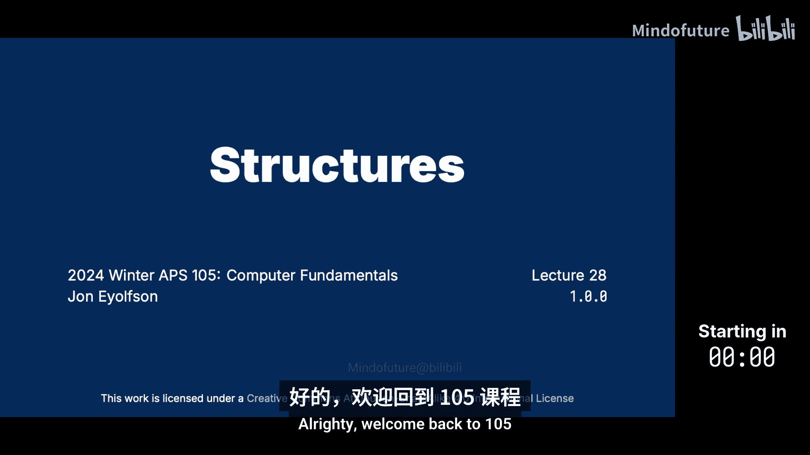
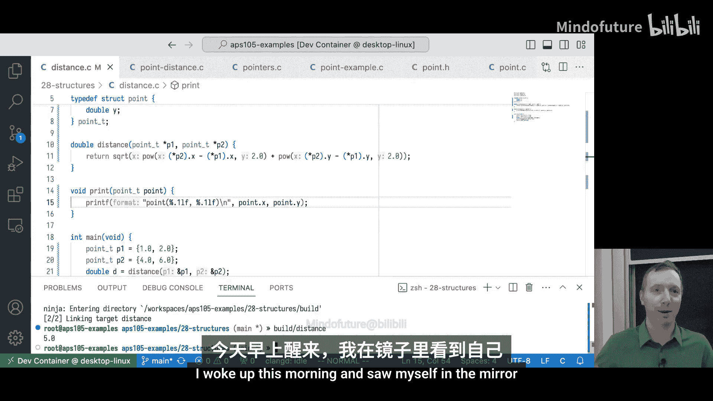
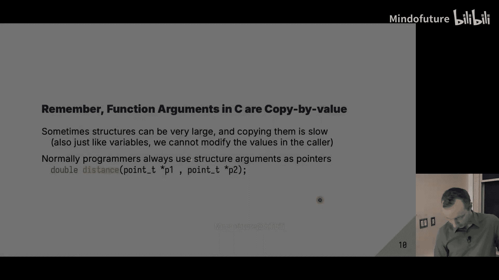
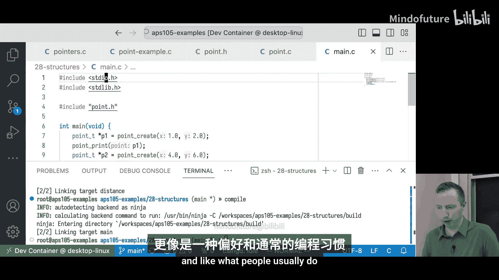
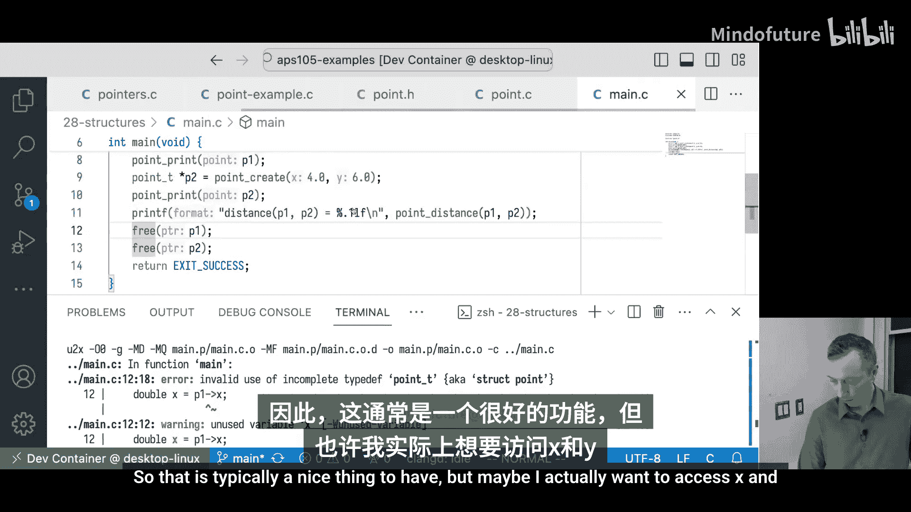
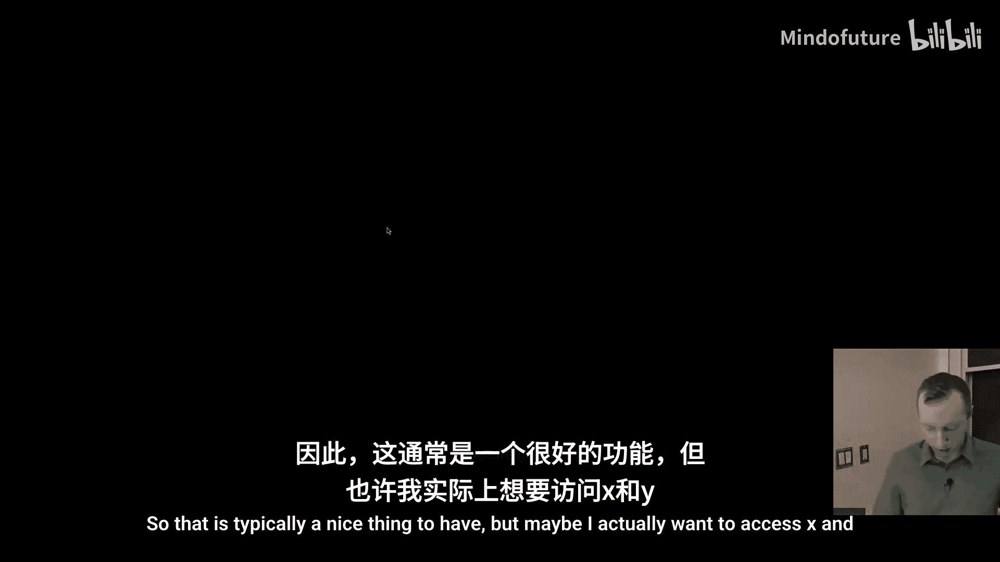
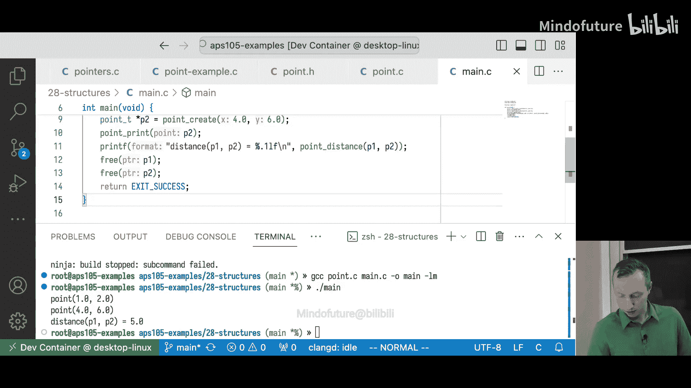

# 【多伦多大学】C语言计算机编程-｜-Computer-Fundamentals-｜-2024-p28-P28_结构体--BV1zL6GBwEGe_p28-

。

Allrighty， welcome back to 105。 so this is last lecture until our two day break。 So again。

 don't come to class on Wednesday and Friday， do come to class next Monday。

So let's get into this because we will need this when we start talking about lab 9 stuff。

 and it might be useful。So structures。 what are structures。 So in C。

 we can group together variables within something called a structure。 It is a new type。

 And of course， it's C。 So they couldn't have just called it structure。 they called itstruct。

 So they made it shorter because everything they had to make shorter。

 So the syntax to define astruct is， well， you just。Type the wordstruct， then give it a name。

 So name representing what you want to call this group of variables。

And then inside of the curly brackets， you can put as many variable declarations as you want。

 So as many variables as you would like to define， you give them a name， so。Similar to an a nu。

 short for an enumeration， Well， you define astruct just below the includes。 and typically。

 you do not do it within a function。 So we will spend the rest of the lecture talking about why we would use this。

 why it makes our life easier and some motivation behind actually using it。And if you've seen， like。

Python or C plus plus or Java or anything like this。 This will be familiar to you。Essentially。

 they just took the idea of astruct and made it a bit easier to use。 But at the end of the day。

 it is the exact same thing。So let's start off with a simple task。

 So we're just going to calculate the distance between two points。

 So I could write that as a function。 So if I have two points， right， a point is an x and a Y。

 So if I want to calculate the distance between two points。 Well， I could represent them as x1。

 and then y 1 for the coordinates for the first point and then maybe x2 and then y 2 for the coordinates of the second point。

 and then if I want to calculate the distance between those two points， right， it's just。

The difference between the  two x coordinates to the power of  two。 So I could write P， you know。

 the difference and then 2。0。 So that will just square it。 and then plus。

The difference between the y coordinates。 So y 2 minus y 1。To the power of two。 So， again。

 we get some review using our math function。 Power is just。Taking。

This as the base to the power of whatever the second argument is。

And then in order to calculate the distance， I just take the square root of all that。

 So I just give it to the square root function， which， of course， they called squirt。

Short for square root because， of course， they did。 And then if I wanted to use this， well。

 I could in my main， I could define。Points x 1 equal to1。 Y 1 equals to 2。X 2 equals to 4。

 Y 2 equals to 6。 And then I could calculate the distance。 and then we can review。 We can go ahead。

 just print it to one decimal place because it is a double value， so。If I go ahead and run this。

Lah 5。0， that's the distance between them。This should be nothing new， right。

 Any questions about this program as written。Fairly straightforward。

 We're just going to make it much， much better today。So we're good。 we're good。 Allright。

 so we could have written this at like what week or lecture， like。Six， something like that。So。

For a function like that for distance， not too bad to remember which variable is which I have an X 1。

 I have an or Y 1， I have an。X2， I have a Y2， not too bad to keep track of them。

 but what both if I write a function that just like prints a point。

 So I just write a function just called print。 I give it an x and a Y。

 and then it will just print off the coordinates just rounded to the nearest10th。

 And while this is a bit awkward to use and might lead to errors。 So just naming variables， X1， Y1。

 Y2 kind of a pain。 If I accidentally write something like print X1， Y 2。

 That's one coordinate from one point and one coordinate from another point。

 So that probably doesn't make sense。 It's really easy to do here。

 might not be one of the two points we intended and debugging it。Might be confusing， because。

You just don't expect that， so。Since we learn what a structure is。

 we can just make a structure that represents a point。 So we know a point is like a logical。Thing。

 so a point is a coordinate。 so I could just create a structure called point。 And then inside of it。

 I'm allowed to make as many variable declarations as I wish。 So a point， I'll just say。

 consists of an X and a Y。 Again， they're going to be just doubles。 so。

This will create a new type calledstruct point。 and then。You can just use that as if it was an int。

 a double， a char， a bo， whatever。 So you can create a variable with it。

 But instead of just saying its type is one of the things we've already learned。

 you could create a new variable by saying struck point。 And then I could say P1。 So I could create。

A point called P1， And it would be。The type of it would be the struck point that has an X and a Y。

So to access the inner variables or to access the variables within that structure。

 usually called fields or members by the compiler。 So you might see some compiler messages where it calls them members。

 you can access them by just typing or after the name， just putting a dot， So for example。

 if I want to access X。Of P1， iss just P1 dot X by one x is y。 It's P1 dot y。So questions about that。

 We just get to group them a little better。 And then we can go ahead and rewrite our function。

So first， I'll get into a common trick。 You will see that。

Is arguable whether or not it is clear or not， but we saw like type F before when we had E nus。

So the syntax of a type def just in case we missed that one on Friday is you can type type like type def is a keyword。

 So you can do type def and then a already existing type。 and then you can rename it to a new type。

 and then you can use it as either of the names so。In this， if I just do type f， I don't know。

 Ty F int nu underscore T， then whenever I actually use a type nu underscore T。

 then it would actually just replace it by an int。 And then I can go。

 I can change this type def whenever I want just creates a new name for a type。

So I can use this with a struct to make it arguably more readable。

 so we can create a struct without a name so I could do something like type defstruct and then not give it a name。

 do the curly brackets， Give it a X。Which is a double and a y， which is a double。

 And then I named that unnamedstruct point underscore T。

 So that is going to be my name for a type that's supposed to represent a point。So afterwards。

 I can create a variable with just point underscore T P1。

 and then I can access it like I could before。 I could do P1 dot X， P1 dot Y， so on and so forth。But。

 first。Usually， unlike enums， you should still give strs a name。 So if I want to。Do this。

 I could do typed up struck point， and then。Give it the curly brackets， Give it the X and the Y。

 and then point， and then give it the new name point underscore T。 And now I have two names。

 I can make it。I can use whatever 1 I want。 I could usestruct point。 If I don't want typestruct。

 I can use point underscore T， but。Both mean the same thing。 Just have an X and a Y。So。

If I wanted to create our two points and initialize the fields。

 I could do something like this instead， which seems。Like， I kind of logically grouped them here。

 but。Seems like a lot of work here。 So I could create a point underscore t called P1 and then do p1 dot x equals 1 P1 dot y equals 2。

 create another point。 I'll call it P2 because I have original ideas and then call it P2 dot X or sorry。

 set P2 dot x equals to 4 P2 dot y equals to 6。And then。That looks。

 that does essentially what I had before， right， but。Turns out with structures。

 we can initialize them like arrays。 So instead of doing all of that。

 I can just kind of borrow the same syntax as I have with as。 So instead to initialize it。

 I could write point underscore T P1 equals and then curly brackets。

 And instead of just setting array values， I'm setting fields in the struct in order。

 So since my struct had x。 and then a y。 well， this first one would set X。

 and the second number would set y。 So this is the same as just setting P1 dot x equals to1 P1 dot y equals to2。

 but I can just do it whenever I declare the variable。 I can initialize them straight。Straight up。

 so。It could also do P2 equals to 4，6。 And that will be the values。Just in the order。

 you declare them in the struct。 If you want to set the values in some different order。

 theres a funnier looking syntax。 So I can give it a curly bracket。

 And then I can say which field I want to set to what value。 So if I don't know， for some reason。

 I wanted to set y first。 But y was the second thing defined in my struct。 Well。

 then I could just do dot y equals whatever。 So I could do dot y equals2， dot X equals 1。And yeah。

 there's a question how the computer stores these values。

 So it basically stores these values like an array。

 except that all the elements can have different types。

 So it does some magic to like figure out where they should actually be in memory。 So like a arrays。

 they off to be of the same type for structures， they don't have to be the same type I could put wool。

 whatever they， but they're stored more or less like a rays and C gets to keep track of where they actually are in memory。

 but they'll be in one big chunk of memory altogether。Allright， so now I can go back。

And I could rewrite this code so I could be like， oh， okay， well， I should probably use。

 so create astruct， so I could do type defstruct point。Give it a double X。 Give it a double Y。

 and then call it point underscore T。So now I have mystruct point。

 and I want to rewrite these functions in terms of points。So maybe for this function。

 what I would do is well it takes two points so I could say point Tp1。

 just assume that they're like integers or something like that。

 and then I could point do point P2 and then inside of here instead of just accessing like x1 x2 well they're from two distinct points。

 so instead of x2， that would be P2 do x， and instead of x1 that would be P1 do x。

And then for the second one， Y 2 gets replaced by P2 dot Y。 Y1 gets replaced by P1 dot Y。

 and that should be it。 my double or my print function。Would be similar。

 Maybe I want to replace it with point。 And then here I just do point dot X， point dot Y。

And then whenever I calculate my distance， so I could create。P1， initialize it， so。An X， and then Y。

Create a P2。For。So saving some lines of code。 And I'm also grouping things that are logically together。

All right， there we go。Doesn't that look a little better。

 It makes it clear that I'm calculating the distance between two points。

 And then I could also print off the value or just print out a point。 if I want。

 There's no like printing one coordinate from one point， one coordinate from another point。

 They're logically grouped together in thestruct。Which for this， basically， it's like an array。

 So if I go ahead and run that。Boom should get 5。0， Sam thing， but。Helps me group concepts together。

 So any questions about these changes here。第二。So do I have to write this above all the functions。

 Yeah， so this I would have to write above all the functions because， you know。

 the C compiler is dumb， just reads it from top to bottom。

 And if I use point underscore T without telling C what it is gets really confused so we can see what that error actually is。

 So let's just move it down before this function。 So the print function knows what a point T is。

 but we'll see here we already have some angry， angry C compiler。 So if we do this。

 itll probably just say that unknown type name， point underscore T。Has to come before everything。

But yeah， good to see errors because that is a common one。All right， any other questions？All right。

 So how could this possibly get better， right。So。Heres what we had。So， it worked， however。

No one really writes this because remember。How does she。Deal with function arguments。

So do functions get complete copies of things is C copy by value。 Well， yes， it is。

 And unlike with the arrays that just kind of get turned into pointers， Well。

 the same confusingly doesn't happen for structures， they get copied， so。

Punction arguments in C again。 So this is also review。 They are copy by value。

 and sometimes structures can be very large， and it gets a complete copy of them。 So even if it is。

Your structure has like 1000 variables in it， and it is， I don't know。8000 by large。 Well。

 each time we use a function there， they get copied by value。 They get a new copy of the struct。

And of course， since they're copied by value， if we wrote function。

 that function that would like modify the X and the Y。 Well， if we modified it in a function。

 we would modify that copy of the struct and not whoever called the function。

 So we wouldn't get our modifications and also it would be really slow， so。In general。

 it's generally frowned upon to dostructs just straight up by copying them by value。And。

For speed reasons， for usability reasons。 And normally。

 programmers just always use structures as pointers。 So if I want to write my distance function。

 I would write。Just a pointer to P1 and then a pointer to P2。

 So let's see what happens when I do that。So。I changed these to pointers。

And then in my main function， while I can't just。Just like if I was using scanf or something like that。

 I would have to give it the address of it， not the actual value。

 because I don't want to copy the entire structure。

 So I'd give it the address of P1 and the address of。The address of P1 and the address of P2。

 But now， when I compile。It does a bunch of things。 In fact。

 I get an error where it says P1 is a pointer。So。Now， how would I actually access， you know。

 the value of P1 dot X。 Now that P1 is a pointer。So think about what I would have to de reference to get that struct back from the pointer。

Yeah。Asters。Yeah， the D reference。 So instead of writing P2 dot X。What would I have to write。Yeah。

Yeah， so I might have to write star P2 dot X， but that doesn't quite work， right。

 because what it's trying to do here。Based off the precedence rules that you don't really have to remember。

 what this would do is try to take the field of this first。 So like。

 try to access P2 dot X and then dereence that。So I have to tell the C compiler what I actually mean。

 So I could just put in parentheses， yep。Oh， yeah。 boops， I said， same thing here。We。

 we don't know that yet。 Yeah， so if I wanted to do this without anything special。

 I would have to put parentheses around it。So I could do de reference P2 and then dot X。

 And because of the preference rules， I always have to do parentheses， so。Does this look nice to do？

 And is this fun to do。😊，So are we having fun right now if I change them all to something like that。

 or does that look like really ugly。Looks pretty damn ugly， right。And it's not even working it。

 I'd have to change this one。 So we do this。And like， the parentheses are not optional。

 I would have to have them。So let's see， make sure we compile and it works。 So now it works。

 But doing that， that looks like one of the ugliest things I have seen since。

 I don't know I woke up this morning and saw myself in the mirror。 Ha ha boom， boom roasted。

 allright。

So。There is actually a special C operator to access fields through a pointer。

 So if I have a pointer to that structure， well， to access it， I would have to dereence P1。

 put it and put it in brackets because I need to make sure the pressnt rules like I de referenceence it first。

So I have to do this。 It's kind of a pain。 There's actually a new operator that just looks like an arrow。

 So it is the minus sign， and then a less than。It doesn't mean subtract anything。

 And then or wait that's greater than。 doesn't mean subtract anything。

 make it greater than It's supposed to look like an arrow。

 So it's supposed to look like it's pointing to something。

 So that combines de referencing and field accesses。In just one step。 So instead of doing， you know。

 parentheses， de reference P1 and parentheses dot X kind of pain， I could just do P1， arrow X。

So I can change it。 I can make it a lot more readable。 And that this is what most people do。

 So I can just get rid of this。 Instead， I could just do P2 because it's a pointer。

 P2 dot X or arrow X。And this one could be P1，arrow X。And then P1，arrow Y。All right。

So I could do that。 That looks a lot better， right。Okay， well。If they have to be pointers。

 it looks a lot better。So if you try to do something like。P 2 dot X and P2 is a pointer。

 Your compiler will。 So this is probably once you start doing this。

 probably be one of the most common compiler errors you'll see。 It says P2 is a pointer。

 Did you mean to use this。 Did you mean to use the arrow。 So it's telling you。

 instead of the dot just use the arrow。 even points to you at the dot you need to change and need to change it to an arrow。

So we just go ahead， change that to an error。 Get ready to see that compiler message a lot of times。

 because typically， what will happen is。You might write it the first time and write just point underscore T and then be like。

 oh， no， crap。 He told me make it a pointer， and then you change it to a pointer and then you just fix the compiler errors until it actually works。

 It generally what ends up happening。So this one is preferred， so this is the preferred thing to do。

 take the structures by pointers， and then while inside here， just use the arrow operator。

 don't use the D reference in the dot， no one does that。So yeah。

 we should always use a pointer and to take my own advice。 We should change this function as well。

 So here I just change it back to a pointer。 I get， you know。

 red underlines between the dot because the dot needs to change to an arrow。不用不用。So now we compile。

 it works。Cool， so questions about that。嗯。Okay， so。So。Just so you have it in the slides。

 change the functions to use pointers。 And we just use that error operator。 And also。

 just so you have it。Can't access fields with。A single dot， if it's a pointer。

 you'll get this compiler error， which you'll see probably a bunch of times。 Luckily。

 it is an easy fix。 It's just telling you to replace a dot by an arrow。So。Maybe you decide that， oh。

 well， I want to create a structure dynamically。And then while you realize that to do that， well。

 I have to mall lock it just as usual。 So I would have to mall lock。

 And then I don't know how many bytes it takes。 But luckily， I can ask C。 so I could say， hey， C。

 how many bytes do I need to store a point underscore T。

 And then I would get back a new pointer that points to that many valid bytes。

 And then I could just use it as。Just a pointer。 And then well。

 because these things are grouped together， I would logically need to set the X to X the y to y。

 And well， if I have to do that all the time when I have to make one anyways。

 what usually happens is that you just create your own dedicated function for this。

 So here I would do something I might call it point create。 And then it takes in as an argument。

 a double x and a double Y。 And then it returns a pointer to a new point underscore T。

So here I mall it。 I set the two fields， and then I return that pointer back。

 So that lets us create a point dynamically and initialize it in one step。 So to create P1。

 I could just do。Pot underscored。T pointer called P1 is equal to point create。1， and then 2。

 and then as always， if I malloc something， I have to remember to free it。

 So I would have to remember to free this when I am done。

 So a questions about that function and what it does。 So that should just create a point for us。

Somewhere in the heap， we go ahead and we set its fields to just equal whatever we got。

From the arguments。Alright， so this is typically what you do。In。Java and stuff like this。

 This essentially is the thing that gets written for you and why people like Java。4。So do， do do。

 yeah。 So this is kind of like a constructor in Java。 If you have done Java before。But this is C。

 C is no hand holding。 So you have to write your own。So。

Usually when we write functions like this or just write functions that just。Deal with our structure。

 We just prefix all the functions。 So in our case， we would name them all starting with something like point underscore。

 So I should define the other functions like point underscore distance and then just take the point by pointer。

Wow， that's a lot of points in a sentence。 And then for the other1。

 I would just call point print instead of just print。So this is what my final thing would be。

 So any questions like that before we get into more fun stuff。Alright。

 so this are things you should follow。I'll preface this by saying this is more advanced C programming stuff。

 You might not be able to use it for this course。 You might shouldn't。

 You might not want to use them for this course。But you will see this if you do A C programming or if you have seen other languages。

 But this is the stuff。 Anything before this， you definitely have to know anything after this is just。

Bonus。So。Usually what happens， you're kind of encountering this with the recent labs， but usually。

If once we start writing bigger programs， we usually divide up our code between different files so we could just write。

 you know。I don't know。 what， What was this called， This was called distance dot C， well。

I started off by calculating the distance between two points。 Then I created this point structure。

 Then I did a whole bunch of things using points。 Then maybe I make my program， I don't know。

 do something with graphs or something like that。 And then suddenly it gets bigger and bigger and bigger and bigger。

 And well。Usually， you want to divide things up to make them more manageable instead of just throwing everything in a single C file。

 so。Usually what happens is people will just create a single C file for like all the related all the related functions that operate on a structure so you。

How code is usually organized， as I might call a file like point dot C。

 And then that file would contain the definition or all of the code for point underscore， create。

 point distance and point print。And then， point。Dot C could also be the only file that defines thestruct itself。

 We'll see a bit more on this later。 This is， this is more advanced usage， but again。

Do not hesitate to ask questions if I confuse you， because this gets fairly subtle。

So how we would organize our code， We've kind of used it before like STD dot I O and things like that。

 So what we would do， we would create our own header file for these that would have the function prototypes for all of our print functions So we would create like a point dot H that would have all of our function prototypes。

 And that way we could use these functions in other C files and remember just a dot H that's just called a header file。

 It's meant to just define structures， define function prototypes and everything like that。So。

Our point dot H file would probably look like this， which has a few weirder things。In it。

 So it would start with， you know， the hashtag。 Is that way we agreed to call it。 So the hashtag。

 the pound， if you're old， so。If it something starts with a pound。

 that's something for like the C preprocesor。 So what the。

 what the first two lines here and then the end， if at the end do。

 you don't have to really understand it。 But basically。

 what they do is make sure that if we include this file， we only get a single copy of it。

 So it will check。The C pro prepro， you can write like if statements and then define variables。

 So what this does， it says if not defined and then a name。 So if some。

 if a variable is not defined in the C prepro called point underscore H， then it defines it。

 So it creates a new variable called point underscore H。And then it does all of this stuff。

 And then it has an endF。 So if I were to write like include point do H twice in a row。

 Well the first time we include it， this variable doesn't exist So it would define it and then do and then like copy and paste these lines and then if we included it again while point do H already exist so it wouldn't actually include all those function prototypes two times because C gets really snarky once you define something two times。

 it'll say like duplicate definition or duplicate declaration。 please choose one。

 you should only just give me one。 So this is just to make some like C C preprocessor magic。

To make sure that this file only gets copy and pasted once。Don't need to know the internals for that。

 But basically， it'll always look something like that。And then in it。

 we could do type F struck point， point underscore T。 And here we do not tell it the fields。

 So we are allowed to just say。St point。 we're basically telling C， hey。

 we're going to create a structure called point。I will tell you what fields it has when it is relevant to you。

 So if you don't need to know， don't worry about it。

I'll use it somewhere and the purpose for this is to actually hide the structure。

 So if you modify it later on， then you know your code doesn't break in really。

 really subtle ways which you would experience in other courses。

Which you might experience as software evolves， okay。And then otherwise， in our header file。

 wed define our function prototypes。 So any questions about this header file as it stands， Basically。

 it's telling the C compiler， okay， I'm going to create astruct called point。It。

 it's also known by point underscore T。 And I'll go ahead and give you the function prototypes for these three functions。

Alright， cool， so。Again， that header file makes sure it's only included once or copy and pasted once。

 and it hides the fields of the struct。 Anything that starts with a hashtag。

 their preprocessor commands。 So that happens before you actually compile it。

 And then see willll compile it after all that's done。

And just saying struck point and not telling it any fields is has a special name that you might see。

 It's something called a forward declaration， which， again， is just say， see。

I'm making astruct called point。Trust me， I will define it later。 so don't worry about it， so。

Why I did this is because， well， I have to tell C like what a point underscore T is and it doesn't need to know what the fields are to be able to just create a pointer to it。

 Pointer is just an address to somewhere so I can just use pointers for that structure。No problem。

 If I got rid of the stars here and I didn't have them then see probably wants to know， oh， well。

 if I need to copy the stamp structure。As an argument， well， then I need to know what fields it has。

 how big it is and everything like that。 So in that case， it would matter。

In the case where you just have pointers， you can do this， and it's fine。

 which is the third and most important reason that people typically just use pointers for arguments。

 So it's just to hide thestruct。So。If I do this division， then in my main program。

 this is what I could do。 So I could get rid of all of the point functions and just keep it to whatever happens when I start running my program。

 So all I do is I include point dot H。 Then I have the type point underscore T。

 and I can actually use the functions point create。 So here maybe I create a point called P1。

 and then I print it。 maybe I create a point called P2 again。 and then print it， and then print off。

The distance between the two points by doing point distance， P1 P2。

 And then after I'm done with them， I use point create， which did a malloc。

 so I to make sure that I free them。And it would look something like this。

 So any questions about that。Yeah。differenceiffence between。When you add here， I had your reply。

 you add。会看到自这个嘢。就。Oh， yeah。 So the question is。Basically， here， let's find it。So basically。

 why is point do H in double quotes and the other ones in angled brackets。 So this is a subtle thing。

 So if I tried to put mine in angled brackets。Well， it turns out。Probably actually works。 Yeah。

 so still， it works。 No problem。 The difference is like really subtle of like where sea will look for things for you。

 But the usual practice is usually it doesn't matter。 And the angled brackets。

 you reserve for things from standard libraries and then use double quotes for anything that you created yourself。

 So it just lets you know， okay， this is the thing I wrote。

 this is a thing that's in the C standard library。 Turn out doesn't matter。

 but it's kind of just like a preference thing and like what people usually do。

To to do。

All right， so。That's what our main program would be。

 So now our main program can't access the fields itself。

 which is actually kind of helpful because while， you know that the user cannot just just change the fields of the struct。

 anything that changes the fields of the struct are hopefully in your point do C file。

 So if something is wrong with it， you know exactly what file to go to。

 which really helps once you start developing larger and larger programs， so。It's more。

 and it's way more flexible if you can hide the details。 But maybe you were like， oh， well。

 I wanted to actually change X or Y and like get the values of X and Y。

 How do I do that with a pointer， especially if I just can't access the fields， so。

If I go back to my code here and let's say I try to just use double x equals P1 dot x。Well。

 because I。Only have like a forward declaration there。 When we try to compile this。

 itll be like invalid use of incomplete type def， which basically just means， well。

In this header file， you just told me that you're creating something called Str point。

 which is a point underscore T。 You haven' told me any fields， it's not actually complete。

 And if I try to use the fields be it just says， basically， I don't know what the fields are。

 Why you asking for X， I don't know what fields this has。 So don't try it。

So that is typically a nice thing to have。 But maybe I actually want to access X and Y。

 So I need to create more functions。 And typically。

 you create something called a getter function so that can get the current value of a field。

 And then a setter function that will go ahead and modify the value of a field。 So。

How most real programs will look， this would be my complete header file。

 So I would create a function to get the value of X。 So given a point which I take by pointer。

 I would return a double that represents the value the current value of X。 if I want to set it。 Well。

 I don't have to return anything。 I'm just modifying something。

 So the first argument would be a pointer to the point to modify。

 and then a value to change the current X to， and then I would do the same for y。

 So now the full functionality with it， but the user can actually like access X and y directly。

 So questions about that one。 So I just added some more function so we can go ahead。

 we can modify the fields if we want， or we could get their values。So。

That's our complete header file。We anything one that uses it doesn't know the definition of the stretch more and it's more flexible。

 and we can hide the details。 So the details would have to be in our。Separate file。

 So we would create a point do C file， like I said before， whoops。

Like I said before that actually defines the struct and also has all of the definitions。

 so inside of point do C， well I could include point do H， turns out I don't really need to。

 but that's usually what you do is just a style thing and then I would actually define the structure itself so I could do typeSstruct point then give it its fields X and Y。

 and then we could have our point create from before。We could have our distance from before。

 And then the only difference would be we could have git X。 So Git X would just return。

The current x value。 So we just go ahead use that arrow。 and then to set x。 Well。

 it would just be Parrow X equals x， whatever the argument is we get from the function。Same with Y。

 and then same with print。 So any questions about that。Cool。

 this is how people actually mostly use structures and mostly like write programs so that they are。

Like logically separate in files。 And it's much， much， much， much harder to screw things up。

So here's just the code。 So you have it in the slide。

 So that was the start of point do H or point do C。That was the rest of it。 And then the rest of it。

 so。The only other step we need to do here is when we compile。

 we need to tell the compiler about both files， so it needs to compile them both together so that we have all of our code。

 So usually you put your main function in its own file。 So I might do something and put it in a file。

 name main do main do c and that has what I showed before。

 just have main and then include point do H and then if I want to compile them if I want to do it by hand while then I have to tell like Gcc if I use as my compiler。

 I give it point do C point or main do c and then dash o So that is the name of the executable file and then in this point I use the math library。

 So I have to do dash Lm。 and then afterwards， we just run that main executable as before。

 So just to show that there are no tricks or anything。Here is point dot C。 Here is main dot C。

 So that just has include point dot H。Really readable。 That's all it has is 16 lines of code。

 And if I wanted to compile it， well， it's just G C。Point dot C， main dot C。

 And then the output I want to just call it main。 Maybe I could rename it if I want。 doesn't matter。

 and then just compile it。It would create main， and I could just run main as before。

 And here it would print off the first point。 then the second point。

 and then the distance between the two points。All right。Any other questions about that， so。

As thing gets bigger， so your lives probably won't get that much bigger， but。

You will see this as soon as you start programming more and more。 If you read other people's code。

 they're not just going give you one dot C file。 And then that's it。

 It's going to be divided up into a lot of things。 And this is。How it's。

 how they kind of start to fit all together。 So with that， just remember pulling for you。

 We're all in this together。嗯看。

