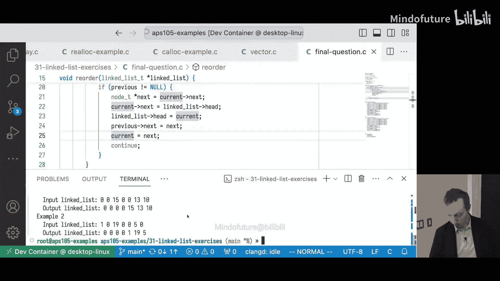

# 【多伦多大学】C语言计算机编程-｜-Computer-Fundamentals-｜-2024-p31-P31_链表练习--BV1zL6GBwEGe_p31-

Alrighty， welcome back to 10，5。 So more linkedless today， everyone's。😊，Most fun things。

 So we get some more practice with that， so。😊。

We get to create some more functions today。 We've done a lot already。So。

We could present our linked list as a library so that the user doesn't have to use nodes。

 And then it kind of looks like Python or other languages。

 So what we wrote before were things like we could create a link list， which， you know。

 initialize is the head to be null。 We can write a function called free that frees all of the nodes cleans up the list。

Empty length to check whether or not the list is empty。 It's length。

 I just rename the functions to start with link list underscores。

 because that's how C developers usually write that。

 But that's not the recommended way to do it in this course。

 But I just do it here because it looks a bit better。

We wrote how to insert just a value to the front。 So we created a node， put it at the front。

 played with the pointers， and then。There's now this function to remove an element from the front。

 So it'll just remove it， Free the node， give you the value back。

 And then here' are some new functions we can write today。

 So we can write a function that returns true or false whether or not a particular value is in a linked list。

 We're assuming our nodes just have integers。 And then we could write a function to remove the first node that matches the value。

 and then another function to remove everything that matches a value。 So。

They'll pretty much look like what we've already done before。

 So let's go ahead write a function to check if a value is in the linked list or not。

 So here is the function prototype。Bullan。 so it gonna return return a yes or no。

 whether the linked list contains a value should return truth。 The value is in the linked list。

False otherwise， so。When we write this， typically， we'll have the link list and the link list structure。

 remember。That structure just has a head which points to the node that starts the list。

 And then every other node has a next pointer in it， so。

This kind of looks like anything else that we do that iterates through the list。

 So we create a temporary value， probably called current。Set it equal to the linked list head whoops。

Wow， I can't type today。 And then while current does not equal null。

We can iterate through everything and update current equals to the current dot next。

 And this will essentially iterate through everything in our list。

So it's complaining that we don't have a return value。 So what should I write here to check。

If a certain value is in my list， yes or no。第二。Yeah， so we can just have a simple check here。

 So if the current。So remember， a node has like a next pointer。 and then the way I wrote it。

 it has a value， but you could put whatever you want in it。 But here。

 if the value of the current node equals the value that we pass into the function。

 that means we have found it。 We can just simply return true and we don't have to check anything else。

 we've already found it。 If we make it to the end and we have not return true。

 So nothing matches or the list is empty， it covers both case， we can just go ahead and return。False。

 so any questions about that。Lots of fun， right， It's just more iterating through the list and playing with values。

😊，So here is the code on the slide。 So you have it。We can create more functions。oo， more functions。

 more fun。 This pretty much looks like a combination of ones we've already wrote。😊。

So we can create a function to remove the first matching value。

 So we take a link list as a parameter and then value。

 And we want to try and remove it from the list。Actually， free the node。

 So we don't haveva memory leaks or anything like that。 And then just return true if it got removed。

 false if it wasn't in the list and did not get removed and cleans up all the memory， so。Oops。

Swap back。 So let's think about how we would write。Ohoops。Something like that。Oops。So。

Give you a little bit to think， or I could just start writing it to try and remove the first matching value。

 so。Maybe I could start off， and。Let's do the old copy paste。Oops。

So if I find the current value instead of just returning true， I want to actually remove that node。

 right？ So how would I remove the node without breaking everything else。So can I just do。

 I don't know， Let's say I want to free the current node。And then。Oh。That's it。

Probably not the greatest idea， right because well。Some node probably still points to current。

And well， that would be a segmentation fault if we had to go over it。

 So we have to go update some pointers and things like that。 So anyone， want to help me。

 What do I need， Anyone， remember how to actually successfully remove a node from the list。Yeah。

So have a temporary pointer that points to that node。 So like。Something like that。

And then what do I want to do with that？じゃあ、ビビスの。Okay。

 so I need to make the previous node point to that next one， right。

 So I probably need to keep track of the previous node。 So let's do what we did before。

 We'll create a node called previous。Iitialize it to null。

And then here I can set previous equal to current。 So I always keep track of the last node I had。

 So that's why I had two pointers。 So this will make sure previous is always one behind current。

 And initially， it starts off as null。 So now if I want to remove it。Well， yeah。

 I do need to free current。But what pointers do I need to change， So I have current intent。

Which shouldn't help me too much becauseuse if I free it。

 while it's the same address that I just freed， I also can't use it then。

 So that doesn't quite help me， yeah。Yeah， so the thing I want out of current that I want to save is it's next。

 So maybe I just save it in a temporary variable。 Maybe I call it next。 So after I get next。

 I can free it。That's good， okay。So now what do I want to do。So now I delete it。 I got it next。

So now there's kind of two cases here， right， yeah。停した。就是。Yeah， so there's two cases here。

 So if previous is null want just the。Previous。Next， equal to next。Right。Is that all we need。

 Are we good。Ohoops。后呀。Looks like it should， should be good。 We， we free the node。

 and then we return that。We return true。 So we either update the head to point to the next that we just currently deleted or update the previous to point to the next。

 which we just skip over the one we just deleted， right， So this should so。Here is very good。And。

That would remove the first match value。 So any questions about that。

 All ideas is kind of make it go compact on the slide a little bit。

Pretty much the same thing we had before。 So now。We can create a function that removes all matching values because。

 well， moving one thing is fun。 This could be even more fun。

 So this should remove all the matching values and then return the number of values removed。

 So the function should also just like free the nodes used to store all of the values。 So。😊。

Let's think about how we would write a function like this。And let me check。

So one hint might be this is a lot to think about， but。Kind of ish like the idea of recursion。

 We've already kind of solved this problem with the last function we wrote。

 So if we remove the first element， it returns yes or no， whether it has removed it。

 we might be able to just reuse that function instead of you know。

 playing with all the list pointers again and all that fun stuff。

 So any ideas of what we could do to write this really simply doesn't have to be efficient at all。

Alright， let's just steam roll through it。 Alright， so easiest way to write it is just like this。

So to remove everything， we could just create a variable called in removed。

 And just since our remove first returns yes or no， whether or not we have removed something。Well。

 we can use a while loop that can just keep on removing stuff as long as you know。

 we removed an element。So as long as this function returns true means we've removed something so we can keep on doing it until it eventually returns false。

 And when it eventually returns false， that means we have removed every matching value。

 And here we just increment the number of elements we' have removed each time through the loop。

 because while each time it returns true， we removed a single value。 So now with that function。

 do to do。So here's a little test function。Oops。So here is our link list before。 It's 1，2，1，3，1，4。

 So if we call remove all on it and we're removing all the values 1， hopefully， if it works。

 it removes 1，2，3， So it removes 3，1s， which indeed， it returns。 we have removed 3。

 and then the link list after has the elements 2，3，4 in it。Fun， right。Alright。 it's not that fun。

 Im pretty much beating a dead horse with just these linkless things over and over again， so。

Any more lengthless things I need to do or everyone more or less okay with it。

 I beat you over the head with it enough。Allright， cool， so。You might also ask。

 is there anything useful we can do with linked lists。

So we can actually solve some problems with linkedlesss。 So in general。

 you could like implement some more complex arithmetic using linked list。For instance。

 one silly example is we could just sum together all the values in the link list without having to。

 you know explicitly iterate over everything。 So if we run this algorithm。

 which is we remove two numbers from the front of the list and then add their values together and then put their result on top of the link list。

 we could repeat this process over and over and over again until eventually。

 there's only one element in the link list。 And magically。

 that one element in the link list will be the final sum。

 So this is kind of like how you would do it if you were doing it by hand。

 And you could only multi add two numbers together at once。😊，So here is the code that would do that。

 Actually， here， let's just write it。So the code that would do it。

The idea behind it is each time through this loop。 So first， I can check。That the list is not empty。

 That would probably be an edge case。 So if I'm computing the sum and the link list is empty。

 I'll just return 0。 Otherwise， I will have my loop that will just keep on running。 Well。

 the length of the linked list does not equal to one。 And the idea behind this is， well。

 every time we iterate。Through this code， we're removing two elements。

 So we're removing two numbers from the list and then adding one back end。 So every time we do this。

 it gets one smaller。 and the value doesn't change。 we just have one less value。

 So we take A and a B off。 So in this example。So if our list is 1，2，3，4。Then first time through it。

 if we're removing from the front， we'd take off a one and a two， and then add them together。

 put a three on。 And then after that， we would take off the front2。

 So that would be the three and the three add them together。 get a6。 put it on。

 And then we take off two numbers。 It would be the 6 and the 4。 Take them off， Add them together。

 It's a 10。 Now there's only one element in the list。 and we can get the final sum。

So now just doing that， which doesn't really look like a sum at all。 Well。

 it actually computes the sum of the linked list。With， I don't know， with fun。 And that， this is how。

Basically， your computer works by like all the additions you do。

C will only ever do two like an addition between two numbers at a single time。

 So what it would do is something similar to this。 So it would just keep。Adding numbers together。

 getting their result， and then adding that result to another number， so on and so forth。

 kind of like you would do it in math。And。When you use a link list like this。

 just like adding stuff to the front and removing stuff from the front kind of reminds you of like that stack of plates at like the cafeteria or something where you put one on the top。

 Take one from the top。 So this is a data structure that you will see come up。

 And it's also kind of the same way that your local variables are stored in the function。

 They're kind of。Created and deleted in the same order。 you would put stuff on。

 So it's just put out the front。 Take off the front。Allright， other fun stuff。 So a。

 questions about that。 That's just a fun little example。Alright。

 so other stuff that I think should be part of this， so。One of the reasons to use linked lists。

 I know。One of my third year courses loves using Li lists all the time， even though realistically。

 they're actually really， really slow， so。You should typically not use link lists unless you're like constantly adding and removing from the front。

 Arrays are generally always faster， even if you have to resize it from time to time。

 and they use less space because they don't need to store pointers or anything like that。 Arrays are。

Ped really tight in memory， so。We could think about how to make an array larger without。🎼，🎼啦啦啦。🎼あ。う。

🎼あ。Yeah。Yeah。Okay。🎼The。🎼啦啦啦啦啦。どく？🎼。🎼Yeah。🎼Yeah。🎼Yes。この。🎼Yeah。Yeah。

We are we are we are we are the engineers， we can， we can， we can， we can all along with us or don'。

Yeah。We are we are。 We are。 We are。 We are the engineers。 We can。 We can。 We can。

 We can to0 We come come We come with us。奥战菜蔬菜蔬菜we areH。😊，い。こ。그 나。🎼Yeah。All right。I officially。

 I officially have ear damage， says my watch。 how， alright， so。Wow， I have to fall off that。 Alright。

 so now we get to resize an array。 Wow， thats distracting， so。If we want to make an array larger。

 wow， that seems like a very bad segue， doesn't it？ Allright。

 so if we want to make an array larger while keeping everything。Our code could look like this。

 So let's just walk through it really， really quick。So， say。We create an array。

 We set at length equal to 4。 So we malloc 4 by。 Again， we're going back to arrays。Check that malloc。

 Actually， we didn't run out of memory。 So check that malloc did not return null。 if it did。

 We'll just exit with a failure。Then let's say， we populate our array。With the values 1 through 4。

 print it， we should see just our array is 1 to 4， right， so。If I wanted to resize my array， well。

 it looks probably like a lot of code。 So if I want to resize my array， well。

 then what I have to do is let's say I want to resize it to fit 7 elements instead of four。

 So what I might have to do with what we know right now is， well。

 I need to mall the space for that new bigger array。 So。

I need the Al or malloc7 int so I can do that。 Go ahead， check that I didn't run out of memory。

 If I did run out of memory， Well， I can just free that allocation that succeeded before。

 exit with exit at failure。And then what I could do is I would copy the contents of my old array to the new array。

 So in this case。I want to， I'm just trying to make it bigger。

 so I don't want to lose my first four values。 So I could copy in this case， since it's smaller。

 I could copy up to length。Elements to that new array。 So I would copy， you know， index 0，1，2，3。

 So I copy it to my new array。 and then boom， I can now use up to 7 because I have enough valid memory for it in here。

 I had， I put min of length and new length because if we make it smaller。 Yeah。

 we could shrink it by two。 So we only want to， if our new array only has two elements。

 I can only copy two elements from the old array because， well。

 now I don't have enough room to fit element。At index 2 and 3。And then。

What I can do is I can free that old pointer。 So now I'm done with that old array。

 I can free it and then set my array pointer equal to that new array。

 And then maybe I want to initialize all the other values to 0 and then say what my new length is。

 So if I run something like this。Before my array had four elements。

 I wanted to resize it for whatever reason， so。I just did a new malloc with 7。

 I copied the old values over， so I didn't lose them。

 and I just initialized everything else to 0 just in case。

 So does this make sense to everyone how I would do this。

 So spoiler alert wasn't taught to you before， But there is a function in the C standard library that will do this step for you。

So。Oops。So。Resizing an allocation， it actually exists in the C standard library。

 the function prototype。 It's called reoc。 instead of malloc。 So it's like reallocating。

 So try and resize this for me， please。 So it takes two arguments。 One is the pointer。

 So whatever you got back from malloc before。 And then the next is the new size。

 So that is the total size of the new allocation you want。

 So you could either shrink it or you could grow it and it will deal with copying any of the old values actually for you。

 So。😊，You can also optionally， this pointer doesn't have to come from malloc。

 But if you give it null。 So if you said this to null， then well。

 suddenly you give it null and then a size and it behaves exactly like malloc。

 So you don't have to use malloc if you really wanted to for some bizarre reason。

 you could just use null as the first argument to this function instead。 But otherwise。

Kind behaves the same as malloc。 So it will return null if there's an error。

 So it can't do the reallocation for you， It can't grab enough memory or it can't shrink it for whatever reason。

 And the original pointer you gave it is not automatically freed for you。

 So you would still have to be responsible for cling it up。Otherwise， if it does not return null。

Then you have a new pointer to new sized bytes， and it will go ahead and copy all the old values for you like I did previously。

 So it would copy up to old sized bytes。 You don't have to tell it。

 You just kind of get that for free。 And the nice thing about this is C might not actually have to copy all the values。

 it just might make that allocation bigger because it's the one dealing with it。

 So the original the pointer you might get back from this might be the same as the pointer you gave to it originally。

 But now the memory allocator knows that， okay， well， instead of having4 ins worth of memory valid。

 You now have7 worth。 So。That would make our code much， much simpler。

 so we could just rewrite it to use re like this。 So if we wanted to make our array bigger， well。

 we would say realal array。So this would be what we got back from malloc previously。

 And then we could say， okay， well， we want a new length number of bytes。

 so we could assign the return value of realloc in the variable called new array。

Check if theres an error。 So if it returns null， that means we have run out of memory and we didn't automatically free array so we can free array and then exit。

 Otherwise， if realoc actually was successful， it would have freed the original memory allocation for you if it didn't just automatically resize it。

 And then after that， we could just reset array equals to new array and length equals to new length。

So a， questions about that。 So that will do most of the work for you so you can resize。

 array all you want。It's not really that big of a deal。

 And computers really like memory being contiguous and being really close together。

 So even if things look like it might suit a linked list better。 Typically。

s are simpler and what are what you should go to， but sometimes linked lists are。

Make it easier to solve some problems if you really need to care about the order。

 but you kind of need to get practice with them and kind of get some intuition behind them。

 Or you could just try implementing your solution with linked list and arrays and then seeing which one is better。

 so。There's also other versions of malloc that actually initialize value for you。

 So if you ever write code that you malloc a bunch of memory and then you just initialize everything to 0。

 Well， there is a function already that will do that。 So theres a function called Koc。😊。

Don't ask me why it's called that。 I don't know。 So it takes two arguments。 So then typically。

 it's used to initialize like dynamically allocated arrays。 So it takes two arguments。

 the number of elements you want in your array， and then the size of each element。

 So it will do the multiplication for you。Again， don't ask me why they wrote it this way。

 I don't know。 And the benefit of using this function is it will actually initialize all of the memory to 0。

So。If we look at that so we can see the difference。And I like。

 I was looking at the piazza posts over the weekend。 There were a lot of them。

 and a lot of them were like random memory bugs of like， hey， I tried this on EF， and it didn't work。

Typically。At least most of the cases I saw that were' at。

Asked to me is someone didn't initialize memory， and they just got lucky somehow。 Probably happened。

 if it happened to you， Yeah， kind of sucks。 But this is basically like what happened。

 So if I malloc。Say four integers。 and I print it， well。Technically。

 it should be any old random value， right？ I don't know what the value would be。

 But if I do the same thing， if I use Kello， So I give it length。

 number of int and then print that array Well， then the first one might be random。

 The second one might not be random。 So if I go ahead and do that。

Looks like the first array that I got from Maloc， whole bunch of random values。

That all happen to be the same。 And the second one is they're all zeros。

 But the bad thing about using the first malloc example is all these elements could have been 0。

 and they could have been 0， just to downright luck。

 And if you depended on them to be initialized to 0。 Well。If you tried it on ECF。

 which did not do that because it's not guaranteed。

 then guess what your program didn't work and it crashed and it did some weird things。

 So if you need to， so I'll add this。 So it's something else you know。

 So if you want to make sure you initialize everything to 0。 you can use Kello。

 it will guarantee initialize everything to 0 for you。 because here， let's。C。

Let me do a bit of magic。 So。All right， so。I just played with my operating system a little bit。

 So that code， I didn't actually touch that code。 right， Looks the same as before。

So I just have a malloc and a cowoc。Alright， so now when I run it now。So。If you depended on it。

 now your program works by sheer luck。 I just tweak something in my operating system that I won't tell you about。

But。There's。Basically， a way to just make C screw with random values where it can。 So now。

 if I depended on zeros， hey， my program works， didn't change my code at all and。Well。

 that is the bad thing with。Using undefined values is because they might work sometimes。

 And if they work， probably won't realize it。 And this is what makes C programming especially really。

 really hard。 So any fun questions about that。So another thing to add to your repertoire。

 So before it was just malloc and free。 But now you have realoc if you want to resize your allocation and have it copy all of the old values and。

Any new memory from realoc， it's undefined， just like Maloc。But if you go ahead。

 you cow the array ahead of time， while all the。Uninitialized values will be guaranteed to be zeros。

 no matter what。Alright， another fun skill you should know。All right， so。

There's another data structure because if you resize an array often， you might be like， oh。

 you might want to keep track of like the current length of it。 Maybe in some。

 you might see this again when you look at like C plus plus or other languages that kind of。

Support a dynamically sized array。 So a vector is basically a data structure for an array that we resize。

 and we always keep track of the current length with it， because like a link list。

 we kind of want to keep track of everything together in a structure。

 So we can create a structure called a vector。 So that can keep track of like a pointer to the array。

 typicallyy they just call it data。 Maybe the number of elements in that array。

 we could call it length。 And maybe just for like optimization。

 we could have another field called capacity。Which just keeps track of the number of valid elements we could use。

 And the reason we might want that is it could save us some calls to reallocation if we want to be like lazy about it。

So this just keeps track of the capacity and holds everything。 So similarly， the link list。

 we could create a vector dynamically。 So this looks a bit ugly because to create it。

 we could dynamically。We would malloc。The structure itself。 so we could mall the size of the vector。

 so that would hold like the pointer and then the capacity and the length。

And then we could initialize the data。To hold that number of integers so we could malloc length times the number of integers。

 Check that you know， we actually had memory for it， check that thought null。 If we ran out a memory。

 we'll just exit our program， and then we could set the length to the length and the capacity to also the length because we can hold that number of elements and then return a pointer to the vector。

Now， if we want to resize a vector。We could write some code that looks like this。

 So we could write vector resize that takes a pointer to the vector as the first argument in the new length。

 And this is one thing that could save us like， we might want to do this。For some programs。

 So if we're making it smaller。 So if the new length is less than our capacity。

 maybe we want to just not tell C that we want to make this even smaller。

 We'll just note that our new length。Is shorter now。

 and we'll keep the capacity to the same so that if we want to make it bigger， well。

 we don't have to call Riok or anything like that。 It's already there for us for free。Again。

 this is like what makes programming fun， because that might be a good idea。

 Sometimes might be a bad idea。 Some other times。 It's just optimizations we might make。

 and you will get。More familiar with this as you write bigger and bigger programs。Otherwise。

 if I want to make my。Pointter bigger。 Well， I could call realoc like before， give it the data。

 then give it the new length。 and then check that doesn't。 We didn't run out of memory。

 And then I could record the length。 as' the new length。 and then the capacity as a new length。

 because I just made it bigger。So any fun questions about that。So。

Fun things I could do with it now is now it kind of looks a bit better。

 So here I could create a vector of length 4， which is basically just a dynamically sized array that's all nicely packaged together in that structure。

 just so it's a little bit easier to use。 So I could create length 4。

 And then to iterate through them。 Well， we know how to access pointers in our structure。

 So it would just be like a four loop before。 But now that length is actually kind of associated with that vector。

 So we don't have like a random pointer and then a like array length in and we have to remember that they're tied together。

 So now that they're in a struct。 they're tied together in the struct and probably a lot less error prone。

 So we can actually go over the length of the vector and then to access all the individual elements。

 Well we just。😊，Access the data field。 That's a pointer to an int。

 So we can just use the array subscript like we used before。 We could set it all so that。

In the array index0， it's equal to1， and then so on and so forth。 We could print the vector。

 and then we could resize it so we could make it 7。And then print it again。 So it should show like 1。

2，3，4， then 0，0，0。 Then we could make it smaller。 We could shrink it back down to 3。

 and then it should just print 1，2，3。 So if we run something like that， whoops。

Should look something like that。Makes it a bit easier to use a dynamically resized array。

 just keeps track of everything like Li Gly。 It makes things a lot nicer to use。

 So any questions about that， probably not useful in this course， but might be useful for you later。

 especially if you have， you know， lots of different dynamically sized arrays floating around in your program。

Allright， looks deep。 stuff that is outside the scope of the course。 So now。

Just to make sure we understand stuff， we can do a final question on Li list because you'll probably get questions like that。

So here is a question from the final in 2022 says right A C function called reorder。

 the prototype of which is given below that reorders the nodes in the link list。

 such that the nodes with the value，0 appear at the front and the nodes with any other integer value appear at the end of the link list while maintaining the original order of the non-zero nodes。

 So they give you two examples。 So if your input is 0，0，15，0，0，13，10。

 then all of the zeros should come before。 So there's  four of them。 So it should be 12，3，4。

 And then all the rest of the numbers should maintain the same order。So should have 15，1310。

 And then second example for our list has 1，0，19，0，0，5，0。 Well same idea。

 all4 zeros should go to the front of the list。 and then the other one should be maintained with the same order。

 So you should get 1，19 and then 5。 So it also says you're not allowed to copy or modify the data member of any of the nodes。

 So you should be able to just reorder them without creating new nodes without deleting nodes just by rearranging their next pointers or the head of the link list in order just to reorder them。

 So they tell you that the prototype is just reorder linked list。

They like doing type defs with like capital letters。

 I like to most see programmers like doing them in lower case with underscores between them and then underscore T at the end。

 Again， personal preference up up to you。 This is more of the case you'll run into in like Java or C plus plus。

 but。Just comes down to personal taste。 Doesn't really matter。

So let's think how we would solve this for a second。 and then we can try and take it up。2。

Anyone want to describe an idea， don't have to use code or anything for it。第二。see you just。です。

Number0。ワぱさ。So I could go through the list。Keeping track of the last nonzero pointer。

And then if I encounter a 0， I put it after that one or， or。Secept the next。注 that。And then you said。

我没。Original。Okay， so that sounds good。 so I could go through the list。As soon as I encounter 0。

 I could be like， okay， well， I need to move that。To the front of the list or behind the last non zero。

 So in this case， there wouldn't be anything before it， right， So I could be like， oh， well。

 if it's already at the front of the list shouldn't really matter that much。

 I probably don't have to touch it。If I have a0 here， while。I could move it to the front the list。

 In this case， I could leave it alone，5 of 15。 Okay， I it's already ahead of the zero。

 So that's good。Hit this0。 And then yeah， easiest thing to do。 I could try and move it before the 15。

 Or what might be a bit easier is just to move it to the front of the list。 So I could。

 like the order doesn't really matter。 So in that case， yeah， I could， and if I hit another 0。

 I could move it to the front the list。 And then make sure that I keep track of the last nonzero value。

 which should just be whatever the last previous is。 if I moved it to the front。 So it should be 15。

 So then yeah， I just keep updating it like that。 And that seems like it should work。

 So let's try coding that in the last five minutes。So， I went out。And。系。Wrote a test thing。

 So it gives the two examples。 So our input， and then our output after the reordering right now。

 we haven't written anything。 So it does the same stuff。 So now here。In our reorder。Well。

 let's keep track of previous， and then current can start out the list head。

 So we could have our normal while loop。 So while the current does not equal head or sorry， null。

 could iterate through things。 Check if the current value is 0。 If it's 0。

 then I want to move it to the front of the list， right。So。

If I want to move it to the front of the list。Well。What should I check。

 So first thing I should probably check is if。If previous is null， well。

 I probably don't need to do anything， right。So previous as not means it's the first thing in the list means I don't really have to do anything at all。

 So I can just kind of ignore that。So I only have to do something if previous does not equal null。

 right， which means that。Well， I've actually encountered something。 that's not the head of the list。

Or。It's not a0。So if previous is not equal null， what do I need to do。So some things I could do is。

 well， current。Is like， I might want to do what I did before and take the next of current。

 saveve it in a variable。 So that's currents next。Right。

 and then I also want to move that to the front of the list。

 So if I want to move current to the front of the list。Well。

 then I have to set the currents next equals to the linked list。Head。

 whatever it's currently pointing to， right， And then set the link list head。Equal to current。

And then I want to set the previous nodes next，s。Equal to。The old next of this current， right。

 So I'm just throwing if it's a 0 and there is a previous。

 I'm just throwing it to the front of the list over and over and over again， right。All right。

Am I missing anything， Does this look good。So one thing we could do that unfortunately。

 you don't have the benefit for the exams。 We could just run it。 if we run it。Oops。

We have looped ourselveslf。So since we only have a minute。

 you might have to think of this later when you watch it。We have to be careful what's happening here。

 So what's happening here is。We。Change the current。Kind of incorrectly。

 So current is currently the head of the list。Yeah。

 so the current node currently still the head of the list is now the head of the list。

 And then here we're point to the next element。 and then eventually we'll run to0 again because it essentially restarts the beginning and just keeps throwing itself at the front of list over and over again。

So we need to kind of update current。To be next。And then we could actually use the keyword continue。

 so we don't accidentally run this code that reset previous to current and current。

 equal to current next。 Because here， if we move。The current node to the front of the list。

 Then we don't have to update its previous value because the previous node is still the previous node because we move the current node to the back。

 So we don't have to update the previous anymore。 So we keep it the same。

 And then we set current equal to next。 And if we run that。It works。Yay， so sorry。

 we are out of time。 So I will leave you with that。 You can ask any questions later。

 I will be around。 So just remember pulling for you。 We're all in this together。

嗯。