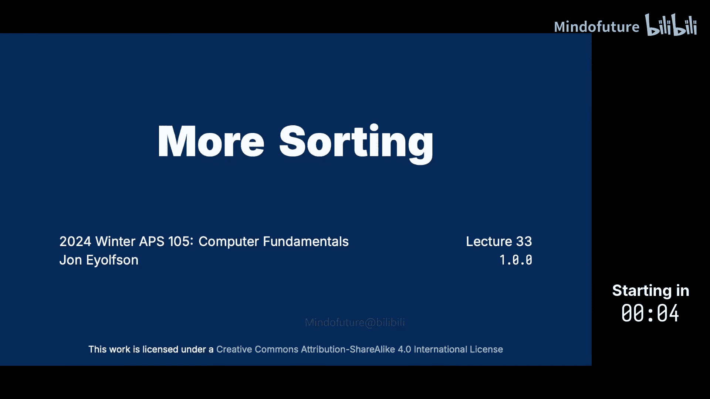
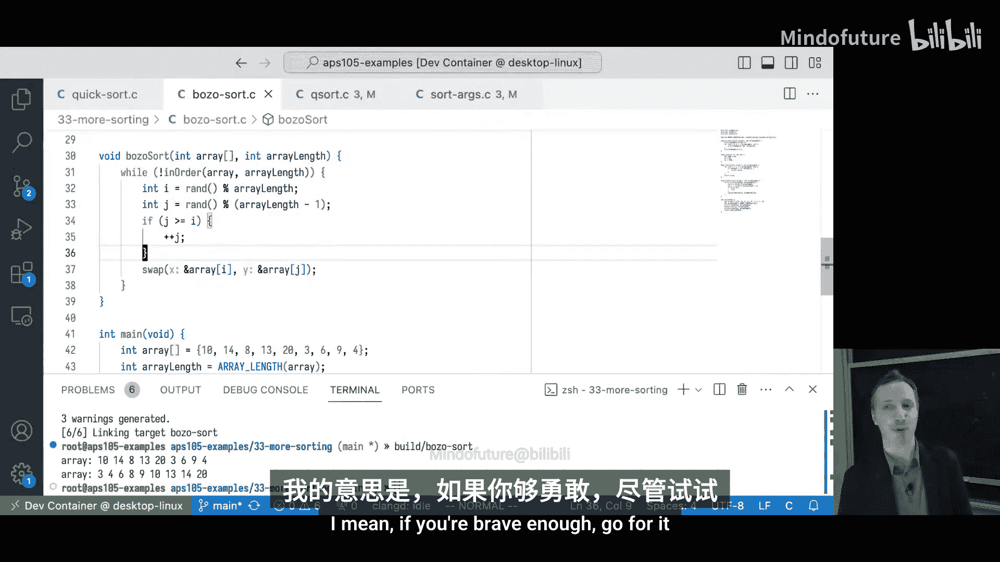
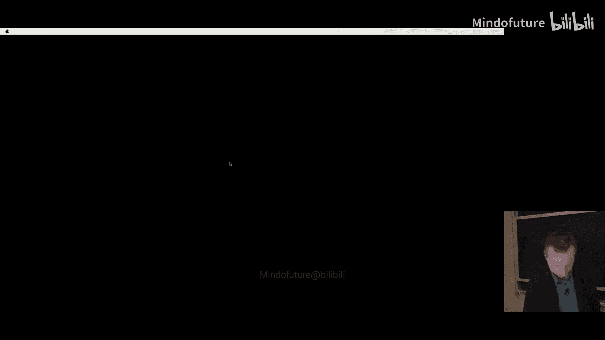
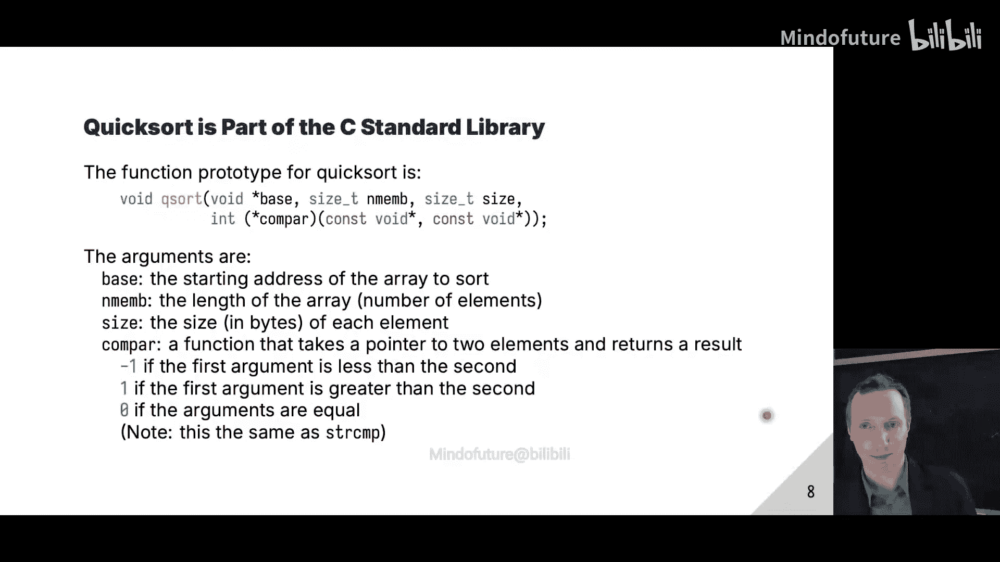
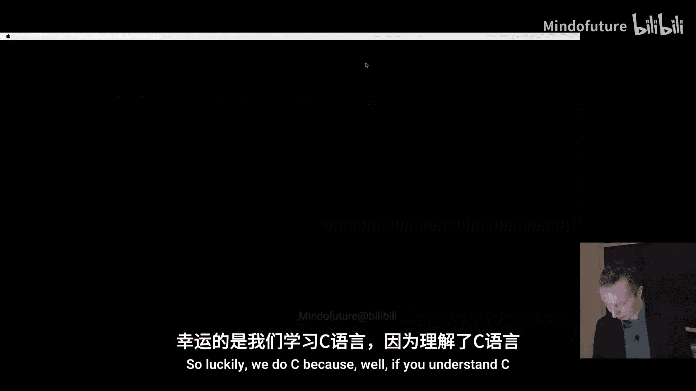
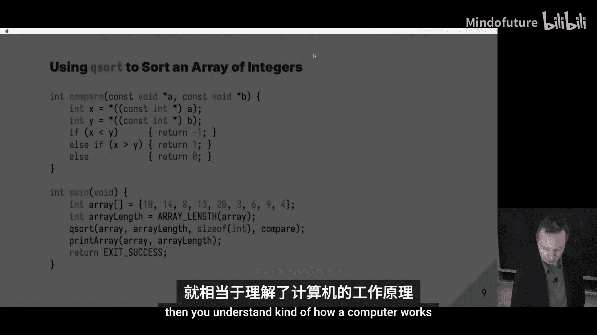
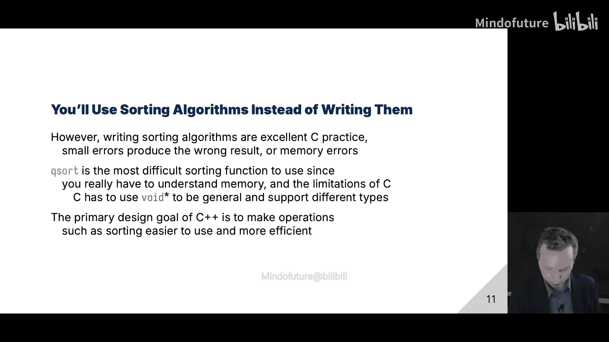

# 【多伦多大学】C语言计算机编程-｜-Computer-Fundamentals-｜-2024-p33-P33_更多排序--BV1zL6GBwEGe_p33-

Alrighty， welcome back to 1，0，5。 So today， this lecture is fun because it's more sorting and it's nothing that you'll be tested on。

😊，So we get to have fun today。So。We will touch on one more sorting algorithm。

 The other sections are behind us。 So I will teach you something useful。

 So don't have to take notes if you don't want。 we can just sit back and enjoy。

 So put I put in yellow。 Anything in this lecture is not testable。

 So we're going to go over three sorting algorithms。

 One really good one and two unbelievably stupid ones。 So first one， we will do a good one。

 So quick sort， all the sorting algorithms we saw before werere like n squared。 So they were really。

 really slow。 if you remember that graph。 quick sort is a sorting algorithm that is n log n。

 and how it works。 is。😊，We select an element as a pivot。 So we just select one element。

 So in the case theirre numbers， we select one number。

 and our goal is we want to place everything less than the number to the left of that number and everything greater than that number to the right of the number。

 And this is called partitioning。 And then after this， we can use our knowledge of recursion。

 and now we kind of separated the problem into two smaller subproblems so we can now sort the left side of the pivot because they're all less than that number and also sort the right side of the pivot because they're all greater than that number。

 So they are kind of。Already sorted。 And that is how the algorithm works。

 So the main part of this is called partitioning。 and we can walk through it really quick。So。

Here is our array。 We would like to sort。 It is 8 numbers。

 So the in the Cs are 0 all the way up to 7 and。Those are all the values。 So 10，14，8，13，2，3，6 and 9。

 So it is definitely not sorted。 So how this algorithm works is it chooses a pivot。

 so you can choose it as the first element， the last element。

 the initial pivot as the middle element。Doesn't matter。

In terms of making the programming task a little simpler。

 we will choose the last element as the pivot。 So our goal here is we're choosing 9 as a pivot。

 So we want to move it somewhere in this array and swap any values we need to such that everything to the left of。

9 is less than 9， and everything greater than 9 is to the right of 9。

 So we want to get all the small numbers smaller than 9， somewhere to the left。

 All the numbers larger than 9 to the right。 And then we want to place 9 wherever it goes， so。😊。

How the algorithm will work is I will use a green arrow that will just signify where we want to place 9。

 So initially， we would place 9 at the beginning， if we just go go ahead and swap 9 at the beginning。

 that should mean that while there is nothing less than 9 and everything else should be greater than 9。

 So clearly won't be the case here。 But that is our initial starting。

 we're going to use this green arrow to represent where the pivot should go。

So how this will work is we will iterate over every single element， not including the pivot。

 And if the value is less than the pivot， we're going to swap it to wherever the green arrow is pointing and then move the green arrow。

 one over to the right。 and then the idea is once we're done。 Well。

 the green arrow points to where the pivot is。 So we will just go ahead and swap。9。

 like the last element where wherever the green arrow is。

 and then suddenly that will be our partition， everything to the left will be less than。

 everything to the right will be greater than。So。Everything will be comparing relative to the pivot。

 So first， we would compare。Element0 to the pivot， so。10 is greater than 9。

 so we don't swap anything。 We don't adjust the green。Arrow， we just leave it as is。

And then check the next element，14， also greater than the pivot。 So we leave it alone。

Next thing we compare。We compare it to index 2。 The element there is 8， which is less than the pivot。

 So we want to make sure that once we are done， that 8 is to the right or sorry。

8 is to the left of 9。 So what we're going to do is we are going to swap 8。

 So we're currently comparing to index 2。 So we're going to swap index 2 with whatever the green arrow is pointing to index 0。

 So after we swap， it will look like this and we update the green arrow。 So we swap index 2。

 oops index 2 and index 0 and then update the green arrow。So this means if we stopped right now。

 we would go ahead and swap in 9 with whatever the green arrow is pointing to。 And then well。

8 is to the left of the pivot because it's a smaller number。Alright， on the same page with this。

 we're all good。 Okay， so。That was us looking at element 2。 Next time。

 we're going to look at element 3。13， greater than the pivot。 not going to do anything。

20 greater than the pivot。 Not gonna to do anything。5 less than the pivot。

 So we're going to do the exact same thing。 So we're going to swap。

The index 5 with now whatever the green arrow is pointing to， index 1。

 and then update the green arrow to go forward1， because we want to move。

 That's where we would want to put the pivot。So we swapped 3 in。Swaap 3 and 14。

 and then update the green line。 So now if we stop now， we would place 9 here。

 and then everything to the left is less than 9。All right， last element we have to look at is6。

At index 6， finallyly enough。 And then it is less than a pivot。

 So same thing we would swap that in 10 and then increment the green arrow。

 And then it looks like this。And then now we're pretty much done。

 All we have to do is swap the last element with where it should go。

 So 9 should go where the green arrow is。 So I swap 9 and 13。 So now it looks like this。

And now it is successfully partitioned。 So 9 is placed at index 3。

 And then everything to the left of 9 is less than or equal to it。

 And then everything to the right is greater than or equal to it， right， It's all greater than。😊，So。

Then after this， we can， if we define the problem right， well， we can recursively sort this side。

 So this would probably pick the pivot as 6。 and then you go ahead and rearrange it such that we got 6。

3 and 8， which would then be in order。 And then we could go ahead have our recursive base case that like if we're sorting a single element or nothing。

 then we can just exit。 and then it would be sorted so。This is Quick sort。So， quick sort。

We could just define it using， you， an array， an array length。

 But we're going to have a helper because our quick sort is going to take the index to start at and then the index to end at because we're going to try and sort smaller arrays。

 So our base case is if low is less than or equal to high because low should always be less than high。

 And then we write partition。 So initially， we partition the whole thing。

 And what the partition does is it does that algorithm and then returns the index where the part where the pivot is。

 So in this case， it would return the pivot as being at index 3。So in this case。

 it would return the index as three and then we run quick sort on everything from zero to well threes in the right place。

 So index3 is at the right place， so we can sort elements zero all the way to two。

 and then we can also sort the elements for all the way up to whatever we had seven。

 So then this would just run recursively over and over again and we have lots of fun。

So any questions about that， we don't really have to understand this。If we don't want。

 you will thank me for this introducing you to this later。

 because this will come up again in an algorithms course next year。

 probably where you actually do have to understand this。

 So you may or may not thank me for actually introducing it to you now。So。Other things。

 the partition。codeode。I mean， if you did what I did in undergrad and search Google。

 you would probably come up with code like this， and this is fairly ugly。

 It kind of gets the idea so it starts it saves the value of the partition。

 So in that case our case it was9。 it does some weird stuff， like it sets I。

 which is supposed to keep track of like where the pivot goes to， starts it off at low-1。

 which if we're starting it off as the whole array， which start off at like 0 minus-1， which is -1。

 which is kind of weird。And then they iterate over every single element including the pivot because it's at high。

 which is weird to me， and then this is the code where it's O if the element I'm currently looking at is less than the pivot then I'm going to have to swap it in and update I so I need to move where my pivot needs to go and then after this whole for loop runs。

 which is what we did in the example， then it increments I and then swaps I and high。

 which is where the pivot is。So yeah， I don't like this code for several reasons， one。

 checking the pivot and then starting off at low minus1 and then just remembering this increment after kind of weird。

 so I would probably write rewrite it like this。So start I equal to low。

 which is kind of what we did in that example。 When we went through it by hand。 And then in the loop。

 I'd have J less than high， not equal to because， well。

 I don't need to check the pivot because I'm storing the value in the pivot variable。

And then I could just check that have a little optimization here that if the number is already the smallest number。

 I don't try and like swap it with itself。 That would be weird。

 So I just checked if I does not equal J， then swap。 and then just like I wrote in the board。

 I increment after I swap things。 And that saves me having to increment it after the loop。

 So after the loop just swaps the pivot where。To wherever it needs to go。 So questions about that。

 So it actually works。 So let's go ahead。If we go ahead and run this。Boom， build Quicksort。Hey。

 it actually sorts CR。Cool recursion。 So there are other recursive sorting algorithms。

 if you really want to， if you want to Google search， there's some， there's one called merge sort。

 That's probably the next easiest one。 If you're interested in this， but quick sort。😊。

Is typically the one that's actually used when you're sorting。

Numbers and sorting strings and anything like that。

 So quick sort is probably the first sorting algorithm。 You'll see that is actually in use。

 So sometimes people will use insertion sort for a。Not that many elements， but for anything large。

 it will probably use something like Quick sort。All right， now onto the fun joke sorting algorithms。

Alright， so I put it in red to never use these， but there's an algorithm called Bogo sort。

 And everyone loves Bogo sort， because with the real life analogy。

 how bogo sort works is if I just you told me to like。😊，You told me to sort a deck of cards。

 If I went， oh， okay， I know how to do this。 I took the deck of cards。 I threw it in the air。

 I picked up the cards randomly， and then I checked whether or not they were sorted。

 And if they weren't sorted。 I just repeated it。 So they't sorted， I throw them up in the air again。

 Pick them up randomly， Check if they're sorted， if they're not， I throw them up in the air again。

 Yeah，s the big O for that。 Big O for that is n factorial。Average case。 So n factorial， not good。So。

If you think of like how factorials grow， Yeah， it gets really bad really， really， really quickly。

 So what like 100 factorial is。Well。10 squared is 100。

10 factorial is what some like 3 million something like that。 So gets pretty bad。 Yeah。

 is there a chance， but given the same array， it would be faster than。ぶスタプ。Yeah， so the question is。

 is there a chance that it is faster than quick sort， And the answer to that is， yes。

 if the array is already sorted， you would check， iss it sorted， Yes， it is。 I'm done。

And to check if they're array sorted， I just have to， that's like， oh， N， right。

 I just have to check every pair of elements。 I just have to make like n -1 comparisons to check if it's sorted。

So in that case， it is faster。But how likely So， But if your're sorting algorithm only works fast。

 if the arrays already sorted， it's a pretty crappy sorting algorithm。All right。So。

Bogo sort sounds pretty stupid， right。Anyone think of anything stupider than that？Okay。

 there's one really stupid one called miracle sort。

And what Miracle sort does is just check if it's sorted。 And then if it's not。

 it doesn't do anything， it just checks it again。So hope that a miracle happens， which。

The running time of that is probably infinite infinite。 if it's not already sorted， if it is sorted。

 Oh then it's the fastest thing on the planet。 So we're all good。😊，Alright。

 slightly dumber than bogo sort。 And do not use these on the exam you。

This is like the one thing where like。Efficiency is questionable here， but even worse。

 there's something called bozo sort。And that just randomly switches two cards and then checks if it's sorted。

 if not repeat。 So Bogo sort， you' at least throw every card up in the air for Bzo sort。

 You make one swap， and that's it。So。That seems fun。 So let's implement it。So here's Bzo sort。

Wrote a function called in order that returns a Boolean， whether or not the array is sorted。

 So to check that， that's pretty easy， right， I could， I could start it at whatever I want。

 I decide to start it at one and then go to the array length because we have to check every single pair。

 So if。The array at slot， you know。I -1 is greater than I。 That means， well， it's not sorted。

 So I can return immediately false。 And then otherwise。

 if I check every single thing and all the elements are greater than or equal to。

 then I could return true that is actually sorted。 So we can get some practice with our randomized。

 So how would I implement thosezo sort。😊，So。I'll start it off。

I need an index that's actually valid in that array because I want to swap two random elements。

 right， so I could do something like this。So if I do ran and then mod array length， Well。

 that will give me a number back between 0 and array length -1， which is a valid index， right？

 So that would be one index。嗯。I could write it like this。Give me another number。

 and then I will go just go ahead and swap them。So array， I， array， J。All right。That look good。Pro。

Yeah， I could have an optimization。 So here I can be equal to J。

 So maybe I don't want them to be the same thing because this is stupid。 but that's kind of。

 that might be more than like。More stupidness than we would like to accept。

 so we could make this a little smarter。 So what we could do is4 J。 It's like， well。

 if you think about it， the first number we can pick like array length things for the second number if we don't want to repeat we should pick up to array length minus-1。

And if I leave it as is right now， while I can actually pick the same number， it could both be 0。

 So I probably want to add a check here。 So one check I could have is if J is greater than or equal to I。

 then I want to increment J。 And that will make sure。 So for most of this。

 you kind of want to consider like。The starting worst case and then the middle case and then the best case。

 So if。Brand Mau， this gave us 0， and then we got 0 back from J。

 While we don't want them both to be 0， we would want at least the J to be equal to1。

 So this is now where we check。 So if they're equal， then we would increment J。

 So we would do swap index 0 and 1， which makes sense。 and then。If， I don't know， I was 0 and J was。

I don't know， three or。3， then， well。Incrementing J to B 4， probably not that big of a deal。

 But if we got the absolute last thing here。 So say our array length was， I don't know。

If our array length was。8ight。Then what we might get for J is if we do a rate length -1。

 that would be mod 7。 So the biggest number we could get is 6。 So if we got 6 back， well。

 that should actually represent the last index， which should be 7。Because our array length is 8。

 So if we get 6， yeah， we should probably just increment J so we can make sure that we actually get the last element。

 so。This bozo sort， will it work。 So here is my big array。I print the array。 I bozo sort it。

 and I print it。 So will it work。 Let's see。But， like。Like。As written。

 is there any reason why it wouldn't work？It's just one of those things， right。

 That's just so stupid。 There's no way it fails。 So yeah。We'ning unoidful。Those are sort。Boom。

 it sorted。Do not use it。It is stupid， but it's kind of funny。thoughtt it works。So。

Any questions about Bzo sort？Yeah， again， do not use it on an exam because。Yeah。

 the the other sections have not done other like will not make it to Quick sort。

 will not make it to this and。Probably don't want to use this。 I mean， if you're brave enough。

 go for it that do not hold me responsible if you get a zero。

All right， so。You have code for it。 Yeah。sortれ。Yep。

And we only check see if it' have the final or is it。Yeah， so doesnt。

 doesn't it like technically like a chance where you just keeps。Yep。I would never get upset。Yep。Yeah。

 so the question is， isn't there a chance where I just keep swapping it And through randomness。

 I just never make it。 And the answer is， yep。But。Due to statistics， right。

 there's a chance if I give you a coin。 I tell you to flip heads。

 There's a chance you get 1000 heads in a row。Is it likely that's going to happen， No， So this。

 I mean， you can calculate the odds to this and see。Well， here。

 we can see see how many times Let's see and count。 We can。Count how many times we actually swap。

 So plus， plus count。 So it turns out computers are pretty fast。 We can just see。Let's experiment。

So for most things in computers， you can just go ahead， you can experiment yourself。

 That's what makes software great。 You just write more software to check your software， so。😊，Yeah。

 that， that randomly tried like a million times。So turns out computers are pretty fast， right。

So if you want to see how bad it gets， let's go ahead。 If we add a number， let's add another number。

 I don't know。50， whatever。So that was what a million and a half attempts。

So now 2 million still worked， right。And then。And。Oh， yeah。 So Rand gives the same thing every time。

 Let's go ahead and use S Rand time。Okay let's get some real randomness or better randomness。

Oh so that time of 7 million。4。35。4。 Oh， that was only half a million， not 5 million。 So， but yeah。

 you can run， you can get statistics with this 2 million， whatever。 And I mean， more numbers you add。

I mean， eventually， your computer is not going be that fast， right。

So let's see what my poor little laptop can do。Alright， that's。How many elements is that？

 That's like what。10， something like that。 Okay， that's。We're probably at the limit of like。

 randomly trying to sort this。Allright， my computer is being hot。 Let's see this。There， there we go。

So it is effective up to whatever that is 1，2，3，4，5。1So if you only have to sort 12 numbers。

Go for it。 kind of breaks down after 12。But。I mean， who am I to tell you what to do if， if。

 if you go to a job and they tell you to sort something， use that， you're probably gonna get fired。

 so。That's why I've read text， never use it。Alright， luckily for us。

 we don't have to write quick sort。 So I'll show you how to actually use Quick sort。

 It's actually part of the Standard Ste library。 And， of course。

 they had to make it shorter than everything else。 Why would they call it quick sort。

 they called it Q sort Q stands for quick。 So takes a whole bunch of arguments。

 and it has to do with the limitations of C。 But since we know how array works and we did dynamic memory and all that。

 Well we can kind of realize what all these are。 So the first argument is called base。

 that is just the starting address of the array you would want to sort Next argument is called N So it's supposed to be the size of a member or the size of an element or sorry number of members in the array。

 Aka， It's supposed to be the length of the array or number of elements。

 they like using the word member instead of elements。 So don't know why then third。😊，is size。

 which is the size in bys of each element。 so that's where you can just go ahead and use size of because you have to tell it exactly how the memory is laid out and then the third parameter is something really weird。

 This is not a type we have gone over before。 it looks really odd but that actually just means it wants a function as the last argument and how this breaks down is it wants a function and then just。

Ignore the name and the star。 It means you need to define a function that takes two parameters。

 and these are their types。 So it should take a con void star， A K， A a pointer。

 and then another pointer to compare them， and then it should return an int。

So how they want the compare function to work is。Quite similar to string compare。

 So should take a pointer to two elements and then return whether or not they are less than or equal to each other。

 So if the first argument is less than the second， it should return a negative value。

 if they are equal， then it should return a 0。 and if the first element is greater than the second。

 it should return a positive value。 So you can just use negative 1，0 and1 if you want。

 and that's the same way string compare works right， if we want to compare two strings are equal。

 use stir comp and then check if the result is 0。So。We can actually use Q sort to sort our。

Our numbers。 So here we want to sort。We want to sort this array。So if we want to sort this array。

 the base is just array because of pointer decay。 there are the number of members is just the length of the array。

 The size is the size of each elements。 So it's the size of int。 and then we want to write a compare。

 So compare， we'll take two pointers。 two actual two pointers， to elements。 So because this is C。

 we have to tell it what the pointers actually are in this case， if we are sorting integers。

 the pointers are pointers to integers。 So we can go ahead and just do some type casting。

 so we can say that。A is actually an int star。And then we can say that。

B is actually an int star as well。 And now these are the proper types。

 So now we can de referenceence them and get an int。So if we want to write our function。

 we could do if。So we can dereference wt or x to get the int value， so if x is less than y。

 then we know we need to return a negative value， so just to save some space。

 I will do this and not do a new line。And then I could check if。2。

X is greater than or if x is greater than y， then I return one。And then otherwise or equal。

 so I could just return zero。 So that is how you would write the compare function for the quick sort。

So now if I run this。And use Q sort。Boom， it's sorted。And now makes it real easy。

 So if you want additional practice with these， you could write like insertion sort。

 but instead of going in ascending order， you can go in descendending order。 And well， that requires。

 you know， you have to make different comparisons and things like that in the algorithm kind of a pain。

 if you want to do that with this compare function。 well， if I want to sort it in the other order。

 I can just flip around the positive and negative values just like this。 and then suddenly。

I now get it in the other order because it's using a different comparison function。

 And you can write this。So it can sort whatever you want。 You can have it sort。Structures。

 sort whatever you just have to write the comparison function。 That's all you have to do。

 and it will go ahead and then do all that quick sort stuff for you。

 So you never have to write Quick sort again。 And luckily， this is as hard as using Quick sort gets。

 So other languages makes this a lot easier。 C makes it exceedingly hard， but it's not too bad。

 right。It kind of。All right， A questions about that。 Yeah， is there a way to pass。

Like to you know how python。Yeah。Is there aancy？Yeah， so the question is。

 does C have anonymous functions， like Python has lambmbdas or anything like that。

 And the answer to that is new。 C does not do any of that。 So C plus， plus will。But see。

 the reason why。Some people like it as well。The language itself is not that big。

 It's not that complicated， but it's ugly。It's ugly as Well， it's pretty ugly。

 and it makes doing some things just like exceedingly hard。 So in some languages。

 just give an array and you do like array dot sort or something like that。 And then boom。

 you're done and see， you have to tell it literally everything。

 You have to tell it details about memory and all that stuff。 And it's just a lot of stuff。 Yep to。

So the question is， can I pass functions to other functions？ And the answer to that is yes。

So like here I passed a function to the quick sort function， right？Yeah， you。要。Yeah， so。

The syntax is just kind of ugly。 So like the type of it is like。🤢，That weird type， that compare type。

 That's what the type of a function is。It's ugly。But at the end of the day in C。

 it actually just is a pointer。 like functions live somewhere in memory。

 and it's really just a pointer。 but we don't go into that， that much detail， but。

Once you take the next course in this series and like do assembly， that's like closer to the CPU。

 Yeah， functions or you just need an address for a function。

So so luckily， we do see because， well， if you understand C then。

Do you understand kind of how a computer works？

All right。So another example， that quick sort。Kind of makes it kind of nice。

So let's go ahead and solve another problem here。 I wrote main that takes a bunch of arguments so I can type in whatever I want。

 And while using quicksort and I have a string compare。

 shouldn't take me much code if I want to go ahead and sort all the arguments。

 So I can sort them in alphabetical order。 So let's see if I run this。Let's say， John。John Elf， A Z。

 I don't know。Hello， something like that， so。Here， remember the first zeroth argument is just the name of the program。

 So I'll ignore it。 So if I go ahead and just print them， they'll show up in the order。 I type them。

 And if I want to go ahead and sort them all。 Well， we could write insertion sort。

 we could do whatever。 But then it's kind of a pain。 and then like how to compare strings。 Oh。

 we have string comp。 We have to remember how to call it， kind of a pain。

 So we can try it with quick sort。So。We just type Q sort and then。

We need the starting address of the array。 So if I want to ignore the first element。

 I could do R V plus1， right， So I'm just doing point arithmetic， skipping the zeroth argument。

 So I want my array to technically start at the second element right？ So want to skip the first one。

 and then the number of elements。 well that's given by Rrg C。 And if I skip the first one。

 it's minus-1， right， So if I type in。2， we like， if I type in here。

I would have this would be like the first argument，0th argument，1，2，3，4，5。 So I only。

 so the size would be 6。 So I only really want to sort the5。 I actually types。

 I'll just skip the first one。 So I will do -1。And then。Here it says the size。

 so it's the size of each element， so the size of each element， well they are a char star。

 So it's a pointer to the first character of the string。

 right That's null terminated if we remember our strings。And then what's our next argument。

 So now we need a comparison function， and I just wrote a little stub there。

So that would be our quick sort。 And now we have to write， compare。 So you might think that。

I could just。Like， just use string compare， right， do something like that。And that should work。

Kind of， so you can go ahead and try this。And not sorted， not in the least bit。 So why is that， Well。

 remember that the pointers here。They are pointers to elements。 And if our element is a char star。

 if it's a pointer to an element， it is a pointer to a pointer， to a character， right。

 So in other words。We would have a tar。A char pointer pointer called X。

 And that's what actually oops。That's what actually A is， and then B。Is actually。

A char pointer pointer to， so to access the pointer of the string。 Well。

 I have to dereence that right， and you can remember dereencing just kind of takes a star off of the type。

 So if I de referenceence X， then I will get a char star back。

 so pointer to a character which will point to an null terminated string。

 so I could do something that looks like。This。Oh， not said， why？So now if I run this。Boom。

It's sorted。Didn't actually have to do that much work， right？It just looks。Potentially very。

 very ugly。But。If you know C and you know what's going on。It's not too bad。

 And this is about the hardest thing we will get in this course。 Yeah， before that。

You were just sorting the items。Yeah， so I， well， the crux of the question is。

 why before when I just used string comp， did the order not change。And the answer to that is。

Basically。The pointer was pointing to like， a bunch of pointers。

And all of them kind of started with the same prefix， and then eventually。This array， I believe。

 ends with a null like a null pointer。 So eventually they all had the same prefix。

 and they all ended with the0， so。The pointers just kind of grew。

 So it would essentially just be the same order that I had to find the pointers in just by chance。

 essentially。 So the only reason why I got the same order is， essentially。More or less， by luck。

Because my computer laid out memory in that exact way。

 And I interpreted the addresses wrong because they were actually pointers to pointers。

 But I interpreted them as strings。 So potentially anything could have happened。

 including it could have crashed， but just turned out that didn't do anything。So。Yeah。

 debugging that would have been very， very difficult if it like kind of works sometimes。But yeah。

 any questions about that， because that's about the hardest thing we will ever see in this course。

And like I said， this is completely extra。 So if you need to write a program。

I would suggest not writing your own sorting algorithm and using Q sort。

 even though it's a kind of a pain in the butt to use。

 just remember the rules where this compare function， they are pointers to elements。

 so if you want to access an element you have to dereference it so that's the only thing you really have to remember。

Alright。 So here's the code。 So you have it in slides， and then。Yeah， typically。From here on out。

 like it's good to like practice writing sorting algorithms。 It's really good practice in C。

 especially since you know， small errors will just produce the wrong result or you have memory errors and it'll crash but likely in any real program。

 you'll probably want to reach for something like Quick sort。

 And it's a fairly difficult function to use， but's still better than writing quick sort by hand。

 you kind of really have to understand memory， the limitations of C。

 because C has to use like a void star to be general。

 which aka just means it's a pointer to something C doesn't know what it is。

 and you kind of have to tell C what it is and cast it and that's really error prone。 So。

The primary design for a language like C plus plus that you will use later and pretty much any other language that's not C is to make things like sorting really much。

 much easier to do and also much more efficient。 So you don't have to do all that weird stuff we had to do before。

 usually， like I said before you can just like take an array and then do array dot sort and then boom it works。

 But this is how computers actually work at some point during that， a quick sort is going to happen。

So with that， I will stick around if you have any other questions。 But just remember。

 pulling for you。 We're on this together。

