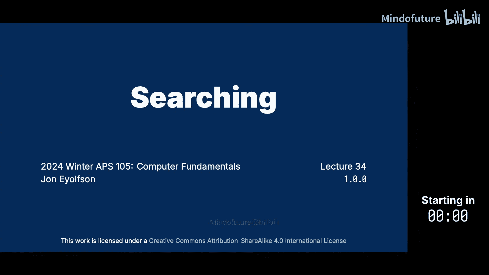
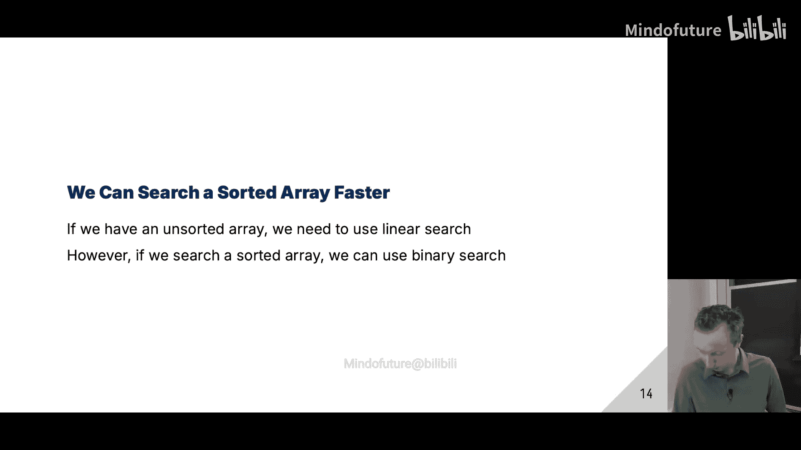

# 【多伦多大学】C语言计算机编程-｜-Computer-Fundamentals-｜-2024-p34-P34_搜索--BV1zL6GBwEGe_p34-

。

Alrighty， welcome back to 105 so yeah， I guess a lot of people distracted by the eclipse that you can't see here because it's too cloudy so yay。

All right， so I think pretty much last topic of the course， it is searching。

So when you have a lot of data， well you probably need to search through it at some point。

 so previously we search through like nodes in a linked list today we will focus on searching in arrays。

So today， our entire task is to find the index of a value in an array。

 and then we just return negative one if it is not found。 So we probably already know how to do this。

 The first searching algorithm。 if you can even generously call it that It called linear search and all it does is iterate through the array looking for the value。

 if it matches， it returns the current index。 so。This should be child's play if it's on an exam or something like that with how to code it。

 So how would we code it？ Well， we need to search through the entire array。

 So we would have a four loop because we know how many elements we have to go through。

 So I could just do in I equals 0 all the way up to I is less than array length。Plus， plus I。

And then I can just simply check that， hey， if the value in the array。

 so add array at index I is equal to the value I'm currently searching for。

 so this is the value I'm currently searching for。Then I can just go ahead and return I because。

 well， that's the index that matcheshes it。Otherwise， I can return negative1。

Anyone disagree with that。 lookss like a perfectly crmulent search， perfectly good。

 perfectly something we could write。So if I go ahead and I have this giant array and I'm trying to search for the value 6。

 well in this array it's at index， well arrays start at index 0， so it would be at this is 0，1，2，3，4。

5 and 6， so value 6 is at index 6， so if I go ahead and run this， oops。Pile。Ohoops。

 I'm in the wrong directory。So if I go ahead， compile and run it， it should say it's at index 6。

 if I try searching for I0 10， should say it's at index0 because， well it's the first element there。

Right， so found it at index0。Joy， any questions about that doesn't seem terribly exciting， right。

Alright， so let's add the excitement for today if you can generously call it that， so。😊。

We saw sorting before。 So what if we actually searched the sort data， And for instance。

 if the values are sorted， how could we find the minimum or the maximum value if everything is sorted。

Yeah。Yeah， so if it's sorted in， let's say， a sending order where the lowest is first。

 and then we have the highest later。 Well the minimum value is whatever is at the beginning and the maximum is whatever is at the end。

 So it's really easy。 if it's in descending order， you just flip flip those， so。Can we think about。

Waves to sort data better if it was sorted， and everyone is probably too young to remember phone books。

 anyone have a phone book。1。So if you need to search someone's name in the phone book。

 what did you do？Yeah。Yeah， so it's an alphabetical order。 so if you wanted to find。

Someone whose last name was I don't know， E， for instance， well。

 it has like black squares there' an alphabeical order because you're a human。

 you know E's like kind of near the beginning， so you might like kind of search。Find the E tab。

 And then。Well。I guess if you're finding my last dame， you just go to the back。Because。It's EY。

 so that's probably near the back。But if there were a bunch of E Ys， then what would you do。

 Probably like flip to a random page， right， and be like， oh， well， flip to a random page。

 pick a name and then see if it comes before or after my name。And then well。

 becomes comes before my name， I search。After and similarly， if we reverse it， right？And， in general。

I can generalize this a little bit and if I didn't like we kind of know where letters are supposed to be alphabetically。

 but if we didn't have any intuition about that or how many things or there wasn't the tabs or anything。

 as long as our data is sorted，Well， we can cut our search space in half each time。

 So if we have a giant array， we can check the middle value and then compare it to what we're searching for and same idea。

 So if the middle value is greater than what we're searching for。

 That means the I the value I'm looking for is in the left half of the array。

 So I don't even have to bother searching in the right half of the array。

 I can cut off that entire half。 and then。Similarly， if that middle value is less。

 then I just have to search the right half。 There's no possibility that that value is in the left half。

So。I could do this。 I could just keep on doing that。 so I could split it in half， and then。Well。

 in that half， pick the midpoint again， then do the same thing， split it in half， split it in half。

 split it in half until I either find the name， or I'm just looking at a single element or my array bounds are not valid。

So that is something called a binary search and something that we can go ahead and implement。So。

We have lots of times。 I'll take suggestions of how we would implement a binary search， so。

I started off。While we know we kind of like need bounds。 what we're looking for。

 So maybe our first bound is the entire array。 So I create a variable called low。

 That's equal to 0 because of arrays will always start at 0。 And then a variable called high。

 that will start at array length -1， because that is the last index of our array。

 So let's try and develop this。Together， since we have lots of time，What should my first step be？6。

But我们。Yeah， so I can think about what happens。Initially， so Val is the thing I'm searching for。

 and I can compare it to what currently is the middle of the array， right？

 So how would I calculate the middle of the array， So let's say I create a variable called mid。

 How would I calculate what the middle index of the array is。Yeah。嗯 sure。Its for。

So would you say array？As the index。So something like that。不要。High minus low。So。Hi minus low。

Divide by two。Oh， okay， so this。Divide by 2。But you're arguing that is high plus low。Sorry。Oh。

 that whole thing might low。Just what I have here， this is good。All right， so let's think。

 is this good？All right， so if you want to see if it's good， good to pick some random numbers， yeah。

Sorry I couldn't hear you。2。Yeah， so we have a dissenting opinion back there that he says high plus low。

So let's see here， let's take an example， so what if， I don't know， low。

 so let's say we have an array that looks like， I don't know， we have five elements。

 so we have one here， I'll just call them by their indexes。So we have five elements。

 It looks like that。 right， If I wanted to calculate the mid of， let's say。This two and this four。

Okay， stop。Then the mid should be three， right？So。Let's just put in the numbers。

 So if high minus low， well， that would be 2， divide2 divide by 2 is one。 So that would give me this。

 right， so that doesn't work。嗯。Maybe I could do it where I just add low to it。Yeah。

 that seems like it kind of works。 but yeah， that turns out to be the same thing as just high plus low divide by 2。

Right， and then that gives me the middle index。 So we like that middle index， y。I can't hear， sorry。

Yeah， so now I have to start comparing the value。I can compare the value to array mid。And then。

One thing is， well， if it's equal， that means I'm done， right， I found the value。

 It's at the index provided by mid so I could return mid。All right。

 so if it's not equal and I'll take someone else。 So give someone else a chance。

 Someone knew what should I do here。Yeah。Yeah。Yeah， so check it is， so the current mid value is。

 let's go with， I don't know， greater than。So we can try and think about this。

 So let's say the value I'm looking for is I don't know， say it's just some big number。

 So say it's like 10 or something like that。 So I'm looking for 10 right now，10 is greater than2。

 So that means I need to adjust it。 I need to look over essentially to the right。

 So I would keep my high the same in general and then adjust my low。 So my low should now not be。

Z my low also probably shouldn't just be2 because I already checked two。

 so I don't need to check it again， so it should probably be equal to mid plus one， right？

And then my other one is， well， if it's the other direction。

 then I need to search this way in my array， and I already check this value so I should leave my low alone。

 that won't change and then adjust my high to be equal to what。Yeah。Mid-1， right？

 So I want to go over one to the。Left。Alright， so that looks good。

 That's like one iteration of the loop， right。So。I should probably put。

Like run this however many times I need to， right？ So do I know how many times this is going to need to loop for。

No， right， so probably need a while loop， so I'll just put while。Now let's just give it a while one。

All right， how do I know when to stop？Yeah二。When low equals high， so when low。

Like that or load does not equal high， right？Don't know， just guessing。Yeah。So if we find mid。

 we'll return and we don't need to break because the function stops， right。

So we have a return here if we actually find it。So just low， not equal to high。 All right。

 let's try it。Here's our big array we're going to search for。 I just sorted it。

 I'll print out the sorted， and then we can call binary search we're looking for a six。

So this is our current code。What I call this binary search？So。Film it at index 4 seems to be right。

What about if we're searching for something that is not in it。So Webbo we're searching for five。

 so it should return negative one in this case， right？So here。Yeah， just returns here。

 I need to print off something。So， not found。Seems like it works。What if I search for， I don't know。

7。Not found。Search for。Okay。Seems to work。Although。There。Is kind of a corner case here。

 but I guess it didn't come up where。Technically， low could be less than mid if we're like searching at one element。

 It doesn't match。 And then we go backwards run like if mid and low were the same value for some reason。

 so。If they were both the same value， then we would check if it doesn't match。

 then low would become1 and high would become zero， like it would just stay at zero。

 so we'd have some weird bounds。So we should probably just go through this while I would argue while low is less than or equal to high。

And that will probably get rid of that corner case， even though I couldn't actually。

Do something with that。So to do， we can search for eight。All right， cool。So。

Any questions about the code here， let's see if I can fit it。

So any questions about that code as we have written it？要。So yeah。

 why I put this So if low is not equal to high， like if this is false。Oh， like why I changed it。

 Okay， so before it was。Let's see if I can make it break。So here。

So we have an array only has one element on in it and we're looking for。Value one， right？

So if we do this。Okay。All right， well let's see why that worked。In this case， low is equal to high。

 so I think。I think。If we search for two。It says two's not there。Right， so because I have。Not equal。

 so Mike let's consider the KC array only has one element in it， right？

So low is equal to 0 and high is equal to 0。 So low is equal to high。 So it would just skip all this。

 and it wouldn't check。So it wouldn't check and that just says it's not found。So really。Like。

If low is equal to high， I still want to check。So if I do this。

Then I have I know I have bounds or they're the same。

 And then if they're the same like mid is just going to be that same index， right。

 I'm just going add the number twice or multiply it by  two then divide by 2。

 So I get the same number。 So in this case， where're high and low or both0， 0 plus0 divide2。

 So it's still 0 and then we actually check the value and then see whether or not it is the value we're looking for。

If it's not when we adjust it， low will be equal to one。 and then high is equal to0 still。

 So we clearly shouldn't check it because like low should always be less than high。

 And then similarly， if it was the other way， high would be equal to negative one。

 So shouldn't check that either。 So we should just stop that。 So yeah。

 we definitely need low less or equal to high。Because we don't， we want to make sure we always check。

All right。Any other questions about this fun binary search。So。Here。

 let's make it even more fun because if doing it once is great。Can we write it the second way？So， so。

If we look at it， like when we were talking about it， it's like if the array is sorted。

 would you check the middle value， if it's greater， just search the left half， if it's less。

 search the right half。Sounds recursive in a way， right。 So if we wrote this recursively。

 what would our base case be。So。So I'll give you a second to think about that while I delete stuff。

All right， I guess the eclipse is over too， could you see anything， it looked too cloudy。You could。

Not really it just got a little dimmer。Nice。Yeah， sure went to Niagara Falls， I guess。Yeah。

 unfortunate that we are here， but I guess somewhat fortunate。

 the weather's so bad it doesn't matter。Yay。All right， what are our base cases here？第二。

OrIf low equals high， careful。So if low equals high， we still want to check that element， right？

Unless you're talking about it， putting it after we check， which I guess we could do。Yeah。

 we could do that，If we look back， let's go here， so if we want to write that recursively our base cases。

Well， if we want， just copy what we had before， our base cases are if we want to put the check first。

If。Low is greater than high。 That's one of our base cases， right， That means we're out of bounds。

 It doesn't make sense。 We want low to be less or greater than。Sorry。

Low should be less than or equal to high， so this could be one of our base cases where we just return。

 we have not found anything。 otherwise， we could do the same thing where we calculate the mid index so that's low plus high。

Divide two。And then our other base case where if we check array mid。And our value matches that。

So we could return mid。And then。And。What would happen if I did this？Sorry。Yeah， well， if I do that。

 that's an assignment statement。 Ba things will probably happen will probably be true unless I'm searching for 0。

 which case。Yeah， in which case， bad things will happen。

 So always remember that's a common issue on exams forgetting to use equal equal for comparison。

 So those are our base cases。 and now we could do our recursive cases。So for our recursive cases。

What are our recursive cases？So that's the whole thing again， yeah。So， if。The value at mid。

 so if the value is greater than the array at mid。Then what should I do？So we can come up。

 so I never remember this either。 just write an example。 So if we are searching for， I don't know。

 we have  one，2，3 and we're searching for some big numbers， say we're searching for oops。

Searching for。10， something like that。So v is 10。So right now 10 is greater than it than two right。

 so I need to search to the right， so to the right， if I want to be recursive。

I could call recursive binary search helper with the array and then here。

 if I'm searching to the right， I want to adjust low， right， so I want low to be equal to mid plus1。

 keep high the same， and keep the value I'm searching for the same。And then in the else case。

What should I write， so it should be recursive binary search helper。Here， I'll just put this。2。

All right， that work。No， oh， when I miss。Yeah。So you said change high。Yeah， so change high to。

Mid minus1， because I am searching to the left， I'm doing the left half， right？So。We go ahead。

 we compile that。So the array， we're searching for 6 again， which should be at index 6， I believe。

 or sorry，4， so。Pone 6 at index 4， which we can check。 so we got zero。One， two， three， four。

 so seems to work。So。Two different ways to write it。If we write it recursively， right。

 we needed a helper because we needed to keep track of high and low。

 so that's why we wrote the helper function that took high and low as arguments。

 and then we go ahead and we adjusted them in our recursive calls otherwise we just。

Kind of treated the loop bound as one of the base cases and the case where we actually find the value as the other base case。

All right， any questions about that， Are we all having fun with searching。All right。

I'll leave you or I'll have you think about this and then we can take it up。So。Harder thing to do。

So if I go ahead and let's say I search for an。8ight。Whoop， it's not 82，8。呃。Actually here。

 I'll change that to six for。So。If I search for a6， I'll make it a bit bigger。

We are it finds it at index4， right？So zero， one， two， three， four。Right。All right。

 so what about if I search for eight？What index is it going to give me？Six， six， we got。6，66， whoop。

 shouldn't have said that， oops。All right。We're guessing six， if we compile it。But binaryary search。

Oops， searching for eight。We got six。Where we really guaranteed to get six， maybe not。

 let's go ahead and add another eight。So now we get seven， we're seeming to always get the last one。

 what about if we have， I don't know， a lot of ADS。So now we get index 9。 So what is that， So 0，1。

Two， three， four。F， six， seven， eight。9ine。1011， so we got like an index like somewhat in the middle。

 right？Maybe I don't want that。So。How would I change my code that searches for。The number。Two。

 let's say。Always get the first match。Without doing linear search。With doing binary search。

 so I should be able to change something。In my binary search code。Ohoops。

Such that I always get the first match。And。I'll leave you with this for a few minutes to think about it because it would be a good exam question if I。

If I was given the task to come up with exam questions， which。I might be asked to do。

This would probably be。Fairly relevant。So。I want to write and again， just to be clear。

 I want to rewrite this binary search such that I get the index of the first match in the case there are multiple matches。

 so in this case I always want it to return0，1，2，3，4，5。

 so I should get index 5 if I'm searching4 and8 here。One second， I'll give them another minute。Right。

Give you another minutet to think about it。Again， something good to put on an exam。H true。Okay。

 so we got our first one here。Sit， do you want？In the want to if it matches。

 you want to check the whole array。So that would， I would consider that linear search if you're checking the rest of the array。

 right， because you want to， I see where you're getting at， so。

You're saying as soon as you find the first match， just like start iterating to the left and going over one by one。

So that would technically be linear search， we can do a bit better yeah。So if it's a match。

Then I still look to the left。Yeah。So if it matches， I search the left。Okay。

 so how would I change that， So I have a match here。

 So you just want me to search to the left instead。 So instead of returning mid。

You want me to search to the left。 So you want me to do。This instead。What else should I do？

I should up。I should update what， sorry？All right， we need to think， all right， yep。

Without linear searches。Yeah。So。You're asking if I can check the value to the left。So yeah。

 your idea is， if I find it， I check the value to the left of it。Yeah， sure， we can。So here。

 I found the value， so what is the value to the left of it？So。So you're saying that here。If。Aray mid。

-1 is also that value here。 sorry， I'll change it around。

 So if the value I'm looking for is also mid-1。Then， I want to。Look to the left， right？

So this is not my recursive one， this is just the normal search。Yeah。

 this doesn't have the recursive one。 This is like the iterative one。

So this one is not the recursive one， this is the one with the big loop。No。

 we should be able to do it， though，So I'm looking high to the left， and then that's it， right？Yeah。

The7。Yes。Cl， so this actually seems pretty good。 Your idea was like， hey。

 we need to keep track of mid until if we need to return it。But if the value to my immediate left。

Is not the value。Then that means that this is the first match， right？If we're here。

 so then I know that I am the first match。 so I don't need to save the value or anything。

 I could just return mid。Something like that， right？Does that seem okay？All right。

Let's go ahead and try it。Seems to work， right？Yeah。Yeah， yeah。 So the comment just was that， oh。

 well， let's say I was searching for， I dont know， what's the first one。

So let's say I was searching for a1。What happens when I search 401？Well， it works。

 should it have worked？Probably not because if we were searching for one， well。

 mid was equal to 0 because， well， it's index 0。 And then we went to mid-1。 So what 0-1。-1。

 is that a valid index to use in our array new， So we did something bad。 If we ran velgri。

 maybe it helps us。 maybe it doesn't。Oh， gives me some errors for other reasons。 Allright。

 so turns out I shouldn't have done that。 So I should have also checked that。If。In this case。

 mid is greater than zero， right， so I need mid is greater than zero and this to be true。So。Ohoops。

So that。Should work。Right。So。Here one suck here。Oh。All right。Go back。There we go。That。

Should that be the condition or should it be an or？Yes。Any thoughts。And yeah。

Should be an and So here。 So that was search for one worked。Search for。8ight。So yeah， could be in。

 should be in。And。Wait， where's our code？If mid is greater than or if mid is equal to 0。

 then this is false。 Who thing is false。Turns out shouldn't really matter。If we change it to orR。

 I think it should still work if we change this one to orR， right？Oh yeah。

 so if we do change this to Oria， then that wouldn't work because。

Mid well is probably always greater than 0。 That would be true。 And then yeah， that would screw up。

 So it does have to be like that。So it does have to be an end， all right， perfect。Sweet， all right。

 any other questions for this code？Alright， what， what about the other one。

 What about if we wanted to do the last match。Yeah。え？Yeah， basically， the same idea just reversed。

 right。Instead of mid having to be， you know， greater than 0， like it can't be equal to 0。

 I need to make sure mid is not the last element， which is a ray length -1。And then， I check。

To make sure the thing on my right is greater， right， So that would be mid plus one。

So and then all I do is I need to if it is， and I have to search to the left and say the right。

It should still work。If I go ahead and combine these now。

 So now they're guaranteed to get the first index and the last index。

 then we can go ahead and we combine them together to write a more useful program。 Oops。

 this is not the most。Yeah， so we could have。Rewrite binary search。

So that we call binary search first to get the first match。 And then if there is no match。

 so it returns negative  one， we just say it's not in the array。

 and then we can actually calculate the total number of matches so。

We could get the index of the last match and then after we get the index of the last match， well。

 then last minus first is plus1 is the number of matches。

 so we can just output exactly the number of matches and we're using a binary search for both ways。

 no linear searches at all because linear searches are slow because that's like O N。

 Well if you can split the array in half every time that's actually like log n number of steps you have to do。

 which is a lot faster。So this one will work。 There's no linear searches。 there's no anything at all。

 And if I go ahead and run it， hopefully it works。 now I have 8。 and then it says， wow。

 I found two matches。 Joy， yeah。Yep， let's。Yep。Every single。Yep。Yeah， so in here， let's see。

So your question is if the array。Was， oh。Full of the same value。You。ち the that one。All right。

 for the same value。So got that， whoops8 is definitely not in there， so we'll searching for a one。Oh。

 yeah， there's a bug in my code。 whoops， found zero matches because in my code， I screwed up。

 and I need to update the slides。Because。That's why I asked about the end。

 because I accidentally wrote it。So I just rewrote it a little bit to combine the cases there。

Shouldn't make a difference。Wow， my coat is screwed up， all right， I failed the exam。All right。

 I will fix that after。So yeah， so the question， if this was to work。

 does this count as linear search？So that would not count as linear search because like linear search or binary。

Search first would start at the midpoint， then go like here， then go here。

 and then eventually it would make it to the beginning after cutting it in half a whole bunch of times。

 and then the last one would go start here， cut it in half， cut it in half。

 cut it in half and then cut in half until it gets to the end。

 and then I'm just doing like I'm repeating the same cutting in half。Two times。

 but the constant factor doesn't really matter。Yeah。

So if this actually worked where it found the first match and then the last match。

 the first match should be at index 0， right， and the other one would be at a rate length -1。

So that should just say everything match， yeah， it should count the whole array。

So it should say the entire array not not found because I screwed up my code and I will fix that and post it on the slides and。

Not do whatever I did， but yeah， live testing isn't that great。All right。

 so the rest on the slides I have to fix。In summary for today， then， so。If the array is sorted。

 we can search it faster。 if it's unsorted。 Well， the best we can do is a linear search。

 which is just iterating through the array， checking the values。

 seeing if it matches and returning the index if it doesn't。 However， if the array is sorted。

 then we can use binary search， which is just the idea of cutting the array like just cutting the array in half every time until eventually well。

 until you find the element or you are outside like your bounds don't make sense anymore。

 And then while that's obviously not in the array。 So you can return， it is not found。 So with that。

 I will be around。 So just remember born fo you， we're on this together。う。

