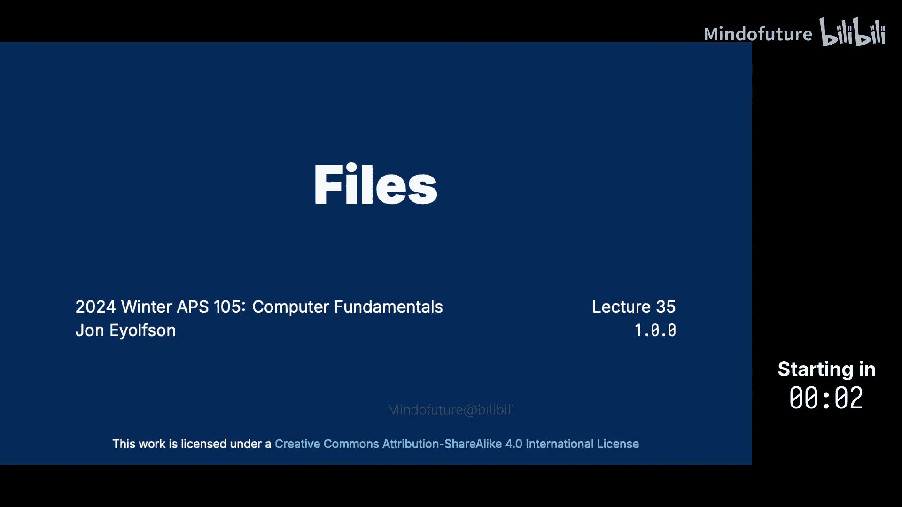
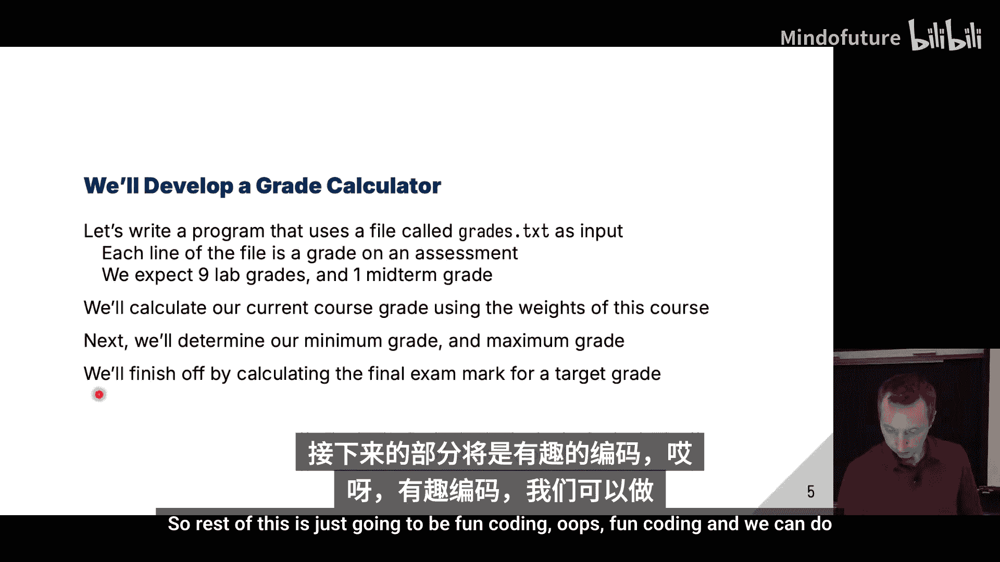
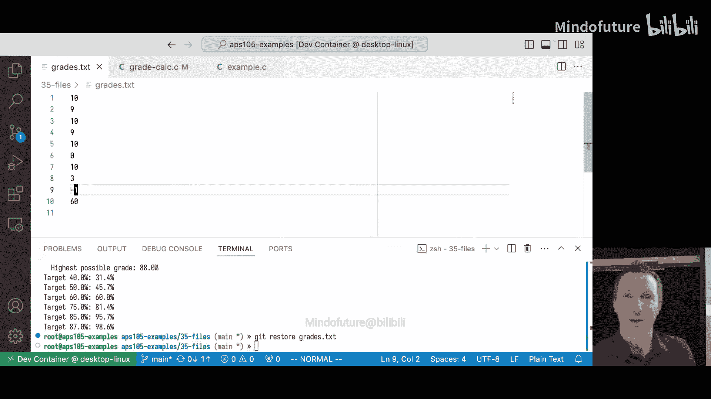

# 【多伦多大学】C语言计算机编程-｜-Computer-Fundamentals-｜-2024-p35-P35_文件--BV1zL6GBwEGe_p35-

Alrighty， welcome back to 105 light today Alright， so today will be fun。

 we will write a useful program and I will show you how we can use files so we don't have to type in like1 thousand numbers every time and we will develop a fun program this lecture。

😊，Pretty much tie everything we learned together in the course。

 And we can go ahead and make a useful program。

So most files they or most programs， they use files for input， you don't， any program you've used。

 you've probably never really typed input in the terminal in order to use it。

Filees will not be on the exam。 They will not be testable。 However， aside from opening files。

 it's pretty much our string review lecture。 So the rest will be the same。

 So we saw another way to get input， like typing a command， but generally that。

If you don't type that much when you type a command。

 so today we're going to write a program that uses files and it will be lots of fun。So。

You can open files and then you close them once you're done with them。

 So the API to open a file you can use is called F open takes two arguments。

 The first being a path name， So that is a string。 So it's a normal C string that represents the file name you want to access the second argument is the mode。

 which is a string representing what you want to use the file for。

 So today we will use the mode as just the lowercase R。

 which means we want to read the file we want to get data from the file instead of you know getting it from the terminal。

 So that's what we use today and F open returns a pointer to a file， So similar to malloc。

 it will return null if it is not a valid file and it has a failure。And then similarly， to malloc。

 whatever we malloc something after we're done with it， we're supposed to free it。

 same thing with files。 as soon as we were done with the file， we should close it and to do that。

 we use the F close function。 and it takes a pointer we got from the F open function。 So stream。

 just the pointer return from F open。 So we have to remember to close it。

 So how to access all the data within the file。 Well。

 we can use the gi line function we saw when we were trying to get input。😊。

String input from the terminal。 So previously， we saw Giline。 It took， you know。

 a pointer to a pointer to a cha。 so it can go ahead and do the malloc for you。

 and it'll take a pointer to the size so it sets the size as well。

 And then the last argument I told you not to worry about。

 I said that you could just set it to STD in and that represents the terminal。 But now， well。

 we can open files so we can use the file pointer for Git line instead of just making it the terminal。

And if we remember what it is。 So again， this is where it's good to have review。

 it returns the actual length of the string that it actually red n。 So again。

 if you initialize that buffer pointer， the value of that buffer pointer to null。

 then this mallocs for you， otherwise， if it's already allocate it， it will reallog for you。

 you just have to make sure that the size P is accurate。 So you can reuse it over and over again。

 if you want to。 And what it does， it matches the entire line。

 including white space and the ending new line character， which is backslash n。

 and then it returns the number of characters written to that to that buffer。Excluding the null byte。

 So up to that ending new line terminator。And like I said， the last argument is stream。

 It's a pointer to a file， and we can actually use the pointer return by F open。So。

If we want to read every single line of a file called grades dot T X T。

 how that would work is we could F open grades dot T X T open for reading。

 We get a file pointer back We can check if it's null， if it's null， something went wrong。

 So there's an error somewhere。 There's a failure so we can just exit our program and not bother continuing。

After that， I set up a pointer to a char and for string so that git line can go ahead and modify it。

 I initialize it to null。 I set the size， initialize it to0 and then the length and initialize it to0 then I can call git line I give it the address of the string address of size so it can modify them just like scan F。

 and then I give it the file argument I got from F open。

 So now it's reading from that grades do Txt file and then length will tell me the actual length of the string。

 not including the null byte and I can just check if the length is less than or equal to0。

 That means I'm done with the file so I can just break out of this while true loop。

 So I'm reading every single line of the file then after that gitline mallocs for you so we had to remember to free our string and then we remember to close our file so。

Any questions about this？Very much just given to。Be the same as if you got every input string from the terminal。

 except we wouldn't have the F open， the F closed。 We would just use standard in。

 So we've seen this before。Alright， so let's develop something cooler today。

 So we'll develop a grade calculator。 So I've done this。 you've done this。

 and you probably use like Excelccel or something like that。 But we'll go ahead and try it。

 So I assume most of you have done like， hey， what grade do I need to get on the final to get like a 75 or 85 or whatever everyone's done that。

😊，Alright， did， did you write your own program to do it for you or would you used to do it。

Would you use to do it like Excel or something like that， or you calculated it？Yep。Yeah， you， yeah。

Is Googled a website。 All right， Well we can create stuff。

 we know enough we could create our own in C。 So let's write a program So it will read that file called grades do Txt as input because right now if you were to write this program it would be scanf every time it be really tedious to enter all your grades manually。

 especially if we're developing this and testing it don't want to enter a billion things every time we test it like you did with your Sodoku solver that was probably a paying for you and you probably figured out some other way to do that not Sodoku the crossword thing So we're going to expect nine lab grades。

 one midterm grade， we're going to calculate our current course grade using the weights for this course so we can define the weights and everything and do all the calculations next we will determine what like our minimum grade in the course is going to be and maybe our current grade in the course and then the maximum grade we could get and then we'll finish off by like。

😊，Calculating what mark we need to get on the final for some target exam grades。

 so rest of this is just going to be fun coding。

Groups。Fund coding。 And we can。To do。

Fun coding interrupt me at any time and we can ask questions and go through this。

 So here is my grades do TXT file。 So remember your lab grades are all out of 10 right so here I just made up some so I got 10 on lab 1。

9 on lab 2，10 on lab 3，4 on lab sorry9 on lab 4 so on I didn't do that well on lab 8 and I put a negative one for lab 9。

To represent， I don't know， maybe I petitioned it or something like that。 that represents。

 I dont know the weight of the lab goes to the final so I can that's probably what happens if you have a petition。

 So I'll take care of that。 And then the last line there is my grade on the midterm。

 which is out of 75。 So we'll use that to calculate everything。So。Here is our program。

 So we're going to open that grades do T X T file， and then we can use Gi line。

 and we can go through every single line。 So if I wanted to get my grades and convert it to like a double so I can actually calculate it。

 Well， anyone remember what that function is called。A2 F。 So A2 F takes a string。

 gives us back a double。 So every time I read a line。It gets populated in that string pointer。

 I can go ahead and use it。 I can use A to F to give me my grade。

 So now its that string gets converted to a double。 Now it is a double。

 and I can use it for calculations。So。I probably want to read in all my grades， right。What it makes。

 I could like。I know I kinda have to count because I would need to know， you know。

 the first one is lab 1， Second one， Fb 2， third one， Lab 3。

 So maybe I create an int called I that is keeping track of like。What grade this is in reference to。

 So maybe I write like。If。I is 0。 Well， okay， now I have to keep track of my like lab 1 grade。

My lab two grade。So I can set that equal to lab 1 grade equals grade。 and then elses if I is1。

Then that is my lab。Two grade。 is this smart， Should I do this for all nine labs。Probably not。

 What should I do instead。Whoops。an array， right， So I should probably use an array。

 So maybe I decide to do double lab grades。Oh， I need to know the length。

Maybe I want to use it in other functions， too， so let's。

I already started Maing a little bit to have the length in the lab。 So it's 9。 And then， well。

 I'll put just all the reading of the grades in that read grades function。

 So maybe I create my array here。 So double， was it lab grades。And the length of that。

Is going to be equal to lab's length。And don't really have to initialize it or anything like that because I'm going to set all the values in this read grades function。

 So in read grades， I probably want to give it lab grades and lab length just to be general。

 just in case。You know， I want to use it for another course that has a different number of labs。

 So if I change that and read grades， I have to remember to。Actually， take the array。

 which will decay to a pointer， but I don't care and the length of labs。

 So I'll do something like that so I can have it as an argument so I can go ahead and change them。

 So everyone， okay with that。 So I'm going to actually populate this array here。So。

I had a good idea before， but I'm going to have it just change an array instead。

And index0 will be my lab1 grade， so they'll be zero indexed。 so I can just check。

If I is less than the lab's length， then the lab grade for I is equal to the grade， right。

 So that should populate the first 9 grades。Right， so that should be the9 grades in the file。

 I can double check so I can just make sure I'm sane so we can just write some code just to check it for us。

 I。So let's make sure that we read。Using our format specifier， we read the lab grades properly。

So we can compile that。Don't have any errors。 So that's good。 Run our program。 And we can see that。

 hey， we did read all of our grades， right， So everything is fine。 We populated that big array。

So last thing I need to do is read the midterm grade because that was the last thing， right。

 So maybe。I want to go ahead and change and like define my variable in main。

 So maybe I'll call it double midterm grade and don't have to initialize it because I'm going to set it in this read grades function。

 So if I want to change the value， just like scan F。

 I have to give it the address of the midterm grade， right。

 So I give it the address of the midterm grade。 and then in this read grades function。

 I have to do double。Pointer to midterm grade。And then。So， yeah。对い。

Right now you're exiting the loop like the Wild loop。You don't have anything more。

Yeah once read bill。LikeBb grades。Because yeah， like right now。

 like even after you read all the lab grades。Will continually。Yeah， so right now。

 so the comment was right now， after I read in all the lab grades。

 I keep on reading more contents of the file。So maybe I don't want to do that。

 Maybe I want to end early and break out of the loop or something like that。 Well， I， I guess。Else。

Yeah。Yes。Yeah， so for this， I'm not going to bother error checking so much。

 I'm just assuming that 9 lab grades and then my midterm grade at the end。 So I can just do else。

 So if we're done all of the lab grades， the next one could be to set the midterm grade。

 So I have to dereence it since it's given by a pointer。 and I could set it to grade like that。

 And then that sets all of my grades now， But you're right， if I wanted to be more general。

I might want to add error checking because right now， you know， if I add more stuff to the file。

 it'll just read it。 And well， in this case， it would update midterm grade over and over again。

 So maybe I just have a sanity check here。 So like I read everything if I does not equal to it should be。

10， right， I read 10 grades。Maybe I have some error checking。 So exit， exit failure。

Maybe I'd do something like that。So I just make sure that I read 10 lines all the time。

 otherwise I'll give an error。And then that way， if I do something silly， like， I don't know。

 I put in like。Hamburger， I don't know why that's in my mind right now。

But if I put in hamburger and run it， it says unexpected file format because I read too much， right。

 So that could be one check I have。The other check I won't put in yet。

 but if you only have like one grade in your file， it should probably say， hey， well， actually。

 this would also do the same thing and give you an expected file format so。In real programs。

 I probably want to error check things。 But since I'm providing input right now， I won't bother。

 So now this fills all of my grades， right， So now this array is filled and my midterm grade is filled。

 So any questions about that。 Alright， So now we can just do the fun part。 Oh， fun part。

 ish and do the calculations。So。Other things we need to know。

 We need to know the weights for everything， right， So like we probably。Want like lab weights。嗯。

So we have the lab weights。And we could initialize them too， so 4 in I equals 0。

Ies less than labs length， plus plus I。And then for the weight of the lab。

 So if I is less than three。Then the weight of the lab is， was it 2%， right？And then Els if。

 the next three labs。Whoops。The weight was 3%。 And then for the last three labs， the weight was 5%。

 right。So that initializes its weight。And then。What I， what else I might be thinking is like， oh。

 well， maybe I have to know what every lab is out of， right？ So it's like double。Lab totals。

 lab's length。So if you see something like that。Yeah， those three things are all related， right。

 and like。They， they all represent a lab。 But if you want to calculate the like actual grade for the lab。

 you have to make sure that's the same index for all of them because， you know。

 you've spread the data out across three arrays， but they're all related to it。

 So we should probably create astruct that probably has your grade， the weight and what it's out of。

 So maybe I want to change my code。 So this is。Something you do just to make it easier to read。

 And it will also help us when we write some functions。 And in this case。

 it'll just save us one line。 But maybe we want to make astruct for that。

 So I can say type defstruct。 I'll call it assessment， maybe as a general name。

 and it will have a weight。It will have a grade， and it will have a total out of。

 And maybe I want to call it assessment。T， so that look。More or less okay， right。Now。

 this is a part of coding。 So generally， whenever you write your program the first time。

 you figure out how to do it， and then you throw it away and you write it better the second time。

 So this， I decided to use a struct。 So now I have to rewrite this function again because now it's not going to use an array。

 because now I have a struct， so。Instead of that， I can have an assessment。

 an array of assessments called labs。And its lab's length instead of having all these different things。

But now I'm gonna then I get errors。 So now I have to change my code， right， so。

I have to change labs Iops， and in this case， I would just use dot weight。

Because it is not a pointer。So I could do this。😔，So now that sets the weight of all the labs， right？

Alright， so now I have to change this， so。For my read grades， it has to take a lab， oh。

 and I need to do the midterm too， so I need to create an assessment。Called a midterm。

So this is going， So I'm going to rewrite the arguments for that， but I know。

I should just give it the argument address of midterm because I want it to change it。

 and then the array labs。So let's go back up here and change everything。 So instead of being doubles。

 now we have an array of assessments called labs。 And then we have。

 instead of a double midterm grade， we have a pointer to an assessment called the midterm。Alright。

 so now the only thing we have to change here now is。Instead of。Changing lab grades。

 we have to change labs I dot grade。 And then for the midterm。We'd have to dereence it in everything。

 It's an assessment pointer。 So I could write it。Like this。

 So I could be reference the midterm to get the assessment and then do dot grade， but。

We know that that's ugly。 and we can use the arrow thing instead。 So instead of doing that。Ohoops。

I can do that。 boom。 Allright， so we're good。 So now I， I changed everything tostructs。

 and I set all of the grades there。😊，Okay， cool。 So now I have weights for all the labs。

 I can delete this。😊，And then maybe I also want to set the weight for the midterm。 So the midterm。

Thought wait， the midterm was worth 30， right？'Pretty sure it was worth 30， you can double check。

I'm like。99% sure it was worth 30%。So that is all of the weights， maybe for the midterm。You know。

 I wna also set its total here。 So the midterm was out of 75。

 And then all of the labs were out of 10。 So maybe here I set labs not total equal to 10。2。Alright。

 So now we have all of the weights for all the labs and the midterm。

 all of the totals for all of them， and then all the grades that we read in from the final or from the file。

 right， So now we're ready to calculate。 so。😊，If I want to calculate my course grade。Course grade。

 Let's start it off as 0。So how you generally develop this is like， okay， well， I probably need to。

Like， figure out what I got on the lab and what percent of that contributes to the grade。

 So 4 I equals 0。Eyes less than labs length， plus plus I。So I do course grade。Plus。

 equals to like the labs。The weight。Times。Times my grade， divided by whatever I got on that lab。

 right？Total。So， for instance， if the labs worth 2%。

 I want to calculate like what of that 2% did I get。

 So this is the grade divide by total is like the proportion of the grade I got。

 And then I times it by weight。 So if I got 10 out of 10， well， this would be one。

 and if the weight if it was worth 2%。 well， then the weights 2。

 I got all of it and it contributes 2% to my course grade。Right。And then if I wanted to。

Like get my midterm contribution to my mark。 I'd have to write out that whole thing again， right。

 But this is where it's nice that I actually wrote a。😊，I actually have astruct。

 so I could write a little helper function。 This。 It'll save me one line of code， but whatever。

 so I could just。Calculate my course grade， Comp， course grade。For an assessment， right。

So I could try and generalize it a little bit。 Whoa， that's a lot of text。 Okay。

 that was on my clipboard， for whatever reason。So instead of doing this for a specific lab。

I can do it for an assessment instead。 So instead of having labs， I。嗯ん。I。Come on， you son。

So instead of having labs eye， I could have， was it assessment。P。

do that so I could just go ahead and compute whatever the assessment goes toward my grade instead of an individual lab and then I can reuse that so I can just compute the midterm with that This is probably over engineerered but whatever so I could do course grade plus equals compute course grade for the midterm。

And then I could change this a little bit。So I compute course grade for the address of Las I。

Instead of that。 So now it looks a bit better， right。Maybe。Allright， so any questions about that。

 So that's our course grade。嗯。That is our course grade right now。 Yeah。

 I guess definitely you could just like keep them mid term。A they going to ramp all the assessment。

没有问见。Yeah， so， yeah。 so at that point， I could just have an array of all the assessments。

 And then I have one four loop。 so I could do that instead。 And then maybe I add to thestruct。

 if I actually cared， which is which I added a name to thestruct。

 So I get the name lots of possibilities。 Yeah， is there like built implementation for like dictionaries。

I like this should be really easy。Yeah， so the question is。

 is there a dictionary built in dictionary in C like there is in Python， the answer is no？So。Yeah。

 so C。You get nothing。So if you want list and C， it's linked list。 It's all on you。

Other little thing I could do is I also have to check if the labs I grade。

 So maybe this is where it's important。 So if remember we， if we set the grade to be like negative。

 that means that we're shifting our grade to the final。 So if the lab grade is less than one。

 then I want to actually shift it to the final， Otherwise。

 I actually want it to contribute to my course grade。 So。I need another variable。

Called the final weight。 And by default， it is 40%。

So if I missed a lab and it was properly petitioned。

 then the weight of my final just goes up by that lab's weight。Okay。

 so that is my current course grade， right？Like last weeks。結果？But I guess youYeah。

 so we we set up all the lab weights up there， yeah。Yeah， so if we petitioned like lab。

 if we petition lab 9， then that 5% gets shifted to the final。Yeah。

 so that lab weight technically becomes 0。 But here， since we go in the else branch。

 we don't compute or we go in the if branch， we don't compute it。 Yeah， yeah， so if we wanted to。

 we could， you know， see if we skipped it since weight to 0 and just go over all them。

 lots of different ways to tackle it。Okay， so that's our course grade， so we can see。

What our current grade is， current grade。So remember our format specifiers。

 So if I want to print off the value of a double， I could use that。 So this is my current like。

Grade in the course。But that's technically like the lowest I can get。 if I want。

 like put it as a percent。Then it is my course grade。

 And that's out of 100 minus whatever the weight of my final is。

 So that's like cumulatively everything else。 And then to get that into a percent。

 it is just 100 times that。So let's build this and run it。So now my current grade in the course。

 I know I have a 76。4， right？Anyone remember， oh， that's a percent。 right。

 Anyone remember what I have to do if I want print an actual percent character。So。

So like backslash percent。No right because percents like a special format specifier so like we have to escape character so like backslash n is to get a new line character that's like any thing percent only means something in like print F because it's a format specifier。

 So if we want to print a literal a literal percent character， we have to just say percent percent。

 So two percent that gets us a literal percent。So now， if we build it， it should look a bit better。

 So it says now our current grade is 76。4%。Allright， we're good。Alright。

 so maybe I want some other info。 So the lowest grade I can possibly get in the course if I don't even write the final and you should still show up to the final。

 But， you know， we're just doing this。 lowest possible grade。Would be， let's do that again。

 percent percent。So the lowest possible grade would be like my current course grade， right。

 That's like what I have out of everything。 And then。Let's do our highest if we got 100% on the exam。

 So our highest is just the course grade plus the weight of the final。

So let's see how we are with this。 so our lowest possible grade is 42。

 so we should probably show up to the exam and then our highest is probably 87 so we can't get any higher than that even if we get 100 on the exam。

 I guess minus bonus marks， but I don't think there is so。Maybe we want to calculate。Sorry。いただく。Yeah。

 so let's calculate a whole bunch of targets。 So let's just define an array called target。

 And this is going to be like our target grade in the course。 So some good targets。

 So minimum the pass is 50 pass。All right，60 or Cs get degrees。 That's like a 60。

 What targets do we want。 Let's see， like a 75。Yeah，85。All right。

 and any other targets or does that look all right？That's good。Alright， so that's good。

 So let's have targetss length。So that would be a ray length of targets。Alright， so 4， I equals 0。

 listen， let's compute what we need for every target。Target's length。P， plus aye。So， let's print。

So if our target is， let's say our target， if we want print， L F。And then。Targets I。

 So we're going to compute our current target grade， right， and。

I know that I'm just going to print different messages depending on the target。So。

So to figure out what I need to get for the target grade。

 So I need to know what I like the final weighted grade needs to be， right？

 So that is whatever my target， my current target is。

 minus whatever I have currently in the grade is like the contribution I need from the final to get that mark。

 right。So that is the contribution I need to from the final to get that mark。

So in order to figure out how like。What I actually need to get on the， the final is just simply to。

Anyone want to tell me？Yeah， so that's like the weighted I need to get on the final and then just divide that by the final weight and then times 100。

 right。So I need to get， let's see。Percent， so that would just be 100 times the final weighted divided by the final weight。

Right。So if I build that and I run that， hey， it seems to work。So。

My highest possible grade is 84 to get a 50%， I need to get a 17。8 on the final to get a 60。

 I need a 40 to get a 75， I need a 73 to get an 85， I need a 95。呃。Yeah。

 we could write some other things。 So like， oh know， let's say my target was 40。

We might want to test our program a little bit。 So if my target's 40 and it's lower than the possible grade。

 it says I need to get a negative 4%。 So that's a bit weird。 So maybe I want to change this to like。

 if the final weighted is less than or equal to 0。I want print。You already。Got that。Or。Don't do that。

Whoops。So compile that。 So now it says to get 40， I stay home。Yeah。Yeah。

 so let's go to the other extreme。 So they're trying to aim for 100 or even slightly higher than their highest possible grade。

 So if I was aiming for like。And 87。1， that's technically impossible， right， because right now。

 if I run that， it'll probably say I need 102% to get it。 So maybe I just say else。

 if the final weighted is actually greater than the weight of the final， then just tell them。是。No。

 they have to show I'll just say。Impossible。So now that should cover all the cases。

 so now it says that's impossible right， And if I said it was。

 if I wanted to get like the highest possible grade I could in the course。

EIt should say I just need to get 100% boom。And then if I want to get even 87。1。

 it says it's impossible。Alright， any other questions about this。 It's a useful program， right。

 We wrote our first useful program。 We don't have to type and scan F all the time。 Isn't it great。

 It's a bit of a pain and see， But， hey， we can do it。😊，Alright。

 any questions at all or anything regarding the course or anything。

 Do you want me to definitely touch on Friday， We're gonna wrap up the course on Friday last lecture。

 yay。Yeah， what are some general like。Examples。Maybe can want the answer。就这这。

Where I'd want to like read from a file instead of the terminal。Any common things。

How many programs have you run where you run them through the terminal。Probably0， right。

 Most of the files or most programs use files。 So like。

Pretty much 100% of the programs will use files like your web browser that you。

 that opens a lot of files， anything。That reads data uses files。

 pretty much literally everything uses files。This is going to be way more common than scanF will ever be。

In order to teach this course， I had to remember how to use scan F。So I have not used Scf。

 I've used files。 Any other questions。Yeah。No， so this would not be。

 But like the only things we learned today that didn't really matter was like F open and F close。

 So don't have to worry about those。 But everything else we did today， we， we learned in the course。

 we should should know how to do。 So yeah， won't ask anything about F open or F closed， but。I mean。

This is how programs actually work。 Like 99。9% of programs use files instead of scanf。 Yeah。

 could you show how file structures defines work。That is。So the question is。

 can I show what the file structure is。So。This， sorry where it goes。 So this file。Pointter。

It is technically you don't get to know that the struct。 So in this， it will might tell me。

 So it says it's a struct I O file， but it's not actually defined anywhere because the actual contents of that struct will change。

 depending on if I'm running this on Windows， if I'm running it on Mac， if I'm running it on Linux。

 So they intentionally do not let you look at that struct because it's going to change depending on what operating system you have。

 but if they give it to you as a pointer right， they just give you an address， it doesn't matter。

So that's why they do it like that。So， yeah， so the question is。

 why do I have to close the file after I open it， So the operating system， when you open a file。

 the operating system is gonna know you have that file open。

 like you're using it and closing it just like with memory just says I'm done with it。

 So it's just good practice。 Like it's good practice to free when you're done with it。 if my。

If my program like exits， it'll close all the files for you。

 but like it'll also free everything for you。 So just the same idea as with mallocing after you're done with it。

 just free it， same thing with files after you're done with it， Just close it。 Yeah reading Yeah。

I of like ax like at a point， I don't have to open anything I'm just looking at this。还是己。

So for files， like， why do I have to open it and then close it。Or you just like reading。

So it will kind of eventually read memory that you'll have to wait to the operating system course。

 But like the open， I have to tell it what file I want to open。 So like， if I malloc。

 I don't have to tell it a name or anything， right， It's just allocating memory。

 But in the case of files， there's tons of files on my machine， right。

 Like I could create as many files as I want， I have to tell it what file to open。

So if I tell what file it's accessing， the operating systems going to have to keep track of what file I'm accessing and keep track of things like that。

How far I've read into the file and then closed just means offering system。 I'm done with it。

 Don't you don't have to track anything anymore。So。All right， any other fun things we can do？

Although this was kind of fun， it's our first actual program。 I feel better about this program。😊。

Or if you want， you can come play with it and figure out what your grades will be without having to rewrite it。

 if you really want， because if I want， let's see， I could play with my grades， right。

 I wrote it generally。 All I have to do is change the file， and then my outputs gonna change。

 So let's say I did like horrible in the midterm。 I got 45。Ho hopefully it change。

 it should change my inputca I'm just reading from this file， right， I' don't have to write anything。

 don't have to rewrite it。 And now， yeah， suddenly， I'm gonna have to work a lot harder to get to 75。

 and 85 is now out of the realm of possibility。 If I've messed up the midterm。Yeah。So yeah。

 edge case， if everything goes to the final。Yeah， I think I've saved it。

So if everything goes to the final， that means the final would be worth， okay。

 And this actually wouldn't happen， by the way。 That means the final would be worth what 70%。So。Yeah。

 so it's worth 70% because that's the jump here。 so it seems to work。 I got a 60% on the midterm。

 but it doesn't matter I can make it all up on the final because it's worth 70% of my grade。

 Hopefully this is not not the case for you。Great，s not。All right。All right。

 any other questions or other fun stuff we can do。I mean， this was riveting。 Alright。

 so I'll just hang around then if you want to。For some reason， figure out your own grade。Feel free。

But just remember， pulling fo you。 We're all in this together。

