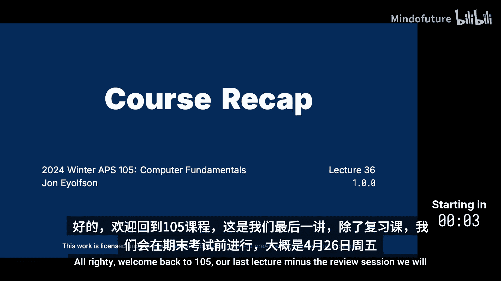
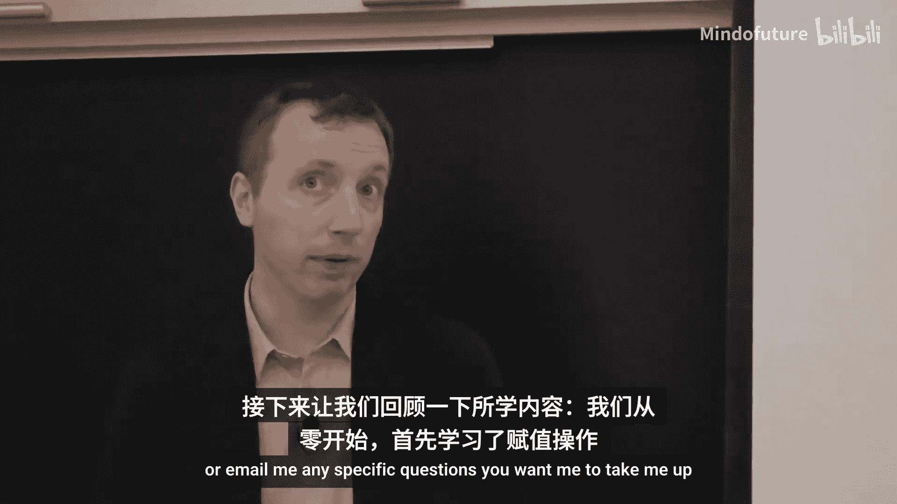
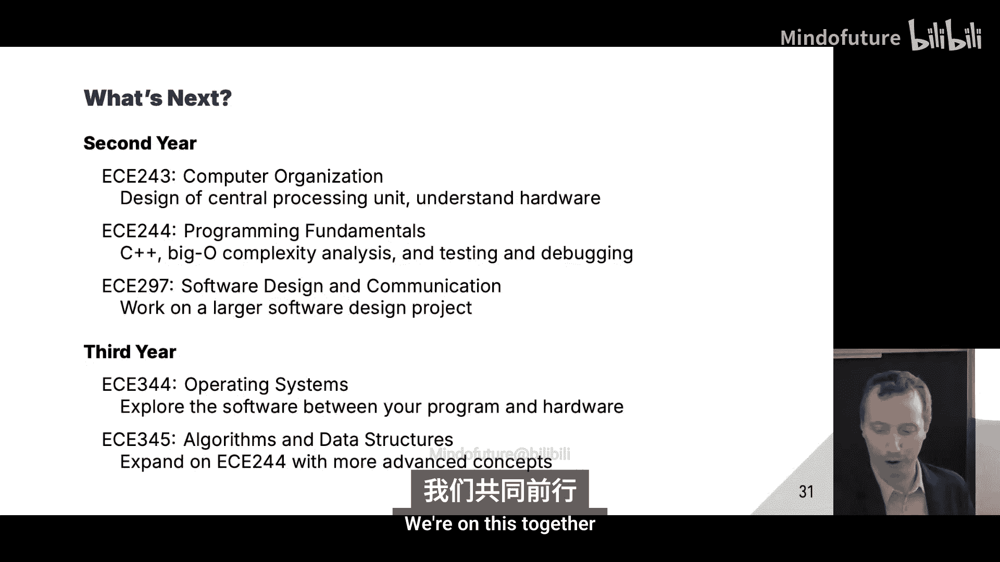

# 【多伦多大学】C语言计算机编程-｜-Computer-Fundamentals-｜-2024-p36-P36_课程总结--BV1zL6GBwEGe_p36-

。拿出来吃。

Alrighty， welcome back to 105， our last lecture， minus the review session we will do right before the final。

Probably Friday， April 26。So before we do that， let us recap our journey today and。

Gather your questions throughout the break。 Go ahead， Look at past final exams。 try them out。

 Let me know on Discord or email me any specific questions you want me to take me up or you want me to take up during the final review session。

 So with that， let's。

Recap our journey of what we learn。We started by saying， well， we want to write source code。

 We want to write source code in the C programming language for this course。We used ourC compiler。

 which is just another program to generate machine code。

 which was our executables that we ran and we compiled many a program throughout the semester so started off by not knowing anything and the first thing we did is we did assignment so hopefully everyone remembers assignment so if we want to declare a variable。

 this is the syntax we used， we use the type which we discovered many types on our journey。

 we give it a name， and then we can actually say it equals some initial value and。

We give an initial value。 That means we initialize the variable to some value。

 So some types we used in this course。 And these are the ones you need to know for the exam。 It。

 So those are whole numbers。 They can go negative。 They are integers。No decimal places whatsoever。

 doubles for dec anything with a decimal place in it。 then char。

 So that was for an individual character， Aka A， something you can type on your keyboard。

 And then it had that fun thing where like， oh well。

 how do you represent the energy or something like that。

 And then we talked about escape characters and all that fun stuff。 and enter is backslash n。

 one are some other ones， that's about the only one you really need to know for this course。

 But like a tab character， backslash T。 If you want to use an actual backslash literal backslash character。

 It's backslash backslash。😊，I think that's pretty much all the ones we need for this course， then。

We saw bo。 So bo。 we have to include a header file for that。

 and bo is just something that is either true or false。 and then void， which is basically nothing。

 So if it was in a function argument， that means that it didn't actually return anything or if it was in the inputs。

 It means that there were no inputs to said function。 Then we got scared by pointers。

 So pointers just that type and then a star and that means we're pointing to we're pointing to a value。

 aka， just where it's stored in memory， it will just be some old memory address because computers are stupid and it's basically memory is just like a big array of bytes。

 and you have to tell it what you know each byte actually means otherwise itll just use it for random values as some of you saw in your labs when you had some memory errors and some things went off the rails。

Then。Finally， we had a raid。 So that was like a type name and then the square brackets。

 And we'll revisit them in a little bit。So then we had input output because our programs were useless and they couldn't do anything。

 So these are functions you definitely need to know for the final， at least print F。

 So that outputs the string on your terminal。 And if we want to print out values of variables。

 Well we discovered we could use format specifiers。 So format specifiers， you should definitely know。

 So percent LF， that is the format specifyifier for a double Pre D is format specifier for an int。

C for Char， that one straightforward。 And P for pointers don't really need that for an exam should be no reason you look at memory addresses。

 but you can， if you find that fun for whatever reason。 And then we had scan F。

 So that will read input from the terminal。We can use format specifiers to change the values that addresses。

 because remember， we had to give scanan F the address of any variable we wanted it to change。

Then we talked about different operators in C。 So these are definitely ones you should know。 Plus。

 plus， and it's postfix and prefix variance。 I wouldn't really care about the difference。

 Just make sure they're on different lines and always prefer the prefix one unless you really mean it。

 Then we saw like type casting。 we didn't really ever need to use that one， the ampers sand。

 So if we have a variable and we use an ampersand on it。 That was the address of that variable。

 So that was where in memory it is。 Then we saw size of。

 So we can use size of a type or size of a dame to get how many bytes large it is。 Then。We had。

 you know， Em personerson， divide， mod。 So all those operations。

 mod was basically just the remainder。Had really weird rules with negative values。

 Don't worry about remembering all those weird rules， just。

The exam probably won't have negative values with mods， just。

Baise alarm bells if you ever have to use mod with negative values in your real life。

 So just know that behaves kind of weird。 Then we had addition subtraction。

 and then assignment statements。 So we could go ahead and just a single equal sign is to change the value of a variable。

 And then we saw a shortcuts like plus equals that will just reassign that variable with its current value plus another value。

 we had minus equals times equals divide equals mod equals。Can choose to use them if you want。

 Doesn't really matter。Then we went through all， all a whole whack of math functions。 Did we ever。

 Do you need to know really any of these for the exam， Probably not。 So most of them。

 you could probably make up if you needed to。 So if it said， I don't know。

 take the sign of something。 You can just guess that it functions called sign。

 I would not worry about that too much， I wouldn't worry about any of these。And except for Rand。

 you should probably know what Rand is。 I came up in your midterm。 other than that。

 I wouldn't worry about it。 I can。 I will double check on the review session if that is true after I know what your exam looks like。

 but。Basically shouldn't have to know any of these Ex from Rand。 And if you did。

 you could probably guess its name or guess something similar。 So I wouldn't worry about it too。

 too much。 And again， I will let you know in the review session。Whether or not that is correct。So。

 then。That was all of the basics。 Then we got into if statements， because at this point。

We just ran our code starting at main statement by statement until our program exited。

 It didn't really do anything exciting。 So then we introduced if statements。

 So if statements let us skip forward， we can write if else， we can chain together like， if else。😊。

Else。Or sorry， if else if， else， if， else， if else， we can chain them all together like that。

 that lets us skip over expression or that lets us skip over statements。

 And then we go and execute inside of the if statement， if that expression evaluates to true。

 Otherwise， if it evaluates to false， then we skip it。

 So we saw a whole bunch of a whole whack of other operators that produce booleanions So we saw a comparison operators that work between numbers So there's equal equal。

 And that meant hey， are these two numbers of equal value not to be confused with a single equal sign that is assignment。

 then we saw not equals greater than less than or equal to less than less than or equal to and those all compared two numbers and then gave us back a boolean true or false。

 And then there was logic operators that only operate on boolean。

 So of not that flips it from a true to a false or false。To a true， the double am personan。

 which is and so both of the conditions have to be true for the the whole expression to be true。

 And then or， which just means a single one has to be true for the whole thing to be true。

 It's only false if both arguments are false。So that was fun。

 Then we kind of went to our bread and butter and programming our friend the loop。

 and our first loop was the while loop， So while loop had expression， bunch of statements。

 and that would allow us to repeat code so it lets us kind of go backwards in execution， so。😊。

Whateverever we had the while loop， well， if we evaluate that expression to true。

 it'll run the statement and then try and reevaluate that expression again。 If it's still true。

 it'll run the statements again and do that until that expression。eventually is false。

 And if it's initially false， we'll just skip over the whole while loop entirely。

 If you we wanted the like statements in the loop to always execute at least once。

 we saw a do while loop。 and that always executes the statements once， then checks the expression。

 that it's basically like a while loop again。So those were our two options。

 And then we went into four loops。 And that's usually for bounded repetition。

 So it basically a while loop， But we can stuff some initialization and increment expressions into it。

 and it will go ahead and do it automatically for us。

 just makes it a bit better to read if we have some bounded repetition。 So。😊。

How it works is this initialization statement happens before any checks or anything are done in the loop。

 then every time through， like the while loop， it'll check the conditional expression。 If it's true。

 then it will execute the statement。 And then after it's done executing the statements。

 it will run this increment expression and then check the conditional again and keep on going through it over and over again。

 just like the while loop， except it will always do this increment expression at the end。

And most of the time， our conditional expression was fairly simple because made it easier to reason about。

 But watch out on the exam， some of the other sections like putting ands and stuff in there to make it a bit。

In my opinion， weirder to read， but works the same way。So。After that。

 we learned about how to write our own functions and how to write function prototypes。

 So if we wanted to write our own function called add 2， and we want to put it after main。

 which uses that function。 We have to make sure to add a function prototype。

 That's what this is called ahead of it because the C compiler is silly。 Well， not silly， It is done。

 it just reads line by line， starting at the top from the bottom。

 unlike our code that always starts executing in main and then goes line by line。 yeah。😊，有。あるてく。那个毛边。

So the question is， are we expected to know how to do a multi variable for loop。我能少活这。Yeah。Yeah。

 you haven hit eye我 and。对。我的。Yeah， so that initialization statement。 so like。If we wanted to。

 we could create two variables online and do like in I comma J or something like that。

 And I'd create an I in a J。 You could do that in a for loop if you wanted to。

We didn't really use it because it got weird once we started doing pointers。 So remember pointers。

 if we did like int star X， comma， Y， then。X was a pointer to an int。 And Y was just an int。

It had weird rules like that。 That's why I avoided using it， but。Yeah， it， it could show up。

 You can do commas as part of。Yeah， you can do commas as part of the initialization statement to create more variables in one line。

嗯。Generally。Yeah， generally， it's easier just to read if there are different lines。

 but comes down to the style thing。Yep。Alright。 Oh， yeah。 So yeah， here's our function。

 Fun prototype comes before anything。Then we can or。

We could optionally go ahead and just add our function definition。Just here。

 we could add that before main， and that would be perfectly valid， too。

 if we wanted to just get rid of prototype。Just the prototype has to at least come before we use it for the first time。

 since the C compiler reads things from top to bottom。Alright， after that， we took a detour on scope。

 That was fun。 So a variable declaration basically only exists between a pair of curly brackets。

 So C declares function arguments and like four loop initializers are are。😊，Technically。

 kind of in the next curly bracket。 So if you define a variable in like our for loop in our initialization statement。

 you can only use it within the curly brackets of the for loop outside of it， you can't use it。

 So that's what that means。 Sam thing for function arguments。

 You can only use them within the function after the function。

 All of the function arguments are now gone。We went over see being copied by value。

 So functions just get a copy of the value for arguments。 And that's it。 So you can't。

 if you pass an in into a function， you get a separate copy of that in。 If you try to modify it。

 Well， then you're only modifying your copy of that variable and it won't change anything。

 So that's why if we want to modify the value of something， you pass in。

Someone passes it in via a pointer so that we get a copy of the address。

 and then we can de referenceence it and then actually modify that value。If we wanted to。

And then we had this weird problem of shadowing。 I'm not sure if the other sections went over it。

 but that's whenever we had a new scope。 And then we use the same name of a variable that already existed。

Generally confusing。 The rule C is it won't give you an error anything。

 It will just use the most recent definition of that name。Kind of weird。

 probably will cause weird bugs。 General， I just would advise just completely never。

 ever doing that unless you like debugging for a few days。So。Then the course got interesting， right。

 pointers。 Yes， everyone， everyone really enjoyed pointers。 It was everyone's favorite subject。😊。

Alright， Well， pointers is the whole reason this course exists because guess what。

 That is how a computer works。 And it will help you in later courses。 Belie it or not。

 we did not do this just to torture you， even though。 I was going to say that sounds like fun。

 but that sounds kind of sadistic， too。Poiners were great， though。

 So a pointer it's just like the starting address of a value in memory。

 We saw the ampersand operator that took the address of a variable。

 and we were able to know its address， actually in physical memory。

 If a value takes up multiple bytes。 It's always the lowest address because it always starts at the starting address there。

 And then have our main bytes。😊，That value consumed depends on its type。

 We went over the size of different things。 Like an int was 4 B。 A double was 8 B。

 A char was 1 B and Boolean was1 B because one B is like the smallest unit of memory you can access at a single time。

So we saw that。 We introduced pointers。 and then basically。

 the rules are each time you take the address of a variable， you can add an ampersand to its type。

 So if I have int X， and then I do address of X。 Well。

 then the type of that is int star or a pointer to an integer。

 So that's one way you can remember it every time we take the address of it。

 If you're keeping track of the type of the variables。

 you just add an ampersand to its type or star or whatever you want to call it。

You can then use the start operator to de referenceence or basically access the value at an address。

 So same kind of rule applies here that。The value of the type that you use the star operator or or。

I think asterisk operator on basically， just remove one star from the type。

 So if I have an int star and then I go ahead and I D reference it。 well， then it's an int。2。

So then after we discovered what pointers were， we were like， oh， well we can use an array。

 so that is just a large， contiguous block of memory and we can have multiple values of the same type all together in memory。

 So the syntax to create an array was just type。 So that is the type of every single element in that array。

 we gave it a name and then optionally in the square brackets。

 we could give it an array size and then optionally we could also initialize it between curly brackets and that was comma separated values。

We could emit the array size if we had a bunch of values。 C。

 well go ahead and figure out the length of it for us。

And we could go ahead and omit the comma separated values if we wanted to as well。 Also。

 we could just like give an array size that is somewhat huge。 Like， say we did a array size of 8。

 And then we only gave it two values。 like a 1 and a2。 See。

 we'll go ahead and just initialize the rest of that array is all  zeros。 So it would be like 1，2，0。

0，0，0，6 zeros。 However made that is， I don' want to try and say it and say something That's a mistake。

So。Are we all good up to this point？ So pointers， arrays， loops。If statements， functions。

Heaps and heaps and fun， of fun。All right。So then we add point arithmetic。 All right。

 that got people so。If we assume like， we have an in array called grades， so。

Grades would be a pointer because of that weird point or array decay rule where basically arrays are just pointers。

 So if we do like grades plus1， that is a pointer to the second element。 always remember。

 arrays are index 0。 So index 0 is the first one。 So if I do plus one that's index 1。

 that's technically in our human speak， the second element。

And that will go ahead and move the address forward， depending on the type of the。

 depending on the type， so。We could go ahead and dereence that。

 So if we do grades plus one and then dereence that。 That's how we access the second value。

 Then we realize that that is really， really ugly and pointer arithmetic kind of sucks。

 So if we want to access an array element， generally， we just do grades。

 And then if it was called grades and then square brackets。 So that will do the same thing for us。

 And at least briefly lets us forget that it's a pointer when we read it。 So gives us some。

Visual difference that。Lets us forget about pointers a little bit。

 But you should still know that they're basically pointers。 And yeah。

 what tripped up people on the exam。 So that is like arithmetic of like pointer plus number。

Like pointer plus integer equals pointer。 but you could move the pointers around。

 So if I did the arithmetic with two pointer values， then the result is going to be an integer。

So if we can think about it， so like。If I just took grades plus one and assigned it to a variable。

 the type of that variable would be like an int pointer， right。So， grades plus1。Let's say I call it。

 I don't know， X。Right， and then I could later do x minus grades。

And then x minus grades would be equal to one。第。就分し我。なとせ。おスこい。One plus grade， yeah。

 So one plus grades is a pointer to the second element。Yeah， yeah。 One plus grades is yeah。

 a pointer to the second element。 So it's just like。

Point arithmetic is you get a pointer result from a pointer plus a number。

 So just like normal arithmetic， I could just do a pointer minus a pointer。

 And that gives me that integer back。 So that would just say how many。

 which is basically like how many elements are there between these two pointers。

It's another way to think of it。So yeah。Yeah， that was， that was on the midterm。

 Do not blame me from that， for that。 I did not write that question。

And that was also weird because it was like one of the first things there。 So it was kind of。

Borderline kind of mean。So hopefully， the finals a bit better than that。So。Oh yeah。

 Then we got to everyone's favorite。 We did malloc。 Alright， we had more， more special memory stuff。

 so。😊，In C， definitely a function you should know。 Maoc。 So if you malloc。

 you just request size bytes， you get back a pointer to that many contiguous bytes unless it fails in which pace it returns null。

 And then your world's probably on fire because your machine ran out of memory。

 So all your programs are probably gonna fail anyways。

 So I wouldn't worry about errors too much at this point of your career。 because yeah。

 if malloc fails and really bad things are gonna happen。And then yeah， another question right now。

 do you need to know vgri for the exam and no， because on the exam， you do not have a computer。

 unfortunately。 So don't need to know how it works。

 but you may have to be a human vgri to figure out like any potential memory errors or anything going on so they could ask。

 they could give you a question and be like， hey， does this code have any issues。 Oh。

 you should probably fix it。 So vgri just kind of help you。Just kind of helped you figure out。

While you were developing， unfortunately， our our exam， not on a computer。But yeah， so with this。

We got back a pointer to that many contiguous bytes。 We could go ahead。

 We could use it to allocate space for an integer， use it as an integer。

 We could do size of int times whatever number， basically， that's the same as an array。

 So we could just have an array。 And generally， we use malloc， because well。

 we wanted memory to survive like a function。 right。

 we wanted to create a new like some new space for a new variable。

 And we wanted to return it to whoever called that function。

 And while we couldn't do it in a local variable because it only exists for that function。

 then it's gone。 So if we wanted to。To allocate new memory and give it to whoever called us。

 we had to use something like malloc。 But yeah， Maloc posed its own problems because， yeah。

 then we had to free it。 Everyone's favorite thing to do。

 So tricky to get correct and generally malloc and free is why people use other programming languages so they don't have to deal with this。

 but。😊，Managing it yourself， as long as you do it correctly， which is a big asterisk。

 means your program will be really， really fast。 But it's like that live free or die。 No。

 not live free or die。 I don't know。 In't that like the license plate for。New Hampshire。

 something like that。 I don't know。Do you haven't heard of that， quote。All right， ish。

Live free or die hard。 is like the movie。 And then I think just live free your die。 Go check it out。

 It's on some license plate somewhere。Presure isn't breaking bad， at least。Yeah。No。

 its like New Hampshire or something。 Yeah， yeah，m pretty sure。

 look at New Hampshire license plate motto。 I swear it's not just me making it up。But basically。

 think of that when you think of dynamic memory， it goes really， really fast。 But if you misuse it。

 you'll crash and burn， as you might have noticed on some of the labs once you。

 we use strings and we had like really weird memory errors and things like that。

 We just spit up pages of nonsense。 Yeah， that's because you messed up memory。So。

How to use it correctly。 We need to remember to free it once we're done using it。

 And then we have to remember after we free it。 we never touch the memory again。

 So we don't have any use after freeze。 We're also not allowed to call free twice on the same pointer and the things we should be freeing are the pointers we get back from Maoc right And of course。

 we shouldn't access invalid memory past like the size we got back from Maoc。

 So only use dynamic memory。 Like I said before， if your function needs to return a pointer to valid memory that did not exist before you called the function。

 or you don't know the amount of memory you need at compile time。

 So you could just like ask the user， Hey， how many integers do you want to have you want to use or whatever。

 and then you can allocate it using Maoc yeah。Yeah， if you free twice。

 C says it can just crash your program immediately。 And generally， that's what happens。So generally。

 your program just stops immediately。 and that's if you're lucky。So don't do that。

 If you did do that on a lab， it probably crashed， yeah。If you're unl， if you're unlucky。

 it works for a while。 and then， then it suddenly doesn't and。

That doesn't happen a long time after the error happened。 and you pull out your hair for three days。

 figuring it out。Not like that's ever happened to me before。Or and probably not you。

 So if that hasn't happened to you yet， you are lucky and you will probably one time forget and chat ETs really bad at it。

 too。 So you might have to correct that error。2。So。Also， then we went to 2D arrays。2D arrays was fun。

 So syntax for that。 Well， we just add on， we slapped on another set of square brackets。

 And now it was a 2D array so we can have just and you can think of it as like an array of arrays or a matrix or however you want to think of it。

 We could go longer so we could have 3D arrays。 We could have 4D arrays。

 could have as many D arrays as we want。 But in this course， we just capped it at2。

 just to keep us sane。 So we just left off at 2D arrays。😊，So when we initialized a 2D array。

 it was like a set of curly brackets for the array of arrays。

 And then we could have another set of curly brackets for each individual array。

 So here I was saying that and it's always row major。 So rows come first。 if you think of a table。

 So I want I don't know how many rows and three columns and then we could define it like this and leave out some。

 So we should have three values in a row。 So here we only give two。

 and the rule with C is if you leave it out。 it will go ahead and fill the rest with0。

 just like with1 1 d arrays。 So here we should have three columns。 We only have two。

 So it would fill it in as1，2，0。 and then this as5，40。

 And then because we omitted the first argument here， it would figure out that oh。

 there are two rows。 So it would be a two。By3， we get。So。Okay， with this。Alright，2 D arrays。

 It also had some other weird rules where if we used it in function arguments。

Because if it was a real2D array， we had to use it like this。 So in a function prototype。

We had to at least have an argument for the number of rows。

 and we have to tell it or sorry columns and we have to tell it how many columns are in our array and that number always has to come before it。

 So before this nu columns I use in the 2D array I have to in nu columns before that and then I could have nu rows wherever the only dependency is before I have table with nu calls。

 I have to define nu calls So I cannot write something like this because the table comes before or before the nu calls and if I wanted to I could write it like this as well and put in the number of rows。

 but that is completely optional。 we don't really need it。So。

If you have to write a function that use 2 D arrays。

 just remember that you always have to give it this argument here。

 You always have to give it the number of columns and you should， yeah， sorry。

 you should give it the number of columns and you always have to define the number of columns before it。

 So if a question comes up on the exam about 2 D arrays。 and it says write a function using it。

 make sure you remember that。Al right， not， not that I drop any hints or anything during the lecture。

2。I just need to shut up。 Okay， I didn't say that。 You didn't hear that。 Allright。So。If I wanted to。

 if I had like a true multidisal array， so。If I， if C actually knows like the number of columns they are。

 basically， it just perform some arithmetic to figure out。

How to access an individual element And your 2D array is in memory， just like a giant1 D array。

 But it just figures out what you want to access。What you want to access instead。

 but we could go ahead if we wanted to allocate a 2D array dynamically Well what we did is it was basically an array of pointers or an array of arrays So what we did before is table was an array of arrays So each individual element was an int pointer that represented our array and then in this array we could access you know the actual column in that row。

 So if we did that dynamically then basically we could think of it as an array of int pointers but we know that we have array decay。

 So this is actually a pointer and that was our first use of a double pointer so。Basically。

 if you see a double pointer， you can just think of it as， oh， okay， well。

 hopefully it's either a pointer to a pointer and then to whatever， or it is an array of pointers。

 And then that could be whatever we want。 we saw it later once we had strings。 And yeah。

 strings was the next topic。 That was fun。 So it was basic strings are basically an array of characters。

 But it had a slight caveat where to know where the string ends。

 C adds a0 byte at the end or a null by。 So it always has to have the character backslash 0 or the value 0。

 if you just read it to memory at the end。 So that was the little trick with C strings， so。😊。

The format specifier that you should always use for print F is just percent S。

 You need to make sure there's enough memory to hold the string buffer overflows。

 serious security issue has cost billions of dollars in problems So for user input。

 you should you can technically use scan F with it。 But in practice。

 it never works because you don't know how much the user is going to type ahead of time。

 So you should use functions like F gi S or get line， which actually restrain the number of bytes。

 you input so that it makes sure that it always ends with a null byte。

 and it's always a valid C string。 So if。I will make it my duty that if they say say they use like a scan F with a percent S。

 I will make them say that assume it always works。 Don't worry about any potential issues with that。

 Because if you see scan F and then percent S。You should run far away。 And if you ever write that。

I was。I will not say anything other than I will be slightly disappointed。

 So do not write Scanf with just the string format specifyifier。All right。

Then we got into a whole whack of string functions。

 which some of which are good for you to know for the exam。 So for the exam。

 there are like versions of this that constrained the maximum length just in case， you know。

 someone didn't terminate a string or it was too large or something like that。So initially。

 I might correct myself later， but initially， I would just assume that the strings are proper。

 You have enough memory for everything。 So I would pretty much forget everything with an N。 So just。

If you need to remember some， which you probably should string length， probably good。

 tells you how many character or how many characters not including the null bitete are in the string。

 Str copy， probably also a good one to know， that will copy a string。

 concatenating strings may or may not be useful。 Str comparison probably good to know。

 So that will return0。 if the strings are equal。 a negative number if the first one's less than the other one。

 and a positive number。 if the first ones greater than the second one。

 And then we saw a string string like searching for a string in another string and searching for a character in a string。

We kind of know how to implement that。 It's unlikely that you could just use those on the exam。

 So I wouldn't worry about these too much， but I might look at when we implemented them as kind of practice。

 And then the last two， like converting a string to an int， converting a string to a double。

Might be good to know。 I would question how useful that would be for the exam。

 So I wouldn't worry about it too much。 But in your real programs。

 probably you won to worry about it。Alright， then， recursive recurs， wow， I can't even say it。

 recursion。 Yeah， that was fun。 So we did like the hardest recursive problem that， you know。😊。

Parents give to their babies。 So that was a fun lecture。 So if you can solve the baby Tower of doom。

 it should be good。 So recursion， just remember recursive functions， our functions that call itself。

 We need two things。 We did this for like three this was the first slide and like three lectures in a row。

 So we need a base case。 So a simple solution we know。

 and then a recursive step to reduce the problem to a smaller version of itself。😊。

If I was a betting person， and I'm probably。Probably not a good person to bet against what will be on your exam。

 There will be questions that say， write a recursive solution to something。

 So you should know how to write recursive solutions to stuff。 I think after we introduced this。

 when we talked about link lists and stuff， we wrote recursive versions of that。

 We wrote recursive versions of string stuff。 We wrote recursion recursive functions of like everything。

 we went wild with it， right， So we should have had lots of practice with that。😊。

So then one of the last ish things we went over was structures。

 And that was basically grouping variables together within a structure。

 So we can give a name and then a whole bunch of variable declarations。

 So that's as many variables as we want within that structure。

 And it kind of just groups all of those variables together。

 So they should all be related to the same concept。😊，And if we want to use it in code。

 it would be both load includes not within a function。Then we saw type defing to rename a type。

 so we just did that so we didn't have to typestruct anymore basically because when we use struck generally the style in this course and the style in the exam is to write it like this。

 So we do type def struck point then give it all the fields and then I liked using like point underscore T the exam just so you're not surprised they like using capital letters which you'll use in like c plus plus it's generally the c plus plus way of doing it So if they did it。

 they would just do capital P point then afterwards I can create a variable like point P1 and then to access the variables within the structure。

If it's not a pointer or anything， I can just use a dot so I could access X by doing P1 dot X。

 If I want to access y， it's P1 dot Y。 If P1 is a pointer， well， then I access the fields using P1。

 then the arrow。 because the arrow was just a shortcut for like dereencing it。

 and it had to be in brackets and then we access the field and it was just ugly。 So we use the arrow。

And just remember， whenever we access the field。 So like。

 the type of this is going to match the type of the variables， so。P1 arrow X。

 that's just going to be a double nothing， nothing too special about。

 And then if we want to initialize the structures like array。

 we can do the same thing and set values in curly brackets。 So if we did1，2， C。

 we'll go ahead and set these values， in whatever order are in the structure。 So if I did one first。

 Well， the first variable， I define here is an x。 So it would set x to1， and then y to2。

 And if I reverse them， then it would switch the order。 So if I did y then x。 Well。

 then it would design one to y and then2 to X。 So always in the order that they're defined within thestruct。

Alright， then we did link list。 yeah， so link list， lots of fun， lots of pointers。

 and what I say more pointers， more fun。 So it was a sequence of nodes。 So our link list。

 we only we like made nodes and each node kept track of which one was next。

 And then to represent the link list， we only need to keep track of the first node。

 and then every other node what knows what's next in the link list。

 And that gave us some flexibility over arrays in certain circumstances。

 if we wanted to like remove the first one without shifting everything over if it was an array or anything like that。

 we could just remove the first one。 And then the order preserved。

 we don't really have to do anything different and。😊。

We just updated one pointer instead of like changing all the values in memory。

 If they were arrays and we had to move them。So。We implemented like all of these in one day， right。

 so。That was a lot。 You should go ahead， review these ones。Modifying the nodes， all the fun stuff。

 So just review this。 We went through all of it。If。If you ever have problems visualizing it。

 just try and dry it out。Dr out all the links。 Always remember。

 you might also have to update the head of the link list and all that fun stuff， so。

Definitely be something about link list on the exam。 I guarantee that。 So all good practice to do。

And then we also wrote different ones。In the exercise lecture that used the value， right。

 So it didn't work on nodes like remove node。 It actually found the node with the value。

 and then removed it。Then we jump into sorting。 So， yeah， computers are really fast。

 They don't care about the order of the data。 However， we're humans。

 We like things to be presentable and in order。 So we discussed several sorting algorithms。

You should only really know bubble sort， selection sort。 The other sections ran out of time。

 never got to insertion sort and goes without saying no quick sort and goes with， I hopefully。

 without saying no bozo sort。 So again。Do not write that on the exam。

 I will probably get in trouble for that， or at least。The your Ts are gonna laugh at you。

 and then they're gonna laugh at you and be like， what section are they in。

 Then they're gonna say my section。 and then。Yeah， that's not going to be good。

 So do not do those joke sorting algorithms， so。Just concentrate bubble sort selection sort。

 You should know how those work。 You should be able to write them。

 You might want to check Sma's notes how she wrote them too。

 Just if you want to see a different style。 I wrote them pretty short。

 You can see hers for how they might be on the exam。And I'll probably go。

 I'll go over that too in the review session as well。 just in case you don't want to。Alright。

 then we ended off。With searching。 So if the array was sorted， we could search it really。

 really fast。 if it was unsorted， right， we had to do linear search。

 which was just iterating through it one by one to try and find what we're looking for。 However。

 if it was sorted， we can use a binary search。 So that starts in the middle。 And then if it's sorted。

 we can check if it's less than or equal to the value。

 And then knowing that we can cut our search space in half。

 Then we search whatever half the array the number could be in。

 then cut that in half and do that over and over again， Cu it in half every time。 just search very。

 very quickly。 so。That was where we ended off in the course。

 That's all you have to know for the exam。 So what's next in your career。 So in second year。

There is EC C 2，4，3。 That's computer organization。 You will more or less design your own CPU。

 That's more of a hardware course。 You will have a good understanding of hardware。

 that machine code I showed you that the compiler generates to you will basically be using that machine code。

 so you will know how a CPU actually works right down to the lowest level in EC 244。

 you will be doing more programming， so that will be in C plus plus that add some nices over C whatever things get more complicated。

 you'll do that big O complexity analysis， we kind of introduced in this course。

 but you'll go over it in more detail there and then how to test indeed debug your programs a little bit more formally。

Then E C 2，97， that's your first large software project。 So at least what it is right now。

 it's a giant mapping。 It' basically like Google Maps kind of。

 So you work on that all semester and have a big project on that at the end。

 And everyone really likes that。 Third year， E C 3，4，4 near and dear to my heart。

 because I'm the one that teaches it。 So I will probably hopefully still be teaching that。 So detour。

 if you haven't already， please fill out your course evaluations， because believe it or not。

 those are very， very important。😊，They really， really matter， especially to me。

 because if you don't fill them out and they're not good， I do not have a job anymore。

 So I want to see you in 3，44。I hope to see you again。 I hope to see you again in that course。

 So you need to fill those out。 So you make sure I'm still around by the time you get the third year。

 Otherwise， I will not be here， and it will be sad for all of us。😔，There's also E， C 3，45。

 which is more algorithms and data structure。 So it's basically a contiation continuation of 3，4，4。

 Despite the name。 I don't know why operating systems is 3，4，4 and not that。

 Probably the numbers should be switched。 Don't ask me， I just work here。All right， so with that。

That's the whole course。 Thank you for bearing with me this course。

 This is my first time teaching the course。 So hopefully it was okay。 So with that。

 just remember pulling for you。 We're on this together。😊。

