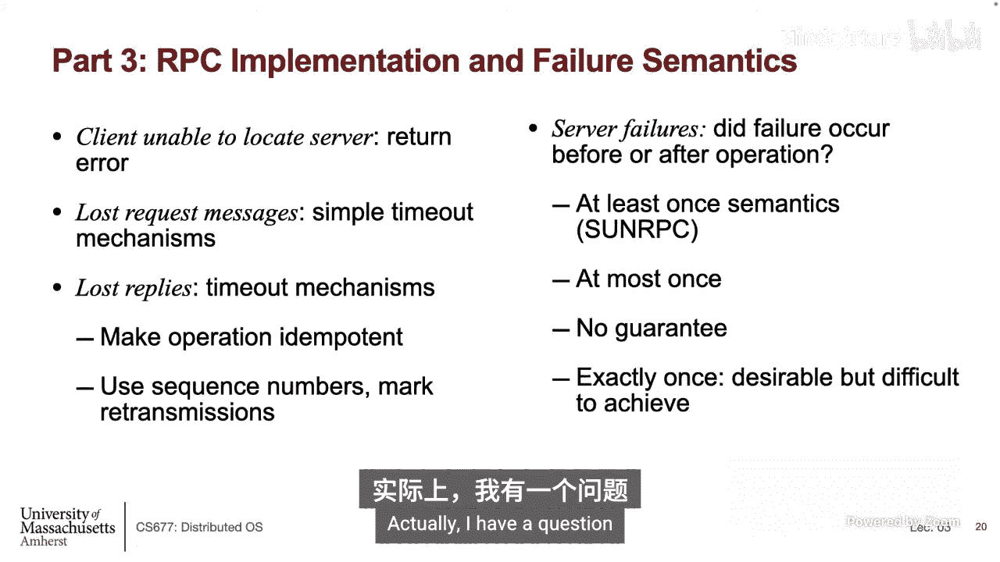

# 【马萨诸塞大学】分布式系统-UMass-CS677-Distributed-Systems-(2025春季)-p03-P23---Lecture-03-----Message-oriented-communication,-remote-procedure-calls--BV1jmNbzrE2F_p3-

哦这的时候。Okay， so let's get started。So。Before I start just a couple announcements。

I think those of you who are following Piazza know that there was a lab zero that was handed out right it's just a setup assignment so make sure you accept lab zero and GithHub and then set up your computer to run Docker and virtual machines because that's what you those are the tools you're going to use for the actual lab network and lab work that's coming so keep that in mind we put a tentative deadline on it but it's not a graded assignment so so long as you completed we are not really strict about when you finish it and what。

Okay right， so。Let's continue from where we left off last time so we were talking about architectures for distributed systems so that part is done today we are going to start a new topic which is communication and distributed system right so this is the agenda for the class I'll talk about message oriented communication first then we'll talk about remote procedure calls and we'll talk a little bit about how remote procedure calls are implemented so that you know not just how to use it which you will in this class but also how to design RpC system that's at the backbone of many distributed system so that's the agenda for today next time we'll talk about remote method in vocation or RMis which is the RCs in the Java world really our RPCs in object oriented world so we but that's for next time today let's start with message oriented communication so before we do that we want to start at a very high。

Level which is how do you enable communication between two processes that are part of a distributed system okay so assume that you have two processes that want to communicate with one another how do you enable that communication Okay so there are two approaches for doing this one is called unstructured communication and the other is called structured communication。

Unstructured communication essentially uses either shared memory or shared data structure to communicate。

Okay， so for example， if you want to let's say send a message with a single integer to a。

To a process okay and you are using unstructured communication you would essentially put that data item into a shared buffer and then the other process would then pick it up from that buffer。

Okay， so that's an example of unstructured communication here there's no laptops in you used in class today。

All right so the unstructured communication is going to use shared memory shared data structures and so on and structured communication。

 which is really the focus of what we are going to use today is。

Basically going to use explicit messages， so if process A wanted to communicate with process B。

 you would make a create a message and send that message over a network to the other process the other process would receive the message and the body of the message would contain whatever information you needed to send to the other process。

So that's basically structured communication so we will talk about the concepts of network sockets which allow us to essentially perform this interprocessed communication they are called IPCs and well also talk about higher level abstractions which are remote Pro calls which also allow us to do the same thing so there is message passing can be can use lowle abstractions like network sockets or you can use higherle abstractions such as remote procedure invocation and we'll talk a little bit about both now to design your distributed system you actually need lowerle support from the operating system to enable either of these two to do unstructured communication the OS has to support the notion of sharing memory across processes thats something called shared memory in the OS context and for structured communication you need lowle support such as the TCPI protocol stack as to be supported in the OS so that you can。

Enable communication。 So in both of these cases， you will need lowest level support to enable communication with that。

 I'm going to now。Talk a little bit about communication protocol and TCPIP。

 if you have already learned this in an OS class which hopefully many of you have， that's good。

 this is a refresher， but if you haven't， this is a good way to at at least know the basics so that you can understand socket communication and RPCs because everything is going to run on top of TCPIP so at least you need to understand what is a communication protocols and how do they work。

So， this picture here shows us what is called a network protocol stack okay this is the component in the OS that enables communication across machines a network protocol stack as you will see here this is called the OSI stack it has seven layers this uses a layered approach where。

You essentially have different layers or components of the network protocols stack that perform different functions。

So you will essentially have these two columns here this represent two machines on the network okay the machines are not shown here and each layer talks about a protocol a protocol is simply rules for communication that occur at that layer of that protocol stack so the lowest layer is called the physical layer or the physical layer protocol essentially talks about how are you going to put bits on a wire or how do you put bits into the air and a wireless channel for wfi or a cellular network and so on so those rules essentially form that physical layer or physical。

layer protocol the data link layer sits on top of the physical layer this is basically where you have things like ethernet or wfi that essentially say how are you going to send basically packet which in this case are called frames or the physical layer to the other end so that's called the data link layer sometimes also called the Mac layer on top of that is the network layer the TCPIP case so that network layer runs IP part of TCPI or the internet protocol that is responsible for sending packets or a multihop network it performs function called routing because these two machines may not have a direct connection between them there may be other intermediate is like routers between them so somehow any data you sent for machine A has to make it to machine B and thats done through the process of routing where each intermediate node or router besides where to send the next where the next node to send the package to one。

So so that is the network layer。On top of that is the transport layer in the TCpiI because that where TCP runs there are other transport layer protocols we will encounter like UDP and others they all run at the transport layer that is responsible that protocol is responsible for end to end communication network layer is hop by hop one hop at a time where does the packet go next the transport layer is responsible or to end communication so it can do things like loss recovery a packet that was sent is never delivered because it was the network was congested or the packet got corrupted it can do retransmission of that packets or it can decide what rate to send packets at so all of that is actually done at the transport layer then your session and presentation layer that's really part of the application that essentially set up a session between the two nodes are decide how to present a data to the application and so the actual application that you run which let's say is a browser or a web server。

they are essentially at the top of this protocol stack they are only essentially deciding what data to send and they hand it to the protocol stack which is going to perform all of the processing。

Okay so so that' is the picture you want to keep in mind okay there are two types of protocols connection oriented and connectionless we will talk about PCP which is connection oriented in just a moment。

 connectionless protocols will differ until a later time when we talk about streaming and so on much later in the course。

So here's an example of a packet that is actually sent over the network as a result of the processing through the protocol stack what will happen is if a browser here wants to send a message let's say to a web server over the other end its going to construct a message is going to hand it to the protocol stack is that message is going to traverse down the protocol stack and get processed by each of these layers and itll go the network right at the other end it gets processed upwards and handed to the application so now when this application message actually get sent on the network what does that message look like and what are its constituents that is what is shown here this message box here is that's the actual message that the application sent it could have been an HTTP message with the URL encoded in it that's what a browser is trying to send to a web server。

Now， when that message is handed over to let us say the application layer presentation layer transport layer。

 each of them add a bit of information to that packet， which are called headers。

So there you have in the transport layer you have a TCP IP header or TCP header excuse me for a network layer header is the IP header and so on and so the data link layer is your ethernet header on the frame and so on so each protocol layer is adding some information onto that packet and it sending it down that allows the corresponding peer protocol at the other end to know what to do with this message so when ethernet layer at the other end receives the message is going to look at the header and say this is what I need to do with it or this is where I send it to similarly when IP gets the message is going to use the information in the header to perform routing and so on and so forth。

so so that is your the message that is actually going to go on the network when this entire package as I said the other end each layer is going to take a look at the message strip the header and then hand it to the layer about so when eventually it gets to the application it just left the message that was set because all the other layers are processed the information and strip their header up。

All right， with that in mind let's just talk a little bit about middleware protocols because the one thing I did not mention in the two slides ago was this is what is called an OSsi protocol stack this is the picture of how a network protocol stack is designed but not every protocol stack has all of those components present in the specifically in the case of the TCPI protocol stack essentially the stack is going to stop at the transport layer and then everything else has to be done by the application so the presentation and session layer are not present in this case so you will have the this is the TCP layer that's the IP layer。

 the Ethernet layer physical layer and then all of these functions are to be performed by the application itself this might include things like encryption and so on。

Now because the application now has the burden of performing a lot of these additional functionality。

 you can have other layers that you can insert on behalf of the application that sit between the application layer and the transport layer and they provide useful functionality we will call all of these things as middleware middleware is essentially a piece of software that sits in middle in this case sitting in the middle of the transport transport the the network protocol stack and the application etc and we'll see a number of different middleware protocols as we go and look at various topics in the course things like distributed transaction distributed locking distributed commit lot of these things can be implemented as middleware that sit between the application and the network and the OSS itself。

So that is a another thing that you want to keep in mind but for today's class forget the middleware layer okay we are really going to see how can an application send a message to another peer application or another server application on the other end using two mechanisms one is using sockets get ECPIP sockets and the other is using remote procedure calls so that is real and this is by and large how you are going to write code or your labs because you are going to write distributed application you are to write components that communicate you either have to use sockets or you have to use things like RPCs。

嗯。Any questions so far， this is the recap I wanted to do before we start talking about RPCs and things of that。

Okay so let's start with socket based communication so essentially this is how DCPIP works so if app process a on some machine wants to communicate with process B on another machine you can use this abstraction called a network socket so what each of these two processes how to do is there to create a socket at their ends and have to connect these two sockets together so that they can communicate using the socket abstraction okay thats the basic idea i'll show you your a picture okay so these are all the calls you can perform using。

Socket libraries the main one that you are actually going to use to communicate are the send and the receive send allows you to send a message which is any arbitrary data over this socket and receive allows you to receive data over that socket data could be anything it could be string text numeric data and so all of these other calls that you see those are what you are going to use essentially establish the socket at each end and i'll show you an example of how this is going to work。

So here is a very trivial client and server that are using sockets to communicate。

The top part is the server the bottom one is the client so what you'll see the example that not the example all the calls that I mentioned on the previous slide are here so what the server has to first call the socket call to establish a socket this is basically creating a new socket and then its going to bind that socket which means going to connect it to essentially address is going to listen on that socket which means it will say that now I am ready to listen listen essentially I'm ready to accept messages or data or this socket and then accept allows you to accept a specific connection or the socket read or write or send or receive their equivalent element in this case allow you to send and receive messages once connection has been established。

So that's the server side， but here is the client side the client side is much simpler。

 client also creates a socket then it essentially uses the connect call to connect to the server using that socket this connect call essentially synchronizes is called a synchronization point is essentially allows the sockets at the two endpoint to essentially be paired with one another so you can use them to communicate anything then you send over the one socket is received at the other end and vice versa sockets are bidirectional in nature you can always send and receive messages is not uniti direction all sockets for bidirectional in nature so essentially when you write a server application you will in addition to the code for whatever the server is doing This is how it's going to communicate it's going to create a socket and it' going to perform a couple of additional calls to establish that socket and then it's going to sit in a while loop where all of this is going to happen it's going to accept a connection。

From the client in this case maybe a browser connected to the server to send a request you going to accept the connection is' going to read whatever came from the client which is where the request is received is process it。

 send back a response and then you can have a loop here where there can be multiple messages that go back and forth between the client and the server and then you close the connection。

OkayThis is essentially a bear bones。figure that shows you how to write a very bare bonecket socket based client and server of course we havent actually put the code for the actual application itself。

 this is just the communication part of the client and the server。😊，Is this clear what I just said？

Okay。Let me now show you Python code that does the same thing we are going to hand this code out as sub lablet so you will play with this and then in the actual lab we're going to use code like this to write real applications that have client and server component in the so whatever I showed you pictorially here is present as code here so you will see that on the server side I call the socket called to establish a socket this returns to me an identifier that identifies that socket the socket call as some arguments which at this point you don't really need to worry about what this is saying is it's a TCPIP socket as opposed to a UDP socket which is a different type of socket。

The next thing you will do is you'll bind that socket to a address okay so in particular you're binding that socket in this case you will see there's a number here 80 that's called the port number every socket actually has an address on that machine that is established the address is a numeric address as the ID of that socket that's the ID or to use to communicate because there may be many applications that are running each of them have an open socket so if you just send a message to a machine。

 the machine the OS has to know which of these applications to deliver that message to you identify the process or the server you want to communicate to say I want to send this message to the server that's listening on port number 80 that's the address that the server is listening on on that machine the server has an I address that's the address of the machine and it has a port number which is the socket address on that machine。

The IP address identifies the machine， the socket port number identifies which of the servers that are running on that machine is this message going to go to。

😊，YeahPo number 80 if you know is actually the HtTP port all web servers listen on port 8 lots of the network services that you may have used they are well definedfin addresses which means if there is a process or that application running that is the address it is listening to a web server by default you will put on port 80 of course you don't have to you can make it listen on other ports。

 but that's the default HtTP port。So this is a code you should expect to see in a web server so buying allows you to take that socket and connect it to an address or rather report number and then you say listen listen essentially says now this socket is ready and now I can as a server I can ready to accept messages so I'm listening for messages that are coming to this port and then you say in a while loop so this is where you will say I'm going to wait for the next client to send a message so I'm going to use that accept call to say I accept the next message that comes and then there's going to be some processing code that's not shown here and then there's of course going to be a reply to either use read or write to send messages back and forth the server and then you close the connection and accept the next connection so that part is not shown here'm only showing the socket establishment part。

De online how do peer to peer communications happen on a socket level how do peer to peer communication happen on the socket level so the socket code that you will use does not matter whether it's a client or a server essentially you should think of them as two processes A and B thatt want to communicate。

Even in the peer to peer case， one peer has to essentially run this part of the code which in this case is labeled the client code and the other peer has to be waiting for other peers to send it messages so it will basically for the purposes of communication use the server side of the code even though both are peers or neither client or servers in the client server sense。

 but the code you will use is not going to be any different。

here's the client code the client that's the server code the client code says establish a socket so this is a socket on the other end and then you connect the socket and here you will basically say here is the web server I want to connect it to okay and that's the port number I want to connect to so that allows the client code to connect to that socket and then subsequently you would probably send a message which will presumably be an HtTP message。

Because that part is not shown here， yes， theres a question。Yes。

Okay question is when I say socket what does it mean Okay socket is the abstraction for network communication okay it's similar think of it as if when I say file what is a file a file is an abstraction in which I can store data okay that's where how I store rewrite data from a disk I use the abstraction of a file okay socket is an abstraction that allows me to send or receive message okay that is the that is basically sockets or what you use to implement ECPI communication okay so to communicate with any process elsewhere on the network you are to construct a socket and then send a message over that socket thats essentially how you are going to communicate。

Okay so the socket establishes a channel between two processes to enable communication yes question。

What does listen actually do listen or listen in this case is just telling the OSs that this socket is ready to receive messages。

对对对。Okay question is it a print statement it's not a print statement It just tells the OS that it is essentially the first to call the socket and the bind just prepare the socket once you are ready to receive comm or start communication you have to listen okay listen will say I am ready to receive messages on this word number servers don't initiate the connection as you can see server are just waiting for the client to send them request so you listen you wait for a message so listen says I'm waiting for message okay and essentially that word accept will then accept a message and is the client that has to establish a connection and send a request or the server to then do something with。

He， wish。白色打印的这首。Sorry， what is the question。把这个单。First question is five the time the server is running for no server is sitting in infin net loop all servers network servers will sit in infinite loop theyll just keep waiting for messages accept message process message accept the next message so theyll just sit in a loop。

Yeah， that's a parameter to so listen， which I forget what it is。

 but it's not the time that it it's not saying listen for five seconds or anything that's not what it is。

Yes。I got500 send。俾得贵。Okay question is what does S dot connect do are you sending a request so connect is simply establishing a tCpiIP connection to the server so in this case S dot connect says connect to the server www do pthon or www uma is a web server connect to port number 80 on that web server or the server is listening for messages so all you're done is you establish a connection no data has been sent yet if you look at the previous slide this part of the code is not yet shown that the actual data is sent using send or receive read right all you're done is you've done this part you establish the connection and then in the rest of the processing you will send a request you will get a response that's not shown in that code but in the code we will give you you will have the complete code you will see the rest of it okay this was just a snippet that I put here。

Any other questions？Allright so let's now look under the hoods a little bit and try to understand how TCP works。

 how is it actually establishing the connection and so on under the hoods okay because from your perspective you just need to look at socket code you don't really need to worry about what is happening when you call socket or accept or connect okay but it is good to understand how things work so there are two figures here the first one shows you how standard TCP works。

that ECPIP works and here you have the x the y axis is time the time is actually going downwards there the client and the server so this is a message diagram that says how are message going back and forth。

😊，So， the way tCP works is to establish a connection it uses something called a three way handshake there are three actual messages that go over a network between the client and the server before you can send any data okay so essentially。

When the server is is waiting on an accept and you do a connect this is where the TCPIP connection is established using the socket under the hood this is what's happening when you call connect and accept the client as soon as you call connect is going to send a message called a S message to the server S says I would like to establish a connection that's really it meaning S stands for synchronize but effectively the meaning of that message is Im a client I would like to establish a connection。

the server is going to send a message back after it receives it in this case it is the TCPIP part of the server not the application keep that in mind server is going to say I send a S message and it will send an acknowledge message so the reverse S says that the server wishes to establish a connection in the other direction because it is a bidirectional duplex connection and the acknowledgement says acknowledgeknowment is simply acting whatever has been received from the client saying I received a S message。

In T CPPIP every message has to be acknowledged so that the other end knows you received it。

 you don't get an acknowledgement you will assume it's lost and retrans okay so to know that the message is received you will send an act and so now the client will hear back saying okay the server got my send and I have a send in the other direction so it's going to send an act to the sin saying I received your sin after this three messages have gone back and forth okay the socket is ready for actual data transfer so this is what connect and exc will do to establish that connection over a network so three messages is essentially what youre going to pay before you start okay so at that point you can send an actual request。

It could be an STDP request， any kind of request the client can send a request。

If the client intended to send only one request it can actually close the connection in the forward direction it doesn't have to or it can close it so you can send a f f as and finished okay which means I want to tear down the connection now you will get an acknowledgement from the server saying I received your request I received the the f at some point you will send back a response after the process that request so now you got the response and then you can send a f in the reverse direction and act to the。

So this is called a three way handshake where you are establishing the sin。

 the reverse sin and the act here to establish the connection and you say there are three messages to tear down the connection。

 a fin in the forward direction， f in the backward direction and acknowledge。So to send one request。

And get one response， we have sent nine messages。We as in TCPL。

 that is the overarch of a socket waste communication。

So as you can imagine if the message is small and the response is small。

 that's overhead you have to pay over and over again， you'll establish a socket。

 itll send a small message， get a reply， pair on the socket， do the next thing。

 but to do each of those things you have to have six additional messages just to establish air on the connection。

😊，So there have been efforts to make that more efficient here's an example of what is called transactional TCP is not actually used but there are other types of these optimizations that are in use where you say let's not have all of these extra messages the client will send one message and it'll piggyback three data items in it it'll send us in it'll send the request and itll send a in all in one actual network message so the message is three par you send all of that and so it says I want to establish a connection is a request I'm done then the server can say okay I want to establish a connection acknowledge all the things you send here's the answer and I'm done and then you send back an acknowledgement so you basically collapse that nine messages that went back and forth for a single request and a response into three messages。

So is an example of how you can optimize message exchange。

When we get to this is not used in practice， but when we get to things like how Chrome has tried to optimize TCP IP over at Google Chrome browser that is。

 we will see that it has used similar ideas but not using TCP， they use UDP no questionnairearies。

Why is transactional tCP not used okay so use any version of a protocol the protocol has to be installed at both ends but you cannot unilaterally start changing the protocols protocols are rules you agreed for communication it follows that both endpoint have to agree to the same set of rules otherwise you won't know how to interpret a message。

So TCP is most widely used every OS supports TCP out of the box if you want to implement transactions at TCP you are to now update TCP libraries on every machine in the network okay and think of the number of machines or the internet as the large number so never really became popular。

哎。Yes question。嗯。Why is three way handshake needed three way handshake is how TCP works this is how you are going to establish a connection and both endpoint know that you establish the connection。

In UDP you do not have the three an you simply send a message and then you hope that the message was received because there is no error checking and things of that sort so if you want to establish a TCPIP connection TCP will cause the three messages to establish this connections or both endpoints no that the connection is live and then TCP has to then figure out if messages are getting through do retransmissions and all of that extra work。

 which is not shown here。Okay， question is what happens if act of sin is lost。

 any of these messages can be lost over the network just because you sent a message doesn't mean that the it will actually be received。

but what ECPI will do is for every message there will be a timer。

So if you send this message number two okay it was a send accent okay it will start a timer saying I need to receive an acknowledgement within a certain amount of time that says that the message was received if that accent comes back within that time or interval you are done you know the message was received but the timer expires and you have not received the act you will assume that the original message was lost。

 you actually don't know if the message is lost or the acknowledgement is lost but since you are not heard back you are to assume that the message is lost and you send that message again。

Okay and then you' will wait for that so the three way message hand check can be more messages if there is actual losses and retransmissions。

And that's true for actual requests and responses as well once you send the request if you don't get an act you'll re transmitm the request TCPI library will do it for you。

 you don't have to write application code thats resending messages over and over again。Yep， yes。Okay。

Okay question how is the answer received after the connection is closed the connection because this is a two way connection okay to okay so what you're done when you send the f from the client to the server。

 the client says I don't have any more data to send the server does not connect close the connection in the other directionitch so it can still send messages until it sends its fI it can still send more than one message back to the class client。

Normally you would not send this f here， you will wait for your answer and then send the f。

 but it is showing that you don't have to do it in that order。不。要。Yeah。

 so the duplex connection which is both directions is closed when the final a goes from the client to the serverro but connection closing as two parts you can close the connection one direction then you close it in the other direction at that point is completely closed。

That you don't really need to know about these details。

 but this is what you need to know about where it's good to know how TCPIP libraries and protocols work under the whole。

Okay so with that I'm going to talk a little bit about group communication we'll come back to this later on in this class when we talk about middleware and so on and Im not going to discuss it in detail today but I just want to mention it here so first of all what is group communication and how does it differ from what socket based communication that I talked about the way you want to think about this is socket based communication is one to one。

each socket is connected to one other endpoint and these two endpoints are communicating with each other so a client talking to one server。

there now there may be cases where you may want many to one communication or rather one to many communication so this is a case where the server wants to send a message to a group of receivers okay very similar to email typically email is one to one where there is if you put one recipient it goes to only that recipient but if you send to a mailing list you send one message but there are many recipients okay same kind of stuff here if you use a group address rather than a single machine address that group address can deliver that message that you sent over that socket to many different recipients。

Okay this is called group communication it is very useful in many kinds of distributed applications where the server is communicating with a set of planned devices and it wants to send the exact same message to all of them but rather than sending n messages to each one individually you send one message to a group and they all receive it。

😊，So is also referred to often as multicast which is different from broadcast broadcast says when you send a message it goes to every machine in the network multicast says when you send a message it goes to a group which can be some subset of the machines in the network now there are many issues there that we will look at as to how you decide how to deliver messages in the group that's called group addressing how do you ensure atomicity message ordering scalability you may not understand what these issues mean at the moment which is okay when you come back to group communication later on it will get into the details are all but the only thing the reason I mention this here is that theres a variant of sockets that allow you to send this to a group each send or receive is happening to a group or you're receiving from message that was sent to a group but by default it's one to one that's what you will actually use youre not use group communication but that feature is available in some cases。

Okay， any other questions here before I move on to the next topic？The article should escort。Okay。

 question is who resolves the group address so to implement group communication you need additional network support that says when you send it to a group something in the network has to figure out who are the members of the group and then make sure the messages are delivered to that is typically done in the routing layer。

Okay， so I think the so in other words， the routers need to have support turned on for group communication。

 the router does not have support for group communication， it will just ignore the message。Okay。

So next part of this class is going to be remote procedure calls。

So remote Pro calls are a different way client and server processes can communicate with one another its a more intuitive way for any of you who never actually dealt with sockets because as you will see using remote procedure calls to write clients or application is very similar to how you write programs today and you don't have to often deal with all the underlying issues of the network addresses and so on as you will see in just a second is very logical way to take your notion of how you write code and extend it to write code for distributed。

So the goal of remote procedure calls is to make distributed computing look like centralized computing by what that means is to write distributed application exactly the way you write some Python code or Java code that's just a single process application you can use the similar abstraction and does make application distributed which makes it much easier for you to write and we' will see the way we are going to do this is we are going to use procedures as a way to automatically enable communication between the client and the server and you all know what procedures or functions look like so we will be much easier to understand how to write applications this way and we'll talk about a number of issues which is how are you going to pass parameters out due to binding semantic so these are all implementation level issues when you talk about remote procedure but let me first give you an example or that explains what is a remote procedure first of all as the name remote procedure calls。

Indicates to you what you are doing is you are invoking a function or a method。

And the method is actually remote， which is what it's a remote procedure called。

 which means the code for that method is actually on some other machine。😊。

Okay so think about how do you write code now okay what the methods you are calling in this world are all going to be local procedures they are all local to your code okay so you have a main program that calls a function fo the code for function fo is part of your program you wrote it。

In the remote procedure calls you are going to call this function fo。

 but it just so happens that the code for this function fo lies in another process that is running somewhere else over the network。

😊，But somehow the runtime and the OS allow that port that is not recsiding on some other machine to be involved exactly the way you are going to call a local procedure。

 all the parameters are going to be sent over to that process that process is going to execute that procedure and send back a return value to you。

your part the invoking code so that makes remote procedures very similar to local procedures just the only thing that has changed is some now some code for some procedures is part of the process and code for some of the procedures that you can invoke sit in some other process and they just call procedures and you can now communicate in this manner rather than using sockets for communication。

And here is an example of a client and a server machine where the server machine has implemented the ad procedure it takes to argument it sums them up and sensoror it un well。

😊，So what you will see is is a client process the client process is simply going to call add Ig this is how you would call a local version of add if you had written that code in this process。

😊，Right。Now as a programmer this is all you do you're not going to say this is a remote procedure here is the machine it is on this is IP a lot of that is not actually written code is not written for you but a lot of code will be auto generated for this program and internally when you call this ad the runtime will figure out this is not a local procedure this is a remote procedure so you are to now internally construct a message and send it to that machine and invoke that procedure on that machine so you will construct you as in the runtime RPpC runtime it will construct this message saying that this is an invocation of procedure ad here are the two values of the arguments here's an integer which is value of I as integer value of J and you see that this message is now going over the network it will reach the other end and then this is a server machine is going to get this message it say there's a request now invoke the addd procedure so you will unpack all the arguments youll actually。

Invo add and the code for add is somewhere here in the process it will call that function it will execute a return value will be generated and this process will repeat in reverse。

 well construct that message for the return， send it back and in the meantime this ad is simply waiting for the procedure to return just as when you call a local procedure you will wait for a return value while it' is executing the same thing is happening here except that the execution is on some other process elsewhere on the network。

Is that clear？Yes。这说。对。我。Okay question is if if there is another local implementation of the ad procedure what is going to happen Okay by default you are not supposed to have two methods in your code that do two different things and if you write if you load wrote a normal program you wouldn't have two implementations of who right you will have only one because you code will not know which one to call so you will not have a local version of ad and the remote version of ad if you have that you are to call them two different things so it's always clear what you are invoking。

Because each method needs to know we have which code to invoke。No。

 your code will not combine because you just have two versions of the same function。

 right it'll clear a concrete。Yes， question。Any real worldor example of RPRPC so RPRPCs are very widely used for all kinds of applications you will write client server applications that do this so you can think of a file server。

 many kinds of servers actually use RPRPC when file server the client is actually talking to a server to NFS or SAMba or all of these they use RCs but very widely used as a technique for communication will talk next next time not today we talk about there are many RPC implementations as well we talk about one that Google made is called GRPC that is what is used for lots of Google services as an example。

As well as quote that other sovereign。我你讲啊几。Questions When is an RPRPC preferred over a TCPI connection The first thing I want to mention is that this client and server here they are also using TCPI communication okay this message did not go magically or the network all communication or the internet uses TCP only difference in this case the programmer has not written code for TCPI connections so internally this code which I did not introduce to is called stop code this code is auto generated the code at the top is what the programmer or a developer that you write is rest of the code for actual communication is automatically generated so even in RPRPCs are implemented on top of sockets except that as programmer you are not dealing with communication at a socket abstraction you are dealing with communication using procedure abstraction its a higher level abstraction so you don't need to muck around with okay let me start construct a socket let me do listen all that is actually happening here。

But this is how this client is going to send the stop code is going to send this message to the server。

Okay so it is not like socket communication is not present in RPCs its just not implemented by the programmer except in the previous case you actually wrote that code and you send the explicitly messages for the socket and received messages so you are just programming at two different levels of abstractions both cases you are using network communication but you use right different types of code for each of these。

Yes，You there。Okay question is is this look the same as rest API are there two different things so first of all rpCs are one layer below things like rest rest is essentially using STtP for communication this is not using htP this is basically using you can write python code and Java code and simply called procedures that just happen to reside on another machine so your are programming now using procedures as your abstraction for interprocess communication okay now。

Having said that rest APIs you can also think as a form of a remote procedure call。

 but youre using htTP as your transport you're sending RPpCs layered on top of htTP messages there' one way to think about it so rest is essentially HtTP based rC is one way you think about it okay。

But this is actually much lower1。Any other questions here？

Okay so now let's actually go get into some of the details of what is happening So here first thing is how are the client and the server interacting with one another when you send an RC So these all of these calls that you' are seen here they are essentially going to be synchronous server are called blocking calls which means when the client process called addd it's going to just wait for a reply similar to if you are called a local procedure you wait for the return value you're going to wait for the reply so the client will just wait until the server processes and sends back a reply so this is called also referred to as synchronous RC or blocking RC because next time we will see other forms of RC when the client does not wait for a reply but by default RCs will wait for a reply So this is the timing diagram here the client is executing in this case itll called the ad method ad method is going to invoke on RC that's a message or the network the client starts server starts executing the ad。

Okay， the client has blocked is waiting for add to return。

 reply goes back and the client continues execution。😊。

We will see more complicated versions of this figure next time。

 but this is just one to keep in mind for synchronous or standard blocking Rps。

That's the first thing you want to keep in mind and then here is essentially some additional details that get you some better understanding of how RPCs work。

 so this is essentially your local or conventional procedure code if you didn't have RPCs is a writing code what happens when you call a function。

You take its arguments， you put it on a stack then you essentially start executing the code of that function the function will take the arguments from the stack process it produce a return value。

 the return value is pushed on the stack， the code returns。

This is how any procedure is going to execute okay or any of the languages that you right so thats what is shown here so this is the stack these are other parameters that are already on the stack that's a stack pointer and you call a local procedure call you put all these arguments you left some space for the return return right and return values and you call the method and if that function calls another function you will push more arguments onto the stack and pop them and on。

Now when you call remote procedures， you are not going to use the stack putting the arguments on the stack is useless because the process at the other end has no access to your memory。

That clear because that's a different process it will only have access to memory on that mission。

 it cannot access the stack of some other process on this mission， so when you re a remote procedure。

 all of these things that youre normally put on a stack you have to pack it into a message and send it as a message to the other end so that the other the server side of this can actually extract the argument so you' are not going to extract arguments from a stack and you call a remote procedure they will arrive as a message or the network and you can then take it from the message that is arrived。

Okay so that is one thing you want to keep in mind the other thing you want to also keep in mind is what do the arguments mean in a remote procedure call if you have a local procedure call you know that there are two ways to pass arguments you can do call by value and you can do call by reference。

What's the difference between the two？Yes。好 the8。好的啊对。that's right。

 so if you pass arguments by value let's say you pass an integer I as an argument。

 you are going to take integer I make a copy of that integer and pass that as the argument。

so that is called call by value if you call by reference and you pass integer I you pass an address of integer so within the called function you are actually accessing I itself because you have an address and you can even modify I。

When you call by value you cant modify the original variable because you made a cop you can only modify the cop so the other way to think about it is call by reference essentially is passing pointers to arguments。

That' is one way to think about call by value makes copies and sends it now again in remote procedure calls you can only pass arguments by value you are not allowed to pass by reference。

😊，The reason is called by reference essentially passes pointers。

If I pass the pointer and sent it off to a remote procedure call。

 if I dereence the pointer at the other end， you are not going to be able to make any sense of it because a pointer is a memory address。

So if I say I pass I by preference and his memory address is 00 I'm going to actually sign00 if I dereence0 is going to point to address 0 on that machine which is meaningless so you can't really send pointers over a network because pointers are memory addresses memory address or are specific to machine here you have multiple machines so you cannot really pass by reference well this is one difference between local procedure calls and remote procedure call in RpCs typically you will not be allowed to send any arguments by as pointers or call you do not use call by reference there are very specific cases where that restriction is relaxed but by and large an RC system of any sort will by default prohibit you from not prohibit but it will not use call by reference it will actually call call by well and you shouldn't really pass pointers either that's one difference。

The other difference that you have to keep in mind when your RPCs is that the client and the server may not actually be homogeneous。

 they may not be running the same OS like you cannot assume that theyre on the same platform and so on let's take an example of a web browser and a web server your web browser may be running on your Mac or Windows machine you cannot assume that the server is also running on the same machine as yours it could be running on a different platform altogether。

because you cannot make any assumption of what what's happening at the other end。

 so the server or the other process that' is running on the other end might be running on a different platform okay this are important issues that you want to consider when you are PC。

Yeah， one example difference， which I will。Come back to here we will go back to the other slide but one important difference is if there are different hardware architectures this can cause problems okay one one issue really is whether the architecture is big Indian or little India。

😊，That doesn anyone know what this means？Yes， you pick an OS class clearly， yes go。そ特べあい代です。间啲系。对不。

Okay， so what big Indian and little Indian means is however if you think of an integer。

 which is essentially a big。😊，Representation of an integer binary representation of an integer big Indian little Indian means which is the most significant bit and which is the least significant do I read the integer left to right or right to left some architecture say the leftmost bit is the most significant and the right most is the least significant other harder architectures are the other way around。

😊，So your x8 6 might use a different binary representation in terms of Indianness then let us say an arm base Mac。

Now what does this have to do with RPpCs if I am just sending an integer as an argument an integer is just essentially a binary representation that goes over the network it arrives at the other end you don't know how to read it if you read it in your native format you are going to essentially get some integer representation or if the client that sent you was the other one you will essentially now read the integer backwards and think that some other argument was sent。

Is that clear so you need both end points to agree on how to interpret any data or arguments that are coming over a network because you cannot assume that the hardware on both ends is identical that they might be not and in particular they might use different binary representation different hardware representation。

😊，So what are we going to do how do we deal with this problem because you cannot say my code is only going to run I wrote it on a Mac it only run on other Mac it can't run on anything else that's one way to solve it。

 but it's not very useful you want your code to be platform independent so what we are going to do is we are going to use something called an external data representation or an XDR where before you construct the message the RRPC message to send over the network you take your native representation and you convert all of the data to an external data representation an external data representation is a pre agreedre to format for communication so you can assume for example you can say my XDR says all data must be sent in big Indian order it doesn't matter what your native hardware says when you send data you are to send it in big Indian so if you are a little Indian architecture you have to flip the bits and send them in that order so now if all parties agree that XDR means。

always big Indian then there is no confusion if your architecture doesn not match。

 you know how to take what came and flip the bits and get the actual data that was sent to you。So。

 you are going to translate all of your data into XDR format and retrans it back so essentially there is a common understanding of how to interpret data that is sent over a network。

That here so you have to do additional work so that you can deal with hardware heterogeneT。

 you can pointers， so these are all things that you have to do to make sure your code if RPRPC code is going to run on different machines with different platforms and so on。

You may also have to deal with things like is your integer 30 to bit or 64 bit？As one example。

 you might have a 32 bit machine that sent an intesger or a 64 bit machine centered you want to be able to interpret across me so all of these hardware differences have to be dealt with you use XDR to communicate what is the data you are actually sending to attach a meaning to it。

😊，Not just send some bits。All right， so if me go back here。

 so I talked about all of these things so you have to use XDR representation you are going to essentially use the Stub code as the auto generated code to do all of this work for everything I said are all issues that have to be date by an RPC system but not by the programmer。

Programmers have this very easy abstraction and you just invoke methods。The stop code。

 the auto generated code will deal with XDR conversions。

 it will deal with making sure you are not sending pointers， it will construct socket messages。

 send them over all of the heavy lifting done under the hoods。

So it makes it much easier to write this type of code。All right， so。

So that essentially brings us to client and sub codes a client is going to make a normal procedure call if it's a remote procedure it is going to go to stop code that's autogenerated for you and it's going to construct this message send it over the server side is also written as a procedure but you write the implementation of the procedure on the server side the stops take care of packaging the arguments sending them over packaging of the arguments is called as marshallling of arguments and unpackaging is called demomarshalling the Java world marshalling is also called serialization。

If you heard that term serialization that send it in Java， serialization is used for other things。

 but it's also used to package arguments when you send it or RPCs。

So what so what marshalling and demarshalling do is they can take complex data structures and they will construct a linear by stream and allow you to reconstruct that data structure right you might have a three dimensional array now when you send that you have to say or maybe let's just take two dimensional as an example are you going to send a row first or column first。

If you want to reconstruct it at the other end you need to know how the data was set you can just says8 by 4 array and just send 32 integers and expect the other end to reconstruct the because you need to know did you send them row by row column by column if the marshalling rules are going to figure this out and send them in XgrR format so that the other end knows how to reconstruct complex data structures like arrays or other types of structures。

So this is all stuff that has to happen under the hoods。Let me show you some more。

 I think I mentioned all this already。You talked about XDR I also talked about pointers so by default you are not going to send any pointers that's going to be prohibited youll talk a little bit about some systems that actually do this they actually support network pointers they allow you to dereference pointers where the address can be actually dereferenced on other machines this is called chasing network pointers very few systems do this but there are some so I will mention some of them next time and I also talk about marshalling arguments which as I said in Java world is called serialize and dec serialize which will talk about when we do RMis as well next time。

 any questions here before I talk about other aspects？稍后。

Okay question so I said the Stub code takes care of this for you and the question is who writes the Stub code I should have mentioned this。

 so whenever you write your RPC code you will run that code through an RPC compiler。

And that RPC compiler will look at the RPC code that you wrote and it will auto generate the stop code for okay so essentially you are to write a spec which is called an IDL so they say this is the spec for my RPC this is the code I wrote and then that RPRPC compiler will generate all of this。

So it' is not that there is somebody is already prewritten code。

 it is generated automatically for each piece of code you write that does RPpcs in them。

And every language will have its own RPC compiler， as you will see， yes。

What does the spec contain will we will talk about that in just few slides a spec is essentially think of it as a headfi it basically lists all the RPC calls that you separate out with these arguments and so on so you know how to construct those messages。

Yeah， so it's basically a ideal spec。All right so thats one aspect now the other aspect is because when you write RPC code you are not writing any network level code okay so you have you run this you start running code that does an RPC call pay then you execute the RPC call you can say how is the sub code to know where the server is running。

Okay how do you know the IP address of the server how do you know what port number it's listing on and so on so clearly if the programmer didn't specify any of this some of the somehow the stop code has to figure this out okay so often there are multiple ways to solve this problem there of course the explicit way where you have RPC code where the programmer says my server is going to run on this machine。

and is going to run on this IP address and this port number and then you hard code that in the client and it' is easy the client knows where to connect to okay but often when you write client server code you don't know where the server code is going to run ahead of time think about。

😊，Apache web server the right the implementers or the Apache web server can't figure out when they wrote the code where the users or the people who deploy web servers what IP addresses are going to run them what code numbers are going to run this is not known ahead of time right so thats going when the implementation time detail same as to have many RPC things you write the server code but you won't know where all it is going to run so you can't hard code that。

The server address into the client so the way you will deal with this is through a process called binding where the server is essentially going to advertise itself somehow to the client so then when the client tries to look for the server it can figure out where the server is running so the way you should think about binding is like a directory service you essentially register yourself with the directory service so in the previous example you have a server that provides the ad service when that server starts up it can essentially go to a bind itself or send a request to the directory service saying Im a server that provides the ad service this is the IP address of my machine this is my port number。

And when the client starts up the stop code when you call add it has to go to the directory service and say is there an ad service running of the network okay and what port number is it running ad and then you go figure that out and then you can establish your socket connection which does need if you remember does need the IP address and the port number so you are going to use use this extra mechanisms to figure out how to connect to server and so on so that process is called binding。

😊，Any questions on this？I'll show you some example code that does all of that as well。

 but let's now talk a little bit about what happens when you are making RPC calls。

 but messages are going to get lost。Because RPC communication involves sending RPC calls。

 invocation requests， getting back written values and so on。

 sometimes messages might get lost over a later。And if you don't do anything about it。

 the client might just wait forever waiting for a reply。

So there are two answers to this question one is run things over TCP。

If you if you run your RPC system or TCPIP， lost messages will be dealt with by TCPI。

 it will figure out that the messages are lost， it will retransit or the application code does not have to deal with it。

That's one way you deal with some network issue but there are many RpC systems that will run over UDP。

 which is the sister protocol to TCPIP which does not provide loss recovery you send a message and it gives you best effort delivery which means that it will make a best effort to deliver it sometimes the message may not get delivered so in this case the client tab has to actually have timeout values and retransmit requests and so on so there are those details you got deal with but there are many many things that can go wrong not just that the messages get lost processes might crash so weve got to have some answers to how are we going to deal with RpCs in a world where the network by messages are getting lost or the client server or the client might actually crash so here is a slide that tells us a little bit about what we can do in different scenarios so first is let's say the client is running you make an。

PC request， you are unable to locate the server either the server has crashed or is not running it up。

So in this case， your RPC call is going to return with an error。😊。

This is not something you are going to encounter in a local procedure call it's not like you call a local procedure。

 the procedure had disappeared。That is not a thing because when the when you wrote the code it wouldn't run if there are a missing procedure but you can have things like this in RPCs a server is not to be found so you can't actually invoke the code at all so your RPC calls might sometimes return with an error not a valid return well。

If you cannot locate at the server at all。Now your request message might get lost。

 you call an RPC map function， you made a message and it went over the network。

 it did not reach the server。in this case， timeout mechanisms will help where the client can time out and I did not receive the reply。

 so I'm going to resend the message。😊，So you call that same method the add function is going going back over the network reply might get lost same thing reply getting lost means a client has not heard is going to send a request again。

except that when you do these retransmissions you got to be careful the reason you got to be careful is multiple invocation of the same method might actually have side effects on the server。

😊，Okay， supposeose rather than calling the add function。

 your function is saying let's just let's say it's a banking application， just as an example。

 you say okay deposit $10 to this account， that's your RPC message。 you send the message。

 the server executed the message， but the reply value got lost。😊。

Yes we didn't get a reply saying that deposit is successful or something like that。So。

 the client is going to time out and retransit else a deposit $10 to this account goes back to the server server will reexecute that message and now you are in an incorrect state because you actually executed that message twice。

Even though it was the same code so this requires a property called item potency or item potency says no matter how many time you execute the message the end result should be the same if I said deposit $10 to the account that same request goes twice it should not actually make the deposit twice it should execute it and send back a reply without changing the state and get into an incorrect state。

😊，So you have these kinds of problems because of repeated execution that you have to actually deal with at a runtime level。

 so if you have your RP system being item important you are not going to have this problem。😊。

The way you are typically going to deal with that is every RPC request is going to go with an ID so if you actually so then at the server side you are going to track what request were received recently what were the IDs so if I receive another request I first have to see have I executed that request with that ID already and I should cache the response so that if I have already executed it I just take the return value cache and send it not actually executed。

😊，So this way you are going to ensure item potency and not cause problems because if you haven't received it。

 then you execute it。But but you have to deal with all these subtle because this is a distributed system。

 it runs over a network where the network is not reliable。

You can have server failure in the middle of execution that can also happen server is executing a message just crashes client is not going to receive a response okay and maybe the client the server recovers after a while the client res that request and you get a value back from the server so the question from a client's perspective is。

😊，When you actually get a return value to the RPC request you send what is it that you can assume has successfully happened at the server so you can have what is called at least one semantics that's a default that says if I sent an RPC I got a reply I'm guaranteed that the procedure executed at least once if I retransmitted that message and item importanceence is not guaranteed of course that procedure I' have executed multiple but at least once is once or more。

At most one says at most thats exactly what it means that the executer zero times or once okay so you will either get a error value or get a valid value no guarantee says I don't tell you anything about how the system is it is not what you want but if that can be an option for an RC system and what you really want is exactly once that is item importanceency saying no matter how many times I retransit if it's the same call Im sending over and over again I get a return value no matter how many times I send it it is executed exactly once that will ensure automatically item importance you don't have to do extra work。

So when you design your RPC system， you need to describe to the developer saying if you write code and you get a successful execution。

 what should you assume has happened on the server and you can have at least onces at most ones exactly onces all of these different possibilities。

Yes question。So making up take all with。So do I get a compil error on the client or still the gets the and server can you repeat the question if I got R what？

都自い。So if you write code where you are making an RPC call with a missing parameter。

 the code will not combine。This is the same as if you wrote a local procedure you declared the procedures arguments and you just have two instead of three your compiler。

 if you have compiled language will say that there is a error that it is not accurate so you will not actually get the code to run at all。

How does the compiler know what is the method so basically you have to declare the method just as when you write code you have the declaration of the arguments that you pass to a function。

 what is the return value you have to declare all of that so you have to check that the code actually conforms to the spec of what each of the arguments are and so on。

Okay questions functions are in different machine， but the thing you want to keep in mind if you are calling a remote procedure call on the client you at least need to know what the arguments that you are to pass and that has to be told to the compiler that is where you are going to give that spec to compilers on both end right so you have to at least agree on what are the names of the procedure arguments and so。

えYes no。而且。question is does this work for TCPI or UDP RPRPC systems actually most of them can run on TCPI or UDP some now run on TCP by default but many systems can run on either one。

Okay question how do you deal with loss recovery on UDP if you if you RPCs that run on UDP the stop code has to write extra code to have timeout if you're running on TCP you assume TCP will time out so you don't write that in the stuff。

All right， we ran out of time we will continue this next time。

是也是你还会。