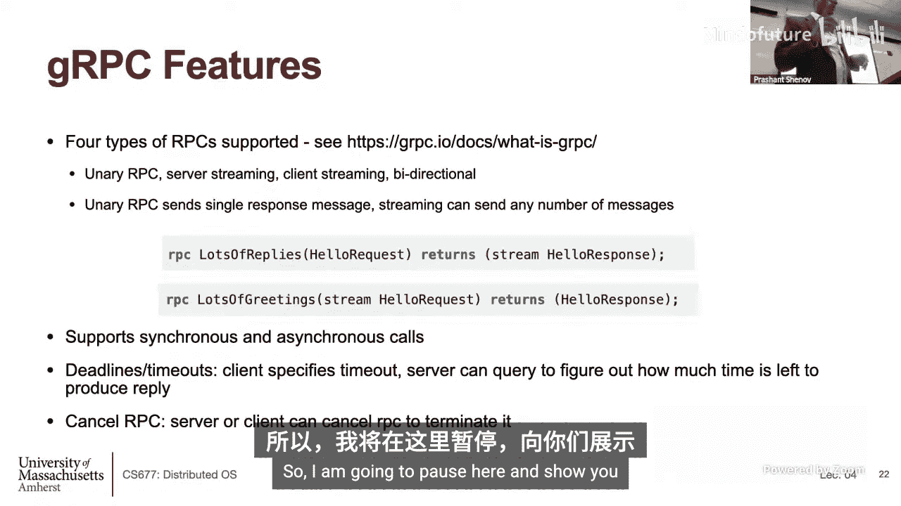
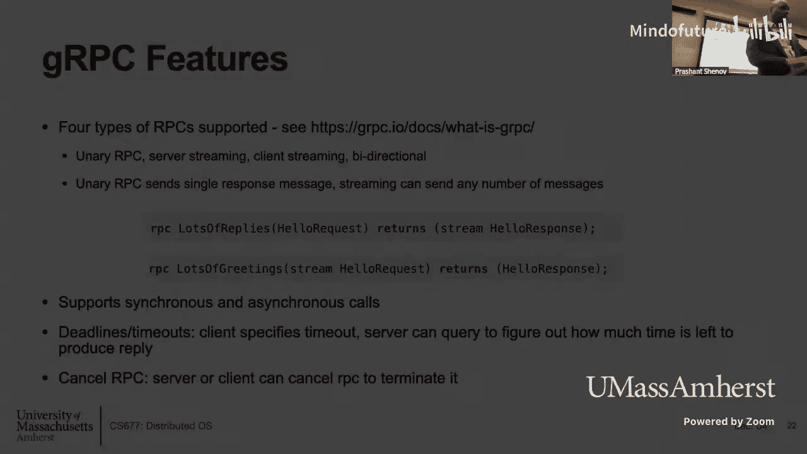
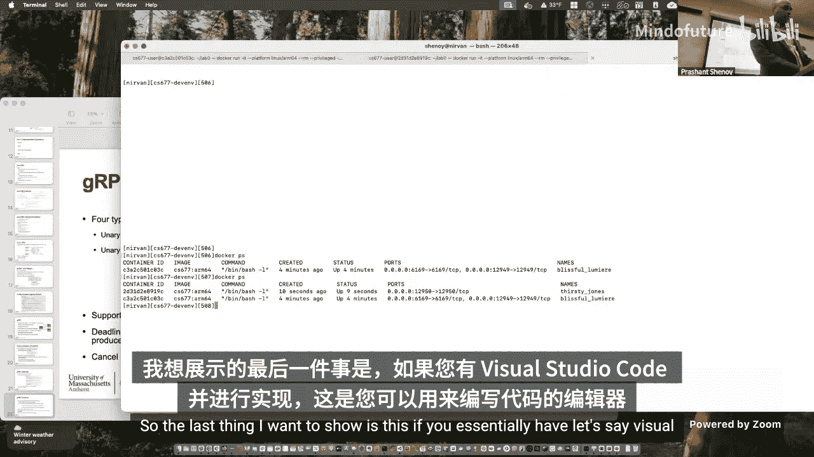
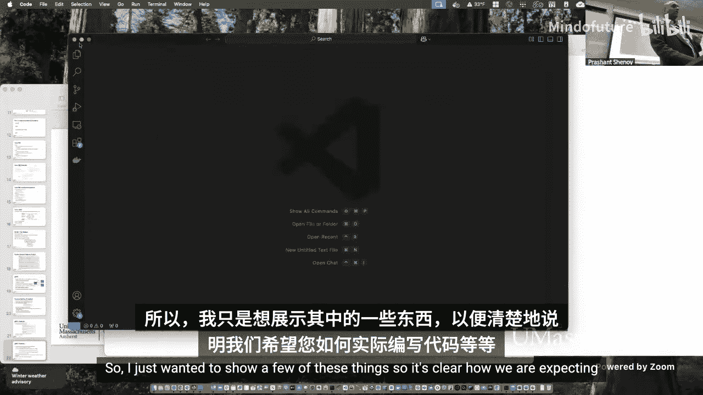
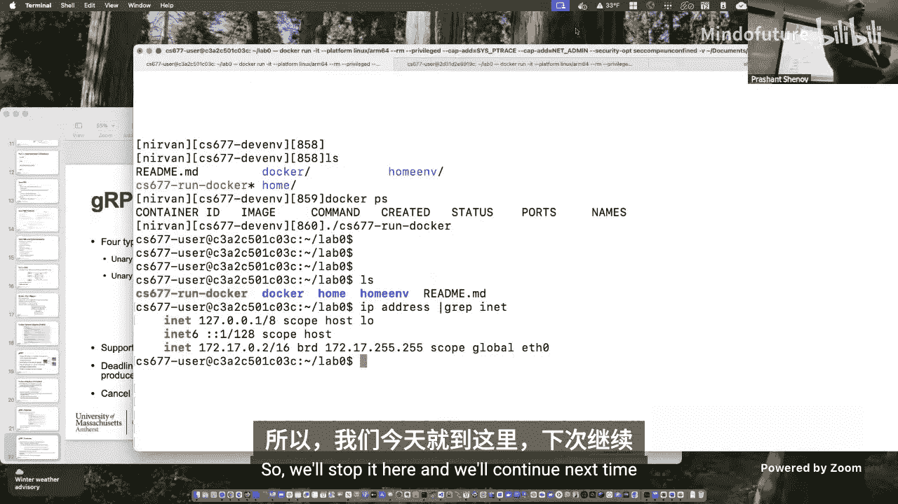

# 【马萨诸塞大学】分布式系统-UMass-CS677-Distributed-Systems-(2025春季)-p04-P22---Lecture-04-----Remote-Method-Invocation--BV1jmNbzrE2F_p4-

Yes。Good的。Okay， so let's get started here。So we will continue our discussion on remote procedure call from last time today we will talk about remote method invocation and I'm going to show you how rMIs are implemented in many different context Java Python C and so on we will also hand out the first lablet today a lablet is like a tutorial really we will just show you some sample code you try it out so you get a sense of all of these topics because the lab that' is going to come out soon will require to use either RpCs or RMs to implement some distributed applications so this is just a way for you to get familiar with some of these concepts by actually playing with code so well start with some RPC models we talk about RMs which are really RpCs in the Java world then theres a couple of slides I didn't finish last time I will cover that along with some other。

Implement examples in part three of the lecture。So that's the agenda for today let's start with some RPC models and the first one I'm going to describe is what is called a lightweight RC okay so remember what is a remote procedure call it's the ability for an application process to invoke a method that resides in another process potentially somewhere else on the network that running on some other mission okay so you invoke a function call or a method call it just so happens that the code for this method is not in the process that's invoking the method it's in some other process okay so you have to communicate over the network to that process and actually execute the method get back a response all of that work is done by the RPC runtime but that is what an RPC is that's what we discussed last time so today we'll talk about a lightweight RPC so the lightweight RC think of it as a special case where both the client process。

And the server process are on the same machine the general case is where the two processes that are communicating using RPCs they reside on two different machines okay that are a network but in the special situation where the client and the server are on the same machine you can optimize the RPC runtime system and and that optimized version or the special case version is referred to as a lightweight RC。

So what can we do to actually make this more efficient so the RPC code is no different because when as a programmer or a developer you write the RPC code you are simply invoking a method you don't have any notion of where the process resides that is going to execute the method so in this case it just happens to reside on the same machine so from a programming standpoint theres no change but from an implementation standpoint or the runtime standpoint there is a change because these two processes the client and the server that are communicating using RPCs they are on the same machine。

So normally when you invoke an RPC okay the stub code is going to generate a message。

 send it over a network， the protocol stack at the other end will process it and then hand it back to the server code to execute the method and so on in this case because the two processes are in the same machine you can bypass the protocol processing。

Instead you can actually use a shared memory buffer to communicate between the client and the server so rather than sending the message to the server saying here is an RPC call you can take the contents or that message and simply put it into a buffer and then signal the other process saying here is a request that requires you to execute a procedure call all the arguments are in the shared buffer so rather than using PCPI messages to communicate between the client and the server process we are going to use shared memory or shared buffers to communicate if you remember last time I was talking about unstructured communication where I said you could use shared memory to send messages back and forth message here is simply the fact that you put some data into buffer and you ask the server process to execute it。

So that is how we are going to optimize the performance and as you can imagine simply reading and writing from a buffer is going to be more efficient than using a socket based communication which requires you to establish the socket。

 construct a message and send it over the protocol stack。

 you are essentially eliminating all of the protocol processing over it。😊，Is that clear？

So there are some details of how all of that works which I'm going to go through very briefly there's a picture there the picture is not showing that there is actually a shared memory region but you what you need to really think about is there's a shared memory buffer thats not shown in this picture that the client process will put the message and then the server process will actually take the message and process but generally the way it's going to work is you will essentially push the argument onto stack you will trap the kernel the kernel will take the region of the stack where you push the argument that's your message that you're supposed to send and make it available to the address space of the server normally the memory region of any process is not accessible to another process because the memory region is private to a process you cannot simply access the memory belonging to another process because then you can overwrite it and cause problems but in this case because you want to explicitly share memory we will instruct the OS to actually share that memory region then the。

Essentially， the server process will take that contents from the stack execute the method that is being invoked。

 put the return value and return back。So those are some of the details of how this works。

 but by and large the bigger takeaway is you are not going to use protocol stack processing and messages you are going to use shared memory to communicate between the client and the server yes question。

What is traffic。Yeah question is what does trap mean in this context so so that's an OS term right so essentially when you make a system call okay you create an interrupt to the OS the OS is then going to execute that system call okay the interrupt is referred to as a trap Okay so essentially you go into a trap vector and then you execute the system call so its like a hardware interruptt the context of a system call its called a trap。

Okay。Yes any other questions？Okay so that's one model which is lightweight RpCs。

 but there are several others I'm going to discuss much more briefly and I'll show you some figures that give you some sense of how these are different from one another the standard RC model is referred to a synchronous RPC synchronous means blocking so the client makes an RC call it' is going to block or wait until the response comes back from the server that's the definition of what we mean by synchronous RC so there are other models as you can see there's something called an asynchronous RC differ synchronous RC one way RC multicast RC and the difference between all of them is how is the interaction between the client and the server changing based on what the client waits for or whether it waits or anything at all so well take。

Then one at a time， so what happens in the asynchronous RPC is the client will make an RPC call the call is now sent to the server。

 but the client will not wait for the reply to come back。😊。

It will simply wait for the RPC call to reach the server and then it will continue execution okay and at some later point the reply is going to come back to the client and then it can process the reply that came from the RPC call okay so this is not blocking so you are not blocking and waiting for the RPC to complete the server and you just simply continue execution okay the synchronous RC essentially uses two RPCs to asynchronous RC one in the forward direction the other in the reverse direction in this case the reply is sent as RC in the reverse direction and I'll show you a picture and explains this。

😊，Yeah one way RPRPC is essentially even simpler than asynchronous RC the client makes an RPC call and it simply continues execution it doesn't wait for the call to even reach the other end which at least the asynchronous RRPC does so that's called one way RPC multicast RC says you can make the same call to to multiple processes the RC call goes to multiple processor server processes which is useful when there are a replication and you want to make the same request of multiple server replicas so I think this is all best illustrated using some figures so here is your synchronous RC I showed this last time there's a client and the server the client makes an RC call and is going to wait all the way until the reply comes back from the server the RPC call goes or the network server executes it generates a reply response goes。

That synchron is blocking RC client is blocked until the response comes by。😊。

That's an asynchronous RPC so what you will see is the client makes an RPC call and it waits for the server to do an accept on the socket which means that the server actually has accepted the call its not processed it it just simply received the socket connection to start processing it and then it continues execution okay so all of the other stuff is going to happen in parallel because you will then the server will receive the RPC request process it and the reply will go back to the client at a later time。

OkayThis is non blocking you don't block for the pro RPC to execute and I reply to come back。

Also called as synchronous。all right， so there are some more that we talked about today so here is one done here is essentially the final step of the asynchronous RC you will see that there is a reply that went back at a later time through a call by。

Okay。😊，All right so here is our preferred synchronous RPpCs where we use two asynchronous RCs。

 one where you make the request to the server and then you continue execution and then the server executes the called procedure and then the return value is sent as an RPC in the other direction asynchronous RC so you will just send a request which includes the reply of the previous R because so you have two RpCs one going in the forward path and the other coming in the reverse path both our asynchronous in this case。

So that so instead of a callback， you will use a RPC in the reverse direction to send the reply。

And this is our multicast RC where the client there are two servers S1 and S2 the client makes a single RPC request it is sent to two processes both of them are going to execute those that RPC call and send back a reply and this one as you see is actually shown as a synchronous blocking multicast RC multicast essentially means just sending that to multiple recipients。

Is that clear so for most of what you are going to do in this course you will use synchronous R okay that' is the default model okay but you should know that there are these other models that are useful in certain contexts what those context are may not be clear as to why you would use something different from blocking but as we make look at other topics in the course you will see there are different ways to write server server processes and some of them use asynchronous methods and that is where you will use some of these other techniques。

But for now all you need to understand is what these methods mean or what these types of RPCs mean。

メクアスションゾン です。Okay， so we will change gears and talk about RMs。

You program in Java RMs are essentially how you have clients and servers communicate using RPC like ideas RMI stands for remote method invocation。

And the idea is very similar to what I talked about last time in the context of RPC okay so let's say you are writing a Java program typically you will write some classes classes will have some methods during execution of that program you will essentially have objects that get instantiated when you create。

When you execute a class you instantiate an object and then you call methods on that object okay the code for all of the classes are part of a single Java process typically that' is how Java program is going to work。

Right now when you want to implement RPC like ideas okay you will essentially still write your code as classes and then when you execute the code you will instantiate objects on this classes except that in some cases some objects will not reside in the process where you are invoking methods on that object okay so you can say let us say object 1。

 fo where object1 is an object and fo is a method you call on that object。

So in this specific case that object is going to reside in some other process and it is going to expose a method that can be invoked over a network rather than some process invoking it locally and so this is called a remote method invocations and the method is remote and you are invoking it so the objects are also remote in this case。

😊，so essentially you are using object oriented ideas。

 but you are now using those concepts that you are already familiar with implement RPC like abstraction。

 but we will call them RMI in this case or remote methods。

Essentially the way you are going to do this is that object that you have written which is remote you will essentially write it in two pieces you write an interface in the interface of an object basically says these are the public methods or that object and these are the ones that can be access remotely and so on and then there is implementation of that object the implementation will reside on the server the interface will be available to the client so it knows what are the methods the object is actually exposing so you can invoke it over a network。

😊，so you have to separate the interface from the implementation which you can do even in when you do not not use RMs but that is the way we are going to use it so interface will reside on one machine。

 implementation will reside on another machine。so here is the picture of how RMI works you will see that conceptually it looks very similar to the picture I showed you last time and I was talking about RPCs and the ad method right so there is a client machine there is a server machine there are these two processes。

😊，In this case the Java processes so here is essentially a local object and it has some code and its invoking a method on another object it just so happens that this other object essentially is on the server machine it's not local so it's a remote object and so that remote object here has some state shown in gray and it is exposing some methods that can be invo in this case the methods are remote can be invo remotely and there is stop code on both the client machine and the server machine that is responsible for communicating between the client and the server as a programmer or a Java programmer you will not write any such code you will simply call objects not object methods on objects and then the stop code is going to take care of sending a message or a network and so on I in the Java world the stop code is referred to as a proxy on the client side it' is called a skeleton on the server。

But is the only stop course is auto generated code， which the programmer does not write。

so in this case when the client is invoking a method， you are going to go to the proxy。

 the proxy will construct a message， a message will be sent over a network。

 itll arrive at the server stop code which will then invoke the actual object and the method that was invoked on that object executed。

 the reply will go back in the other direction。Is that clear？Okay， so。

With that let's look at some details of how all of this is going to work as I said the client St is called the proxy the Java the server St is called the skeleton all of the details that we talked about of how to make RPCs work also arise here okay specifically we are not going to assume that the client machine and the server machine use the same hardware okay they both run Java so they will have a Java implementation they will have a JVM and JDK and all of that but you will not assume better run on the same right sorry one could be Windows or could be Mac hardware may be different one would be little Indian architecture the other could be big Indian all of those issues are still present。

In this case so we still have to worry about when you send some data over from the client to the server。

 how do you deal with that all of those differences？

Now in that case we were using something called marshalling and demarshallling which basically meant that you converted all of your data into an external data representation and then reconverted it back to native representation that allowed you to overcome these hardware differences the Java world this is much simpler because Java supports something called serialization of objects which essentially tries to write out an object in a hardware independent format or any data structure in a hardware independent format so we can simply use serialize and decseialized operations for RMI communication you can essentially take all the arguments serialize them send them over and deseialize them and the serialized DC automatically takes care of when you reconstruct the data structure or the data it takes care of all the hardware differences so you don't need to do anything special like marshalling demarshallling of arguments you are just simply going to use built in functionality in Java。

It is serialization to achieve the same thing problem hasn't gone away。

 but Java already has Britain functionality to deal with it。 so we will just leverage that。😊。

So the client will serialize and send all the objects。

 the server will desealize and reconstruct not the objects。

 but the parameters to the method and the server will deseialalize。

 extract the parameters and invoke the method。That clear。Right。Okay。

 so then there is this other issue of how is the client going to locate the server to remember。

These are processes that are running on two machines as a programmer youre not specifying any details of where is the server running and so on and last time I mentioned that the way you deal with it in the RPC world is the server process will register itself with the naming service or a directory service the client has to talk to the naming service to figure out what port number the server is running on and so on similar ideas are two here there are two types of binding binding essentially means how do I locate where the server is running and where the object is residing one is called implicit binding where you simply call an object and a method on that object and then the runtime system will say this is the first time you are making a call method call on this object so it will try to figure out where the object resides in the matter what process what machine is it running that's called implicit in explicit binding you are going to essentially call the bind。

Which is going to do that。 lookup for you。So you say I'm going to call a remote method okay the process needs to figure out where is this method resident well call the bind object with the object reference and you will try to figure out and then you're going to get the reference to that object and then you call the method of that's called explicit binding where you are to call the bind function to figure out where the server is running so you different RM and RP systems will use different techniques but by and large will either be implicit or explicit where you are to call the bind function to locate the server in either of these two cases this is happening on the client side the server still has to register itself with the naming service that part has not gone on I'm going to show you some code that shows Java all of these works in Java。

Is this clear any questions here？Okay， so。Let me talk about parameter passing before we actually look at some code last time when I was talking about RPCs。

 I said in the RPC world， you cannot pass pointers as arguments。

All parameters have to be passed by value。You cannot pass by reference the reason is if you de referenceence a pointer on the other machine it is going to point a memory address on that machine not on the sending machine。

 so its a meaningless dereence so you don't actually pass pointers by and large that concept is true in the Java world except for one difference which is if you are passing an object。

As an argument to a method which you can you don't have to just pass simple things like in teacher you are passing an entire object okay you can pass a reference to a object that supports RMI calls if it is a standard Java object you will pass it by value。

hi means you will make a copy of that object and send it with the call and it will be basically passed by。

 but if it is an object that supports remote methods，😊，You can pass that object by reference。

 you do not have to pass it by value。If you think about why this is the case。

 it should be clear why this is even a。Anybody want to take a guess why an object that supports RMI called not a standard object in Java that are just supporting local methods。

 but if you write a type of a class where you have some methods that are RMI methods。

 that object if you pass as an argument， it will go as pass by reference or pass by yes。

Yes the reason you don't have to pass it by value is if you invoke a method on that object you have to have all the functionality to go find out where it is and and send the method and the RMI call to it anyway so you already have a way to dereference the object and putting dereence in quotes here to dereference the object because that's how an RMI method is going to be invoked on it so you can use all of that functionality to simply send that remote object what we call a remote object by reference because the other end can use the same technique to figure out where the object resides on the network and call a method。

So essentially it is a little less restrictive than RPpCs any standard data structure still passed by value。

 no passing pointers。😊，Local objects。pass by value okay any object that supports RMI calls if you pass that as an argument or method that will go pass by reference so thats what is shown in this picture will look a little complicated but it is actually not okay there are three machines A B and C there are two types of objects it is a local objects is standard Java plus here that do instant only local procedures here here as well call object 01 heres another object02 that supports some RM calls and it is accepting calls over a network。

So these are two types of objects here so now you are essentially calling backing an RI called some other object on this machine here so if you pass01 and02 as2 argument to a method okay01 is going to go up by value so you will essentially take this entire memory send it over here so you make a copy so that's pass by value but the method that actually also took02 as an argument that will go as reference because you already know how to access O2 or a networks will just send that in this process here can also call that method on that object。

Is that here there is a small relaxation of what happens in the Java world so essentially what is a remote object or what is the object that supports RMI if you see the Java code you will see that if you want to include RMI methods in a object you are going to essentially have this term before the class it will call it a Unicast remote object。

That essentially means that this object has RMI calls。Any object that has that when you write code。

 you can pass。都系。Okay so now if there are no questions。

 let me look show you some snippet code that tries to explain some of these details and this is the code also that will give you as part of your lablet so you can actually try it on your machine and see how to processes communicate with one another and so。

Okay， so let's start， so we'll do Java C， Python and GRPC4 systems that all support either RPpCs or RMs in some shape or form。

Okay start with Java okay so I already mentioned the client and the server this one other thing I wanted to mention is that you have something called the RMI registry okay so this is the naming service in Java this is where the server will register itself and all the RMI methods it exposeds so the client can then look that up figure out where is the server process running so you will use not only the client and the server program but you will use the RMI registry。

So here is some snippet of code so there are three snippets here， this is the interface。

Of your program， there's the client part。Okay just a snippet is the server part so let's start with the server part so the server is essentially you will see that it is calling a UniA remote object so it's constructing an object that has some remote methods and then that object essentially implements say hello method you called the say hello method it sends a hello message back I don't think all of that code is shown here but what is shown is you bind you basically get the registry and you register the object with the registry。

The code for that object is actually not shown here。

 but you will see that is declared in the interface， so you will see that now you have a hello plus。

😊，That essentially has a say hello method and so that's a remote plus。

 which means that you can call that method remotely over it。Okay heres the client code。

 here the client code is first going to go find the registry and it will say is there a hello method registered at the registry。

 your hello object registered at the registry and assuming you get that you get a stub and then you basically say stub dot say hello that is your RI call。

OkaySo this is this the code for the say hello is actually in this process。

So the stop code will then send a method so you will see that the code does not have any networking in it。

 even though this say hello method is actually going to trigger a network message that is going to be sent to the server。

 execute the say hello method and get backers。That clear。ね，就。Does the Java example。

 any questions before we move on to some other system， yes？是 look个方。Can you skip the lookup apart？

You also questions can you skip skip the lookup call or if you skip the lookup call in Java。

 it will not work because Java uses explicit binding so you have to find the object and the method before you'll do this yes。

Okay， the question is is this synchronous is there a different interface for doing asynchronous in the Java world RMs are all synchronous yes there are other systems that I'll show you that can do asynchronous and you can use those libraries in Java but the standard Java RMI is synchronous。

Any other questions？All right so that's Java there's one more thing I should mention because you will be using this in your lab。

 which is synchronization okay so。So why is synchronization important here to think of the server process essentially is exposing RMI methods？

Multiple clients can make RMI requests of that server。 so the server can be threaded。

 it can process concurrent requests。At the same time。

 so essentially you will think of this there are multiple threads that are executing methods on that server or that object that is residing at the server。

😊，Because you have concurrency at the server server is not doing sequential processing of requests you will use next time you'll see almost all servers we will encounter and the course will be at least multithread you are multithread and that means multiple RM methods can come to the server concurrently if you do that and you start modifying any state at the server you should know that you are to use locking that's how threads were threads need synchronization you can't simply let the code execute and then it will modify some private variable and then the variable gets corrupted because you didn't use locks so whenever you use threads you are to use locking and the Java word locking is also straightforward because you have the keyword called synchronized if you stick that word synchronized in front of any method you write in an object that method automatically gets a lock which means that only one thread can execute that method on that object at any given time if there are multiple invocations of that。

at the same time， the locking will take care of ensuring that only one thread is executing in that method okay different threads can execute different methods of that object。

 but anything that synchronized only one thread can execute So the locking is kind of built in to the into the Java codes which you can use to implement synchronization when you write can current server。

For rMI methods also so that is how you will do synchronization now if you use something else like Python you would actually have to use locks and so on explicitly in Java world is a little simpler for you but then there is also this question of if two clients are making requests of the server。

And currently， only one of on the same object and the same method， only one of them can proceed。

 the other one will block because the lock will be held by only one thread at a time。

There's a question of in this case， where should that。am I called block？So your two answers。

 one is it is blocked at the client， you have not even sent the RMI call until you have the lock。

The other is you send the RM call two rM calls came into the server they are invoking the same method one of them grabs the lock it succeeds and the other one is block so you can block at the client or block at the server these are the two options now there are some issues when you write locks across distributed applications the specific issue that you have to deal with here is what if there is a crash of one of these two。

Processes okay so let's say client1 grabs the lock on an RMI object and it proceeds while that RMI call is executing the client crashes。

😊，But you're still holding the lock。And it crashed so now since it never released the lock。

 no other clients can grab that lock， you will have a deadlock at the server。

So you are to deal with these kinds of issues when we talk about locking across processes we will see in a few classes how to you implement a distributed lock a distributed lock is a lock that is shared by multiple processes and has to deal with these types of issues by default you are not getting a when you write that synchronized thing you are not getting any distributed log in fact a synchronized keyword is going to block at the server all calls come in the server and the block but you can also in the proxy code do synchronization and the client thing as well that's an option as well that depends on some implementation。

So these are issues that you have to think about when you write distributed application but we'll start with simpler stuff first and then we'll get into more complicated issues of distributed synchronization and so on。

That clear。Okay。Okay， so now we will switch gears and look at how do you do RPpCs in the C and a C++ world this is only going to be relevant if you write any C or C+ plus code which in this class you will not because all labs will be either Python or Java but it's something you should know about because this is the original RPC system the RPCs where originally designed the context of Cnc C and C+ plus system and the tools that were designed at that time are still available for you to write any application we will be encountering this later on in the course as well when we talk about distributed file systems which use RC and there specifically use C and C++ RPC and the lab lab actually has code or whatever I'm showing you here so you will even though you will not write any code you will still compile that code and try it and make sure you understand how it works。

Right so but this is the general process it is not very different from the three pieces I showed you for the Java Stper those three pieces are interface there a client and there is a server okay same thing here there is a server there is an interface which is called a dot X file okay there is the interface and there is a client。

So youll write as a programme or you'll write these three pieces the interface will actually say these are there's no classes here because this is let's say C code so you will just have the RPC methods and their arguments and so on they are the ones you mentioned there with C plus plus code maybe you can put some plus there but otherwise you don't have classes then this dot X file is first sent to a tool called RPC Gen thats your RPC compiler。

So that RPpc gen will automatically generate your stub code。

That is the code that generated for you automatically by the compiler so you don't have to write it okay that' is the code that is going to do all of the networking youll see there's an XDR thing there's the one that is going to do all the conversion there's a server st there's a client stuff there's a error file there's XDR code。

😊，So， what you will then do is you will take these auto generatedrated files and you will take these two files that you wrote there is the client code you wrote and the server code and then you will actually compile them here using the C or a C++ compiler。

So what you will do is you will take the server file。

 the server tab header file and SDR file and you will get the server binary。

 you will compile them all and then you will do the same thing for the client you will take the client code you wrote the client code that was auto generated hit the XDR and the header and you will generate the client binary。

Then you can run these binaries and they can communicate with or not。

Is this clear it's important to understand this process because there will be other RPC systems that use a similar process even though you are not going they are not C or C++ based this notion of writing a interface file or it is also called sometimes an ideal file interface definition language style you have a special tool that's your compiler for that RPC system that will auto generate some code for you and then you use that code with a client and a server code to implement your RPC system that process is common across many different RPC systems it's not specific to C or C++。

That clear。Okay， so you can play with this in the in the lablet and then you can figure out。

Hows the process work？So here are some other details that I was mentioning last time but we ran out of time。

 which is in the RPC world， how is the client to locate the server？

The concept is very similar to what I was just showing you in the Java world where there was an RMI registry that was your naming service that you registered the server and the client went and asked that naming service where is the server running and then you could contact the server that concept is true also in the RpC world a naming service is called also referred to sometimes as the binder okay binder naming service mean the same thing binder is a process that allows you to buy into the server thats a naming service of the directory service okay that is called the port mapper in the UniX world。

So there is a port is a process called a port map or when any Unix machine will start that process will automatically start and it will be waiting for registrations when the server starts up the first thing it has to do is it has to register with the port。

And then the port mapper will track what RPC methods are actually exposed。

 what is the name of the server process， what port number it' is list on all of that will be registered in the port map that's what Is call the port map it is taking an RPC call and mapping it to a port where the server is listening。

Then the server sorry the client process which is now running on some other machine。

 if it has to contact a server process on that machine。

 it has to first talk to the port map or running on that machine。

And ask where is this hello world process or whatever that process is is where is it executing okay the port mapper will then do a lookup and if it finds that there is a service with that name running it will send back a response with the right port number and then the client stop code will connect to that port number on that machine which is that server where the server is listening and send the RPC request。

That leave。How of this works。Okay that's a good question so what if there are multiple servers that ask for the same service so the thing that you have to do is when the server is registering itself to the port mapper it either has to pick a unique name for itself。

OkayOr if there is a name， there are two services that let's say both provide。

I dont know hello World service there just so you are totally speak different version number so you can have a name and your version number you cannot have two services that are running that are the exact same name because then when the client is asking the port mapper saying where is this service running the port mapper will not know which are the two to return either the name has to be unique。

The name of the server， the server can say mine process name is x you can pick some string and register itself or if you are using the same service youre at have different version number you can say I want to connect to version two of the hellello world service and then you will still be okay so that you have to ensure that these are unique needs。

So what this also means， by the way， is if you have writing some code， let's say for your lab。

 you registered a server process。To the support mapper or some naming service and for whatever reason you terminated it okay and then you start another version of that server it tries to reregister itself you might get an error if the previous registration has not been removed so when you are debugging your code you repeatedly register the same name you might get an issue so you have to think about some of these things you can of course restart the naming service and it will start with a clean state slate。

But the things to keep in mind， you have to have only one server。

 you can have many servers running here， they will all register themselves but each has have a unique name for the service and a version number。

 the methods can be same。Because the way you will say is that I contact the server with this name and then I call some method who okay each server can have methods that are identical or have the same name。

 but the server name has to be different or unique。Is this clear any other questions here？

Okay so that is the world of C and C plus plus now I'll talk about Python okay how are you going to do this in Python in Python this we have something called Python remote objects or pro that essentially gives you similar functional it is more like Java because you have classes and objects that you are going to have the objects we have some remote methods and then you are going to invoke them this is the same kind of snippet you will see in your lablet but I don't have the full code but I'll explain some of this right so so you have essentially a class here which is going to be like a hello world it's a greeting class you call it as one method get fortune and just returns hello。

so basically returning a string so the way you in Python what you are going to do is you this code this is a server code so you have to essentially make it into a server so the way you do this is you will make what is called a pyro demon and then you will register that that object greeting maker object into that into that demon okay so that essentially registered itself with the a demon and then you are essentially going to call what' is called a request loop that the server is going to just sit in a loop wait for。

I am I our methods to come over the network。So see that you not written any socket code or anything like that yet it is just simple you just revert from class。

 you made a demon， you registered the object and then you essentially said start the server so that just sitting in a loop and its going to start the server。

Now there are many ways for the client to contact the server okay the simplest way if you knew that object that you are registered with the server you can directly use that string so you will see that I printed in this sppet code the U of the object that you registered so it basically is printed and you run this this is what it printed that long string。

You could literally take that string and you could put it in the client code and that will directly allow you to access the server because that' is the object that the pyro demon knows about。

So that's one way you are， so this is your clientniip it here。

So you are basically in this case you are not using a naming service simply you printed the object ID you basically input it the to the client code the client code will basically first talk to Pyron generate some stuffub that's the proxy and and you essentially say this is the object name dot get fortune so this is your RM call that you just made。

But remember here you did not look up a naming service because you are hard coding effectively the address of the server。

Of course that' is not the right way to do it this， but you can do it this way。

 a better way to do it is you are registered this。😊，Once you do this。

 you also register with a naming service。OkaySo you always so youll add this code back here。

 so you registered the server with the naming service and then in the。On the client code。

 you are essentially going to first look up the naming service rather than hard coding the object name。

 and then you will get the object roughly。YesYes。In this case I think maybe this is just a snippet。

 I didn't have all of the lines of code but it'll give you this code and you'll actually have the pyro code in the lab that you can look at all of the。

Blant and to so。Any other questions so this is not exhaustive so there are things here are not shown I we're showing the skeleton of the client in this。

Any other questions here？Okay so that' is your pyro code okay so this is how you are going to write this if you are going to do your labs in Python and you are going to essentially end up using pyro。

 this is a type of code to write you do it in Java you will use Java。All right。

 so the last thing I will mention here is。Essentially Google RPC which we will use not in the first lab but eventually the subsequent lab we are going to use GRPC G here stands for Google RC this is a RPC system that Google designed so the it is basically a high performance modern RPC framework the reason it is actually used is it is not only hardware independent which both RMI and RC systems are it is also language independent what that means is you can now write your server code in one language。

Let's say you write it in Java， you can write the client code in some other language Python and they can talk over Google RPC。

Everything I showed you previously the client and the server had to be written in the same language。

 they didn't have to run on the same type of hardware。

 you could run the server on Windows and client on then and so on。

 but at least the language was the same this also provides you language independence which allows different clients written in different languages to talk to a server。

OkaySo what this means is it has to be more general because you had to allow Python coded off Java code。

 so it basically supports a whole bunch of different things you can write your code in Python Java。

 C plus plus C sharp goes Swif node Js， they all support GRPC。Regardless of the language you pick。

 you can write your client in any of these other languages they interoperate， they just work。

So that is why it is now a more general framework so you don't actually need to use Java RMI for example。

 you can use Google RPC libraries in Java and still write your client and server。

 it look a little different from this code I showed you because you will use GRPC interfaces to make that happen not standard RMI interfaces。

え。All right that's one thing okay there other thing that GRPC uses is it uses HtTP as a transport protocol all of the calls that are going over are essentially going over as HtTP messages the programmer you don't need to worry about it all that is taken care of for you but is operating at a higher level as opposed to RRPCs and RMI those are essentially using lowle socket communication to communicate theyre using there are not directly or TCPIP GRPC runs over htTP which itself runs over TCPI so messages are going back and forth as HtTP messages and responses come back as HtTP。

All right， and then the last thing that you we should know about GRPC is it basically uses an underlying framework called protocolto buffer or is is also called protocol buffers okay so GRPC is built on top of protocol buffers and protocol buffers are essentially a language and a hardware independent data structure that allows you to send data packets。

Just as I told you you to do serialize deseialize and all of this type of stuff now you have to make that work across languages。

 you send a message sign an integer maybe its a Java process sent in a Python process has to reconstruct it so that you have to have hardware and a language independent way to pass data back and forth and that in the GRPC world its called a protocol buffer that allows you to construct these data structures and pass them around without having to worry about what is a hardware。

 what's the language that' is going to interpret it and so on so it is essentially think of it as the XDR type format in the GRPC world thats also language independent。

So let me show you an example of protocol buffers and then we'll show you some quick examples of GRPC and by the way this is also part of your lablet so you can look at some GRPC code and run it and see how it works So what is a protocol buffer these are essentially messagebased structure data structures for communication so anytime you want to pass some data around in the GRPC world you are to essentially create a protocol buffer with the right format so that that's what you are going to use you just don't pass an integer you use a protocol buffer in which you're declared an integer that's what you're going to do so here is an example of platform independent protocol buffer and marshalling demarshalling serialization built into protocol buffer it is going to take care of all of that So suppose a client wants to send to server a string and two integers as argument you'll construct a protocol buffer saying this is a request。

It has a string， it has two integers， and this is how you are going to declare it。😊。

Then what you will do is you will essentially use。That declaration and you use a protocol compiler in the GRPC wall that's called Prot it will essentially construct some classes for you。

 this is like the stop code but to send protocols data back and forth this is not yet stop code to make RPRPC calls this is just stop code to send this data back and forth and then you can essentially use the methods of that class to send that data to extract the fields at the other end but you get a protocol buffer you can reconstruct it and say give me the page number or give me the query that's in there that's a string but you can essentially add and extract data from a protocol buffer that's basically going to be autogene for you。

Yeah。SoSo that is how you will write protocol buffer a protocol buffers by themselves have nothing to do with RPCs。

 they are just a way to pass data back and forth in a language and hardware independent manner。😊。

So they are just allowing you to send data structures and reconstruct them and not how to worry about hardware issues or platform issues or language issues or anything like that。

Now what Google did is it built its RPC framework on top of protocol buffer because marshalling demarshallling of arguments are automatically taken care of for you by protocol buffer so why not use protocol buffers as a way to send arguments back and forth for a GRPC system so they use this as the building block for writing the RPC system。

The GRP。诶， so。Here is an example of a GRPC snippet code so we have our service definition it says this is a service it is called a greeting service。

 it is basically going to expose one method RPC method say hello okay it is an RPC method。

 it takes a hello request argument and returns a hello reply value。

Both hello request and Ho reply are essentially protocol buffers in our case because the argument have to come as a protocol buffer be language independent the response has to go as a protocol buffer so now you got to declare what is a hello request and what is hell reply and that is what is done here saying hello request is a string。

A lower reply is also a string。I mean it could be anything but this is just an example。

 so this these two are essentially our protocol bufferffer definition。

 that is the definition of the RPC that you are going to implement using this protocol。😊。

So what Google did is they simply extended that protocol compilers to support RPC definitions in addition to protocol buffer definition。

 this is what you are going to pass to this protocol buffer and it will now generate sub code and not only allows you to pass these two protocol things back and forth but it also allows you to write code where the client and the server can call these methods or respond to these method。

And then that sub code you can use and the client and the server end to write your actual code so first you will write this as your interface definition what are the data structures you are going to use in your RPC calls what are the RPC calls you will have what are their input what are the output and so on and then you compile it you will get your。

Essentially client cup code， then you will use it at that point。P work method on the server。你在你。Okay。

All right so now we talk a little bit about GRPCs themselves。

 unlike let's say Java and C which were using synchronous RPRPCs， GRPCs are more general。

First they support both synchronous and asynchronous scores whatever I was showing you earlier in the slide GRPC you can say this RPC is synchronous this RC synchronous all supported in GRPCs not only that it essentially as several other things which is you can essentially send what is called streaming data from the client to the server you can essentially send streaming data from the server back to the client in addition to making an RPC code so we can say what is a streaming data streaming data essentially says that the data you are sending its not one data item but you can continuously send multiple data items to the server and it can then take all of them and process them as a batch。

So rather than think of other than sending one integer as an argument to a RPC call。

 I send a sequence of integers as separate messages。😊，So I am streaming some data。

 I get a batch of data， I process it and I can send back one value or I can stream a set of values back。

So it essentially has something called streaming RPRPC support。

 which we have not yet seen in any of the things we discussed， but GRPC does support。

Streaming can go from the client to the server or back。

 which means that both the arguments that are coming in or the responses that are coming going back。

 there can be simple integers or strings or they can be streaming data where there' is a sequence of them coming。

Those are only going to be use for specialized cases you are not likely to write any code that' is going to use streaming youll just write simple RPCs at best but you should know that GRPC framework has all of these additional functionality asynchronous calls can be made data can be streamed from the client server over or in a bidirectional manner and so on so here is an example of you have an RPC where the replies are streaming so you make one request and it keeps sending a set of hello response saying hello hello send them as different you'll see that it says a stream is going back so youll get a set of strings back as a reply to your RPC that's a streaming response。

or you can get a set of arguments as a stream and send back one response you can say other than getting a single string I can get a sequence of strings when all of those sequences are come in then you process the RPC and send back a value back。

Or it can be bidirectional streaming or the input is a stream and the output is also a stream that' is also supported。

These are all generalizations of what we have seen as a simple RPC of course thats also supported。

 but you have all these additional things that you can essentially implement more complex applications。

😊，Any questions on this？Okay， so again， we will send you。A labt。

Hopefully today okay so well send that to you you can play with all of these things just to get some familiarity you given all the code to you you don't have to write much other than actually run it and try it out。

So I'm going to pause here and show you。

Thinkgram。 so I'm going to。 I wanted to show。

All of you the Docker container， which I hope everybody has implemented by now。

 but you are going to use it in the lablet and the lab。

so I want to just show you a few things as to how you're going to use。

Your docker container to do a lab or a lab okay so I assume you built it already right so this whatever you built you are going to reuse across labs you don't have to rebuild it every time you build it once and that' is the thing you are going to use for all of your labs。

So， essentially when you get a lab or a lablet， it is going to have this run script in it 677 run Docker。

So that's the one youve got to start to start a container。

You do not need to call Docker first you start start Docker it needs to be running in the background right once Docker the Docker demon is running to create a container。

 you don't need to call on the terminal a long Docker command none of that is needed you are simply going to call so I'm just going to show you a Docker so to make sure Docker is running you just called Docker and do something like P okay if it says if Docker is not running itll say cannot connect to Docker demon so then you at least start one but if it is running you will here right now I don't have any container so it's just saying there's nothing running here no containers so then if you built your image you want to start the course Docker youre going to just call this script。

and then say run Docker and then it should be essentially start Docker so now you will get this thing with a 677 use or something something that means you started it and now thats a prompt inside the container so this essentially you have started the container and the way we have set it up for you is that when that container starts up all the code for the repository for your lab or the lablet is automatically available inside the container。

So you will see here。😊，So essentially there is a lab zero director which would have the same files that were outside on my native thing so you will see that essentially have all of the files that were outside they are also available in so you can essentially start the code inside the Docker container that is in the lablet or you can write new code and test it and so on。

Any changes you make inside the lab or the lablet directlyy will persist because those are files on your native machine。

😊，But if you go to some other part of this container and make some changes and you terminate the container those files are eeml they will go away so when you make changes be sure that you are actually inside the lab directory because that is the same directory that is outside so any files you create when you exit the container that stay there and you will see them outside as well that is important otherwise you can you will write some code in some other directory and you kill the container the changes are gone so don't make that mistake。

Is that clear what I am saying？Okay， so now the the other thing you don't want to do is if you are running a container。

 you don't want to call that script inside the container。

 obviously you can't start a container inside other container it will give you an error Okay so whenever you call the script it has to be on your native terminal if you have some prompt like this and you try to run it it will give you an error。

OkayNow the other thing I will show you is if I go here。

And now do Docker P it will show that I actually have a container running。

And you see that the one container is started the thing that the Docker P command is useful because it will tell you the port number where the container is listening that's what you will need for two containers to talk to one another if you start the client and the server in two different containers they have you need to know port numbers so that they can talk Docker PS command will tell you that。

Okay， that's one thing now the container gets its own IP address。

 which is separate from the IP address of your machine。

Each container will get its own IP address because Docker will create a network and the way you are going to figure that out is you can this is a Linuxux command if you call IP space address that will print all the interfaces on the machine but just to make it simple Im only going to extract the internet innet addresses so you will see that it returns you。

Some interfaces ignore the first two you will see something that is1 172。17。

0 point that's the IP address of the container we just started you will need that if you need to know what is the server IP address because if you start the server on one container that is the IP address or the server the Docker P will tell you the port number there that is listening on its on。

So these are things you should know I'm just showing you so that your life is a little simplified okay so suppose that you now have a container already executing and then you go to back to another terminal because I just switched from this this is my running container switched to a different terminal window and now I call this script again。

Yeah， call that run script。So， what it does is by default， we just call that script。

 it is not going to start a second container。Because it just goes checks if there is a container running it connects to the same container so if you do this it will basically print some command saying there is a container already running and it will just connect to that so now we got a different prompt and this terminal prompt and the previous one they are essentially in the same container they are not two different containers。

And it will say that it will say if you not not want to do this go calculate it or do something else and you can verify this with the Docker P command。

So it will show you that there is only one running state， even though you call that run script twice。

But there will be instances where you need two or more containers you want to run the client in one the server in the other so you essentially what you have to do is let me kill that one so you are to call the run script with a minus f argument which say start a fresh container even if one is already running。

So if you do this。It will give you again a prompt， but this is now a different container。

 not the one that we have and you can actually go back here and if you do Docker P it will show you now there are two of them running。

You will see that they are also listening on two different ports each got its own port and so on and you can create multiple like this you but you are to give the minus f command for it to create one so if otherwise you will not be able to do it so the script already takes care of lots of details for you。

You don't need to start by hand， just use the script with the right arguments。

 it will take care of things for you， it will take your Github keys that you created。

 it will automatically mount them so they are inside the container so you can do get check in check out from inside as well if you want to directly check in code etc。

Is that clear？Okay， so the last thing I want to show is。

if you essentially have let's a visual studio code and you implement so this is the editor you can use to write your code。

 but the interesting thing you can do with this is it can directly attach to the containers you can modify files inside the container from your native machine。

But so you all you have to do is you have this left。

Ting here at that leftmost corner bottom so you click on that it will open this and say you say connect attached to running container we will show that it will show you the two containers because I have two running now I can pick one and if I attach to it。

It will basically start this， it will attach to the container and then all the files inside the container are now available here。

And so you' will see that I have La zero。And all the files are here。

So you can simply just use visual studio code attached to the container modify the files you can check in and check out directly from here。

 don't have to use a terminal you can just use an editor that has container support to directly edit code inside containers and run them you can start terminals from here as well so visual Studio code is another good tool allows you to do this type of remote development technically it can connect to container anywhere it doesn't have to be running on your machine can connect a container in the cloud and you can do remote development this way so I just wanted to show a few of these things so it's clear how we are expecting you to actually write code and so on the good thing is。

Regardless of what machine you have， you are going to work inside the container and everyone has the same environment。

 so it won't be a case where it' is not working on my machine because some environment variables are different or install things differently。

 it should work the same for everyone because the same development。

So you are going to use the same Linux container as Linux for everyone right whether you are using Windows Mac or Linux the development environment as Linux is the same open to environment for everyone same libraries or it should work the same way right。

Hopefully it can cause less problems otherwise we spend half the time trying to figure out what your setup is before we can help you with anything at all okay at least that problem is gone we know what your setup is。

Is that clear how we are expecting to use all of this？Okay， so。

There are any questions I can answer them if not we'll end it here there was some sign up sheet that was going around if you want put your name just check your name against it so we know now that a drop is done right you want to know who is actually in the class and who's coming and what。

Okay I will stop it here and will continue next time。

