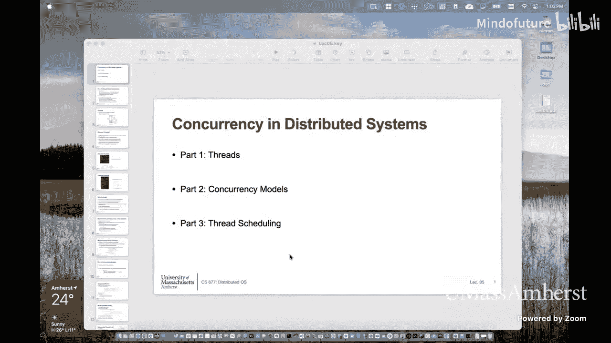
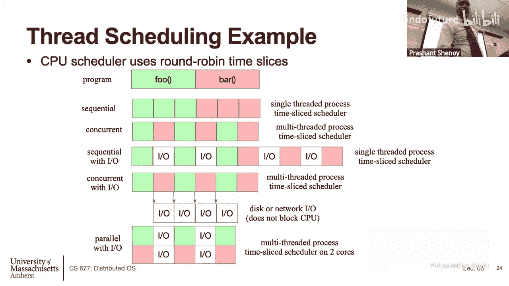

# 【马萨诸塞大学】分布式系统-UMass-CS677-Distributed-Systems-(2025春季)-p05-P21---Lecture-05-----Concurrency-Models--BV1jmNbzrE2F_p5-

Yes。Check and the video works。All right， so let's get started。Let me start with some announcements。

 I presume if you have been checking posts on Piazza。

 you know that we put out a lab already lab one is out is due at the end。

I is due either at the end of the month or in early。

Part of the next month okay so you have two and a half weeks or two approximately two weeks and couple days complete it so please get started don't wait till the last minute you always will find that you needed a little more time than you thought you needed to complete it so the earlier you start the better off you will be in terms of getting it done on them the lab talks about using remote procedure calls and RMis we already spoke about all of those topics so the class will actually make you write some code to write some simple applications that use these concept so that's really the goal of the lab the other thing that you will use in the lab is concurrency which the basic concurrency concepts you should already know from using threads hopefully are learning about threads but I'm going to cover it again today so that will be the other aspect that you need to know for the lab so that brings me to today's topic which is concurrency and distribute it。

Systems that basically first reintroduce threads for those of you already know what threads are and if you don't。

 this is basically the brief。recap of what you should know basically about threads and synchronization so we will do that first then we will talk about concurrency models that you can use using threads or similar functionality to build server applications thats really what you will use for the lab。

And then at the end， I'll talk about how threads are scheduled and that will basically lead us to further topics on scheduling for next class right。

Let's get started here we will start with this notion of threads and concurrency so this is really a recap of what is a process what is a thread within a process what are differences between threads and processes okay so a traditional what is a traditional process essentially the undergrad OS definition of a process is that it is a program in execution。

哎。So you have a program that you're right when you run it。

 essentially the OS creates a process to execute that program。

But what does that actually mean underneath so if you think about any process okay it has some memory allocated to that process okay so the program is actually loaded in the memory of of the machine and then that is called address space or that process theres a memory region or the memory allocated to process is referred to as its address space that address space usually has code and data that belong to the process the code is the code that the process is going to execute the data is essentially variables and other things that the process needs and that is usually stored either in the stack or the he I'll show you some pictures in just a moment but given this address space that belongs to the process there's also something that's actually going to execute the code that is part of that process so that is something we'll call a thread of control so that basically the part of the process that' is executing instructions one at a time in that process so。

Traditional process as a single thread of control， which means there's only one instruction executing at any given time and then you execute the next instruction and next instruction and there may be function so you might know jump around in the process execute some other part of the process some other function and come back and so on and so forth with a single thread of control address space is basically part of that process typically address spaces are not shared unless you have something like shared memory in which case part of the memory of that process is shared but typically the memory that's allocated to process is private to that process address space is not accessible outside the process and then there are a process might have other resources like files that are open that is accessing or we already learned about network sockets that they are used for communication and so on so those are also part of the process Now what's a thread and how is it different from a process so you should think of threads as generalizing this concept of a process in a traditional process you have a。

Thread of control。 There's only one instruction that you' are executing at any given time so。

So you should think of a thread as a flow of control through an address space and an address space might have multiple threads or multiple flows of control that are concurrently executing different parts of the process so the way you want to think about process with multiple threads which is called a multithreaded process is that this address space has multiple things that can execute concurrently in a traditional process only one instruction that can execute in a multithreaded process multiple instruction can execute concurrently each instruction is associated with a thread of control。

So all of these threads are going to share the same address space so they have access to all of the data that belongs to that process okay so it has access to the entire address space and you can essentially get parallelism in certain cases if you have threads threads give you concurrence and we'll see why they can also give you parallelism so you can actually have parallel execution of code within that process when you have threads and last but not least whenever you have threaded execution。

 you need to use synchronization because whenever these threads access shared data。

 you have to protect that with synchronization primitives like a lock otherwise the data might be corrupted if you have multiple threads try to access the data at the same time they might overwrite each other so any time you multithread processes you need to have synchronization this is essentially a high level。

That definition but now let's look at some pictures to understand what is a thread and so also here is an example of a process this is this rectangular box is the memory allocated to the process it has different regions which will ignore for a moment but you can think of that as what's called a code segment that could be the heap that could be the stack or something like but let's just focus on this as the address space what you will see here is that you have these three boxes called program counterregister program counterinnstru so on each of those smaller boxes is a thread and that thread is essentially this thread is executing this instruction in the process thats the program counter that's pointing to that instruction this other thread is executing this other part of that code segment which is that instruction here that is pointed to by that arrow and the third one is executing some other instruction so now you have essentially multiple instructions within that process getting executed concurrently each is executed by a separate thread。

In a single threaded process you have only one of these so you wouldn't have this so there's only one thing executing in that process at any given time when you generalize this to a notion of a multithreaded process there are multiple threads of control there are three shown here that number could be arbitrary greater than one。

Okay so so thats an example you should keep in mind each thread has its own program counter and its own register values and it has its own stack as well so each of this process this thread will have this stack this process will have a this stack but they share the they share the code segment where the stack is unique to a thread registers are unique to a thread there is something you want to keep in mind。

Yes。主张的。Or any point。Question is when a program runs does the code get loaded into the address space that's your question right so so essentially when a process starts execution the code that is part of that program okay that you started executing is loaded as and is called the code segment now technically the OS is not going to load the whole program because it uses a technical paging it will bring parts of the program into memory as needed otherwise you will take a long time to start the process but logically you should assume the entire code as part of the process。

Physically， it may not all be loaded in RAM all at once it might be brought on into RA on demand。😊。

Good。They live。没有。Question is what is the program counter， I that your question， Okay。

 so I think this requires you to understand basics of what the process is Okay。

 this is exactly the kind of concept you should go back and look at an undergrad OS a concept and a book and understand what is a process because is inherent to understanding a。

Treaded multi threaded process， but let me explain in any case so the way any hardware works is theres memory and there are registers and import so there are many kinds of registers and important registers called the program counter if the program counter register points to instruction that the program is going to execute next。

Think of a program when it's loaded it's not going to be Python code right it's going to be assembly code because you will translate that code into machine code so what is actually loaded is actually low level assembly code those our set of assembly instructions the program counter is the register that actually points to what's the next instruction to execute so then well execute that instruction and sequentially go to the next one unless there's a loop in which case itll jump it so that's what the program counter means the other register to data。

There' is also a register called the stack point or that points to the stack and so on。

 you don't need to know every single detail here， but it's good to have a high level idea of what a process is。

😊，Is this clear， okay。So let's move on so question is why would you use threads what kinds of advantages they give us as I said。

 a process can have multiple threads of control when that process runs on a machine that has multiple cores or multiple processors each of those threads can now start executing on a different core then you get what's called parallelism you are actually executing instructions in parallel there are two or more instructions of that program that are actually executing in parallel and different course so this is going to give you parallel execution of the code of a process so when you have threads you can get parallelism now you will also get threads can also give you advantages even if you have single core which is concurrency and I'll come to that in a bit but if the main advantages you can get parallel execution so you can take advantages of the multiple cores on your machine and so on switching the other thing is switching between threads。

Of a process is much faster than switching across between processes when you have multiple processes running on a machine。

 the CPU scheduler will actually keep switching between processes So is timesha the machine is timesha。

 So each process gets a slot to run Now when you switch between two processes that's called context switching or context switches。

 that's an expensive operation where to save the state of the process load the state of the next process and so on but when youre switching between threads of the same process that's much cheaper because the thread share the memory address space So you don't have to save the memory state and restore the memory state it is the same thing so you only have to save the registers and load the registers of the next thread So context switching between processes incur higher over it context switching between threads of the same process much cheaper so it reduces the context switch over it on the machine so you can actually make is more efficient Also thread creation。

Deletion as you will see in later on in today's lecture much cheaper than creating process and so on because when you create a process you have to allocate memory and so on when you create a thread the process already exists so you don't have to reallocate memory so it's much cheaper to perform some of these operation those are all advantages of having threads already set thread share the address space on the process and the executing pattern。

Alright so let us look at some examples so this is a little more clear as to what what threads do in when they actually execute so I will start with a single threaded program there is any program you write which has no threads。

Well， it will always have one thread， which is the main thing that's executing。

 but no additional thread。So here's a program so youll see that there's one function in the program which is called task the task will just print something and go to sleep for one second and then print duck and here's the main program okay it's going to execute sequential it'll cost task twice this function is called twice there's no threads here so this execution is essentially going to sequentially execute that task twice thats what is shown here so this is the timeline of that execution you execute the main program it calls task the task executes and since it's sleeping for a second the entire program will wait for a second until the sleep is done and it will continue execution it will come to the next function invocation invo the second invocation of the function sleep for a second and you're done。

Pure sequential execution， very simple。Now the question we ask is what happens when you are use threads for this very simple program here is that same program with two threads。

Now rather than calling that that task function is still the same rather than calling that sequentially as you did previously we will essentially create two threads and ask each thread to execute one of that task in vocations which is shown here so you will see that you start and then you create the first thread you create the second thread okay you start the first and each thread is asked to execute the task you start the first thread you start the second thread so these are now executing in concurrent。

Not sequentially anymore okay and so then you wait for them to finish okay so now your execution looks like this the single core at the moment because we only have one processor and one core if your multiple core you will see a different picture but assume it's only one core so first the task starts because that's one thread is starting to execute this task while that task is running this since there's only one core the second thread cannot yet execute because there's only one core to run only one thread cannot run at a time so this task essentially starts executing and when it does sleep that task function is going to block was going to sleep CPU becomes id the scheduler will start executing the second thread so you will see that there is no gap you don't wait to for a second to start executing the others that you switch to the other task that is you switch to the other a thread here started executing the other task and then you sleep for a time some time and then both of the threads are done。

Now this is now concurrent execution where you did not wait for the first function to finish。

 you started executing the second function while the first function was still executing and basically sleeping in this case。

Is that clear， so you are now getting interleaved execution of multiple functions concurrently。

Allright so that's very simple example of threads we'll come back to more complicated examples in just a few minutes okay but let's go back to what are some of these advantages so we so talked about single thread process single thread process use blocking calls have no concurrency blocking calls means whenever you do IO that process entire process is going to block it cannot continue execution until that IO is finished or if you have a lock or any operation that causes it to wait it means the whole process stops execution。

 so if you just had a single thread process， anytime you have any blocking operation， you do IO。

 you write a print statement， okay， you try to read from a file。

 you to try to grab a lock and your block the whole process has to wait until the operation is finished。

But if you had multiple threads within that process each thread is now making blocking calls so when that thread makes a blocking call that thread blocks but other threads in that process can continue execution which is why you get concurrency that is the example I showed you the first thread block okay when it called task and called sleep but the second thread could execute the process as a whole is continuing to make progress even though some threads are blocked the single thread crosses one thread blocks the whole process blocks there is no progress until the thread unbs。

Is that clear？so you are essentially using the same blocking calls but you get either concurrence or parallelism and there is progress there is a model between these two is called finite state machine or event based models okay though that essentially emulates the benefits of a multithreadread process using a single thread and to do this you have to essentially make all operations nonblocking。

This is also called asynchronous comm IO so if you make all operation non-blocking you can get the benefits of multiple threads using a single thread and Ill show you some code of how to do that just a little bit later but right now you are talking about these two extreme single thread process multithd process so threads retain the idea of sequential process execution with blocking calls yet they give us concurrency and parallelism so from a software engineering perspective you think of a larger application you can think of components or that application each component can be executed by different thread。

You don't need to have completely sequential execution that can get you parallelism within that same process。

😊，Is that clear？Okay， so。So I'm going to now give you two examples of how you can make two applications that you might know about it at least a web browser you definitely know and a web server and see how threads can help them become concurrent before I do that I just want to show you another example which is。

Okay， so。I don't know if you can see this， but this is the set of processes that are running on this machine。

 this activity monitor application but if you look at any process and then you look at this column called threads you will see how many threads are part of that process you will see practically any application so here is Docker thats slackla there's mail application there must be some there's Microsoft word is visual that's Google Chrome you will see if you go here you will see that they are all multithread practically any application that you run that's a model application essentially used threads underneath very few real world applications are actually single threaded anymore theyre all being made multithreaded because every machine has many course so you can have that application take advantage of multiple course on your machine youll see that the first one there is the kernel itself that is 600 threads。

 6063 so it's massively multithreaded to do all kinds of things but every other application that's Docker that's running。

are 93 right so every application essentially works this way these two but something you want to keep in mind is really something you should know how to build these applications because that is how these applications are designed these days to take advantage of the hardware that's on the mission but now coming back to web browser。

😊，I just showed you Chrome just a second ago that was multi threadread every app browser that you see is multithread。

 what will what can you use these threads for？So if you think about it。

 the work that the browser does what are the things it would do okay it will essentially go fetch web pages from a server or a network you will then essentially get the web page you can parse the page to see what are its components you can do rendering of the page which means you display the contents of the page on the browser window to the user so that are different things a browser does right so you will make a connection to the server you will download some content you will process that content will display that content at a minimum it will do these things it actually does a lot more than that but you can think of each of these functionality being assigned to one or more threads so if you want to essentially fetch to some HTML page from a web server you have one thread that' is responsible for doing network communication you want to then take some content that's been fetch from a server on to process it you parse it you can have another thread that' is responsible for parsing then you want to take that。

Tml page and images and render it on a window you can have other threads to do that so you can think of any application having some functionality each functionality can be assigned to a distinct thread and that thread can then do that part and then you get concurrency and parallelism for that application。

So this is just a very simple example for you to understand how to take any application and think of its components and say maybe that should be its own thread it can be done by this thread and this other component can be implemented using a different thread and so on that's how you can take an application and make it multi thread。

Okay so that's the client here which is a web browser let's to look at a server so what how is a server going to be multith so first question is you should ask what what inherent advantages do you get by making a server multi thread Okay the reason you want the server to be multith is its waiting for requests from clients that's what a server does a server receives request from clients processes them send back responses that's what a web server would do but that's what any other server like a database or a file server would do as well。

Now， a server will typically serve multiple client， not just one。

At a web server can serve clients that are access sending a request from many different users all at once so if you are going to receive multiple client requests more at the same time you can then say why not use a thread to serve each request so that will essentially allow you to get parallelism in your system so fundamentally you want to make a server multithreaded so that it can serve multiple arriving requests concurrently or in parallel。

And that is the picture that is shown here that picture is a standard picture you should have in mind for any server application typically what happens in a server application is there is a main thread is called the dispatcher thread which is waiting for request。

😊，And then there are a set of worker threads that are actually going to process the request so the dispatcher thread receives the request。

 hands it off to worker threads and go process this request。😊。

Because worker thread will actually do the work and send back a response so in this example you see there are three worker threads and there's one dispatcher thread the dispatcher thread is listening on a socket as I showed you last time and as requests come in it will just here it won't process it by itself it will hand it to worker thread the worker thread will execute that request okay so if you have any request coming okay they can all be serviced concurrently by assigning them to multiple threads。

😊，That's the basic architecture of any server application， multi threaded server application。😊。

Exactly here， okay。All right， so we will go now into part two where we will take this picture that I just showed you okay and we look at theets of code that will make that work。

so here how does the dispatcher thread work how do the worker threads work we look at that okay so so that brings us to concurrency models and we are going to physically look at concurrency for server side application you are not going to look at how do you make a web browser concurrent but we look at how do you take any server web server or any other server make it concurrent。

 so here is essentially。The main snippet of a cokeleton of code that every server that you write will essentially use every server essentially has an infinite loop in it it called the event loop and here is what the infinite loop does right so it will wait for a request it will process the request and itll wait for the next request plus so it will just server just sit in a loop waiting for request and they process request so all servers you should think of they basically sitting an infinite loop doing this。

so now with that in mind let' us try to understand what that what is the code you are going to put in that while loop here is a sequential server no threads so essentially single process single thread you are processing request sequentially so your loop is going to be while you wait for a message so you have while loop you wait for a message and you basically process the message。

What are message is a request in this case， wait for a request， you process the request。

 wait for the next request， you process the request and so on。As a simpler server， you can write。😊。

It has no threads in it this is a single while loop that are just sitting and processing requests so you should ask what is the problem with this approach okay what are so the advantage of course is very simple to write such an application。

 what are some disadvantages。😊，Of this approach。Yes。

Yes so it's not using multith that's not a disadvantage the disadvantage is what you just said is processing them one at a time so if you get a request。

 you then start processing it and another request comes in while you are processing it just has to wait you can't do anything if 10 requests come in they will all come and wait while the first request gets done then then you will process the second request all the other eight are still waiting and so on and so forth so if there are concurrent arrivals those requests are going to be blocked for processing until you essentially get to the each of those requests because you're doing sequential process so request will see long waiting times okay the user that send the request will just be waiting for a response to come while the request is just sitting there and the server or queue waiting to be processed。

That clear so that' is clearly going to be a disadvantage so we now make this multi thread right the simplest multi threaded server this model okay there are many types of multithed servers we are going to see in the next few slides the simplest one is called a thread per request model。

😊，so here is the simple of code for a thread for request model we are sitting in our while loop okay so you wait for a request so you wait until a request comes okay once a request arrives you create a thread。

😊，that is the create thread and you ask that thread to process that。😊，Every time a request comes。

 create a thread， you hand that request to that thread。😊，Now if multiple requests arrive。

 they don't have to wait for all the previous requests to finish because each one will create a thread and hand it over and then youll take the next request and so on and then they all start executing on the server。

😊， so this is called thread per request because you created a new thread for every incoming request。

😊， so advantages newly arriving requests do not need to wait unlike the sequential server that we saw thread is assigned to it for concurrent processing。

 but disadvantage is there is essentially frequent creation and deletion of threads as over of creating a thread or every request arrives。

There's going to be some overhead creating a threat it not zero unlike like a process which is higher overhead there is going to be some price you pay here。

Okay， so what do you think we can do to reduce this overhead？Yes。Create all the friends。 and have。

precreate all the threads and have them sit idle that was actually the picture I had already showed you okay so this is called this thread pool model okay if you want to avoid the overhead of creating new threads over and over again why not just precreate a set of threads they are all sitting there there are worker threads the dispatcher will simply take a request and hand it to an idle worker thread for processing。

So that's essentially this code here there is a third thread pool model okay so you first create the thread pool it has size of n okay so you create an n worker threads and you sit in a loop you wait for a request when a request comes you no longer create a new thread you look for an idL thread in the pool an idL thread is one that is not already processing a request right and then if you want to get that thread you ask that thread to process the request。

So now we have avoided the overhead of repeatedly creating threads because you just created them when the server started and then are using the threads to process new requests when they arrive。

😊，Okay， all right， so one thread is the dispatcher that was the same picture I showed you for the website server or because theres a dispatcher thread。

 the other threads are called worker threads， worker threads are the ones that will be id or theyll be assigned a request to probably process。

So， the advantage here avoid overhead of thread creation and deletion only do it once okay this advantage is how do you choose the right end。

You have to decide how many workerser threshold to create。

So how do you decide that is it5 it is 10 is000 the answer is it is going to depend on the load on the server a more concurrent request it receives the larger should be the thread size pool the less busy the server is you can may go with a smaller thread pool。

But when you write your code as the developer， you don't know how busy the server is going to be at runtime。

😊，Or when you start up the server you don't know what to expect so you will choose some n at best is an educated guess。

So if you underestimate。More so if you say n to 10 and 15 requests arrive okay the first 10 requests will find an id thread and get processed the remaining five will then be queued up waiting for one of the worker threshold to free up。

😊，Because you are not creating new threads here and like the previous model， the previous model。

 no matter how many requests there are you create new threads so the threads never wait。

In the sequential model every thread waits because there is only one execution of a request at a time right here if you exhaust the thread pool because all of them are busy。

 any additional requests are going to wait。😊，Yeah， so essentially if more than end requests arrive concurrently okay then you are going to essentially have to make some requests wait those requests will see longer processing times they will get you see queuing or waiting times other requests are not seen so some requests will get good performance waitinging requests will see slower response。

Is there any different？Question is does it depend on the number of course this has nothing to do with the number of course because we are just assuming concurrent request cores are just going to speed up processing。

 but it is not going to do anything from a threads perspective if you're 10 threads whether you have one core or 10 core if 11 requests come in the 11th request still has to wait until the first 10 requests finish in the single core execution you will internally with the processing of this 10 requests in multico you will actually get two parallel we look at that in just a few seconds。

好。Okay question can you create threads if a process is waiting and keep it around after it' is done okay so you can do that so here this is a simple model the thread pool size is static you picked n and you are going to use that and youre not going to vary of course as I said the load on the server keeps changing so you can't never actually really know what is the right end either you pick it very large you say it's n is 1000 you lots of lots of threads you will always be sitting there id doing nothing and waste system resources or if you pick it too small you will make them wait so it static pool you can only do one of these two things but then you can make the thread pool dynamic now your server is getting more sophisticated where you say you don't know the optimal size of the thread pool you will start with some n。

And you will very in as the execution or that server proceeds in particular if the number of idle threads in the worker pool drops below a threshold you will start new threads and add them to the pool so you will create new workers because you say okay the server seems to be getting busy there are fewer and fewer idle threads all the threads are busy lets increase the size of the thread pool by creating something。

😊，and vice ver I if the number of idle threads exceeds the high threshold you will say I have teamed out too many threads that are just sitting idle lets terminate some and reduce the size of the thread。

😊，so you are vary the size of the thread pool based on the load as the load rises。

 the number of idle threads in the worker pool will drop you will increase the thread pull side as the load drops okay you will have more idle threads。

 you will start decreasing it。😊，So now you no longer have to guess the right n n will be decided at runtime based on the load the server sees the server is itself adjusting the size of the。

Tread pool based on the load any modern server will at least do this because you don't know what the thread pool is or should be ahead of time。

Thank you。对。Okay question how much is the performance reduced if there's some number of idle threads what happens with idle threads is a they take increase the memory footprint or the process because every thread needs a stack so it will allocate will allocate some memory for a stack it has its own set of registers that typically saved when the thread is not executing and then the server might sometimes execute idle threads see that they're doing the thing depends on the scheduler and then waste some CPU cycle that often doesn't happen if the thread is idle but at least will consume memory resources the more the number of threads the more RA gets used because you might see that the process is taking a large amount of the memory on your machine even though it doesn't need to because all the threads sitting there id so it really wastes memory resources。

Not CPU as much because that can be done more efficiently。Yes。

Okay question is there any hard upper limit on how many threads you can create okay so there is two ways to answer the question the real hard upper limit is the amount of memory you have in your system if youre exhaust memory you cannot actually start when you start another thread so OS will say there isn't enough memory to allocate any more memory to this process so thats a real hard upper limit but typically you will not hit that limit because OS itself has softer limits on the number of threads because you can have something that actually goes haywire and just starts creating threads and then you don't want that process to cause the entire system to hang because that process can just start hoging all the resources on your machine so the OS will often impose softer limits that you will hit before you hit the hard limit。

But there is a limit， the real limit is if you run out of memory。

 you can't actually add any threats to the system。That clear。

 but that limit is typically very high in the thousands or tens of thousands because the threads are still very efficient。

😊，Any other questions here？你结婚系不能。Okay， so question is when I talked about the client。

I talked about each thread to performing different functionality in the client when I talked about a server I talked about each thread serving a request I did not talk about the server having different functionality and those getting executed by multiple threads So remember that in a client it's not that your multiple request if you think about a web browser if you click on a link that's one request that the browser is processing you are not going to click 10 things at once and expect the browser to do all 10 things you' are essentially only doing one thing at a time so it makes sense to take the application and split it based on functionality in the server side you are getting concurrent requests so you want to split the the work as per request rather than functionality within the server So we are divided the work two different ways the client we are dividing it by。

Components of the application in the server we are partitioning the processing based on request around you could have additionally said each request requires you to do 10 things and the server to process it should there be multiple threads you could do that but typically it' is better to just have the thread do it on。

其都。Question is， is the task sequential they don't have to。

They dont have because what is happening typically is when you download a page from a browser。

 the page will start rendering while you still download so it's not like you wait for the whole page to download so tasks can be concurrent。

Okay。All right so our last model here is the asynchronous event loop model so we looked at many different threaded model but remember I said this model that tries to give us the benefits of multi threaded processes with a single thread。

The way you do this is you make your entire application。

 all of the calls that any function function calls that a thread makes you make them all nonblocking and you use what is called an asynchronous event loop where you essentially get event and then you go to that event you process the event and you get the next event you go process it and so on so so in this case you are using non-blocking calls which is what it called asynchronous asynchronous means non-blocking typically synchronous means blocking so you make all your calls nonblocking your event loop is now serving event rather than requests so and here are some examples of how essentially this works so this a simple Python code so you can actually look at。

So what is actually happening here is you have a count function its essentially printing one and two but that sleep in that that we had is now an asynchronous sleep so its nonblocking so when you hit that this function will cause that function will actually sleep but you will not make the thread block that thread that was executing that code will go back to the main event loop start processing something else。

So your code is now not executing sequentially for a single thread。

 you are jumping back and for whenever you block you jump to something else process that and you come back when this thing is done and so on。

😊，So this is called asynchronous processing that is the asynchronous version we already looked at something like that earlier。

😊，For most of the course you are not going to use any asynchronous programming。

 they're going to only use multithreaded programming but you should know that there is a way to build servers where you don't have multiple threads you have a single thread okay but that thread makes non-blocking calls and it emulates the property of concurrency because as youre essentially doing more than one thing at once because you don't block when you make a blocking call you make that call nonblocking and then you jump to some other part of the code and execute something。

Yes， question。It's。Is it possible that we have。Thank见。

Okay question is in this case when you sleep for one second you sleep for more than one second or will you get a call back whenever your asynchronous calls when that call finishes execution you will always get a call back okay so this asynchronous I your sleep will sleep for one second and that sleep is done the program this main loop will get a call back and then you have to go back there and continue executing that process。

Okay so that's how it's going to work， it is essentially callback so as I said it's event based the callbacks are the events that the main loop will process。

这啥。好特曼。The question is if the thread is processing another task。

 will that callback weight that actually depends on the asynchronous system。

 you can essentially immediately process it like an in you can immediately process it or you can wait until you finish something when you hit a blocking call here you can say what are the callbacks I received and jump in process and that will depend on the actual system。

Yes。is what do you mean by Sa？一。Okay， question is the same in threads or is it differently so what happens and if this code was threaded what would happen is a thread is executing this code okay you call sleep okay that sleep is blocking so that thread is actually blocked okay it waits but the CPU scheduler will now jump to some other thread that's in the event loop and start executing that thread。

So one one thread blocks you start executing another thread we are emulating that same thing using asynchronous calls where there is only one thread so there's no other thread to switch to but when you come here and that you call this sleep this is non-blocking sleep or this function is going to sleep but that thread goes back to the main loop and start executing something else just as another thread would are taken over execution so you have one thread that' is doing the task of multiple threads if you in this case。

Is that answering your question？Okay白。Yes yes， if the question you go back once the sleep is or in the thread a court when the sleep is done that thread will eventually start executing subsequent instruction same is true in the asynchron as you get a call back and you'll go back and continue execution right so yes that will happen。

This matter better than you would might。Okay question is this better than multiple threads actually we'll get to that in just a couple slides and we'll discuss what are the pros and cons of asynchronous versus concurrency and so on here is some more code here I already covered most of it is just Python code that's showing you asynchronous event loops okay they basically doing what I just showed you I'm not going to go into too much detail here there are two ways to write them this is a simpler way where you can take any python function and you make it use the async word and that function actually starts making all of the blocking calls a nonblocking so that this tells you under the main loop here there's asynchronous event loop that just sitting and executing this asynchronous function's one way to do it the other way to do it is actually when you make blocking calls you have this thing called loop do stop that say that okay that's a blocking call just go back to the main loop and start executing something else and there's a call back go and start executing it so or rather。

making the function asynchronous each blocking call。

 you decide whether you want to make it blocking or you want to make it non blocking。

 you want to make it non blocking， you are going to call this loop dotop that will essentially go back and execute something in the main loop。

This is Python in other programming languages like C。

 you actually have to change the function itself， you will never call print because print is blocking IO you will call an asynchronous version of print so that by definition your call that you calling is never blocking to begin in Python you dont actually make the call you have a different call but in other languages Java and see you have for every type of blocking call you an asynchronous version or that call that's what you will call。

😊，You to make your system asynchronous。Okay。Allright so one more model and then we'll do the comparison the last model is multiple processes rather than multiple threads okay whatever I said about the server with respect to threads you can think of building the server with more than one process okay and the server starts up it has a dispatcher process that waiting for request when a new request comes in it hands it over to another process that's part of the server application so the server application more than one process running you can think of a dispatcher process and a set of worker processes so dispatcher wait for request and when request comes you hand it to a worker process the worker process processes it signs back a so everything we are said about threads is now this is called a multiproces server other than a multithreaded server is a multiproces server everything we said previously still true you can have a static process tool。

and then if you have more than end request the request will block。

 we can make this process pool dynamic events， you have fewer idle processes you can start creating new processes and make the pool bigger and so on。

嗯。So so you can build your applications this way or you can build them using threads in both cases you are going to get concurrency and if you have multiple cores you are going to get parallelism on top of concurrency now this is a have more heavyweight version to build a server than trying to do multiple threads for a server the reason is when you are trying to now and request to other processes you have to context switch to that process for that request to execute and if you remember earlier I said switching between threads is cheaper than switching between processes。

So if you use multiple processes to create your server。

 your contact switch cost will be much higher because you are now switching to another request you have to switch from one processed to another and back and so or switching between threads of process much cheaper。

 so then the question is why would you use multiple processes to write your server rather than multiple threads if it' is more efficient to use threads。

 why even think of this model at all？Any cards here。Right。그 orま。やりで。Okay。So yes。

 so I think that is indeed an advantage that if your multiple processes if one worker process that was processing a request crashes。

 the other processes worker processes can continue execution that independent processes just because one process crash doesn't impact the rest of the server work。

Not so in a multithread process if one thread crashes the entire process is gone because if there is a memory corruption and youll take down the whole process the whole server will stop functioning so this address space isolation basically each process has its own address space so this address space isolation gives you benefits robustness benefits where if one or more worker thread crashes the process as a whole will continue execution。

but if you did it in the credit case， that's not the case at all Now one example there are many example of process pool server so the Apache web server。

 which is the most popular web server that you see on the Internet it used。😊。

processs pool architecture later versions essentially then also support thread so you could configure users either threading or processing the advantage of robustness if you got a web question it did some bad stuff and the thing crashes the web server continues to work as opposed to multithread some web browsers also use a process pool model in particular Chrome uses a pool model where every tab that you create in Chrome is its own process so if that tab does something it has a buggy code and that something hangs your browser as a whole will continue to work that tab might disappear the browser will not crash but if you add all the threads as part of the same process not a multiprocess model one thread crash because some buggy jascript or some code that you download it your whole browser will hang or crash it gives robustness which is why some applications use this model even though it costs theres a。

Associated with it。Is that clear yeah？Oh。Yeah so question is if I understand your question it's saying how should you design the server or should it be multiple processes。

 multiple threads asynchronous perhaps because answer is going to always depend on what are the design goals there's no one answer if robustness is really important you might want to be willing to pay the extra price by having multiple processes that are part of that application if efficiency is important。

 maybe you make a different design choice right so you are to really decide as a design application developer or a design what is the right model that works for for your application there's no one answer thats the right answer but at least there is an answer if you just want to think about efficiency robustness let's put aside for now if we can compare these models on the efficiency axis which one is the most efficient so here you have the sequential you look at that concurrent which is basically。

Multiple threads okay we also looked at so pure sequential thread base we looked at event base and process based。

As we've seen four we saw many variants of the thread base but for now just assume any variant you want doesn't matter okay we'll ask which one is the most efficient youre not now worried about which one is robust to crashes and so on which one can give us the best performance that's the question we want to ask so we can order them so this one is going to be the least efficient right sequential we already decide as the longest waiting time is is not going to win so well just put that aside so then the question is between event based thread based process based which one is more efficient we can at least compare these two the thread based and process based。

And we can ask which of these two is more efficient。

It should be thread based because I already said context switching for processes is more expensive so for the same set of requests so process based architecture will consume more time not consume more time it will take more time to process the request because the context switching will add to the overall overheads so thread based more efficient than process based both thread based than process based more efficient than sequential because both of them are concurrent and the question is where does the event base as compared to those two。

Can guesses？Comments。3 years after cross least division。Is that what you said on most of it？

Everything is better than pure。 That is a given。 This is the one be least of okay。😊，Okay。

 so in between thread and process。Okay there are only three answers is worse than those two it will here or it's here there are no more than three you only place it in one or those two Okay so the answer is actually it dependss no so it will depend on what is the hardware configuration of your system if you have a single core machine。

😊，Only one processor。Even base is the most efficient of the lot because there are no context switching at all。

 you remove context switching。this is switching between processes。

 this is switching between threads or the same process。

 this as a single thread is just jumping around in function we eliminated all context switches。😊。

Because everything is asynchronous， so by definition you will actually get better performance than those other two。

😊，Okay， so if you want to build a really high performance server。

 okay you will actually spend that time to write that event based because harder to write because the code is more complicated。

 but it will give you your efficiency benefit。😊，For a single core system。

 event base architecture is no context switching so you are going to by definition get better performance。

What happens if you have multi core system？Yes， events can now take advantage。So。

 if you have multi core system even based as a single thread。So it can only by definition。

 use one other courses on your system and no more。Right。

Tread base if you are two threads theyll run on two cores you will get twice through process base if you have two processes or more worker processes theyll run on those course you will get more through so on your multi corere the event base will actually no longer be the most efficient it will be the least efficient because you are not able to take care of parallelism you cannot take advantage of multiple courses。

Yeah。So that's why I said the answer is it depends of course if you want to retain the benefits of the event based architecture in a multico system you have to have a hybrid model where you basically make a multithreaded event based system where you have more than one event loop each one of them is running on a core you have four course will create four event loops each one of them is doing a synchroous process then you have gone will get back that advantage but that's not a model we talked about but that's really something system designer would do they want to run their servers efficiently and take advantage of。

No hardware resource but the simple answer is if your single core system these are the most efficient the event based the most efficient way to write server in a multi processorcesor or a multi core system where you will not get the advantage of hardware so you will essentially be getting less throughput than multith or multiclass。

Yes，ごし。Okay yes the question is even within a multiproces system can you have multiple threads you can actually have hybrid between thread and process base the Apache web server actually does that too you can have multipleprocess and multiple threads but typically if you have an event loop you are to really think about what does what do those threads within a process do so if you have a request that you handed off to a process in a multiprocess model and that server itself as multiple components that you want additional threads to do process then you can add threads to the process so the request is handled by multiple thread not one thread within that process so it gets you some additional benefits also makes the server more complicated so these are just baseline models you can combine some of these as you can see to get hybrid versions of those models as well。

Is this clear？Okay。All right so that just brings me to the last point I use this terms concurrency and parallelism we should define it carefully so you understand what they mean and how they are different they are not the same thing and kind of sound similar but that's not really the case so concurrency basically means it enables the handling of multiple request youre not doing sequential processing you can handle multiple requests using threads request processing does not block other requests just because youre processing one request doesnt mean other requests that I arrived are blocked until this request is finished this is what we got with threads you could essentially can interleave the processing of multiple request but concurrency does not by itself give you true parallelism because you can get this interleaing even on a single core。

Now when you have multiple threads and you have multiple core you are going to get true parallelism that means more than one thread is actually running at the same time this does not concurrency by itself doesn't mean two threads are running exactly at the same time it just means I can interleave the processing of multiple threads and you can have all request make progress but one request at a time a little bits of a request at I not one request at a time but you can interleave true parallelism gives you actual benefits of running on multiple course and I'll go show you an actual example to make that more clear but is that at least the definition is clear so parallelism gives you more than concurrence parallelism requires more than one processor concurrency does not require more than one processor core you can get concurrency with threads on even on a single core machine。

And you can serve multiple requests and so on。And I'll give you an example that will make that clear in just a few seconds any questions before we to thread scheduling and try to get a little deeper into how threads work。

Okay， so we will now talk about thread scheduling essentially if you processed with multiple threads。

 how are they scheduled by the underlying OS， what concurrency benefits do we get and so on。

So to understand threat scheduling， we should understand a little bit about how threads are implemented。

So by and large there are two types of threaded implementation there is something called user level threads and something called kernel level threads user level threads are essentially thread packages that are implemented as libraries as part of some application okay they do not require any OS support they do not directly use any OS support and neither are those threads visible to the OS because they are visible to the application application can create thread delete threads and so on they are all implemented in a library as part of the application。

The OS has nothing to do with them because application managing the threads creating threads and so on kernel level threads on the other hand as the name suggests basically is the OS providing support for threads so essentially all applications can now take advantage of it because OS provides support and the OS is involved in the creation of threads managing threads scheduling threads and so on so thats the way you want to understand it so any thread package can either of one of two flavors user level or kernel level so what are some pros and cons so here are some things to take keep in mind so let's start with user level thread here are advantages you don't need to make any changes to the OS to support multith application even if your OS has no support for thread application you can still write multith application because part of the。

Library as part of the application so for example you might have a Python library that implements threads without using any OS stuff you can still now write multi threaded code okay all the threads in this case will be managed by the run time not by the OS it is very efficient。

😊，because creating deleting threads are library course because entire threads packet is implemented at the library because there are function calls for library inside the process really lightweight very efficient it is very flexible from a scheduling perspective because the threads are now sched inside the library so if you have two applications that use two different threading packages user level threading packages each can pick its own scheduling algorithm thats best for that application you are no longer bound by what the OS is doing OS scheduling algorithm is independent of the thread scheduling algorithm that application user so you can pick a different one。

In that ts packet。look at flexibility this advantage of user level thread package is the fact that the OS doesn not know of the presence of threads。

 OS sees this entire process as a single thread process it does not know that there is a library inside that process that has created user level threads。

So if one thread in that process makes a blocking call。

The words will assume the process made a blocking call and block that entire process。

 even though there are other threads in that process that are ready to run。

So the main disadvantage of user level threads is because the OS does not know of the presence of threads if any thread makes a blocking call then the process is going to block so you cannot make progress or other threads threads will compete for one another inside the process and furthermore you cannot take advantage of multiple course because the process it looks like a single threaded process to the OS so it is not going to schedule that same process twice or two courses because it thinks it is only one thread in it so you cannot take advantage of multiple course even though you get concurrency benefits you can get parallelism。

Every so here's a picture of user level threads so you have process three processes which process these things here are threads these arrows you will see that there's a library scheduler and then there's OS scheduler and processors or course so what you will see is。

Essentially each of these processes is seen by the OS scheduler as a single threaded process okay so the OS scheduler will pick one process for execution and assign it a processor or a code and the library scheduler will then decide because this process is executing which of which threads should execute so it will make another scheduling decision and it will pick one of these threads for execution and that is the actual thing that will run on that process。

Okay so two level scheduling decision the OS picks a process。

When the library scheduler inside the process picks a threat for execution， then you' are done。

Is that clear？Okay， and you will see that always doesnt know there are three threats so it will only pick this process once and it will only run on one corner never have two threads from the process running on that two processors at the same time。

关掉。The question how do you get performance benefits you are still getting concurrency benefits right you are not getting true parallelism but concurrency benefits are still there because you are multiple threads in a process。

Okay so here are kernel level threads right so everything is now flipped whatever I said for user level threads in terms of OS benefits and disadvantage disadvantages are all opposite here the kernel is providing native support for threads within application。

The kernel creates and deletes threads for each process and hence knows how many threads are present in a process it can explicitly schedule a specific thread directly for execution and that is shown here so you will see now that the same situation as three as three processes three threads you will see that all of these threads are now visible inside the kernel so now O scheduler is no longer picking a process for scheduling is picking a specific thread within a process directly for scheduling so in this case you will see that。

The OS has decided that it' is going to pick two of these threads for execution so now you have essentially true parallelism where two threads of the same process are executing on two different cores or processors and all of these other threads are blocked which is why they're grade but you could pick read one from process one and thread3 from process three that's what the OS schedule the previous case you only pick the process and then the library scheduler pick the thread here you can directly choose the thread for execution you can get advantage of parallelism and so on but it will have more overhead because kernel has to be involved in creation and deletion of threads so thread creation is a system called in kernel level thread it's a library function call in user level much cheaper in the user level threads than it's in kernel level threads but you get some advantages but disadvantage of course another one is you are bound by whatever the OS scheduler policies you can't pick your own policy like you could。

In the user level type。That here。Okay。All right so now well do a quick example so you will understand concurrency and parallelism at least so here is our program this program has two functions who and bar initially we will assume that this program is just a single trend it just executing so from a logical perspective axis this time the full function will execute first and then the bar will execute next because they are invoked one after the other。

Now because we have used the OS scheduler OS scheduler doesnt actually execute that the way OS schedulers work is they use something called time slicing where each process is scheduled for a time quantum when the quantum expires the OS can pick OS scheduler can pick some other process for execution so a processes get to not run forever they get to run for a small time slice usually its 10 milliseconds or1 millisecond or something like。

Now for simplicity， we will assume this is the only process in the system。

 so when a time slice expires the OS scheduler has to pick that same process because nothing else to run。

So essentially that's what you are going to see where you have essentially。

There six time quantum is the first one and the first part of food the time quantum expired you pick the same process again it ran some more part of that code and so okay so essentially you run the green function in three quantums and then sequentially run the red function in another three six ill sequential execution same as this but it is now showing the presence of quantums and that's how actually the OS is scheduling the internal。

That here， okay。So now lets say that you have multiple threads right so you assign one thread to fo and one thread to bar and there are kernel level threads so the OS knows that they are present and you are doing time slicing okay so the OS the first thread is going to be chosen let's say you pick the green thread it will run for a time slice the time slice expires so OS will not pick some other thread in this case is a red thread it will run for a time slice。

Then you will come back because you can do round robin scheduling so you will come back you will do green then you will do red green and so okay that is actually what concurrency means both threads are making progress you are doing making progress one quantum at a time one time slice at a time。

So it did not no longer execute that whole function and then switch because youre multi threadreading there is one thread doing the green part of the code and one pair doing the red part and youre switching back and forth both threads make progress。

😊，Is that clear？Okay so you will now add one more detail here we'll assume that the threads now also do IO because we didn't have any IO so you could just continue execution so let's start with the sequential case no threading so we will do assume that this has two print statements and bar has two print statement each time you do a print statement that is IO because you are writing to a screen so you will block。

 so in sequential execution here you will run the green function for a quantum。

 let's say call the print statement and the entire process blocks you are doing Io。

 nothing can run the CPU id at this point。Theres no other process to run in the system yous some other process that's what it would execute but here you are nothing so the CPUs why it means the CPU is id so you are doing IO once IO is done you execute the next quantum again run the green function single one thread right then you do IO and you do green and then you do the same thing for red。

喂。So then the question is now， if you go back to multiple threads， okay。

 what will this picture look like？Yes let me show you what it will look like but that is what it is going to look like right so you run the green function for one quantum it will assume exactly at the end of the quantum with the IO okay green thread is blocked。

the I is blocking okay so you can no longer run the green thread or the CPU schedule is there another thread to run in the system there is one that is the red thread so it will schedule that for execution that will run for a quantum and then it will do IO and that thread will block okay now the green thread is not done with its IO at that point nothing can run because now nothing available to run but well assume that the IO finished in that quantum in this example so you can green thread has become runable again you run the green thread and it does IO again。

And then again if the red thread was not done with this previous IO you will have idle CPU but assume it was done you can switch to the red and so on。

 so you will now see that the CPU single core is continuously busy and when threads are some threads are doing IO others are running on the CPU and vice versa。

So the CPU， so you are now getting same interleaing with IU。😊，Is that clear？Okay。

 so we have one more thing and then we'll stop here， which is now we'll add our core。

We we have two core not one so what happens in this case okay you have two processors in the system okay there are two threads。

So CPU scheduler will take the green thread put it on one core take the red thread put it on the second core okay each of them will run for a quantum they will both do IO they will both block there are no other threads no other application in a to example both of them will do IO and both courses will be idL in this case while the IO complete and once IO complete then both threads will run again they will be idL and so on。

of course， other applications in the system， when these two threads are doing Io you will run something else on those course。

 but in this example， only one application with two threads。

So this is true parallelism because you have two threads running at the same time。

 these are all concurrent executions， only one core but each thread is making progress without waiting for the full function to finish。

😊，Okay so that should give you a clear picture of how concurrency is different from parallelism。

Is this clear， yes， last question before we end。A single core can execute one instruction at a time or one thread at a time to be more precise and the thread is executing the instruction of that core。

Yes， one core means you only run one instruction processor execute one instruction interview， right？

Anything else？Okay， so we'll stop here， we'll continue next。

