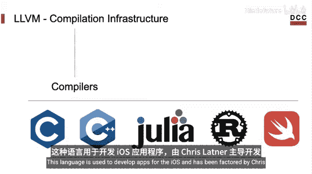
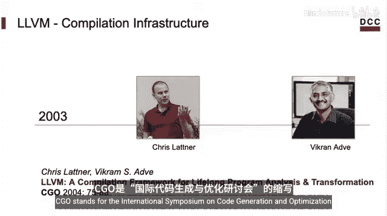
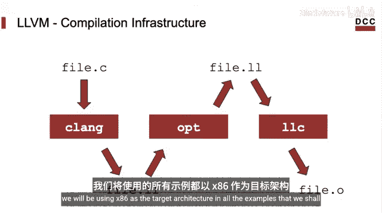
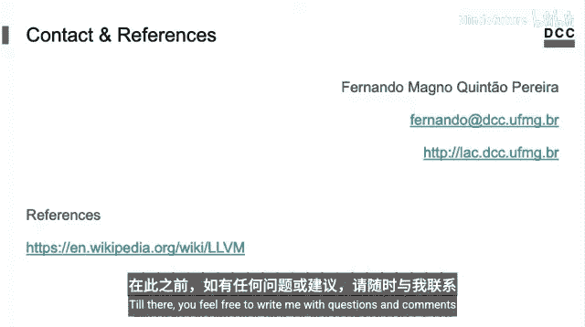

# LLVM入门教程-•-中英-p01-P01-What-Is-LLVM--BV1HtRUYnEji_p1-

Hi， I'm Fernando Perreer， I am a professor in the Department of Compm Science of the Federal University of Min Rights in Brazil。

 where I do research compilers。Today I will tell you about OlVM。

 which is one of the most important frameworks to design and development of compilers used today。

And if you are taking this course， probably you've already heard about Oium in this class we will try to define more clearly what it is。

LVM is an acronym for a low A of virtual machine。From this name， we could， in principle。

 believe that ElVenna is a virtual machine similar， for instance， to the Java of virtual machine。Yet。

 this would not be a very accurate definition of Olovium。 Indeed。

 if historically Olium started with the go of being a virtual machine of sorts。

 this go does not reflect what Olovium is to day。Rather。

 I think it would be fair to say that LVM is a compilation infrastructure。

That means that OVM supports the development of compilers。And medical compileers indeed use LVM。

 meaning that they are implemented on top of the LVM infrastructure。We have， of course， CC++。

 which word the original languages compiled with Eopium。

But then we have a whole lot of al programming languages that use allVM presently。Like Julia。

 for instance， which is a programming language that receives much attention in high performance。

 computing circles， align periveness and performance。

And along these lines of expressivity and performance， we also have RuT。

 which is a systems programming language developed by New Zealand today widely adopted。

Another example of a programming language that is compiled with OVM is Swift。

This language is used to develop apps for the iOS and has been feed by Chris Latner。

 who was the creator of L of YM。

Indeed， LVM was created in 2003 by Chris Laner， LVM was born as a tool that Laard used while working on his PhD dissertation。

At that time。Laner was advised by Vikraadvy， who is a professor at the University of Illinois at Urbana。

A paper describing it was published in CGO in 2004 and remains as of today the most cited paper of that conference。

 Sijove stands for the International Symposium on Co Generation and Optimization。

Anyways， continuing with our request to answer this question of what is LVM。

 we had said that it's also an infrastructure， as an infrastructure。

 LVM offers much support to the development of compilers in runtime environment。This report emerges。

 for instance， as a set of tools。These tools include front ends to parse program languages。

 middleow ends to analyze and optimize programs that use the old VM intermediate intermediate representation and backends to produce machine code out of those programs。

But perhaps the most important trait of OVM is its intermediate presentation。

 this representation or IR， as we call it， is a kind of low level program language by translating other languages to this IR compiler engineers can benefit from all the analysis and optimizations already available in OVM。

This combination of tools in intermediate representation leads to a very typical compiler design formed by pred modules。

 a front end， a middle end and a back end。The front end takes a programmal language and converts it to intermediate representation。

For instance， in this course， we will be mostly using Kang as a front end。 Kang takes a C file。

 pares it， and then converts it to the LVIR。 In this case。

 I am representing it as a file with the doubleL extension。😊。

The middle end is the part of the compiler that will process this intermediate representation file。

 it can do various things with that file， it can analyze it for instance。

 to find vulnerabilities or opportunities for optimizations。

Something important to notice is that the middle end takes a program in the L of MIR and it might produce another program also in the LVMIR。

In LVM， the middle end is represented by a tool called OPT。 That's short for Opr。

 but OPT runs analysis too。 These are compilation passes that do not really transform the program。

 Rather they produce some useful information about that program。And then finally。

 we have the backend。 The backend is the part of the compiler that produces machine code。

In LVM this tool is called the old C， it can translate the LMR to several different target architectures in this course we will be using X86 as the target architecture in all the examples that we shall make。

So that was our first lecture in LVM。We had learned a bit about what it is Next class。

 we shall see how to install and run some of its tools till there you feel free to write me with questions and comments。

