# NVIDIA：并行编程概览-｜-Your-Parallel-Programming-Guide-CUDA--BV1BiPTz1ESf-

Hello everyone and welcome to our coUa live stream this is our monthly live stream that we're starting up in order for you to reach out to coUDa developers。

 educators everyone that's involved in the coUDa organization this one I'm really excited about because heading into GTC next month we wanted to show off some of our materials that are available for people who are just starting out people who want to learn about KUa need to know where to get started or where the entry points are what might they be able to use in order to get familiar with KUa and start using you know accelerated GPU programming my name is Katrina realel I am the head of KUa education I'm going to be starting us off and we'll do introductions as we move forward we're going to do a couple of quick presentations just to kind of show you what's going on and then we'll going to open it up to question answer if you see the comment box well be pulling all the questions from there so。

Please feel free to add your questions we also have some inviians out there that are ready to answer questions and do anything thats needed over on that side so with that i'm going to share my screen and take you through a few little pieces。

Alright， share your screen。All right， I'm actually going to start here， so present。

I'm not sure why it's doing this， hang home。

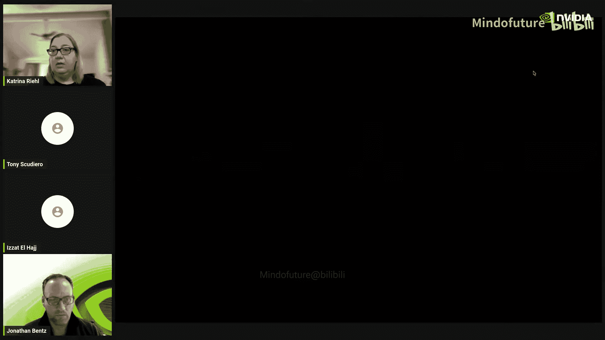

Okay like I said， my name is Katrina， I just wanted to kind of give you a quick overview of the total couda platform before we get started。

 there are hundreds of frameworks， SDK is compilers， libraries。

 languages DSLs runtimes that are all part of this huge ecosystem when we talk about coUuda So everything from the bottom of the stack to host runtimes and tools So the coUa runtime to the compilers to the kernel authoring pieces all the way up to frameworks and DSLs each part of these are what we talk about when we talk about KUa you know obviously this is the way to interact with NviDdias GPUs So the big thing to keep in mind here is that the power of why this is such a powerful framework is that they're all built on top of each other there's a mix and match kind of strategy going on here so if you're using something like Pi。

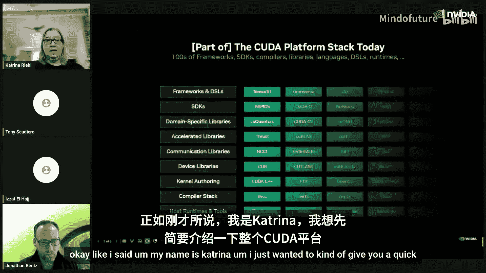

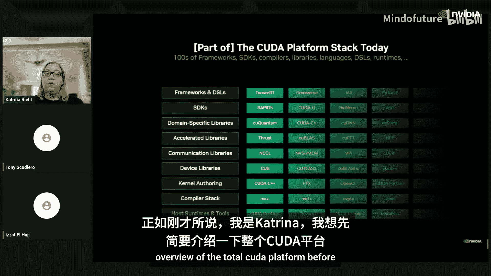

Pch for example， which is I know is like a lot of people over on the python side that's how they get familiar with kuta you're going to actually be using the coDNN library you're using coup B you're using cutlas under the hood and then you move down into Kuta C++ and the NVCC compiler and the couda runtimes everything is going to have to work together and so this interoperability is what givesuta its power but。

Trying to figure out where to get started and how do I figure out what piece I want to use it's tricky and so that's where our education initiatives come into play like we're trying to give you like the best places to go in order to get started and then also to take your programming to the next level。

And so with that being said， the first thing that I want to talk about is this live stream this is actually part of our education initiative community is education you're educating us as much as we're educating you so bringing your comments talking to us about your problems telling us what is going on what are you working on when you talk about using an Nvidia GPU that is a way for you to come here and talk to actual Nvis and developers and tell us what you're working on what's going on what are there problems that you're reaching what is confusing to you so I highly recommend coming here to talk to people and and find out more about what's going on in here and so we do have our upcoming events obviously we have the one today the next one we're actually going to be live at GTC so it'll give you a little peek into what's going on at the GTC conference and talk to some of the people that are over on the KUDa team that are going to be presenting and connect with experts。

Or you know speaking and things like that and then April 23r we do have the Kuta Coms library team so NB Schm in particular that one's going to be an exciting one i'm pretty excited about the work that they're doing over on that side so please join us in the future and we're going to have more of these coming up in the future。

Next thing I want to talk about is the accelerated computing hub I'm going give you a little tour of what's going on out there。

 This is an open open repository on Gitthub that allows you to get access to tutorials guides programming you know a user guides I also have some presentations from past conferences。

 things like that I am trying to run it as much as possible like an open source project so we do have 51 contributors over on there you're welcome it's under a creative commons license for all of the written materials and then under an Apache license for all of the code so you're welcome to fork it modify it use it for your own own training internal to your company or to also use it in order to give conference talks things like that you as long as you're not reselling it as long as you're attributing it back to NviDdia you are welcome to use in any way that you would like to I do want to point out that we have 1200。

Sts now over over on Github so please give us a star follow us if you are having any issues with anything that's within there or you have any questions please open an issue on this repository I promise I will actually go and huntt down the person who is making your life a complete hell and get you some answers and get you some help a lot of our packages are open source so we would love for people to you know talk to us you know file bugs ask questions things like that do not be shy we're happy to help if we can。

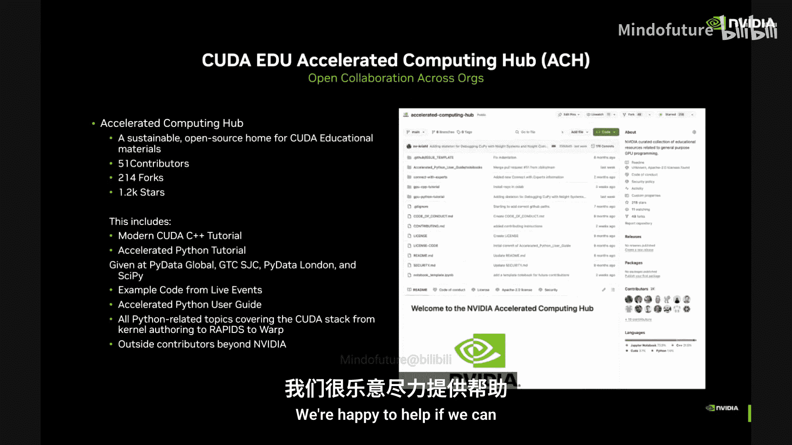

And then I also just have this little QR code for anyone who would like to move over there at this point i'm going to break out here and give you a little tour so when we look at the accelerated computing hub this is what i'm talking about and the main thing that I want to make sure people are able to see is like our contents here so we have a lot of tutorials here the big thing that i'm pointing out here is that we do have Docker compose files so that you have the there there can be some issues sometimes with dependencies and figuring out that mess dependencies I know that that's something that I hear a lot when i'm giving trainings that people are confused like what version goes with what or you know how do I handle this environment things like that so we do have Docker compose files on there as well as telling you which GPUs are are。

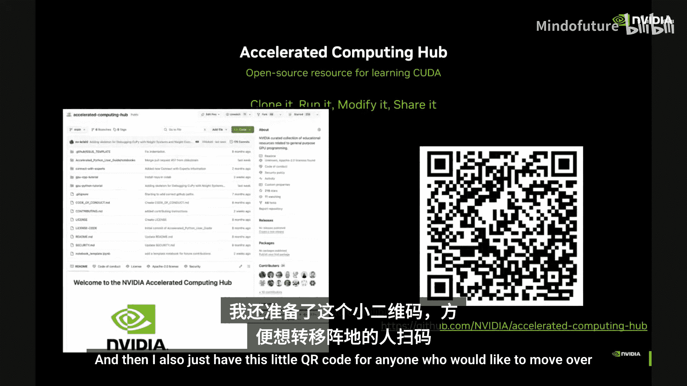

Are compatible with the tutorials and so moving over into the tutorials directory you can see we do have know accelerated Python we have a C+ plus tutorial which believe it or not is within Jupiter notebooks I was also surprised that you're able to do that we do have a couda tile the beginning of a coupa tile tutorial in there right now there's some really cool examples in there I'm actually going to show you those over on the on the B side GPU deployment that was given at Py8 of Boston the rapids team put together great tutorial about how to package and distribute applications on the Python side that are built and you know how to work with Pixie U all of the different package managers that are out there enVMth Python and then also like a Stpar as well that being said if you come in here I'm going show this on the accelerated Python tutorial you can see。

That we have all of the notebooks here they are you know this is the superet of all the materials that we have available to you for for distribution we have organized these into a few courses that we offer and that we've been giving at different conferences in particular this eight hour coupa Python tutorial here this is actually the basis for the workshop that we're giving at GTC in San Jose next month so you're welcome to check it out take a look we do have solutions to the to the problems that are in there so we do have some exercises you can work through。

But also I want to point out that these collab links work so a lot of this we do have tied to our NVIDdia Bv platform which I'm going to get to in just a second but here I just want to show that like if you click on the open and collab link here it is going open that into collab and it's going run so you can feel free to go ahead and and and just take it from there so you know having the oh cancel sorry about that this is why it's so fun oh run anyway yes。

But you can you can run directly from Collab here and use all the resources that you have available That being said over on our side。

 we have some really great resources available that allow you to how to build the tutorials。

 how to create a launchable which I'll get into in a second we have this NviDdia Bv environment if you've never used it before I highly recommend checking it out and here this is our cloud environment that NviIDdia has available for you to have access to GPUs and so you can use it to create any kind of environment that you want you choose whichever chip that you want to work with so you know L40S we do have a few Blackwell available looks like not variable we have one available right now but we're adding new hardware on here all the time so you can choose what you know what you want to use and be able to play around with a GPU without having。

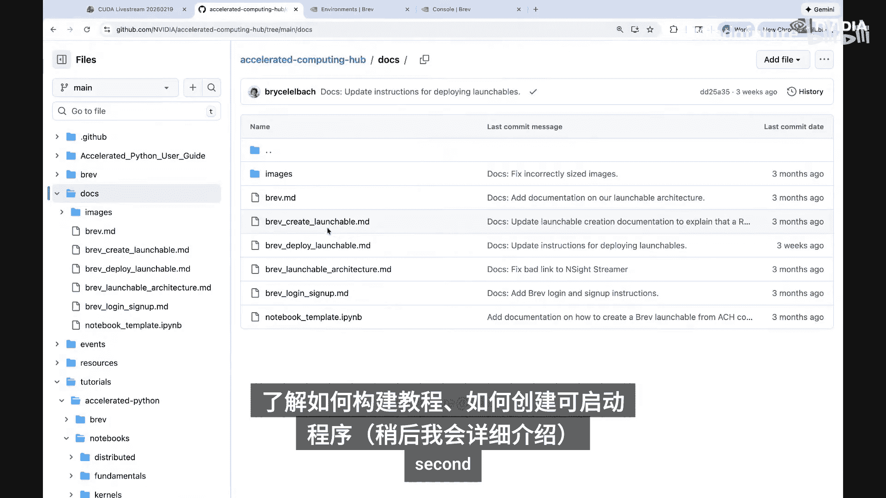

Worry about buying your own hardware you can try and buy， you can try new things。

 but here the big thing that I wanted to show you was that over on this side we do have instructions on how to build the tutorials。

 they have something that's called a launchable。The launchables you can think of them as like a recipe for creating a container that contains that tutorial inside of it so this is the launchable that we have for the couta tile tutorial I'm going go ahead and hit this deploy launchable it's already configure to you know which container we're going to have what kind of Comp we're going to use everything is available to you and then here you'll be able to when when this is ready I'm going to let this heat up so it's it's building right now it's going to get going i'm going to give it about 15 minutes while I talk about some other things but when this is available i'll be able to open this notebook and we can run everything from this environment as well so please do keep pre in mind as well hopefully this will be ready by the time I get through a couple of other things。

But going back to my presentation。

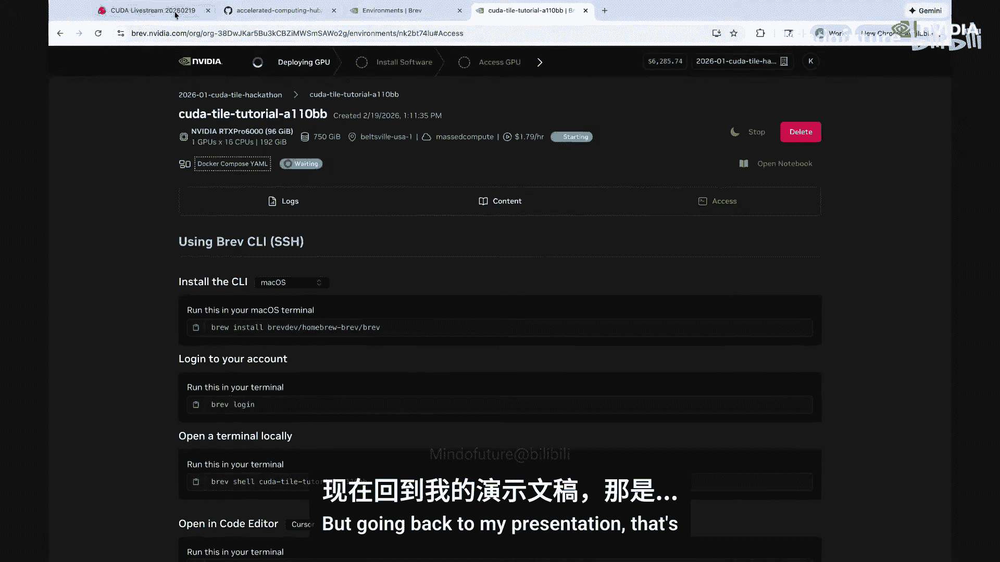

That's。

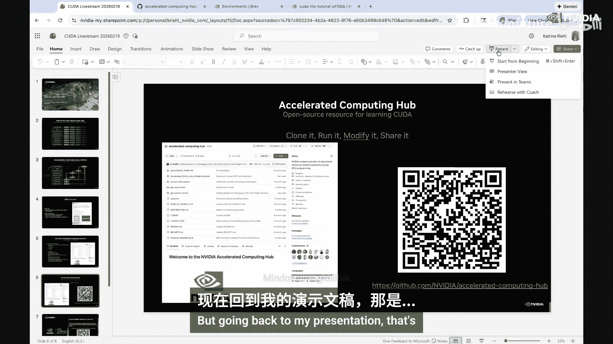

Oh it's gonna go to the beginning awesome so yeah definitely check out that accelerated computing hub we're gonna be adding more material there as fast as we can create it The next thing I wanted to mention was that please take the opportunity to do a technical training course it's on us the first one take take your pick use that QR code in order to go to the deep learning Institute and there you're welcome to try any of our self-ped courses worth up to $90 there and it's a great opportunity to get access to all the learning materials that we have available through the Deep learninging Institute all the tutorials I showed you over in the acceleratedce Comp hub we're moving them into versions that you can use during deep learning Institute that will include recorded lectures you know you can earn certificates there are a lot of things that are involved with being able to do them through the Deep learning Institutes going to the accelerated computing。

😊。

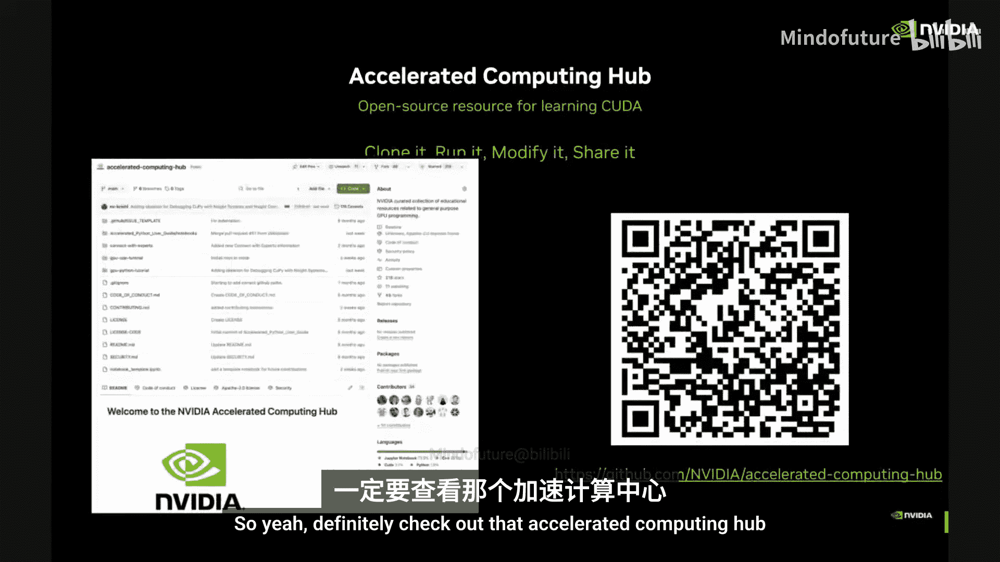

That's kind of more of a role yourself， do it yourself environment in order to get everything going。

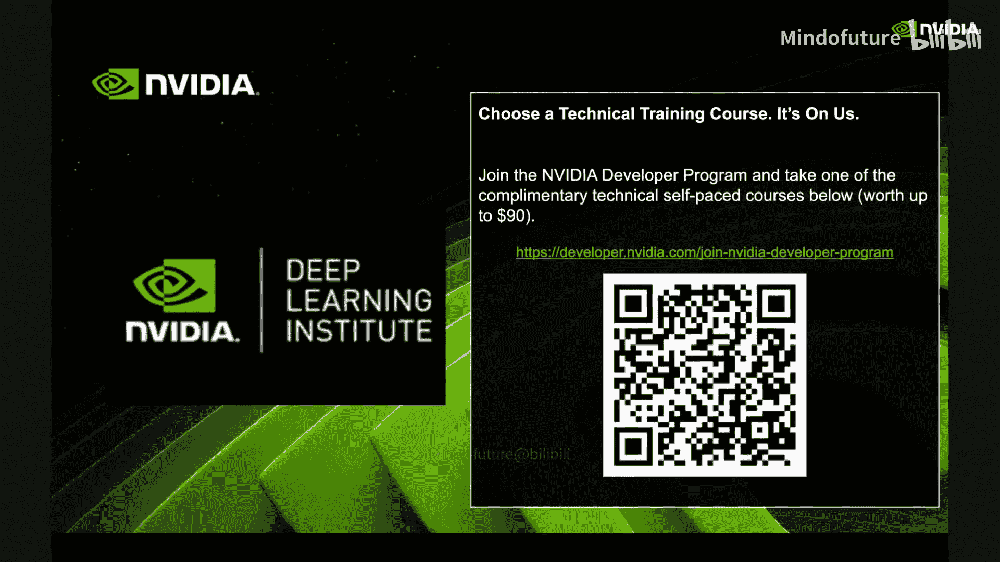

And then。okay I guess that was actually I had another slide in there but let's see if we are ready over on this side okay it's still actually going I apologize I should have actually warmed this up before we were going but it looks very similar to just a Jupiter lab environment where you just go in and you know anyone who's used Jupyter lab in the past you'd be able to run the cells that way and you know and you can share your launchables with other people within organization or we use this a lot for our tutorials this isn't going to be ready in time for me to actually show this to you maybe later during the Q&A I can I can come back to it if we have time but with that i'm going to go ahead and stop sharing and。

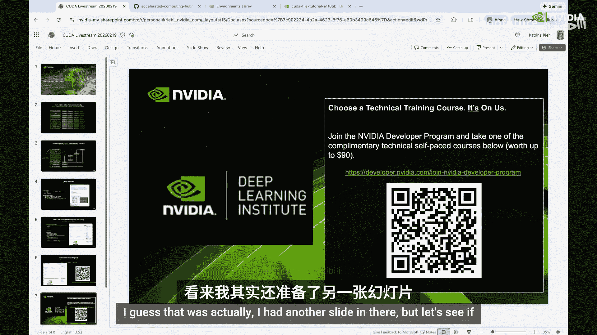

Pass it over。To our next speaker。Which is me。 so give me one second and I will。Begin。All right。

 hey everybody， so my name is Tony Scierro， I am part of the Ka Technical marketing engineering team so this is a reasonably new team formed up of myself and my colleague Jonathan Bennce we have both long-term Nvis we've been here in different roles for a long time and the mission of this group is very related to what's going on with what Katrina just talked about with education。

 our goal is to make sure that all developers have the information to succeed on our platform and so some of the activities we've largely been involved with thus far are we facilitate the publication of tech blogs and we've been also revising to make sure that that information stays fresh and then the big one that I'm going to talk about today。

Is the KUDa programming guide and then we you know we do a bunch of other things along the way as well and Jonathan is another one of the panelists who will be here for questions at the end of this so if you are familiar with the coUDa programming guide and have experienced it before Kuda 13。

1 it had a long legacy going a long way back and it had been added on to for many。

 many years and so we took the opportunity to actually take all of that content and reorganize it and there was some of it that needed to be updated as well and so we on the far left here this is the old table of contents from the programming guide before the reorganization and then in this middle here is the new highest level。

Table of contents。 so the programming guide is largely broken into six segments。

 which I will explain completely later and then the other sections are sorted。

 you know by so part four is sorted by feature， so it should be much easier to find the information you're looking for in this。

 and then the earlier sections are meant to be instructional。Oh， am I not sharing my screen？

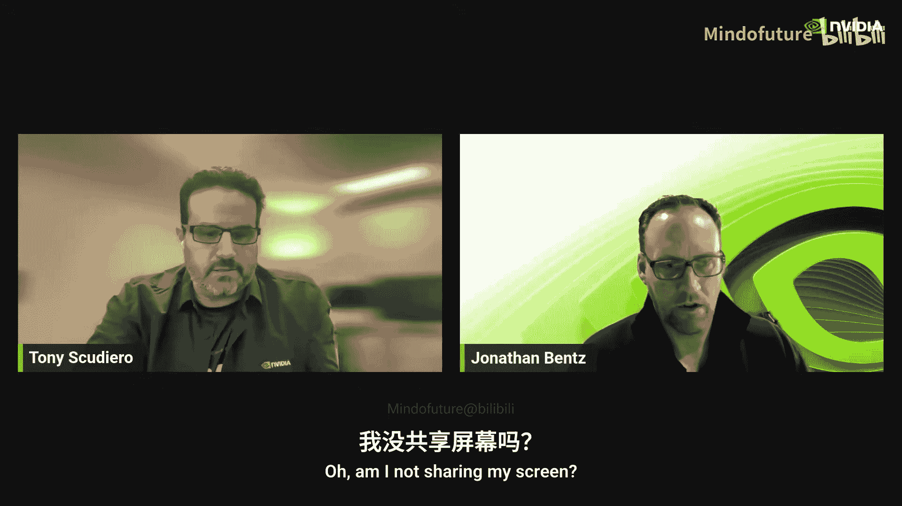

Yeah， there you go。Is that showing now， I apologize。诶。Just got that notice Okay， so anyways。

 if you're seeing this now， I apologize for that s on the left here， you can see this is the old。

Allu table contents the updated table contents broken into six sections。

 It's a little bit more nested。 and the idea here is to help organize this information into a more coherent fashion makes things easier to find and understand。

 So I want to talk about So one thing Katrina mentioned is of course that Kuta is an enormous ecosystem right the Kuta programming guide can possibly cover all of the things that you might expect。

All of the ways that you might use Cuda so what it is aimed at it is it is aimed at developers who are writing kernels in the code that run them there's other ways to use GPUs other than just than writing kernels but writing kernels was kind of the original the first way of accessing GPUs in the earliest versions of KUa remains a very important method of programming GPUs and the programming guide is aimed for people who are accessing GPUs at that level so people who are writing GPU libraries or accelerated applications writing custom kernels right it also provides a bunch of important context if you're going to be using some libraries so some libraries like like QFftT or coupla or coDNN actually require you to use coDa APIs for things like memory management or streams in order to coordinate those libraries optics for example uses KUuda as its shader language and then Ptors for example which I know a lot of people use for many things directly exposes。

the。Some kud features， so understanding how those coi features work will actually help you even if you're using something's high level as piy toch。

 right？I'm not going to read off what the KUA programming guide covers explicitly。

 but it covers all a huge amount of information about kernel authoring topics and invoking and running and synchronizing kernels。

What the C programming guide does not cover are all ways of running code on the GPU there are other methods of getting of using the GPU even running running code that you've written so thrust with lambmbdas allows you to do that there's a ton of ways to do especially in Python to。

Take advantage of GPU acceleration without having to write a single line of code that's running on the GPU yourself again coupI is a great example cup and thrust both have this as well the other thing it does not cover is coUa libraries so even the libraries in the Kuda toolkit and then of course all of the KUa X libraries have separate documentation。

So now I kind of want to mention Nick how we intend the coDa programming guide to be consumed you can read it cover to cover if you would like it's in print form I believe it is 620 pages so how fun that's a lot to digest and it's a lot to take in all at once so I kind of want to talk about how how it's organized at the highest level right so it's organized into five parts really and part one is a language agnostic introduction to GPU computing you don't even need to know any programming to look through that and it'll give you an overview of kind of what's going on under the covers part two introduces the basics of writing kernels and getting them running including fundamental best practices and this is aimed at if you're just getting started in KUDa and I would suggest reading that straight through like a tutorial part three same thing。

This is for people who have you've written some kernels。

 you're looking to get the most out of your application and make and understand what features exist in KUa。

I am。Whether or not they might apply to you。Part4 is relatively massive because it has pretty full documentation on every couda feature。

 And so if you're looking for information on a specific coa feature， you can find it here。 However。

 we've also reorganized it so that the beginning of each chapter is a kind of high level introduction to what this feature is and when you might want to use it so you can actually look and skimmed through the beginning of these and there's actually。

😊，A feature survey in part three as well to kind of give you a survey to know what's out there and what these things are meant for and what they do before you dive in and look for more information part five is just all of the deep details the very pedantic semantics and syntax of language extensions and atomics and all of the things in their deepest definitions。

 so this is for you know when you're looking for the very specific details。

 part five is where you'll go。Right in part six is the legal notices and then I just want to give you an alternative approach when we redesigned this。

 we designed this to be consumed by LLMs in a way that you know。

 you can use point your LLM at that and then ask it questions and it should be able to give you reasonably good answers。

Insert your favorite model here。And then finally， last thing I want to talk about is what's next for the Kupa programming guide Kupa Python coverage is coming very soon。

 it will not cover the entire ecosystem， it will again focus on the Pythonic implementation of kernel authoring。

And then will it will also bring couda tile a full primer on title programming and then you know both the pythonic and when it comes out DCc plus plus implementations of Kuda tile we're always fixing and improving anything we find that's wrong or incorrect or needs to be updated and we will always of course introduce new features as they come So then that's all I have So now I'm going to hand this off to Iat。

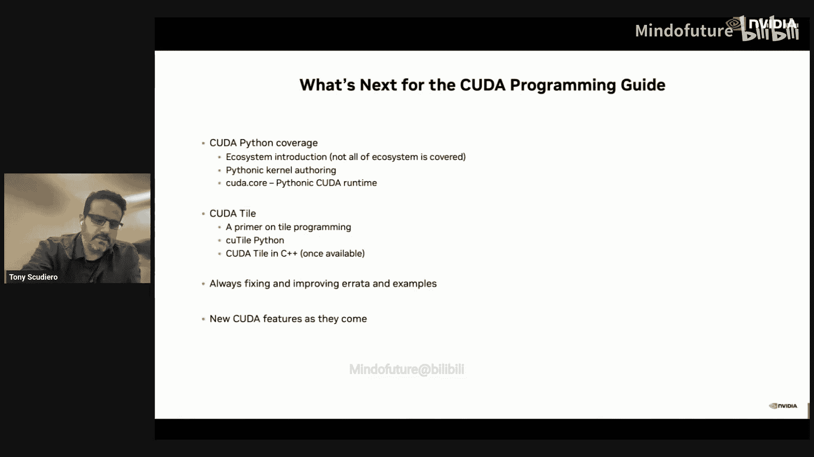

Right， thank you， Tony。 Hello everyone。 I'm going to be talking about。It's going with screen。

So I'll be talking about the textbook programming Maly parallel processors a hands on approach This book was co-authored by Wemehu。

 David Kirick and myself so I'll be talking on their behalf today。

 so the textbook came out shortly after Kudo was released a few years after in 2010 and since then there have been four editions released and we are expecting the fifth edition to be released anytime now。

 so we worked on it during 2025 but ultimately the release date is going to be 2026 so any time now we're expecting the fifth edition will come out very soon and with every edition what we've done is we've expanded the book to add new parallel patterns。

 new programming techniques new coverage of more and more optimizations so I'll be talking about today is I'll be talking about the new features that are coming out in the fifth edition of the book as well as the organization for those of you who are interested。

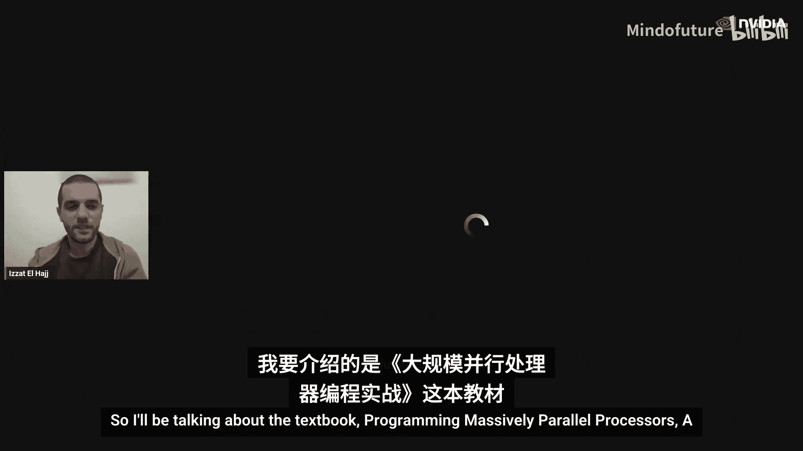

And using this book as a reference for learning Kuda。

So in terms of the new chapters that are coming out in the fifth edition。

 we're going to be adding a chapter on filtering a chapter on wavefront algorithms。

 these are algorithms that maybe sweep through a grid in a diagonal manner we're going to be adding a chapter on advanced optimizations for matrix multiplication we've always covered matrix multiplication in the book but we're here adding a focused chapter on some of the most sophisticated optimizations that are applied and then finally we're adding a chapter on large language models because obviously these are a very important application for GPUs nowadays。

We're also revising some of the existing chapters with some important changes。

 One of them is we're introducing the latest hardware enhancements like SMm clusters。

 distribute shared memory Tensor core TM DPX instructions So we're adding discussions of these features throughout the existing chapters we've expanded the checklist of optimizations that kind of we recommend people start with whenever they want to optimize their kernels we've transitioned from using the intrinsic atomic operations to C plus plus atomics。

 which are kind of a better and more modern practice of doing atomic operations in Kuda while avoiding。

While avoiding bugs， we are also introduced warp levell programming and cooperative groups。

 this is kind of an overdue introduction of the book but now it's there in multiple chapters like productions can filtering etc and then finally we've modernized our coverage of multi GPU programming in the past we just covered MP and KUudDa now we're also covering NCel and Viishman which are importanted APIs in doing multi GPPU programming。

In terms of the organization of the book for those of you who are not familiar。

 I'll just briefly walk you through how the book is organized。

 which will give you an idea of how to use it， so of course chapterpt1 is an introduction to GPU programming。

 then the first part of the book introduces some fundamental concepts of GPU computing So there's two chapters on a soft introduction to Hua how to create kernel how to write kernels how to launch grids in a very basic way then we have three chapters on the computer architecture。

 the memory architecture and and some performance considerations So these chapters cover architecture concepts and lay down and link these architecture concepts to important optimizations so these really lay the foundation for the rest of the book and this chapterpt 6 has a big checklist of optimizations that is kind of a a good checklist to have whenever you're trying to optimize any a kernel to make sure you covered the major major optimizations that people usually apply。

When they're trying to squeeze out the performance out of their code。

So after laying these foundations in part one， the next part part two is about parallel patterns。

 so we start with convolution and stencil and these two chapters are really about covering looking at tiling as optimization and how to do tiling in different contexts in a sophisticated manner we then have histogram and the main reason we cover histogram is to look at atomic operations and privatization as a way to to optimize the performance of atomic operations。

 we then have the chapters on reduction， scan and filtering and in these chapters a lot of the focus is on how to deal with control divergence。

 how to deal with memory coalescing how to apply thread coing to improve work efficiency in these different computations we also cover merging and sorting and these。

These chapters cover some of the dynamic input data identification techniques that you need whenever you have kind of an irregular memory access pattern and they also look particularly at memory coalescing which are challenges that you have to face when you target these computations and we look at different ways to optimize memory coalescing in these context and then finally the new chapter and advanced optimizations for matrix multiplication。

 which really pulls on many of the techniques covered in these different chapters and that's why we introduce it at the end of this part because many individual techniques that we look at in different chapters kind of come together in this final chapter of the part。

Then the third part looks more at kind of more advanced patterns and applications。

 so here we don't go so much into the kind of applying the lowlevel optimizations to a kind of small pattern and we look more at kind of more application considerations when we apply optimizations so we have the wavefront chapter which was new added and dynamic programming in general we have sparse matrix computations and graph reversal and here a main issue that we cover is looking at different ways of paralyzing the same computation and the impact of that on load balance the impact of that on again the memory access pattern etc。

 we look at convolutional neural networks and large language models and we see why GPUs are so powerful at accelerating these computations and how these computations can be best optimized for using GPUs then we look at electrostatic potential。

I one optimization where we really kind of set the final word about or we have it's really a very clear example of how you can paralyze the computation differently in where are the tradeoffs that go into that and we end this section with a well not we don't end it but this is kind of one of the one of the final know retrospective chapters that goes back and circles through all the different material that we cover and ties it together a in a way that generalizes problem decomposition the problem decomposition techniques that we cover throughout the book and then finally we have a chapter on programming hetero clusterster so this is where we cover multi GPU techniques and we've significantly expanded this chapter to also include nicklan and fishishmemon not just NPI。

And then finally， a concluding chapter。So this how the book is organized。

 there are also other resources that come with the book so we have a companion site that comes with lecture slides and also programming assignments so you can access that companion site at this link we also have a YouTube channel where we've posted previous recordings of instances of the course that we have offered at different universities including University of Illinois and the American University of Beirut have there is a DLI teaching kit that includes lecture slides and programming assignments that are associated with the book so you can also find that at this link and then coming new with the edition we also plan to release supplementary code examples so all the code examples that we have throughout the chapters of the book we also plan to release those with the kind of the unit test code that enables people to run those examples and these are useful for people who are learning on their own or even for instructors using the book in a classroom and would like to maybe。

Demo code for their students in class。So when to use the book and also importantly when not to use the book。

 so the book is not intended to be a reference for Kuda right we don't give an exhaustive coverage of all the features that are in Kuda and we don't give we don't you know we intentionally don't go into the very precise semantics of every every feature of Kuda if you want a reference for KUa the best it's best to use the programming guide which Tony has has covered before for me。

It's not a getting started quickly guide so if you're looking to kind of get started quickly with Kuda。

 you know learn about tools， get a kind of minimal viable kernel working the excited computing hub is a very good resource for that but the book is not intended for you to kind of get started quickly with Kuda it's also not intended to for you to it's not intended as a source of primitives。

 it's true that we do show you how to implement reduction， how to implement scan。

 how to implement histogram， how to implement all these parallel patterns。

 however many of these primitives there are very well optimizeized scuda libraries that already implement them very well so we don't cover these patterns in order to teach you how to implement these patterns yourself and advocate for that on the contrary it's best that you use Kuda libraries for that but the reason we you teach you these patterns and these primitives in the book is so that we use them as a vehicle to introduce other techniques。

Really a kind of a pedagogical tool to learn about kuda in general and GPU computing in general。

 So what the GPU is good for sorry what what the textbook is good for is a slow pedagogical introduction grounded in the foundation。

 So if you really want to go in depth and have a foundational introduction to GPU computing and you have the time to kind of pick up pick up a book and read read it chapter by chapter。

 This is a very good reference。 And also it has an extensive set of examples know in the third in the second and third part of the textbook。

 every chapter is an example that we build on incrementally to introduce new and new optimization。

 So if you like learning by example， the book has plenty of these examples that we've crafted in order for us to focus on different concepts and teach them by example hence the handson approach of the subtitle of the book。

 So this is。This is who we recommend the book to be used by。

 naturally it's used in university courses and in universities around the world。

 but also recently it has been appreciated by people by working professionals who wanted to learnUudDa or maybe those who had already known KUDa been using KUDa。

 but they wanted to go back and strengthened their foundational knowledge of GPU computing。

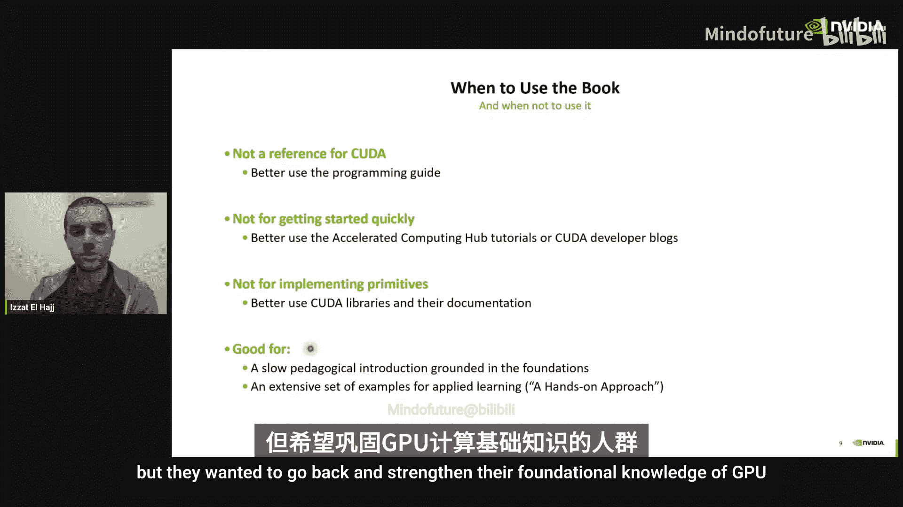

So that's all I have for today， and I believe after this we can transition into the panel Q&A。

So yeah， just to let everybody know please put your questions in the comments we will flash them up here and got the four of us are here to this is your time so please feel free to ask anything that's on your mind and we can point you to resources we might be able to explain concepts things like that so I'm actually going to go ahead and start off with one that is immediately。

😊，Applicable to what is not just said。It's the book coming in September。

So September is kind of the target， but we're hopeful that it we're hoping that it comes out before September。

We'll see it depends how fast the publisher can can kind of you know make it through the supply chain。

 but we're hoping it comes before September and hopefully not later than that。Okay。

 I'm going go ahead and show this one just to let people know it's really hard for us to handle anything that's like a code snippet or if it's like super。

 super you know specific to your particular application or whatever it is that you're working on so we might have to skip over these and I do take them out of order so just be patient I will get to them as fast as I possibly can but I'm going to go ahead and show this one。

Where can we practice Kutuda and I'm going to share my screen again。

Just to make sure that people got this， I know that some people joined us so a little bit later， but。

I highly recommend。Using our BV instances in order to be able to get access to GPUs so if you've not ever played around with NviDdia Bv this is what it looks like so if you come here when you first come in the first thing you're going to see is this you know basically what kind of environments do I have available this is going to give you can come under just create environment it's going to show you all the different NviDdia chips that are available to you and so I mean。

Just putting it out there that like a T4 is super cheap so like for 50 cents an hour you can play around with kuta Kuda is compatible with different chips so we do provide that backwards compatibility so you don't have to worry so much about using code on older chips so just kind of you know pick an instance spin it up install what you need and then you're good to go I' mentioned also on the accelerated computing hub and by the way like this is what it ends up looking like when you have everything built I kind of ran out of time before and then if you open the notebook like I said it's just gonna to take you into a Jupiter lab environment so this is that launchable I was talking about where you can get some practice so coming over to our accelerated computing hub。

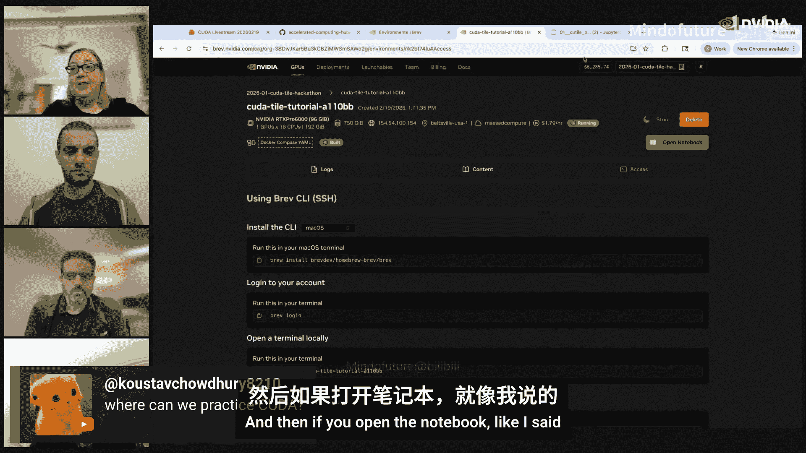

If you want to play around with Kuta I highly recommend coming over to these tutorials we have C+ plus we have Python tutorials tile deployment all kinds of things like that coming in here and so either using a B instance you can clone this repository and use the any of the notebooks that are available there or you can use these open and collab links that are over here so when you open something in coabab just press the button it's going to take you right over there and then you're able to use them in the notebook environment just like anything else so。

Like I said， that is my recommendation to you to get started。 But this Bv you know。

 environment is really easy to use。 It's just like， you know， you can see here that these are not。

 or're not the cloud provider。 We're actually， you know。

 just looking to see what is available out there。 So you're actually out on GCP or AWS or， you know。

 if we have。😊。

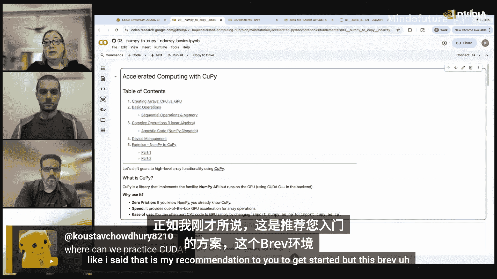

Whoever is actually available at the moment and so you have that experience。

 but specifically for GPU environments so。Give it a shot， see what you think。

 and I'm going to stop sharing my screen real quick。So we can move on on。

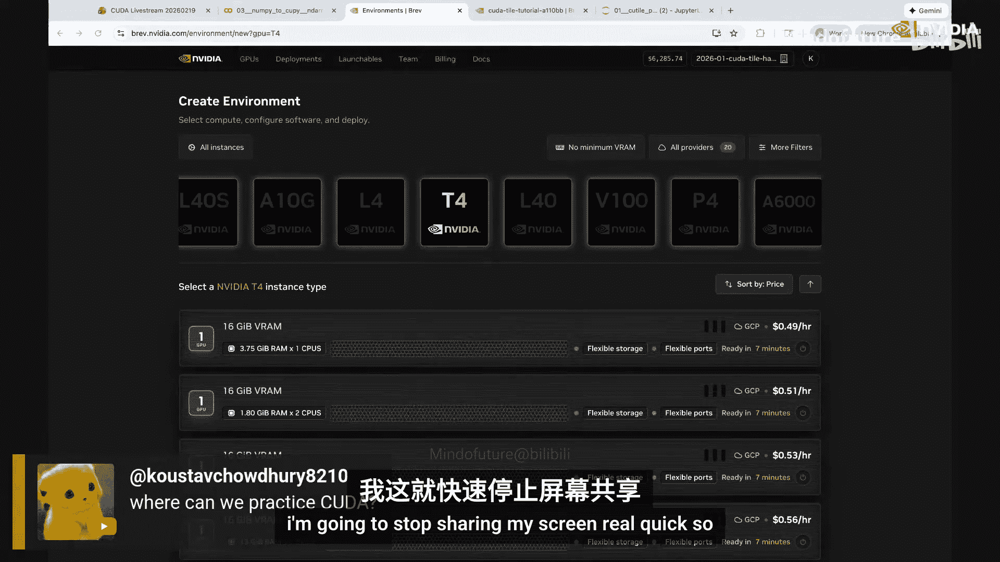

Anyone have anything else to add to that one for practicing Kuda？没。Okay。嗯。

Let me pull this one related to that also is this question about like are tutorials code examples specially designed to work with DGX Spark and what advice can you give for working with that thing so just a reminder that the DGX spark has the blackwell chip in it so that's you know some of our newest greatest pieces of hardware that are available there so it does have the ability to work with the tile programming and also you know like I said we do provide that backwards and compatibility so things should just work any of the examples that are out on the on the computing hub should should work on DGX Spk but i'm going to open that up because I know a lot of other people have things to say about Blackwell here。

Or maybe not。What。Largely you can treat DGX Spark as any otherD coD enabled system right。

 it has a CPUU， it has a GPU they happen to be on the same die。

 it's actually a really awesome machine I have one behind me。

 it's a great place to play with KUDa and anything in GPU computing really。

So there's nothing super special you need to do there， in fact。

 certain things are easier on DGX Spark because it actually has what's called address translation services。

 which allows you to use unified memory in all of its glory。Okay， let's move on to。All right。

 I'm going to show this one。Can I write a complete couda app in only Python？

No the answer to that question is yes， of course you can。 depends， it depends what you want to do。

 right？You'll be using Kuta if you're using Pyorch， you'll be using Ka if you're using KupI。

 you'll if you want to write your own kernels， there's Nba right， there's yes。

 the answer is absolutely you can write a complete kuda app in only Python including the kernel code。

Yeah， and just to add to that I mean obviously kuda like the guts of ka are written in C++ you can't get around that right so the kuda runtime is written in C++ so all of the python interfaces and with Kuda Python you know definitely have all the pieces filled in for what you're able to do I'm actually going to go ahead and add this。

😊，Link out here。 So take a look at the Kupa Python。

GitHub repository it does have links to all the different projects that we have available within this ecosystem once again i'm sorry i'm going to share my screen just because i'm a screen share。

So yeah， if you go to the coUa Python Github repository。

 you can kind of get an idea of the different pieces that are available to you so we have everything that's like all the way down to like interacting with the coUa runtime and other like really core functionality So if you're using something like Kuda。

 core you're still writing kernels that are in c+ plus but you're able to call them from Python but then as you move up the stack you're able to use more pythonic ways of looking at things or're using pure Python implementations that sit on top of the coa run runtime so I just kind of want to throw this out there that is it's definitely worth taking a look at what's out there because there are a lot of new libraries that have been released within the last year and that also includes you know any of the。

The the cout tile pieces that we have available and definitely check out in the computing hub that that Github repository the tutorials that are in there do talk about you know how to use these things there are kernel authoring examples that are in there there are low level。

Low level examples in there as well， so definitely definitely check it out。All right。I am so sorry。

 it's actually a little hard to。Talk and look at questions all at the same time， I apologize。😀あ。😊，诶。

I'm going go ahead and show this one do we give free GPU hours on Bv the short answer is kind of so if you come to our events you're we usually provide credits for events especially if we're teaching a workshop or for you know putting things out there my my advice on this one because we can't just give you know completely free access to Bv unfortunately。

😊，There's collabab which gives you you know kind of you know a certain number of hours for free。

 so you do have that as an opportunity but also the DLI courses are actually pretty cheap and that gives you access to GPUs and the ability to work with things so you can use the DLI platform as well to get access to GPUs and tutorials and things like that so like I said you know get a cheap instance on B you know 50 cents an hours not that bad cheap access through DLI and then you know then you also have coab available to you。

I'm sorry， I'm talking a whole lot， let's see。I'm going to throw this one out here as more of just a a coupa question in general。

 can you explain unified memory versus thread block memory and how to keep algorithms synced？

It's an interesting question so unified memory stems from having a single address space for all of the memory on your system。

 so the memory on your GPUs and all of your CPU memory all has a single address space and then the driver of the coter driver or even in some cases the Linux kernel gets involved too。

 can enable in certain systems that memory to be automatically migrated back and forth between the CPU and the GPU when I was talking about DGX spark having address translation services。

 that actually is the kind of the highest level of support for of unified memory which basically allows you to access stuff from the CPU or the GPU at the same time。

 if you have that mode if you have an older system or a system that doesn't have address translation services you may have there's other modes which behave similarly to that。

Thread block memory， I'm assuming you're talking there about the shared memory on the chip which is accessible only to within a thread block。

 that's kind of a different thing than unified memory。

 unified memory talks about you the DRAM on your CPU and GPU。

 whereas a thread block memory usually is talking about you know the shared scratch space which you're using only within the execution of a single thread block。

As for how to keep them synced， unified memory usually takes care of that for you。

And the thread block memory is local only to the execution of a single thread block。

Anyone else want to jump in？All right。Let's move on to。

Let's talk about there multiple people been asking about rust， are we going to have rust support。

 the short answer is yes， but let's let others expand on that one。Yeah。

 maybe I'll take a first crack and the rest of you can jump in。

Will its main programming language be C++ well or we' move to something like rust。

 the short answer is in the short term。C+ plus and increasingly Python are still our。

 I suppose most popular ways of accessing the GPU right。

 but we've had Fortm for a long time already right and the point is not or Nvidia to tell you what language you can use but recognize that especially with coupta tile which we just released in December you can that provides you an opportunity to build a domain specific language on top of。

They could a platform relatively simply right and so our overarching goal。

Is to make sure that we provide a GP platform that is accessible to the most number of developers and and the most important developers that we can。

 right， and and so as we observe rust becoming more and more popular。

 we have dipped our toe in the water with respect to rust and trying to understand how that would work with with。

With Kutta with GPs right， but obviously in the very short term。

 C plus plus and Python are going to be the most。The things that we spend most of our attention on。

For sure。Okay I'm going to go ahead and throw one out to Iot real quick。

 given the rapid evolution of GPU architectures and parallel programming。

 does the fifth edition introduce new foundations or mainly expand advanced topics。

So in the fifth edition， what we are doing is we've。We've added parallel patterns。

 some of them were overdue， some of them are kind of just recently became hot like LLMs， for example。

And we do expand on various advanced topics one thing that we did we're not able to do for the fifth edition。

 but we plan to do for the sixth edition and I think that can be seen as maybe a foundational change in the book is you know now people are more and more using you know multiple GPUs。

 you know big GPU systems， so in the six edition， what we plan to do is we plan to introduce a whole part on you know the system the whole ecosystem around the GPUs right so not just much of the book right now focuses on optimizing individual kernels on a single GPU。

 of course， other than the the multi GPU chapter all we plan to do is talk more about system architecture and how to interact how you know。

To interact with multiple GPUs and also how to interact between the GPU and other parts of the system。

That increasingly important topic will not be covered in the edition。

 but will be covered more in this sixth edition。Awesome， thank you。We're going go ahead。

 I'm going to make this the last question I'm so sorry we actually went a little bit over。

 we were trying to shoot for 45 minutes and we've gone a little bit over but we'll try to follow up with any questions we don't get to individually we'll try to get back to you and you know just hang tight we'll try to get to as many questions as we possibly can offline but the last one I'm going to go ahead and show this one but I'm going to caveat it a little bit have you used ever use GPT Gemin I or other LLMs to write GPU code at a high level I'm not gonna to comment about how well they work。

 but I do want to mention that you know a lot of especially the newer libraries that are coming out take into account that they are new libraries so there's not a lot like training LLMs to be able to use those new libraries is something that you know we need a lot of examples we need to get adoption we need more people use。

the in order to have training data in order to make sure that they're really really good the other pieces they do seem to work pretty well so if you ever look at some of the older tutorials that are out there there are guides on how to use LLMs in your work stream but I just wanted to caveat that like I said that like the newer things beware because also especially things that are in beta may be changing and you might get some advice that may not actually be the best advice or the best way to write code or there may be new best practices that need to come into play that have not been trained just yet that being said I'm going to drop a link in here to the Insight copit。

So the developer tools team here at NviIDdia is creating a coppilot and this one I saw it back when I was at GTC DCC and I highly recommend taking a look at this one especially oh whoops that is the wrong I put the wrong link in there I put Kutta Python again but。

This is the Insight Co pilot was the one that I wanted to to point to as being something to take a look at because this thing is amazing just so you know。

 not only is it able to。Find bottlenecks for you and offer code suggestions and things like that it's it's actually pretty easy to use has great integration with vS code and then there was a question that was asked in here about。

 you know being able to use Bv you know there there are。😊。

Command line interfaces to B so you don't necessarily have to you know use it like through a notebook or anything like that like it just gives you access to a cloud GPU instance so you can do development however you want to and outside of。

Outside of just the notebook environment， but this is I highly recommend taking a look at the at the coppilot any comments from other people I know that the copis are always a big topic for people。

I'll make a quick comment because we saw a couple of questions come through related to like you know AI generation of KutDa code。

 the boilerplate and whatnot， by and large you know AI generated code is a great place to start right and it can save you an enormous amount of time writing the boilerplate code what it sometimes can't do is figure out what's not going on what's going on in your application。

 which is where kind of an actual understanding of the code is necessary。Even to this day。

 it's very difficult to just ask an AI to do something and if you don't understand the concepts of what you're asking it to do。

 it's hard to know whether it did what you wanted it to do。

It might work is it performing well good question right so I would say use AI as a tool。

 it's an excellent tool to improve your productivity， but it does not replace knowledge。

And understanding。I think that's a good place for us to stop this thank you so much to our guests for being here this has been fantastic and obviously thank you to all of our attendees keep your questions coming we will try to get to them offline like I said and please join us next month will be will be simcasting live streaming directly from GTC get to meet a whole lot more of the coUa team that will all be there and presenting so looking forward to seeing you in the future thanks so much。

😊。