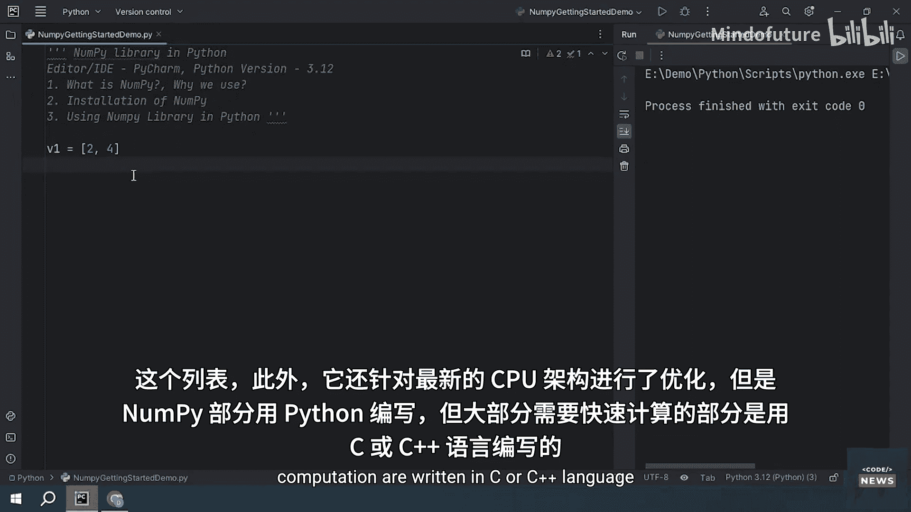
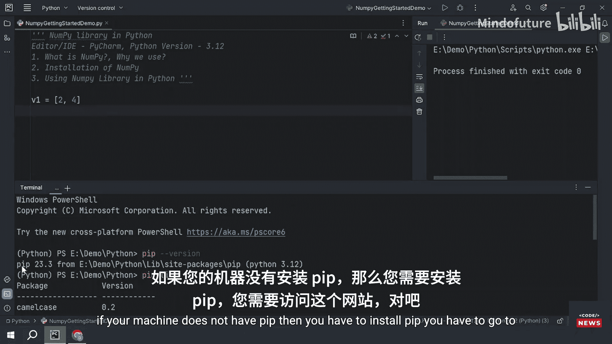
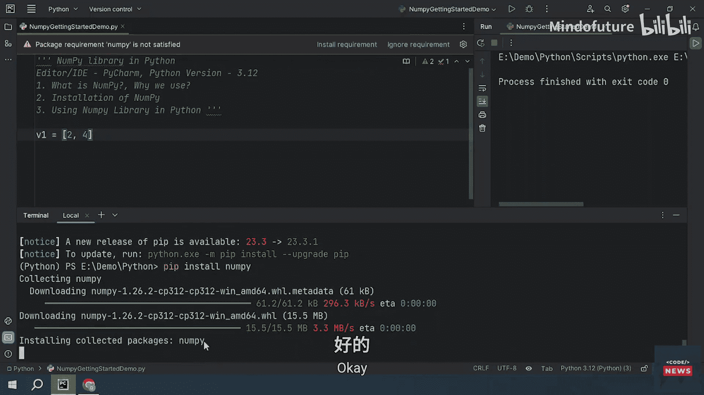

# NumPy-完整课程-3-小时---Python-数据分析---数据科学（2025年）--BV19TEFzpEXS-

Hi everyone today we have complete course of Nai library Ny stands for numerical Python it is an open source Python library that provides support for large multidimensional array and math Ny is incredible versatile and is used in a wide range of applications like numerical computation data analysis。

 machine learning scientific computing image processing， signal processing and many more things。

We will cover all concepts of Ny library like introduction to Numpy library， what is Ny。

 why we use how to install it， creating Numpy array， indexing， slicing， advanced indexing。

 Ny data types， Ny array shaping and reshaping。How to iterate Nai array， join， split， search。

 sort filters， compare union and how to find Uniros in Naai array。

 So let's get started with the complete course of Nai library。

Nampai is a Python library used for working with arrays。

 It also has function for working in domain of linear algebra right and metrics。 Okay。

 it is open source project and you can use it freely N stands for numerical Python Now the question is why we use in Python we have list right that serves the purpose of array right you know。

 the list we use list like this。 you know right so this is the list in Python。

 So this list in Python is very slow to process right the array object in N is called and array So it provides a lot of supporting function that make working with and very easy so the other most important benefit of N is it is stores the array at one country newest place in memory unlike list right So processes can access and manipulate them very efficiently This is the main reason why N is faster than list this list also it is。

Optimized to work with latest CPU architectures。 Okay however， number is written partially in Python。

 but most of the parts that require fast computation are written in C or c plus plus language。

 If you want to see what is number pie there is a。

Website Dy dot og， this is。Fundamental package for scientific computing with Python， okay。

And latest release of number by is 1。26 version， right you can see all the releases。All the versions。

 you can check out the documentation also。Okay， if you want to see how we can use Ny。

 how we can install it， you can see those information easily in this website。 right。

 This is the official website of Ny。It is free to use is open source。

Ppi references contributions if you want to see how to install luy on the machine so you can find those information also you see there is a Pip if you use Pip you can install luy with P install luy okay on our machine we can easily use this command on the prompt okay our command prompt and with help of Pep。

We can install Nai library。 Okay， now let's see how to install Nai on a machine。 This is Iamm editor。

On my machine right I have a terminal over here if I click over here so the terminal would be starting here on this terminal if you want to see whether P is installed or not then you have a command to check because with the help of pe you can install the number or other library packages for your purpose Okay so my terminal is on now okay we will try to see whether P is installed on a machine。

My command prompt says I'm in E demo Python， so there is a iPhone hyphen version Okay。

 so this command will。Tell us whether P is installed on this machine on this environment yes P 23。

3 version is installed if you want to see whether the numberai libraries is installed on my machine or not so you have to check list this is a command to see whether which libraries are installed on my environment on my machine you will find the list of total libraries right you see Nai is installed okay andas is installed so。

What I will do I will uninstall it first and then I will install it。

 but before that if your machine does not have the p okay， then you have to install。

Toal paper， you have to go to this website right and you will find the installation is tabs here Okay。

 if your system does not have paper installed so you can go and you can。

Follow the strap and it will be installed then。You will be able to install Ny library on your machine。

 Okay， however， Ny is installed on my machine。 if you see it is there， so which I will remove it by。

Okay， it is saying you want to remove， I will say yes。Yes。😊，So it will remove 1。26。

1 version if you see。P placed。We will check our library on the system， so it will。Not show you。

Numb P， okay， you see it is removed now let me install it again。Always， it will。

Download the latest version， right？If you do not specify any version here， okay。

Im just press entering。Without the version， so it will get the latest。

 Okay of this version you see Nai is getting downloadedPrevious， it was 1。23。

 It is collecting the package from the source Okay from where it is collecting So it is collecting the packages from P dot org okay。

So this is a source of packages。 If you find any of the library， you can search， let's say Ny。So。

 it will show you the nuy version， you see 1。26。2 version that is。Inst on our machine。 Now。

 it took from here。 O， the number is installed on my machine。 if you check again the list。

You see， Nai is now visible。 Okay，1。26。2。 This is the latest version。 Let me close it down Now。

 Other is step。😊，Using Nai library， okay， we have installed the Numbai library on the machine。

 we have to now use it， let me remove it。😊，we have to first import Ny。

 you can see the package and we will be creating a simple array in order to create array。

 we have to just say even equals to Ny that is our library dot。😊，Ari， we have to say， you see。

Nampai dot code dot multi array， right。So I am saying this would be my。Erry。

These are items of my array， and we can print it easily even。If you're in the program。

So you will see the array is printed right here。 Okay。

 if you want to create an alllias of the library so you can make it easily， Let's say as an。

I want to put。 So instead of Nai， you just say n cells。And you can。

You still use all the functions from this library。 Okay， The output is same。

 You want to check out the version of the numberai。 You can check it from here Also。

 right from the Python code magneticme print。And you see n dot person would be there if we so person。

Persson we have okay， so you can get the version name also which version ofumbai we are currently working with1。

26。2 This is very basic point of starting with M library。

this video we will be learning how to create number by arrays in Python。

 but before that we have to see how we can create array using list right so array are used to store multiple values in one single variable Python does not have built in support for arrays。

 but Python lists can be used instead if you see array So this is a list right if you want to print the list So what will do so for So this is what this is our array you can say in form of list either you can use list or we have one module in Python that is array。

So just import it array module， if you want to create an array， let me take one this time， do arrays。

 right？We are saying it' say it is a type of array。 Okay， and then we are specifying our items。 Okay。

 these our our items。 So if you want to print this array。 So what you have to do。

 you have to apply I in3。 Okay， then it will come and we will be saying print give the space。 So 2，4。

5。 Okay， here we have to discuss what is。Numbai arrays， right， how we can create nuy arrays。

 how we can create N arrays， then we will see how we can create different dimension arrays like。

0 dimension， one dimension， two dimension， three dimension。

 and then higher dimension array will be looking。 Finally， well see you function from Nai arrays。

 Okay， I'm going to import a Ny。 Let me remove this code。 Okay， now let's create a array using N。

 Okay， we have to import N。 and we are taking a as。 Let's see N P， okay。

And then we are saying array 1 was 2 and p dot array we have to use。Right area we have taken。

 we have to pass elements in form of full list。This is our list。

 And if you want to print what is type of this object， So you will get to know Okay。

 what is this type of array， the object， right， so this is the array we have created， Okay。

 so this is the type of this array object。 Okay it is referring and the array from N right。

 so N actually is used to work with the array So array object is N is called N array Okay。

 always remember， we can create a N and D array object by using the array function。

Okay this N array be retrieve through this array function Okay。

 this function comes from nu by dot code dot multi array plus okay， so to create n array。

 we can pass a list or Tel we can even pass if you want to pass T so you can pass it also run the program again so it will still show you the type of the array as N array right however you have using Tple。

 but it has converted your Tel into the N array Okay let's see what is the dimensions of array a dimension in array is one level of array depth right nasty array you can say。

Okay， nested array are arrays that have array as their element。 So what is zero dimensional array。

0 dimensional array， It would be scalers， right， if you want to print and you say N dot array okay。

 and you put， let's say30。Okay and you print array2， so it will if you're in the program。

 So it is zero dimensional array。 Okay， only one element is there right。

 So we say it's a scalar right， zero dimension array and each value array is a zero dimension array in this object。

 Okay， you will get to know this is a type of same class right and the array object。

 let's see one dimension array So one dimension array you have already seen before that。

We have passed these elements。In form of Taal or list。 So this is。A single dimension， array。

 one dimension， array， you can say okay。😊，What is2 dimensional array array that has 1 d array as its element is called a 2 d array。

 What does that mean right。A containing another array。As an element， right， Let me take carry 3。Okay。

There is another array。Okay。You know， the first element of the array is containing another array so we can say this is a two dimension array okay。

 if you print array 3， array 3 type of array 3。😊，You will get the output like okay。

 so maybe we have to make it。Sa it。😊，Other element， we have to make it as a。

All element should be in the dimension， right？And we are using two dimensions。

 so it means all elements should be two dimensions we cannot say。Make another third item。

 third element of this main area。First dimension array we cannot take single right will give us the error right。

Okay， you see setting an array element with a sequence the requested array has been。😊，In。

Omogeneous shape， right， after one dimension，So this message is clear， okay。

 we cannot do it like this。 we can even make it。😊，Aray， right， another array。

 okay on this element position。You run it so it will work okay， like this yeah。O。😊。

What it so the first element of the one dimension array is this second position of the element this array。

 the third position is if you want to check three dimension array so how you will create three dimension。

So， let me take。Another example or okay。Well take it full， and for。😔，The third dimension。

 you can put it， and this is closed。And。Is become close。 Okay， so this is now converted to the。

3 dimensional array， you see。ok。😊，You see， it is three dimensionary。😊，If you want to check。

 what is the dimension of the array。 So do you have one function so that you could check。

A 1 dot and dim， So n dim， we have the property which actually gives us the dimension。

 What is the dimension of the array right array 2。Aric 3， okay。And then array 4。 So all array。

 you will get to know。What is the dimension of this。Objects， right， So you will get one。 Okay。

 if we say this is the every one is over。我 dimension来的。And array 2 is a zero dimension array。At it 3。

That is our。Two dimensionary， okay。And array 4 is about three dimension array， right？😊，So here。

 we can。Clearly see how we can get the dimension of the array。 Now。

 let's see higher dimensional arrays。 What is higher dimension arrays And array can have any number of dimensions。

 right， when the array is created， you can define the number of dimension by using the and D main。

 And D mean argument you can use and we can define our dimension on the area。 Okay。

 which dimensions it could be created， So if you take example of first。We take one or C。And then。

I'mPtting as a list， okay。Can put anything， and we have one。And the mean， okay。

This argument we have here in array。And we can say it could be3， okay。

 it could be three dimensionary。Then， let me take5。5ve。喂 you。Okay。

 that the program and then see what will the output。 Okay， so you say。😊，So， it created。

Three dimensional area， Okay， so three dimension area， you see。So how it created， right。

 three dimensionary was created。Like this in the same format， right， Okay， there were three items。

 If you want to make it one dimensionary， right， So it will create one dimensionary like。

This array 2 k one dimensionary like this。 Okay， so here you can define okay。

 which type of dimension you want to create with array with this array function problem number by module。

Okay， so we have covered high dimensional array we can easily create now lets see a few numberai methods how we can get the advantage from those methods。

Let me remove it okay。This one。And let me run it again。 Okay， Okay。

 so first function that we have that is nuy dot empty right。

 So Ny offers several function to create array with initial placeholder content。

 So this minimize the necessity of growing array， right。Okay so for example。

 like this NP you see zeros or NP load empty right so this we can use right so what is the parameter for this method actually this takes the shape first as an argument then second it takes data type it could be in t0 load and order request to。

Whatever C right it a new area to give shape type and with random value right so if we take empty array from empty and I am saying that could be let's say my shape could be2 d type would be let us say in the type so if you print area 1。

So it will create you the empathy array。 This is two dimension array。 Yeah。

 this is two dimension array。 I'm saying。Okay， if we want to create。3，3， it will create。

U2 dimensionary as a， but those are the random numbers， right， it took okay。3，3， the matrix is 3，3。

 okay。You see the matrix is 3，3 inside the。😊，Parry， okay。So。

 this is the purpose of empty you can create empty arrays anytime you can define which type of matrix 3 by 3 you are going to put okay and you are saying which type of data it should be carrying with okay so that is first method if you talk about the zero method so let me take array2 equals to NP。

Dot 0。Okay， so here we have。😊，Again， shape data type okay， and the order right will be taking。

 let's say two。As a shape， okay， so it will create 0。 Okay inside the matrix， you see0，0， right。

 This is the one。 we have seen two elements create 00， okay。😊，If we say it should be2 by two metrics。

And。It will create you two by two matrix， okay， two dimension array。😊，And2 by2， okay。

Let me take three this。😔，Could I mention Eddie？Wait。

There are so many other methods if you want to try。

 we have arrange method reshape method if you want to use you can try yourself in this video we will be learning what is in trans N array creation functions in Python Ny has over 40 built in function for creating arrays as laid out in the array creation routs these functions can be split into roughly three categories based on the dimension of the array they create first is1 d1 dimension array second 2 d array2 dimension array third is n d arrays So we'll be talking about 1 d array in this tutorial there are two functions right one is arrange function second is linear space So these two function we covering in 1 d array in order to use Ny we have to say import Ny I'm creating a and p so this is the one thing we are going to see what is。

Arange method Okay， so number arrange method is nothing but it creates array with regularly incrementing values。

 So let me create a variable array of  one dot arrange。 We have to specified value of the argument。

 that is for how many elements you are going to create okay， if you print a type right。

 so you will get to know which type of object it is returning。

 and then finally youll be printing the output of the array if you run the program。

 So you will see the output。So， the type of the array which arrange function is returning that is and okay and the elements in the array which we have in the object are 0 to 9 okay so we have specified 10 so that is why 10 elements are created in in the order if you specify any other number it will use。

You want to specify till 5。We have to arrange， so you will see。0，2，4。 Okay。

 we have other arguments Also we want to start your array with a specific number and you want to stop it with a specific number。

 then you can also use this thing。 Okay， so let me copy the code and this time I am taking variable to。

 so Im going to start my array from two。 I want to stop it on 10。So it is started from two and ended。

You know， before 10 means total these elements will be creating we have say this is start and this is and okay。

 if I want to say okay my interval would be know three。😊，Or it would stop at 50， so。

The array would be starting from2， and it will take interval of  three and it will be stopped at 50。

 Okay， so if you。Run the program。 So you will see。It started from two， it took interval is 3，2，5。

 eight，11 okay， and then last it。Ened before 50， right？Okay。

 we have one more argument here if you want to specify the type of the element so you can also specify the type。

And if I wanted to say it should be floated， so the float elements would be creating okay， the2 to5。

 I want to take interval 3。2， okay， I' am taking01 as a interval。 Okay。

 then it will create many elements， right， you see 2。2。12。22。32。4 Okay， so we have seen。

The data type we can change anytime。 Okay， float in teas anything we can take。 Okay。

 so this is the advantage of arrange function we can create this type of array easily okay with help of nu library now let's see what is nu linear space Okay linear space will create arrays with a specified number of elements and is spaced equally between the specified beginning and and values Okay array 3 as a variable and I'm going to use n dot line is space Okay so this is the function which we are going to use start is one stop is n this third argument is for how many samples you are going to create let me take the five sample so it will create five sample okay。

3。See。😊，It made in the program。It created five samples5 element1，2。

345 okay this is starting this is stopping point， it was the interval but here it is the samples number of samples how many elements we are going to create in this array right interval it will create automatically right if you see the documentation。

So we have a start， okay， we have a stop， we have number okay a number which I am talking about this how many intervals。

 okay linear space so if you see here。So here we have a start， we have a stove。

Hence when we are going to stop， okay， now it will show you this is a parameter。

The number is number of samples to generate， okay， default is 50， okay。😊。

Before this is 50 if will leave it so it will create 50 elements right 50 samples right so this is what the purpose of end point means end point would be true means it will end on the stopping point if we are saying end point。

😊，Let me close this documentation and point， let me say through， which means it will。

Stop at the stopping point right 10 here is the default is 10， let me take number of samples4。

Then it will take last two point， last element。Is 10 okay， if you observe the interval is different。

 right， but the。But the end point we have passed through it means it will be equal to the stopping point stopping element okay。

😊，If I make it false。By default it is false。So， you will see element was not the last one。

 okay in this sample in the last sample， so that is a difference okay there is one more if you see the documentation we have。

😊，This。Rite a step。 What does that mean write a step if true。

Where step is the spacing between samples， okay？😊，If you， let's say if you see n。2 and that is tab2。

Which means。It will actually returns to the excluded。😊，Eleement， right， means three words。Not。😡。

Takecon。In the interval so it excluded this last。Sample okay， and the output is different。

 You see the output is different for。This red is tab argument， if I make it true， okay。

 if I make it false by default， it is false， so it will give you。😊。

The same mount foot as it was previous， right？😊，Inform of array and D array， Okay， so you can see。😊。

A documentation on Naumbai。Official websites there is a documentation you can use it。

 however arrange and link space functions seems similar。

 but there is a difference if you want to create array on interval basis you can use arrange if you want。

That how many elements with automatic interval and you want to create your elements on your desired number of samples then you can use line space Okay we have also endpoint ratti tab here here we have d type also right this。

SoI have make it in， so it will create all element in and， okay。Guys， in this video。

 we will be learning what is a intrinsic Ny 2 d array creation function in Python In last video。

 we covered one dimensional array functions， wherein we discussed two function arrange and space N has over 40 built in function for creating arrays as laid out in the array creation routines。

 right， So these function can be split it into three categories like you have seen 1 d array already2 d2 dimension and then and arrays Okay。

 we are going to see these function，1 by1。 So N I function defines a 2 d identity matrix。

 right the element where I equals J these indexes values are1 and then rest r 0 in the matrix。 Okay。

 if you want to implement it a of array1 let me open the documentation of I function。Okay。

So you will see these are the arguments of I function and this is the information about this function so if you see。

And what is the first argument of this method that is number of rows in the output right。

 let me take two number of row I want to display。2 check in argument， what we have。You have。

Number of columns。 Okay， if you pass two into two metrics。

Then we have to say the index of the diagonal， which index you wanted to start your diagonal elements。

 let me take0 and if you print array1 and before that if you wanted to see which type of array is returning the object though you will get to know this is N array right。

So you will see this is N array it is returning the I function， okay。And， if you see。

What is that is returning returning n area of shape and N M， right？Rose and colons， okay。

 it is returning diagonal 2 d array Okay right， so if you see it is two dimensional array okay。

 this is first dimension and then in in this we have。Another array right as a element。

 so this is called two dimension array that is it comes in the two dimension array and if you observe a diagonal element that is one right rest of the element would be0 okay if you make three into three matrix。

You will get。3 into three metrics with。Tagonals value would be 1 okay。

 if you want to start your diagonal position with other index， let me take first。

So you will see your diagonal index is started with first position。

 not zero position right if you want to change the matrix5。Multiply wifi， then you will see。

The diagonal element would be。Still one， Okay， and。These are the diagonal values。 Okay。

 so the purpose of I function to create diagonal elements with one value rest elements of the matrix would be 0。

 Okay， if you see the documentation of this one， right， So we have the type also， you can pass on。

 Let me take float。Okay。If you run it。We will get the float values， right？Ok。Or you can see int。

Right， so。We have one order also that is one other argument if you see the order。

It would be see or F as a character。 So if you provide I， so it will order your。😊，Elements in memory。

 okay asterisk we have like we have now jump to our next method that is diagonal。

 What is diagonal method， it can define either a square to the array with given value along the diagonal。

Or if given a 2 D array returns a 1 D array， that is only the diagonal element。 Okay。

 the two array creation function can be helpful while doing linear algebra。 Okay。

 so how we can use this function are it to。And then you say NP dot PIAG Tagonal values， this， okay。

 let me take four five， okay。What it would create， it would create five into five matrix and diagonal values would be 1。

2，3，4，5。 Okay， and then if we want to print， it will generate the。Matris like this。 You see。

 it is two dimensionary right in this。First element of the array。

 we have this complete matrix that contains the daangle element as we have said okay。

If you want to make it less， then it will create。3 into three matrix，1，2，3， right。

So in this function also we have which position we want to start our diagonal， right one。You know。

 start with。First index， my diagonal values would be starting with。First， okay， so you see first。

Not0 previously by default it was on zero position so this is the diagonal function。

 or if you want to provide any of your array and I am creating simple number by array that is two dimensional Okay we have defined it will return and D again。

And will be。Taking other area4 variable， and would be creating。The diagonal， okay。

We will getting the diagonal elements array， okay array 3 will be passing here so it will return the diagonal array to us right in form of N arrays object。

Let me take a4 as a output。And then run it。 Okay， vote for the output。

 It would be the output 2 and 7。 Okay， the diagonal array would be2 and 4 if you want to print。

A three also， so you will get。The matrix right you will get if you see it a documentation of diagonal so you will get the information so extract a diagonal or construct a diagonal area right so as I said you so it will extract a diagonal and wish to write to the resulting area right so we extract your diagonal matrix okay from here so you can see more information over here and you can use it you can try it。

Let's see other method。 That is vendor method。 It defines a vendor monday matrix as a2 d number by array right。

 you know， vendor mon matrix， it is nothing but it describes the linear algebra interpoition program of finding the coefficientians right what it does actually each column of the vendor mon matrix is a decreasing power of the input1 d array or list or right So let me show you a 5 Okay this is my array and we dot vendor I'll be passing a list over here and give me the three or two or any column output Okay this is and then itll be printing。

Add of 5。Okay， let's in the program。 So you will get to know what it is doing。 It is actually。

Giv us a number of columns we have provided and it is saying it will create the power of the element。

 right， if you pass on three， then you will see。So in each column， it will give us the power of。

These numbers right1，2，3，4， so it is creating three means it is creating creating three columns and these are the rows total rows so how it is working Okay。

 if you make it4 the matrix is changed now into the four columns。Wve。Right。You see into five。

 we want to see each documentation， so you will get this is the the vendor generate a vendor mon matrix right columns of the output metrics are powers powers of the input vectors。

 right。As I said， this will create the power of。Input vectors right so these are our input vectors and we are creating the power into the column right in each column it is showing us。

ok。😊，And order of the power is determined by the increasing。 Okay， by default。 it is false。

 if I make。Increasing equals to false。Then let's see what it returns。So if we make it true。

It by default it is false。 make it through。Then。😊，So you see it changes the way of generating the powers of input vector。

 right？It is now starting from one and then4， 1664 these elements okay。

So this is the purpose of this argument。Okay， if you want to use linear space function also here。

 you can use it easily tot vendor。Okay， and then I'm saying NP dot unit space here I'm saying I want to start with one。

 I want to stop at 10 and then I'm saying number of samples， Okay。

 let me make it3 if you print array 6。This is on that you will get the output Okay So here if you see。

So I am generating three samples right， three samples here and each three sample I have passed into the vendor so you are getting the the powers of the vector right。

 you see。15 because linear space actually generates the interval itself， we do not have any control。

RightSo whatever。Elements values generated so based on that we have created the matrix。 Okay。

 these are all two dimension arrays。in this video we will be learning what is intrinsic N and array creation function in Python What is and array the and array creation function can create arrays with any dimension by specifying how many dimensions and length along that dimension in a A lower list right well see first Ny dot once。

 What is it So this once function will create an array field with0 values the defaulted duty is float 64 okay you want to use N you have to first imported N we are just taking as of it and we are going to create one array variable NP dot0。

Okay， so this is a function。 So what this function does， it function actually。Create a metrics。

That is two into three metrics we are going to create and then we are going to print which type of array it will be right and then finally it will be printing the outcome from this array run the program。

Okay， so here we are passing the dimensions right row and columns like this。And again。

 so you will see so all elements into the array are represented in0， okay。

 all r 0 by default it's say plot 64 type want to define the type the type of the elements， right？

So you will get the in type of here。 Okay， so0 means we are going to create all element with zero value。

 Okay， in this vector。 mine， this is two dimension array。

 and it is showing that is returning and array again。 So this is0 functions。

0s opposite of this function that is one， we are going to use it now instead of0。

 we can use once and the same type of argument here。 you already。😊。

Now that what would be the outcome right it is turning n the array and instead of0 we are getting now value as  one Okay。

 you want to make it three to three matrix。Yet。Be to3 map okay。

 now let's see what is random function， So random returns random floats in off often intervals right we have to use let's say R let me take any able and NP do random dot。

Defa range， okay。So this we have to generate and if you print our dot random。

 okay it will give you a random number So you see this random number it's generated right。

 it generates the random number。Between 02，1 k。😮，You want to get a type of this number。

 or you will get。哎。Then this is and number。 And if you get the type of。This n。

 So you will see it would be a。ロタプケ。You will see it is a flow type number if you want to generate number in one dimensional array so you can generate in a different way。

 print r dot random。And we can set three。Comma， so what it will。Generate， it will generate a array。

 right， you see if we want to create like three by two matrix， okay。And how it， how it will create。

 So we have to say。Thats say  three by two metrics。 And we have two this way， okay。It will print。😮。

3 by2。C2 dimension array all numbers would be between 0 to1 range Okay。

 let's see what is nuy dot iniceices Okay so nuy dot indices， what it does。

 it will create a set of arrays one per dimension with each representing variation in that dimension okay if you have and then you say NP dot indices here you have to pass on row and column。

2，3。Okay， and then what it will give us， it will give us indices of rh and columns only， right？Okay。

Do you see？Two and three indices it gives you。0ero，1。0ero1，01，1。Okay。If you have three into three。

And it will give you。Right if you look at documentation。So you will see dimensions， okay。

 we have par。And then sequence of entity type we can pass on。

 there is one option here is PAse if you would like to pass on is spase。

So that means it will exclude。Your disparsary to get disparsary from the metrics。

You will see spa as array， it will take first and the second， okay， right？If you make it false。

And it will give you the dance， okay。😊，It will give the dance as you were getting previously。😊。

Let me make true you want to get。0ero， and then one。The parts。Okay。😊，From your。You know。

 first array from the array and second array from the array first it gives。

F along and then second it gives row as is far。Okay， this is what the means。😊，Yeah。

 D type we have seen can do it on to make it float。Inated with float numbers， you see okay。

 all float numbers。So these are normal general NDR functions， okay？Guys， in this video。

 we will be learning Python number by from record method。 So what is from record method。

 We can create the record array by using the list of individual record。

 What does that mean When you use from records。 So this function actually returns you the different type of object That is record array and record array can be generated with help of list of individual record。

 as we do in Python list， okay。O Elis。So we wanted to use from record， right， So we will be using。NP。

 dot core。Your records don't。Rome records， this is the method， right， So you will see。

It is returning。It is returning as the NP dot rack array。

 right that is record array record array consisting of given reley straws， right？

Rose in terms of is spread see it， right。R N column。 So we will be using this。Function， okay。

 it will return something to us everyone。And it will accept some parameters either you can pass on Iri rack list or you can define your list okay that would be your list and here we can pass on the item in T right？

So if I say T1， that is IDd。Okay， that is name and that is age that is my 1。给。And I can take T 2。

Then I can use this table here， okay。Do one。The2， okay。So， you will be getting my。Code array。

 if you check the type of this array， which is returning， you can easily check。Help of type。Okay。

 let merun the program。So， you are getting。You are to record array right in form of double one and second。

 right， or you have a different way。And there you can do。This way， or you can do。They a control。

And then either you can do this way， okay， these are the same thing。えと？Okay。If you're in the program。

 you will get the same output。Right。I his first thing。Okay。😊，I have another parameter in this method。

 which can be passed， let's say names， so if you want to specify the name of the column so you can say ID。

And then you can say name， and then age。So actually。

 this will be converted into the rules and columns and the。

Pollen's name would be defining with names， right， name argument。 Okay ifm。Okay。So if I'm printing。

Ait2 dot Id。Right， so this ID would be returning to me okay， you see。

The ID column is returning to me1。And then do， okay。If you print the name。And then age。And。

 you will get the。All three things， right， all three columns you will get in in form of array， okay。

RightIf you want to check the type of this thing， what is this type of property so you will get to know。

This is a type of NDR but it because we are getting all elements in form of NDR right through one column。

Right， I have another way to create record array object area1 I'm going to take that would be one or2。

Right， area it2。That would be。Right， or you can even say。And P dot arrays。

Here you have defined binary。And you can see thought A。Right？So even and A2， and we can define。

In this form。If you see。A one。What you see。2。Right。Yet record three。You will get4 three。Re gold。3。

The output， that is。Recar。 and then you are getting the output。 you want to。Print individual array。

From this。Like a 3 or1 or2， so you can point it out like this。 Okay，0，1，2。

 you can pass on the index angle。 so you will get 1，3。Similarly， if you pass on once。

 so it will give you the second。Record item， Okay，2，4。 Okay。

 so this is how it works in the same way if you see here。And then， say。0。

 so you will get the first record。 First record array。 Okay， we are getting。 this is the record。

 Okay， this is the first record you are getting like this。

 You want to get the product of the same array which you have passed like this。

So you can multily like do so。A a three print， you will。See the differences， right。You see area3。

 I have made the product like I have multipied these records with two， so you will get4。Recordary。

 okay。You can。Do whatever you want， right， instead of。Two array。

 you just pass single and you multiply the single area in the multiple。Products， right。

 the same product will be creating。Okay。😊，You have other arguments in this matter。You can use shape。

 you can use D type formats right name we have used title you can try aligned by order so。

Try these arguments yourself， and see。What advantage you get through these arguments， okay？

Guys in this video we will be learning Nai array indexing in so we'll be covering this point in this tutorial。

 but before getting started with anything you have to install Numbai on your computer。

 What is array indexing array indexing is the same as accessing an array element you can access an array element by referring to its index number So the indexes in Ny array is started with0。

Okay， meaning that the first element has index 0。And the second has index1 that way it goes， okay。

So first we have to create an array with help of Numbai library， we have to import it。

 and then we will be accessing all type of array one dimensional two dimension third dimension will be accessing those array okay。

 let me import first Nai we are taking a as I can be if we creating array 1 d can define。

Any element inside the array Okay， so it will return you the ND array object right just see what type of array is returning it's in the program。

You will see。That is attending NRA， and we have。This error released， okay， if we want to access。

It's any element。We can do it easily print array 1 d， we can locate our element with index 0，1，2。

3 and so on， right if you want to get the element which is positioned at first so you will get2 is the output okay because index always start with 00。

1，2，3。Right， if you want to see what is the dimension of this array you can also get this one A D do and D is the attribute。

 it will give you which type of dimension it is one dimensional array Okay。

 we have seen how we can access one dimensional array with index okay。

If you type any other index which is not there in the area。

 it will give you the error because you did not find any indexed element right on 10th position we do not have anything so it raises error。

Okay， keep in mind you have to make sure whether which element you are locating。

 it should be there in the array。Yes。O。Let's see how we can access two dimensional array。

 let me create one two dimension array。Quickly， okay。So。

So let me paint all the things the type of array， the array elements and the array dimensions。

 okay I have changed the variable name let me run the program you will see this is a two dimension array。

 it is type of N array and it is two dimension array right。Okay， if you want to access。

Any of the element of these two dimensionary， you can easily do it the same way。ok。😊，So， you can do。

From zero row， we have to locate。Volume 3。ok。😊，So you will get the output。0，3 is4， right？It means。

 this is the。0ero index， O， and。The location is3 means0，1，2，3， so that is four is outcome。Okay。

 you want to get a single element。So you can also get like this。Okay， so you are getting5， six，7。

 eight。0。And one index Okay， in this two dimension array。 One more thing in one dimensional array。

 if you want to use arrange function， you can also do。Okay。

Instead of array can use on d1 instead of array okay you can say give me the element pull element still 10 okay and the type also you can print it you will get pull elements from this one okay you are getting these elements0 to9 you are getting same way。

So let me take three， so you know， one， two， and three， three， right。You see， the output is3。Okay。

 if you want to change。The shape of this area。 Also， you can change it。 How can change its shape。

 Let's say 2 and 5。 You want to change its shape， then。Your output would be different， right？Okay。

 three is out of bound now。Let me make one。 So it will give you the output。 you see。

 it got created into into5 row， you see。This is one thing。Okay。

You see two into five shape we have given this to this array。Let me put a separator。

 Let me print it again。So you see， so this is a type which we printed here， okay。We created was this。

 and then we convert it into shape， then we got the array， and then we got the indexing of the。

Second row， right？ This is a second row，0 and one。 Okay， index is 0 and1。 And this is the element。

 Okay， okay， you can also do like four。What would be the output， then we will get 9， Okay。

 because we are saying。From first row， okay， from first row， okay， we have fourth element，0，1，2，3。

 and fourth， so9 is the output。You can do。😊，This way also， okay。

 now let's see access three dimension array。 Let's create three dimension array control C。Introl V。

 okay。Ex for indeed， okay。The first print， what is the output。

What is a type and what is the dimension of it， right？

So let's run it so we are getting this three dimension array， the output。Itch we created。

 and this is a type of。Aray， which we are returning from here。 and it's say three dimension， right。

 If you want to access any of the element from three dimension array so。It is same as2 D array。

 right， say。And then， let me take。Zero element and then second element， okay。You it。

So you will get three， okay？0。In the fun dimensional， the second dimension also zero okay。

 and the final three dimension we got。Do。0，1，2，3， okay。If you say。This is the one。And then you will。

Pinnt it so it will get 7， Okay， because here we are saying0， okay。In the second one。

 this a first row， this one。And then second is the。01 to the element， okay， if you make it3。

 so it will print8。See， it will print 8。Right。😊，So this is how we access three dimensional array you can easily locate your element into the matrix Okay。

 lets see what is negative indexing right as we have one dimension array here if we want to。

Get the element from the last so we can use negative value to access the element。If I see。Rightい。-1。

 so you will get the different output right here you will get different output。

We are saying four okay， because Im saying from from last position give me minus-1 element。

 so minus-1。Okay， let me take minus-2， so it will give you the different output， right。

3-1 minus-2 minus-3 minus-4。 Okay， you say minus-4。So you will get one。this is。See， this is one。

 this is negative indexing Okay， if you put minus5。

 so it will give you the error right because indexing is not there in the array right is not correct。

Okay， so this is negative indexing， you can use the same thing into two dimension array if you want to locate as you see here。

Okay， what is the output？The output is poor。Right。So one， this is the row， okay？

SoThis is the row we are printing here here if you want to navigate from this。And we want to say。-2。

What would be the outcome， it would be7， okay？都呢嗰必。So here the output would be the， right？You see。😊。

Would be7 right you see minus2 because1 minus1 minus2 element0 and first element okay and then from first element beside said minus two location。

 so that is7。ok。😊，Guys， in this video， we will be learning Dy array slicing in Python。

 Im using editor P charm and Python version 3。12 is installed on a machine。

let's get started with the video What is slicing slicing in Python means taking element from one given index to another given index。

 Okay， we pass slice instead of index。 This is the notation of slicing。Right？

And it can also define slicing and。step to repeat。Okay。

 so these are two standard if we do not pass start， it is consider zero， okay， that is first rule。

 second， if we do not pass and it is consider length of array。OkayIn that dimension。

 rule number three， if we do not pass each tab， it considered one。 Okay all rules are clear。 Okay。

 let's start with the video。 Now I am going to import I'm taking as and P okay so well see array slicing willll be defining first array This is our simple array if we want to see what type of object this antidote array is returning we can easily check it and we can then print it in the program。

So this is our array and this is a type of and the array we are getting right now let's come to the part of slicing how slicing works if we want to locate a specific index。

Then we can use every one。And then we can use， maybe2。无论。To means that is a start。

 start with two and go to fourth， right？This is our and index。 Okay， thats fored。Right， you see。0ero。

1，2， three， four it meanss it will to appear。Okay， it will stop here。

And then it will print as four right it take five， it will take five also right that is first thing okay。

 if you want to say I want to start with a specific and I want to reach to the and。

Then what will be the outcome and I'm saying。I want to start from three。

 and I do not want to specify any and index， Okay， then it will take the length of the array right if you print it so it will go to the。

6ix position right from third，0，1，2，3， it will take four，5 and 6 or it will take if we change2，2。你追。

Tick。3 also okay， if you want to do the opposite of this， I do not want to start anything。

 but I want to stop it at third index， right？So it will start from zero， okay，0。0，1，2，3。

 it will to appear and it will print。1，2，3，1，3， right。

Okay now let's see negative slicing negative index always what from the end。Okay， so we can。

Do like I want to start with， let's say minus4，1， minus1，2，3，4。I want to start with minus-4。

 and I want to go to。My next2。诶。So this food with a range it will print。😮，According。Okay。

 three and four is it clear if I went to make three， it will take4 only， right？So you see。

 it will take four only。So， this is negative slicizing right it always start from and okay。

 always remember。Now let's see what is a step step value to determine the step of slicing right if you want to take more elements right so you will。

Understand better。I want to take this slicing。Let's say I want to start from one and to stop at8 and I want to get。

Every second item in this range， okay。So what you will get。You will get 2，4，6，8。

 it is started from 10，1， it is started from2， it took two then it took four because we said every second element right？

So restart start here， then second element would be four， then it would be 6 and it reaches to8，0，1。

2，3，4，5，6，7，8 so it took eight right four element we got if we take a step three so it will take each three。

Eleement， right， two then5。 and then。 so this is how。Stepwalk。Now， let's see2 d array slicing。

 If you want to take 2 d array， let me take secondary。 Okay， let me print it。A read 2D。Will it type。

So here we have two dimension array ready， it's two dimension array okay。

And we want to slice this to the array of how it will work。So。I'm saying， I want to。

Start this 2 d array from， let's say1。 And then I want to take slicing Now。 let's say 1，2，3。ok。

It will 7，8，0，1，2，3，0，1，2，3， so it will take 7 and eight only right see and it go to first row。

This is the。This is a row at0 and this is rh at。Qut， okay？To how it is working if you want to。

Put zero here is so it will take0， one， it will take2 and3。真的不亮了。So it will take two and three。

 right， so this is how slicing works with。Would I mention Larry。Guys， in this video。

 we will be learning what is advanced indexing with Nai array Python In the previous video。

 we have seen how we can access one dimension，2 dimension。

3 dimension array by passing in teaser as an index。 right， If you see， this is normal and D array。

 and we have locate one element passing this in teaser index into this array。And this was the output。

 Okay， this is a normal array indexing。 But with advanced indexing。

 we will see how we can get the element from N array by passing N array as an index。

We will cover these points What is array as an index。

 what is in teaser indexing and Boolean indexing What is array as an index indexing can be done in Ni by using an array as an index in case of slice shallow copy of array is returned。

 but in index array a copy of original array is returned in order to use Ny library。

 we have to install it first if it is not there on the machine you have to type in command on the command prompt that is install Ny after installing Nai we can import it easily。

Import。 Let's create simple and the array NP P dot arrange will be using this time will be starting from let's say。

10 to 2 a strip。 Okay， it will start from 10。 It will stop at 2。

And then we will try to print if you're in the program you will get 109876543。

 it will to at2 right if you want to pass on array as an index to get element from array and another array if you get the element from array 1。

Passing the N D array as an index。 So you will say array will be using。

 and in array function will be passing some。Indexes，1 coma，3， coma 5。 Okay， these are our indexes。

 Okay， which we want to。发son。With this array， and then we will get the。Element from everyone。

 if you're in the pilgrim again， you will get the item 9，7，5。 So we are saying 1，3 and 5，0，1。

9 is there。2，3，7。And then5 over5 the5。 Okay， so we can our on area as an index to get。Element from。

And the array， we can also pass negative indexing with this array or。So， you will get。

-4 index also-1-2 minus-3-4 so you will get6 right now let's see what is in teaser indexing Adv indexing returns a copy of data rather than a view of it right advanced indexing basically is of two type in teaser and bullying right in teaser and bullying okay when integer are used for indexing each element of first dimension is paired with the element of second dimension right if I have new array which is two dimension array and if I want to get which dimension of array this is and dim first。

See， it is two dimensionary， okay。I want0。And then I want to one。And then， two。This is for row。

 and this would be for columns，What are those， Let's say 0。0。And one。If I print it， you will get。1，3。

6， okay。了没。Print at a2， also。ok。So this is my final array to dimension array， and you are getting1，3。

6 mas0 row。And the column would be0， right， So then this value is now coming。First row。

 that is first row，0，1， that is first row。And then。😊，Item is 0。 It means 3 in this column。

 The column is 0。 We are getting3。 Then row number is 2。0，1，2。 The row number is 2。

And we are getting column number one。0 and one， we are getting 6。 Okay。

 so this is how the array as an index works with N D array。 Okay， here we have row。 Here。

 we have column indexing。😊，Okay， let me take another example。 Let me take another array， right。

And then we will be reshaping this array this 15 elements into the。Throughru and columns。 Okay。

 added3。And the type of array3 let in the program what will be outcome the outcome will be its a NDRA right and it is three row5 columns you could see we have arranged 15 elements and 50s elements converted into the shape3 into5 okay so this is the output now we want to replicate the same thing let me take again NP dot array okay this will return again NDra passing and I' am passing the column okay again NP dot array now we are passing the。

Colums indexes in form of N， right， So that would be one。0 and2。 Okay， edit3 is this。Okay。

 let's in the program。So you will see 11，0，7， which means。😊，Second row，0，1，2。First column0，1。

 that is the column。11 is printed。0로，0로。0 column0 column， so0 value is printed。1。Row 0，1， this row。

And the column is 2。0，1，2， so this is the column， so 7 is printed。Okay。

It is clear now this is a increaser indexing if you say okay now let us see what is bullole indexing is a part of advanced indexing。

😊，So the indexing has some bulloleing expiration as the index。 Let's say we have some。😊，Ara 4， okay。

 so this is the array。 It's a one dimension array。 If you want to filter out this array element。

On basis of some condition， and area 4。I'll be checking whether any element is greater than。10 okay。

 so this is 5，40。And if it。Let's say take greater than 15。

 if we say you will get greater than 50s items。 Okay， would be there。

 We want to apply any condition every4。Percentile 2 equals to 0。 Then you will get。

The output as per this condition， okay， it will return。Tf ball。 And then it will give us the element。

 right， we can also。Get the power of the elements， which。Elements we are getting。

Here is the power of these elements， so you are getting the power of this element。

 so this is how bulloleing indexing works with andras in Dumbai okay you can also apply this condition。

And get the another N array with true false value right how if you want to take another array array5 and you want array4 should be check whether it is 10。

And then if we want to print a file， it will give you the value。In form of will true falses right。

 so you are getting falses true2 two two mas。The first element has not satisfies the condition。

 that's why it return falses。And。And other rest element satisfied the condition which is greater than 10 it gives true true true right that way it works so these are advanced indexing concepts with numberai array Okay we have seen what is array as an index we can how we can use it。

What is in teaser indexing， What is bullet indexing。Guys in this video。

 we will be learning Nai data types in Python。 We will be covering these points。 Numbai data types。

 character representation， creating error with their defined data types。

 converting data types on existing area As type function on what is overflow errors right。

 I'm using a by jump Python version 3。12 is installed on my computer。 Okay， what is N data types。

 So N supports a much greater variety of numerical types than Python does right。As you know。

 Python has common data types like HDR and Boin complex flow but in Ny we have different naming conventions of data types we have Ny dot by N dot you by N dot showed N dot you showed N dot in C and so on we have long list of Ny data types Okay。

 so we see our first point of agenda Ny data types care representation Okay the first step is to we have to import Ny library right we have not yet installed Ny library then we have to type in one command install Ny。

Okay， after installing Ny we have to import Ny Ny has some extra data types and refer to data types with one character like I for insizer U for unsigned iner V boan。

 F for float， C for complex load m for time delta， M for data time O for object as for string U for unor string before fixed chunk of memory Okay。

 these are some character representation。And we can use these characters while creating our Nai array。

 If you want to know the type of the value you have defined with Python。 So how you get I。

 So you will get to know which type of data it is， right。So it is int right。

 but here with Numbai library we have different way of getting data type in Numbai。

If you have Nai array with you and you want to get what is the type of the data you have passed on with the array so and we don't array Numbai has a property of the type so that we could get the name of the data type。

 This is the property。You can use to get the name of the data types with array right if you see its say int 32。

 right？Okay。😊，But here in Python we have in so Ny has a different naming conventions with the data types。

 So these are inteer values which you have passed down in the array function and then you have got the name of the data type that is8 32。

Let's say if we pass string type of values where a two。If you。Run the p， you will get different name。

 right？But。With Python data types we have STR okay in Ny for a string we have less than u1 if we change the value。

 lets say aB。And we a， then。You will get the different name。It works like this。 Okay。

 so this is very simple way of getting the name of the data type in Nai。 Okay， now so as you。

 as you know， we have used array function。 So when we use the array function to create array So this function can take an option arguments D type right that allow us to define the expected data type of error element right So how we can create integer type of value with D type right I am going to define a type for these values as to what upper smes it's a string type if we run the program again。

 output is this。😊，And data type is S1， right， Okay， this is a different type of data type name。 Okay。

 if you want to specify the size along with the character， you can also do that， right for I U F。

Upper S and upper U， we can define size as well how in the or。😊，Might。

So it will create4 byte inteser elements， right？So， it created。Now the output has code changed okay。

 this is intesizer 32 right if you want to make it2。So， it will create。Two， right。

 it converted to int 16， right？So as I said， I U F， S and U we can。

Mention the size also right there is one case if we define some elements in characters right numeric value right in the same array。

 So what would happen if we say。T type I it for in teaser if we are in the p， so it we。😊。

Give you the error， right， because。This is a data type I， which means it's say in teaser type。 Okay。

 so we cannot club characters because what it is trying to do it is trying to convert each element into the in teaser right that is why it。

😊，Raise the error， right， if we make it three， then it will show you the。😊。

Output it will show the name of the data type right it is832 okay。We want to make it4， So it will。

Or it will give you 4。Or 8， right。So it will give you in 64 right we can specify size Also okay now let's see converting data types on existing areass right and what as type method function does this function actually create a copy of the array and allow you to specify that data type as a parameter right these are my float values right let's try to print this type and then what we will do。

😊，Its say float 64 right and we are going to convert this type into different type okay so how so we are going to create new array right area4 s type function and here we are going to specify the character for that。

😊，Type of the value that we are taking i for in teaser。And。

If you print the new array print as say output right， So we are printing the array。

 then we are printing the type of the。A4， okay。That's in the program。 So area4 we have to print it。

So， you will see。So， we have。Initially the float type of elements with the array and then we converted these float elements to the。

😊，In teaser with help of a type function right？Now， if I take int instead of character。

So the output is same， right？😊，Either you take like this or either you take like this， okay。Right。

Okay， these are same thing。😊，If you want to convert your， it is a value。Or to the Boing。

So you can do it。 right Let me take one。As a boolean value so that we can convert it instead of I or in。

We can take6， and then I'm going to take bull。 It will convert。 And if you print。

 if you print6 array。So it will show you the boolean values， right， if you see。

We have now converted this object area object。This is the type of array6 that is converted to ball and the value of these are2 okay。

7。Run it。 So it will give you2，2，2。 Okay， if you。Want to define your data type in a different way。

 instead of like this， you can。Do even at a 7 now。 And instead of the type this， I can take。Int 64。

 right， So this can also be used， right。If you want to create your。A object， like。

NP dot if you want to use your end this built in function。

And then you want to define your inteser value。It will give you。The same thing， right？E8。And print。

Aty8。So it will give you the same thing right if you want to get the data type of this。

So it will show you it would be a。In Tiz 32 right this is for in tiz 32 we have multiple nuy data types if you type in like NP dot so you will see paint we have seen float we have seen one character array right now let's see what is overflow errors the fixed size of Ny numeric types may cause overflow errors right overflow is you are getting a bigger value at runtime so it may it may cause overflow errors right that would be requiring more memory so in this case we have to be very careful about defining the data types in Ny because it will not give you the overflow error even it will give you the wrong value let's say if I'm going to use one power function okay so that is building there and I'm going to create a power of hundred with this specific number。

The D type would be， let's say， NP dot， maybe。In teasers in 64。So it will create the power， right？😊。

For this， because the size is sufficient for this one。If you're in the programground。

So the size is sufficient right， So it created the power of hundred with this number。 Okay。

 let's say if we are going to。😊，Be fine。A less data type in terms of size。Instead of int64。

 we are specifying in 32， this is a different variable and if you print it so it will give you the different output Okay。

 it will not give you the correct value。You see the value is not correct because when it generates the power of this number with this so actually it did not get sufficient memory okay so it gives us the wrong value right so we have to be very careful we have to be very specific with the data types okay so this type of scenarios always comes under overflows even if you are going beyond in 64 also okay so it will not give you the exact value it will not give you the correct value it will give you the wrong value you see it give you zero。

Guys， this video， we will be learning what is array copy versus view or copy and view in Ny array。

 We will be covering these points how to check no copy。 What is view or shallow copy。

 What is copy or deep copy And finally， we will be checking if and array is a view or a copy right。

 I'm using editor P charm and Python version 3。12 is installed on my computer now well see what is copy and view right So while working with N。

 you might have seen some functions written copy whereas some function written the view。

 So main difference between copy and view is that the copy is a new array Okay。

 whereas the view is the view of original array In other words。

 you can say the copy is physically stored at another location and view has the same memory location as the original array。

 this is very common Python interview What is the difference between copy and view function。

 Okay so now let's see what。Checkick no copy whether is there any copy of and array or not。

 Okay so normal assignment do not make the copy of array object right normal assignment means if we are assigning some object to the another right so it doesn't mean we are copying the array object right instead it uses the same I of the object first we import nuy library okay we are creating very simple array nuy array function it is one dimensional array will be assigning this object to another right。

Reserve one。 and then we will be printing Okay， their Is I of array1 and willll be using I function。

 as I said， it is。Expecting one argument that is object are you1。

And let's in the program and see what is the idea of these objects。 So idea of these objects is same。

 Okay， no change okay。If we change the element of everyone right that is the one position。

 Im going to change to30。Okay， and then we'll be printing the Id again。

 and we'll be printing the original array， okay。So that is my original array。And print， okay。

So if you see the3D， it's changed original array。Also， it changed to。The reserve one， Okay。

 and if you notice the I is same。 no change。 It means there is no copy of anything。 Okay。

 there is no copy of any object。 We are referencing to the same object in the memory。 Okay。

 this is one thing。 Now let's see what is view or shallow copy。 Okay， let me remove this。 Okay。

 then it okay， just to make the output clear。 So the view is just a view of the original array and view does not own the data when we make change to the view。

 it affects the original array And when changes are made to the original array， it affects a view。

 right， vice versa。 Okay， how I'm going to make a view of error1。With help of view function。

 So you will get the idea， right， same thing will be doing everyone with help of I function。😊。

So let's re it。If you print。So you will get the idea of array is different and the idea of view is different。

 Let me change something。To the original array， Okay80 right。

 and then we will try to print the original array if I say everyone1， then U1 instead of 5 d。

 we are printing the actual。Aio object， okay。Willll experience it。If you notice。

 so the at0 has been set to both the object， right。Everyone1 and even v1， okay。

 which is proving that it has the same memory address one more case we we can prove here if we make v1。

😊，Let me take0 position 2。70。And then， we will print。There again。Let's see what't happen。 So you see。

70 has been said to。Both object， okay。We have changed。The original area also。

 we have changed the view area also， which means。It is pointing to the same array object Okay。

 lets see what is op P or deep copy right here Adv indexing always creates copies。

 right advanced indexing ways which we have seen index as an array。 Okay。

 you remember in the last video we have seen index as an array Okay。

 so advanced indexing always creates copies let me remove this code。😊。

The copy is completely a new area and copy owns the data， right。

 which means it has the different memory address。 Okay。

 owning the data when we make change to the copy， it does not affect the original area。 Okay。

 it is opposite of the view or shallow copy。 Okay， so let's prove it。

 instead of view well be using one function that is copy。Okay。😊，And well be defining C1， O P1 and C1。

 Let me send the p。 Okay， if you see。So the idea of the everyone is。

This and the idea of copy1 is different。 Okay， if I change。

Anything to the original array printinging the ID again will printing the original array okay instead of ID。

I been end the program again。So you see 40 has been set to only everyone right because we have changed the everyone only okay。

😊，Does not affect the C， the copy， okay， the C is this right and even。😊。

The idea of both objectives is still same as it was previous。 Okay。

 so this proves like if we are making any changes to the original array。

 it only affect the horizontal array。 it does not affect the copy array。 Okay。

 if let me do the vice versa or let me make C1。😊，Okay，40 to 50， I'm going to assign it and then。

We do it again， okay。So you see it changes to the opioidary， right？😊。

It does not affect the origin array Now lets check if NDRA is a viewer a copy， right。

So to check whether array owns its data in view and copy so we have a property right we have an attribute base that returns none if the array owns the data okay else the base attribute refers to the original object okay so we have already created a copy and here what we can do is remove this line and we don't need this even IDs。

And we don't need this also and we'll be creating another variable that is creating a view okay。

If you try to call it7 base and even V1 dot base。So let's see what it will return。

It will return none in case of copy， right？ice in this video we will be learning what is Nai array shape in Python We will be covering what is shape attribute。

 what is endyine argument Okay， what is shape of an array the shape of an array is the number of elements in each dimensions。

 For example， we have one dimension we have two dimension three dimension4 dimension and enter dimension first we have to import Nai and P that is the as If you want to create Numbai array to array function。

We have to use。And we are going to create two dimensional array。

 You want to print it when you will get the type of this object right， that me in the p。

 you will get the output， This is the array which we created and this is a N array type okay。

Let me move this window。The right top。If you want to get the dimension of this area。

 you can easily check it with one at one attribute， area1 dot and dim。You will。

Get the dimension of this array。 That is two dimension array。 Okay， which we created Now you want to。

Check the shape of this array you have to use when shape attribute the object。

And you will get what is the shape？The shape would 2 and 4。 This is row， and this is column， right。

 it is2 into four shape。 Okay， two rows and four columns。in this video。

 we will be learning what is array reshape in Python。

 We will be covering this point reshape 1 D to two dimensional re shapepe one dimensional to three dimension unknown dimensions and finally flattening the arrays。

 If you have two dimension or three dimension array。 I am using editor by charm and Python version 3。

12 is told on my machine。 First， we see what is shape。

 The shape of an array is the number of elements in each dimension。 This is shape reshaping means。

Changing the shape of an array okay with reshaping。

 we can add or remove dimension or change a number of elements in each dimension。 Okay。

 before getting started with the program， you have to make sure whether Nai library is installed on your computer if it is not yet installed you have to type on command on command prompt that is P installed Nai okay。

 you can。Ifone Nai through your terminal also this is by charm terminal。

 let me import one library that is Nai we are going to create one array。Okay。

 that would be using nu by array function， okay if we print the array。Priinnting like this，1，2，12。

 right？ This is one dimensional array， if you want to。Reshape this array。

Then you can use a shape function on the。NDRA object 6。By do， okay。And you can take another array。

And then you can print how it works between the pgram。

And you will see a two dimension array is created here。 There are six row and two columns。 Okay。

 this is two dimension array。 If you want to know what is the dimension of the array and and。

Property you can use from the p。 You will see this is two dimensional array， right。Ok。😊，So， this is。

Reshaping one dimension to two dimension。 Okay， this is one dimension area。

 and we have reshaped this a to the two dimension， right with the help of reshape function。 Okay。

 if you want to reshape this one dimension。A12 three dimensions， so what you have to do。

 you have to take another variable then we have to break thisarrow1 into shape to coma 3。Pma2， right。

 which means the outermost dimension will have two arrays， right？Okay。😊。

That contains three areass each with two elements， right。So if you print dimension of this area。

 So right， whether it is converted into the three dimensions or not right。

 run the program and you will see。So， everyone is。Be shaped。Into the three dimensions， right。

 This is three dimensions。 you see， and we have two elements。 As I said， we have two elements。

 one element。This is one element， this is second element， right and。Each element has zero2 columns。

 okay？30 to columns， okay， three dimension of this array array 3， right？What is unknown dimensions。

You are allowed to have one unknown dimension， right？

So which means you do not have to specify an exact number。

Or one of the dimensions in the reshape method right。Okay here。

 so you can pass minus-1 and number will calculate the numbers for you so how it works then。😊。

If you see。I'm going to take this is statement for every4。Okay。

And then we are going to reshape this2 elements， right？Okay。

 this everyone we are going to reshape and we are passing the。Unknown dimension with my-1， okay。

So let's see what would be the。Output。A of 4， okay。So if you see， this is。6 into2。

 we have three dimension array， okay。Let me try to。

Print the dimension through this property or attribute right so we will see this is three dimension array okay and if you want to get the shape also okay you will get to know So what is the shape So the shape is 6 to one right。

If you want to say。3 to 4。O。😊，能。You will get three and2， four， right？

Let's see what is flattening the array。 Okay， let me take another array。

 which would be two dimensionary。 And O， it's fine。 It's two dimension array。And。

If you want to flattening these all elements into the one dimension array so you can use minus-1 in the reshape function how you are going to take array 6 for this and then。

We have to make area5。And this shape。And then minus1 has to be passed on as an argument， right。

 and then we have to print it。A6 has to be print。And the program。

So you will see all elements are flattened into one dimension array， right。

 This is two dimension array， if you。W to check whether it is。Two dimension or not。 So every 5。

Dot and team can check， okay。And you will see its a two dimension array right right here in this line。

 and then finally we have flattened array， right。A one dimension array。 Okay。

 if you want to see whether which dimension of this array6 is。And。You can also check。

Right it became one dimensionary okay， we can flatten any dimension array into the one dimensionary any time right with help of resha function and passing minus1 as a value Okay guys in this video we will be learning what is nuy array eyerating in python so I have some code handy to save time this is。

The library， which I have imported， this is the alias。 and these are some nuy a declaration。

 one dimension two dimension and three dimension right。

 So first what is iteration means the itrating means going through elements  one by one okay as you know。

 as you do in C as you do in Java Okay this is very simple way to ittrate array right will be using for loop。

 we can itrate any type of array whether it is one dimension array。

 two dimension three dimension or multi dimension array with help of multiple loops。 Okay。

 so in order to use。Iteration with 1 d you have to apply for right that is one dimension within the program you will get the output。

One，2， three， right？Similar way。Or two dimensionary。Right， will be printing J。

This is two dimensionalary iteration if you're in the p， so you will see all your item are flattened。

1，2，6， right，1，2，6 are flattens。 Okay， let me take the separator。The pre again， okay story1，2，3，4，5。

6 right similar way for 3 d I J another loop we have to apply。

 this is the same as we do in C c plus plus or Java right in the data structure。Right， here。

 J will be taking K。Right will will be printing k right so this is our three dimension area Okay。

 let's in the p you will get 3 d12，12 right1，2，12 these i typess all items are flattened right in the help of this loop。

Okay right， so this is very simple way to iterate your arrays。

 but with Ny we have some functions built in functions we can easily flatten this type of arrays right three dimension four dimension five dimension we can easily do that right we have to only just pass on the。

Aray in those functions。 Okay， so first we be seeing this And the enumerate function。 Okay。

 how it works。😊，Let me remove the code。 Okay， now we have to use this function。

 we have item any variable name you can take and then one function。From Namai Library。

 that is N D enumerate。And then we have to pass one over array，1，9 nationalal。Will pass。

 and then you can print easily your。Item and index， right。Okay， if you're in the program。

 so you will see。😊，Good。😊，Items， your elements are printed1，2，3。

 right and what is this this is the index， right。This I is the index on which index this element is right This function gives us extra advantage like you can get the index also with this function。

 Okay， if you want to。😊，I trade you a two dimensionary。You can do。The same way， right， one， two。

 three， four，5，6。😊，1，2 3，4，5，6 if you observe the Vers， so as the index。

 we have rh and the column right zero row zero column that is one。0ロ。

One column that is200 second column that is 3。 Okay， so on it goes right if you make it 3 d。

And it will show you。Like this， right， You see now let's see what is N D Ir function。

 This is very important function。 It has so many arguments， right。

 it's a very helping function that can be used from very basic to very advanced right。

 So it is same right as you are using N D anumerate function will be taking item right and N D I D okay。

😊，And then。😊，This is my two dimensional array。😊，And then one，2，3，4，5。

6 right only your element in the two dimension array is flattened right，1，2，3，4，5。

6 you can easily itterate one by one you are itrating here in this loop， Okay。

 we have other arguments in this function okay， if you want to iterate your three dimensional array。

Can make it easily， right in the program。So your three dimension array is printed right，12，12， right？

The element is started from 1 to 12， right， This is in three dimensions。 Okay。

 you can put any condition。 You can apply any logic here。 Okay， you can check anything in the loop。

 Okay， we have one parameter with this NTR。 that is the operation data types。 Okay。

 we can pass on the operation data type。 Also， currently， it is in type， okay。

If you want to make it a。String type element while iterrating it。 so it will convert directly from。

In tea it to the is string， right， as represent is string。 Okay， we have change the。

Type of the element right in this method。 Okay， so well get the string type of element in the output right if I run it。

Okay， so aero requires scing a buffering。 that me make it eye。 then let's see。Winnt， it is printing。

 Okay， for S， it will， of course。Will take one more argument。 That is buffer， right？ Yeah。

 it's a flag。 will'll take one more argument。 if you say that would be buffer。 Okay。

 so this is another type flag， right， we are flagging So then you will be able to print your string type element。

 you see okay， so these old types are converted to the string right from in teaser。

 These are in teaer type of elements and got converted into the string type。

 you see B single code is there。 Okay， with the element right means it is a string type slicing can also be used as you know。

 we call it basic indexing， right， So let me。Opy this function。 And then I'm going to。

Ason slicing right， if I say。Is row from0 to last， and。A column would be3， right。

 You can try yourself right Any slicing technique you can put here。 Okay。

 so you will see the output is one and 4， right， if you put two。We will get 1，3，4，6。 Okay， right。

 if you make  one，2，2。Right you will get two and5 right now let's see iteration order。

In and Ir function， we can pass on the order rule。 So okay。

 if you have another loop and we will be using order。Right， instead of this， we can say。我的。

Will be putting order。I the see。For F， it's a C style。 F is phototan style。

 and you will get your order would be for three dimensions。 you will get。

Let me put a separateer even point and then the the gra again right so you see 1，2，3，4，5，6，7，8，9。

12 right0 to 12 if you put F。So you will get different type of ordering， right1，7，4，102 like this。

 Okay， the order has been changed。While iterating the array， okay， it took 1，7，4， right，1。Then，7。

And then four。Okay。😊，1，7，4， okay， so it changes the iteration if you make it 2 d。

With two dimensionary。So you get one for two， Okay， so orders gets changed every time， right？

You make it C。 So it will goes by default， right，0 to increasing order。

 It will take increasing order， right now， let's see。

Modifying array value right with the help of N IR right so there is one more argument we can pass on that is operation flags right？

And if you remove this one。O比。Blas。You can pass on。And then， you can。Could rewrite， right。

In order to modify it， So you have to say item。And then you have to use3 dot right。

 and then you can put anything right if you want to plus。Any value with your item current item。

 so it will add okay that value during the program so you will see okay。

So 10 is added into each item right，11，12，13，14 right it is two dimensionary1，2。

6 it goes each element is being added with 10 right if you want to multiply it， you can do it。Okay。

 it means it is。Modifying your actual element with help of and Ir function。

 right while iterrating you can modify even your actual element， 10 to 16。Output is okay。

 lets see what is external loop right， how external loop parameter works with Ndi Ir okay。😊，Flags。

 right， this time， we have to use flags。And we have to make external loop。

 so it will give you the the external loop of the array let me remove it。

 this is two dimension array。And then let me in the program。So。

 this is your first element of the loop， okay， 12。60， right。Because it。😊，Okay。

Because it got converted now， this is modified first and then we extract it if we take 3 d。😊。

Good dimension here。And then run the pilgrim， so you will get。Okay，1，3，4，5，6，7，8，9。

12 side it will give you the external loop okay。😊，And then， you can。Even do a for loop。Okay。

You print I， so it will give you the flattener， right， right？

You see it will give you a flat and error， right？😊。

Did you understand the external loop parameter right so if you see how many time it ran。

You will see print。Letaxy a。So then you will see how many time you rain the upper loop， right？

It ran only once right which means the external loop has been created right with this command with this parameter and that external loop converted to the one dimension array and then one dimension array we have it like this Okay now lets see what is broadcasting iteration so which means。

If we have two arrays， these are broadcastable Okay and a combined and D IR object is able to i upon them concurrently right concurrently Okay。

 let's say I have two array array1 then array 2 will be using the broadcasting technique。 Okay。

 so how4 let me take x and y as a variable to point array1 array array2 object right and let's say NP dot。

😊，And the idea。And then， we can pass on our。Add a one and。At8，2， okay。But it。

And then you can combine print。X and Y， right， So it will I trade concurrently， right both object。

So this is called a broadcasting technique， right？So 1，10，2，23，30 like this， okay。

This way you can apply your formatting Okay， if you're in the program。So you will get like this。

 Okay，1。2，3，4，5，6。 Okay guys in this video， we will be learning joining Nai array in Python。

 I'm using a P and Python version 3。2 is installed on my computer is all function are used to join multiple arrays right now let's get started with our tutorial。

 What is joining in a array joining means putting contents of two or more arrays in a single array。

 N provides us various functions as you can see here which help us joining the arrays now let's see what is concatenate function。

 we pass a sequence of array that we want to join to the concatenate function along with the axis right if axis is not explicitly it is taken as0 right we will try to join two arrays with help of concatenate function and we will see axis parameter。

 we have to import N library we will be creating two N arrays to join then we will be creating。

N P dot concatenate function will be using It accepts arrays， the Tal array。

 We have to pass on array 1。And then do。Okay， we'll be printing the type of this array let in the p。

You can see the type which is written that is and array。

 as you can see all elements are printed from left to right in a single dimensional array if you want to join one more array array 3。

R the program again you will get all your elements from three arrays right so this is how joining works with concatenate function you can pass on n number of arrays if you want to get the axis of your arrays then you can pass on axis equals to one in this concatenate function let's see we'll be creating new arrays which would be two dimensional array and we be try to use the same code with new argument right and axis we have to pass on as one right if youre in the program again。

So you will get your axis also with the array right125。

6 right so these elements are taken as a0 column that is one column this is a single row right so that is how axis v if you make it zero by default its value is0 then your old array would be plates you see in a single row you could see all your elements。

O。😊，Now let's see what stack function means we can concatenate to one dimension array along the second axis。

 which would result in putting them one over the other right that is stacking right so it will work with basic principle of stacking okay so let me take array1 and array2 okay then we be taking result for this time n dot stack function right array 1 will be passing array 2。

Okay， and we will be using access。Itquals21， okay。Print result 4。If you're in the p again。

So you will get your old element1，2，3，4，5，6，2，7，8 that would be in the stack form right，1，5，2，6，3，7。

4，8 right because axis is one you see15。2，6。3，7，4，8， right， it took this is stack，1，5，2，6，3，74，8，1，5。

2，6，3，7，48， this is two dimension array right if you make it0。Then your stack would be something。1，2。

3，4，5，6，7，8 right it is a default pattern Okay， so this is how a stack works now lets see what is at stack function So Nai provides a helper function at stack to stack along row right to stack along rows Okay so if you use。

R1 or area2 with H is stack。So you will see the difference now result 5 and then h stack and will be using。

These RA 1 and array 2 same， right？Resl 5 will be using let's in the program。

You will see all your elements are stack along rows， right if you see the documentation。

 so you will see stack errors in sequence originally right？This is Col Vi， okay。

So this is how it is working If you want to use v stack， So v stack is opposite。

 So it will stack the or all arrays along columns right how it works。 Let me take another result。six。

And then，6。And we'll be using vt， okay。That's in the program。So， you will see。

So your both arrays are into vertical right in et stack it was horizontal。

 but now whicht is vertical so we take array 3 also here。A a 3。And then run it。 So you will see。

 So you old。ND arrays are taken as vertical okay in the stack okay whereas edge stack would be growing from left to right right area 3 if we pass here。

😊，If you are in the program， you will see your stack is getting increased from left to right right you see。

1，2，4，5289212 right all elements are in single dimension area from left to right。

 so this is a difference between a stack and wastet okay。

We have another method that is D stack so NI provides a helper function d stack 2 stack along height which is the same as depth。

 it means it will take your old arrays in depth right if you take another new variable。seven。

And then then you will use this track。And array 1，2， O， Are 7， run the program。So， you will see。

It took。😊，The depth itself， right， we don't know， right， it decide。Itself。

Right it is three dimension if you want to see which dimension of it is and dim you can use to get the dimension of this array so you will get it say three dimension array okay right if you see the documentation it says stack arrays in sequence depth y is along third axis okay it is a third axis。

So， we have seen。Joining N arrays we have seen concatenate function stack At vt Dt okay guys in this video we will be learning how we can split a N array we will be using array under score is split function before that we have to understand what is split function is in Python right if we split normal list string into Python so how we do I have taken variable that is coding news today if you want to split it you will be using dot e split on STR and then printing the written list okay。

This split function will split this entire string into multiple parts in form of la， so this is。

Firstt element， this is second element and this is third element into this list， right。

In the same way。Aray split function works。 Okay， lets see how we can use array split function with N array import N What is array is splitting right is splitting is reverse operation of joining right we have seen a joining operation in the previous video Okay。

 so it is just opposite it of joining So let's use array is split function we have to create one array and then we have to take result to one array。

Under I score is split right if you see it is asking for array which has to be provided right that is our array1 and then we printing press one as the output okay and then we will print the type。

What type of object it is returning array split function run the program。Okay。

 we have am missedd the length。 So we are saying we want to split this array into two indices， right。

If you're in the program again， so you will get two indices are created right one is this and second one is this right this array object into two pieces right one and two okay if you want to make it three so it will take three。

You see one， two and3 the benefit of array underscore spread function is it actually adjusts。

The element itself， right， you see， okay， So this is how split function works。

 If you want to point out your specific indices， you can easily do that right， you can do0。

1 and two right one and2 Okay， so each area element would be printed in this form， right， one，2，3。

 or right if you make it。3， it will raise error because this indiceice is not there with this result。

 Okay， you see。Right if you want to check the type of this particular element。

 you can easily get it type。And then you will notice this is a type of NDR， right。

 so each element which is splited is type of NDR。You can see here okay。

 and what is the type of this this one object this is a type of list right which is returning all elements。

Into the one dimensional right you can see this is a list object it is returning if you see the documentation of this function。

 you will get array so which we have already passed right into a split function。

Then inices or sections， you have to pass on how many pieces you want to split your area。

 so we have already used it3 okay。And then。The last parameter is axis right so axis parameter we will see okay how it will work so we have to see two dimension array right how we can split it we have to create one more array right that is two dimensional array so these element six element we have taken into two dimension array right and if you want to split it this array so it is the same way okay so you have to decrease two split and then you have to pass your array two dimension that is three。

And then you print your result too， right？If you're in the pgrim。

 so your two dimension array is now ised， right， This is into three pieces。 Okay。

 this is the list which is returning。 Okay， in the list that is。Your first element， Okay。

 this is your second and this is your third right。 This is our two dimensionary we have splitd right if you make it to。

SoYou will get different output， okay。So you will get that is1 and that is second， okay。So， this is。

Aray split function， how it works with two dimension array。Okay， you can change it for。So， it will。

Break into pieces， right， four pieces。Okay， so let's see what is axis parameter of this function okay。

So axis parameter means you can specify which axis you want to do the escallate around right。

 which means。😊，If we pass x is equals to 1 in this method。Okay。

 let me make it three or maybe4 and you want to specify Xs。Eququests to1。If you see the axis。

 this is your first list， it has only into four pieces， so you have first array。Right， this one from。

Here you have， right， That is first， and that is your。Secondary， okay，1，3，5，7，9， right，1，3，5，7，9，11。

 right。This is first piece right of this。😊，Okay， and2，4，6，8。Then。😊，And 12， right2，4，16 and 12。

 this is our。Different element Okay， this is these elements are in different NDra okay。

And if you observe。😡，We have taken four。So as per the elements， it created first。To， right。

 and then rest2 are blank， if you see。This is third， right， and this is fourth。So。

 this is the beauty of this function if we do not have any array to add just right so it will always create your array with blank values right you see okay if you make it too so those two arrays blank array will go away right？

If you run this。So you see this is how it works if you make it0 by default x is equals to 0。

So you will get your x is0 means like1，2，3，4， right，1，2，34，5，6， right this is one piece。

And the second piece is。😊，You see。😊，So this is how axis parameter works， okay？😊。

These are two pieces if you make it3。😊，Then， your T。A A would be。Lcate it onto one position， right？

If you see we have is into three right so as per this that is one。

Right that is two and that is three， right？We have one more method that is a e split method。

 so edge e split method。😡，It is for splitting 2 d array into3。TodayD is a long r， right。

 So it works same as。I split with axis one， right if you use。Let we make it two。Allright。

 so it will give you the same result right same result here， Okay， let me take。Resse 3。And。Result 3。

 result 3， and instead of arrays split， I'll be using。Adge escalate， right。

And we have to say only two， okay。Now or in the program， so you will get the same output right。

 you see this is same。Output as you are getting with array split。

With the help of axis equals to1 parameter， okay either you use A split function separately or you use array split with help of axis。

Equs to one。Okay， this is the same thing。 So we have seen array split function。

 So we have a split one dimensional array， right。😊。

We have seen two dimension array inices we have seen axis parameter we have seen， and we have seen。

A you split function， right？Wu in this video， we will be learning Ny searching array in Python。

 We will see what isy dot aware function。 You can search an array for a certain value and return the indexes that get a match in order to use Ny dot where function before we have to install Ny library to install Ny library。

 We have to type in one command install Ny either on command probe or you can type this command on P Char terminal windows。

Okay， Ny library is installed on your computer， you can import Nai here we have to search an element in Numbai array。

 so Numby dot where function， which returns us the indexes or indices which are matched with certain condition。

 for example， I'm going to create a simple Ny array here we will be defining some elements。

 then we have to take result new variable name， we have to use NP dot。The function you could see。

 And then here we have to ask condition。 if you see the condition that is I area 1 should match this condition that will return us a number by area again we wanted to get。

Dpe。Of this。Aray， and then we will be printing the output from this array。Ex in， the program。So。

 you are getting。This is a tripleple type result which we are getting home of this。The array indices。

 which we return that is 3 and 5， the4 is located on third indices and the fifth， Okay，0，1，2，3。

We have and four and five， okay， so we go two indices from this numberai array if your element is not there in any of the array。

You will get Eniceesis object as a plank。O。😊，So here we can easily find。

Our elements on basis of certain condition。I have added one more new element。

So you will get one more indices that is one，4，6。Z to one。2，3，4。And then。5 and six okay。

 if you want to satisfy any other condition with help of where function， for example。

 if you want to get the even number elements andices you can easily set your condition if you're in the program。

So you will get only those elements that is01。N2。Then，4。Then。6 and then 7。 Okay， let's see。

How N dot search sorted function works this method performs a binary search in the array and returns the index where the specified value would be inserted to maintain the search order okay let's say we have another array new array you will be taking and you have to take one more variable search sorted function。

And then you have to pass on your array2。Where you are going to。Apply the filter。And then。

 you want to。Get。The indices of 7， right。Where7 is located okay。嗯。We will be printing result to one。

And even we will be getting the type of this object， right？If you're in the pgram。

So you will get one， right？One means7 is located on the first position0 and 1 okay， if you get7 here。

So then you will get different indices that would be zero， okay。If you put。Any element， like 9。

And you have taken the greater value from seven here as a first index。

As a first value and then maybe more than that okay and you are getting more lower values because it works on binary search so I have taken lower values than 7 so your Nes will be changed now if you take it would be two because it would be01 and27 will come after6 so this is sorting first it is。

Checking， and then it is getting the next indices。 Okay。

 so this is how it works if you are going to take one more lower。😊，Eleement before rate。

 so you will get one more increment in this Ndices which is returning。

If you're in the pgri again so you will get three now seven will come on third position0，1，2 and 3。

 so we have one more argument in this method that is side okay if you see the side parameter which actually accepts the value as a string either left or right okay。

If left， the index of the first suitable location found is given if right return the last to such index if there is no suitable index。

 right？Okay， so let me make it more simple that me take the initials elements to understand easily。8。

9， okay side you are taking as right。Which means it will。Give you the index is 2。Okay。

Because it is checking from the right，0，1，2，7 is located at second position。Okay， if we make it left。

 so it will check from left right where7 is located it is located at。1 position， right0 and one。

 Okay， here in the period so your indexes would be changed to。

2 right now7 is located at2012 okay if you want to check multiple values with search sorted function you can easily use it let me remove it and I want to search multiple elements even7 and8 I want it to search right I want to get the indices so you will get to and3 right012。

And three， okay， if you make it9。Instead of eight， then you will get different indices that is4。0，1。

2，3，4， okay。So this is how we can search multiple elements。 Okay， guys in this video。

 we will be learning sorting array in Python。 We will see what is dot short function。

 We will be taking an example of one dimension array and two dimension array。

 you will also see what is axis order and kind parameter with these functions。

 What is sorting sorting means whating element in an ordered sequence right ordered sequence is an any sequence that has an order corresponding to element like numeric or alphabetical ascing or descending We have to create a error quickly。

So we will be using NP dot short function。 That is direct function of。

Numb by library and here what it is expecting， it is expecting a array， right array2。Take me。

Show you the documentation it is expecting。I t that we are going to pass， we have access。

 we have kind， we have order right print the array， so you will get to know。It would be a。And D， O。

 and。It has sorted your。Eddie。😊，You can see this added to it has sorted 6，12，5，6， right。

 because your axis is by default provided as -1， right if you put your axis。Mus1。

 your output would is still same。6ix，12，5，6， right？If you make it。0。Then it will take 6，12。

As a column，5，6， right，5，6。6ix 12， right if you make it one。It will take。6，5。Okay。😊，It will take 6。

12 and5，6 okay， so you know how x work either0， either one。Okay， or minus1。

 right my default is minus1。We have one more value with access if you provide the value as none。

 so it will flatten your multi dimensionmens array into one dimension array if you run the program so you will see all your element。

Into the one dimension array and order has been applied on this array right because it is returning a different array Okay。

 so order will work same as it was working with and array or short function。

So I have copied the previous code， which was array 3 and the order was this。 Okay。

 instead of Ar 3 dot sort， we will be using。NP dot short， right That is our Nai library dot short。

 okay。And it will lead as different array。That would be five。And we have to print a。Very5 object。

 Let me in the program。We miss the array， which we have to pass on here in short function。

As a order name we have passed on。Though， it。Applies the ordering on a name field。

On these type of values。If you put age。😡，Then your order would be changed。Still we have 50 and 60。

 so the data is correct for us if I make it 70 then。

This record would be appear first here right if you're in the program so you will get that as a first because 60 is less than 70。

 right？And we have applied the order on age。So this is age and this is naming， okay？Now。

 let's see what is kind parameter you have to pass on。

The algorithm name which we be using in the back end， weak short， merge short。

 heap short or a stable。Either of the value you can provide in kind quick short this will take quick short algorithm in the back end to show this Nai array right it will not take an impact here in the output because the default value for nuy do short method is quick short okay you will not feel any difference here but it depends if you are shorting a large set of data then it will impact in the backend right the documentation of sort functions so you will see。

This kind parameter has quick short， mu short， heap short， stable， right？This is option parameter。

By default。Wick short is there。 Okay， the actual implementation will vary with the data type right Okay here。

 if you want to specify merge， then it will work same as。Previous algorithm name， right。

There is no impact。Okay， but。These algorithms are getting used in the back end while shootinging your Nai array guys in this video we will be learning Ny array filter in Python how we can filter arrays if you want to get some element out of an existing array and creating a new array out of them is called filtering okay so in N you filter an array using a boin index list right a bo index list is a list of bullin corresponding to inices in the array right so let's see one example we have to import Nai library first import lets create a array quickly you are then creating another bull index list。

Let's say B1， anything you can if you put any bulling value， either true or false here as an element。

 this is a bull index list。 if you pass on this。Puling index list into array。Man， which means。

Your area would be filter， right？😊，If you print， then you will get to know what is the output。

You say one and7 element you got right， one and7 because zero you have provided true。And at last。

 you provided true， okay， which means first in the last element you are trying to filter。 Okay。

 if you add another element here， so 56 will be。Retri， right。So you have to add on one more。

Index bull variable right you see 56 is retrieved okay so this is how it will work so your bulloleing index list would be equal to your number of element in the array right you so we have pass on this bulloleing index list as an indexer into this array。

And then it got filtered here。This is the one way of blank filter。

 I'm now going to show you another way to filter out the array。

Let's say I take any variable like filter right maybe filter one theres an a variable name I'm taking this as a blanklist right so here what I want I want to apply1 for loop in the array element right I in error 1 right I want to check if any of the element is greater than6 those element would be filter out with my array okay so here I have to check first if。

I greater than6， okay。And then I'm now adding true or falses as in only list， right as a true。 Okay。

 else， if it is less than， then it will add。Poals in this filter。 Okay， what we have done here。

 right， This is the same thing。 we are checking now if the value is greater than 6。

 those elements will be filter out right， So we have prepared our pull index list。 Okay。

 as we have done here。😊，In this filter one now。The same thing we will be applying we will be taking another result2 variable。

And then。😊，We will be filteringarrow1 and will be passing our new filter。 perfectect。

 lets print the output。If you're in the program， so you will get the。

Elements which are greater than 6， right， you got 7 and 56。 you see if you make it or。😊，You will get。

A more element， right？6，756。 so this is a second way to set the condition and create the pull index list。

if you want to get the even elements from the array。

 you can apply the same condition right which get the even numbers right right so you will get only those elements。

😊，Wwhichch are even in this list row so 4，65，6 right46，5，6。

 these are the even number in this array okay。This way you can also check any type of condition Okay。

 so there is another way you can set your filters if you want to let's say create another filter filter2。

 this is new variable for us and we want to say everyone if it is greater than4 and then filter2 right this way you can also。

😊，Apply。The filtering， result 3。Right。Okay。If youre in the pgrim， you will get the。😊。

Elements which are greater than four right，6，7，5，6，6，7，5，6， okay。😊，Right。If you want to say10。So。

You can set any type of condition right 1，4，6，7， right 1467， okay your elements are less than 10。😊。

And the same thing you can do what you have done here。Right。Everyone。😊，Ok。😊。

You will get the same thing， right for。S，5， six， right what we are getting。

In this output result  two in result  three， even we have the same output because we have checked the same condition for。

😊，Even number， okay。Right。So elements which are greater than4， okay，6，7，5，6。😊。

Right so you have seen what type of filtering with the number area first you can create your pull index list that way will filter second。

You can create another filter blank list and then create your pull index list。

 okay on the basis of the condition will follow third one。

 we can directly check the condition in the same statement right guys in this video we will be learning comparing N arrays in Python you know the basic rule of comparing two values right we have few operators by which we can compare two values right similarly with N array。

 we have few functions that can be used to compare arrays we have function like greater less not equal then we will be using these operators to compare two array as we do in Python simple python code Okay what is comparing right as I said。

 we can compare two values right by using operators like greater than equal less than equal is not equal equal right let's see how we can implement how we can compare N arrays first we have to。

😊，Nai once it is there， we will be creating two Numbai array quickly。

 any type of element you can take， we have taken it is a type of element here。 this array。

 see what is the type of this object。 so it would be。A and the array， if you're in the program。

 so you will get your array printed。On the console right is a type of and array right now our objective is to compare both everyone and area2 right we can do it easily with some function will be first checking greater than right if every is greater than to area2 right so it will actually compare each element you know one by one right it will take every first element than area 2 first element then it will apply the operator right in the back end of this greater function right so we will be using number by do greater。

Which will give us the value in form of bullying right， either true or falses。 Okay， result one。

 this is a N function。😊，Numbai dot greater， you see it is there。

 And here we have to pass on two arrays， right every1 and edit2 okay。

Just print let in the program this is very simple。 it will compare each element， right。😊。

If you're in the program。So you will see the output as Nd array， right it is a list of Bo， right？

And we have seen false false， false false。 every value is false， right。

 it is checking each element one by one and returning the pulling value true or false so。😊。

Greater means we are checking whether everyone element。😊。

Is greater than 2 area2 Okay so it is not greater than condition is not satisfied。

 That's why each index is showing value as a false right If you change let's say 22 the element of everyone then。

The first element output would be true right because condition will satisfy if you're in the program again。

 you will see it is true。 Okay， all other elements of everyone are lower than every2 let's say1 or so so this value would be true because condition will satisfy every。

 this element is greater than error to this element。 Okay。

 if you're in the program you will get this is true。 Okay。

 two values are true so you can easily compare your error elements by using greater function。 Okay。

 if you want to check the same thing with help of normal operator right greater than operator。

 you can do this as well， right， easily this is also possible right。😊，It is。😊，Very simple， right。

 the result would be same， okay。😊，You see the result is same either you can do this way or you can use greater function from Numbai library。

😊，Similarly， we have less than if you want to check whether your every1 element is less than every2 element so you can use it。

😊，Okay， so let me take。Andnt。Rescent isn2。And instead of Cer well be using less function， okay。

Isel 2。So it will check。Whether elements are less than or not， right？Everyone and Erto it will check。

 right， so you see。😊，The result of result2 is this okay here we have false to false to to right。

 we have true。😊，In the first index， right true means yes， every element， you know。

 this three value is less than。2 array2 element right 23， right that is why it is set as true。

And we have these values also。True， true， miss I is less than 45，6 is less than 16， right， so how。

This function works same thing you can apply with help of less than operator。As we have done here。

 right？If you put less here， so you will get the same output。If you're in the program again。

 so you will get the same output right fall true fall through true right。

 we have the same output even let me make here。嗯。Okay， so output is same for。😊，Both ways， right。

 we have。Equiopators similar to that， right？If you。P。Equal， it will check equality， okay。

In the both array， whether elements are equal or not， right， I am using equal。

And instead of less than I'll be using equal cool like this。 Okay， the result is。

Same for both the ways， right， you are checking equal。😊，So here the output is false， false。

 full forever。None of the elements is equal from both the area right if I make it 23 so then your output would be changed right in the second index you would get through okay if you are in the program so you will get through right only。

This place because both the area has the same value at the same index，23 and 23。Okay。

 so this is how equal operator works。😊，And equal function work from Numbai。Right。

If I make the number of elements distinct， right？Okay so you will get the error right so operas could not be broadcast together right shape would be same right so we cannot do if the number of elements are equal in both the areas and only it will be checking right。

😊，Not equal， this is also the same。😊，Right， if you make it。Notic。就。

You can use not equal like this as you do in Python right in the normal code to compare our arrays。

If you see the output you will get true to mass not equal Yeah this condition is true。

22 and 12 is not equal this condition would be5 because 23 is the same right in both areas on the same index so this condition would be false here right so you have false false so what we have seen we have seen number by comparison functions greater less equal not equal。

Along with we have seen normal operators how we can compare to Numbai array right guys in this video we will be learning how we can get union of Nai arrays in Python we will be using Numbai union 1 D function then we will see what is a reduce function what is union union means weekend club more than one arrays into a single result set which will be distinct for us right here we are talking about how we can get the union of Numbai arrays so first we will be importing a Nai library we will be graing two Nai arrays we will be printing both array we will get the output1 to3455627。

315。So these are different integer type of element you have to take one result variable and then NP do that is union only the function。

 this function will accept i1 ready2。In the output that in the type of this object also right。

 what type of object it is attending less than the program。You will get one，2，3，4，5， six，7。

15 right so we are getting the distinct elements from both the arrays。

And this has been clubed into the one dimension if you see the type of this object result one that it is attending as and array okay。

 if you want to get the union of result one also with other array you can do and then do the union。

Off。Result1 with array 3 right， so instead of area 1， I will be using result。1。

 and then array 3 right If you're in the program， so you will get。

Your extra element also with this result2， you see 30 and 50 elements is being added to the result2 okay because you have taken。

Union of result 1， that was the result of error 1 and a 2 and along with you have taken error 3。

 right？So you have seen how to get the union of one dimension array。

 let's see how we can clip different dimensions of array to get the union right array 3。

We make it two dimensional， right， Okay， this is two dimensional area。 We have endingim。

Property to get the dimension of array， array 3 we have taken as two dimensional array and we have one dimension array。

 right？He been in the program。So， you will see。Still we have the same output， right？

Here is one two dimension array。And others are。One dimensional array， right？

Or you can make it more simpler。You can take error4。And。Keep your。Eleement as singles， right？猪。30。

 you can take even 50， you can take。And more elements you can take， like。3，7，90。Okay， so these are。

One dimensionary。Okay in area 4， instead of result one， we would be getting a。Right。

Were in the program。So you will get a distinct element。From these two arrays， right， Okay。

 this is how it works。 Let's see。We make it third dimension array， right， Let's see。Work。

We have to keep ruin and column equal。😔，Shape should be equal。RightSo there are two elements。

 so in this other row we have to pass same number of elements in the column， right？

Get me in the red again。 you will get 1，4。And7， right？One we have4 we have7 we have right。

 so this is a three dimension array， you see array 3 is a three dimension array。

And this has been cleared with A4， which is。😊，One dimensional array and we got the union of both the different type of dimensions array right you notice there is a restriction right on this union ID method we cannot pass more than you know two areass right into this method if you take one more array you put 16 right if you trying to pass on。

25。Then you will get the error right you see union ID takes two positional argument but three were given right this is because this function accepts only two arguments as an array okay here how we can solve this problem we can solve this problem with help of reduce function which comes through the punk tool module okay punk tools and we have to import it。

Reduce function， right， This is a function。 Okay， now how we can use reduce function。

 So it is very simple。 if I take result 3， this is my new variable。

 we have to call it reduce function right now that would come from on tool you see here this reduce function will take a function as an argument right that would be a。

Unique。1 B right。We have to pass on this function。As an argument， right， And here。We have to pass on。

Ary in terms of Ts， right？So we can say， let me。Priinnt result 3 here。Okay。😊，Let's see what happens。

Yeah， so this is because we have。Still passed。I number three here， in the program again。😊。

So you will get the output。 Okay， you have now asked John more than。Two areas。Right。

 and you got the union。 Okay， if you want to check what is the type of this result 3。Function。

 which type of data it is returning， which type of object it is returning So you will get it is returning number by dot and the array right because this function returns and the array object right so this reduced function will return what this function returns。

Okay， if you want to put one more。Can pass on。A they。6。Okay， you will get the36 also， right。

 Either you can do this way or you have different way to。😊，Do this right， let me comment it out。

And instead of this。We just put your a element like this one too， this is the same thing， right？😊。

If you run the program again。So you will get the different output， right，1，2，5，7，8，9，1，2，5，7，8，9。

 right？This is a first case of fund dimension， and if you put。Two dimension， right？exxi。

Whether it takes， yes， it is taking。Right。O。😊，So we make it 19， so it will add 19 also in the output。

 right？啲。😊，So here we， we see， we can pass。Any type of dimensions， right？And first one dimension。

 we have us down two dimension we have passed down， right？And we have puzzle multiple Nd arrays。

 right， the help of reduce that comes from untto module。Okay。😊，So。

 we have covered how we can get the union of Nai array right we have seen one dimensionary two dimensionary three dimensionary we can pass down different type of dimension array right into one function even we have seen reduced function wherein we can pass more than two nuier arrays okay to get the union of those arrays。

Guys， in this video， we will be learning how to find the unique elements of Numbai arrays in Python。

 We will be covering Numbai to unique function with one dimension and two dimension arrays。

 We have to import Numbai library first， we have to create one Numbai array quickly here。

 I have taken few elements multiple times。 Okay， then using Numbai。

Unique function okay here in unique function we are expecting one array as I table that we will be passing on then we will be looking at the parameters one dimension array here and I will try to get the type of result to one will be printing elements unique function will return as unique element from these one dimension array right that's in the p。

So you can see the type of object which unique function is returning that is the array。

And elements are 1，2，3，4， right if we take two dimension array。

 so these are three rows for us okay and we have three columns okay。

And well be using the same function， Uni function now。

 this time we'll be adding two dimensional array and result 2。And then we will print result2， right？

😔，Okay， let's in the program。😊，If you run it。So you will get one，2， three，4。

 right these are the unique elements if you are taking other element right in any of the row J2。

So then you will get these elements also as unique right1，2，3，4，112 right1，2，3，4。

11 and 12 okay now let's check what is the axis parameter right if we provide axis here access equals20 so it will take unique rows right okay so here we could find old rows old columns have distinct values but let me repeat one row。

Again， right？Okay， if you put in the pilgrim， so you will see so one。2，2，4 is only once， right？

In this output， okay， while we have taken this row as to ice okay here and there。

So x is0 means it is checking。Each row， right， this one， this one。This one， right。

 if you take x's as a 1。It will take。Columns， right this way， right， this way， it is checking unique。

 Okay， so if you say。With access1， there is no such column find， which is duplicated。

 If you make one column as duplicated， let me take one or。And one right。

 so we have made this column duplicated okay here。And we have taken x is equals to1， then。

If you're in the program again， so you will see1，3，4， one is not repeated。2 I in the output。 Okay。

 so this is how x' work in0。 it will check rh vice with x is 1。 It will check columnwise。 Okay。

 let's see how we can use return index， right， This is a parameter in this unique function If we make it true。

 we will get the indexes also with the elements which are unique right here。Read them。Index。

 if I make it 2。Okay， so it will give me the indexes also written indexes right result when an I I have taken。

I will take。TheIndex is right。 If you print the I。Right。During in the program。So， you will get。

The index is right， also。Here， this unique function is returning。

What it is returning it is returning returns the sorted unique elements of array。

 there are three optional output in addition of unique element right inices input array inices of unique array and number of times each unique value comes up in the input array right in result we are getting the unique elements in i we are getting the indexes of unique items okay here if you see0。

1，3，4 right。So。If you take one。In this element， one， one is very one is lowest， right。

 and one is not。Repeat it， so it took0， okay， then。杜。2 has。

Multiple right so for two we have one index then we have three3 is also repeated。 So three it is 4，0。

1，2，3 Okay that's why it is 3 and we have four。And we have indexes2，80，1，2 as a 4。So。

 that is how indexing of unique element works if you want to get the inverse of the element also so you can use argument as to by default。

These arguments are false， which means it will take the inverts also of those elements within in the。

So you will get0，1，3，21 right means0 means 1 is not repeated， so that is why it is taken 0。

On first index， we have two， so two has repeated twice 1 and2。都。Index1 and then it has taken index 1。

 okay。Let me print array also with the same thing， right， array 1 D at me。Make you understand once。

 okay。So here if you see this is our one dimension array that is printed right and this output is our written inverse right it is written inverse output。

In I。 So here it has taken。 One is not repeated。 Okay， in this one D array。都。The one index is 0。

 Then for two， it has taken index as  one。 Again， it is one。Okay， if you make it written inverse。

If you use written counts parameter， it will show you the counts of repeated item in the area right know here in I we will get the count of returns。

 right。If you're in the program again。So， you will get。We have four unique items， right，1，2，3，4。

 right in the unique item we have。4 elements， right in four elements it has counted the repeated element also。

 right one is。Onlyice。Only once right in this array。

 one dimension array and two is twice two is twice， right？3 is also twice and 4 is also twice。

 so that' is why it counted the elements which are repeated in the source array， okay1，2，2，2。

 if I make one more element here。It we take three。Praise。And run the program again on three here。

 you see put one more element， different element， right2。Okay。😊，It we in the program again。

 there are unique items how many unique items these are1，2，3，4，5。 so at5 index we have only。One。

 because2 L is only once in this array make 12 two more times here so。

You will get its count increase right three， so this is how written counts works okay with unique function。

So we have seen Ny do unique function we have seen one dimension and two dimension areas we have seen their parameters also how written in Xs。

 written invers and written counts work okay congratulations on completing the codes of Ny library in Python You have mastered key programming concepts Keep coding debugging and innovating the future of tech is in your hands Don't forget to subscribe our channel for more exciting content on all things tech related Thank you for watching and learning with us。

