# Python-FastAPI框架超全完整教程-p01-上--BV13EdBY6ENT_p1-

Hi， Ryan， welcome to this course In this course， we're going to learn how to build web applications using FAPA。

 FastPA is a popular web framework for building web applications using the Python programming language and the reason next why it has become popular is its ability to allow you to build something perform while also being simple and helping you use modern than Python features in this series of videos。

 we're going to look at the different aspects of this frameworkware while also looking at how we can use them to deliver features on a simple web application So I have the source code that I'm going to link down in the description for all the chapters that we shall be having in this playlist with it also comes our companion website that is going to help you to navigate through the chapters that we shall navigate through in this course So I hope you enjoy this video and let's get setting up an environment so that you can build our faster PA application。

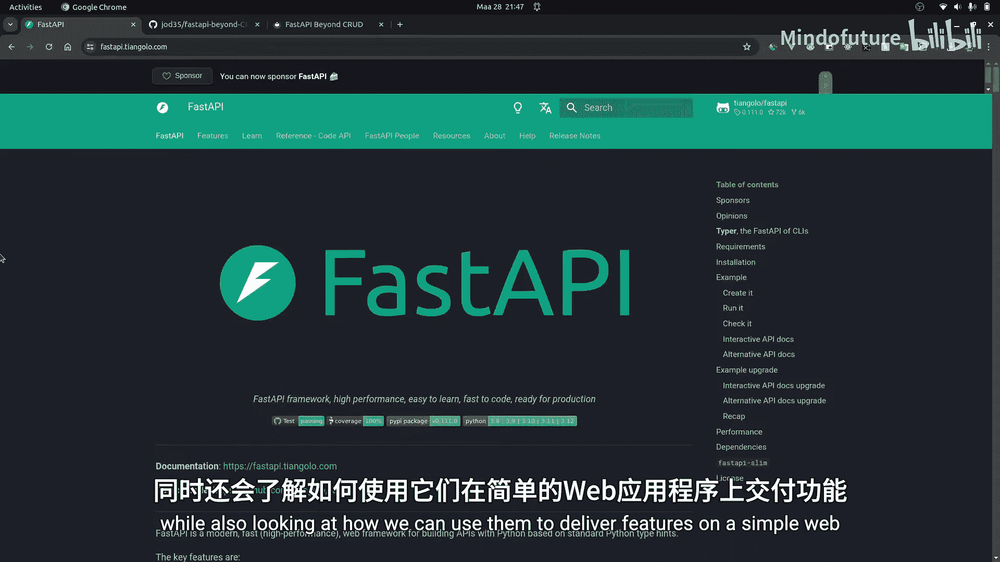

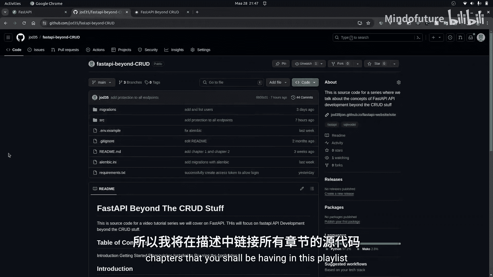

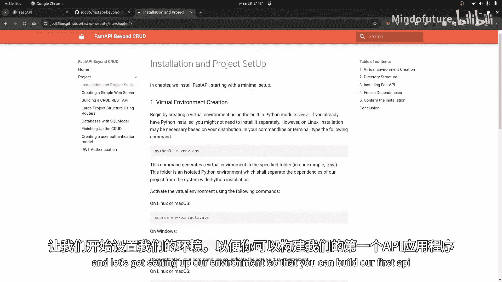

To begin our project， we are going to need some sort of folder in which we are going to install our dependencies。

 So to begin， I'm in Vs code and I'm having an empty VS code。 I haven't opened up any folder。

 I'll go ahead and open up a new folder on my file system now create one within my home directory。

 So go ahead and open one。 I'll call this bookley。And once I've been able to create it。

 I'll go ahead and open it up in V S code。 Once it has been open。

 the next thing is going to be for us to create a virtual environment。

 A virtual environment is a special folder that is going to allow us to isolate the python we use for running up from that we use for running our system。

 Now， within that virtual environment。 we shall also do things such as installing dependencies that are specific to only our project。

 This is very useful as it is going to prevent us from having to have dependencies colate with those that are within our system weight installation of Python。

 Now， I've talked a lot。 But this is what happens。 On a system such as。When running Linux。

 you are going to have a Python installation installed system wide。

 And this is maybe going to run things like system utilities。 Now。

 that may also have its own python dependencies that may be the same that you run on your。

Project now when you go ahead and install these dependencies。

 they may conflict with those that exist within your system， and that may be problematic。

 but when you have a virtual environment， you can keep track of the dependencies for your system and also use only those that belong to our project。

 So to begin， we're going to use Python's virtual module to create a virtual environment within our directory。

 So I'm introduced to close what we have right here and open up a new terminal now here in Vs code I can use control backtic and that will go ahead and open up our terminal right here and missing the bash。

Tminino， but you can use CM or partial or anything that you're comfortable with。

 So to use Python's virtual length module， which shall say Python3。

 that's what I'm going to use on Linux。 And then I'll call dash M。

 and the reason that's why I'm calling dash M is to call the module as a command。 And in this case。

 the module is going to be。 And then I have to specify the name of the virtual environment In this case。

 that's going to be Ev， but you can feel free to call it up Ev or any anything。

 as long as you're going to remember the name of your virtual environment。

 So once I've been able to create the virtual environment。

 It's going to create a new folder right here。 This folder is going to have a different structure depending on which operating system you are on。

 If yourre own Windows you are going to have something with Ev and then scripts and then other folders。

 But then if your on Linux or Macs or any other Uni like operating system。

Going to have something with a bin folder。 Now， this bin folder is were going to have various execut that are going to help us run various commands。

 And in this， we also see that we have peep。 we have python。 We have python 3。

 which is going to be the executable or the interpreter。

 that's going to allow us to run our python within our virtual environment。 So for now。

 if we confirm with which。Python 3， sorry for this。 This is going to be which Python 3。

 We shall now see that this is a system weight installation of Python。

 which is user bin Python 3 or USR being Python 3。 But when you activate our virtual environment and shall see that the。

Python we shall be using is going to be one that's specific to our virtual environment。

 So let's go ahead and activate that。 So on Linux and Mac OS you are going to activate your virtual environment with source Ev bin and then activate so that will go ahead and install or activate our virtual environment and once our virtual environment has been activated the moment we run which Python 3。

 then we shall notice that this is going to be showing us the version for the python3 that we have within our virtual environment so we can also go ahead and confirm with Python 3 and that will call the interpreter that we have within our virtual environment rate here so now that we've successfully installed or created our virtual environment and also activated it we can also see our version here so depending on your terminal a usinging or my batchsh to decorate my terminal。

But this is going to also have an indicator on your terminal that shows that your virtual environment is activated with that out of that way。

 let us square ahead and now install fast。 So to install fast， we are going to use Pep。

 But the people are also going to be using this one that's going to be found within our virtual environment。

 So we're going to do that with P install。Or Pep3 install fast EPA。

And that will go ahead and add past P to our virtual environment。Now， keep in mind that on Windows。

 the command for activating your virtual environment is going to be a little bit different because the folder structure for this is going to be a little bit different as they are going to have different namess。

 So alpha step P has been installed。 Now let's go ahead and confirm our installation。

 We can go ahead and run Python 3。And inside it here， we can go ahead and say import fast APA。

 if fasterPA installed， then we shall not get any problems。

 We can also have the faster API C I to confirm whether our faster API has been installed。 Now。

 whenever install fasterPA， we are also going to have a version of the faster APA C I installed。

 So to confirm whether that has been done， then we are going to run faster API。

And just in case we get any output， then that shall also confirm that AltPA has been installed。

What's up。 We come back。 So now that we install Fast P。

 let us go ahead and create a simple web server。 So to begin。

 let us create a new file and call it main do puree。Once we've created this file。

 then we' are going to go ahead and create our instance over our fasterPA application。

 so every faster PA application is going to have a main app instance that is going to be the entry point to our fasterPA application with this you get access to everything that you need to create your fasterPA application。

 but for us to create that instance then we shall have to first of all input the faster PA Class faster PA。

So we're going to do that by same from。Fast APA， we are going to go ahead and import our fast APA。

 And once we've been able to import the fast APA class now， let's go ahead and create that with app。

 So app is going to be a variable， but this is going to be pointing to the fastPA instance or objects。

 Once we've created that， then we can pretty much get access to everything that we need。

 if we want to create a midway。 If we want to create routes。 If we want to access H T P methods。

 all of those are going to be present within this up variable we've created。

 So let us's go ahead and create our fast APA endpoint or APA path。 So any EPA endpoint is。

The path on which you are going to make a request if we are to expect the response from this web server so to do that we' are going to go ahead and use add app。

 then we shall access a specific method such as gate or post or patch or put or delete or any other HtTP method So these are methods you can access on the app instance but what one to is to get access to an HttP method in this case we are going to say get and this is going to require us to provide the path that run to。

Use that get method on。 So this case， we are going to pervade the root path。

 and once we pervade the root path now let us define a function that's going to be triggered when we access that specific path。

 So that is going to be a think de。 Now notice that this is going to be an assigningnc function and this assignnc function is what is called a quarantine but it's going to be one is going to be called when we access that specific path or that specific endprint。

 So we shall define this and let's say we're going to call this read and as core root。

Which is going to be one for reading our root path。

 and then we define whatever code you want to be executed every time we access that specific endpoint。

 So for our case we are simply going to go ahead and return dictionary and this dictionary is going to be a message of hello。

World。So。Once this is done， then our serverva is pretty much done。

 So at this point we have a simple web serverva and to run it we're going to use the same fasterPAA that we introduced in the Fast video So for us to do that then as first Exp some of the commands that are present on this fasterPA when you go within our fastPA we can say fastPA dash help and this is going to list the menu for the fasterPA So we now see that we have a variety of options and those are the version install completion show completion and so on。

 But what you are interested in at our commands and we have basically two main commands the first one is going to be the dev command that's going to help us run our fasterPA app in development mode and the second one is going to be the run command that's going to help us to run our fasterPA app in production。

T more so。Development mode is one that's going to help us run our Sava in a way that's going to be in our development。

 So meaning we can get things such as reloading of ouravva when you make changes and stuff like that。

 Well for the Sava there is where we go ahead and run our app in a way that's not going to reload and in a way that is similar how we're going to run it when it is in production。

 So that is what we are going to use。 But this way in development。

 we actually have to use fast APIPA。Dve。To run a server in development mode Now if I run faster P Dave。

 this will go ahead and scan for some specific files and then run our app。

 but in case you do not want to do that then you have to specify the name of the specific module of the specific package in which your app instance is going to be located for our case we have a name a main dot Pi file but just in case we run this we automatically will get access to the app instance So faster P has some files it will look at and it will see the app instance。

 for example， for our case is going to be present within a main dot Pi So main dot Pi and I think up Pi and some of the files that it's going to scan through and it will automatically see the app instance but just in case it doesn't see that then let's do as server control and see。

We shall not run a fast P dev， but we have to specify the name of the module in which the app instance is located。

 So in this case， you have to pervade min do P A。 And when you run。As have is going to be run and。

The main app instance is also going to be imported。 So just like you see right here。

 we shall get access to a main app instance and a APA or S survey is going to run and be exposed on local host 8000 or 127 dot0 do0 dot 1。

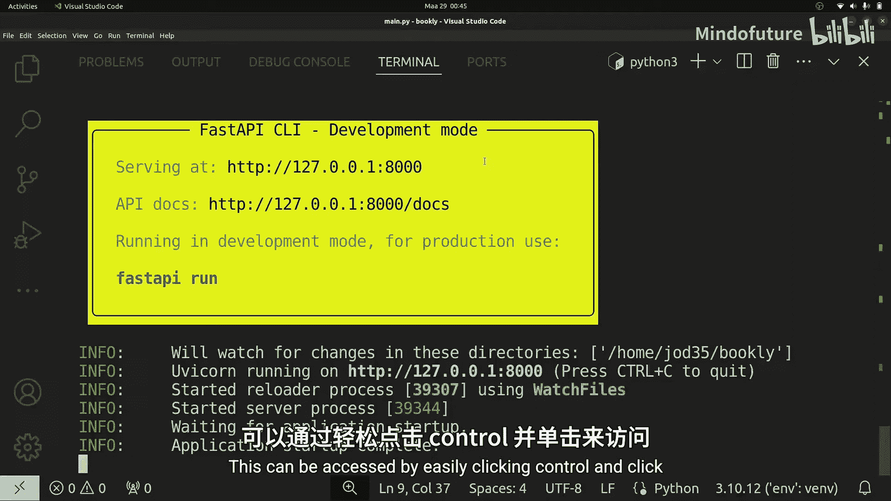

4 8000。 So let us try to access this。 This can be accessed very easily。

Clicking control and click and that is going to go ahead and run our web browser right here。

 So just like that， we've successfully made our request and return our response。

 Now that we've created our simple web server， let us go ahead and define more endpoints or more paths on our web server to help us return different responses。

 So we're going to create an endpoint for greeting a user。

 So what I'm mean to do is to go right in here and I'll define a new endpoint。 So I'll say up。

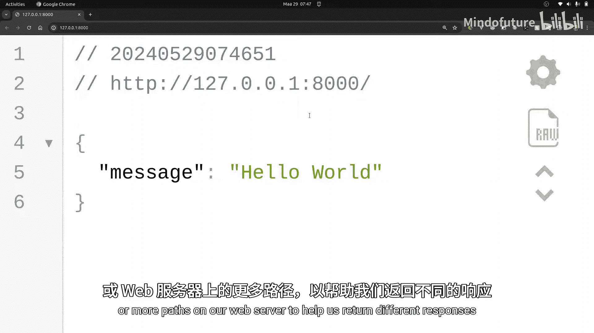

Dot gate。 And in this case， shall define the path to be1 for grid。

 But what you want to do to pass a name that you want to pass to the Sava to grid。

 So this is what is called a path parameter。 A path parameter is a variable that is dynamic that you may pass within your URL as a way to send data to your serverva。

 Now this may be important in cases you want to perform an actionism specific crystal from the sva or you want to grade and such or you want to grade and do some sort of computation but you are passing this dynamic value from your。

URL。 so in this case， for us to pass a variable within our path。 All we have to do is to use these。

Bracket syntax and these brackets， we providevade the name of the variable that you want to pass to the Sava。

 And in this case， we want to pass the name to the Sava through our URL。

 So once you've been able to do that。 now let's go ahead and define a function that's going to handle this request。

 So you're going say a single de。 And this is going to be the grid name。Function。

 so this is going to take in a name。 And with faster API， we can define the type of that specific。

Variable that you want to pass within this path handler function。

 So you're going to specify that this is going to be a string and we can also specify the return tape that is going to be returned with this request。

 So in this case we want to return our Json which is going to be a dictionary。

 once that is done now let's go ahead and return the greeting to the user So we shall simply do what we have done right here。

 but in this case our message is going to be greeting the dynamic user that has been passed in the URL which is our name。

 So we're going to have a message and I'm going to use a strings。

 So this is going to be hello and right here we shall pervade world or the name。

 So we shall pervade the specific name that we train to grid。

 So if you have noticed we have been making our requests using。

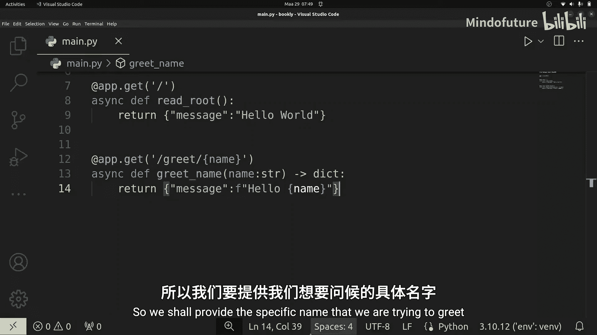

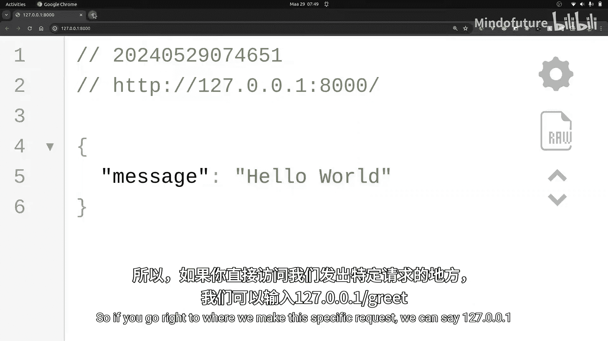

Our browser。 So if you go right to where we make this specific request。

 we can save127 dot0 do0 do1 slash grid。

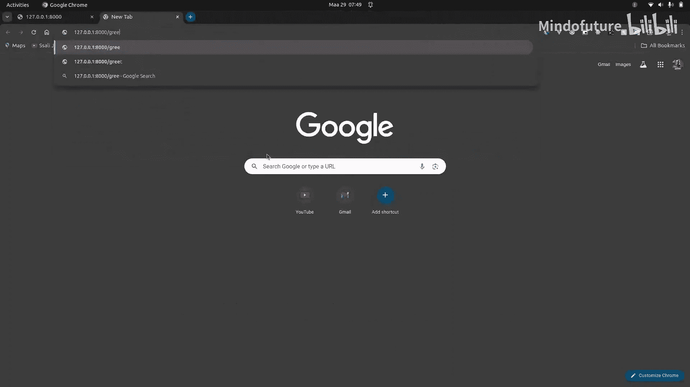

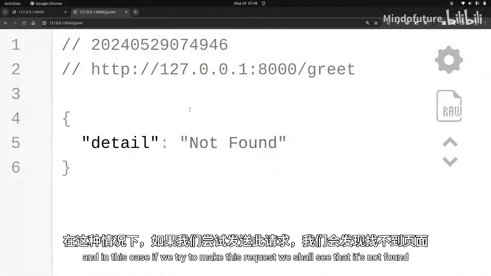

And in this case， if we try to make this request， we shall see that it's not found。

 This is not found because it will require us to pervade the name that want to go ahead and pass the greeting to。

 Now， when you go right here。

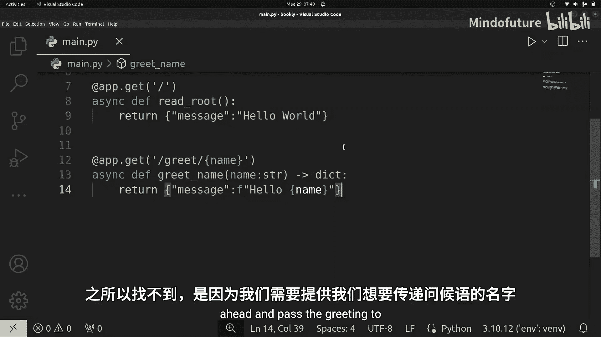

And we say slash grid slash， let's say Jonathan。 in this case。

 we shall see that this is returning Jonathan。 So for now we are using our browser as our httP client to help us make requests to our serverva。

 And with this we can pretty much do any sort of get request that you may want to pass through the serverva。

 But in a real scenario， we may want to use an httP client that is going to make it easy for us to make this request with the different httP methods。

 And that is where we are going to choose a cl。 So depending on your preference。

 you may choose things like postman inomia call。 but what I'm going to do is to use restf。

 which is a very lightweight open source tool for making this httP requests。

 So I'm going to go ahead and open up my cow and we shall look at how it works。 Allright。

 so this is my new restf window and in restf we simply have this minimalist。

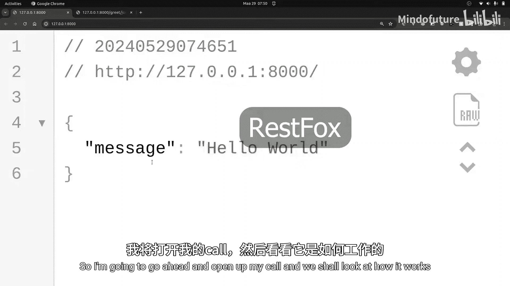

And in there， all we have to fast do is to create a workspace。 so we can go to the add workspace pad。

 And when we create a new workspace， we have to provide the workspace is name。

 So let me just call this our fast APIPA series。 So a workspace is simply where we're going to create our requests。

 And in there， we can choose the type of workspace。 I'm going to keep it to the default。

 we can choose a path where I want that workspace to be。

 So I'll just go ahead and select where I want that to be on our system。

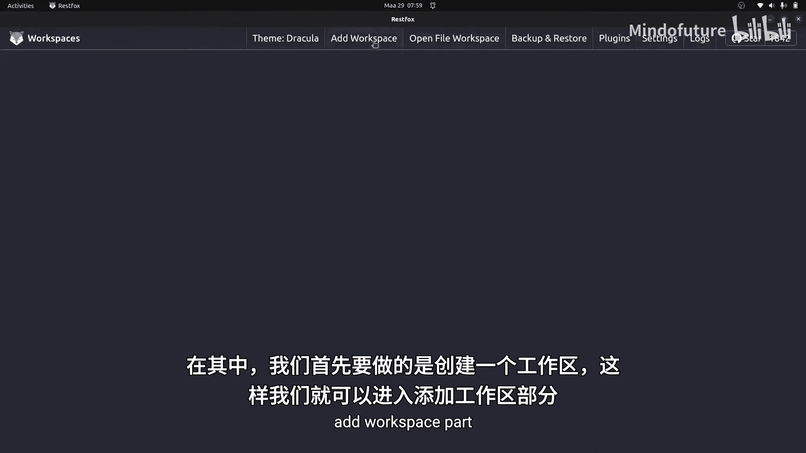

And that will go ahead and create that in our new。

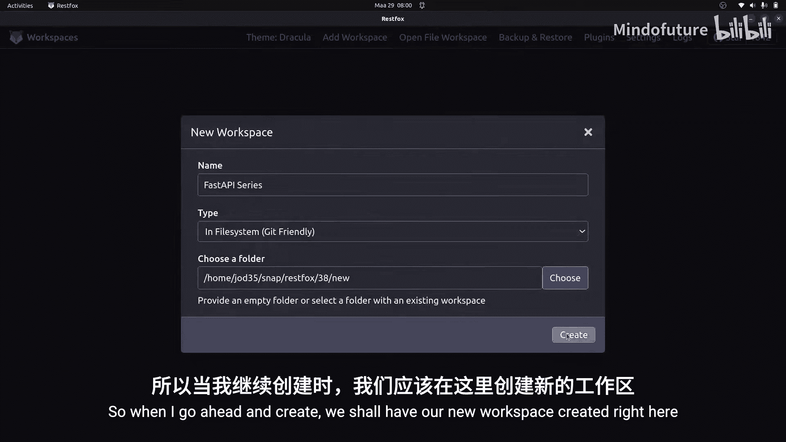

Foldder。 So when I go ahead and create， we shall have our new workspace created right here。 Now。

 it's a dial workspace is where we can go ahead and create multiple requests。

 We can also group them into folders and stuff like that。 So on this plus button right here。

 we have options for creating a new request。 that's send H T T B request。

 If we are creating one on a new soet。 We can create one for。

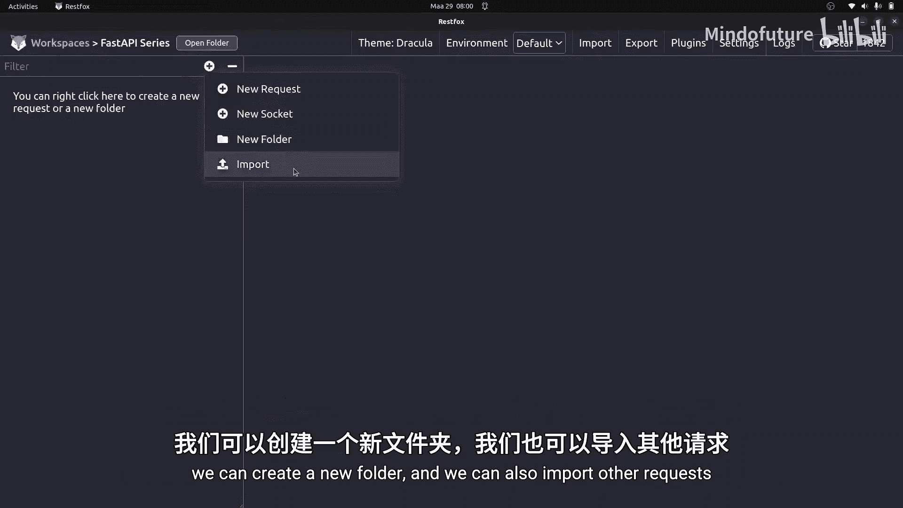

Our website request， we can create a new folder， and we can also import other requests。

 So let us begin by creating a new request。 So we're going to call this the one for hello wild。

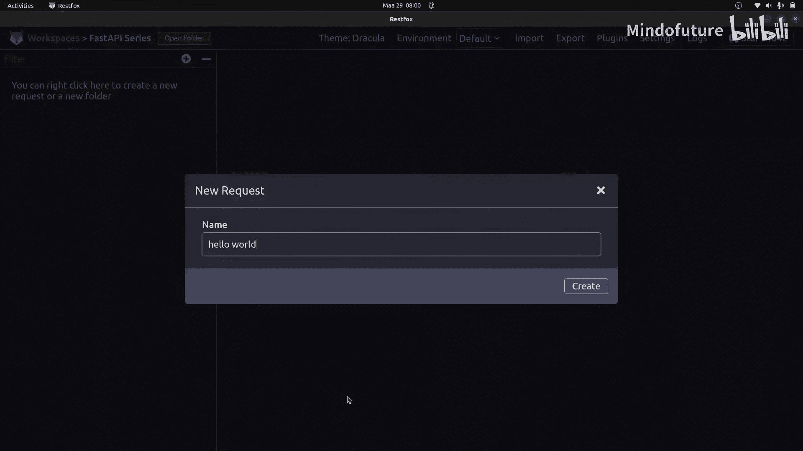

So I'm need to go ahead and click create and once that is done。

 now all we need to do is to go ahead and specify which URL。W want to make that request too。

 now I'll pi what we have atloc cost 8000 and send， and that will go ahead and make the request。

And return the response just like you see right here。 Now。

 the beauty about this is we can specify the request body if we are giving any query parameters。

 can also do it right here。 we can specify any head as one send with the request any authentication and so on。

 So let go ahead and do another request。 So I'm going to create a new request。

 and that is going to be one to that grid endpoint。 So on our grid endpoint。

 we shall past our URL right here。 and that is going to be on the slash path。

 So shall provide our name。 let's say Jonathan and。

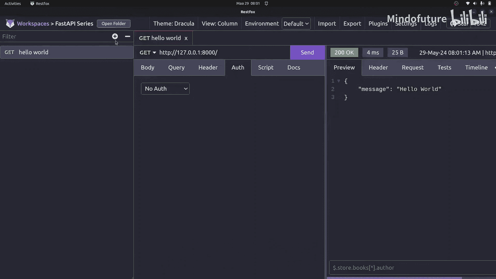

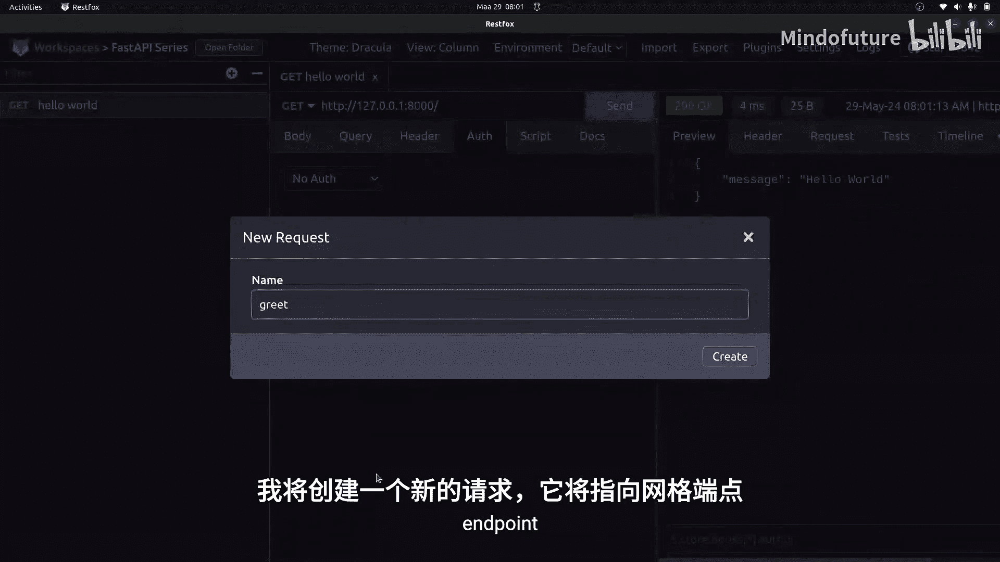

Then this will go ahead and send the request。And we shall get our response right here。

 which is going to be hello， Jonathan。 So if we say hello， Peter。

 that will be passing the query parameter， Peter to our URL。

 and that will go ahead and greet that specific user just like you see right here， so。From our on。

 I'm going to be using this as a way to make HP requests to the serverva。

 So now that we've looked at one way of sending data to our serverva。

 let us look at other ways we can send data to our serverva For now we've been able to look at only path parameters。

 which allow us to pass a variable or pass any inputs via our URL。

 another way that first APIpi allows us to do this is through the use of query parameter You probably come across places where you had to see a URL and then keep value pairs of inputs being sent to the serverva。

 So in this case we have this as grid but this could be something like grid question mark and then name and then we can have something like Jon than So this is what we call a query parameter it has the key which is going to be our name right here and equals then the value that that point to which is going to be。

So let does look at how fast A allows us to do something like that。

 So we're going to head over back to ourcor and right here if we want to pass this name as a query parameter。

 all we have to do is to go ahead and remove it from our URL。

So once you've been able to remove it within our URL。

 we are going to keep it within our path handler function as a parameter。

 so fastpi is always going to treat any parameter that is present within our pathhandr function but not defined within our URL as a query parameter what I mean is if we go ahead and simply define our URL without having to providede any path parameters but we go ahead and attach to that a pathhandr function with many parameters then those are treated as query parameters。

 so when we save as survey is now going to reload because we have Dave mode。You go back to。

Client trade here and we try to make this request。 so when you say slash grid。

 we shall now see that we are getting an error。 Now this error is what is called the unprocessable entity error and what this does is to help us show validation errors that are being returned from fasterPA Now fastPA relies on payent。

 which is data validation tool that helps us to easily validate the kind of data that we pass through to our APA or pass to our APA Now in this case。

 FastPA is telling us that it it is expecting a name query parameter， which we have not pervaed。

 So this is the kind of response that we are getting the data square ahead and specify it within our URL。

 So what we're going to do is to go right here and then use the question mark as the beginning of our query parameter。

 which are pervade the key which is going to be our name and this is going to。B， let's say Jonathan。

 And that would be the one to return our name。 So if we sent。

 we' are now going to see that our Sava is going to return the response。 Hello， Jonathan。

 and it is doing this because we now have the query parameter name being the name Jonathan。

 So if we change this to something like， let's say。trarive。对了。

We are now going to see that it's going to return treor because we have passed the query parameter of Treor within our URL。

 Now， this is a very important thing， as it can be one way in which you can pass data to the EPA。

 But this case， you will be doing that via key value pairs。 Now let us look at how we can mix the to。

 So for now we've looked at how we can use path and query parameters。

 and we've looked at how we can use them separately。

 But what if we have a situation in which you want to use them within the same EPA endpoint。

 So in here。What you're going to do is to mix the true。

 So we're going to be required to provide a path parameter and also a query parameter。

 How are we going to do that？ So what I'm mean to do is to provide this as slash grid and then our go ahead and provide the name as path parameter。

 But in case you want to introduce a query parameter into this equation。

 then you're going to remember that each parameter that we define as part of our path handle function is going to be a query parameter as long as we've not defined it within our URL。

 So you can go ahead and provide another。Qury parameter， which is going to be an edge。

 and this is going to be an integer。 So when you pervaate this。

 then we are going to go ahead and add this。 So I'll just say edge。

And our edge in this case is going to be our edge。 So I provide this as our edge。

 So when I save what this is going to do is to request to provide the name path parameter。

 but we are also provide a query parameter of edge in that specific request。

 So if we go back to our Ht TP plan right here we are going to have the name t but when we send we are going to see known found。

 So we have to provide this as a path parameter， Sore going to change this so。

We're going to have slash grid， slash t。And we shall also。

 So when we send we see that it's going to require that age query parameter。

 So when we do change that by providingvaing the age query parameter。 So let's say the age is 23。

 if we send， we shall now see that it's going to return。The name， as well as the age。

 So this is how we can go ahead and mix both path and query parameters on the same APA endpoint。

 Now that we've looked at how we can mix both path and query parameters。

 Let us look at how we can make query parameters optional In our example right here。

 all we're doing is to pass the path parameter of name。

 and we then go ahead to greet the user with a specific name。 Now。

 let's imagine a scenario in which this name was an optional adjut or an optional parameter that we pass to the serverva。

 Now， removing it from the URL is going to make it a query parameter， just like you see right here。

 But let's say wanted to have a default value for the name that will be greeted just in case we do not have a name specified。

 Now， this is where optional query parameters come in。To make our name parameter optional。

 we're going to make use of a special class called the optional class that comes from Python's inbuiltyping module Now PassPA allows for many inbuil data tape such as string。

 int di and so on to be passed as parameters， but with it also it allows those that come from the inbuil Pythontyping module。

And we're going to look at how we can use most of those classes。 So to begin。

 we're going to go ahead and input the optional class from typing。

 So shall'll just come right here at the top and save from typing。

We are going to go ahead and import the optional class and once we've got the optional class now what we have here is a mandatory query parameter to make this optional all we have to do is to go ahead and pass it within our optional class。

 so we're going to rewrite this by saying that our name is going to be an optional string。

And this is going to now have a default value。 So to prevent the default value to our string。

 all we're going to do is to go ahead and prevent and。Equal saying。

Then we provide that default name that we're going to use for that specific name parameter。

 So we're going to providede user as that name。 And what this will do is to go ahead and use the name user in case we haven't specify the query parameter for name。

 Now， notice that we are having an error here。 And this is happening because。

The edge should also have to be fast before this keyword parameter。 So for us to fix that。

 we can also make sure that the name or the edge has a default value So we can provide a default value being equal to 0。

 And what this means right here is the edge is going to have a default value of0 in case we do not pervade one and our optional name is going to have the value for user in case we do not have to providevade the。

Default fact。 So I mean to format this so that it looks a little bit better。 amazing black。

 And what you have here is。A formatted code， but it is much more easier to read。

 So we have an optional name parameter with a default value of user and an optional age or query parameter of age。

 but it has a value of0。 So if we go ahead and save and head over back to our client right here。

 we make this request we shall see detail not found。 Now， keep in mind that in this case。

 we do not have query or path parameter。 we do not have a path parameter for that name。

 So if we go ahead and say。Slash great。In this case it's going to return hello user because we have a default value of the name as user and we also have our age as 0 there for you to return age as0。

 but in case we go ahead and provide this so we can go ahead and say user or actually that is going to be our name just like we see right here。

 so if we go ahead and say name。We can provide a name， let's say， Jonna， and then。

That will go ahead and say nonfo because we have name Jon， this is going to be a query problem。

 sorry for this， so have to provide the question mark right here。So if we send this。

 we are now going to see that it's going to return our name that is provided。

 but just in case we leave out the name。It's going to return user。 So when you provide the name。

 it's going to return that name query parameter， but in case we leave it out。

 then refer to the default value of our user。 So it has also perva the edge。

 so to per the edge I'll just use the ampers and。And H， then let's say age is equal to 23。

 So that will go ahead and return the age that we have specified within our query parameters。

 And just like that， we can be able to。Send optional values through query parameters。

 just like we have done。At this point we've only looked at how we can pass data to our Sava using path and query parameters。

 we've also looked at how we can mix the two and how we can make them optional。

 but we are also going to have scenarios in which to send data to the Sava to create resources or to perform some action on the back end and this is where the request body comes in now the request body is a way。

We send data to the serverva that is going to be used and validated in some way。

 So let us look at how we can be able to do that。 We're going to begin by defining an endpoint that is going to be creating some sort of resource and then returning it back to us so。

To do that， we're going to， first of all， begin by specifying that we're going to make a post request。

 but keep in mind that a post request is not the only request that may send data to the serverva。

 we may also have a post request that's going to update something on the serverva so。When we do this。

 so we are just simply going to say create， or let's say， book。Once that is done。

 we shall defend the handle for this functions。 So shall say a think de。 And in this case。

 we shall create book。So let us go ahead and pass this for now。

 So what we have done is to create the path， which is createbook。

 and we are only going to access this via a post request。 Once we've been able to do that。

 we have defineded a function that's going to handle that specific request。 Now。

 one thing that we need to understand is。When making a post request or any sort of request that involves sending data to the salva。

Then we are going to need some way of validating this data， so。To validate the data。

 we are going to create what is a serialization model。

 So a serialization model is one that's going to help us to change data from the database or change data from our serverva into something that any client that makes a request to our serverva can understand it can also be the reverse where we are actually getting data from a client and then sending that data to the serverva or making that data be in a form that the serverva can understand for our case。

 what we're going to do is to create a model。 And that model is one that's going to help us to send data from our client validate whether that data is correct data and throw any validation errors in case we have some。

 So to create a pant model， we are going to begin by importting the best model class。

 And once we've been able to do that then all we're going to do is to begin by creating a class。

 and this class is one that's going to define that data or the field。

Of the data that we want to send from our client to our serverva and vice versa。

 So we're going to create this and。Let's just call it the book create model。

So this book create model is going to be a sub class。

 or it's going to inherit from the best model class。And once it has been。

Once we have been able to create this class， then we're going to define the fields that are going to exist on a book。

 So we're going to have simple fields such as the title of the book。 And this is going to be。

As string。 So we have to define the string using tape pins。 So the syntax is just the field。

 and then。Colon then the type of that specific field。 So in this case， we shall specify that。

 This is going to be a string。 We can also have the author of the book。

 and this author is going to be a string， so。Once we have this。

 then this is just enough for us to define how we're going to send data to the serverva on our post request。

 So to be able to do that then all we have to do is to go within our create book handler function and then pass that as our data so we're going to define this as a book create data or let's just say this is going to be our book data is the data that we're going to expect for this request and once we have that then we shall just say it's going to be of type book create model once you've been able to do that now let's go ahead and try to access that data。

 So what you want to do to just simply go ahead and return。

The information of that data that has been sent as a response。

 So let us go ahead and return the title。 So our title in this case is going to be access from the book data or the data that was submitted during creating the book。

Then dot， So we shall access the title。And then we can also go ahead and do the same thing for our author。

And this is going to be our author， so our author is going to be I from the book data。

 sorry for this。And just like that shall be having access to our book author。

 So let us go ahead and test this。 So I head over to our client right here。

 I'll create a new request and I'll call this create。

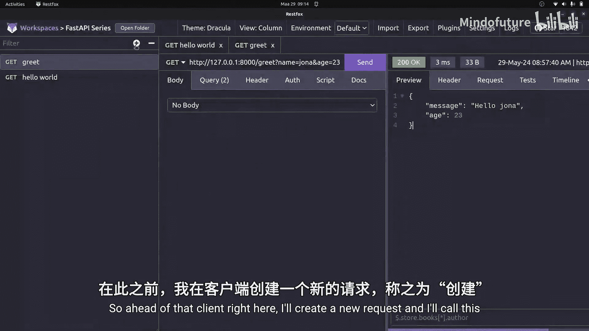

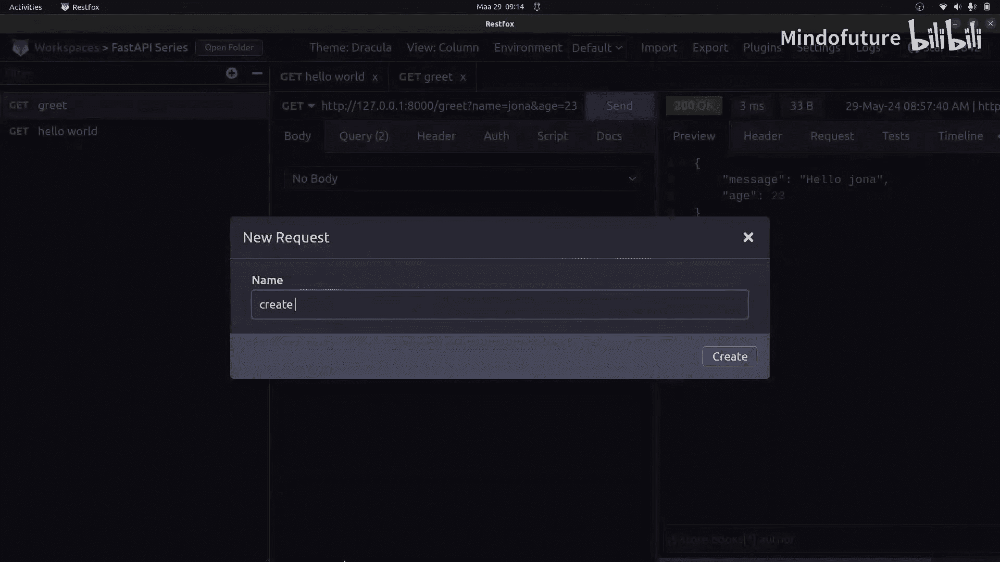

Book， so for now， we're not having any sort of database。

 but we shall look at that in the coming chapters。 So when you create a book。

 we are going to specify that this is going to be a post request。

 Now I'm going to copy the URL that we have right here。I'll close some of these。

And our pasty trade here。 So we're going to access this slash createbook endpoint。

 So I'll say create dash book。 And in this case， if we try to send the data， we shall get an error。

 same error that's going to be for the unprocessable entity。

 meaning that we are missing the request body So we have to provade the body。

 So Fast API in this case is telling us that you know that you are trying to make a request on this endpoint。

 but this requires for you to have a request body。 So lets us go ahead and pervade that now for us to pervade the body。

 We have to go to the body section of our。Rst f。 And in this case。

 we have to provide the type of the body。 Now， we are going to send the Json body。

 So I just simply create a simple Json object how when I send when you send an empty json object。

 we shall see that。There is some sort of validation on the back end that's going to tell us that we are missing the title and were also missing the author。

 so let us go ahead and pervade those if we come right in here and say that we are going to have the title。

Our title is going to be， let's see。L。江国。And啊我 said。I's going to be Sally Jonathan。

So if you go ahead and send this， we shall now see that our response is going to be returned。

 So that's basically how we do it。 All you have to do is to go ahead and define the type of data that you want to send to your server and then past that as a parameter in your。

Path handler function， and then you can go ahead and use the kind of data that you want to use for that specific request。

 In addition to our request body and path and query parameters。

 there may also be information about requests and responses that we may want to access and faster P allows us to do that in a very interesting way。

 So when you head of back to our client trade here。

 every time we are making a request we are getting a response。

 but the server is also retaining some information about that specific response。 However。

 we can also go ahead and specify information about the request that we are doing。

So for each of the requests that we are making right here， the moment we are sending JO。

 we are specifying that， you know what serverva our information is going to be sent with a content type that is going to be application slash Json。

 We can also go ahead and specify many other head does。

 So if we go back to our browser right here and we refresh we're going to notice that our response is going to be returned。

 But I want to show you where the head doess are being。

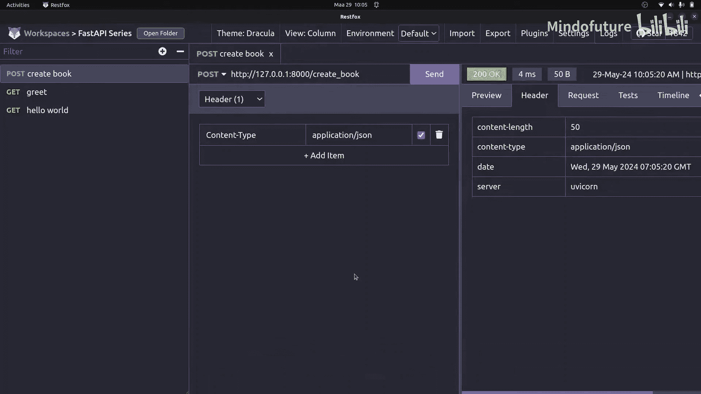

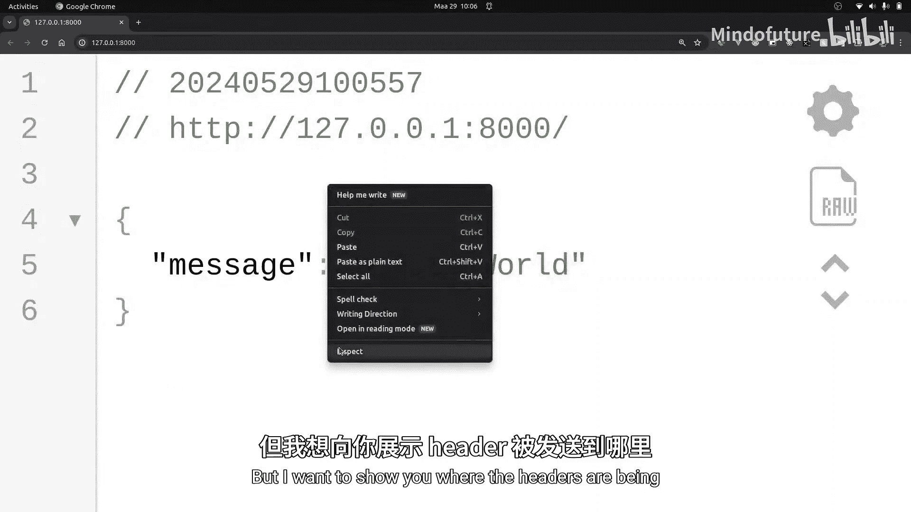

Send for that specific request request。 If we head over to our browser tools right here and we go to the network section。

 we can notice that when we refresh or make that request once again。

 we can be able to know which type of headers are being sent。On this specific request request so。

Let me make this a little bit bigger。 We can notice that all the headers are being sent right here and the request headers for this specific request include the accept。

 So this is going to basically accept anything with text slash hML because this is returning an HML page release Jason accept encoding So this is the particular encoding which is Gi zip and so on the hosts which。

Is our local host 8000 the。User agent， which is the specific browser that has made this request。

 Now in our case， this is going to be the specific browser rate here so。

All these head doess can be accessed using fast API。

 And let us look at how we can be able to do that。 Now， for us to access our head dashs。

 we are going to create an API endpoint that is going to simply return all these head doess for a specific requests。

 Now， when you go back here。

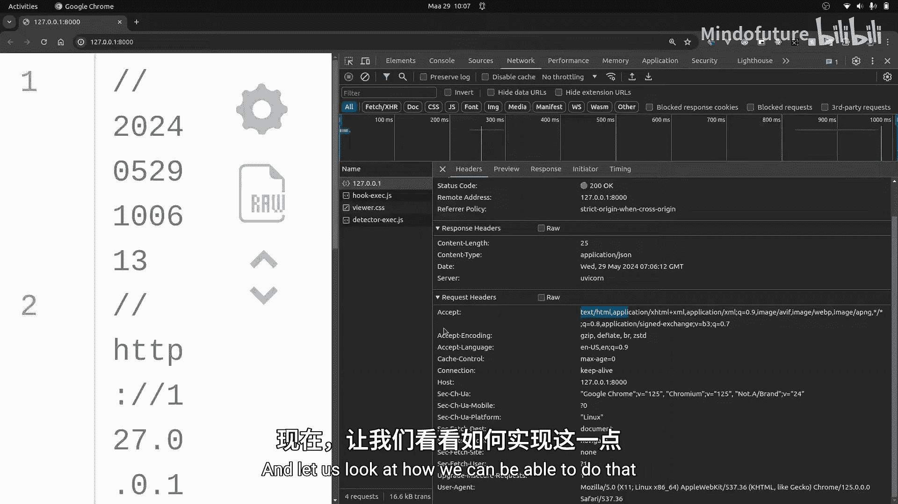

Going to create。Request， so let's just say slash。 And I'll just say this is going to be slash gethead does。

And once we have this， we can simply go ahead and say， Dave， get。Dash headers。 And once we have this。

 then well go ahead and have to specify all the headers that we want to access in this specific part。

 So let's go back to our browser rate here。 All the headers that we have right here can be accessed using a header function that comes from faster P。

 So the we access that is by， first of all， inputting that function。

 So we're going to go at the top and say from Fast P。

 We are going to go ahead and input the header function。

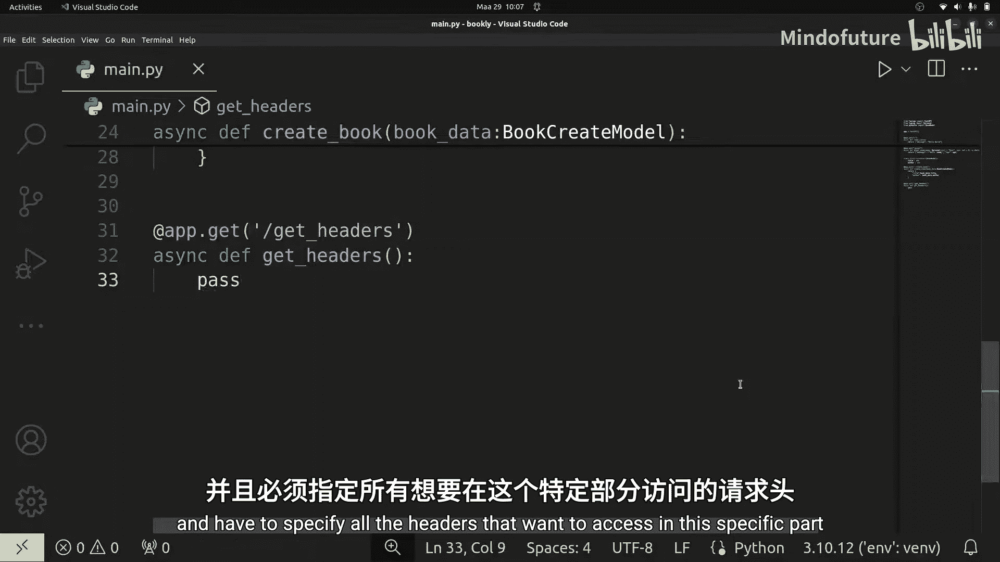

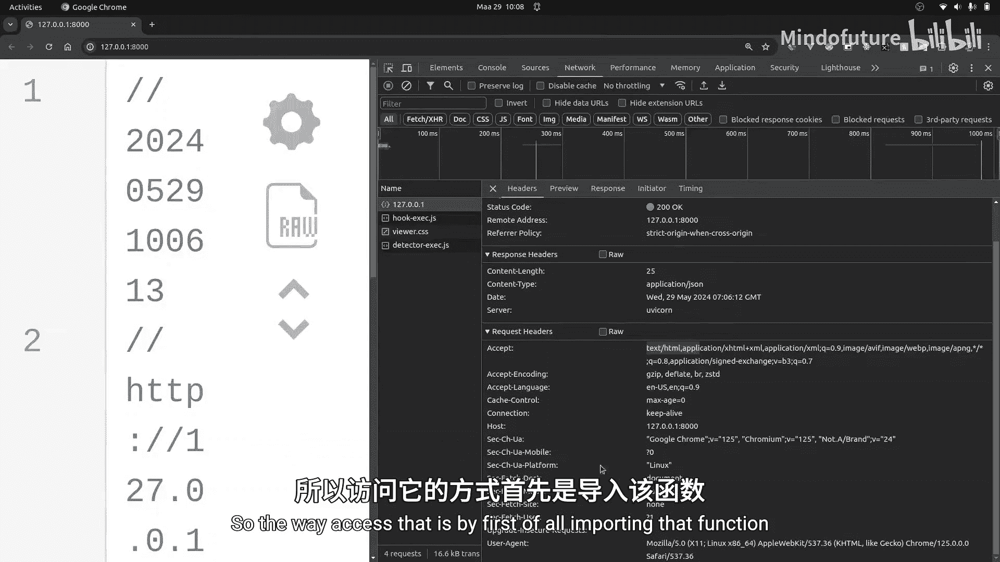

And once we've imported the header function。 now we're going to go ahead and kind of is the same logic where we're going to just inject the parameter of that specific header into this specific。

Path handler function。 So let us start by looking at one so。When you go back to our browser here。

 we can see the accept header。And this is one that we can access by using the。Lower case accept。

 So when we say accept this is going to stand for the accept header in our request for us to access this。

 we can just simply say it's going to be a header and it's going to have a default value of none。

 So what you have here is this is going to be a string。

 but this string is going to be a header and in case this header does not exist in our request is going to return none。

 so。Each of the headers that you can have for your request can be accessed using the lower case。

Of that name。 So in this case， this is going to be a accept header。

 but we shall access it using the lower accept。 So when you try to return this， we can say return。Oh。

 let's just say we can create a request。He does dictionary。

And we are going to go ahead and set each value with the value of that specific header so we can now say request headers。

And in this case， this is going to be our accept。And our acceptator will have the value of the acceptator。

That we get from our request。 So let's just simply go ahead and return our request headers as our response。

 So if we try to do this。

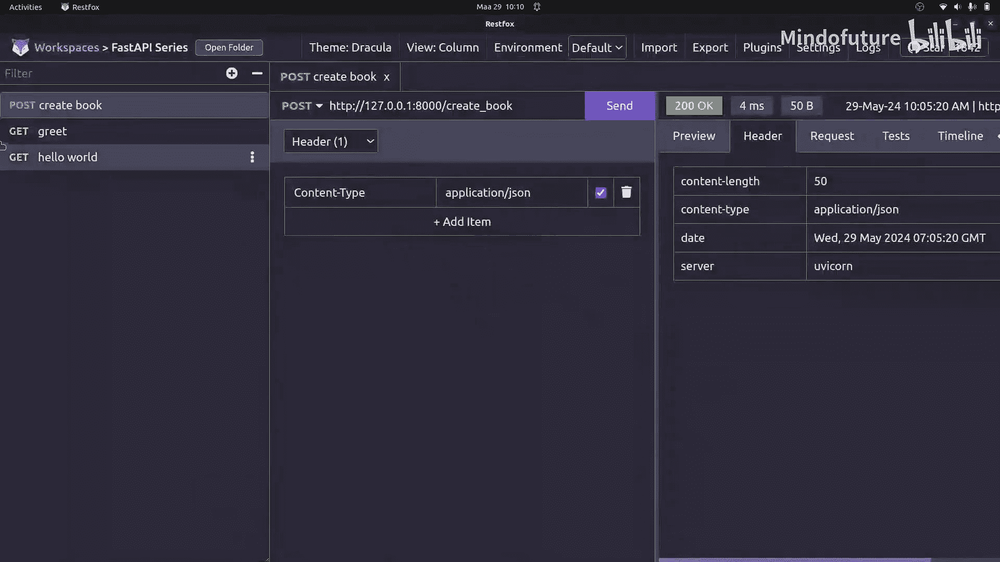

We can go back to our client trade here。 and in our client。

 we are going to create a new request that is going to be for head does。

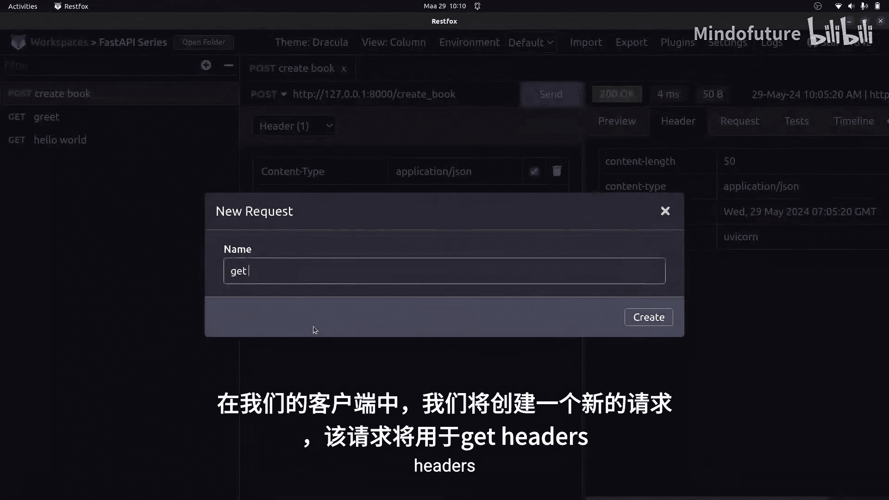

And once we've been able to do that， let us go ahead and provide the URL。

 So I'm just simply going to get。Could copy that。I close that。

 then we are going to go to local state0 slash gate。He does。And when we send。In this case。

 we are going to see that this is going to be one to get all。Content tape。

 So this is going to be accept。 and then it's going to return the value of that。

 So let us see the kind of content type that we have for this specific request request。

 If you go back to our endpoint rate here， all we have to do is just inject that as a parameter。

 So we're just going to save content。And that's go tape。 And this is going to still be a string。

 and we shall access this as our header。 So if we come right here。And provide this as our header。

We shall save and also set that as part of our request here as dictionary。

 so shall just come and say this is going to be our content tape， sorry for this。

And our content type is going to be equal to our content type。

So once we've been able to set that up now， let's go ahead and make that trick request。

And now we see that our content type is going to be now， so。

When you check the head desk for this request， we do not see any type of content type being specified。

 So if you go ahead and add our content type。Sorry for this。

 so this is going to be our content type and when you specify our content type to be application slash Json。

We shall now send our request and then this will get the content tape header and then return it for our content tab。

Which is application stroke Jason。 So let us try to get the user agent。

 So the user agent is going to be the header。 that's going to be the string to represent who made that specific request request。

 So let us just try to fill that in。 If we come right here and say that we are going to get the user and as call agent。

 So this is going to be the string。 And this will be the header。Shall be none。

 so when you try to do the same thing， we shall just set the key to be our user agent。

And the value of this is going to be the user agent。 So let's just set that up。

 Let's also do the same thing for the hosts。So the host is going to be a string and this string is also going to be the same thing header。

And this would be none。So we're going to do the same thing here， which shall I just say request。

He does。 And in this case， we shall specify our host。And our host。嗯。

Its going to be equal to our host。So when you try to make this request once again。

 we shall now notice that it's going to retain the user agent， which is going to be this client。

 which is restfs。 And if we return the host， it's going to return our host which is local host 8000。

 So for now we've seen how we can access the headers that are for this specific request and we have so far looked at how we can set up a simple web server。

 we can pass path and query parameters and now we can also get our request headers we can also specify the specific status codes that are to be retain by a certain APIPA in print there we do that is by。

Going where we are specifying our request。 So just in case we wanted to customize this。

 we can say that this is going to return a status quo。

And then we can specify which specific set as code9 in our case， this can be 200。 So if I send。

This is going to return 200， but in case we wanted to let's say change this to let's say to 01。

Then when you send this， it's going to return to 01 created。

 meaning that our resource has been created on our website if wanted to customize it to make it。

 let's say a 500 error still that's what is going to happen。

 It's going to return a 500 internal server error。 So I hope you get the entire idea。

 and this is how we create a simple。Websva using faster P So we've looked at how we can create a simple websva。

 we've looked at how we can run our Sava。 we've also looked at different concepts such as path query Power has how we can make them optional and how we can also access the head does for a specific requests we've made to a specific EPA endpoint Whatsapp everyone will come back So in the previous video we looked at how we can build a simple web serverva using faster P and we also explore the different ways in which we can build aPA endpoints using that simple web serverva with that knowledge we are going to come up with a correct rest EPA。

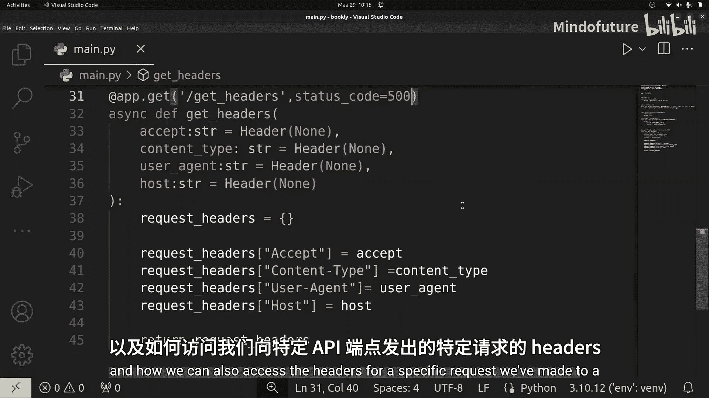

So C is simply an acronym for four functions that are involved whenever you are manipulating data in a data storage application。

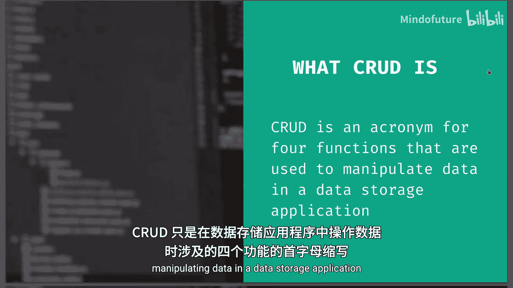

Crad is simply create read update and delete， so for creating we are creating a resource on the back end。

 so think of a resource as any sort of data that is being provided by an APA or data that we are trained to manipulate using our EPA so in this case we are going to be manipulating book data since we're going to be building a book review service。

For reading， you are going to be fetching a resource from your backane。

 so this is a read operation that involves you having to go to the database site or to the data storage part and then picking up that specific resource that you are trying to。

Get。For updating， you are updating a resource that exists on your backend and you are trying to modifytivate it with new data that is coming from your client。

Then for deleting， we are deleting a resource， so we are basically going to the back end and then having to delete or remove that specific resource from our back end。

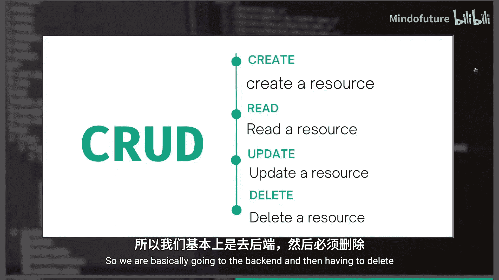

Then what is the resource， resource is simply that data that an A providesvaates or allows us to manipulate。

 So most of the cases you may。Enar with an already existing EPA and that EPA is going to pervade some sort of data。

 but sometimes you also go ahead and manipulate that kind of data by creating or deleting or modifying that specific data。

Alright， so now that we've understood what cr is let us go ahead and try to look at how we're going to implement this simple cr risk APIPA。

So ATA is a simple table containing the different API endpoints。

 the htTP methods that are going to be used and that description for those specific h TTP methods or those specific。

Enpoints。 so the first one you have is going to be the slash books endpoint。

 And what this is going to do is to allow us to fetch or get a list of all books from our data store。

 Now， in this video going to be using a simple data store， which is an in memoryory database。

 but we are going to look at how we can use a persistent data store such as a postreql database。

 The next endpoint is going to be one for making a post request to our slash books endpoint。

 So this is going to involve us getting data from the client and then having to send that data to the server via a post request。

 The next one is going to be the book， the slash book slash book I D endpoint。

 and this is going to be one for。Updating a book on our back end。

 the reason where we are using a patch method is because。By updating the book。

 we are not doing a full update to it。 So we're going to be updating some of the fields that are going to be existing on a book。

 Finally， we have the slash book slash book I D。Which is going to be accessed via the delete H TP method that's going to allow us to delete a book on the back end。

 Alright， with that out of the way， let us get into building this simple cr API P。

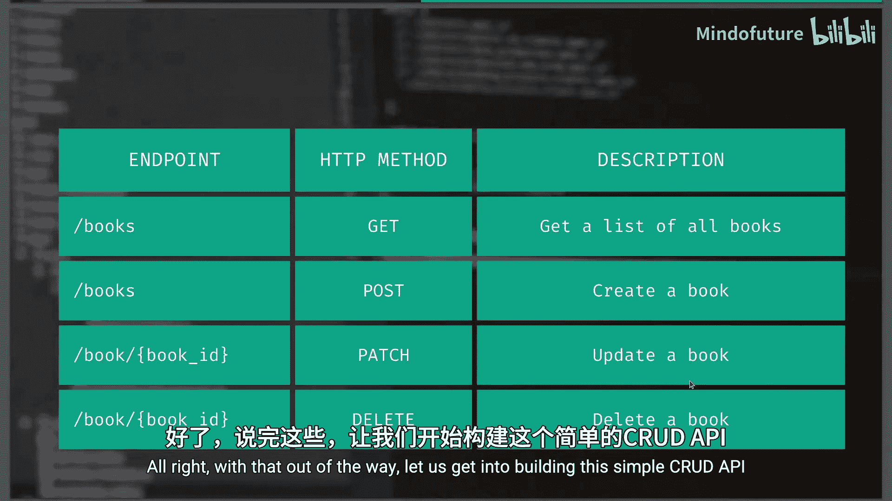

Instead VS code is a simple list of books that is going to act as a book database。

 so what you're going to do is to carry out credit but on this simple inmeory database。

 which is the Python list， what you're going to do is to first of all create alpha step instance and begin by importing alphapha step class。

Think I' meant missed a grade ti。 So going to be fast EPA。 And once I've been able to do that。

 I'm going to simply create an instance of our fast EPA class。 Once this has been done。

 then the next thing is going to be for us to create the EPA endpoints to carry out whatever we specified in the presentation。

 So I'm going to go right at the end of this list rate here。

 And then we shall create our fast EPA endpoint using up door get Now keep in mind the。

HtTP methods we specified。 So this is going to be on the slash books endpoint。

 Let me make this a little bit bigger so that you guys can see and we're going to define the handler function for that as one forget all books。

And we shall pass this for now。Now we're going to simply create the other endpoints。

 and then we shall implement their logic one by one。

 So I this to go ahead and copy what we have here。 this is going to be the same for the one for creating books。

 though the H T TP method will be post。 and then you shall have to also change the handler function to create。

啊，book。Notice that I'm giving very descriptive names for the actions that are being carried out by these path handler functions。

 so I'm going to do the same thing for getting a book。

 so I'll just come right here and say at app dot get so this is going to be slash books。Actually。

 it's going to be slash book and then slash the book I D or the I D of the book that you're going to retrieve or get。

 so。That's going to be slash book I。 And then we are going to define the handle la function for that。

 as gi。Book。So notice that if you are trying to get your book。

 then this is going to be a path parameter。 if you haven't checked out the previous video。

 we discussed how we can use path parameter， but when you define a parameter。

 just like we've defined for the book I then we shall also have to go ahead and provide it as our book I in here So this is going to be an integer for now but we're going to look at how we can use your Is when you get to using a persistent database so。

Once we defined our integer。A D， then we're also going to define the return tab。

 So let's say this is going to return a dictionary。

On way I haven't done it for the all so let me go ahead and do that So all these are going to return dictionaries。

 so this is going to return a list and we're going to look at how we're going to implement it so let me skip that for now but this is going to return a dictionary so I have to specify that this is going to return a dictionary which is going to be our book that we've created then let us go ahead and do for the rest of the remaining endpoint so we have now done create read update so this is actually going to be create read So we have one for getting all books we have one for retrieving a single book updating a single book and then deleting so we'm going to copy what we have here。

And this is going to be for。 So let this be for updating。

So when updating we are going to get the book data， but let's not focus on that for now。

 let us go ahead and also name that for deleting a book。All right， so our EPA endpoints have been。

Buildilt， so let's go ahead and first of all， deal with retrieving old books。 So to get our books。

 all we going it is to simply retain this book resource that we have here or the books list that we have right here。

Which is our in memoryory database with books。 So I'm going to go as ahead and simply say return。

And in this case， were going to say return books。 and that is going to be just enough to return our list of books so。

If we pull up pass server。So it is not actually running。

 so you have to go ahead and run it with faster P depth and then Ill point to main do to P。

So as I is running I head over to rest folks and then what I'm going to do in this case is to create a new folder where we're going to have all the endpoints that are going to be for our books。

 Now inside that is what I'm going to create our first request and I'm going to call this get all。

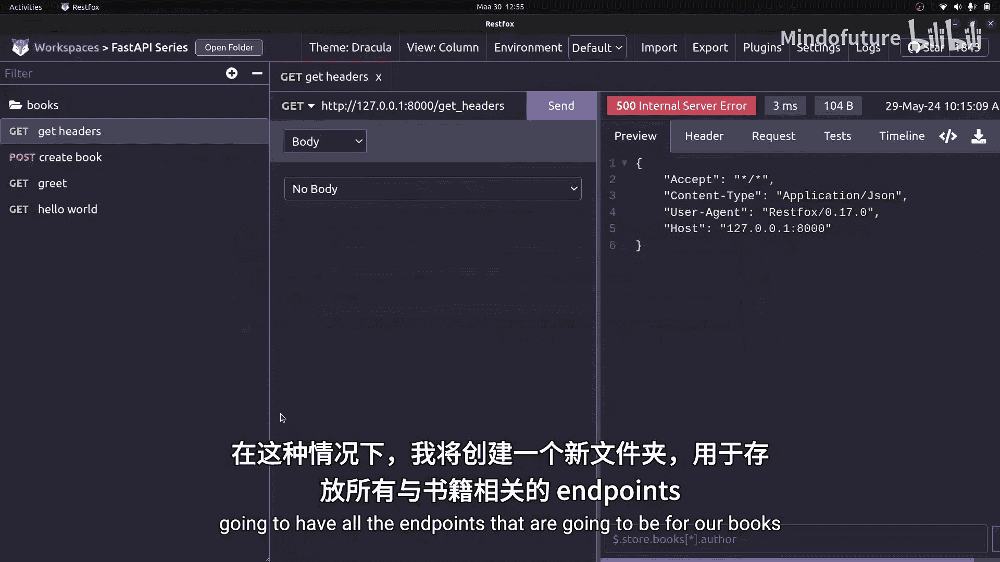

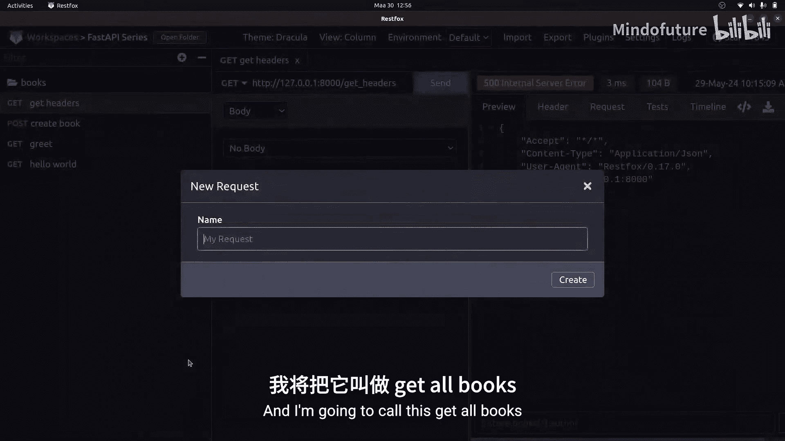

Books。So this is going to be one for。Getting a list of books now。

Going to make this a little bit bigger。 And once I've been able to do that。

 then I'm going to go and get a local host 8000。Pty trade there。

 So notice that our books are being accessed on this slash books endpoint。So now go to slash books。

In this case， we shall get all our books just like you see them right here。

 So this is successfully working。 So one thing that we haven't yet then is to specify the way in which we are retaining these books。

 and this is where pedantic models are going to come in So in the previous video we talked of the request body and we talked of pedantic models。

 but we didn't discuss how we use these pedantic models to validate the data that is being returned from the EPA。

 so much as we have our data defined here， we also need to define the way in which the APA is going to return this data。

 and that is done by providingvading a special attribute to this specific method which is going to be the response model attributes。

 so。Let's go ahead and provade that。 So I'll see。Response model。

And our response model in this case is going to be the way we want to retain our list of books。 Now。

 we're going to achieve this by first of all， defining a data model for our books as they exist in the database。

 So let us go ahead and do that。 So I'll begin by going to the top here。

 So I'm going to make this smaller。 and then I'll go ahead and import the best model class from pdentic。

So say from paid antique， we are going to go ahead and import our base。Model class。

 And once we've been able to do that， so have a mistake right here。

And let's go ahead and create our class for books。 So this is going to be the one to define our books。

 And in this case， this is going to inherit from our base model class。

 Once we've been able to do that， then。Let us look at the structure of a single book resource， so。

Right here。 we have all these fields that belong to a book。

 I'm just simply going to come copy them right here。

And then I'll go ahead and past them right in our class。

 So I' mean to get rid of whatever we don't need。Alright， so now that I've been able to fix that。

 let me go ahead and now specify the types of whatever field that we have on this model。

 So the first is going to be our id and our ids are integers， just like we see right here。

 So we are having most of the things being strings。 but for the pitch count and I， we have integer。

 So I'm just going to go ahead and simply provide the right attributes for this。

 So I'll begin with the I， which is going to be an integer our title is going to be a string。

 So I'll come right here and say that our title is going to be a string。

 and then our author in this case is going to be a string as well。

 then we shall also have the same thing for our publisher which is going to be a string The publish that is a string。

 So we are going to go ahead and also provide that as a string。

 Now let us go ahead and do the same thing for the page count。

 which is going to be an integer and then our language is finally going to be a string。

 And now we have been able to create our panttic model。

So once you've been able to define our den model， remember we're going to return a list of books now。

For us to simply go ahead and prevade our book right here。

 if we go ahead and save and return to making a request to that endpoint。

 we're going to see that we are having an error and that error is going to arise from the fact that pedentic is going to expect us to have a dictionary just like you see right here。

 the input should be a valid dictionary or object to extract fields from but we have providedvaed a list of items。

 So how can we be able to fix it So to fix this we are going to go ahead and make this a list of book model objects So to do that we are going to make use of the typing list class and this is going to be one to allow us to create or define the return type of the list of books that are going to return in this model I'll go ahead and input that class from typing。

 So I'll say from。Typing。We are going to go ahead and import。List class。

 And once you've been able to import it， then data square ahead and specify there is going to be a list of books。

So once that is done， if all the fields have valid data for the data typess we've defined rate here and the extra validation that we can define。

 then we shall get a successful response else， we are going to go ahead and get errors for the validation errors。

 so when you go ahead and fetch our books in this case we shall see that our data is being returneded successfully and this is because we are defininging our data。

According to the way the model is supposed to get and validate that data。

 So no validation errors are occurring。 Alright， so now that that is done。

 let us go ahead and deal with one to create a book。 So to create a book。

 we expect that we're going to be sending data from our。

Client and this data is one thats going to be used through our serialization model to create a book on the back end。

 So to do that， we're going to come right here and inject in。Our book data。

 so this book data is going to be of type book， just like we have created。

 and once we have this book， we are simply going to go ahead and create a dictionary out of this book and then add that dictionary on top of the list that we have。

 So we're going to be using the special a paint method on our python list。

 So I mean it's going to come right here。 So how are we' going to convert this to a dictionary。

 we're going to simply going to do that our book we're going to say that our book is going to be。Or。

 let's just call this a new book。An annual book in this case is going to be one that's created to be created from the book data。

 So to access our book data as a dictionary， Pedentic allows us to access this via the model。

Damp method So the model damp method is one that' is going to convert this book data object into a dictionary that you can finally add to our list。

 so to add this to our list we are simply going to say books dot append and in this case we are going to append our new book。

Just like that。 And once we've been able to do that， now。

 let's go ahead and return the newly created book。 so we shall see return。New book。

 And that is going to be enough to add a book to our database or our in memoryory database。Alright。

 so once that is done， let us define the status quo that's going to be for creating a new book successfully。

For simply， we're going to go ahead and top here and inside our H T TP method。

 We are going to add the status quo attribute， and we're going to specify the status quo for that response。

 So to do that， we're going to be making use of fast A P status module that gives us access to all these H T TP statuses。

 So I'll go ahead the top here。 and all I say is from。Fastive P inputs status。

 but we already have fasttive P。 So I'll just come right here and see。Stitus。And once that is done。

 then let us go ahead and simply say that from this status module。

We are simply going to go ahead and access the H T TP。2，0，1 created status code。 So from now。

 from now on， I'm going to be。Accessing all status quos from the status module that faster P I prevails。

 And that is going to make it easy for us。 So let us go ahead and test this。

 If we head back to where we make our request from， which is rest Fox。

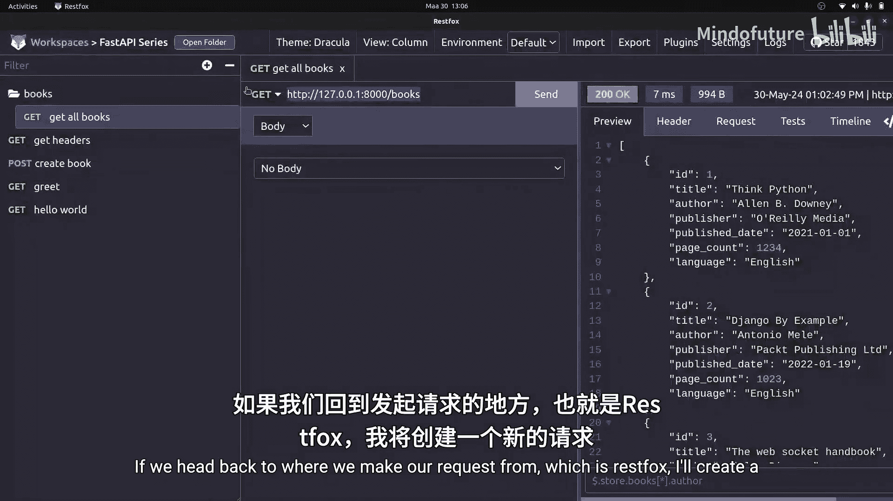

I'll create a new request， and I'm going to call this create。

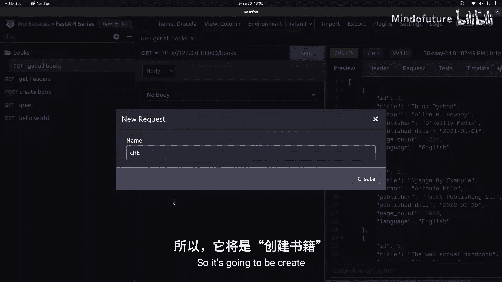

Book。So， it's going to be create。Book and I'm going to use the same URL different method。

 which is going to be a post method。 So if we try to send our body is going to be missing。

 now remember this is the whack of pedantic it is sensing that we are not provading the request body which is expect So let us go ahead and provade that and I'll go ahead and provide this as Json if we try to send this once again。

 our body is not being sent。 So if we send blank fields。

 then you are going to get validation or validation data for those fields that are lacking Now to cheat I'm going to go ahead and just simply copy a random dictionary from here and use that to create a new。

Object， so。Keep in mind that we are now hard quoting our As。 They are not automatically generated。

 but shall look into how to do that when we read that that her best section。

 So I'm to simply go ahead and test what we have right here。And then I'll go ahead and maybe。

 let's say this is going to be our I D number 7。And in this case。

 I'm going to go ahead and remove what we have here。 So let me just call this think。And grow。

Grow rich， whatever that book is。 Then here we're going to also have another book。

 Let me just change the author to John Do。I'll change the publisher， too。Whatever。

And then change the date。And change whatever feel。 So let's say that page count for this is going to be 200。

 And this is going to be， let's say in English。 So if we try to send。In this case， we have a problem。

 so。We are being told that the here is invalid now let's see why this is happening。

So I think it's because of this extra coma rate here。

If we sent we are now going to see that our book has been created and this book has a D7。

 So let us try to retrieve this book。 So when you try to get to allow our books to confirm whether that book has been created when we head over to our last items。

 we're going to see that our last item has been added to our database。

 which means we are retrieve successfully created our book Now that that has whed。

 let us square ahead and try to retrieve a single book from our data store。

 So to do that we are simply going to go to our endpoint for getting a book。

 So this is going to take in the book A。 so。For now， we're using a list。 therefore。

 we can go ahead and loop through the list。 So I see use a simple。For loop or book in books。

 And then if a book matches that specific book I D that we provided。

 then we're going to return that book else。 We're going to throw an error。

 So what you're going to do in this case is to use an if statements。

 are're going to check if the book I D。Its the same as the idea D of the book that we provided。

 So this is going to be our book I D。Then we are going to simply return that book。 Ill say， return。

And then book。 So once that is done， then let us go ahead and try to return an error in case that book has not been found。

 So I'll go outside the follow loop， and then I'll go ahead and return。And error。 So in this case。

 we are going to throw an exception。 So in Fast API。

 the way we throw an exception is by using the H TP exception class。

 So I'll go ahead and import that。 So we are simply going to go to the fast API exceptions。Moule。

And in there is where we're going to go ahead and import the H T TP exception class。

So once you've been able to import that H TP exception class， let us use it to raise an exception。

 So we're simply going to come and raise。HtTP exception。 and this is going to take in a status code。

 So we're going to use status dot H T TP。four。So this can be for04。

 not found because we have searched and not got the specific resource that we are trying to retrieve and then we can also provide the detail so the detail in here can be something like so I'll put this to the next line so we can come right here and say that our detail is going to be book。

Not found。So I'm going to format this， I'm using a black extension。

And now it looks a little bit better。 so we are retaining as status test code rates here for not found as well as the detail specify that the book has not been found。

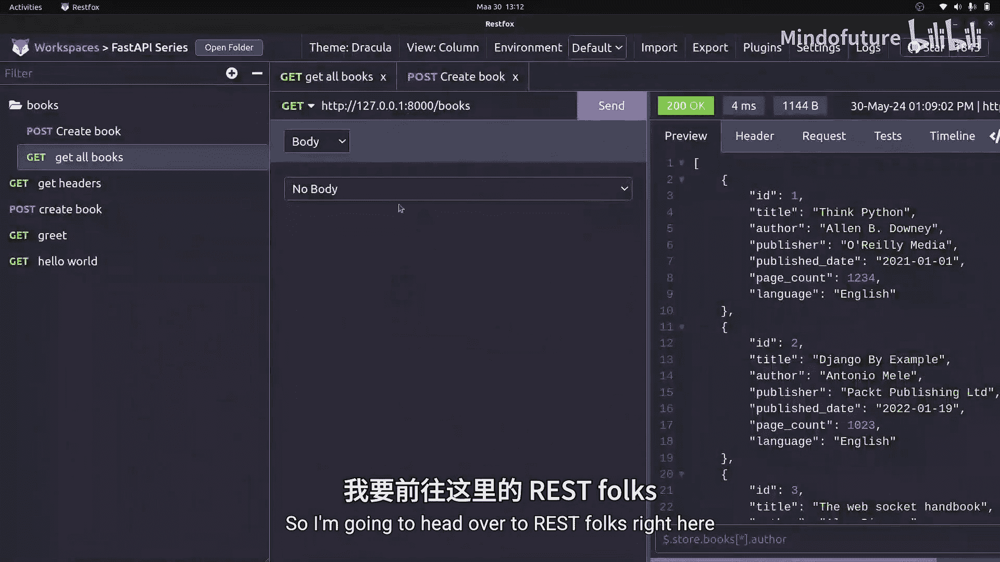

Alright， so let us go ahead and try to test that out。 So I'm going to hit a wrist folks right here。

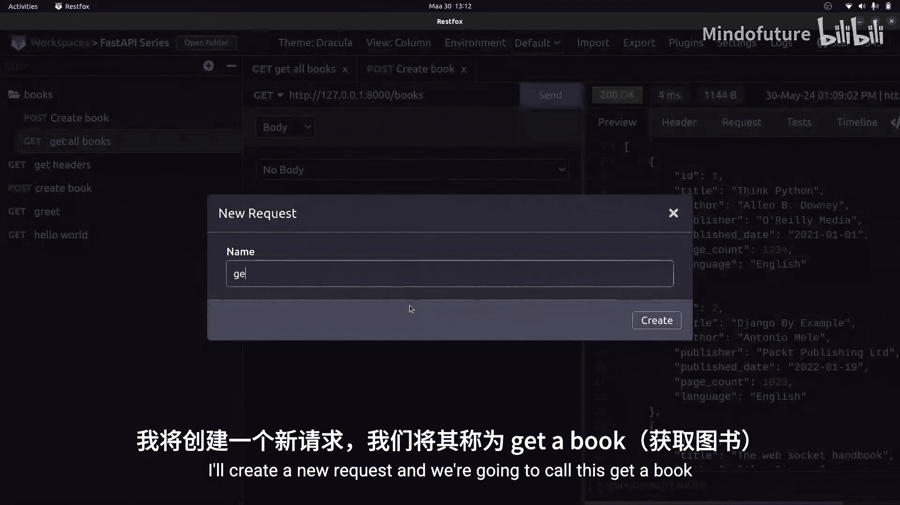

I'll create a new request， and we're going to call this get a book。书。

This is going to be when to get a book。 Sorry for this， so。

I guess I have to just simply copy paste this。And this is going to be getting a book。

 So just in case we get slash book and then slash one。Then in this case。

 we are going to get the book with the idea of one。But in case we get one for， let's say I D 3。

 And this is going to return I D 3。 Let's say I D 7。 That will get the book for I D 7。

 So I wonder' why this is not working。 Is our book existing。

 I think it doesn't exist because us have refreshed， so。When we send， because this is a Python list。

 the moment law us Sa everything will be lost now， do not mind about this。

 We are going to implement a persistent data store in the next video。

 When we try to create a new book。 So let's create one with 87， When we try to get that with 87。

 Of course， it will go ahead and。Return that specific book。 So our retrieving is also working。 Now。

 let us work on the remaining two operations which are update and delete。 So to update a book。

 we're going， first of all， begin by providingvaing data that is coming from our client。

 So to do that， we're going to need some sort of pedantic model that is going to be one to only send update data。

 So let's go ahead and create that model。I'm going to start Bay。

Hoping what we have and then creating another moderator here。

 And this model is going to be one that is specific to updating。A book。

 So I call this the book update model。And once you've been able to do that。

 then youll specify the fields that belong to this model。

 So I'm going to begin by removing the I because I'm not going to update。That then I'm also going to。

Remove the published date。 so that remain with only these five fields right here。Now。

 using this filter， we're going to go ahead and update our book。 But first to do that。

 we shall head over to the endpoint。That we used for updating our book。

 and I noticed that I made a mistake right instead of saying patch。

 I actually made this a get request。 Now let's change that。

 So say app up do patch And once I've been able to do that now shall inject。

Another parameter into this specific function。 And that is going to be one for getting that data to update our book。

 So which shall'll call this our。Book。Updates data。And it's going to be of typebook update model。

 So once that is done， now let's go ahead and update this book。

So we shall first all query for it or search for it within our list。

 so it shall say for book in books and once we've got a book actually we need to get our book based in the I so we shall check if the book I。

It's equal to the book I D。Then were going to go ahead and。Yeah。These books fields。

 So for us to do that， we shall do something as simple as book title is going to be equal to。

Book update data。Dot title。 And then we shall do the same thing for the publisher。

So this is going to be book update data dot publisher。

 Thiss do the same thing for the book page count， so。That is going to be equal to book。

Update data dot page count。 And then you shall have book。So this is going to be book publisher。

 book title。Page count and in language。 So I'll change the language。

And the language is going to be book， update data do language。Now that we've been able to do this。

 then we are simply going to go ahead and return the updated books so we're going to come right here and see。

Return。And we shall return our book。 So in case we have informed the book。

 then we need to throw an exception。 So what I mean to is to say。Raise。And in this case。

 shall raise an H T TP exception and shall specify as the test code to be 1，4。Not found。

 So shall says that as do。HttP。400 or 40，4 not found。 And then the detail is going to be for。

So our detail in this case is going to be for book not found still。We shall look at more。

Ways of handling these errors in their future videos。 So shall just say book on front for now。

 and only save as I is going to restart。 let's go ahead and test this within our rest folks。

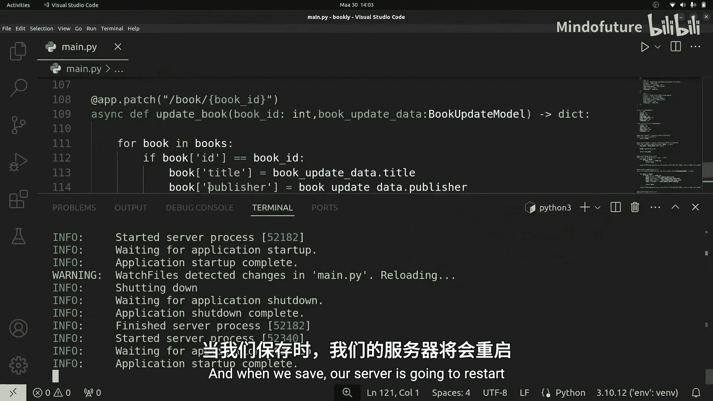

So analysis is first， I'm going to begin by creating a new request。

 and this request is going to be one for update book。

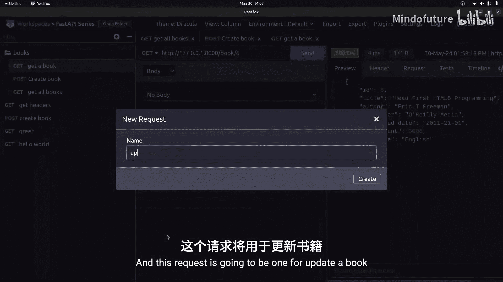

And once I've created the request now we're going to get the book to update or the URL for the book to update。

 So that's going to be similar to one for retrieving a book。

 I'll change the HT P method to patch and then I'll provide the request body。

 Now if we send we are going to miss the body。 Soll go ahead and specify。 it's going to be Json。And。

Now let's go ahead and prevade the fields， so I need to copy what we have here。

And then I'll providede it here。But then now remove the fields that are not required。

So we have the published date and the ID being removed。 Now let us go ahead and change this。

 So I'm going to go ahead and change this from headfa HML and let's say HTMLtmL。fi。And C， Ss。Basics。

So then I'll also do the same thing for that author。So let's change the author to John Do。

And as I've been able to do that， I'll send。 and this is going to show us that the request has been successful。

 Now， let us go ahead and test this。 If we head over back to where we retrieve the book or get that single book。

 When you try to retrieve this， we now see that our information has been updated。

 If we go back here and let's say make changes to the author or the publisher of the book， let's say。

What if。Media， then when we send， it's going to update it。 if we try to retrieve it。

 it's going to retrieve our updated data。 So for now， we are remaining with only one H DP method。

 And that is the delete method。 So to delete a book， we're going to begin by first of all。

 searching for each within our list of books。 So we're going to begin by using the same technique that reviewss for the previous item。

 So this is going to be one to get our book。 So you shall say something like four books。For for book。

In books， then we shall get that specific book if it's ADEs。

The I D of the book that we provided within our URL。

 So this is going to be if book A D is going to be equal to the book， A D。

Then we are going to go ahead and remove that book from our books list with books dot remove。

 so this shall target that specific book dictionary。

And remove it from our I D at that specific index it is。

And once we have been able to do that now shall retain an empty dictionary。

 but this frequency is not supposed to return anything。 So for us to be able to achieve that。

 we are going to first all remove what we have right here。And once we've removed that。

 we've now specified that this request in longer entry return a response。

And I think we're going to this to specify the status code。

 which is going to be r 204 status code for no content。

So shall'll just come right in here and say that the status code is going to be status。Dot h T TP40。

2，0，4。No content。 So once you've been able to do this， you also need to。

Raise an error in case the book is not found。 So I'm simply going to copy what we have here。

And then I'll paste it right here。Alright， so now that we had done let us go ahead and test our endpoint。

 So Rachel and Mary folks， I'm going to begin by simply creating a new request and I'll call this delete。

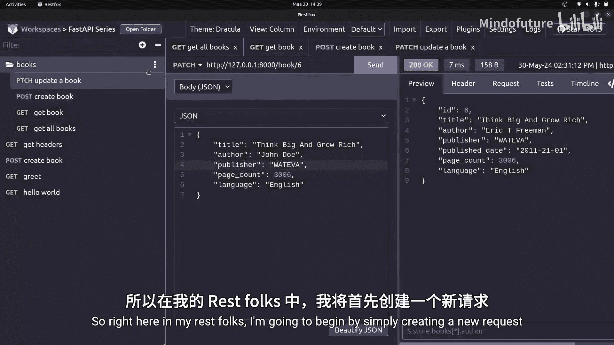

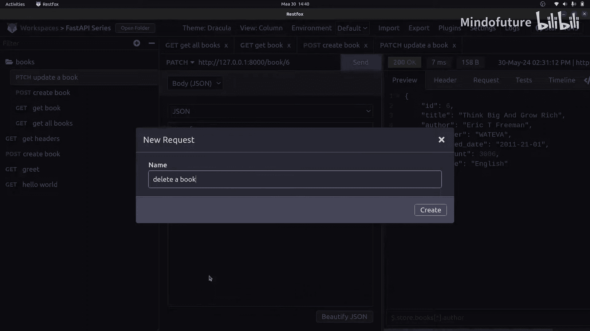

Delete a book。And this is going to be a delete request and let us try to delete this book with8 D of 6。

Yeah。So for now when wescin， we have an error here， similar I have。Pervaded the room Q or something。

 or the given。URL is incorrect or invalid。What the survey is not retain。Correct。

 so seems like the sa was down。 so I have to restart it again。So in they send。

 now see method don't allow for the requested URL。So， the problem is， I have。

I still have the get request。 and yet this is one for deleting a book。 Sorry for that。

I'll just simply change this from。Get to delete。And then when I make the request now we see that it's returning20。

4 note content。 If we try for a book that doesn't exist， we now see book not found。

 and if we are to confirm whether that book exists。

 we are now going to go right here and send the request and now we shall see that the book doesn't exist and in our long list of six books。

 we now see that that book does not exist。 So for now we have successfully implemented credit on our very simple list of book。

Of book data and this is just something very simple。

 so what we can do maybe is to correct or somehow remove some of the repetitions we have within our quote for example。

 searching for a book or just in case we have to keep it simple。

 we can leave this like this and then get to fix this in the next chapter。What's up， everyone。

 We back。 So in the previous video， we created a very simplerePA on top of our inmeory database。

 which is our Python list。 before we create a persistent database。

 or before we introduce Postreql into the picture。 I thought it should be a very good idea for us to split this into a structure that is going to grow as our project grows。

 Now this is where fastPA routers come in Fast routers allow us to make our application modular by splitting our EPA endpoints into modules or grouping them into modules or which we can access them using a specific prefix。

 Now， if you've not understood that， all you're going to do is to create an object that is similar to our instance that we have right here。

 and within that object we can be able to group APA endpoints that are related together and we can put them in their own separate module。

 Now to begin， we're going to first of all， split this entire module or Python file into different modules。

To hold different data。 So let us begin by， first of all， removing our books from this file。

 And I'm going to go ahead and cut it。 and then I'll move this into our new file。

 which I'm going to call book。Data dot P A。 and inside there is where I'm going to place that。

 So once I've been able to do that， I'm also going to move the pedantic models so that I can put them inside their own module。

 I'm going to come and remove this create a new file that I'm going to call schemas dot。P A。

 And that's why we're going to have the pedantic models that are specific to books。

 Now I'm also going to move the necessary inputs to this specific module by first of we're going to interpret here。

 Now I're going to just simply move this input。 So of the base model input to this file。

 and then I' have to also move。Our so I'll just have to import them。

 So I'll come and say from book data， we are going to get access to our books。 And once that is done。

 the next thing is going to be for us to also import our schemas。 So to do that。

 we shall save from schemas。We are going to go ahead and import our book。

 as well as our book update model。 So once that is done， now， let's go ahead and create a new folder。

The are to coal ass folder。And this is where all the code that is going to be。

 So for us to begin with Festival， create an in PI file。

And this in the pure A file is simply going to mark this source folder as a python package。

 Now we're going to move everything to a new package that we're going to call our books package So all information or all logic that is related to books is going to be found within this books directory。

 Now create a new file， and I'm going to call it in each do P A。

And this is going to map the books package as a Python package。 Now， begin by moving book data。

As well as skichemas， do P A。Into our books package。

So that we have all the logic that is related to books found within our books package Now that we've created our books package。

 let us go ahead and also create one that's going to contain the EPA endpoints that are going to be specific to our books So I'll create a new file and I'm going to call this routes dot pure you can call it whatever you want。

 but I've simply chose to call it routes Now in here is where I' going to create our first DPA router。

 but before we do that， let us first of all move our APIPA endpoints from this file。

 which is our main do pure。Into why we're going to have them with a router。

 so I'm going to copy everything again。And I'm going to catch everything and once I've been able to do that then I'll move to route P and I'm going to simply introduce everything there now one thing we're going to do is to first of all create our router object so think of the router object as an object that is very similar to our fast APA instance in this case this object can help us to access pretty much everything that we can access from our fast API instance。

 for example if we created that object we can access the HTP methods as well as any other method that we can access on our app instance。

 however that is a router that is only to group related endpoints together so let us begin by creating an APIPA router so we shall go to our fast APA and say from fast APA。

We are going to go ahead and import the EPA router class and once you've been able to do that。

 now we're going to call our router， the book router。

So this is going to be an instance of our APIPA router class now once we've been able to do that now let's go ahead and change。

Our。FPA endpoint， so that they make use of our rot。Object so to do that。

 I me simply go ahead and copy what we have as add app。

And then I press controltr shift and L so this can be command shift and L if you in Mac OS。

 so I'll just go ahead and press that so it's going to highlight a real occurrence of at app and then I have to just replace that with at book router。

So this is going to now。Access all the ht TP methods， just like we see right share。

 So let us go ahead and also fix some of the things that are not defined within this file。

 So we're going to import the status module。And we also want to import。

Let actually go ahead and just use the inputs that we have inside this state。

 so I'll just come and copy what we have here。And I'll cut it。

 So I'll just go ahead and introduce it within a route file。 So this is going to be from。

First thePA do exceptions。Sll inbutha HttP exception， now I think theres one。

That's missing and that's going to be our tapping list input。

So we shall now go to our routes and add that。And this is going to be just enough to fix whatever is within our file now keep in mind that just introducing our router is not enough。

 we have to go ahead and include this router onto our app instance so that we can be able to reflect these apps on our APIPA so to do that what we're going introduce is to go back to our main PA。

And delete it。 the reason that's why we're deleting it is because we are going to be accessing everything from now on inside this source folder。

 So we're going to be。Wating all the a logic insight that you need to pure so that our main entry point for this project is going to be a source folder。

 So what you're going to do in this case is to。Input alpha DI class。And once we've inputed that。

 now let's create app instance。So the moment we've created our app instance。

 all we need to do is to just go ahead and import all these routers that we've created so in case we need an route we shall create a module just like the one that you see here or a package and we shall create in the same folder structure which shall have our routes models schemas and everything that's related to all inside that specific package so this is what we're going to be doing from now So once with that is done now let's go ahead and have our。

Rooututer from our books module or our books package。

 so I'll just go ahead and input that by saying from source dot books。In this case。

 we are going to go ahead and import our routes， so our route is found within source books and then routes。

 so you have to say source dot books dot routes。And then we can go ahead and import that router。

Wwhich is our book router So once we've done that then let's go ahead and input or include this into our main application so it's simply done by doing app dot include and then we call the bulk router object or any sort of router object the next thing we can do is to define which prefix on which on which we're going to access all the endpoints that are related to our books now in this case what you're going to do is to go ahead and provide a special attribute and that is going to be the prefix attribute。

Now the prefix attribute is going to be one that is going to help us to define an endpoint on which all related endpoints are going to be accessed。

 for example all our books endpoints are going to be accessed on a specific APIPA endpoint now let's say this is going to be the books endpoint and once we've been able to do that now。

We can go to our routes and then simply change this from slash books to slash and then we can be able to access them on the slash box endpoint so let us go ahead and modify this now we have this being slash books so I go ahead and edit this so that we can have slash books so I remove books and then I go ahead and remove this。

And then we can remove what we have here so that we have slash book I。

 so we shall access it on slash book slash book I， and then you can also do the same thing for our。

Update and our delete。 So I'm going to go ahead and remove this so that we can have all of them being accessed on the slash book slash books。

Endpoint or the slash books prefix。 Now， once you've been able to do that。

 the next thing is going to be for us to。Kind of add version on top of our API。 Now。

 notice that we are having a first API instance， but this first API instance can also be used to specify some things about the。

APA such as the version of the APA and stuff like that Now that we do that is to go within a first APA class or instance and we shall now go ahead and specify all those and'm going to create a variable book called version。

And this is going to be our version one。So we shall look at APIPA versioning as TM goes on but for now our APIPA version it can just simply be done by specifying the version of that app。

 so just simply say there is going to be version1 over our app and then we can also change our APIPA prefix to include that version so you can do something like prefix is going to be equal to slash EPA and then slash the version of the EPA so in this case Ill use an Fstream and then I'll specify that all EPA endpoints that are related to books are going to be found on the slash EPA slash version1/ books prefix。

Now， once that is out of our way， let us go ahead and run our server and then access our EPA。

 so I'm going to go ahead and run our EPA with fast EPA dev and then I'll specify that our app is now going to be found within our source directory。

So notice what is going to happen First API is going to now see the source directory as the main entry point of our application and it will scan for that app instance or which it will find it within our data in doP and that's why we see from source import app and another thing we can do is to go ahead and add some information in here for example we can add the title now these are none things are going to be able to see right now but when we look at the Sga API documentation all these details will be specified there so were going to add the title and the title is going to be our bookley。

We can also add a simple description。And this description is going to be， let's say。Iris your PA。

For a book。Review。Web service。嗯。So I the commmade here and now we can also add tags to our router so that we can also add that something that you shall see when you get to the API documentation pad so just come here and specify a list of tags and now these will be accessed to the API endpoints that have the tags or books。

So once that is done our survey is running， let us go ahead and test our APIPA endpoints。

 so I need to go back to our risk folks。So right here'm racework I'm going to go ahead and go to our books folder that you created in the previous video now I have only one APIPA endpoint I think I deleted the Alice by a mystic but let's go ahead and do that so I'll now try to access our EPA on slash aPA slash version one and then slash books and then this is going to go ahead and return all the。

Books that are present or not slash API slash version one。 So just like that we've been able to。

Pretty much change our folder structure and also include route test group related APIPA endpoints together and this is our folder structure that you're going to be using from now going on。

 so the moment we shall be introducing a new folder or a new functionality all we do is to go ahead and just add a package on here and that package we will have the logic that is specific to that specific functionality。

One other thing that we're going to do before concluding this video is to introduce our requirements as a TxC file。

 something that I did not do at the beginning of this course。

 so I'll go ahead and simply open up a new terminal and then I'll freeze。

All our requirements within our virtual environment to a special file called the requirements do txT Now what this is going to do is to keep a record of the requirements and their versions as we have them for our project so that even if you are to clone this in 2030 you will be able to get the same requirements for this project so I'll go ahead and add that and。

Now this is a folder structure that we have。 We have grouped all book related data orbook related logic into its own file。

 and this is going to help us keep our project modular Whatsapp everyone We back So in this video we're going to be making our application to adapt to our persistent database in the previous video we looked at how we could build a simple functional credit APIPA using an inmemory database and that database was represented by a Python list in real applications it is very essential that we use a persistent database solution。

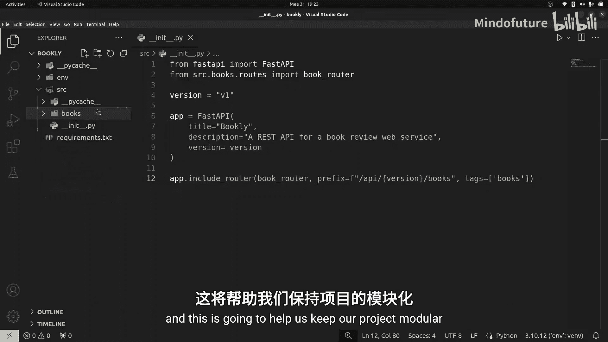

Now faster P supports various types of databases if you want to use a relational database or if you want to use an nonrelational database。

 the choice is yours。For this series we're going to be focusing on using a relational database specifically PostgresQL。

 PostgresQL is a widely used free and open source relational database management system that comes with a lot of benefits。

 which if I began describing them in this video we will be wasting a lot of time。

While is in Postsgre， we also need an object relational mapA。

 which is just the way for us to interact with a database using our Python programming language。

An object relational map is simply a translator between our programming language。

 which is Python in this case and a database that is relational database such as PostgresQlma SQL。

 EQate and so on。An O RM works in the following way。 It maps objects to tables。

 When you create a Python class， that python class is going to represent a certain table in our database。

 and each object we create of that class is going to correspond to a row or a record of data within our database。

 Secondly， it interacts with a data。 For example， whenever we create an object of a class that is created from an O RM。

 we can interact with this as a Python object。 and we can call things such as methods and define attributes on that specific object just like we're going to see。

Behind the scenes， an O R M also performs operations on objects like saving them， deleting them。

 updating them just like we did for their qua， this O R M。

Operations are translated into the appropriate SQl queries that the database understand。

 So whenever we use an ORM and carry out queryd in the background。

 the ORM is performing all the necessary SQl without us having to worry about it。

 the O RM also handles converting Python data typess into database specific tapes and vice versa。 So。

 for example， if we are having De time objects in Python。

 those deam objects will be converted into De time objects that the database is going to understand and so on。

 SQl alchemy is the most popular OM solution for Python that helps us to map objects to tables and it also providess an SQl toolkis that allows us to rate high level Python to represent SQl statements。

However。This way， the fact that SQl alchemy is powerful using it with faster P is going to be complex。

 And there is where S Ql model comes into the picture。

 SQl model is an O RM that enables us to use the power of SQl alchemy。

 as well as the power of periodedantic。 So much as we may rate our models in a。

In a class object oriented manner， those models are also pedantic models。

 and therefore they can be used for both data validation， as well as a database operations。 Now。

 this project was also created by the C faster P。 and meaning that this was motivated by。

Someone who saw the need to have Equel alchemy integrated into pedantic to create the best O R M for fast A。

Now， without further ado， let us get into setting up our EQL model and looking at how we can use it for our database solution。

Now in conclusion， anM is going to simplify the interactions by letting us developers use Python instead of SQl。

 The first thing we're going to do is to first of all。

 set up a database that are going to be working with we have chosen Postql and depending on which system you're using the process of installing Postql is going to be different and is going to involve in number of steps I already have Postql installed on my machine but I'm going to be showing you one of the ways in which you can get a freeql database I'm not sponsored in this video but this can help you to get a free Postql database that can help you work withql just in case you need it and that's where neon comes in So when you go to a neon website you can create an account and ratio neo Nen console all you need to do is just create projects we shall call this book and onceve been able to do that shall create a database name and this is going to be our book Db I'm not going to be using this I'm。

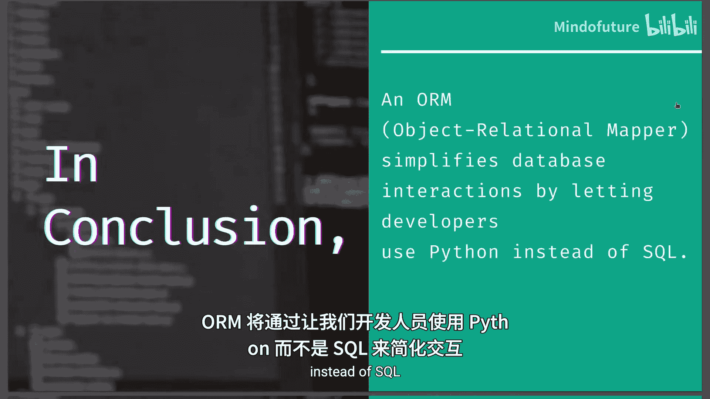

how to set it up。 So shallll go ahead and create a project。 And once you've created the project。

 you're just simply going to go ahead and get a database URL that you can simply copy into your settings。

 and then you'll be able to use that。 But for makers。

 I'm going to be using Postreql on my local machine。 So to do that， I'm going to render PS SQl shell。

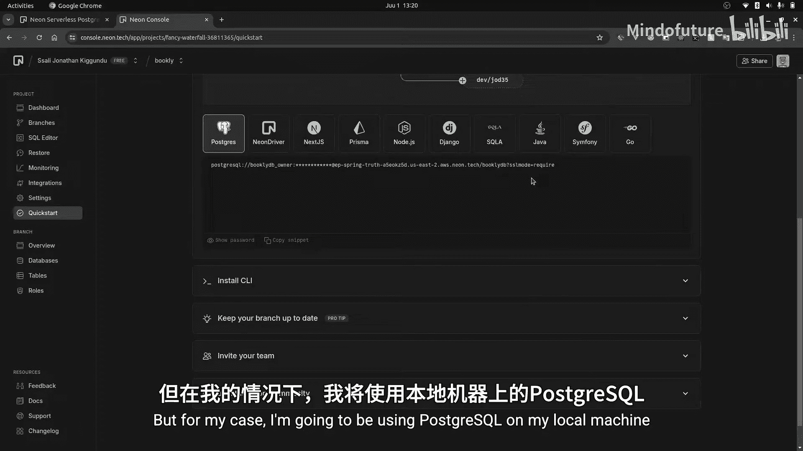

And right in there， I can access it via the user。And once I've been able to access my PSQl shell。

 I'm going to go ahead and simply create a database。 So to create a database。

 I'm going to go ahead and say create。Database。This is a simple SQl statement。

 and then we are simply going to call it bookly。Under school D B。

And that would just be able to create the database。 Now， for us to formulate the EsQl or the。

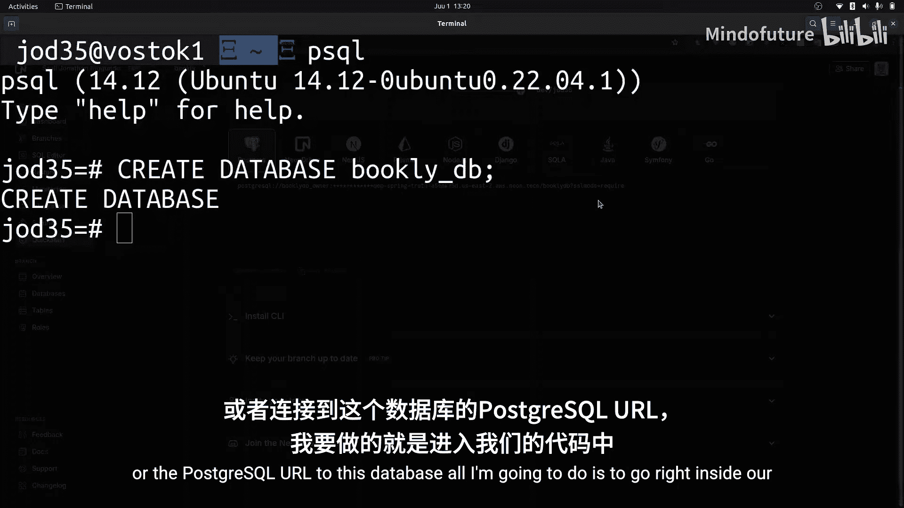

Postqql URL to this database。 All I'm going to do is to go write into hour code rate here。

 and I'm going to introduce a new file。 and I'm going to call that file dot E n V。

So that E andV is going to be the file in which are going to create all settings for our projects。

 These settings are going to be kept secret and are not going to be kept in our version control and this is going to be important in a way that in case we are to share this project with other people or in case this code is to be accessed by anyone they will not be able to get this secret such as our database keys or our secret keys and so on so to begin I'm going to create the file and I'll call it do Ev mind that I've kept it in the root project folder right here Another thing I'm going to do is to go ahead and set up。

An environment variable able to stand to the URL of our outputcur。 Now， in your case。

 it's going to be this newn URL right here。 But for my case。

 it's going to be something on local hosts。 Another thing I'm going to be doing is to use an I think D B APA。

 So I'm going to be using。Posqql with an as synchronous D B driver or a D B API。

 So D B API is just one way which Python allows us to access a database。

 So let's begin by installing that D B driver。 So I'm going to go to our python right here or our terminal in my virtual environment。

 and I'll begin by installing it with Pip install。 and this is going to be our as sync P G。

Once we've installed， I think P G。 Now let's go ahead and formula our Postql URL。 So Im to create。

That as URLL environment variable。And this is going to be database URL。

 And now remember who we are working on local hostst for main case but two you already have one you got from Nen。

 So what I'm going to do is to formulate this as means that by measuring the kind of database that you're going to be using。

 which is going to be our post G Ql。Plus the DB APA or the driver that you're going to be using so in this case we are going to be using a sync PG and then we shall need the user of that specific database or make user is going to be0D35 and then the password of that user now this is not going to be your password so please use your own password so I'm going to pervade my password rate here。

And once are pervaded my password， then the host is going to be local host。

And the port is going to be 54。That teacher true。Then slash the name of the database。

 which we have called bookccley。DB。So once that is done and you've got your PostreQl URL。

 then the next thing is going to be for us to access these so that we can use it within our code。

So there are very many ways in which you can manage environment variables。

 but to be specific to FA APA， we shall use pedantic settings。

 which is just a tool or a library built on top of pedantic to give us the ability to manage our environment variables so to do that I'm going to go right in here in our terminal and then our'll seequi。

Install。Pyantic。Dash settings。So this will call pedantic settings and install it within our virtual environment。

 So I want to Im going to go ahead and set it up so that we can read our environment variables。

 So to begin， we're going to go within our source folder right here。

 and we're going to create a new file at the root of that folder。

 We're going to call that module config dot pure instead config。

 we are going to create the class that's going to be responsible for allowing us to read our environment variables。

 And for us to do that， we are going to make his a special class from pedantic。Settings。

 and that is going to be our best settings class。 So to begin， we're going to import that。

 we're going to say from pgantic settings， we are going to get access to the settings class or the best settings class。

 Sorry for that。 And onceve been able to do that。 then let's create our class。😊。

And this class is going to be called our settings class。

This class is going to inherit from our best settings。 and once we've been able to do that。

 all we shall have to this to just go ahead and get。The exact key， as weve written it in here。

And then have it as the attribute of this class。 So all this will do is to automatically go ahead and read each key defined here and then have its value access via this class。

 just like we're going to look at it。 So right after doing that。

 then the next thing is going to be for us to specify the right type of that specific value of that specific key。

 Now for us to do that we're going to go ahead and specify that this is going to be a string。

So this is just enough for us to read our。Database URL。

 But the problem is we haven't yet told pedantic settings where it's going to get these settings from to do that。

 we're going to be making use of another class， which is called a settings confi or the settings config dictionary。

 So we're going to go ahead and import that。 So our camera here and say import the settings confit。

 Now to influence any pedantic model， because this is actually a pedantic model that we have right here。

 We are always going to make use of the model config attribute。

 So every class that is a pantic model is going to have a model config attribute。

 And this is going to be a dictionary that will allow us to change the configurations of a specific pedantic model。

 Now for us to do that， we're going to set its value to our settings config。 And in this case。

 this settings config is going to be。Helping us to point to where our EV file is。

 where to read our settings from。 So even if we go right in here。

 we can look at some of the attributes it has， it has the Ev prefix in case you have an Ev prefix。

 you can specify one right here。 just in case you have an EV file you're reading from。

 you will go ahead and do that from here。 if you're reading from， let's say a Json file。

 a yal file it does all of that。 But for our case we're going to be using an EV file we can also specify an E V encodeing in case we are to have one。

 but you're going to just keep it simple。 One other。

Important attributes we're going to provide here is the extra attribute。 And in this case。

 we're going to be ignoring any extra attributes that will be read from our class。 So to do that。

 we're going to go in here and the first thing we're going to do is to specify that our E and V file is going to be equal to dot E and V。

 So this will go ahead and read the dot E V file that we've created and provide our database URL in。

 So let us go ahead and。Do another setting。 So once we've been able to do that。

 then let's go ahead and also add one extra attribute， which is going to be our extra。

 So in this case， we have extra equals to。Ignore so we can allow reading other extra attributes。

 We can forbid them by for green space。 we are going to ignore any extra attributes from being read。

 So we shall define every key that shall get from my E and we file into our class so that we can access it within our application。

 So let us go ahead and test the working of this settings class。 Now。

 what I'm need to is to go ahead and open up my terminal。So I come right here and see Python。3。

And once I've been able to do that， let me make this a little bigger so that you guys can see we're going to begin by accessing this class we've got right here。

So we're going to say from source。config because that's where we've created the settings class。

 shall'll go ahead and import our settings class。And once we've been able to input that settings slash。

 we're going to create an object of that class， so let's just call it is。

And that is going to be our settings object。So once we've been able to access our settings object。

 let us try to access our environment variable from this object， so we shall say database URL。

Just like we call it right here。 and once we do that。

 then we can successfully access that specific environment variable from our E and we file。

 Now keep in mind that this is a file that we're not going to share with anyone。

 we're going to add it to the dot git ignore file。So that we do not commit it to version control。

 So I'll just do that right here。 I'll say dot E and V So that。

Whenever we add this chd to our gate reposory， that file is non track now， however from that。

Once that is done now let us look at how we can connect to our database using our SQl model。

 So to begin， let us go ahead and install SQL model。

 so I'm going to exit this shell and then I'll close this So I'll begin by installing SQL model with Pep。

イスト。And then， Sql model。So this will go ahead and collect SQL model。

 added to our virtual environment。 So just like you see。

 it depends on SQL alchemy and also SQL model。 it depends on also pedantic。 And yeah。

 that's how we've been able to install our SQL model。So once you've been able to install SQl model。

 let us go in our source folder and create a new package。 So this is going to be called our DB。

 And this is also going to be a Python package， just like we have the other packages。

So insight here is where we're going to do everything that's specific to our database by that I mean anything concerned with creating sessions and also helping us to connect to our database all that code is going to be found within this package Now let us go ahead and create a new file and that file is going to be main or Q So In main do Q is where we're going to create our engine object。

 Now if we work with SQl alche， you will know that an engine is the basis we which to do everything from connecting to your database to carrying out any sort of cr。

 So SQl model also re on that because it's best on SQl alche therefore we need to first create an engine。

 Now keep in mind that we are using an assignnc DbPA and therefore。

We need to create an assignnc engine。 So let us look at how we do that。

 So I'm going to go ahead and import the create engine function from SQl model。

 Now these are all board from SQl outcome。 Therefore I'll just come and say from SQL model。

We are going to go ahead and access the create。Eine function。

 But this is going to be creating an as engine。 So for us we create the as engine。

 why not use the as engine platform S Ql alchemy。 So you're going to begin by importing that。

 So we shall say from S Ql alchemy dot E X T dot asnc I， O。 We shall go ahead and import our。I think。

 engine class。So let us go ahead and create our engine， so our engine。

It is going to be equal to create engine， and this is going to take in our database URL and other。

Attributes。 so let's go ahead and create that settings object。

 So I'm just simply going to camera right here。 I'll create。

A config object now keep in mind that have kept it like config just for syntax。

 you can call it whatever you want。 But as long as you're going to remember what you've called it。

 Now I'm just simply going to say this is going to be settings and to be an object of type settings。

 So it's going to be an object of our settings class。

 Now going to be importing this every time we shall need to access an environment variable。

 So whenever you create an environment variable， you go ahead and add it within your E and file。

 And once you've added it there， then youll add it as a field to the config class And then after adding it as a config class。

 then you access it via the config object that you've created right here。

 So let's go ahead and access that object。 So I begin by importing it say from source dot config we are going to go ahead and import our config object。

 Now let's go ahead and set up a URL。 So our URL in this case is going to be our config object。

 And once you've been able to do。That now also going instead e equal to 2。 Now， remember when。

When using the C engine function， the E attribute is what allows us to see all the SQL that will be logged on every transaction that we carry out in our database。

 So our camera T and C E is going to be equal to true。And just like that。

 we've created a basic engine object now to make this an I engine object。

 we're going to begin by first of all， making it an instance of the assign engine class so。

For us to begin， I'm going to go ahead and just simply sorry for this。

 so Im just going to come right here， actually I've made a mistake here thats supposed to be the database URL else R say。

Confit the database URL， and that will make it as that database URL。 Now。

 let me go ahead and also change this from。Our basic engine object to an I think object so I'll just simply create an I engine object and then I'll simply pervade our engine。

 So this will create it as our I engine。Alright， we that out of that way。 Now。

 let us look at how we can connect to our database now。

When is the rate time to connect through a database。

 The rate time to connect through a database is when the application is starting。 So how can we。

Make a task grant at the start of our application。 faster API I allows us to do this in in in a very interesting way。

And this is through lifespan events。 So lifespan event is something that you may want to run through the lifespan of an application。

 Now， this may involve something that you may not want to do or load during the lifetime of an application。

An example can be running a machine learning model。 This can be something that can be expensive。

 something that you cannot run at the start of your application。 However。

 it may make more sense for you to start running your machine learning application just at the start of your app and whenever that application is running that AI model or whatever your running is going to be running So let us look at how we can set that up。

To begin， we're going to go to where create a Dar step instance。And we shall go ahead。

And simply set that functionality to work。 Now is asva running。 Yeah， Asva is's running right here。

 So I think I'll go ahead and stop it with controlr and see。

 and then I'll close the terminal that we have right here。

 So each first API instance is going to come with a special attribute called the lifespan attribute。

 And that is going to take in the code that we want to run at a stat and at the stopping of our salva。

 So let us create our fast lifespan event So create a lifespan event。

 we are going to be making good of。A specific decorator that comes from the context Lib Python in builded Python library。

 So we're going to do that by， first of all， going to the top of our right here and saying from。그。

From context slip， we are going to go ahead and import a special decorator called the a sync context manager。

 And once we've created that， now we're going to determine which code is going to run at the start of our application and which code is going to run at the end of our application。

 so。To do that， we're going to go right here and say add a sync context manager。

 and then we're going to define a quarant that is going to run。

Throughout the lifespan of our application。 So we're going to define this as our life span。

And this is going to be。A function called life band。

 but it's going to take in one important attribute， which is going to be an app instance。

 So this is going to be of type fast A。Now， once we've been able to do that。

 it's time for us to determine which query is going to run at the start of our app and which query is going to run at the end of our app。

 So to do that， we're going to fast all to print statement one is going to run at the start of our application and another one is going to run when we stop our server So let us go ahead and do this。

 we shall say print。Sever。Is starting。And once that is done。Then we're going to also print。Sva。

Has been stopped。So once we've been able to do this， we have two print statements， one saying。

 one indicating that the server has been studied and another one indicating that the server has been stopped。

 how can we separate these two to make them known trend at the same time or how can we make this run？

In an order where the first run is running at the start of our serverva and the second run is running at the stopping of our serverva when we stop our serverva。

So this is where the yield is going to come in。 So for us to do that。

 we're just simply going to introduce the yield。Wed right here。

And this keyword is going to determine which code is going to run fast and which code is going to run at the end of our application。

 So just have this in made。 you don't have to memorize it。

 the moment to define your lifespan event and decor it to the assign context manager。

 the code is going to run at the top of the yield statement is the one that shall start at the serverva and then the one that will run after your yield statement rate here is one that's going to run when R serverva stops。

 So when we have defined our lifespan event we also have to go ahead and sort of register it to our step instance and the way we do that is by coming to the first step instance after create rate here and then。

And simply go ahead and say life span。And then we point to that specific lifespan event we've created right here。

 So that's going to be what true lifepan。 So to test the working of this。

 the first thing we're going to do is to go ahead and run our serverva。

 So we're going to pull up our serverva。With faster API dev and then our source folder。 Now。

 one thing we are noticing is we are getting this error right here that isilling us that our generator object is not an as iterator。

 So let's go ahead and fix this， so。When you take a look at our lifespan event here。

 it's in like we have to define it as an as seeing。Fanunction。

 and that is not something that I have done or something that I have forgotten。

 So while I'm introduced to introduce it， I'll come my and say a think de。 And then life span。

 So this is going to go ahead and。Ran hour。Sva is starting pretty statement just like you see rate here。

 So if we press control and C， we're going to notice that Sava has been stopped。

 is going to be rank so。Just like that， we've been able to set up a lifespan event。 Now。

 let us look at how we can create a database connection at the start of our serverva。

 So I'm going to go back to our main P A， where we created our engine objects。

 And the first thing we're going to do is to create。😊。

Sort of like a function that we're going to run at the start of our application to help us to create a database connection。

So I'm going to cerate here。 And what Im mean to do is to。Create an assignyc function。

 and I might call this asyncc function in it。DB， so this in D B function is going to be one that's going to allow us to create a connection to our database and keep that connection for long as our application is running。

So Im going to start by using， I think。Oh by using our engine object that we've created right here。

 so me integrate create an a sync with statement and what this is going to do is help us to create a connection object and then we shall carry out a simple SQl statement on our database Now let us get started by doing a sync width。

And inside here， we're going to begin by creating our engine object。

 so we're going to call that engine dot begin method。And once you call that engine load begin method。

 we are going to access the connection objects。Va that method。

 So now that we've created our connection。 let us go ahead and create our statement that we're going to execute on our simple database。

 So to do that， we're going to create a variable called statement and statement is going to be equal to a simple select statement。

 But for us to carry out a statement。 we are going to need to express this in terms of text。

 So SQl model providess a text function that can be used to 10。

A text or a string SQl statement into an actual SQl statement that we can then use our connection to run on our database。

 So we're going to begin by going ahead and importing it。

 So I'm just going to grab the operator here and import the text function。

Then I'm going to come ready and say text， and then we shall run our simple EQl。

So just like Q right here， we're going to create an expression representing a text eQl string。

 so shall just come right and say select and all want to do is to select the wide hello or to render a wide hello。

On our database。 So this is going to be executed as an SQ statement。 So we're going to close this。

And once you've been able to do that。 now， let's go ahead and run this using our connection object。

 So to run。T our segment using our SQl， we're going to create a result object。

 and this result object is going to be a result of using our connection to run that statement。

 So you're going to say con dot。Execute。And in this case。

 we shall pervade the statement that we are trained to run on our database。

 So this is going to be our statement just like you see right here。

 And once we need to access all the results， we are simply going to go ahead and run result。Dot all。

And this is going to be able to run our select statement。 so let us go ahead and run this。

So to begin， I'm going to go right where we have our lifespan event。

 and instead of having to run the print segments， I'm going to go ahead and run this in be function that we've created right here。

So I'm going to go and top here and I'll begin by importting that。 So I'll say from。Sos that D B。

Dot main， we are going to access our in Db function。

 And once you've been able to do that now let's go ahead and run this。

 So I'll call in it DB or let me go ahead and run it after the survey starting statement。

 Now keep in mind that in D B is a quarantine。 and therefore， if we need to run it。

 we need to call it with a weight。So whenever I define an assign function for you to be able to call it。

 you have to call it with a weight。 So we're going to go ahead and save and rerun our Sava with fast API dev and then source。

And now we shall see what is going to happen。 So when we run our serverva。

 notice is what is going to happen， since we set equal to true。

We are going to notice that some SQl is going to be executed and is' going to be logged within our console。

 So right here， we see that the select statement has been run， which is select hellello。

 And the output of that has been printed right here。

 So we have a list but our list has a result that is our hello that we've selected on top of our database。

 So this shows that we have been successful in connecting to our Postgresql database。

 Now that we've been able to do that， let us go ahead and create a database model for our book data。

 Once we've created that model， we are now going to go ahead and create， read。

 update and delete book objects in a real persistent Postgresql database。 So to do that。

 we are now going to go ahead and。Inate our。Books， module of books package。

 We're going to create a new file， and we' going to call that modules。Dot P away。

So model that PA is going to be the special file in which you're going to have a database model for a specific entity。

If we have， let's say the user model， we shall have that located in its package and then models dot P A if we have reviews model。

 then we have that in reviews slash modelss dot p A just like we're going to see。Now。

 let us begin by creating our simple model。 So our model is going to be very similar to what we have inside our schema for books。

 However， we're going to add on some extra fields that like we're going to see。 In fact。

 let me go ahead and just copy what we have here。And then I'll paste it within our models to pure。

 So you're also going to notice that a pedantic model is actually going to be。

Very similar to an SQl model。 In fact， we're going to get rid of this。

 and we shall only be using our model。 So I'll go back to models right here。

 So I'll begin by first of all testinging it right here。 And instead of best model in this case。

 I'm going to be using the SQl model class。 So for us to create a pananttic model or an SQl model actually。

 we have to go ahead and import our SQl model class。 So we shall say from SQl model。

 But we have we don't have it installed。 So we have to go ahead and do that So I'll open up my terminal within our virtual environment and then we shall say from。

Oh， this is actually going to be pipe install。SQl model。Oh， seems like we installed it already。

 So I'll go ahead and use it， so I'll say from。SQl model。I wonder way， I forgot that I installed it。

 So shall say from SQL model， we're going to go ahead and import our S QL model class。

 Now I'm calling this SQL， but you can call it sQ or anything you want。

 and I hope that doesn't irritate you so。Once we've created this book model。

 we are now going to go ahead and sub class the eQl model， but for us to make this table class。

 then we're going to also provide one important adjut that's going to be that table adjut。

 so we're going to go in here and then we shall say that T is going to be equal to true。

So once that is done， we have our fields， but we're going to also introduce two timests that are going to be for the created add date as well as the updated add date。

 So I'm going to come right here and say that is going to be created at。

And then we shall have this being a daytime object。

 So I'll go ahead and import the daytime class so save from。De time。

We are going to go ahead and import our date time object。So once that is done。

 then lists in annotated that to the type of date time and also do the same thing for the updated add time。

 so the updated updated add date time is going to be equal to that。Alright。

 another thing we're going to do is to change our database model so that instead of having an I D that is an integer。

 we actually have a unique identifier or a E U I D。

 And this unique identifier is going to be one that's going to be unique to any object that shall ever create in our database。

 So for us to do that， we are going to be making use of。Panttics field function。

 And what this does is to allow us to define extra attributes that may belong to a specific field on a pedantic model using that we can also go ahead and specify the database tapes or the EsQl alchemy database tapes for a specific field。

 Now let's say you want to customize the field so that it has postqQl specific tapes。

 Then that is right to be using。 now。Daabaseses such as SQL may not have the support for UUADs。

 but when using PostgsQL or my SQl you can be able to use the UUAD tab。

 so let us go ahead and set that up。We're going to begin with the I field or what we have as our I field。

 So I'm going to begin by changing it from I D to U I and then。Instead of integer。

 I am going to set this up to be using the U U ID type。

 So the U U ID tape is present within the U U I module that is present within Python。

 So I'll go ahead and input that I'll say from。U U I D。

 we are going to be making use of our U U ID class。 And once we have that。

 then we are going to go ahead and say this is going to be our U U ID。

 And I think we can do is to just simply import U U ID。

 or what I can actually do is to just say import。U UI D so that I can easily access everything of the U U ID module。

Now， once this is done， we need to go ahead and specify the exact way we want to store our Uads。

 So I begin by importing the field function。 I'll go ahead top and save from SQl model we're going to import field and once we've been able to import that then this is going to be a pedantic field and this is going to also have the SQl alchemy column why because we are going to be accessing the specific QA tape for PostqreQl and that's what we want to store our UAs with So for us to use SQl alchemy column typess or。

Specific attributes and stuff。 All we're going to do is to access the S a column attribute。 and then。

We are going to define this field as though we were defininging an ecral alchemy field。So to begin。

 we're going to make sure we gets access to the column class。

And with that column class we're going to define whatever we want to define on this specific module。

 So we're going to come right here and say that we need to get the column class。

 So once we've imported the column class we're going to define this as a column and then this column is going to take in the type of that specific field So we need to first of all go ahead and import it and this is going to be the Postgresql EA tape So I'll come and import the dialect for Postgresql that's going to allow us to access all the field types as they are on up Postqresql database So I'll say。

Import。S QL alchemy。 So sorry for this。 So this is going to be import S Ql alchemy dot dialects dot Postgres Ql。

 So you can also access other dialects right here。 You have those for Postgres Ql。

 my S Ql or a call an S QL8。 But in this case， we are using Postgresql。

 So I'm mean to go ahead and say Postgresql。 and want to go ahead and import it as P G。

So we're going to be accessing everything via PG。So。This is going to be import as P G。

 I think I've made a mistake criteria here。 So it's going to be as P G。Now。

 once we've been able to do this， let's go ahead and set our tape up。

 So we're going to provide our tape in here as our P G。Dot you you I D。And once that is done。

 let's define other constraints so we can say this is not going to be naible。

 so we can say naleible equal to false。And then we can also do other things such as setting the primary key attributes。

 so you can say that our primary key is going to be equal to true。

And we can also say that this is going to have a default。

 so we can set the default by using this column class。

 So we can say that this is going to have a default。

 but our default is going to be a newly generated U U A。 First， we generate a new U I。

 All we have to do to call a U U A function or call function that creates specific types of U U A。

 So I'll say。Default is going to be U U I D dot。 And in this case。

 we shall call it function U U I D 4。So we need to create a U U A D for type of U U A D。

 And this is going to be enough for us to define our primary key column。 Now。

 another thing we're going to do is to define the tabonny namem of this class。

 And the way we do that is by using S QL alche is。Table name attributes。

 So we're going to come right here and say that our table name is going to be equal true books。

 And that is going to be just enough for us to state the tab name of that specific。确不。So。

The rest of these can also be set up， but I'm going to simply leave them out。

 except for the created ad and the updated ad timets。

 I'm going to define them as tape stamps from the Postql。D it。

 So I'll just go ahead and define them as what we've done for this。

 Let me need just do that by saying this is going to be what to field。

And the field is going to be so。Right in here， we're going to come and say。

The r field is going to be a column。And this column is going to be of type Pg dot Ttamp。And then。

writing that we we are going to also go ahead and set up the default。

 So Im mean say that the default。It's going to be equal to。 So in this case。

 we shall just say date time。Do now。And I'll do the same thing for the updated a。

 So I'll just come right here。 or let me just actually leave it to this。

 but let me just leave it to default equals to updated a， which is now。

So we shall also look at how we can set this when updating each of the book objects。

 So once we've been able to define this object now we can also define。

A method on this class that's going to be responsible for giving us a string representation of the book objects we've stored in our database。

 Now， for us to do that， we are going to go ahead and say。Deaf， and this is going to be a d rerie。

And this shall take itself。 Now what this is going to do is to return。An object of type book。

 but it's going to return it in a very readable format。 So shall say book。嗯。And in this case。

 we shall return self do titleto， which is the title of that specific book that we shall be accessing at a given point。

Alright， we've been able to create a database model。

 Now we need a way for us to create this in our database。 And we're going to achieve this using our。

Lifespan event that we created in the previous sections。

 And this is going to be very easy because all we're going to is to be using the。

Meta data that's going to be present on our is model。

 So the metadata is simply the data about the database。 And once we define。

Any class with the SQl model， we get access to the metadata present to an SQl model class and whatever class is defined there is going to be created by calling a specific method called the create role method so。

Once we've been able to do that， our database tables will be created in our database。

 and we shall now be able to go ahead and。Ran hour。Run our quite。

 just like we did in the previous video。 Now， to do that， we're going to go within our main P A。

 and we're going to modify our。We need D be function so that it actually goes ahead and creates our database。

 Now， for us to do this， we're going to come right in here and remove what we have。

 And instead of running a simple SQ statement on our database， we are now going to go ahead and。

Create database tabs in our database。 So to begin， we're going to have to first all import the module that we've created inside our module folder or our module module right here。

 So I'm going to go ahead and access that。 I'll come at the top of our code and say from。

It's going to be source dot books， dot models。 We are going to go ahead and import our book model。

Or we can actually also import it from here。And once we've been able to import it from there。

 then we're going to go ahead and call the SQl model class。 And to do that， we're going to have to。

Go ahead and import it。 So shall say from S QL model。Which is actually really imported to the top。

We shall input our SQL model class。And once we've been able to import our SQ model class。

 now let's go ahead and call a specific method that's going to be the one to help us to run synchronous chd。

With our connection object。 now， last special method is going to be the。Conn do transy method。

 and that is going to be running any synchronized function within this context that is a sync。

 So shall come and say that this is going to be a weight。And in this case， we shall run coin。

Which is our clinic object， dot run sync。Which is run synchronous or run in synchronous code。

 And in this case， what one it these to access the metadata object on top of this EQl model。

 So shall say。SQl model。Dot， and we shall get access to the metadata object。 Then on that。

 we can call create all。And that is when that's going to run our create rule statement。

 So this is going to scan for any models that have created any models that have been created using this eQl model object and to access that met data and using that metaada it to go ahead and create this tables in our database。

 So when we save。And go back to our Sava。 We're now going to notice that。

As Saba is going to restart and by restarting， it is now going to call this method rate here and all the SQl that has taken place is going to be working fine。

 So we're going to have our crtable books and this is going to create the different fields that we have on our database or the ones that weve defineded within our。

Model that we have right here。 So just like that， we've been able to successfully create our database table。

 Now， let us go ahead and confirm if our table has been created。 Now， if you're using neon。

 it has a very nice user interface that can allow you to see your database table。

 but I'm going to be digging into the shell and then inspecting the table that has been created within our database。

 So to do that， I'm going to go back to main terminal right here。

 and then I'll connect to that specific Db， which is our bookley Db。

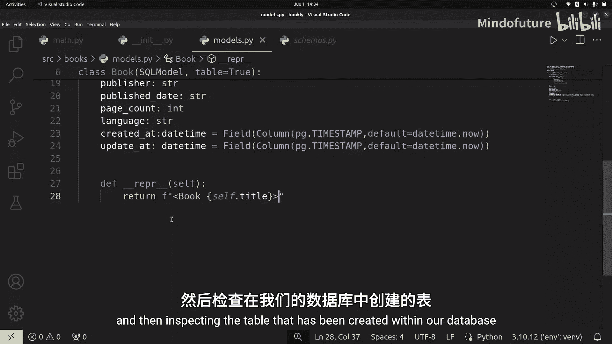

And once I've connected to it， now I'm going to go ahead and list the tables that are present on that specific database or which I have only one which is our books database。

 and once I have that， then I'm going to go ahead and describe it， so I'll say D and then books。

And that is going to show us the structure of our book database。 So we've created the UA。

 which is a UA type， just like you see right here， both there is a string publishes character varying。

 publish date character varying of which this can also be set to a date and I think I'm going to fix this and also we can have a page count language created at updated at and also our indices so we have the primary key being set to the UA just like you see right here。

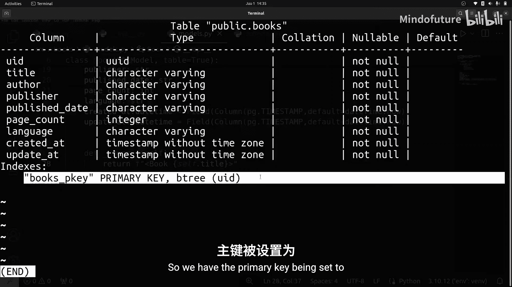

What's up， everyone。 Well come back。 So in this video。

re going to be carrying going from where we stopped in the last video went ahead and created our database table using SQl model。

 So we looked at how we can be able to set everything up from creating our database to creating database models。

 and then using those database models to reflect in the database。 However。

 I noticed that there are mistakes I did in creating the database model。

 And let me address those right now。 So the first one was to。

Go ahead and specify that these are fields and they are PG timests but what I forgot to do is to specify that inside R column right here。

 this column tape is not an is not a pedantic tape。 So this is an SQl alchemy tape。

 So I have to go ahead and do it just like I did for the E UA field。

 So to change that I'm going to go ahead and specify that this is an S a column。

And then I'll say that this is going to be an a column。Instead of a pedantic column。

 because this will give us errors when retrieving this data。

 Then I'll do the same thing for this updated add column。

And dis required quiet and still do the same thing。

 Another thing that I did was to call U U I D do U U I D4 and then include these two brackets。

 So normally。We are just okay with just leaving out the brackets because the moment we call through those brackets。

 we shall get errors that are from generating the same EU ID every time we are creating a EU ID。

 so I hope you've understood those changes that happened and now let's go ahead and clear our database so。

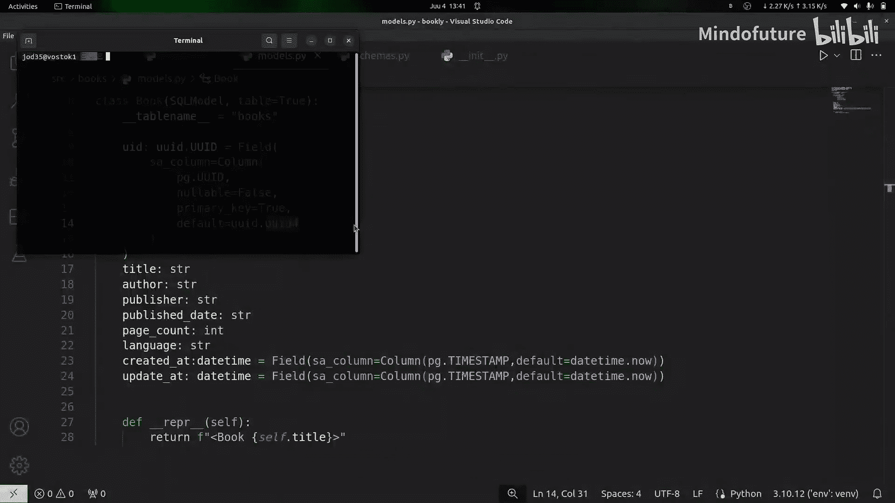

I'll go ahead and open it up my terminal。And inside meantimetime in a right here。

 I'll get access to the PS SQl shell。And I'm going to simply go ahead and connect to the database。

 which we called book free D B。And I'll go ahead and just drop the data bi that we created。

Which is actually drop table。

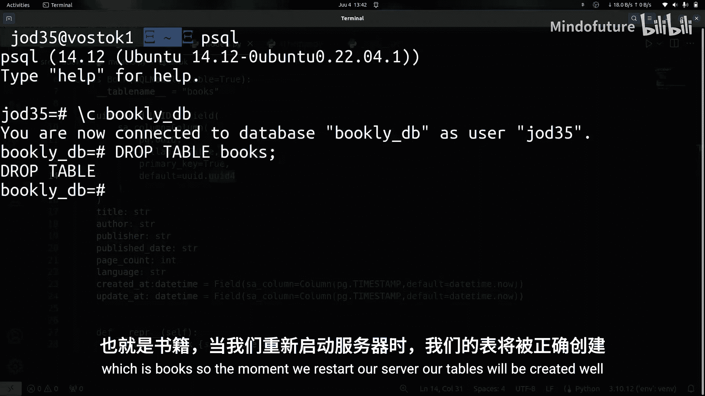

Which is books。So the momentary that us several articles table will be created well and。

You shall be good to go。 so if I quiet and save。A survey is going to go ahead and restart that。

 So when the restart that， we shall notice that our book table is going to be created again。

 So we have now created our book table and let us go ahead and look at how we can go ahead and use our newly created database model to carry out cr in the same way that we did in the previous videos。

 So what Im mean to do at first is to create a service class where we're going to create all our cr。

 So think of a service class as。The class that is going to have all the logic for creating all this crd so that the moment we need to carry out that crd。

 the only thing we shall have to do is to go ahead and access a specific method on that class Now there are very many ways to do that and very many approaches to that but what we're going to do is to simply go within our books folder within our source directory and we're going to create a new file that we're going to call service dot P。

Inside this， we are going to go ahead and create a class on which are going to access all these methods and this file is going to be one that's going to allow us to write all our logic for quad so that we don't mix it up with our logic for the route handles if you notice what we did in a previous video so as to do all actions for quad within the route handler functions。

 and this makes them have a lot of quote。 So for us to be able separate that quote from our route handles。

 all we do is to define it within its own file and then simply access it via a class。

 So that's what we're going to achieve in this video。

 So I'm going to go ahead and create a new class。 let me mix this a little bigger。

 So this class is going to be called the service for let yes call their book。Service。

So this is going to be our book service class。 and within here is we are going to define the different methods for creating。

 reading， updating and deleting our book resources。

 So when I'm introduced simply come and say I think de and this is going to a big one for reading all books so can simply give it a name such as get old books。

And this is going to take itself because it's a method that's going to be accessed via a box service object and I think is going to be the session。

So this session object is going to be an important object that' is going to help us to perform any。

She's kind of。Quried operation on our database。 Now。

 think of the session as the medium that SsQl alchemy and SsQl model pervade for us to access our database and then carry out any transaction。

 you want to go ahead and perform。 This session object also allows us to execute any SsQl that may be written。

 So we're going to look into how we do that。 But for now keep in mind that we need this session object。

 So once you've created this session object and provide the data as a parameter to this kit or books function。

 we're now going to go ahead and use type hints to define the type of this specific parameter。

 So I'm going to go at the top rate here and import it from。

Esquil Modo So I'll say from Esquirow Modo dot E X T dot I think I O dot session。

 we shall import our assign session class。 And once you've been able to import this assign think session class。

 now let's go ahead and injected rate there。And simply specify its type。

 which is going to be a same session。 The reason that's why I'm doing it is that this type hint is going to allow us to easily access the methods while programming。

 So it's just one hack that makes your coding easy。 So I'll just pass this for now。

 Now I'm going to repeat the same action for the other methods。

 I just simply go ahead and copy what we have here。And Ill past2 a new lane。I'll do the same thing。

 So I'll just simply call this our getbook。 or this is going to be one for retrieving a single book so shallll call it getbook。

 but this will also need the idea of the book we want to get。

 So I'm going to go ahead and provide it before the session。 So this will be our book。

 So in this case， you are using E U A。 So shall have to get our book E I D。So this can be a string。

That will be converted to U A when querying。 Then another thing we may do is to define one for creating your book。

 so。This one is going to be called create book。And it will take in a session。

 but it will also need the data to create a book。 So we're going to go ahead and providede the book data。

And this book data also needs to be of a specific tape。 Now。

 for us to determine which type of book we are going to create。

 we shall need a pedantic model to help us dictate which fields had to be used to create a book。

 Now for us to be able to do that we are going to need to go to ourche as the Q and create that specific book create class。

 Now this is our book model or our book class that we use to retrieve our book objects in the previous videos So if we want to create a book。

 then we're going to need way to define this without those fields that we don't need。

 So for now we have this as our I。 but remember we change this to our UI So we have to update that。

 So I'm going to come right here and say that this is going to be our UA and instead of being an integer it's also going to be a U UA。

 So go ahead the top right here and say import U UA。And once that is done。

 then we're going to simply ca in here and say that we're going to be making use of E U AD dot。

 the EU U A D tab， so。Once that is done， now let us go ahead and create the class that's going to be used to create our book。

 So we can also add the fields that for the created a date， as well as the。Updated a date。

 So we call this updated ad。I'll just come right here in the sches and also input our date time class。

 So I'll just come and say from date time。We are going to go ahead and import our date time。

And once that is done， now let's go ahead and add those fields， so I'll just specify right here。

So this will be our created ad。So。😔，This will be a deadtime object。

Just like we specified on the model。 And also， this would be the updated a。

 which we actually call the update a。 But feel free to go ahead and update it。So once that's。

 when this is done， let us go ahead and now。Define how we're going to create our book。

 So I' going to create class， and we're going to call this book， create model。

It's also going to inherit from the best model class。Now。

What we need to do here is to simply go ahead and define the fields that we are going to need to create a book。

 And that is going to be very similar to what we have here。

 only that we are going to also need the published date。

 So I'm going to go ahead and simply copy what we have here and paste it right here so。

One thing we're going to also add is going to be our published date。 So I'll copy it。

And then I'll past it right here after the publisher。So I guess I haven't copied it。

Go ahead and copy it。 paste it right here。And that is going to be our published date。

 So keep in mind that we are passing this as a string。

 but we're going to look at how were going to convert this into a dead object when storing our date。

 So let's go ahead and do that， so。And go back to our models right here。

 we defined our published data as a string， but we want to go ahead and save this as a date in our database。

 So this is something we can also change。 so we can go ahead and specify it is going to be a date。

 On our database， then we create the。Rereate the entire field in the database。

 So let me go ahead and do that。So when I run myself right now。

All these corrections to the database are going to be made。

 so I'm now going to have the published date as a date， but when I submit it within achemas。

 we're going to be accessing it as we're going to be getting it as a string and then we shall return it as a date and we're going to look at how we can do that so。

But to us have this file inside data service file right here。

 we're going to de D describe our book data as being of tapebook create model。

 which we've created within our schema as here。 So I'm going to go ahead and input that class。

 I'll say from。This is going to be our dot service or dot schemas。

 because this is in the same directory。 Then you shall go ahead and import our book create model。

 So once this book create model has been imported， we're now going to go writing in here and say the our book data is going to be refer to our book create model。

 or it's going to be of a type of book， create model。

 So once that is done that has now defined the two remaining methods for updating and deleting a book。

 So I'm just simply going to go ahead and copy we have here because they're going to be very similar。

And then。I just simply pissed what we have here。And change this from。Get book to update book。

 So when updating a book， we're also going to need the data that's going to be for updating a book。

 Now， let's call this the update data。And this is also going to be of the type。

 So let's just say that it's going to be of this type of a update model。

 So I also have to import that， I'll say。Import our book update model。

 So once weve imported our book update model， then all we're going to do to say book update model。

And then we shall have our session。 So this will take in the UI D of the book。

 as well as the data to update the book。 Now， let me format this so that it looks a little bit nicer。

And yeah， that's how it looks for now。Alright， so let's go ahead and finally delete the book or describe the method for deleting a book。

 So that's going to be。One similar to what we have。 So this will take in only the book U I D。

And we will go ahead and delete the book。 All right。

 we've now defined our methods that are specific to。Deleting or creating， reading。

 updating and deleting a book。 We're now going to go ahead and define the logic that's associated with each of those operations。

 Now， let us start by。First of all， using our session to create a statement that's responsible for reading all our books or getting our getting all our books from the database。

 so if we just come right here and I'll create a statement。嗯。

And this statement is going to be a select statement。

 so SQl model gives us methods or functions that help us to rate our python in form of SQl for example we cant be able to write a select statement and that's a select statement will be so equivalent to what we may have as a normal SQl statement and let me show you how that is done so we're going to be importing our select function from SQL model and once we've imported this select。

We're now going to create a select statement。 So this is going to be something like select。

 And then we shall just providevade the model that we want to select from。

 So this is very equal to something like select stuff from a specific table in our database。

 And we're going to look at how we can do that。 So we have to fast import our model。

 which is our box model right here。 So I'm just simply go going ahead and importing it。 So say from。

Dot models， we are going to go ahead and import our book model and once we've imported our book model。

 Now let's go ahead and select it。 So just come right here and say select book。

 and then we can now go ahead and do the filtering with where or ordering by by just simply calling dot and then the specific method。

 So in this case， what we want to do is to go ahead and order is by the date at which they are created。

 So once the list being at the top of the list。And they would do that by saying， dont bother bye。

And once we've been able to do that， we can now specify that specific。Column we want to order B。

 So what I want to do to simply order this in a descending order。

 So that the book object that we created or the book record that we created the latest is the one to appear first on the list。

 So to do that， we're going to also make use of another function called the descending function or that disk function。

嗯。And what that will do is to just simply be cold。And we can now go ahead and finally define that specific column。

 We want to go ahead and order in a descending order， So shall say。Book and end dot created。

At so in this case， we want to go ahead and order this by the data created them。

 So once this is done， we're not going to use our session object to go ahead and。

Execute this statement。 So for us to do that， we shall say that our result is going to be equal to。

Using our session， so most methods that are to be accessed to the session object are going to be core routines because this is an I think session object。

 So for us to do that we shall say a wait and then this would be session。Dot。

 So we need to call a specific method for executing a statement which is going to be exact。

 And then in there is we are going to provide our statement。

 So they're simply going to write this to statement。Once that is done。

 let's go ahead and access the result。 so for us to get the result from this result object。

 all we have to do is to go ahead and call as specific。Method on this result object， so。

We can simply go ahead and return our book by saying return。Result。Dot all。

And this will give us access to all the books that are going to be returned from this result object。

 So once that is done， we can now go ahead and test it out。 So before we test it out。

 I think it's something good that we first finish earlier methods。

 And then we look at how we can go ahead and test this out。

 So let's fast deal with retrieving your book。 So retrieving the book is going to be the same。

 almost the same as what we have fear。 But it's going to be。Retrevieving one book object。

 So let us do that。 So I'll come here and say that our statement is going to be equal to select。

And this select is going to be on our book model。 But what we need is to go ahead and access one book。

 So in this case， to filter， we are going to be making use of the dotware method and using this。

 we shall use our。Column that we want to look for。 So in this case， it's going to be the book U AD。

 And we shall check if the book U AD is going to be equivalent to the book U AD we providevaate within our method。

Just like that。 And once that is done， this is going to return。We a result object。

 just like we've done when fetching rule books。 So shall say that our result is going to be equal to。

I wait。And this case shall sayession do ex and shall pervade our statement。So once that is done。

 now we can go ahead and return our book object by saying return。Result。Dot fast。

And that will go ahead and return our。Object， we've now been able to get all books as well as getting a single book object。

 Now， let's go ahead and handle the rest of the quad pars to create a book we shall need to first of all access all the data that comes from the client。

 So that is going to come via the book data。 And once we've been able to do that。

 we're now going to create an object of type book or our book model and then simply use our session to add that to our database。

 So to do that， we're going first of all access our book data via the book data dictionary。

 I'm just simply going to create a dictionary。 And this dictionary is going to be that's going to get our book data。

 but inform form a dictionary to get this book data in form of a dictionary。

 We shall just have to say dot model damp。And once that is done， they're going to create a new book。

 So a new book。Is going to be equal to a book object， and this book object is going to be unpacked。

 or the attributes are going to be unpacked from our book data dictionary。

 But we are doing is to unpack all keys and values that we've got from our book data dictionary into our object。

 So this is going to create a new book object with attributes it gets from this book data dictionary。

 So this is what we have here。 So it's like I'm having an error。

 So book data dictionary is non defineded。So I guess I did double end of scroll in here。

 And that's why it's returned that error。So。Now to go ahead and save this book。

 all we have to do is to say session。So this is going to be using session。Dot add。 And in this case。

 we are going to be using our new book。 And then to finally save this to add that basically we are simply going to go ahead and our wait session。

Dot commit。 So that will go ahead and commit this to our database。

 And once this is then we need to also return the newly created book object。

 So this is going to be a method that's going to add the object to the session。

 And once we've added the book to the session， we are now going to commit this to our database or to commit the current transaction。

So。We return our new book， by just simply saying new。Book this is going to say return new book。

 And what we've done is to create our new book。 So the way we've created our new book is to simply get the data from our client create a new object to that data and then add the transaction and finally come it to our database。

 Alright， so let's go ahead and finish this up。 So to finish this up， we're going to go to update。

 So the process we of updating is to first the book。

 And since we have a method for retrieving this book， we're not going to repeat the entire process。

 So shall say that our book。To update。 So in this case， we're going to say book to。

Update is going to be equal to。Self don't get book。 So in this case， we are going to get our book。

And。This time we have to provide our book Q I。 So Ill just come right here and say。

 we't have our book Q I D。And also， we shall need our session， so Im made to say comma。

 and then we shall also need our session just like we have right here。说。Once that is then。

 let's go ahead and now update this book。 So we are going to access the data from our update data just like you see right here and then use that data to update our book。

 So we are first going to convert that Traary。 So I'll say book update data。Dictionary。

It's going to be equal to our update data。Dot mo damp。And once that is done。

 we are now going to go ahead and。Make use of that data to update each of the fields on our book to update。

 So what it shall do is to save for。Each of the keys and the values in the items that are inside our book update。

Dictionary， which recalled the book update dictionary。So in this case， it's going to be update。Data。

Dictionary。We're now going to go ahead and access the items by calling the dot items method since this is a dictionary。

And once we've done that， now we're going to go ahead and update each of the keys or each of the attributes on this。

Specific object using the special set attribute。In build Python function。

 So what this does is to get an object and then update。Ive even written it， but it's going to be set。

Attribute。 and this is going to get an object such as the book book to update object that we have right here。

 And then it will update it paing on the keys and the values that we provide to it。 So in this case。

 if we go ahead and say book。To update。And here we have to go ahead and provide the name of that specific attribute one to update。

 which shall be the key in this case， and then we shall also provide the value first us to commit these changes to our database。

 all we have to go ahead and say is a weight session。Don't comment。 And just like that。

 we shall have updated our book。So once that is then， let us go ahead and return our book updated。

 So in this case， they're just simply going to say return book to update。Now， one important thing is。

We are not catching the error。 that may result。Out of the book， not being found。

 So what you can do in this case is suggest come right here and write that check so we can see。

If book， if book。To update。I。Not9。Which is not。男。Then we can simply return all this logic。

And then in case we don't find a book， that's where and else。Then you can simply return9。

 in case we don't get any book， then we can return9。 And in this case。

 what you can do is to just come and say that our book。Is going to be to result at fast。

 but in case our book is not being found， then we're going to return and so how we're going to do that。

 we can' say return。Book。If。Book。Is not9。Else， we can return our na soap。In this case。

 we shall return。 And in case the book is not found。 Now。

 this is going to be very helpful when we are dealing with our path handlers。

 just in case we do not find a book。 We want to go ahead and throw that exception。

 the F TTP exception to show that our book has not been found。Alright。

 so let's go ahead and finish this up。 So we're going to go ahead and use the same logic right here。

 So we are simply going to come and see that our book suggest and copy what we have right here。

And once I have this， then we are going to also do the same thing if book， so in this case。

 it's going to be book to delete。Is not 9。So I have to rename this from book to update to book to delete。

 and then we shall go ahead and delete using our session。

 So in this case we shall come and say that await session。Do't delete。

 and then we shall call our book。To update。收。Once we've been able to do that。

 then we are going to use our session to find coordinate this to our database。

This is actually book to delete notebook to update。 So Ill just simply go ahead and。Change that。

And then I'll go ahead and commit this social I'll say， await session。Don't commit。Alright。

 so once this is done， then you need to throw an error or return none in case that book has not been found。

 so shall just say else。Return Nan。And just like that。

 we've been able to define all our methods for carrying out our crd for our book resources。 Now。

 once this is done， we' are now going to go ahead and determine how we shall use our session within our path hand left function。

 And that is where the concept of dependency injection comes in。

 So depend injection is a mechanism that first APA uses to allow you to share logic across。

All route handlers that may need it。 For example， in this case。

 we are having this book service class， having these methods。

 and each of these methods rely on access session object。

 But in case you want to go ahead and share that session object across all the other methods that need it。

 Then all we need to do is to go ahead and simply pass that session。 all this path handlers。

 Now let's go ahead and and create that dependency。 So normally when you're using depend in。

 you're going to have code that's going to be relied upon by other chor。

 So that code is what you call a dependency。 And that's what we're going to create。

 So that depend is going to be responsible for creating a session。

 and then we shall use that dependency in the function that will depend on it。 So to do that。

 we're going to head the source folder。 And within our source folder， we're going to access the D B。

Module or the DB package right here。And inside there is where we're going to go ahead and access the file in neutral going to carry out that specific。

Cord or write that code。 So we're going to now go ahead and create a function that's going to be responsible for retaining our session that we shall now use across all these remote hands。

 So let us go ahead and define that。 So just simply going to come and say， I think de。

 because this is。Going to be making use of some as think features。

 So I say I think de and Ill call this get session。

 So this get session is going to make a return and that is going to be a sync session。

 So it makes sense for us to import I think session。 So I just simply go。

Rightrite at the top right here， and say from。S QL model。

 we shall go ahead and assess E X T dots Ha think I O dot session。

 and right inside there is we are going to get our Ha think session。

Once we got at sync session class now， let's go ahead and determine or describe our。

I think session as the return of this function。So okay。

 now we have been able to define this function。 let us go ahead and create the session class through which we' are going to create a session object。

 So this is what happens when you want to create a session you need the session class but for us to create the session class we're going to be making use of SsQl alchemys session maker and why we're going to use that is because we need to use this SsQl model as think session and the way we do that easily is through the use of the session maker class as it helps us define any class that we want to use for creating a session。

Now， let's go ahead and import that。 I'll go ahead to share and see from。S Q L。 How can me。Dot O RM。

 I'm simply going to go ahead and import our session maker。

So I'll go ahead and import the session maker。 And once I've input the decision maker。

 Now let's go ahead and create a class。 And that's why I'm going to write it with a capital is or an uppercase is。

 So this is going to be our session that is going to be created from our session maker。

And the first thing we're going to have to do in creating a session or a session class is to bind it to an engine。

 Now， remember that we created our engine now remove its to the as engine。

 but you can feel free to go ahead and modify that trait at this point in the video。

 So this assign think engine object is what you're going to bind to this session so that you can access database and then carry out the cr。

 So just simply come right in here and say bind is going to be equal to a sync engine。

So once that is done， now let's go ahead and also specify the class that we're going to be using。

 So it's going to be equal to。Our sync session， the one that we imported。And once we have been also。

Able to do that。 let's go ahead and also add one attribute。 that's going to be the expire on commit。

So Exp on commit is going to allow to use our session objective after committing transactions to our database。

 so in this case we are going to go ahead and specify that we don't need to expire our sessions。

So yes， great set it to fail so that every session that you create can then be used even after committing a transaction。

Allright， so。We are done creating our session in class。

 Now let's go ahead and finally create a session and object。

 So we're just simply going to come right here and see， I think with。

 and we're going to use this context manager to create R session。

 So we are now going to just simply call our session。Class or print an object of session。

And we're going to with session as session， then we shall just yield our session。

So this is going to return our session so that we can finally use it within our routes。

 or our path handles。And just like that， you've been able to。Create alpha dependency。 Now。

 let's go ahead and inject this into the rot handr functions that are going to make use of it。

 So we're going to head over to route dot P A within our books folder。

And we're going to begin by first of all importing it。

 So I'm just going to go right here and say from。So we can actually guess here from dot service or from dot main。

From whatever， and that will go ahead and basically it access as long as it belongs to the same folder or the same directory。

 just like you see right here。So for now， we want to access source DB dot main。And in this。

 we want to go ahead and access the gett session。Function。

 so the kids Xion function is one that we're going to inject into these remote handler functions in case you want to carry any equation。

 And the way we do that is very first of all， accessing the depends function from FA P。And。

When you access this depends function， oh we need to do is to go inside rot handler such as the one for gettinging old books and then injecting in that specific object。

 But then we shall have to pervade that value has that value that comes from that dependency just like we're going to see。

 So let us begin with this function for getting old books。

 so shall say that our session is going to be of a specific type。

 which is going to be the one that we use to create this session。

So I'll just go ahead and copy what we have here and then introduce it within this file。

And once we've been able to do that， the analysis is going to be of tape， I think。Session。

And the default value for that is going to be one that we get from using our dependency。

 So we're going to call the depends function and then providevade that dependency。

 which is going to be our get session。Class， or this is actually a function。

 So we're now going to say get session。So once that is done， now。

 let us go ahead and use our session to retrieve or to get all books。 So let us， first of all。

 input our service。 So now this is a class。 and we need to create a session。

And then use each of the methods right here to carry out our query。 So for us to do that。

 I'm going to go ahead and import this book service。

 So we're going to do that within our models actually our route。 So I have to close this。

 Now I'm going to come and import that service class。 So I'll just come and say from。Souce。

 dot books， dot service。In this case， we are going to go ahead and import our book service class。

So once we've imported our book service class now let's go ahead and change our code so that it makes use of our book service class instead of our book data。

 So I'm going to go ahead and first remove the inputs for our books from our book data。

As well as our book data。 So that we get rid of it。 we are now using our database。

 So we don't need it。 So once I've removed that， now let's go ahead and make use of our book service。

 So this is going to be an object。 So I'll just have to come right here and say the our book service。

 So this is going to be our book service object， which is going to be go to our。Book service。

So once this is done， now let's go ahead and fetch all our books using our book service objects。

 So I'm just going to come right and save books。Is going to be equal to。So in this case。

 we shall say books is going to be equal to book service。Dot And in this case。

 you shall get all books。But this is going to require us to have a session。

 so we shall make use of a session object that we've got via our dependence injection。

 I'll just have to pass it in right there。And once that is done。

 we will have got our books from the database and used them。

 So that's how we're going to go ahead and finish up our cr。 Now， let us begin doing this one by one。

 So let's start with one for creating a book。 to create a book。

 We are now going to go ahead and simply say this is going to be our new book data。

 So thiss just say this is going to be our new book。 That's going to come from our。Book data。

 So'll just remove what we have right here。 So our book data is going to be available。

 but we need to create a book。 So shall say new book is going to be the one that we create from our book service object。

And in this case， we shall create this with our session。

So we shall actually need to just say book service dot create book。 And in this case。

 we shall need the book create data， which is going to be our book data。As well as our session。

 which is going to be our session。Soha go ahead and provade that。And then finally。

 we are going to inject our session right in here。 So I'm going to do the same thing。

 I'll just come right here and say。That you're going to have as station。

Similar to what I've done right here。And just like that。

 we'll have injected thation into this road handler。收。Once the newly created book has been created。

 it shall be returned right here and now lists do the same thing。

 So Im mean format awkward for this part。Amazingly black code format extension for V S code。

 And that's why I can easily format my code just like this。

 So this is just enough to create our book， And we can also define how we're going to return our book。

 So in this case， we shall say that our book is going to be returned in a response model。

Which is going to be equivalent through a newly created book。

 So we are going to go ahead and say book。So this is going to be equal to book。

 And once that is done， let us go ahead and retrieve a single book。 So to retrieve a book。

 we shall just say in this case， we are going to say book is going to be equal to book service。

Dot get。And a school book。 So think that's what we called it。So this is going to be book service。

 I've made a mistake in that spelling。 but when you get a book service。

Then were going to get our book。 And what you shall need is the I D of the book。

 as well as the specific session。 So I'm going to go ahead and pro the session right here。

 and then we are going to provide our book Q A D。 so I'll see。

The our book I is going to be our book U I。 And I think I'm also going to change it right here from book I to book U A。

Then you can also have access session。So the thing is， right now we。

Need to handle what happens when this book is not returned or in return N from our service。

 So go ahead and pull that back。 So this can return N in case the book is not found and it will also return the book if the book is not found。

 so。For us to handle that， what you're going to do is to say if book。Then in this case。

 we can say a return book else。 We shall just simply go ahead and return an exception。

 So in this case， we can say else， sorry for this。Then we shall raise this exception for retaining a404 not found。

And that is going to be one for retring a book。 So let's go ahead and finish up the first thing we're going to this to head over to our update model。

 And in this case， we are simply going to delete what we have。 So shall have update。

And this is going to be our。Updated book。So our updated book is going to be one that's going to be a result of calling book service。

In this case， we're going to say update book。And in this case， we are going to need the book UID。

 So I'm going to change this from book ID to book UID。I'm going to simply go ahead and change this。

And then book book U ID， this is also going to be the book Q ID。

 So this will be the book update data， which is going to be of tab book update model。

 And then inside here， what you're going to do is to providevade that。

 So Ill have to also get this session。You just have to copy this session object from。

In your rot handler function。 and then simply go ahead and inject it inside， sorry for this。嗯。

But simply going to go ahead and。Set this up by prevading our session。Now。

 let me format the rest of the codes that you can easily see it。

And this is how it's going to be so we have our book UI our update data as well as our session allright。

 so let's go ahead and just provide them so we're going to have our book UID and in this case we shall have our book update data。

And then we shall also have our session。So that will be enough for us to go ahead and update our book。

 so。Another thing is these are qua。 So I've just forgotten to call them with a weight。

 So I have to do that。 So I'm just simply going to come right here and then simply highlight all occurrences of book service thoughts the method。

 And before calling them， we are going to go ahead and provide the。I wait。

 So I'll just come and call them with a wait， because these are all。Meths defined as core routine。

 And yeah， that would be enough for us to update。 So remember that this is retaining9 also。

 So when you go back to our service file。We have updated book checking if the book is not9 and then returning none in case the book is 9。

 So in that case， we have to also handle that。 So we shall say if updated book。In this case。

 we shall go ahead and return our book， so。WWech shall retain our update book。

And that's what we're actually going to do。I'll return。 So I'll say return our updated book。

And then else， we are going to go ahead and return。

Or raise an H T TP exception since the book is not found。

 Now also going to look in two other ways to handle these exceptions in a later video。 But for now。

 what you can guess is suggest simply raise40，4 not found。To delete。

 we're going to do the same thing， so I have to go ahead and inject our session object right in here。

And once that is done， then you're going to just say。啊。Book。To delete。

 So we don't even expect this to return a response because it is 2，4，0，4，2，0，4。

No content kind of response。 So this is going to be equal to a weight book service。

Dots and in this case， we are called delete book。In this case。

 we are simply going to provide our session， as well as our book Q A D So just like0 here。

 this requires us to pervade the book Q A D So I think that's something we forgot。

 So we have to go back here， delete book。 I think we have to name this something else。

 think this is book delete。And it's going to take in the session。So this is going to be。

Delete book taking in the book Q I， as well as the session， so。I guess I'll have to do that。

So this is going to be book service dot delete book。 and in this case。

 what we're going to have is our bookQA D。As well as our last session。

So if we return the book we have deleted。In this case， we can just simply return something。

 so let' just return an empty dictionary。And in case that book is not found。

 and we shall return then。So I'll do the same thing if book。To delete。

Then we shall return nothing because this is a 204 known found。And then。

Once we have not found that book， we shall say else。

And then this is going to return our H T TP exception。

 So this is going to be a status quo or 40 for not found。 And I thing we can do is to change this。

 So we are having book I D。And this is supposed to be book U A D。

So let's go ahead and correct that in other methods， this is book I D。And that we need a book U I D。

And then you shall do the same thing。 So you have book Q A D， book Q A D， have book Q A D。

 book Q A D。And then book your I D book your I。 So it seems like we are now done with our methods。

 so。Let's check if files are still running。And if it's still ending。

 then I think it's then we tested this APIPA end points。

So let's go ahead Fox and try to test this out。So Ra and Maryist Fox。

 I'm going to begin by fetch all books。 So to do that。

 we are simply going to make use of the API endpoints we did when performing our crowd。

 So just present send and this is going to return an empty list of books。

 meaning that we do not have any books created yet。So we're going head a to our creative book。

 So this is the。Structure for creating a book。 And this was making use of our simple。List。

 but remember， we are using I。 So I decided to eliminate the I D and eliminate all other fields that may not be needed。

 So when you try to create a book， we are now going to get an error。 So right here。

 the error is still in us that we。AHaving。An error。 And that error is coming from invalid input tape。

 String object has no attribute to orino。So this is something that we can easily handle。

 So for us to fix that error， what we're going to do is to go back to our service file and fix the way we are storing our data inside our database table So what FA steppi is telling us is this is actually coming from SQl alchemy So SQl alchemy is telling us that we are trying to fill。

I did。A date field with a string and therefore it can't access that specific method on that string object。

 So for us to do that， we are going to head over to our service and then define how we're going to be storedoring the date attribute which we published that specific because I think it comes from the published date field。

 So for us to fix that we are now going to head over to our create a book And when we create a book we' are now going to also modify the attribute of the published date to a date time or a date object。

 So we're going to fast begin by importing the date class or we're going to save from。That time。

We arrange to go ahead and import our datetime class。And once we've imported that DM class， now。

 let's go ahead and。Modify this new book。 So shall say new book。Do， in this case。

 shall they published date。So the published date is going to be equal to date time。Dot， in this case。

 we are going to access it as。We are actually going to just change it to a daytime objectives using in that do STP。

S TRP time。 And what is going to take in is a string that we provide right here as a string。

 So this is going to be our date that shall access from our book data。

So we shall just come right in here and say。The objects or the type of data that you're going to get from our book data di。

This is going to be our published date。 So I guess I have to just copy it。And then， simply past it。

So right after doing that， then you' are going to specify the format in which this date object is going to be created。

 So this is going to be created in this format which is going to have the yeah remember we using in gear month and date So in this case is going to be percentage why meaning yeah then dash this is going to be the month and then we are going to have the date So I guess this is going to fix our error。

 So once we've set our published date as a date object。

 then it's going to be finally saved our database as a date So let's go ahead and try to create a new book once again。

 So if we try we now see that our book has been created to confirm this we're going to try to retrieve all books and now we can see that our books are being returned or our books are being returned from the database so we can also go ahead and define other fields on a specific book object and we're going to look at how we can do that in the later video。

So。Let's go back and try to finish up。 So getting a book page I D。

 I'm going to copy the U I of this specific book。And once I have that。

 then I'm going to head over to this portrait here。And try to fill in from an integer to hero your A。

And when we send， we now see。That you have input should be a valid integer and able to pass string as an integer。

 So I think that is coming from。Where we are having the model that's going to return all these books。

 So let's go ahead and fix that。 We shall go back to our schemeche as。And within askchemas。

 I think this somewhere。 we still have an integer book book U A， so。Pa Q A D。

 this is going to be an integer。 I think that is within our rows， so。Pyent is trained to。 So you see。

 we still have integers in here so we can go ahead and change them to G U A or strings。

 So let me try and chain them to strings。When you change this to strings。I think it's going to work。

嗯。So when provide them as strings。We are still having an issue。 and so we are now having a message。

 inputput should be a valid dictionary。 And I think this is coming from a response that we are supposed to return。

So let us see where that response is coming from。So we are supposed to return a dictionary。

 but it seemed like we。Returning something else that is not a dictionary。

 And this is that stupid mistake。 I did right here。 So I'm going to fix that by saying return book。

 And that should be returning our book， so。When you trying what say again。Input should be。

 So this is a book object。 So the thing is， when returning。

A response faster P requires us to retain something that is Jasonson serializable。 And in this case。

 what we are doing is to retain the book object that we have right here。 So if we want to fix that。

 then all we're going to do is to go ahead and specify a response model for this specific。

Rse handle low this specific request。 Now， just come right in here and say response modelto。

And in this case， we are going to go ahead and return。The response model for our book object。 Now。

 let us make use of our book right here。Which is from our schema。

 So I'm going to be making use of this。 So I just can't write where we have our。Roads。

 and inside that is where you going to make his of our book， so。

I'm just simplyre going to remove our book model because this is somehow going to confuse us that I suggest use our schema as since we are now having that book schema。

 So when we have that we're now going to come right in here and say that our response model is going to be a book。

 and this is going to carry out any validations or now book object and retain it in a Json serializable fashion。

 So when we try to send this we're still having an error published date input should be a valid string input is dead。

 So we need to also fix that。 now what is happening is。When you try to access this。

 we've changed this from。A published date， which is a string to published date。 That is a date。

 So notice that our fields defined on our model。A should be in the same way。

 So in case you define this as a string， you should have your， your schema as。Using that as a string。

 in case you defined it as a date， then it should also be a date。 Now。

 I'm need to go ahead and change that by simply going to skim as the P A and then。

Inside there Ill change how we are retaining our published date。

 I I'm going to go ahead and change this to add date。Alright， so now when you try to send。Still。

 we are having an error。 So let's go ahead and fix that。 That is none defineded。

So I guess Ill have to go ahead and import it from that time。So， when you save。Cancel this request。

 And before I cancel it， we now see that our response has been returned。 So when you return。

 we are now returning that specific book object。 Alright， so。Two things are working。

 Let's go ahead and now try to update as well as to delete a book。

 So updating a book is going to request to have an idea of that specific book。

I'm going to come right in here and get an a is simply one that we have right here。

 So let me try to create some more books。 So this is Headfa HM A programming。

 What if we change this to something like Java， Headfa Java。

 and then say we called our author John Do。We can also change the publisher to something。

 So that simply going to say。Whatever this is going to be。And when you try to quit another date。

 So let's say this was created in October。20，20。傻。Oh， let's say October October 2022。

 we send we have some areas right here。 So we have in fields that are actually missing， so。

I guess this is something that's coming from。So let's see where， where。

 where this array is coming from， so。This is coming from。So we're missing the credit at debt。

As well as the。Update at date。 So we're having some missing fields。 We have the UI D。

 as well as the update update。 And under why， this is happening because we already defined this inside our。

So let's see why this is happening。 So I think this is happening in the response because the response is retain a book response model。

And this book create here。Is something that we are not。 So let's try to debug this， I guess。

A book that is being forward being being used in a book fashion。

 So this is requiring us to even providevade these fields that are part。Of our。Book。

 yet we have a book create model。 So forgive me for that。

 I just come and say that we're going to make his our book， create model。

Which is defined specifically for creating a book。 Now I'm going to go ahead and change this from book to book。

 create model。And this shall be just enough for us to create a book。Just like you see right here。

 Alright， let's go ahead and finish this up。 when you go。 So we've created a second book。

 We now have two books， and these are ordered by the data which they are created。

 So I hope you can also note that。 So we can create another book。 Let's say this is going to be。啊，湛国。

Jungle5 play， example。And this is going to be the。The author love the most， which is Antonio male。

I don't know whether that's the right way to pronounce his name。 that' their name is Antonio male。

 He quitted one of the books that taught mejagle when I didn't knowja， shall I say。

This is Antonio male。And then。Are this going to be lets say by packed publishers。So I'll say， 2024。

Let's say match or 0，3。 And then let's say this has 200 pages or 300 or whatever。

 And the language is English。 When we quit that book， we now see that that book has been created。

 Allright， so let's try to update our book。 So I' mean to copy a random new idea of a certain book。

Let me see。 I'm ready to copy this one for headfa H T ML。And once I've copied it。

I'm now going to go ahead and update it， so。M about where we update a book。 Now。

 let's make sure that our book update model is what we are using， which is okay。嗯。

So we're going to head over right there。 And I'm going to change this from。

Had fast HTMLF programming to something let let's say。HtML。So that means。

And then we can also change this to something like they say Gen do。So this is going to be really。俺吃啊。

It's right to。 So we have an error。If we fix this， we never awaited something。

 So Getbook was never awaited。 So I have to go back to our service and then inside it there。

Because we are going to go ahead and change updates that we can use a weight。

 So that's a mistake I was doing。 I'll just simply say I wait。

 And then I think that's the same thing I'm going to do right here。

So these are some of the mistakes you may land in， but。I think we have fixed it。

 So when you go back right here and send still have an era。 So this era is coming from。

Inva input for query ajut 1。We have G U A D， and。This is actually supposed to be for the U U I。

 So I made a mistake。 We are supposed to provide the I D of that specific book。 We had to update。

 Sorry for that。Let me just copy this U I that we have here。Well， I think I even copyied the U I。

 So I'll just parade that。 And when we send。Still having a lot of errors， so。

Input should be a valid dictionary。 I think we need to do the same thing。

 So I'll just go back to our routes and then specify the specify the response model。

So this is going to be our response model。But this is going to be one for。The book。

 so shall say book。And when you save。As have I shall restart that， then we shall read shall return。

 and this is going to be updated successfully。 Okay， so let's try to retreat to delete a book。

 Now I'm going to go and delete the same book I provided it U UAD right here。

And now we see that the book is not found and way。So let's try to see because this book is existing in our database。

ill。Al right。 so after a series of debugging， I decideded that the best way to handle this was to fast of all。

Handle what happens when the object that we've got from our query is none。 And in this case。

 what I did was to write if update book is none or if the updated book。

 So that's actually if the update book， if the updated book that we have read here is none。

 then we shall return。An exception or raise an exception for it not being found。

 And if it's actually found， then the result will be for us to return the updated books。

 So after doing that， when you go back right here。That tended to work for updating if we delete an object。

 so let me try to delete this specific book that we have right here。I'll just copy it's A D。

And when I copy it's80 when we try to send this right here。Now， see。The book is not found。So the。

 the thing is， the idea is that when we。When we are handling such a scenario。

 we have to fast check for the book not being found。 So if we say if book do delete is。Nan。

Then we are going to faster worries than exception in case it is not found， and when we find it。

 we are now going to go ahead and return that specific book。 so that was the entiret I was doing。

So I'm going to do is to just simply come right here and say if the book is none。

 then you're going to go ahead and return that， and in case we do not return a book fast D P is not okay without with us using none in a response。

 So that was just the case。 so we you try to go to our books right here and wes that book has been deleted and when you try to get it。

 we now see that the book is not found。What's up， everyone。

 all come back at this point in the series， we've been able to create pretty much all of our crowd functionality。

 but Cd is not the only thing that you're going to be looking at in this course。

 So let us implement some features that go beyond the cr。 Now。

 the first are going to implement is one for creating user accounts。

 So any application requires some sort of authentication or authorization。

 authentication being the act of letting users identify who they are within our application and authorization allowing users to。

Give them access to various parts of their application based on the specific roles and permissions they have。

 Now we pretty much have a simple web application set up and let us go ahead and set up our user authentication model。

 So to do that， the first thing I'll do is to go within As directory rate here。 so。

I'll create a new folder。 and I'm going to call this off standing for our with an education and insert it here to make it as a Python package。

 I'm going to add a d in it。Dot Pi file。 Now， inside it here。

 I'm going to also go ahead and create a model dot P I file。

 And this is going to be for our user authentication model。 Now， to begin。

 we' are going to go ahead and import the Iel model class。

 just like we've done for the previous videos。 Now。

 let me go ahead and close some of the stuff that I have right here。

So let us start by importing S QL model。 So to do that。

 we are going to go ahead and save from S QL model。We are going to go ahead and import our SQl model。

Now。After inputting I SQ model， we're going to go ahead and pretty much set up our database model for users。

 Now， let us go ahead and simply look at the fields we're going to add to this class。

 So we're going to create a simple class and that is going to be our user class。

 This class is going to have the following field so it will have a EI just like we had So this will be of tapeI dot UI just like we discussed in previous videos。

 We're also going to have a username for a user。So this will be a string， which I have an email。

And then you can have other attributes， such as the first name。Which is the string。

 as well as the last name。 So this will also be a string。 We can also have that is very fast filled。

 So this will be the one to basically。Show that the user has been verified。

 So this will be a bullion， and it will have a value or false at the beginning of the account creation。

 So we may carry out things like email verification that may help us to verify an account and stuff like that。

 so。Once you've done that then we're also going to finalize this by simply going ahead and adding the created act as well as the updated at times times。

 So to do that we're going to say created at and this is going to be a deck time object。

And then we can finally have our updated at。 And this is going to be still a that time objects。 Now。

 remember these are postcurql timets， and we looked at how we could set them up in the previous video。

 So to begin， we're going to go ahead and create this class。 So I have the freedom。

 I'll just go ahead and copy what we have here。 Oh I'll even just cut it。

 then remove what we have here。I swear for this， so。

I'm just simply're going to go ahead and remove this。Do string。

 and then I'll just simply past what we have there。

 So we're going to begin by festival importing E U。

 So I'll just scroll it at the top and say import E U A。

 And once we've imported U with taken care of our type for Ie U A。

 Now another thing we may want to do right ahead and specify the name of this table as you want it in the database。

 So to do that， we shall just come and provide the special Na table name attribute。But remember。

 we also have to go ahead and set this up so that it actually。Stands for a table inside our database。

 so。We can find， first of all， call this our users。Tbo。

 and then we can finally specify that this is going to be an SQl model。Sub class。

 And I think to make this as a table。So we make this a database table。

 shallll just say that this is going to be a table。 So shall add table equals2。

 And this will be our database table。 Now， let's go ahead and complete what we have right here。

 So we specify that I E U AD is going to be of type U U AD。

 But first to make it to U U ID we're going to follow the same。

Concept that we looked at in the previous videos。 So what I'll do is to just simply camera here。

 I'll copy what we have and then paste rate here。 So I'm just going to add an addition to this。

 And this is going to be our field， but it's going to be a Postgreql E U A D tape。

 So I'll have to go ahead and import our field。 So I'll just come right here and say。Import field。

 And we shall also go ahead and import our column。Funion so once you've been able to do that。

 now let's go ahead and also import our postquiQ will dialect。 So I'll say firm。Or， let's say。

 import。S QL。 So its going to be import SQL alchemy。 or what some of you call sQl alchemy。

 So I'll just say import SQl alchemy doch， Dx dors。Postgres Ql as P G。 So once that is done。

 then this will make our column as Postgresql E U A D tab。 So once that is done now。

 let's go ahead and just copy paste what we had for the timests and we head over back to our books model。

 and then I'll copy what we have here。And I'll paste it just straight here。

 So Ill just go ahead and past this。Now one thing we can do is to also go ahead and input our date time class。

 So I'll just do that very same from date time。We are going to go ahead and import our date time。

 So thiss going to be our dead time。And we see that this is a bullan， so it should be false。

So it's going to have a default photo false， just in case 3。

Do not have it being true at the beginning。 And you can also do this by using the field functions so you can say something like field。

And inside here， we can say that this is going to have a default。Of false。So just like that。

 we've been able to create our user account model。 Now to create a single representation of our models of our model objects。

 We can simply go ahead and create a d method。 So this will be。Danda re， and it will take itself。

 Then it will return a string representation of a user object。

 So for us to do that shall just simply come and say user。And in this case。

 shall'll just say user do user name。So that's how we shall be visually seeing these objects of type user。

 Alright， so now our database model for users has been created， hoping you don't have any mistakes。

 We've been able to create this。 And we need a way for us to go ahead and。

Reflect this table within our database。 Now， in the previous videos， if we looked at chapter 5。

 we simply。Created our databases in the table using a lifespan event。

 If you go backward right to our dandda Uni pure within our source folder。

 we created this lifespan event right here that was necessary for going ahead and simply creating a connection to our database and creating any database tables that are going to be。

Available within our SQl model met datata。 Now， this approach is a good one。

 but we are going to need one way to basically perform migrations D database。

 And that's where alyic comes in。 So Olympiclyic is a tool that allows us to work with SQl alchemy and all I Ms that use SQl alchemy for us to be able to carry out database migrations on our SsQl databases。

 Now， if you're wondering the importance of migrations， what migrations help us do is to。

Make changes try a database without having to lose data。 So we now have an existing database。

 and that database has book objects。 But want to go ahead and make changes to this database without having to。

Drop any tables or modify or delete anything within our database so。This is where Olympic comes in。

 So we're going to go ahead and set it up。 and let's begin by installing it。

 So I'm going to ahead over a2 time minute right here。 and I'll begin by installing a。

 So I'm going to say peep install。And then I'll say a and what this will do is to add a limb within our virtual environment。

 so once Olympic has been installed， we can confirm that it has been installed by running a。

Dash dash， help。And。So we now see Olympic has been installed， but this is going to be dash dash hope。

 So when we run dash dash help， we're going to see Olympic and the different argumentsjats。

 the different commands that are。Attached to Olympic。 So Olympic has been installed。 Now。

 the next thing we're going to do to create what is called a migration environment。

 So think of the migration environment as an environment to help us run our migrations。

 In say this migration environment。 we get to create versions。

Or files that describe the changes we've been able to do on our database with time so。

Whenever we create a change to our database， we're going to create a migration and that migration is going to be reflected inside a file。

 This file is going to be called a version file， and inside that file will be the changes to the structure of the database that we are suggesting。

 And once we've been able to suggest those changes。

 then we shall finally go ahead and make those changes reflect within our database。

 So since we are using a D BPA， a limbic also help us helps us to。

Create an migration environment by using templates。

 and it provides a very good template for using an Ithink DB APIPA。So let's go ahead and do that。

 So right now time you know， the first thing we're going to do is to run the command Olympic。

And in this case， we shall say in it， then to specify a template。

 we are going to use the dash t option， and then we are going to say that you're going to be using that a single template。

 Now， right after specifying that。 we need to provide a name for where our migration environment is going to be created。

 Now， let us call this the migrations folder and shall be created within the root of our project。

 So I'm going to go ahead and press enter。 And just like that， we shall see that a new。

Foldder has been created called migrations some file have been created inside there as well as an aic dotini file。

 So when you go back to our project rate here， we shall now notice that we have a new file called aic dotini。

 We also have a migrations folder created rate here。 So let us look at what is inside here。

 So the migration folder is our migrations environment。

 So when you enter this folder we have four items。 the first one is going to be the versions folder or the directory versions and this is where the versions of our changes。

 the database are going to be kept。 Now think of versions as files that track migrations or database changes at a specific point in1。

 we also have the E and V file。Which is the entry point to Olympic。 So this is the main。

Wing file that a is going to be using to carry out migrations to our database。

 We have a readmi dot M file。 It's actually a readmi file。

 And it's just to describe whatever is going on within our migration environment and script dot period dot Mac file。

 which is just simply a template for a to do thing of creating the migrations or establishing changes to our database via migrations。

 Now， right after looking at the migrations environment。 let us go ahead and also look at a。

 So Olympic dot E is the main configuration file that。

Alymic is going to be using to do whatever it wants to our database。

 So in here Israel where will go ahead and write things such as the target database we are targeting to make changes to and so on。

 So if you want to carry out any sort of migrations， you do it all into it here。 Now。

 once this is done， we are going to make changes to our。

Make question in environment so that you can be able to。Finally。Adopt to our， I think D B APA。

 as well as to introduce the available models that we have in our database。

So the first thing we're going to do is to head over to our E and V dot P within our migrations。

 I'm going to go right there and in C As， we are going to first of all import our models as well as to point to that database that we want to target。

 So we're going to begin by importing our user models So we're going to say from source dot o we are going to go ahead and import our user model。

As well as our。Book model social shall say from source dot books。

We are going to go ahead and also import our box model。 And right after doing that。

 we are now going to also import the SQ model class that we have used to create these models。

 So shall say from S QL model。We are going to go ahead and get access to the SQl model class。

 So that's going to go ahead and import SQl model。 Now， right after doing that。

 then we have a couple of things happening right here。 But let' us look at what is going on here。

 So we have this config object that is going to be one that's going to provide access to the values within that dot in file。

 So by using this config object， we can go ahead and try to make settings to everything that's within our aic dot E right here。

 So。The first thing we may want to is to go ahead and tag it。Our database。

 So when you look inside our a dot in rate here， we have the S Ql alchemy dot URL variable。

 And what this is is going to be。The name of the database that we are going to be using or the URL to our database now for us to be able to use our environment variables。

 what we're going to do is to go within our enV dot QA and we're going to use this object by saying config dot and in this case we are going to call a set main option function what this is going to do is to take in that specific variable that you want to change and that's going to be our SQl alchemy dot Qr and then。

The value that one to modify that specific variable width。

 So we're going to say this is going to be SQL alchemy dot URL。

 So Im to to this to SQl alchemy do URL。And then we are going to go ahead and set this up to be the database URL for my environment variables。

 So to do that， we going first of all， import the config object that we created within our config。

By also， that's going to be within source and then config。

 So this is what we actually need to access our settings。 So Im need to go within our E N V dot P I。

 and then I'll come and say from。So dot conflictfi。 we are going to go ahead and access。

The config object or config object。 So once we've imported this config， remember。

 this is in upper case。 So this is going to allow us to access our database URL。 Now。

 what we can do is just simply say that our database URL is going to be equal to config。

Dot database URL。 And once you've been able to do that。

 now let's go ahead and substitute this with our database URL or provide this ajut for the value that you want to make。

This SQl alchemy URL B to our database URL， just like we've done right there。 Now， once that is done。

 let us go ahead and also specify the target meta data。 Now， remember。

 every time we want to access that target metaada object。

 we shall have to do that via the SQl model class。 So we are going to go ahead and do that。

 So shallll just come and say S Ql model。Dot， and in this case， we shall access the met data object。

 So once we've been able to access the met data object， then that will be it for the。

E N V dot P I file。 So once we've been able to set that up now。

 let's say over to script dot P I dot Macco。 And inside that is where we're going to go ahead and import our SQl model。

 So shallll just come and say。Imput。Remember， this is the template that a limb is going to use to create our migration。

 So shall say import SQl model。 And once that is done， we are now ready to get our migrations done。

 So first we create a migration， we are going to be using a limbic。

 And then it will go ahead and create a versions file that is going to keep track of the migrations that we've created so。

😊，Let us go ahead and do that。 So I'll pull up my terminal and then I run a limbic。 And this case。

 if we need to create a version or a migration， we are simply going to say a limbic revision。

And in this case， we are going to specify a message for that version， but。We also need to go ahead。

 and。Describe how we want to create that migration。 So most of the times。

 when you run a amic revision， you are going to create。

A version file and then you can edit it so that you specify the changes you've done to your database。

 But in this case， we want to go ahead and use the autogenerate flag to basically go ahead and create those changes based on the state of our models。

 So we're going to automatically generate our migrations based on how our models are looking for now。

 So once you've been able to run autogene then let us go ahead and provide a message for our migration。

 So to do that we're going to go ahead and say dash M。 and then we shall call this in it。

So I'll go ahead and press enter。So， we now have。An error here saying we cannot import the name user from source dot o。

 so I'm going to go ahead and fix that， we shall head over to our E V dot P I and then shall say from source dot o dot models。

 So I think I did the same mistake for books I'll say from source do books dot models。

We shall go ahead and import our book， which is actually book， not books。

 Then this is also going to be user， so。You didn't have book。And then we also mean to have the user。

 So when we head over back to our with folder in modelss， we have a user class。 Alright。

 so let us go ahead and run our migration once again。So I clear mat we need contr and L。

 and then we this command。We're now going to see that a new migration has been created。

 So to check out that migration， we we're going to this to go within our version folder right here。

 And now we shall notice that a version with this specific version number has been created。 Now。

 inside that version， we are going to have。Some things described。

 So the first thing we shall notice is we have some information about our revision or our migration。

 in this case， it will give the message of that specific migration， which we have given us in it。

 and then the revision I D which is going to be this random kind of extra value。

Then it will specify the data which we created a migration， which is this specific date。

 and then a lot of inputs。 then we're going to have the revision， the down revision。

 So just in case we to re certain change， then we're going to have a down revision branch levels depends on。

 So in case we have any depend if in case migration depends on some other change。

 then that's where we're going to specify that。 So shall specify a string for that migration it depends on and then none just in case it doesn't exist。

 So the most important things we need to see within our。Mration here， are going to be。

The upgrade function， as well as the downgrade function。

 So this is where I want you guys to pay attention。 The upgrade function is when that's going to be。

The one to introduce the changes to our database and in this case since we have our book mod already created。

 it is going ahead and neglecting that to create the T users。

 so it will go ahead and create this table called users within our database and it will specify the columns within our database as well as the different attributes that are associated with those rules so for example。

 ourUI is going to be an SQl alcheE UI type and it shall be。

It shall be a column that's not going to be namable。 So you to go ahead and specify all those tapes。

 depending on the model that you created for user and then it also add the constraints just like see here。

 it's going to mark this as a primary key field and。Just in case we had to undo that specific。

Migration or revision。We have a downgrade function right here and it simply has drop table users。

 So in the idea， we have create table users because we are going to create the table users as well the fields that are contained in that table。

 and then we also have downgrade， which has drop table users。 So that op P is。For Olympics。

 so Olympic is going to run a crtable function， as well as a drop table function in case we are to undo that specific。

Operation， so now we've been able to simply create a revision or a migration。 Now。

 the next thing we're going to do is to go ahead and。

Apply this migration to our database so that this table is created within our database。

 So for us to do that， I'm going to go ahead and。Simply pull up our terminal once again and in this case shall'll just come and say。

Alyic。Upgrade。And in this case， we shall say head。So what this is going to do is to go ahead and look at how it this migration and then apply to the database。

 So we' going to press enter。And now we shall see that our upgrade is going to be run and it's going to be applied to our database。

 Now， let us go ahead and look at the structure of our database and see if this has been applied。

 So Im mean to pull up my terminal。

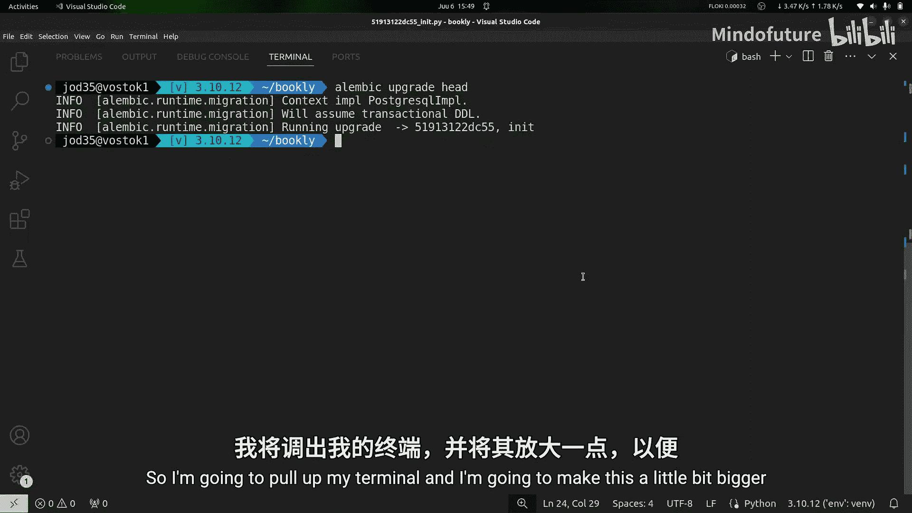

And I'm going to make this a little bit bigger so that your guys can see。 So I already have PSQL。

 and I'm going to connect to our database， which we call the book le。Did you be。So inside there。

 I'm going to look at the structure of the database。 So I'm just simply going to say。

DT to show that table。 so we have an Olympic version table， we have the books table。

 we have the US table， So the Olympic version is what is going to keep the versions of our tables or the versions of our migrations that we've been carrying out。

 in fact， if we run like select。St from， let's say， our Olympic version。 in this case。

 we're going to see that the current revision is the one that is going to have。

 say it's going to have this version number， and it will be the version of that specific migration that we have run。

 And this is the migration right here， so。

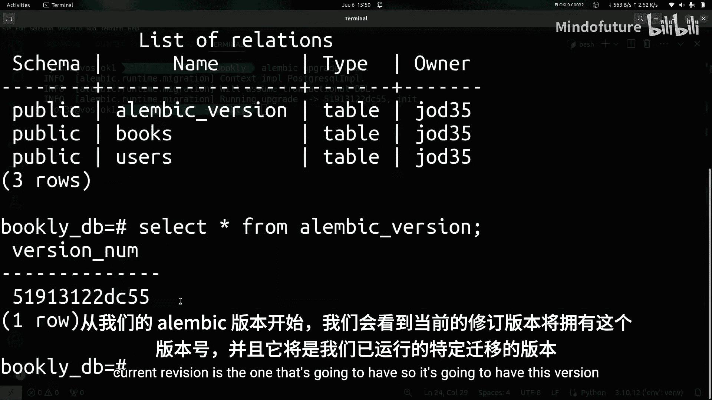

Now that we see that this Olympic version has been created， Another thing that we want to see is the。

To of I users。 So I mean to just simply random a describe on that user table。

And then we shall see that a table has been created and all the keys or all the rows have been created with their respective types and constraints。

 just like you see right here。

What's up everyone Brian。 We'll come back。 Now that we've been able to create our user authentication model。

 Let us build on top of that so that users can create user accounts within our applications。 Now。

 using these accounts， they will be able to perform various actions within our application。

 as we shall see later on in the series。 So to begin， we're going to go ahead and。

First of all， create the routes that are responsible for our authentication in one of the videos。

 which is the video I talked about routes we described how routers can help us to organize routes that are related together so that they are all accessed via a single router Now we're going to create one for authentication so to begin I'm going to create a new file which I'm going to call routes。

Do P and inside there I'm going to begin by creating the author router so shall'll input the APA router class if we haven't checked this video out and leave it at the top so say from first EPA we identical head and import。

Our EPA Ro class。Once we've imported that， we shall go ahead and create our authorta。

And once we've imported our authorta， the next thing is going to be to create an instance of our orthota。

So once you've been able to create a author instance， now let's go ahead and create the。

Enpoint for creating our users or signing them up so that will be created by using the authorrota Now remember all HttP methods can be accessed on this orthorota so shall say Authorrota dot post and then you want this to be accessed on this slash sign app。

Inpoint of the slash sign up route so just say slash sign up and once that has been done now let's go ahead and define the function that's going to handle this request so shall say a sync dev and this is going to be create user。

Account。Now since we have been able to create the rot handler function let's go ahead and define the structure of the data that's needed to create a user so if we go back to one module the pure right here we define the fields that are required for a user account however if youre to notice there is one important field that we forgot and that is the passwordlight hash field。

In this this series of videos we're going to be making use of passwords to allow users access our applications。

 so we need to add that now lucky for us with E Paralyic which makes it easy for us to run these main versions。

So I will begin there。Going right here and adding a field。

 So Im going to call this the password hash field， it's going to be a string and we shall basically not serialize it when returning responses So this means we're going to exclude it and by doing so shall use the field function and within the field function we're going to providede an adjut which is going to be the exclude adjut Now this exclude adjut is a boolean that specifies whether a field should be serialized using this model now by serialization you mean when we are returning this in JSsonN or when we are trying to convert it into a data tape。

From this python class or this python object， then rather than displaying it。

 we shall hide it so that we do not expose this password hash。 Now， we're going to set this to false。

Oh， actually， actually is going to be true since we do not want to be part of our fields。

Now once this is done， let's go ahead and apply this to our database。

 then' we need to pull up main in array here and I'll create with conr and L。

And the next thing I will introduce to say lambic， so。This is going to be Olympic。 And in this case。

 shall create a new revision。Now， this is going to also be auto generated so shall specify auto generate。

And in this case， we shall call this， we shall provide that message as。And。Password。

Pass or pass field or whatever I want to call it。 So this will go ahead and create the migration within add database and to apply this migration。

 Then the next thing we're going to do to say， a lambic。And in this case。

 we shall go ahead and finish this with Olympic upgrade。And then， hit。

So this is going to take that newly created migration and then me add it to our database So if we go back to our migrations folder。

We can notice that the operations that are happening within our Olympicly。

 So the first thing we shall notice is we're going to add to I use S table a column named password hash。

 and this is going to be its step。 So we shall G us a simple string。

 just like we see right here and iss not going to be ambu。

 So a limb is going to automatically generate that for us。 and in case wanted to undo this。

 we can just run an alyic downgrade and then that will go ahead and run the downgrade function to help us undo the creation of the password hash field。

 Now if it check with an within our postgre。

We can now confirm that that password hash field has been created and is not now。

 so let's go ahead and create the route for creating our users now to create our users just like I said。

 our route has been created right here so we need a structure of the data that' is going to be used to create a user。

So Im mean to head over back to Ass folder within our old director。 I'm going to create a new file。

 which I meant to call skimans。Dot屁way。Now in any front end application。

 you're going to have forms and these schemas are kind of what you may have as forms on your back end。

 why because they're going to allow you to be able to pick data from a client and then validate that data before it's actually sent to their server so by creatingting this。

Schema or this pedantic model。 What we are doing is to create。A class or a phone。

 Think of it as a phone where our data is going to be sent by any client via A。

 And then it's going to validate that data check whether any validation errors are present。

 So to begin to input our pant model。A pedanttic base model class， or shall say from pedanttic。

 we are going to go ahead and import base。Mo种。And once we've input best model。

 and let' create our class for creating a new user。

 so we're going to create a class and this class is going to be called the user create model。

So this is going to also be a subclass with a base model class and it's going to have fields for creating a user。

 So you're going to start adding those So shall say user and I is going to be a string。

 So in this case we can。Actually， have this as I username。 sorry for this。

 So this is going to be a username。 and then we can have our email， which is going to be a string。

 and then you can also provide our password， which shall be a string。 Now。

 in case you want to carry out validations for let's say the max length of the meaning of a field。

 Then that's where our field function is going to be so important。

 So you're going go ahead and import that。 And then you shall use it with our username。

 So shall say that I user an name is going to be a field， But this is going to have。

 let's say a max length of。So this is going to be a max length of， let's say。8 characters。

 So the user name is going to be maximum 8 characters。

 And then our email mail is going to be a field。But let's say this is going to be a much length of。

This is going to be， let's say。40 characters。 and then for hour。Password。

 we are going to just say this is going to be a field。 and we shall set mean length in this case。

 So our mean length is going to be， let's say。啊。6 characters。

 So minimum password we shall require is' going to be 6 characters。 And once this has been created。

 now， let's go ahead and。Use this within our route were within our path handler。

 so I'll go back to routes do PA， which I've actually called routes so let me go ahead and rename these through routes。

And。What I'm going to do is to go ahead and providevade that within our path and functions。

 I have to go ahead and import that。 I'll say from。And in this case， we're going to have our source。

 or this is actually in the same folder。 So we can import it via whatche mass。

 and then we can import our。User create model。 Once you import it our user create model。

 describescribe it and provide it here。 So I'm just simply going call list the user。Data， so to be。

 our user create model。So once we've done this now let's go ahead and define a service file similar to what we did when creating our books or when carrying out credit for our books。

 so inside that service file is why we'm going to have the logic that's responsible for doing anything query on the user side。

 so I'm just going to come and create that file， I'll call it service。Dot P。

And within service with P I and fast aboutre going to import the models I saved from do models。

We are going to go ahead and import our user model。And once we've been able to do that。 now。

 let's also go ahead and import our assign session class Since the session is going to be an instance of the has sync session。

 So shall save from。SqL model。Dot EXt dot a think io dot session。

We shall import our assign session class。 And once that is done。

 now let's go ahead and create our service class。 So we're going to create a class。

 and this class is going to be our user service。Or you can call it old service or whatever you want to name it。

 but Ill simply keep it to user service。 And this is going to of course。

 have the different methods I shall use creating a user， reading up your user。

 updating a user and deleting a user， but that's not the point of this video。

 What we want is to go ahead and do two things。 We're going to check with our user access within our database and then。

If they exist， we throw an error。 If they don't exist。

 then we are going to go ahead and create their user account。 So let's go ahead and do that。

 So I'm mean to define。A method。 and I'm going to call this sync dev。

 So this is going to be check user。 although we can call it get user。

Thiss actually create one to get the user account so we can have a field。

 So let's just say we're going to use their email for checking whether they exist。

 Now this is also going to make use of our session。

 So do not forget to providede that and our session is going to be of type sync session。

 Now what we want to do is to go ahead and query our database to check whether a user exists or to check for the user who has that specific email。

 So we're going to need to create a statement。 If you having watched this。

 please go and watch the cr where we did for the crd for the books。

 So in SQL model we shall first of all， create a statement。

And then this is going to be a select statement to get the user format our database。

 So we're going to go the top right here and import select from SsQl model。

 So shall say from EsQl model import。Select and once that is done。

 we're going to go ahead and make it select with our user model So this is select user。

 then we're going to select the user with the email。Which is our email rate here。

 So we shall see user。Dot email。Is equal to what you have as our email。

 So it's going to be our email。 And for us to access that fast。Or there is the。

In the first object with this specific email， we shall have to create a result object。

 which is going to be a result of using as sessions or shall say a await session。Thought。

 in this case， we shall execute this statement。And right after executing this statement。

 the next thing is going to be for us to return the result or return the object。

 So our book is going to be that specific object。 So in this case， we shall say return。Book。

 which our book is going to actually be。That。Result of calling there。

The fast method on our result object， so。So we shall say that our result or our book is going to be without taught fast。

And by doing that we shall get access to the fast object that has that specific email so the process is to create a statement。

 create a result after executing the statement and then use any of the methods on that object to get what you want so that's what we have done right here so this is going to get the user by email this actually me phases to get user by email so that we。

A little bit clear。 So this is going to be get user by email。 And now。

 right after getting the user by email， we're going to also create another method。

 which is going to be called user exists。So in this case。

 we are also going our email as well as our session Now this is going to also be of tape a sync session。

And once we've been able to do that。 and now let's go ahead and make use of this method we've used right here。

 So we're going to see at。We have actually called this book that this is going to be used。

 So I'm sorry for this。 I'm really sorry for this confusion。So。

What we are trained to do here is to first of all get the user object and once you've got the user object。

 we are now going to return true ors for whether that user exists。

 So in this case we shall say that our user is going to be self which is actually how because the method is with think So it's a quarantine we have to call it with our weight so I'll say how itself in this case we shall say self dot get user by email。

And what we shall have here is going to be。 so one thing I'm forgetting is the self。

 so I'll also have to provide it since we want to call this on the objects of this user class。

 so if we want to access this。Method right here， we shall have to providevade self。

 which is going to allow us to get the method。 So in this case。

 if we set self that catches up by email， then we shall have to providevade the email。

Which is going to be our email， as well as our session。And once you've been able to do that， now。

 let's go ahead and check whether the user exists。 So in this case， we shall say if user。Is。男an。

In this case， we shall go ahead and return true actually false because the visa doesn't exist。

So this is going to return false and then。If they don't， in case they do they are not9。

 then we are going to simply return true。 So this case shall return。是。And once that is done。

 then one thing we can do is to go ahead and。Change this to use something like ainerary operator。

 So the way can do this is by changing this statement to say return。Chu。If user。Is not canan。Else。

Fse， and that will just be the equivalent of the if statement we had written。

 So this will return true if I user is not9 else， it will return false。

 and that is just a simple syntactical sugar rate there so。

First I've created two methods run to get a user by email。

 the second one is to check if I user exists and that uses our gett user by email。Fadly。

 what you're going to do is to use the data that comes from our client to create our user。

 So we're going to go ahead and do that。 So I'll say I think depth。 And in this case。

 we shall say create。So lets session yes say create user。

So this would be our great user method to take in self。

 to take in the credentials of the user or the information that comes from the client。

 So let's say the user data。And once we've been able to create that user data or get that user data。

 Let's go ahead and modify to make it of a tab that is similar to the schema that we have created right here。

 So we shall have to import that。 I'll just come at the top here and see from dot schema as。

In this case， we are going to go ahead and import our user create model。 So once that is done。

 we shall go ahead and provide the type hint。And this was going to be of our user create model。

And then we shall per that session。And our session is going to be of tape。I think session。Now。

 once that's it then， let's go ahead and create our user。 So to create our user。

 we are going to go ahead and get the data that's coming from our clients。

 and let's convert it to a dictionary。 So I'm mis screen to say user data dictionary。

 It's going to be equal to the user data because this is now an object of type user create model。

 although we can convert it to our dictionaries by calling the model damp function or the model damp method。

 And once that is done we are going to create a new user object。

 So we shall say new user and our new user is going to be equal to a new user。

 So let's go ahead and create a new object。And then we shall just unpack whatever we got from our user data。

So that is going to be it。 But one thing that we also need to note is that our password。

Is going to be hashed。 So for us to hash our password。

 we' are going to need to use a path passwordlib。 So passlib is this library that is necessary for us to guide and hash our passwords。

 All we do is to get use our passwords as strings but store them in a very unreadable format in our database。

 which is。Just so easy to verify with。 So when you start this has in now database。

 we're going to require a string and then check or verify whether that string matches the hash that we have in the database。

 So let's go ahead and do that。So the first thing we're going to do is to head over trial terminal and install pass sleep。

 so we shall simply install pass and this will go ahead and collect pass slip and add it to our virtual environment。

 once that is done we are now going to create a u file。

 we are going to look into the methods that all the function that are going to help us to hash our password。

 I'm going to ca in here。 and the first thing I'll do is to create a new file。

 and I'm going to call this our u dot Py。 So in the idea is we're going to create all utility function that we shall use as fast as authentication is consent。

 So I'll begin by creating a crypt context object。 now what this is is。

Simply a way for us to define the algorithms we're going to use to hash our passwords。So。

 I'm going to say from。I sleep。Dot context， we are going to go ahead and access there。

Crypt context class。 Now， the next thing is going to be for us to create the。Context object。

 So were simply going to say that our password wide context。

 So let's just call it a password context。App context is going to be an object of tape crypt context。

And in this case， we shall have to specify feather skis。

 So shall say the ask schemes is going to be a list。 And this list is going to be a list of。

The algorithms that we're going to use to hash our passwords。 But in this case。

 we're going to be using B crypt。So just go ahead and for bept in there。

 And then right after doing this， we are going to create the functions that are going to be necessary for us to create our password hashes。

 as well as to verify password strings of the hashes that we have stored in our database。

 Now let us go ahead and do that。 I'll begin by defininging a function。

 This is going to be called oh this is just called generate。Hash or generate password hash。 Now。

 let me just say it's going to be generate password and I call hash。

 And this will take in a password。Well， it password the string and。

To go ahead and also return the string。 So this is basically what we're going to need。

 So when we have a password， all we're going to do is simply。

Generate an unreadable string of that password that is going to be stored within our database。

 So we're going to say that R hash is going to be the result of using our password context object to hash our string password。

 So I'll just say this is going to be our password。 once this has been done。 Now。

 the next thing is going to be to just retain our hash。Once we returned our hash now。

 let's go ahead and。Simply go to verifying our password。 So I'm going to create another function。

 and that is going to be one to verify our passwords。

 So we shall use this when logging in or when creating aability that we shall see。

 So this is going to take in the password， which is R secret。

 And then it will also take in the hash that is stored in a database。

 So we're going to have a password hash， and this will also be a string。 So in this case。

 this shall return a boolean。To tell us that the password is matched or not。 So in this case。

 we shall go ahead and say。Return。And this case shall use our password context object dot in this case。

 we shall call a very fair method shall take in the secret， which is our password。And then the hash。

 which is going to be the password hash that we've destroyed in add that a base。Let me fix this。

And once that is done， let's go ahead and call this method to hash our password before we store it in add that this。

 I'm simply going to go back right within our service and then I'll see from。Though in this case。

 we are interested from do service。 We shall import our。So this is going to be our generator。

Pass ride hash， This is not actually service。 It's going to be from U Ts。

We shall import our generate password hash。 Once you import a generate password hash。 Now。

 let's go ahead and make use of it reinoring our password so we can update the。

Password hash by saying new user。So in this case we shall say New dot password hash is going to be equal to generate password hash and in this case what want to is to access the user data dictionary and then shall go ahead and get our password so whatever we shall get as our password from the user data dictionary is going to be hashed and then we shall use our session to go ahead and save our user so let's do that we shall say session。

Dot add。 And in this case， we shall add our。New user。After adding a new user。

 then you shall use this session to commit that to the database， so shall say I wait。Session。

Don't commit。And this will go ahead and finally commit a transaction to our database。

So right after doing that， we shall now go ahead and return our newly created user。

 so shall say return new user。And this is going to be just what we need to create our new user。

 So if you can look at this file， what we have done is to first of all create a method that's going to get our user by email。

 And we've also created a new method that's going to allow us to check if the user exists by using this same method。

 And right after doing that， then we are going to。Go ahead and create that user。

 So let's go ahead and make each of these methods。 So I'm to go back to our routes and the first thing I'll do is to go ahead and extract our email。

 So I'll say the our email in this case is going to be equal to our user date or this is actually going to be our user data。

So。Change this to user data。 And you guess want to access the email。

 We shall access it via dot email。 So let's go ahead and make use over user service。

 or go ahead and import it。 say from d service， we shall import our user service。Once that is done。

 now let's go ahead and create a new object of that。 So Ill see that our user。Service object。

It's going to be equal to our user service。And once we've created that object。

 now let's go ahead and make use of it， so shallll create a variable called user exists。

And this is going to be equal to。Our user service object dot user exists。

 So this will take in the email mail as well as our session。

 Now one thing we haven't yet done is to inject our session object inside this router。

Or this route handler function。 So let's go ahead and import that dependency。

 So shall import it from source dot D B dot main。 If you haven't checked out the introduction to depend injection。

 please feel free to go and head and write that cried with SQL model。Video on display playlist。 Now。

 say from So D B do， we shall import our get session。dependency。

 And then the next thing is going to be for us to inject it within our path handler or within our rot handr function。

 some integral and it end。Do that。 I'll add the commade here。

 And then I'll see the R session is going to be of tape a sync session。

 So I'll just go ahead and import that。Let me guess copy what I have here。

And then I'll piy trade it here。So this is going to be of tape a think session。

And then we shall just。Inject this object within our。Bad handler。 So for us。

 we inject a dependency within our handler， we shall make use of the depends function from faster P。

And once this is done， the are to go ahead and say depends。 And in this case。

 well have to provide the dependency， which is our get session object。 Now。

 once we've got to our session， this make use of it。 So in this case， we shall provide our email。

And then right after providingvading our email， and this thing is going to be the session object。

 which shall perde just like you see right here。 Now。

 remember that this method right here is one that's going to return。Which is actually a quarantine。

 So we have to await it and say await user service the user exists。 Now。

 once we've been able to do that， now， this is going to return a bull based on whether the user exists or not。

 just like you see right here。It checks whether there user exists or hundred tons of9。If。

It'd be tense false if phase that does not exist。 So if you go back right here。

We are going to now make case of this。 so shall just say if user exists。

Then we are going to throw an exception。 so let's go ahead and do that。

 we shall raise an HttP exception。 so let's go ahead and import that。We shalli， from。

Rt APA dot exceptions。In this case， we shall import our H T TP exception class。

 Once we've been able to import that now， let's go ahead and finish this by saying。

 raise H T TP exception。 and in this case， it's going to raise。This status test code of。

So in this case， we shall see， let's go ahead and we input the status module from FA P。

 so shall'll just come right here in the top and see。Re put status。

 and then this make use of that right here by saying status dot H TTP。For0，3， forbidden。

 so shall also prevent the detail。And let's say this is going to be detail。Its equal to。Useer。

With email。Already exists。 So in this case， shallll say， yes E mail already exists。 Now。

 when you go ahead and。Past this plane of quad right here that returns true from the user existing we' are now going to return what is going to happen when creating a new user so to do that we are simply going to create our new user shall say our new user is going to be to a result of using our user service object to go ahead and create a user now remember that is a qua so shall have to await it we shall say user service dot create。

User。And in this case， we shall provide our user question data。

 which we have provided right here as our user data。

And then we are going to go ahead and provide that session object， which is going to be our session。

So once a user has been created， then the next thing is going to be for us to return a response。

 so to do that Michel shall simply just come ready and say return our new user。

Then we shall specify both the status code and the way to serialize this new user。

 because this is going to be a new user object。 So for us to do that。

 we are going to go back right here where we created our path。 So I'm just going to enter in here。

We didn ask an up route。And then I'll providevade some other adjustmentts。

 So after providingvading the sign up path， we are now going to also provide the response model so。

Our response model。It's going to be equal to our。So let's just make use of whatever we have on our model。

 So I'll just go ahead and get our model。Or we can even modify or create a schema that will be responsible for returning all these fields as they exist on our user model。

 So let's go ahead and do that。 just simply come and say class。

 And this is going to be our user model because it's going to return all the information of our user。

 So this is going to be our base model。 And then we shall just go ahead and copy all the fields that exist within our mod here except for the database specific stuff。

 Now just go ahead and parade it just like we see right here。I'll copy what you have here。

 and then I'll go ahead and past it trade here。 And one thing I'm going to do to get rid of anything that has anything to do with that database I'll just remove this and thenll remove。

So I'll just go ahead and remove these fields。我 this。Extra information that links it to our database。

So once that is done， then I'm simply also going to remove this default。

And then the only field I'm into non tempamp iss going to be our password has because we want to exclude the training。

 I retain our response。 So what I'm into to do is to import what is missing。

 and that is our U UI D module as well as our date time class。 I'll say from date time。

We shall import our date time。And once that is imported。

 then let's go ahead and make use of this user model。 So inside our routes。

 I'm simply going to go ahead and import that。 I'll say which is a great model。

 as well as our user model。 And now I'll have to just provideva it trade。 Yeah。

 So this is going to be our user model。So once that has been done。

 now let's finalize this by also returning a status code。

 so shall say the R status code is going to be status。Dot H T T P。2，0，1 created， which is that。

Write the escort for a newly created object to finish this semi format myd。

 I'm having a black VS code extension， so it's screen to format my and my will look a little bit more spaceed and organized。

So right after doing this， let's go ahead and test this end point out。 If I pull up my terminal。

 I'll run the server with fast。 Sorry for this， This is going to be fast A dev。

 and then you shall print to the source folder。This Verna sva。

Then I'll go to our for trade here and I'll create a new request。

 So this request is going to be one for both。And in here。

 we are going to providevade all the authentication routes。 Oh， this is a new request。

 So let me just create it as a folder。

I'll create a new folder， and this new folder is going to be called o。

And the first endpoint or request we're going to create within our within our earth folder is going to be the。

Create user account。

Request， I'm going to say this is going to be create user account。

 So this is going to be a post request， just like we've defined it in here。

And then it's going to be on H TTP slash slash fancy local host。8000 slash。

 So the next thing we have to do before we go ahead is to register this router on our app。

 which we haven't yet done。 So I'm going to go ahead and save and then I'll head over to our then in dot P within our source folder。

And then we are going to go ahead and register our router。 So to begin， we have to import it。

 So I'll just come right here and say from source， sorry for this。 So this is going to be。

From source dot o。Sorry from such that Earth the tros， we shall go ahead and import our o router。

And once this is imported， then let's go ahead and register it。

 I'm going to copy what we have here and then paste it down here。

 So what is our book route in this case， is going to be our o。 So shall say o。 and then。

Instead of having os， we' are going to have slash o。 And then this is going to be our。Oath tag。

 And once this is then hoping the answer is still running。

 we' are now going to go ahead and create our fast request on our authentication prefix。

 So I'll see APA A slash。Version1， slash， in this case， both and then slash sign up。So when we send。

 we're going to see that output is missing。 So let's go ahead and provide it。

 We're going to come and say that it's going to be Jason。

 And if we try to submit fields that do not have our fields， they' are going to be missing。

 So let's start with a test email。 So I'll just say。That I email。It's going to be our。Tist。没有。

At let company dot com and in our。Email so email has been paraded。

 We are now going to parade our using name。So I use a name。I's going to be our test user。123。

Then to provide that password。I am going to go ahead， and。Pade our test pass 1，2，3。

 And then when I send this， I'm now going to see that this password should be a string with at most eight characters。

 So we have one to3。 So this exits exits the number of characters。 So our validation is working。

So we now have to write and provide the shorter password， so I'll say test 1，2，3，4。

 and I think this password will now work so write and send。So we see， this is still1 through，3，4。

1 through 3，4， so。At most 8 characters。Should you pervade less， let me pervade less。

So I guess I have to change that so that we have。Our main length only。 So how do that ask came as。

And then here， we're going to have。A password having。

 So I think that's something we did on the motors。Cron nowmoos。 I don't think that is。

 If we go back to asking him a right here， we have。Min length，6 a max length。

 So M max length should be。Oh， it's a useanium， that's。

So I'm really shame that I'll say test two is are1。

Which is actually also greater than8 characters limiting that pervade this。

 So we have an Nintendo Sava era。 That's go ahead and fix that。

 So we now see that user at that that must be a mapping not user create model。

 So I I think we made that mistake。 If we go back to our service， we have。

Well went ahead and created the user by unpacking。 so this should be our user data dictionary。

 So we are going to go ahead and set this up and when we go back right here we send this request。

 we still have an error。So this area is saying that。

Sization is fading and we are being told that not now in the column fast name or relation user as well it's not now con。

 so let's go ahead and also fix that So that means we shall have to add that field to our user create model so I'm going to add our fast name as well as our last name because I think they are all not now if you check within our database we have not now for our fast name and not now for our last name now these are going to be automatically added。

So we don't have to worry about them。 So just simply going to come and pervade them。

 So this fast do that within our schema。 So I use a create model is also going to have those fields。

 So shall have a fast name。So this shall be a string。😔，And。This shall be filled。

 We can also operate the max length。To be 25 characters。 And then you can also have the last name。

To be。So this is going to be filled。And we can have also the max length to be 25 characters。

Once that is done， now let's go ahead and try2。Add those to our。To our client。

 now wem need to come right here and parade them。 So I'll just come and say our fast name。

Its going to be equal to。 So this is going to be our test。 And then。Shahava last name。嗯。

So this last name is going to be。 sorry， let's call this test and then use。So， you shall send。

And now we see that our user has been created。 So if we try to send this again。

 we are now going to see that our user has been。Created， so this user already exists。

 and we are not allowed to create that user again。 So we have pretty much created our user account。

 So let's create another user。 We are going to call this。Zin。Or John。

 And then you' also going to have this second name called Do。

 Then you shall have the email being John。Do at company dot com。

 Then you can have the using name being Jde do。1，2，3， and in the password。

 So if we send now having this being returned。 now notice how our password hash is not being returned。

 and that is being done because we already set this exclude being true true。

 meaning that that field is not going to be returned when we are serializing the user object。

 So we have been successful in creating our user， in fact， if we try to create this user。

 we' are now going to see that our user with email exists。

What's up， everyone。 Wee back Now， in this video， we're going to be looking at JWT authentication In the previous video。

 we built a user authentication model and Npi endpoint for helping us create those user accounts。

 In this video going to build on top of that to allow users identify themselves so that they can gain access to any part of our application that is protected。

 We're going to be carrying out JWT authentication。

 JWT authentication is basically a client say form of authentication。

 Where users are going to identify themselves by using JWTs。 Now JWT stand for JO and web tokins。

 and this is a standard for transmitting claims or information among two parties for our case is going to be our client and then our server。

😊，JW is are credentials or information that is going to be about anything。

 so in our case it's going to be majorly about the users who are authenticated。

 this information is going to be encoded in JO format。

 making it readable and then we're going to make secure by using cryptographic algorithms to digital design these ensuring authenticity and integrity。

The Jibility is going to contain three partss， the header or the information about the truckken。

The pilot， which is the information that you want to store within that token and then the signature with the details about how the token was sent。

And in order， these are going to be separated by a period character or what we call a full stop character。

If you go to this diagram right here， we have a simple GWT。

 and then on the right hand we have the various partss or the three partss of that GWT。

In the red right here， we have the JWT header， which is going to have basically two these。

 the algorithm， which is hs256， as well as the type of that toolken in that case is going to be the JWT。

The second part which is in Pa is going to be the payload or the claims for this token now in our case we see that you have three claims and this is going to be the sub or the subject of our token that' is going to be some random user ID then we're also going to have the name now our name in this case is going to be to and then we can also have the IE。

And this is going to stand for that issue at 10， so we can now notice that we have some claims that we may pro。

 but we can even leave them out so they are not that compsory。

 so we have the subject and we also have the issued at 10 Now the third part here is going to be the verify signature and this is basically details about how we're going to verify whether our token is it whether its signature is valid or not so basically these are the details about how we're going to go about that。

Then。This is the flow of a normal Jability authentication。 At first。

 the user will log in with their details such as the email or their password。

 And once they are logged in， then the server is going to verify whether those credentials they are providedvaded。

 match what the server has kept on our database said upon this successful login。

The survey is going to provide a JWT or an access token containing the user claim。

 So this is going to have the information about the currently load in user。For any future requests。

 the client is going to always send。This JWT needs HtP header so that they can be authorized to access these specific protected endpoints Once the serverva gets that token is going to verify the tokens signature and the pillar to ensure that that token is valid and is of that specific user and once the token is valid and the serverva is going to process the request。

 otherwise it's going to reject the request depending on whether this token is valid or norm。

 So using JWTs comes with some benefits and these are some of them。

 So the first one is they are compact and therefore we can send them via anyway。

 so we can send them via our URL through path and query parameters。

 we can also use request body or we can send them via post request using our request body we can also provide this as headda to our request just like going to be using in this video they are self-contained。

 meaning that you can keep all information that we want to keep within this tokens。

Allowing us to not query the database。Very often。 So， for example。

 when we're providing user information when the user has logged in。

 we can make use of that tool and store all the information about the current logged in user so that we don't have to fetch them from that database。

 And this is important。 They are secure in a way that we use cryptographic algorithms and these cryptto algorithms are going to allow us to ensure that this are going to be confidential and only access by the parties that will be in need of them。

 Then we also going to。Look at another advantage， which is they can be used across different domains。

 So if you have a micro service type of application。

 you can ensure that your authentication is shared of course very many other services without having to implement authentication for all those services。

 So I hope you've understood what JWTs are。 and let's get right into the video。

So the first thing we're going to do is to head over to our code。

 I'm going to go within our V S code。 and I'm going to open up new terminal In our dynamic terminal。

 I'm going to install page WT with P install。Hi， JWT。And this will go ahead and install page W。

 Once page adapt has been installed， we' are going to head over I U T dot P I file that we created in the previous video。

 and then we're going to create two functions。 So the first function is going to be one to help passing in di token。

 So shall'll just simply create。Access token。 So this is one for creating access tokens。

 and this will take in whatever user that data that we're going to require to create the token。

So this is going to be a dictionary。 and then we're also going to pass in the expiry of the tokens。

 So this is going to be a tame delta object and therefore shall have to import tame delta。

 So I'll go top here。 and all I have to say is from that time。

We are going to go ahead and import our time deelta class。

 and then we shall also import our date time class。 Once we put it that。

 then we're simply going to go ahead and。Create our token。 So for us to create our tokens。

 you shall have to import by JWT our come right here at the top and then I say import JWT。

 Once we put JWT， then we are simply going to create our tokens our token is going to be equal to JWT load in code and inside here is where we shall provide the adjuts that I needed to create an access token Now the first one is going to be our pilot and the pilot is going to be。

The data that went to encode as the adjacent object within networking。

 Now create this as an empty dictionary for now say。Pilload is going to be an empty dictionary。

 And once we've been able to do that， then we shall just passing our payload。

 And I think we shall need is going to be the key。 So the key is going to be the secret key that pageWT will use to say our token。

 So we're going to set this up within our environment variables。 So I for my dot E and V。

And inside that is what I'm going to add the JWT secret key。

So this is going to be something that's going to be secret， something you don't want to expose。

 so to generate a random string， I'm just going to be using the Python Ses module as it's going to allow me to create something that cannot not be easily memorized。

 so I'll just come right here and say Python 3。And inside here say import。Seccrtets。

And I'll call a specific method or function that's going to be the talkingken Hx function to create a random hex atismmal string of a certain number of bes now this is going to be our JWT secret I'll copy it and then I'll paste it rate here my E and V I think we shall need is the JWT algorithms。

 so just going to set this with。JWT underscore score algorithm。And this is going to be the default。

 which is hs256 to save and when I save that， then the next thing is going to be for us to make use of these two environment variables。

 Now shall Ill go back within ITs dot P and inside there is what I'm need to provide IWT Se key but before I do that I'll have to set these to be red within our。

Settings class。 So I go to our config。Fll rate here。 and inside Ill configure。

 what Im need to go ahead and do is to add this true。 So I just come and add theibility secret。

So this will be a string。And then I'll also add our JWT algorithm。And this will also be a string。

Alright， now once I'm able to get these via our config objects。

 I'll just go ahead and include them here， so I'll kind of interpret here and import our config objects Ill say from source do Config shallll go ahead and import our config and once that has been imported then let's go ahead and make this of our Se。

Environment variables with config， so in this case I'll just call our config object then dot the environment variable this case is going to be a JWT Se and I think we shall have to per is going to be the algorithm so I'll just come here and say algorithm and in this case it could be cong dot JWT algorithm。

So once this has been called， then what we shall have is going to be our access token or our JWT。Now。

 let's go ahead and return this。 I'll say return。And in that case we shall return our JW so I think it's going to be to encode data or claims within our toolken So the first thing we have here is going to be our user data and we just simply going to providede it as a key so I shall say pay user。

Is going to be equal to the user data。 And another thing we shall set is going to be the expir So we shall say pilot。

And this is going to be the EXP claim。And this shall be the expiry date。 But in this case。

 we need to add this to the time that is now。 So shall make this of that time dot now。

 and we shall go ahead and add our。How specific expir so in this case。

 it's going to be our exp but we shall provide a default for this in case we do not have the expir set。

 so we can simply go ahead and say the I expir date has a default value of9。

 so if we do not provideva a default。It default time， then we shall go ahead and make his。Of our。

Devoult ta or default expir of a token。 So I'm just going to come and the here and I'll create a constant。

 and this constant is going to be the axis token。Exper， so this is going to be。

Amount of ta in sequence， so I mean say it to the amount of ta of sequence in an hour。

 and that is going to be 3600。So what I'll do is to just come right here and then say the I exp is going to be the time。

So's now pla the x vary。If。I Xiry is not9。 so I'll just set this to be if expiry is not9。Else。

So in this case， this will be else and we shall set it to our time delta。And in this case。

 we shall have sequence being equal to the access to can exp。So I'll just put this in brackets。

 just elaborate it as one statement and what this will do is to providevade a default expir just in case we do not providede the expiry within the grid access to k function。

And I think we shall do is to provide a unique a to each of the tokens that we shall create。

 and they're going to achieve that is by using the UUA module， so I'll go ahead and import it。

I'll say import。你有 i d。And once I've imported UA， they now come at a bottom right here and say payload。

In this case I'll set the optional of JTI claim and this is going to be UI dot UuI4 so remember that this creates a UI object and we need to go ahead andize this in adjacent serializable format so we have to convert this to a string by saying string UI dot UI4。

Once that is done， then we are also going to go ahead and set what else should we set。

 so this is going to be the user data the expir of this token and whether it's a refresh token within what you can is to go ahead and simply。

Say that we shall need an optional token。Parameter， so I'll just come right here and add it。

 So shall say refresh。 And this is going to be a bullan。 And in this case。

 we shall have false because this function is going to create both access and refresh tokens。 Now。

 refresh tokens are going to be more long lived compared to our。

Aess tokens and access tokens and we need to have a short lifespan while the refresh tokens will be used to get more tokens in case our access tokens are expand so what you're going to do is to go ahead and set that up so we shall say pilot and in this case shall specify refresh。

And in this case， I refresh。Claim is going to be equal to the value of refresh。

 And this is going to be just enough for us to create our tokens。 Now。

 the next thing we're going to do is write the function that's going to be necessary for decoding this tokens。

 So for us to do that we shall just come here and shall define a function。

 So this is going to be our this is going to be a deco token function。And。

This function shall take in a token， which is going to be a string。

And this will return the data contained within the token as a dictionary Now for us to decode that token。

 all we have to do is to just simply create a variable this call is our token data and our token data in this case is going to be a result of calling JWT dot decocoded and this is going to take in almost the same things。

 but instead of the pillar it will take in the JWT which shall be the token and then we shall need our sacred key so in this case shall provide a key which shall be a config。

Dot JWT Se Nothing we shall pervade is algorithms， so algorithms is going to be a list of algorithms that shall use to decode the token。

 and this case we shall have our config。Dot jWT algorithm so this will be the only algorithm that shall use to deco that token Now there are very many chances that we are going to land in two areas when we de the token so we may catch things like the token being expd or the signature verification failing and that's where we need a tray cache so in this case shall say tray。

Except because this is Pyon so we're using tray and except Celsiusier tray。

 then shall de the token and then return the token。

So in this case we are returning the torken data and in case we fail to decode the torken then we are going to accept any error。

 but in this case what we want to do is to accept pi JWT specific errors to do that what we're going to do is to come right in here and then we shall do something like accept JWT do pi JWT errors so in this case I'll just say。

Pa theWT error。 So that's going to be the best class for all these exceptions that pay JWT is going to raise。

 so shall。Access page AWT。Right way I am'm writing this room。

 so this is going to be up by the WT era and then in case we are interested in doing anything with that。

 we can simply say as e。So what I will do is to go ahead and raise an exception or what you can do is to simply go ahead and log it。

 so Ill import logging。And once I've imported logging。

 then what you shall do in this case is simply go ahead and log that exception so I'll say logging the exception and this case we shall log our error once we've been able to log the exception the next thing is going to be for us to simply return none in case our talking has not been。

Decorded and that's it for creating the functions for encoding and decoding our tokens and the next thing we're going to do is to make use of these functions so that you can be able to log in a user and provide for them both access and refresh token so to do that that we're going to go to our routes and shall begin by importing those two functions。

So we're going to go ahead and say from dot u， we're going to go ahead and import our create access token function。

And then we shall import our decokota and furniture。So once we've been able to import this。

 then the next thing we're going to do is to go ahead and create the route or the path that's going to be necessary for us to log in。

 so to log in what shall do is to get user details。

 check if these user details match what we have in the database and then pro the access and the refresh toolken and in case we do not match those then shall throw an exception showing the user that they have invalid credentials。

 so let's go ahead and do that shall begin by saying at or route。

Dot post since were going to be making a post request。

 and our path in this case is going to be our slash log gain。So once we've done that。

 we're going to define our handler for this as plugin。

Users and this is going to take in the user login data so shall pass this for now so we're going to go ahead and create a schema for the information that shall be needed when a user is logging in so we're going to go to schema。

 P inside ourO and there is where we're going to go ahead and create our model or our idic model for logging in a user so shall say user login model。

And this is also going to be a pantic based model。So I written this badly。

So I have to go ahead and def the fields that we need。

 so we're going to need with our email as well as our passwords。

 so go ahead and providevade them right here。Once this is done were going to go ahead and import this。

 so just come the appropriate here we imported I user create model as well as our user model and that allows is to go ahead and import our user login model for us to make of that user login model class shall have to inject it within our handler as parameter so in this case this is going to be the can call it the login data or the user login data。

 whatever you prefer。And this shall be。Of type user login model once this is done。

 then we're simply going to go ahead and access those details so shall say email and that email is going to be the login data dot email。

And we shall also have a password。So our password， in this case， is going to be。

The password from our login data so shall just access that as login data dot password and the first thing we shall do is to make user or our user service object to created to check if that user exists so to do that we shall just come right here and say user is going to be equal to await user service。

Do in this case we shall call a get user by email function。

 so this will take in the email of that user as well as the session。

 so we shall provide that email right here， but we need to get the session object so we have to go ahead and use dependence injection just like we did for the previous video our camera right here and inject it within this path handler。

And once we've been able to do that， then we're going to simply go ahead and providede our session right here and once access session has been provided now we can have access to our user object so the first thing we introduced to check if this user exists or shall say if user is not none。

Then in this case， we shall go ahead and check if they are password。

the password that are provided matches the hash that we have within our database。

 so we created a function within our utilities and that is going to be our verify password。

 so this verify password function takes in the provided password and then checks whether it matches the one password hash that we have in our database and returns true or false depending on whether it matches or norms。

 so in this case what shall do is to create a Boolean。

So shall create a brilliant called password valid。And in this case。

 we are going to go ahead and call that function， so shall say verify password。

 and this will take in our password。So it will also take in the hash for the user from the database so shall say user dot password hash and once that has been done and we're going to use that as what to check if the user actually exists and their password is correct。

 so shall say if password valid， then we shall create both the access and the refresh toolken for this user。

 so to create the access toolken we shall say that a。Access stuck in。

Its going to be equal to a call to the create access to can function and in this case we shall create I user data so I'm just simply going to go ahead and say that I user that data is going to be equal to a dictionary containing the user data and inside it here we shall just have the email。

And this is going to be the email of that specific user or shall say user dots。Email。

And then we shall also pass in the user U I。 So this user A U I is going to be。The idea of the user。

 So this is going to be user dots。UAD。But remember。

 this is that the2 ID is being stored as A U ID and therefore we have to string it。

 I'll say string and in this case shallll providevade our user ID。So once this is done。

 then let's go ahead and pervade our so we shall not actually pervaate an expir and refresh this will be kept to the default values so in case we did not pervade one this UTs function is going to go ahead and pervade the access to lifespan or the time delta which shall be。

Our expir which to3600 seconds， which is an hour。 so I'll go back to our rate here and then。

We're going to create the refreshed token， so I'll say that our refreshed token。

So it's going to be a refresherken。And the refresh token shall also be the same， but in this case。

 what you're going to have is something with the xir and。

That exp will also be longer than what we have for the access to。

 so it's going to have the same details， but in this case we shall go ahead and providevade refresh。

As true。 So shall say refresh is going to be true。 And then we shall also provide a expiry。

 So I expiry shall be something longer。 So in this case， we can provide this as a time delta。

 So I'll go and operate and import the time delta class。 So Ill save from date time。 we shall import。

Tam Delta。And once you import a ta delta， now what you're going to parade here is going to be tame。

Delta， and in this sketch shall prevent days being equal to true。

So you can also go ahead and set that up， or we can actually just come right here and see。Refresh。

So this can be our refresh token。Exirary。And this will be equal to two and then you can go ahead and set this up to B two days。

 so I'll just come and say refresh。So can you exp。So once these have been done。

 then much we going to do is to return a J response showing the user that they've successfully。

Loed inin and the we're going to do that is by making use of the response JO response class from Fast APA。

 so we're going to go ahead and import it by saying from fast APA。

Dot responses or sorry for this this is going to be dot responses。

 we're going to go ahead and import the Json response。 So shallll just come right here and then say。

Return。Our Json response and then this is going to to contain the content。

 our content is going to be a dictionary and this dictionary shall have a message so this message shall be lo in successful。

And then。Okay。And then we shall also provide the token pair。 So in this case。

 we shall have our access token。So our access token is going to be the access token。

And then we shall have our refresh token。Okay。Being the refreshed token， so in this case。

 shall'll say refresh token。So once these have been pervad。

 then we can also maybe provide some little details about the user who has logged in or shall say user。

And this shall be a dictionary containing the user email。

 so the user email is going to be user dot email。And then， you can also have the。

Ur user let's say there as email and then let's say the user ID shall say U ID and then we shall provide the user ID so I say user plus U IDD。

So this shall also be a string because this is going to be a JON response。

 so make it a string by simply calling string and then wrapping it in there so this will be enough for us to grant access to a user now in case these two functions do not pass or these two if statements do not pass then we are simply going to go ahead and raise an exception so I'll do that with race。

And in our case， we shall raise the HtTP exception， and this shall have as it as good。

Being equal to status。Dot H TTP400 or this is actually going to be H TTP 40。

3 for bid then and then R detail。It's going to be invalid。email。All password。

So we're going to go ahead and save and once we save then we shall go ahead and test this in our rest folks so I'm going to head over to rest folks and I'm going to create a new request within this folder I created for our authentication routes so I'm going to go in here and I'll say login users or I'll simply call it to create token pair。

So once I've created this， then shall go ahead and say that this is going to be a post request and it's going to be one to that specific login endpoint。

 so shall'll just come right here and say slash login when you send this without the body。

 we're going to need to parade it I'll come and parade a。And this is going to have our username。

S his name in this case is going to be John Do。Actually。

 in this case we are logging in the email and password， I don't know why I'm forgetting this。

 so I'll just have to change this key to email。Which is John do。And this is going to be at company。

com just like we saw in the previous video and then we shall have our password being our simple password of test one23 so once I providede these details and I press okay so we have an error。

 let's go ahead and see what that is。This area is saying that we module U U IDD has no attribute to U I D4。

 So I made that mistake。 I think I made it。In you dot PA I'll just simply go ahead and call E UA4 So now head over thats way and save now we shall see that our response is being returned with both an access and a refresh token so these are what we shall use to basically give a user a session。

What everyone welcome back now that we've been able to give our users access to our application by providingvading them with tokens。

 we are going to be implementing a way of limiting access to those users who do not have tokens so what shall happen is whenever a user is making a request to some protected endpoints in our API they'll need to provide their token within an authorization header and this is where HTTP B authentication comes in so。

When passing our token we want to go ahead and pervade our token in the form of bearer and then the token so they will give the white bearer as the scheme and then our token shall be the set of crdaceations that they will provade to access our endpoint and based on that we shall equal our token and then carry out any other forms of validation or authorization that you may need within our app to do this we're going to go within our folder we're going to create a new file and we're going to call it dependencies。

Dot P。So inside that dependencies， we're going to begin by importing the special class that is going to allow us to carry out our HTTP Ber authentication。

 so that is going to be from plastic PA。Dot security。Shall import our H T TP bearer class。

And this H TP bear class is going to be the special class to a get to。

Protect an endpoint and make it only be access when someone providesdes they are token in the form of bearer and then they're token so way we use it is by creating an instance of this class and then providing it as a dependency within the pathhandr of that specific function and once we've been able to get that then what we shall do is to access the HTTP authorization credentials and using those credentials shall give us access to the credentials scheme and the credentials credentials which is going to be our token in that case So let's go ahead and be able to do that So I'll just come right here and then we shall create a class which which are going to call ourjWT bearer Now I'm just simply going to come and call this the access token bearer because it's going to be1 to allow to validate our access token so I'll just come right here and say it's going to be our access。

So canberra。And what this class is going to be is a child class or one that's going to inherit from the HTTP bearer class what I'm to do to pass this for now and we shall make use of it to protect all those endpoints we are going to access that access tokens so we shall go to our routes for books because those are the ones that to carry out quite on our book resources and they're going to simply go ahead and protect them so they are going to protect them is by first of all importing our class are safe from。

A source dot o dot dependencies we shall import our access token bearer。

 And as you've got our access token bear， now create the object out of that class So I just come right here and say security。

 Well let's just say。This yes actually just call it the acan bearer。

At just come reach and say this is going to be our access toaneber。

And this is going to be an object of tape access to canbeer。 Once you've got access to this object。

 then you shall providede it as a dependency to our pathth handler。

 So what you're going to do is to go in our pathth handler for getting all books。

 and then we shall perde another parameter， which is going to be our So let's just call security。

 or let's just call it credentials， which is our user details。 So in this case。

 our user details are going to be。They're going to be first of all， authorization and credentials。

 just like we say in the other example， but it would be a dependency from the object that you created out of that class。

 so this is going to be an access token bear。So we mean formatis so that we make things a little bit more organized。

 So once we've got that， then that marks this as a protected endpoint。 In fact。

 if we try to access it， then we shall see that it's going to require us to pervade our talkingken。

 So I need to go ahead and save and remain safe。 We you head over back to our。Ristful straight here。

When we try to get all books for now， we can get them without having to authenticate。

 But when we pervade this dependency right here， we're going to need to perde our authorization header for us to go ahead and make this request。

 So to do that， we're going to go within our headers。 and then we shall add an item。

 And this is going to be our authorization here that our come right here and say authorization。

And our authorization will have a value so our value is going to be in this case bearer and then the token in this case our token is going to be the access token that we got from our login request so our'll come right here we'll go to our token pair create a new access token and then our'll copy our access token right here。

Then I'll copy it。And then that's why I' per to get all our books。 So I'll just pervade it。

 And then you can have access to our books。 So that is just one basic way of us protecting our books。

 But just in case we need to carry out any other forms of authorization or any other forms of protection。

 What we need to do is to go ahead and over that class。 So that。

We can check for other things or other criteria that you may use to allow access to a specific endpoint。

 So let us go ahead and look at how we can do that。

 When you head over back to our code within our dependencies。

 When you check the source code for our H T B bearer class。

 we shall notice that this is going to have the d init method as well as the core method。

 Now the core method is going to be the main method。

 that's going to allow us to access our credentials and hurry out whatever we need to do in forms of authorization。

 So what you can see here is it works in a way that it gets the authorization header that we provided and then splits it into the scheme。

 which is the bareer part of our。Authorization header。 and then the credentials。

 So the credentials in this case are going to be the talkingken just like we see right here。

 After doing that， it will check if we have not yet provided first and then we raise not authenticated。

 So in case we delete this and try to make the request again， Of course。

 we shall see that we are not authenticated。 And if they exist then it will go ahead and check if the bear is valid and then it return in valid authorization credential。

 So that's just how it works。 But in case we need to add other checks。

 then we need to go ahead and overrite that method。

 So for us to do that I'll close this what we're going to do is to fast all。

Reeffinine the d init method of this class。 So shall just come and say d in it。

 and in this case we are going to per itself as well as one。

 So this is going to be one parameter or one adjut that's going to be created with this objects and that is going to be the auto error。

 So I'll just come and say auto error。 So our auto error is going to simply be an attribute to this class that's going to determine the behavior of this class when an error occurs。

 So when you have an error firstpi is going to return that error。

 but in case we set this to false then firstpi is going to not to return that error。

 but rather pervade for s then as the return value of that specific error。

 So if an error occurs we are getting。The error in case auto error is true。

 and in case we do not get the error， then none is what we're going to get。

 So what I'm going do to set this to true so that we can get the real error that has happened And then we shall just simply go ahead and over the in method。

 So we shall say super do in。 So this is going to call the in method of our parent class。

 which is our h TP bear class or shall say。Danda in it。 and this case。

 we shall go ahead and set to our auto error。 So this is going to be our auto error。

So once that is done then you're going to go ahead and over the D call method。

 so we shall just come here and say a sync de and in this case we shall go ahead and access the D call method。

 so this is going to have a lot of attributes but to retain our HTTP authorization and credentials or none in case they do not in case they add not code so。

Once we have these credentials， we can just simply say that the return or this is going to be our credentials。

 so I'm just going to call them crs for short and inside here as well we can split them and then try to。

Do whatever want with them。 So in this case I want to check if that provided token is an actual access token。

 So to begin I'll have to just go ahead and split this Ill say print crs So our cr is going to be cr stored so let's just access this scheme for now。

And then we can also get to access the。The credentials part， which is going to have a token。

 So I'll just come right here and say print。This are going to be creds， Lord credentials。

So this will provide for us our to and then once you've been able to do all that we shall just simply go ahead and return our quis。

 so in case we try to make a request again we shall see what shall be logged so Ill head over back to our folks provide our header which shall be authorization。

And then shall provide the value of that hiter as better。And then our token。

 So I'll go ahead and provide our token a copy the token that we have right here。

And then I'll simply go ahead and provide it in here so if we save and send this request。

 shall see that we can now access our resources， but if we go within our terminal。

Then what shall be looked is going to be our token。

 so we're going to have a bear which is ask scheme in this case as well as our token So our token in this case is going to be our token so now we can access our token So once we've been able to do this then let's go ahead and basically decode our token and find out if our token is valid So we wrote a specific method or a specific function which is called which is within our till and is called a decode token So all this is going to do is to decode the token get the data out of the token and check if whatever what out of this token is valid Now what we want to do to check if this token is the valid access token So do that we're going to first of all import this function so shall go ahead operate here and say from。

Sour or in this case， it's going to be within our us， so shall say from uTs。

We shall go ahead and import our decocode token function。

 and I'm going to create one function to check if our valid or if our token is valid。

 so shall just go ahead and call that our valid date token or let's say this is going to be token valid because it's going to return our br。

 so shall say。Took in。Valid。And this is going to take in token。

But because it's a method it will take itself。 so we shall have a token and then this token is going to be a string。

 but we shall return a boolean in case it's valid or not。

 so we can actually return a boolean of true or false， depending on whether it's valid or not。

 So just come right in here and say that we're going to access our token data。

By using our decode token function。 So in this case。

 shallll say decode token and then this will take in our token。

And once we've providedvad a token and the next thing is going to be for us to return to or falses in case this token is valid。

 so shall just come right here， remember that this function is going to return then in case our token is not valid so we can do something like if a token data。

It is not9。Then we can go ahead and return， true。Else， we can return for。 So in this case。

 we can return true。 And in this case， we can say else。Return falses。嗯。

We can also summarize this into something like return true in case our talkingken data is not9 else false。

 which we can do like by doing something like can just come and say。

So this is going to check if our tracking is valid。 Once we've been able to do this。 now。

 let's go ahead and。Authorize our users or check ifify user is valid they are providing a valid access token so to do this our token is going to be found within credentials do credentials so I'll go ahead and simply get rid of this。

And then， to。It's going to be crs。Dot credentials。 So we shall give us access to our talkingken。

 So shall check if our talkingken is valid， so shall say if。Not so in this case， not talking valid。

 then we shall throw the exceptions or shall say， if not talking valid， then。We shall raise an error。

 So this is going to be raise and Ht TP exception。 but remember this shall B access via self。

 So we shall say self dot token valid。 and in this case， we shall raise an Ht TP exception。

 so are glad to operate here。And say， firm。R tipPA。Do exceptions。

We are going to go ahead and import the H T TP exception class。 So once we've imported that。

 then we're simply going to go ahead and say。That three reasonor is to be exception and asked the escort code。

Is going to be equal to。Stitus。So we're going to have to import this。 so I got to top and say。

That we're going to input as status。And。Once we imported that， then you need to access the。

The H T TP 40，3 forbidden because we don't want them to access this。

 So we're going to come right here and say that our detail is going to be equal too invalid so that shall be thrown in case we get any errors when deco add okay so this is going to be invalid。

Or exp talkingken。And then it will return the credentials just in case they exist。

 But one thing we also need to check since this is our access barrierer torken。

 So we need to go ahead and check if it's a valid torken。

 So the way we're going to do that is by simply。Decoding autotoken and getting autoken data we're going to come right here and say let aocken data。

I's going to be equal to。Decor talkingken。And in our case。

 we shall basically get access to the token data from our token。Once you've got the token data。

 then I'm assuming simply going to go ahead and check if our token data refresh property or refresh attribute is false is true。

 then that will be markeded as a refresh token so shall say something like if。Token data。

 So in this case， token data then in this case shall get the refresh property。 if token data refresh。

 meaning this is a refresh token， then we are going to raise an HTTP exception。

 but shall tell them to providevade an access token so in this case shall providevade。

P shall raise the exception， but the exception is going to be。This pervades。A valid access token。

 so in this case， shall say please。Pvade。An access technique。

So that's just the check that we have done for our access tokens now we're going to also look at how we shall be verifying whether our token is a refresh token。

 it's going to almost be the same way so。So look at how we do that。 So yes。

 in case we have been able to do that。 then now we can go ahead and protect the rest of the endpoint。

 So I'll head over to our out for books。 and then what I do suggest copy this dependency and provided it within our handlers for。

The remaining。Enpoint。 so I'll just copy this and then go ahead and inject it within our route。

 So just come and prede it right there。 I'll do the same thing for this path。

 So just come right here and see。That we are going to also have it in there。 So I'll format our code。

 and then we can go ahead and simply。Return or inject this again。

 Then I'll go ahead and do the same thing for our。Delete book。

So I providevade it in there format matter output。 And this is how it's going to look。 Now。

 another important thing that we can do we simply return instead of retaining the truckken。

 we can go ahead and simply get that。The user details。 So instead of returning our credits。

 just like we did here， what you can do is to return the token data。

 we get out of decoding the token。 So I'll just come right here and say。

We're going to return our talkingken data。 So that means we can get access to the user I。

 And by doing so， we can get access to the user details。 So I'll go ahead and save so。

Once that is done， then you can simply go ahead and access the user details inside our routes by simply printing them out so when you go back this site where we injected our user details in case we want to access our user details if I save print。

User details then。This shall go ahead and providede our user details so I will save。

 And then when you go back to our folks here and try to make that request。In our time we know。

 we shall see that we can access our user details in this case。

 we know that I is is Johndo the I ID is this and the rest of the other things that are related to this specific token。

Also everyone。 We'll come back。 In this video， we're going to be looking at how we can gain access tokens in case our access tokens are expired using our refresh tokens。

 If youre to recall from the previous videos， we went ahead and create what is called a token pair。

 and our token pair has an access token as well as a refresh token。

 our access tokens that short lived and therefore can expire。

 but our refresh tokens are long lived and therefore can be used to generate more access tokens。

 And that's what you're going to be doing in our video。 So we can go back to our code rate here。

 And what we have is the class that we created in the previous videos。

 and this is just one to create or to create a dependency that shall be injected into every path handler that will require an access token to ala access to resources。

 So what you're going to be doing is to rewrite this code so that we can create。

One class that is going to help us create the dependency for those endpoints that we shall need to access with our refresh token so to begin what we're going to do is to make sure that this is our best class。

 so we're going to make this our token bear which is going to be the best class and then access token bearer is yes simply going to be a child class or is app class of that class。

 so shall'll just come right here and say the our access token barrierer。It's going to be。

A child class drawer best token better class。So this is why we're going to do the checks to check if a valid access token is providedvaded to an endpoint and then we're going to create another class。

 So this class is going to be one to check if a valid refresh token is being providedvaed So these are just going to be the checks for access and refresh tokens but the rest of the quote for checking if a token is valid。

 shall reside within our d call in the parent class。

 So let's go ahead and implement this So to begin what we're going to do is to get that logic for checking if a token is a valid refresh or access token and if you to recall it's within this if statement right here let we check if a valid access token has been providedvaded So in this case we're going to move this logic to a method inside our access token bearer class So we're just going to come right here shall define one method that's going to be called。

The very fair token data method。 And this is going to be taken in， as well as the token data。

Sorry for this。 So this is going to be aan data。 Atane data is going to be a dictionary。

 and then we shall have this being the。Token data。 So this is going to not return anything。

 So we shall say return none。 And therefore we are just simply going to past the logic for checking if a valid access token has been provided。

 So what this query is being is to just simply check if refresh token is sent to token that requires an access token and then it's going to throw an error in case we provide a refresh token instead of an access token。

 So to add on to this we can also check if our token data is not none。 So we shall do if token data。

And in this case， we are going to go ahead and say when talkingken data refresh meaning that this is a refresh token。

 then we shall raise our exception。 We're going to do the same inside our refresh token bear。

 So I'm going to rename this class to refresh token bearer since this is going to be the one to allow to create a dependency that we shall inject in that endpoint we need to access with a valid refresh token。

 So what I'm going to do is to just simply copy this function or this method right here。

 and then I'll paste it inside here。I'll fix the indentition。At once， I picked the indentation。

 Now we can go ahead and add the checks for a valid refresh token。

 Now this is going to be the opposite Since here， what we're doing is to check if a user is pervading an access token So shall come right here and say and not token data refresh meaning that the refresh claim shall be false。

 So in this case we need to remind them to provide a valid refresh toolken so shall change this from per an access token to provideva a refresh token。

Once this is done， then we need to go ahead and make sure that these methods are accessed inside our parent class。

 for us to do that Im in first format my aord and then inside our parent class we're going to make sure that this method is accessed。

 So what are you going to do What we are going to do is to come in here and define。The verify。

 So we're going to call this the verify token data s similar to what we have here。

So this shall be a method that shall be access from the parent class。

 but these are going to just over it。And this shall take itself as well as our token data。

 just like we've done in the child classes。 But in case they are not implemented。

 but shall they suggest simply camera here and say raise and in this case shall raise a non implemented error。

 meaning that。When you fail to overrate that method。

 we are going to throw you an error reminding you to do that。 So in this case， shall say please。

Over8。Or in this case， it's going to be overrated。This methodad。In shelled classes。

So every time you create child classes of the token Ber class。

 you'll be required to override this method， which is verified token data。

And once we've been able to do that， now we need to go ahead and make use of this method inside our d call method right here。

 So for us to do that， we shall just come right here and say self dot。 in this case。

 that's going to be very fair token data。So we're just going to go ahead and call a very fair token data。

 And now we shall provide that talkingken data in our case， its going to be our token data。

And this is just enough for us to go ahead and。Beach two belts with one stone bay。

 just making sure we have a bests talking in bear class to do all the Jibility checks and then having these classes to create our dependencies。

 So now let's go ahead and check if this is working。

 If I go back to rest for straight here and I try to make this request。

 we now see that it's working successfully that， but I need to go to one that requires an access token。

 So if I go here and try to make a request。 It seems like everything is working。

 nothing is broken yet。If we try to parade a refresh toolken instead of an access to to get all our books。

 I'm going to copy how refresh tool right here。Once I copy the refresh toolken。

 I'm going to provide it as an access toolken and let's see what is going to happen。So， in that case。

We see that it's now telling us to provide the valid access token， which is racking the way we went。

So once we have been able to do that now let's go ahead and implement the endpoint for allowing us to create new access tokens So to do that we're going to go back to our and inside our routes right here。

Were critic that all throat。 We you need to make his with old service。Or auto routeta to create。

 So this is going to simply be a post request。Actually， let's just make it。

Can you call it a post or a get request， Let's just say this is going to be a。

Let's say this is going to be a get request， and this get request is going to be on the slash refresh token endpoint。

 so。In this case， shallll just say refresh talking and。Once we have this defined。

 we shall define the handla， it's going to be a sync de。 And our case。

 we shall call this refresh token or a new session or whatever I want to call it。

 So shall say refresh token or let's just call it get。New access token。

So once you've been able to do that now we're simply going to come right in here and use our refresh token bear dependency。

 So we're going to have to import it at the top rate here。 So shallll just come and say from。

Dot dependencies， we're going to go ahead and import our refresh token error。

 And once we've imported our refresh token error。 and we're going to create a dependency by simply coming here and saying。

 So we're going to do the same thing like we did。 But I think I'm mistake。

 and this is supposed to be token details instead of user details because it's returning everything about the token。

 So I'll just call this token。Details。And in our case。

 we are simply going to have this being the torken details。 So this shall be a dictionary。

And it shall be a dependency。But that dependence is going to be an object of a refresher and bearer class。

 So we just seem be going to come and do that。Once that is done， now we need to go ahead and pervade。

And access tockken in case our refresh tockken is valid。 Now， to do that。

 what is simply going to do to first of all， check if the user details。So for now。

 just actually say return an empty dictionary。 So let's just try to make a request for this end point。

 If we go back to our。

Rk for right here。 I'll create a new request。 and we're going to say this is going to be for refresh tokens。

 and we're going to make a request to our endpoint。

 So our endpoint is going to be found on that slash。Refresh talking。Route or path verycent。

 we now see note authentic。 therefore require it took in。

 So I'm mean to go to our head that right here。 Let us test our function 8。 So Im mean to create 14。

auuthorization。And then we are going to come right here and say， bearer。

 and then we shall provide our access stock or our refresh stock。

 So I'm going to go back where we created。And try to provide an access to can see if our checks will pass。

 so I'll copy this and then I' going to close some of the things we have here。

So I'll just come and past our access tooling and now we see that it's working。

 we are required to provide a refresh tooling。Now I'm going to go back to where we created our talking in pair。

 and then I'll try to pervade a valid refresh talking fair copy。

We are going to come right here and then provide our refresh token。

And since we now see that it actually passes。 So we can for now。啊。

We can now just return its successful response in case we parade the valid refresh token。 alright。

 so now let's get coding and let's make this work so that we generate a new access token。

 So since we now have I user that details our token details。

 if we want to access the expiry of token what you're going to do to Jesca right here and say the expiry。

De。Is going to be equal to。 So in this case， we shall get that time stamp。

 which is going to be talkingken details。 and in this case， we shall get our E XP claim。

Once we've got our EXP claim now keep in mind that this is going to be a timet。

 so the Ta stamp is going to be different from a dead time object， in fact。

 if we go ahead and print it out。We shall say expiry。And actually。

 let's just call this the expiry time stamp， not the expiry date。

 So just going to re name this so that we can be so clear。 This is going to be our time stamp。

And what I'm going is to print this out。 So if I go back here and try to make this request if we go within our terminal。

We shall notice that our time stamp is going to be printed in this。

 so you need to convert it to a date time。 and'm going to be looking at how we can do that。

So what we're going to do is to check if our toolken is exp and if it's done to exp then we shall just create a new access toolken with the user details that are found within our toolken。

 so to do that shallll just come right here and say if our expiry time stamp or we're going to make use of that date time class so we need to go ahead and import that to that top。

So in this case， we shall say import date time， once we've been able to do that shall say if date time。

Dot from times stamps。 In this case， we need to get this from a timest。

Then we shall providevade our expiry time stamp。 So this is going to convert our time stamp into a de time object。

 So if this de time is greater than the de time dot now。

 meaning the current date and the current time。Then we shall create a new access toolken so shall say that are new。

Access looking。Any new access to can in this case， is going to be equal to。

A call to our create access token but in this case our user data is going to be the same user data we shall get from our token details so in this case shall say token details and our token details in this case shall get the user claim that we if we go ahead and log that then is going to log the user details or the U idea of the user as well as the email so once we've been able to do this now we shall just return as access for message so we shall say return。

And this case shall return a Json response， that Json response is going to have the content。

Being a dictionary， this dictionary is going to have our new access token。And then。

That will be a new access toolken in case it doesn't return that。 Then we shall throw that error。

 So this has return an error or raise an error。 So shallll just come right here and say raise H TP exception。

 And in this case， as status as code is going to be something like， let's say400。Or。

This has this status。Dot h TTP。400。 oh， let's say。Let's just say that this is going to be something like invalid credentials or something or log out。

 not successful， or this is actually going to be refreshing our token。

 so you're going to say something like the detail。Being equal to invalid。Or exp token。

So this is going to be our refresh toolken。 Anyway， let's just say Exp token。

 So I'm going to format this。And make this a little bit smaller。 So this is the quote that we have。

 we get a refresh token。 After checking if our refresh token is multi8 exp。

 then we shall go ahead and return our access token else， we shall raise an exception。

 So if we go back to our for trade here and we try to make the request。

 we shall now see that our new access token has been created。

 once we've received the right refresh token in this case。 And in case we used an access token to。

Grating new access token。 Of course， we're going to see that it's not going to work because we require a refresh toolken。

 So I'm going to provide our。Access token right here or are refreshed tool。

And then I think I missed something。This is supposed to be E then blah， blah， blah。

 And they think I miss that fast character。For the first letter， yes， I missed it。

 so I'll have to parade it right here。When they say we now see that we are required to pervade have valid refreshed to。

What's up everyone。 We'll come back in this video， we're going to be looking at how we can revoke tokens on the server side In the previous videos。

 we looked at how we could allow users to have access to our application by using their access tokens。

 we also looked at how they could regain their access when their tokens are expired by using their refresh tokens。

 Now in this video we're going to be making user readis。

 which is an inmemory data store to help us act as a block list for the tokens that we shall revoke on our serverrsai。

 Now， if you to look at my rest for rate here。 I have this error。

 which is an internal of server error。 and this era is occurring because we are trained to make use of an expired token to refresh our token so。

The problem is that。We are having an error bag one issue that I left in the code in the previous video。

 and that is arising from this check whilst checking if our token is valid。

 So if we check this is calling the method token valid that is not taking the token that is going to be checked。

 So in this case weve decod the token and after decoing the token。

 we go ahead and check if its data is none or。 So what I'm introduced to first of all。

 fix this error by。Providing the token。 So if we try to access this with anex token， of course。

 we shall get our exception being raised。 So let's go ahead and now set up our Redis client。

 So right here， in meantime， you know， I'm going to begin by installing I Redis。

 which is going to be our， I think Iops client for Redis。

 And what this is going to ala do is to access the different methods to interact with Redis from our Python Sa。

 So I meancept。Install， and in our case， we're going to say Iio redis。

 So this will go ahead and collect our redis and add to our virtual environment。 After which。

 we shall now go ahead and create the redis client and then use that client to interact with Redis。

 So if I go back to my。Quord rate here。 I'm going to go to my D B folder。

 and intake here is where I'm going to create a file， which I'm going to call redis dot Py。

 And this is where we're going to rate the code that's specific to redis。

 Now that we have our redis installed。 Let dash go ahead and defend our environment variables that I'm going to show past access readis。

 So we shall begin by adding those star dot E And V。 So the first one is going to be our redis host。

An our redis host in this case is going to be local host。

 Now another thing that we may need to set up is going to be our ready spot。

 So our ready spot is going to be 6，3，7 name。 And once you've done that then I'm going to go ahead and copy this to and head over to our config because you need to access them from our dot E and V and add them so that we can access them via R config object So I'll just go ahead and simply copy this Now I can go ahead and simplify this by saying that our readyis host is going to be a string and also our ready spot。

I's going to be。6，3，7，9， but。It's going to be an integer。

 So what we have here is we're setting our port to B 6，3，7，9 in case we havet provided the ports。

 but that port is going to be an integer。 We can do the same thing right here by simply saying that in case we do not provide our redis host when our host can be local host。

And this is going to be a string。 So let me go ahead and make it one。So once we've defined this。

 then let's go ahead and set up our Redis client object。

 So we head over back to our redis do P inside IDP folder， which shall first of all。

 import IO Reddis by saying import IO Reddis。Once we've imported I red。

 and let's go ahead and also import our config objects。 So shall save from source thought config。

We shall import a config object。 Once that is imported。

 then we're going to grow ahead and simply create。The redisclaim object。

 So we' going to simply call this the redis。Torqueen blocklist。

 or is says actually say this is going to be our reddish torqueen block list。

 we can simply call it our torqueen blocklist。So we shall say talkingken blocklist。

And this torque block list is going to be。The object created from redis。

 So shall say I your redis and shall make use of the strict reddis。Object and inside it here。

 we need to go ahead and specify the host。 So our host is going to be our local host。

 But that's going to come from our config dot red host。And then we're also going to provide our port。

So airport in that case， is going to be from Config。In this case， we're going to have our readdies。

port and once we've done that， we can also specify RDB。 So RDB is going to be DB 0。

 And this is going to be our config for our readdis。

 So this is just enough for us to get a connection to our readdis。 Now。

 we need to define two functions。 One is going to be to help us。

Add the token to our blocklist and another one is going to be the one to check if this token exists within our blocklist。

 Now we're not going to be storing tokens， but rather we're going to be storing their J T or our JWT A D。

That we set up when creating these tokens。 So to do that， we're going to now say I think。

 and this is going to be add。J TA。 So this is going to be at JTA to blocklist。

And this is going to take in the JTA， which is going to be a string。

 We don't expect this to return anything， so shall specify the return value to B9。And in our case。

 we shall just have to come right here and simply。I wait。

I already ready this all our token block list。 So in this case， we shall call the set。Method now。

 this set method is basically one that helps us to store a value using a certain key。

 So it works in a way that we pervade the key and then pervade the value and the expir or the time we want that value to expire。

 So in our case， we're going to come at the top of our code rate here。

 And then we are going to specify our access。Or a troken X， let's just call it the troken。Exper。

So in our case， oh this is actually our JTI exp， so I'll just set it to a JTI expir and this JTI exp is going to be。

 let's say after one hour so we can go ahead and set this to be 3600 sequence。

And then asset TI is going to take in expiry， which is going to be expiry time。

 So it's going to take in the key。 it's going to take in the value。

 and then it's going to take in the expiry。 So we're going to go ahead and set that up by coming right here。

 the name of the key is's going to be equal to R J T I。

And then we do not need the value so we can leave the value to。Be equal to an empty strain。

Now for the expiry， were simply going to go ahead and set it to be our expiry here that we've said。

 So that's going to be our JWT expiry。And once we've done that。

 this function is just enough for us to go ahead and add our token to our block list or our JT I to our block list。

 Another Imre going to carry out is one to check if our token exists within our block list。

 So to do that shall just come ready here and say。I think。And this is going to be de。Took in。

In block list。 So this is going to be。Block list。 And this is going to just taking a JT A。

 which is going to be a string， and it shall return。A Boolean。Once this is then。

 then we shall simply call our talkingken blocklist dot in a shall say gi。

 So this is going to take in the key， which is going to be a J T I and。

We can actually call this our JTA。 So we need to check if this JTA exists within our。

Readis and once it doesn't exist， then we shall return true or false。

 So to do that shall just simply come right here and say return JT I is not9。

 So this can return true or false depending on whether the JT I is not9。

 So I can go ahead and do the same thing for every time may say it is not9。 So for example。

 instead of saying return true if talkingken data， we can just say return。Token data is not none。

 and that will just be enough for us to return whether our token data is true。

 whether our token data is not none or is none。 So returning token data do none we return true if it's not none else it will return full。

 So just avoid that repetition。 So once we define these two methods。

 let list go ahead and make use of them within our dependency。

 So to do that what I mean to do is to head wire dependency and at the top right。

 I'm mean to begin by importing our function So checking whether the token exists in our block list。

 So I'll just do that by coming at the top right here and saying from source Do deep B。Dot Redis。

 we going to go ahead and import our torken in book list。 Once that has been done。

 then let's go ahead and。Simply add this check within our。Call method。

 So right after checking if our talkingken is valid。

 then we're going to go ahead and also check if our talkingken is in our block list。

 So we shall come right here and say if。In this case。

 shallll call a token in blocklist because this is an awaitable or equal routine。

 then this is going to take in our GTA so that's going to come from our token data。

So shall say token data。 And in our case， since this is a dictionary， shall access the GTA。

 and once you access that， then we're going to raise an exception。

 so I'll copy what we have here and then I'll paste it right here。So once we have this thing。

We can simply go ahead and prova。The detail。 so our case we are going to pervade the detail having the error。

 and our case， our error is going to be this torken is invalid or has been revoked。

Another thing is going to be what the user is going to do in case they get this error。

 So we shall just give them a hint of how to resolve the error。

 So we're going to call this a resolution。 and in this case， we shall tell them to get a new torken。

 so shall just simply tell them please get new token。

And this will be just enough to throw that error。 Another thing we're going to do is to simply add this to our。

To our invalid the exp to in detail。 So I'm just simply going to change the way I return these errors by using this format。

 So I'll just give them a hint also here。I'll just tell them that that trackingken is invalid or expd。

And I'll just tell them to get a new token。 So this is now going to be a little bit more detailed than simply saying value or exp to。

So we now see this token is invalid value exp and please get a new token， which is better。

 So once that has been done， then the next thing is going to be for us to implement the endpoint for revoking a token。

 Now I'm going to go to our or throats and inside here I'm going to create a new route by calling our orta。

 So in this case we can choose to use a post request or a get request or whatever。

 So I'm just simply going to keep it to a get request since we're going to pass our token in now head the token that we want to rev。

 So in this case I'll call this endpoint， which is log out。

 and I'm going to define this as I think dev then shall call this handler revvo token。Now。

 this is going to take in our token data our token details。

And this will be making making use of our dependencies。

 Now what I'm introduce to import our access token barrier。

 as it's going to give us the details of the token that we want to go ahead and revoke In our case。

 we shall come right here and say access token Bar。And。This is actually going to be at depends， so。

This will be a dictionary， and it's going to be a dependency。

 So we're going to make use a right depends。Mction。And when we've done that。

 then we shall pervade the dependency which shall be an object of our token bearer。

 and then inside that is where we're going to get our JT。 So to get our JT。

 we shall say that our JTA is going to be token details and in our case shall get our JT our token details will be returned as the dictionary containing the claims that we submit it within our token and once we've got that as a dictionary。

 then we're going to go ahead and grab that JT。 once we've grab the JT。

 then we're going to make use of this function to basically add that token to our block list。

 So to do that we're going to import our function by saying from source dot in this case is going to be Db doreies。

 then we're going to go ahead and import our。Add talkingken or add J T A to blocklist。

 So once we have done this， we're going to simply come right here and say， wait， add。

JWT2 blocklist and in this case shall provide our JTI and once that has happened shall simply return our JON response and our detail in this case or our content is going to be equal equal2。

A simple message。Or lo out successfully。 So green simply can match here and say logged out。

Successfully。So we're also going to provide the status code and that status code is going to be equal to status。

Though H TTP 200。Okay。This is enough for us to log out a user， so let's go ahead and test it out。

 shallll go back to our for straight here and shall create a new request and this request is going to be one for revoking talkingkens so I just simply say reoke。

Access tokens。So in is we are going to provide our URL。 So in our case。

 our URL is going to be on the slash logout endpoint or the slash logout path。Try to get this。

 we are not authenticated， so we need to provide our header， I'll add our header。

 which is going to be our authorization header。And into A， I shall provide bearer。

 and then with token。 So I talkingken， let's go ahead and create a new JWT pair。

When you try to get this stuck in。And use it to maybe give all our books。

Shaervaate this token right here。To help us get our books。We can get to have books。

 but when we work kids。In our case， we shall just send it here。 So we have an error。

 we try to see what this error is。 Were being told that redis do set got an an EP adjut。

 So it seems like we are wrong there let's go ahead and check it out。

 if I go back to Redis red set simply has to take in E not EP。

 sorry for that I pervade that when you try to make this request again。

 we see that our user has logged out successfully， which I called our So let me go ahead and also fix that。

 So shall say that our user has been logged out successfully and when you try to make this this access token make a request。

 shall now see that the token is invalid or has been revoked and therefore we need to get a new token。

 So that means that our token is added to our blocklist and。

We can not use it to access any other endpoints on our A P。 So if we try to。

 let's say create a book using the same token。We're going to notice the same thing that this toolken is going to be at the our blocklist and therefore we cannot use it to make any other requests to our APIPA endpoint。

Hi everyone， welcome back in this video we're going to be looking at role-based access control and how we can implement it within a very simple fast API application that we have here。

 So rollbased access control is simply a mechanism that is implemented in a way that we allow access to specific endpoints or specific functioning is within our application or within our APIPA in this case depending on the role that the user has within our application so this is a very simple example that I have right here in our application we are going to have very simple role-based access control by having only true roles but you can have as many roles within your application and then you can figure out the different kinds of permission you allow for those specific roles within your application So for my example I have only admins and users so users are going to be the normal people who sign up to use the application well the admins will be pretty much the people who have all the admin privileges to perform almost everything within the application。

So these are the two roles we have the admin role and we also have the user's role Now the user's role is going to have the following permissions。

 the users will be able to perform credit on whatever book they submit so by doing the cr or by doing it to pretty much handle everything that's related to a book submission when user submits their book that book will be made public by admins and then does admins will be able to。

Go ahead and make it public When I make it public， then other users will add reviews for that specific book we're going to look into how to do almost everything。

 but the point is with those rows comes permission so everything listed here is a permission what you are allowed to do within the application is your permission。

AndNow we see that admins can pretty much ad users， change roles， perform card users。

 basically do their own book submissions， they can pretty much do everything within our app so we're going to be looking at a very simple example and how we can implement this in the video。

