# Python-FastAPI框架超全完整教程-p02-下--BV13EdBY6ENT_p2-

So to begin we're going to build an API endpoint that's going to allow to get a single user within our app So do that we're going to head over to our dependencies where we pretty much did everything that's related to validating our tokens Now the bit about fast APIs dependency injection mechanism is the fact that we can create dependencies which also take in other dependencies So for example。

 if we want to create the dependency for getting a currently logged in user within our application。

 all have to do to create a function。And don need to call this get current user。

And this is going to take in the torken。That is provided via the authorization headers as we looked at in the previous videos。

 So to do that， we can just simply say that our talking details。Are going to be good。

 or this will be actually a dictionary， but they'll be good from using any of that。

Objects created from these dependency classes that are created。

 so we can just search by using the depends function。

 So I'm going to grab the top right here and import it Ill say from Fast A we shall also import the depend function。

 And once we've imported the depends function we are simply going to go ahead and mix use of it by saying depends。

 and then we shall inject in the dependency which is going to be an object of our access token So the access token is where we're going to get the information about the currently logged in user and therefore we shall create an object of tape access token bear。

So once that is done， then you're going to simply go ahead and decode。

Now that our talking in details actually you the talk in and return the details。

 we can simply get the user's email and then use one of the utility version we created for the previous videos to get the currently logged in user and return the object so the way're going to do that is by simply accessing the user email so we may say that our user email。

Is going to be equal to so in this case we're going to get token data。

 So our token detail is going to contain the user dictionary and instead say this user dictionary。

 we encoded the email。 Now， if you do not look at this。

 please go ahead and look at the previous videos where I looked at JWT authentic so。

When you get our email， then we need to also make use of session dependency。

 Now we can inject into a dependency as many dependencies as we want。

 but the problem is you need to do this for only dependency that we're going to use within routes。

 if you do inject a dependency into a class or let's say a method or a function that you using outside routes。

 this is not going to work。 but since this is dependency that we're going to use within our routes。

 then it is going to make sense for us to do the extra dependency injection。

 So I'm going to begin by importing the。Get session。Functions。

 so I'll do that by basically importing it from source Db dot main。

And then we can go ahead and import the get session function。

 which you call that get session dependency。 So I'll just come right here。

 And then what I'll do is to simply go。A head and。I think I'll have to format this to make it look a little bit organized and then we shall have our session。

 so this session is going to be an objective type I think session。

I think I have to import it since I haven't imported it right yet。

 so I'll do that by saying from SQL model。Dot E， X， T， dot， I think I O。The session。

 we shall have to go ahead and import the assignnc session class。

 Once we input the assignnc session class， the we going to simply go ahead and eject it right here。

And once we've injected it， we are now in space fabric that it's going to have a default value of dependency。

 we shall come from the get session。Fction So another thing that's important that I wanted to that I felt like I did not explain right in the previous videos is the D call method so every time we want to create a python object from a class but one that python object to act as something you could call as a function then that is the method that you're always going to work with so the D call method is one that allows us to create these dependencies and then call them as functions and that's why you see that we create objects for these classes and improv them as dependencies within our route time lab or within any other dependencies So if we do not understand that you'll get to understand it as we go on in the series So what I'm going to do is to go ahead and query for that user using this session object that we've imported and inject it here so I begin by importing our user service class I say from dot service in the directory。

Then we're going to go ahead and import the user service class once we have access to the user service class we're now going to create the user service instance。

 so Ill just come right here and see that our user service is going to be an instance for that user service class and once we've been able to do that then we're going to go down here and we're going to get the user object so our user。

Is going to be equal to now I wanted to remember that this is an a weight。

 Well this is a quarantine and therefore have to use a weight。

 So we're going to redefine this dependency by saying a think。

And then intake shall just simply go ahead and say， wait， then shall use a user service。

Object on it we shall call a method get user by email， and in this case。

 we shall provide our user email。Once we've got a user email。

 the next thing is going to be to simply return the user object so in this case shall just come in and say return。

User， and that will pretty much do it for us。 Another thing that I've forgotten is that this text in the session object。

 I have to go ahead and providede it by same comm session。

So this is going to be just enough for us to get our currently logged in user so any checks for the token will be done by this dependency so let's go ahead and define the route or the endpoint or the path or neutral to shall get the currently logged in user I'm going to go ahead and access the routes which are our o route and into it here I'm going to begin by defininging so let me get to do this before the logout endpoint so simply say at o router dot in this case want to get the currently logged in user so I'll say slash get and then I'll provide the endpoint name as slash or the path name as slash me so we'll go to aPA slash version run slash o and then s me and in this case we go ahead and say I think Dave。

And we shall just simply call this a get。Current。User so in this case。

 we shall just say get current user and then this will take in our dependency so I can simply return the user。

 but for us to define this user and I have to go ahead and first import a dependency by going great here and seeing from dependencies shall also import get current user Once that is done。

 then we are simply going to go down here and then say that our user is going to an object to the user class by in case we don't do that we shall just call our depends and this will take in our get current user。

Fnk， once that is done， then simply returninging the user will。Go ahead and return our user。

So by doing that， we shall be in position to just get a currently user object。

Look at how simple it is to use dependence injection and rate less code all you have to do is to define the dependency that pretty much does everything we need and once we do that we quiet and inject it within our routes making them have less code to proceed we're going to test this endpoint in restf So I'm going to head over to restf and what I'm going to do is to create another request and this is going to be the one for get current So Hol get current user。

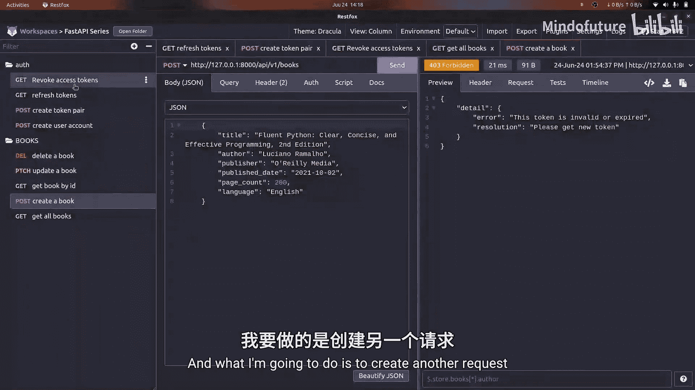

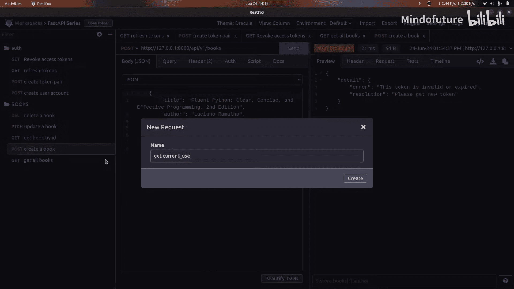

So I'll per the APIPA endpoint or the path。So our in this case is going to be this slash me。

When try to make a request to this we see that we are not authenticated and simply because this takes in the access to dependency so we have to go to our headers right here we shall create a new header and this is going to be our authorization header。

So we have to pervade the bearer。And then the tor。 So in this case， we have to get a new tor。

So this is invalid using a more password， I think I changed。Or did something。I say password go to3。

This will pretty much allow us to log in。 So I think I have a problem in value D NM or password if I try to。

Go back to create their account。Create a new account。

 think I did something with the database and the user was deleted。

 If I try to get the new tokens using this current user。

 If I go back to where we create the token pair。We can simply submit these credents with。

The password， which was test。1，2，3。And then right here， we can be able to successfully log in。 Now。

 when I get the to in。All I'm going to do is to simply go ahead and use this token within our route for getting the current logged in user I provide the token and when I send we now see that this is going to return the currently logged in user so you see how simple it is by just doing that we've been able to。

Simply go ahead and。Get our current user without having to create a lot of code。

 All we have to do is to create a dependency。 that is another dependency。

 and therefore we can return our currently load the news。

Now that you been able to get our currently loggedging user。 let us go ahead and use this to。

Create roles within our application。 So what you're going to do is to add another field to our user model that's going to indicate the role that a user is going to have within this application and the default role that we shall have is going to be our user role for every user that shall be created within our application。

 And then after having the user role， admins we'll be able to update the role of a specific user in our application。

 just like we're going to see。 So right now， we're going to simply go back to our user model。

Were file is a model that's going to be located within a slash of directory。

 and inside that screen we're going to add on to what we have as a database model for users a field to mark the role that a user has for now。

Application， so to begin we're going to start by saying that each of our users is going to have a role。

 and this rule is going to be a string。 Now， once once defineded。

 we also need to specify what kind of data is going to be stored in this role and the default value we're going to have within our data。

 Now， the thing is。This is a field that we are adding onto a table that already has data and therefore have to provide this Sa a default。

 that's going to allow Postquez to understand which data we're going to fill for those fields that are going to be blank or for the newly created field that is going to be blank。

 So to begin， we're going to match this as a field。 and we're going to use the field function。

 And once we've created that and we're going to make use of the S equal property or。Adjut。

 once provided， we are going to name this column， and this column is going to be of the postquere tape。

 So in the， in that case， we're going to have P G dot vcha。And once that is done。

 then we' are going to say， well， this is going to be not enable。

 So shall say na is going to be false。 And we're going to provide the serverva default。

 Now the the thing about this Sava default adjut is that it's going to a to provide a default value to fill in。

 because what we expect is this rule is going to be created， that shall not have any value。 Now。

 by specifying the serverva default to user， or we've introduced to create the。

Roll field and then populate it with the user value so that you can have the default value for the existing users in our database being the user。

Once that is done， Im save。 So format my code a little bit。

 And then now let's go ahead and use a to make this modification to add database。

 Now remember that we are using lifespan events to make modifications to add database every time we create a table the lifespan event will run and then simply create that table in our database。

 But from now on we're going to be making use of our limb so that we can stop using server lifespan events So I'm going to to go back to As source folder within our intro pure and then I remove this adjut of our lifespan function So I'm going to go ahead and remove it so that none of the quote that resides within our in Db will run。

 And once that is done， then we're going to go within our terminal。

I'm going to open up a new terminal。 and in this terminal。

We simply go back to steps within our root project folder。

 And in here as well I'm going to create a new revision to add that change to our database。

 So to do that， we are going to use a limbic revision。And in our case。

 we are going to tell it to autogenerate。Drivation， so。

It's going to autogene whatever change we've made from our models。

 and once we've been able to do that， we shall provide the message。

 which is going to be add roles to users。And this will go ahead and create the revision to apply this revision。

 or we'll introduce to say aic。Upgrade。And then head。 now。

 if you're wondering how we are doing all this， I created a video in the series where we set up a to work with our I think D B A P。

 I think it would be a very informative video。 So I'll press enter。

And then this will go ahead and make that change onto our database now to confirm what I'm introduce to head over to my time you know。

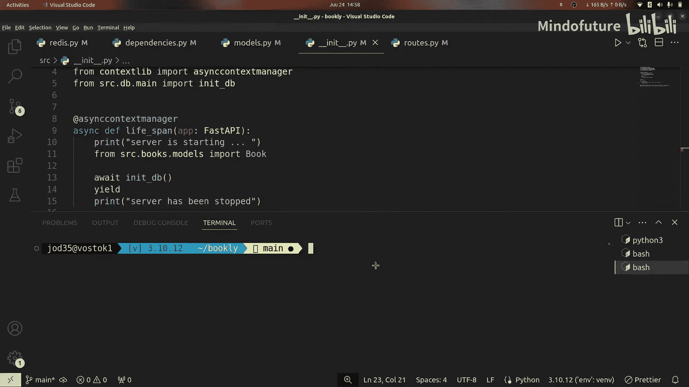

And in meantime you know， I'm going to open up the SQl shell or the PQl utility。

So I a PQl an inside connect to our database， which is bookly DB。 and once I'm there。

 then I'm going to describe the users table， and this is going to show us that the role field has been added。

 meaning that we have made a successful revision。 So once this is done。We're going to exit this。

 and then。

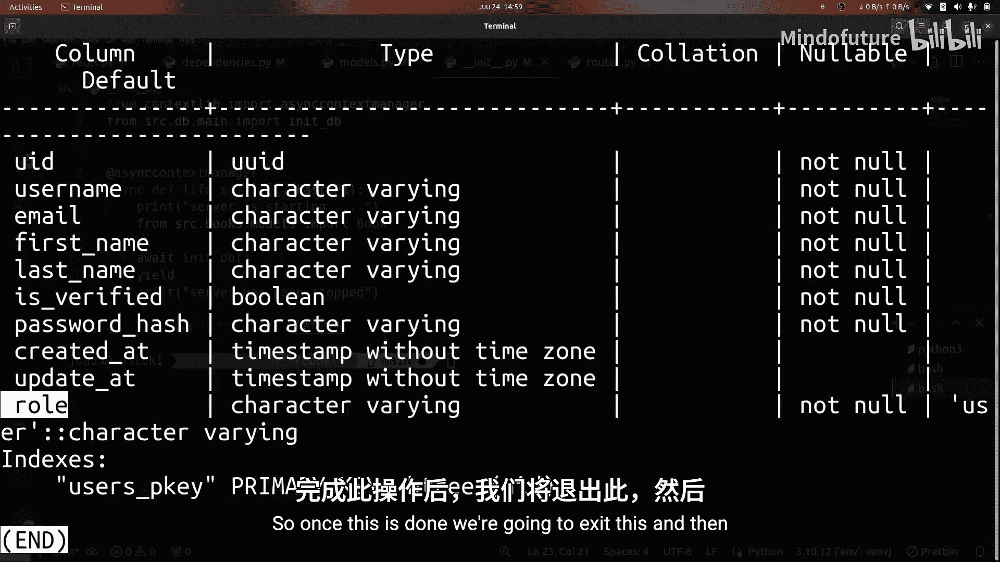

We are going to go back to our code rate here。 So now that we have the role being added。

 then we are going to make a few changes as to how we create a user and how we can be able to provide them a role。

 So we're going to head over back to our route routes or our paths for creating a new user。

 And the next thing we're going to do is to simply head over back to our service where I will create a new user。

Now inside it here we defend a bunch of attributes。

 so some of them are going to be submitted from the client said， while others are going to be moreed。

 such as the password hash， so I I'm simply going to go ahead and also add the user pad I say newro new user dotro and in this case we shall simply provide them with a default user role。

Once that is then， then let us square ahead and also add this within the toolken that we provide to each user。

 So to do that， we're going to head over back to our routes and where we。In quote。

 our toolken to provide the user details。 We're also going to add the user rule。 So in this case。

 we going to come and see that our rule。Its going to be the user's role。 And in our case。

 you shall say user dot row。Once this is done， now let's go ahead and。

Work with that to be able to create the dependency that will allow us to implement our rowbased access control。

 Now， rowbased access control is something that can be as complex， but in this case。

 we are going to just need a simple way of blocking access to those who do not have a specific row。

 So to do that we're going to head over back to our dependencies and what you're going to do is to create a class that' is going to be a dependency。

 Now remember that you created this standard method and every dependency that's going to have to be a class is going to have that because then all you need to do is to create those objects from those classes and call them as functions。

 So what you're going to do is to come at a bottom right here which are create that dependency and we are going to call this our row checker dependency。

So this is not going to inherit from anything， but we shall define it as one that' is going to have some attributes。

 so each object that we're going to have of this class is going to be one to take in a list of row so we're going to say that。

We're going to call this our required rules or rows or allowed ruless or something like that。

 So we may say allowed rows。And this is going to be a list of rows。 So we may give it the list。Tap。说。

Once we have done this， then we can even use typing。 so to be more robust and to be more specific。

 we can use the typing module so we can save from typing。We are going to import the list type。

 And once we've done that and we can explain that this is going to be a list。

 but for us to be specific， it's going to be a list of string objects。

 So once we've been able to specify this， then it's also going to return then and once we do that。

 then we're simply going to attach that as an attribute to this object to this classes objects。

 So what we' introduced to say self dot allow draws。

It's going to be equal to the allowed roles that we providedvaed to this class。

 We format math a little bit。 Once we are done with this。

 then we're going to define the main class that's going to be called each time we create objects for this specific class or objects that we're going to inject into those specific paththhands。

 I'll just come right here and say that。This is going to be a function called the call method。

 So we're going to simply say a think dev。 So this is going to be a d call method and it's going to be the one that we're going to use to simply check if we are providingvading a role when accessing a specific endpoint。

 So this is going to take in whatever it takes in as the adts and the Qword adts。

 but for us to be specific。 we're going to pervade dependency and this dependence is going to be our current user dependency。

 And I think you guys are now seeing that where we can enjoy accordingly with fasterPA。

 all you have to do is to providevade the current user So in this case can say that our current user。

It's going to be， of course， a user object， but this user object is going to be a dependency。

 So we need to get its dependency by using a depends function。And once you get the dependss function。

 you shall just call it depends in which is our current user。

So our current user is going to be what we get from get current user。 And once we've got that。

 then you can simply say if our。Current user dot role， which is going to be the user's role。

 Now to make this simple， we can import the user model or import the user class by saying from dot models import user。

 but I'll save them。what I actually going to do is to import it just for simplicity our se source dot models。

 we are going to go ahead and import our user model。

This is actually going to be found within the same folder。 as I'll say from do models。

 we shall import our user。And then by using tape hints。

 we shall just come in here and see that our user is going to be an object of tape user。

 and that is going to be returned from this dependency rate here。 So when you get our current user。

 we shall get the role of that user and check if it exists inside our allowed rules or can say in but a loud rules。

 which I actually called a allowed rules Now let me just rename this So just going to go ahead and rename it。

By pressing Cl D highlighting and getting all occurrences of allowed rows。

 and our change is to allowed rows。 So if this is true。

 then we shall simply allow access to their user。 And if it is false。

 then what we're going to do is to simply deny access by raising any exception。

 So we shall just come right here and say return true。And once this is done。

 then we' are going to come outside this if statement and raise an exception by saying grace HTTP exception。

 and in our case we shall deny the user access we shall say status code is going to be equal to status。

Dot H TTP。4，0，3， forbidden。And for our case， we're going to provide the detail。As that for。

Deying this user or telling them that they do not have sufficient access to access this specific endpoint。

 So in this case， we can say operation not permitted or。This is the operation note permitted。

 so we can just come right here and see that。We can actually yes say you。

You are not permitted to have。You。And not。Iit to。Access this or to perform this action。

 So in this case， you're not pop。Or you do not have permissions to perform this action， so。

You and not。Allowed to。I found this。Action。And that will be just what we can simply tell the user when they access that specific endpoint where they do not have the role。

 That is。For that specific action。So for us we make use of this。

 which we can go back and simply see how we can use this or now。

On now route for getting a current user。 So we can go back to our routes。

 And all we have to do is to fast import that dependency。 So we call it the row checkr dependency。

 So I need to first create an object of that class may coming right here。

 so we can call this the admin rule checkr。Or you can simply even call it the roll checker。

What we can do is to just come right here and say that our role shaker。

Is going to be an object or type roll checkr。 and every row checkr object is going to have the allowed roles。

 So in this case， we can provide the list of roles。

 and these are going to be strings So we can say that for the st say that this action needs to be done by an admin。

 the only thing we have to do to go within our routes and inject that as a dependency。

 So shall camera here and since that is simply not going to retain any object that shall use within our routes we just say and score or whatever want。

 So how close what I did there。So I can just come right here and see。

Comma within our get current user， etc ce， getcar user， so I can say。And as call。

 And then this is going to be a dependency retain your bullan。

 And this the bulloleion is going to be。Getting our depend is so in this case。

 our dependence is going to be our roll checkr object。 We format this a little bit。 So for now。

 if we try to access this endpoint as a normal user。When you go back to I for straight here。

 we shall see that we are not allowed to perform this action simply because we have now said that this route is to only be accessed by an admin。

 but if you go back and say that even users can be able to get there currently logged in user so you can say that this can be performed by the admin as well as the user。

Then if we try to perform it， then you can be able to get the currently load in user。

 Now let us go ahead and add this protection to all the other endpoints。

 we shall look into some of the endpoints that will be for the admin。

 But let's go ahead and just protect those for a user。

 So each almost each action performed by a user is going to be performed by an admin， for example。

 if we go back to the crowd。 the routes for the cr that's involved with books we can just simply go ahead and use the same row checkr object。

 So what I'll do is to go within the routes for ourbos and then inside each of them。

I'm going to go ahead and make use of this roll checkr object。

 So you have to go ahead and import this， say that we also need the roll checkr class。

And once we've imported it。 now， let's go ahead and inject it it。

 So I'll just come right here and say， and go， then this is going to be a list of this is actually going to be a boan。

 And what we need is going to be depends。And shall parade our row checker。 so I'll say row checker。

 So what I'll do is to just simply copy what we have here。

 and then I'll go ahead and past it or to simplify our life and to make it a little bit neater we can actually make use of the dependencies adjustment within our router dot post or router dot yet or within our HtP methods so I can just simply come right here and say comma dependencies is's going to be got a list of dependencies and in our case we're going to be making this of our row checkr。

So once we have done that， I'm simply going to grab ahead and provide it within every APIPA endpoint soll just copy the comma as well。

Then， go ahead and just simply providede it within hour。Roads are within our paths。

So this is going to be the one for creating a book。

 Then we shall also have this for the one that's going to be for getting a specific book by its I。

 And then we shall have this one for updating a book。

Then we shall have the one for deleting your book。And that is simply going to go ahead and protect this endpoint so that admins and users can access them。

 So if I go ahead and save a survey is going to be running。 So if you go back right here。

 as survey is running， we don't have issues。诶。See like the survey is not training or fits training in。

Yeah， it's trend。Something thing is wrong。 So the survey is runninging rate here。

So we see that the role checker object has no attribute role dependency。

 So the issue here is I try to inject the object directly without having to providevade the depends function。

 So how we deal with that is by simply going ahead and wrapping our dependency object inside the depends function。

 So what I'm going to do is to simply go here and say depends。And then， I parade。The object。

 which is going to be our rule shaker。 So by providingvaing this as a dependency。

It is already a depend injector， just like you see rate here。

 So this is just one simpler alternative to going ahead and depending it directly into inside the。

Handle function。 So once that is done， as survey is going to be running。

 And now we can pretty much perform any other action。In our cr for books。 And in this case。

 we shall have the rate roll and the right access to perform that action。What's up everyone。 We back。

 Now that we've been able to set up our authentication and also set up authorization for the different endpoints。

 we're going to be establishing relationships across the different entities that are within our application。

 For now we only have users and books， but we can pretty much add any other database tables and other different modules。

 So we're going to be looking at how we can do that in this video。

 we're also going to be looking at how we can use our pantic to serialized data in these relationships and how we can return them on our APA endpoints。

 So to begin we have our user table， which basically has all its attributes just like you see right here。

 we also have the book table which has its attributes just like you see right here。

 but want to achieve an application where users will be able to submit books and those books that are submitted by them。

Will be tracked back to them so that means that there's going to be a relationship between users and the books they submit to our application。

 So if we go to the next diagram right here， we can see that we are going to establish a relationship between our user table and our book table and simply what you're going to do to establish a phone key on our books and that is going to be related to our user Uid So once we've been able to do that then we shall go ahead and also look at how we can modify our structure of our EPA endpoints or our responses so that we can return data containing these various relationships So the first thing we're going to do is to add a relationship between our books and our users and they are going to achieve that is by adding a phone key that is going to be relating our book table to our user table to do that we're going to simply define the foreign key as our user Uid Now this user Uid is going to be an optional。

Fd， because it's going to be anedible field anyway。

 So you have to import the optional class from typing。

 So I'll just come right at the top and say from typing shall import the optional。Class。

 once that is imported， we shall now come and say， well this is going to be an optional。

 but it's going to be the type of the U U I D。 so we're going to say E U I dot U U I D。

Once that is done， then we're going to define what this field is going to be so shall just use our field function and in the idea I shall simply per the default for this field which is going to be none and then we can also go ahead and to this we can。

Point to that table or the column that we want to make the foreign key。

 So this is going to be a foreign key， but it's going to reference the UI of our users table。

 So for us to do that we shall have to look at our user model which created in our old directory This has the table name being user。

 So that's what we have to use and then the field name that we want to set as our primary key is going to be the U UI。

 So。This is going to be a foreign key。 That's going to be。

Referencing so for us to name it the referring key， we have to use the foreign key attribute or ajut。

 and in this case you have to providede the name of the table。

 which is used as dot the field that we want to point to or reference。

 which is going to be our UI So once this is done we' are now going to go ahead and make this reflect in our database using a limbic So we set up a in the previous videos and if you havent check them out please go ahead and look at how we set up a limbic So to begin what I'm going to do is to create a revision for this migration post some of the stuff I have here and open up a fresh terminal。

In， I'm need to create the revision， which is simply going to be。I change or。

A tracking of the change that we've done。 So in our case well just come and say our limb revision。

 and we shall auto generate this。So after auto generating it。

 we are now going to go ahead and create a message to mark it as a revision。

 So this message is going to be let's just say， relate。Use as to books。And once this is done。

Our migration or our revision is going to be created。 Now。

 if I go within our versions directory and look at this revision。

We shall see that a new column has been added to the book table， just like C rate here。

 and that is going to be a naable field， just like C rate here。

Now we also see that a foreign key has been created and that foreign key is going to be having none。

 So it's， it's going to be created on our book table and screen to relate the user table using the user UAD。

 But this is going to also rephrase the UAD field our user table。 So that has been our revision。

Once that is done， now， the next thing you can do is to simply go ahead and how and look at how。

We can relate a user to the book they've submitted every time they create a book。

 Now we shall go within our user routes。Our book wrotes because that's where I went ahead and created books and inside there we shall visit the endpoint that's necessary for creating a book。

Now one thing you can notice is that in the previous videos we call these user details。

 which is kind of misleading because what is retain out of this dependency is going to be the token details So what I'm going to do to simply go ahead and rename all these so that they can have token details instead of user details because that's what they retain。

And I thing I will do is to also。Be specific about the type of the user details。

 And I'm going to highlight every occurrence of this by pressing control shift1 L。

 and then I' begin modifying them。 So instead of user details， we are going to have torken details。

 and also we shall provide the type， which is going to be our dictionary。

 So we expect that this is going to return a dictionary and that dictionary is going to have our torken details。

 Now， once we've got our token details， the next thing is going to be for us to get the。

Useer UI out of those token details。 Now， remember。

 when you are creating the utilities to create tokens。

 we basically went ahead and provided our user data。

 But when you see where create the token pair that's really in our route for authentication。

 we went ahead and provided our user UI inside our user data。

 So for us to go ahead and access our user UI。 what you're going to do is to say。

Our user U I is going to be good from inna case artwork talking and details。

And since this is a dictionary can use that dot gett method and this dot get method is going to ala access the key。

 which in our case is going to be the user， but this is also going to be a dictionary containing the user UID。

 so we're going to access that as well。Once that is done。

 let's go ahead and modify this create book service method that can allow us to create a book I'm what you going to do is to simply make sure that it creates a book。

 but also assign the user ID。As the user U A or they currently logged in user who has made that request。

 So we're going to go back to createbook and we're going to modify it by simply pervading the user U A and using that to U A。

Prameter to go ahead and simply fill that new column， which is user U A D。

 So I'll just come right in here and。So I create our book after providingvading our book data。

 we shall also provide our user UI， and this is going to be a string。

And once we provided our user UAD， we are going to also go ahead and modify our book object so that instead of having none we can have a user UAD so we shall say new book dot user UID and for our case it's going to be user UA So this is just enough for us to use this method to create a book with the user UID providedvad So we shall go back to our routes and what we're introduced to simply camera rate in here So after providingvading our book data shall now make use of this newly go to user UA。

 so just come right here and say that this is going to be our user。I did so。

I a I D or I is a U I D is going to have the value this user U I D。So I'll go ahead and format that。

 So once I've been able to achieve that then let's go ahead and try to create a new book using the currently logged in user So ahead of a back to folks and I'm going to go to I will create a new book Now if I try to just simply use the Jason that I have right here to create a new book。

 and now see that we have an error。So I go back to our time in right here。As have I saying that。

So A here is saying that the column is a UA。I a U ID or relation of relation book does not exist。

 So let's go ahead and see why this is not working。嗯。Did we， I think we did not run the migration。

 So we have to go ahead and apply this。 So first to apply this， we have to run Olympic。Upgrade。

 sorry， I forgot to run this。S run Olympic。Upgrade hit。

Then this will go ahead and make those changes reflect in our database。And when we do that。

 if we go back to our Re folks rate here and try to create the new book。

 shallll see that it has been created， so if we try to retrieve the user ID or try to get this book so let me try to do that inside our Postgres so of let found out this tool that can allow us to check for our connection to Postgres as well as to navigate the data join SQl statements and that is called SQL electrons。

 so I'm going to go ahead and open it up。Once I've opened it up。

 it just has this simple minimalistic user interface and I can just simply connect to our database and right here we see our database that we created fire books so to access our tables you're going to go to tables and then inside tables we shall go to public and inside public we shall see public do user public bookss。

 but what were interested in is public bookss If I open that then we shall see annual newly created book which is this one but in this case it has our user UI added to eat we also see that for the existing data that did not have a user UA now has been said to the default value of those fields so let's go ahead and try to。

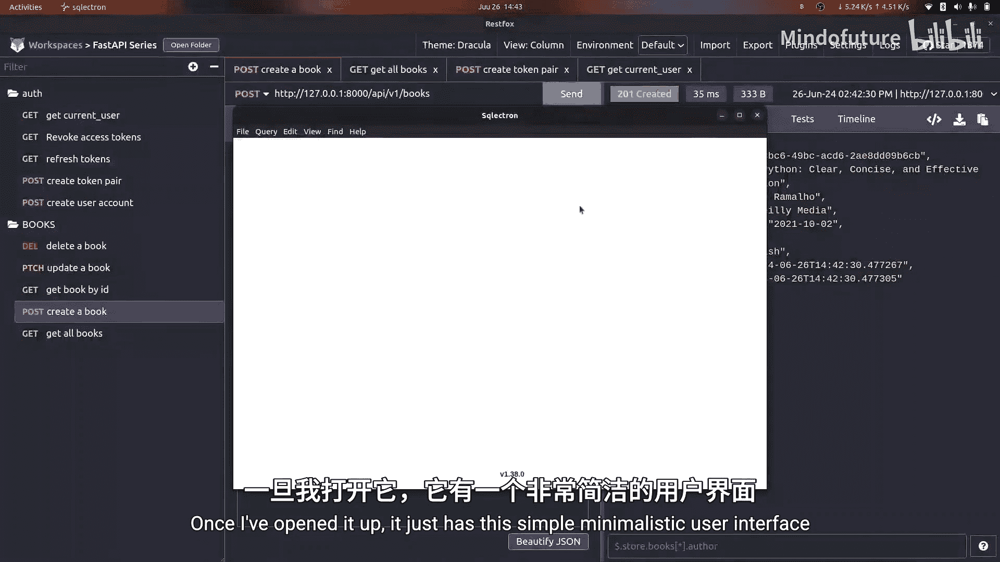

Make sure that we get the currently logged in users books so to do that we can just simply go to our book endpoints and create a new EPA endpoint for getting all books by a user so I'm simply going to get rid of this and defenses quicklyline by removing this print statement and then this is going to be similar to what we have here except that we shall be able to provide the user UA So I'm going to go ahead and copy this past it trade here and then instead of being on the slash books route endpoint in our case we shall have slash books slash user and then we shall provide the user UA shall say slash user UA。

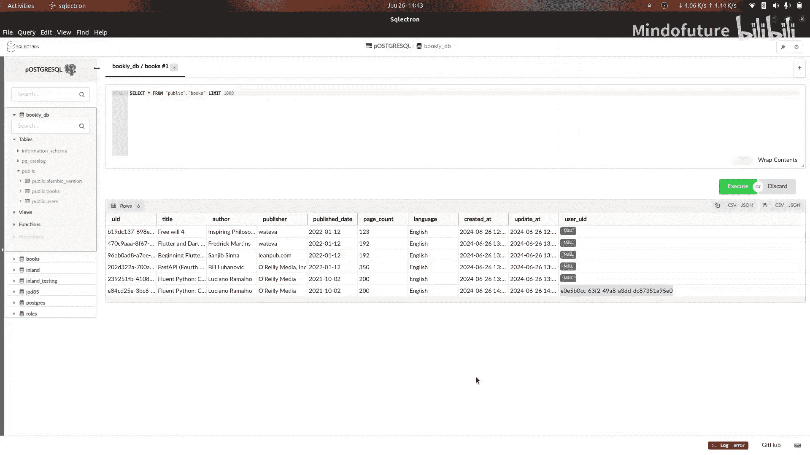

Once we have that， then I'll go ahead and also modify the name of our get old books path handler instead of being get old books in this case we shall say get user。

Book submissions to be more specific。And。So this is going to be submission。

 so get the books that Sa user has submitted within our application。

And then this is also going to require us to have the user UID， so if I go right here。

 I can simply go ahead and say that our user UID is going to be a string。And once we've done that。

 then。We're simply going to come。Down here。 So once we have that talkingken details。

 we can also get the user I D from there。 but want to make it dynamic so that you can providevade the U I D of the user。

 You can provide the U I D of。The currently logged in user and still be able to get the books for that currently logged in user。

 So instead of using this。So instead of using this book service that gets all books method。

 we're now going to make use of get user books method。 or if that's what we've called it。

 So we have to go ahead and actually define it。 So I'll say get user books and this will take in the session。

 but it also take in the user U A just like you see right here。

 So keep in mind that this doesn't exist。 So we have to go ahead and define it after I've defined this。

 I'll have to go back to our service where we basically went ahead and go all our user or got all books from our database。

 We shall create a new method that's going to be responsible for getting books by user。

 Now this is going to be very similar to the one that we have here。

But it's going to contain some filtering。 So I'm going to go ahead and just copy what we had as get all books。

 And then instead of get all books， I rename it to what we called it。

 So this is going to be get user books， what I called it here。 So I'll see。

I'll copy this and then I' simply pervade it as the name of this method。 So instead of get all books。

 you shall see get user books。 I think we're going to pervade is going to be the user U I。

 So I have to pervade it as well。 I'll say that it for taking our user U I。

 which is going to be a string and then the session object just like you see right here。

 So we now see that this select statement is only getting all books and then ordering them by the descending book created。

 So're going to add a filter。 So I'll say dot where。And for our case。

 this is going to be ordered by the descending created at date。

 but you're going to filter by the book user U A D So shall say book to user U A D is equal to the user。

UID providedvad， so this will go ahead and fetch all books。

 but it will filter using the provided user UID just like you see right here。

So Im going to go ahead and format that and save。 then head over back to our routes rate here so we can now handle getting all books by a certain user。

 We can also go ahead and get books for the currently logged in user by simply。

Using the token details user ID and then we can simply go ahead and do that。

 but we're going to look at how we can do it in a more interesting way using relationship attributes So I'm going to go ahead and save and to test this endpoint what we're going to do to get to our for rate here shall' create a new request。

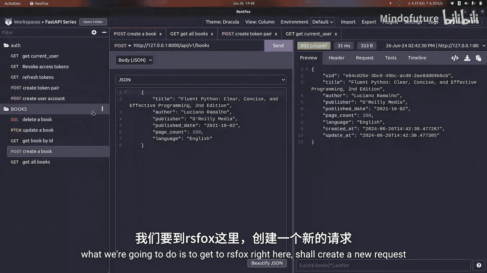

So this is going to be get。Books。哦 user。

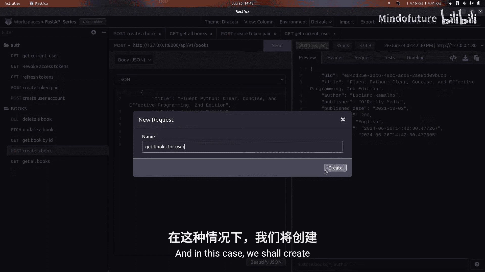

And in this case， shall create。 So I'll add a new or I'll just simply perva the URL RL right。 Yes。

 it's going to be very similar to the one for getting all books。

And let me to close what I have of some other open EPA endpoints or requests。

So I'll just simply come and say getbooks for user I provideva a URL。

 but in this case it's going to be slash user and then slash the user ID so we have to get that show me are currently logged in user is this so I to get all books that were added by this currently logged in user I'll copy their ID and then I'll provideva it in our URL so in Icent you see that we are not authenticated and therefore I have to get the token。

As simply camera right here and copy this turkey that we have。I'll go within our head does。

 I'll add our authorization header。And then it really going to be betterer can then talkingken and I sent we now see that we can retrieve the books that belong to a certain user。

 so we are now currently using basic relationships and we're going to be looking at relationship attributes reach which basically allows us to use a more object oriented way to achieve the same thing without having to directly use the ideas。

Now that we've been able to set up this relationship between our books and our users。

 let us go ahead and look at how relationship attributes can make it easy for us to access them using reverse relationships so you're wondering what a reverse relationship is its simply a way that we can access the user who created a setting book as well as there we can access the books that belong to a setting user in our case so to begin we are going to create an attribute or a field on this book class and that's going to be the user field so this user field is going to be an optional of field。

But what this is going to allow us to do is to access the user whose user I we have stored in here。

 But we're going to access that via the relationship。 So in our case。

 we're going to get access to this user model。 shallll come and operate here and say from。

So in our case from our o dot， in this case， we shall import our models。

 So to do that shall just come and As source do o， we are going to go ahead and import our models。

 and once we've gone ahead and done that， then' simply going to provide our models dot user。

And what this will do is to define the field that's going to simply。

Allow us to access the user who added this book or who's submitted this book。

 So we're going to be making use of the relationship function。

 which is one to just help us use relationships to get those objects that are related to a certain object such as the book object right here so we shall go ahead and import that shall say from SQl model shallll import our relationship function and then。

We can see that our relationship。In this case is going to be to to the user table。

 but we need to specify how we shall simply return all books that are related to this user so in this case this user right here is going to have backpulates which is going to be books So that means that on our user side we shall access all books that are related to this user and on our book said we shall just have to access the user who added that book but we shall access in via book dot user so from the user side we are going to have something like user dot books and that is what backps is all about So when you go to our user model we' are going to have something similar to this go to our models in our earth folder and then instead of having。

Users， we are simply going to have this being our books。And then we shall do the opposite。

 So instead of saying books， this is going to be used just like we defined in our book class。

 then let us go ahead and import this to。 So I'll go ahead top here and say from in this case。

 it's going to be typing we going to go ahead and access the optional field or this is actually going to be the list because we expect that。

We're going to get a list of books from the user object。 So I'll just come an imports list。

 And once we are be able to do that， then she'll also import the relationship function。

Just like that， then I'll have to change this from an optional user object to a list of books that are related to this。

User， so in this case， we are going to also change this from models the user。To models dot book。

 And then we shall have to import the models module。 So I' come operate here and say from。

In this case， shows that books we can import our modelss。Once this is done。

 another thing we're going to do is to basically describe how SQL model or SQL al is going to load this list of books now。

SQL model by default uses lazy loading， but it can be problematic in some ways。

 most especially when you're dealing with， and I think they B A P so。

What you're going to do is to come right here and use another way of loading。

 so I'll just come right here and say EQl， alchemy or S。In this case， relationship keywide arguments。

 Then we shall specify that we're going to let download this， but we are going to provide。Select in。

Now leave a link to this documentation that's going to allow I understand this in case I've not explained it well。

But what this is going to do is to simply allow to access the books that I user。Will have submitted。

 And this is just the relationship attribute。 So once we've been able to define this。

 then let's go ahead and make use of this relationship attribute。

 So just like we've been able to describe it here， we' are now going to go on our schemas of our user。

And then add that list of books so we have a user model and this is going to return that。

 but in case we want to modify this so that it returns our list of list of books with the user model。

 we can simply define that here on our schema by saying books and then we can use the typing list class。

Can I just come right here from。Taping。We are going to go ahead and import the list class。

 And once we've been able to do that， we shall just come and say list。

 And this will be a list of books。 So we're going to import that at the top rate here。

 we shall just come and import the model that we want to go ahead and use to display books so I can come and say from。

Sos do books， we can go ahead and report。how。Book， so I can get the book。

This is actually going to be for masschema。 So when you say from such do books dot schema。

 we can import our book。 So you have the book create model。 Let us make use of the book create model。

 so have to get less fields。 Now， once I've been able to do that。

 I can simply go ahead and provade this as a。Book create model。And once we've done that。

 then let us make use of this within our route for rerieving the currently logged in user。

 so we shall go to our routes。And those are going to be our o throats。 And within our o throats。

 we have the。Paath or the endpoint for returning the current logged in user。

What it does is to simply use our toolken， kit the user， and then simply。Return that to user。

 So once we've been able to do that， we can simply go ahead and providevade the response model。

And this response model is going to be。The schema that we defined in here or the pedantic model for the user model。

 So I can just say that we shall make use of our user model。

To return that specific user with their related books。So。

I'll go within our routes or within our rests。To test letter Ill go within a rest box。

 and when you try to get the current user。In this case， we are going to get an error。

 So let's see where this area is coming from。So we see that our books published that is going to be a string。

 but that is going to be a date time， I think we shouldn't use that book model we imported。

 but rather let's just use that book model so I'm going to go ahead and import that book model instead of the book create model because I just needed list fields so I guess we're going to use book and then come and substitute this with book。

In our case， if we go back to rest folks， we shall see that the currently logged in user is returned with the books that are related to them。

 So that's just how we can handle basic relationships and。

Allow our APIPA endpoints to return data that is related。

In this video we've looked at how we can set up relationships between related entities within our application。

 we've also looked at how we can use SQL models relationship attributes to allow us retain this data and we've also looked at how we can serialize it to be returneded when retrieving it from our APIPA paths。

What's up everyone。 Wee back in this video，'re going to be continuing from where we stopped in the previous video In and established relationships between the existing tables of the existing entities that we have within our application and those other users as well as the books Our logic was that a user could make a book submission and then would keep track of the specific user who submitted that book and that's what we did in the previous video。

 we also looked at how we could retrieve a user's book submissions and how we could return that relationship using the pedantic models。

 So today going to be continuing by building a more complex relationship and that is going to be one to link every user and every book to a review。

 So a user would be able to submit a book review and we shall keep track of the book they made the review on as well as the comments they made and all that stuff。

 But before you go there， I noticed that we have an error in our code。

 So if we go to how we create a user accounts。 when you try to。Create a user account。

 This user is going to be created in our database， but it's going to return an internal server error。

 and this server error is being returned because this user has not been serialized in the way we want。

 So if we go back to our that is going to create a user account we have all the logic working except that for retain our newly created user So if we go to our terminal and see what is wrong。

 we shall notice that we still get that missing greenlit error。

 So the missing greenlit error is one that is raised each time we try to operate outside the context of greenlit。

 So greenlit is simply a simple unit of execution just like you see a thread but SQl alche uses these to perform queries and therefore if we operate outside the greenlit point context then we are going to get such errors and that's what it means when we get that error。

 So we are trying to serialize that。But remember， this model is also getting the list of books。

And that is going to make another extra query to our database to get all those books。

 So for us to fix that， we need to make sure that the where we are serializing this user for this case。

 is going to be in a way that。I's not going to return those books because we will be operating outside greenlate context。

 So if you have not understood that I'm going to of course leave some description or some explanation in the description so that youll be able to understand what it does so to fix that what you're going to do is to simply modify our user model so that it doesn't return the books or shall create a separate model that's going to return all information about the user as well as the books that are associated with the user so to begin I'm going to create a class。

And I'm going to call this class our user。Books。Model。

So this is going to inherit from this class because what we want to do is to go ahead and inherit everything that this class has。

 including all our attributes， methods and so on， so to inherit all of them we shall say that this is going to inherit from our user model and once we've done that we've created a class that has all these fields as well as the one to return the list of books that are associated with a user。

So to use that， we are now going to leave our sign up route or sign up path to use the response model。

 which is our user model， and then that one that returns the user and their box。

 which is get current user。For that we shall use our user books model。

 so we're going to go ahead the top right here and I'm going to start by importing our user book model or I user books so let me make it more clear。

 say user books and when you go back here we shall also rename these to user books。

So once that is done， if we try to。Go back and let's say， try to create a new user account。

 So I'm going to proate another user。 Let's say this user is going to be。Jennifer。

And then we shall revade their email， as let's see。Jane，1，2，3。

And then let me actually also use Gen 1，2，3 for the reason and then you can pervade。

Their name is Jennifer。So。And then there are， let's say Jennyfer Smith or whatever name we may have。

 So if we try to create a user account in this case。

 we shall see that their user account has been created successfully and only trying to。

I'll create a new token。 so let me try to create a new token for them。

 So I'll just get the email and password。 and then I'll go to Ill create a tokenen pass， so。

This is going to be at Gmail dot com。 and then our password this our user is going to be Jane 12 3。

If we try to send， in this case， shall get their access and refresh token。

And when I get the access talking in， I'm going to try to get the current user。

 so I'm going to go to the authorization here there。

And then I replace the current token with this new token。 So in the send you can get the user and。

For our case， we need to make this return the reviews and the books that this user has made。

 So we need to go ahead and set the response model so that it does that。

 So we have our user model in our case we shall see that this is going to be our user books model。

 So once that is done it's going to return an empty digital books just like you see right here。

 and now were also going to work on our reviews so that we shall return the detail of the current loggedin user。

 their books and all the reviews they have made on every book Now that we've been able to look at how to fix that。

 let us look at our current database structure。 So our current database structure simply has the users and our book table But want to go ahead and make sure that every user can add a review to our book and therefore we shall modify our database structure to look something like this。

 So in this database structure we see that we have。Users having a onetoman relationship to reviews。

 Therefore， one user can make as many reviews as they want。

 but they'll also be making reviews to a book。 and therefore we have this association to the book table。

 So the book will also have as many reviews as possible。

 So one book will have many reviews and one user will also make many reviews。

 So we have a one to menu relationship between books and reviews and also one to menu relationship between our users and our reviews。

 So let's go ahead and implement this。 The first thing we're going to do is to go within our code。

 and we are going to move our module to a common module or to one module in which it will be accessed throughout our application。

Now， for simple， I this， if you do not want to get into。Seual inputs in future。

 then it will be ways for us to have all our code logic for models set in one place。

 And the reason that why I'm going to do this is because we are going to have relationship attributes that will need for us to refer to other database models I'll say the modules in nu be creating them。

 So to do that， I'm going to first of all， create the module。

 So I'll go right within our source folder。 I within our DB I'm going to create a new file。

 which I'm going to call models dot P。 So all our models are going to be located in here。

 And once I'm done with that， then I'm going to start moving our models that are existing within our application。

 I'm going to start with our user model。I simply go ahead and provideva de trade there。

 And then I'll do the same thing for ourath。 So I'm going to go ahead and。

Simply delete this o modelss file。Since we've moved its code inside models dot P A and another thing I'm going to do is to go ahead and do the same thing for our book。

 So I'll go to books dot models and then I'll simply cut the quote from there。

And then I'll paste it inside it here。So once that is done。

 then the next thing I'm also going to do is to make sure that these inputs are at the top and we're also going to look at how we shall fix our file so that we do not have them being repeated like the way we have them。

One thing we can do is just actually remove the repeated inputs just like you see right here and if you have any And fans。

 then we shall simply go ahead and fix to them。So our' camera it here。

 And the first thing is to import data because that is appearing as an an and definedfined。

 So when you go to the bottom the file we still have the optional tape。

 which we do not import so go at the top and also import it save from  tapping import list。

 but shall also import optional And once that is done， we do not have any undfined。

 Now the next thing is to go ahead and fix everywhere we imported this within our code So I'm mean to use V code design feature and I'm going to look for all models that exist within our。

Could， so。Right in here， we have source do book dot models。

 but we now know that all our models are being good from source DB dot models。

 So I I'll go ahead and fix that with from source DB dot models input book and I'll do the same thing for our dot models。

 So I'll just come right here and I'll just simply say。Souce do。This is going to be D B dot models。

 which shall import our user。 I then now do the same thing here。 I'll say source dot D B dot models。

 We shall import our user。 and then I do the same thing here。 I'll say。Sous thought DB dot models。

 and that will go and fix all the input areas that we have within our code。

 So Im mean to go ahead and save everywhere I made that change and then we can now go ahead and test to see if FAsa is running。

 So I'll pull up maintime in right here。I'm seeing source do off。 So in that is on models。

 So I guess I have to remove this or save。now a survey is running。

 What I'm into is to go ahead and remove the models that is inside our books， so。

I have to get rid of it just like I did for o。 And now we have our models residing inside our D B folder。

 So it seem like I still have another input issue。 So right now， we have this。

 this input rate here for。Basically there are tablebo relationships that we set up in the previous video and they're going to fix this is simple since we have all these tables or our models located inside one modelss folder。

 it can be as simple as just saying instead of saying Tibit dot models or source dot models or models dot book。

 we can just say book and then for our case if want to call a user module since this is already defined within our current module。

 it can just say user。Then we can go at the top right here and remove where we imported our models so in this case。

 I just simply go ahead and remove this。And that would just be enough us of a training again。

Now as Saba has run， let us go ahead and create our review table。 So to create our review table。

 we are simply going to go down here and we're going to create a class。

 which we're going to call our reviews。So this reviews class is going to be similar to what we have at the top there。

 so。If you look at our database structure， we have this having the book ID or the book Q ID which is going to be referring key to the ID of the users as well as the referring key to the ID of our books。

 so you're going to go ahead and set this up， but you also need the review text as well as the rating for that specific book that user has submitted。

So I'm going to go down here and I'm going to simply define this basin on what we have。

 I can go ahead and copy this entire class and then I'll paste it right here。Then instead of book。

 we shall have this being our review class and to have all these attributes that the ti name will be reviewed instead of books。

And I think we shall have the same new I。 So we need to just go ahead and remove some of these other fields that I'm not going to exist to our tablebo。

 And in this case we shall have the first one being our rating。 So the rating will be an integer。

 but we can go ahead and also keep this integer validated so we can use the field function to do that and set up our maxs。

Ring， let's say how much rating is going to be5。 And therefore， the topmost rating will be5。

 or let's say five stars and stuff like that。 And I thing we can do is to set up the user UI。

 So the user U I will be an option U I， But that option U I will be a for to user that I。

 And I think that is correct。 And I think we shall set up is going to be the book U I。

 So our book U I is going to be set up in a similar way。 But in this case。

 it will have the name of our。Book U ID D。 And then instead of being a phone key to use as the U ID。

 in this case， it would be a foreign key referencing book。Or books dot UI。 I think we've missed。

 I think it's going to be the review text。 So we need to add that by saying review。Under text。

 And that will be a string。 So this simply shows that this review text will be a string。

 and it will not beelible。 And that is just enough for us， so。We have now created our view table。

 all we are left with is simply modifying this method right here。

 which is simply want to return a string representation of any object that we create out of this class。

 So just come right here and say that our review。So in this case。

 you can say that this is going to be a review。😊，And this review is going to be for self dot。

 So in this case， we can just come and say self dot。Self dot book or in this case。

 you can just save book U I D。And then we can also say by the user who created that。

 which is going to be self dot。 So in this case， we can just say self。Review by book for book that。

 and then by user。And then you can have self do user your A。And this will be just enough to do that。

 so I can go ahead and fix this and then say for book self do book Q I D and then by self dot choose I D。

 So I review that model has been created。 So let's go ahead and use a to set this up in our database。

 So to begin， I'm going to first pull up my terminal。 I'll go to that batch。

 So I guess I have to create a new terminal right here。 and then I'll run a limb。For our case。

 we're going to create a new revision， and this new revision is going to have to be auto generated。

From our module， shallll say auto generate。And for our case。

 we shall basically give it a message describing what change we have done。

 So our change is going to be at review table。So when you press enter。

 this will go ahead and generate the migration or the revision。 So if we go ahead and check this out。

We're going to notice that it's going to create the reviews table or the details about the reviews table and how we're going to apply them to our database to make sure this reflects within our database。

 we're going to go。Within our court， within our terminal and run Olympic。

So this is going to be aly upgrade head。And then these changes will be done in our database so we've been able to set that up。

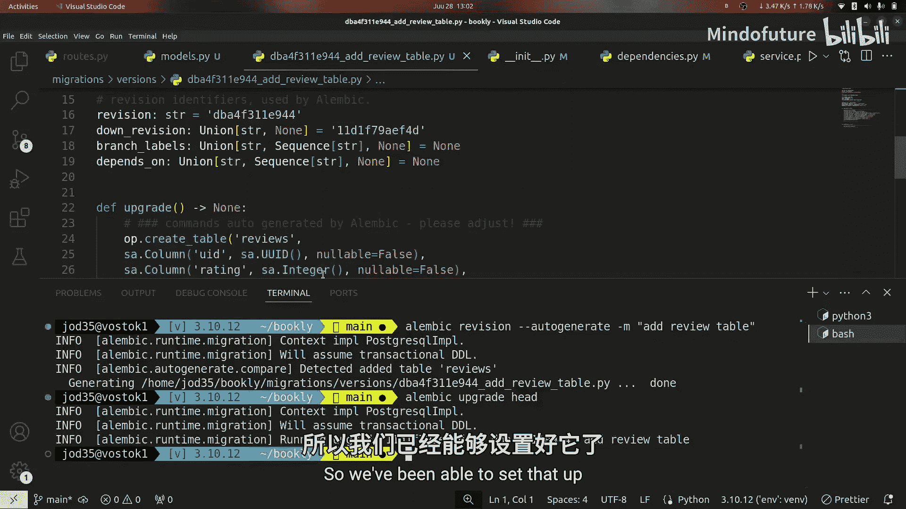

Once our table has been created， we can confirm whether it has been created by simply going back to this graphic user user interface rate here。

I'm going to just simply reconnect to the database。 and now in our public ratio。

 can see public reviews being added， so。When you enter here。

 we can see the different columns that we have set up on our database table。

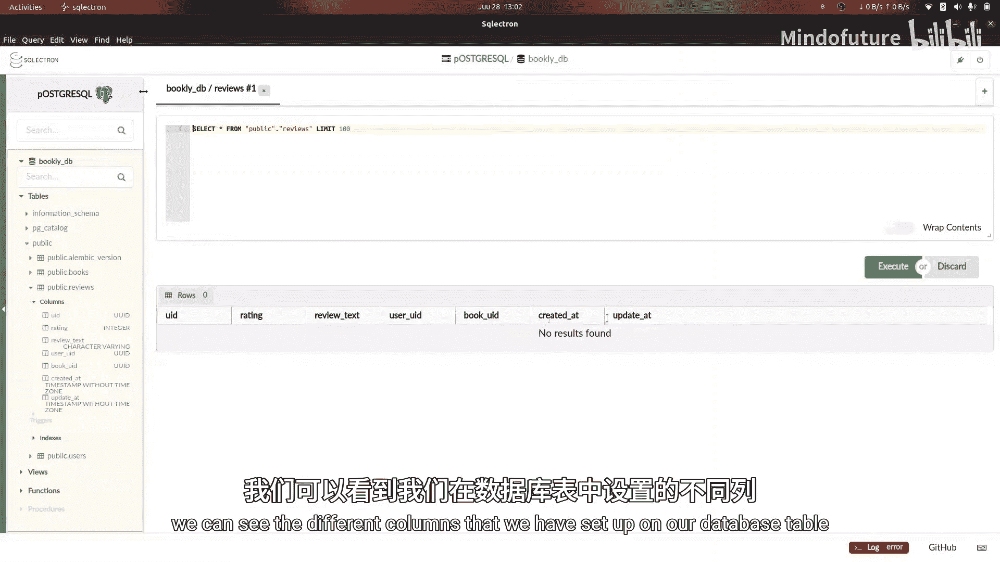

Al right。 now that that is out of our way。 Let us also set up our relationship attributes。

 just like we did for our users and our books。 So to begin， we are going to， first of all。

 set up the user relationship attribute that's going to allow to access the user who created a certain review。

 So to begin， we're going to modify this by saying that this will be a user object。

 it's going to be an optional user object。 So in case when does's not exist that will not be returned。

 And the relationship will but populate to。 So in this case。

 we have to modify this to make it reviews instead of books。And once that is done。

 then we are going to do the same thing on our user side by introducing the reviews list that is going to be the reviews that a user has made。

 so when you go back to our user model right here we're going to do something that is very similar to what we have on our books list so I' going to go right here and copy this relationship attributes and past it just below the books relationship attribute but I'm going to rename this to reviews instead of books and once that is done the next thing is to also specify that this will be a list of reviews so I'm going to go ahead and remove the book model and replace it with our review model so。

Keep in mind that we set this up。 The buffer plates in this case is going to be our user。

 So that will be just exactly how we set it up。 The user will be what this。

Relationship attribute to badp， too。Once that is done。

 then let us go ahead and look at how we can set up the relationship attribute for accessing the book that that review was left。

 so I'll just come right here and say book and this book is going to be an optional。뭐。Object。

So once we have that， we can now come and basically do the same thing like we did here。

 I will just come right here and say the our relationship is going to be。Pointing to reviews。

 and this reviews is going to be found on our book model。

 So I mean to copy something very similar to what we have here。 And in on our book model。

 I'll add that relationship attribute that is simply going to allow us to access the reviews that were left on a book。

 So in this case， we're going to come and specify that this is going to be a list of reviews。

 And this relationship will be but populating to the book。So this mapping will be onto our book。

 just like we set up this book relationship to map through our reviews on our。

Book table book relationship。 So once we done this now。

 it's time we created the API endpoint for basically adding a review to our books to do that。

 Im mean to go within our reviews folder or our package。 So we don't have one yet。

 but I'm mean to create one by saying new folder。 So we shall call this our reviews folder。

In that folder， we are going to go ahead and。Basically add add d we need to do P away to make it as a package and once we add done with that we shall create both our models。

 actually not our models， but we shall create a service class that's going to allow to basically create code that is going to be for the card or for any functionality in our endpoints for reviews。

 So instead that I'm also going to create the routes to P away and this is going to be where our code for。

对。The EPA endpoints or the EPA path is going to be found。

 The first thing we're going introduce is to create the review router。

 So we're going to create an object of the EPA class or the EPA router class and to do that we shall first import it with from first EPA。

 we shall import our EPA router Once we've imported our EPA router。

 then we're going to create the review router。So this review router is going to have all routes that are basically related to reviews and all that stuff。

 so。So just create that right here。So we need to also go ahead and register this within our applications I'll close some of the files that we have right here。

And once that is done， we shall move to our input P A in the source folder shall input that router by saying from。

So this is going to be from source do in this case， we shall have our reviews。Your trouts。

We are going to go ahead and import our review route。And once that is done。

 then we are simply going to create and include that router shall just come down here and see up。

 dot include router。So we're going to pretty much have almost everything that we have here except that shall rename it to our review router。

So we're going to name this our review route。嗯。And once you had done me that。

 you shall have our prefix being EPA version and in slash reviews。

And then our tag is going to be the reviews tag， which shall look at this when you're looking at our EPA documentation with Swwaggga and red dooc in the later video。

So once that is done now， let's go ahead and rate the code for creating a new review。

 So to create a new review， we shall go within our service do PI class。

 The first thing we shall do is to import our database model for our review。

 So we shall do that by saying from source to DB do models。We shall import the review model。

And once we've imported that， remember that all the functions or all methods for carrying out credit on both our users and our books is going to be found within the their respective service classes。

 So're also going to go ahead and import those。 So shall save from source dot o dot service。

 we shall import。The user service。And once that is imported。

 you shall also import the book service with source dobooks dot service。

We arrange to import our book service。So this is going to be our book service。

And once that has been done， now， the next thing is going to be for us to create the service class for our review to do that。

 we shall say the art class is going to be called the review。Service。

And this review service is going to have our first method being that to basically create a new review。

 so shallll just simply call this add new review。Or attribute to book， something like that。

So this is going to take in the details of the user who has made the review。

 the details about the book that we are reviewing as well as the session that' is going to be used to make that specific query or make those queries to the database so to begin we're going to provide our user UID。

Which will be a string。Or let actually use the user email。

 since we have the method for getting them by email。 Then another thing we can do is to。

Go ahead and providede the book you I D as that is the idea of the book you are going to try to。

Basically make a review of so in this case， which shall have our book Q ID and then which shall also have our session。

 so the session。It's going to be。An assign think session object。

 So you have to import the assign session class。 So Ill save from。This skill model。

Dot E X T dot I think I O shall import the I think session class。

 So this is actually supposed to be found within the dot session module。

 shallll go ahead and say import our has think session。 once we've imported I think session Now。

 one thing that we also need is going to be the data that will be used to create that specific review or the review text and the review ratings。

 So let's just add that rate before the session。 So to do that。

 I'll just simply ca here and say that our review。Data。It's going to be of tape。

 So we need to basically set up this schema that' is going to allow to。

Describe the data that will be for creating a review。 Now， shall'll just simply call this the review。

Create model。So we need to also go ahead and create this。 So it doesn't really exist。

 So we need to go ahead and set it up。 Now， just come here and pass。 Now。

 one thing you may for we may realize is I forgot to name this as think de。

 And that is a mistake that I do a lot。 So I'm just simply going to come here and say pass。 And then。

I'll format it a little bit to look moregan， but we need to create this schema。

 So I'll just come right here， copy this name and into something like from。So do skichems。

We shall import our review create model。 So I'm going to go to our reviews and then I create it。

 create a new file， which is going to be our schemeche as dot P。

 and this schemeche as the P is going to have that class that's going to be responsible for creating our reviews。

 So just come right here and say from pedantic。We shall import our base model class。

And once we've imported it， we are now going to have a class that's going to be our review create model but we're going to pass this for now。

Before we create a review， create model， we are also going to have our review model。 Now。

 this is going to be the model。For basically you。Helping us to get。

Or retrieve wherever we shall be in position to retrieve and serial A a review object。

 So this is what we shall be may maybe be use。 So we're going to go ahead and get the model for。

Our review and then copy the fields that we have right here。

 So I'm just in between to go ahead and get these fields。

And add them so that they can be part of the sche and。

 So instead of having these other field details， I'm going to go ahead and remove them。

And that is going to be just enough to set up our review model。 So once this is done， now。

 let me go ahead and set up the two fields that we shall need to create a review。

 Those fields are going to be our rating， as well as our review text。

 So I'm just going to copy them and then paste them inside our class。So， this is going to be。

What we shall have in here， sorry for that。Once we add done that now let's go ahead and import that from here。

 So this is going to be our review create model and this is going to be from thetche as since we are in the same file。

So shall say from the sches， we are going to import our review create model。

Once that is done now let's go ahead and rate the logic for helping us to add a review to the book Now it has been my mistake to go ahead and rate this service class without using tri cache statements and that is that has been problematic as you've been seeing so I'm mean to just begin by using a trica so I'll say try and then I'll accept whatever exception you shall be getting so I'll just rate an exception right here and。

I'll accept every error we are getting for these service classes and then I'll just raise an HTTP exception。

I'll just go ahead and input that class from fast EPA。 So I'll say from fast EPA load exceptions。

In this case， we shall import the HtTP exception class and once that has been imported。

 then we are going to go ahead and raise the HttP exception。

And that would be a serverai so assist status as code status as code for as would be as status as to H T T P500。

 So I have to also grade and import that。In fast EPA。Inport status。Alright。

 so let's go ahead and set that status up。 So our status is going to be H T TP。500 Sa our error。

 and then our detail shall set a detail to just let the user know that something has been wrong。

 So shall say something like oops， something went wrong。And that is going to be what you shall have。

 So what you're going to try to do is to basically go ahead and add a review to a book。

 So to beginner you shall， first of all， get that book for which user wants to make a review。

 So to do that we shall create a very book called book。

 And then since you have our user service and our book service we shall make your use of those two allow us to get the objects that you want to go ahead and add views for。

 So I'm going to come right here and create a book service object by saying book service and our book service is going to be our book service。

 So just going to come and say book service。 And then this will be the same thing for our users or we shall say user service。

Is going to be equal to our user service。And once that is done， let's go ahead and try to use a。

Book service to get the book。 So shall say， await， we created a book service object。

Then in this case， we shall call the getbook method。

 So the getbook method is the one that's going to allow to get the book。

 We shall specify that our book U I D。 So in this case， we shall use the book U I D。

And that book U I D is going to be the book U I D we provided within our。

Fch and Ruina made a great cheer。Then we shall also need this session。 So our session object is well。

Is the one that you're going to use for these kids。Once that is done。

 now let us also get the user who is currently making that request， so to get the user。

 we shall just come right here and say that our user is going to be equal to our weight。

gives a service。Dot get user by email， shall provide the email。As the user email。And then， so。Also。

 try to get the so our session。It's going to be equal to the session。Alright， so we've got it。

 We've got both our user and our。Book， now， let's go ahead and create the new review that you want to go ahead and associate with these two objects to create the new book。

 We shall just come here and say new book， actually， new review。 This is going to be a new review。

 So a new review is going to be an instance of the review class。

 And once we've created that instance， then we're going to go ahead and unpack the data that we shall get from our review data。

So to do that， shall'll just come right here and see。A testta。

 So that is basically saying un park has a dictionary or unpack the dictionary as。

A list of caseses and values。 So in our case， we shall say that this is going to be our review data。

 Now， remember this review data is going to be。This will be that is going to be informed of an object。

 so to unpack it as a dictionary， we shall call a mod damp。This is going to be the model damp method。

And this will go ahead or to make it simpler。 we can just come right here and create a new variable。

 So this variable can be something like review。Data， and then dictionary。

And this will be the value of that。 Then you can unpack the review data dictionary。

So once that is done， now let's go ahead and basically make sure that this review has both a user and a book associated with it。

 so to make sure that a user submitting a book， we shall just simply update the new review object by saying new review dot user。

And for our case， this is going to be our user。These are that we've created right here。

So once we've been able to do that， they lets do the same thing for our book。

 So we're going to associate this review to the book。 which shall'll just come and say new book。Dot。

 and in this case， we can。Simply go ahead and say new book dot book or new review dot book。

 I don't know。 I am so called appearing book。 So this will be new review dot book。

 and we shall associate it to the current book。 once that is then。

 let's use our session to commit this to a database。 we shall say session dot add。

 and then we shall add our new review instance。 And once we've been able to do that， we shall await。

Our new B our session do so shall call session dot commit。 but this。 And therefore。

 we have to call it with weight。 So I say our weight session dot commit and。

For our case we shall just simply return the new review。

 So we shall just come right here and say return new review。 And just like that， we've been able to。

Create the method that's going to be responsible for allowing us to add a new review to a book。

 We need to go ahead and create the route or the EPA path for adding a review to a book。

 That's what we have not yet then。 So I'm need to go to route not P A inside our reviews folder。

 And the first thing I'll do is to make use of this。Review out our object。 Soll say at。Review。

 so this is going to be an our review router。In this case。

 we shall say that this is going to be a post method。 Then we shall be adding a review to a book。

 So this is going to be on review slash book slash， and we shall add the book U I D。

 so I'll provide it here。Once I've been able to providevade it。

 I'll simply go ahead and define the old hand for it。 So I'll say， I think depth。

 and this will be add review。这 book。Now， let me close what we have here。

So once I've been able to add a review to a book or define the function as add reviews to a book。

 I'll simply go ahead and provide the different things that you shall need and for our case it's going to be that bulk Q I。

So the book U I D in our case is going to be a string。 and then which I also provide the user。

 U ID or the user who is actually adding this review。 Now to prevent doing this。

 we can actually access this user using the get current user dependency that we define in the previous videos。

 So I can just come right here and say current user。Is going to be a dependency。

 but this is going to be of our user type of our user class。

 So I can go ahead and import this by saying from。Sos dots deep be dot murders。We can help our user。

And once we've imported our user， then it's simply going to come right here and see import our user。

Once we've been able to create or once we've been able to do that。Once you have been able to do that。

 then the next thing we're going to providevade is going to be the data that will be used to add this review。

 so shallll just come right here and see that shall have our review data and RV data is going to be of tape。

 review create model that you created do D as schema。File， so we're going to say from。Do ski as。

We shall import the review create model。 And once we've imported that。

 we're going to provide the trade here。 then we shall also need our session object。 Now， remember。

 the session object was created inside it source D B dot。

 So we have to also go ahead and import that。 So we shall say from source DB dot main。

That's why I' going to import this session， which is called gate session。

Just to help us be able to access the session object。

 So our session object is going to be of type as think session。

 And if we need it to shall just come and see it from。Sq model dot。

E X T dot a session or a think Ao dot session。We shall import the a sync session class。

 Once we reported it， we shall pervade the tape。 which is going to be a sync session。

 And then here we shall inject our dependency。 So to inject our dependency。

 we' are going to need to have access to that depends function。

 So this depends function is going to be。The one that's going to help us get the dependency or get a session so shall say get session。

 Once we've been able to do this now， we're going to comeate in here。

 and the first thing we're going to do to create the new review， so shall say new review。

It's going to be equal to。 So for our case， we need to import the review service。

 So shall say from dot service。 we shall go ahead and import our review service。

And once we put the review service， we shall create the object by calling it our review service。

Once we've been able to do that， then we' going to make use of that object by saying review service。

And in this case we shall say review service dot add new review to book and for our case we shall need all these things。

 so remember that this is anawable， therefore you have to go ahead and use a weight to call it。

Once that is done， we shall provideva our user email so shall see our user email。

Thiss going to be called to the current Tuesday email mail。 Now， remember。

 this is going to be a type of。Of object I shall get from the dependency， which we forgot to do。

 So we have to also go ahead and import that。 So that dependency exists within source dot o dot dependencies。

 And that's where I shall get the get current user dependency。 So once we've got that。

 then we simply going to go ahead and injected by saying equals。 And this will be depends。

 And then we shall provide our get current user。 Now， notice that we have an error here。

 And that is because。This non default adjut follows that default adjut。

 So you have to go ahead and fix it。Just go ahead and make it。

Exist just before the ones that have current values。Alright， so once we've been able to do that。

 let's go ahead and get the current user email。 So we shall say this is going to be current user dot email。

 and then we shall go ahead and provide the review data。

 So our review data is going to be equal to the review data。 and then we shall also get the。

Book U I D， so our book U I D or the I D of the book1 to add the review to is simply going to also be the book U I D。

 Then in here， we're also going to perde the session object。

 and this session object is going to be the session object of our current path handler。

So once that is done， now we shall just go ahead and simply return our new reviews or shall say return new review。

One other thing that we can do is to go ahead and simply。Check within our service。 So basically。

 what we have here is a call to the getbook function。 So just in case this book does not exist。

 we need to be in position to。Btain then， or check if the book is not existing within our database。

 So to do that， what you can say inside our service here is to basically go ahead and create the book if the book actually exists。

 so。What you're going to do is to just simply go ahead and make that check inside it here。

 So new book， new new review book is going to be go to book。

 But this has to only happen when the book is not9。Once these checks pass。

 IA is going to be not none and also our book will not be none and therefore we shall just go ahead and assignsend them to the review objects and go ahead and save。

 So that's just something that I remember to do。Once we've been able to do that。 now。

 let's go ahead and test this out in rest folks。 So Ra and Refor。

 what I'm going to do do first of all， create a new folder。 and inside this folder。

 I'm going to name it to reviews。 And this is where all the request for our reviews are going to be。

 I've actually created the new request。 So fixed that I'll go ahead and create a folder。

 which I'll call reviews。

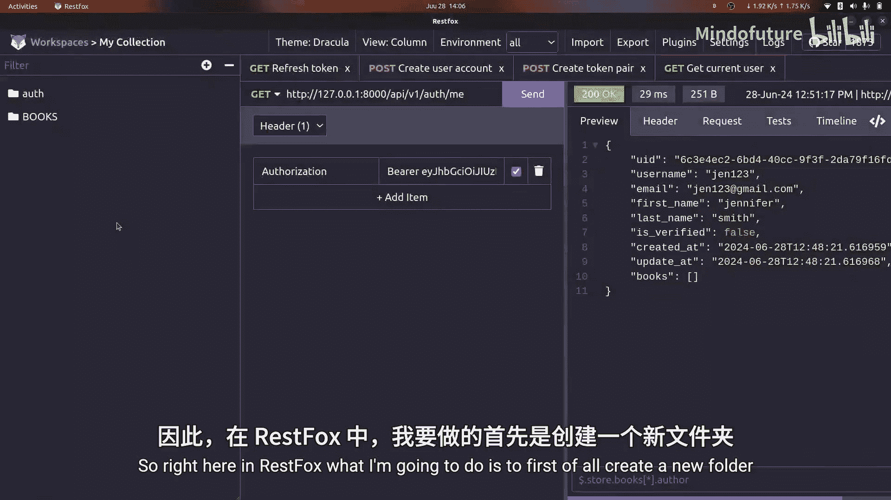

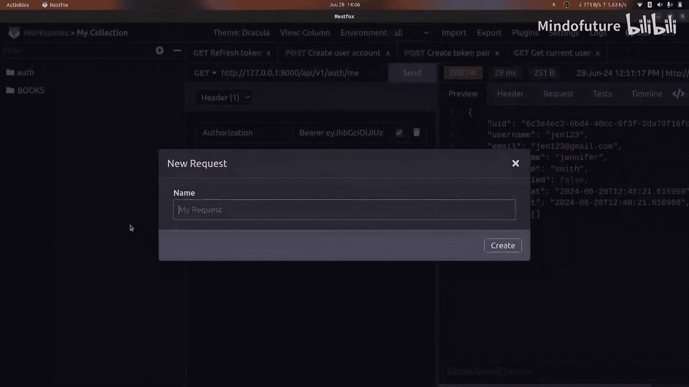

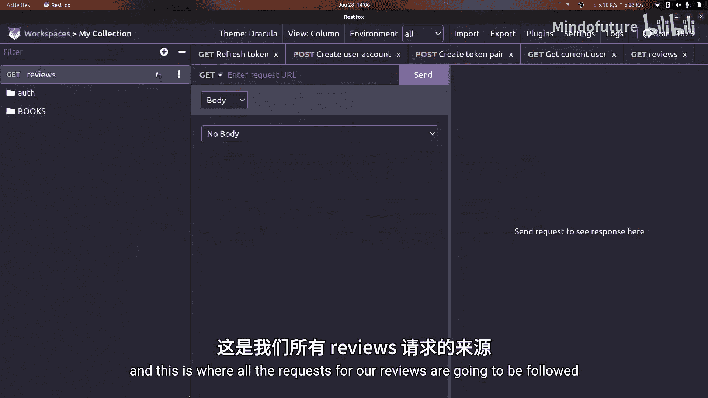

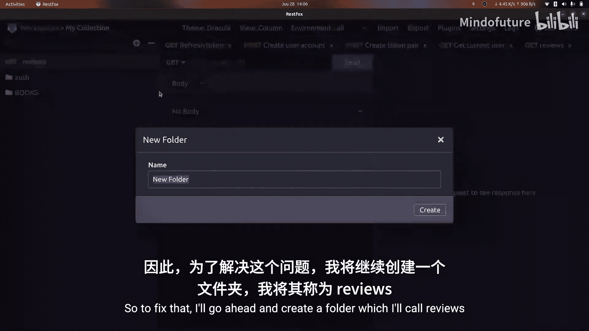

And in the A is where all these reviews are going to be found or all API endpoints for reviews are going to be found now it has begin my testing that API endpoint for creating a new review or adding a review to a book so I'm going to go ahead and simply。

Get one of these or get the root end point。And then that's what I'm going to be using。

 so I'm going to close some of the stuff I have here。And then I'll come right in here。

 So I mean to provide the URL。 so this is going to be slash reviews。

And then our path is going to big one for slash books slash U D so。I've just come right here。

And I pervade this path， which is going to be one for， basically pervading our book QA。So I mean。

 to get the book Q A D from where we list all our books。

 So just going to come right here and try to get a new book。

 So it seem like I have a problem on NA Sava。So we now see that we have a fasttive P area。

In valid act for response， field， check that the class reviews or sche out the crit motor is a valid pedantic field tape for using a return tape annotation。

 This is， so it seems like we made a mistake when defininging the endpoint。

 So let's see what we have here。So this error arose from ourche as dot P simply because we forgot to actually go ahead and mark this as a paradigmantic best model。

 Now， forgive me for this one， I'm to this to go ahead and fix this by saying that this is going to inherit from our best model class。

 And I think if we do that， then we'll have solved that issue。

 So if we go back to restfor we see that our token is invalid。

 therefore we need to get a new token I'll go to o and then I'll go to ourll get it token pair try to log in with a currently logged in user and I'll get it token。

Now when I get this token， I'm simply going to go to where I'm making this review or where I'm getting all books。

 And then I have to provide that specific book or that specific token that is created from our。

Lo again。 Now this is going to return an empty list of books。 So let me try to create a new book。

 So when I create a book seems we are having the same issue。So， I'll go ahead and。

Simply provide a new token。And then we have， we have a book right here。 So if I get this book a。

And then if I get this book's I D and let's say try to add a review to this book。

 So just going to go ahead and remove some of the things we have here。

 So here we are going to provide the book your I D， and this is not found。Oh， this APA。

 this is supposed to be on slash APA slash version 1 and then slash reviews。So in ascent。

 we are not authenticated。 therefore have to pervade our authorization header。

Come back right here and copy this newly created to。

I perva it rate instead while we are creating a review for your book。

And then we see that our body is missing。 So let's go ahead and providede it。I'll say bodydy。

 this is going to be adjacent。And for， all we need to do is to pervade the rating。

 So let's say the rating is going to be3 out of five。

And then we are also going to have the review text， the review text。

 let's say the user is going to parade the review text and this review text is going to be something like a nice one or。

Just comment。 we see that we have in this internal server error。

So I mean to go back this aid and see where that is coming from， so。

This got multiple values for user email。 Let's see where that is coming from。

 If we go back to our routes， we see that we have user email， which is this and。

So let me try to see where this is， so if we go back to our class rate here。

 we actually forget to pervade self so if we go ahead and pervade self。And safe。

If we try to go ahead and make this request once again。Then we see that something has gone wrong。

 so that something has gone wrong where we are adding our books。

 So let's see what exactly is taking place。So basically。

 what we are having here is internal server error。 And one thing we can do to。

Try to no know what exact error happen is by using the logging module。

 So I can just come right here and say import logging。And once I'm done that。

 I can log the exception by using logging。Dot exception。

 And this is just one way you can basically get to log an exception and also understand weight originate it from。

 So if you go back right and make the request， shall see that something is wrong。

 But when you go to our terminal， we shall see。What exactly went wrong。

 So what went wrong is data error。 And here we have invalid input for query adjut 1， which is that。

 So this is an invalid E U I D。 Therefore， we have to go ahead and provide a real E U I D。

 So what I'm going to do is to go backward。 I got our books and。

I will try to see if I've copied the entire U UA DHAD， didn't。

If I copy this and try to add the review to the book。

So let me make this a little bit smaller so that you guys can see。

So go ahead and provide this UA DH here。And sent， we now see that our view has been created successfully。

 Now， let's go ahead and also make sure that each book is returned with its reviews。

 So that we're going to do that is to modify the book schema so getting head over to the schemas of books。

And within our book scheme as， we are going to make sure that each book is returned with all the reviews that are or each book detail is returned with all the reviews that it contains。

 So we have this model or this。Class that we created for retaining information about a book。

 but what if you wanted to return the detail of a book So what I'm interested do you create another class similar to what we did for the user。

Class or user schema。 So for our case， we shall have this being the book。Detail。

 let's just say if it's going to be a book detail model。

 and this book detail model will have something I let's say。

It's going to be a base class of our book class。And then it will have a list of reviews that a book has。

 so for our case this is going to be a list or shall import the typing class。

 so the typing class is going to be the list class so shall say fromtyping import list and once we've been able to do that we're going to say that this is going to be a list of our book of our reviews so you have to go ahead and also import our reviews so I'm going to come and say from source do reviews。

But。Scheme as we are going to go ahead and import our review。 So we have the review model。

 We also have the review， create model。 Go go ahead and look at this。

 This is going to just simply return information about the review， so。

We're going to come and provide that。 So we have this。

 and this is going to be a list of our review model。

So let us try to get the book or the detail of the book。 So for us to see this reflect。

 we have to modify。We have to modify the detail for the route that is responsible for retain a book。

 So when you go within our books。Right here， we want to get that that returnss the book I D or the book with a certain new I D。

So we can just simply fix the response model to be that one that returns the book detail instead of returning just the book。

 So to do that shall'll just come right here and say。From So bookstore schemeche as。

Both from dot schemas， because we are in the same package。

 we can go ahead and also import the book detail schema or the book detail model。

 And once that is done， then I'll just come right here and specify that our response model is going to be our book detail model。

So once that is done， I'm now going to go ahead and try to get the detail of the book so that we see our reviews so。

When you go back to our books， we're going to try to get the book with this EUAD。

 the one that we providedvaded right here。If you go to getbook by I D。

 so this book does not exist because I deleted most of the books that we had in our database。

 Now I'm going to get this token。The one that I have right here。

And provide it where we get the book by U A D。And once that is done。

 I'm going to try to get that book， which is not found now。Since that book is not found。

 we are now going to pervade a book that exists within our database。 So to get our book。

 which is the book with this I D that we have read here。

This time we expect that's going to return all the reviews that are going to be present on that book as well as the book I and the book UI。

 so I hope this makes sense we can also do the same thing for our users。

 so within our users we can simply go to our users。So for our case， we can go back to our userche as。

So let's go ahead and try to do it， so I'll say reviews and now which shall have the list of reviews。

 so I'll try to do this。So I'm going to do this back。 first of all， importing that。

The schemeche as for。For our reviews。So I'm going to do that by going through the top here。

 and I'm going to say from。Source that。This is going to be our reviews node skiche mass。

We having to go ahead and import the books， the review scheme。Or what we call the review model。

 So right here， we shall just simply come and say。Review model。 So this will be our list of reviews。

 if we try to get the currently logged in user， our copy our talking right here。

We shall now notice that。This is going to return details for。They currently logged in user。

 So we shall have both their books as well as their reviews。 So this is like the detail of the user。

 that's going to return all the information about how many reviews they have done on books。

 as well as。How many books they have submitted。What's up everyone。

 Wee back to the series In this video we're going to be continuing from where stopped ADA to save time by implementing some features of the application of the recording。

 so what happened was I happened to add more features to the application but these features would make the playlist longer and they had more credit than other features and therefore I to skip those but I'll include them in the source code as well as on our course website which I will update later。

So what we have some。New API endpoints and those are for R tags as well as r just like you see right here。

 So what we did was to add some credit for the tags so each book is going to be identified by some tags and this tags can be shared across other books。

 so。That's a manage relationship between our books as well as our attacks。

 we also included reviews routes in the previous video ended from where we added the review to a book。

 So for now we're going to resume from where we stopped but in this video we're going to be looking at error handling and how we can customize errors on Al stepPA application。

So to begin， I'm going to go to our code right here。

And we're going to be checking out some of the changes that have been introduced。

 so I'll go to our routes for tags。 and this is basically what we have。

 They are just end pointss to handle the cr that's associated with tags。

 So that includes adding tags to a book， deleting a tag， editing a tag and so on。

 We also created this service class for those tags。 So that's where the whole cr action happens。

And then we also went ahead and updated Askches for books so that a book can be returned with both its reviews and its list of tags。

 So if you go ahead and make that request。In here， if I go to our books and try to get a book by its8。

 we can now see that each book is being returned with the reviews on that book。

 as well as the tag so the book can have the python tag as well as the APA tag。

 but there can exist at our books that can also have that specific tag。

 So I thought I could just skip including that in the series to make the playlist shorter。

 but in more detailed explanation is going to be found on the course website。

 So now that you've been able to look at that， let us look at error handling。

 So for now we have a simple application and all it does is to make use of that default error handling that fast APA does。

 So for example， if we try to get a route that does not exist in any of our paths。We shall get it。

 simple， not found。So these errors can be just enough for any client to consume。

 but there may be scenarios in which we may want to go ahead and provide more detail about what caused the error and what a user needs to do and that's where custom error handling comes in So fast APA has a very nice way of helping us to handle errors that exist within our application。

 but it also providesdes us the ability to go ahead and customize our error handling just like we're going to see in this video。

 so if we to look into our dependencies for the authentication we realize that we are raising our exceptions using the default HtTP exception class。

 this can be enough for us to throw our exceptions。

 but there may be scenarios in which let's say we want our codeb to be maintainable and。

Let's say want to be specific about which error occurs and when it occurs。

 So this can be very important for people who are going to maintain our code base in the future。

 as they will know the different types of errors， what they stand for and。

What actions can be taken So for example， in case we have an error such as the one show that a token is invalid。

 we can create an exceptional class for that error so that users can be able to know the exact error that happened but also the backend user or the backend programme grammar we'll know when to raise a specific error and at which time to raise that specific error So let us get started implementing that。

 So to start we're going to go within our source folder and shall create a new folder actually it's going to be a new module or file So this is going to be called errors dot P。

So inside that era P， we are going to create our exception classes and these exception classes are going to be raised in case a specific error that arises from our app is raised。

 so there may be those errors that are going to be general such as the notfo error let weve looked at and the internal server error that wecur every time we get an error。

收。There may also be those errors that are going to arrange due to user actions。

 things like let's say someone trying to access an endpoint for which they do not have a permission。

 We can have a specific error for that。 And that's what we're going to be doing。So to start。

 I'm going to go ahead and first of all， create our class。

 So this is going to be our base class for all our exceptions that are going to array within our app。

 so these are。Ereas or exceptions that are specific to our application。

 So you' going to call this the book clip。Error。With a bookly exception。

Let me just name this the bookly exception。And once I've been able to do that。

 then I'm going to make this to be a subclass of our default exception class that Python pervades。

 So all errors or all custom errors that are going to define are going to be made from this default。

Exception class， which is our Bccley class。 so you can also add a new do string right here。

And this do string And we want to explain that this is the best class for all exceptions specific to our app。

 So we can just come right here and say this is the。Default， or let's say this is the best class。我我。

Bookley exceptions。我 bookly errors。And once you are done doing that。

 then you can quiet ahead and notice the different。

Pas where we need to define an error and what that error can be or how it can be raised。 So。

 for example， if we enter back to our dependence is right here。

 and can notice that we have that error that we are throwing。

 in case I'm tries to access an endpoint with an invalid value token one that has errors or one that is expd。

 So what you can do is to go ahead and define that as an exception of its own。

 So I can come right here。 And what I'll do to just copy what we have。 So in this case。

 this is going to be。Invald token， so we can name this error invalid token。

And what this is going to be is going to be a subclass of our bookley error。

 so I'll go ahead and fix this。And here， I shall have book。Exception。So this is going to be an error。

 but we need to change how we are defininging it here。 So instead of。

Rshowing this as the documentation for this class， we can just say that user。Has pervaded。

And invalid。O exp totaling。And once that is done， we are this is just enough for us to have that error。

 So what we can do and we need to raise that error is to just come and import it。

 so we can just come right here and say from source dot errors。

 we can go ahead and import the So far case we're going to have a bunch of errors。

 But for make I'm going to import the invalid token error。

 And once we've imported that invalid token error instead of raising this entire httP exception。

 we can go ahead and simply raise that invalid token so we can just come right here and say raise invalid token。

 And just like you see right here， it's going to be showing the programme hold maintaining our code。

 Now this is the exception that we're going to raise in case someone has provided a token that has been expired or is invalid。

 So that's just enough for us to do that。 Now we also have the one for revoked token。

 we can just simply go ahead and do that。 I' just copy and test and then edit。

And I'm going to speed quote through this so that we can save time during the video。

 But you're going to see how these are all going to come up。

So now that you've been able to define our exceptions。

 let us go ahead and replace the different H TP exceptions we raise with our custom exception classes。

 So when you go back to our dependencies， I'm going to go ahead and update our code so that it makes use of those classes we've created。

 so're going to begin by importing all of them， I'll begin with importing the refresh tool and required。

And therefore， we have imported them。 So to begin， we shall set with where we have our invalid token error。

 so shall just come right here and say that we are going to raise invalid token。

 and this will show that the user has provided an invalid or expired token。

 then we're going to do the same thing for where we want to provide an access token。

 so we shall just come right here and say raise and in this case。

 we shall raise access token required。 So this shall show that the user has provided the refresh token when an access token is needed。

 and then for the case of the refresh token here， we shall say。raise refresh talkinging required。

 and that will be the exception。 Now， the last exception that we are remaining with is one for raising an error in case someone tries to access an endpoint with the wrong rule or with the rule that does not that is not allowed to perform that action。

 So in this case， we can raise the error， just going to be our insufficient permission。

 So just like you can see， user does not have the necessary permissions to perform an action。

 And that is just how we're going to be playing around with those with those custom exceptions。

 So we're going to do the same thing for the rest of the error。 So just in case we go。

 let's say to our service classes。We can now be in position to go ahead and replace some of those exceptions so if I go to our hot throats。

I can simply go ahead and raise an error for this。 So in case we have that， we can just say。From。

 so we already have us from us source errorss。And then you shall get the so in this case you can use the user already exists a user not found and then you can also get insufficient or actually that's going to be invalid credentials I don't think I created the exception for that but when you go back here we can still be able to create it so。

I can camera right here。 user already exists that exists。

 so I can simply copy this and create the exception for the invalid credentials。 So in here， we can。

Simply create a class。 so this can be invalid。Crureentials。

And this can be user providing an email and an email。Or password during sign up that is invalid。

 So here we can see。In valid credentials were。 so here we can say is that has provided wrong email mail。

嗯。O password。During login。 so that's what we can go ahead and show it。

 but you can feel free to write whatever you want。 So for A。

 we can just raise invalid credentials when I go back here。

 I can still go ahead and import invalid credentials and that will basically cover that So if we go back right here we can just come and say a user already exists which we already created so we can just come and raise that exception by saying if user exists then we shall raise a user already exists the exception for showing that user with that email already exists then you can do the same thing for logging in in case someone providess invalid credentials。

 we can just raise the invalid credentials error so we can just come right here and raise invalid credentials。

And that to be the one that will be raised。So we have other areas in Valley doing expand token。

 I think we created a class for that and our class is going to be the one for inval token。

So if you want to go ahead and customize that， or we can just come right here and instead of raising this。

 we can simply go ahead and say raise invalid talkingken。Then I think that's that will be it for now。

 maybe for other places where we have book not found， I think that's going to be nice service。Books。

 plus。And。Well we have that， we can simply go ahead and I don't think we have an exception being raised in our book service。

 but I think that exists within our book routes。 So in go within our book routes。

 we have pathway we are always raising those exceptions。 for example， book not found。

 So we created an exception for that， if I go back to so errors and just say from so errors we can go ahead and import the book not found exception and then we can simply raise that every time we want to raise the book not found exception。

 So in this case， you can say raise book not found。

And that would be the exception that is being retained。 And even here。

 we can simply raise booknot found。And that would be。Enough for us to raise that exception。

So once you've been able to do that， then you can also do the same thing here。And。

That would be it for。Our book wrotes。So once that is done。I think we are now remaining without tags。

 so these are the routes for tags。In our tags， we have our routes， so within our routes。

 we do not have any place where we are raising exceptions。

 but we can go to our service and I think that's where we went ahead and raise the exceptions。

 for example， where the book does not exist and where the tag does not exist so we can go ahead and simply raise those and basically reduce the amounts we are raising those H TP exceptions。

 So if I come right here I can save from。In this case， we can raise。

 We can just import social errors， and then import。Book not found。 and then tag， not found。

 And when we got， when you get those， we can simply go ahead and raise them。 So， for example。

 here we have。Tgged not being found， so we can just come right here and see。AR tag not found。

And we can simply go at the top right here。 And when you see that the book is not found。

 you can just raise book not found。Yeah。And then we can can actually create the one for the tag already existing。

 So when someone tries to create a tag that is already existing。

 we just throw that error showing them that they cannot create the tag again。So if we go back to our。

There's going to be errors。 We can simply go ahead and。Try to create that。

 so can just come right here and see that this is going to be our class。

And this class is going to be one for our tag exists so I can just come right here and name this tag already exists。

嗯。And then we can just come right here and say， tag ready。Exists。

So let us go ahead and import that within our service so。A can operate here， and then import。

Tag already exists。So once I've import it， I can finally raise it here。By just saying。

 tag already exists。Once that is done， we can now go ahead and look at how we can retain these responses with those exceptions。

 so keep in mind that each time we use the htTP response。

 the HtTP exception class we are basically creating an exception as well as returninging a status or a response for that exception so that allows us to set the status code as well as the detail of that。

 but for us to go ahead and register tab。Our custom exceptions as exceptions that can be used by fastPA。

 we need to go ahead and create what is called an exception handler。

 So an exception handler is going to be a function。

 the fastPA will use to customize the response that is going to be returned each time we get to raise an exception。

 So think about our book exception class rate here， this is a Python exception not a valid response。

 that fastPA can return。 So if we see where wherever we've raised our exceptions we have gone ahead and raised exceptions and notre。

 So this is supposed to return errors of some sort。

 So for us to handle that we are going to go within our errors。

 I'm going to create a function right in here。And this function is going to be called creates。

Exception handler。You can call it create error a handler or whatever you prefer。

 So this is going to take in the status quo， which is the status quo we。

Expect to return with the response once an exception has been raised。 So for example。

 we can see the as the test code。It's going to be an integer。 Now this can be era 500 or 40，3。

4 bidden or 40，4 not found， whatever that may be。Then we are going to also return a message for that specific response or the detail of that specific exception。

 So the detail， we are simply going to just create an initial detail。

And the initial detail is going to be anything。 It can be a string， it can be a dictionary。

 so I'm just going to use Pythons any type to use that I'm going to go a drop of our right here and I'll save from typing。

 we shall go ahead and import any， but with that we shall also import the quaable because you're going to be returning a function。

 which is the error hand letter that we've created。And once we've been able to do that。

 I'll just go down here。And then I'll say that our initial short detail is going to be any。

 But to expect this function to return a quaable， which is going to be the error handr function。

 So I'm just simply going to come and say this is going to return a quaable。

 Now this co is going to be a function。 And the first thing we need to provide in here is going to be the。

Prameter that this is going to take in。 So the first parameter is going to be the request object。

 So we need to go ahead and import the request tape。 So I'll come right here and say from。

Past APA dot requests。So this is going to be requests。Sll import the requests class。

 and then you shall also import the Json response class。

 which is the response that we're going to return in our exception handler。

 So this is going to be response sales。Once that is done。

 we shall come right here and all we do is to go ahead and specify so。

One thing we're going to have is。The callable that's going to take in the request which is our request object。

 and then this will also take in the exception。 So faster P exception handles are going to take in two permit as the first one being the request and then the second one being the exception。

 But since you've created our exception you can go ahead and basically pervade our exception in here。

So this can be an exception object。And then the return of this， sorry for this mistake。

 so here I expect to to return to basically provide an exception and then return a JSson response。

 so which I would say that it to return a JON response。Now。Once we are done with this。

 we can now go ahead and simply create our error handler。

 so the error handler is going to be a function and this function is going to be one that is going to be retained by this function。

 but that is what we are actually going to add to fastPA to allow us to customize how we are retaining an error。

So to do that， we are going to go ahead and set the era handler app， which is our function。

 So we're going to define that with a sync。 And this is going to be our era handler。

 So we can just call this our exception。Handler or whatever I want to call it。 So this。

 just like I explained， will take in the request screen to be of type request。

 and then it will take in the response。And actually， not the response， but rather the exception。

 So our exception in this case is going to be of type exception。 But remember。

 we have our book exception that we've created right here。

 So that's what we're going to pass in there。Once that is done。

 now I notice that I have a habit of forgetting that this is an think function。

 So I'll say I think de。 And then we shall providevade the exception handler。 Then right up。

 right after doing that， I'll just come right here and return a Json response。

 So this is going to be the message that's going to be returned for。Each。

Response we shall returned for these errors。 Now， in our case， we we are just going to come here。

 and the first thing we have to provide is going to be the content。

 So this content is going to be whatever we shall put in our initial detail。 So if it's a dictionary。

 That's what will be returned。 And then we shall have a status code。

 So ask status code in this case is going to be the status code that we're going to provide in here。

 So I'll come right here and say。The as status test code is going to be our as status test code。 Now。

 remember that this create exception handr class is supposed to create an exception handr given the。

St us quo， as well as the initial detail。 But you're going to see how we shall attach all that to these custom exception classes that we've created。

 So after doing this， we need to go ahead and return the exception handler。

 So shall just come and say， return。And this will return our exception handler。

So once we've been able to input or once we've been able to return our exception handler。

 let us now go ahead and look at how we can attach our exception handler functions to our newly created custom exceptions that we have right here。

 so to do that we are going to go within our d in in folder。

And the first thing we're going to do is to import all the exception classes。

 as well as the create exception handler function that we've created。

 So I'm going to do that by saying from source or from dot era， since we are in the same folder。

We can go。 I ahead and import。Our， so in this case， I'll just choose these brackets and enough。

So we shall also go ahead and import a user not found rock stock。And so on， and so forth。

So once we've been able to import these errors we are now going to go ahead and attach them to our application using our app instance that we've created right here。

 So using this faster P app instance， we are going to go ahead and access a method that's going to register each of the custom era handler classes that we've created onto。

An exception handler， just like we've created this function right here。So to do that。

 we are simply going to go ahead and basically create。

Al fast or attach Al fast custom error exception class to our fast A app。 So to do that。

 shall say add up or app dot add。And in this case， we shall call our add exception handler method。

 So this is going to take in that exception class or the set escort to the exception that you want to handle。

 For our case， we shall just come right here and say the our first one is going to be user not found。

 or let's say user already exists then。We need to go ahead and pervade the handler or the function that's going to handle that specific exception。

 So for our case， we have this creates。Exceptiontion handler function that is going to take in the status quo and the detail of whatever happened that won't return within our response。

 So to do that， I'm just simply going to Cam here and say that as status quo is going to be。

 So for this case， we can raise maybe a 40，3 forbidden error。

 So we're going to be making use fast P status module。 I'll import that。

 And once I've imported that our Cam here and say we' are going to make use of status dot Http 4，0。

3 forbidden。 And then we have to providevade that details add detail。F kiss can be something like。

 let's say。Our initial detail is going to be a dictionary。

 and this dictionary is going to have the information for the message that we want to return to the user。

 So for our case our message is going to be user。With email。Ready exists。嗯。

Then you can go ahead and also。Pvade an error code。

 So these error codes can be used to further describe these errors。

 Let's say our API has a documentation page on a sat website。

 We can go ahead and add these error codes that are going to be just descriptions to just show the client what exactly happened。

 So in case for developers are working with our API using our error codes。

 they can be sure of what happened。 So for our case。

 we can just provide this as Ss character or S strings。 So we can just say something user。Exists。

 and then they will be able to know that they are trained to create a user with an email that is already existing our application。

 So this is just also important。 So once we've done this。

 I'm going to go ahead and speed code this for the rest of the。

The rest of the error classes were the error exception classes that we created。

 So I'm mean to begin with the ones that are not existence。

 so I'm mean to go ahead and copy paste this。And just like that。

 we've been able to set up custom error hands for our cast on exception classes that we have done。

 So to test this， we are going to go ahead and try to access different end pointss throwing different exceptions and we shall see how those are going to work。

So hoping the as survey is running with which it is。 we are now going to go to our for straight here。

 So if we try to make。A request for a book。 So in8 I will train to get a book by its A D we send this reno that our custom message is being returned。

 the one for the token being invalid。 So let's try to pervade one for let's say the book not being found。

 If I try to get a new pair。Of tokens。 I'll try to pervade。 Let's say。

 the refresh token instead of the access token。As far case if I try to make that request without that。

With a refresh token instead of an access token， we shall now see the attack custom error is being returneded。

 the one providingva a valid access toolken， so I'll provide a new access token。And in this case。

 if we try to go and get the book pay its a D。We shall now see that we cant be able to return the book。

 but let's say we are to return the book and the book does not exist。

 what I'll do is to just go ahead and update this UI to something like this。

Sll now see that our book is not found and our custom message is the one that's being returned。

 So if we try to， let's say。Through some exceptions， for example。

 try to try to throw an error inside it here。 let's try to throw an error inside it anywhere in here so。

If we go back to our code， we can throw any exception to just make sure that we get an error and then we see what we can do about that。

 So for example， I can go to our route that retrieves a book by its A。Which is this。

 So I can go ahead and maybe say print。Let's say n divided by 0。

So if we try to make this request again， we shall see that we have that internal of Sava error。

 which is a very weird one， and it's being written in a way that you don't want。

 So one of the ways you can fix this is by basically setting up an error handler for it。

 So if you go back to our source in its dot P A。We can create an error handler for the 50 internal server era so that we return errors in the way we went so。

To do that， we can just go ahead and now we can create a function or an error handler for that。

 which is not going to be in the format we've done right here。

 So fast APIpi also allows you to create a decorator from the app instance that is going to mark a function as an error handler or an exception handler。

 and in here what you need to do is to provide the status quo so I'll go ahead and provide the status code or you can even go ahead and pervade error classes such as the ones that we've been able to create right here。

So we can go ahead and say a sink。Death， and then this will take in。ARequest。

And then it will take in an exception。 So for As， we are going to have an exception。

Which is going to be an A X C。So we are supposed to name this。

 so I'll just scroll ahead and call this internal server error。

And this is going to be how we're going to create our error handler。

 So just like we did for the previous example where we created this error handler function。

 we can simply go ahead and return。Our error handler or simply create our error handler to return a Json response。

 So I'll go ahead and import the Json response class。From Trust APA。The response says。

 I'll go ahead and say that we're going to import our Json response。

 Once we've imported Json response， we can now come right here。And also。

 go ahead and fix how we basically wrote this。 So our detail can be something like。

Or our content so we can have a message。And for our case， this message can be。Something as simple as。

O屁。Something went wrong。And then you can also create an error code for that。 so can come here。

In format this a little bit。 So you can come here and per the error code。As saw that era。

And then you can go ahead and document that。 So as status quo in this case。

 is going to be the status。Do in this case， we can come and say sit dot H T TP。

500 internal server error。Which is going to be the one that will be returned。 So in this case。

 if we make that request， we shall see that our response is being written as that。

 so we can go ahead and handle your errors and customize your errors using this technique。

 and you can be able to pretty much customize them to what you may need or what suits you best。

What's up everyone and we'll come back to the series In this video are're going to be looking at Middoware we've so far been able to look at things like the injection。

 error handling and other concepts in fasterPA but I thought before we conclude the series let us look at the concept of Midware So Middoware are basically functions that sit in between our requests and our responses by this I mean functions that we can define to modify how we are going to handle a request before passing it to the rot handler and how we can pass a response。

Or how we can handle a response before actually returning it to the client。 Now。

 I've created a simple diagram right here。 I am not the best at making these diagrams。

 but I think this will kind of give you an idea about how medo work。 So just like you see here。

 Midow sit in between the serverva or the old handling functions。

 And then the client who is going to make a crystal Sava。 So when you have your middo。

 this can be able to。Do a variety of things you can check for authentic indication。

 you can be able to modify head does in your request or your response before actually sending them to wherever they are going to be handled。

 So for example here， when a client makes a request to ask server。

 the middleware will get the request， perform actions on that request and then send the request to the request handler function。

That happens the same way for the response。 When you're making a response from the server。

 you're going to pass it via the Midware that will go ahead and perform actions on that response。

 And then after youll be able to retain that response。 Now。

 this is a very nice way in which you can go ahead and modify some of the ways faster P works。

 you can go ahead and do things like logging。 In fact。

 we're going to be looking at a logging example in our video， you can customize exceptions。

 you can customize error handling and perform authorization and so much more。

 And you can also be able to use that party A S G midware， just like I'll show you in the video。

 So to start going to create a simple midware， thats going to be responsible for。

Allowing us to modify how fast DPA looks。Our logs。 So for example。

 whenever I make a request to us server， we get a log inside the terminal that shows the path through we made that request and some other details about the specific request。

 we're going to modify it and we're going to make it look in little bit more details in our video。

 So to start， I'm going to go ahead and first of all show you some of the changes that have done to the application。

 So remember in our error handling video went ahead and made all the errors to be registered within our data in do P in our source folder。

 I went ahead and modify this to create the register all errors function that is going to go ahead and perform all those actions in a function that has the app instance。

 which is our fastpi instance。 So once we define this function we text in an app instance。

 which is a fastpi instance we then go ahead and call that function to run all our。Exception hands。

 just like a ser here with our。Up instance that you created for our application。

 So we're going to do the same thing for Midware。 So what I'm going to do is to go within our source folder right here。

Wein type by creating a new file。 So this is actually going to be a new file。

And I mean call this new file mid air。Dot P。So in the dynamic domain at the P。

 we are going to first of all begin by importing the fastPA class。

 So I say from fast APA we are going to go ahead and import fasterPA I'm not imported faster APA。

 Now we're going to create a function that's going to take in an app instance。

 So I'm just going to come right here and create this function。 So this is going to be our register。

So were simply going to call this our register。Meiddo action。

And this will also take in our up instance。So this will be our fastPA app instance。

So we can pass this for now and what we need to do at first is to go within our era with PA。

We are going to need to。You actually need to go within addda in it and then import that function。

 So I'm going to do that by same from dot middleware。

We are going to go ahead and import our register Midware function。

 And once we've been able to do that now we shall come right down after registering our errors。

 we are going to go and register our error register our Midware and what to shall prevail is going to be the app instances。

 So now this keeps our then in PI clean and the only thing that we have is only those lines of code that are going to register our routes。

 So those are the ones that are going to be the most in this file。 So right after we've done that。

 let us go ahead and create a simple logging midware。

So if we back for straight here and try to make a request an endpoint。

 we now see that a token is invalid。 but one thing we can notice is。

That firstPA is going to log that request within our console so our signature verification is is exp。

 so that token is expd， but for now we can only handle that and return a401 and authorizedth error so we see that fast A is going ahead and logging。

This request in the console and also showing us the response that is being returned。

 What if we wanted to customize this to make it in a way that is custom or changed in a way that is more detailed and we may actually include things like the time you took for that request to happen。

 So that's why Midware can be used。 So to begin， we are going to go ahead and create that Midware。

 So a Midware is simply a function。 And for us to create a custom Midware in faster P。

 we can go ahead and use our app instance to create a decorator that we shall use to decorate a function。

 then whatever code that will be within that function would be our Midware。 So for example。

 if we enter ahead and say add up do midware。 So this is the Midware decorator is going to take in a type of middleware that you want to create。

 now you can create one for HttP。 So that be our HttP middleware you can create that that is specific to。

Let's say our web sockets and so on。 But for our case， since we are dealing with an HTP Sava。

 we can just go ahead and say that this is going to be our H T TP meway。

And once you've been able to do that， then you can go ahead and define the function that' is going to be run within a middleware。

 so youre need to define an asnc function I'll say a sync de and for our case we shall say custom logging or shall just simply quaamrate here and say that this is going to be our custom logging。

So this custom logging midowware is going to take into things。

 So every midware function is going to take in the request for which you want to pass that middleowware。

 So in this case， we are going to。Provvade the request object。 Now。

 this request object is going to be of type request。 I have to go ahead and import that as well。

 So I say from fast API， we are going to go ahead and import actually need to in。

 we need to enter the request module。So that's going to be within faster pie do tricks。

We shall go ahead and import request。Once we've been able to achieve that thing。

 we are now going to go ahead and provide that tape in here。And then after doing that。

 which shall have to pervade call next。So。There are two things observed here。

The request parameter is going to be that request that you want to pass to the middle app before we pass it on the route handler。

 And then the call next is going to be either another middleware that's going to be registered Donor app。

 as well as any path handler or route handler that we defend。

 If you go within our route P A for let's say our authentication。 we have a simple。

Route for signing up。 So whenever we use a middleowware onto this specific route。

 we may be able to go ahead and， first of all， get the response now sign up。

 But before it reaches this function to handle that specific quickquest。

 it will pass through the middleowware， get processed and then hit the route handlers。

 I hope you understand that。So when we go back right here。

 the call next is going to be that specific route handler or any ao air that would be needed to process that specific request。

 So to move on， we are interested by， first of all， getting the current time。 So to do that。

 we're going to be making use of right time modules assay say import。Tme and once have import a ta。

 I'm going to go ahead and keep track of the current time。 So to do that。

 you can create a variable called the stat time。 And that stat time in this case is going to be time dot time。

 So this is going to create an object that's going to be。Standing for the current timeme。

 And once we've been able to do that， then we can go ahead and first of all， get our response。

 So to get our response， all we need to do is to go ahead and call this call next function with the current request as an adjumant。

 So basically， what that does is to go ahead and set up our response object。 So to do that。

 we shall say that our response is going to be equal to wait。 And for our case。

 we can go ahead and say。This is going to be our call next。

 so that's going to also be an assign function。 then not is to go ahead and provide the current request。

So once that is done， we can now calculate the processing time for this request。

 So normally when we are done processing the request with our。

 all we do is to go ahead and return our response。 So I'll say return response and once I've been able to do that then we're going to go ahead and process everything we need to do before the request is done or before the request is handed in here and then we shall also have to handle everything that is going to be done before the response is returned and here。

 So for example， let's say want it to go ahead and say that this is what is going to happen before the request or before the request is actually passed on to our out handler。

 So in this case we can say upgrade print。Before。And then we can do the same thing right here and say。

 print。After。So this is going to show us whether Christ's beginning and where the response is being returneded。

 So far case you can print that tame。And then we can go ahead and also get the in time or we can actually get the time at which the time for which the request has been processed。

 So to do that I'll come right here and say that we're going to have a processing time。

Being equal to timeme。The ta， which is going to be the current ta after the response has been created minus the sta ta。

So once we have that， then we can say print processed。After an inter pervade the precise time。嗯。

So once we've been able to do that， an our。Miidowware has been registered。 Don't our app。

 we can now finally go ahead and make it over midware。

 So if we pull up as server as survey is running。 So let's try to make a simple request。

 So send the same request。 now we shall see that this is now going to print that this request has been processed after this time。

 But we can also notice that is going to print that the time before the request was process is going to be this。

 and then after the request was processed， we can get the processing term。

 which is going to be after this amount seconds。 So this is basically how that midowware will work。

 it will go ahead and get the request， process it before retain a response。

 return the response and then process the response before it is returned to the client。

 So now that we've been able to understand that let us go ahead and modify our logging。

 So to modify our logging。 the first thing we shall do is to go ahead and first of all disable。

Faster Ps initial logging or UVcon initial logging that we are using right here。

 So we're going to go ahead and if and make。So we're going to begin by first of all。

 modifying the way fast APIPA is logging our responses。

 so to do that we are going to be making use of the logging module。So shall go ahead and input that。

Shall say imports logging dot。 So this is going to be our logging。

 And the first thing we shall have to do is to get the log that we are using to log。

 And that is going to be our U Vcon logger。 So to get their log。We are to be making use of vging。

Don't get log。So all we need to do is to go ahead and pervade the。Name of the logo that tra in here。

 So far I guess it's going to be youriccoin。Dot access。

 So that's going to be the one to log all these requests and then details about those requests and responses。

 So if you want to disable it， all you have to do is to just come ready and say log dot disab。

 And then we can set that to false。 Oh， actually it's going to be true since we are disabling it。

So once that is done， whenever you try to make a request or let's rate to make a request rate here and go back to our terminal now。

 we shall see that no。Information is being printed about the response that is being returned。

 and that is what we want。 So when to go ahead and set up our custom log that is going to log information about the request as it has happened。

 and we shall have the request URL， the method is being used to make the request。

 as well as the process ta for that request。 So what you're going to do festival all。

 create the message that want to go ahead and log。 So to do that， I'll come here and say message。

So our message is going to be an F string。At focus we want to go ahead and get the request stamp so all those can be accessed within the request object right here。

So you can grow ahead and say request do。 in this case。

 we can get the path so we can say we can actually begin with the method。 we can say request load。

Method。And then space， then we want to go ahead and we can say request with method， dash， then we。

Pvade the path。 so you can say request dot URL dot so we can get all the components of the URLL right here。

 So far our case it's going to be the path。 And then after providingvading the path。

 So this is going to be gate slash， let's say books。 And then we can go ahead and provide the。

Tamme that this request has been completed。 So for I guess， I think this needs to be done right here。

 or this calculate the processing tame。Rates down here。 actually。

 I'll just move the message down becauseuse we need to go ahead and return this before we return the response for our camera here。

 Pervade the message。 So this is where I'm going to providevade a tame。 So can see completed。

After and far case can go ahead and provide the processing time。

 So we are going to go ahead and provide the processing time。 And this we want is to be in second。

 We shall just provide the is just like that， so。Fil messages。

 we are going to get rid of these print statements， and then we can simply go ahead and parade。

Logging for that。 So we can just come right here。 And all we shall do is to just go ahead and print our message。

 And this is going to be what we shall print within our terminal。

So if we try to make any more requests to our endpoint within our rest folks here。

We shall now go to our log and then we shall see that it is going to be a get request to slash a slash run s books slash that a and then we shall see that that request has been completed in that amount of sequence。

 So it's just that we have errors rate here。 So let's go ahead and try to get a rate credentials for this so that we actually do not get those errors so if we go to our get it token pair we can send a request we get our new access token。

And when you get this new access token， you can now pass it in our authorization header。

 just like you see right here。And that will be。 So we have something wrong。 Let's see what is wrong。

 Fa I go， we term right here。We can see that in is not def。 I forgot to remove this。

 so I'll go ahead and get rid of that。And when I get rid of that。

 we now see that the book is not found， But what is most important is going to be this log that we have here。

 So when you get the book， we see that getbooks V1 books and then the I D is completed under that now we can also get the status code or the response status code。

 so。To do that， we can simply go ahead and modify a message， return our response status code。

 by simply going back to our add P A。 and then we can。

Go ahead and provide the response to task code by simply coming in here so we can just quam right here and say response。

Dot and faras we shall paradede that status could。So when we save。And try to make her crust again。

Shall now go within our logs and now we shall see that get that is going to return the40 false status code and that will be completed in that amount of seconds。

 So by just using Armyware， we've been able to set up custom logging for our app。

So what I've done here is to also go ahead and add the client who made that specific request so we can get the details about the client via requested at client dot host。

 and then we can also get the input via request client dot port I now to go ahead and load the I address of the client that made the request and we shall also be able to get the。

Method， the path， the response status code， and then can also see the amount of time it took it took to complete that request。

 So what I'm going introduce is to go ahead and dis E Sq alche E， we do not need it at this point。

 So what I would do to go within our D B。Main， and what I'll begin doing is to first of all。

 remove the equal attribute so that we only see our loads。

So in a save and head over back to our logging， when we try to make any requests， this time。

 we are only going to be getting our logging， so if we try to make any more requests。

 we shall now see that our logging is the one that's going to be done and this is how we're going to be using our logging from now and on。

So let us look at another example of using Midware。

 so we're going to set up a simple midware that's going to check our authorization header and just in case a request is sent without authorization header。

We shall be able to get or raise an error。 So this is something that is an alternative to what we did in the series where we use penance instion to achieve this thing。

 So just in case you don't want to。Qu ahead and this dependency injection for your authorization。

 you can also use your middoer and set up authorization middoware that will be responsible for helping you check if users have providedvad credentials。

 And if those credentials are valid。 So what Im mean to do to head over back to my middo dot P A。

 And I'm mean to create the second medo。 Now this is going to be the。auuthorization Midware。

 so shall say up dot middleware。 So in this case shall say up dot midware。

 this is going to be our H TTP Midware。 and then we're going to define this as our authorization。

And this will take in our request object。And call next。So request is going to be of T request。

And coal next is going to be also provided。 So I forgot that de。So go ahead and provade that。

 And now we're going to write the code that's screen to handle our requests。

 But one thing we need to keep in mind is that when we set up midware。

 this midowware is going to be registered to our instance and therefore is' going to work on all endpoints that you shall have within our application。

 just like you saw for the logging midware right here。So if I want to go ahead and。

Make that specific medoya that's going to check every request and check if the user has an authorization header。

 we shall go ahead and first of all， check if the authorization header is really found in the request headers。

 So do that you can do something like if authorization。

Is in the Herest headdes or can access those via request to headas。

Then since we are checking for the opposite of this。

 we can go ahead and do something like if not authorization in request of header。

 That means a user is not authenticated。 Then we can return an error assuring them that they are not authenticated。

 But one thing is we can notice trace exceptions and return them as responses within our Mid。

 So we have to go ahead and return adjacent J response。

 And that's something that is important to note when using Mid app。

You cannot raise an H TP exception inside me way。 It will be raised as any exception。

 but it do not be retain as a response， and that is very important to understand。

 If want to retain some kind of response， all you have to do is to go ahead and return it inside the response rate here。

 So to do that to do that， we have to go ahead and create a response object and then return it in case we hit this error。

 or in case we encounter this error。 So I' mean to go ahead and import that Json response class。

 that's going to allow to do exactly that。 So save from fast EPA。Think I've done a my criteria here。

 So this is going to be from V A P。Dt responses。We are going to go ahead and access the Json response class。

 And once we have that， we are now going to go ahead and return。So this is going to be。Return。

Jason response and far case we arrange to provide our content。 Now for this time。

 we can come and provide the message。So the message can be something like。

Or let's say not authenticated。 So let's essay say， not authenticated。

And we can also give them a way to resolve that by providingva a resolution。Message also。

 so we can see。Resolution。And we can simply tell them to providevade the right credentials we can save。

 please。Pade。The bread。Preedentials。To proceed。So when we save， this is going to be added onto our。

Headas， or it's actually going to be had added to our request so let make a request。

 we check if the authorization head is present in the request headers of that request。

 and then if not return the Json response。 So to finish this。

 we have to go ahead and create a response object。 This is going to be called via how wait call next and our call next function。

It's going to take in our request object。So let's go ahead and return our response。

So that was going to return our response。 And when you try to make a request again without our authorization header。

 of course we shall see that that's going to be what will happen。 So when you go back right here。

 let's say we delete our authorization header。 When you try to make this request shall see that our middleowware is going to allow us to return。

This specific response to show that the user is not authenticated。 Now。

 we can also go ahead and return the right status code for this case。

 our status code is going to be the one for not authorized。 So we can say status。

 I think I have to go ahead and import that status dot H E TP 4，0，1。

 So let me go ahead and import that status from faster P。

So this is going to be as status as and then can go ahead and save for01 unauthorized。

 So when you make that request， of course， we shall see that we are not and therefore we need to pervade the right credentials for us to proceed with that specific request。

So that has been a very simple example of how we can achieve authorization or authentication using our middleware。

 But this is a simple example。 I think I'm going to just go ahead and remove it so that we only keep our logging right here。

So now that we've been able to do that， let us also look at how we can discuss custom Midowware with fast A。

 So fast A is a format that is built on top of the as synchronous gateway interface。

 and therefore in any midowware that can be。Used with SG can be able to work with faster P。

 Fast P allows us to achieve that by using the add meowware decorator。 Actually。

 it's a method that's found on the app instance。 So when you go back to our midware rate here。

 And let's say we have some midowware that is created from another package that is compliant with asG。

 We can go ahead and register it onto our app instance and it will be able to work。 For example。

 let's say wanted to add course or cross origin resource sharing to allow resources B accessed from another domain from R serverva。

 We can go ahead and use the inbuilt course midowware that's found within Fast P。

 So let's go ahead and set up course for our app to do that。

 I mean to go in here and fast import that class save from。Fast A A dot Middoa。

 So inside here is well can find Middoa for cores， Medoa for Giip。

 Middoella that can help for H TP redirects Middo for。And Middoware for Gz。

 WSTA trusted hosts and so on。 And we're going to look at how to use some of these midowwares。

 So for our case， we can just come right here and say middoer， of course， we can import that。

Cause me air。 And once we import it that cause me air to set it up。

 All we have to is to go down here and call our app dot add。

 So this is actually going to be our app in lower case。 Then you can add middleware。

And this will take in our midowware class。 So Midowware class is going to be the course midowware。

 And once we've been able to do that， then we can providevade the keyword adjuts or adjuts that that midowware takes in。

 Now let's go to the new line and prode those。 So what we need in this case is to go ahead and provade。

 let's say our allowed hosts。 So when you go back in here， we see that this is going to take in。

A bunch of adjuts， cloud origins in this case， are in to be those domains。

 which will be allowed to access resources from our domain。

 Allowed methods will be the methods that will be allowed to be performed from other domains allowed headers。

 headers that are to be sent to the request when。Basically performing an action on our domain。

 So these are things we need to go ahead and set up。 If you go within our middleware。

 or we have to is to go ahead and provide those。 So I we mean to copy some of the stuff that we have right here。

And then I'll bring it in here， but then I'll give it the values。

 So instead of having these tappings or this type and notations。

All I can do is to go ahead and remove them。And then。We can go ahead and set this up， so。

So here we can see a lot of credentials equals to true。Or false， whatever we may feel is needed。

 so you can say allow credential as equal to true， allow headers。

 you can allow all headers by saying a star， then you can allow all methods by also saying star so every method can be allowed to be used on our domain。

And then allow origins， we can also go ahead and set up stack to say that want to allow all origins to be able to make requests to our API without getting core issues。

Cause issues。 So right after doing that， this is just enough for us to go ahead and use our custom Midware。

 We can also use the trusted host Midware。 So， for example， can go to from。

 So this is going to be fast A dot midware。Don't trusted me to or trusted host。

 So can go ahead and input the trusted ho。So the translate host meowware can also be added here。

 So this is how we set up the allowed hosts for our app。 The host N app may be accessed。

 So in in this case， we can go ahead and say upload add midware。

And then we can simply go ahead and set up the trusted。Trustted Ho me do。

 So this is going to take in a lot of things， just like you saw for the cause。

 But we need to set up the allowed hosts， so。The allowed hosts is going to be the list of domains on which are app can be accessed。

 So can go ahead and set that up by saying allowed hosts。

And this is going to be our allowed host in case you have that domain。

 You can just go ahead and providede it here。 We basically saying example dot com blah， blah。

 blah dot com。 That's where you're going to go ahead and set it up here。

 So that's just how you set up a custom medo。 And this can be any A SG I middo that you want to use within your app。

 So you can just go ahead and import it。 Then simply import their class and then use the a medo method to go ahead and register it can provide its adjuts just like you see right here。

What's up， everyone。 We'll come back in this video。

 we're going to be looking at how we can add emails attached to our application。

 We survey the application to have very many features， but there are some that are not implemented。

 but may be very important。 Those include password resets as well as account verification。

 If you're not new to this course， you will probably realize that we went ahead and also created our omod thatmoto has that is verified field that has a default or false therefore making all accounts that we've so far created as not verified。

 So we' going to look at how we achieve the verification via email。

 We're also going to be looking at password resets and how we can be able to do them。

 they simply getting these email and then sending them an email for the password reset link。 Now。

 before we start， let me go back to our Mido right here。

 our Mido has this add Mido and then we added the trusts or the trusted host Mido。

 So the trusted host Mid is when that has allowed。Cause but then I remember that I left this as an empty list。

 So I went ahead and just set up low cost and then the I address of low cost to be the default domains that we can access our application from。

 Now that we have that out of the way。 Let us look at how we can set up our applications so that we can be able to send emails。

To start we are going to begin with first of all， importing the FA P mail object。

 But before we do that， let's go ahead and create a separate module in which all the functionality for sending email is going to be。

 So inside dash source folder。 I'm going to go ahead and create a new module and that module is going to be similar to this that we have。

 I'll just create at the root of our project。 and I'm going to call that mail dot P。

 So inside mail dot P I is where I'm going to have the code。

 that's going to be responsible for sending emails。So to begin， we shall say from fast P A mail。

We shall go ahead and import the fast mail class。 And once we've been able to import it。

 then we shall go ahead and create our mail object。

 So this mail object or the fast API mail object is one that's going to be responsible for sending the messages。

 or basically this is where we are going to access methods that will help us to send emails。 So。

We shall go ahead and say that this is going to be a fast mail instance。

 And once we've created it as a fast mail instance。

 the only ajut that you have to provide in here is going to be the con the config object。

 So the config object is going to be a set of configurations that are necessary for us to be able to send emails。

 and that's going to be a type of the connection config class。

 So to begin or to create the config object， we shall go ahead and import the connection config class。

 And then before we actually go ahead to create our。

Male object we shall go ahead and create an object called config。

 we shall be an object of the config or the connection config class Now inside it here we have a bunch of items just like you see right here what I'm going to just simply copy what we have here and then I'll paste it inside our config object。

Now， some of these are going to be from environment variables。 Therefore。

 I'm going to go ahead and move them there。 So I'll head over to our settings for our configurefig P。

This is actually cause， but we also set up seat， so。Me to over config。 And in the config。

 I'm going to go ahead and past our environment variables。

 remember that some of these are being great from are going to borrow it from our dot E and V。

 So I have my details already copied somewhere。 and I'm going to show them to you。

 So Im mean to set for them in my home folder。Actually called a foul mail settings。

And this mail settings is where I basically kept the credentials I'm going to be using。 Now。

 for this case， I'm going to be using Google's SMTP Sava to send emails and I'm going to show you how you may be able to get your app password。

 So to start， we're going to go ahead and update our dot Ev to include the variables that I've copied from where I had kept them。

 So I'm going to go to my dot Ev within my project and then I' go ahead and add the following。

 so we have the mail user name which is going to be the name of the user but this this should also be the same as the one here。

 so I'm going to go ahead and modify it。So our mail user name should be the same as the one we have on our email address。

 and then we shall have the mail password， so this is going to be an app password Now by the time I'm recording this。

 I've already deleted this and therefore you will not be able to。

You'll not be able to use this so do not copy it， it's better you go ahead and get yours so to get an password all you need to do is to go to your Google account and then simply go to where you get a passwords。

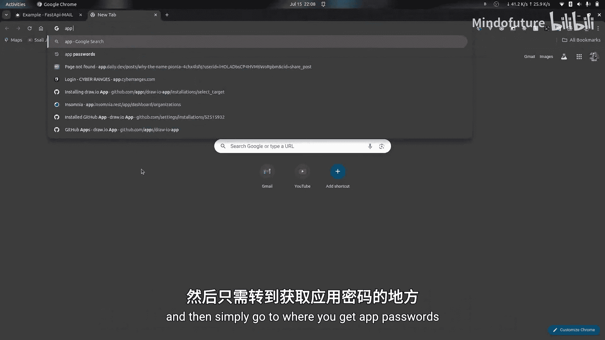

So you go to your Google account， you can go to。

Google support and then under Google support， you'll be able to acquire an app password that you be able to use in your app as a password。

 So when you enter your password， then you be redirect to the password where create an app password And then that app password will be a 16 character strangers like you see right here。

 And that's what you'll be using as your mail password。

 Now I'm using this but please do not copy this because by the time of uploading the video I've already deleted it。

 So I'm going to also leave links to how you can get your app passwords in the description。

 So the next thing is going to be the SMMTP serverva or the server that's going to help us to send emails。

 Now I'm choosing SMTP do go dot co but you can feel free to choose the SMMTP serverva that you may want。

 I've also choosing the。

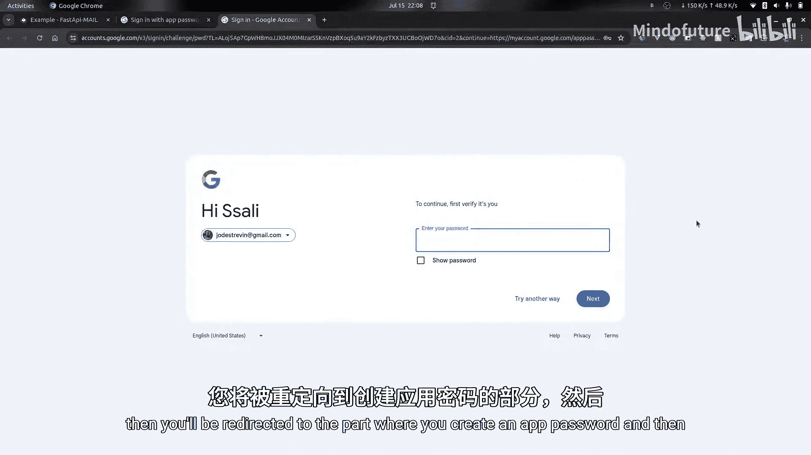

Of choosing the default port， which is going to be 58，7。

 and that's the port from which you' are going to be listening name。

 So we have who is going to send the email。 So that's going to be the mail from email。

 which is going to be the email address that I have right here and the mail from name is going to be the name of the password is sending that email now in this case this can be changed to anything we can even have it being the name of our application。

 so I can go ahead and rename this to bookley。 Now once I've set this up。

 this can be set up to what you want。 then I'll have to go ahead and include their types right in here。

 So our mail user name is going to be a string and therefore I'm going to go ahead and update this So shall have a string and then we shall also have our mail password being a string。

 Now remember this are going to be it from our dot we're also going to have our mail from So mail from in this case。

Is going to be a string。 Now， I need to make sure that these are the same way that the same case are in R dot E and V so that they are read in a very。

In a very organized way so that what is called mail from email。 It is mail from email。

 If read it from our dot E And V。 So in this case， this is going to be mail from。

And then we have to go ahead and simply fix that。 So mail from email is going to be this。

 But I think this is mail from。So I'm going to go ahead and update this to mail from。

And then we shall have mail from and then mail from name。

 which is going to be the name of the person who is sending the email or the company that's sending the email。

 Now that's going to be a string。 Now our port in this case will be an integer and to have the integer as read from our dot E and V we're going to have a mail serverva this will be a string som going to go ahead and set it up and then we are going to have our mail from name。

 which is in our case is going to be a string。 So just come and say mail from name is going to be a string。

 Now these are going to be booleans and theyll have default values。

 So I feel free to leave them with a default values。

 but one thing I'm going to do is to go ahead and specify their types。

 So I'm just going to say that all these are going to be bulloles Now after rating this then we have basically set up the configurations that we need for us to be able to go ahead and use these from our。

From my application now once I have this then I can go to our mail dot P and instead of having this head quoted values I can then go ahead and use the values that are being grade from our configuration so to do that I'll say from。

Soces dot config， we are going to go ahead and import our config object。 Now。

 remember that this is an object that is from our settings class and to help us to access each of the variables we've described right here。

 So to do that we are going to go ahead and first access our mail username。

 So we'm going to go ahead and remove this。 So to access our mail username we shall say config dot mail username。

And then I'll do the same for the others。So once this has been done。

 the next thing we're going to do is to go ahead and provide this config object as an ajut to our fast male object。

 so to do that we' are going to go ahead and say that our male is going to be a fast P male instance。

 but this is going to be taken in our config。So our config is going to be a config object that we've created。

 so shall say config is going to be equal to config。

 or we can even name this to male config to avoid con so I can say the our male config is going to be our male config since we have a lot of configs。

 so Ill just say male config。Now， once this is set up。

 we can send an email by simply going ahead and accessing the send mail。

Function or the send message function or method。 but this is going to be a quarantine。

 therefore we have to call it within within an asynchronous function。

 So this is going to take in the message schema or the message schema is going to be sort of like a structure in which an email is going to be that's going to describe the email addresses we want to send to the message body if there are any attachments that you want to send all that would be included in the message schema。

 Now to simplify lies what you're going to do is to go ahead and also。

Set up some stuff so that we can be able to send templates within our folder。

 If we to check the config object， we have the template folder set right here。

 and this is going to be leading to a directory path or basically a path on our system if we are to send HTMLm templates as our emails so we can go ahead and also add that here。

 we can just come right and say template folder and this basically takes in a path object。

 So for us to use path objects or to use paths on our system as objects then we shall make use of pathlib So I'm going to go ahead and import it our say from pathlib we shall import the path。

Class， so the path class is going to help us to create objects of files。

 and then we shall be able to get things like the。Parent folders and their location and stuff like that。

 So the first thing we shall do is to the base folder or the folder。Of our root project。

 So to do that， we shall basically create basedta variable。

 And this based that variable is going to be as a result of creating a path object。 Now。

 this path object is going to take in。The file from which one to find the path。

 Far case want to go ahead and pervade our file， which is specifically this current file that we are in。

 And once we have been able to get the object then you can call the resolve method。

 And with that we can be able to get the absolute path and then access things such as the parent folder and stuff like that。

 So to get the parent folder of this specific file we are in， we shall just say dot parent。

 and this will give us access to the parent folder of this file， which is mail do pure。

 So we shall be inside our root project folder。 So what we want to do to go ahead and specify a template folder and that template folder has to be just inside our source folder。

So to do that， we shall just come right here and say path。收。

This path object is going to be taking in the fast path， so this is going to be our best directory。

 which is the absolute path to or the path of the parent。

 which is going to be our source folder and then we need to just direct it to a folder call template so we shall go ahead and also create this。

Once we've created that， then the next thing is going to be for us to add that folder so that it doesn't miss shall'll just come and say that our templates folder is going to be present within our source folder。

 Now we currently don't have any templates and we're going to be looking into how to send HTML emails。

 we can even keep it simple by not sending HTML templates。

 but just in case we want to send HTML templates and we need to go ahead and perde the template folder。

So what I'll do。Just to go ahead and now set up our message schema or the structure in which one to send our emails。

 So I'm going to go ahead and create a function right here。

 And this is going to be the create message function。So the cr message function is going to take in。

Basically the information that's required for us to send messages and I'm going to go ahead and pass it for now and the first thing I have to do is to import the message schema class because that's what is going to determine the structure of our emails so I'll go ahead and import it by saying from fast mail we or fast API email we're going to access the message schema class once we have that then a message is going to be simply an object of that specific class so shall just scan and say the our message schema is going to take in first of all the recipients or the message so here we are going to basically I providede the recipients so the recipients is going to be a list of recipients now that's the first argument I'm going to provide here so our recipients。

It's going to be a list。 So I have to make this of the list tape。

And this is going to be a list of string objects。 So another thing we shall have is going to be。

Atachments， if we have any， then the subject or for subject。

 we're going to actually pervade the subject。 So let me go ahead and also say that our recipients is going to be go to recipients。

Let me actually make this pro so that we have recipients and then we can also have our subject。

And we can also go ahead so our subject is going to be a string。

 then we can basically also have the body， which is going to be the entire body or the message that we want to send with our email so for our case we shall have our body。

 our body shall also be a string。Now， once we have that。

 then we have to go ahead and provide those as as to a message schema。

 So go it here and see that our subject。It's going to be equal to a subject。

So here we shall say that our subject is going to be equal to our subject and our body is going to be to our body。

 Now， we can also go ahead and specify that the types of emails we are going to send are going to be in the form of H TML。

 So by specifying this then we have to also make use of another class called the message type class。

So once that is done， I'll just simply ca here and specify that our subt is going to be the HTML type。

 so we're going to be sending HTML emails once we've been able to create a message then what we need to do we just simply go ahead and return our message。

And that is just enough for us to create a message。 So with all this set up， let us go ahead and now。

Look at how we're going to send a simple email。 So I'm going to start by going to our of routes or our of API endpoints。

And within of APIPA endpoints we're going to create a simple route or a simple APIPA endpoint is going to be sending an email to a random email that exists。

 So to do that， we shall go way before we actually do all these stuff of refreshing tokens and all that stuff。

 andm actually just going to do it right here。 So Im mean to start by creating a simple route。

 So Im mean to say that this is going to be at or router。So far。

 I case we're going to make this a post request and this is going to be sent。

Email or let's say send mail。 So this is going to be a post request。 and therefore。

 we need to define this route handler as one for sending。E mail Now。

 this will need a list of email addresses， and these email addresses are going to be recipients。

 so we can say that these are going to be emails， and we need to， of course。

 create a pedantic model that's going to allow to get these emails。 Now， for now。

 what I'm going to do is to just call this our email schema or our email model。

 So let me just call it the email model。And I'm going to pass this for now。

 So let's go ahead and create the email model。 She。 we shall head over to sches dot P Y inside our o。

 And then here we shall go ahead and create。Pedantic model。

 And this pedantic model is going to be called the email schema。

 So this is going to inherit from best model。And then we are now going to go， Sorry for this， so。

Sohall go ahead and then create a list of of addresses so we can call this email addresses or let's say emails。

 and this will be a list of strings。So once this is done now we have one job which is to go ahead and imported right here。

 We've actually called it email schema about its email model。

 So let me just go ahead and adjust this to email model and when we do that then we have to go ahead and import it just right where we import our user model so shall just come right here and say import our email model once the email model has been imported and let's go ahead and access the emails。

 So to access our emails our emails are of course going to be from emails。

 now there's a problem right here。 So I may choose to call this， let's say。Emails。

 and then I'll go ahead and change our schema that instead of emails， you actually have。

 let's say addresses。So once that is done， shall go back to our routes and then we shall access our email addresses as emails do addresses and once we have that。

 then we also need to go ahead and access this function for creating a message。

 So for now we don't have any message that we're going to be creating whether we're going to be creating a message and then shall send that message。

 So I'll go back to our route trade here and all I have to do is to go ahead and import that create message function and our mail object because that's what we're going to use to send emails。

 So I'll say from source。Dot mail。We are going to go ahead and import the male object。

 and were also going to go ahead and also import。That create message function。So once we have that。

 then we are simply going to festival all create the HML message1 to send。

 So I HML is going to be something like， let's say an each one。

And that H T M L is going to have a simple message。 so we can just say， welcome。To the app。

And then once we've been able to do that， now we can create a message。

So our message is going to be a result of calling the create message function。

 and this is going to take in the recipients。 And now remember our recipients are going to be the emails that we've got from our email model or our email schema。

 So these are going to be emails and then shall parade the subject。

 So our subject right here is going to be the。Subject， so let's just see。

Welcome it's going to be our subject。 And then the message or the body is going to be our hm that we've created right here。

 So I to go ahead and send this hm as our email So that that's what they will be able to view in the email body。

 So once that is done now let's go ahead and finally use our male object or send the message for us to do that。

 we shall just go ahead and use a weight because that is a quarantine。 So we shall say await mail。

Don't send message。 And then this go ahead and taking the message that want to send。

 So farists shall just go ahead and provide the message。

Once this is done now we want to go ahead and also tell users that the message has been seen successfully by retaining adjacent response。

 so shall say return。And for our case， let's go ahead and return a plain message for simply an object that can be serialized by first P。

 So far our case shall say email。Sint。Successfully。And that will be enough for us to send our email。

 So once everything is working， our surveys， our survey is not actually running。

 So we have to go ahead and running to fastPA， Dave and Min source。

So we now see that we have a pay id error and then。Annotated attribute was detected。

 so this is going to be addresses， which is going to be a typing list or string。

 Let's go ahead and fix that within our schemas we created addresses and this is supposed to be a type。

 so that's the mistake I made。So if I fix that， I'm to try running as again。

Then we shall notice that our survey is running。 so let's go ahead and test this out。

 So right here in Rafor， the first thing I'm going to is to go ahead and simply create a new endpoint in our earth folder right here that's going to be responsible for sending an email。

 I'll say new request and then I'll call this one to send a simple email。

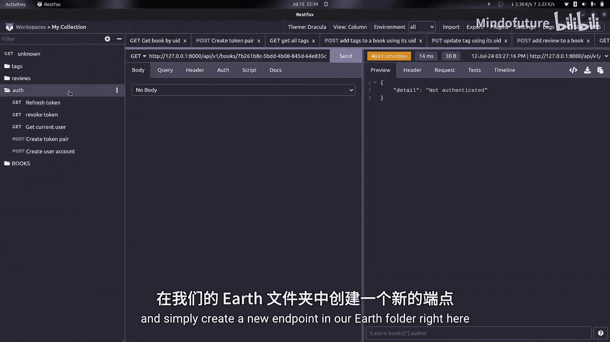

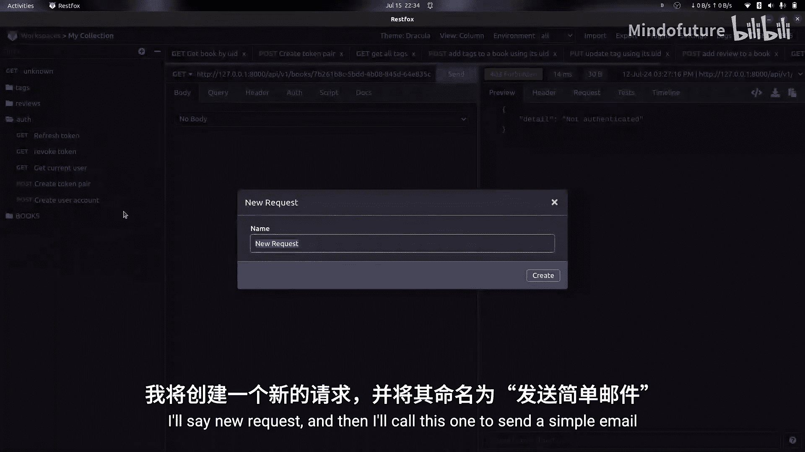

Once that is done， I'm going to clear up some of these things。

 So I need to close some requests we have。Here。And now we shall be good to go to send our email mail。

 So remember that our email mail endpoint is being found on the o。Router， and therefore。

 we need to access it via the o prefix。 So we shall go to local the thousand slash aPA slash version run slash o。

 And then that's where we shall get to access the path。 Well， shall send an email。

 Remember that this is a post request。 Therefore， you have to specify that it's a post request。 Now。

 head over back here。 our route is called send mail。 Therefore。

 that's what I'm going to go ahead and set。Yeah。And then when you try to make a post request。

 of course， we're missing the body need to providevade a Json。

 and a Json has to have a key of addresses。Now， this addresses key is going to have a value。

 which is going to be。At list so in here we need to providede I list so I providede the same email that providedvade as one that's going to send the email。

So once this is done， I'm going to go ahead and send。

And now we notice that there is this delay in sending the email mail。 So this delay is may be due to。

AndSo it seems like we have an error here and this array is saying that an exception was raised due to our settings。

 so it seems like we need to check our credentials or email service configuration。

 so we need to go back to where we wrote our email service configurations and I'm going to go back to our dot E and V。

It's in we set up something to be wrong。 So if you try to maybe say SMTP do gmail dot com。

I think this will be。Able to help us。 So what I'm going to do is to go ahead and restart as ever by saving a random file as ever is going to restart that if we try to send it。

And email again。So I guess we see that our email has been sent successfully now to confirm if our email has been sent。

 I'm going to log in into my email and then we check the email that has been sent so if I go to Gmail dot co。

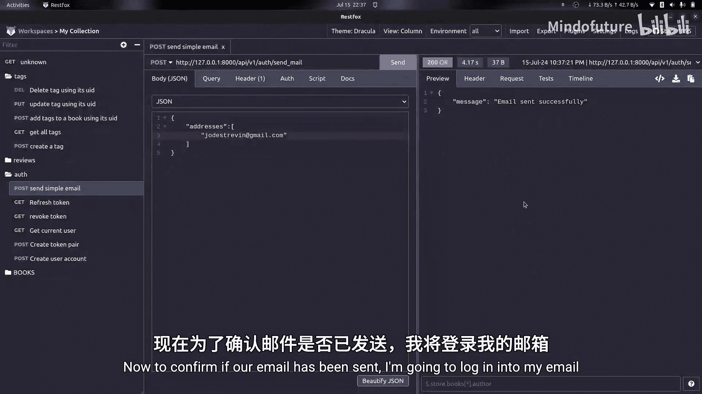

I now see that my email has been sent and it's saying welcome to the app just like you see right here。

 So for now we've successfully been able to send our first email。

 Now that we figured out how to send emails with fast mail。

 let us go ahead and look at email verification。 So in an application where we're making our user sign up with their emails and passwords。

 it becomes important for us to verify if the emails they are provided are correct。

 So email verification is a very important step， as it helps us to verify if the user is an actual person。

 Therefore， if their email address is valid， then we shall be able to successfully send them an email。

 On the other hand， it tells us to basically prevent things like fraud because you can know the user who created that specific account。

 now。

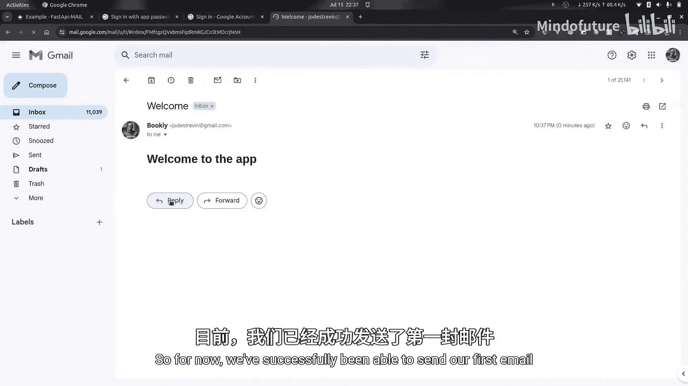

For our case we're going to first of all figure out a way to move data or to move data in between our app and thirdpart apps are using our email sending。

 So for our case we are going to make use of that it's dangerous package which is basically one that allows us to safely transfer data from one place to another safely so it does this in a way that it helps us to cryptographically saying our data and hand over to whoever we want to handle it and then we get it back but this time we just check if data has been taed with or not So what we're going to be doing is whenever user creates an account we're going to be sending them a verification link and in that verification link will be a token that toolken will contain data about the user So whenever we get that token back we shall be able to decode it and then。

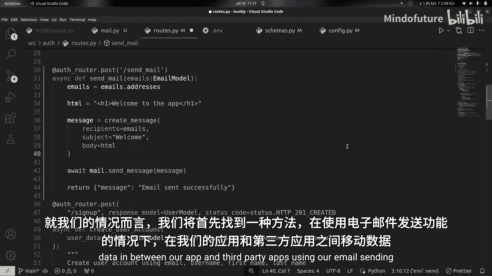

That's why we shall get the user account that's responsible for that specific verification。

 So for now， what we're going to do is to go back to our qua。 If we open up our database。

 we're going to notice that most of the accounts and it very fade。

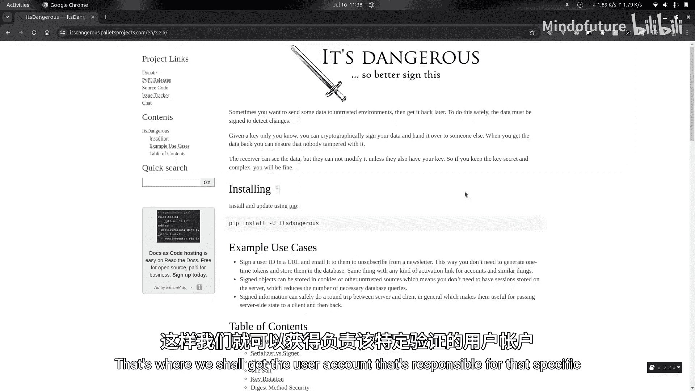

So what I'm going to do is to go and open up SQl electron。 if you're not familiar。

 this is just basically a tool that allows us to be our Postgresql。

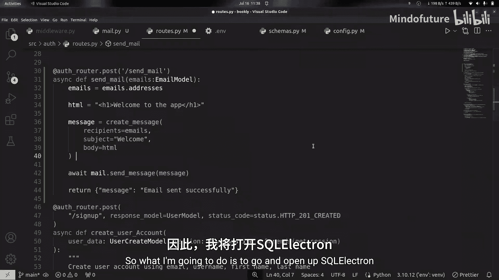

In a very simple user interface。 So wem need to connect to our database bit right here and。

If we go to our public schema and then we go to where we have our users tabpo shall notice that most user accounts are not verified。

 So to do this way our wind festival of all set up。

 it's dangerous so that we can go ahead to make use of it。 So if we not installed it。

 the first thing we shall do is to go ahead and peep install。

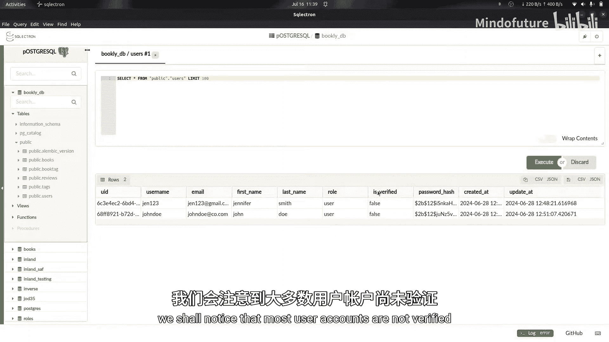

So this can be P P and V install or poetry add whatever I use。 I'm just skip it simple baing peep。

 So I'll say peep install。 And for any case， I'm going to Missly say I'm going to be using that It's dangerous。

Package。And this will go ahead and add it to our virtual environment。And once that is done。

 the next thing is screw， go ahead and set it up。Now remember in our previous videos that we created the U file or module in which the utilities for doing things such as password hashing。

 creating access tokens are found， so head over to that file which is going to be found in U。

py inside our Earth directory I'm going to close some of the stuff that we have right here。

And what we're going to do at first is to first of all set up its dangerous module so that we can create this token that's going to be URL save or one that can that we can basically send through our URLs。

 So to do that， I'm going to come here。 And what I'm going to do is to first of all。

 go ahead and import a class。 And this class is what is going to help us to send the data that we're going to present within our tokens。

 So just come here and save from it's dangerous。 we are going to go ahead and import our URL save ta serial laser。

 Now the URL save tame serializer is when that's going to help us to。Taking a string。 And then。

Create a token into it。 But this time we can also be able to set the ta that we can be able to check the time after which this token has been able to or this data has been saved。

 So for example， if we created a token and we wanted to check if it has been sent and been passed around for this amount of tame。

 we can be able to do that using this URL self ta0 laserll leave the link down in the description。

 So once we've done that， I'm going to come right here。

 And the first thing I'm going to do is to create a function。

 So this function is going to be one called the create。URL， safe。Tking。

So this is going to take in the data that we want to send or they're talking or let me just call it the data。

 so this will be our dictionary。But now what you're going to be doing is to go ahead and saying the token。

 So for to be able to create a token we need to first of all。

 create an instance of the class that we've imported。

 which is our URL save time serializer so we need to just come right here and the first thing we shall do is to create a serializer object So this serializer object is going to be an instance of our URL save time serializer and it's going to first of all take in the key which is going to be。

The secret key that's going to use to send our data。 Now， for case we already have one set up。

 so we can just come right here and say secret key is going to be config。

 So we already have our config object。 And from that， we already set up a secret key。

 So I'm just going to keep it to the same as our jability secret。

 Now we can be able to generate that。 But from the previous videos。

 remember that we use the secret pathon module to generate this secret key。

 And once we've been able to do that， we can also go ahead and pervade the salt。

And we can name this anything we want。 but for our case we shall just name it email configuration。

So once we've created this serialr， now we need to go ahead and use it to sign the data that we've sent within this function。

 So for us to be able to achieve that， were simply going to come and say that our token。

It's going to be good to serializer， so this can have multiple methods。

 but for now we can call the dots。Damps method。 And that the damps method is when that's going to alas to get a value and then serialize it into。

An object or basically a string that is going to be sort of like a talking。

 just like a JW we created。 And that is what we're going to pass into the URLs。

 There shall be is to verify the user accounts。 So for our case。

 we're going to go ahead and providevade the object， which is going to be our object right here。

 which is that data。And once we've been able to do that now。

This is going to take in only the object as well as the salt。

 so can also go ahead and providevade the salt trade here so as sold。

Can also be equal to our email verification。So this right here is our serial laser。

 just like we've created it。 and this is our D method that's going to allow us to basically create the token。

 So for us to make use of this token， we shall simply return it just like we see right here so shall see return token。

 once you've been able to do that， then we shall create another function。

 that's going to be responsible for getting our token and then decoding it to get the data stored within that token。

 So for our case， we're going to come right here。And we shall create that function and call it the URL save tracking。

And this will take in our token now this token is going to be a string and for our case we are going to use a tray except block so because we can encounter errors when this data has been tampered with when it has a bad signature and stuff like that。

 So for our case what we're going to do is to go ahead and use a serial Now one thing I did is to create this serial laser in here。

 But what I can do is just come right here and simply remove it and create it outside。I'll take our。

Functions so so that we can access it in these different functions。 Now。

 what I'm going to do is to also go ahead and change this name。 So we can call this。

 let's say our token serial laser or something of the sort。

 But I think it's the only serial laser object that we have within this file。

 So I mean to keep it to serial laser。 Once we have that， then we can go ahead and。

Decode the token by simply saying that our result or our data。For the token data。

It's going to be equal to So case we shall have the serial laser。And just like we call damps。

 we shall call loads now， I think repeating myself is pervading the salt rate here so I have to go ahead and remove it so that we just have it created right here。

So I'll just come right here in the serializer object and in I call a do loads method。

Now this do loads method is going to take in the token， of course。

 So this is going to be the complete opposite of the Ds method。

 as it's going to be the one to just return the data that's decoded within our token。

 And once we've been able to do that。 now we're going to gra right here and return。Our toane data。

So once we pretend our to in data， we shall accept any errors。

 So I'm just going to come right here and see accept。And for our case， we shall accept any exception。

S一。And then we shall just go ahead and log that exceptions of racks。 I just say logging dots。E。

AndThen I'll just pervade the string error， but specific error。

 And this will be just right to shall gate when we encounter as such an error。

So here we can even return then but I'll just simply leave it to basically where we throw the error So once we've been able to do that we now have an idea of how we're going to be sending tokens within our URL so for us to do that we shall go back to our throats。

And within our auto routes， what we need to do is to go to where we create a user account。

 So we create a user account after the user has successfully created their account， we need them。

 we need them to send an email and that email needs to have the information or instructions on how they can verify their accounts。

 So were need to create some simple hMl and that hml is what we shall send via our email So come down here and。

What I do you suggest create the H T M L message。We very fine。 There is our email。

 So I'm mean to keep this simple， but you can well use ginger templates。 So for our case。

 I'll just come right here and see。That shall have F， which is going to make this an entire F string。

 And then inside here is where we're going to have our H Ml。 So for my case。

 I'm going to provide an H1 and this H1 is going to be verify your email。

So we're going to close this。 and once we've closed this， then you can provide the paragraph。

 So this paragraph is the one that's going to have the instructions for verify the email。

 So shall just tell them to please。Meak。This link， so。To verify your email。

And then we can provide the link。 So I mean first all will close this paragraph。

 And then once I've been able to pro to close that paragraph， I'm mean to make。And link。

 So this is going to be our anchor tag within each。 So you're going to providevade our。

Going to be providing the email or basically the link that's going to be used to verify the email inside it here。

 So I'm going to go ahead and close this。 Then I'll close the anchor tag。

 and then I'll put our link right here。 So our link or our email verification link is going to be。

1 for， let's say our。 So for I shall just come and C our Port is going to be H T TP。

 but then you need to provide the domain on which our account has or our application is running。

 So to keep it dynamic。 what I'm mean to do is to create an E and V value。

 And that is going to stand for that domain on which our survey is running。

 Now there are very many ways you can get that programmatically。

 but I'm choosing to choose that easy， which is we can just go ahead and provide that domain。

Environment variables。 So let's just call this our local host。

 So far case this is going to be local host8000。 Now we can also add that slash aPA slash what what。

 But I'm going to just give it to local host 8000。 So if our app is running on let's say bookley dot com。

 Then that's what we shall say here and then we can be able to access it here。 via our config object。

 So assuming that we have it。 I don't think we have it in here。

 shall go ahead and import our config object。 So shall save from source dot config。

 we are going to go ahead and import。The config object and once we've imported the config object now let's go ahead and make use of it to access our domain。

 So for our case we can just come and say config。Dot so this also needs to be an F string。嗯。

So then on our con object， we shall access that domain。And then on this。

 we need to go ahead and verify our email slash on that slash a slash version1。

 And then we need to go to o。 Then we can also go where we have a email。 So for our case。

 this is going to be slash o slash verify and then in here is where we going to provide the token that we need to send with our email。

 So for our case we shall just come right here and providede this link as our link。

 And then we shall also go ahead to pervade our token。 So our token is going to be created from。

That create。URL self token method or function that we've created right here。

 So for us to be able to do that， we shall go ahead and import that。

 So shall go from where we imported the other functions for creating our access token and verifying our access token and then we shall import create URLL self token and then we shall also go ahead and import that that's going to be one for。

Basically， decoding our URL LC token。 So this is Ra shall Li in verifying our email mail。 So for now。

 we need to create our token。 So we are going to create a ver right here。

Well we are creating our user account。 So we shall see that our token is going to be good to create。

URL safe token and far case add data is going to be a dictionary。

 and this dictionary is going to have our email。 So we need to just hide our email in here。

 So our email is going to be the user email。 and that's what we get right here。

 So we shall just providevade the email value。 And once you've been able to do that。

 Now we need to just create our link as one that's going to have that specific token。

Once that is done， then we are going to send this H T M L message。

 just like we did for when we are sending our email。 So just copy what we have here。

And then I shall just go ahead and。Basically change or change our response。 So at first we shall。

 have to fast send our message， which is going to be。 so in here we need to get the emails。

 but our emails is going to be a list。 and the only person we are going to be sending an email is going to be the email that we already have。

 So that's going to be our email。 And once that is done， then we are also going to get。The subject。

 so our subject here is going to be a verify。Your email。

And then our body is going to be the H T M L message。Object。

 and that will be just enough for us to send our email。 Now。

 one thing we need to also do is to go ahead and change our response so that we can tell the user that their account has been created and that they need to go ahead and verify by checking their email。

 so。One thing I'm going to do time right here and I'm going to customize how we are returning this。

 So we're going to first of all provide the message。 Now our message is going to be account。Created。

So for our case， we are also going to tell them to check their email so shall say check email mail。

Very fat。Your account。So once that is done， then we're going to also providevade the newly created user software。

 which I'll just come here and say user。Is going to be so far case our user is going to be the new user that we've created right here。

 so that will also be serialized and returned to us。

 and that will be just enough for us to go ahead and。

Create our user and send them an email for verification。 Now， to do that。

 let's go ahead and test this。 So I'm going to head over back to rest folkss rate here。

 And the first thing I'm going to do is to head over back to where create a user account。

 I'm going to close some other folders that we have here so that we can focus right here。

So in here we have the endpoint for creating a user account and we can now go ahead and test it。

 so I'll just begin by pervading our username so this has called our user。Jonathan， let's say23。

 And now， for our case， we shall go ahead and。Pvade an email。

 Now let me providede an email that's valid so far case shall see。At Gmail dot com。

 And then our first name screen to be Jonathan。And then we can also go ahead and pervade the last name。

 So and say Sally。 So for our case， we're going to providede a simple password。

 And when we send this email So we see that our input is greater than the max length。

 So I'm going to go ahead and change this to let's say Jonah Sally。I guess this is。

 this is actually long。 So I'll just skip it to journal maybe 35。 So when you send this。

We have an error， so we need to go ahead and fix that。 and this error。

Is coming from so setting object has no attribute domain。 We forgot to add that to our settings。

 Now that is inside our config。Just go ahead and simply set that up。 so add domain。Will be a string。

And once we've set that up， AsA is going to run。 no problem。 So let's go ahead and test it again。

When we send， we already have a message or values user are existing。

 So I'm going to change the email that we're going to send to。 So let me just change that email to。

 let's say Sally。Jonathan。Okay， at Gmail dot com。 And then when I send。

We see that there is some delay。 that's happening。But if everything goes well then we are going to send our email。

 So we already have a serverva， right， Ha serverva error。 So for now we see that our。

Our response model has a set structure it expect that data。

 but then we cannot be able to send that data。 So let's go ahead and fix that， so。

In a case where we are sending our data in a customized way。

 they need to also go ahead and modify the response model So far case we have the response model being the user model。

 But since we are returning this dictionary that has the data that is not in a user response format。

 then that shows that we already have an error and that's what the error that we are actually getting。

 let first of all confirm if via email is being sent。 So I'm going to go ahead and go to my Gmail。

 So that's the Gmail I have signed in with。

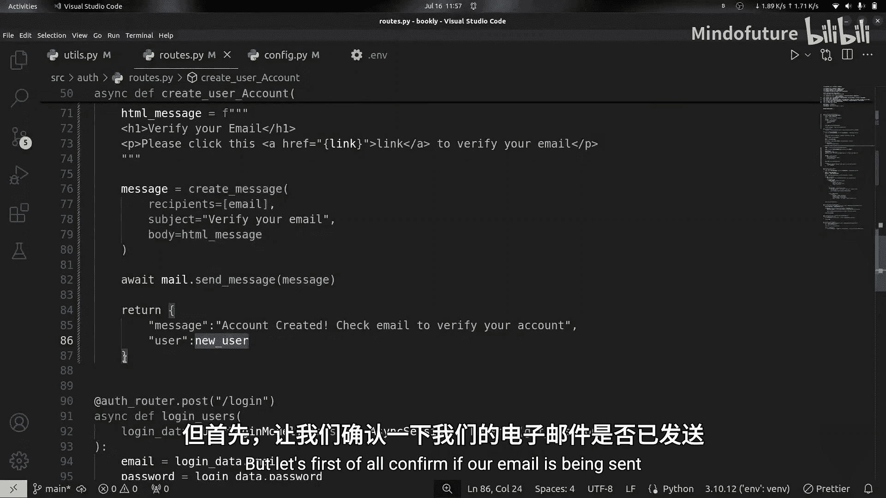

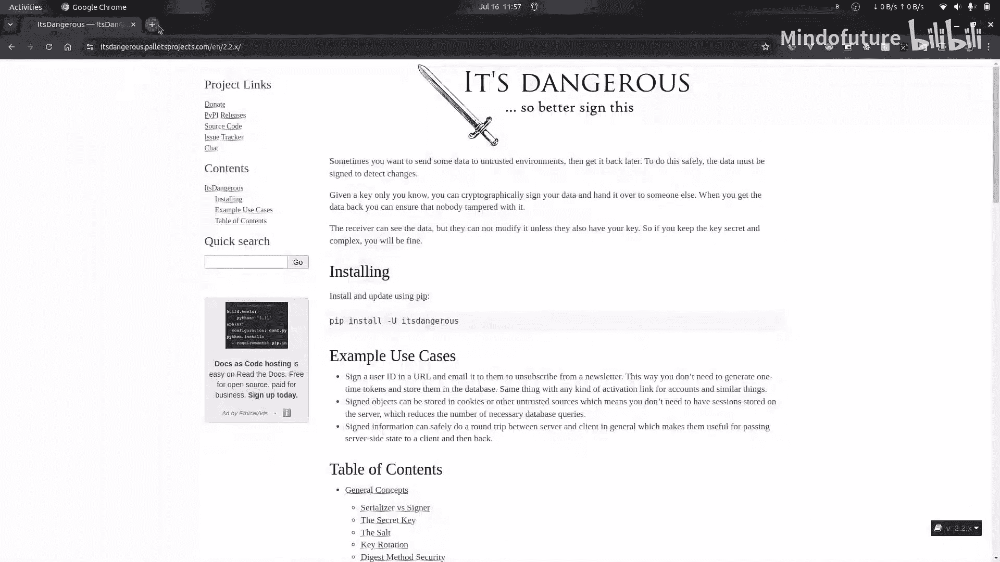

And then。Goreing to confirm if our email has been sent so they go to Gmail。

 I go to that specific account on which I've sent an email。

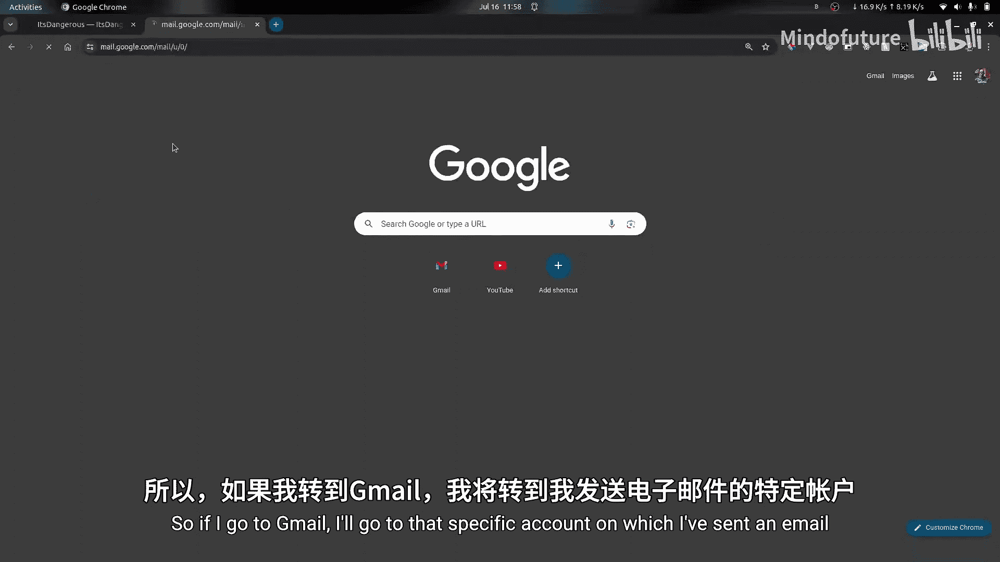

So Im mean to go ahead and check if an email has been sent。

And now we can see that our email has been sent just like you see right here。

 So we've been able to send our email and our email has been sent。

 So we now see verify your email mail。 and this is the message that we've sent in our body。

 we can also see the link that's being sent。 So if we try to go to that link。

 It's going to go on local host 8000。 but then that link does not exist。

 therefore we can see that we have a detail of not found。 Therefore。

 we've successfully been able to send that verification email。

 Now we're going to go ahead and simply。Look at how we can verify our E mail using our API。

 So at first we need， we need to first of all， fix the error that we've had。

 So what I'm going to do is to go ahead and remove this response model argumentt so that we return our。

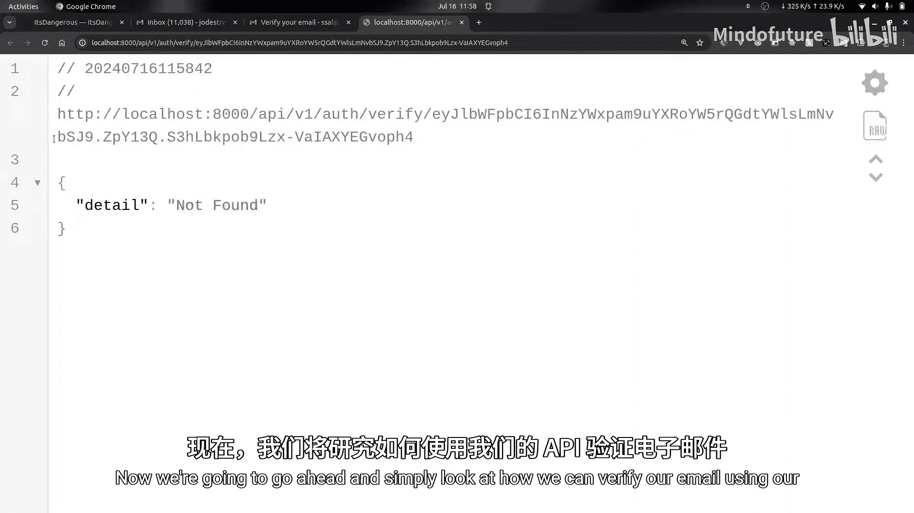

Message in this way。 So， for example， we have this user account created and。

This is the message that we're going to be sending as well as the user object。

 so we do not need to go ahead and specify the user response model。So。

Now that our email has been sent， we need to go ahead and。

Create the endpoint for verifying our emails。

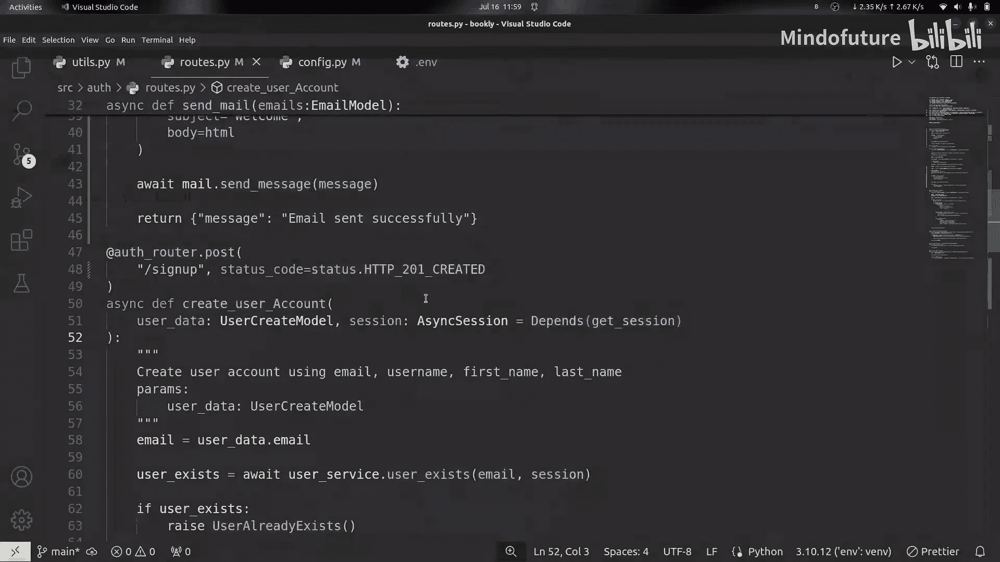

For now I've gone ahead and deleted this specific account for which I've created an account。

 So what I'm going to do is to go ahead and sure have done that。

 So I'm going ahead to delete that account that we have used so that we go ahead and continue testing this function before sending the verification email。

 Now before we do that， we are going to also implement the MP endpoint that's going to be necessary for us to verify a user account So to begin I'm going to go right before the login endpoint and without is to use our autota to create a new API endpoint I'll say autota dot get So this shall be on the slash verify slash token endpoint of path。

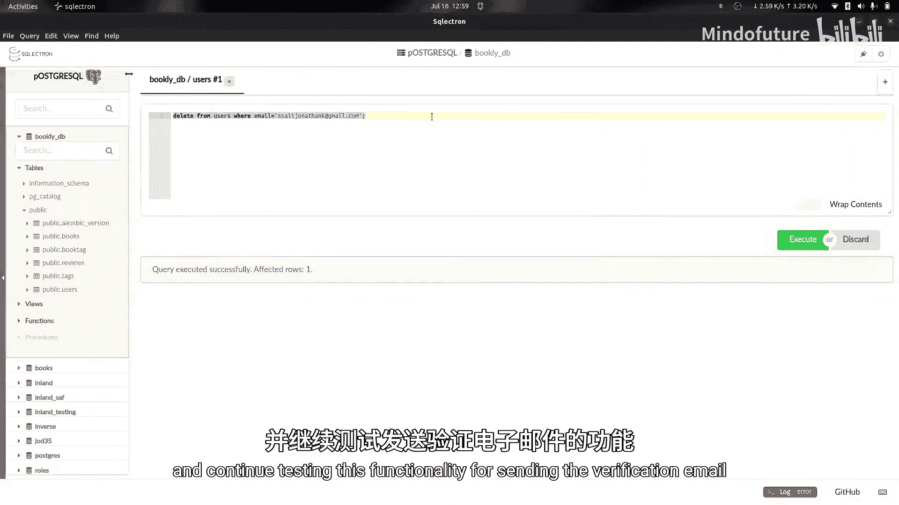

So once we've done that， we shall describe the pathhandr function。

 which is going to be as syncive and this will be our verify user accounts。

And this will take in our to since we have provided it as a path parameter。

 And then you shall also need our session object。 Sore going to provide our session。 Now。

 this is going to be good as a result of using the get session dependency。 Now。

 it seems like we don't have it here。 So I'll go ahead and import it。 I'll say from。S。Ros Db。

Not main， we shall get our get session dependency。 And once we have our get session dependency。

 now we're going to come right here。 and all we're going to do to inject that insight here。

 So shall'll say this will be depending on the get session dependency。

So I think I've made a mistake right here。 This is supposed to be a type。

 and this is supposed to be the value。 So we are going to go ahead and change that by saying this is going to be a sync session。

And then that will be our dependency。 So once we've been able to do that。

 now the first thing we're going to do is to decode the token that we've got。 So to decode the token。

 we shall say that our token data is going to be equal to decode。

URL self talkingken and English are8 hour talkingken。And once we've been able to get this data。

 now we need to get the user email， so our user email in this case。

 is going to be equal to torken data。Do get， so in this case we are going to get the email if it exists or none if it doesn't exist。

 so if provide an email， then we are going to go ahead and check it the user email is not none so we can do that by saying if use an email and then we shall use our user service object to get that specific user with email so to do that shall select that our user。

It's going to be equal to So our user in this case， will be our user service。Do't get user by email。

 And for case， we shall provide our user email。Once we provideded our user email now we're going to go ahead and check it this user is not9。

 so for our case if the user is not9。We shall go ahead and throw an exception。

 so we shall do something like cr user。Not found。Because now we have our custom exceptions。

 Once that is done， then we're going to simply go ahead and use our。

User service to update the user's values。 So we didn't set that method up on our user service class。

 Therefore， we need to go ahead and set it up。 Now what I'm going to do to head over to service to P I inside dial o and allow allow this to implement another method that's going to be responsible for allowing us to update the user。

 So I'm going to say a sync dev and I'll call this update user。

So this is going to update a user with some data so shallll say self and then shall create a dictionary of user data。

So this data is going to come from the。Paathhands。 and then it will also take in the session objects。

 This is going to be our h session。Once this is done。

 we are now going to go ahead and basically write the logic for helping us to update the user data。

 So what you're going to do is to first of all， get the。User。

 so far case we need to provide some specific data that we're going to use。

 we need to go ahead and get that user。 so that means I have to go ahead and provide the email as a parameter or be able to get that specific email or that specific user object so。

To do that， we shall just come right here and basically provide another attribute that's going to be the user email。

 so shall say that our。いい mail。I's going to be a string。Or we can even get a user object。

 so for our case， we can just come right here and get a user object so we can just go ahead and provide this and let it be our user object。

So this user object is what we're going to be updating using the user data。And once we have that。

 now we can simply go ahead and update the user using our。Use that data。 So to do that。

 you can just come and say for key values since our。Data is going to be a dictionary。

 We can just access the user data dictionary。And we access all our items。

And once we've access these items， now we're going to go ahead and。

Update the current user or the user missinging on。Those specific properties that we've got from our dictionary。

 So to do that you can use the special set attribute function。

 And what that you will do is to get the object， which is our user object and then update it to the key。

And our value So far our case， shall say update with key and then value。

 So that means that if we have a email that we are going to update。

 then the value for the email on our user object is the one that is going to be updated。

 But for our case， what shall be updating is going to be there is very fade。Attributes。

 so once we've been able to do that， we shall go ahead and basically。

Make sure that we commit this sing our session， so to do that we shall say session。

Do in the our case we're going to call the commit。 but remember that this is a core team。

 therefore we go ahead and call it with a weight。 And once that is done。

 we shall go ahead and return the updated user， so who shall say。Return user or return name。

Whatever I want to do。 So for our case， once we've been able to do this。

 then we are going to use this same method to go ahead and update the user。

 I'm going to go back to our routes and what Ill is to go ahead and simply。A wait so far。

 Ca we are going to go ahead and call our user service object。And on our user service object。

 we shall call an update user method， and that's going to check in our user。

 So for now we have our user here， which is our user object。

 so we shall pervade that and then were also going to have the user data that we're going to update for our case that user data is going to be a dictionary and all is going to have is going to be that is very fade attribute。

 Now the value for that is going to be a true and then we are going to pervade our sync session object。

 So the sync session object we're going to perva is going to be this session that we pervade that rate here。

Once that is done， now let's go ahead and return a good response。

 So far case shall just come and say return。And we need to return a response。

 So can just go ahead and return an adjacent J response object。 And for our case。

 we can provide the content as a successful message。

 so can say our content is going to be having a message。 Now。

 this message will be tailing one that the account has been successfully verified。

 so we shall just say。Useer or。I can't verify successfully， something like that。

And once that is done then we can also set the status code to return in this response。

 So our status code is going to be a 200 status quo。

 now we shall'll just and say this is going to be status dot h TTP。200， okay。Okay。

 let me go ahead and format that。 And this is basically what will happen in case our user account has been verified fade successfully。

 Now another thing we're aim to do is to handle that case in which our user email has not been verified fade。

 So to do that， we shall just come right here。And basically， we turn a response。

Showing if our user has not been or if our user account has not been verified fast so shall ask camera my TN say return。

Response。And for our case， this is going to actually be a JO response。

Now this Json response is also going to have content。

 but this is going to be simply a message to show them that something went wrong。

So shall I just still then that error or。During verification。And then we shall return a status quo。

 So for this case， our status quo is going to be something like 400。 Oh。

 let's say a 500 internal Sava error or something of that sort。

 So shall just come and say statusus dot H T T P for our case we are to just come and say 500。

So I'm going to go ahead and save。 hoping the answer survey is running。 it is running。

 So now let's go ahead and repeat the step for email verification。 So for now。

 what we've done is to create the API inputpoint that's going to be small proof verifying our tokens。

 is's going to get the token De it， get the email from that token and then use that email to get the user account for which we shall then update if their user is。

The one that has submitted the request。 So to do that， we are going to get back to I for trade here。

 and I'm going to go ahead and try to create an email。

Or an account for that specific email that you provided right here。

And now we see that our account has been created successfully。

 we need to check our email to verify our account， so to do that I'm going to head over back to our browser right here and I'm going to check the email so we now see that the verify email message has been sent。

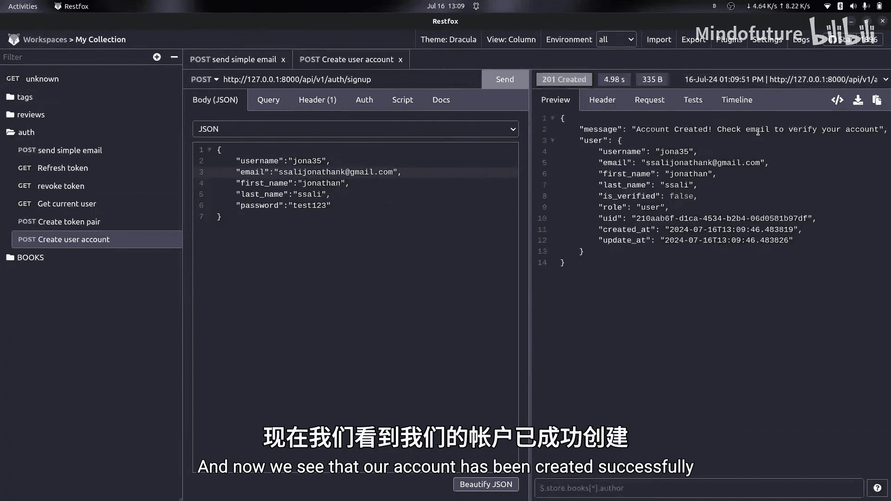

And when you try to access this， our email mail is going to be the one that we have right here。

 So we also have one here。And this one is also telling us to verify our email。

 so I'm going to try to click this link and now it's going to redirect us to our browser so we now see that something went wrong when as Sava said。

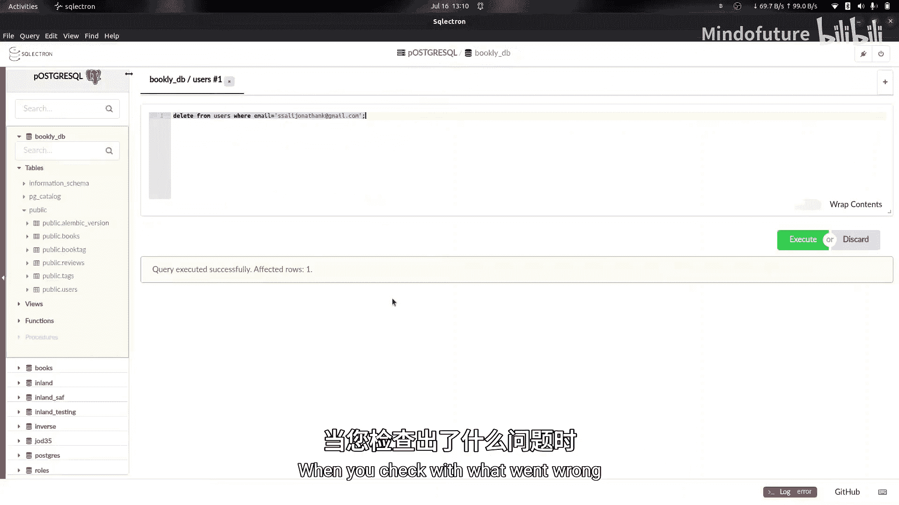

When you check with what went wrong？We're now seeing that the user get user by email is missing the required position adjut session。

 which I forgot to perde。 Now， I need to go ahead and add that。 So by getting a user email。

 you need to also per the session object。Which I forgot good to prevent。

 So this is going to be our session。And I think even this through this Ive provided a session。

 which means that we are right。 And then I think that will be good to go。 Now。

 I'm going to go ahead and also get rid of that specific user so that we repeat the same step for that specific user。

 So when the user quits their account there。

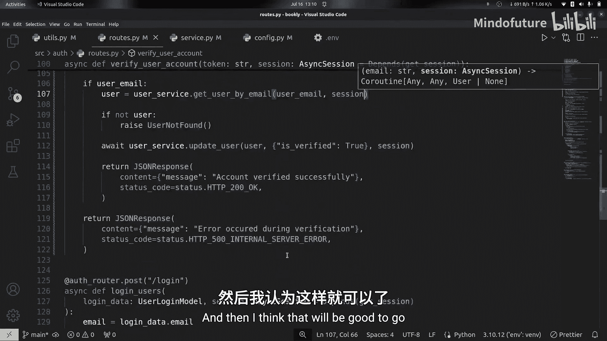

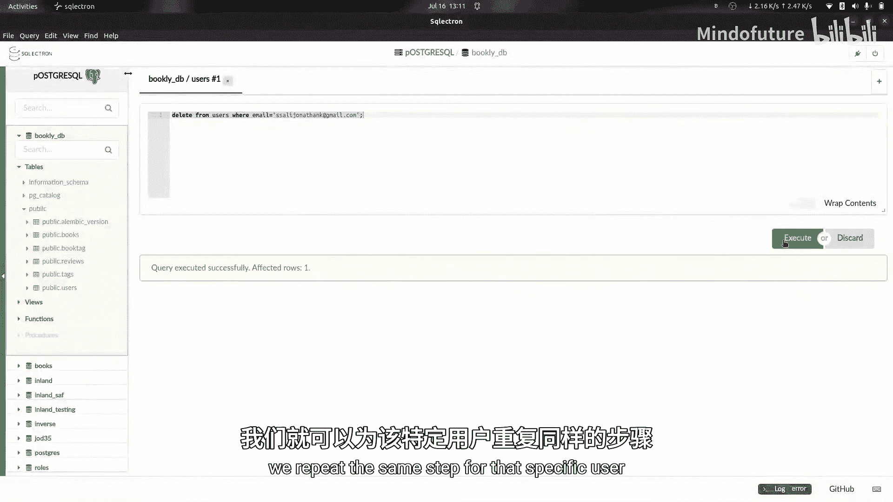

Account will be created， and then a verification email has to be sent to their accounts。

 So if we go back rate through our email。

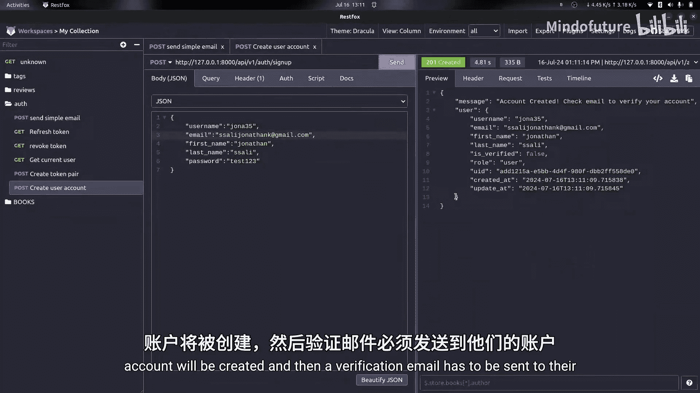

We shall see that an email has been sent to verify their account if you try to get to the link。

We shall now see that still we have an error， so。

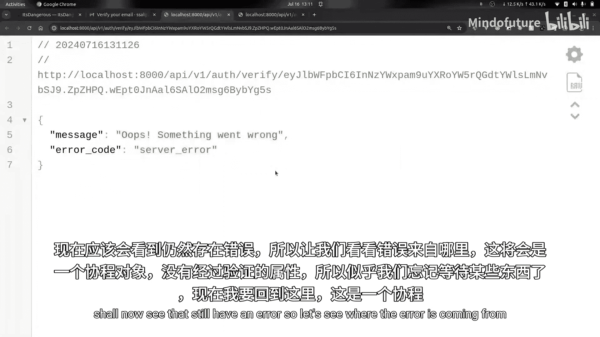

Let's see where the area is coming from。 So this is going to be a quarantine object has no attribute It is very fade。

 So it seems like we forgot to await something。 Now I'm going to go back right here。

 So this is a quarantine right here。 but we forgot to go ahead and call it with wait。

 So I'll say wait and then I think I did that for the update user。 I don't know。

 I keep forgetting this。 So if we go back。

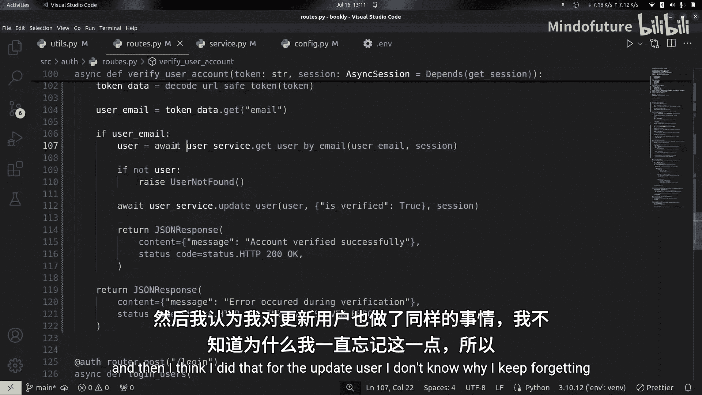

I'm going to do a lot of deleting， but this is just for testing purposes。 So when I remove that user。

I'm going to try again to create their accounts。 So let me close some of the links that we have right here。

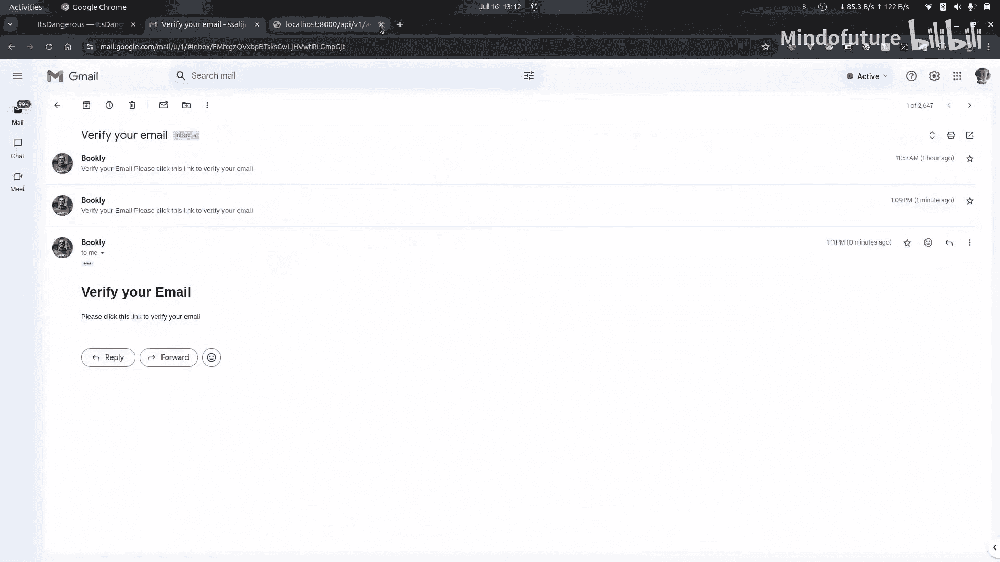

And I'll also get rid of that specific email。So when you try to create a user account for this user。

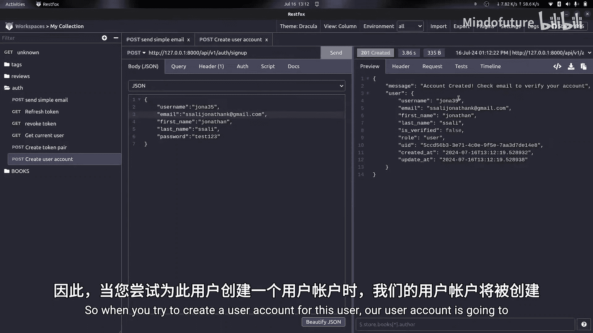

Our user account is going to be created。The email is going to be sent just like you see right here。

 and when you click this link。Let me close what you have here。

We shall now see that our account has been verified successfully。

 So for us to be able to go ahead and。Check if this is actually done in that database end。

 I'm going to still be using this tool for basically helping us to visualize our database。

 So head over to the user table。 And now we see that this very fate is true。

 for that specific account has the email that we've used。 So by doing this。

 you can be able to help you as basically， I didn't pay themselves by pervading valid emails。

 And what happens is they sign up an email is sent to them。 and then they'll be able to get to。

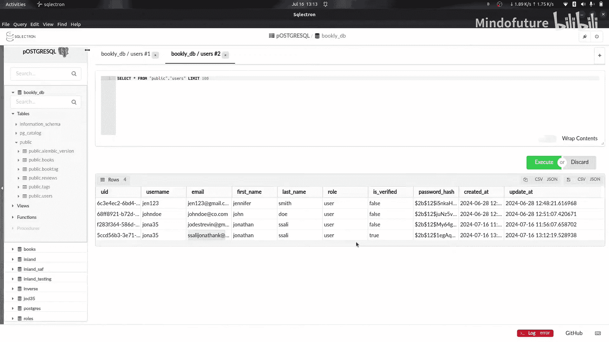

I have their emails。 Very fade。What's up everyone welcome back Now that we've added email support to our application let us go ahead and look at how we could implement password resets based on the same logic that we used in the previous video in the last video what we did was to go ahead and set up email support through our application and also go ahead to implement the user account verification by using our emails in this video what we're going to be doing is to make sure that users can at least have a way of resetting their passwords by requesting them so what they will be doing is to provide an email address。

When we send them the email we shall be providingvading the link to where they will be able to reset their password and then their password will be reset pa on whether the link has their details or not。

 So that's what we're going to be doing in this video for now what we have is email verification but we do not have any checks put in place to show if the users are actually verified to perform any actions within our system。

 So the first thing we will introduce to modify our role checkout dependencies so that each of the users that are within our app and are。

Accessing those protected endpoints that require us to have a role that they are very failed before they actually go ahead and perform any action。

 So for us to do that we are simply going to go head and add onto this specific。Call。

 so we're going to just add the call or we're going to just add this check inside our call method of our roll checker and what you're going to be doing is to just simply come right here and basically check if the current user。

The roll。 So actually in this case， what we need to access is that which is very fade。Attribute。

 So what we can do is just simply we go ahead and say， if nott。Current user dot is verified。

 Then we shall go ahead and raise an exception。 So for our case。

 what we can do is to just raise still， we can just tell then that they do not have or this case。

 we can create an exception。And that exception can be specific to。Them not being very failed。

 So what we can do is to go to our errors to P A and inside that areas。

 we can just simply create our exception class， which we can call something like， let's say。Account。

 not verified。嗯。And this is going to be an exception， just like the ones we've created in this。没有。

So this is one that's going to be raised in case user trace to perform an action but their account is not very fair。

 so right here what you can do suggest here。Account。Not yet。Very fair。

 So it's going to be a requirement for a user to sign up and after they sign up。

 they will then have to verify their account for them to perform and actually within our application。

 So once that is done then we're going to register our error handle for this specific class So I'm going to just copy right here and what I'll do is to just simply go ahead and do the same thing like we did for these other error classes So I'm just going to come here and say up to in this case we shall say add。

Exception handler and for our case we shall provide the exception as account not verified fade So far for this case what we need to do is to call the create exception handler function and when you call this function it will have the specific details of the exception that we are trying to handle so for our case we're going to provide a403 forbidden error because this is going to be a forbidden action they won't be permitted to go ahead and access any endpoint or perform any action in case their account has not yet been verified fade So for our case what we can do to just come right here。

And maybe tell them to verify their account， so for our case we can just come reach and see。Account。

Not very afraid。AndThen we can also go ahead and provide the error code， so。And just say。Account。

 not verified。And then you can just simply go ahead and check their email to resolve that issue so we can' see。

That the resolution of this era。He's going to be please。Check your email。不。Verification details。

So once that is done， then the next thing we're going to do is to go ahead and test this on some of the endpoints that we've created。

 So I'm going to go back here and I'm going to import that error。

 raise it and then save then you try to access an endpoint that。

With a user who is not yet actually very fade so I this to go at the top right here and the first thing I'll do is to import that specific error which is account not very fade and once I've been able to import that I'll simply come in here and allowll these to go and simply raise the account not very fade error。

So with this in place now we can go ahead and simply check our booked routes or our book API paths so if I go to the routes that for that book resources we can now see that we have a rule checkers being implemented for all those routes now what I'm going to do is to create a new dummy user who is not going to have any verification so I'm going to create them with a dummy email and then we shall just be able to test and see if that user will not will be in position to access the specific endpoints of our app so to begin what I'm going to do is to go to restf and what I'll do is to create a new user account now this is an account that is already existing let me just create another account that doesn't exist so I'll say Joseph。

Smith。At Gmail dot com， and it I'll also change it。Use an name to， let's say。J Smith。

And then I'll change the first name。To Joseph and the last name to Smith。

So our password will be test 1 to3 and if we try to create an account。

 of course this is going to fail because Asa is no trending。

 so I'm going to go ahead and start a serverva with fastPA。Souce。

 and then this is actually going to beat de。 and then we shall point to our folder sauce。

 so that will start ourselves。So I need trade to create this account。

Of course our account is going to be created once our account has been created。

 I think this email exists and therefore an email has been sent to them。

 So for Joseph Smith and you're watching an email has been sent to you to verify your account So once this has been sent then what you're going to do is to go ahead and try to log in with this user without them having to verify their email So what I'm going to do is to go ahead and try to log in to access and to and pair with those credentials So for I case the email is。

Joseph Smith at Gmail dot com。 And then when you go to Cto can pay。In this case， when we try to。

Add the email， per the password， shall get our pair so Im mean to get the access stuck in and then I try to list all books with that specific access stock so to do that what I'll do to go to our books。

And then I'll try to get all the books for this for all the users who have submitted books。

 so I'll go to our headers and then I'll add the toolken under the authorization header。

So in try to access this， we shall now see that our error has been。

Thrown so our area has been raised， telling us that the account has not been verified。

 and therefore we need to fast verify our account for us to be able to perform the action of listing our book resources。

Now that we've been able to look at that， let us go ahead and look at how we can implement our password resets。

Before I implement our password request， let us first of all understand the steps that are involved when resetting our password。

 so I'm going to be using a simple do string that's going to guide us into the things that we're going to achieve for us to be able to confirm or be able to reset the user password on request so to do that I'm going to just come right here create this do string and it's going to have this steps so the first tip is going to be for us to send the password reset link so shall have to first of all get the user email address shall request them to provide the email address。

And then after them doing that， we shall go ahead and send them the password request link so shall send the password。

Reset link。 And once they。Click on that link， they redirect to the app。

 and then we shall basically require them to get that password link。

 provide the details there post request and then be able to save or save their new passwords。

 So that's what you're going to do。 So to do that we shall just come and say。Reet。

Password and once that is done we simply have two views to implement here。

 the first round is going to be what we are going to call our password。Reet。Request。

So here the user is going to request for a password reset request and what you're going to ask them for is going to be their email。

 so they'll have to send their email and once they've been able to do that we shall send with our response our password reset link to their email address of which they'll confirm the password reset by using our password reset link So here we shall just be confirming the password reset。

 So this is going to be called our password reset confirmation。

 So once we have this too then the user can successfully be in position to。Reset their password。

 If you do not understand this， do not worry we are going to understand how this is done。

 So let us first begin with the password step， which is basically providingvaing the email and sending the password reset link。

 So this is going to be very similar to what we did when verifying our user accounts while we are able to create to get the user email send them an email and then be able to send them a link to which they will redirect to our application and use it's dangerous to pass their email from our application to their email and then back。

 So to start， we're going to go to R schemas do pure inside our of directory and we're going to create a new class。

 So this class is going to be called the password。Reit。And for our case。

 this is going to be the password request model， so this is going to take in our base model。

And once it has taken in our best model， we are going to define the list of the address that we want to send this email to So for A case we are going to do do this by providing our email address which is going to be email and once they've provided their email then we need to go ahead and make use of this in in an APIPA endpoint so that we can send them an email with the password reset link So for us to achieve that we shall go back to our autoros and just write down here we shall use our autorota to create a new path so this is going to be on B access via post and we shall just simply call this our password request so slash。

Pass wide。Reet。Request。And once we've been able to do that。

 now we shall go ahead and define the handler for that。 So we are simply going to call this password。

Research request。And this will take in the email data。

So this email data is going to come from the pantic model we've created right here。

 so we have to go ahead and input that model。 so we shall go ahead the top here and。

Right after importting our email model， we shall now go ahead and get our password receipt request model。

 so once that is done， we shall go ahead and simply provide it here in our route handler。

And then we can be able to access our email address。

 So our email address is going to be equal to email data。And for this case， we shall get the E mail。

Once we've got the email now we need to create the token that's going to be sent safely within our URL。

 So for us to do that， we're going to be making use of a function that we used in the previous video on signing up。

 So that's going to be our create URL self token function。

 So I'm just going to go ahead and say that our token。

 in fact what I'm going to do to copy what we have here to save time because it's almost the same logic our copy everything we have here from where we create our token。

To where we send our response so we shall just camera here。

 past what we have So this line creates a token， this line is going to create our link。

 so our link in this case has to be different from what we have as the one to verify our user accounts and I'm just going to come here and I'm going to change this to password。

Dash reset， and then this shall be called confam。 and then this will take in the token as a path parameter。

 Then we shall have our H mail message。 So our H mail message is going to be reset your password。嗯。

And then we shall providevade this link criteria here。

 and instead of telling them to verify their email， we shall tell them to reset their password。

So once this is done， now we can go ahead and simply create the message using our message schemechema that was created in the previous video。

 then after that we can send the message via email so now we can go ahead and show them a success message and then details of how they have to find the instructions for resetiting their password in their email so here we can see something like。

Password reset link sent let's say please check your。And once that is done。

 now we can also go ahead and just， let's just send them that specific message。

 So we can also specify the status code。 So just in case we have the status code。

 we can actually return a response instead of just a blank dictionary。 so I can just go ahead and。

Remove this and instead of returning a dictionary， we can just return the JO response。

And then we can specify the status quo from there Ser content。Would be equal to this message。

And then we shall have a status code。 So the status code in this case is going to be equal to status。

Do H TTP。500 intendo Sava error， Actually， no intendova error， but this is going to be at 200。ok。So。

Once this is done， this will be just enough for us to send a request to reset our password。

 Now one other thing we need to do is to go ahead and implement the route that is specific to helping us to reset our password。

 So this is going to require us to have two fields one to check a our password to provide our password or a new password and another one to confirm the new password。

 So what you're going to do is to come。Right here。 And we are simply going to go ahead and create that schema。

 So this is going to be a class。 and this is going to be a password。Research。航翻。Moel。

So this is going to also be a best model。Subclass。And once we've created it now we need to just get our new password。

We should be a string， and then we shall also get。The new password。 and we shall also get our。

Confi password。Yeah。Which would be a string。So these are the ones that the user use to provide a new password so here we shall just actually tell them to confirmund a new password and this would be just enough for them to reset their password now we are going to camera right here and create that routeut so that routeut is going to be similar to what we have here what we had for verifying our user account so then that's what we did here when we are verifying our user account so I'm just going to simply copy what we have but in this case we're going to be updating the users password so we're going to also make use some utilities that we created in the previous video。

So I'm just going to come right here and change this from very fast to to。

So this will be our password reset to confirm。So I'll come right here。

And then I'll get that specific link for。Getting hour。Link。

 so our link is going to be slash both slash password reset call fan。Actually， call the dressed。

 But let me change this to requests， for he said。So then we shall go ahead and provide this。

 so this is going to be password reset confirm and then we shall provide our talkingken so instead of verifying user account for our case we are going to be changing。

Oh， let's say are we going to be reseting。Acountt password。And then。

Here we shall get the token user session object and once we get our session object shall get the token data decoded to get the email just like we did here if the email exists then we shall go ahead and fetch the user with that email once the user has been got then we shall be able to update their password but in this case we are updating their password with a hash value of our password therefore we also need to get our passwords so to get our passwords we need to go ahead and import the schema that we created for our password requests so we are going to update this by importing our password request preset or our password reset to confirm model and then we shall come here in our。

View function or in our path handler right here and what we shall operate are going to be our passwords。

So these are going to be of type password reset confirm model。 So just simply call these passwords。

And then we shall have。This being of type password reset confirm model。

 and then we can go ahead and do some simple verification， for example。

 to check if the data that has been sent or if the passwords are equal。

 So you may do something like if passwords。Don， let's say our new password。Is not equal to our。A Sws。

Do for our case， we shall confirm our new password。 Then we are going to raise an h T TP exception。

 simply telling telling the user that or the client that the passwords do not match so we can do that we by raising the h T TP exception and then we can just simply go ahead and detail provide the detail of。

Passwis do not match。And as status code for this would be the 400 status code to just tell them that that is a bug request or some invalid data is coming from。

The front end。So once we've been able to do that， now we can go ahead and simply。

Re the user password。 Now remember in the previous videos that you created utilities。

And inside our utilities， we have that utility for helping us to generate a password hash。

 So that's what you're going to be using to create the user password。

 Now what I'm going to do is to go ahead and import that。

So I'm going to camera operate here in our code and what I'll say is from dots。

 So this is dot service dot2ts。 we have create access to verify password I'm also going to generate the password hash So our import generate password hash and once that is done now we are going to simply go ahead and update the user password with the newly hashed password。

 So if the user email exists we get the user if the user is not found we raise the error in case we get the user then we are going to update the user password with the hash or the new password So to do that we shall just camera here and what we shall do is to update what we have here and our password for our case is going to be our emails do new password so we can just come here and group this or change this create variables for them。

 So what we can do is to just。Okay that we are going to have our new password。So are you password。

In this case， it's going to be。Password dot new password and then confirm password。

It's going to be equal to passwes。Dot confirm new password。

 And then you can simply go ahead and compare those so we can say if new password is not equal to the。

Confim passwords。 So far case we can just have confirm password。

Then we can just simply go ahead and use this new password variable right here。 So to do that。

 I'll just come inside it here and I'll change this to。Generate password hash。

 or what I can do I just also create a variable for that。 So I can see pass hash。Or to be specific。

 I can just come and call it the password hash。It's going to be equal two。Generate password hash。

 and then in focus case， you shall pervade our。New password。

Then we shall continue to update our user。Iasy that new password ss shall say new。That's why。

I'm going to go ahead and save。 Oh， actually， this is supposed to be a password hash instead of a new password。

 So forgive me for that， I'll change it to password hash。So。Now that we've been able to do that。

 we shall return a response， telling our user that the app password has been updated successfully and therefore they should be able to log in。

 So what we shall do to just camera here and say password。Reit successfully。

And then in case it fails， we just tell them that an error occurred。

Or anywhere or cat during password receipt。And that's basically what we are going to be doing for our password reset。

 So let's go ahead and test this out to see if it works。 hoping I Asza is running。

 We are going to go to Irish folks rate here， and I'm going to go and first create a request。

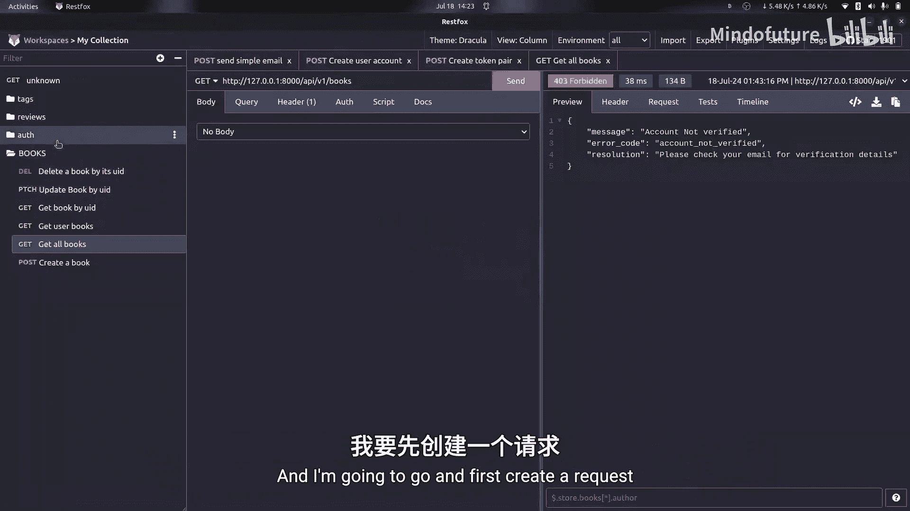

So this request is going to be one to send or request for a password request or password reset request。

 so we shall just say re say request password。

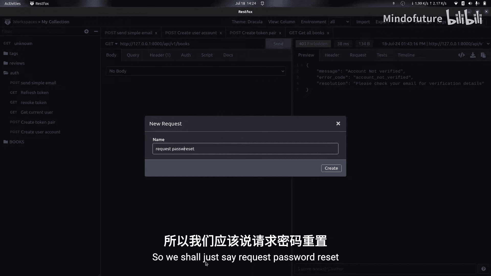

Research。And this is going to be a post request。So shall copy the URL。

 So I'm just going to get one of this and。Going to close some of the stuff that we have here。

So this is going to be our password reset request。 I'll past what we have here。

 and then instead of send mail， we shall have this being password。Reate request。I'll copy it。

 and then I'll move here， prevaate the link。And then when we try to send。

 we now see the our body is missing。 so we're going to send Jasonson。 and for our case we。

I simply going to go ahead and provide。 Let's say an email that has a valid email。

 Let me just provideva the email that we used at first。

To send an E and see if the password reset link is being sent。So if I send this， we have an error。

 So Json is invalid。 We're being told that this is supposed to be。Our it's supposed to be a j object。

 but I did it wrongly。 So I'm going to go ahead and provide the key， which is going to be our email。

 just like we did for askingki as right here has the email。So go ahead and make the request。

 Now we expect our email to be sent。 And when that email is being sent。

 then we shall go ahead and check our email to see if our password reset link has been performed Now I know some of you have noticed that delay in sending emails and one of the ways we can prevent this delay is by using background tasks and we're going to be looking at them in a coming video so we can use things like access or fast APIpi is in built background tasks so that we can have this being pushed to the queue while we wait for them to be executed so user will be able to get their message like you see right there while the sending of the email is being done in the background so to confirm if our email has been sent successfully。

 we are now going to navigate and go to the browser so I'm going to go ahead and open up Chrome。

And when I open up Chrome， I'm going to go to my G mail and see if the password reset link has been。

Sent。

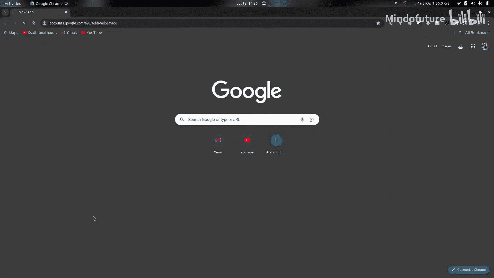

So just like you see， the password reset link has been sent and now it's telling us to reset our password。

I'm going to go ahead and visit it， and then we shall be able to see if our password reset link has been found。

So just like you can see right here， we see that our password reset link has been found。

 so if we try to click on this we're going to be redirect to our application and now we see that our body is missing so what we are supposed to do is to go ahead and send details or be able to make a request to this with our body so by clicking on the link what we are doing is to go ahead and make a。

A request that is a get request。 yet， we need to send the body via post。

 So for us to be able to achieve that， I'm going to go right down here inside our up。

 and I'm going to create a new request。 So this request is going to be one for。

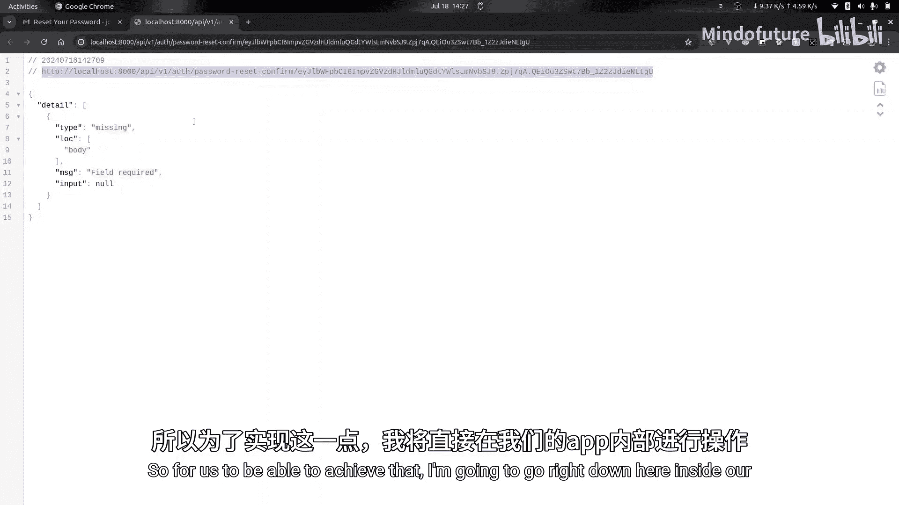

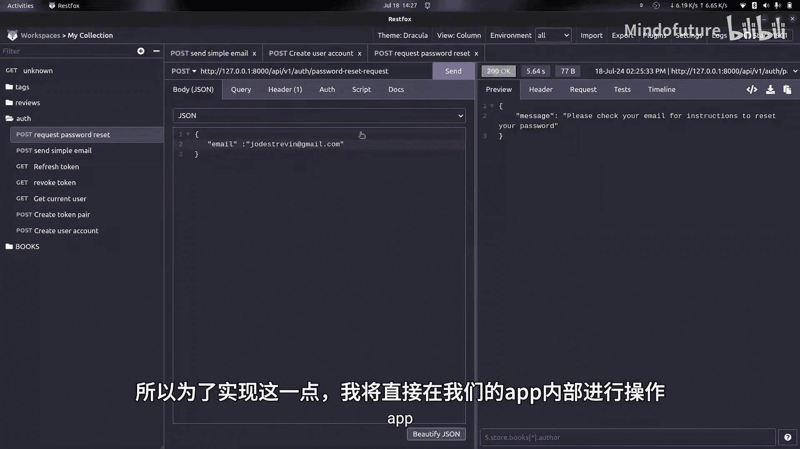

Reet。Pass flight confirmation， so。

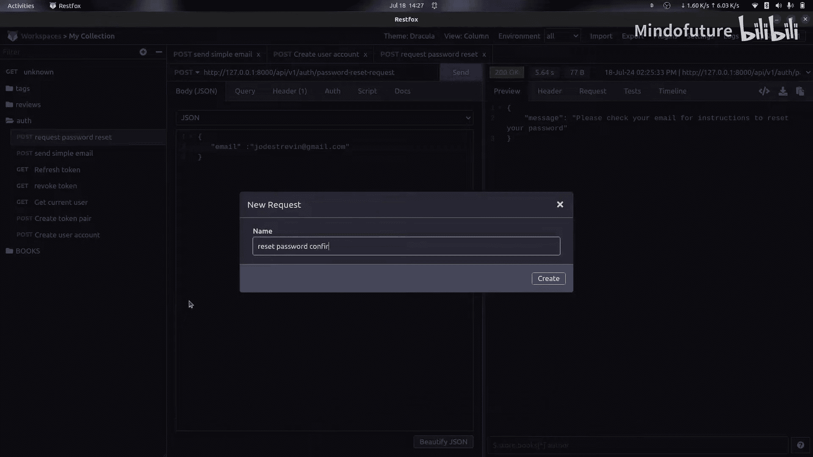

Once that is done， it's going to be a post request and then I'm going to copy the link that you got via our email。

 Once we have this link， we are going to pervade the body。

 Now this body is supposed to have the new password and the new password confirmation。

 So in here what you're going to do is to provide our new password。

So if we try to providevade a new password alone， let's say this is going to be a So I'm mean to make a more complex password like the what required。

 But in numbers， if we send this when you are going to be missing。

 So this is going to be a method not allowed。 So it seems like we have an issue where we have that specific week。

In point， so this is going to be post。 and we we're about to actually providevade the post method。

 So I'm going to go ahead and say this would be access via post。

So once we give the method to be post， of course we have to go ahead and make a request and now we see that we are missing the confirm new password field。

 So what I'm going to do is to first of all， saying a password that does not match the new password that we have right here。

We pervade this， so we're going to have confirm new password and in our values thats say going to be。

Required， but with the with letters instead of the numbers， if we send this。

 we shall see that our passwords do not match so we cannot be able to reset our password。

 But just in case I fix this and let's say。I try to。Miicko Christ。

And send their details when they match。So we have some error that is happening on NA aade and let's go ahead and see where that is coming from。

 so we see that the user object has no field password， so let's go ahead and see our model。

So when you go back to our moderator here， now see that the field is called password hash instead of password so that's the silly mistake I did。

 but when we get this password hash and then pervade it rate here in our re details。

 so instead of password we can have it being password hash。This time with be sent。

Co our password is going to be with successfully。 Now。

 let us go ahead and try to make sure that we log in with this user's old password so。

We are going to go back to where we created the torqueine pair and then we try to log in。

With the details of that specific user， we've sent the password request， so we shall say。

This email address and in the old password， then we shall see that invalid email or password。

 but then if we try to pervade the new password， which is just。Requied。Then shall be able to send。

So let me see if I've made a mistake here our password is required。

 so this three is the mistake phase send， we shall now see that our password requests or our password reset is successful so just like that we can be able to implement simple password requests for our application and even if we try to let's say access endpoints for this user I know this user is not yet verified fade if we try to let's say get a list of all books or access any endpoint for which we are protected and have authorization。

We shall see that they are not verified and therefore they can not be able to access that specific patch of our application。

What's up everyone welcome back Do that mean to be introducing background tasks in Fast step PA so a background task is any task or any process that you may want to push or offload of our request response cycle so that we improve the performance of our application。

And it is just as simple as that whenever I have a task that is going to take a lot of time and delay the rate which responses are being got by our clients。

 then that task is to be pushed to a background task。

 and lucky for asfa A has in built support for background tasks。

 but we can also use some battery included solution like let's say cery。

 and I'm going to be explaining all that in this video。

 So the first thing we're going to look at is a simple example of a task that takes a lot of time。

So for now， we have things like sending verification emails and password resets that involve the sending of emails。

 So let us go ahead and try to create a user account。 So right here， I have。

My database that has been cleared。 So we do not have any data inside our database。

 And what I'm going to do is to try to create user accounts using。

The credentials that have valid emails that the ones like the ones used in the previous video。

 so I mean to go back to create a user account and when I try to create a user account。

 we shall notice that there is a slight delay at which。The response is going to be returned。

 so we now see that this request is going to take 4。92 seconds。

 which is close to 5 seconds to complete。 and even in my time in right here。

 we'll see that the response is being returned after 4。88 seconds。

 which is kind of slow compared to how we may have wanted it to be。 So in this case。

 background task as the way to go， we may push the sending of email to a background task so that we don't have to wait for the response to be returned to the user。

And still have to send them the email。 So let us begin by looking at how we are going to implement that。

 So to start， I'm going to go to that exact endpoint for creating a user account。

 And in that endpoint， what I'm going to do is to push this line that sends the email just like we did in the previous video。

 So this is fast A mail sending the email。 But this task kind of takes a lot of time。

 So what I'm going to do is to push it to a background task。

 and for us to do that we are going to be making use of an inbuil dependency that fast Api pervades for us。

 and that is going to be the background tasks。Dependency， so using this class。

 we can be able to create an object， and that object will have different methods that will enable us to push。

A task or a process to the background so that it executes there and doesn't block the response。

 So what I'm going to do is to go back to our endpoint that creates a user account。

 and whatll do to just come right in here and inside our dependencies or inside the parameters for path handler I add one that I'm going to call background tasks。

 but I'll certainly need to BG tasks and that will be of tape background tasks。And once that is done。

 then Im is simply go ahead and basically add this to a background task。

 So to add this to a background task， I'll get rid of that await。

And then all I have to do is to say B G tasks dot in this case we shall say add task。

 So this is going to be add task， and then we shall add that specific method that sends the email。

 So for our case it's going to be male dot send message and the the first adjut that you have to per to the add task is going to be the function or the task that you want to send to the background。

 So our case is going to be mail dot send message and the second one is going to be all adjut to the。

Task that we provide the。 So for case， we have one at， which is going to be a message。

 So we have basically added this to the background。 Now， if we try to make the same request。

 So for our case， we are going to go ahead and。Change these details。

 so let me try to create a new user， I create this user with new credentials。

For a valid email and then you try to create the user account using background tests in this case。

So I parade the first name as Jonathan。 The last name as Sally and Renacentin。

We now were going to see that our request is being returned in milliseconds compared to where our response was being returned after five seconds。

 so even when you go right here。We are now seeing that response has been returned after 0。

45 sequence。 so basically that took less time that what indeed at first。

 So that's how background tasks work。 you just offload a task from your request response equal so that you can be able to retain a response while that task is being executed in the background I hope that has given you a brief introduction to background tasks in faster PA while fasterpa background tasks can be useful。

 there are going to be scenarios in which you may need to use a much more batteries included solutions such as cery Now such scenarios may include ones in which you have multiple background tasks running on the same serverva So when you have this background tests running on the same serverva。

 there actually means you're going to put a lot of load on your serverva and that can bring a lot of performance issues Now salaryry on the other hand allows you to run these processes on different servers if you want to and therefore increases performance by a very。

Great percentage。 So we're going to be looking at how we had new cery。So to begin。

 we' are going to install Cle。 I'm going to open up a new time in right here and I'll type Pip install。

Salry， and this will go ahead and add salary to our virtual environment。

 Once salary has been installed。 We are now going to go ahead and set up salary。

 So I've created a simple diagram right here that is going to allow us to understand the different concepts that are involved when working with salary。

 So the first concept is going to be the salary client。

 So the salary client simply refer to any code that are going to write to interface or to work with ce。

 So this client code is going to help us define the tasks that we need to send to ce for execution。

 and this is the same code that is going to allow us to push those tasks into the task queue。

 So another concept is that of the broker。 a broker is simply a way through which messages are going to be sent from our salary client to the salary workers。

 So instead the broker is where we find the task queue。

 and that's where we are going to send every message that we shall be sending from our client。

 Now workers are going to be processes that are going to look into。

Q to find any tasks that is going to be available for execution once these tasks have been good。

 then this workers will go ahead and run those tasks。

 execute them and if a result backend has been set up then the results of those tasks will be sent there for storage So think of a result back in as a simple database for storage or results once they are executed from our tasks So then a salary client will also be able to see the results of tasks。

 understand the statuses of such tasks and so on Now that we have a simple understanding of how salary works let us go ahead and set up salary So to begin I'm going to。

Move to our quad rate here。 And the first thing I'm going to do is to update our configuration so that we can make use of celery。

 So the first thing I'm going to do is to set up the broker URL。

 Now we're going to be using Redis in this video as our broker。

 So think of the broker as a medium that is going to allow us to send our messages to work we're going to be looking at how to set that up right now。

 So we're going to set up a simple variable called our broker URL。

 Now our broker URL is going to point to Redis that we already have installed and。

We're also going to look at how we're going to update our。

Ris config so that we can be able to simply use the URL instead of the credentials we've so far been using so this is going to be our redis URL now I'm going to get rid of the host and the port so that we just substitute them with the Redis URL so this is going to be a string but then we want to make this have a default value so I'm going to make this have a default value of the URL for our local Redis which is going to be redis on local host。

And then the port is going to be the default Port which is 6，3，7，9。

Then you can also point to a database such as database0。

 and that's what we're going to be using for our re。

 Now this means I also have to go ahead and update。

Where we actually set up our Redis when working with our token revoking so to do that I'll head over readyis P I inside source Db and then I'll have to update our Redis。

I'll have to update already。In， so that we can be able to use the redis conflictfig instead of the credentials like resetta right here。

So what I'm going to do is to come right here and then what I'll say is IO Redis dot in our case from URL now there is a consent that was raised in the previous videos where people were saying that the IO Redis package is not fully supported or is not supported anymore which is actually right so for those I highly recommend that you use the Redis client or the Redis official client since it now has support for I think IO and the function still remain the same so for you to be able to use it what you're going to do to just camera right here and say import Redis。

Dot I think I O as I O alreadyis。 So that's going to still work the same way。 So once you have that。

 then you can simply go ahead and still access the same function。 So you can say Iis dot from URL。

 And for a， you can still point to I URL as config。Dot， in our case， this is going to be our Red URL。

So once that has been set up， now let's go ahead and set up our readis for our salary。

 So I mean said they broke a URL to our config。Dot for our case， that's going to be our redis URL。

 And then we're also going to set up a result back in because we want to keep track of the results of the tasks。

 So what of these to just come right here and say。Result backend。嗯。And our result back end。

 in this case， is going to be config。Do so far shall still use our redis URL。 Now with that， then。

 let us go ahead and look at how we can create our fast task。

 So just like we looked at when using background tasks we can simply go ahead and modify this task of sending our emails so that is a ce task。

 So to do that we are going to go ahead and simply copy the code that is basically shared on every instance of sending an email and that is basically creating a message as well as sending that message as a background task。

 So I'm going to copy this， and then I'll move it to our config do P actually I'm going to move it to a file that's specific to salaryry so。

To set up aill， which I haven't actually done， we have set up our salary config。

 Now we need to go ahead and create what is called a app。

 So I'm going to go ahead and create a new file。 So this new file is what I'm going to call a salary tasks P。

So inside that salary tasks to the P， we're going to first of all。

 create a ce app instance or the ce app。 So to do that， we're going to first of all， imports salary。

And once we've imported cery， we have to create our salary app as an instance of our salary class。

Once we've created this， then we're going to point to the configuration that we've so far set up in our confi dot P way。

 So to do that I'm going to come and say salary app。

Dot config so we can configuregate from the command lane from environment variables。

 We can also use that dot from object that will take in the file or module where our configuration is。

 So remember that we've set our configuration in the config dot P I file or module that's present inside our source for directory。

 So what I'm going to do is to go ahead and modify that and simply provide the value of source dot config。

 So that's going to be where our。Cleary configurationion is going to be found。

 So once I'm done with that， then I'm going to create a fast task。 So to create a task。

 we have to just have a function。 And for makers our function is going to be send email。

 So this is going to take in whatever ats， but we're going to just simply place the code for sending an email inside here。

 and to make a function as a ceary task。 What you have to do is to create a decorator using our ce app instance。

 And that is going to be the one to Mac。A function as a salaryary task。 So for us to do that。

 I'm going to come right here。 And all I have to do is to say at salary app for I guess we shall go ahead and。

Call a task。翻程。And once we've called it task function now this means that this is aciary task So once we've been able to do this now we're going to modify our function so that we make it one that's going to be executed by ce。

 So I'm going to first of all import what is undefined within our ceary task file and I think that is where we get the male object and the create message function。

 So I come here and I add them。And that will be just enough for us to get rid of those and defs。

 I'm also going to remove these big G dot ad tasks。And then。Once that is done。

 we shall just remain with a same message and it's one ajut， which is the message to be sent。

 Now one thing that's important to note is salary tasks are not going to be as synchronous。

 So salary does not have the support for sending as synchronous tasks inside our function。

 So basically if youre to run your asynchronous code inside your salary tasks。

 what you have to do is to figure out a way to convert that asy code or to make it run within your synchronous code。

 So I've been looking around and I found a very nice tool that is created by the same people created the jungle framework and that is called a AsI ref。

 So asI ref prevails a lot of function wrapas， but it simply providess those that help you to。

Convert or make your asynchronous code run within the context of synchronous code。

 So it also provides the function wrapper that will be allowing you to run your synchronous code you say the context of synchronous code。

 So if you're confused about that I'm going to be showing you how that can be done。

 So we're going to begin by importing or installing asG ref I'm just going to camera here and I'll see install。

Asi ref。 And once I've installed Aski ref。Then we shall be having the ability to use this quarantine。

 which is accurate or send message function， which comes from fast API mail inside the context of our synchronous send mail or send email function。

So what I'm going to do is to first of all get this。

 so I'm going to remove this and create a parameter called recipients。

And then I'm also going to get a parameter called subject so I'm going to make sure that all of these are dynamic by simply providinging themma as parameters。

 then I also provide the HTML message so what I'm going to come and do is to go inside our send mail function and what I'll do here is to just come right here and say that we shall have recipients。

 so our recipients。Are going to be a list of recipients。And that will be a list。

 so then we're going to come and say that this will be a list。And this list can be a list of strings。

 So those are going to be emails。 And then once I've been able to do that。

 then you can also have a subject。 So a subject is also going to be a string。

And then we can also have a body。 So our body will be a string。

 So that's going to be the details of the message that's going to be seen within our email。

 So one thing we've we've done is to go ahead and call this same message function。

 but just like I explained it a qua。 and therefore we have to fast make sure that it is。

Converted into code that can simply run with our synchronized function。 So I'm going to first of all。

 import that function that's going to help us achieve that。 So' say from ASI。

Ref dot in our case we're going to import the sync module and inside it we shall go ahead and get access to that as sync to sync function。

 So this is a function that is going to help us to basically convert a synchronous code to synchronous code so that we can run it inside the context of synchronous code。

 So one thing I need to do just go ahead and convert this mail dot send into an as synchronized function So to do that I'll just come and call a sync to sync and then what I'll do is to pervade a syn mail and if we want to run it then we have to go ahead and pervade this extra brackets so then we have to go ahead and pervade this specific message so I'll go ahead and perde the message that we've created right here and this will be just enough for us to send the message So one thing I've missed here is going to be our body so。

I think I need to go ahead and just remove the HML message， replacing it with a body。And yeah。

 we've created our fast ceary task。 Now， we need to go ahead and call this function。

 And for us to call this function， we need to call it not as a normal function， but as a ceary task。

 so。If we want to achieve that， then what we're going to do is to simply go within our routes and I'm going to go to that specific part where we have these specific functions or where we actually go ahead and send emails So I'll go ahead and get rid of all the code that we've written for sending messages and what I'll do is to go ahead and replace it with our ce task So I'll go ahead the top here and our'll first import that task that we've created so I'll say from dot ce tasks actually that's going to be from source ce tasks we are going to go ahead and import our send email function or task So far I case for us to go ahead and call that all we have to do is to just say send email but instead of calling it as a normal function。

 we are going to go ahead and call it as a ce task So to call it as a ce task we're going to use that dot delay。

Method， and then we shall pervade all the argumentsdjuts that are present in。That specific task。

 So our first train is going to be our recipients。 Now。

 I'm going to provide our recipients as emails。And then， we shall have。The subject， sovas。

 our subject is going to be welcome to the app。So I just say a subject is going to be a subject。

 and then I'll create a variable called as subject。

So our subject in this case is going to be welcome。To up。And then when I have that。

 then I have the body。 I think that's the last at。 So that's exactly what we shall parade right here。

 So our body is going to be called to our Htm。 So I'll just go ahead and provide ourhtMl just like you see right there。

 So this has updated our code to make sure that we send our emails as a salary task。

 So I'm going to go ahead and copy this。 and it's the same thing that we're going to do after creating a user account。

 So I'm going to get rid of all this。 and then I replace it with send mail， send email dot delay。

 So here I need to come up with a list of emails where we're going to actually send the email So I'm just going to create that and emails it's going to be a list of。

Our emails， but for our wanted to send to the user email that we've got right here。Now。

 the subject for our message is going to simply be verify your email。

 so I'll just come wait here and say the our subject is going to be verify your email。

And then we can also have the body， which is going to be our H T M L。

 So I think that's what we have here our H TML message。

 And I'm going to just go ahead and update that。 And then this will be just enough for us to send our email。

 So I'm going to go ahead and save。 Now it seems like I have an error somewhere。

Let me just go ahead and fix that。So it's this small， equal saying。So once that has been fixed， now。

 let's go ahead and look at how we can run our tasks so。

To run our tasks we first of all have to go ahead and run a salary worker。

 So a salary worker is going to be a process that's going to run independent of our serverva and all it's going to do is to look for tasks that are present within the queue once these tasks are available is's going to then execute those tasks so that we can finally get the results out of executing those tasks so to begin I'm going to open up a terminal right here so I'm going to simply。

Make that time you know independent of the one to run a server， so Asa is not training。

 but I'm willing to simply restart it with fast APA， dev and then source。And once that is done。

 then we shall also open up another terminal we know we are going to run our salary worker process so to run salary。

 all we have to do is to just access the salary command once we have salary installed we're going to have the salary command and these are some of the command that are present with that command or subcom so。

Right now we are going to simply go ahead and run salary and we have to point to the app that we're going to be using as our app。

 So the app in salary is going to be the module in which our salary。In， ary app is found。 Now。

 if want to access that， all you have to is to go ahead and access that with sauce。And for case。

 we can go ahead and point to source do cery tasks。

And that will simply go ahead and identify our salary tasks as where the app instance is。

 But since we have not called it ce tasks or since we have not called it up。

 then we have to go ahead and specify that our app is C up because that's the ce app instance in case we have called it up。

 then it will directly see where the ce app instance is and therefore we run our salary。

 So then have to go ahead and specify what we want to create So far case we want to create a worker so we have to pervade the worker subcom。

 when you press enter， this is going to go ahead and run ce as a process So right now we can see some of the details and we are seeing that this is running a wer So this is the ce worker rate here and it's running it on this platform which is our Linux machine we have a app and then we have the transport So the transport is going to be the broker。

 which I defined as us。Readis， so we see the redis URL that we provided rate here。

 We also see the result back in that we've set up。 we see concurrency so4， and then task events off。

 But then we see a warning rate here。 So this warning is telling us broker connection re configuration setting we no longer be we'll no longer determine whether broker connection res are made during startup in salary 6 and above。

 So if we to retain the existence behavior， then should set this。

 So I'm going to go ahead and modify our configuration to add this。 So I'm just going to go ahead。

 So our press control C。 that's why the salary worker is going to stop。

 But then what I have to do is to copy this specific part here。

 and then head over back to our configurations。So I' set for our config dot P and then I'll add one configuration。

 so in this case I'll just go ahead and set it to true just like I've been advanced。

 so I'll just come right here and say true once that is done then the next thing is going to be for me to restart our worker。

So that's going to go ahead and run our up or run our cery worker。

 So now that there are no warnings that are being given， we are good to go。

 So let's now go ahead and experiment with the tasks that we have created so to begin。

 I'm going to create a new terminal and I'm going to open up my python shell I'll save Python 3 So once I've been able to do that I'll then go ahead and import our tasks so I'll save from celery or from source dot cery tasks。

In this case， we are going to go ahead and import our send E function。

So once the same email function has been imported， then we're going to go ahead and simply call it with some adjuts。

 So in this case if we go ahead and let's say call it with the let's just create some simple adjuts。

 So the first one is going to be our recipients。 I'm to come right here and provide our recipients as。

A list of recipients。 Now I'm going to go ahead and provideva my email。

And once I providedvaded my email， this is going to be a list。

 Now I need to also go ahead and providevade the subject。So as subject is going to be。

 let's say sample email。So once I've been able to do that。

 then I'll finally provide the message or the body that I want to send。

 so I'll say that our body is going to be， let's say each one。And then in this case。

 Ill say sample message。And then I'll close that。And once I've been able to do that。

 when you call this function。Shall now see that。I hope that everything is terminated。

 so for now we see that this function is being called but in this case it's not being called as aciary task so we can even check our email to confirm if the email has been sent。

 So what I'll do is to open up my browser right here and I'll go to my email。

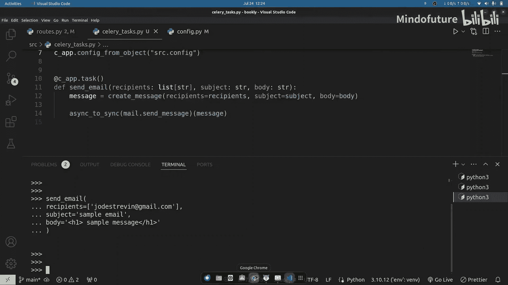

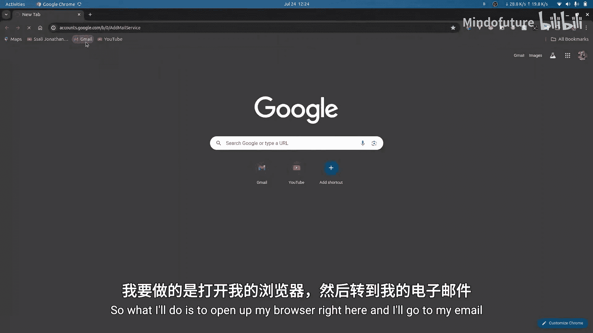

嗯。And then I see that our sample message has been received。

 but this is not being sent as aciary task。 So this is being sent on the same processes that we are sending or running our application。

 and that's where we see our message has been run。 So one thing that we need to know is。

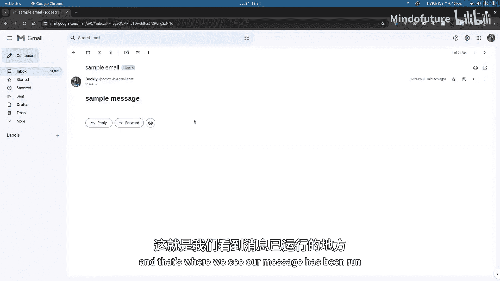

This is not a cery task and therefore salaryry has not executed it。

 So even in our salary console we' not going to be seeing anything。

 but in case we want to run it as a ce task， then what we're going to do is to simply call that do delay method just like we did in our functions for sending the emails。

 just like we did right here。So that's going to simply go back to where we sent that email。

 So we're going to run the same way that we did write here。 So what I'll do is to simply copy this。

 or I'll just actually go ahead and manually type it。 So I'll say send email。

 So I guess that's going to be as send。也没有。And then we shall call that door to delay。

And this actually just called this task1。And our test point is simply going to be one that's going to send our email。

 So we say send email delayle。Then I'll go ahead and pervade our recipients。

So our recipients is going to be a list of recipients。

 but this is going to be a list Now let me providevade my list of recipients。

And then I'm going to go ahead and provide。 So the next thing is going to be our subject。

 So our subject seal is going to be our sample email。Once that is done。

 then I'm going to go ahead and provide our HTMLtm or our body。 So our body in this case。

 I'll just provide an H1。And this head one is still going to be sample message。So once this is done。

 I'm going to go ahead and simply close the brackets and then we shall have a fast task created。

 Now if we call a fast task， it is going to be task1。

 we shall see that instead of returning the result we are getting what is called and assign result object and even in ourili we are going to notice that nothing has been called。

 so this task has been added to our queue and we can even be able to see its result。

 So for our case we can actually check for this status if we task1。

We can actually see the result of this so we can actually see the status first。

 we can now see that this has been executed。 Therefore our email has been sent。

 but all this is being done in the background。 So if you go to our email we shall now see that this email has been sent and therefore we have a sample email now to make this interesting we can actually try to do some logging to show whether our tasks are being ran so。

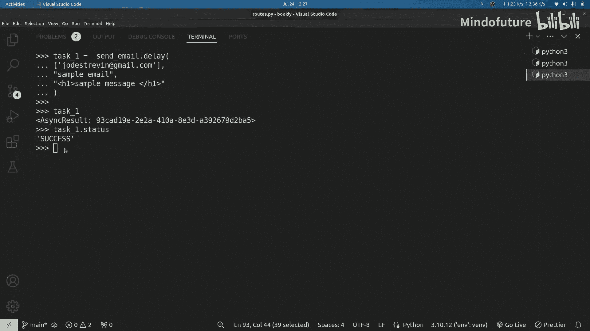

For now， I'm not getting any logging whatsoever。 That's why you see that I'm simply getting a plane console here。

 So what I'm going to do is to first of all， stop the worker。And。When I stop the Waka。

 I'm going to go ahead and do some printing inside theillary tasks。

 So I'm going to go ahead and simply。Print。Email sent。Yeah。And once that is done。

 So every time you update the salaryary task code， you have to also go ahead and restart your workka。

 So mean to restart workka。And once I've restarted our worker， now I'm going to go inside here。

 and let's say create another task so I'm just simply going to create a task。

And that's going to be my task too。 So for our case this is going to be sent。Email。

 and then I'll provide the recipient list。 so'll provide the same email right here。嗯。

And then I'll go ahead and parade。A simple message。 So in our case， let's a sample。Ma有， true。

Rattually made the syntax error。 So let me just repeat the entire thing。

Then Ill operate simple mail 2， and then I operate the H TM mail。 So the H T Ml in this case。

 I'll just simply create an H1。And this each one is going to be another sample message。 Now。

 let me make this a little bit bigger。So once this is done。

 I'm going to go ahead and close the brackets。And now， when I press enter。

This test will be executed so even here。It seems like I'm not getting any logging for my salaryary tasks so but then you can check its status So for example。

 if we check for the status of task too。So none type object has no attribute status So I think this is being this is not being sent because I didn't call it as a task。

 So for me to fix this still I can go ahead and still call it as a task。 So that's the mistake I did。

 So this is going to be task to dot task2 which is send email is going to be task to dot delay。

And then we can simply go ahead and pervade the rest of the ats that we passed in here so we we providevade the recipient list。

 then we shall providevade the subjects and then the body of that email so let me go ahead and close this。

And now that would be enough for us to get our task run。

 So still now we can see that our email has been sent because of the logging we've set up。

 and then you can also see the status of our tasks。 So， for example， we can no task to do status。

And that will show us that this has been。Successfully ran。

 so even when we have tasks that have failed， we can still see the status of those tasks via the tasks status all this happens because we set up a result back and to do that when we check our email you now see that our task has been sent by this email has been sent from our background tasks just like we did So while showing your tasks or seeing the status says of your tasks from your terminal can be enough。

 there may be instances where you want a more detailed more beautiful representation of the statuses of your tasks and how long those tasks took or which tasks actually also failed。

 So that brings to you the need for you to have a visual interface or a graphical user interface that can allow you to see the progress of your tasks and the details of those specific tasks So ce has graphical user interface。

 which is a web interface that helps you to see。

The progress of your tasks， your workersers and other details about yourary workersers。

 and that's what we're going to be looking at right now。 So to install flour。

 all we're going to do is to go inside our time array here。

 I'm going to get rid of what we are performing with controlr and Z and then I'll begin by installing flour So I'll say peep install。

拉我。And this will go ahead and install flour within a virtual environment。

 And once flour has been installed， then we can go ahead and run flour flour celery worker。 Now。

 for flour to work， there has to be a result back in fast and therefore we also need to have a celery wka that's running first to rent flour is going to be as easy as running our celery。

 so we can run celery with a configuration that we've set up。

 something we're going to do the same thing with celery。And then you shall point to our app。

 which is going to be source do celery tasks。Dot celery up。 And then in this case。

 we shall just rent the flower sub command。And once when you ran this， we're going to run a new task。

 So here we see a salary module。 So the module source salary tasks C up was not found。

 So this is the mistake I did that was supposed to be salary tasks do salary app。

 So when you ran this。We now see that we've started a new process or a new web server。

 but this is running a web interface， and that's going to be on our broker， which is ouris。

 And then you should also look for any tasks that we've registered。

 So for now we have one task which is going to be the one to send our emails but there are also other tasks that are specific to salary just like you see right here Now one other thing I forgot to mention is salary also has that mechanism of auto discovering the tasks that we've created。

 So it will go ahead and see look through our code and in those tasks that we've created with our salary app instance with which we've run our workerss right here so。

Let's go ahead and visit the URL on which our flower is running。 So when I click this link。

I open up my browser， which is Chrome， and then a beautiful user interface is going to be run just like you see right here。

 So on this user interface， we can be able to monitor and see the worker that we have。

 So for example， this is going to be a salary worker and this salary worker is the one that we actually running rate now terminal。

So if we are to see right here， this worker process that we' are running right here is what is being given here so we can see the details that we are actually using for this specific worker so the implementation。

 the match concurrency processes and all those details can be found right here so information about the broker we are using redis and all its details are being written right here queues if we have any specific tasks。

 all of those are going to be detailed right here configurations and。All things that are needed。

 all that is going to be found right here。 So for now what you need to do is to just simply run a task and then see if this task is going to be added to ourQ。

 So if we have any task， we cant even see the details of those tasks。

 So let us try to actually create a simple task。 Now what I'm going to do is to simply go inside that terminal right here I create a new terminal and inside this terminal let me actually do this by request response thing Now I think。

I need to go to my for straight here。 I don't know if I have this user in a database。

 but if I have them then I can go ahead and delete the users。

 so do not mind in my case I have the database deleted。

 but then we shall have a way in which you can keep all these together。

 So I'm going to open up my PSQL with my user being my user and the Db name being the。

Book click D B the one that you're actually using right here。

 So once I've connected to our database right here， and I'm then going to go ahead and。

Simply delete from our users。 Now we can afford to do this in testing and development。

 but in production it becomes hard for you to do that because you don't want to lose your data。

 Well I want you is to test out the email functionality but want to test out our salary background tasks。

 Now we're going try to create a user for this specific details and when I send our account is going to be created。

 now I want you to notice one thing。 we now see that this task is going to be pushed right here。

 executed and then it will be moved to processed。 So if we go ahead and view the details of that specific tasks we shall head over to test rate here and then we can see what is being performed。

 So for our case， this task is going to be one to send email just like you see right here。

 it will be uniquely identified by this U and then we can have the state of that specific task。

 which is success。 we can see the。

Specific details that were sent with that task。 And if we have any。P white argumentsts that we sent。

 those will be added right here。 Since， we are not retain anything。

 That's why we are being brought to the result of none。 And then we can have all the other details。

 So this will received at this time it set at this time and then it succeeded at this time。

 So using fly can be able to get all those details and be able to visualize them via this graphical user interface。

 Now to make this interesting， I'm going to call that endpoint that you created for sending simple emails。

 So I'm going to send this multiple times and then we shall visualize how those tasks are going to be sent。

 So I'll go ahead and send very many emails and then all those are going to be sent right here。

 So we have for being active and then they' will be processed and then theyll go ahead and succeed。

 So we now see just like you see right here it it's active and then send to processed and then after if you have any that failed。

 we shall see all of them。

SailingAnd being displayed right here。 So you can even see their details。

 just like you see right here and all those。For be added to the list of tasks that are stored within our result back end。

 So even when I go to my email， I'll still notice that all these emails are going to be sent to my email and all that functionality is going to be offloaded of my serverva。

 which is beautiful， which is interesting。

What's up everyone。 welcome back to the series。 Now that we've been able to build our APA with different features。

 we can go ahead and document our EPA to make sure that our APA is given to those who may want to consume it If you are to build any sort of application and APA is simply a way that you're going to give other people the ability to use that application。

 Now for our case， what we have built is a simple web service that needs to be shown or used by planned applications。

 Now those can be mobile apps or web apps and so on。

 So for us to make this readily available in a way that can be easily used。

 we need to create a documentation that's going to be easy to understand and easy to work with。

 Now the beauty about fast APA is it can be the functionality of creating this documentation in a hassle free way all we have to do is to define our endpoints。

 Def our schemas and the documentation will be automatically created for us Now fast APA does this by using what it called。

O APIPA specification。 So this is basically a standard of documenting As based of the schemas that are defined within the APAs。

 So whenever I go ahead and define let's say idant models or structures of data within our app Those structures are the ones that are going to be generating a structure to document our application So what I'm going to do is to go ahead and visit our documentation I'm going to open up my browser right here。

And then when I open up my browser， we're going to navigate to our local host， 8000 slash dos。

So one thing that we can see is this beautiful documentation right here。

 and this is the documentation of our EPA or our application。

 so it contains all the endpoints that weve built and what they do so wherever we define a route handler that route handler was basically made into the specific description of that endpoint just like you see right here。

 so this is the endpoint for sending an email So this is one for creating a user account very fine user accounts logging in users。

 creating new access dos So that shows you that it's very important for you to use descriptive pathhandr name so that you can have an easy documentation like the one that we have here。

And I think that we can see is that all these endpoints have been grouped。

 So whenever we created routes， we went ahead and also provided tags to those routers。

 So if we go back to our right here and we go within our d P every time we registered our router we went ahead and also specified a list of tags to be used with that router。

 and that's what we can see here on the documentation that book endpoints are grouped within the collection where the is books So we also have the endpoints。

 which are these endpoints we have the review endpoints and we also have the tags endpoints。

 Now one other thing that we can see is all the methods for those specific routes are defined here and when you go ahead and view the details we can see pretty much everything we want to see。

 So this is a get request and it's supposed to return。

A20 status code if it's successful。 and then we are also supposed to see the data。

 which is going to be a list of our books。 So all this stuff or all this information is detailed within our endpoints。

 And if you go within our book routes， we can see that the endpoint for retaining old books is going to return a list of books。

 and that is what is being detailed right here。 So whenever I create your APA it's very important that you define all that data in a very nice way。

 whenever you go ahead and clearly define your data models， your response says the status codes。

 all that stuff is going to be automatically generated by fasterPA to help you have your documentation clear。

 Another thing is the schemas that you created。 So the schemas or idantic models that you created are all detailed right here。

 So that can set from the book model which has all the fields and the data tapes that are。

Basically， belonging to book objects。 we also have one for let's say returning the email models。

 so this has the list of email addresses and this can have mail items。

 We also see the one for maybe getting a book details。

 So these complex models that we created that are related also show the kind of data structure that the book detail has。

 So we see the list of reviews being returned right here and the item can contain information about reviews。

 and these are the different fields that a review can have。

 So this is basically done for us straight out of the box we do not have to hassle。

 or we have to this to go ahead and define our APA endpoints in a right way Def as scheme as in a right way and then fastPA will do all this and that are hood for us to be able to have our APIPA documentation。

 our authorization is also documented if to look at the author button right here it will show you that you have the access to canber us。

 So if you looked at。

Authentication part of the series went ahead and looked at how we could protect endpoints using IHttP bear Earth so when you try to get。

 let's say a token from the endpoint that is to help us get tokens we can go ahead and see the request body so required to present an email and a password so if we try to get these details I can go ahead and provide my email。

So the email I'm going to use is this email right here。You can also pervaate the password。

So the password is test 1，2 3。 If I pervade this simple password。 I'll now see the response。

 So the response is going to contain。The access toolken， I'll copy it right here。

And then I'll paste it inside our author authorization section。

 one thing I need you to notice is we can also see the protected endpoints so all endpoints that have this keep。

These padlock icon are going to be protected and therefore we shall need to access them when we have the token or when we have our authorization headers。

 so I'll go ahead and set our authorization header for the access token author and now we see that theres a change in the color of the icon so that means we can access those endpoints so。

If you want to create the refresh token， we can also get it and then simply put it right where we have a refresh token error。

 So that is how fast EPA's documentation works and it's just pretty straightforward all you need to do is to write your EPA path well describe this status codes。

 the information about the data they need the different parameters and you have everything set up so just like you can see in our o the one that requires a token will get that specific token and so on and so forth。

We can also go ahead and add some customization to this specific documentation by giving more details about this documentation。

 so by doing so we shall be modifying the metadata of our documentation and to do this we can do this within our app instance that we set up within our FAPA project so we can go within our main app instance and within our main app instance we can add the description just like CR right here we can add the version so this version is the one that we see right here we can also go ahead and detail things such as let's say the terms of service so this is basically going to contain the URL you can add so the terms of service this can be the URL to the terms of service and then we can also have things such as let's say。

So these are basically found within the faster P。 I am kind of forgetting them。

 but you can have things such as let's say the title， which we've providedd the description。

 which is our description right here， the summary， the version。Ts such as the。

S as dependencies redirect URL。 Now we can also modify where I want a docs to be。

 We can just come and say that Add docs URL is going to be found on。Slash。

 so let me actually close this。 Can go ahead and pervade that to an hour。Slash APA。

Slash version when or slash the version that you set。And then we can simply providevade the doux URL。

 So instead of accessing it here。We can go ahead and access it tone。

So this is this will not be found， but if we try to go to。

 let's say where we have that EPA slash version1。

Slash dogs。In our case， we shall be able to get dots and another thing we can providevade the other details about the met datata。

 Now let me look at those。 we have the terms of service， so this is going to be a string。

 the contact so the contact is going to be dictionary so let me actually go ahead and add that So H I'll providevade the contact dictionary So this will have the URL and。

And then we need to providevade the email。

So the email are give me simple email right here。And then。I think they should go ahead and show。

On the documentation of the APIPA， so contact the developer just like you see right its here。

Now， you can go ahead and custom this to anything you want。

 so we can add the the contact information， the license info so this can contain which license you're using。

Responses and all the other things， but all admitted data can be updated inside the FastPA instance。

 So I hope you have a better understanding of how to document an APA with FAPA and open EPA specification。

Now， after that， you also have support for reddoox。 So if you're using this API specification。

 you can have the swaaggi documentation， which is the one that we have here。

 but you can also have the reddooc documentation that's going to be found on the reddooc URL。

 so we have indeed set that up But what you can do is to come and also set that up to be found。

On slash aPA slash legend then slash our reddooc。 So instead of this being our dooc URL。

 we can rename this to redooc URL。

And then we can have our re documentation。

Poound on that specific URL so we can just comment here on slash reddooc。

So I hope that is what we have set up here。 This is not supposed to be dos。

 but it's supposed to be redooc。

So if we come this and visit our Ri Qr shall now see another way our documentation is going to be shown so we see that we have our documentation。

 so this is the open API specification and is simply a file。

That has the entire structure of our documentation。So， we have an email。And of course。

 this is what faster API and open API specification will be。

 So this is going to be a Json representation of the structure of our endpoints。

 just like we've gone ahead to describe them。But all that is made beautiful in this specific presentation right here so we can see which API endpoint。

 which status test code is going to be returneded and which information is going to be returneded。

 so all that information is going to be detailed in our redoc and our Swaga documentation。

Whats up everyone， We'll come back to the series in this video we're going to be looking at testing。

 which is basically a way for us to be assured of the workings of our APA。

 We've so been doing manual testing by the use of tools such as rest folkss Now you can use tools like Postman or insomia that can pretty much do the same thing to make requests to our aPA and return responses from those requests we're going to be looking at automated tests that are going to allow us to basically have code that we run and tests whether our application not the same way in all circumstances So we're going to be first of all rating unit tests and unit tests are simply going to be code to test specific functionality or endpoints within our application and to end this videore going to be using a tool that is called schemasis So schema thesis is going to help us to run code throughout our entire application。

test based of our APA documentation or APA specification。 So to begin。

 we're going to install pay tests。 So right here I make I'm going to go ahead and run H。Inスト。Aitist。

And once I've installed Pay test， I'm now going to go ahead and set up Pay test to work with the application。

 so to do that we are going to come within our folder which is our source folder right here。

 I'm going to create a new folder that I'm going call tests。So inside it test。

 I'm going to create ada， you need to PI file。And this is going to make this as a package This we're going to be importing very many objects from our application。

 So another thing we're going to do is write a file called the conf test file。

So this is going to be specific to setting up pay test to work with our tests。

 So this is where we're going to do things such as over dependencies。

 setting up fixtures and stuff like that。 So the first thing we're going to do is to first think of。

Functionity that you may mock or functionality that you may create fixed as for。

 One example is going to be the code for connecting to our database。 Now。

 if you have not been following this series， all the code for connecting to our database is going to come from our source mean dot P A。

 and we are basically using our get session object we are which we are getting from this get session。

Function rate here。 So we are calling this as a dependency in every route that actually needs to have this dependency。

 which is not what we're going to do for our test because we need to make sure our tests run faster and do not connect to our database。

So for us to go ahead and mock that functionality。We're going to be overlay overiding that dependency so we are going to do that by first of all。

 using our app instance that we created to override that dependency using a mock dependency that we shall set up So to begin we're going to import that functions so save from source dot DB dot main we're going to go ahead and import the get session function and once we've imported it we're going to now go ahead and mock it So to mock it we're going to be making use of unit tests。

Dot mock。 And we shall go ahead and import a class called mock。

 So this mock class is one that' is going to help us to create all mock session or all mock objects that we're going to use for our tests。

 So I'm just going to come here and say the R mo session object is going to be an object of type mock。

 But for us to go ahead and return it just like we return our get session dependency。

 Then we have to return it or yield it from a function。

 So we're going to go ahead and create this as get session。But in this case。

 its going to be retaining a gate mo session。 Now， if you're not understanding this。

 you're going to understand it in a minute。 So what we are doing here is to go ahead and yield this mo session object similar to the way we we yielded our session that we' are using within our routes。

我。Similar to the way that we created our session object。 So once weve at this。

 the en fast API is going to help us to over that dependency such that each time we run our test we are not training them on our existing database。

 So to do that we're going to come and import our app instance so I'll just come at the top and say from source do in this case I think it's located within our main source。

All that。 And once weve accessed that up instance， we now just need to go ahead and override that dependency so that we don't use it if you。

Confid about the dependency I'm talking about， that is the dependency that we are providingvaing for each of the times。

 we are using our session objects。 So this is a get session dependency。

 But in case you want to override it， we are going to be replacing it with a get mark session。

 So yeah hope youve understood that。 So once we put it up。

 we need to just go ahead and call a dependency overdes and this dependency over is a dictionary。

 the text in a key as。The name of the depends you are providingvading so for our case for pre the get session。

 we can now update it to the value of our get mark session。And that is just enough for us to。

Entirely， overr that specific get session dependency so that we use the get mark session dependency。

Once you've been able to do that， you can now go ahead and also create a fixture。

Wwhich is simply data with initial values that we can use for testing。

 Now that's going to be the fixture for our mo session or our fixation。

 So to do that we're going to be making use of pay test and P test is going to help us create a decorator that will decorate the function to return that specific fixture So I'll go ahead and import。

Hitist。And once you've input it pay test， I can go ahead and say add pay test dot fixture。

So we can create a function and name that function， whatever we want。

 Now just call this the fake session object。And this fix is just simply going to have the value of the Mo session。

 We can pretty much do this for other functions。 So for example。

 if want to create a fake user service object that we use for let's say let me show you actually when you go to our source of we have the user service class。

 we can also create a fake user service object that shall have all these method so that we can check if those were actually called within our code so to do that I can just simply camera right here and say at am。

User service。It's going to equal to a mock。Object， and once we've created this morequis service。

 we can go ahead and also create a fixture for it by seeing at pay test。Dot fixture。And flag case。

 we can simply create that as de big。User service。So， this is going to be。

Returning our morecusa service。So you may ask， why are we using mock objects or why are we going to even set up these mock objects in the first place？

 So these mock objects are going to be used for testing to allow us to skip those partss that need us to interact with that database。

 So instead of going ahead and testing SQL alche or SQl model。

 we have the assurance that these are already tested and therefore we need to test the code that we've written our cells。

 So that's why I'm setting up these dependencies or setting up these mock objects for the code that we've written our cells。

 So I'm not going to check for things like let's say that are being saved or we can actually go ahead and call and check if those methods are being called without having to check if data is actually saved because that is automatically done for us。

 So to set up our fast tests， we are going to go ahead and also create a test client。

 which is going to be the medium through it fastPA or pay test is going to send requests to。

APA and tested。 So to do that， we are going to import the test planned class from paid from actually。

 that's going to be pervaded from fast APA。 So I'll say from from fast APA。Dot test client。

 we arrange to go ahead and import the test client。 And once we've imported the test client。

 we can also create a fixture for it so that we do not repeat ourselves or so that we don't actually go ahead and call it a lot of times。

 So I can just come reach and say a pay test dot fixture。And for our case。

 we can simply go ahead and hold this our test client。

So this test client is going to be a test client object。

 but it's going to be the one that's returned from our app。

 So the test client object is going to require us to provideva the app instance。

 which is going to be our。Up instance rate here。 So once this is done now。

 let's go ahead and rate artists。 So I mean to come right here and create a module or a file。

 which I mean to call test o dot P A。Now this test of the PA is simply going to have quote for some endpoints on our authentication to start。

 I'm going to create a function that's going to test for our user creations I can call this test user creation and this is going to take all the fixed chairs that we're going to need to test that so to test this we need to go ahead and provide a fixtures of credit three fixed shares render is for the fixation。

 the fake user service as well as the test client I'm going to go ahead and provide those because we are going to be using them to make a sessions about the behavior up so。

I'm going to come right here and the first thing I'll have to parade is going to be our fix session。

 and then we shall also parade ourfi。 so this will be ourfi。Use our service。

Once we provided our user service， we shall also need the F test client or the test client fixture。

So once those are done and once those are written the way they are here。

 so you have fixedation for service and test client， we can now go ahead and use them。

 so I need to go ahead and first of all。Make a request for API using our。

Bick or our test client that we've set up。 So to do that。

 I'm going to come right here and create a response object。

 So this is going to make is over our test client。 So it's going to be test client and then we can call a method。

 So our method is going to be the post method。 Now this post method is going to be having the URL or the path on which we need to write our test。

 So I'm going to create the version or the prefix So the prefix is going to be the path that's going to uniquely identify all the o endpoints。

 so I can just say this going to be our of prefix and this odd prefix is going to be on that slash fPA slash version1 and then slash o So I can just go ahead and make this an F string。

Well， we shall have our prefix coming fast， so we shall have a prefix and then we can go ahead and call the same up path。

 I think that's the one for creating a user account just like the one we have here I think we need to do is to provide the JO that's going to be is to create the user account Now this is going to be the JO so I can copy it from here and then I provide it here。

 so I'll say JON is going to be to our JO Now once this is then we assure that our client has made a post request with add data to the EPA Now let's go ahead and make some access about the response or the functions that are going to be called So I'm to ca here and all I have to do is to first all called As and for our case we're going to call if our fake user service called a specific method we set up for creating our user Now to do that we can actually hide this in its own dictionary So instead。

IfGoing ahead and providing it directly， I can come and provide it as a sign up data。肯定。

When you have the same up data here。Gua ahead and。Call ag so we can provide ag as that sign up data。

 and once you've provided the ag as I sign up data。

We can now go ahead and simply check if the fake user service was used to create our user in the database with the credentials that we provided right here So if we go within our service do P of ouruth we see that create user is what we are using to create our user another thing we need to do is to check if the checks for our user existing are also made So if we go within our route。

For our o， we shall notice that the endpoint for creating a user account first of all Xify user exists and that texts in the email as well as the session。

 Now this is very important instead of testing the obvious things like the status codes and all that。

 we can go ahead and test to see if our functions are being called in the right way with the rate specific。

Adjutments or parameters。 So far case， I'm going to call a fake user service。

 and I'm going to check if the user exists method， which we have right here。Is called。 So to do that。

 I can just come right here and say if I user a service to user exists。

 and then we can simply call the cold once。So this is going to be the one to test if the function was at all called during the execution of our tests。

 Now the magic is happening here， since we are not making any calls to our database。

 we do not expect this to be called。 but when you go ahead and mock them they will be actually called。

 So if I pull up my terminal and ran type tests。 So this would go ahead and automatically discover the test that we've written and also run any existing tests。

 So for our case we see that this function has been called we can also go ahead and check if it was called with the data that we've set up so we can do that by a setting fake user service that user exists called once and then can add with so we can say we are checking if the fake user service user exists method was called once with a specific parameter or a specific adjut。

 Now for our we want that to be our email。 so we actually have that taking in both our email and our session。

So I'm going to come right here and provide provide our email。

 so that's going to be our sign up data， and then you can get the email and then you can provide our fixation since the total requires to have that。

So when you provide those and run our tests again， we shall notice that our tests are going to still pass。

 which means that our fake user service is being called and then our user our user exists is being called once with the same data that we set up and I think one to do to check if our create user method is also being called so for that case we can simply do the same thing that we've done here。

And。Well for this case， this is going to take in the data for creating the user。 So for our case。

 instead of calling user access， in our case， we're going to call create。

User since that's the name of that method。 and then we shall also call this or call the C user called once with and we shall providevade the data。

 So we're going to see how we're going to do this because this is actually where it gets interesting So instead of calling user existed we shall call create user and then we have to provide the data in here。

 So I'm going to go back to our service and when you check this， it requires the user data。

 but this has to be of type user create model。 Now we need to go ahead and create an object of type user create model。

 So I'll go at the top of our tests and I'll import that class。

 So that's going to be from our o actually shall save from source do。Dot schemeches。

 we shall import our user create model。And once that has been got。

 then we can simply unpack the sign up data and create the object of a sign up data。

 So we can just come right here。 And all we can do is to just say。I use that data。

He's going to be to our user， create model and can go ahead and unpack the values from our sign up data so we can just come right here and unpack our signap data。

Once that is done， we shall have a user data object。

 So we need to call the C user with the C user data and session。

 So I'm just going to come right here and provide the。Saign up data or what we call the user data。

 And after that， we shall just go ahead and also parade our session。

 And this is going to go ahead and simply parade。Our data， just like you see right there。

 So we've successfully run our tests and we've done this in a very clean way。

 one that does not make database calls and one that helps us to check if our methods are actually being called correctly。

 Now I'm going to also be showing you how we can maybe test our endpoints for authorization。

 So to do that， we have to fast the dependencies for our authorization。

 So let's go to up books endpoints our book endpoints are all protected。

 we need a token to access them and one of the dependencies the roll checker。

 but also need to get the access token bear。 So what we can do is just come and simply over them inside it here。

 So we can just camera here and say up dependency over。 and then we can provide our roll checker。

So and just come right here， providede the roll checker。

 and this is going to have a mock roll checker。 so we can simply also go ahead and check and pervade that So our mock roll checkr can be a mock object so I can just simply come and create a mock object。

 but then I need to create a roll checker object so。I can go ahead and first of all， import that。

 I can say from source dot both dot dependencies。 we can go ahead and import the respective dependency classes。

 So they access stockken barrier the。Roll check her。 And then you can also have our refresher bear。

So once those have been imported， I can go ahead and create their objects。

 So here I can have the access token barrier。And this is going to be access token bearer。

 which shall be this specific object。 And then we can go ahead and provide the refresh token bearer。

 so。That's going to also be the one for。Actually， this shall be our refresh to in bear。

Just going to come and say re fish。Ten bearer。And this will be。An object of that class， then。

 we can also create a rule checkr。And that will be our roll shaker。 Now。

 let's go ahead and overide this So so far over in the roll checkr。

 now we need to do the same thing for the refresh to bear。 so I'll prova that。

And that will be for I refresh to King bearer。So once that is done， we can now go ahead and。

Set up or write tests for those specific endpoints。 Let's say our book endpoints。

 So our book endpoint has a fake user book or a book service object。

 So we are going to actually look at how we test that。 So I can just go ahead and create a mock。

Book service object。We testing。And this will also be a mock object。 Once I've been able to do that。

 then I can simply create a picture for it， just like I did for the fake user service。

And I'll then go ahead and provide our。Book， so this will be fake book service。

 and this will be more book service。 So once that is done。

 let's now go ahead and create tests so I can go within our。

Tis folder right here and create new file。 So that's going to be our test books sort pure A。

 So let' that by testing the endpoint for getting all our book objects。 So to do that， we can。

 first of all。Create a function。 so I create this as test， get all books。

And still we have to perde the fixture。 So our fixture is going to be first of all a test client。

 and when you parade the test client， we shall have to go ahead and also get the mock book service or the fake book service。

 so I' provide the trade here。Once that is done， I think we。

going to need are we going to need anything， We have the test plans。

 I then we need to also get the fixed session。So once we've got the fix session。

 now we can go ahead and test that specific endpoint。

 so I can do the same thing that we did for our tests for the o where I can go ahead and create the prefix。

 So our prefix。 in this case， we're going to have this being the book prefix。

 So I can just come right here。 call is the books prefix。 and then we can create our response。

 So our response is going to be equal to our fakebook。For artist client。

ca that's what we are making our requests with。 dot get。 And then we want to specify that I URL。

Is going to be the API prefix itself or the book prefix that we've created。

 So shallll just come right and say it is going to be our books prefix。So once we pervaded that。

 then we can simply go ahead and。Make a assessment so we can assess with our F book service。

Thought get all books。 I wonder if that's the method that we use to crawl。Our。

 our books or is the one that we actually went ahead and use to get to our books。

 so we can just say cold once。And then we can simply go ahead and provide their cool ones with。

Our session， so I think we can just go ahead and copy what we have here。Paste it。

 And then we can call。Cold one swift， and then we can providede a fix object。So。

When we finish rating this， we can now go ahead and run our pay test。

Now we see that we have one error。 So here we have loud ruless。

 So I think I need to go ahead and over that with， with a default kind of。Ro。

 so I can just come right here， create this and let's say pervade admin Ninive。 And when I ran。Tists。

We shall now see that our tests have been run， so I hope you've got an entire idea about how we can write our unit tests to test the different functionalities within our application。

 we can also see that we've been able to over dependencies and set up fixtures help us run our tests while this approach seems to work。

 it is tests in a way that in case we have to change our APA。

 we shall also need to change the tests that we have written for our APA。

When maintaining our application， we are always going to be having a need to rewrite our tests so that we make them pass for the existing features that we've made changes to。

 and that is a really frustrating way to test your API。

So that's where document driven aPA testing is going to come in。 So in the previous video。

 we looked at how we could document our APA or how fast A goes ahead and generates a schema for APA using that。

 you can go ahead and look at。How we can generate documentation out of that specific schema。

 So if we go to our browser。

We shall see that we have our open APIPA specification now Im going to basically browse to slash aPA slash version1 slash open API dot Json because we set up its path so I can simply navigate there so it's going to be on the slash。

Open APIPA do Json。And this will give us the API specification。

 So this API specification is simply a way that we've set up to document our APIPA how we should work what form of response is shall be returned whether a certain endpoint requires authorization or not all that information is found within our open API schema。

 Now， the revenue we need to test APIs and have been really。

Exitated about one that have found out lately which requires us to have our open API schema set and in using that open API schema。

 we can actually generate tests and those tests can be just enough for us to run them on our application So that's where schema thesis comes inchema thesis requires us to have our open API specification set and using that open API specification。

 we can now go ahead and run tests on our application so to start we going to install it。

I ahead of atime right here。 and then what I'll do is to save peep install。Simma basis。

So this will go ahead and install schemais。And once schema has been installed we can now go ahead and use schemais within our application。

 so schemais works in the following way， all we need to do is to have schemais installed and when you have schemais installed we shall just point it to open API specification and after providingvading our open API specification it will go ahead and generate tests based of what we specified in that spec so if we come right here and run ST。

We can now see the different options that have been provided for us。 So S T is shot for schematicis。

 but then can also go ahead and say scheis。 and then we shall see the same options being returned。

 Now， let us try our test。 So to use schematicis， you don't actually need to rate any tests。

 But rather what you need to have is your open API specification。 I'm going to copy。

This path or this URL are already right here and all I'll do is to go ahead and run schematicesis using our documentation so Ill just come and saychematesis run and then our point2 our Open EPA or JO and that will go ahead and run tests over our EPA Now the problem is fast TPA uses open EPA version 3。

1。0 which hasn't yet been fully supported by schematesis。

 but for us to go ahead and run our tests or we have to dis providevade that specific part of experimental。

And that is going to point to our open EPA version。So you shall set open FPA version 3。1。

And when you ran it， we shall now see it's going to collect all ourPA and generate tests based of ourPA and then you to go ahead and make checks on different kinds of things。

 So we're going to look at how it's going to do that。 So just like you see。

 it's making requests to ourPA on all IPA endpoints and it's going to check for various things such as conformance to our documentation in status codes。

 schemas and all that stuff。Just like you see our tests have been run and we've seen that there are errors that exist on our APIPA。

 but the beauty about this is we do not actually go ahead and write tests all these tests are automatically generated using our specification and then schees who go and basically test are up。

After testing are up it will then show us errors and those errors are basically ones that are good from running are up so schemaesis works in a way that your API has to be running and then you will go ahead and send data make requests using various conditions for your API so that you can go ahead and check for those test cases that you never wrote or check for where errors may arise where you did not actually think of so for example we are getting errors but all those errors are originating from。

Wrong data I may be being sent to an endpoint。 so if you do not set that up。

 of course you're going to be getting errors， but those errors are not errors you will get in case you are to rate your test cases。

 So I'm going to stop our severity here。And what I'll do is to run it again。

 by this time I'm going to run schematesis in a different way。

 So schematis basically uses certain checks to determine the kind of tests to rate our application and those tests can be things for checking whether an endpoint does not return this server error。

 whether it returns this specific code that's specified within our open API spec and so much more for us to specify that we have to run our schematesis command。

 but we need to per the checks attribute， so it can go ahead and perde checks and then you can pervade all checks and this will go ahead and run our app per for us basically tests and those tests will be for the different checks Now when you run all checks we shall now see that some tests or majority of our tests are actually failing so this gives us the ability to go and check our code check our documentation to see that it confirms。

wo。What artists are actually telling us so for example， we can see that not a server error。

 there are some endpoints that are actually retaining server errors。

 and those are actually not a lot of endpoints because。

We have a lot of we actually have some of them failing status code conformance whether。

Endpoints are retain the right status quotes according to the documentation。

 whether response headers are set correctly， whether response scheme as I set correctly or whether negative data has been rejected by our API。

 So if you want to go ahead and run a much more robust test on your application。

 you can go ahead and check out schemasis and it was simply one tool that I found interesting and one that could recommend for thorough testing our API before we ship it to production。

What's up， everyone。 We back to the series。 Now， this is going to be the last video in the series where we're going to deploy our application so that we make it available to whatever client application that we want to use it。

 Weve built a very simple Bu review service that has helped us to land the various concepts that are involved when building an application in first APA。

 we are now going to go ahead and deploy the various paths or components of this application and that includes the web service itself。

 which is a fastPA application with it comes the postcurural database and the ce workers。

 We're going to be being that on rendernda do co which is a platform as a service tool that allows us to easily deploy our application without having to worry so much about the configuration of our infrastructure。

 If you want to see more videos where I get to talk about deployment， kindly subscribe。

Without further ado， let's get right into it。

So if you haven't yet created an account with Rnda do co。

 they have a free plan and are going to be exploring both free ti and other paid instances。

 For example， if you go to our services here。 we see that we have static says， web services。

 private services， background records now for some reason or actually the background workers feature is one that requires us to pay So I'm also going to show you how to set that up。

 we have Redis Postperql Ch jobs and so on。 So our application basically consists of the following we have our web service and that web service a thePAPA we have a Postql data basically neutral assisting our data。

 we also have Redis that is acting as our broker or our task queue we also have the background records and that is going to be a salary workers that are going to look into the task queue for each tasks that are going to be executed。

 So to start with to first of all set up our web service I'm going to say new web service。

And once I've clicked on a new web service now you need to make sure you've already configured Github or Gitla or whatever Git provider they' are using and for makers I've already set up my Github and I have to point to the。

Report storyory I'm using。 And this is the reportosory for the project， which is fast API beyond Cr。

 So please go ahead and leave a style on this repos story。Thank you。 So when you go back right here。

 all it do is to first of。 select the code and connect the code to the web service we are trying to create。

 We can choose a unique name for our web service。 And that's also going to be the name of the URL on which our web service is going to be exposed。

 So I'm going to name this bookly。And I'm going to name it bookley APA So once I'm done with that I have to specify the language for our case it's Python 3 Now let me make this a little bit bigger so that you guys can see we then go ahead and specify the branch that you want to deploy for my case。

 the only branch I have is main which has the latest code so I'm going to go ahead and leave it to main and then the region for which the service ran for my case I don't have to edit that and then the root directory Now if we go back within our code。

She shall notice that all our code is residing within our source folder。

 but then we can still run our fastPA command。 I'll say the source folder。

 and that's exactly what I'm going to do So I'm going to come right here and all I'll do is to first of all。

 create this that command So I'll just rate this that command here and that's going to be our fast EPA now in production when running our serverva we're going to run it with fastPA C and we're going to be using the run command So just like we did for our development and run fastPA dev for our case in production。

 we're actually going to be using our fastPA run command So the fastPA run command is when that's going to run our serverva but it's going to go ahead and run our serverva in a way that it we run it with debugging off and then it will also allow us to stop all sorts of reloading So if we go ahead and run up the same way we did can run it。

Fasster A。 So I guess I have to make this a little bit smaller。

 So if I come and say fast A run and then I point to source。

This is then going to go ahead and run up。And for now。

We can see that we are running our up and its being exposed on pot 0，0，0。 and then 8000。

 And then you can actually add dogs， just like you see right here。

 So if want to run it in development or shall run it just like there we've been doing for the previous videos。

 which is by running with faster P Dave。 So now that we've been able to do that。

 I'm going to simply come here。

And save fast P。 And for case we shall save rent。 And then we shall point to our source folder。

 just like you see right here。Now， nothing we've introduce to。Simply point to the instant type。

 Now I'm not willing to pay for all these plans。 by when I'm introduced to pay for the free tire since this is a demo video。

 And once I've been able to do that now I have the task of adding our environment variables。 Now。

 if you've noticed， there's another thing I've skippped。

 which is configurefiuring the build command So the build command is when as going to set up our requirements or the dependencies for our project。

 So you need to make sure that all dependencies exist within your requirements So T X T。Now。

 once that is done， I'm simply going to come right here and。I'm going to import our dot E V。

 So I'll come right here。 and then what I'll do is to copy what we have in our dot Ev and then I'll paste it。

 So I can simply say add environment variables or I can go ahead and add them right here。

 So that's that's exactly what I'm going to do。 So I'll change the domain and I'm going to leave this blank for now。

 but anyway， let me just leave it to local host 8000 and in I'll edit it once we are done deploying So I'm going to copy these values and then say add variables So it will automatically generate them here。

Once that is done， now I'm going to go ahead and say deploy web service。

 so you need to make sure that your requirements or TXC has all requirements。

 you need to make sure that your environment variables are set correctly and you need to also make sure that your code is up to date so once that is done I'm going to click on deploy web service。

And then this will go ahead and deploy the web service。 So we're going to be presented with a log。

 So I'm actually saying no logs to show， but then it's supposed to show the logs to show us the progress of the deployment。

So now our application is live and when you go back here。

 we shall now see this era that is telling us that we have an invalid host header。

 Now remember in the Midowware video we went ahead and set up the trusted host Midowware so basically what we need to do is to go ahead and add this URL for our application inside our trusted host Midowware So when we go to our Midware。

We shall look into where we registered our trusted hosts and instead this list of allowed hosts。

 then we need to go ahead and add our。Our domain for。

The specific application we are writing on in the serverva or on that render dot co。

So I'll go ahead and add this domain， which is the one that tove been pervaded by render。

And once this is done， I'll go ahead and save and then I have to commit this。

 so I'm going to pull up my terminal。And then。What I'm going to do is to simply。At this。

And then I commits。And once I've been able to do that， I'll push these changes to the main branch。

So once that is done， our application has to reload again。 So each time we deploy on the main branch。

 it's going to automatically deploy those changes on our server， just like you see right here。

 So if we go to our deploy。We shall be able to see what is being grand on the sub。

 or he looks for building our application。And now we see that our application has been deployed。

 So when you go back to our application right here and reload。

So Ill now see that our service is running。 and I'm really sure I'm really not sure why this is not running。

 but let's actually see。I very load。Priscilla we still have this invalid host head dash。

 so I'm going to go ahead and see。But we added the invalid for so I made a mistake。

 I just needed to add this comade here。 so I hope you do not land into that。

 and then I'll repeat the comment。

And once I'm done with that should be。Able to go ahead and redeploy the application。

And after some time， we shall have our APA leave。

So now that our application is live， let's go ahead and reload。

 and now we can see that our application is working successfully。

 but it's not yet connected to our database。 Now the next thing I'm going to do is to go ahead and visit the docs to see if they are working。

 So if we go to slash docs， let me actually go to slash redooc。

And now we shall see that our red dos are going to load。 and then you can see the APA documentation。

So just like you can see right here， we have our reddoop documentation and our EPA or web service is now up so the next thing we' will introduce to set up our Postgresql database to do that I'm going to head over to bookley or to rendernda dot co and then I'll head over to our dashboard and right now we can see that we have one service that's already deployed and that's our web service I'm going to click new and then I'll click on Postgresql。

And then I'll get a new Postqresq Well so I'm going to set for this a book。

 I'm just going to provide for it a book。 Soll basically just provide for it the bookley Dbi name。

 So that's going to be the name of our Postqresql database。 and then I'll give it。

 So this is the name of that Postreql instance。 And then I'll give it the D the name。

 So this is going to be bookley。 And then I'll provide this with maybe bookley And that's called Dbi。

 So I'm going to provide that。And once that is done， then I'm going to provide a user。

 So I'll just basically call this the bookley。Useer。And then after that， Ill still keep the。

Instance to be on that specific region， Then I'll specify the Postgresql version。

 but I'm going to keep it to the version that's provided here。 And then I do not have any metrics。

 So I'll leave this blank。 and then I'll choose the free。PosqQl instance。

 and then ourll click on create database。 So this is going to go ahead and create our database。

And thenrovvade for us that different credentials you shall be using。

Now that our database is available， we are being told that the database will expire on September 4th。

 so we need to go ahead and pay for it to 43。To make it stay online for a little longer。

 So what I'm going to do is to go ahead and get credentials。 So we have the host name， the database。

 all these other credentials。 What I would do is to go ahead and simply open this。

 So this is what we're going to be using。 And then it's what I'm going to replace here。

And once I have that， we shall have access to our database。

 So if we go ahead and save and open up my right here。

 what I want to is to access this proql database within our virtual environment so that I can create a database tables with a limbic So to do that and first of all。

 going to see if the environment variable is being grid now I can be able to access my environment variables via my terminals so I can go ahead and do something like E and then。

Database URL。So this is going to point to the local database URL。

 So if I want to go ahead and rerun it with the updated environment variabless。

 I have to restart that main terminal。And then with that by E。

 then I have this Proresql over R rendernda dot com。 So as that is done。

 next thing is going to be for me to connect to add database。

 And the way I can be able to do that is by simply runninging P Sql。

 So this is the Proresql shell utility that comes with proresql。

 So I have it already installed with my local host。 And then I'll point to my database URL。

 So I'll say。That a best underscore URL。 And this is going to take us to our remote prosper Ql。

 which is the bookly D we've created。 So for now， if we try to list all relations。

We currently do not have any relations。 So we've been using Olympic as a tool to help us make these migrations reflect in our database。

 So to do that， I'll just come and open up a new terminal。And instead this new time you know。

 I'm going to run the Olympic command for creating R migrations in the database。

 so I'll do that with Olympic。And in this case shall'll call an upgrade command。

 and then we're going to point to head and this will go ahead and update our Postgresql with the latest changes。

 but we now see that we have an error， and this error is telling us that the loaded psycho Pg2 is not as think So for some reason we cannot be able to connect to our database with the URL we have here。

 So remember how we did it for the first time。 we went ahead and added our as think Pg。

 So we need to go ahead and do that。 So we going to come and say Postgresql plus。And for make。

 Im going to specify the database driver， which is I think Pg。And once we are done with that。

 I'll pull up many time， you know， and then we try to connect to the database again， so。F kiss。

 I'm going to go ahead and run the Olympic command。And still， we have that same issue。

 So we have to reload our terminals。 So I'm introduce to kill these terminals and then。

I'll go ahead and run them again。 So that is one annoying thing。 So for now， we see。

PS QL error connection to the serverva that failed。 that does not exist。 So let's actually see。

 I need to go ahead and try to echo the database URL。 So say echo。Database URL。 Now。

 we basically expect this to be updated by the terminal。 So free E database URL。

Well now see that our PostgreQl plus I think PG is set up。 Now that we have that。

 let's go ahead and run Olympic。Upgrade。And then head。

 So for our case shall just come in specify head。 and this should be enough for our database tables to be created best of the migrations that we have。

And now we see that running upgrade。 and that's going to run all the migrations that we currently have in our code。

 What happened was a winterhead and got the external database URL L from Rnda。Right here。

 And then once I posted it in with PS SQl， it was able to open my shell so I can access the Postcsql。

 So now I can go ahead and see if our relations have been created by running。F I slash did T。

And then this will go ahead and list the books or the various database tables that we've created。

 so you can even see the structure from went ahead and did something like， let's say。

Describe one hour book， scheme or our books。That a bit simple。

We shall be able to see the structure of our database table for books。

 we can do the same thing for our tags， so if we enter ahead and let's say users。

 we can now see that our database tables have been created so。

When it describes users to just retain the entire schema or the entire structure of our database table for our users。

 So for now database tables have been created and all we need to do is to go ahead and update our database environment variable on the render side。

 So if we go ahead and。Simply copy it。

I'll go ahead， and。Go back to our web service， which is our bookkeley EPA。

Ive actually made a mistake， but。We now see that add database is deployed， which is Bley DB。

 and then we also have our Bley APA。 So when I go to our bookley APIPA I'll head over to environment and what I would is to go ahead and delete what we have as add database URL because I want to replace it with our current database URL So for many case I'll say add environment variable and then I'll say add from Ev I'll actually go ahead and delete it and then I say add from Ev and then I'll pastin what is our database URL right now So I'll click on add environment variable。

Now， this is going to go ahead and update that specific variable。So。Once that is done。

 a deploy is going to be static so that we have our changes。When you go back to our logs right here。

Going to see that our requirements are going to be installed。So it seems like we still have an error。

 I wonder why that era is happening because we already have that database URL environment variable set。

So， let's actually see that。Feled required and dismiss。 And that side that Ill be sure elsewhere。

 I'll go back to our environment。And then I check， so it seems like the database environment variables both in check。

 I'll just go ahead and add again。

And then I'll say add the environment variables。So that should go ahead and add it。

Then asav will still deploy again to update that specific。Environment variable。

So it seemed like the environment variables and I did。 So I'll just go ahead and manually add it。

 So just camera right here。

And they pervade the database URL。Then I'll edit it with the Postqql URL。

So going to go ahead and copy it。And then I pasty trade here。And once I've done。

 I forgot to save changes。 So that's what exactly I needed to do。So once the changes have been saved。

Our deployment is supposed to be studied so that those changes are reflected on our serverva。Alright。

 so now our application is live with our database already set up。

 So with that in with that done let's go ahead and try to test our endpoint so we can now go to our Redok URL。

And then what we can do is to go to this slash do so that we access our swaga。

And when you access our s here， we can try to get our books。So if we trade it out。

 this is a protected endpoint and therefore we should be requested to provide our authorization header that us try to create a user account。

So even with the user account created， still we have a problem because we have not yet set up our。

Read this。 So we need to go ahead and set that up。 And also the background worker to send the verification emails。

 So to do that， we are going to go ahead and go back to our。

Dashboard。 and we're going to create a new redis instance。So I'm doing this all on the free plans。

 which means you need to upgrade in order for you to go ahead and have these better plans。

 So I'll call is the bookley。Readed is。And once that is done， I'll select the default region。

 I'll leave this batch。 one thing that we need is the ability for our instance to keep our tasks the moment we are to push them。

 So in case how about work down， what needs to be done is ready saving those tasks that we have pushed to the queue。

 So we need that specific。Functionality。 so for us to set that up inside already is what we're going to do is to basically check the neo eviction。

 So that's recommended for cues and persistence。 And once you've been able to click that。

 then you're going to choose the free plan。All createate a Redis instance。

 and then all I'll need is the URL to the Redis， and then I'll have to update this in the server environment variables。

 So that means each time we are to make a task on our faster the P set like sending of emails。

 it will be stored in our task queue and then when our background process or our background task is live。

 it will be able to look into the queue， get the task I then executed。

 So basically that's the whole point of setting new eviction。Now that already URL is available。

 what you're going to do is to copy its URL and then update this URL on our web server so we're going to head over back to our web service。

And inside our web service， we are going to go ahead and update the Reddis URL so that we reflect the URL of the Redis instance we've created So for our case we are no longer using the Redis host and port I'm going to just head over to our settings here and I'll delete this because these are already updated now one thing I did is also leave dot EN video example as it will guide you with different environment variable settings so if you to go back here。

I'll add an environment variable， which is going to be our redis URL。 And once I've set that up。

 I'm simply going to go ahead and add the redis instance。 so I'll save。

When you go back to our event rate here， our server is going to be redeployed with an updated environment variable above our release。

So for now， our deploy is done and we can now go ahead and set up the background worker or the salary workers。

 So even now， if we go ahead and create our user accounts。

 what shall be done is our task will be sent to Redis and then with Redis available when we start our worker the worker will be able to execute any task that will be present within our queue。

 So if you want， we can go ahead and also create a user account or perform any task that involves us sending an email。

 So for example， if I went here and try to send an email so this does not require to log in all I can do is to provide my email address just like I am doing great here。

And when they sent。Sll get a response telling us that the email has been sent successfully。

 but we of course know that there is no salary worker that's active to help us send that email。

 So we need to set up one。 So set up a salary worker or I need to do to go to our bookley API right here。

 and we're going to go to new and then you shall create a background worker。

 So this background worker is going to be a process that's independent of our web server and all it' going to do is to connect to our Redis。

 when it's connected to Redis It will go ahead and look for any task that shall be present within Redis and then execute it。

 So the quote for any our server is going to still be located in the same Github repository。

 I'll pull that up and then I connect。 So this is actually a paid service and therefore I'm going to spend some of my Do so that I can pay for this。

 But if I want to make me make this pack。 please leave a like on this video。

 That's the cheapest rate or become a member of the channel。 So I'll call。

。Bookley。Dash cele。And then， dashwaka。And once that is done， we shall use Python 3。

 we shall keep our branch to main and we are going to also still remain within our root directory and then ask that command is going to be our salary command so now so that I have to pay1 for this。

 So I'll keep it to that。 but then I'll have to specify the command。

 So if we go back to our application and local host we shall now get out of our database terminal or database shell and then I'll try to start our salary worker。

 So the same command we have used here is the same command we are going to use for our salary worker。

 I'll just come right here and say salary。

And for our case， I specify the app。 So our app is going to be found。 So the app is going to be。

The cery tasks up or the C up instance， which is a cery instance。

 so that's going to be found within source。Dot and for case， this file is called cery tasks。

 So that's exactly what I'm going to point at。And once I pointed to that。

 then I'll have to access the specific app instance， which is going to be the C app。

 so I'll say dot c and scroll app and once I've been able to do that and I need to specify what I'm going to run so far case that's going to be our wka。

And then we shall also give in a log level Now for the previous video。

 I talked about background processing， but I didn't really talk about logging。

 So if you aren't logging， we have to specify a log level。

 And that is done by just simply pervading log level。 and then we specify it to be info。

 So that's right we shall use for our log level。 If I run this command， of course。

 the screen to go ahead and run allary server。 just like you see right here。

So what I'm going to do is to use the the same salary command。T run our ce worker on our web server。

 So I'm going to copy this。

And once I've copied it it's the exact command that I'll put here。

 so this is basically the command for running our salary to go inside our source folder we still have the same source code as the web server and then it will look for our app instance which is C up random worker and then give it the log level so our'll select this to be our data instance so if we have any environment variables we want to set we can go ahead and set them up here but one thing I can point to is the ce app instance or the salary broker URL because we specified it inside our salary config so when go to our config right here all we did was to just set up our Bro URL to be the Redis URL we also set up our result back into be our Redis URL so if I go ahead and provide those I'll have to provide still the Redis URL。

And the other environment variables。 So I guess I have to copy the environment variable that we have here。

With all these values， except that this time， we are going to go ahead and set up。

These environment variables。So I'll say add from dot E and V I opest this inside here。

 but then we are going to change some things in here。

 so the first thing we shall have to change is going to be the Redis URL so Ill have to add it right here by saying redis。

Under the scroll URL。And。So I guess I have to remove this。So here we shall have alreadyis URL。

 and that's going to be what we had for already instance。 So I'll go ahead and add what we have here。

And once I have those， then I'm simply going to go back to our dashboard to our web server。

So I actually need the rais instance URL， which you have here。they go back to Rnda。Our access our。

Wacka， which is basically the web service for a running hour。We're actually going away from that。

 but I guess I have to recreate it。So to create a worker all we need to do is to just go ahead and create a new worker and that will release us to this page。

 we shall connect our code just like Si here once our code has been connected。

 we shall basically set up the details here all I'll do is to just go ahead and give this in name so I made a mistake of simply going back without saving so here this is going to be bookly salary。

W卡。And then we have to print it to the language， which is Python， the branch， which is main。

 And our command in this case， is going to be。The one to run salary。

 we are going to run it in our directory， which is going to be our directory。

 going to install our requirements and then the start command will be the command run our salary worker so if you go back right here。

Our command is going to be still this command that I copied here。

If I cop with this command， I'm going to go ahead and paste it right here。

And once I paste it in here， it's going to be celery。

 Then we shall point to the app and then the log level。Once that is done， I'll select the。

The st instance or the st instant tape。 and once that is done。

 it'll add all our environment variables。 so go ahead and past。

Then from that dot E V right here。Well I'll make some I'll make some adjustments。

 So I'm going to begin by modifying this so that we only have the red URL。Now。

 this Redis URL is1 I'm going to get from Rnda， so。

Mein to past in this and add the environment variabless。

 So I need to go ahead and get the value for this。

I'll head back to。A dashboard。And on my dashboard， I'll get the Redish URL， which we set up。

He over back to Redis and then inside here， all I need to get is this URL， so。

I'll go back where we set it up。 and then I past in that Reddis URL。Once that is done。

 then the next thing is going to be for us to deploy our background doka。

So this is something that has cost me money， they cost $7 per month。

So our Waacka is going to start and once it's then deploying。

 then seller is going to go ahead and perform any tasks that we've sent to the queue。

 including that one task of sending our email for as long as it has access to readis。

 then to look into the。

Q get the message or get the test。 and then。

Basically， execute that task and store the results。So the background work has been deployed。

 but I have a problem。 So it's basically pointing to the default URL RL， which is on local host。

 So this error， I think， is coming from the environment in variables I may have done a mystic instead of calling this the Red URL。

 I call it the ready URL。 So I need to go ahead and。Re set this to Redis URL， and rena save。

As I will redeploy and update the environment variable， therefore making the salaryary worker active。

 So let's read for that。So for now our serverva has actually run， our background task has run。

 we've successfully deployed our Cary worker， so to test whether that our emails are being sent what I'm going to do is to go ahead and send some more emails。

I execute this sending of emails and we get a response。

 We are going to now see that our emails have been sent。

 So to confirm whether our emails have been sent， I log into my email so。

I'll go ahead and go to my email address。

I don't think that's the right one。But what are these to head over to。

My email address and in here。 If our emails have been sent。

Then our salary worker is going to be running successfully。 So when I check right here。

 I'm seeing that our application is now sending emails， which is actually interesting。

 So our background task is working or our salary worker is running。

 So what I need to do is to go back here and try to maybe create a user account。

 So I'm going to head over to the endpoint for creating a user account。 and then I'll trade it out。

 So I'll begin by providingvading the fast name。So I provided my first name as Sally and then my last name is Jonathan。

And then in here， I provide the username so。P is N as J D 3，5。 and then my email。

 So the email Ill give is the email that we sent to the email initially。

And then we provideva our passwords are giving。P slides。Test  one to3。And then。Go ahead and submit。

 So when I execute this， let's check for the response。 we now see something went wrong。

 So the beauty is we can still go ahead and see the logs on the serverva。

 So when you head over back to。

The dashboard。We shall basically check out our EPA。And deny aPA if we go to our logs。

We can know what exactly went wrong， so。We now see。No backends available。 recommend you install one。

 so。We actually have a problem that utilities for setting up passwords are not working， and。

I think we just ran into the problem of a missing requirement somewhere， so。

I guess I have to look into what's missing。 So after debugging。

 I realize that I have an error and that error is coming from generate password hash inside that service。

 So it seems like the package for hashing those passwords is missing。

 So let's go ahead and look into that。 So I'm saying that we have。

The generic password has function that's bringing that error to us。

 and then we have so I think this is coming from the utilities for hashing our passwords。

 let me check the requirements for TXT file to make sure that we have our requirements set So we have our pass sleeve but then we don't have B cry so it's looking for B crypt but it can't find it。

 Now what I'll do is to go within my terminal and say peep install。

Be cry。So I happened to modify the requirements So TXD file。

 but then I removed some of the requirements。 So if I go ahead and add everything。

 I think it will go ahead and work。 So I'll say pe freeze。

And then I'll point to requirements for TXT or what I'm going to do for my is to remove this。

Requirements for TxD file。And once I removed it， I'm going to now go ahead and peep freeze。

So this needs to be done to our requirements for Txt。嗯。嗯。So let me make this the right spelling。

 and when I freeze， we now have everything that we need inside here。

 So this is going to be our long requirement for TXt。 I'm going to go ahead and add it。

 commit it and then ask haveva will be deployed again。

 So you make sure that you have all your requirements set in your requirements for TXT。

 you do not want to reach into such issues。 So I'll say it commit。And we I push。

I supposed to redeploy the serverva。

So when you go back to our events right here， AsI is going to redeploy and then you shall be able to see the application。

 so we shall try creating a user again， so you expect to land into these areas。

 but you need to be sure that you have all requirements in your requirements to TxT file and you need to make sure that your environment variables are also set it in the right way so that you do not land to such issues。

Alright， so the server has been deployed successfully and let's try to test it again。

 so when I go back right here， I'll try to create a user account with this specific email so if I execute。

So we now see that our account has been created successfully so I'm going to check our email to see if the email has been sent。

 So we are lucky our email has been sent。 Now there's one issue I have not yet set up the domain。

 and therefore this user account is not going to be very fair。

 so it will redirect to local host which is not't working。

 So what I need to do is to go ahead and set up the domain。

I'll update that by going to theva environment variables and I'll replace it with this domain that we have here。

 so I'll head over to domain and then I'll replace local state thousand00。

With the domain of our serverva。So， click save。And once I've clicked save。

 those changes should reflect。So that we can be able to reload the server。

Alright， so right now the sub is running。 So let's try to， let's try to verify our accounts again。

 So I'll try creating a new user account with new details。

 So right now I have fast names last name as Sally Jonathan。 But let's say I'm going to change the。

Use a name to Sally Jack K， and then the email to。Another email address。

 So this is going to be one for Sally。Jonathan。Okay， at gmail。t co。

 I provide my test password and when I execute。I user account is going to be created successfully。

 so we need to go ahead and verify our email。

So I head over to that email address。

And when you head over back here。I will use the link that's provided in the email address。

3 directors back to the app so we now see that it's working on our remote URL or our deployed EPA。

 So once that is done we can now try to test other endpoints。 So if you go to up here。

 we have been able to create our user account， so if I try to log in with one of the users we've created here so I'm mean to log in with sally Jonathan。

I'll go to our authentication endpoints， and then I'll go to log gain。So now log gain end point。

 I'll create。The email so our email， so all these can still be documented just like we saw in our documented part of the series so I can re the email。

And then I per the password slide。Which is passed for a test  one to3。 So if I execute。

Shall get both access and refresh token。 So what allow is to go ahead and providevade this。

And now authorization。So when I click the authorization button， I'll provide an access toolken。

 click Authorize。And then I'll do the same thing for the refresh token。

 So I'm going to copy it right here。And then I will paste it in here。

And that is going to be enough for us to have access to all our endpoints。 Now。

 let us try to get some books。If we get all books or get the list of books。

 we now see that we have an empty list of books， which is working fine。

We can also be able to create a book。So if they try to add a book here。Once this is done。

 I can go ahead and execute。嗯。I will now see that ourBook has been created successfully。

 so when you try to retrieve our bookss。We'll execute and now see that our book has been retain successfully。

 so you can go ahead and test the rest of the endpoints。

 and now we have our application fully working in production。

