# Rust-从零开始实现-Git核心功能--BV12P7Lz2ENr-

Hello folks， welcome back to another rust stream。 This is going to be another one where we implement something from scratch。

 and in particular， it's going to be one of those streams where we go through basically a sort of guided set of exercises or challenges we've done a couple of these so we did one following the flyo distributed systems challenge and we did one where we did the code crafters implement your own bittorrrent one both of those were really popular and I've been talking to a couple of people and seems like one of the reasons because people can try the thing on their own at their own pace and then sort of switch over to the video and view me as a sort of reference as you go and compare their solution to mine at each step of the challenge And so you if that is a way that people enjoy going through the learning and I totally understand why then I should do more of them And so here I am I'm going to do another one I also think they're really fun。

😊，Today we're going to build Git from scratch。 we are gonna follow a codecrafters thing here as well。

 apologies for the saw outside my window。 hopefully it's not too bad。

 So we're gonna build Git from scratch following the code crafters Git challenge。

 I've been told that the last step of this challenge。

 The clone or repository is the hardest single step in any of the codecrafter challenges。

 So we'll see whether we get to it depends how long we actually get through but we'll see how how it all pans out。

 There is so codecrafters is not free。 It is a paid site。

 But there is so two ways that you can sort of get access to this。

 The first of them is I have like a referral link you can use。

 I'll put that in the video description， I also put it in chat here。

 So if if you go through that link then you get like seven days free or something。 They also have。😊。

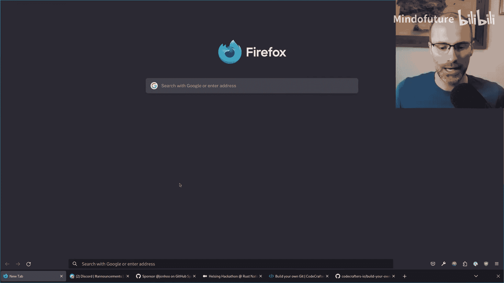

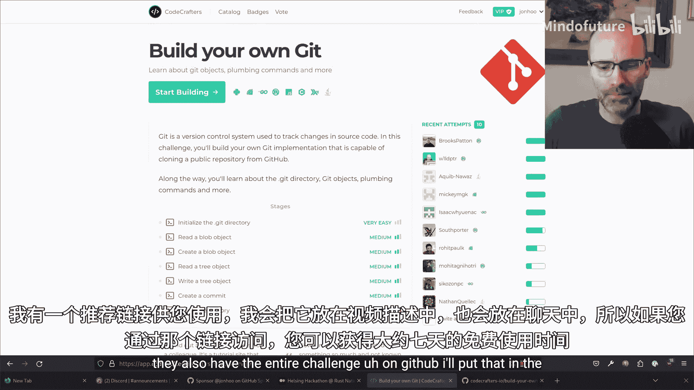

The entire challenge on Github， I'll put that in the in the video description as well and in chat that has all of the sort of steps of the challenge and the text of the challenges。

 It doesn't have all the nice infrastructure that is on the site for like running your test suite and stuff。

 But at least it's there。 And I think all the tests are there too。

 So if if you don't want to pay for it， then you can do it that way instead。

 and as a sort of I guess disclaimer at the beginning here。 I'm not sponsored to do the stream。

 like no one has paid me to make this video。 I do have the referral link。

 So if people like it and pay for it， then I get money from it。

 but but it's not it's not a paid thing。

Before we get started， there just a very short amount of housekeeping。

 And I know people hate housekeeping because it delays the start of the stream。

 but we'll do it anyway。 The first one is that there is now， if you haven't seen it already。

 there is a discord for I guess me specifically for Jay here。

 Jay has a discord server that I happen to be on the the Discord server mainly has sort of announcements of whenever I do new videos when I'm planning to do new videos and other things that might be relevant and sort of live notifications and such and you can find that at discord dojohnhu dot E U。

 thatll redirect you to the invite link。 And I guess I can。😊。

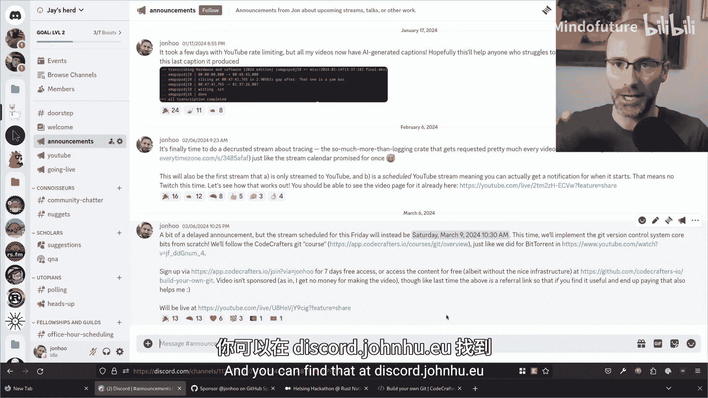

I guess I can also put the invite link right here in chat so that you have a handy way to get to quickly。

 There are a bunch of other channels too that are only available to people who sponsor me so that brings me to the second thing or the third。

 I guess which is I now have a Gitthub sponsors， there is no requirement to sponsor me。

 you don't get anything particularly fancy except access to like a couple of these Discord channels。

 The main thing is if you find that you've gotten something valuable out of the streams that I've done in the other content that I've produced over the years。

 then I would appreciate if you could sponsor me and sort of help me do more of this。

 but I'm also in a stable job。 So this is not a thing that sort of sustains my living it is more of a way to sort of go the extra mile。

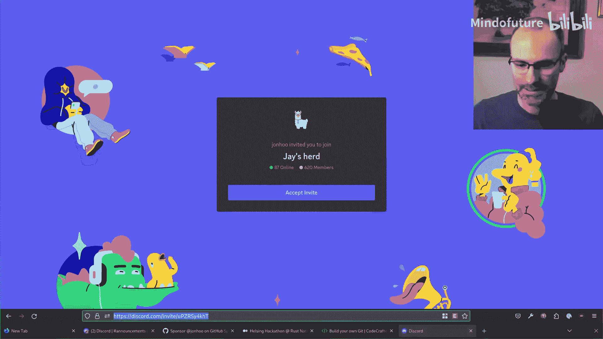

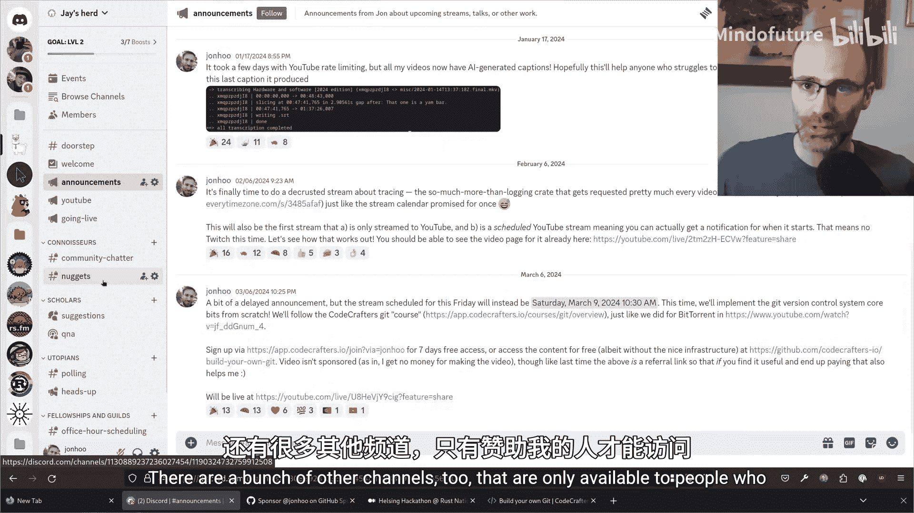

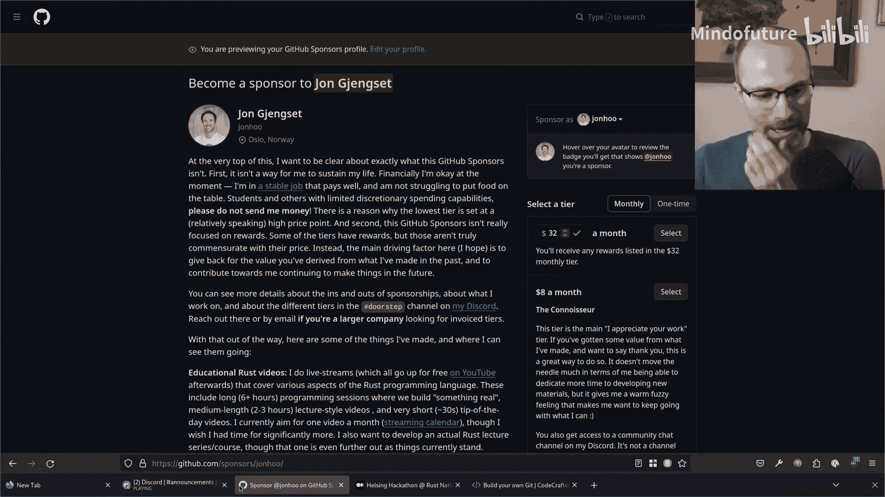

嗯。Okay， and then the last bit is I will be at Rust Nation at the end of March。 Helsing。

 who I now work for is sponsoring a hackathon at Rust Nation。

 so I'm going to be there running a hackathon with like remote control drones and cards。

 I think it's gonna to be pretty cool。 if you happen to be there stop by and say hi。😊，And that。

 I think， is all the housekeeping I wanted to do。 And so now we can get started。

 I have not looked at this challenge at all before starting。 So this is sort of my。

 my normal style of how to do these videos， right， is that I don't want to go in already knowing what I'm gonna to build because if I already know what I'm gonna to build。

 it's gonna be much less educational for you and it's also fun to watch me get stuck。😊。

So we're gonna start this challenge sort of blind。 And hopefully， this will go Well。

 We'll see how far we get through the challenges。 My guess is based on the difficulties here。

 My guess is we'll get to the last one。 We might not get through the last one。

 sort of depends on how long I'm willing to stream today as well。 I'm guessing we' stream for。😊。

Four to five hours， but we'll see。Okay， are there any questions before we start Before I click the start building button here。

嗯。This so Is very authentic。 good， just like at home。😊。

The discord is for anyone like you don't need to be a sponsor to join the discord。

 it's just the only channels that are on the discord if you're not a sponsor are sort of the announcement channels like there's no actual chat channel And then depending on the tier you sponsor at。

 you get access to sort of a community chat channel one where I post interesting tidbits that I come across and there's sort of goes a little bit up from there。

 So there's there's a more frequent Q& A tier and there's also a tier where you can sort of suggest additional streams I should do and such that are further up。

And。Will you implement rebase Probably not I think， you know。

 that rebase to me would come after clonal repository here。 Like。

 I think it's worth pointing out that， you know， I've worked a lot with Git。 So， so it's not like。

 I don't know what Git is。 And， in fact， I know a decent amount。

 but the data model for Git too because sometimes that's how you have to debug why Git doesn't do what you want。

 I just haven't like actually looked at this challenge before。嗯。Prerequisite for this so。

This is going to assume that you know rust。 like I'm not going to teach you rust in this stream。

 but if you don't know rust。 and like hopefully you should be able to follow along。

 it might just be some parts of it where you're like， oh。

 I don't know what that piece of code does or the syntax does。

 but you should still generally be able to follow along。

 But the goal of this is someone who generally knows rust and then wants to sort of see someone with experience building this and hopefully over the course of that。

 you'll get exposed to some techniques， some library。

 some ways to use to stand a library and just techniques for programming and rust more broadly And potentially also debugging techniques。

 So I'm hoping sort of teach some intermediate rust concepts as we go through this as well。

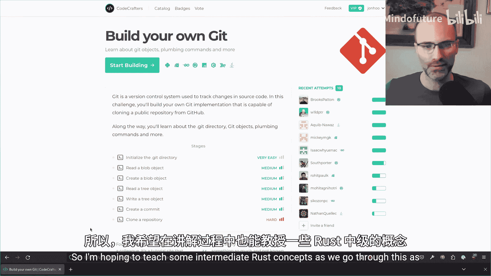

If you want an intro to rust， one thing that I can recommend is so a couple of years ago I ran this class or like a mini class at MIT with with two other labmates of mine called the missing semester of your CSseduc it's missing。

cll。mT。edduu I'll put the link in chat。Nope， that's not the link。 This is the link。

And it has a lecture on Git。 It's not given by me it's given by Anish， who's also a great lecture。

 and if you go in there， it has like both the a bunch of written notes throughout this。

 and it also has the entire lecture video， at least in theory， if I can get that to load。

 And so this one is， I think a really good walkthrough of sort of the mental model of Git。

 but also the data storage model of Git， will get into a lot of the details of this as we go through the stream。

 but if you're completely new to Git I would recommend checking that out。😊。

All right， so let's then get started。 I don't think there are any other burning questions。

So let's go for it， start building。I would like to do it in rust。 please language proficiency。

 I'm going to go with advanced。Next question。How often do you intend to practice？Once a month。

Accountability， I'll pass。 I don't want accountability for this。

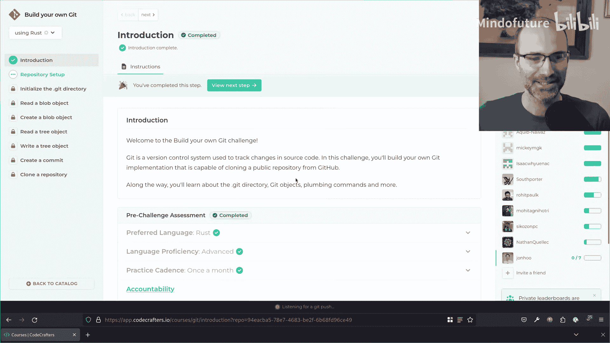

All right。Step  one， clone the repository。That's fine。 We can do that， gi clone。

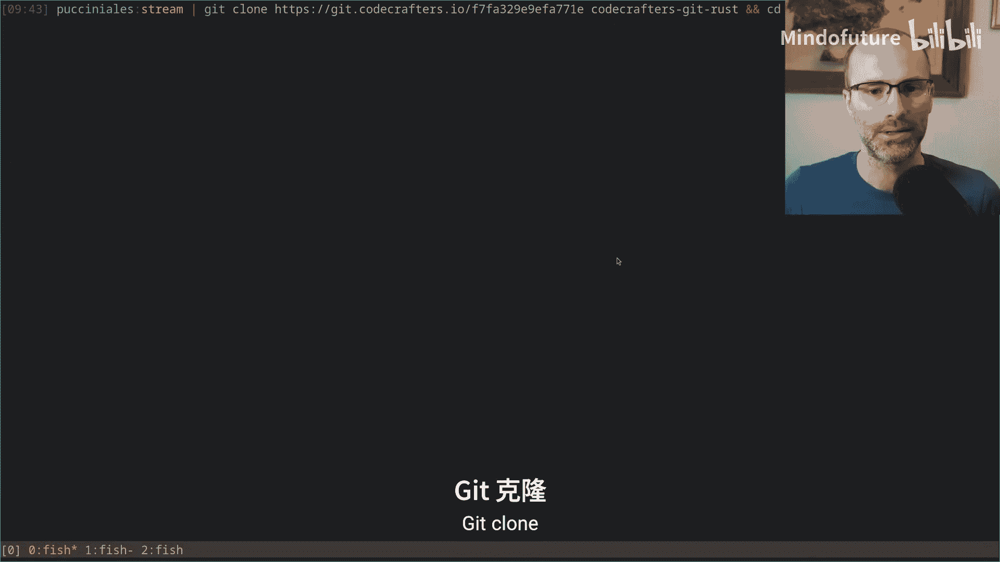

Okay， and then they want an empty commit。 I can do that。

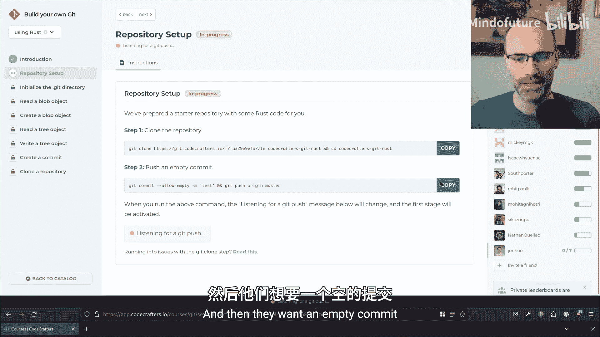

Right so one of the things that sort of code crafts has set up。

 and I remember this from when we did the bittorn challenge is that there's sort of a push hook。

 So whenever you do a git push it， it runs all of the sort of test suite over your things。

 you see here， it built the rust app， it ran the thing and it's telling me that like basically test one failed which is totally fine that sort of expected。

 I guess we can go here okay， great。 they received the git push so that means we're now set up。😊。

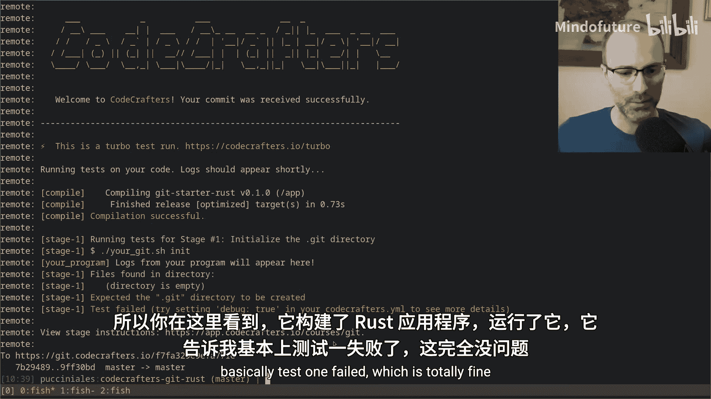

嗯。Okay。That's fine。 Your next stage implement the gett in it command。Okay， okay。

 so the idea here is that we will have they'll run our binary basically as the git binary。

 and the git binary has an in it command。 It initializes by creating a git director with  some thousand direction inside of it。

Okay。Wuye。

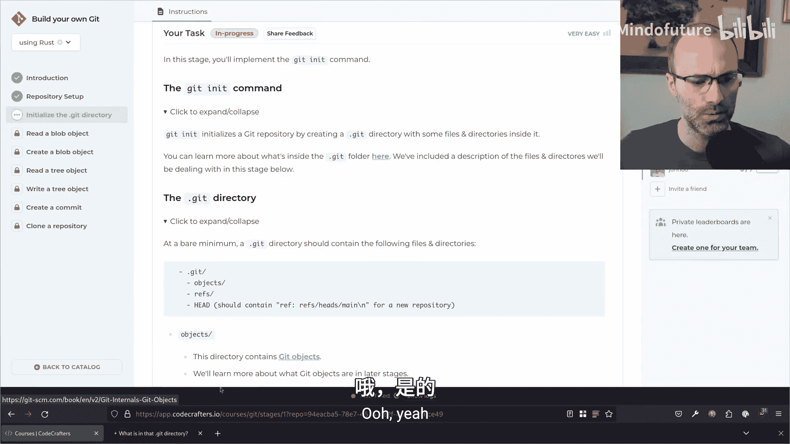

What's in the Git directory， B of text files。

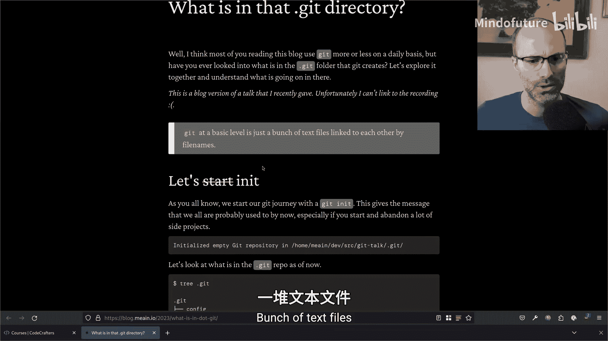

Yeah， that's fine。 I'm guessing this is the same thing that's described below。 Alright， so we gotta。

 we gotta look at what we have in here。 Let me get another。

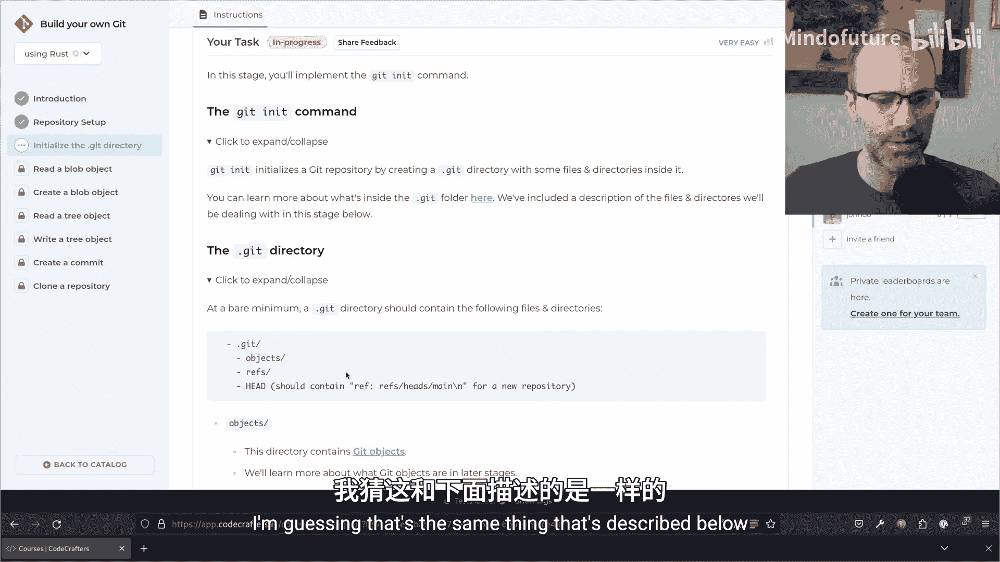

Couple of terminals in here。Let's see what we have， Sour mainine。Alright， I like clap。

 So we're gonna go ahead and add in clap here。And then， I can never。Remember the setup for this。

 It is like this。Oops。嗯。Great。Like so。And the arguments we want here is actually we want sub commands。

 right， So inclap derive reference sub command。Theres the example for subcomds。 Yeah， here。 Okay。

 so what I actually want here is I want subcomds。Right， for things like in it。

And command here is one of these guys。And I don't actually have any global arguments as of yet。

 I do want to include here。Sub commandmand， which I want to drive。嗯。And。Actually， let's use the。

The tutorial instead， which has sub commandd without all the bits。 So I don't need this。

 Don't need this。You can get rid of this in it and initially in it is going to take no arguments。

We do want to derive debug for it。And then down here。

 instead of doing the the sort of R end of args that they're using here。

 what we will instead do is match on Args do command。And assuming that， you know。

 the only valid command initially is in it。 And then we're going to have， you know。This。

And then we don't actually need an else branch here that they have for unknown command because clap will take care of just crashing for us and giving a useful error message if the appropriate if if a subcomd was given that's not the thing we support and then okay。

 what do we do here， we created a directory dot git。

 we created a directory do git objects do refs and we write to head ref's head main and we print initialize Git directory all right。

Just to see what that does。That's fine。 That's all fine。First， exercise。Get push。

Let's go look at what it says here。 So we get an explanation as well。 Okay， yeah。

 so we have this directory structure。 We have a head file。

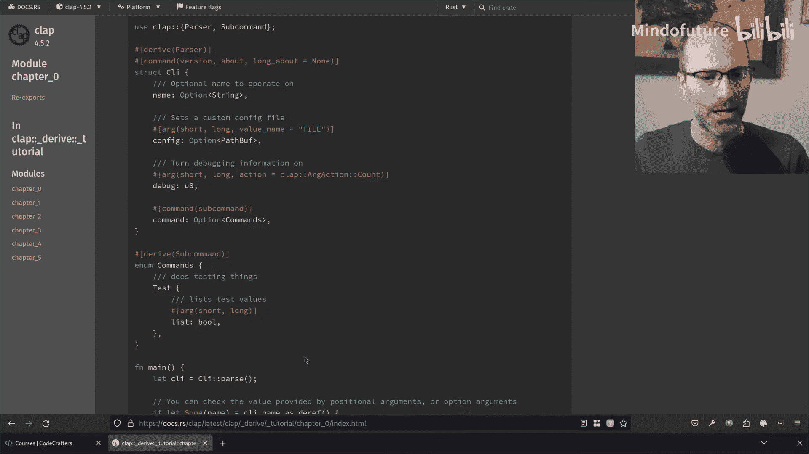

The object directory contains git objects， the references can git references and head contains a reference to the currently checked out branch。

 So in this case， it says that the main branch is checked out。 Okay。

 so let me give you a brief overview of Git here。 rather than sort of diving into So this is linking into the Git book。

 which is a good read， but just in the interest of time here rather than try to read through it。

 I'll give you a very rough sort of headline overview here。 so。In Git。

 everything is stored as a roughly， roughly speaking， a content reduced blob。

 So that means if you have a file， for example， that the file is really stored as all of its bytes。

 and then the keyed by the hash of those bytes。 And so this is an object。 Similarlyly。

 a commit is also an object。 So a commit is an object that has a。Well， actually。

 there are a bunch of things in between here。 So a file is sort of a blob is the lowest level thing。

 That is an object whose key is the the hash of the file of the blobss contents whose contents are the contents of that file。

 a tree object is something that holds something like a directory。

 And what it really holds is a list of name and and object key for the contents of that file at that time。

 So you could imagine that the tree for well， I don't really want to use the same thing。

 But but let's say I do here a make their fo and I touch or I echo hello into fo bar。

 Then the way this is this will actually be stored is there'll be。😊。

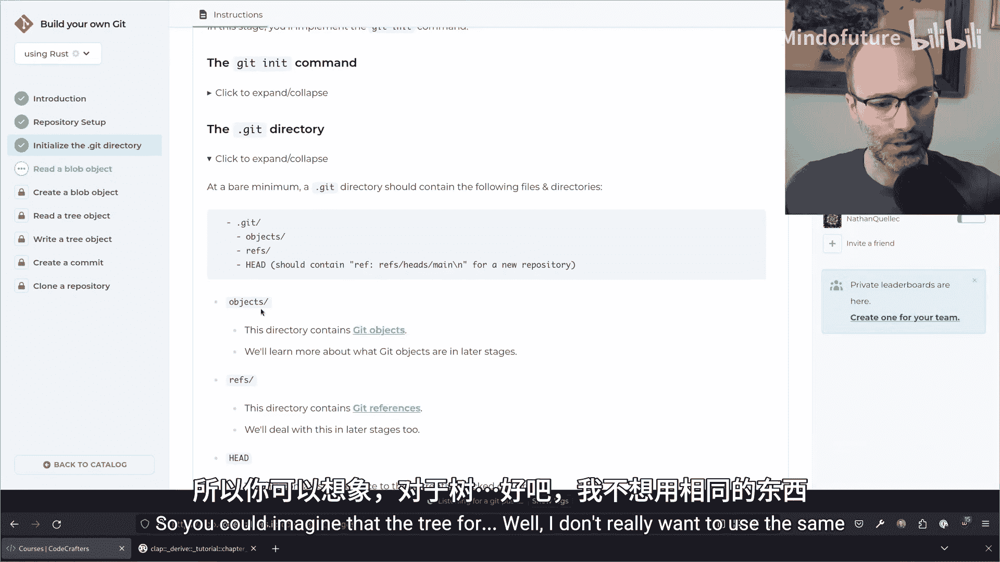

This sort of thing will be stored somewhere。 And that is the tree entry that we would have for。

For foo slash bar。 So for the repository here that's rooted at foo。

 we would store the hash of the contents of foo bar and the name foo bar in a tree object。

 And we would also separately in the object store store this hash and the contents of foo bar like this。

 And then where would this， you know， this actual string right here， where would that be stored。

 Well that would be stored in a tree object And the tree object is keyed by the hash of this literal string。

And where is that hash object， Where is that hash stored that that hash。

 that object key is stored in the commit object。 So when you create a commit。

 the commit points to a tree and particularly it points to the object key。

 the hash of the root tree object as well as it includes， you know。

 information about the metadata like who authored it and such。

 and then the commit is stored as all of the bytes that make that up and keyed by the hash of that content。

 and that hash is what we know as a commit hash。 So if I do revv parse head。

So this hash right here is the hash of the commit object that head points to。And similarly， you know。

 if I do master here， for example， it's the same hash because master and head currently point to the same thing。

 If I did something like head hat， which means the previous commit。

 this is the hash of the commit object before head。 and I can even do cat。No。

ble what is the name of that command。And。Maybe it is just cat file。

Yeah so cat file lets you print out what is contained within an object。 So for example， here。

 we can do cat file commit head。 And this， sorry about the chainaw。

 This is the entirety of the contents of the commit at head。 And if I did a rev parse of head。

 And then I did a cat file of this commit。 it prints the same thing right。

 because ultimately the commit is keyed by its hash。 just like everything in git is。

 So so the core of git in a sense， is this object store。

 and the object store just stores maps from hashes to the body of the thing that contains that hash。

 So whether it's commit or a tree or a blob， whatever it is。

 it's all stored in the same object store that is the same rules。

 which is it's a content hash storage。 And so you see when we look at the cat file here of this commit。

 you see the content。😊，Of it is the tree for this commit。

 So basically the contents of all the files recursively all the way down is this hash。

 The parent commit has this hash and the information about the author。

 the committer and the commit message。And then we can keep walking down， right， so we can do up here。

We can cat file tree this tree and this might not immediately you know look very reasonable。

 but this is basically a serialized representation of the tree and in particular。

 the things you'll see here is you'll notice that there's the mode of the file so this like is is readable is it writeable。

 the name of the file and then these bits in between are basically a binary representation of you guessed it the object key for the contents of those files in this particular tree in this particular commit。

😡，And one of the reasons why you have this structure is because， for instance。

 if you create a new commit where you change nothing， right， So we did a commit earlier。

 that was like allow empty， then it can use the same tree。

 So you don't need to store the entire tree twice once for each commit。

 you can have two commit objects that have the same tree reference embedded in them。 And similarly。

 if you have two trees that differ only in like the contents of one file。

 then the tree objects are going to be different， but they're going to reuse the same object key for the blobs of most of the files except for the one file that's changed。

Right， and so that's sort of the， the setup here。 And you'll see here， like you see here is source。

 and then source just points at its own tree， right。

 So if I there's not really a nice way to turn this back into the hash that we need。

 But but there is then a tree object for the， the sort of。Hsh equivalent of this binary string。

 And if we cat file that， we would see a similar tree object that would list all of the things that are under source。

 which is main。嗯O。So that's what we're creating here so we're creating objects which is the sort of root store for this content hasable or content addressable store。

 and then refs is really just a a mapping between human readable names like the name of a branch for example and which commit hash that reference is two。

 so if we in fact look inside our the gi that we have for this and we look inside of refs you can see here that the refs are in heads。

 you can see master and if we cat master， you'll see that that is the same gi rev parse。

 the same hash as we get back on head。😊，When we parse out the commit has。

 So that's just where those are stored。 If you had multiple branches。

 they would be different heads under here。 at the moment， we only have the one。 But under refs。

 we also have remotes。 So remotes is where is the same kind of refs。

 except for references that are stored remotely， such as branch pointers on Gitthub， for instance。

 from the last time you did a git pull。 So if I do a cat of origin head here。 for example。

 you see that it doesn't have a commit hash instead， it says head is the same ass。

 that's what this ref here means the same as ref's remotes origin master。

 So that means head is pointing to master。 if cat master， you see it iss the same thing as here。

 because we did a push。 if I do a git commit allow empty like this test 2。Then now， if I cat。

If I Revpar's head， you see this commit has is now different， Similarlyly， if I now cat master。

 that's the same because that's the local one， but if I cat the master in the remote origin。

 I still get the old commit because that's where that points。

 And so now you're sort of starting to see how this comes together that when you do a commit。

 you update your local refs when you push what you really do is you're telling the remote， hey。

 update your refs master to have this commit instead。

Is commit hash rather the other things that are in refs is tags。

 which know obviously every tag has some name and has to point to the hash of the commit object that that tag is pointeding to And if we look at objects you see this is just this is almost entirely just a list of files by hash。

 And in fact， we could even find here。 So head was that So get objects 6 f。

 you'll see here that the first two characters are used as a directory name and then the rest are flat files。

 The reason for that is just because Linux doesn't like it。

 if you have a bajillion files all in the same directory So splitting by the first two characters of the hex just allows the file system representation of this to be a little bit more efficient。

 But you see here6 F C856 F C85 So this is the same object and indeed if we now cat this。

A binary file。 But really， the contents of that is commit。嗯。Is the same as this。

 it's just a compressed version of it。Okay。If you hex stump that we see the same hash for tree。

So you want to hex dump this file。I don't think that's going help you too much。 No， it。

 this is not just like the binary representation of that because it ASI would be the same。 It's like。

 I believe these are compressed。 I forget exactly。 I'm guessing we're gonna get to that in。

 in one of the first exercises。Okay， so that hopefully now you have a sense of what are in each each of these two directories。

 So there's object， which is the object store refs， which we just talked about and head。

 which is just a special kind of ref。 It is specifically which commit is currently checked out。

 That's what head means。

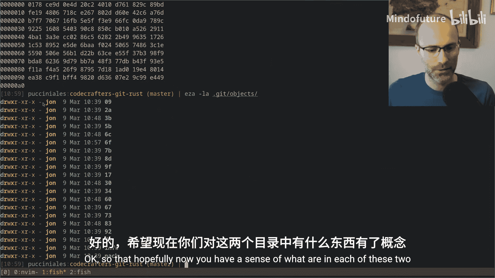

And。And initially， that's just going to be the main branch。 That's fine。

 So we did this first thing where we now， you know， we create。

 we just create the correct directories。 And then we also create the the head file， right。

 So if you look at main here， we created git， we created Git objects， Git refs。

 and we created this Git head file， the points domain main。 That's what we did。😊。

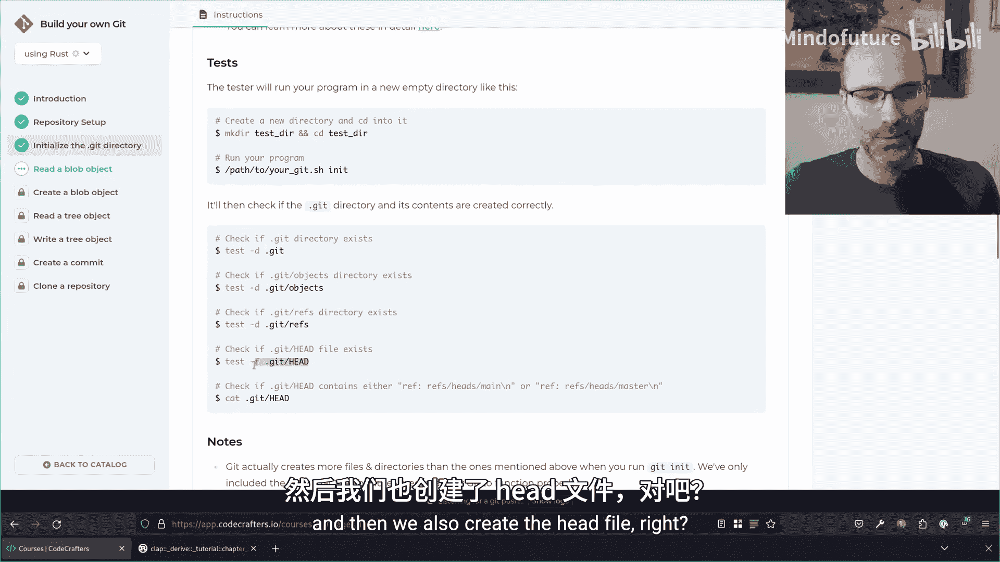

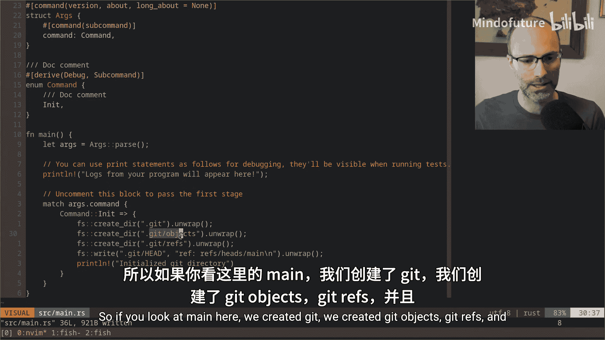

And。Get to actually create more files and directories right so if you go look in gett。

 there's a bunch of other things here like logs and branches and stuff。

 we're just going to ignore those for now， these are all we need to get started。

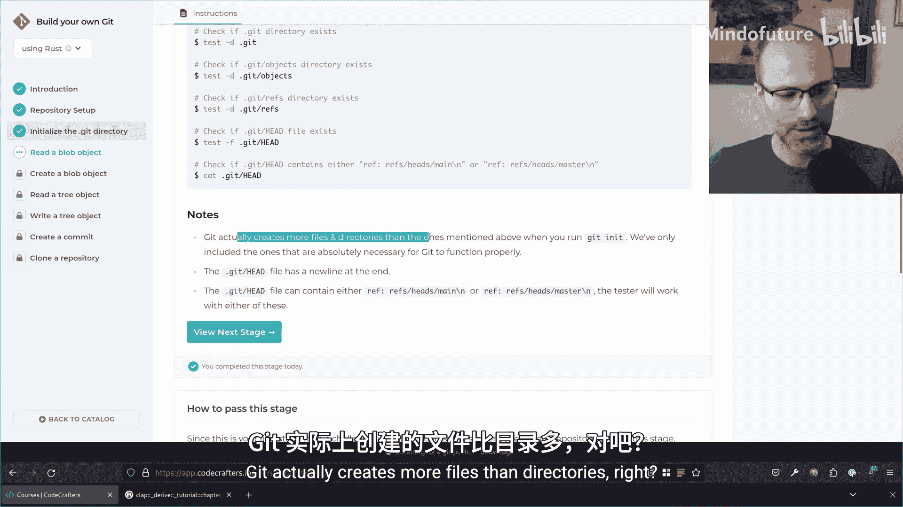

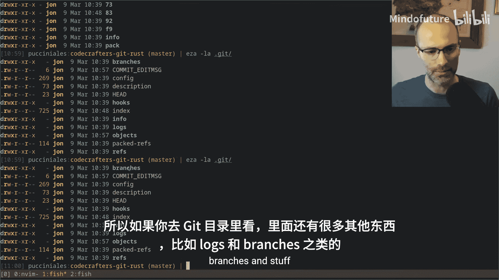

There's Zlib compressedale that sounds about right。GitTt has a new line at the end。That's fine， Okay。

 view next stage。Read a blob object。 So this is the cat file command that we actually just used。

 and so I'm guessing here the goal is going to be that you can cat file some blob and it just prints what the contents of this is。

 So I'm guessing here we're going to get to the point of doing a decompress right which is exactly what we expect。

😊，We'll deal with three gift objects， blobs， trees and commits， right。

 So we've talked about all these so far。 blobs are sort of the lowest level thing。

 which is just the contents of a file。Yep， only sort the content file， not names or permissions。

 And this is so that for example， if you have two copies of the exact same file in your directory tree。

 it's only stored once because the tree just stores the same hash twice。Under different names。yeah。

 so it's a Sha one hash known as the object hash， this is an example。Git object storage。

 They're stored in Git objects。 We looked at that。 We looked at how the path would be structured。

Each git object has its own format for storage， right？ So blobs。

 trees and commits have a different on disc binary representation from each other。

 And this is presumably because you want to optimize for you know。

 both how they're used and how they compress the best。 I'm guessing we'll see that in a second。

 So for blob storage， they are Zib compressed。 Yeah。

 so the whoever was in chat was was totally on board with this。嗯。

A format of a blob object looks like this， blob space， size， a nullbyte， and then the contents。

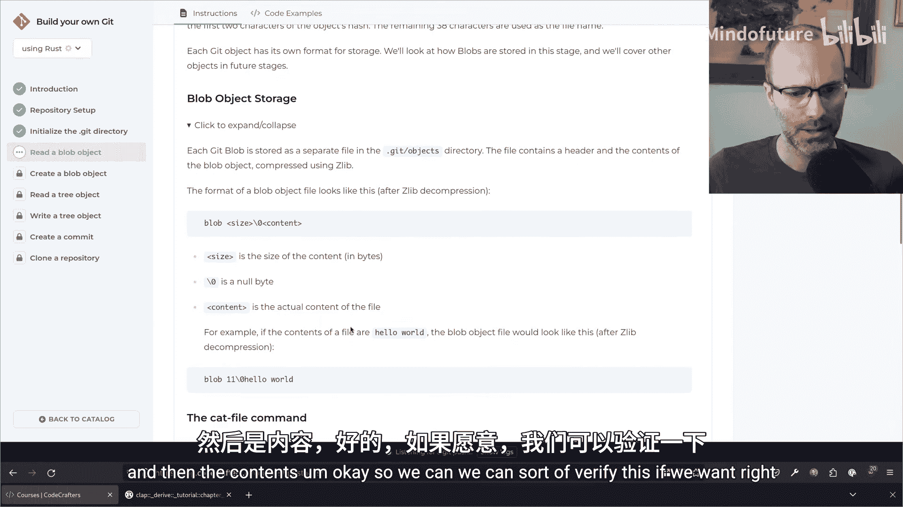

And。Okay， so we can， we can sort of verify this if we want， right， So the。呃。

What is the easiest way for me to do this， actually。

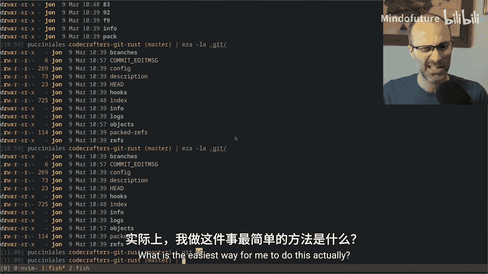

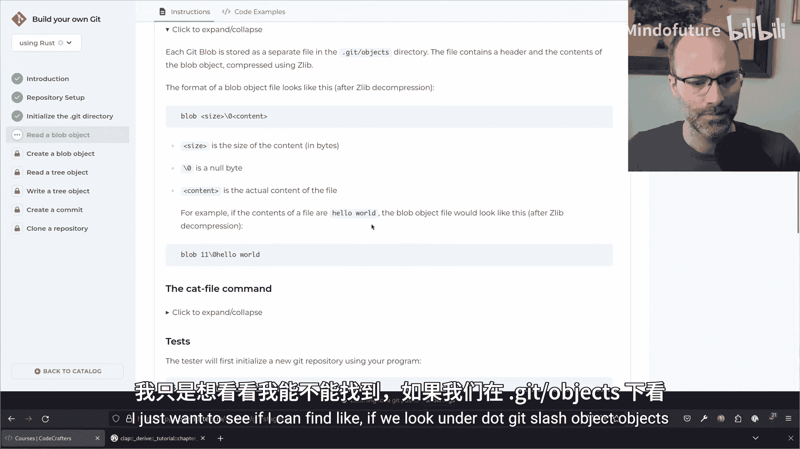

I just want to see if I can find like if we look under dot git。Slash object objects。 And we look at。

 I don't know， F 9， what， what is in you。That doesn't look like a blob， 60。I doesn't look at the b。

 but notice how it starts with the same kind of thing。

 So I'm guessing these are then probably either commits or trees，9 F。So that starts with X K。

 So that's a different type of file，6 F。That we know is a commit because we looked at that one earlier。

 73。

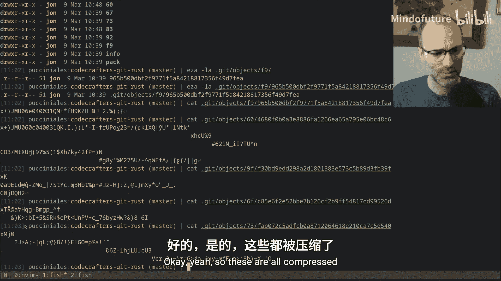

Okay， yeah， so these are all compressed。 I don't think we're gonna get something useful out of just looking at them。

 So let's instead try to just implement this first bit。 So we're going have to I see because they're。

 they're written like this and then Zlib compressed。

 So we're all we're seeing is the binary output of the Zallib compression。

 And so we need to zallib decomed。 And then we'll see this bit。

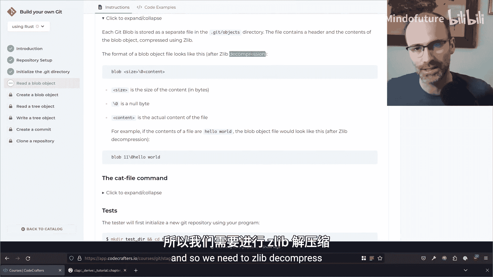

Okay， so let's then add here a cat file。呃。And we should be able to here now do command cat file。

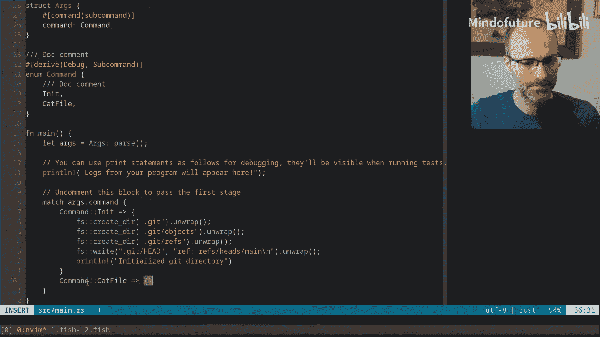

And obviously， cat file is actually takes some arguments right， in particular。

 it takes which thing that you actually want to print out。 So it takes what's the dash P here for。

Let's go look at CA file。So cat file takes a dash P。

 And I'm guessing P P pretty print based on its type。 Okay。

 so let's go up here and say that cat file is going to take a。

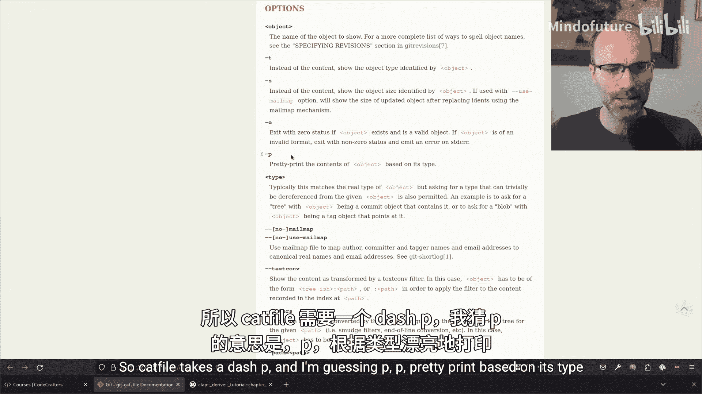

Pritty print， pretty print I can't type， which is going to be a clap short。Like this。呃。

So it's going to take that， But it also is going to take a positional argument， right， which is the。

 the object hash， which is going to be a， we can choose how we want to structure this， right。

 So we could say a string。Alternativelyly， we could say something like a。I。

 I actually wonder whether。Yeah， yeah， I was afraid of that。

 I was hoping the clap might be smart enough to realize that this is something that could be passed in as a string to。

 to validate that it's exactly 40 characters。嗯。I think instead， what we'll do is。

Is just take a string here。 And then if they give a hash that doesn't have the right length。

 then we'll just you know error out。 there is actually the point here that I believe cat files a little bit smarter in that it allows you to deduplicate。

 So you only need to give the longest or the shortest prefix that is unique。

 So here because there are no other hashes than the one for this one that starts with this。

 It actually lets you get away with specifying fewer。

 So that's even more of a reason here to specify string。

So this is also going to have the object hash。

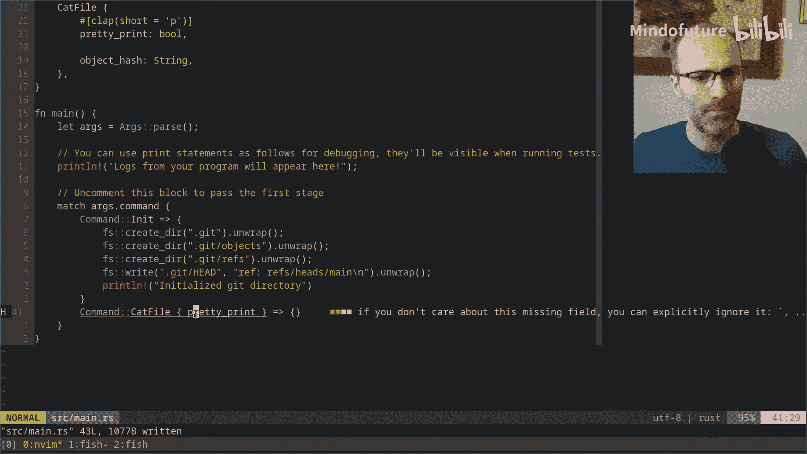

And then in cat file， we go down here。 Yes， we'll have to read the blob object， decompress。

 extract the content and print the content to standard out。 Okay， shouldn't be too bad。

Cat file does not contain a new line。 That's fine。 You can use Flay2。 Okay。

 So here's what we're gonna do。 We have to open the file。 In fact， we don't。

 So there are two ways we can do this。 We can either read the entire entire file into memory and then decompress it in memory and then do what we want the output or we can open an Iio reader here。

 which is realistically the the nicer thing to do file。😊。

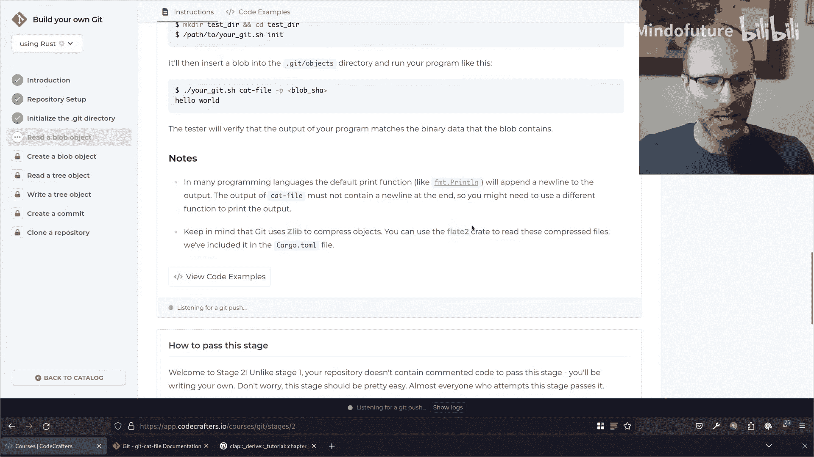

Open， and we're going to try to open。I'm going to leave it to do here， support。

Shortest unique object hashes， right， because what we're going to do here for now， at least。

 is to just open a file that is at exactly where the path should be according to the object hash。

 But realistically， we basically want to use something like Glob here to put a star at the end and find the number of unique files or the number of files that match that prefix。

 And if there are more than one then we error saying you need to you need to choose。

 if there's only one then we give that file。 But for now， let's do the the whole thing。

 So what we want to open here is dot gi slash objects slash and then the the first two characters。

And then the rest， where。Format。So what that is going to be is object hash。2 and object hash。wo。

Like so。So that is going to open the the file， and then we're going to use the F2 crate。

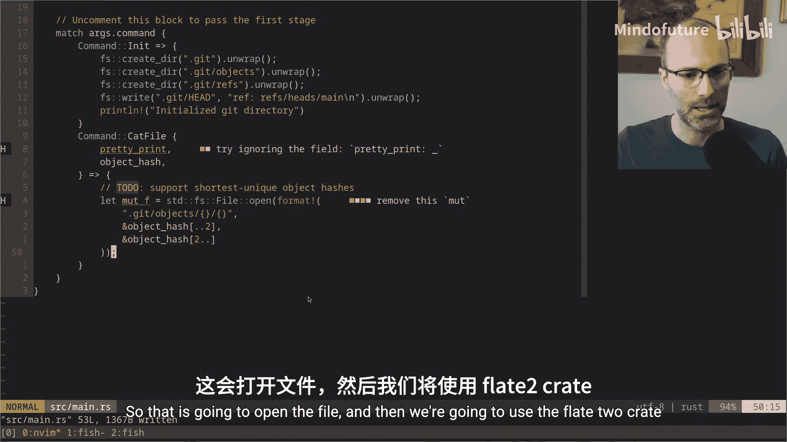

The F2 crate is basically provides different kinds of compression and decompression things。

 In our case， what we want is a reader。 and in particular， I want to decompress。嗯。

Do they have a copy paste example I can just use because that would be nice。This is for compression。

Don't need multi memberm。 I guess I'll do read a Zlib decoder。Aha。Amazing。So。Oh。

 and I don't really need end of here。 that one can go away。 And so down here。

 I'm then going to create a newzeallib decoder。And the Zlib decoder new here takes anything that implements read and files implement read。

 So we can just pass that in right here。 We get a Zlib decoder back and。

And then it implements read forzeli decoder。 Right。

 So the idea here is that it's sort of a streaming decoder。

 So it reads from the file decompresses and produces a thing that you can then read from。

 In our case， the question of then becomes， okay， what do we want to read out here well。

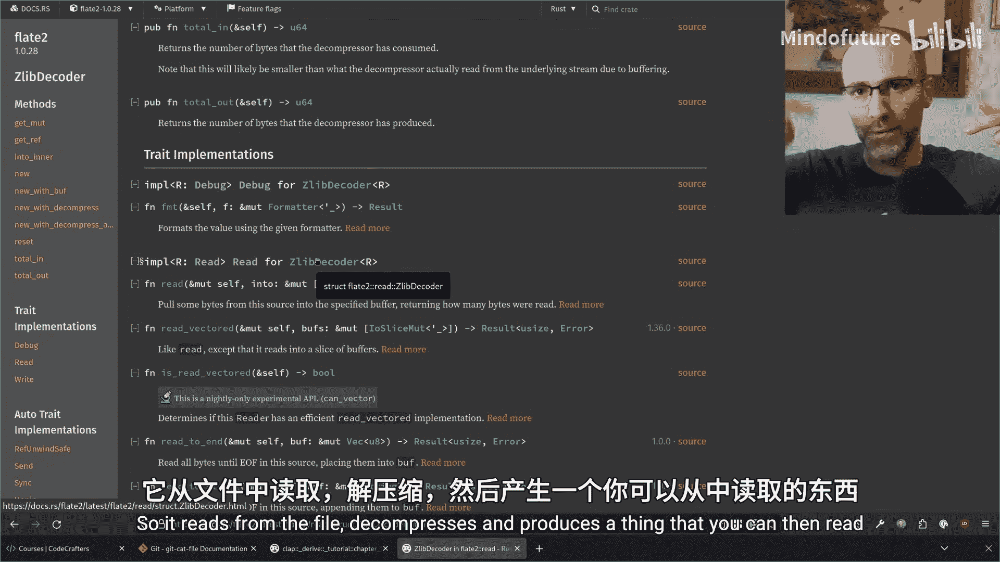

Really， what we're reading out is just a string， but it is a string with a little bit of structure to it right so it has this structure right here。

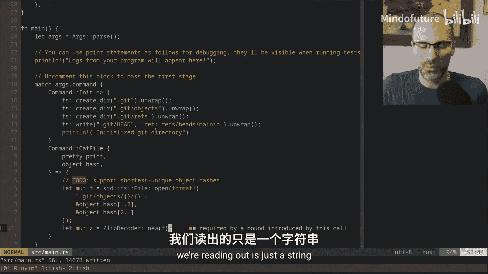

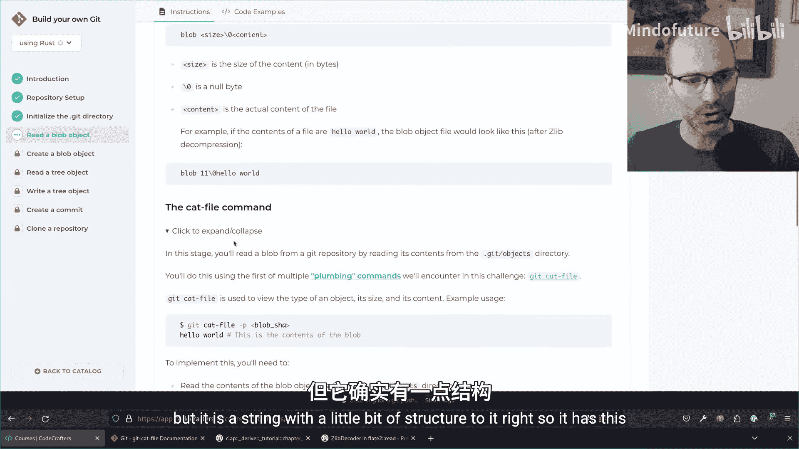

So what we can do is we can either write write a custom。

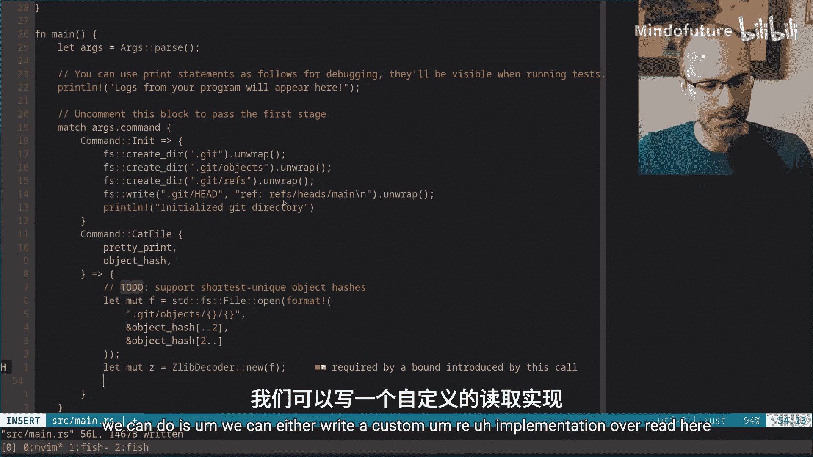

Imple overread here。Or。In fact， heres what I think I want to do。

 What is size here is the size of content in bytes。Yeah， but how many bits， though。I see。

 It's just an， okay， it's variable length decimal encoded。

 So this is really just a null terminated string。 Okay， so in that case， what we can do is use Z dot。

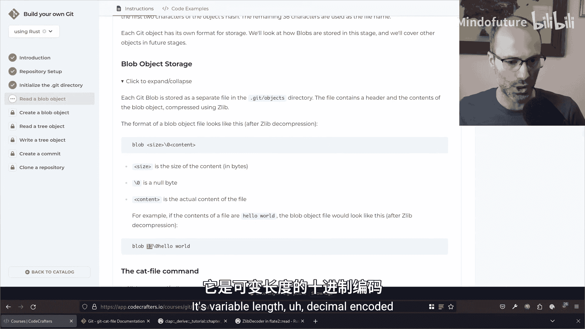

In fact， I think what I want here is Z is buff readerer new of Z。So Buffreader。Oh。All right。

I guess we'll return here a anyhow result。We'll do a cargo ad anyhow。So that at the end here。

 we can do this and we can do context。Just to make it a little bit nicer than just in wrapping everywhere。

呃。Open。In get objects。 So this， the buffer reader here。

 So B reader is a type from the standard library that allows you to basically keeps both the read thing that you pass in and a buffer that it's reading into。

 And then it'll because it keeps that buffer and doesn't just take whatever comes out of read each time。

 It can do a little bit smarter things like this growable buffer。

 You can do things like read until you hit this character。

 And what we'll do is keep filling into the buffer until it hits something that matches that。

 which is exactly what we want here， right， we can do Z dot read until。

And we want to read until we get a zero byte。呃。And the buffer we're going to give it is B is beu。

So we're going to read until that into this buffer。like this。Read from good objects or read。

Header from Git objects is really we're going to do。And these still't need to be mute。Okay。

 so if we look at the docs for read until it says until the delimiter by or endenoophil is reached。

 all bys up to and including the delimiter will be appended to Buff。 Okay， so in theory。

 at least this means that after doing this reading。

 the the stuff that's in here is technically a valid C。M。So in the standard library。Nope， Cster。

 There's a type called Cster and FFI that represents a borrowed sea string， right。

 which is really what we have here。 C string being a null terminated array of bytes。 right。

 That's exactly what this string is。 It can go strictly safely from a U8 slice。

 which is exactly what we want here。 so we can do me， I wish this was the default view。

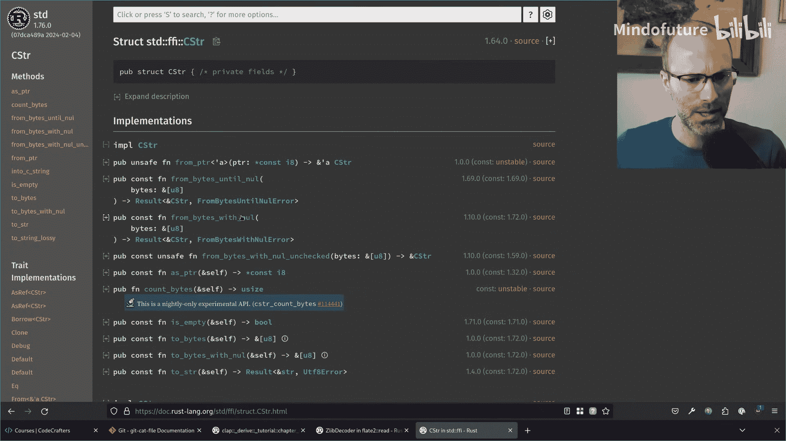

So， what I want is。Let header is C。 What's the name of it， It's like from bys。With null。Yep。

 this one is safe， but it does scan the string ones to make sure there aren't any null bytes within the thing you gave。

 and that there is one at the end。 I think that's okay。 technically， you know。

 we could have a smarter implementation here that was like we already know that there is no null inside so we could use the unsafe constructor here。

 but in reality， you know， I don't think it actually costs that much and it means we don't have to use unsafe。

 So let's just stick with it。 so we can do this and say this one we can actually do expect。

Because we can say no， there is exactly one null and it's at the end。

Right so this isn't an error we expect that should ever be possible at runtime。

 And so then we can use expect。 and I'll grab in C here。

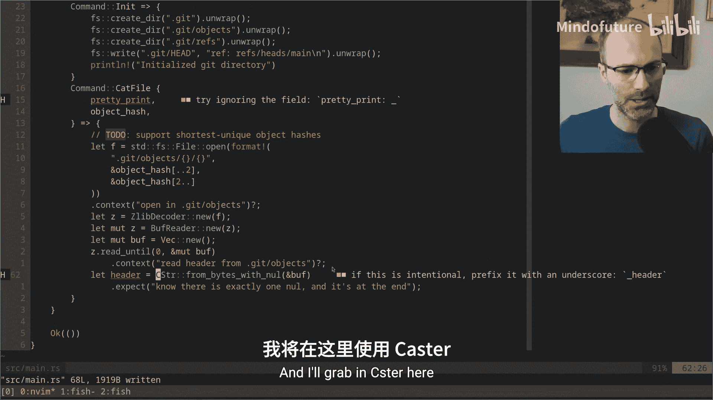

And at this point， you know， back here， we were told the structure of this is blob space and then the size。

 so we should now be able to do。

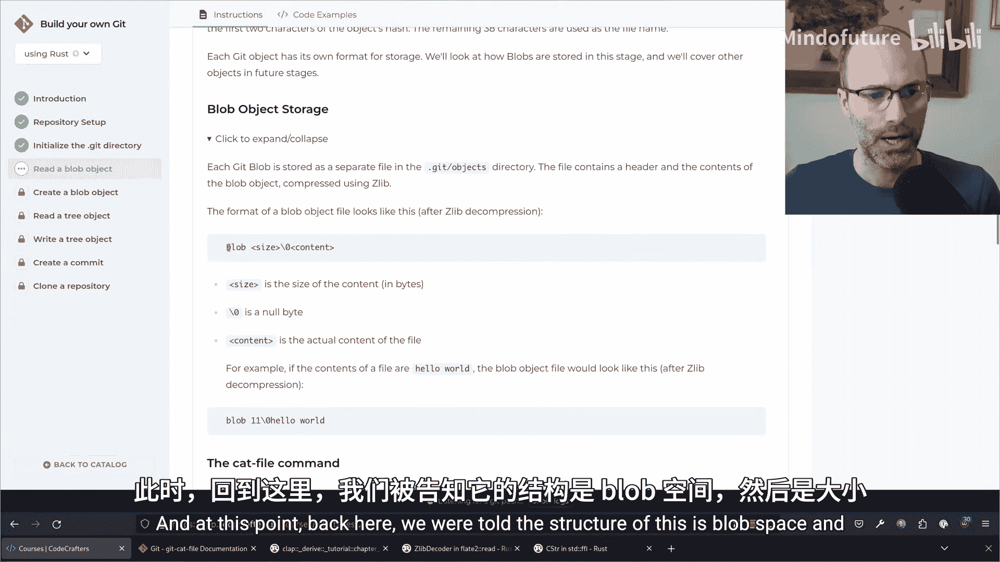

You know， header dot。In fact。Header dot 2 stir。In fact， I'm going to do this context。呃。

Git objects file header isn't valid。 UTF8。 And remember here that really it's ASI， right。

 but ask all ASI is valid UTF8。嗯。And so at this point， we should now be able to do， let some。

Size is header dot strip prefix。 we want to strip out the blob space that we know is at the beginning。

And if there isn't a a blob space at the beginning， then something is terribly wrong， right。

 And we can， we can bail and say。Gt objects file header did not start with blob。

And then we can even give the the string that was actually produced， right， which we can do here。

And then we want to say lets size is size dot parse and we want to parse this as a U size， right。

 It should not be a signed number。 the negative wouldn't make sense here。 And here too。

 we can give the context。嗯。Of Git objects file header has invalid size。

 and we'll print that out as well。So now we have the size now we know that the now we know how long the content should be。

 And so we should now be able to say。Buff dot reserve， exact。In fact， we can， we can truncate it。To0。

 which is really just a clear。Right， and then we can do reserve exact。

And we want to reserve exact size right So this is saying clear all the stuff that was in the in the buffer that we read into previously。

 right， which is this this header bit， and then we want to reserve space for exactly this much。

 which is how the how long gi claims that the file should be。

 And at this point we can now do Z dot read to end。😊，嗯。In fact， is there a dot read。

 Doess a read exact。 That's what I want。是。😊，Okay， so there are two ways to go about this。

 The The question really is， what do we want to happen if this is wrong， right？ Like， Like if the。

 the size here doesn't match how much is actually in the file。 So So we have two options here。

 We can either do read until end。And what read to end will do is if I pass in the buffer here。

 it will read until it hits end of file， and it will grow buff if necessary。

 So if the real file is way larger than what the size headers said， then this will just。

Keep growing buff potentially until it produce a giant file。 That's not。

 And then we could check afterwards that it matches the size， but， but still。

 the other alternative is to use read exact。Right， read exact takes a slice。

 so you have to take the V and produce a slice of that size。

 and then it will it will read exactly that many bytes。 if it hits end ofophil before that。

 it returns an error， which kind of is what we want here， right unexpected end of file。

 if you read something shorter。 And then we would after doing the read exact。

 we would check that the next read returns end of file。 that sort of the nicer way to do this， right。

 So I think we're gonna go that way for now。 So in that case。

 what we actually want is we want a slice into buff of the right size。 So if we go now to。😊。

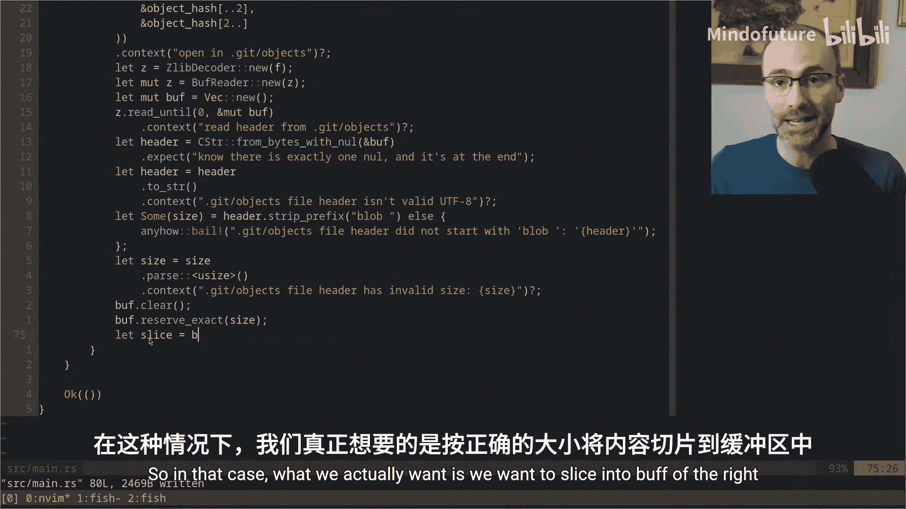

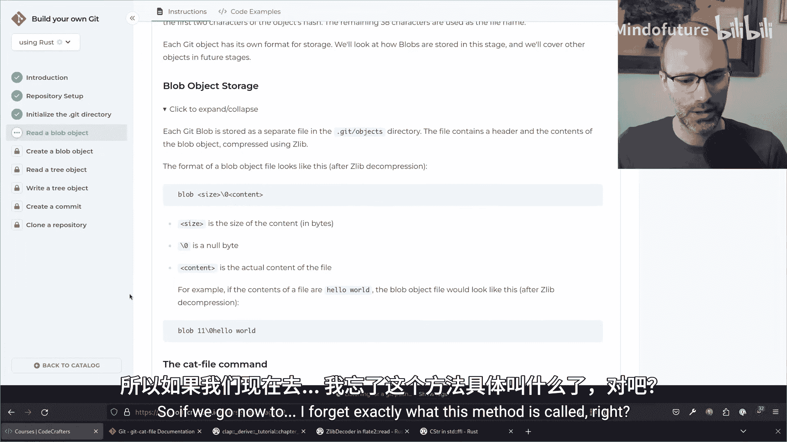

I forget exactly what this methodth is called， right， Because what we really want here is a。

Method that returns。Yeah。So yeah， sure， let's do this properly。

 so here's what we're going to do next。I'm going do it the slow way first and then tell you why it's slow and then how we could fix it so。

Let's do so。Where do I want to start with this Z dot read exact？Add mute something。

 So this has to be a slice。 If I just give buff here， right， like， I can do this。

Git objects file had unex。诶。Contents did not match expectation。s a little bit of weird error。

 The problem here is that if you this slice will be of length 0 because we cleared the buffer。

 and then we reserved this many bytes。 But the length of the vector is still 0， right。

 Like we made the capacity be large or whatever the size dictates。

 But we don't did not actually set the length to anything。 And the answer to that is， of course。

 or the reason we did that， of course， is like if here， if the length was set to size。

 What would the value of buff 0 be。 or worse yet， like size -1。

 It doesn't have a defined value because we haven't set it to anything。

 And if there's one thing rust dislikes， it is like memory with undefined values。 right。

 So there are a couple of ways we can go about this。 One of them is resize。So with resize。

 I can set size， and I can say that every value should be given the value of 0。

 right So instead of reserve exact here， I do resize to size of 0。

 the0 here basically means every element should be given the value of 0。

 So allocate to size and then set everything to 0。 This works。

 The problem is we're writing a bunch of zeros。 Then we're then immediately going to overwrite。

 So that feels kind of stupid， right， Like it's， it's an unnecessary performance penalty。

 What we really want to say is I just want it to be the size。

 and then they're all gonna be overwritten anyway。 There is a way to do this。

 which is to use the maybe un in it type。 And what you would do is you would have。

 instead of having a v of U 8。 You have a V of maybe un in it of U 8。 And then you can resize it。

 you can basically set its length to be you can hear you would do maybe un in it。in it right。

 So you would set the length to just have uninitialized bytes the entire way。

 and then you would cast it into the U8 buff that's needed here through an unsafe call。

 And then afterwards， you would assert that the vector now holds initialized bytes。

 We're not actually going to do that here because it's a little bit of a wonky code。

 And I think it distracts too much from what we actually want to do here。

 But this is a worthwhile thing to point out。 one of the reasons I don't want to do it is because one of the methods I know I'm going to want here is way to turn a slice of maybe unin it U8s into a slice of U8s。

 there's a nightly like an unstable function to do this。 but it's not stabilized yet。

 And so I don't want to also need to opt into nightly here。

This will this will turn into an optimized me， I believe。 But even so。

 you're still telling the computer write all these zeros。 So we're gonna stick with this for now。

 And what read exact returns， you'll see it's an I result with unit， right。

 because it doesn't need to tell you how many bytes it read because you told it read exactly this many bytes。

And so now if we now do a read。And I'm gonna pass it a empty。

I'm going to pass it a one by long thing here。😡，And。Yeah， N is this。呃。I guess read。

 this is really read contents of read。The true contents of Git objects file。

 and this is validate F end of file in Git object file。And here we should assert that n is 0， right。

 So there should be no bytes after the size that the header required that we do。

 And when here we can use， I think it's ensure right， and equals 0。Or get。Object file had。

And trailing bys。Okay， so in theory now we're， we're reading out this whole thing。

 We write it into the buffer。 And at the end of all of this， the question now becomes。

 what do we actually print out， So the thing that comes after here， the content here is like。

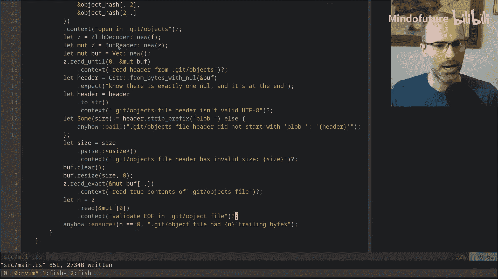

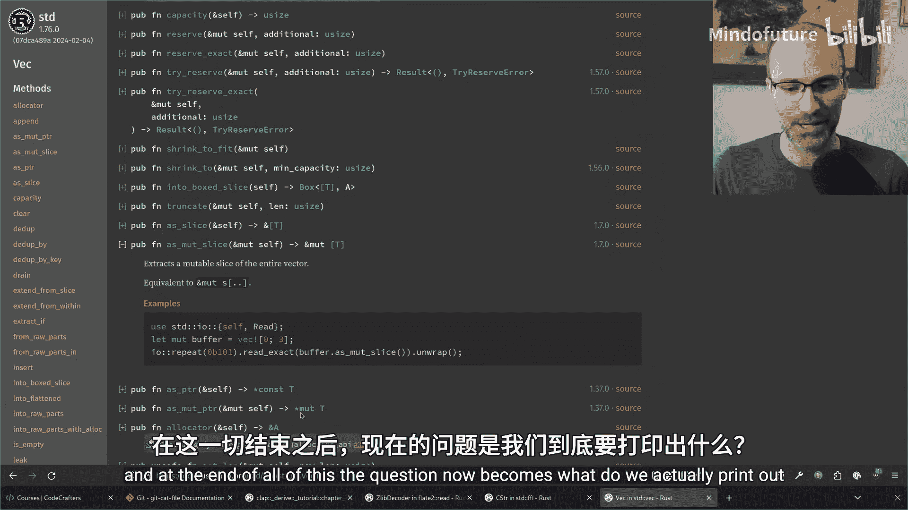

It's just a bunch of bytes。 There's no guarantee that this's actually a string。 It could be an image。

 right， Any file that you can put into Git will have this structure。 And so when it says cat file。

 it's worth pointing out that this， the stuff we end up with is just a binary blob。

 And so and so we don't actually want to print it using like printlin because print line will require that the thing you gave it as a string。

 So instead， what we're going to do。

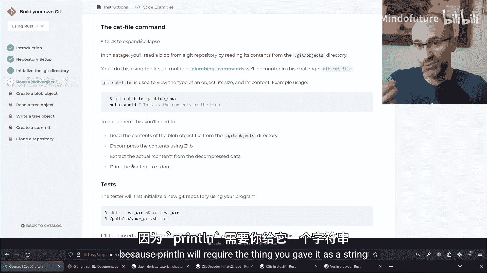

Is take stood out， which is going to be IO。Standard out。So this gives us a handle to standard out。

 And then we can also even do if we want to sort of maximize performance here。

 we could lock standard out so that no one else writes to it。

 And so that we don't get any garbled output， there is no concurrency here's so it doesn't really matter。

 but if so you can write directly into this。 But what that means is every time you write a new chunk。

 it takes the lock again and again here， we're just going lock it and the do all our rights at once。

And so now we can do right to stood out and we want to write， In fact， I don't want to do that。

 I want to stood out dot right all。Of buff。And then this will be。Right， object contents。To stood up。

And then this needs to be mute。O。Let's try to cargo run。呃。Cat file。

The the P doesn't do anything at the moment。Let's see what that does。哦。Right， so it tells me well。

 I couldn't do that because you didn't tell me about an object hash， so let's give it an object hash。

Cat file this。Gt object file header did not start with blob， It started with commit， Right。

 So we've only told it how to print blobs。 We， we haven't。

Put in handling for things like printing a commit yet。 That makes sense。 So instead， I guess up here。

 where we're currently looking for the blob header。

 What we actually want to do is say a kind and size is header dot split once on a space。

And we do expect that that should always be the case。 otherwise did not start with a known type。

And then we're going match on the and then the size can keep going here。

 I'm guessing they all have the same structure for this header。 But down here， what we want to do is。

Match on the kind。 if it's blob。Then we do this。If it is anything else。

Then we do right to standard out。呃。Do。呃。So now I know what the P flag is doing is almost certainly that if。

I'm going guess that if the P flag is not given that it prints out just the， the raw decompress。

 So if I did。Here， if I do git cat file this。I see。 you need to give the type。

 And if you give dash P， okay。Never mind then。 So if we get anything that's not not blob。

 then we say， we do not yet know how to print a kind。And this needs to be a comma。

And I've done something else wrong。 What else have I done wrong。呃。啊。There we go。

Buff is borrowed as mutable。 So this is because we're still borrowing kind here。

 So let's go up here and do Eum kind is blob。And blob is the only one we have here。 And so down here。

 we can say let kind is match kind。And we'll make this a little bit nicer。

 So blob is going to do kind blob。Anything else we do not know how to do。 So we'll do E。In fact。

 we'll do anyhow bail。Like this。And then down here， this is now going to be kind blob。

 and we can get rid of this guy。So now， if I do this。

 it'll say we do not yet know how to print a commit。 Fantastic。 Do we have something that is a。😊。

Blob is the question。Yes， we probably do。 We can do， we can print out this tree。Like， so。Oops。

 I meant to use the git version here。啊。Tree， can I like。Pretty printed。

That probably just does the same。ha Pre print。 Okay， great。 That's what I wanted。 So let's try to do。

 I don't know。 get ignore is probably a nice short file。 And so now。

 if I run our version and do cat file of this。Ha ha， and look。

 we indeed printed out what does indeed look like a gi ignore file。Amazing。Okay。

 so that's really nice。😊，Amazing。So now we have a thing that actually does print out what we wanted。

 We can get rid of this logs from your program will happen here。 So make that go to E print line。

And I think actually up here， we're going to do anyhow ensure。Pretty print。呃。Because。

That's what the real git command does。 right， When I tried Git cat file of this。

 it just gives me the help thing and says you， you need to give both a type and an object or you need to give dash P。

 And so this is。Moode must be given without dash P， and we don't support mode。Great。

 someone else in chat， is it possible to redirect the reader of the payer directly and to that out without the V allocation。

 It is so。The proposal here， right， is actually， let me push this first and then show you that change。

great， yep。Commit second exercise。 get push。Let's see what it does。

I don't know why we have Tokyo in here。Pro get rid of Tokyo here and then get significantly faster built。

A whole lot of steps。Let's see what they have in Kgo Tommal。Why do we need HTTP requests？

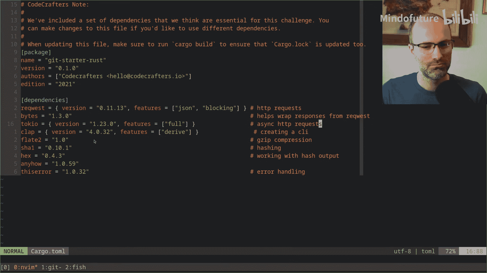

Interesting。I don't。 None of， we're going to need it for。Cning a repository at the end， right。

 then you need to actually breed things from， from the remote。

 I'm going to just comment those out right now， because。

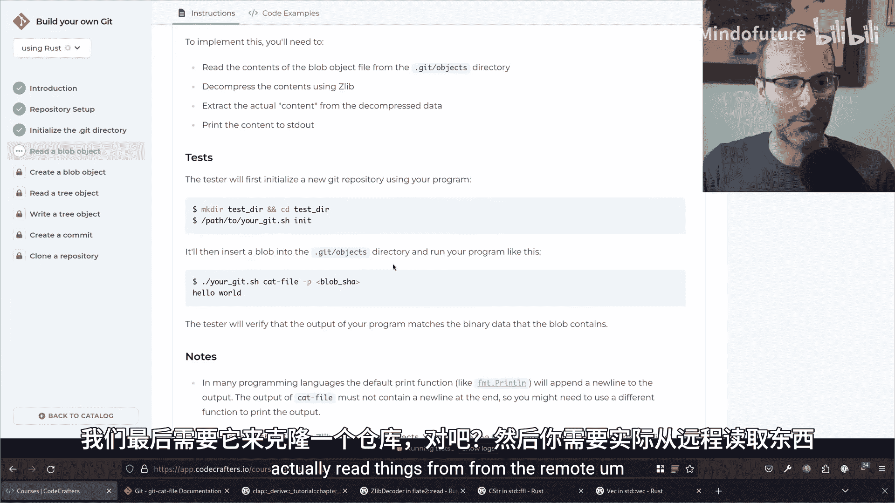

We don't need it for this。 I'm also fine to use anyhow， instead of this error。So， we'll do this just。

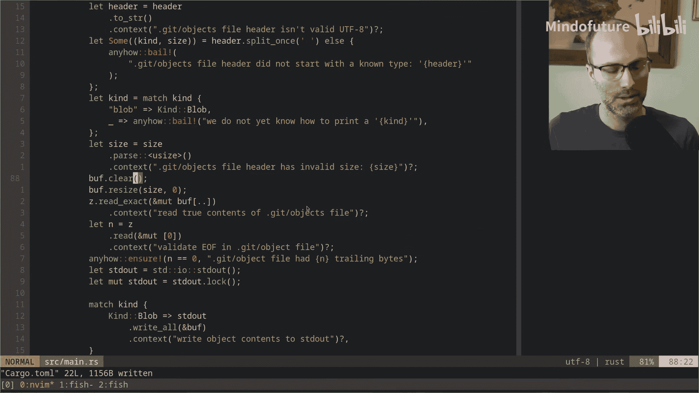

All tests pass。 Great。 Woo， it's happy with us。

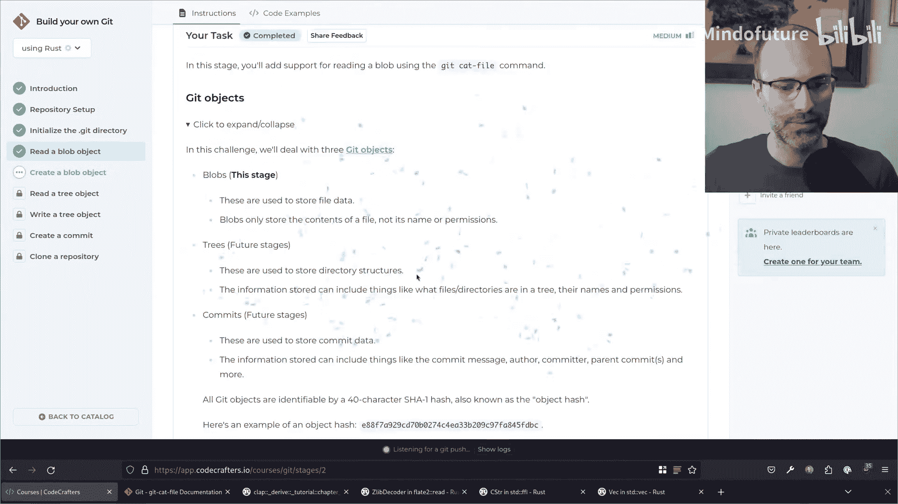

Great， so we need the the right thing。 So now the question is， can we make this a little bit better。

 So instead of。Instead of doing this with sort of reading into a buffer。

 the moment we've read the header， we don't really need to do anything else。

 We can just stream the rest of the decoder directly to standard out。And that is indeed doable。

 So here's what we'll do in order to accomplish that。 We'll do。

We'll do a match on kind because that might only be possible for blobs， for example。

Right but if what we get is a blob。Then we should be able to stream it directly out。

 and then what we'll actually do is Io copypy， which takes a reader， in this case。

 the reader is going to be Z and the writer， which is going to be standard out down here。

Mute to standard out。And then N is going to be that。And we'll do here。Right。

File into two standard out。And then at the end here， after printing it all out， we'll do this assert。

 Now， the the downside of doing it this way。 I think I can now get rid of most of this。

 the downside of doing this way is we might actually end up copying a lot more。

 Like imagine that the file is actually way longer than what the size dictates。

 then the copy here is still gonna copy until the the decompressor runs out of stuff。

 And this is how you get to things like zip bombs， right。

 where you just keep reading as long as the decompressor is giving you stuff。

 even if there's a header that says how much there should be there。

 And so this is just going write everything out。 there is a way to get， I forgot the one B read。呃。

You don't need the one byte read here， the thing to check that we hit endo file because copy is going to run until it hits endo file anyway。

 and then it's going to tell you how many bytes it actually copied over。

And so I guess this should be size。呃。Has。And trailing bys where that's really going to be。

File was not the expected size Exp is going to be size。 Act is going to be n。Like this。 Yeah， so。

 so we don't really want to do a sort of unguarded read here。 There are a couple of ways around this。

 So， for example， it could be。 We'll see whether that's the case here。

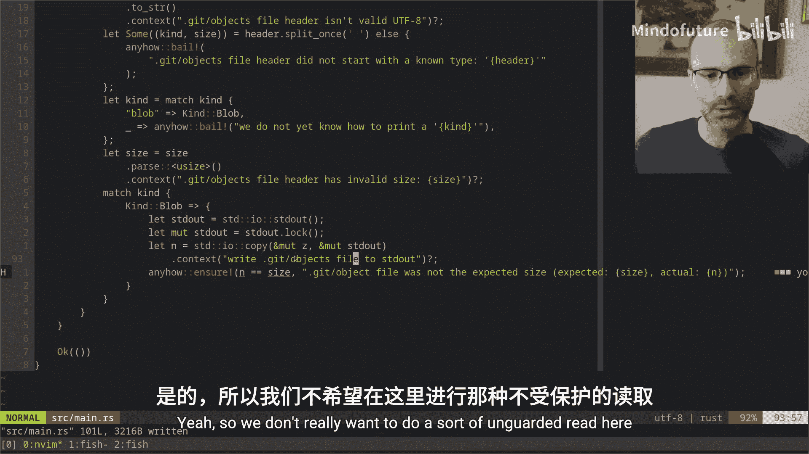

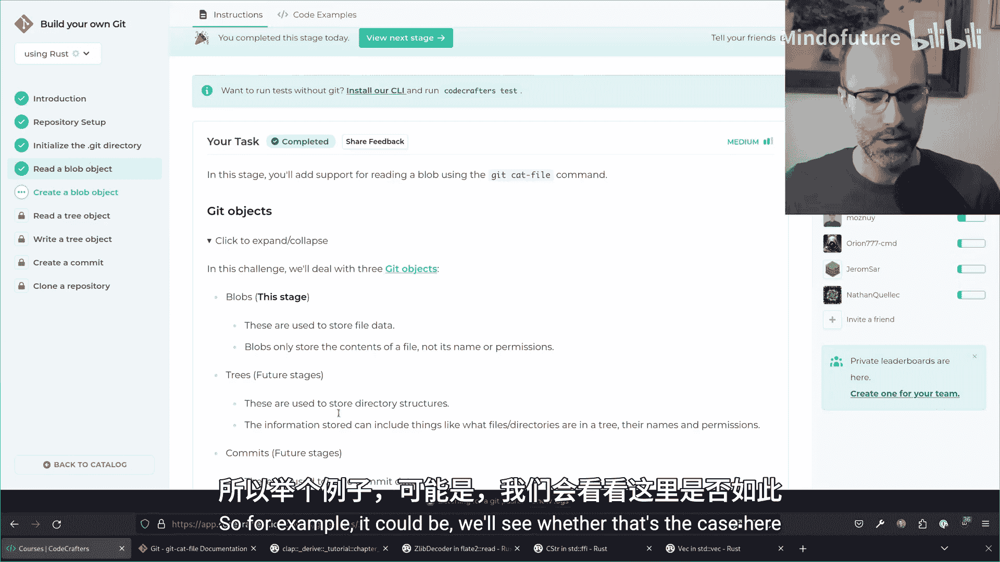

This one does not have。It decompression settings。 Let's see here。This one doesn't。 Okay。

 so there are some of these libraries that actually provide you with a way to set a limiter。

 Given though we don't have that， what we can do is actually create a limit reader。

And it is going to hold a。And there are crates that provide this as well。

 but we can write it pretty easily ourselves。 So we might as well， The reader is going to be an R。

Limit is going to be a U size。And then we're going to implement read for limit reader。

Where our is read？And we'll grab in here。Implement existing rum。And in fact。

 we're also going to implement the default ones specifically because we want。呃。

We want to forward as many of these as we can。诶。Well。😔，Alright， well， we'll not do that right now。

 We'll leave that to other crs to do my thinking here was that we really want， like， if。

 if the underlying reader here is an optimized like vectored read， for example。

 we would really like to make use of that。 But in the interest of time， I won't do that here。

 There are crs that provide exactly this type for this reason。 But what we'll do is we'll have a。

When you do a read， you'll do let N is self dot reader dot read into Buff。And then， if N。

Is more than limit。In fact， we're going。Shorten this even more。 We're gonna say。

If Buff dot L is greater than self dot limit。Then Buff is equal to。 So this is going to be mutable。

 Then Buff is going to be equal to mute of buff。To self limit。

So that we never read more than what we're allowed to。 we're then going to do the read into Buff。

 And then we know now that this will never be more than n。

 but then we'll do self limit minus equal n。And then we'll do OK of N。So the idea here is。

There's one bit that's going to be missing here， which is we really want to error if there's more。

I think what we'll actually do here is we'll do。Plus one。And if n is greater than self dot limit。

Then we will do a return， I。Or。New。I Air kind。I guess， we'll do other。嗯。Too many bytes。

And so now what we'll do here is we'll actually say that。Mute Z is， in fact， we can do that out here。

 Z is a limit reader。Over the original Z with the limit of size。

And so now we can guarantee that we'll never read more than this size out of the reader ever， right。

 if we do， then we're going to get if the reader produces more bytes。

 then we'll hit this error right here。😡，Right and so now this copy is going to read through the limit reader。

 which means it'll be limited。 It might still produce a value that's lower than size。

 in which case we want to error。 But if it produces something that's more。

 then it'll hit this too many bytes error。嗯。And so in theory， now cat files should still work。

 and it's going to complain about this bit because。The limit here needs to be a U 64。

 almost certainly， this then should also be a U 64。And。you 64 is fine here。呃。

I guess the limit here should be you size。And then this should be， as us。That's fine。

So it still now works， but if you were to get an object file where the size header didn't match。

 you would get an error regardless of whether it was too long or too short。

Could you use readerer take here？Wu。You might be right。Take。And it afterward which。

 you will read at most limit bys from it。Yes， indeed。Although。

So the difference here is that this will return end of file。 It won't error。I guess that's okay。

It's kind of nice to get the error， but in the interest of shorter code。

 which is easier to reason about， we can to Z is z。 take size。Has the Z effect， Good call。嗯。Note。

 this won't error if the file is， if the decompressed file is too long。

 but will at least not spam stood out and be vulnerable to a zip bomb。And just see this still works。

It does， and then we can now get rid of the IO thing。Let's do add cargo lock and cargo Tomel first。

Comment out。 Big depths。For now。And down here。Mtigate zip bump。 get push。へ。

I've educated chat so're they've surpassed me now Cha now is telling me about all the things I didn't know about Ru。

Yeah， so see how much faster the build was here because we got rid of all those extra dependencies。

 nice。We might have to add them back， but at least we don't have to wait for them for each stage until that last one。

Okay， let's go and see what the next exercise is。 I guess we're we're supposed to be doing exercises。

 create a blob object。 You'll implement support for creating a blob using the git hash object command。

😊。

Use to compute the Sha hash of a git object When used with the W dash W fly。

 it also writes the object of the Git objects。Oh， I see。

 So this produces the hash that this file would have created if it were added to Git。

 and then with DW we'll also write it into Git objects。

Nice， okay， that should be pretty easy。Yeah， yeah。 that's fine。 We just， it。

 it thinks we're at the net next exercise。 So it goes that failed。 But you see stage 2 succeeded。

Okay， so we have what's it called hash object。

呃。Right。And then this is going to be file， which is going to be a path button。So down here now。

Command。Hash object， write and file。Let's see what we get into， so what are we going to do well？

We need to。We need to compress it。And then， we need to。Add the sort of。Size field to it。呃。No。

 the other way around。 we need to add the size header， and then we need to compress it。

 and then we need to hash it。 right， So the inverse of what we did for for print here。

 So the header is going to be。See here's the awkward part。

We don't know the size until we've read the bites。Which means we can't start writing we can't start creating the hash until we've read the bytes because the hash is going to include the size and it comes before the contents。

 So this is why often these formats tend to have the size at the end rather than the beginning。

 because that way you can do it in the streaming way。

 But if you're are it at the end instead of the beginning。

 then when you read you can't preallocate the storage。

 So like you have to choose either writing is annoying or reading is annoying。 And in this case。

 writing is annoying which is fine， or rather when I say annoying what I mean is a little bit less efficient because you need to read all the contents at the memory in order to produce the hash。

 you're eventually going to print， you can't just stream it through， but you can stream reads。

 And so given that you read more often than you write， that's probably a worthwhile trade off。😊，呃。

Yeah， we can sta the file to get the， the size ahead of time。 but that doesn't work。 for example。

 if file here were standard in。 So my guess， for example， is that hash object。

Also allows you to pass things from Standard in。W， does it not？Oh， it doesn't。 Well， okay。

 then ignore me。 Then what we will do is start the file。 So we'll do metadata of。File。Context K。Stat。

File。And we can actually here be a little bit more helpful， right， so we can do with context。Format。

呃。And then actually print out the。Past to the file。嗯。And then the we'll do a hassher。

Is going to be so I think we have the Shaw one cr already。

I think that was already ingo in the cargo Tamel。Yep， so we're going to create one of these guys。

And we'll add in this。And I think we already have the hex crate。

Although I think actually looking at the cargo Tomil， I think it's using hex。

 and I've seem to remember。Something about。ItBecause there' hex and this hexs literal。Hex literal。

 I think， is maintained by the Ru crypto community， which like crypto as in cryptography community。

 who are the same ones who maintain like things like Shah1。

 And so that's why they're using that here。 I don't think it matters too much either way。

 we'll use Hex that's fine。 given that that's already in the。In our cargo Tamel。

So we can just leave that。So we'll go down here。 the hassher is going to be that。

 Then we're going to B dot sorry hassher dot update。 We're going to write blob space。

And then hassher dot update the size， which is going to be a format of。Stat dot。Oh， it's。

Rust Ana Elier doesn't like me now。Stat do Lyn。And then we update it with。The size。

And then we update it with a literal zero。I wonder whether does update allow that as ref youate。 No。

 so I'll do this then。Like this。 And then we want to stream in the actual contents of the file into no。

 this is not even true because we need to compress it first。

So ignore me for a second while I grab the Zlib encoder。Oh。

 there's a in in flag for reading from Standard In， okay。We want the zib encoder。

We'll grabrab the same things here。And we want one of these guys。

So so this is where it's going to be。Yeah， okay。So we create a Zlib encoder。

And we're going to write all。Blob space compressor is going to come at the end。

 Hasher is also going to come at the end。 We're going to write all。That。We're going to E dot。Right。

 in fact。I think E， I think E here just implements right。 so we can just do this instead。

 It's a little bit nicer。And that way， we don't need the format。 we can just write E stat dot L。

And that also means we can then write。And I think。We can just do this。Like so。

And this is gonna we have a question mark。 That's fine。 So the compressed thing here。Is evacuate。

 right？ So here you give it what you wanted to write the output into。 And so here， really。

 what we would do is construct the file that we're going to output into。

 But we also want to sort of keep a running hash of the thing that we're writing so that we get the hash at the end。

 right， So what do we actually want here。 And here I am going to claim that we need our own our own implementation of write。

 So we'll do a hash writer。I mean， unless the Shah one Cate has one， but I'd be very surprised。

Yeah， it does not。 Okay， So we're gonna hash writer， which takes a W。 It has a writer。

And it has a hassher， which is going to be a Shah one。And then we're going to implement right。For。

Write for hash writer W， where W implements right。Implementizing members。 And again here， you know。

 there are a bunch of other methods you might want to pipe through。

 We're just going skip them for now because the efficiency isn't that important to us。

 So here what we want to do is self dot hassher do update buff and then self dot writer dot write buff。

And actually， this is not quite right because。We actually need to do this。Buff。1。

Because it could be that the writer does not write all of the bytes that it's given。

 and we would only want to update the hassher with the bytes that were written because they're going to be given in again the next time around。

😡，So this is actually， u， I'm guessing someone has been tripped up by this in the past。

And so then we're going to return OK N and flush is just going to be self dot writer or dot flush。

 You don't need anything special for that。And so now our writer is going to be。And ha。

 this is gonna be annoying， isn't it？ Yeah， the generics here are going to come bite us。

 which is a little frustrating。 So we'll have a， we'll have a function for this。嗯。I'll。

 I'll show you what I mean。 So what I really want up here， right， is writer is if right。Else。

 if right， then we want。Oh， actually。The thing we're going have to do here is file， create。Temporary。

I'll talk about why we need temporary in a second and otherwise is going to be a vectornu。In fact。

 it's not even going to be that。 It's going to be unit because we don't actually care about the bites that are written。

 We only care about the hash。And then what I want here is given writer。

 the problem as the compiler helpful points out is that the if and the else have different types here。

 and so writer doesn't have a well defined type。 It has one of two。

 which meansze encoder has one of two because it's generic over the writer and you know that we could put all of this code inside each branch。

 but instead what we'll do is just have an FN。In fact， we can define that up in here。Right blob。

 It's going take a W。And the bits that it is given is the。Size。

And the file size here being a U 64 file here being。A reference to a path。诶。In fact。File。

Size and writer。And it's going to return an anyhow result。Like so and then up here。

 we're going to go up and grab this， put that in here。And so now if right。

 then we're going to do right blob of file and stat dot L。Stop do Le and this。Right。

Blob object to disk。And really， this is too temporary file。And again。

 I know I've promised to explain why we have that。 so I'll do that in a second。 and otherwise。

 we're going to do this。Except。And then down here， this is going to return， okay of nothing。

So inside of here， we're going to take the writer。Where W is right。And we'll grab in path here。

I was pretty sure unit implements right， does it not。Why。It should。Right。Really。

 there's a sink type instead of it just being for unit。right fine stood I O sink then。

So this is a writer which will move data into the void I。e。 it does no actual system calls。

Generally called by calling sync， okay， fine， fine， fine， fine。

Like this。So inside here。We're going to open azeib encoder over the writer that we're given。

 we're going to write out blob space and then the size and in fact that means this bit can also move in here because there's no real reason for it not to at which point we don't need to take the size anymore and these don't need to pass it in。

Oops， one too many。Start1。And at the end here， we're going to call E dot finished。

Compressed gives us back to the writer after we finish the encoding。

 And the hash now is compressed dot。So， it's the。Let writer is actually going to be one of our hash writers here。

 So hash writer。Of writer and Hasher， where the Hasher is a shallow on new。Like this。

And so now the hash at the end is compressed dot Hasher dot。

 What is it finish for shall one dot finalize。And then this， I guess we will do。

Dot contexts here because these right blobs return in error， which is going to be right out。And。

Write out blob object。And this is really construct temporary file for blob。嗯。Right。

 and at the end here， I guess we get the hash。 and so we could really just return the hash here instead。

 What is the type of hash， It is something。Not what I'm meant to do。So， in our。In our Shaw 1。

Sawwan here。😔，Shaawan Co。 is there an easy way I can name the output here is what I want to know。

Fixed output core。H。O put size user。Ohh。I just want something that I can name as the output type here。

That's fine。 I can have it be a heck instead， I suppose。So this will output then hex。En code of has。

That's ultimately what we get out here。And so this then is going to be let has。Is。This。And this。

 actually， I'm going have to explain this now， I think。So here in the in the right case。

 the hash we get out like we wrote to a temporary object because we don't know the hash until we've run through the entire input file。

 And so we don't know where we want to write the output to until we've done reading the input。

 And so we have two options either we do it all in memory and then write out to the final file or we write to a temporary file。

 and then we move the temporary file to where it's supposed to be。 And so in this case。

 I'm going to do the writer， the latter， I mean， we're going to do creator all。Oops。Yep。

 docket objects。This where that is going to be hash dot dot 2。Right， so the first two characters。

Create a subter of gi objects。And then we're going to do。Stood F S rename。Of。And this， let's for now。

 just say it's called temporary。 realisticistically here， you would use a。

You would use an actual like thing that generates random temporary file names for now。

 I'm just gonna pretend that we have one of those。 and then we're going move it to the final location。

 which is going be this。And hash2 onwards。Right out or。Move blob file into git objects。And， in fact。

 I think we want to get the hash out of here。 right， So this is gonna， this is going to do this。

 This is going to do that。And then here， regardless of which path we took， we do want to print out。

 and it looks like hash object prints with a new line， so we'll print out the hash。

Regardless of which path we took。Okay， so now let's， let's see if this does the right thing。

 So if we run cashh up to cargo lock， what does it do。Well， it printed a hash。

 but it's not the same hash。So that seems problematic。嗯。

As the list of implemented commands is growing， why not split the command processing of each into individual dedicated functions？

We'll probably do that。Like。There's no real reason to have them all be directly in line here。

 I agree。 And it's gonna get unwieldy as we grow。 Sam thing as there are probably some things we can reuse。

 like， for example， this way to construct paths。 There's no real reason you want to repeat it quite to the contrary。

 You probably want to share it。 I think for now， this is okay。

 But the moment we go to the next exercise。 I'm gonna split them。Okay， so we did something。

 but it's not quite right。 Like， we end up with a different。Thing， then git does。

Which I think suggests that what we actually want to do here is a。I want to do a dash W。

And then I want to do a cargo run dashw。And then I want to diff。Dot get。Objects。31 E。

 which is what Git actually produced and Git objects to a 70， which is what we produced。

 So it did actually write to the file。 That's good。 Okay， binary files differ。 Yeah， that's fine。

 So let's do X X hex stump。Of each of them。Extump of the sky。 Oh， I wantna decompress them， which is。

Zcat， I think Zcat can do this。Can't， isn't there。Oh， I don't remember。

 There is a command equivalent to ZikaAT， but for Zlibb， and it is called。Anyone remember？

I don't have X60。Really， Neoim doesn't ship with X 60。 That's really annoying。Yeah。

 I could write it out myself， but I also want the the ditto 1。 I， I， there is a command for this。

 I'm just blanking on the name。 In fact， I actually wonder whether I can just。

Have them open the file。 No， I did not want to do that。No， Hexam， I don't think Hexam has。

Unngebra Zib data。u。Wo。😔，That's awful。That's， that's so awful。I mean， I guess that works。

 but that's just， that's just terrible。Wow。Wo。Okay。That's， that's so stupid。 Okay。

 so that's what it gives for our file。 And then what was the other one，2， a 12， a。There's no 2 a。

too hard to scroll。呃。2 a2 a70 is ours。Interesting， well， that's certainly different。

So notice that the， the one from Git has the actual file contents and ours just。Does not。嗯。

Interesting。Why do we not。Oh， that's'cause we don't actually write。 We don't。

 We don't actually write the bytes at all。 We， we write the header。

 and then we don't write anything else。 We need to st I O copy of。这。That's， that's so stupid。 Okay。

 stood FS file open of file。 we'll， we'll grab this same one here。 So， of course。

 they're different because we didn't。We didn't do it。

 So we're going to read from file into E context。I guess。Stream file into blob。

This needs to be a mute。Okay， let's try that one more time。How about out。Okay， so it's different。

 It's still wrong， but it is different。呃。Okay， let's now see where we get this time。呃。So no。

51 a is now ours。Okay， that's better。 And what is the one that Git produces Git produces this one。

Okay， so our sizes are the same。Right。Blob 11792， blob 11792。

This file is automatically generated by cargo。Interesting， so how are these different。

 Still hex stump。Of this。 And then do。I only need like， I think I only need like the first three。

What。I'm。Apparently， bad it files，30。 And then I want the5。51。So that's gis and this is ours。

That all looks the same to me。诶。B， di， A B， they are the same。I the Shaw one of the。

Uncompressed， cause that would certainly make a difference。If it is the hash of the。Yeah。

 the notes at the bottom。

Sean needs to be computed over the uncompressed contents of the file， not the compressed version。

Okay。That actually makes it slightly more annoying。

Just because it means that what we really want is a。A hash reader rather than a hash writer。

It's not the end of the world。Right so we just switch this around。We implement。Reader of R。

Let's keep this because we're going to need almost the same thing。

Why not wrap the Zleib encoder with your hash writer？No， because the whole point is that we want a。

We want the hash of the input， not the hash of the output。

In fact， and it doesn't mean。Clulude the header eater， either I don't think。

In fact， that's going to be kind of weird。If the hash is， in fact， we， we can find this out， right。

 so。What is the Shaw1 sum of cargo do Loe。Okay， what is the。What is the Shah1 sum of this file。

Like the decompressed。 Okay， so it's with the header。 but it is uncompressed， right。

 So so you see this， this hash here in the file name matches this hash here。

 So it is a hash of everything， including the header。And so therefore。

 we could just have the hassher operate。We could have the hassher operate on the。Yeah。

 we we can still do it on right。 We just need to do it before the compress rather than after the compress。

So we want here this。 So this is going to be。Yeah， so you need to invert this in your head， right。

 because when we do a copy here， the writer that's hit first。

 So the thing that gets to see the initial input is the last writer we sort of add to the stack here。

 So the this is the encoding writer。That the Zal lip encodes。

 And then we wrap that in our hash writer。 and our hash writer is then going to see the uncompressed bytes and then forward to the Z lip encoder。

 which is going produce the the encoded bytes。 So here we do writer， writer。Writer。Writer。

Hash is then writer dot hasher to finalize and this is writer writer。 finishish。

And we don't actually need the writer back。And this， this needs to be mutable， and this does not。

Okay， let's try that again。Ha， that's the right hash， amazing。All right。

 So now we have the same hash as what Gi does。 And just to sort of， I mean， there's no。

 there's nothing to diff here， right， because the hashes are the same。

 And we would overwrite the same file。 Okay， great。 So now we have hash object working。

And at least in theory， if I do this。It a prints it。

 but hopefully did not do anything to get objects31 E。So that was last modified， in fact。

 I can just stat that file and then I'll run our thing without dashw and then start it again。

 and the modification time has not changed。 And if I do dash W and then stat it。

 then the modification file has changed。 Okay， so so now we have a hash object that seems to be doing the right thing。

Amazing， and we can remove A and B and our diff here is implementm hash object。K push。

 see what it does。Ha ha， all tests pass。This， this string a very dumpy yike， dumpy， donkey。

 dooy donkey。 What a string。 Okay， fireworks， amazing next stage。😊。

Read a tree object。 You'll implement Ls tree command， which is used to inspect a tree object。 Okay。

 so before we do that， let's， let's do a little bit of splitting here。 So let's， in fact。

 make modules。

Create that。And then I want a CA file。And I want a hash object。And inside of here。

Bump inside of here， I want to grab all of CA file。That's gonna go in here。

 And that's gonna be something like， I guess。Invoke。And that needs to take pretty print。

And here we could introduce like an object with with options that we could then forward on to clap。

 but I don't think we're quite at the point where we need that yet。

 Ob hash here is going to be only really needs to be a string reference。

 and this returns an anyhow result of nothing。I've type too fast。 and then this goes in here。

This goes away。 This goes away。 These go away。 These go away。These go away。

And then kind also is in here。It's the only place it's used。

 So cat file here is now going to do command， cat file invoke of pretty print and object hash。

Commence。Yep， that can borrow。And then if we also look at command hash object。

 we'll do the same thing， which will take this bit and we'll do FN invoke。

Returns anyhow result of nothing。 and it takes the arguments right and file。

 So write is a bo and file is a path。And this is now going to call commands hash object。

Invoke of write and file。Right， and I guess we'll do。Here a pub crate。

I also can't type apparently today， hash object is going to get these same thing with the writer that we have at the bottom。

That's also going to go in here。And。If we go into commands， these are both going to be pubub crate。

And cat file is gonna be pub crate， oops， pubub crate。And hash object is going to be put crate。

And it's yelling at me for something。呃。Ive mess up with my syntax here。 This should be a colon。

 Here we go。 Path buff goes away。 This goes away。 This goes away。 These go away。We now。

 go back to main。File takes a reference。Amazing， and just to check that that still hasn't broken anything it has because cat file needs an okay at the bottom。

A mainine now doesn't need most of its imports， which is nice。Exult。Split commands into mods。

When not streaming for day to day coding to use Coilt， No， why do not。

I've just never really found a use for it。 Maybe it's just'cause I haven't integrated it with my editor。

 but。I like my bottleneck is not usually actually writing the code。

 it is thinking about what I want to write。And how to do it well。Okay。

 so now we have this split into mods。 So now we want to add the next command， which is Ls3。L S 3。

Doess taking any arguments， I wonder？Okay， we'll look at the three objects later。

No arguments except maybe name only。

Okay， so clap long。Name only is a bull。So we're going to have here。Ls 3。

Name only that's gonna be Els T invogue。Name only。We're going to go here， we'll do this。

Create that module。And we'll go grab the start of this from here。

And this is where we're probably going to start to see some reuse between cat file and LS3。

 right because LS3 also needs to read out something that is stored in the object tree。

Or in the object store rather。Right， so the output of El tree would be treeshaw。 Yeah。

 So this is the thing we looked at earlier， right， So if you have a a nested rep directory structure like this。

The the actual tree object only store the listings for one level deep。

 So that means if you do L3 of the tree of your repo， you read at file 1。

 Dr one and D2 and nothing else for the， for the things that have subtes。

 like any for anything that is a directory， the hash that's listed for that entry in the tree blob or the tree object is a tree hash that you can then recurse down into。

 Whereas anything' a file is a blob hash。嗯。So。Right， so so the。

 the caller that wants to print out something like this would actually need to walk the。

 the tree objects going all the way down。 The up is alphabetically sorted。 This'll gi source entries。

 That's fine。 with the name only flag。 Okay， so we are going to here name only。

We're going to anyhow。And sure， name only。Only name only is supported for now。

And eventually you will return one of these。

嗯。Right， so we're going get a tree Shaw。 and we're just going print the names and nothing else so that we don't recurse down。

We recommend implementing the full ill output2， since that will require you parse all data into tree objects。

 not file names。 Okay， so this it's optional whether to also print the hashes。

 but we are allowed to Great。 Let's look at what a tree object looks like。😊。

Trezy used to store directory structures， multiple entries。 Yep， we know that the name， the mode。

For directories of values this。Interesting， so are they actually stored in ASII。

HahaWe have a， we have a command to check this now。So if I now do a git revv parse head， nope。

 get a cat file。No。Commit of this， as this has this tree。 So let's now print out。60 slash 4，6。

Interesting。Oh， that's because that that commit didn't actually commit anything。

 So do rev parts of head。 else's do this guy cat file this commit。Tree here。

So if I now print out the tree at 67，90。Oh， that's because I'm passing it to Shasam。Okay。Interesting。

So there is something binary in here。Right， like this is the， the contents they're talking about。

 But what I'm trying to figure out is whether that's actually what's stored in the file。

But it sounds like what's actually stored in the blob is this thing， right。

 So we see the the object prefix， the object header here。 And then this is what's actually stored。

 But this is binary。 This is not ASI。 So it's not actually the ASI that's stored in the file。

Tre objects stored it。 Here we go。 T objects stored in the git object directory。 That's fine。

 Looks like this after Zallib decompression。Te size 0。 Okay， great。 mode， space name， null by。

 and then a 20 byte cha。 I see。 And the 20 byte cha is stored as an actual is not stored hex encoded。

Great， yeah， exactly not hexadecimal， okay。

呃，没事。So in that case， I think this shouldn't be too bad。

 I think what we actually want here now is if we go back to main here， we'll add a。Objects。

And then we'll go to CA file and we'll pull out some of this。嗯。

Trying to figure out what we actually want to pull out。 So we want something like。Read object。

And it'll take a hash。And it'll return an anyhow result of something。And。And in fact。

 it will return a tuple。Of kind。And。😔，Kind and an impol readed， I think， or bed， maybe。

I think is actually what we want。So when we get down here。Yeah。

 let's have it also return the size actually。Which means we'll probably want tostruct here。And。Well。

 we'll say this is an R。 So it returns a kind。 It returns expected size。

So he use 64 and returns a reader， which has the， the remaining bytes of type R。

 And what this will actually return here is an。Object。嗯。

And I'm using Iple here because I don't necessarily want to commit to exactly the order of operations in here and which which raper types we use。

 for example。 And so now I think we can then return here。

 O of object where the reader is Z the kind we have the size we have。Expected size is this。

And this no longer needs to be mute。This is pub Cate。This is Pub Cate， and this is Pub Cate。

And now in cat file， we can use。Create objects。We only really need read object here。

 And I guess actually， let's do a， let's have that be an imp on object， actually。嗯。

It's going to be a little bit weird as an imp on object， actually， I guess I can do this。嗯。Right。

 because otherwise the R on the outside doesn't actually matter here。 So we'll do this。And that way。

 this can be object。And we'll also take in kind。 and then we can do here now。That object is。

Object read。Of the object hash。Dot context。呃。Pse out object file。And we can go down here。

And we can match on the object of kind。 And if it's anything， I guess here。

 we could now have cat file understand how to print trees。 But we'， for anything else， we'll。

 we'll do a。We'll do an anyhow and anyhow bail。Don't yet know how to print， to print trees， print。

These objects are kind。And then we'll do。 we'll add a couple of things to this。

 so this can derive debug。 It can derive。Partial eke and eke。And we can also just do simple。

Display for kind， because why not we'll bring instead here。 We'll implement this。

 And this is just a match self。 There are crates that give you this， but。It's not。

It's not too bad to， just to yourself here。Like so。 And so now you can print。

 print an object or kind here and。We're going to go ahead and let this be pub crate all the fields。

And so now this is going to be object dot reader。This is going to be object dot expected size。

Like so。And that means I need the object to be mutable because I need to consume the reader。呃。Nice。

That makes this a whole lot nicer。And this says unreachable pattern because we don't have a tree yet。

On a tree now。Trees never constructed。 That's totally fine。This is tree。How to parse。Our due process。

It kind we might as well add commit tier too， actually， while we're at it。

 because we know it's gonna， we know it's going to come， right。

 So commit is also going presumably have at least the same structure for the the header and the compression。

呃。So， this is more of a。What even is a。Great， so now we have a sort of generic object reader。

The pretty printer and cat file just knows about blobs and the thing in Ls3 is to do for now。

just see that this still works。Yep， so we'll do a commit。Pull out object store reading。Okay。

 do we need this to be generic， Would it be simpler just box the reader。 Yeah， so up here in objects。

 instead of destroyoring an R， we could just have a box din reader here。 didn't read。

 I don't really want to do that because， well。It's fine for this to be generic and only ever be instantiated with one type。

 And that way， you don't get the indirect via box。 So it's more efficient。

 But you also get the code to be able to take， like you get monomorphization， right。

 and doesn't really feel like this is particularly painful， right？

 Sometimes generics get really painful。 And boxing it just makes the pain go away。

 there's not really any pain here， at least the way I see it at the moment。

 The other nice thing here about using the monomorphization is we can we get the stuff from bed。

 which is going be pretty nice，And you also。Well， I guess you could get the。

 the b read stuff through dynamic dispatchches well。 I think that trait is objective safe， but。

 but I don't think there's really any win here from switching this to dynamic dispatch。

 at least at the moment。 we could always switch it later。Okay， so now。

Let's go and see if we can do Ls 3。So。

L。 S tree， Han， What is it。What do you give it， You give it a tree shaaw so in Maine。

呃。This also needs to take a。Bm， bomb bum。A tree hash。And similarly， then， you know， this needs a。

Tree hash。This needs a tree hash。L S3 needs。Tree hash。This needs a tree hash。This is now a tree。

 The only thing we're going be willing to grab in here is a kind。Tree。How to。LS， a different kind。

 And then you know that this bit in here， it is T。it also be tempted to call that type read object so you can have a write object later。

 Yeah， it's not a bad idea。 It is the， the， the object that we have here is very much a。

It's more like an object ref， really。Yeah。The cool thing actually here with this being generic in this way is you could also have the reader here be a vector。

So you can have an object entirely in memory， which would actually also work for right。And。In fact。

 this doesn't even need to be a reader。This could be a file that you write into。 It's a little weird。

 but it could be。 I'm going to leave it as object for now。 we'll see how we adjust it over time。

Okay， so let's now go back to this this bit here。 So the representation is。This bit。

 which is the header， which we already read out。The actual file doesn't contain new lines。 Okay。

 good to know。So， these are going to be。Alright， alright， right。

And how is the mode encoded， Is the mode encoded in。Deimal。Okay， great。So here's what we have to do。

 We have to the sort of alternates， right between mode name and 20 by chas。 And the。

 I think the easiest way to split this is probably to read until a null。

嗯。Yeah， I， I think this is actually just a， this is a pretty simple loop。

 So we do a loop where the first thing we do is。

Moode and name。 And we， we can have a buffer here， which is the thing we're going to need read into。

 So mode and name is going to be object dot reader。嗯。And we want to read， until。呃。

We want to read until we hit a 0， really。And， in fact。Yeah， give me Buff read。嗯。

So this is going to read into the buff。 And， in fact。

 we're going to buff dot clear at the start of each of these loops。

 We're going to read until we get a 0。And this is going to be n if n is equal to 0。

Then we break because that means we've hit the end of file。呃。Let provide the argument context。Oh。

 mute。What is L here， read next tree object entry。So here the we know that what's now in Buff is going to be the mode on the line。

And so what we'll do is， in fact， we could have two different buffers here。 We could have one。

 which is going to be。Moode and line。 And we can have one， which is Shaw1 hash。

 So this first thing is going to be dot Re。Read until。

 and does read until allow me to write into a string。There is a version of this。 that does。And。

But it's not gonna to be nice， Is it， because it's a sea string instead， Alright， fine。

 we won't do that。 Take that back。 So we're gonna read until this。

 Then we're gonna say mode and line is C。New with。what was the name of it？From bites with null。

From bites with。No。Of buff。And then we can do here invalid tree entry tree。And。

And here's actually an interesting question， right。

 So one thing that's interesting about C strings is that they're not guaranteed to be valid UTF8。

 So you can imagine running this command on Windows， for example。

 where file names are not encoded as UTF8。Or in fact。

 on the Linux system where it's configured in the same way。

 And so the by string that we get out of here is not necessarily compatible with a string or a stir reference。

 It truly is a C string whereas this a sequence of bytes that don't contain a null。

 And so the question here becomes how do we want to print these。

I think what we're going to do here is just print them out raw， maybe。So we do know that mode。

 and this should be mode and name。 mode and name is going to be mode and name dot。 Oh。

 isnn't there a。I thought。

呃。2 bys。And then I want to。 I want to split once。 Why is there not a split once。

I think the mode lines are actually guaranteed to all be the same length。

That's an interesting question， actually。Moode， mode， mode。Like。

 I think they are always six characters。 Realistically， they really should be just。

 we should just look by space， I suppose。 So there is a split first。

No。I'm fairly sure there's a rust slice。That's not what I wanted it to do at all。Give me the splits。

Do I really need to do a find and then a split？Come on。While split does what I want。

And I guess I'd could do a split end， but I want to split once。Yeah， split once。 Oh。

 it's nightly only。

Fine， we'll do a。Split end for now。2。And this is going be。B is equal to space。

Which I think technically is like is ASI white space， But I think it' specifically。

 we want it to be a space here。Let let me go ahead and do this。And do to do a place with split once。

So。Bits is gonna be this。 Let mode is bits dot next， dot expect。Split always yields once。

Let name is bits dot next dot O， or else。Anyhow。Anyhow。This is like a。Tree entry has no file name。

Great， this should be a。This one。This can be a this one。Okay， so we have the mode and the name。嗯。And。

The next thing now is the hash。Now， the awkward part is that if we read。More into the buffer。

 It invalidates our borrow of the buffer， which is where mode and name here live。In theory。

 we could sort of read into the tail end of the buffer。

 but we're not guaranteed that that won't reallocate and thus invalidate the references。

So I think what we'll do here。I guess we could just print out the name before we have the hash。

I suppose that's okay。 Well， what's the expected output format here， It's like。

We're supposed to print mode， space。

Oh， I guess for now， it's name only。 So let's， let's do the name only。

 So that means this will just will。We'll do stood out dot right all name。Right， tree entry name。

 And notice here， we don't actually require UTF8， right。

 We just write the bytes directly out to standard out。 And if they happen to not contain UTF8。

 that's up to the terminal to deal with。And then we'll also do。Right line to。Standard out of nothing。

Right New land。Little side。 We can't combine these， but。

And then we just don't do anything about the mode because we would only print that if did the if we didn't have name only。

And。And then this can go away， right， We're not going to do that anymore。

 And then now we're going to buff dot clear。And then， we're going to。Actually。

 we don't need to do that。 We can do the following。We can just read them all into the buffer first。

 That's what we， that's what I want to do。 So here we do a read until if we hit end of file。

 then that's fine。 We break。 And then we do N is object dot reader dot。Read。Why isn't。

 isn't there a read exact。Becauseuse what I really want to do here， right。

 is I want to take the buffer， and I want to。I want to take the object reader and I want to read another exact。

And I want to read， sort of from。N to n plus 20， right， there is a way to do this。

 I'm just getting the compiler to help me here for a sec。は。I didn't have。 That's why。 Okay， so read。

Read exact。And in fact， I guess I can actually just use a different buff here。

 So I'll do hash buff is a 0，20。And I want to read into hashpuff。Read， read tree entry hash。

Tree entry object hash。

And that is all that's stored in there， right， Yeah， okay， great。

And here， too， if N is。lesss than。It is 20 bytes， right， or is it 40？20 by cha is less than hashbuff。

Dot L。Then break。Expected， because this is unit。Ah read exactable error anyway if the number of bytes available is not enough to fill hashbuff。

So， that is fine。And。And so now we actually do have access to this at all time。 So we're good。 Okay。

 so this writes the new line。 and then we loop。 Are we allowed to print a trailing new line here in the output of Ls 3。

Alphabetically sorted just because that's how it's already stored anyway。 Are there any notes。呃。

Yeah， okay。I think that's all， right， We have the hash here。 We just choose not to print it。 In fact。

 we could。Say that the hash， you know， is hex and code of hash buff。So down here， we could say。No。

 I do need that to be here。 And then we could say if。So now we don't need to enforce name only。

 So if name only， then this one's easy。 We just do this。Es。

 and we can have the new line printing at the end。 Anyway。 elses， we encode。

 we decode the hash and we print out。

So for the long output of this， it's supposed to be mode， space， the kind， which we don't know yet。

And that's presumably why this one is semi optional， right， So we're going to write。All of the mode。

And then we're going to write all of the name。And then。I guess actually in the middle here。

 we're going to write。A space。In fact， we could just write out Buff。Here。😔，Right。

 because that's already how buff is structured。 So we can just do buff here instead， tree entry to。

Stood out。

But the interesting next bit is， then we want。Oh no。

 we can't do that because we actually want to write the mode and then the hash and then the and then the file name。

 So we don't actually want to spread buffer。 We want to keep what this was。

 So we're going to write the mode。

Then we're going to write the hash。 So we're going to write。

Space。Tree or blob， we don't know yet。 right， So let kind is。

 let's just say that that's tree for now。So the kind is going to go there。And then， a space。And then。

 the hash。

And then。I guess this is probably some like spacing to make them all be aligned。

 But let's do a single space for now。 And then it'll be。

The actual name。So this is right。Tree entry hash just it out。Excel。All right。

 let's do a cargo run of let's do a git Ellis。Tree of do we have a tree here， This is a tree， right。

Yeah， this is a tree。Okay。A moment of truth， I suppose， cargo run。All was three。

That looks right to me。Right。And if I do name only。Printnce only the names。

The hash isn't printed raw， it's stored raw in the file。We do need， yeah。

 so there are two bits we need to fix here。 One of them is aligning the mode。

 so that should be0 padded to six characters。Luckily， that's kind of easy。

 so we actually know that the mode is UTFA。So here we can do let okay mode is mode dot2 stir。冇。呃。

Stir from U of 8。In fact， isn't there a Mo dot ASi。That's fine。Stood stir from UTF 8。Of mode。

And we can， we can error here too， actually。We don't need to do that。

 we can say here that the mode is always valid UTF8。And。And now， we can do this。Moode， colon 0，6。

Colon left。 No， I think its just Col is fine。Tre and D meta。Am I just being silly here。There we go。

 just needed to get the characters in the right order。

 So now you see this entry here is right aligned with zeros paded on the left。

Which is indeed what we want it。 And the second one is that they're all listed as trees。

 which is obviously wrong。 The way for us to fix that part is we will need to read out each object to figure out what type it is。

 And so the way to do that is going to be very slightly painful。 But it's going to be。

Object is object read of the hash， which conveniently we have right here。

And so this is read object for tree entry tree。 And here we can be a little helpful so we can give the object hash。

hash。And now this is the object kind。And notice that we don't do the rest of the readers。

 so we don't actually stream in the entire file contents， we just read the header。😡。

And now these are all blobs。 And this one is a tree。And so， in fact。

 we should be able to now sort of recurse， right， by calling Eustry on this。

 and now it works further down。Amazing。Does the right thing。Okay， makes me happy。We now have Ls3。呃。

Implement， let's treat。Get push and see what it thinks。

All test passed。 back to the browser， boom。If you next stage。 write a tree object。

 So this is the first time we're gonna。 Well， I guess technically。

 we created a blob object with our right object earlier。 So right tree。Oh we need。

 Do we actually need to implement the staging area。Yeah， exactly。

 we won't implement the staging area。 We'll just assume all the files in the work and directorctory are staged。

Cre a file with some contents， get add， get right tree。

The output of Gi wide tree is the 40 character Shaw hash of the tree object that was written to git objects。

 We'll have to walk the files in the working directory。 create blobs for every file。For directories。

 recurse into them， create tree objects， record their hash and walk all the way。Up。O。So let's see。

 it's one。 Okay， so we're at the。2 and a half hour mark。 Wow， time flies when you're having fun。

 That means I'm going go make some tea。 and then I'm going be back in a second。

 and then we'll take tree object。 Okay， I'll see all shortly。😊。

I have returned。 I have tea now。And。Is the volume really low， I hope not？

My audio gear says that it's good。

Does rust not have an organized imports equivalent like go does。

 So Ru analyzer does there you see it its sort of when I automatically。

 when I use the code action to add an import， it will sort of reorder them and stuff。

It doesn't automatically remove unused imports， but if I have something like a hash here。

 then there is a code action to remove unused imports。 There's one for merging imports as well。

 So it does have them。 I just don't use them very well。嗯。

Okay。So now we're writing tree objects， Tom。

So that's back to our hash object thing that we had earlier。 Right。

 So we want something very similar， except that we want to be able to write things that are not necessarily just a blob。

嗯。The interesting thing here with。Trees， and this gets out the thing we originally had with files。

 right， with blobs is that you don't know how long the input is until you've assembled all the input。

 in the file case， we could sort of cheat because we could sta the file。

 But even this like is kind of technically dodgy， right。

 because there there's technically a race condition here， which is。

 imagine that the file changed between when you sta it and when you actually stream it through the encoder。

If that happens， then what we'll end up doing is write the wrong size in there。 So like。You know。

 we're sort of cheating here。嗯。Let's see here。My T alarm went off， so I'll write a。Technically。

 there is a race here If the file changes between stat and right。

Would writing in the contents of the file first and then going back to appendda head or work it it might although preending to files is kind of annoying。

 Like app pendingending is pretty easy。 Prepending is usually expensive。 The。

 the way I would probably do this instead is。You。呃。There are cheats you can do， right。

 So you can because this is encoded as an integer。 you can always prefix zeros to an integer。

 So you just write out a bunch of zeros and then you just replace those bytes after the fact。

 but that's really not very nice。 Another alternative is you write the raw bytes to a file。

 And then you read that file out which you know is not going to be modified。

 but even then it's kind of dodgy or you write it all to memory。 that way you you're guaranteed。

 but it is a little weird。😊，嗯。So it's all likes a little painful， regardless。

 I think what we'll actually do here。Is。I think it just has to be in memory。

And the way this is probably going to work in practice is I'm going to change our object thing here。

And I'm going to give it a。I'm gonna give it a right。

And I think I know some people are going to hate this。And right is going to take a。

It's going to take a kind。Is gonna take a size。And it's going to take a writer。

So object here is like kind of a kind of a lie， right， because we。

 we don't really have methods on object。 We just have constructors to it that we're essentially name spacing。

And then。this what I want。I'm not sure if this is what I want。

I don't think it's going to give you back in object， actually。I think it's gonna just do this。

 which is kinda stupid。 But， but what's interesting is that this can actually be。A method on object。

Where where we basically say that this R is any IO， so it can be a reader or a writer。

 you get it back as a reader if you call read， but you can construct one with a writer。

 and then you can call write。It's pretty gross， though。But like here。

 let'm me to show you what I mean。呃。So it'll take a， it'll take a self。And it return the object I D。

And the way it'll do that is。Here。😔，And so will'll steal the hash writer from over here。Right。

With that。Import this。And then this is going to write now。Self dot kind。Self do expected size。呃。

Self do and。I'm going to rename the reader field。 I'm not going let reader be a writer。

 We're going import digest。And then this is going to be from self dot reader。No。

The thing inside object needs to be the。M they trying to decide whether the thing inside of object is the object we want to write or the writer that we want to write to。

Maybe it actually is a reader， maybe W takes。Maybe， maybe it actually is pretty reasonable here。

 So maybe this is a read。And。And then right takes a W that implements right。

 and it writes into that W。呃。And so this does actually write into the writer。 And then this is the。

Self reader。And then we return O K of the hash。And this has to be doting， too。

And this has to be a mute self。Right。And when I say right， I mean right as an RIGHT， not WRIT。Yeah。

 we， we could use we could use I right here。 That's fine， too。And so now this。

 let's see if we can actually rewrite this one in terms of the other one。 Now。

 we should now be able to do。object。Kind is。Kind blob。😔，Expected size is Stat dot Le。And reader is。

File。And now I should be able to dot write that。呃 into。Writer。Like this。And then， the hash。

Should be the outcome of that。Right。This goes away。 This goes away。

That's not too bad and the reason why this is kind of nice is because here the reader is a file。

 but because vectors implement read， we can also just write as we will through trees， for example。

 we can take a string and we can provide that as the reader。

 which will then have that be the thing that gets written in。

So I think this will actually turn out pretty nicely。

And then this it remains true that this is a reader。um。And so now。

 what is the type it wants us to implement， It wants to implement a right tree。Okay。

 so let's go back to main here。

Right tree and right tree takes no arguments。

At least for now。And。Right tree。And that's going to look a lot like hash object。

 So let's start from there。But what it will do is。Oh， actually， here's another thing we could do。

 So let me， let me make this。 I comment this out for now。嗯。

This thing that actually goes through a file might be a handy convenience thing on object。

 which is we could actually have。And。Oh。No。We could have。From。え。Blob from file。

Which takes a ASraf path。And returns this。That actually does this bit for us just because we might end up using the same thing in the tree rid。

嗯。Let file is file dot as reff。this is groove box dark hard， is the color theme。嗯。

And so this is actually going to return a。A Buffy is fine， doesn't really matter。嗯。

Now the weird thing。Here is that。Oh yeah， no， okay。

 So the reader here is always one without the header。 the reader here is always a raw reader。

 So that's fine。This only guarantees that it implements read。And。Which is kind of interesting。

 actually， because we， we may want to do a buffered reader here to boost the the runtime performance。

 But I think we can ignore that from now。 So， so that means this is always going to return a kind blob。

 So now this should be blob from file of file。And。These now go away。 This goes away。

This now becomes open blob。Iput file。That's pretty nice because now we can have that exact same code be in our right tree。

嗯。How do you set up blind wraps in your neoivm config。

 Is it on save or do you have a hot key for that， It's on save。

 I run my rust analyzer is set to do rust format on save。Okay， so if we now go back to right tree。

 So our task here is going to be to walk the current directory and。

I guess we actually want to walk it。Yeah， I think we we need to do this recursively right because anytime you hit a subdirecty。

 you need to construct a tree object for the subdirecty， return the hash。

 and that's the thing that goes into the parent。 So here we're going to need a sort of。Right tree 4。

 which is going to take a。Path and return and anyhow result of a UA20。

And so this is where we're going to write our， our recursive thing。

 There are crates that help you write this like there's one called。Waler。

Walter is really nice for this there's also one on top of this called ignore this is what RC uses for example and it knows about things like gett ignore files which might actually be really handy for us here。

And I believe that you can tell the walk builder。To have a， yeah， a max depth of one。

So we could use this one。 And that way， we get things like get ignored for free。For now。

 let's do it the， the straightforward way。 and we'll see if it comes back to bite us。

 So D is gonna be。

Fs。Read du。Of path。Context。Read directoryy。And I guess we can do this so that it's。

We could even do open directory this and say path thought display。

And then we'll do while let some entry。Is D dot next。

And I think actually this is going to be an option because it is technically possible that you have a directory。

 for example， with no files in them， and Git will just not represent empty trees。

They will just be completely skipped from the thing that you create。

 So I think we want this to be an option。So， while entry is this。Oops。

 then let entry is entry dot and then。When you walk over things in read dirt。

 then every individual entry might also error a bad directory entry in。

What am I doing with context that goes there， this goes here， the path that display。Like so。

 And I got to write this correctly。 So what we want to do when we create a tree is we want to create that same。

Representation that we've been talking about， right， so we want a string。In fact， we want a vck。呃。

So the tree object。Is going to be a Vnu。And for each entry。

 the thing we want to write to the tree object。Is。Li。😔，Moode。The name。A literal null character。

Qu mode。Space， name， literal character。 and then the hash。That's ultimately what we want to produce。

And。And because the hash is not a string and not hex encoded。

 we're actually going to have to do tree object dot push。Well， I guess thought extend hash。

So we need to compute the mode and the name。 The mode is going to be match on entry dot metadata。

Dot context metada for。Dy entry。Meta is this and I guess we'll also grab the path out because we're definitely going to need the path like so。

Isn't there also entry dot。Now， we only really need the file name。We don't actually need the path。呃。

File name is entry dot。Baol。And then I think we want to match on Me dot permissions。Well。

 I guess mute mode is if。Entry dot where's the file type， that's really what I want。

Type is equal to this。File type for。Diirectctory entry， I guess， technically。

That might be in the meta。 Yeah， it is。 Okay， great。So the mode。

 the sort of initial state of the mode is if meta dot is di。Then this is going to be。0，0， No， just 4。

They write it without leading characters。Otherwise。嗯。It is going to match on Me dot permissions。

Or what's the there was some set of rules here somewhere。

To recap。Moode， mode， mode。😔，That's not helpful。 It was in the previous exercise， I think。

A description， can I go back at tree object， tree objects。For files， the valid values are these。

 these and these， okay， so。

This is going to be else， if。Meta dot is simlink。

Then it is this string。Else， if met dot。

Permissions。Ddge。Right。That is a thing that's only available on UniX。No。😔，Why does my， oh。

 have I somehow changed my search engine， that's not what I want。I want rust。

That's why my things aren't working anymore。What is it called permission。Permissions。

We permissions X， which is Uniix only。嗯。So。Yeah。Because I think there isn't actually a way to check for executable on Windows。

 Is it like there might not be a flag like that， It would be under F S。File X。No。😔。

For the metadata X。File attributes。Yeah， okay。 so there might be a way to pull it out through this。

 I think what we'll do here is what we'll go the Unix only path for right now。

 which is to grab this guy。Which then gives us Meadott permission start。呃。Moode。😔。

And we want to see whether that ended with and what is the bit for per。

How do you even determine whether it is executable？I suppose we could just take the mode， right。

 but it seems like Git is a little bit more restrictive about which modes it actually allows in there。

I think what I'll actually do here is just say。

嗯。So。This isocal。1，1，1。Not equal to0。Has at least one executable bitset。I think that's right。

 because the way you go for the， the way you construct executable bits is you go from。

I think one in any given ocal position is the executable bit。Because read and write is 6，6，4，4。

 for example， is read and write for。For the owner and read only for group and other。

 So that means the4 is the read bit。2 is the right bit， and one is the executable。 So this is。

 if we end it with all the 1 Bs and it's not equal to 0。 That means that at least one。

At least one of the executable bits are set。And so therefore， I think this is what we roughly want。

 You could imagine that we only do this。

If。

If like the owner bit to set or something。 but I think this is。Fine。Great。Else。

 if that I use some link。We don't need the mute。The file name here is an O string， right。

 so we can't necessarily write that out like this either。 So we need to do this。

And then we need to do。Tree object dot。Extend。File name。And then we do tree object dot push。

Of a nullbite。And at this point， like why even。Why even use right， right？呃。What。No。

 an OSA string is definitely valid as just bys。Right。I give me Oa string。 Where is Oa string。

An O S string。Better be valid as just。A bunch of bitetes。Really。Oh， as encoded bytes， okay， fine。

As encoded bytes。Right， and we don't have the hash yet。

 So the hash is going to be hash is if met dot is D。Then and this is where we get into the recursion。

Then it is right。Tree，4。Entry dot path。If it's not， then it is the thing we made for right object。

Which is this。From file。Enenttry dot path。I guess that means I might as well just pull it out out here。

And this needs to write to。 So this is also the question。Of where that goes。

 And this is where this extra business is needed。Do we want to put that somewhere now I'll。

I'm going to replicate this for now。It's annoying， but it is what it is。So that's going to do this。呃。

And that means we actually also need to hex and code the hash。

In order to use here in the path that we generate。And then。呃， if。

And this is actually let some hash is equal to this。 and this is where we end up skipping。呃。

So this is empty directory。So don't include in parent。And then that's going to be the hash。Amazing。

I think that does it。Right， so this， then the main bit we have left is we need to decide here what to。

 So this， this extends the tree object。To include all the lines。 And then I guess it's if。

If tree object is empty。Then we return okay of none。 So that means there were no entries。

 Otherwise we return， and this is where the hash is going to come in。 We do this。Bum，um object。

We're going to have to do the same like temporary dance here， aren't we？Yeah， we are。

That makes me think that we probably need to make that be more standardized。

 So this is going to be object to sort of fill in the bits here first。

 kind is going to be kind of tree expected size is going to be tree object do L and reader is just going to be the tree object because vector implements read。

呃。Unsatisfiy trait bounds。What doesn't oh， we might need a cursor wrapper。I guess it does not。

E let's see。 look at Re， maybe。Maybe it says there。Does not。 Okay， so then I think it is cursor。嗯。

Yep， Kurservvik。So we'll want here a cursor new。Csor now。I want to curor now。This one。

So this is then going to be O of hash。Okay， of sum of hash。File for tree， stream file into tree。

Stream。呃，哦。Free object into tree object file create subter of Git objects， move。

Tree file into Git objects。So clearly， this code， we， we now have repeated a bunch of times。

 so that's not super nice。And that means we'll go over here， and well probably make。

Our right thing have to be a little bit smarter。 We probably still want right as a sort of convenience method for testing。

 for example。 But let's do a right to。Objects。And that's going to have all of this logic here。

Which is going to do。This。And now， of course， again， we， we will fix this at some point。

 It just doesn't matter at the moment。 So now this can all become a lot easier because we can say right to objects。

 right to objects does not need to take a writer at all。Doesn't need to take mute self。

It just takes the object。呃。And then this is just right tree object。

And then this becomes O of some of that。And similarly， now， we can also simplify hash object。

 which now just becomes。Now， just becomes。😔，😀嗯呵。😊，呃。This one's now a little bit more annoying。

 but I think actually this one's okay now because we don't even need this anymore。

We can just do like this method is。 this helper is now so small that it can go away。

 So this goes away and becomes this。 and this。Becomes。Right to objects。Into gi objects。

Into blob object。And this is， I guess， really object file。 And then。This soul goes away。And， in fact。

We can still keep this one。Right， that remains the same。

So this is now just where do we write the object？And the hexing code we have to do， regardless。So。

 we can say here。That this is going to be hex and code of hash。So that makes this a little nicer。

By going here。And this makes them nicer。 That's pretty short and sweet， wouldn't you say。

And so now we have right to objects there。 It still uses this single thing called temporary。

 but that I think is okay。 This is now just right to objects， outputs the hash。A recurss。

Does all of that stuff。And so in theory， now we should be able to do hash is right tree 4。Path。

New of dot。Construct root tree object。And that's just going to make the hash。And then， we。

Print the hash。Right？Right。I think I think that's。Oh， I guess lets some hash。

And so this would be like。Anyhow， anyhow。I know， anyhow bail。嗯。Asked to。

Ask to make tree object for empty tree。And then I suppose we may want to at least hard code that it shouldn't commit the Git directory。

嗯。And so what we'll do up here is if。File name is equal to dot git， then continue。Otherwise。

 the soul。Potentially recurs forever， which is not what we want。 I guess the question becomes。呃。

Right， I guess I need to get。Addd。😔，Dot。And then I want to see if I do a gi。

 what's the comparison they give you here？

They say。Now， write a tree object。Right tree。 I could run this in a different directory。

 But where's the fun in that， If I do right tree， what does it give me， Okay。

 and if I can run cargo run。

Right， tree。I was about to say， yaea， it gives the same hash。

 but it's just the first character that's the same。 So that doesn't really work。呃。Oops， ch。Well。

 it did something。Is there something else that we end up including that they don't。Oh。

 I wonder if it's the alphabetical ordering。Because we walk these in。We walk these in random order。

 whatever order read Deer here gives。But I think that should be actually， we can find this out。

 right， so we can do。LS3 of the object we just constructed。It's a valid tree。

At least Git thinks it is。And， in fact。All the。Enre， no， something's not the same。 yet the ordering。

 See， in in our tree， we print out cargo lock， then read me then code crafters。

 They print out cargo lock cargo Tommel。 read me then code crafters。

So I think it really truly is just the ordering。That's pretty promising。 So that means。

We're actually going to have to。St all of these first。That's not the end of the world。

 although sorting is interesting because do they sort， I guess they have to sort by byte value。

RightBecause otherwise you get a different ordering on， for example， Windows first Linux。

Or do they actually like， understand which。Which encoding you're using the file namess。

 I don't think you， I don't think that's reasonable。 I think they probably just。

Do like ASI sort of the file names like what does sorted mean， right？

Do they tell us down here？呃。That's fine。That's fine。Ignore the gi directory That's fine。

But what does ordered mean？

I don't think there's a sordid reader。Yeah。So I think the way we're going to do this is。Enre is a。

I guess we could do a bee tree here given we're sorting them anyway。It's a B tree map。And then。

 we'll do。Entry， and then we'll do entries dot insert。Entry dot。File name。😔，No。

 I think I want this to be a vector。Yeah， I'm just gonna have this be a vector。

 And then I'm going to do entry start push entry。And then I'm going to do entry slot sort。

Unstable by。呃， key。Entry。Entry dot file name。And then this is just going to be for entry in entries。

Still not the same。So that's ours， and that's theirs。Theyre now in the same order。

And the hashes are all。The for the nest the directory is not the same。

The hashworth source for us is whatever this is。And the hash for them。Is whatever this is。呃。

They order。The orderdering here is different， so they order shorter strings first。No。

 we we order shorter strings first， they order shorter strings last。Why。啊。O。Interesting。

So they consider。Command。 rs。Right， let me double check that I'm not lying here。

 So Git Rre is the one that's 401。401 is the one that has 4，46，4。

46 is the one that has commands at R S first。So they order。Commands。Dot R S before commands。

Whereas we order commands before command S Rs。No， they don't have directories first。

 this is the output from Git。And the output from Git does not have the tree first that has a blob first。

So they specifically order differently here， they order with。If two things share a。If。

 if one thing is strictly longer than the other， the longer thing gets ordered first。

 which is not how string comparison works in rust。Well， that's interesting。 So in that case。

We're gonna have to do。No， it's not false versus directories。This is entirely based on the name。

Again。They order the whole line entry。No， they don't order the whole line entry。

Then B D would have come before 99， or rather 99 would have come before this。 It is just the name。

But that means that our。Sort by up here， actually needs to be。A and B。And I think。

So there there are two ways we can do this。 Oh， it's probably because they sort including the terminating null bitete。

Yeah， it's the same thing someone's getting out in chat。

 So if you sort with the terminating null bitete。Then null comes before other all other characters。

 And so the null would come first， which is what they do。No， that's the thing。

 Like they don't sort that way。 We sort that way。 right， This first one is ours。

 And this one has a sort of null at the end here， right， And that one comes before。

 the one that doesn't have a null there， which to me seems reasonable。 But in the git one。

 it's the other way around。So I think it really is。We may actually need to。

 It may even need to be the stupid。 So if。AFN dot。Oh后 really。This is an O S string。Right。

To as encoded bytes。Ass encoded bytes。 In fact， that's an interesting question。 So if I go to。

OS string。When is their implementation of ordering。

 I would sort of assume that their implementation of ordering is just by the bytes。Yeah， it is。 Okay。

 great。嗯。Yeah， you could think of null as having a really high weight for them as opposed to a low weight。

And then I think what we want to do is if AFN dot starts with。BFN。Then。Return。

The if A F N starts with B， F N， that means A F N is longer。 So then we want to return。AFn。Right， if。

If。B F N starts with A F N。 Then we want to run return B F N。 Otherwise。

 we want to return A compare B。And this needs to be ordering。 So this means that。

This means a comes before。This means。B comes before。I may have confused myself here。Oh， finally。

 he returns to an OS string。Can I have it Just give me the thing without。Without allocating。

 because that's what I want。Really， entry。Where is my dear entry。Wow， they all need to allocate。

 All right， That's fine。 then， I guess。

That means this has to be this。 and then let AFN as AFN dot into。As。Encoded bytes。B， of n is this。呃。

I guess because they're owned， we can pull this trick instead。 So because they are owned。

 we can do the following。嗯。In two encoded bys， this is at least。Assuming that's a method。Okay， great。

 So then I can do AFN dot push。And。😔，B Fn dot push。 And then I can return， compare Fn to B an。

Gt considers shorter strings。To come after。Longer strings。Which。

Effectively means the terminating character。呃。Is valued high， not low。Get add。Get， right tree。

That's the same hash。Yeah。Nice push will probably need to reallocate。 you think so here。

Do you think the， you think this actually allocates like a。Fall name O S string。😔。

It's really annoying that they don't expose this method。

I guess since we're on UniX， right， there might actually be a Unix version of this。

 So if we go here that gives me access to the raw bites。D entry X。No， that's not helpful。 Okay。

 that's fine。

Yeah， you might be right because the file name here。Is going to get back the O stir。

 And then I'm going to call OS string。Which calls the two owned。Which calls the twovek。

So what does2Vk In do？Uncle into V。You're probably right。That it won't over allocatecate。

The allocation is sad here。This probably allocates。Which is said。

If your directory contains a dot gets sorts normally shortest before， what？Really？

If your directory contains a dot， okay， let's do a Mer make their food dot touch。Fud dot。No。

 not food dot。 make their。Source。Commands dot， touch。That slash something。Get a dot。Get。😔，Right tree。

Get L S3 this thing。What？What the fuck is this ordering get， What is this。Well。

 this makes that makes no sense。Okay， okay， get， go home your drunk。It's got to have to do with。

I agree with you。 I think it has to do with extension somehow， like it's。Everything。

 maybe it's everything with extensions before anything that doesn't have an extension。But， like。

What about if there are multiple extensions？Like。Like， what does that get ordered as？

Does dot come before。Dot dost come before the letters。So that that's not necessarily wrong。呃。R S dot。

Nope。Only applies one level deep。LookWhat what。This is just ridiculous。What what is this ordering。

It's not plain files。I guess we can test if it's plain files， right， Like if I do。呃。Make their sos。

Source。F。Foood bar。And then， I touch。Fu bar S， and。Foo dot s。And I guess I'll do this as well。

And I do get add dot and then get right tree。And then get Ls tree this。And fo dot bard。Dot。And this。

 I'm just， now I'm just trying all the things。Get， I just want to understand。Fu。Dot bar， dot。

Maybe you are right， Maybe it is files first。But it's like in a weird way。

Because like if you compare here， these two。So here， the one without a dot at the end comes first。

But if you compare Ph dot bar dot and Ph dot bar， that's the same pattern。

 But they're the one with the dot at the beginning comes first。So I think you're right。

 I think I think the type。Does affect the ordering here？But like what's the rule？Because it's。

 it's not as though if you have two， if you have a file and a tree with the same name。

 then the file comes first， because they cannot have the same name。 So I think。

 I think it's like ignoring what comes。I think， okay， here's what I think it does。

 I think it removes the extension。And then it orders them。By name， then type。

I think that's what's going on。 I think it removes the extension。

Orders by name with extension removed， then orders by type。And I guess， then， by the extension。

I think that's what's going on。 But， but how many extensions do they remove like。To into。

There's a path buff from of this， I believe。It compares conflicting directory file entries as equal。

 but these aren't conflicting。It coverss conflicting directory file entries as equal。 Okay。

 but they are not conflicting here。 They're different names。

 Not that while a directory name compares as equal。

 Im just reading someone who's looked up the the Git source code。 I guess let me。

 let me pull this up。 So Git source code， Github。

Gett， sure。Go ahead and give me something like probably。T， tree， tree， tree， tree， tree， tree， tree。

 tree， tree。Diff name compare is the identical to base name compare。

 except it compares conflicting directory file entries as equal。

 Note that while a directory name compares as equal to a regular file。

 they then individually compare differently to a file name that has a dot after the base name。

RightBut we don't have conflicting entries。I think I'm going insane sin。

There's got to be something where they do something about this trailing。Dot。What do they do for IDR？

Oops， nope。No。Is Di。That's， but that's comparing the mode。And， in fact， this first thing。

 just straight up， compares the names。So this is only if theyre。Name1。Yeah。

 and the problem here is the names aren't the same， right。

 so we should be taking this first branch and all of this logic shouldn't matter。ha ha ha。

 they take the shorter of the lengths。And they compare up to the shorter of the lengths。

Okay。This is very cursed， no。

呃。It present。Okay。Oops。So here's what it does。It doesn't look at the extension。

But it does look at the mode。So it takes let。Common lens is。Come min of A FN dot L and B FN dot L。

So that's step one。Into encoded bytes。呃。And then， then we do。Then we do match AFN。To common land。

Compare。Bfn。To common lend。And if the ordering is equal， then we continue。 Otherwise， we return O。

Right。If。A fend L is equal to B a L。Then， we return。Ordering equal。

呃。And then。Name at Lynn。Name。😔，And then， this bit。So， this is if。Len here is the shared length。

So this is just checking whether。We've hit the end of。呃。Oh， it adds a slash at the end。

 If the thing is a directory for the purposes of comparison。A base name compare。As opposed to T。

 if name compare。

Okay， yeah， that's， that's fine。 We can， we can use this one instead because。

 because we're not trendling。Potential conflicts。 So that might make this a little easier。

 but it still does the same thing。 It compares them up to the shortest。

 Then it looks at what the character should be。 And the way it does that is it says C1。

 I guess that is actually U 8 C1 is。

呃。Afn。😔，Dot get。Had common length。

C 2 is Bn。Dot get at commonland。That's the equivalent of what they're doing there。

And then it is unwrap or else。 That's what this thing is here。呃。Except it's not an unwrapper else。

 It is a。We can do it as an unwrapper else。No， we'll， we'll， we'll do this as a。If lets some see。

Else if。This is like。A。Is。D。Then that's going be a slash。Els， it's going to be none。Right。

And this is really， then， if a dot。Meadaadata， which means we actually have to。

Extract this in the comparison， which is awful。 So I think we're actually going extract the file name and the metadata when we do this。

 So we're going to say。🤢，File name is。And tree dot。File name。

 And we're also going to pull out the metadata， which we can grab down here。

And then we're going to push entry and name and meta in here。And so this is then going to be a dot1。

This is going to be B dot1。As。Ass encoded bytes， as encoded bytes。And then this is going to be a dot。

2。So that's the metadata dot is Dr。The copied。Okay， and then seat2。It's going to be the same。

 but for B。

And then what do they do， Then they do。

This。Okay。呃。Okay。😔，And。And so， now， they do。C 1， compare。I think this is just a C1 compare C2。

If C1 is less than C2 return minus1， if c1 is greater than to return 1， otherwise return 0。

 which is what c1 compare C2 does。And then now this can be entry， file name and meta。

Because we already extracted them。O。Right tree。Cargo Run right tree。still get the same hash。Wait。

 we get the same hash， so that means we succeeded， including all the weird test cases we just added。

Okay。So we did it， right？Yay。Git has very specific rules for how to compare names。That's fine。

As long as the thing we cut was correct。Celebration？I guess。Source fo。And also， source commands。

Dot r s， dot。Get add dot。Get source commands with a dot。Implement right tree。Push。

All， all tests pass。 congrats。 Okay， I guess we can get， get the fireworks。😊。

Weird， okay， so write a tree object。 we actually got there pretty quickly。

 and then we spent like two or three times as long as doing the write a tree object on directory entry ordering。

But hey， we still did it。Okay， get commit tree command。

The commit， all right。It's goma。

And at a。Commit tree。

Takes a message。And a hash。Okay， so。Commit tree。

Takes a tree hash。Which is a string。And it also takes a message。Which is a string。 And here。

 you know， you can implement things like if dash M isn't passed。

 then we spawn an editor and everything。 but we'll， we'll leave that for。For never， Okay， commands。

 commit tree。Commit tree， invoke。Message and tree hash。Coit tree。All right。And。

So now if we go to this， let's， I suppose actually read the commit。

 a commit object contains information like the committer， author， name and email， timestamp。

 the tree Shaw and the parent commit Sha if any。

诶。Okay。Committry。😔，啊。Dash P for parent。I see。 So the idea is that you can create a commit that doesn't have a parent。

 which would just be the initial commit， or you can commit one that does have a parent。

 So that means in our main， we actually need a tree hash。 And there's also a。

Parentash。Which is actually optional。So that here would be parentash。

And let me go ahead and generate this function。嗯。And we're probably going to need most of this。

 The interesting thing here is， I think we can actually。Just。Reuse pretty much all of this， right。

 so we can just make this be pub crate。

And then what do we have to do in commit 3 well。

Oh， no， the tree is already given to us。 So we don't even need to reuse this。

 The expectation is that we're， we're just given a tree hash。 Okay， so in that case。

 this is then pretty similar to just the。The bit where we actually construct the。The bit at the end。

 So we should be able here to do。Object kind commit。

 And we don't actually know what the commit is going to look like。

 but it is probably going to be formatable， actually。 And this will be then commit dotlin。And commit。

Right。Attaash is this。And then， just like down here。We'll just print the hash and be done。

This is going to be an anyhow result。Have nothing。

And the question just becomes what we put in the commit。 And I think the bit we。Put in the commit is。

Pretty easy， because it's just a。What's a head。It's just this kind of thing， right？

But is that actually encoding of it？A， format。呃。So we have one of the people working on code crafters in the chat。

 and he was like， well， someone in chat pointed out， oh。

 the ordering cases here that we've talked about， like the the name reordering can't possibly be part of the test cases。

 right， and this the code crafters person's like it wasn't so far， but now it's going to be。😊，Nice。

 okay， ha。😊，The output is。Okay， content。I think it actually just is ASI encoded。

All right， Well， if it's just an ASI string， then this is trivial， right？We can just do。Ci。

Is the tree hash。呃。Actually， I I don't want to do this with format because the parent attach is optional。

 but we're going to do strain you。And then we're going to do。

Right to a minute because you can write into strings。 It's really nice。

 We're gonna write tree right line， actually， tree。😊，Tree hasush。 So that's the tree for the commit。

 And then if let some。Parentash is parentash。Then， we will write。Parent。And parent hassh。And then。

 we'll write。Author。And we'll just hardcode this one。We'll set committer as well。

And then we have to write。We have to write an empty line。It seems to me， at least， right？

's an empty line in between here。And then we write line。Into the commit， the message。

It's unclear whether there's a new line at the end。

Z a it does look like there's a new line at the end。

Okay。呃。Oh， and then it wants me to use。Right。Ordering can go away。 F S can go away。

 These two can go away。呃。This is just the message。Right， isnn't there a。

I thought there was a way to use right line， without a returning result。

For strings。 And that is by using。

嗯。u。Really， I was so sure。Here's the macro。Yeah。Fine。I thought there。

 I was so sure there was one where you didn't have to do the unwrap。 But okay， these。

 I guess we can write here all the。Here。呃。We'll never trigger as we're writing into。A string。

But we'll add them anyways， so that。The compiler is happy。And。Not all。

 Did we really make it that easy for ourselves。

Oh， hang on。40。😔，40 character Shaw。Yeah，40 characters。 So 20 bytes。 That's fine。 So it's the same。

 same kind of hashes， right。If I'm not mistaken， like this is the same length as this is。 Yes， okay。

 great。 I， I think that's all， right， We just construct the string。

We make the object and we write that out into the object store。呃。Get。Right commit。

Let's do a rev parse head。Right commit。And。Dash P this。Something。呃。

What。Lice。

Oh， it's called commitit tree。 Is that what I named it。I did。 I just am blank。Commit tree。

Must give exactly one tree。 Yes， I do indeed have to do that。

 which is fine because that's going to be gi。Right tree。So， that's gonna be。At the end here。Okay。

And now， moment of truth yet again。Okay， we produce a different hash。Oh， I mean。

 we're hardcoing a bunch of things in here， like the timestamp of the commitment stuff。

 but that's actually to our benefit here because it means the hashes should be the same。Oh。

 but right， but Git will introduce a timestamp here。Inesting。Well。

 here's something fun we can try though。Let's do。Let's do a cat file dash P of this first。

That seems right to me。 What if I do a Ellis。Tree of that。Commit。Okay。

 so so here's something thing we can try。 Remember。

 what I just did is basically create a commit of the current directory。 So if I now do a commit。嗯。

Implement commit tree。Then then now， so there's now a commit at the head， right， Imagine that I now。

 for example， try to。嗯。嗯。What's the way I want to do this？I'm going to create a branch。Called F。

 I'm going to check out Fo。And then， I'm gonna。Log， I'm going to reset foo。To origin master。

So this now doesn't have commit。😡，And then I'm going to get right tree。

And then I'm going to cargo run。Commit tree。呃。Yeah， now get right tree。嗯。I'm now going to get。No。

 cargo run commit tree。Of。This tree。And。No， I need the current commit as well。So cargo。

 cargo run this。 this tree that I just wrote up here。 And then this commit that is the head of foo。

Here。Oh， I don't。I don't have commit here。 fineine， fine， fine， fine， fine。 get reset or the master。

😊，I just w to create like an empty。 I guess I can just do this on master。 There there's no。

 I just wanted it on fus so that if I happen to have done something completely wrong。

 I don't mess up my， my tree too much in such a way that it's annoying to get back to the place where we just fit commitit tree。

 But we can do this just fine。 So right tree， revv parse head。😊，Cargo run。 I'm going to commit。

This tree。With this parent。And now I'm going to try to reset the fo branch to that commit and then do a gilog。

Ha ha， so master was there。 Foo is the commit that we just created called something。

 and it has the correct parent。 It has the correct master。 If I do a git diff master to where we are。

 there's no difference。 If I do a show pee of head， then that is an empty commit。Okay。

 so now let's try to touch。Or echo， hello to world。Get add。Hello。worldor。Right tree。

But notice that I haven't commit， I haven't committed that tree。 This is going to be important。

 So now the parent is going to be this。 The message is going to be commit world。

The tree is going to be this， which is the one with the world file added。So that gives me this。

 And if I now reset hard。And in fact， I could， I could。RM world。Add dot。 So now there's。

 there's no diff here， and there's no world file。 And then I can reset hard the fo branch to the commit that I created with commitit 3。

And if I now look at Gitlog， I've two commits on fo since masters something and commit world。

 If I do a diff from master onwards and I have a world filed with hello and a show Pe of head gives me that commit。

 Okay， so we have。 this is definitely a working commit tree。😊，Amazing。嗯。That's really cool。Okay。

 so now if I go back to master。And I push this。Ha I'll test the best， amazing。

Look at us go。Okay。哦。It's kind of tempting， actually， to do a。To just like implement。

 gett commit as well， because we have like now we have all the bits， right。

 You just call you just call right tree as I just showed。

Maybe we do that just like kind of for fun。So if we go to main and we do。Commit。

I we don't even do the parentash。Or the triage。Okay， okay。呃。Commit just takes a message。And。

And if I go to commit tree， let's extract some of this out so that it's actually just。呃。Right commit。

Which returns you the hash of the commit to nothing else。Right， and then this now becomes。Hash is。

Right commit of。Message， tree hash and parent hash。Create commit。And by having this one be pub crate。

 And then we do the same thing in right tree。 We take this guy and do this。

 And now we go back to main。And now we say， okay， tree hash is going to be commands。Right tree。

 right tree 4。Path new dot。Right treat。 So you can see now， maybe why these commands， like rightre。

 for example， are called plumbing command S gi because they do one thing really well。

 And then things I commit to a straining together the plumbing commands。

And so now we get the tree hash。 The parent hash is going to be。Gett。Head。

So here we're going to need a little bit of smarts。

 So we're going to do F S read to string of dot git slash head。Read head。And I guess。

 technically here。We kind of want this to work， even if Githead doesn't exist， like if you haven't。

If you haven't created any commits yet， for example， but let's just ignore that for right now。

 So assume that there's something in there now。It is possible for Gi head to contain a hash。

 So if parentash dot L is equal to 40， No， let's not do that。 Let's， let's do if let some rat。

Gitref is parentash strip prefix Reff colon， right， That's what's in there。Then。It's just in Git。

Reefs， and I think it's just。That same path， right， Heads master。

So we're just gonna cat that then let then。Parent hash is。Anyhow。

 ensure pair and dot L is equal to 40。And then， we can say。Unknown type of head ref。T。So， here。

Resolved is going to be F S read。To string of format dot gi slash。 and then just what the ref is for。

Right， so， so if it's， if it is， for example， ref's heads master。

 we should be able to just do dot git slash and then that path and cat that file。

 which is what I did here to get the hash。 And so then this becomes here。呃。Head reference target。

And I guess what we can do here。With context， because that seems like it might be relevant。

I guess actually that's going to be Gi draft。And。And then we should be able to just return resolved here。

I believe。Right。And we can do that before we start to do the whole constructing of the tree。

 So now we have the tree hash and now we should be able to do the commit hash should now be commands。

Commit tree。Right， commit。Of。The message which we've given the tree hash and some of the parent hash that we just computed。

Create commits。And right tree 4， remember， can return。嗯。Can return none。So we're going to do this。嗯。

Ble。Actually， this isn't even a bail。 It's just a return okay， right， which is really。呃。

Not committing empty tree。hThis is going to be a hex Dcode。嗯。Bad， free hash。Mad tree hush。

And I guess we'll give the context here， as well。Of bad tree hash。诶。Oh。I'm silly。

 It's a hex encode code of the tri ash。And。So that gives us the commitit。And then。

If we want to be really bold here now， let's learn the next thing， right。

 which is which thing do we update？嗯。And that's going to be。

That's actually going to be the thing that head points to iss the thing we're going to update right。

 So so we could print the commititta here。 But then that wouldn't move us forward。

 What we really want to do is make head point at the newest thing。At the new commit that we made。嗯。

And so， and that you don't actually want to update head itself because head might be a ref。

 And if head isn't a ref， then it's a little unclear with what to update because it's pointing out a specific commit。

 So trying to commit over that。 like， you can't change that commit。

 So I think what we do here is actually。I think we're going to require。That it is this。

 So we're actually going do here bail， refusing。To commit。On to。Detached head。

 which is what Git calls them。So this is if you check out a particular commit and not just a branch or some named head because you can't update a commit。

嗯。Head is a symbolic ref。 And the original get it was as symbolic。 Oh， interesting。So， so that means。

That， here。We're going to do head ref。That's what we're going to call that one。嗯。

And then we are actually going to do。Cose。This so that we actually get that out。

 And then this now can be head ref。呃。This no longer needs to be if let。This can be this。

 This can now be parentash。That because crucially now we can do right to string down here。

And this is where it's going to be really interesting to see whether we got this right or not。

 because this might just completely corrupt my entire gi。 It's recoverable though。So。

 we want to write。呃。The commitit hassh。Into that file。

Any reason why use with context instead of context format。 Yeah， so if you do this。

Then that means that even if there's no error， you'll still going to allocate a string and then immediately throw it away。

 if you do the width context， then this string will only be allocated if there is actually an error。

That's why I do that differently。嗯。Okay， I forget whether git commit Princes。

Where' is the last place where I ran Git commitit。Right it up here somewhere。

 right before I did the last push。Haha， I just prints this。

 I'm not gonna try to print that summary that seems complicated。 So let's just print line the hash。

 shall we。Head is now at， maybe。Comititaash， maybe。A good catch。

 The commit has needs to be hex encoded。So in theory。This will。Let me commit what's here。

How do I want to do this， I'm going commit this。First。Implement commit。

And then I'm gonna to do something like。Cargo run。Commit dash M。Empty commit。

No such file or directory。Error， read head Refer target Ref's head master。呃。我系。啊。

It's because there is a new line。P。Head reff is headreft dot trim。

And I guess right commit here can just be a stir。And this can be a stir， and this can be a stir。

this can be message。 This can be this。All right， let's try that again。Okay。Good show。

Empty commit log。Empty commit showed us P。Empty commit。We have a commit we made。Our commit works。

What if I like。Touched， what if I echo Ho to world。

And then I gi add world because we don't have get add。 And then I cargo run。Added world。

So it claims 0，7，9 Git log。 that is 0，7，9 added world， Git show。Added world。And there's now a world。

 And if I。Reset hard to head。Then there's no more world。Good commit， ice。呃。

Just missing author and timestamp。Sure， why not。Comit to tree。

So this one's annoying because you need to parse， get config and such， but I think。呃，email。Name。And。

Timetamp。Here's what we'll do。If let。Some。Name。Some email。Is equal to。And。

And we'll grab that from stood， and var。呃。What am I doing？Var O S of email。呃。

I guess I'll do it this way。It's not perfect， but at least it'll do something kind of interesting。

 right？呃。Then。Name dot into string。Context。呃。Git doesn't technically require。In fact。

 maybe the thing to do here is a map。呃，呃。We could map name through like into string if we really wanted to。

 so we would map。I don't really want to write that code， then name and email。And then。

 the right line here becomes。Name。Email。And I think， you know。

 the real git allows you to do things like pass in what name and email to use for author。

 but the committer will always be set to your credentials。Oh， it returns the O string。That's fine。

Anyhow， anyhow。Oops。呃。Email， email， email。And we can just ignore this and ignore this。

And this needs the bracket。I guess this is really map error。And。Okay。

 and then the time is this is just a Uni time， I think。At that's certainly what it looks like。嗯。

System time。So we're going to do time is。Time， system time now。呃。Minus。Time， system time， Uniix E。

And this is probably the epic。Yeah， so this is going be。UTC。Right。So we'll do here。😔，What。😮，哦呃。

Isn't there there is a trick to do in this。Oh， I can just do dot duration since。Nope。

 I need to do that here。That's what I want。So， that's time。But actually， that has to be time dot S。

Sex， I think。And duration sins returns a result because。Current system time is before Uniix Epo。

Think that's going to be okay。 I don't think we're going to run into that problem。 And then I guess。

Hereier。It's a good question。 What does this。Return is that like， will this actually give me。UTC。😔。

If I go here。I'm going to guess that there's this is basically just。Yeah， it's duration since。

 but it doesn't actually tell me what the current time zone is。 That's fine。 realisticistally。

 we would use something fancier here that actually handled time zones for now， I'm gonna have。

 I'm gonna pretend that this should be U TC。Ooh， is it encoded as UTC or plus 0，0，0。Or Z。

Let's find out。This might end up being just like a。This is going to be interesting。

 So if I now do Cargo run added world。Show dash P。January 1，1970。 Okay。

 I'm gonna go with that didn't work。Or at least I didn't do the right thing。So， let's do plus。

Plus your。It just does plus zero。Al right， get add cargo run。Good show。1401。Plus 0， that's correct。

 Ca I'm at plus one。 Okay， great。 So now we have something that gives。Uses my name and email。 So now。

 if I tried to do reset head and then did and。Name is to tie this all together， inspector gadget。

And email is inspector at gadget dot。Biz。Then it is committed by Inspector Gadget。Nice。

And then what I really want is like。Oh。I see。 So this is now， has now ended up a little bit weird。

 So we'll， we'll go back to。So now we're at a good place and then we can make this be。Getit add dash。

Get add。And then we can run。 I still want with the inspector gadget added support for setting。Name。

Email。Actual time。Set name， email， actual time。And it makes me happy that the commit that lets us set that is written by Inspector Gadget。

Amazing。Good push。I don't， I mean， this will fail at the end because we haven't implemented to get clone。

Okay。

So， cloner repository。Given that this is supposed to be the hardest exercise and way harder than things we've done so far。

 I'm going to not attempt it four and a half hours into the stream。

 So this might be a thing that we do in a follow up or it's a good exercise for you to do。

As a sort of follow up to this， what I will do actually is， let me see if I can't。

New repository。呃。

No。I'll push this out so that it's available public。 That's fine。 Great repository。

Copy。Get it remote， add。Getit upub。 Gi， push。Gitub master。Now it'll be here。Amazing。

I'll put that in chat as well， I'll put it in the video description as well so it's easy to find。

Okay， I think that's actually then where we're gonna end it。

 I don't want to start Gitadd because setting up the staging area is its own different thing。

 because the the staging area is like an in memoryory representation of your file system that is different from what's on the actual file system that you then need to construct your。

 your trees from。 And so doing that as its own whole ordeal。 fun ordeal。

 just not one that I want to do right now。 look， you got it own little indicator。 That's funny。呃。

What do I want to leave this with？ So think I think trying to implement Gitadd would be super interesting。

 I don't think it's something I'm gonna to do right now。 but it's a fun followup exercise。

 same thing with like actually going through and implementing Git clone we might do it in another video or if I don't end up doing it。

 then this is a good chance for you to do it yourselves。 as I mentioned so there is here。

 I'll send the link and again， this is in the video description there's a referral link where if you sign up through the link you get access to all of the challenges for like seven days。

 And so you could in theory， like clone my repo and then start just clone a repository and see if you can do it in a week or otherwise you you could also actually pay for this that would certainly make me happy through the referral。

 but like whatever whatever float to your boat And then as I also mentioned there is code crafters here。

😊。

Put the link in chat again and it's also in the video description。

 which has all of the exercises here。In the。In like the raw form。

 so it doesn't have all the infrastructure running the tests and getting the frame the fireworks and stuff。

 but it does have at least the raw bits of the exercise so you can go through it yourself if you can't pay for it and it goes beyond the seven days。

There commits to it recently， one hour ago。I think。

 I think someone is watching the stream and is making changes as we go。😊。

I want to see what these are。 now。 This is the best kind of meta stream。呃。Aha。

 this is the note that we ran into of the Shah had to be over the uncompressed version。

And the shy is over what includes the header， nice。呃。That's  funny。

What else do we have ignore the Gi directory， Yeah， that one's。Important when creating the entries。

 nice。It's the stream talking to itself from the past， I know， right？Amazing。

 how can I clone the repo if I haven't implemented cologan， it's true。😊。

It's an infinitely deep problem。😊。

I guess you might have to resort to that old Git command， and then one day you can do it yourself。

Okay， I think it's time for me to go eat some food。Thank you all for watching。

 I hope that was interesting。 If you found it super cool， then maybe we'll do more of these。

 if you were like， okay， I'm done with challenges now， then I'll find something else to do。 I。

 I have plenty of stream ideas。 As I mentioned， if you you can。😊。

Join the Discord to get announcements for news streams and sort of a bit ahead of time if you if you're not on Twitter or Mastodon or LinkedIn。

 which are the other places I post this。 So it's Discord dojohnho do eu。

 And that gets you to the Discord invite link and there's an announcement channel there where new videos are announced。

And if you sponsor me on Patreon or YouTube or ideally GitHub sponsors because they take the lowest fees。

 you also get access to a couple other channels there like potentially being able to suggest ideas for news streams or even just have a general sort of community chat。

O， okay。Thank you， and I'll see you later。

