# Rust实现BitTorrent客户端--BV1z9VXzPENV-

Okay， folks， welcomee back。 It's good to virtually see you all again。

 It's been a while since we did one of these implementation streams。

 but I'm pretty excited I like writing code， and I get to do more of them。

 This stream is actually inspired by a stream I did previously。

 which was implementing the fly dot I O distributed systems challenges。 So we didn't do all of these。

 but we sort of started from the beginning and worked our way through the challenges。

 It was a really fun way to just get into distributed systems a little bit and think about some of the problems that come up。

 And I think we got。😊。

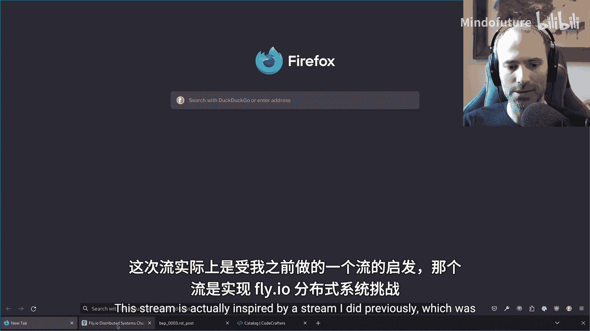

Did we get through one and 2 and maybe partially three。 So it was fun。

 there's a bunch more challenges。 And， and I thought about doing a sort of part two where I continue those challenges。

 but。😊，I was sort of hesitant because I also want to leave some room for people to do it on their own without sort of being led through it by the nose。

 And so instead of doing those， I was like trying to figure out something else to do instead。

 And then shortly after I did that stream a company reached out to me and it was like hey。

 we actually make coding challenges that are intended for like learning where you build real things。

 And they were like， well， because I've been fairly public about not really taking sponsorships at least so far that's not really a thing I've been doing。

 And they were like we don't necessarily want to sponsor you we just think you might find these interesting and also you know here's a referral code you can give people if they sign up。

 So I went and took a look and they actually have catalog of like challenges that are build your own X。

 So build your own Redis build your own git， build your own whatever and they sort of give you a test suite kind of thing for each one And in particular。

 I saw that they have。😊，build your own bittorrrent。 And I was like， okay， great。

 Bitorrrent is a fun distributed system。 Let's go ahead and build that。

 Now what there are sort of two ways to go about this， right。

 One of them is to follow the actual bittorrrent spec it's not too bad actually I've skimmed it a little bit and you know I feel like you could probably implemented just from the spec。

 But I wanted to do it through this this code crafters thing。

 So codecraft versus is the company that reach out to me because it has to sort of sequence of steps of like do these challenges and roughly this order and eventually you'll end up with a working bittorrrent and it starts from like the just decode the strings that are encoded in this particular format that are used in torrent files all the way down to like。

 okay， actually download a whole file with like difficulties and stuff。 Now。😊。

I want to prefix this with， I have never used this thing before。 I don't know if it's any good。

 It might be that we start going through this and it's just absolute garbage。

 but I figured it might be useful because if this works。

 then this is like a teaching mechanism that I really believe in。

 I've told you this before on stream that one of the things that I really like is learning by doing like building real things。

 And this feels like a thing that encourages that and hopefully makes it easier。

 So we'll go through this and if we find the structure of this website too annoying。

 then we'll switch to something else but otherwise we'll go through and see see how it fairs。😊。

Let me also send you， so should you think this is interesting and verdict's still out on this one。

You can also go join them from there。But let's see what happens if I click startBuild。

Welcome to build your own bittorrrent。 Great， I would prefer to work in Rus。 Thank you very much。

 Yes， please。😊，Language proficiency。I'm going to go with advanced。Great， next question。every day。

 Sure why not。 accountability， I'll pass。 No accountability。 Ohh， they give me a github repo。

 Alright， let's see what happens。 Get clonelog。

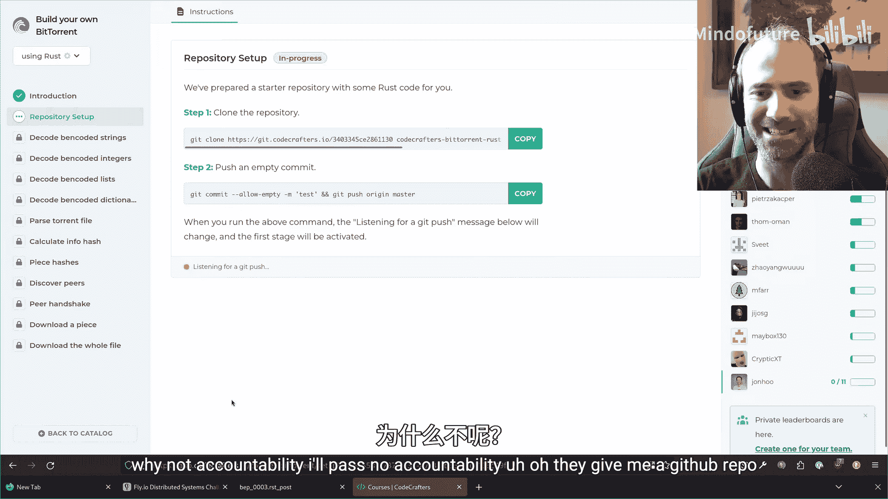

This thing， okay。んなあれ思ったよほ。All right， let's see what's in here。Pushing them to commit。 Alright。

 Alright， fine。 I'll do the thing they want me to do。Ooh， okay， so you do commit。 And when you push。

 I guess they run a test suite。

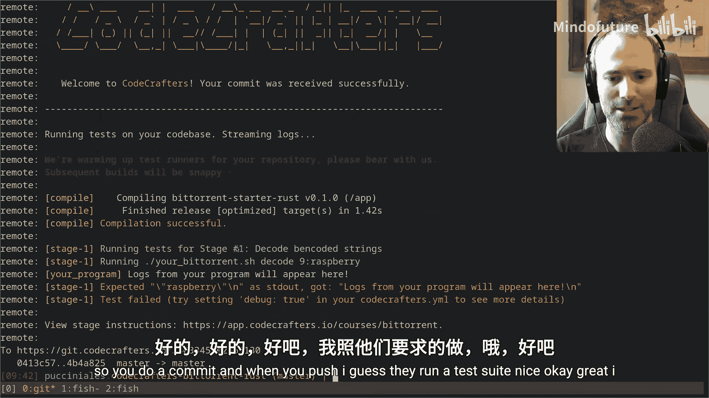

Nice。Okay， great， I have a thing now。Great， I successfully pushed。Okay。

 Ben encode or B encode is a serialization format used in the bittern protocol is used in torn files and communication trackers。

 Benco supports four data types strings， integers， arrays and dictionaries。

 focus on decoding strings， strings are encoded as length colon contents hello is encoded as5 hello okay this pretty standard length encoding I a deco command。

 takes bincoded value as input and prints the decod values is JO。😊，It be even booked like this。

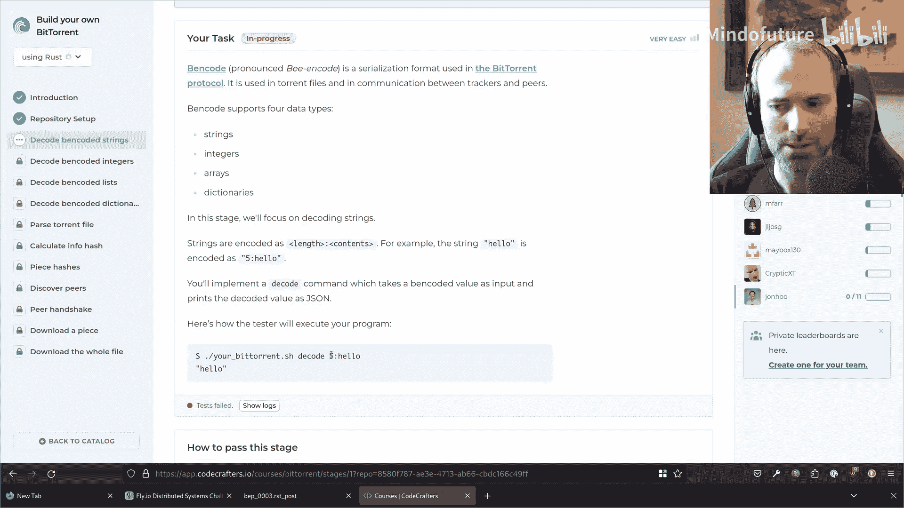

All right。Let's， I want to look at the actual code here before we just blindly accept it。 Okay。

 source main。They have a Curdy Ben coatat， no， that doesn't sound any fun。Oh， okay， the great。

 So the thing they give me is really just there's a。This is a sample torrent file。

There's whatever this your bit torrent is。That just is the thing to run。 Okay， that's fine。It's fine。

 Oh， Ru 1，70。 Okay， let's do。I guess we could pin our rust up to 170。Or no。

 I don't want to do that its fine。What do they have in Cargo Tmel？Don't edit this。Anyhow， bys。

 clap he， rex 30。Tokyo， okay， this seems like a fine place to start， I'm not。Okay。

 so they give you very little。That seems totally fine。 Main as。 If command is decode， otherwise。

 who knows what else ande this spot to pass the first stage。Right。

 so this takes the second argument on the command line， calls this decode。

 and then prints the result。Okay， great， so now we got to implement this thing。Oh。

 and they already did it for me。W。I guess it's just to ensure that you actually have running code encoded value。

 So iters of the characters takes the first character。

 So if the first character is a digit with Radix 10。 So it's a base 10 number。

 then find the first colon。This is not how I would do it。 I want to do it differently。I want to do。呃。

喂。Some。I wanna do。Wen。And dressed。Encod value dot split once on colon。

If let O then equal then dot parse。嗯。I don't want all these unwraps。Then。

And they parse it as an I 64， which I think is probably a lie。

 probably can't be negative because it's the length of a string。 In fact， it's probably a u size。

 And now we don't need all this like string offset indexing。 so we can then just do。

Return certain value string， rest。Until then。Now， this is also a little weird because this assumes that there are no UTF8 characters in there。

 So this is one of those places where I can't want look at the spec。

 I'm going beyond what the exercise really tells me to do already。

 which is arguably not what I should be doing， but you know， where is the here。

 Strings are length prefixed base 10 followed by a colon and the string。

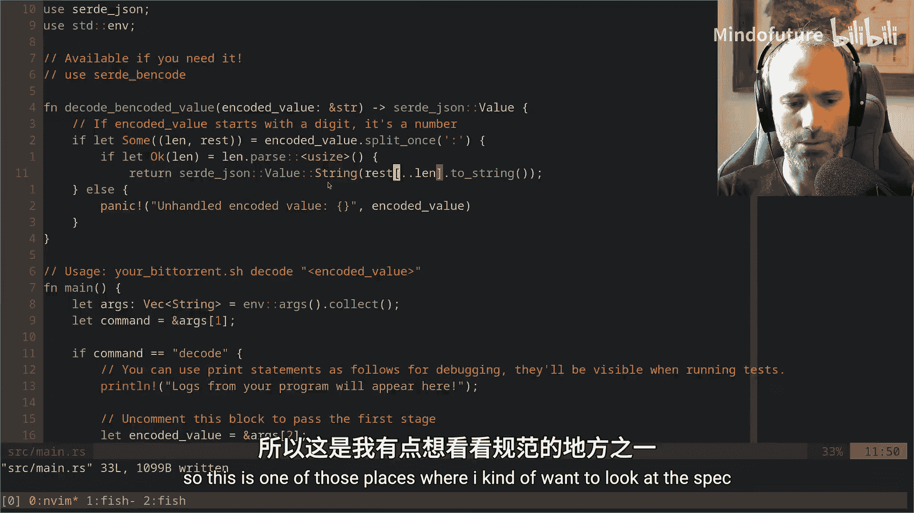

Okay， so that's entirely unhelpful when they say length。Length prefixed， so。Length in terms of bytes。

 length and sorts of code points， who knows， Who knows， All right。

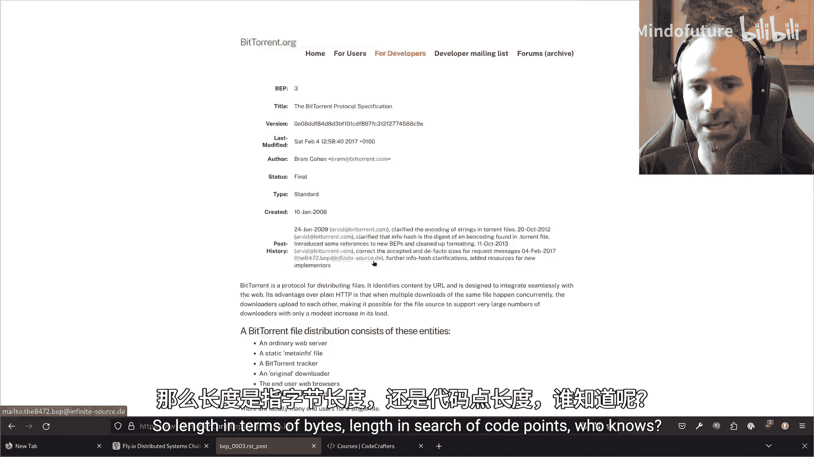

Fine， we'll just assume that this is basically what they mean。Can I write like。

Cargo test is that a thing that they let me do because that's what I want to do。

File contains an enclose delimiter。 Oh， yes， it does。And then I actually want this。Early return。

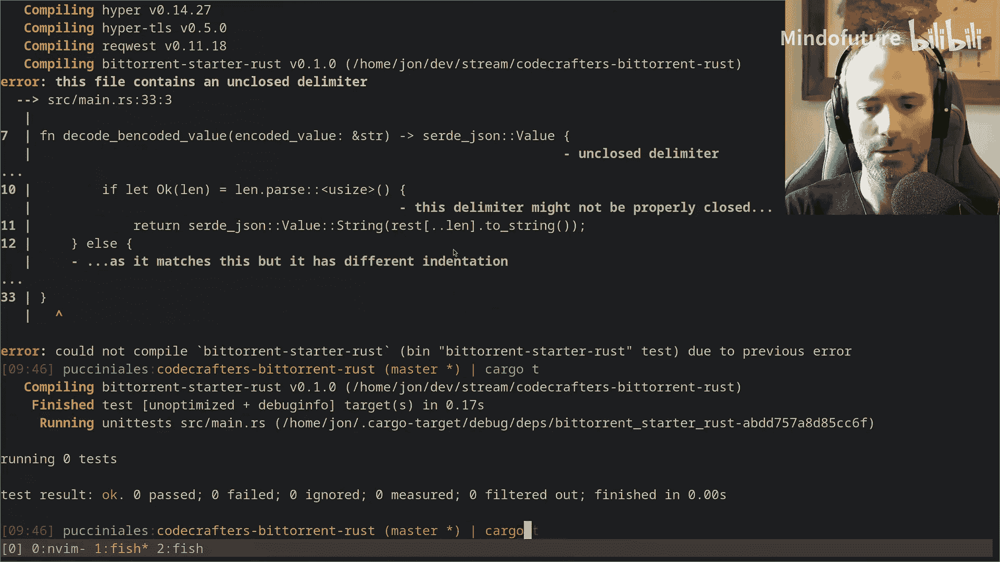

Oh， I guess I can just， I think they ge， yeah， they do this。

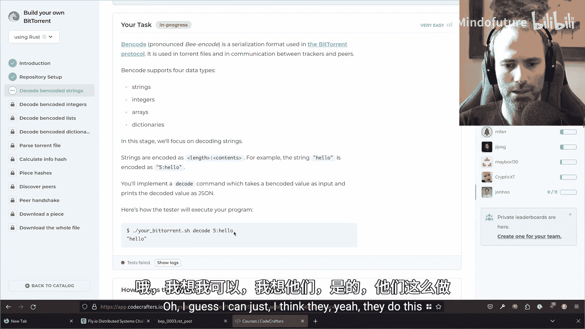

Okay， here's how the tester will execute your program。 Allright， so I can execute it the same way。

Right， this runs cargo run behind the scenes。 That's fine。 So it is to build。String length I 64 Yeah。

 I know。 I know。 I know。Yeah， I wonder whether it's different because I said like to like advanced as my you know。

 difficulty level。 I I wonder whether that actually makes a difference or not。Like。 okay。

 it printed hell， which is the， the correct input。 Okay， that's fine。

 What I'm also curious about here is。Yeah， this is a bite offset， which I don't love， but it's。

 it's fine。 We'll leave it。 We'll leave it the way it is。 so I guess。If I go back here。

 what do they want me to do， I guess they want me to push， Okay， so。Ben code， Dcode strings。

Good push。Expected blueberry a standard output。Oh， it's because this print line has to go away。

 It's make it an E print line， maybe。Wonder if that's okay。That's interesting。Bbug output on。

St there。I wish they had that in the code itself， like this should not be a change I need to make。Ha。

 a compilation successful。Grape and logs from here will appear here。 Test past。 beautiful。 Alright。

 so we go back。 should the we' this now Yeah you next stage。😊。

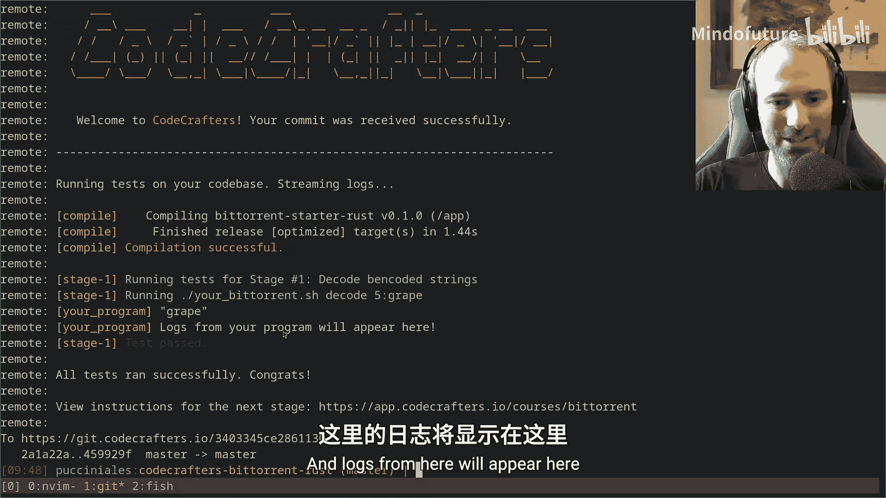

Okay， in this stage you'll extend Decode to support Ben encoded integers。

 integers are code as i number E。Why。I guess， E for end。

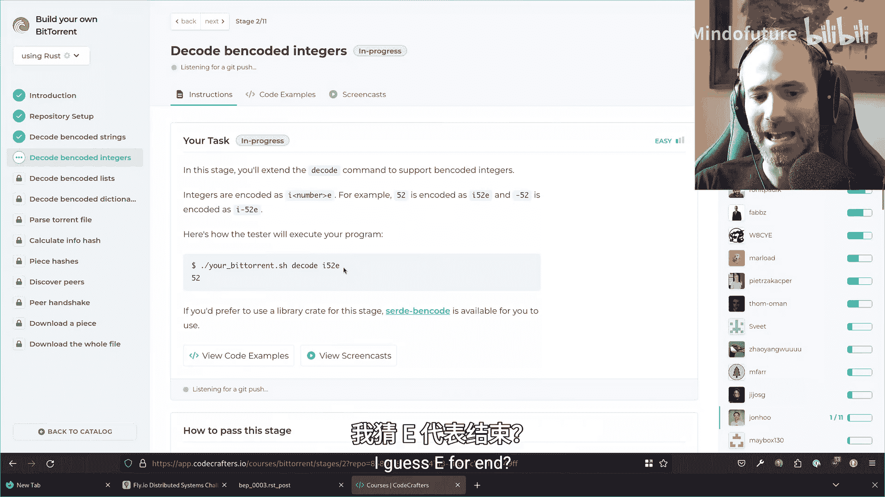

I don't want to use a library crate。 That's no fun， okay。So。Here's a good question。 I guess I can do。

Encoded value。0。Is equal to I。I want， I want that branch first because this one has to。

 has to split and then parse。 So if the first letter is I， then it's， you know， easier to。

 to figure out what we do。 then we go。And I guess， actually。Here's what I want to do， if let。

Some rest equals encoded value dot。Sttripped prefix。

Because that way I don't have to index afterwards then。If let。If let'sum。Digits， I suppose。

 is rest dot。Split ones on E。And I don't actually care about what comes after the E。

And then if flat okay and。Is digits dot parse。 This time it is an I64 kilos。 it can be negative。

 then return this。Now， this is obviously not ideal。 I don't love this this。

I don't love this nesting here， really。I think even I can just do into here。

 I'm pretty sure that's supported。As I'm tempted here to change this one a little bit because。嗯。

What I want， I guess the these two conditions are actually exclusive。 So what I'm worried about。

 right is that we go in here。 We don't find an E， and therefore we might have to take this case。

 but I don't think that's possible， right， I think if we go in here。

 then this really is the only valid pattern。 And so if we don't hit any of these ifs。

 then we're gonna hit the panic。 The nested ifs here are a little sad。I wish I could avoid those。

 but I'm O with leaving this here。 I could also implement this whole parsing in numb。

 but feels maybe excessive。 So if I now run， I guess I 25 E。Okay， I minus 25 E。Okay。

 that that seems fine。 And if I don't have any E， then it panics because it says unhandled encoded value。

 Bea， alright。Pars。Yeah， so the other way we could do this is we could do and then right。

 so I could do。If let's sum n is tell strip prefix dot and then。Digits。

But I don't know if this is really better。Right， like。呃。3ft5。Right， no， that's not what I want。

I want。And then so this is gonna be， I ignore the first， and I take the rest， and then I do。Like。

 I mean， we can look at it and see whether we actually think this is。More readable。

 I don't know that it's going to be， but we can try。 So that's gonna be this。

And then digits thoughtt parse。Dot OK， so that it turns into an option。And then。呃。And then， I guess。

Yeah。Is that better？I don't know if I think that's better。呃一。嗯。Where did I mess this up。Oh。

 strip prefix just gives you rests， right？嗯。うん。It is true that now it will fall through if it doesn't go through these。

 like it'll go to the other cases。I suppose it's nicer。 I mean， we can do the same thing here， right。

 so we can do。And then if， if we do actually think it's nicer。 So Le rest。And then we do。Pas。O。

A lets some。Well， this one's more awkward because we actually also want to keep the rest part here。

And。So this has to return L and rest。 And so here well we're going to have to go。let then is this。

And then some。Then rest。And the reason we have to do that is so that we keep the length here as well。

To I now I go back and do five hello， great。And if I do like four hello， then just skip the O， Yeah。

 great。I don't know if that one's nicer for the for the string case， actually。

 especially because we need to have this this block in the middle here。

 So I think that one I actually want to keep the way it was。um。The digital coding， I think， is okay。

呃。Avoid deepifs。

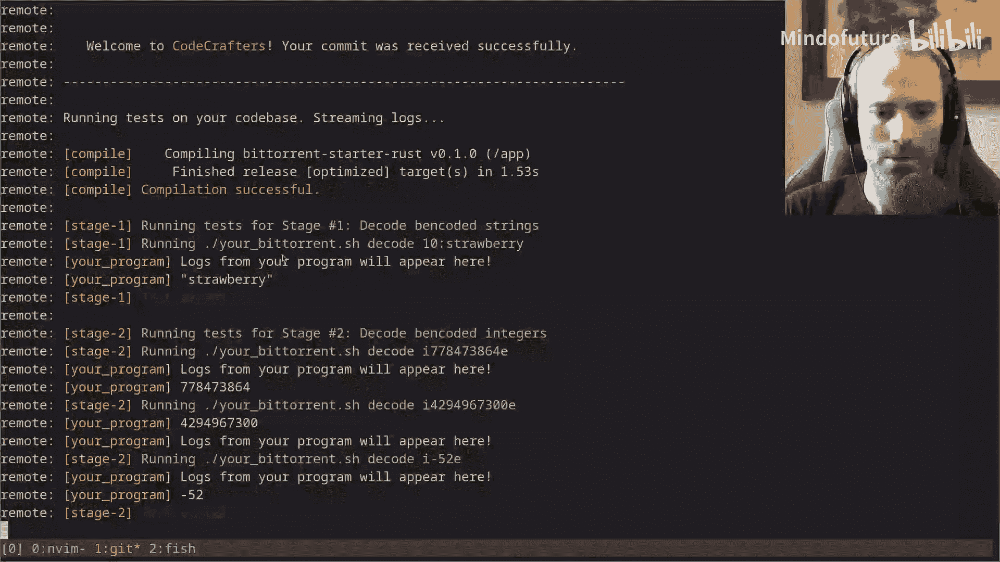

Amazing。In progress， no more completed Uni State。In the stage youll extend Decode to support Bencoded lists。

 lists are encoded as L。

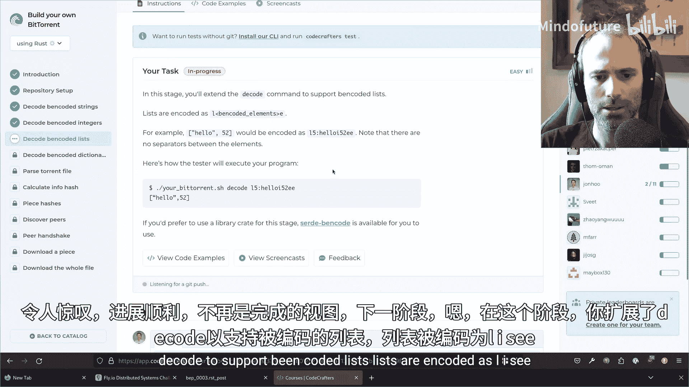

I see。 So this is okay。 So this is where we get into nested handling。

So I actually think I want to change this a little bit now。 I want to match on encoded value。

I forget whether you can match on strings this way。 So with slices， you can do this。U。

But I don't know whether you can do the same thing for strings。Didn't complain about it。

 but that might be my rust analyzer being broken。Yeah， pattern cannot match with input type。

That's awkward。 Can I do like this，'cause that's， that's a range。 I don't think I get to do this。

 I guess I can just do。Is there a split first， I don't think there's a split first。Yeah。That's fine。

 All right， we'll match on zero and then we'll say， okay， if we get I。If you get L。And if we get。

I guess any， this is really anything。 so the string case is anything between zero and9。

Chai is very sad。I don't know if I don't know if you can hear her， Are you very sad？Yeah， come here。

Why are you so sad？気せほ。Are you so disgruntled？Maybe you're disgruntled limp？Yeah。I'm sorry。

 I couldn't help you。嗯。But see， this is where it makes me sad because arguably the strip prefix。

 like we know that the prefix is I。That's fine， I suppose。 So then this will be 30 Jason。

Value number。嗯。And then for the L case， we'll do。Or rather， for their number case， we'll do here。

I foot some。 and is this。Return in。We could actually do the same thing here， we could do doting 2。嗯。

The reason I want the match here is just so that this is more like like a table you can cross reference more easily。

 So what do they say with L， It's encoded as L。 and then a bunch of valid elements。 And then E。 Okay。

 so this is where it gets。

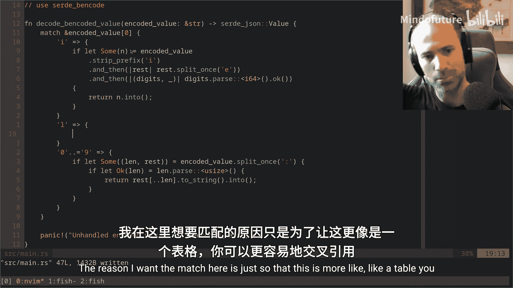

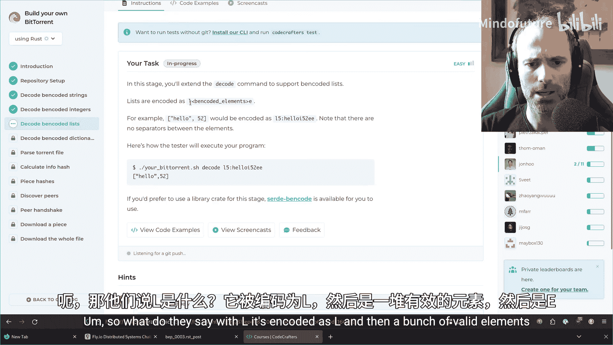

Trickier， right， This is where arguably you want an actual parser because we're going to have to recursively call decocode Bend value。

 which I think means we're actually going to have to。

We're going to want to either take a mutable reference to a string here。

 And so we could move the string along to be past everything we've parsed or we could have it return a value and a stir to say。

 okay， I parsed out this value。 This is the remainder of the encoded value。 either of those are okay。

Let's maybe go with this one for now。 And this is the same kind of thing you see with if you use a parser combbininator like like Nom。

 what you end up doing is you pass in an input and it gives you back the thing it parsed out and then the remainder of the input。

 So we can do the same thing here。 So this is then going to be。呃。Restt。Rest。And then really。

 we want to pass that rest。 So everything that comes after the E will'll do here。

And now this gets into the ugly。And rests。And then here， we'll then do this and。呃。Len plus one。

And onwards。Like so。And once we have that， then this now becomes。Oh。

 I guess split there is a split at， isn't there encoded value dot split。At。Yeah。

And is this for split at。The two slices returned go from the start of the string slice to mid and from mid to the end of the string slice。

 So I think that means it has to be split at one。 And then I can do eye and rest。

And I can do L and rest。Now。Where this gets awkward is that split at doesn't know that it's returning a single character。

 So this won't work。 It'll have to be this。And I don't know if you can do this。

I don't know if you can have a range of strings。I guess we'll find out。嗯。All right， so at this point。

 that means we no longer have to strip that。And we no longer have to do this。

And so now for the rest here， I suppose what we'll do is。We can't actually search for the E because。

You could have nested elements like nested lists， for example。

 where so the you can't look for the first E because that might terminate an inner list。

 you can't look for the last E because there might be an earlier E that we could use。Yeah。

So I think what we'll do is actually just re we'll just call the the decoder over times。

 we'll do like。呃。Let mute。U。Values is Vec new。And then we'll do。The loop。We'll do。Actually。

 I suppose we'll do while rest。 So we'll make this a mutable string reference while not rest dot is empty。

It's not going to be empty。 actually， it's going to be while not rest is empty and rest 0。

 not equal to E。Right， so either actually realistically。

 we could also not have the is empty clause here， but we don't want it to panic if we have an enddo string or rather we would want it to panic with the unhandled encoded value。

 So we want to here sort of terminate the clue， the loop cleanly。

 And then we'll do as as long as we see that there are still values。 we'll do let V and。Remainder。

Is decocode pen encoded value of rest。And then we'll set rest equals remainder。

And we'll do values dot push。Right， so we call the decoder。

 The decoder tells us both what value got out and what the remainder of the string is。

 Then we stick that there。 And then at this point， we then do rest dot。Does。

 is there a shift'cause it's， I w to remove the， I guess I can do return。嗯。Values dot into。

 and rests。From one and onwards， right， because the， the one is going to be the E。Sweet。

See how that works。 So I guess if we can， we can make up one of these。 So L for start a list。

 I for number 25 E， we could nest the list， Then we could have a three linked string。Fu。

There's no need for an end there。And then we could have another integer， which is -43。 We could。

End that。 And then we end the inner list。 And then we have another value， like5 hello。

And then we end the outer list and see what that does。Oh。

 and this thing down here would have to be dot0 because that's what we actually want out。

String indices are ranges of use size。嗯。I could just do and rest starts with E。If。

It's not empty does and it doesn't start with an knee。And now， yeah， I was worried about this。See。

 one option is to do the split at and then to map the first character into a map so the string of length length one into a character。

嗯。I suppose I can do。u。Lead and rest。Or， or if you will， tag and rest。

 and then I could match on the tag。And I'll keep this mute for the list case。

And then now we just need to map。呃。AndNow we just need to turn the one length string into character。

And I think we should just do let tag equal goes tag dot car dot next。That unwrap。

 or this can actually be an expect split at。I guess splitot probably panics if， yeah。

 the split out panics of mid is too far did not panic。 So tag is L。Tag equals tag。17。Alright。

 this no longer needs to。Have an end then， because the rest of the outset here is not an option anymore。

And it's not exhaustive pattern， which is fine。 do nothing in the case of。Unknown here。Who panicked。

Did not like that one。 unhandled encoded value。3 colon foo。So that's。Here。😔。

That's in the nested list case。Unhandled encoded value。😔，So this is where we gotta。

 we got to start to give ourselves a little bit to go on here。 So Eprint line tag is tag。Tig is L。

 tag is I。Tig is L， tis 3。So。So why is it unhappy about that？ So it goes into this case。

 and that's where it breaks。E print line， rest。Len is L， rest is。

I could arguably just use the debug macro here， would probably been easier。Len is empty。Okay， so we。

 oh， it's speak damn it。Okay， so actually I take this all back。

 we don't want displayed out the tag because we need the tag is part of the length of the string。

So I actually take this all back。 and this has to be。 we don't want to split。

 We want encoded value dot。Cars start next。And then， we can do some。Of this。Some of this。

 which also means now we're going to have to， we're going to have to skip the value again。

 which is a little awkward。So rest now indeed has to be。呃。Resttorch。嗯。Split at one。Not one。

And I guess here we do Let mute rest is。This is actually now encoded value。

This is going to be rest dot split at one。one。And this is going to be encoded value。

 no encoded value。 split at1 one。See， I would like that。 no field dressed，14。Right。

How does cars next differ from 0， So you you're not allowed to index into a string。

 You can't do encoded value 0。 That's， that's not a thing that you're allowed to do。If I do this。

 it's a string indices a ranges of u size， so you can take a slice。

 but you can't take a you can't take a single character out of a string that way。

 And it's because it's UTF encoded。 So the indexing into here is not character index。

 It's byte index and an arbitrary byte index into a UTF encoded string is not necessarily a valley character。

 like you might be in the middle of a U16 encoded character， for example。

 And so that's why you can't you can't do this。呃。Okay。So we still get into。This case。Oh。

 that's because here we don't want to split at is why？Great， Le is 3。 rest is this。呃。So， line 3。

Rest is fooze。 It also eats up the eye， for some reason。Is that because we。So for the string case。Oh。

 yeah。 that's because the， this actually needs to be no plus one。 Great。

 So now we get back a list that pares out all our values。Great。And now we can get rid of this Uprint。

Pas lists。Good push。So what it does。

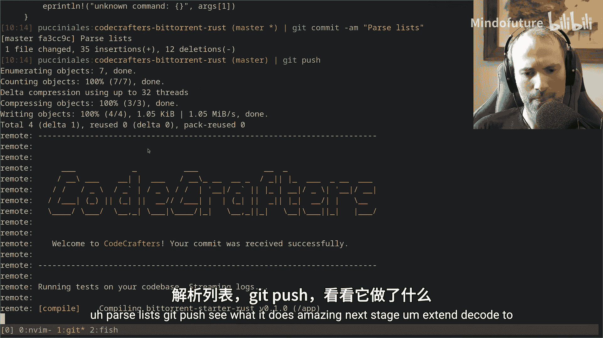

Amazing。Next stage。Extend decode to support Ben code to dictionaries。 dictionaries are encoded as D。

 key value， key value， key value， etc cetera， and followed by E， great。

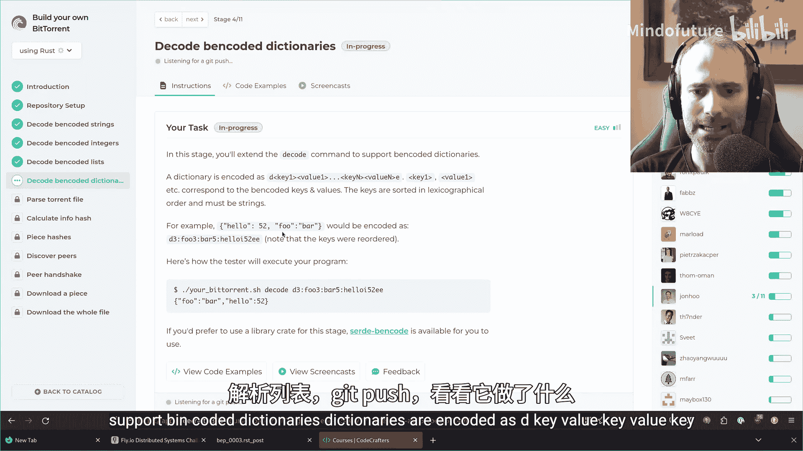

So this hopefully should be a trivial extension of L。Right， so we say great， we should also handle D。

 This is going to be a hash map。I think technically a B tree map because I believe that's what Cdi J uses internally so we skip the D while we haven't encountereded an E。

 Decode the key， decode the value。呃。Values insert。 I guess this is a dick in。In30 Jason speakak， oh。

 no， in Benco speak。And then we set the rest to be the remainder after parsing out both the key and the value。

 and then we turn the rest at one because we want to also skip the E。Okay， let's see how that does。

 So if I do now the whole thing is gonna be a D with a。3 bar as the key and this list as a value。

All right， import。From Brop is not implemented for value。So 30 Jason value。Object。Interesting。

 so what is the。Ma。Okay， let's just do 30 Jason。Map new， can I do this？

Is it going to be mad at me or is it going to let me do it？

Right now I don't need the B re map anymore。39。It requires that this is a string。 Okay。

 so this gets a little bit awkward。 So I guess if。I think what we want to do here is match on K。

 and if it's a 30 Json value string。Then。Cause in30， sorry， in Jason， keys have to be strings， right。

 So the the decocode that we do here could be any arbitrary type。 Like， for example。

 the key might happen to be an integer or a list or something。 or another dictionary。 And in Jason。

 you can't represent that。 So what we want to do is something like。Here， panic。嗯。Really。

 this should use like proper error handling one of the reasons I'm not doing that is because I think realistically。

 I'm going to swap this entire thing out for CD Bencode the moment we get to implement any more interesting part of the tot。

 So this this is sort of temporary parsan code， if you will。Dict keys must be strengths。Not。Great。

 so I worked。 but if I tried here to use， say， a I 42 E， Dickeyies must be string not number 42。Nice。

So， now we can do。P sticks， get push。These are indeed， very easy。

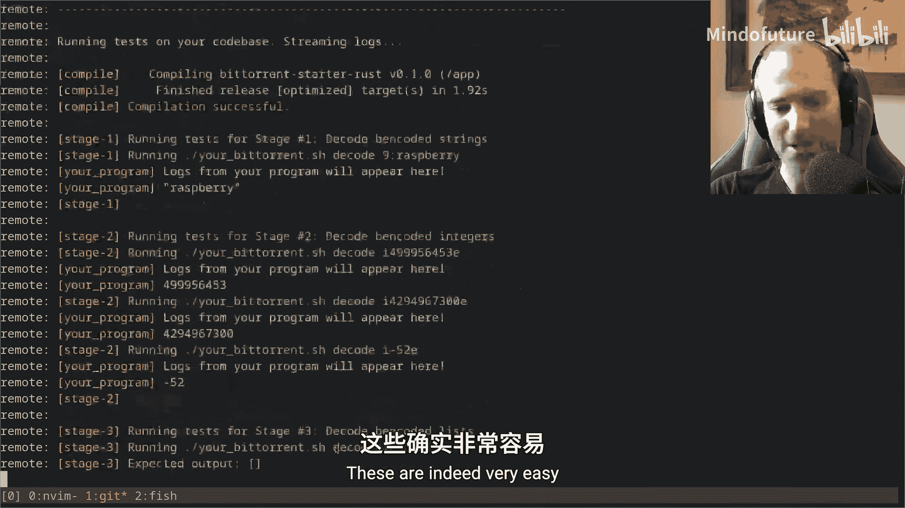

It's funny when we first started this， like these first few steps were listed as very easy and then easy。

 And I agree。 I think this is straightforward。 Now we get to the fun part。 Okay。

 you'll parse a torrent file and print information about the torrent torent file also known as a meta info file contains。

 oh， nicely linked to the spec that makes me happy。

 can is a Ben coded dictionary the following keys and values， An nounce， info， length name， pieces。

 length and pieces。😊，Tt files contain bytes that aren't valid UTF8 characters。

 you'll run into problems if you' try to read the contents of this file as a string， use U8 or VQ8。

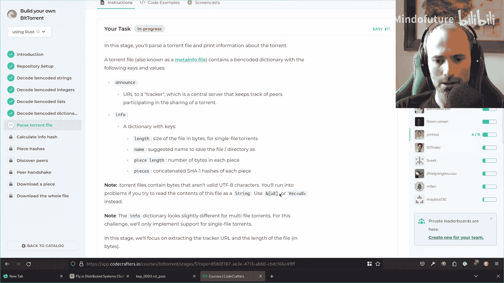

See， okay， this is where I I want to now switch over to not using our own decoder。But instead。

 use the CD implementation that they do because I think the the actual implementing this in a way where we can get nicestructs out of it is not。

not。Not the thing I want to spend time on。 It's not that it's not interesting。

 It's just not the thing that I want to spend time on。 So if we go to cargo Tommel。

 do I have 30 with derive here， I do。 So use 30 decalize。

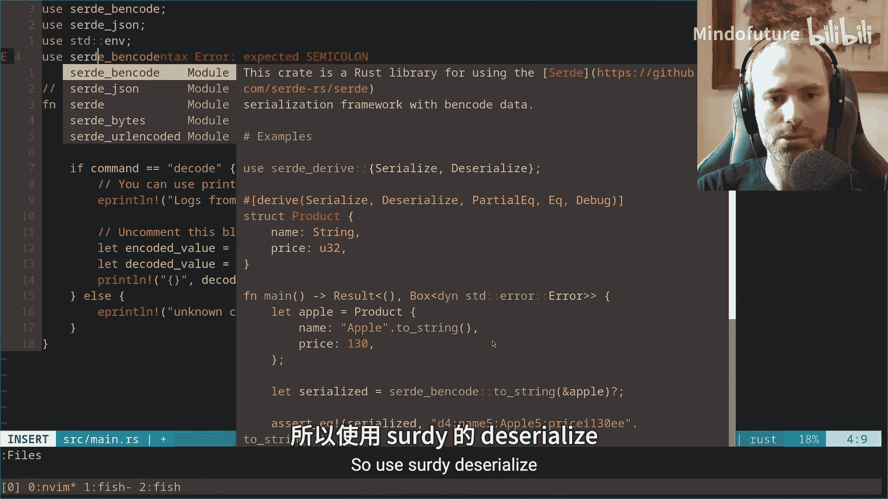

And then I can do astruct where they say the keys are announce info and these keys。 Let's grab。

 In fact， I'm guessing there's more in here。Announce info。

So torrent。So announce is a URL。Did they give me a URL library I can pull in here？Yeah。

 probably30 U encoded。Maybe your request URL， beautiful。

And we'll keep the documentation from the spec。

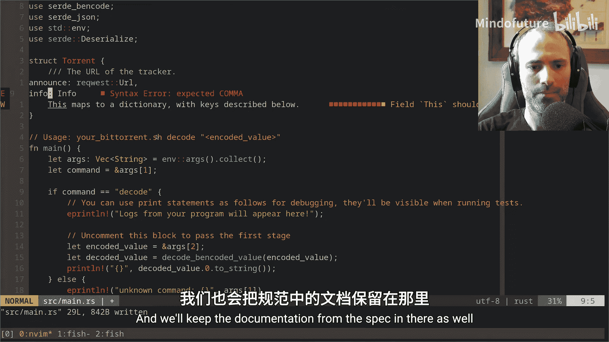

In there， as well。

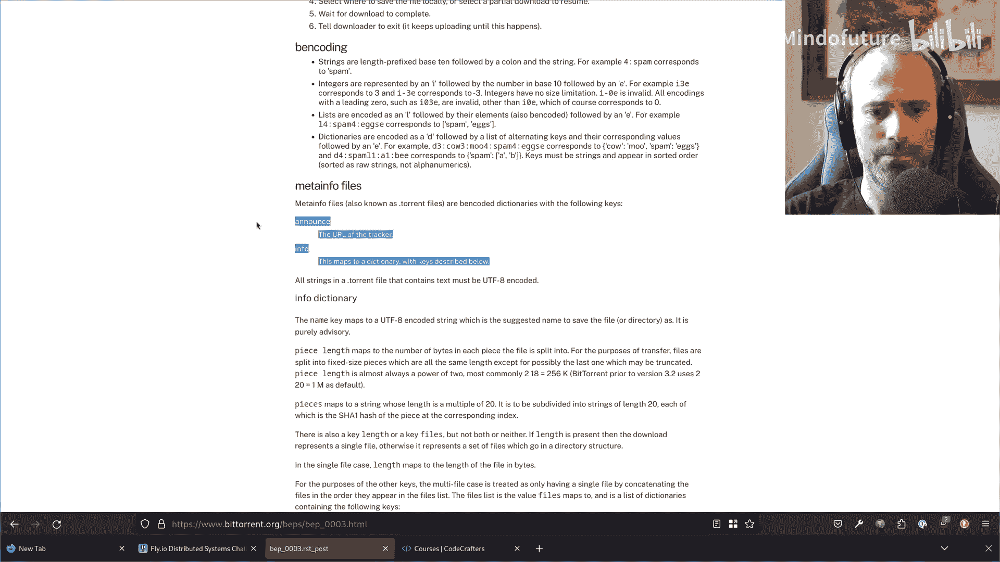

u。I like to have the spects more easily。Available to me， which this would do， and then we'll derive。

 you know， debug， clone， decalize。

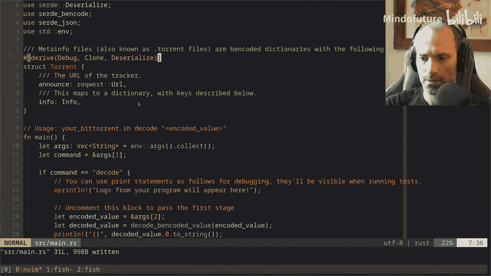

And then， info dictionary。

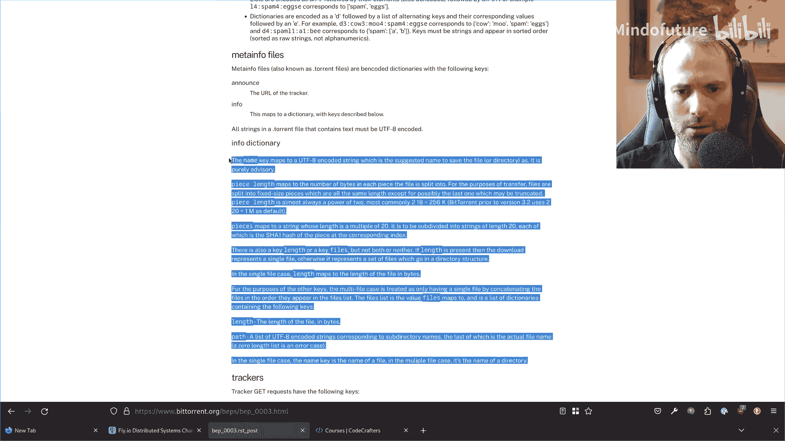

So we'll have astruct info。Name maps to a UTF encoded string， great。

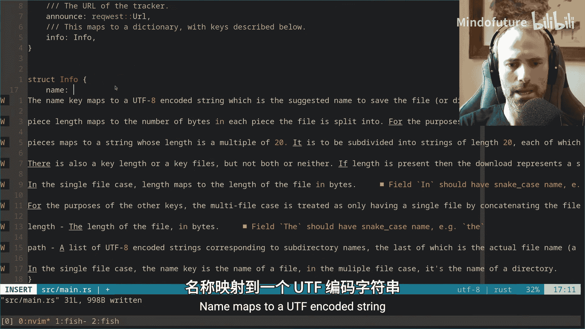

Peace length。Peace length。 Oh， no， I guess I can close that one。Yes， I think it's just length。

These length maps into the number of bytes each pieces of the file is split into。

 I guess we can also here just look at the torrent file。

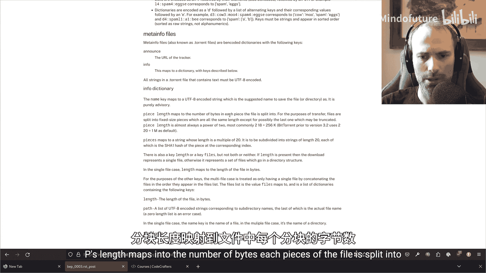

This is D 8。So announce， I guess now we can lead read this format， which is nice。

 So if I look for info， infofo has the keys。😊，Length， right？ This is length as a key with this value。

 Then it has name。It， it literally is peace， space， length as the name of the d。Wow。All right。

 I mean。Maps the number of bytes， okay， so this is going to be a thirdier rename equals。Peace length。

 that's wild。 That's a chaos move to have a dictionary whose keys have spaces in them。

Pieces maps to a string whose length is a multiple of 20。Wild， okay， so this is。

 it's subdivided into strings of length 20， each of which is the Shaw1 hash of the piece of the corresponding index。

 This I gotta see。 So pieces here。 Oh， yeah。 How about that。Pieces。Is。A 60。

A 60 length by string that is going to be subdivided into sub strings of length，60， okay。

 of length 20。This one， we can also do a little bit better。

 We can actually split this when when decizing。 So we'll get to that in a second。

There's also a key length or a key files， but not both or neither。Okay， so then we can use 30。Flaten。

To say。A keys。And that's going to be a keys。And then so sort flatten here。

 I'll show you in a second what that does。So we're going to do enum keys。And this one is going use。

30 untagged。 I'll explain that one in a second too。 So there's either。Single file。

Which has a field length。Which is a u size。Or there is a multi file。I guess instead of keys。

 this should arguably be files。But for the multi filele case。In the single four case， length。

Maps the length of the filingin bytes。Stick this one up here。If the length is present。

 then the download represents a single file， otherwise it represents a set of files which go in a directory structure。

The multi filele case is treated as only having a single file by concatenating the files。

For the purposes of the other keys， the multiphile case is treated as only having a single file by concatenating the files in the order they appear in the files list。

 The files list is the value files maps to and is a list of dictionaries containing the following keys。

😊，Okay， so that suggests that there's a files。Which is a dictionary。

 which means it's just a type for us。 like types or dictionaries。File。

And then I guess we're going to have astruct file。Okay， and we have astruct file which has length。

 okay。The size。As。Half， oh no， which is a list of UTF 8 encoded strings corresponding to subdirecty names。

 Okay， so it's a Vck of string。The last of which is the actual file name。A zero length list。

Is an error case， okay， that's fine。呃。In the single file。

This single file case seems very specialized。Okay， let's。

 let's tidy this up a little bit so that it actually， you know。Gets formatted。Great。

Let's see if we can make any sense of this。 So metaphies are we can do this。A meta infofo file。

It has a URL and has an info。

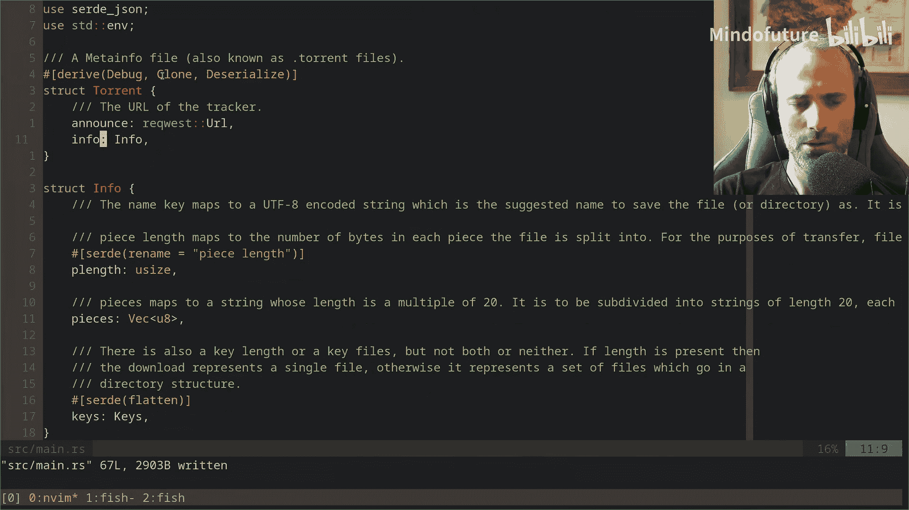

And info they don't really say anything about here， but maybe the this one says。

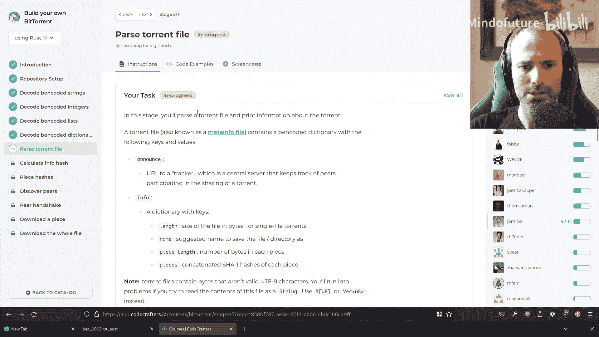

Nope。Okay， info。Oh right， name is a string。Disappeared in the comment。

 the name keymapsu UTF encoded string， which is the suggested name。

Suggeests a name to save the file or directory as it is purely advisory。呃。

This is the number of bytes in each piece the file is split into for the purposes of transfer。

 fileses is split into fixed size pieces， which are all the same length。

 except for possibly the last one， which may be truncated。

Peace length is almost always a power of two， most commonly。To to the power of 18， which is 256 k。

That's fine。Pieces， mapters， Allright。 So this one is just batch it insane。 So this is actually。

We have to make a decision here on how we want to decode this because。

We could just decode it into a V U8， or we could write a custom 30 decizer that will turn it directly into something like a Vck of U8 of 20。

That's not too bad， actually。So the way that we would do this in practice， Yeah， I mean， why not？

 that's seems like fun，30 Rs。 So if we do implementing decize。

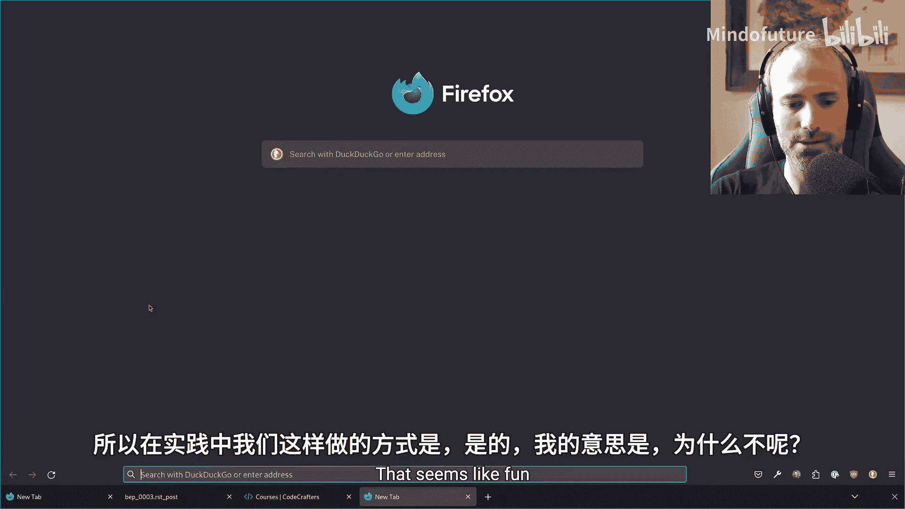

Dealizing a no， that's not what I want。I want。I think it's just this guy is all I'm going to need。

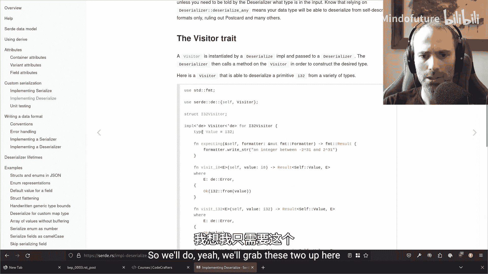

So we'll do yeah we'll grab these two up here。And we're going to have， I guess this is like。

Hash stir visitor。 And the value it's going to produce is a Vck of U8 each of length 20。呃，A。

Bite string。Whose length is a multiple of 20。And the only thing we support here。Is。Visit bys。

And visit。Borrowed bys。And notice it can't be visit string because this is not necessarily a valid U of8 string。

And so now we're going to do if v dot L modular 20 not equals to  zero。

Then we can do a we can return 30 error。

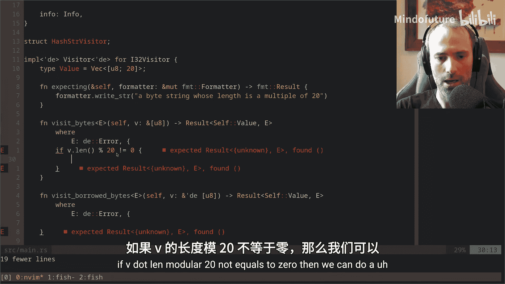

I forget what the。

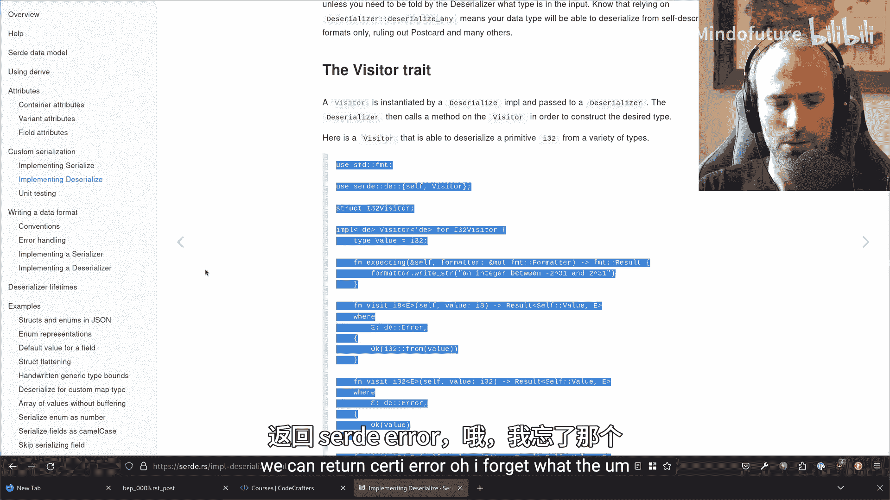

E custom is the one I want。For一。Yeah， I guess custom。嗯。Format。This would be a little helpful。Ling。Is。

B到了。And so now we should be able to say， let mute values is a Vnu。嗯。And。In fact。

 we should be able to do with capacity here。Which is V dot L divided by 20。And we're going to return。

 okay。Use。嗯。And then。There's a V dot chunks。 That's what I want。Of size 20。

Pturns an iterator over chunk size elements of the slice at a time。

 starting at the beginning of the slice， the chunks are slices and do not overlap。

If chunk size does not divide the length of the slice。

 then the last chunk will not have length chunk size。

 these chunk exact for a variant of the iterator， the return chunks are always exactly chunk size elements。

Okay， so。Shan。Chunks， exact。20。Turns the order of a chunk size elements of the slice at a time。

 If chunk size does not divide the length of the slice。

 then the last up to chunk size -1 elements will be omted and can be retrieved from the remainder function of the iterator。

 perfect， great。 So this one now。😊，I think we should be able to just do。In fact， we could just do。

Collect。Right。AtLe in theory， B I guess it depends on what exactly the。

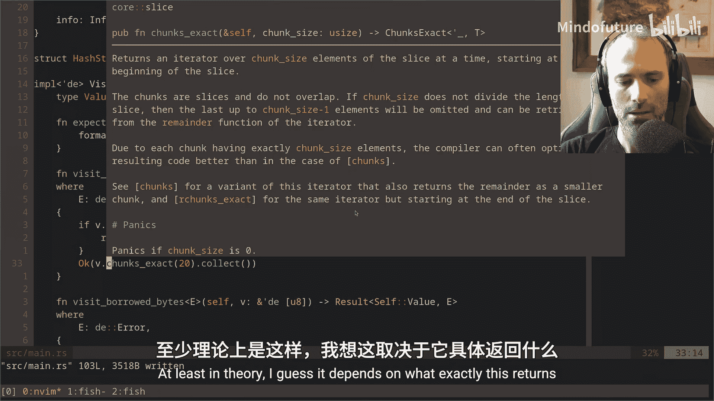

This returns。 if I go to。

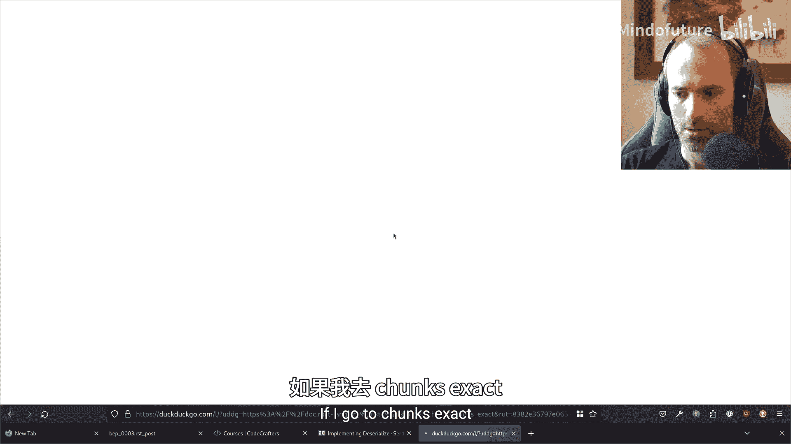

Chunk's exact。No， it's not night。 it was stabilizebild in 131。The question is， what it produces。

Where's the implementation of iterator。Oh， it gives me a slice。 That's lame。

 Chs exact should be able to give me a。A reference to an array。sIs there an array chunks？V dot。嗯。😊。

I don't think there is an arrayed chunks。There is a。Oh， there is。Yeah。

 but that one's nightly only see so。😊，To do use。Aray chunks when stable。That makes me sad。

What's the source of array chunks， that's entirely unhelpful， Okay， fine。

So we have a couple of options here。 I think what I want to do is actually a。

 we can just do a map of。Size 20。And we should be able to do slice 20 dot into。

I guess it's like it's really trying to expect。Guaranteeeed to be length 20。

And we can do the same thing here。Or actually， we don't even need visit borrowed bys here because we're not going to do sub slices in the first place。

So now that we have this visitor。

What's the this like a here， Yeah， implement DCize。

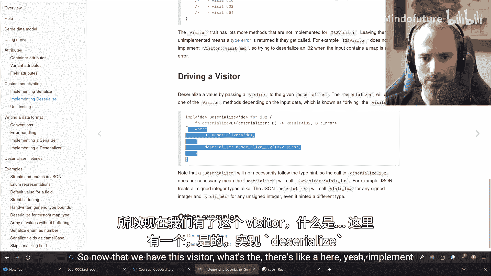

So now we can do this， implement DCR lies 4。 I guess I technically want this to be astruct hash。

Or hashes， which holds a back of。U 8，20。A's visitor。

And then this now is going to be an okay of hashes。This。And now we can do hashes。Deerize bys。

Hash's visitor。A little bit custom 30 here， but what that lets us do is now we can say hashs here。

 and now we know that this will actually give it will only decialize things that are actually multiple of 20 and afterwards we can just index into them directly as U0 U8 to20 arrays。

😊，嗯。So this now should be able to say。Each entry of pieces。

Is the Sha1 hash of the piece of the corresponding index？um。AndNow， keys。

There is a key length or a key files。But not both on either。 So3ty flattening here really means。

Treat this enum or treat this type as though it was here。 So basically ignore this keys。

 like this key will not be represented in the serialized format。 Instead。

 just inline this definition as though it were placed here。

 And the reason we want to do this is because we want an enum。

 and you can't really put an enum in here。 at least you wouldn't want to。So that way。

 it's like these fields are as though they were placed directly here。

 but they let us express it through a separate type。

And then the enum keys here is30 untagged because there's no tag that tells us whether we're in in the single file case or the multi file case right there's no like you know tag equals single file that's not a thing that's there。

 it's just it's a single file if it has a length field and if it doesn't have a length field。

 then it should match this kind of type and that's what3di untagged does Now3 untagged comes with some performance implications like we looked at in the decroing the 30 crate stream but but basically it has to try DCR lies twice once for the single file case and ones for the multi filele case。

So it it's almost slower， but it at least lets us express this pretty nicely。 if length is present。

Then the download represents a single file。 Okay， so we can。Stick that over there。Okay。

 if length is present， then the download represents the single file in the single file case。

 length maps to the length of the file in bytes so。This goes here。Otherwise。

 it represents a set of files which go in a directory structure for the purposes of other keys。

 the multifole case of the other keys。Oh， for the purposes of the other keys， as in these ones。

 like piece length， pieces， et cetera， for the purposes of the other keys in info。

 the multiple cases are treated as having only a single file by concatednating the files in the order。

 they appear in the files list。So， this is actually。

So we actually do need the the order here needs to be preserved because it has the the。

The pieces come in the order that they appear in this files list。TheOkay。

 so this is a vector of files。呃。The files list is the value files maps2。Okay， so basically。

 they say nothing useful there。 So file is the length of the  fallen bytes and a list of UTF 8 encoded strings。

correspondingding to sub directory names， okay。Names for this file。

 the last of which is the actual file name。In the single file case， the name key is that。

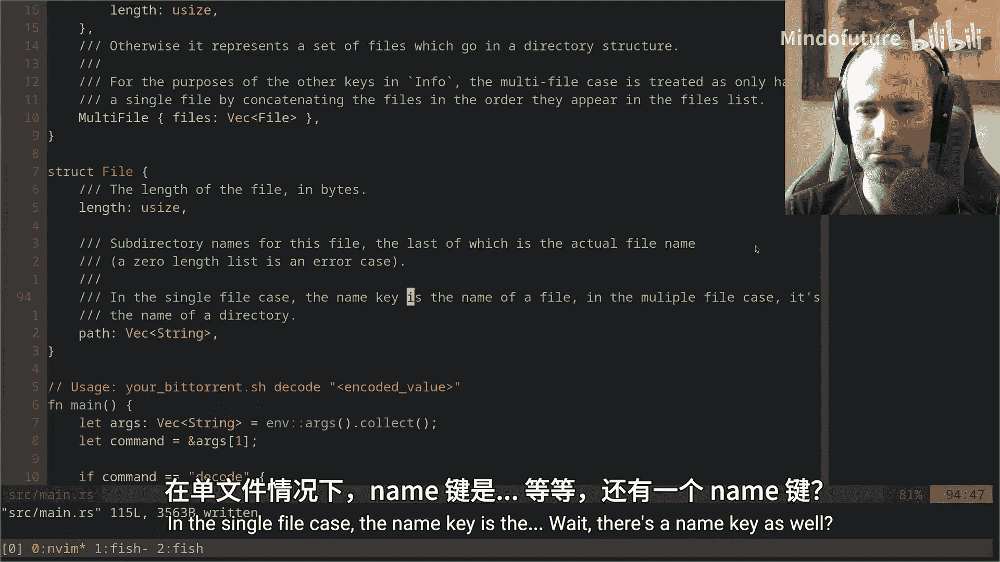

Wait， there's a name key as well。All right。 Where is our speck。Let's make this little larger。

 Thank you very much。呃。leength。Path。But which name key， Oh， then this name key。 Okay。

 so the top level name key of info。 great， So that means this really is documentation on name in the single file case。

 the name key is the name of a file in the multiple file case， it's the name of a。

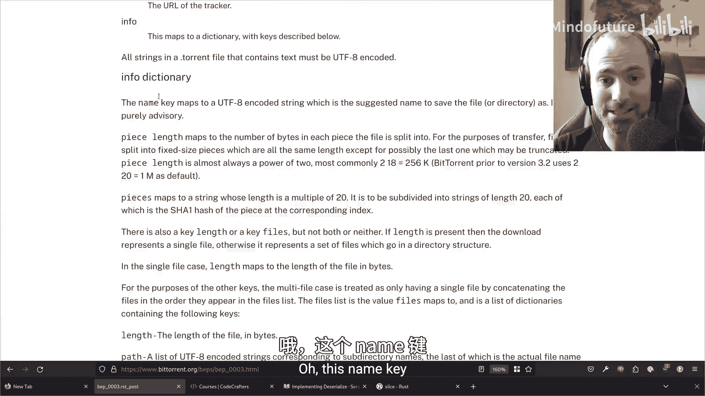

Of a directory。Oh， what do I do。Great。And I guess we will。Dive。

I actually want to move this hashes thing somewhere else because it's in the way。Let's do 35。

Mud hass。And then， I can grab。This and this and stick him in mod hashes。Then， I can use。Hes hases。嗯。

And then we can derive this on。All of these ones。And then now， we can say。

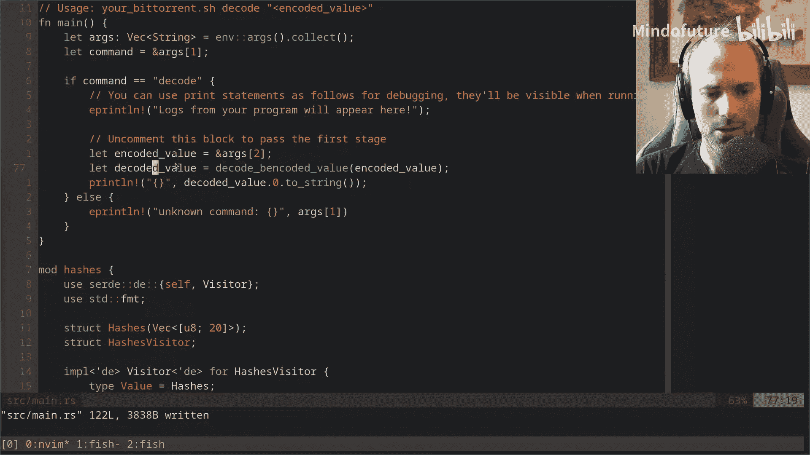

I guess now the question is， what do they want us to do with this in this thing？呃。

Info followed by sample dot torrent。 Okay， so time to pull out clap here as well。

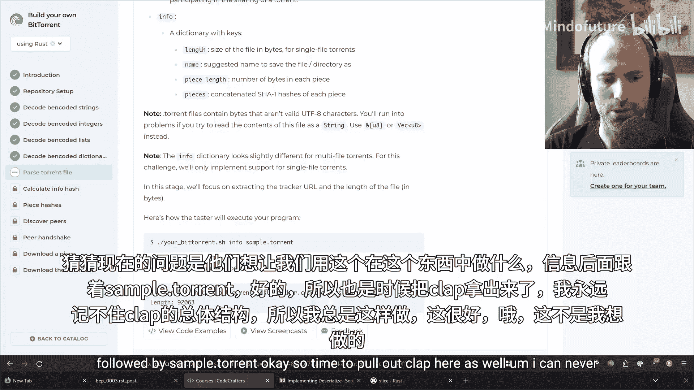

I can never remember the overall structure for clap。 so I always just do this， which is fine。O。

 that's not what I meant to do。So。Instead of like， you know。

 and currently we have this if command is equal to decode， I want to do a little bit better。

 which is going to be we want a， where's the sub command example。

I want the derive reference subcommand。5。I just want the。

 I guess there's maybe the tutorial is nicer derived tutorial。Okay。

 so we want the clap parser and we want clap。Subcommand。um。And we want to derive。Subcommand for。This。

 which has decode。Which is just a value， which is a string。And we now also have info。

Which has a torrent file， which is a path buff。And we don't take any other arguments。

And then it's just what commands sub command。Of command， command。great。

And now if I go down to my main instead of having this be just random string parsing。

I can get rid of my stood end here as well。I can do match or command。And if we get decode。

 then we'll do the same thing that we previously did， right， which is we do 30。And V is 30， Jason。

Value is。3ur0 Ben code。So this is where we're going to start using them the。嗯。

That3ty implementation of Benco that they gave us value。Unrappped。And print line。Li。

If we had a torrent， we don't know what to do yet。Now。

 just to see that this still works with our old like decocode things。Oh right， hashes should be pub。

Right， to use 30 the serializer。And decalize。呃。And then I did something silly here。

 which is this should be self。Cone， right， so this is hasshes。

 which should really derive debu and clone。Request URL， V C lies is not implemented。 All right。

 We'll keep this a string for now。 That's fine。 Us are strings。

Command cannot be formatted with debug。 Okay， that's fine。 We'll do。 we'll derive debug for you。

Amazing。Right， and this is the one that we intentionally brokeca integers can't be keys。

 but we can do， you know， three bar。Valid type by array expected a string key。Ohお。Also。

 there's a whole lot of。Things that it's upset about。About thesestructs。 Oh。

 that's because we never parse one。 Okay， so I guess we can we can set this code up to。

 So here we're gonna do mute F F is file open。Tent dot unwrap。We could stick in some anyhow now to。

 I guess， just to make this a little bit nicer。Anyhow， result。And I also want to bring in use anyhow。

Context。And so now we should be able to do here dot context。嗯。Open torrent file。

And then I should now be able to do T is of type torrent is 30 Ben code。From。

 they only give from bites。 That's sad， fine。read。Instead。Read torn file from Bs。Trrent。Tent。

Paars tornfo。Okay， so that should give us a torrent that we don't really know what to do with yet。

 and this whole thing can return okay。By now。It still says all of these fields are never read。

An unused variable。 That's fine。 That's just noise。 But this one's interesting。

 So invalid type by array expected a string key。Give me a rust。Back tray equals one。Line 87。

That's interesting。Did I do something。Weird in this one to make it not valid lists。

That should be fine。List of F I 43， E E。That's。A maletite bitete ray expected a string key。

This is a dictionary with a key bar。 and the value theres a list here that ends。

 That's an inner list。Inner list ends here。 Outer list ends here。 Dictionary ends there。

Whi's why is this invalid？Just to see that I'm not doing something obviously stupid。 Okay。

 that works。And valid type Bi expected a string key。So for whatever reason。

The curty Bencoat thing they have。Isn't happypy with。This input。I think their decoder is wrong。No。

 but this is， this is the decode。 So someone pointed out in chat that this is because of from bytes versus from string。

 But this is the decode option。 So this is not the torrent files。

 the tarrrent files we read as a U8 and them from bytes。

 but we're not executing this code path right now。 We're executing this code path。

 which is just from stir from the value that we get in on the command line。

 which is this value right here。And this value is just。Straightfor， like。Dar。No。

 it's the be perfect doesn't do anything。Dictionary item keys must be alphabetically sorted。Yeah。

 but there's only one dictionary key。And that's bar， so it is alphabetically sorted。Alright。

 let's let's try a simpler version of this。 So let's just do D3 bar I 25 E。So that's the key is bar。

 the value is 25， and that's the end of the dictionary。What if I just do three bar？

Any invalid type byte array expected any valid J value。I think I know why this is， actually。嗯。

I bet you if we go。createates creates 30 Ben code。

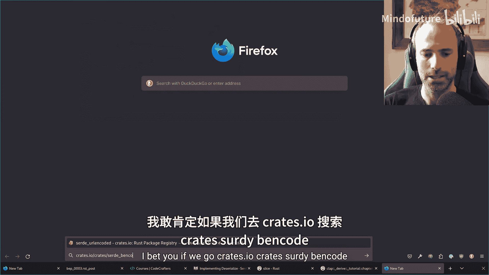

Get up。I wonder if someone's reported this as an issue。Oh， no， Oh， no。

 So flatten isn't gonna be working， Is it。Bte array。 I want to see if anyone is。Wu。

This seems like something might come handy in a second。I wonder if we look at the source here。M。

<|OTHER|>Tupervaristructarian， En access。Deerize， parse in。Yeah， so here if you squint at it。

 you can sort of see the remainders of the code that we wrote to par our parse the integers and stuff。

 right？You know， I bet you。That， yeah， it parses。 this crate parses。

Anything that has0 through 9 as bytes， not as strings。Just always。So， when knit hits。

Do not delegate this to decialize any because we want to call visit St instead of visit bites on the visitor to correctly support adjacently type enums。

Right， so I think what happens here is that when you try to decsilize into 30 Json value。

 30 Json value doesn't tell you which type you're supposed to get back right because the 30 Json value is is is supports both bytes and strings。

 So what actually happens is when the decilizer runs。

 it doesn't know whether it's expected to produce a string or to produce bytes。

 and then it just airs on the side of producing bytes。So， I'm。Bet you。

It actually works if if you actually have a type here because when you try to decsilize into this type。

 then we know that this key is supposed to be an actual string and similarly for the value we know it's supposed to be an actual string and so then the decilizer knows to deseilize into a string rather than into bytes but when we try to do it into C0 JO。

 then Cty JON doesn't dictate what we should do。

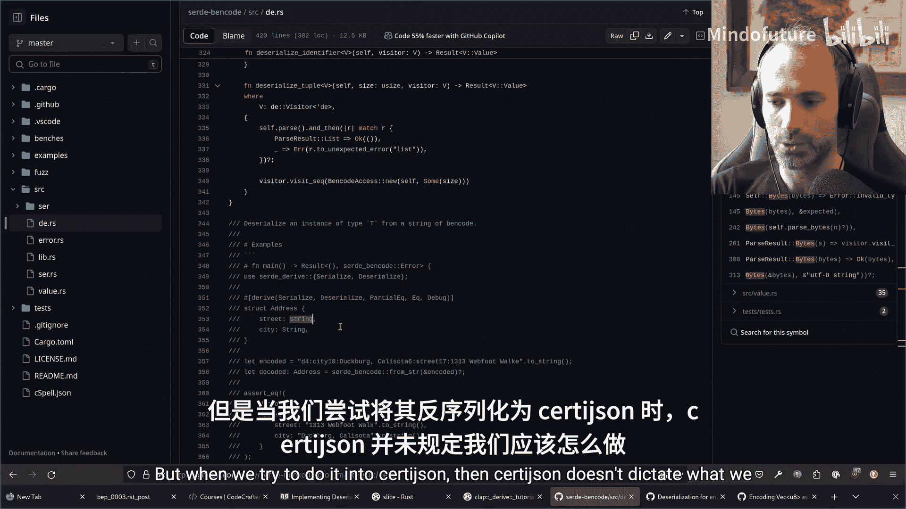

Although it should becauses the keys of maps are known to be strings。

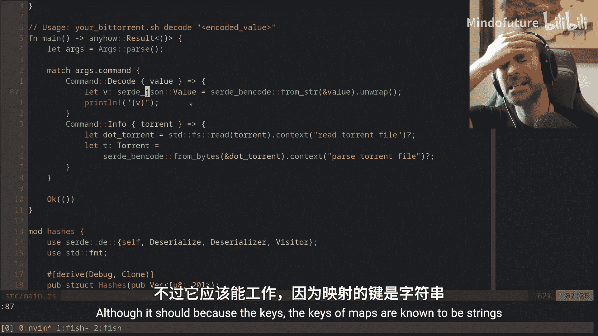

嗯。That's fascinating。

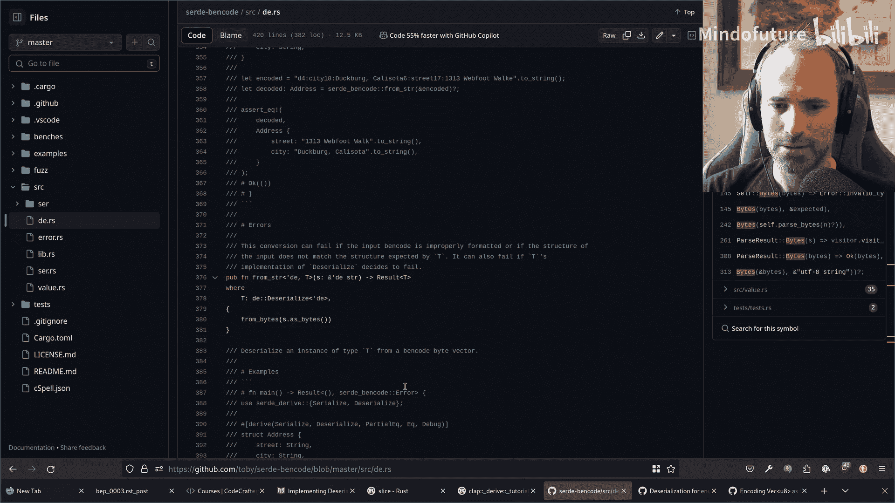

I mean， I I guess we can do。We can do our toent to see what happens。Oh， that does nothing， Does it。

 Okay， but it didn't error either。So print line， or I guess， E print line。

See what it got out of that file。Okay， so it actually parses the toent file correctly。

 so I think the problem really is trying to turn this into just an arbitrary J value。

I think that's what's going on。Which is pretty frustrating because that's what the earlier exercises tell us to do。

 I guess we should just do， like。Unimplemented。Right？

I guess I could do like object to require that the top level is a。Map。String30 Jason value。All right。

So that it's okay with。So if I tell it that it's a map， what about my bigger fancy one？

That it's not okay with。 So I think the actual problem here is that when decalizing into30 J。

 then it will always try to par parse strings as bytes。 and that just doesn't work。

 I don't really know what to do about that。 but it's also not important because this is just the decoder they're using for earlier exercises。

嗯。So what if we just do like。To do。Or I guess， unimplemented。3ur0 Ben code to。30 Jason value is。

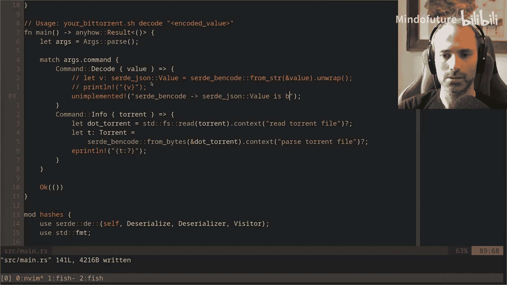

Worked。Right， what were we supposed to do， Well， what was even the challenge here， right？ Like。

 it just parse the toent file。 and it asks us to output this stuff。 Okay， that's easy enough。

 Now that we have it all parsed。

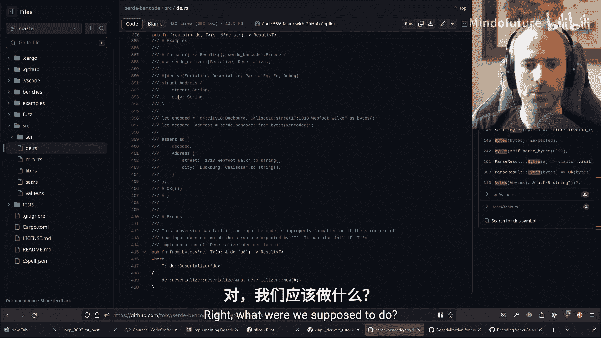

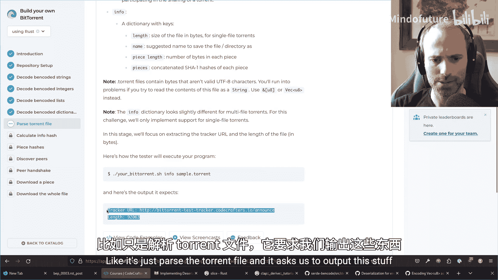

No， wrong thing。 Okay， so we want to print line tracker URL， which is just。

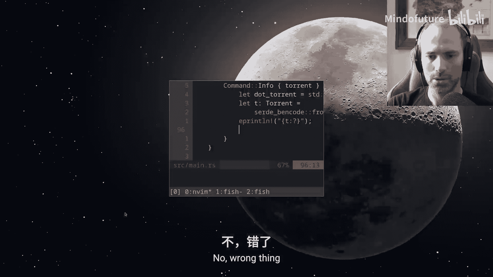

T dot。Announce， right。 And then we also want to do length。Which is supposed to be T dot。嗯。

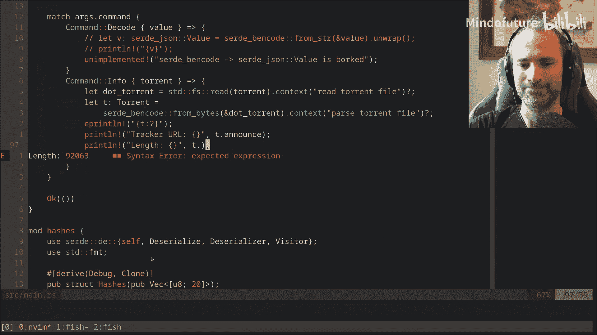

T dot keys。 So I think they're probably focused on the single file use case， right？Also。

 is there a dark mode for this， No， oh。

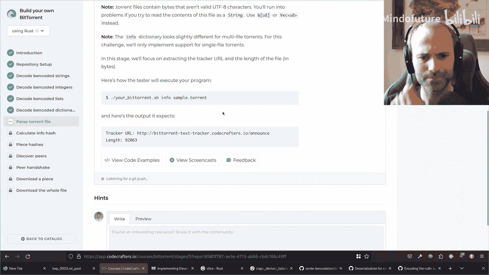

The length of the file。 So if let keys single file。Is T dot keys。Then print out。leength。Else to do。

Cause we don't know what they want us to print there yet。 So if I now try to give it an info file。

T dot Oh， did I make this files instead， What are I， What do I make this。 Oh， no。

 it's dot info dot keys。Yep， track URL and length。 and that's what it expects。

 That's indeed what we print。Okay。Pas toent。Darn file。Get push。

Application didn't terminate correctly。Oh so they still call us with the old test cases， I suppose。诶。

I mean， all right， I guess。呃。I guess what we can do is。Why is it not happy with us。Ma daughters。Fine。

So。Is that the last one we had， this one？mean not rest。You're going to hate this。呃。Get rid of this。

And then we'll take our little。Comment that this is broken。So keep our manual Iple too。Yeah。

 I know it。 I know this is terrible。 I know it makes me a terrible human being。 So then we do let V。

Is。De code。Then， encoded value。Dot zero。And then print V。

And now I can go back to my old Decode probably working。Yep。Restore。

Restore manual I for old stages of tests。Good push。So it does。

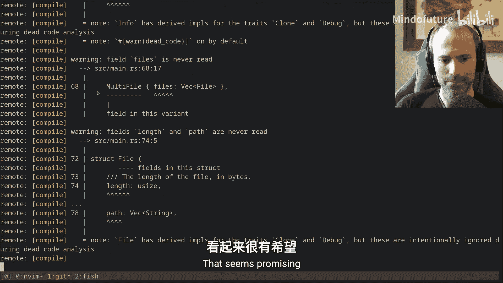

That seems promising。All tests ran successfully， fantastic。Okay， next stage。

Info hash is a unique identifier for a torn file it's used when talking to trackers or peers in the stage you'll calculate the info hassh for a torn file and print it in hexendadeciimmal format。

Extract the info dictionary from the torn file after parsing。 Okay， we already did this。

 Bencode the contents of the info directionary and calculate the Shaw1 hash of the Ben coded dictionary。

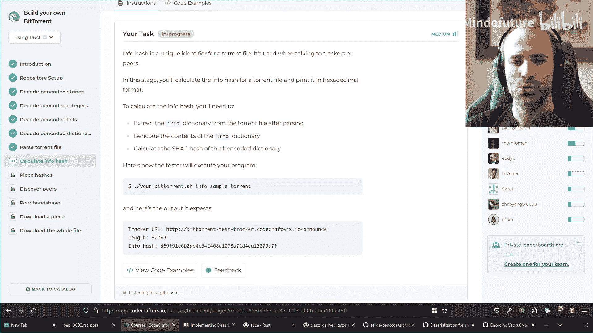

Okay， so this suggests that we will need to be able to not just decsealize， but also serialize。

Not so important for the torrent， but we might as well。呃。

This also means that we're going to have to implement serialized for hashes。

Where's my30 implement serialize，Luckiily， serialize is a lot easier。

Implement serialase this one。Don't be afraid of like putting wrap making rappers for 30。

 It's actually not that bad， especially once you get used to it。

And it can give you much nicer types for parsing。 So we want us do self dot0 dot lens。

 So 20 times that， because we want to serialize it as。As all the bytes basically flattened， right。

 And I wonder whether we could。Wonder if a Cdi flatten would work on Vec， probably not。

And then I suppose what we want here。Is。The little awkward because we're kind of serializing。

The one at a time， would make me sad。But I suppose that's really what should happen here。

 So we're going to do self dot0 dot iter， not flatten。By。

That's really how this is supposed to be serialized， right， like it's。Oh， I guess actually， no。

 it's supposed to be a string，It's supposed to be encoded as a string and not as a list。呃。

So we actually want seara li。Stir， but no， serialized bites is what we want。嗯。

Which is awkward Ca serialize bites once a single slice。 So I guess。Singles slice。

 well we'll do it the stupid way。Self thought， it's going to be a V。With capacity。

20 times self dot0 dot n。And。Isn't there a。I think we can actually just do self dot conca。

 I want to see whether that is true。 So I think we can do self dot 0 dot。Iter。Dot con。Concae。😔。

And then。Single slice。See if it lets me do this。Yeah。Nice。

So Concat is just a you can call it on a vector and it takes all the elements of the vector and basically iterates over and collects。

 So its sort of like an it flattened dot collect type thing So you see the example here for hello and world。

 for example， if you have an array of hello and world and you'd call dot Concat what you get back is those things concateninated together。

Which is indeed what we want here。

So now we implement serialize。I'm actually interested if we go back to the spec。

 like what does info hash 20。The 20 by Chawa hash of the Ben coded form of the info value from the meta infofo file。

This value will almost certainly have to be escaped。

Note that this is a substring of the meta infofo file。

 the info hash must be the exact the info hassh must be the hash of the encoded form as found in the dot torrent file。

 which is identical to B encoding the meta infofo file， B decoding the meta info file。

 extracting the info dictionary and encoding it if and only if the B decoder fully validated the input。

 such as key ordering absence leading zeros。😊，I see。 So this is。

This is really saying the info hash should be after you've validated that the input is actually accurate。

Such as， for example， for path， like this path should never the number of strings here should never be zero。

Key ordering and absence of leading zeroes。

Keys must be strings and appear sortrded order， sorted as raw strings， right， So。

 so there are a bunch of these requirements that we could verify。And I guess。

I wonder whether the 30 Ben code。嗯。Implementation will do that verification for us because you could imagine that it doesn't do this。

 right that that when a DC licenses a dictionary， it's fine with the keys being in non alphabetical order。

That could very well be。It would make me sad， but it could be。

So just the fact that we were able to decsalize into this does not necessarily mean that we're able to serialize out。

呃。H。I also worry that the serialized implementation。

 I wonder whether it actually walks the fields in。Whether it's going serialize the fields in。

Alphabetical order， the way the format requires， like if we look at30 Ben code。Sir。Seerializer。

 and I want to look at serialize map。<|OTHER|>Seeralize map， serialize key。Sir。Not into that。

Values are not allowed to be empty and that it pushes into entries， the key and the value。

End self dot end map。And I'm guessing， end map。Sorts the keys。 Okay， great。

 So it does take care of sorting the keys for me when I write them back out。

So I guess the argument here then is that if the file that comes in， let me。Just manually do this。

 I guess， because it's being annoying HTML。Let's go ahead and do background。B， no， let's do 2，2，2。呃。

55。I guess they have a color here huh？Where is this background color coming from？Here。Gowei。

And then this do color。呃，D滴D。They're not dark mode。So one of the advantages， I suppose。

 of decizing the。Deeralizing the torrent file， and then。

Seerializing it again before hashing it is that we ensure that even if the torrent file had。

 say dictionaries whose keys were in the wrong order， when we serialize it again。

 we know we'll be serializing it with the keys in alphabetical order。

 which means we're more likely to get a hash that matches what everyone else has because they've also sorted their keys。

嗯。Al right， I think that's okay。 I think this also doesn't need to be fully exact。 So I'm。

 I'm okay with this just doing its own thing。 This is also。

I can't make this one dark as easily， Oh maybe I can。

Let's see。This is gonna be annoying， isn't it。Be colour。Yeah， I figured。This one， maybe。Aron color。

Black。Bk。Haha。Okay， let's make this one。2，2，2。Because this  one I mostly don't care about。

 and let's do。This one。Aha， great。So now I can do here， I can say background。呃。32，3。

 And I can also maybe do。Color。D滴滴。😊，Oh， now。😔，This is gonna be。It's going to be really annoying。

 huh？呃。Oh， because the highing and everything is gonna be super annoying。 Alright。

 I think this one just has to be。Freaking light mode。Apologize in advance， but。

I'm afraid I'm afraid this one is not going do what we want。

All right。Willly polite light。Okay， so we have to calculate the thing。 We have to bend code。

 and then we have to calculate the Shaw one hash， okay。

That seems fine。 So let's do then let info。Hash or。Info encoded is。30 Bencode。2 bys。Of T dot info。

Reencode info section。And then we want info hash， which is going to be Shaw 1。呃。Xowan。this is。

Never remember the shot one interface。Right。Do they also use hex literology， do they use hex？He。

 that's fine。Back to here。 So the actual way is you make a hasser。

 I think there's a faster way to do it。 I， I remember there being like a shortcut for like， hey。

 I just wan to。I just want to hash a single piece of content。Encoded and has your dot finalize。

So this is gonna to be the info hash。 And then we do print line。 How do they want this printed。

 They want info hash， okay。Info hash。 and they want that to be hex encoded。

 So we'll do hex and code info hash。See if we can get this to run on the sample torent file。

Serialize is not implemented for info。What do you mean is not implemented for info？Ah。

 it's because I did not import。30 zero lies， how about now。Amazing。

 so we have a hash that ends at a 7 F。

A 7 F， great。也对。Commit。That means we are also correctly serialilizing hashes here， which is nice。

Compute info hash。Let's try and get push again。See what it does。

And it's running a bunch of tests。All tests ran successfully。 congrats。 Okay。

 so we successfully computed the the info hash。See if this is going be happy listening for a git push。

 Oh， I might have to refresh this， too because of the outage。

 which means I need to apply my little trick again。

Where's Hmel tagag， Hmel tagag element。 this， Thank you're much completed amazing。 Next day。 wow。

 these smileies look pretty， pretty terrifying in inverted colour。😊。

Okay。Peace hashes in a torrent a file is split into equally sized parts called pieces。

 A piece is usually 256 k or 1 in size。 Each piece is assigned a Sha one hash value on public networks。

 there may be a malicious pieceers to send fake data。

 These hash values allow us to verify the integrity of each piece that will download P length and piece hashes are specified in the info dictionary of the torrent file into the following keys。

 P length and pieces。 Yes， we already parse these。 The bittn protocol specifications more information about these keys。

 In this stage， the tester will expect your program to print piece。

 length and a list of piece hashes in hexadecimal format。😊，Oh， I mean， this is going to be easy。

Right。Because we already have all this stuff parsed。 So we should be able to now just do。

Oh， I guess the。

Yeah， this should just be print line。Peace length。Is gonna be T dot info dot。Pilang。

And then4 hash in T dot infodon。Pieces。I guess do 0。

 we could implement some convenience functions for。4 hashes here， but do zeros， fine print line。Oh。

 I see。 it wants us to print line piece。Hashs。And then it wants us just print the hash hex encoded。

 okay， so。Heex and code。Hsh。Easy。Easy。Print piece hashes。Good push。

I guess we should gets rid of some of these warnings。 How they're they're getting annoying。

 We don't need serialized map。 We don't need serialized sec。 What else is it complaining about。

That's just output stuff。 And then it's also the。Debug print of the torrent。

 which we don't really need in here， just to make the output a little less ridiculous。呃。

E came in less noise。

Okay。So this one's happy。You next stage Discover Pes trackers are a central service to maintain information about peers participating in the sharing and downloading of a torrent in this stage you'll make a get request to an HtTP tracker to discover peers to download the file from。

You'll need to make a request to the tracker URL you extracted in the previous stage and include these query parameters。

 infofo hash， PR I D port， uploaded。oo， this is a whole lot of things。 Okay， so I want to grab these。

 and then we're going do。

Should really start to split this up a little bit more arguably。 Let's go ahead。

' let's make our lives a little bit easier and open a Lib dot R S。W whichhich is gonna have。

This stuff。And also。This stuff。I want pub。I'm going to make all of these pub for now。

They are going to be they are going to be useful to main。

This is mostly just to allow us to split things into more files when you I don't need those to be published because it's not as easy to have sub modules for binaries。

 I mean you can， but it's kind of annoying。 And then I guess we'll do up here。Pub use hashes。Paashs。

And。And then we can grab。This。One its maybe the main one that we want。And then here， what。

 what do they call this crate。Bittorn starter rust， okay。With underscores。And I guess we'll。

 we'll just grab all the types from there。And now I don't think we need 30 DCize and serialize。

Because we just have the torrent files right here。 So if I run this again， right。

 it'll complain about hashes because that's now in this。Still works。 That's great。

 And now that we have these in a lib， now we can do。

So now we could even imagine splitting this I into。Like torrent dot Rs。Which just gonna have。

I guess actually all of this， all of that goes into Torrent Daris。So we do Mo pub mod torrent。

And then we also want a pub mod。I guess， tracker。And you'll see why in a second， it's because I want。

This type。To actually be defined in here， too， pub struck。Trackcker requests。Debug， cloneown。

Only really need serialize， I don't think we need to decsealize these we're not running a trackers server。

And then in Ma now， I suppose we're， we'll do。Torrent。Torrent。And tracker。

Track or request are going to be the main two we need。 And so for this one now， we can say。Info hash。

Which is going to's see so the info has the torn 20 bytes long。

 this is not the hexadecimal representation， which is 40 bytes。Oh， this is the actual like U820。Okay。

P I D is a unique identifier for your client， and it's a string of length 20 that you get to pick。

All right。We'll make all these pub2。The port， so that's a U 16。

 and I just happen to know from experience that ports are U16。Uploaded。Okay。

 so that's that's an amount of bytes that sort of by definition， is U size。left。Also， use size。

And compact。Whether the peerst。Should use the compact representation for the rest of these challenges set this to one。

So it's a U8， but really it's a booley and encoded as an integer。Okay， that's fine。Alright。

 so now we have our track request。 So this is the info has of the torrent。 and it's 20 bys long。

 We'll need to be URL encoded。 That's fine。 The library we're gonna use for。

 this is gonna do that for us。AUn identifier for the client。呃。And so here， I guess we can。

We can just use this value over in our main when we make this request。Which will'll do。

Somewhere down here， shortly。呃。Port。I'm just sort of setting these up for。

For when we later write the code to actually instantiate one of these。great。

The total amount uploaded so far。So that's going to be0。

Total amount downloaded so far is it going to be zero number bytes left to download。

This will be the length of the file。 that's fine， whether the peerless use the compact representation。

The compact representation is more commonly used in the wild。

 The non compact representation is mostly supported for backwards compatibility。

 So we're going to set it to one that seems reasonable。 So just record that here too。Okay。

 so now we have a tracker request that implements serialize。

And so let's see what that request would look like or that URL would look like。

 So request to the tracker。It's going to be a tracker requests。Did I not save Lib Parisus。

It might be mad at me。Rt analyze seems like it doesn't really like when you change the module hierarchy under it。

 There we go。 Philstruct fields。 Thank you very much。

 The info hash is gonna be the info hash should we computed， not the hex encoding。 That's fine。

 The PR I D。We're going to set to what they told us to set it to。Just going to be string from。Pt。

 they told us is at the 68。1。 So we'll do that。 uploaded as 0 because we haven't uploaded anything。

 downloaded a 0 because we haven't uploaded anything。Size is going to be the entire size of the file。

Which we extracted up here as length。And so， we can stick the。Length here and compact。

 we should set the one。

I now we have one of these requests that they asked us to add。

 the tracker's response will be a Ben codeed dictionary with two keys。

Okay， so we go back tracker here， and then we dostruct tracker response。

Which is going to derive debug， clone and decalize。呃。Do you serialize？No， I wanted all of this。

Interval is an integer indicating how often your client should make a request to the tracker。

How often。What's the unit for this month go to this spec？

Tracker responses are been coded dictionaries。 If a tracker responses is a key failure reason。 Okay。

 otherwise， you must have two keys interval， which matchled the number of seconds the downloader should wait between requests。

In seconds， that feels important。So that's going to be use size。Realistically。

 it's much less than a U size， right， Like you're never gonna wait for like U size max seconds。

 Arrguably this can probably be a U8 or something。 But let's do U size。

 Pierce is a string which contains a list of strings。 Oh No， one of these encodings again。呃。

Each pi is represented using six bytes， the first four bytes are the Peers IP address and the last two bytes are the Pis port number。

 This is going to be another one of those fund implementations of a custom data format。Let's do it。

 It's more fun that way。 So we grab our modd hashes thing。😊，And we'll do something similar。

 Some mod piers。嗯。So， piers is going to be a。Vectctor of。呃。Socket adder。

 and I know this is a V4 because it says4 bytes for IP address。 So it's IPV4 and not IPV6。

So we're going to have a piers visitor。That's going to produce a pis。And I guess， we can do。For the。

Reason why we expect something。6 bys。The first four。Are a P S I P address。 And the last two are。

Pierceport number。That's what we expect to get。Viit bys。I assume it's going to be bytes。

Because if it's an I address， then the bytes here are basically arbitaries it can't be a string。

 wouldn't be a valid utby string， almost certainly。 so that means this should be a modo 6。嗯。

Chunks exact，6， slice。s。And。And so we try into。You  a，6。

We actually don't even need to convert it that way because we we know that it is six bytes here。

 and what we actually want to slice this into is we want to socket ater V4。

What are the fields in here？Oh， suck it ever before， I think we need to say like new。Re。

 it doesn't doesn't want to give me that。 Oh right， because I have all these other things here Okay。

 pis。呃。Pierers visitor， serialized for peerers。So' actually can be a little bit annoying this one。

Because。We're going to have to see our licenses at bys。We'll do that one a little bit later。

What's it， It's unhappy about something over here。Haha。How about now？Oh， I don't have。

 That's why I need to import this。Now， am I allowed to do this yeah？Okay。

 so the IP here is an IPV4 adder。嗯。And I wonder。Ha， great。Slice 6，0。Slic6 one。Sllay 6，2。And slice 6。

3。The port is a U 16。 So that's going be U 16 from。That's a good question。The port。

Is it big Indian or little Indian， Does the high bite come first or last？Importantor number。

 respectively。Yeah。Does suspect really not say whether the port should be big Indian or little Indian。

Why， why would they not specify the the bite encoding of port。Yeah。It's probably network by order。

 I agree， which is big Indian， but like。But like why， But like okay。呃。4。And slice 6，5。

And I'm not allowed to use that constructor。Fine。So the reason I use chunks exact here and the reason I do modular is I think not it is a list of peers。

Yeah， which contains a list of piers， and each pier is6 bytes。

And so that's why we want modulos6 here not equal to 6 and why we chunk it this way。Yeah。

 but I don't want any bytes。 Oh， yeah， because any is native。 it's not network。 And so we we。

 we wouldn't want which order it uses to be dependent on the architecture of the machine we're compiling for。

 That wouldn't be right。um。Alright， I mean， we'll see。 luckily， this is something where， you know。

 at least in theory， this old test and whether it does correctly。 Okay。

 so this slicing is gonna be a little bit annoying because we actually need to。

 we can't use concat here because it's not a slice of slice of Uites。 So instead， what we'll do is。

Single slice is a V with capacity of6 times soft dot 0 do n。And then four pi in self dot0。

We'll do single slice dot extend。Pure dot。I P dot。occtus。And then we'll do Pi dot。Port dot2 beE。Btes。

And then， single slice。And now， Maine is complaining at 57 because info hash。

Because the info has we get back from finalize is actually this weird generic array thing。

 But I think we can just do this， maybe。Okay， so the type of info hash over here。Is it's okay。

 where's my Shaan crate。呃。The result that you get back from finalizing the hash。Is。

Generic array of U 8 and self output size。Now the question is， how can I turn， first of all。

 where does generic array comes from？That's an excellent question。Crypto common， maybe。What。

The file that it claims has this type does not have this type。Someone pointed out， oh。

 you can just in the。In the function argument here， I can just unpack it。 So B1， B2， B3。

 Unfortunately， that doesn't work because it's not an array。 it's a slice。

 I think maybe I could do like before P1 P2 dot dot。

 but the problem is this is a fallible pattern because if the slice is shorter。

 this pattern wouldn't match。 So that will only work when we move move to chunks and then we can also D we can also pattern match in closure as。

So unfortunately， that doesn't work。Oh right， this has to be now。Torrent keys。Yeah。

 so the problem is the thing you get back from finalizing Shaonn hash is this generic array type and what we want is an actual array。

 not this weird rapper type generic array。And。Doing that is a little bit annoying because， in part。

 I can't find the。Generotype implementation。It makes me wonder whether， like， can I write。UA20 here。

So going to let me do that。No， it's not， is it。

不。But I don't understand where this generic array thing is， because。That's from crypto common。

Alright， give me cryptocom then， please。Is this have generic array。

That comes with the generic array crate， okay。Core rust can't be used generically with respect to n。

 so that Icyrate the preceded cons generics。呃。Okay。Is there a way for me to？Do it now that。

It's no longer true。Yeah， there's not is there。youre 14 not 5，14 7。

 Please tell me one of them added away to。Turn it into a。Entered generic Eric array。Genericray。好。No。

😔，This is all slice stuff。嗯。See， my guess is generic array version 1。

Does allow you to expand one of these。If I do this。Surely。

This uses con generics to give you back the actual。Yeah， in array。 I， I want this one。

but we're not using the latest one， are we？A genericene array。Geneneric array。Yeah。

 they're using generic array 014 and 014 does not have this method。

Okay。I'm surprised that they haven't added a。A converter to this old version of the crate。It's fine。

It's fine。 It's fine。 It's fine。 It's fine。 We'll just do。Dot try into dot expect。This is the。

Generic array。w0。Is。You为。Expected U 8，20 found a reference。 Oh。

 that's because this needs to go away now。Great。

What do they actually want us to do？All right， this is just so that we can correctly parse peerers。

 And so now we have a new peers command。

It presumably also takes a torrent file and it expects to get a list of all the peerers。 All right。

 peerers。

Command peerers。Torrent。I guess just for our own sanity's sake， we could now do I torrent。

And give it a method to compute the info hash。Puberan。Info hash。Self returns you a U 820。

And so now I should be able to do info hash is T dot info。Hsh over here。 and as a result。

 I can do the same thing now over here。Why is it T Oh， right。

 because we still need to actually parse the file。That's fine。 And then the request。

 I guess I don't need to do yet， but theyre they're going to ask me to do it at some point。

And I guess I don't need the info hash either in this command。

 It's going to be some later one where I'm going to need this。That's fine。And so here。

 what they want me to do is for pi in T dot。Oh， no， they do want me to make a request。 actually。

 never mind。 So the request is gonna be this the。I guess tracker response is going to be request URL。

呃。From。And I want to use T dot announce。Right， so I'm basically constructing a URL to the to the tracker。

 And so that's based on the announced URL in the torrent file。Dot。Query pairs mute。呃。

Trackcker URL is going to be this。And then I guess what I want to do here is。Pars。Is this。

I'm prettyty sure there's a better way to do。 I don't think this is actually what I want to do。

 I think what I want to do is tracker URL dot set。Qury。And I want。

The URL pras to be using the 30 URL encoded crate， which lets you take URL encode any type， which is。

 you know what we have two string of request。Wap， I guess， context。

URL encode code tracker parameters。And now I should be able to set that to your old pars。

And then I should be able to。Do a。Request。Get。Trackcker URL。嗯。Oh， this is。呃。

let's use the sync one for now。Let response。equal to that。If we have the oh。

Why don't I get context anymore more。Use anyhow context， but I have context。Something's wonky。Oh。

 it's because okay， that's fine， this guy needs to go over in this file。Oh， right。

this guy arguably now needs to start returning a result。What'm going I just expect here。

Should be fine。Some shortcuts are legal。And right， and then this is going to be。Try into dot expect。

呃。Generic array。I guess I can just steal the。Same one I wrote over here。Exel。Oh。

 I guess they haven't brought in the fine。 So we're going to make this whole thing now be Tokyo Maine。

An async of N。Because now this has to do a， it should be request。 so wait。Context。Fettch tracker。

Expected URL found string。Cannot find length in the scope。Oh， I see。 Okay。

 fine we still need to do thisca they're still assuming that the file is。

Is single that the torent a single file。 that's easy enough。Expected URL found string。嗯。

Do they have a new instead？They do not。Doc dot R S request。Yeah， that's fine。 But how do I create a。

Can I just make myself a URL instead？Pse。Pase。Pase tracker An URL。Spected stir Fo string。 Al right。

 reference to that。Beautiful。So I guess now we want peers。Unsupported value。Interesting。

We're not to dig into that one。So， this is saying。When trying to URL encode the tracker parameters。

This one it's not happy with， for whatever reason。Ha。W。😔，Why， why， why， why， why， why， why。

I wish it would give me more context here。 Unsupported value is not particularly helpful。

It's probably the by array， yeah。A。So if we do C URL and code。What。URL encoded my bad。U。Too straight。

ちし。Actually， I want to see。

Give me， give me， give me， give me repository。And then I want to search for。

 let's see where I got unsupported value。

Value。Okay。Okay， I think that's just。Anything that， right。

 this gets called for anything that's not one of these。 So it can serialize strings。

 static strings and stirs。And some。Really。

No， they it specifically said it's not hex encoded。 So look yeah over here in flash， note。

 this is not the hexadecimal representation。 It is a URL encoded version of the bytes。

 which I would hope that the URL encoded crate would do for me。

But， I suppose not。U。Which I guess， means it does not。And code values for me。

Re to bytes support serializing bytes。Only deals with UTF8 strings。 look。

 someone else is implementing a bitn HtP tracker。呃。Which have already been present encoded。

This sounds like we could actually just。I mean， we could just U encode it ourselves。

 I suppose I just Ka of was hoping that we didn't have to。呃。Cause it gets real messy because now。

 like， what even should the type of this be。Here's what I think we have to do。 We have to do。

 what's the 30 trick for this。

Field attributes。

Serialize with。

Serialize width equals。Path。

Copy。Seral is with URL and code。

And so then we're going to do this。 And I think this has to be a module。 Oh， no function， okay。

So we can do this and has to take a serializer。 and it has to take a。T。

 which is going to be one of these UA20s。And the way we're going to do that， I suppose。

 is serializer dot serialize stir。嗯。And we're going to serialize stir。Cod is gonna be URL。

Do they even give me a。

Handle for this。They just kind of claim that I can use 30 URL encoder for this。

 but I don't think that's actually true。I think what we have to do here is。呃。Yeah。

 I suppose we can just manually encode it。 just feels really awkward。Right， like， okay， mute andd。

Is Vc with capacity。So every bite is going to end up being。2 Bs plus a per cent。 So three times。

T dot1。And then， you know， four byte in T。Encoded dot push percent。Andcored push， Hex and code。By。

I guess string with capacity。Andco string encoded。Which just feels dirty。

The tradeostro is not implemented for you。 that's fine， okay。Like this just feels。Gross。Oh， boy。What。

 alright。This should be fine。That's gross， that's gross is what that is。

But it works like we get the response back。 And then I guess we want the。

 the actual response is going be。Trackcker response。It's going to be response do。Oh。

 forgot the question mark， response dot， buddy dot。Btes。And then we're going do。Ben code。😔，Rrumbits。

Of response。Pse parcel tongue over here。 parse tracker response。

And that's going to be a tracker response。And then they want four pier in response dot pis。

Print line。呃。Pure dot。I P and Peer dot port。Wait， did we not。

Did I like not market as pub or something I did not， did I。Pub。Pub， pub。

And this is a this is a pierce。So。Pb use。Pierce， pierce。great。And we're almost there， because。

This pis has to be response at pis dot 0。Missing field interval。

Is interval required。

I feel like the response we're getting here is wrong， somehow。What。

Failure provided invalid info hash。Yeah， I mean， of course。

 is the invalid fucking info hash because I guess the encoding did not actually work。All right。

 what is the actual URL we end up setting here？Info hassh， Yes， see。

 it ends up URL encoding the thing that we outputted。

So we URL encode the bytes and then the URL encodes our URL encoding up the bytes。

But we can't give just the bytes because then。Okay， here's the way we're going to do this。

Note the info hash field is not included。あ。し。This is very stupid。 This feels very stupid。

So there's not going to be an in flash field Instead， we're going to do this。

 and then we're going to do tracker URL。Query， query pairs mute。Append pair。Info hash。

URL encode code。And。And this is no longer going to be taking a serializer。

 It's just going to return a string。呃。And it still makes me very sad。

 And the thing it's going to do is URL encode。😔，T dot。Info hash。Or I guess we already have it。

 So info hash。Yeah， thanks I hate it is right。And it's no longer generic over S either。

Proed in valid info hash。It's still getting URL encoded。W。Is there like an append？

What do we have here？Extend encoding override。Oh， boy。Oh， boy。Am I really gonna do this。

Is there really not just， just a， okay， request URL。 Show me what you got。

Okay， so we have queer pairs mute， which gives us back a。

Serializer manipulate this URL's query string viewed as a sequence of name value pair in encoded syntax。

Yeah， I can appear pen uniccode， but that doesn't help me。呃。Okay。😔，URL query。😔。

These all require strings。And serializer。Its not a public type。Okay。

 where does that comes from form URL encoded？Form URL encoded。A serialerizer。we got here。

Set the character encoding to be used for names and values before presenting codingding。

Be present encod。That's not what I want either。I don't understand why isn't there a way for me to just set Bs in the URL。

Bs。Allow non U toF a key in value pairs。Okay， that's。Not super helpful。No。

 the encoding override is used instead。

I guess the question becomes。

Okay， okay， okay， okay， okay， okay， okay， okay， okay， okay， okay， okay， okay， okay。

Encoding overriide。Some。No， because the input to this still has to be a string。

And this is not a valid string。That's sort of the whole point。 Okay， so that's not going to work。

Yeah， I suppose the way we have to do this actually， is then just。Trackcker URL is going to be。

Format。T don't announceunce。呃。URL， par。And this。Now， the reason this is awkward is because。嗯。

Is because the if there are query parameters in T dot ounce， this won't do the right thing。

Because you would end up with multiple question marks in the URL。U。What。

It cuts off the entire query string。Why does it cut off the entire？That's wild。Okay。

 so I guess just we can just not go through parse。Just don't parse it。

 just pass it straight to request get。Okay。So if you pass it to get。

 which presumably has to turn it in internally into a URL， then it's okay with it。

 but if you pass it via request URL parse， then it doesn't work。This is just wrong。

 like this this is just wrong and this should not be the case。Oh， boy。I。Ive。是。Yep， okay， fine， well。

 it does the thing， it does the thing。This， that's just this gorgeous。 Okay， great， thank you。

 Alright。 Well， we， we did the thing， at least in theory，1，78，62 with port ends with N。😊。

The port is wrong。 The port is fucking wrong。 Look at it。 The port here 5，1，4，70， the port hereer。

5，1，4， wait， the first went。

Oh no， they're just in a different order。

Why are they in a different order。 Okay， so we are part paring in the porchs right。

 So it is big Indian。 Okay， I was about to say， but why are they in。A different order。

Are they in a different order each time？呃。Split files and split modules， and。ACon tracker。

See what happens if I push。The values are random in the instructions。 Okay， I guess we'll see。

I would just like assume that they shouldn't need to be ordered。Alright， well， I guess we did it。

Nice。Okay， pure handshake。In this stage， you'll establish a TB connection with a peer and complete a handshake。

 The handshake is a message consisting of the following parts that described in the peer protocol。

 So that's also further down here。 the peer protocol。 Okay， let's， let's close some of these。

Just because otherwise they're gonna continue to make me sad， okay。

The length of the protocol string。

We。Peure connections is symmetrical， message sent in both directions look the same and did't flow in either direction。

ThePre wire pro consists of a handshake followed by a never ending stream of length prefixed messages。

 The handshake starts with character 19。

Followed by the string bit to protocol。The leading character is a length prefix。

 but they are in the hope that other new protocols may do the same and thus be trivially distinguishable from each other。

 All later integers sent in the protocol encode as 4 Bs big Indian。 So here they specify Indianness。

 Okay， great。 after the fixed headers come 8 reserved bys， which are all 0。

In the current implementations， if you wish to extend the protocol using these spice。

 please coordinate with Bram Cohen。 O， to make sure all extensions are done competitively。

 Next to 20 by Sha1 hash of the B encoded form of the info value from the meta info。 Okay。

 this is the info hash。😊，Except there's ros that have quoted， okay？

Both sides don't send the same value thisever the connections。呃。Okay。So。This is fine。

So the handshake， let's go back into here， we'll go to Lib。

 we'll do a pub mod handshake pier pier is good， like pier。

Per。Per P struck handshake。

Now。This 1， I actually think， is going to be。And。

Kind of interesting。 So I think what I want to do here is actually a。

Maybe I want to do something quite unsafe here， which I I want Reper C。

And then I'm going to say this is going to be little length。Which is a U8。

It's。呃。

Bit torrent， which is a U819。It is a， it is8 reserved bytes。8s。

Then， it is。A Sha want info hash。

And for hash， which is U 8。20。And then it's a peer ID， which is a U8。

Also，20。

Oho， what did I even do there？ Okay， these are all pub。No， semicolon。Okay， so now in my main。

What's the。Okay， there's a new handshake now。And handshake。

Supposed to take a torrent and a pi where the pi is。

P I P and porch。

That's fine。 this string。So， if we get a。Handshake。We do this。 We do that。 We do Pi is pi dot。

Split ones on a colon。 Actually， we can just do。I think socket outer V 4 lets you parse。P。

Pse peer address。Oh， there's a URL parse with pars。Interesting。That's fine。

 I'll leave it the way it is now。

Okay， so we parse out the pi。And then we。

Just do a straight TCP connection to it。 Okay， so here is。guesss Tokyo net TCP stream。Connect to。Pre。

Nextect to appear。 And then we wanna do。Pure dots and， and this is where it' all gets tricky， so。呃。

Handshake is going to be a handshake。Like， so。Rest analyzer really doesn't like when you make new modules in the middle of writing。

Now it's gonna tell me where it is， I think。Lib。Oh， it'scause I don't even import it。Pure handshake。

There we go。呃。The length is gonna to be should always be 19。 So I guess actually。

 to make this a little bit nicer for ourselves， we'll do。Imple handshake。Put the and new。

And it's gonna only take info hash， which is a U 8。20 and peer I D。Which is U 8，20。

I'm to turn myself self。And the length is going to be 19。

 bittorrrent is going to be the string bittorrrent protocol。

And to be clear， like the reason why they do this， right， is because。

The reason why this length here is hard coded， but it' still present is so that you could have other strings of different lengths。

 and you can still decode them like this。 Now， given that we know this is always 19， we could just。

Do it that way for right now，0。8。We could write a full parser for this that like does a length encoded string decocode。

 but because we know it's 19 and its fixed length how but we just do it nicely。 So we do handshake。

New， and what's the。

Right， so the peer I， we can use this thing and the info hash we already have。

The reason I make it mute here is because I actually want to use this to read the thing back out to。

 you'll see in a second。 So I want to write。 And I guess I got a。Use Tokyo， I O。Async， right next。

Right all。And I want to do a。At handshake as。呃。U8 of length。うん。Size of。handandshake。Right， handsh。

Now this is almost certainly unsafe， it should be at least。All right， star of that。Something here。

 a star of that。M size of。This is not a。Runtime argument。 This is a compile time argument。

Non primitive cast y。So this is where it'll actually be this as。Const to this。😔，呃。And then， itll be。

Unsafe。Well， alright， let's do this a little bit nicer。 So handshake bites。It's going to be this。

And then this is going to be unsafely turning that back into。And shake bites。

Casting reference to handshake as， alright， I need to go to。Cast handshake。To cast it all the way。

And it's upset about my socket ater before。I thought there was a parse。Is there really not？

I think it， then I think it's Pier dot parse。 I'm pretty sure this supports like from string。Ye。😔，嗯。

Right all dot weight。 So what I'm doing here is I'm constructing one of these handshake things。

 And because the struct is Reper C。 that means that I can， I can treat it as a byte array。

 It's not really what it means directly， but indirectly。

 it means I can treat it as a just series of bytes。

 I could just take the bytes that are in the in memoryory representation of the struct。

 And then I take that and just cast it into a byte array of the appropriate size。 And that thing。

 I can then cast back into a。呃。AReference to a bitete array instead of a raw pointer a reference。

 And that in turn， I can then pass the right doll， which takes a slice。

And now it's upset that this needs to be mute， which is fine。And I guess。Actually。

 I guess that's a good point。 I need to find a valid pi。So handshake。To this thing。Oh， right。 Okay。

 great。 So I， I wrote it， but I， I didn't get anything back。 So now here's what I want to do。

 I want to do。Peer dot read。Hao。Hanshake bites is going to be a mutable referenced。2 are you 8。Of。😔。

This length。So I'm just turning。Handshake bites into a mutable reference over the same thing。

I'm passing that into write all， and then I'm going to pass it into read all as well。So I want。

 I guess， read X as well。Asy read X。And then I want to dot， read。Exact。Into。Handshake bites。

Dot weight， dot context， read Handshake。And so now I want to do some assertions on this thing。 Like。

 I want to assert that the， I guess I'll， I'll drop the。

The handshake bites thing is only valid within here。 And now I want to check that the handshake。

 which remember， I passed in immutable reference into this thing。 So after the readed。

 the contents of this struck should now be the the bites that we got from the other end of the other side's handshake。

 So I should now still have the case that the length here is 19。

 It should still be the case that bit torrent reads。Whatever vitorn was supposed to read this thing。

And it should also be the case that reserved。Is equal to0。哎い。Casting， oh， right。

 this has to be mute now because I want a mutable。Can't compare U819 with U819。

 that seems like a lie。呃。2。Oh， I forgot。Prenheses。Surgeon failed， oh， they do set reserve bys。

The reserve bys are supposed to be all zero。

Why are the reserved bys not all 0。That's kind of interesting。We certainly set them doll zero。

I know extensions use them， but like。嗯。The， the， the this like what what's it called Code crafters Pi presumably doesn't。

 But that's fine。 Okay， we can just ignore them， I suppose。

 And then what they want us to do is print out the peer I D hex encoded。 Okay， so print line。

 and I guess this actually means that we don't need the length in this particular exercise。

Per I D。This will be Hex and code， Handshake dot P I D now。

The only reason why this casting here is actually okay。 I'm probably write a safety comment here， so。

Handshake。Is a P D with refer C PO D here means plain old data。

 which means that any byte pattern is valid。 So you see the types in here are all valid for any byte pattern。

 So there are no sequence of bits that would make any of these these types have an invalid or value with undefined behavior。

 They're all all all values are valid。Okay， so so basically。

 no matter what the other end send us back， any bit string is a valid interpretation of thestruct。

Great。So if I hour on this。I get by a peer ID。I wonder if it's happy with that like。Print PR I D。

Push， let's see。よし。Alright， so we correctly。

Hand shook with a peerer。Next stage， Down a piece。 Oh， this is that hard。 All the other one has been。

 have been easy， supposedly。In this stage， you'll download one piece and save it to disk and the next stage will combine these pieces into a file to download a piece you program need to send peer messages to appear peer。

 The overallflow looks like this read the torn file to get the tracker URL。Perform the tracker。

 get to get a list of peers。 establish a T speak next with a peer perform a handshake。 Okay。

 we've done that， Exchange multiple peer messages to download the file。Okay。

 peer messages consist of a message length prefix message ID and a payload of variable size。

 Here are the peer messages you need to exchange once the handshake is complete。

Wait for a bit field message from the pier indicating which pieces it has。

 The message I D for this message type is 5。 You can read and ignore the payload for now。

 The tracker we use for this challenge ensures that all peers have all pieces available。

 Send an interested message。When do you receive an unchoke message。

Break the piece into blocks of 16 kiloB， as then a request message for each block。Interesting。Okay。

 so。This doesn't seem too bad。This doesn't seem too bad at all。

So there are a couple of ways we could do this。 We could either actually write out a codec。

 Maybe that's actually what I want to do here。U。Because presumably there's like a format for each of these messages。

Here， too， I guess interested has no payload。But we can actually use Tokyo Kodak for this。

um。Tokyo codeak basically lets you。preThis cr deprecate in tokyo moved into Tokyo， Uil Koak。Okay。

 that's fine。 Yeah， so this is a way to。Convert between an async read and an async right to a stream in a sync。

 So sync is the thing where you can send values in and a stream is a thing where you can take values out that are well typed。

 whereas async read and async right only work on the sort of byte level。

This does tend to make the protocol a little less efficient because you go via the sync thing。

 So you don't get to makes memory management a little bit less nice。 but at the same time。

 it can be very， very convenient。 You get a much nicer interface on top of the。Top of the protocol。

 So I think what we'll do here is。So let's go to Pi。So there's going to be something like。30。

If we can do this with Cdi， that' would be cool too。And I think we probably can。A。So。

 so what I really want to express here right is something like Enum message or peer message or whatever it is。

 But message because it's in the module Pi。 And then we have what was was the example So bitfield。

Is one message type。And。What I really would like to express is something like， I guess。

 message types。 And then we do something like wrapper。You ate。And bitfield is message ID5。

Alright， so we can encode all of these like interested is to unchooke。

Is one。Request is 6。

Peace。Is 7。

And who knows what the other things are。 Okay， so we have 1，2，5，6，7。

 So those are the sort of message， I guess message tag is really the， the appropriate one。

 And then I want to say enum message。

And then。I suppose what I really want to say， right is that the wheres the30 do is bright。

 I'm apologizing to a little bit too late， feel that no container attributes。

Tag。You know representations。 So for tags， you can say。

This is like the name of the field that holds the tag for the， for which variant you have。 Now。

 this is a little weird in this protocol because the。There's not a named tag， really。嗯。

I think this is going to be a little bit weird and surdy land。

So I guess then what we really have is astruct message。Which has a。Tag。

 which is a message tag and a payload， which is really just a eck of， you know， U8s。Yeah。

 I think that's， I think I think what we'll do here is we'll do。

 we'll do a codec and just see how that turns out。 So let's write a little encoder and decoder。So。

we'll grab both the encodeder and decoder in the same thing here。嗯。This all goes at the top。

Am I bringing in the same thing multiple times No， I'm not。 okay。 So what I want is message decoder。

So implement decoder for message decoder。And the thing message decoder is going to produce is a message。

So it's going to be given a bunch of bytes。

And we know that the length in this protocol is it's always a length prefix of 4 B and a message I D of 1 by。

 So it should be at least5。

And then I guess the length， let's read the length marker first。Let's do 5。Marcro plus tag。

So then we return okay none to say we there's not enough data available for us to decode a full message。

 and then we read the length bytes。Out of the slice。

 Does it say whether they're big Indian or little Indian this time。It did， right。呃。Pure messages。Oh。

 here are the other ones listed。 Let's stick those in there while we're at it。not。

Not interested is3 and have is 4。And cancel is 8。Yeah， I think I think it's said。

Or all later integers sent in the protocol are encoded as 4 bytes big Indian。 Okay， great。

 So that means over here。We could say， from。B E bytes。So that's the length。

I'm not too concerned about this one， but I guess we know that the。Payloads you can get。

I guess peace is probably the thing that。

There speech choke。So pieces are， I think they said somewhere， the pieces are not larger than。Yes。

16 kilobytes。Usually two to the power of 14 by。

So max here is actually going to be one。16。Or， I guess， 14。

But。It's 1，14， but it's plus the headers。And I also don't know that we want to use the max here。

 So let's do 16。

U。Great。If the source length is， does the length include the mandatory tag。

Okay。Yo。😔，Messages of length 0 are keep alive and ignored。Okay， so there are messages of length0。

 which means the messages of length 0 have no tag， which means that the tag length is included in the length。

Great， here we can just keep the the stuff from the example encoder。That's fine。

So this is if we if the bytes， So we're we're giving a byte buffer here， right。

 if the byte buffer's length is shorter than how long the length field says the package should be。

 Then we reserve some more space。 and then we say we don't have enough data yet。 Otherwise。

 that means we have enough data we have every data that's supposed to be there according to the payload length of in the header。

 And so therefore we extract out everything follow the length。

 And I think actually what I want to do here is I want to grab the tag separately。 So I want。

Tag is source。5。And then I want data is 5。2，5 plus length -1， which is 4 plus length， but。嗯。

But that's not right。4 plus length minus1。The reason I want to do this is because the V that we extract here。

 Otherwise that V would have a tag at the beginning。

 and then we would need to allocate a new Vec told the actual data bytes。

 which we would then need to copy all the bytes into that bit， which just seems unnecessary。

 As we invented by4。We don't want to convert it to a string。 Instead， what we want is at this point。

 an okay。Of a。Message with tag。And the payload is data。So this is just the framing protocol， really。

Expect an option。 All right， sum because we successfully decoded the next thing。And。Oh。

 did I grab the wrong code for encoder， I think I did。嗯。AhaExamp encoder， that's what I wanted。

The payload data contains the tag。 No， it does not contain the tag。 we pull that out first。Oh。

 choke is equal to 0。 Did I miss one of the， Oh， choke is equal to 0。 How about that。

Show is equal to zero。4。So， this is then。Down here， this is gonna be。Message encoder。And really。

 we can just call this whole thing message。Framer。RightBecause that really is what it is。

 is it frames for both decoding and encoding。And this can encode anything that is of type message。嗯。

So item here has to be message。And really， we could do even better here， actually， which is to say。

This is going make our lives a little bit easier in the future。 so we could have a trade here。

 which is a message that we implement for multiple different types because so let me backtrack a little bit。

 So that the awkward part here， right is that the tag that we pull out is separate from the payload。

 which is evacuate。 So we're going need to have some code somewhere。

 that like matches on tag and depending on the tag DC or license the payload。 in reality。

 which tag you get dictates what type payload should have。

 So it would be kind of nice if there was a way to express that。😊，But。

It's not an easy way to do this with30 because it sort of expects fields to have names。

 which isn't really true here。I suppose we could make message generic over tea。

 And then if tea be some kind of enum。Doesn't feel quite right。嗯。Yeah。

 I think we're just gonna keep it this way。 And then we're， we'll just。

 because this is also a sort of。testest implementation， if you will。

 I think it's okay for us to end up with with with that match。 It's okay。

 I won't do the trade thing here either。 Don't send a message if it's longer than the other end will accept。

That's fine。If item do。Payload。Dot L。Plus one， because of the tag。

Or did we count in the tag here when we check the length， Yeah， we do。

So if this plus one is greater than the max。We're gonna refuse to send it。

The length is going to be payload dot length plus as U 32 plus1。To big Indian bys。嗯。4。

 so that's the length plus  one。 That's the tag。Plus， the length of the payload。

So we want a reserve space on the buffer for all the bytes we're trying to send。

 and then we extend it with the length slice。 We also， is there a push or put， put yeah。

 put U8 of item dot tag。And then payload dot astes。So that's our encoder。 That's our decoder。

So now we have this framed thing， we should now。We should now over in no over in Maine。

Oh， what's the actual command they want us to add。 So the command is。Download peace。

Alright。downownload peace。呃。Its supposed to be。Harrg， short output。Is a。That buff。

Toorrrent is a path buff。What's the zero here， Oh， this is and then which piece， I guess。Great。

 so if we get a。It's a little annoying to split these into so many sub parts。嗯。But it's okay。

ToUload piece， we could also pretty easily start to refactor this so that these pieces of code are just like contained elsewhere。

But。Don't want to do that yet。Torrent output and piece。So we still need to partsse the torrent file。

 We still need to grab the info hash。 We still need to do the handshake。 We do the handshake。

I suppose we don't actually know which pi to connector， should we just connect to a random pi？

I guess we can connect to as many peers as we want， really。Or we could connect to a random pi。Yeah。

 all the peers have all the data。

So I think instead， what we'll do here is。We'll just connect to a single pi for now。

 so we'll do T dot info dot。Wait a second。 No， we need to right。

 we need to string all this stuff together。Like it's awkward that we have to support all the previous test cases。

 still， because it otherwise， I would not have。Uh I would just not keep this old coat around。

And have to copy paste it， but fine。So we do this parittorn file， compute the info hash。

 send the tracker request。 That gives us back the response。

 And then I want this to have a better name of the response。 This is really。Trackcker info。

And then peer is going to be tracker info do peers dot0。We're just going to pick the first one。

Then we connect to the peerer。 We do the handshake。 Now we have the peer I D。Okay。

 and so now the next step arrives， which is when you have one of these codec things。

 what you can do is where's the example of calling it here。So now I can do this。I can create a buff。

 I can take the peer connection。Read into the buff。Wait， no。Yeah。

 I don't want the equivalent to the following loop。 I want the actual framed where' framed here。

 This is what I want。So I want a， I don't want all this， this ugly code。

 Tokyo Koak takes care of that for me。 So so pier is now going to be。Tokyo， U tell。

Can I add to Tokyo Uil。Any changes here will not reflect when Codegraphers test your code。Really。

 I don't get to use Tokyo Koak here。I can add things。

 but it says changes here will not reflect when it tests your code。We added support last week。

 You cant edit and save。 All right。 I will。 I will trust this random person in chat。So Tokyo Koak。

 you know， Tokyo U version。0。7 if they added this， it makes me very happy。Are there feature flags。

 Yeah， let's do full。 That seems fine。All right， so Tokyo U。Kodeak， framed。New。

And I want then the peer。 And then I want。Handshake and。Message tag。 message message tag。

 message and。A message framer。And where is my message framer over here。

There's no real need for it to have fields。

Now I have a framed thing over the pier， and now I should be able to just use that as a stream and a sink。

 As you see， it implements now， framed implements stream and sink。And this means。

That I should be able to now go back to see， where's the。So the stream trait and the sync trait。

 it gets from future sync and futures core。 Okay， so let's pull those in here。So， futures。Coor。

Zerrup 3。And futures sink0 3。And now， if I remember correctly。

I should be able to just do。While let。I guess I know that I'm first supposed to wait for a message。

 I'll do message is pi dot next dot a weight。Let me see if this。He even does anything useful。

Grow Tael， To， Tokyo， u。呃。Pre。ranco bys， by bys。Buff mute。Okay。This as U8。 It's easy。

Pload and on land。Right， this doesn't need to be too vec。呃。And this should now be。Right。

 this is where this gets awkward because any arbitrary by is not valid as a message tag。

 but any message tag is valid as an arbitrary by。 So what we really need to do here is we need to match on this bite。

 and we need to say that you is。Really， what I want is like a message tag try from here。

 but I don't think you automatically get one。So I'm actually going to do this mapping manually。

 which is there's a， there's a crate that helps with these。嗯。

That basically lets you derive the try from here。And having this mapping in two different places is obviously not ideal because it means that you might accidentally update one。

 but not the other， and they get really hard to debug problems as a result。Alright。

And then if I had anything else。I guess I will。呃。Return a one of these。嗯。hoops。Unknown message tag。

Thiss is type。Tack。And somewherere here too。 It's unhappy。

 It doesn't need us bitetes because it's already a bite slice。My string framer， this should be。

Message framer。Aha， we're getting there。 we're getting there。 This needs to be pub。

This needs to be pub。 This needs to be pub。 This needs to be pub。 This needs to be pub。Maine 1，96。

Next。Right， so now I want futures u。Because I want。Use futures， U stream X。And sync X。Really。

 I'm pretty sure those's supposed to be a sync X2。 But let's do stream X for now， at least。

cannotnot borrow here as mutable。 That's easy to do something about。Amazing。Okay。

 so now we get a message and we should be able to now do like an e print line of message dot tag。

 So let's see what message tag we get。Right， so this is gonna be。It's an option。So。

 we're going to unwrap。Because we know we're supposed to receive a message， So I guess。Yeah。

 we're gonna do expect。Pierre always sends a first message。always send a bit fields。And then。

 context， as in。If we do get a message， it should be a valid one。 peer message was invalid。

Message tag cannot be formatted with a default formatter。 That's easy to do。 A message can derive。

Debug and clone。And message tag can even derive copy。But not display， that's fine。See what we get。Wu。

Oh right。 This is because I'm calling Handshake。 I need to call download peace。T I du'nno who。

Actually， do they give like a。

Oh they just use a temp file。 Okay， so if I do this。

Okay。They give you clap to work with。 But then they use the wrong。

Sub commandmand shortening for that clap uses this， I guess I need to do clap。Rename。Equals。

Download underscore piece。

Alright， clap。

D right reference， rename。I guess I will have to do rename all snake case。 That's fine。

Peier message was invalid。 Unknown message type 224。It does indeed seem like an invalid message。

 doesn't it？嗯。E print line。Let's see what length it claims this first message has。

First message has length2。Interesting， that doesn't seem right at all because they say。

 wait for a bitfield message from the pier。

Like there's not supposed to be any 224。

Wai for a bit of field message from the pi indicating which piece it has， Me you should be 5。

 You can read and ignore the palload for now。

A length of two， you say。Can they send you wrong messages until you get a bit filled message。

 I assume not。 Like it' would be very weird if the peer just sent you random garbage messages， right。

去。At least like a length of two is not entirely unreasonable。 It's tag plus one byte， but。

The 224 as a tag， seems odd。And we know that we're parsing out the peer I correctly because that's what the previous step like tests。

 right， So the next 20 bytes is the info hash。After the download hash comes the 20 byte peer ID。

That's fine。 We don't。 It was supposed to validate PR I D， but I guess we don't do that。 That's fine。

 That's apprehenship。 Next comes an alternating stream of length， prefixes and messages。

 messagess of length 0 are keep alive and are ignored。 Keep lives。Right。

 this is actually something we should implement， which is。If。呃。This needs to be4。

Because we have to allow for there to be。Heartbeats。And so now， if length is equal to 0。This。is a。

Harby。Message。Discard it。嗯。Now， there's an argument here about whether。

Heartbeat messages should be discarded， or whether we should o them as like a none。

 like a no message。I think I actually want to just discard them here。Like realistically。

 you might actually want to bubble these up so that the sort of caller can keep track of which peers are actually alive。

 But for our implementation iss going be annoying to like we， we would have to make message here。

 and I guess if you're producing。Another option wrapping here， right？

But I don't really want to do that。 We can't easily add anything to message tag because it's supposed to be valid for all U8s。

 Like I don't want to have like message tag 255 mean heartbeat。

 And then some protocol decides to extend it and put semantic meaning to that value。

So we don't really have a way to represent up the stack a heartbeat message。

 So I think I just want to discard it here。 The way that we have to do that is we have to do here。嗯。

And then what I want to do。 So we need to advance the source。Past the heartbeat。呃。And now。

 this is where it gets awkward because。Imine that the source buffer here actually had two elements in it。

 So we're sort of supposed to either return none。 if there's not enough data or some， if there is。

 So there's actually a case here where you would need to recurse or you would need to sort of loop like you would need to try again in case another one。

嗯。And I guess we can， we can just actually recurse here。

 but this is an unlikely case to happen very often。And then try again， in case the。

Buffffer has more messages。So， we do return。De self dot decocode。Source。So we advanced past past the。

Heartbeat， and then we just try to decode the next message。嗯。And then， we have to do。呃 if。Source。

Length is less than 5。Then not enough data to read the tag， in which case we ought to return， okay。

 none。That's not going to be the cause of this， but it's just。Interesting。Okay。

 so I guess we got to print out these bytes then， so we get the length。And then here。

 I want to e print line。嗯。I suppose。诶。Hex and code。Of。4 to four do lengths。0，5， e0。What。Why is 0，5。

Zero5 should be parsse as5， why does it say 224？I think E0 is 224。

 I think we just have it off by one here。We actually do， because I'm completely stupid。

 This should be 4。 The tag is number 4。 The data is 5 and onwards。Okay， good， great， fantastic。Great。

 so I was just I was just being stupid。Beautiful， great。Okay， so we got a bitfield。We printed it out。

 it is indeed a bitfield。Okay。Well， we， we're not done yet。 This is just， we， we got a bitfield。

 You can read and ignore the payload for now。 the track we use was challenge in all pieces。

 all peers of all pieces available。 I see。 So there's a。

We assume that the。So this is going to be， I suppose。Bitfield。We assert equals。

Bitfield do tag is message tag。That field。Bfield covers all pieces。

Send an interested message。

Okay， payload is empty。 Okay， so now we can do again， because we have this codec。

 we can do peer dot send。And we can send a message。Which has a。Tag of message tag interested。

 and a payload。Of nothing。Interested message。And I think now it's going to yell at me because send isn't found。

Oh， oh， this is another thing we should do over in Pi is that message tag should implement partialkinique。

Just to make life a little easier for ourselves， send doesn't work because futures u till。

Supposed to be， yeah， sink Xt。 That's what I thought。

But why doesn't it let me do that？Unresolved。Found an item that was configured out。 Thank you。

 compiler。 feature flag sync。 Yeah right。Vers is this features equals。Thinkink。Well。

 it didn't crash on us。So I guess that means it compiled。

 So the send is now going to send that message。And then it will be encoded using the length encoding through the framer。

And so now wait until you receive an unchoked message back。

Okay。So now we should do let unchoke。On choke。And here we're sort of hard coding the protocol right where we sort of assume that every time you send an interest you get an unchooke really。

 we should encode this as like a full state machine so that we could reuse it when we want to request different pieces from different peers。

 but this is just to see that the basic flow works right。

 we should get an uncholk the payload should be empty。

So， this should be un choke。And choked up palload That is empty。

嗯。Break the piece into blocks of 16 kilobyte。And then request message for each block， okay。

So now we need to do this， the splitting thing。 break the piece。 Okay。

 so we need to pick a piece first， T dot info dot pieces。嗯。The number of bytes in each。Peace。😔。

The file is split into。

I want to see what the specs says here。 This is not break the piece， which the piece。

 I guess the piece we're going to download。

All current implementations use 2 to the power of 14 and close connections would request an amount greater than that。

 okay， that's fine。Downloaders generally download pieces in random order。

 which is a reasonable good job of keeping them froming a strict subset or superset of the pieces of any of their peers。

And。

Okay， so。

I guess we're just going to pick a random piece。

Which means we might as well just pick P0。

Does it， there's no R， There's nothing in the argument here that it， Oh， no， it is。 Okay。

 we do know what pe to pick。 It gives us the argument， right， Okay， so。

Li。

APeace hash is going to be the pieces。I guess we should have an assert at the beginning here。That。

Pace is less than T dot。Pieces， not lend。Oops。So that here we can do peace。呃。And LED peace。

Size is going to be if piece is equal to t dot info dot pieces。1。Else。

In fact， do we even need to send the size。Yeah， this will be2 to the power of 14 for all blocks except the last one。

 The last block will contain fewer。 You'll need to calculate this usage in the piece length。 Yeah。

 that's what I figured， Okay， so。

The full length we're going to download is the one we have up here because we still assume single file。

So if it is the， if the piece is equal to the last piece。Otherwise。I guess we'll。

 we'll have a constant up here。 So this is something like。

Pacem。Is。

To de。So。So。So then it's P maxax。 Or if it is the last piece， then it will be length。诶。Moullo， Pm。

That right。Yeah， the remainder after dividing by Pmax。

Okay， and that means we should now have。

I'llLet mute。Request is going to be a V。In fact， we have a couple of options for this。

 I think what I actually want here is， I want to do the structure thing again。And I'll。

 I'll be nice and stick it over in Pi。 So we're going to pull the same thing that we did with handshake。

 We're going to do a sort of cast here。So a request is going to be the index。

Which is a0 based piece index。 And remember， all of these are big Indian encoded4 B integers。

And so what I want to do here is U 8 of 4。嗯。And actually don't think I want these to be pub。

 I want these all to be set。 So it's index， begin。And length。And then I want to imp on request。呃。

 public new。And it'll take an index， which will then be a U 32， a begin。

 which will be a U 32 and a length U 32。The last pairm was the piece。

That's para must the piece。

Oh yeah， we haven't gotten to P yet。 Okay， so this will then construct a self。

 and it can now basically enforce the fact that these will be big Indian encoded so we can do U 32。

 or actually， we can just do index dot 2 B E bytes。Let going do the same for begin。

And we can do the same foot length。And similarly， we can do index。

And have that return to U 32 by doing self dot index or U 32。From B bys。

And so that way we sort of can't use this incorrectly。From the outside。

So now I should be able to let request is。Should really just grab star from here， I think。

 is request new。Index is going to be。The0 based piece index。 Okay。

 begin is going to be the0 based by offset within the piece。

Oh， I see because you're downloading multiple blocks of a piece。 Okay。

 let's try to download just like the first block for now。 So this is really then。

Not the number of pieces。But the number of。Blocks， okay， so we're going to have to do peace hash。Let。

😔，The number of blocks is going to be。I guess the piece size is this。 the number of blocks。

Is going to be the piece size divided by piece max。That's also not quite true。

 that'll be an off by one。嗯。Right， because we want。If the piece。

 if the piece size perfectly divides piece max， then I guess this is actually not piece maxax is block max。

The pieces is the。Haashs。😔，But does it， I see。 So this is actually I see。 I see。 I see， I see。

 This is actually not quite right。 This is going to be t dot info dot P length。

So P length is the field that dictates， yeah， the number， basically the size of each piece。嗯。

And then the number of blocks is going to be the piece size divided by the block max。

And will that work even if they don't divide evenly？I think this has to be。 this is like an old。

Trick of block max -1 divided by。 So this basically ends up rounding up。呃。Ros up。And so now。

 I guess we want for every。For all the blocks。We want to request。 and the piece we want to。

The block we want to request is I here。Or if you will block。So， we have。嗯。

The index is the piece index。 The offset is going to be block times the block max。

And the length is going to be the。Length of the block。 and the length of the block is going to be。

 if block block。Size is if block。Is equal to M blocks -1。Then it will be a piece size modo block max。

 Otherwise， it will be。Block max and now that's going to be the length is going to be the block size。

So that's a request we're going to want to send。

Send a request message reach block。 Now， let's， let's start by downloading these serially， I think。

 And then we could do。Yeah， there's a nightly function for doing this the equivalent of this。

I think we'll download the box serially first， and then we can download them in parallel later。

So we send a request， so we do peer dot send。Message。

And this is where it would actually be really cool to do zero copy。嗯。Doesn't really matter here。

 but like。You know。Like from。Add quest as。Ca's request as。Const U wait。I actually want。

Where's my handshake trick。I kind of wanna this， the cast we did here， too。

So let's go back to the main handshake bits let's。Make this a little less bad。As by its mute。

And then I'll do the same for the other one。This will be。So。

And then we can do the same thing here for request。Self， self。Self。Bites， bites， bites， bites。

And in fact， now that it just talks about self， it can be identical up here。

And so now we can do handshake bytes is。Handshake dot aszbytes mute。

And get rid of the un safety from up here。What？Oh， I misspelled mute。

So now I should be able to do the same thing。 I should be able to down here， say。Let request bytes。

Vecra request thought as bytes mute。 This V from is going to end up doing a me copy。

 which is a little sad， but now we'll survive。Wight context。Send requests。

We can even do this to make it。Send request。For block。Haad block。And then when we send that。

 we're supposed to get a peace message。P is supposed to be the message we get back。

Pace dot tag is supposed to be a piece。

Assert not peace our payload out is is empty。 The payload of the peace message we get back。

Is supposed to be。

Remember， this thing is。Okay， so we'll go back here。 We'll say。So， requests。Wait。

 did I not do that right， I did not do that right。So this should be a piece。

And a piece is supposed to be an index。A begin。And a block。And the block here is of unknown size。

So it' be interesting to see whether we're allowed to do unsized last field。嗯。Almost certainly not。

I can't construct a new one of these。But I can grab the index， and the begin。And the block。Alright。

 so I should now be able to do like peace is。Peace。Dot payload。So what I want to do here， right。

 is the pillowload just is the raw bites， and I want to cast it into this piece type。

 So I want a reference to that。To be。This might not work the way I want it to。

Const Uate as const peace。See how happy it is about that。Like， if I run this， does it compile。Oh。

 I accidentally copied some code。 I didn't intend to somewhere。I copied message tag up here。

 was not on purpose。Ps dot payload dot S pointer。So what I'm trying to do is I'm casting the payload to be a raw pointer to one of thesestructs。

 and then I'm turning that raw pointer into an actual reference to that type so that I can access its fields and the trick。

 I'm trying to pull and we'll see whether it works is you're generally allowed when you have reproceed for the last field to be unsized。

 So you notice here this doesn't have a size。 It's just a Uate slice。

 which normally it's not sized doesn't you don't know how long this slices and it's also not an array。

 normally it's allowed for the last field to be that because you make the type sized by storing it in a reference。

 and the reference knows its own becomes a fat pointer， So it also stores its own length。

 which then stores the length of the last field。So at least in theory， this should be okay。

 cannot cast thin pointer to fat pointer。Yeah。How are you supposed to do this， though？うん。😊。

Let me just get rid of some of the other。Compilr warnings here。And yes。

 I'm doing some type crimes here with overflows and such。 But， you know， such as life。

I just want to get it to the point where only that part is the。The one that makes us sad。

3 pieces then。What。Info dot pieces。Dot0， dot land。This is all just because we have the。

We have hashes， which is this new type， that's why I need all these zeros。

 I could implement D ref for hashes to make that problem go away， but I don't want to。

And the reason I say I don't want to is because。It's not。

Like it's a bunch of reorganization of the code that's not super interesting， really。

 So I want to focus on the relatively interesting parts。Okay。So here， the。

 it's now giving me just that one piece where it's complaining。 So it wants me。

 I'm wanting it to cast a thin pointer。 So a pointer to a U8 to a fat pointer， which is a piece。

 But I think the way to do this is。I think there is a way to do this cast the way that I want it to。

Yeah， so so fat pointers are for dynamic dispatch。 it is the pointer to the V table。

 and for for a slice， it is the length。 And for a reference to an unsized struct whose last field is unsized。

 It is the length of the last field。 And so that that last part is the one I'm trying to take advantage of。

And there is a way。嗯。Ohbo啊。

Yeah， I mean， I can create a raw slice， but that's not quite what I want。

 I actually think the way I have to do this is。

This。So， now it's a slice。As。嗯。This as that。It's not telling me I can't。That's not terrible。

 it compiles。It's complaining somewhere here， Pier at 182。Slice index starts at 5， but ends at 4。

What。Oh， I see it only as a tag。And so， this is。Let data is if。Sorott L。Is more， is more than 5。

Than this else。Like new。That worked。I got a piece。Well， I got a block of a piece。

Interesting。

Yeah， so now I can start actually checking the integrity of the pieces by bringing all the blocks together。

 so I guess now I should be able to do let all blocks。evacuate。Let let all blocks。Is Vec with。

Capacity。Peaceland。And then， I should be able to do。呃。All blocks dot extent。P do block。

And at the end， now， where's my Shaw 1 code。Where's my Shaw1 code。 Oh， it's in tracker。No。

 it is in torrent。🎼哦。啊。I have a thing in 10 minutes， so I need to， I need to be fast here。 Let's see。

 So if I update this with all blocks。呃。Hash is this。 And then， I guess。Assert equals the hash。

With the piece hash。Right。In theory。If I haven't completely messed up。Use Shaw one。Digest。

Definitely doing something wrong。2，2，9。Oh， pizza size。哎。Why can't I。Oh right。 you ate 20。

Can't compare U8 with U8。 That's a lie。Can't borrow all blocks as mutable， it seems。Well。

 we get the wrong hash。That's awkward。 Why do we get the wrong hash？I guess we should also like。

 oops。Assert eke that all blocks do lend。Is that actually equal to piece size？Aha。

 we don't get all the pieces， well， we don't get all the blocks。In fact。Were you one， but not two？

Peace size， divided by。ワ？Like， am I only downloading？One block。No， two。Ptop blocklocktL。

Something's not right here。Because look， we're downloading first a block of that size。

And then a block of that size。Which doesn't seem right。Given that the total size is this。

Or if I just make that three。Then now I have too much data。I don't think this one's wrong。I mean。

 I could make it smaller， I suppose。No， there， there's something wrong in our。

I think it's maybe in our modo computation here。Oh， that's because this should be。No。😔。

Cert to equal that。With block size。Yeah， we're not getting back blocks that are the same size as what we request。

And that could be because this one's wrong。There's 7 too short， in fact。7 is。Like， is。

 is this just like stupid Like it needs， I need to tell it to also include space for the headers。No。

Well， okay， here's the problem。 I， I have another meeting in。

 or I have an actual meeting in five minutes， which means I actually have to stop。

 which is very frustrating。 So there might be a part two to this one。 but there。

 it sounds like it seems like we're very， very close。 And we have a one off year somewhere。

 I guess I could try one last thing， which is one to 15。And see what happens。Oh， or where's our。

 Where's our encoder Pi， Pi， Where's our cons， No encode。Max， where's our max。No。😔，We。

 we have a bug here somewhere that's like off by 7。 I'm a little unclear why。 but I do really。

 really actually have to stop。 And so I think this was pretty fun。

 I think this was a good way to like。😊，Guide you through something interesting。 You know。

 I think having the tests and having the steps is pretty useful in guiding you through the the actual protocol。

 Yeah， I think I would recommend this。 you know， I've talked about this in the past that I think it's really。

 it's a really good way to learn to build real things。

 And this certainly forces you to write like real code to do interesting things。 And afterwards。

 you get to have like a real bittor in client， which I think is pretty cool。 So I'll。

 I'll give this a sort of。😊，Endorsment， if you will。

 So what I'll do is I'll I'll put the link in chat for where you can try this on your own。

So， it's the。Yeah， this is really fun。 I might， I might just continue this on my own。

 So Codecrafters gets a plus one for me。 And again。

 I don't actually get paid to tell people to do this。

 But it's like this actually seems like a good idea。 I like this way of teaching。😊，And with that。

 I'm going to stop。 Thank you all for watching so much fun。

 And I hope you had as much fun as I did doing this。 Thank you all for coming。

 I'll see you all later。😊。

