# Rust实现Lox解释器｜Jon-Gjengset--BV1FXRBYWETb-

folksolks， welcome back to yet another stream， another Iple rust stream。

 This one is going to be in line with some of the previous streams we've done where we implement sort of following a little bit of a programming challenge。

 if you will， or we sort of code along with a sequence of challenges in this particular case。

 we're going be following the code crafters build your own interpreter。

 And the reason for this is because well， I've really wanted to do a stream on especially parsing。

 but also on writing an interpreter。 And so now that there is one where there sort of a welldefined path to walk through that feels like a good opportunity to do so。

What I'll also add is that I've gotten a lot of really good feedback on the videos where we walk through。

 especially these sort of welldefined challenges that other people can work through on their own time。

 because some people like to just sort of have this video running at the same time and try to solve it with me like sort of pair programming as some people like to after the recording of this stream is up。

 basically try to do it themselves and after they finish each part。

 go and sort of compare to how I did it and then do that over and over again。

 which is harder to do for just implementing something completely random that you don't really have a guide to implementing yourself。

 And so we're gonna kick that off in a second， if you are in chat then what I will send in chat now is a link you can use to join。

😊，So that you can， I think you get like a week free or something。

 This particular challenge is also in beta， which is hard to read here。 It's in beta。 So it。

 it is freely available。 It's also actually available on Github。

 If you're watching this after the fact， I'll put the link in the video description。

 Let me see if I can dig up。The啊。A free one interpreter。It is。This one。

 I'll send that in chat right here。So Codecrafters， all of the challenges are also on Github。

 that comes without all the like testing infrastructure and stuff。

 but at least all the challenge text and sort of code snipp and stuff are there。

 So if you're not willing if you want to go beyond the sort of seven days here and you are not willing to pay for it just use that one instead。

 it's not gonna be quite as nice to work with but it is at least a way that you can continue to work through it。

 I'll also add the same sort of stipulation that I've done before when I do the codecrafter videos that I'm not sponsored by codecrafters I do get a referral if you sign up through the link that is in the video description or in the chat。

 when you do like the seven days free， but apart from that。

 if I don't like things I will call them out because I'm not being paid to make this video excellent okay。

😊，Before we kick off with the the we'll dive into it almost straight away。

 I just want to mention first and it's gonna be bright for the people who don't like bright screens。

 there is a discord for my streams you can get the invite link just by going to discordjohnhou and I'll redirect you to the Discord invite link and that has information about like the various things that I make as well as information about sponsorship if that's something you're interested in doing as well as an announcements channel that you can subscribe to and that's where I announce whenever I will do upcoming streams on the like I'm also on the various social media but if you prefer to get it through Discord。

 then you can go in there and do that。O。Then I think we are ready。 Oh。

 the discord link is just Discord dot Johnhu dot E U。 I'll put in the link here as well。Okay。

 let's dig right into it。 The building your own interpreter challenge。

 there were two reasons really why I really want to do something like this。

 The first one is there's an article by Matclad from 2020s。

 So it's not a super recent article but where Mattgod writes about Prat parsing。

 which is a particular way to write parsers that is actually fairly straightforward。

 but also quite powerful it is I think is a really fun article to read if you're not very experienced with parsers。

 or even if you are and you just want like here is a sort of cookie cutter good way to just do simple parsing that allows you to deal with things like associivity and the like will probably follow something like this article in the implementation。

 So if you haven't read it， I recommend either you pause and go read it or you'll sort follow through as I do it and you can read the whole article later。

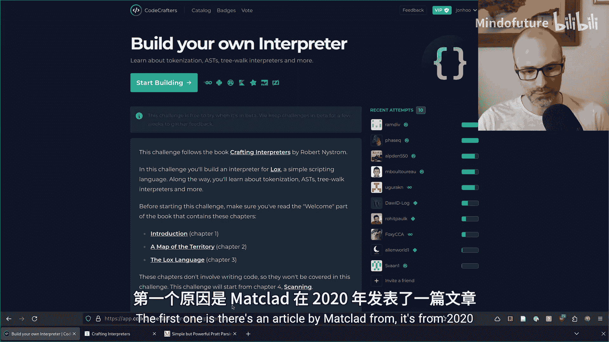

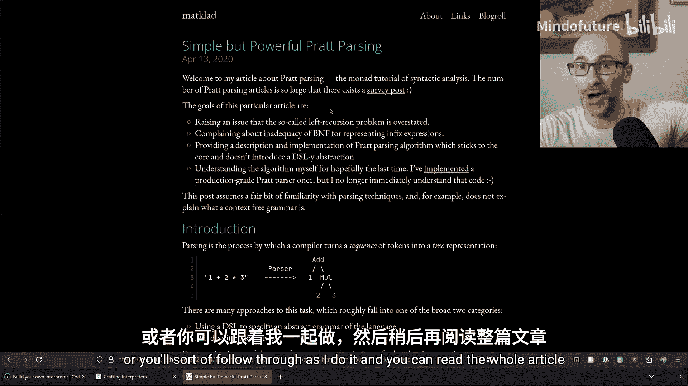

The other reason why I wanted to do this one is I like the fact that it's based on a book。

 the Crafing Interers book which has a website， I'm not going to open it because it's a very bright page and people apparently don't like that。

 but I believe at least parts of the book are available freely online as well or of course by the book can support the author。

 but I like the fact that it sort of follows a well developeded resource。So with that。

 I think we're just going start now， the interesting thing about building an interpreter for any language is that there is an underlying language that you are supposed to interpret。

 right like Python is an interpreted language， too。 But the Python language is not trivial。

 I think the idea here with locks， which is the language that is sort of used in this craft interpreters book and that we're going to be working with here。

 is that it's a fairly simple language， I have not looked at it。 So I do not know。

 But given it's intended for writing your interpreter。

 I'm guessing that it's at least not a super complicated language to at least parson work with。

 You can probably it might even be touringcomplete。

 Who knows So you can probably build interesting things with it， but that's where we start。

Before starting this challenge， make sure you've read the welcome part of the book that contains these chapters。

 I have not read any of those chapters。 So we will skim through them quickly。

 Let's see if there is a dark mode for this。 I don't think there is。

 So we're gonna do our little trick here and say filter invert。

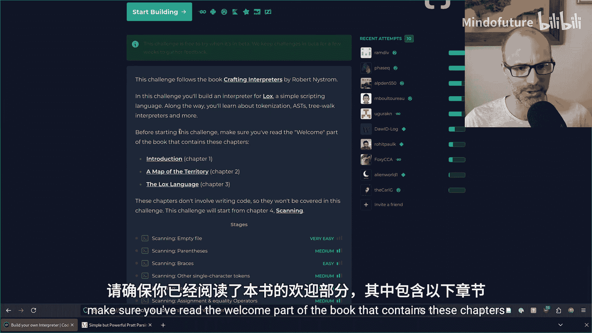

For that， and we'll do the same thing here， expect HL。Filter， verrt。

And we'll do the same for this guy。This an element。Filter invert。

 I know there are extensions for this， but I don't actually care about dark mode myself。

 so I don't have them。 Al right， introduction。

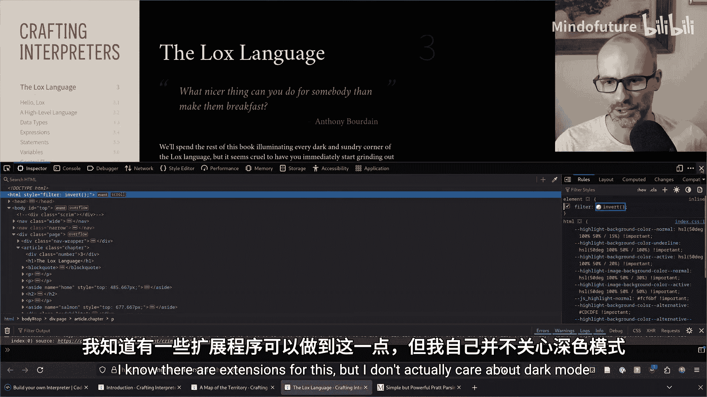

I'm gonna skim through this pretty quickly。 Okay， this is a welcome。 Great。 Why learned this stuff。

 I know lots of reasons to learn this stuff。 The language languages are everywhere。 That is true。

 There are a lot of like special purpose built languages And sometimes it's really cool to be able to write your own。

 for whatever little DSL do you want domain specific language you want languages are great exercise figure with that。

 too。😊，Close to the author's heart。 That's nice book is organized with code snippets， asides。

 challenges， design notes， the first interpreter。We write our first interpreter Jlockx in Java。

 well we're not going to do that， we're going to write it in Ru， of course， I almost said C。

 we're not going to write it in C。Okay， don't care too much about that。 Oh， in the in the book。

 they implemented in C as the second language around。 That's cool。 Well。

 we're going to be the third language。 We're going to do it in rust。 map of the territory。

Parts of a language。Okay， so this is worth talking a little bit about。

 I know some of this from before。 So rather than sort of reading this verbatim。

 which you can do on your own time。 I'm just going to talk roughly about like the parts that exist in the language。

 And I'm not a specialist at this either。 So I'm sure I'll get some things right。

 But at least enough that we can work our way through this。

 the the way we'll think about this is that。When you have any programming language。

 the thing you start with a source code， that is like， it's a text file。

 And ultimately what you need to turn that into is as you see all the way on the right on the mountain here。

 machine code。 So you start from source code and you need to get to machine code。😡，嗯。

The journey you can take to get there is they' are actually a lot of different ways to get there。

 but all of them start in the same way。 The first of them is you need to scan the text and turn it into tokens。

 So this is often called tokenization or lexing。 And what this is is taking the individual like ASI or UTFA characters and recognizing words likestruct or enum or FN or curly brackets as being you know special in some sense that that group of characters that make up like ST R UT are actually one logical unit。

 It is one token。 And so you're turning the individual string of characters into these welldefined tokens。

😊，After you have the tokens， you then have to do parsing。

 So parsing is when you go from this set of the sequence of tokens。 and in fact。

 if you look at rust in the rust standard library。

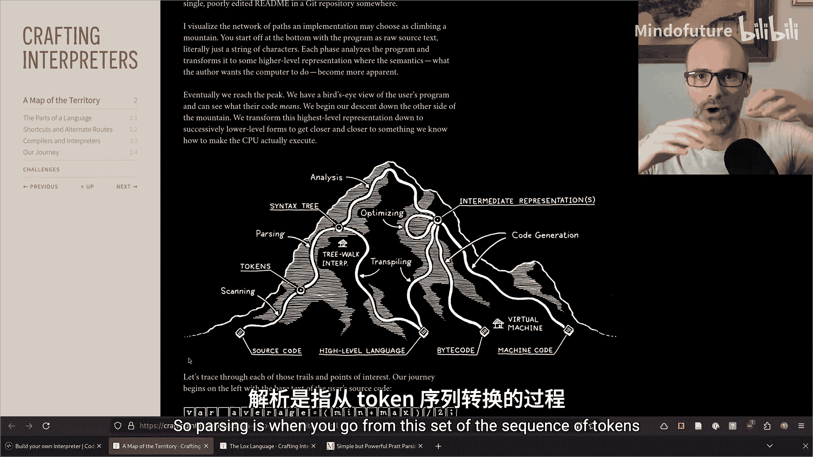

There's this thing called a token stream。And a token stream is a sequence of tokens or in the rust case is a sequence of token trees。

 so they actually have done a little bit of parsing here。

 it's not fully unparsed but the idea of a token stream and rust is that this is what a procedural macro is given so it's tokenized。

 it's lex and it's a little bit parsed like they parse out things like parentheses， for example。

 like groups but that's almost the extent to it and then you'll see that the main thing you have on a token stream is that it implements into iterator It implements the into itator where every item in that iterator is a token tree where that token tree is either a literal a punctuation。

 an id So this is just a keyword or a group where a group is a delimited token stream like parentheses square brackets or curly brackets and so that it's a very it is strictly speaking a little bit more than just tokenization because they do things like recognized groups but it's essentially just tokenization。

😊，And that a procedural macro takes this and outputs a sequence of tokens that should be used to parse instead of the original stream。

 That's really all procedural macros are。 They are a program from one tokenization that is the representation of what's in the source code to a replacement tokenization that should be the input to parsing。

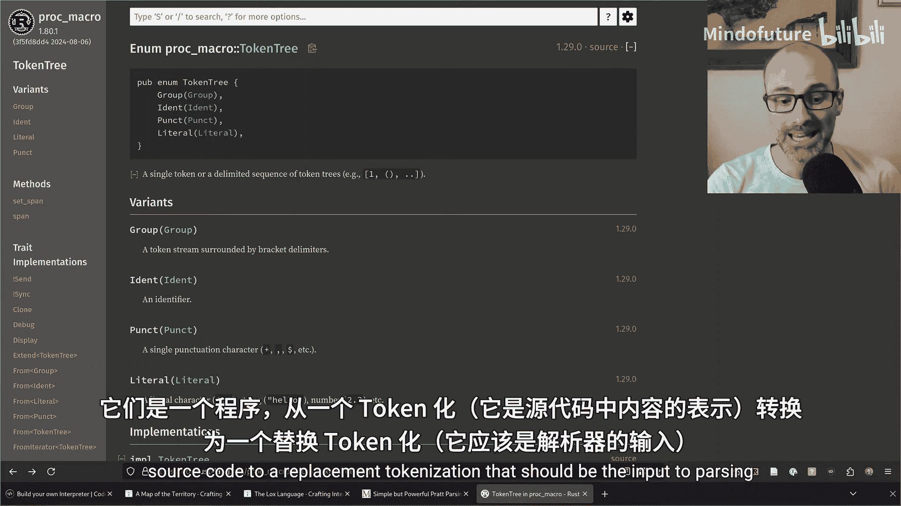

And so then after you give the sequence of tokens to the parser。

 the parser's job is to turn that into a syntax tree， often known as an abstract syntax tree。

 a syntax tree is a representation of the sort of logic that underpins the the sequence of tokens that you have So how they are related。

 This is where you might do things like recognize then async fn is actually one function like it is they are logically grouped together as an async fn being a sort of unit。

 If you wanted to see something like this and rust， you could look at something like the syn crate。

 So if you look at the syn crate， it provides parsing。 So not just tokenization。

 but actually parsing。 And if we look down at the types that you have here here you have things like field expressions。

 generics。😊。

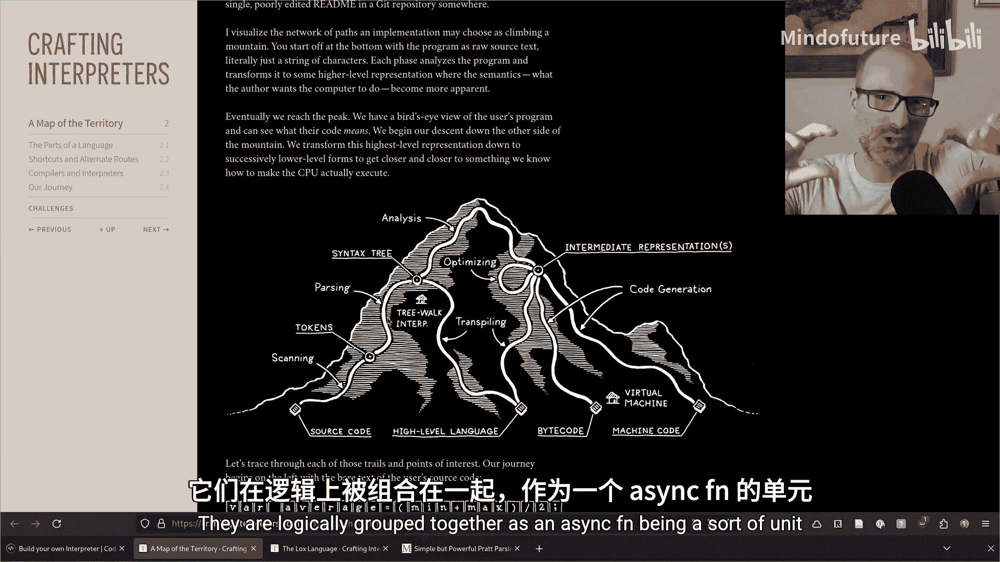

FN items， simpleple items， like sort of knows about the logical constructs of the language。

 And in fact， if we look up the rust reference， which I really should have already opened。

 So the rust reference here。 you see， it talks about the tokens of rust。

 right So this is things like characters， strings， raw strings， bys， etc cetera。

 These are the things that you would tokenize or lex。

 And then items are the things that you would actually parse。

 So these say things like this is the syntax for a function。 right。

 It has things like self parameters and it defines what all of these things are。

 how the how the tokens go together to form the constructs of the language。

And so the output of the parser or the sort of input to the parser is the token stream and this definition of what the language looks like。

 the grammar of the language which is what it's called and the output of the parser is an abstract syntax tree which is essentially I mean it is a tree as the name implies that shows you the sort of hierarchy such as for example。

 if you parsa file， there'll be a sort of a node for this file and then the children of that node will be all the top levelve declarations in that file。

 say one of them is a module definition then you'll have a module node。

 and that module node in the tree will have a bunch of child nodes。

 and each of those are the items within that module。

 such as an imp block or type definition or whatever it might be。

 And so that's how you end up with this notion of an abstract syntax tree is that is a tree representation of the items that have been parsed out of that file。

😊，Okay， so that's the idea of a syntax tree。 And then the question becomes。

 how do you take a syntax tree and turn it into something the computer can execute？ Well。

 there are a couple of ways to do that。

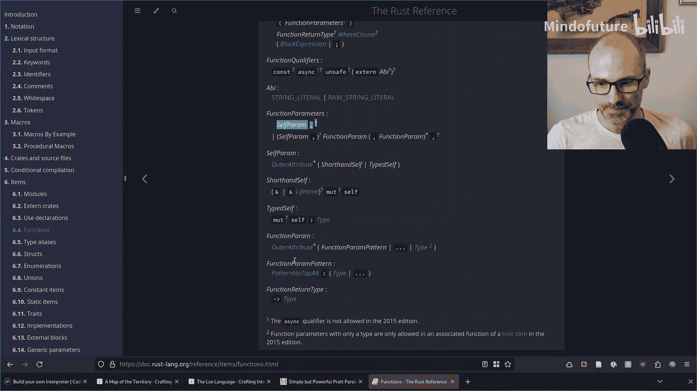

One of them is to not actually produce machine code。

 but instead take that appsbs like syntax tree and hand it to another program that knows how to execute that。

 And this is how interpreted languages usually work is that the output of the syntax tree is really just like it it doesn't compute anything。

 The syntax tree is just a representation of all of the stuff， all the declarations in the file。

 but nothing has been executed， and then you hand that to a program in Python's case。

 the Python binary， and it knows how to walk that tree and evaluate the items of that tree so that like if it see a for loop。

 it will actually execute a for loops sort of on your behalf。

 So your program is never directly turned into machine code。

 Another program is sort of using your input your source code as instructions for what it should execute and it has all of the machine code。

😊，Syntax 3 is I mean， it's not really a binary or not is an abstract tree。

 It's never actually written to disk anywhere。 It's sort of an inmemory representation of the semantics of whatever source source file has been has been parsed and so high levelvel language like Python or no JS will generally execute an Ast。

 It will traverse the AsT and then interpret it， execute it。

 The other thing you could do is you could turn it directly into machine code。

 This is what happens in a language like rust or C where you take you take the AsT you walk the Ast using something that knows how to translate different concepts like abstract concept into machine code into assembly code This is something that LVM is a good example of this。

 So LVM takes as input sort of abstract definition of operations like four loops or functions or function calls and then knows how to sort optimize those and turn them into。

😊，Cable machine code and that's what you see this path here from syntax tree that goes up here through analysis and to intermediate representations。

 So LVM has a bunch of these intermediate representations and rust in fact， has its own called me。

 which is the middle intermediate representation。 they also have HR。

 which is the high levell intermediate representation and so the sort of abstract syntax tree gets turned into HR。

 which gets turned into MR， which gets turned into LVM IR Ir meaning intermediate representation here and then the LVM internally does a bunch of optimization sort of transformations over that graph to do things like move expressions out of loops if they don't depend on the variables within the loop。

 like optimizations passes like that that happen not at the machine code level but happen at the sort of more abstract semantic level。

And then ultimately， what you end up with is some intermediate representation that is now ready to be trans pileed or translated if you will almost directly into codegen。

 So by the time you get close to getting ready to do this code generation。

 the thing that actually generates machine code。 at that point。

 your intermediate representation is usually quite close to assembly in the first place。

 It might no longer have a notion of loops， for example。

 like there isn't really a looping construct in machine code in assembly。

 all you have is like a go to， you have a jump。 And so a loop is you walk like you run a bunch of code。

 And at the end， you evaluate some condition， which is the loop condition。

 And if the condition is true， then you jump to the the first instruction of the loop again。

 So there's no loop construct in assembly。 And so this is an example of something where in the lowest intermediate representation。

 you might already have eliminated all loops and replace them with gos。

 because that's what you're going to need for the code generation step， which is that last bit。😊。

That takes you into actually executable machine code。And then there's a variant of this。

 which is something like Java where the thing that the compiler generates is not actually machine code。

 It's not assembly code that runs like on your CPU。

 It is actually sort of it is more like the highlel language approach。

 But what you hand it is not the abstract syntax tree for it to traverse and interpret like Python but rather sort of general purpose machine code。

 It's sort of a meta machine code that can then be interpreted by the Java virtual machine that can then sort of similar to Python has it has all the machine code。

 and it reads your the output of your intermediate representation， your byte code。

 and evaluates that to basically execute your program on your behalf。

 So those are those sort of different paths here。 And in our case。

 when what we want is an interpreter generally what we mean is something that goes from source code scans it into tokens。

 parsees it into a syntax tree。😊，Then interpret it by executing directly that syntax tree。

 So we're not like in what we're doing here， I don't think we're going to do any of the sort of analysis or optimization of intermediate representations or generating any assembly code。

I'm going to pause there because that was a lot to take in and do sort of questions if you have them。

 and then we'll move on from there。Is the A T tree like objects。

 You can sort of think of it like that。 Like it's a tree structure where all the nodes describe a particular item in the source tree。

 like a module or a function definition。嗯。Does the LVM take IR as its input instead of an as an abstract syntax tree。

 So LVM's input is actually also an intermediate representation。 So in in the rust compiler。

 what actually happens is you take the you parse into the syntax tree。

You turn that into the high level IR like HR， you turn that into mirror。

 and then there's a bunch of optimization passes on that intermediate representation and then eventually they move it to LVM's IR and at that point they call LVM and then LVM does the remaining bits from there。

嗯。呃爸パパパパ。Not sure， but I think Python also has a bytecode。

 I think you're right so I think Python now has sort of a bytecode equivalent where you can sort of precompile your Python code into like rather than just giving the raw source code file to Python。

 you can sort of precompile it， which is essentially turning it into bytecode。

 which is really just a byte representation of the syntax tree if I remember correctly so that you can then hand that to Python later and it doesn't have to do the scanning and the parsing。

 it can just directly execute the resulting file。And。Well that included GC。

 my guess is the language here is not complicated enough that it needs a GC， but we'll see。嗯。Okay。

Since gol is converted into binary， but has garbage collector， how does that work？

 So a language like go produces machine code， but the way to think about it is that theres there's a bunch of source code that is compiled into your binary into your machine code that you have not written so go sort of comes with a bundled piece of source code that does the garbage collection does a bunch of transformations on your source code so that it interacts with the runtime that they ship。

 but the runtime is sort of embedded in your binary。

 whereas in Java the runtime is a separate executable。

 the Java V that you hand your compiled Java file too。Or compile Java project rather。

Bitecode is compiled assembly， not quite so Btecode is a sort of equivalent to assembly。

 but assembly is or machine code rather we should be technically accurate here。

 arguably assembly is really just a programming language but machine code is usually specific to a particular CPU it might even like it's not just a particular family of CPU can even be specialized to a very specific architecture。

 a very specific instance of a CPU， whereas Btecode is a sort of low very low level language that can be run on many different CPUs。

嗯。Locks does have Gc。 It also has closures and inheritance。

 this will be this will be interesting to see how far we get through that。 I'm excited to see。嗯。

The Java chapter uses Javas GC。In Rus， I've used reference counting。 Oh， so that's interesting。

 So if locks does have garbage collection， that means that we will have to act as the garbage collector for the language。

 We might just do that in a sort of simple way with reference counting or something。 We。

'll see that when we get there。And。How much performance do you live on the table by doing work in an interpreter compared to compiling it to machine code。

 It varies， but usually interpreted languages are slower than fully compiled languages because they have to do more work。

 because they essentially have to do part of the compilation at runtime。呃。

Locks is more complete than you might think it's like Lua。 Well。

 then I'm excited to start implementing it。嗯。Go produces something called SSA。

 This is is a single assignment。 What's it called。I forget what the first test for。

 I think it's serial single assignment or something。

 which is a machine code that is not tailored to a particular CPU。

 and it's a very useful representation for being able to just execute a program after the fact。And。

Static single assignment， that's what it is。Okay， so now that we have this sort of we've explored this this map of the parts of a language。

 we've talked about scanning。 we've talked about parsing。

 we'll get into this a little bit Once we started writing the code。

 I don't want to do too much of this in advance static analysis is this idea of after you've parts。

 you can then do a bunch of analysis， things like type checking right where you check that if you try to call a function。

 then the function you're trying to call actually has the types that you gave for the arguments。

 for instance， So this is where you add semantic richness。

 So you you no longer have just a function called， you actually have a specific function with a type signature。

 And so now you infuse your code with meaning like if you do a plus B， what does that mean。um。

Intermedia representations， optimizations， code generation。 we've talked about most of this now。

 I'm obviously skipping past a bunch of detail。 High recommend you read this if you really want to get into the depths here。

 but I'm more trying to give us enough of the context that we need for starting to write some code。

um。Single pass compilers。Yeah， so single pass compilers are a version of a compiler where rather than parse everything like into memory and then doing all these intermediate representations。

 they try to be a lot faster at compiling by not doing any of that。

 It tries to make sure that you can as you parse almost As you parse， you produce the machine code。

 So you do a single pass through the file。 And at the end， you've produced all the machine code。

 That does mean that you can end up with a way faster compiler。

 The downside is you can be a lot less smart about things or transformations。

 because you haven't seen the later code yet， you can't optimize based on it。

 But also because it forces declarations to happen in a particular way。

 So this is one of the reasons actually why， at least if I remember correctly。

 why and C in older versions of C， you had to declare the signature of a function before you're allowed to call that function。

 So you don't have to give the body of a function at the beginning of the file。

 But like if you have two functions Fo and bar and F wants to call bar。😊，And't have fo first。

 And then bar。 That will not work。 You have to either you have to put bar before foo or you have to put a declaration of the signature of bar first。

 And then you write foo。 And then foo is allowed to reference bar。

 And then you put the definition of bar。Because it's the sort of single pass compiler。

 C since evolved from that where you don't need to do that anymore。Treewalk interpreters are。

 as we talked about， things that specifically will take the A D and then execute the A S T directly。

And then transpiers are things to just take one representation of language and turn it into another one。

 So this is something like if you compile rust to JavaScript like web assemblymbly is an example of a transpir because you're not producing machine code。

 you're producing just a different source code language that then it gets executed in some other way。

And then just in time compilation is what。Python often does， for example， where you take the。

It's basically you。You take the syntax tree， the abstract syntax tree， and when you need to call it。

 you compile that thing， and then you execute the machine code。😡。

RightAnd then the next time it gets called， you already produce the machine code。

 so then you can just call it again， so hence the name just in time。

 you compile it just when you need it， which can make the compiler phase really fast because it doesn't really need to compile anything and instead you pay the cost of compilation only on first call。

嗯。Oh Python doesn't do Jit， No， Python does do Jit， I'm pretty sure， and JavaScript does Jit as well。

Yeah， and this is one of those like。It's a little bit weird to differentiate between compilers or interpreters because interpreters sometimes do some compilation like just in time compilation and compilers do kind of interpret things。

 things like when if you have a constant expression in C or a constant rust that has an expression and not just a value。

 you actually have to execute code at compile time。

 which is really kind of an interpreter so like these are not perfectly separate circles。

 they're actually fairly related。u。Oh， interesting。Yeah so I guess at least according to this。

 the are very few languages that are pure interpreters anymore， Well I guess Jlocks apparently is。

 and then pure the compiled languages and then you have a bunch here that do things like Js where it's an interpreter。

 but it also does compile。Okay。So now to that chapter， and now the Locks language。

 and this obviously is an important thing for us to know。

 given this is the language that we're supposed to parse and interpret。Now， I。

 I don't think what we're gonna do is try to fully understand the entire grammar and semantics of the language upfront。

 That's gonna be very hard。 Instead， what we're going do。

 And I'm guessing this is what this chapter will do as well。 is give us an overview of the language。

 Like， what roughly does it look like， What's roughly the syntax， What kind of items does it have。

 You know， how do you clear， declare variables and the like，Yeah， exactly。

 I don't want to drag you through the reams of language lawyering and specificationsies before you get to touch your text editor。

 So it's a gently friendlier introduction to Locks。Okay。Let's see。Okay， so comments are dash dash。

 Let me see if I can zoom in a little bit here。Yeah， we're talking。😊，Okay。

 so we have slashlash comments。We have print， we don't have parentheses around function arguments。

 which is interesting。呃。Yeah， so lockx is pretty compact。

It's kind of like JavaScriptscript schemeche in Lua looks the most like JavaScript。

Lex is dynamically typed， okay， so variables can store values of any type。

 you don't need to declare that this type， this this variable holds like a hash mapap， for example。

 it just holds what it holds and it can change over time。嗯。Errors happen at runtime on types。

 That seems fine。Automatic memory management， that seems pretty reasonable too。

 you don't really want to have to write a bunch of freeze in your code。

 you want that to just be handled by the interpreter。And I think， in our case。

What we will almost certainly do is we'll do reference counting for keeping track of when variables should be delocated and stuff rather than like a good garbage collector。

We are going to write our own garbage collector。 That's cool。 I mean， we。

 we might end up doing that as well。 I I'm guessing that we're not gonna get all the way to writing our own garbage collector in this video。

 at least。 But this might be a sort of beefy enough challenge that we end up doing a two parter。

 And then part  two might easily be the。😊，Might easily be the the garbage collector。Daotypes， okay。

 we have Booles。 That makes a lot of sense。We have numbers。There's only one kind of number。

 double precision floating point。Okay， so integers are floating points。Great。😊。

strings and double quotes。And partising strings is actually surprisingly difficult。 Not。

 not strings like this。 But once you have to be able to like escape characters， like。

 what if you want to put a double quote inside of a string， What do you do then？ Well， okay。

 let's say you do back slash double quote。 Well， what if you want to put an actual back slash in the string。

 Well， now you need to support backlash back slash？ And so it gets interesting pretty quickly。嗯。

An Neil。Interesting， does it not have。 So it doesn't have a razor maps。 Does this booles， numbers。

 strings and nil。Interesting expressions， it has arithmetic plus minus multiply and divide。

So all four of these are in fixed operators。 So In operators are operators to sit in between their two opera。

And then they also have a prefix operator for negative numbers。That makes sense。

And plus also works on strings， okay。A comparison in equality。呃。

We can compare numbers and only numbers。Where the standard。Comp operators。Equality， inequality。

 inequality for different types， which presumably always mean always returns false。Lo operators。

 Okay， so this is。The not operator， which is a prefix operator。 So it' not it's not an infi。

 doesn't have two opera ends one on each side。 It is a prefix operator。

 So it's an operator followed by its opera end。um。And then and。

 which is an infi operator for logic land or infi for ore。Okay。Preceence and grouping。Great。

 so this is the notion of you want you want to be able to put parentheses。 If， for example。

 you have a plus B times C， then normally multiplication binds tighter。

 So you would end up computing B times C。 and then adding a。

 but parentheses are the way that you would say， no。

 I really want a plus B and then multiply that with C。

 So you need something like parentheses to be able to express that kind of thing。

 There's no bitice shift modular or conditional operators。 Great statements。😊，嗯。Okay。

 an expression's main job is to produce a value。 Yeah， So expressions are things like this。

 This would be an expression。 And this is a statement。

So the statement is usually the thing that ends with semicolon。

 It's a statement is usually things like calling a function or assigning something to a variable。

 whereas an expression is just a。A thing to compute。Expressions。

An expression followed by a semicol and promotes the expression to statementhood。

 an expression statement that makes sense， and you can have blocks， curly brackets。

 we know these from rust that are sequences of statements。 And so， for example。

 the way that you write a function， I would assume if we get there is that the way you write a function is that a function is the function keyword followed by a signature followed by a block。

And。Variables， variables default to nil。 that can be given an initializer。

You can access and assign variables using their name that makes sense。Control flow。If conditions。

 okay， so conditions are surrounded by parentheses。Soer conditions in while loops。

And we have four loops， okay。Functions look the same as in C， and in rust。

You'd find them with the fun name， name of the thing argument list， which has no type。

 so that makes it easier to parse。 There's no named return type and then followed by a block。嗯。Okay。

 and you can return inside of a function that makes sense。 And if there's no return。

 it implicitly returns nil。 So unlike rust， the last expression。

 a function is not allowed to or a function block is not allowed to in expression and have that be the return value。

嗯。Okay。Closures， oh， it has first class closures。 closuresures are going to be their own kind of interesting thing to implement。

So here you can see that add pair is actually a function and so here we are passing add pair to a function as an argument and so this function just takes a parameter whose type has not been declared at all and just returns that same parameter value and so when we pass add pair as an argument that ends up having this thing return add pair back like identity it just returns what is' given and so this ends up calling add pair。

So this means that a pair is actually like functions are a first class type， if you will。

 in this language This alone is not closures， though。

 this is just first class function and then this is a closure so you can declare a function inside a function and crucially the way in which that matters is like you see here。

 you can have a variable in an outer function and you can have a function inside of that outer function that references variables that are declared in in the defining scope of this function and this is what is a closure the nomenclature here comes from it closes over its environment。

 it gets to have access to the space in which it was declared the scope in which it was declared。😊。

And。Okay。😔，So In has to hold on to references to any surrounding variables that it uses so that it stays around。

 even after the outer function is returned。 Yeah and this is the other thing that's interesting here is that notice here。

 this is the thing that's actually kind of hard to do in rust， it's not impossible， but it is hard。

 which is here we're returning this closure。And this closure captures this variable。

 And so that means that for， this closure to be valid after this function returns。

 that means that this needs to capture this variable in some way。

 so that when this function returns normally in rust terminology。

 we would drop this variable value when this function returns。

 and therefore you wouldn't be allowed to call the return value。

 the closure that gets returned anymore， because the variable it references has been dropped。

 but in locks that's allowed， and this is basically because it has something equivalent to a garbage collector。

 right it knows that the closure is still using this value for it to remain for it to remain valid to access。

 and so therefore it's fine to return this closure and then call it down here。

 even after the function returned。U。And it also looks like print is maybe special here。

 the print is not a function。 you see print doesn't have any any parentheses for calling print。

 but functions do。 and so this makes me think that print is actually a a first class primitive in the language。

 so it is it is special it is not just a function where you can emit the parentheses。Yeah。

 it's a built in statement。呃。Classes。Oof， it has classes。Interesting。Okay。😔。

Is it a class or prototype language？嗯。Let's see。I'm interesting。Okay， so， so lockx has classes。

 not prototypes。 that's fine。 So you can have a class， you can have methods。On the class。呃。

And the methods on the class don't require the fun keyword。 Okay。

 when the class declaration is executed， Lux creates a class object and stores that variable name that in a variable named after the class。

Oh I see。 so when we parse and execute this， when we interpret this class definition。

Then we create a class object， and we create a variable that's named after the class。

 We get a variable called breakfast。 that is itself an。A reference to the the breakfast class object。

 So not an instance of breakfast， but the class itself。Interesting， okay。

 and the way you create a new one is we don't have a new or anything。 We just have。

A sort of implicit constructor that takes no arguments。And。Okay。

 you can access fields that makes sense。This is how you refer to the current instance。

And you're going to flare declare an initializer。 You don't have to declare the fields anywhere。

 The fields are just， They just magically appear， I suppose。Great。😔。

And in it is sort of a specially blessed method name that is used for instantiating things of that class。

And。We can have single inheritance， so a class can sort of extend another class。That's fine。

Every method defined in a superclass is also available to its subclass。呃。

And you can call supers in it。 This is very standard。Java version， okay， standard library。

F that's implemented directly in the interpreter。And that all user defined behavior is built on top of。

 This is the saddest part of locks。 It standard library goes beyond minimalism andveers close to outright nihilism。

 Okay， great， that makes me happy for the sample code in this book。

 we only need to demonstrate that the code is running and doing what it's supposed to do for that。

 we already have the built in print statement Later， when we start optimizing。

 We'll write some benchmarks and see how long it takes execute code。

 That means we need to talk times。 So we'll define one built in function clock。

 that returns the number of seconds since the program started。 And that's it。 great。 Okay。

 this is a standard library that will be okay to implement， I think。😊，All right。

Let's now I'm going to keep that one open in a background tab to see where we go from here。

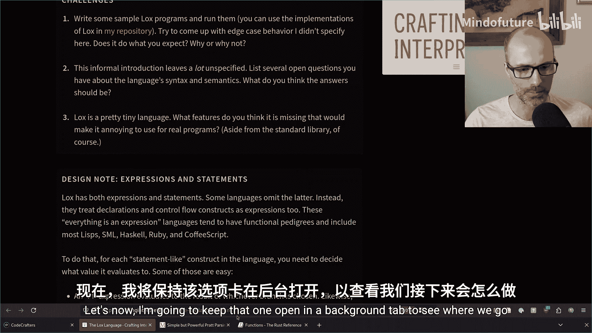

Update。

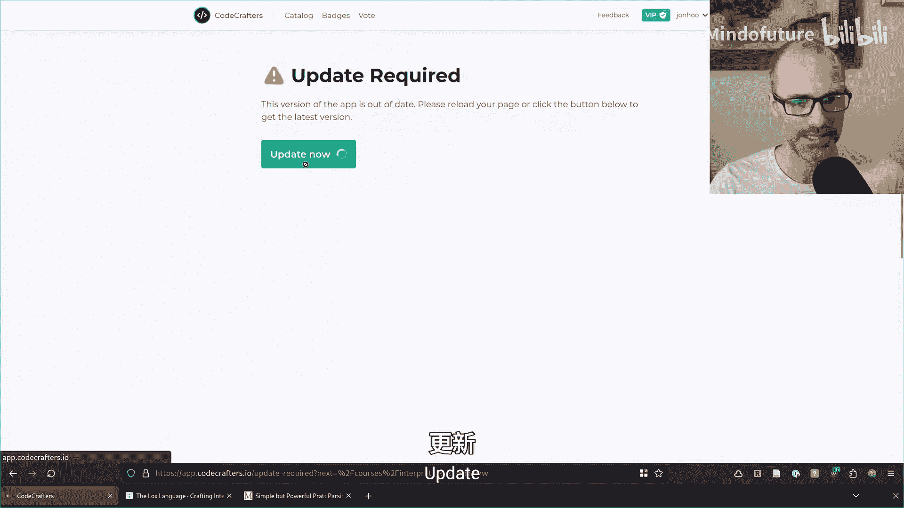

嗯。And have they during a stream。 scary。 Okay， how about， okay， empty file is gonna be very easy。

 And then it move us on from there。 There are a lot of challenges here。 I wonder how far we'll get。

They claim that these down here are hard， but I think they might actually not be that bad。

Like scanning， I actually think pra parsing is going to get us through surprisingly quickly。嗯。

Psing is a little trickier evaluation。 I， I think this is gonna be fun。 I'm excited。 Okay。

 wheres the start button。 Start， Start building。😊，Okay， welcome。 Thank you。 I'm gonna do it in Ru。

 Thank you very much。😊，Language proficiency， I'm going to go with advanced。Great， next question。

How often do I want to practice once a month。 accountabilitycount。 No， thank you。

 I do not want accountability for my actions。嗯。Okay， let's go ahead and do this。

Code crafters interpreter rusts。Cdcraers interpreter rest。Okay， push an empty commit。I believe in us。

Get push origin master。Turbot run。Oh， no， We failed。

Tokenized test locks expected line number one on send out to be endoophil null， God， nothing that。

 I mean， that makes sense。 Okay， great because we haven't implemented anything。

Fiarworks get push received， activated。Okay， come the code to get you started。

 Un the code and submit。嗯。Yeah this is probably just a sort of。Tokenize。Oh， I see。 Okay， great。

So this is just if the file is empty， then we just print the thing that the tester wants。 Great。

 love it。😊，Yeah， I did that。Okay， I don't wh。I'm confused。 It uncommon the following code。

 There's some stuff at the top。 It wants me to uncommon， too。Oh， I see。 If I print to standard error。

Why， why do they do this instead of just E print line。Can I just E print line instead？

Feels excessive to be very explicit about writing to standard error。Right。

I'm going to go with this is probably better。Question mark。great。

it could be that I didn't know that was the thing。And now I don't need these things。Great。Get the。

No hacks。Good push。Next step。Test passed。 Okay， stage stage marked as complete。

 Look at us racing through。 This is easy。 Read the instructions。Your task。呃。Oh， interesting。So。

This is， this makes me a little bit sad， but we might be able to。

We might be able to still do this with Pra parsing。 So this is where I'm gonna。

 I'm gonna leave the challenge for a second。 And I think I'm just gonna。I see。

 So the language sort of。Defins this， this sort of output for what it should look like as you walk through when you lex。

That's fine。So this is just the leing part。 And the the leing is not where we need a pra parser yet。

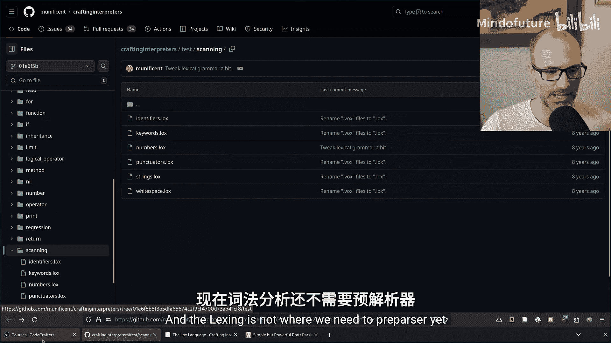

See what the book wants us to do。

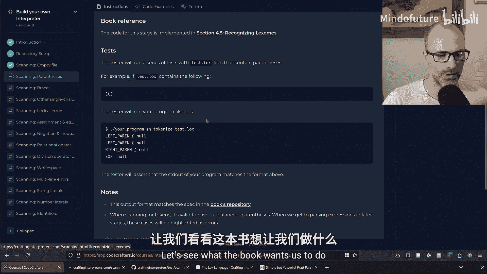

Oof。😔，Alright。Filter， inverse in Bt。

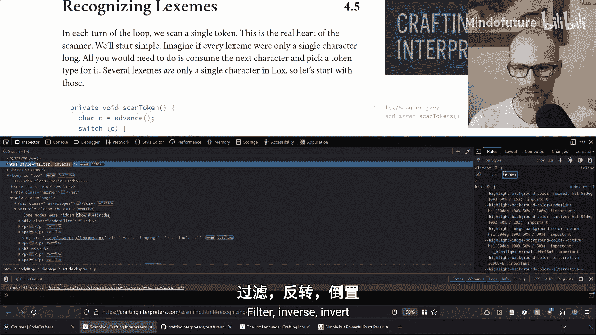

嗯。O， in each turn of the loop， we scan a single token。 This is the real heart of the scanner。

 It will start simple。Okay， it just。Yeah， we just walk one character at a time and keep track of every character and turn it into a token。

 okay？

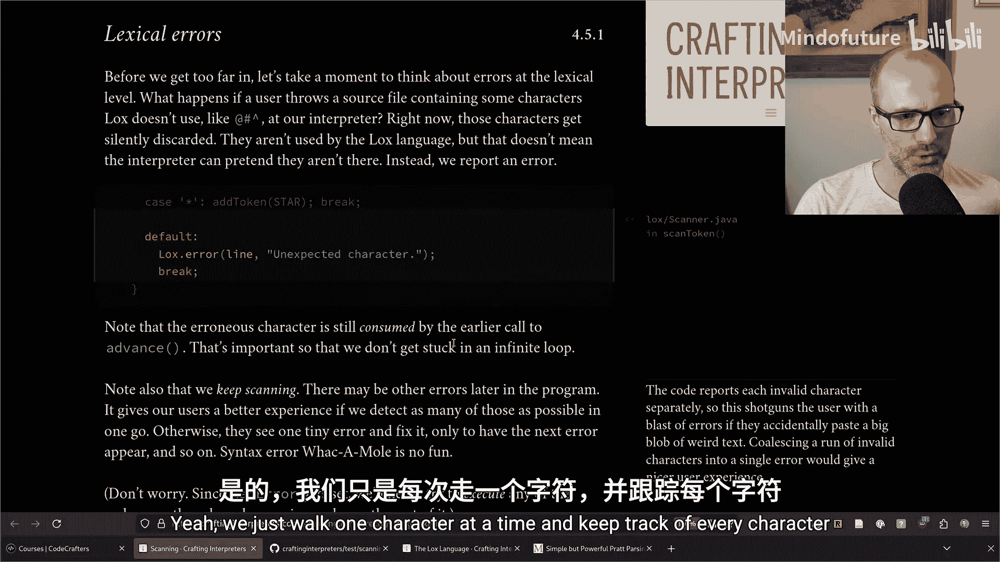

So。Is are there other files in here already？ No， great。 So I'm， first of all， going to start a。

Lib dot Rs。 And in here we're going to have a pyum， which is going to be token。

And then here we're going to use。codeode。What's the name of this again？Codecrafters interpreter。

We're just going to use everything from there。And then in Lib over here。

 we're then going to implement。嗯。How do we want to do this easiest？诶。

I think we're just going to have a freestanding function， parse Lex， which is going to take。

Any string。So the input here is going to be a stir， and it's going to return a result。And actually。

 if we want to be really fancy here。 If we want to be really fancy here。

 then we pull in a dependency on miet instead of anyhow， because that way。

 we can give errors that highlight specific parts of the input。 Let's， let's do that。 Let's be bold。

 So miet， which is 7，2，0， okay。😊，And I don't actually want this error for this either。

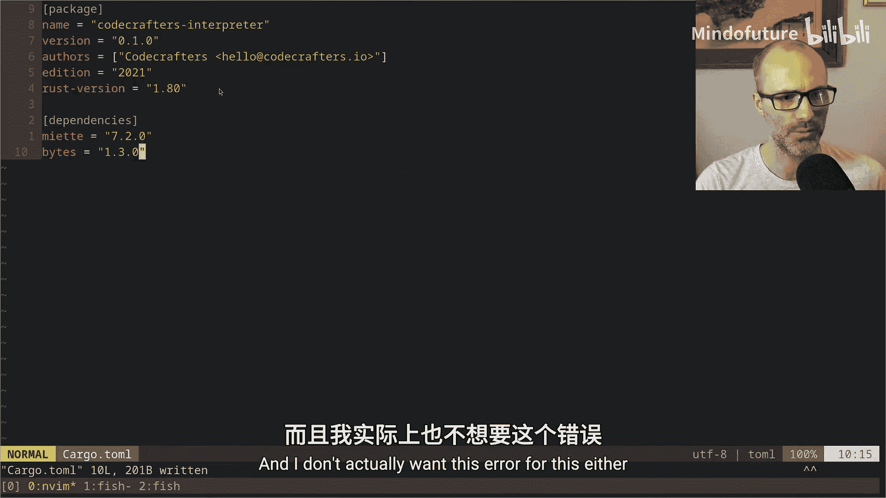

And we're going to use Meat。

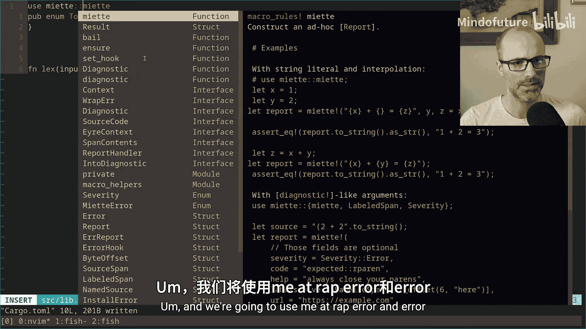

Wrap error and error。In fact， we can just grab。 no， I I like having my own result。

So we're going to do this and it is hopefully going to return an impulse iterator where the item is token。

嗯。And so the other question we need to ask ourselves here is do we care about this being streaming because。

There are sort of two ways to lex。 One of those a streaming Lexer where you walk the input。

 and as you get tokens from the input， or as you get characters from the input。

 you produce tokens from the output。 So it's sort of a transformer of an input to output stream。

 The other alternative is to take the whole string， Lex the whole string and return。

 like here's the vector of all the tokens I found。 It's actually kind of tempting here。

To change this slightly and say that the input is actually into iterator， where the item。

Is a character。And then what we're going to produce。Isn't。Itterator。

Where the item is a result of either a token。Or an error。With a sort of。

Once the iterator returns error， it will only return none。Right， so the idea here is that。

We're going to be grabbing characters from the input， trying to lex them。

 and whenever we successfully lex a token， then we yield the thing from the outgoing iterator。

 ultimately， though either we successfully yield a token and then we keep going and we successfully yield another token or we might yield we might end up basically with a lexing error。

 like for example， we encounter a character that wasn't supposed to be there。

 that we weren't expecting in the input at which point we will make the iterator than return an error or from that point forward the errors。

 the iterator is sort of invalidated。Because now what we can do is we can say input is and this is where usually I think you might need a peekable here。

 but we might actually not。うん。Someone said， don't you also need a weight state and the cool thing here is yes。

 you kind of do， you need to sort of accumulate characters， but at the same I guess。

I guess really what we want here is a generator， right， We kind of want a generator here。 You can。

 however， do this by doing。Like essentially， what we do here is we defined astruct that is sort of the the Lex state。

 right。And that's going to hold something。 and we are going to do u。E mute， Le state。呃。

Is a elect state of。呃，Nothing。And then we're going to do。

I'm trying to see if there's a smart way we can do。This。Here。Such that it's actually a lazy iterator。

Because the problem right is that you might get one character and then you might get another character that should be a part of the previous token。

 so the first thing doesn't yield anything。And so that that's sort of trivial to write with a while loop。

 right， The problem with a while loop is what you really want to do is like4 C and input。

Do some stuff。 And one of the things is gonna be， you know， if completed token。

 then you want to yield。Which is not a thing we don't have generators in rust yet。

 Then you want to yield token for C so far。嗯。But we don't have a way to express that in rust today。

 The closest you can do is you have astruct that sort of holds the state instead。And then， you。Yeah。

 the way we're going to do this is we're going to do here。New over input。

And then we're just going to return that you'll see how this works in a second。

And then we're going to impple Lex that， I guess， really Leor。And at this point。

 we don't even need the function。 We're gonna have a new。It just takes a this。And returns to self。

And then we're going to implement。Iterator。For Leir。Where the item is going to be this。And this。

 of course， is going to be to do， but one of the things we're going to have to keep in here is this is going to be generic over the iterator。

This is going to be I。系い。Hi。And this is going to return a self where the iterator is input。

Or is I but do intotuit or rather。And then here， we're going to return。Where I is an iterator。

Whose item is a character？Great， and， of course， this is going be public。

That's public and the iterator implementation is automatically public。And then in here， next。

 this is where the the actual leing is going to happen so。

Whenever we get asked for the next output token， that's sort of what this is asking for。 Like。

 what is the next output token in the stream， Then we need to figure out。

Then we need to figure out okay， what is the next output token。

 And that's going to depend on what the inputs are。 So in the call to next here。

 we basically need to figure out the next token。 And the way we're going to do that is while let's some。

C is self dot iterator dot next。We might actually not need any other state in the lecture than the iterator。

 We might be able to just keep it as local state in the next method。Okay。

 so the question now is how do we le Well， C here is going to be a character。

 and the thing we want to match on here is we want to sort of construct up if we go back to the things that we should be able to le。

 and this is where I want to see。

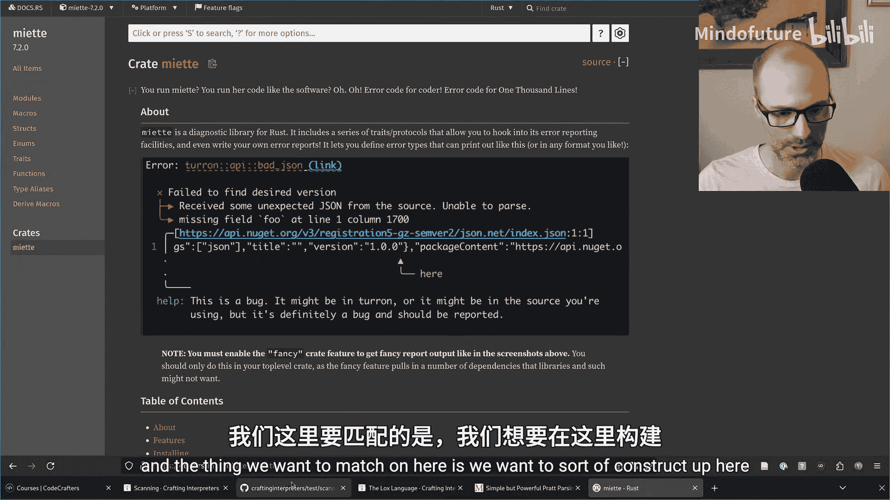

嗯。The list of all the tokens。 Okay， so here。

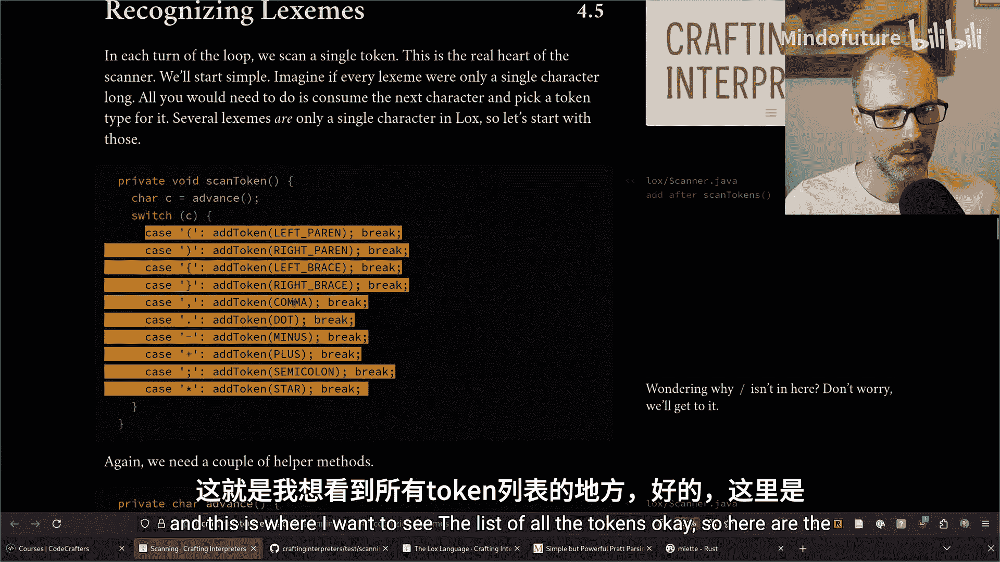

Are the。The base tokens for the language。Now， these， of course， are slightly different in rust。

 The syntax here is gonna be this。And this is going be token。Okay， now for all of these ones。

 we actually just want to return some of this。喂。な？And in fact， we can do， that' sum is。This。

 and then we can do question mark because if if the inerator returns none。

 then we might as well just return none ourselves。This is actually a little bit special because it might be later on here that。

 you know， if we get a， if we get an open double code， for example。

 and then it's the end of the input stream， then at that point， that's actually an error。

 it's an untermininated string literal。But we'll handle that in a second。

 And so now we want all of these to be variants。Great， so all these are now variants up here。

 and we can also get help from Ru here to rename all of them。It why is it okay with these。Oh。

 I think I've seen a bug report about this and it's actually kind of annoyingnoint to fix。Me， Co and。

Tar。And then we want to implement display for this。So that people can print tokens back out。

 which is what we're gonna want to do in order to print this whole， this whole。

Output that it's looking for。 Remember how it it wants a very specific output of which tokens were found。

 Well， we're going to give it to them。 So we're gonna to match here on self and。

This was left left Peren。And this can actually just be。Right。And。This。And that。And then。

 this is gonna be。Right， pern。This is going to be left brace。This is going to be right brace。Comma。

There are crates that can help you do this a little bit。With with less boilerplate in practice here。

 I don't think it would be worth even finding one and setting it upca it's， it's not that much work。

 right。Sttop。Okay， so now we have these tokens and we can also derive debug。

 we can derive partial eke and eke， and we' to derive hash。And in fact。

 we can also derive clone and copy。 No， not copy because we're also going to want to support literals here。

And in fact， this is one of the reasons why it might be a little annoying to do this token down here over character inputs。

 because it means that if you， for example， want to parse out a you want to tokenize something that has a string literal。

 then what we're going to do here at the moment is we're going to parse out every character one by one。

 which means we're going to reconstruct the string one character at a time。 So it's going to be slow。

 but it's going to be possible。 the alternative would be for this to take a stir with some lifetime。

 and then you return a lexer with a lifetime take a as well。

 so that it can refer back into the string。That's actually pretty okay that this is how Cdi works。

 for example， is that the decizer has a lifetime bound of the input precisely for this reason。And。

 in fact。You know， maybe。Maybe that's something we want。 Now that I think about it。

 Maybe it's not that useful for this to be an iterator of characters。嗯。Yeah。

 maybe we actually do want this to be a。Allright， okay，'m， I'm sold。And in fact。

 we can sort of follow the30 nomenclature here。And say that you need to give me a D E。

And then that's going to return here。 and the iterator here is actually going to be rest。

 where rest is sort of the remainder of the input。And this is now going to be over D E。

 There's no longer generic I。 This is just going to be a。D E stir。

And the reason I call rest here is because。Is because initially it would be the whole string。

 And then once we've read the first character， we're actually going to move the string reference that the start of the string reference so that it points to the remainder of the string instead。

嗯。And the reason we want to do the D here is now， token。Can be given a D over here。

So this is given me generic over the thing that's being decized。

 And so now once we get a string literal， for example， in here， literal。

 then that literal can actually be a D stir Now you're going to see this in a minute when we get there。

 you can't always use this as a string reference because sometimes you need to do de escaping。

 for example， or un escaping right where if there's a backslash in there。

 you don't want to preserve that in the literal but we will not deal with that right now。So。For now。

 we're going to stick with this。 And so now what this is going to be is if。No。

 we're going to do self dot。Rest。Dot。And。How do I want to do this， I want to do。嗯。Split。So。Yeah。

 I can write it the sort of dumbway first， which is Carot next。And then I think there's like。

 Charles。Yeah， and then self dot rest equals self dot rest from C dot。There's a bite。

What is the name of the method on characters。Chaters。呃。Len uifate。Ex so。U。There we go。

But I think there is a way to do like split at。And， oh， it's a split at in a byte index。

 which isn't quite good enough。 Okay， so what we're doing here is we're pulling out the。

 the first character of the string。 And then we are。That returns an option。 If the string is empty。

 that option will be none。 and so therefore we return with a question mark。

 So C here is the first character that that we haven't le yet。

 and then we reassign rest to point to the remainder of rest。

 So we sort of bump the start of the slice pointer。 and now we can match on these。

 Now this is dot minus plus semicolon and。Star and we also have to remember that this is actually。

Okay。Like so。Because again， remember， we can return an error at any one token that we're walking。um。

Oh， K Astor。I don't think we can use Cars Astor because I think its lifetime is tied to the lifetime of the iterator。

But I could be wrong。 Let's try that。 So Car is self thought rest thought。Cars。

And then C is cars dot next。 and then self dot rest is carss dot S stir。Oh， great。

 Astor returns a string whose lifetime is tied to the original input string。 Perf。

 That's what I want it。That way we don't have to do any of our fancy UTF8 bits。嗯。Now。

 the reason I want to specifically return here is because there are some characters for which we're going to fall through。

 such as open double quote for those things， we don't want to return。

 So it's specifically these we want to return early and anything else we actually want to fall through。

So for now， what we'll do here is we will return and this is where MIt is fun because we can do。😊。

Meit baille。嗯。And technically。H。😊，What we would want to do here， I'll be。I'll actually keep。

Hall here。 So hole is input and rest is input。There we go。

 And then I also want to keep track of the eye that we're at。So initially we're at I0。

 or I guess this could be biteed。And。It might not be bite。 It might be。Yeah， it'll be I。

 So this is like what， what character are we at， You'll see why in a second。

 So this will be self dot I plus equals1。So if we look now briefly at Meet， you'll see that in MIet。

When you output an error， Where's my， Where's me at bail。嗯。没有。That is not the 1 I wanted yet yet。呃。

Where's the actually useful one？Diagnostic。Okay， yeah。 so you can give。

 I think Miat to Mia have the same description。 So you can give a severity。

 which is fine and code and help and stuff。 But the interesting thing is how this is rendered。

 So labels lets you label a particular subset of the input and say this part of the input is the one that's interesting。

 So I think if we go to report maybe。 And then。Diagnostic。呃。Code is the one that I want。

 labelbeled span。What is Bte offset？Great。From the beginnings of a source code。 Okay。

 so we do actually want byte offset here。And so then this will be C dot u div it， then youiv it。

Technically， we could write a。We could write a reader that keeps track of how many bytes it has yielded and stuff。

 but that gets a little too annoying。 And I don't think it's going to be all that useful。

 But what's cool here now is that if we now go back to the。I need to keep better track of my tabs in。

Delayte source code。No， I don't want delayed source code。 I want。

The one where you actually give the source code directly in。哈。Source is what is called。

 but I want to do it with the macro instead of having to construct the big type。嗯。

Cause snippets is the thing that I want。I forget how you pass this to the macro。

 I don't want to use the。Arrr type。That's frustrating。A oh yeah， you're right。

 It is just with dot with source code。Code。Yeah， right here， okay， great。Okay。

And then I'll have to grab。Labeled span。Some hair。Of this。A self dot hole。Expected literal， right。

 because I also need to give。Here。I want to say， unexpected token in input。

Does that really need to come first， that doesn't seem right。But here we can then do self do。Bite。呃。

I guess actually， we want to do this here， self dot byte to self dot byte plus see that menu different it。

This character。What am I doing wrong here， Olen U T F 8。Oh， and this probably has to be。To string。

Now is it happy， maybe？Yeah， and then double quote， for example， is going to just pass through。Okay。

 fantastic。 implicit do returns nothing that his body has no tail expression， right。😊，Thats big。

 but there's a question mark right there， Right， And I don't have a， I need to to do over here， okay。

So now we have a Leir that will at least recognize these tokens and produce them as we see it。

And so now I mean， we can we can try this out in our main， right。

 So down here we want to say let Lexer is or mute Lexer is Lexer colon colon new from file contents。

And then， we want。What was the output structure that they wanted here， They wanted。

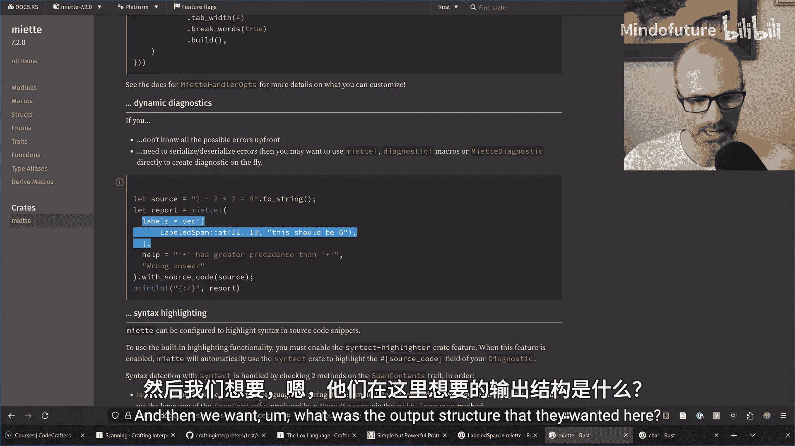

I， they wanted the type。And then， the contents。And then what is this last thing？Why they all know。

 Oh， it's interpreted values。 So I'm guessing for strings。

I see。 okay。Yeah。Great， so what we'll do is。4 token in Lexir。We will do print line。

And I think we'll just straight， print out the token and expect it to follow the sort of format that they're after here。

And so this means that we have to make this slightly more sophisticated。 So for a。

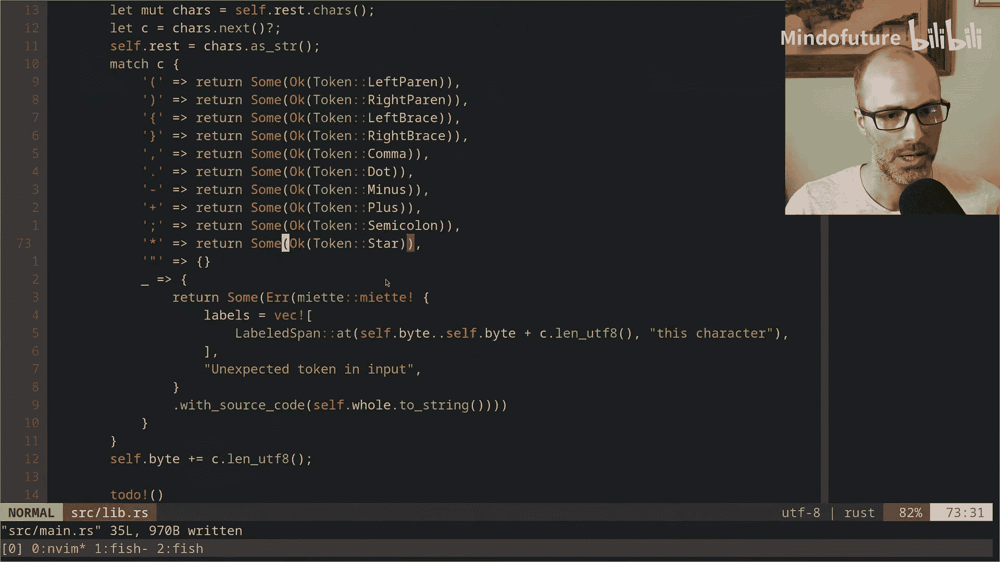

For the punctuaators， you see， it just prints the the sort of the raw character， if you will。

 And then the last， I guess， then is the literal value， right。

 So that means left parent should print this。 right par end should print this。

 left brace should print this。 Wait， What kind of brace。

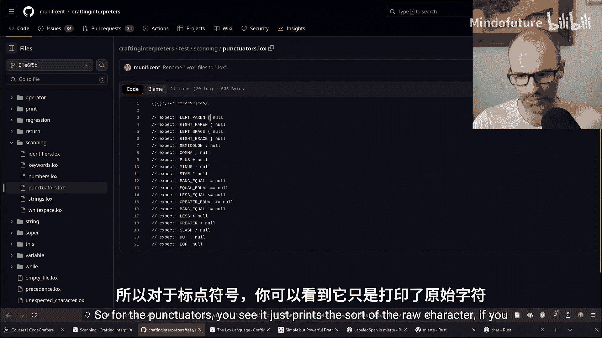

And that kind of race。 Okay， null comma is comma。 null dot is dot null minus is minus null。Plus。

 is plus null， semicom and semiical and null star is star null。And so if I now run cargo R。

And in fact， I could take this。And then I'll actually run it with echo。And I will echo with。

Dash n so that we don't get a new line at the end and a P sub。

 which gives me a file for something I print。 see what happens。嗯。Premer D is never used。

Online 5 in Lib， that is because we don't actually have strings yet。So we're going to need string。

 which does trust me on this is going to need to be a caister。 But I don't think we actually。

Do we want to implement the parsing。Well， the unescaping proactively， I don't think so。

 I think that's just gonna be a this for now。And。And's a string。

Is an example of something that will have a value。 So if we go back here to string。

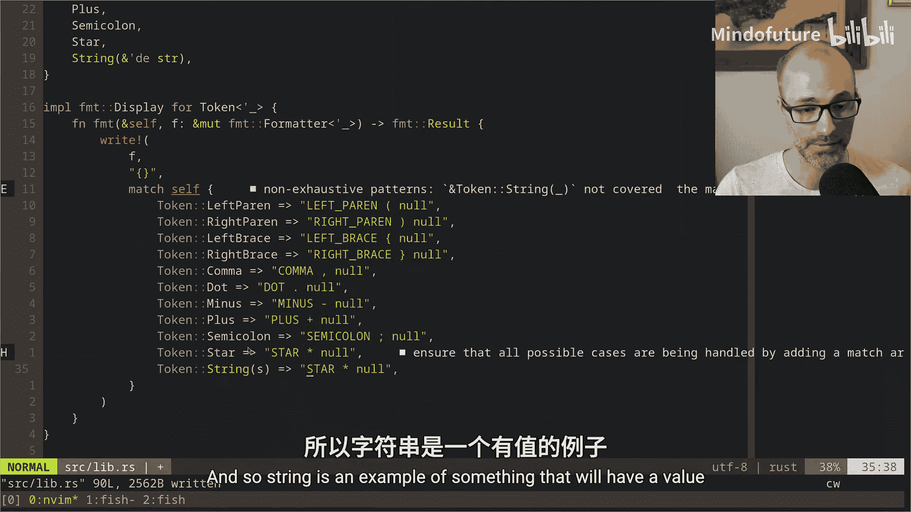

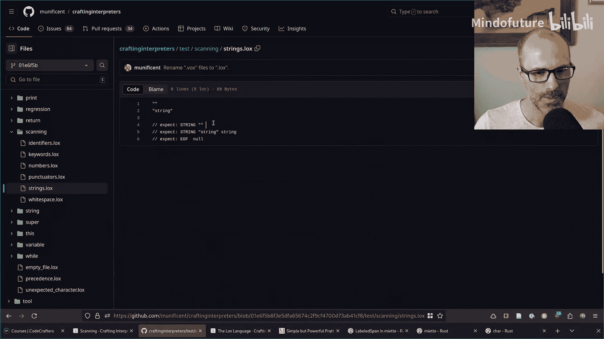

Great。It will print string， and then it will print。This。So actually。

 this one will be a little more convoluted， so it will return right F。liiz。

And then the last bit here is actually going to be a little tricky because it's going to be unescaping the string。

 And so here， that last argument is going to be un escapescape。Sscape S。Where unesscape is。

 I guess well， we'll put it on Lexer or we'll put on a token， maybe。 So we'll have down here。

 we will imp token。And we'll have a。Pub Fhen， Un escape。Which takes a stir and returns a cow。Stir。

So it does actually need。This。To do。So the idea here is it is going to take some potentially escape string and it's going to return either if there are no if there's nothing that is escaped in that string。

 then it will turn just a reference directly to the input string。

 or if it does need to if it does need to do some unescaping like removing backslashes and the like。

 then it will have to allocate a new string and move it over。

And the reason here for the take underscore on token。

 but the D here is that this is not really a method on token。

 right the S here is not really tied to the lifetime of token here。

 It's just tied to the lifetime of the input。 I think technically， we could do this。

 It's just a little weird to me to write the signature this way because we don't actually care about the lifetime of the token type here because it's a static function。

And for now， we have not done S yet。 So for strings， we're going do that。

 And then for numbers similar to the，'re can actually print them out。

 and main is still unhappy because。呃。that token is。And so we're going to have this also return a。

AMe yet result of nothing。呃。So this is going to do meette bale。And here too。

 we can really use clap instead of this weird interface they've set up。

 So that's probably a thing we'll do next， which is let's just do this properly from the beginning。

 This is one of those where we're doing a bunch of work up frontier You could probably just walk through the challenges。

 but instead I want to do it kind of properly and then we can and then we can sort of fly through the challenges later on。

So。Over here。And down here。We're actually going to say for arguments。

 we're going to have a sub command。And I think there's a sub command example over here in the tutorial。

Subcommand， great。So we're going to get rid of these other things from the original。

 we're going to bring in here subcom from clap。And then down here， we're going to grab。This example。

Put it down here。So the commands that we have， at least initially， is we just have tokenize。

 and it has a single file name argument。 So file name， which is going to be a path buff。And I know。

Clap is very unhappy with me because I haven't added it yet。

 So we're going to do cargo add clap with features to drive。

And then now all those errors could go away。And this needs to derive debug。Okay。😔。

So now we no longer need this return value here because clap takes care of it for us。

 the command doesn't need to happen anymore。 we can now match on Args dot command directly and if that is commands token ice。

 then we get the file name in directly， there's no need to match on anything else because clap takes care of exiting if we need to。

And at the end here， we're gonna gonna stick in an okay。 So the compiler is happy。

 We're actually going not allow this to be an option。 We're going to require a sub commandd。And here。

 instead of this sort of read to string with an unwra or else。

 this is one of those places where we can make use of。嗯。Meet rap error。Which lets us do this。

Wrap error。嗯。In fact， we can do wrap error width。Format。呃。Reading file。Failed。

Reading what's the file name here， file name。And because as a path。

 we have to do dot display unless we brought in a crate like Cammino， which we not so。Like this。

And it's unhappy with me because。呃。I'll dot into diagnostic。

This is the one thing that is lo annoying with the meiaus。

 You have to specifically call this function to turn non meat errors into meat errors so that you can then wrap them。

 which is not something you need with anyhow。 If you're using anyhow。

 you can do this rap error with this well， except it's called context with。um。O。

Now we have the Lexer， we don't need it to be mute because we're just looping over it， and in fact。

 we can even go all the way to this。Okay， let's see what happens if we try to run it。

On recognized command， that is because we need to say tokenize。Okay， so we got。

 we don't need this E print line， that's。Can go away。

 So now it found in this input string we get left brand， right print， left brace， right brace。

 semicolon。Comma plus。Minus star。 And then we don't have anything for this。 And you see here。

 the error that we got out here says unexpected token and input。

Or in looking for fancy error reports， I got installed Miet with a fancy feature。 Okay。

 cargo add meat features fancy。why。Oh， I。Remove cargolocks， try again。Great。Okay， yeah。 so see here。

 although the， the， the location is completely wrong。

 but we got a fancy error message that showed the input and then tried to highlight which character we。

Which character had the had the bad thing， But it should have highlighted this exclamation mark right here。

 which is not what it did。 So our， our lectureer is wrong。

 So I think we are doing something wrong with self dot bitete。Oh。

 which is we're not incrementing in this case。 So I think we actually do need to move this up here。

 And then this needs to be cified minus Lnruofphate。To this， oops。Exel。UT it。Great。

 so it's that this character is。So， we could even hear say。An inspected token。Boom。

 unexpected token exclamation mark and input this character。 Okay。

 so now we have like slightly nicer looking output messages。 And this error。

 we sort of just get for free now， as we write more stuff in the in the tokens。Okay， fantastic。

 What's next。 Well， obviously， there are more things we need to parse。

 If we go back to the lockx language， it's actually easier to just walk through the the scanning test to see what the different identifiers are。

😊。

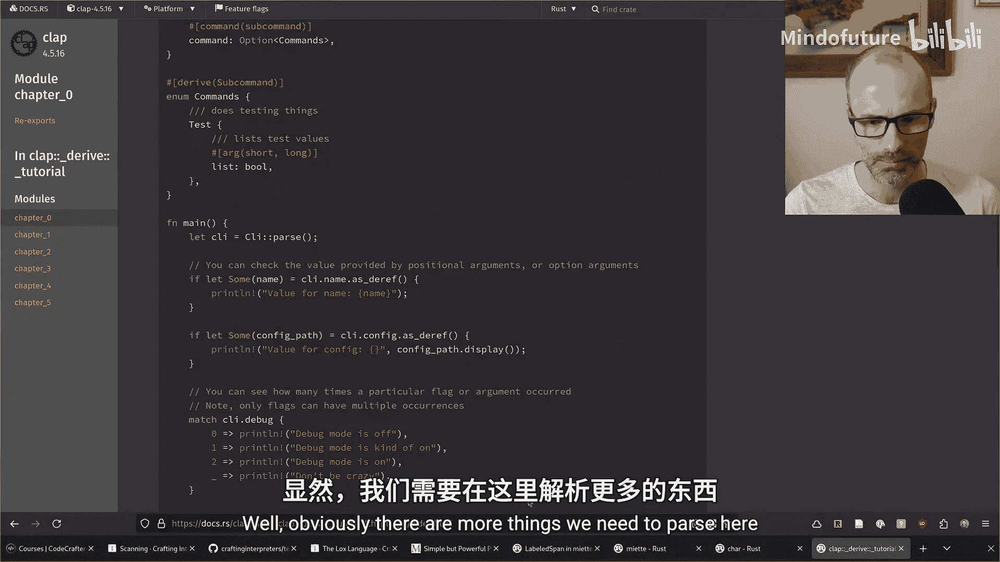

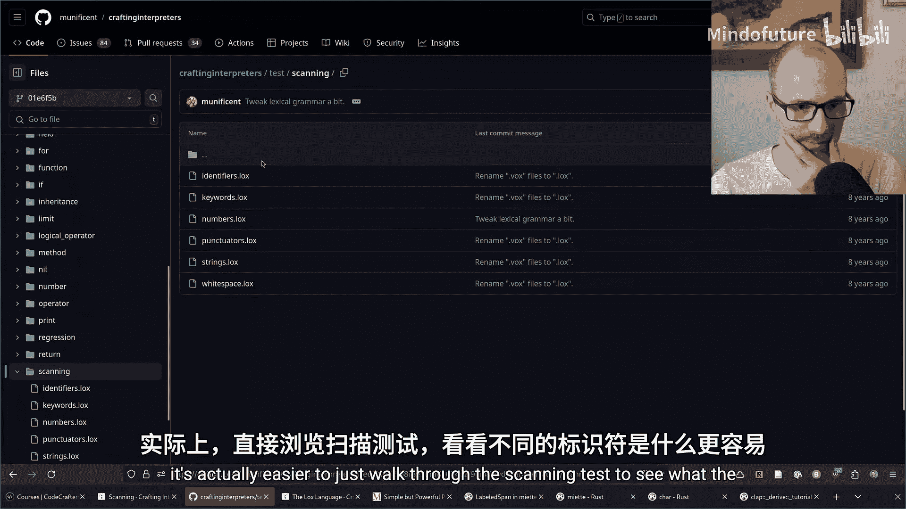

I guess most things here are just going to be identifiers， which is going to be a little interesting。

 Let's handle all the special ones。

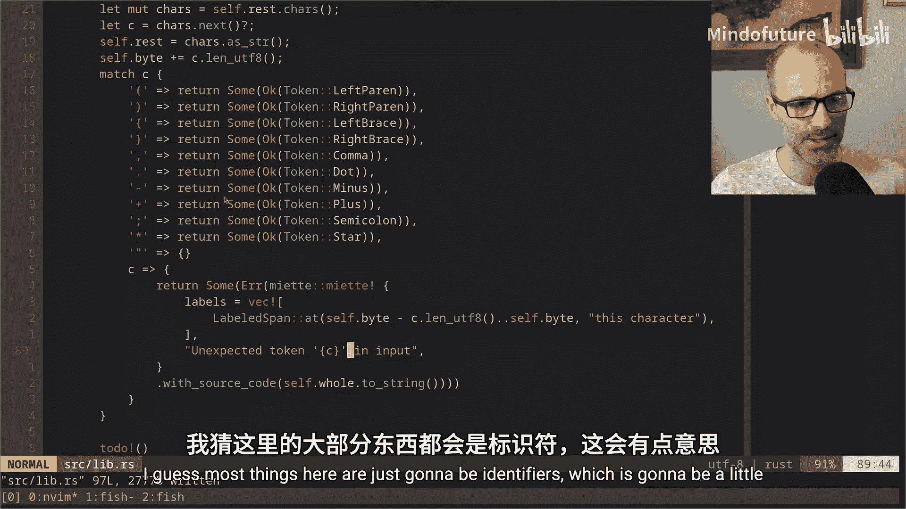

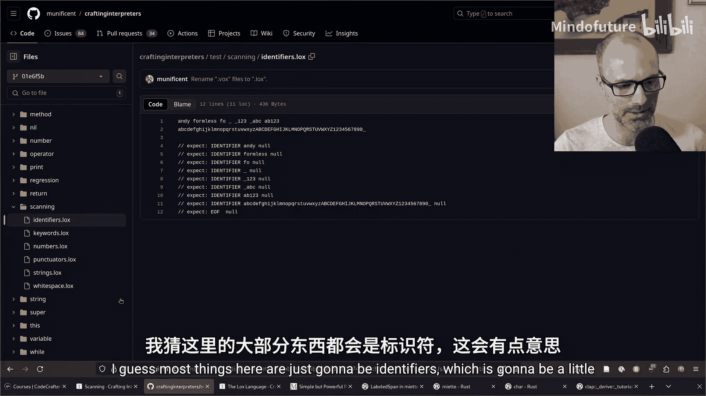

Which is going to be。And I'm actually gonna to be a little fancy here and say。Group。

Which is going to be string。So here we're gonna， we're gonna to sort of say， maybe started as better。

So we're going to return here what we have started。I guess， I guess we could instead return the the。

Just the character， the limititer。 The reason I don't want to do that is because if we do。

 we would need to match on all possible characters later。

 I would rather tell us whether we've handled every case， right？ So， so now we can do。I guess it's。

This。 and then it is。0。😔，To 9。Which is number。So these are。

 these are multi character literals or multi character tokens。 right， So number string。Bu。

Are Booleions。 No， I don't think Booles are。 I think it's iddent。So here it's going be。From a。

To Z or underscore， which are started iddent。Wait， why is it not letting me do that？

Because these are characters。So double code starts a string，0 to9 starts a number。

 A to C and underscore start identifiers。

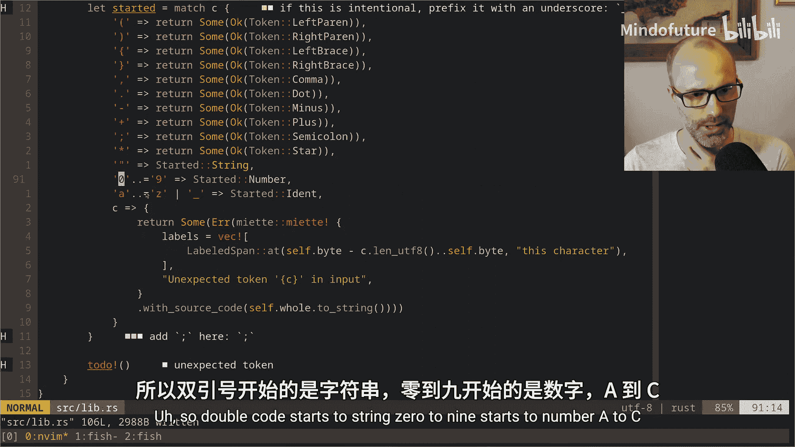

Right。Yep。And。Then there are also keywords。

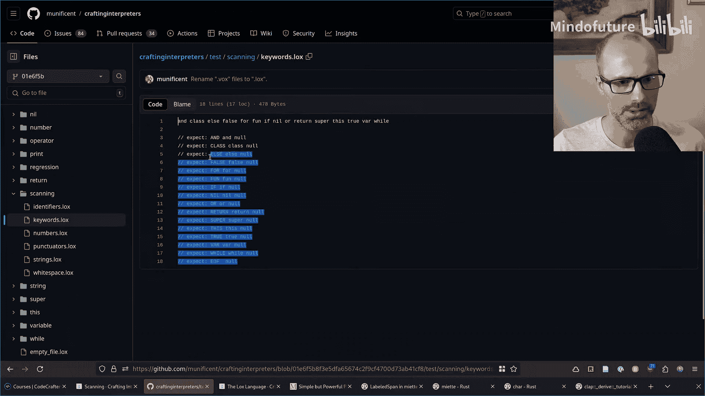

So these are keywords。That we're going have to parse。 but keywords are just identifiers。

 So that one's easy。 what we're going to do here is actually we're going to pull out。

 We're going to match on the identifier that we end up producing。 And if it's one of these。

 then we will handle them。 So an id is going to be a D to stir and a number。

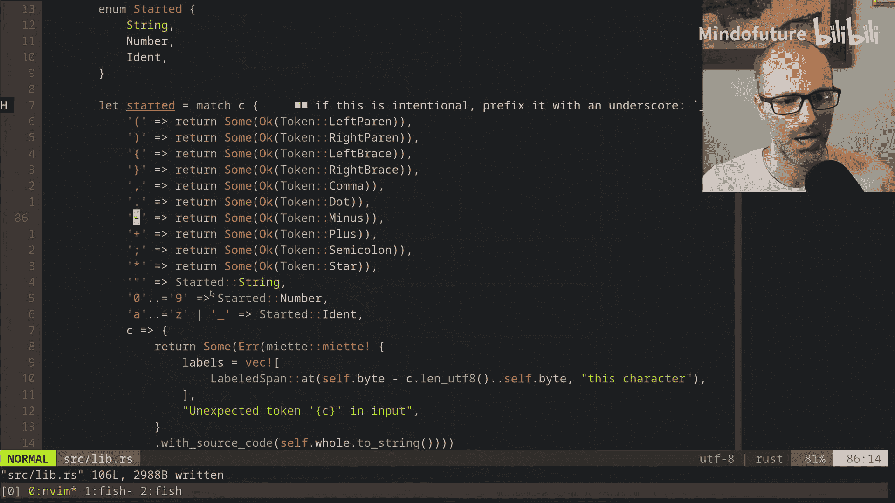

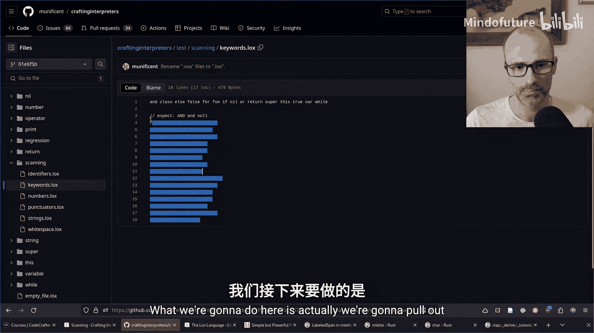

Specifically， it said in the spec was always a double precision float。

 and then we're going to want to handle these as keywords。I don't know why。 End of file。

Is one that feels kind of weird。 but and class elses。False。4。Else falls for fun， if no。Or。

Turn super this true。I'm sure this is an easy macro for this。

 but it's easy enough to type out and of file feels wrong here。This feels like。

Like end of files should just be printed like this here shouldn't be its own token。

And because there's an F64 in there， we can't implement E or hash because。

Floating point numbers are no fun。 Okay， and now it's gonna be mad at us if we don't put， no。

 if we don't put in the other。Arms。Wu。Why on earth。Then decide to stick them all in one line。

 That makes no sense。Okay， I think it's this macro that it's getting it all hung up。

 So what we're gonna do is we're gonna do this。And see if it。Why is it very unhappy with me。 Okay。

 we're going to go back to what we had before。 and then we're going to。嗯。As much as it makes me sad。

We're gonna do this。This I could have searched replaced， I realize but。Where's the fun into that。

 you know？Okay， and now this can go away and this can go away。Why is it。

I've done something to make rust Anar unhappy。This doesn't need to return anymore。

Like somewhere I have a syntax error。啊哈。😊，There we go。 Now， it'll format for me。

 And so now I can go here and tell it to please add the other arms。 So an iddent。

 we're going to write out as F。Identifier。Why don't you return the string from match and then right because that doesn't work for things like this？

Where it's not just a single string。 So for identifiers。

 I guess it'll be I and null because they don't have a value。And for numbers， it'll be F。

I think for the number。It seems like the sort of requirement that we're supposed to give the original literal。

 So I think we might need the literal and the string。

 the number in here so that we can sort of accurately represent the the input that we were given。

 So this is then if we go back to numbers。

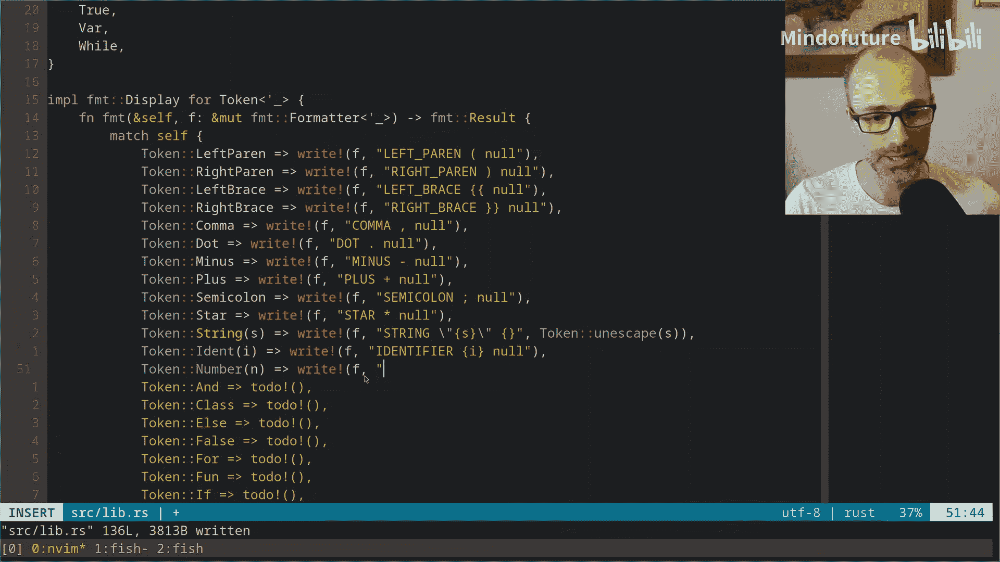

So is there an example of these being different from each other， Yeah， so 456， for example。

 its value is printed as 456。0。

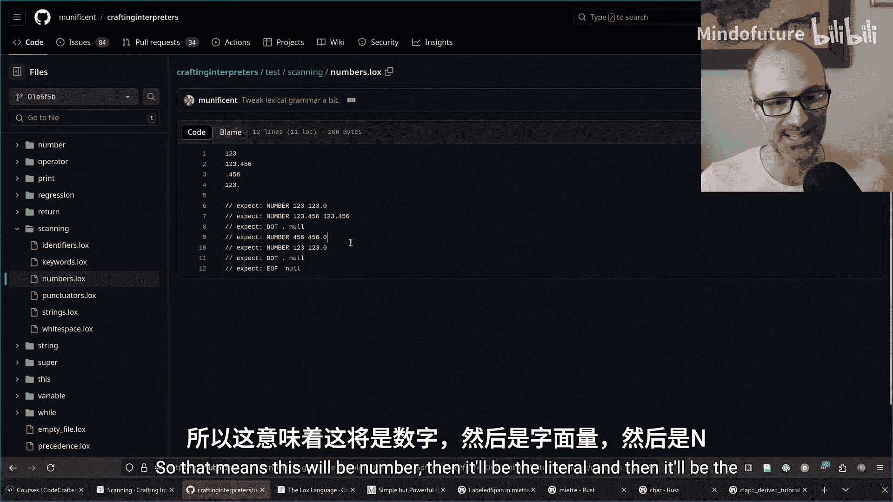

So that means this will be number。 Then it will be。The literal。 And then it'll be the N。And then。

 this is just。I don't think we need debug even I think if would just print the literal here。

And then here， this is F。呃。

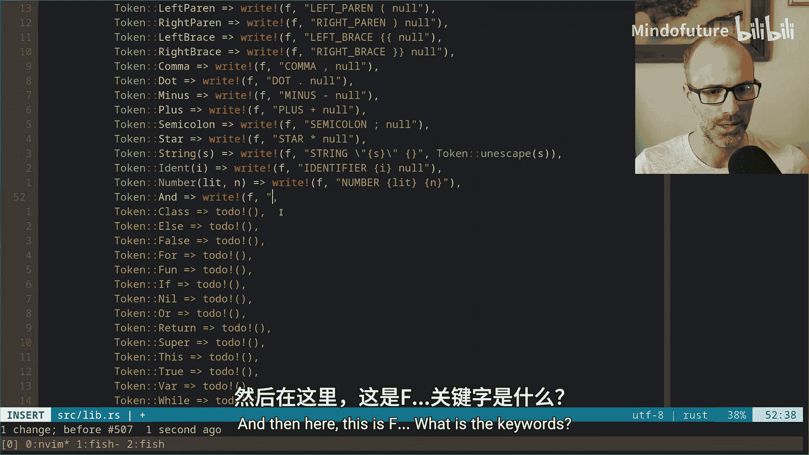

What is the keywords。

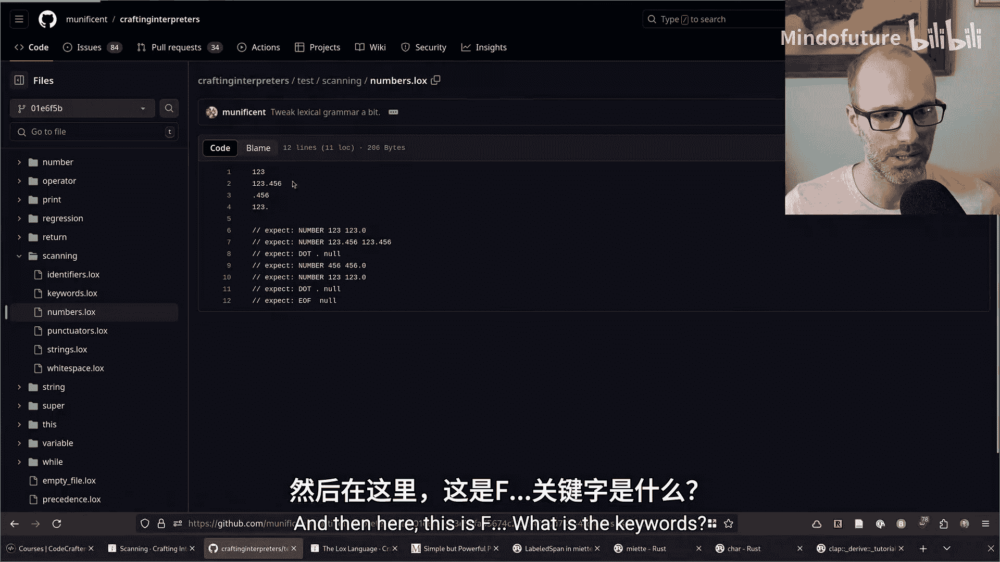

And， and。No。And then it's this for each of these， actually。Yeah。Okay。We're going to do this。

Love macros。嗯。Now， what I wish was that there was a。There， there is。

 I'm pretty sure there's a vim thing for。For upper casing or lower casing， a string。

But because I can't remember it， I'm just going to do it manually。G U motion。 Oh， yeah。 Is it G。

 L motion too， then G， L motion。G U motion， ha， great。 That's the one I was looking for。 Thank you。

um。Okay， so now we write out all of these， hopefully correctly。嗯。

We still have a bunch of these that are missing， which is fine。嗯。

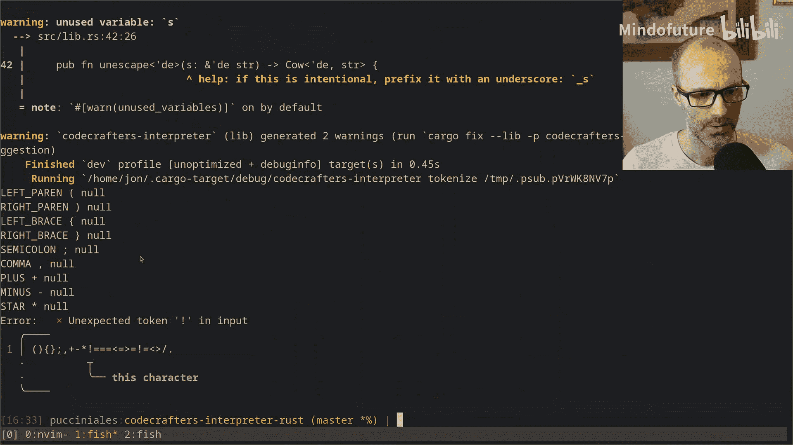

And we still have like exclamation mark。 And that's because those are here， right？

 So we are still missing some。We're missing bang equal。 Oh， bang equal is a single token。

 So that's also interesting。 So that means we have to be a little bit sophisticated with some of these。

 right， because it's not like a single， like a single equal is actually。Oh。

 a single equal is not here。That is probably considered a。Wait， where is single equal？

That seems weird。This doesn't test for single equal at all， unless I'm just blind。

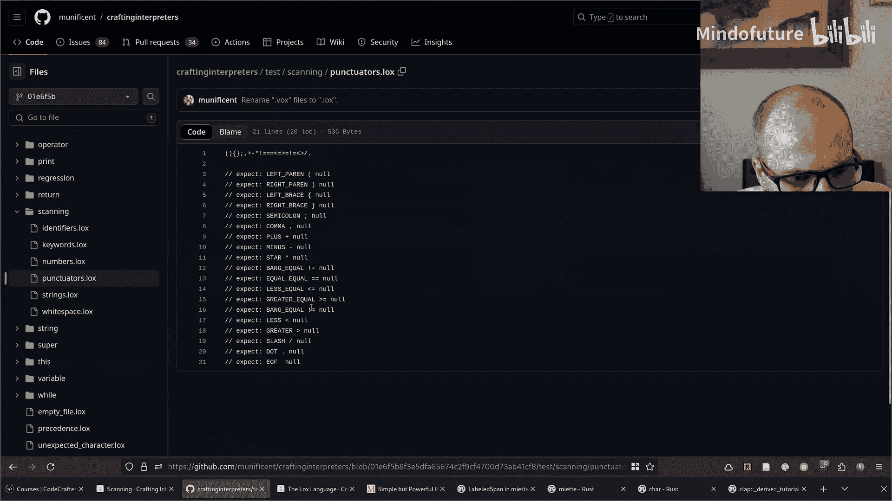

Intering。 Okay， but we do need to then。Add some more tokens to this。 In particular， we need up here。

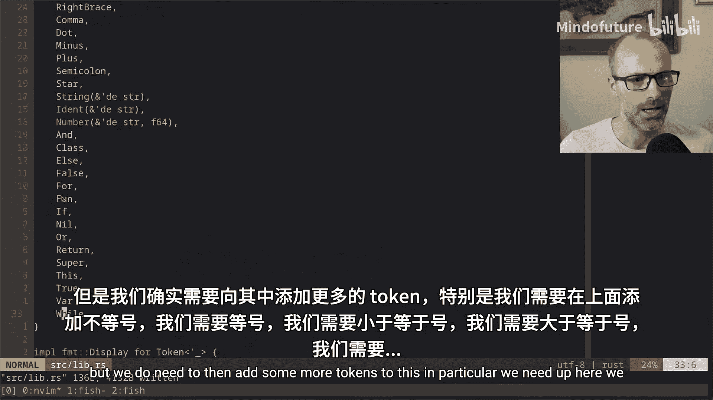

We need bang equal。We need。

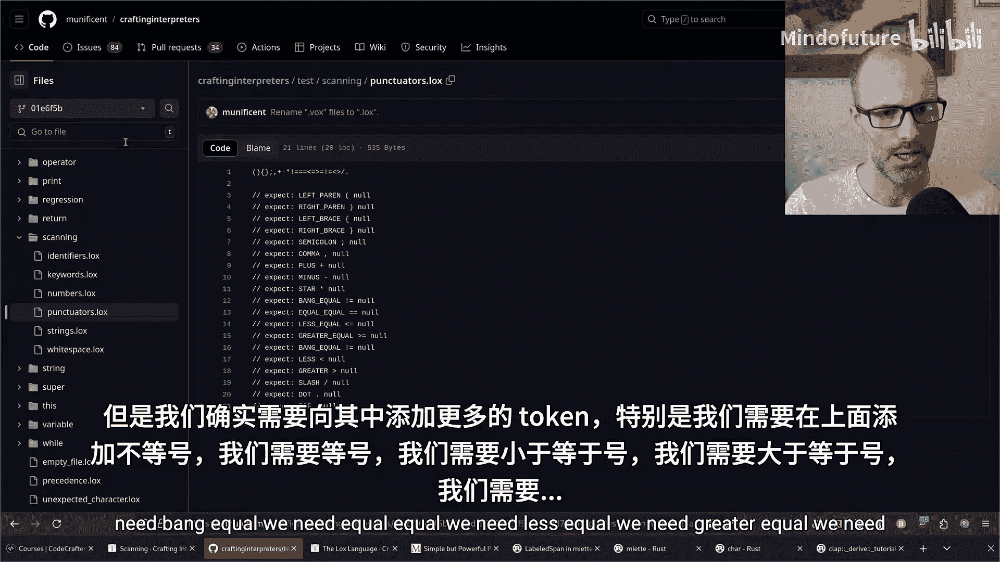

Equal， equal。We need less equal。We need greater equal。

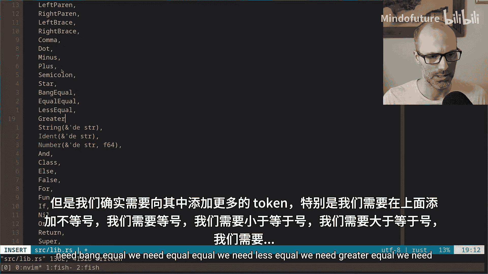

We need。We don't need bang equal again， but we need less。We need greater， and we need slash。

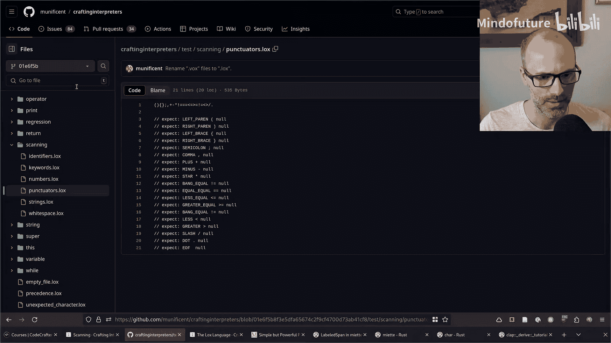

And then this is gonna yell at us again。 So we need to fill those in。 It's easy enough。

 We'll move those back up to where the other identifiers are。 And then we will do。This。

And then we'll do this。Actuallyly， we can do。I was a little sloppy in my definition there。

 And then I guess these have to be with underscore。And also， bang equals should be this， right。

 It should print the actual literal representation。Which is easy enough。

Now there's an interesting question about whether white space is allowed here。 So for example。

 for less equal， if someone in source code form writes less space equal。

 should that be tokenized into less equal and if so。

 should this print this if so that's totally doable。

 it would just require that the token always keeps track of its underlying literal which we could do by just having a struct that wraps the token that holds the original literal and then the token enum value。

嗯。Okay。😔，And slash， of course， should be slash。And so now down here。

 we have a couple more things to handle。 We have nope， not that。 we have。And。Less greater and slash。

 So slash is easy。Less。Is started less。Greater is started。Greater。And this is started bang。So。

 it's less greater bang。Did I typo something？Duplicated left parent and right parentn。

 no left brace and right brace。 This is because in format strings in rust。This。

Means print out the value of variable foods like string interpolation。

 but if you want to write a literal open curly bracket or closed curly bracket。

 you need to write twice that's how you escape it。Okay。

 so now we have some things that can be started。And then I guess we want to match un started。

If we started a string， we want to do something， if we started a number。

 we want to do something if we started an iddent。Then we can do that later。 If we started a less。

 then I think what we want to do is if。Rest， do starts with。um。Yguo。Then。

Then we return some of token。Less equal。But we also need to advance rest by one。

And we need to runs bite by one。Self dot byte plus equals 1。 and self dot rest is self dot。

Solf do pressed。1。See， I also thought we needed an equal， but oh， starts equal A A A right。

 we need an equal for if we start an equal。So if self dot rest startss with equal。

 then we return a less than equal here。Yeah， you can do two characters reading too。

 but it doesn't really matter to me。If the next character is not an equal， then we return。

 then we simply return some O token less。And then for greater， it's going to be the same thing。And。

 you know， we could tidy this up a little bit， but I'm okay with it so that this is。Greater equal。

And this is greater。And then for Bang。Bang is the same thing。Where if it's an equal。

 then it's a bang equal otherwise。It's a bang。So， that sounds like。

That sounds like there really should be a bang token。

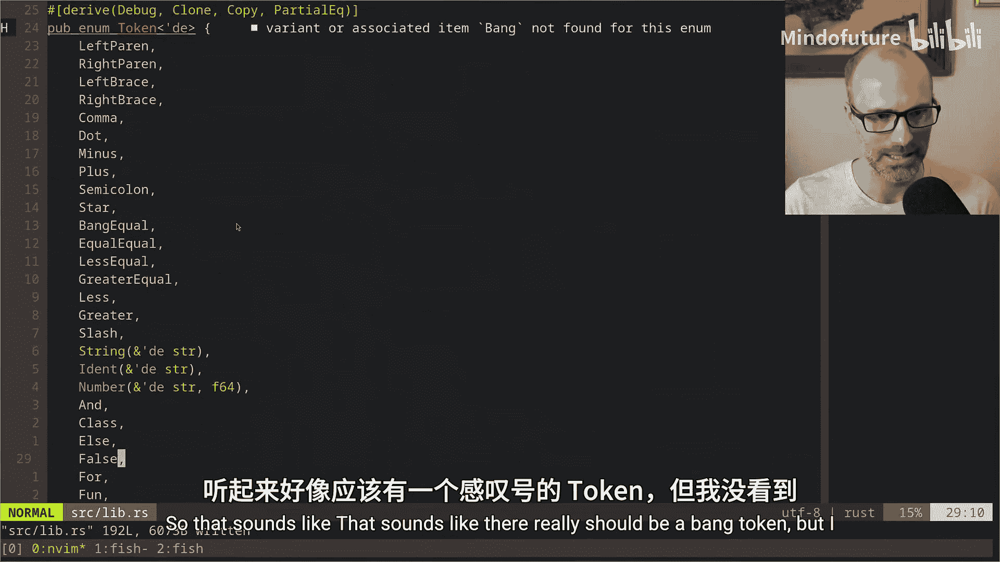

But I don't see one， right？ I only see a bang equal here。

 But the reality is that there are bangs in the grammar because you can have a。

You can have a not false， for example。Which doesn't seem to be handled at all by these tests。

 same with single equality， which is used for variable assignment。

 So I think sort of in preparation for those， we're gonna add standalone bang and standalone equal。

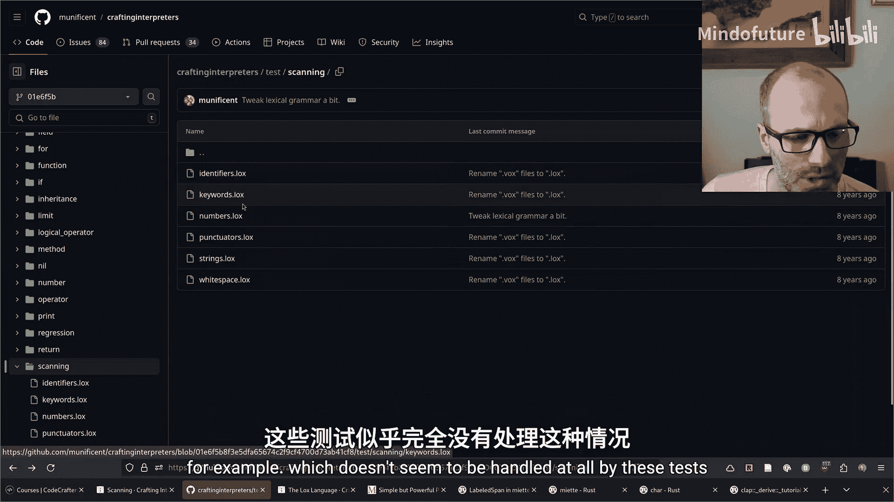

嗯。So， bang。很异口。Couldt it be like a state machine。 Yeah， it is sort of a state machine here。

 It's true。And in some sense， that's what we're encoding here。

 We're just manually unlooping it in a sense。 Okay， so bang。

 and then we also need to do the same for equal。I guess actually what we could do here is we could instead say or equal。

Where or equal holds a。Holds a。Token and a token。But we can't use。Generic parameters。That's fine。And。

Because that way。We could change this to be， this is or equal。Of。Chgin。Less equal。

So it's not really or equal。 It's like maybe equal where it's， this is a。It's if equal else。

 that reads better If equal else， So if equal， then it turns less equal， Otherwise。

 it returns token equal。No， token less。Right， greater than is if there's a。If the next is' an equal。

 then it's greater。 Otherwise， it's this。嗯。Bang is。Bang equals。 Otherwise， it's bang。And E， oops。

 equal is。Equal， equal。Otherwise， it's equal Bang is exclamation mark。

So now we can just say if equal else， yes and no。 So if this， then it returns yes， otherwise。

 it returns no。And that way， we avoid all of this duplication， and that makes me very happy。Like so。

嗯。Fantastic， and in fact， this doesn't need to return at all because we can do this。😊，All right。

 beautiful。Okay， so now we we might as well just look at the others too， right。

 I guess white space is one we haven't covered， which is C if C dot is white space。

 What do they want for white space。

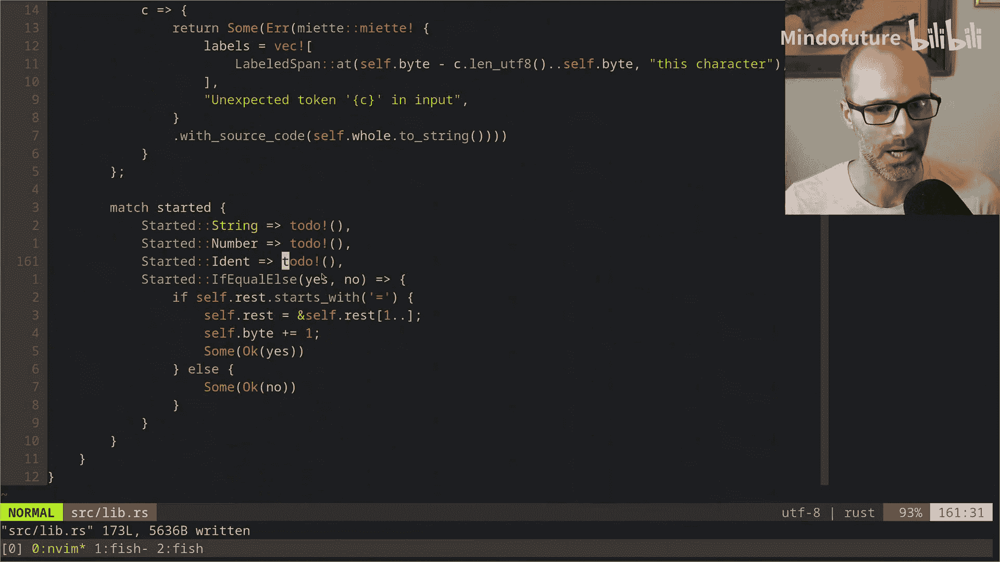

Space。A white space should just be ignored completely。

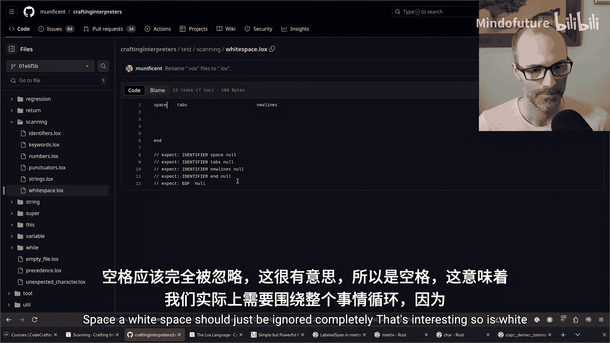

That's interesting。 So is white space。Then。So this means that we actually need a loop around this whole thing because if there is white space。

Actually， no， we can be even fancier。 We can say。嗯。呃，来。Curlin is self dot rest， Do Le。

And then we could do trim， which is we do self dot rest is self dot rest dot trim start。

And then we can say self dot bytes plus equals self。Kur then minus self dot rest Olin。呃。And then。

 we can say。Yeah， so this trims off the white space before we look at every token。 And that way。

 we don't actually need a loop。 It's a little bit weird and wasteful， right。

 Like it feels like given we have to match on it down here anyway， it feels kind of odd。

I think I actually prefer the loop version。I think we're going to do the loop version， go here。

And so this now is going to be a break with whatever this is。Oops。So if we hit white space。

 we're just going to continue through that loop。And started， I can stay defined there。

And then this guy can actually go out of there。 We don't need to reconstruct it every time。And。

This reassignment is fine， because。This doesn't actually borrow self not rested borrows the underlying string。

Nice。So we do then need to be a little bit careful here with this code。

 So this is trim start dot starts with。Then， it is。Dot trim start。This。Right， so， so this way， we'll。

 we'll actually trim the things to come before。 What makes this awkward is that it does mean that if we get in。

Of。So we need to decide here whether we want to actually keep the original literal for every token。

 and I think we might have to。Which is not lovely， right。

 But it does mean that we would do this and that we would have a pubstruct token， which has a kind。

 which is a token kind。It is a kind， which is a token kind and。It has a。Origin。Which is a D8 stir。

And now， I think the。I think now the token kind doesn't need a lifetime at all。

Because for string and id and number， those are all just captured by the origin。

 So string is just a marker that this is a string。And。

An iddentt is just a marker that is's an iddent。And a number is just a marker that is a number and the interpreted value for strings。

 we don't actually interpret the value。 We could。 We could have this hold the this。

The thing that we've sort of unesscapeed from the beginning， but I think I'd rather parse it lazily。

 actually。So， then。呃。Now， what we want is we can match on self dot kind。 And then for all of them。

 we're actually going to print here。I as self taught origin。

 And the reason I want this to be I is so that I can do this。Right so for all of these。

 it should be the case that rather than hard coding what that was。

We want the original input that was parsed to yield that token。And so that way we can。

 if that internally contains some white space， we will actually preserve that white space。So， now。

This， this now needs to unesscape I instead。嗯。And all of these are now token kind， which is easy。um。

So， I didn't。And N。 And this is now I。And then if we don't want that to be I。

 we can make it be literal。It's not really a literal。 eye is fine， or I guess origin is maybe nicer。

And it can't be self door because that won't work with string interpolation in this nice way。

All right。So now this gets a little more awkward because this is now。For these。

 we actually want to capture。What the origin is， and the origin is。A string reference。

 which we don't get out of characters。 but we would get out if we did。What is it cares indices？

So that then returns here。 So C now is at and C。And so at is the bite position of the character。And。

And so， then， we could do。So C stir is self dot rest。From at to at plus C dot L， U T F8。Like so。

So now we have this see as a stir。And then， for these。How do I want to do this as the other question？

Cause this is getting ugly real fast。 But we could actually do this with a。Yeah， we can。

 We can have a little helper function here， and we can。

 we can just define it in here if we really want to。 So this is going be。

Just we're going to call that。 And it's going to be a token。And。Origin。

And it's going to give us back a。Self item， if I'm allowed to refer to that here。All right， fine。

I give you back this。But it's actually going to give you， it's going to take a token kind。

Is sort of the thing that's going to save us here and give us back that。And inside of here。

 it is just going to return some of O of token of。Kind and the origin。

So is that worth having the function call， what it'll look like is this？That versus。Yeah， it's nicer。

 Okay， great。 So for each of these。These are now going to be。Just。Actually。

 a closure would work here pretty well。 too。 Let's do a closure。

 I agree with you because the closure can capture， let。Just。Is it's going to take a kind。

It can be a move closure。 That's fine。嗯。And it's going to return。Some O。

 token with origin is ceasester。Good call。 closurelo is nicer here。And these are all kinds now。

Beautiful， beautiful， beautiful。So this and kind and kind and kind and kind。And this， indeed。

 should be kind。And now started doesn't need a lifetime。 Beai awe， so good。

 looking so nice and clean and crisp。😊，Okay， so this now needs to be a little more interesting。

 So the the span of this token that we're reading is actually self dot rest。嗯。From。From at。

To something to the self plus， this is also wrong。嗯。

We kind of need to know how much we've read out of rest。Which is gonna be。

I think we can I should just say rest， self dot rest is。Seft do。Rest of trims start。

 but that's not quite right， because we need。San is self dot。

Because rest here is already moved past the characters。

 So I think we're going to sort of buffer here as well。See onwards as self do rest。

And then we change rest。And then， here。The span here is going to be。诶。Oh this hurts my brain。嗯。

We're going to do self dot rest is self dot rest dot trim start in case there's any white space。

 And then we are going to say that。And then we're going to say， because now we have。Self dodge。

 I wonder if there's a function in for a slice。Like， remember。The the the the， D， D。

 the C onwards here is a pre it includes self do rest。 We know that。

 but the compiler doesn't necessarily know that these are pointed to the same string。

 So what I'm wondering is whether there's a function in the standard library unlesss you compare two strings。

 And it basically does like a pointer comparison to check if one is within the other。嗯。

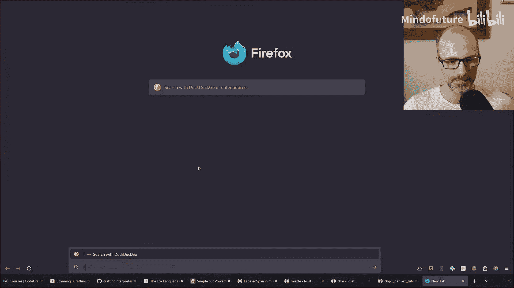

This is actually a really I'm going to try something。

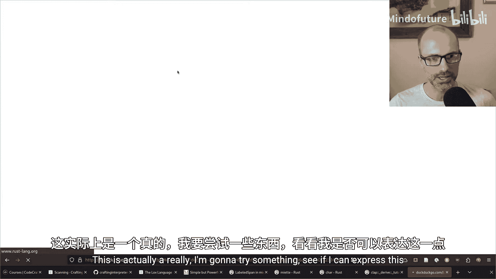

See if I can express this。 So I want a。Stir。To stir。I want to stir and stir to to to use size。うん。😊。

Maybe， oh， maybe it's you ate。 actually， Maybe it's defined on， or maybe it's defined on any T。

To you size。Maybe it's only on U8， then。That's fine， too。book。Otion。Youate。Option you size。Fine。

 I'll， I guess I will just look at you。 at fine。 I'll look at slices。St， slice。In names， Ste。

 Thank you very much。What is it called？It's not that。Should not require unsafe。No。

 I don't want to use pointer equals。It is a very specific function。 It might not be there。

It's not a line too。 It's not a sdy。Not issorted。You might be on E 8。No， maybe it's just not there。

I feel like it should， it should be in there， right， because what I really want here is to say。

 give me the difference in the start of these two slices。 If one overlaps with the other。

 but I guess it will not let me do that。 So instead I have to say。

 let trimmed is self dot rest dot is。See， onwards。Ddlin。Minus self dot。Rest， Olin。

So that will be how many characters we have read out of rest， including the trim plus one。

 which is the character we're about to read。Now， I guess， trimmed。-1。So we don't count C。

 and then we do self dot byte。Do we need to eat the white space here， We don't。 So it's only really。

But because we've， we might as well trim here， There's no reason to not do it here。 So self dot byte。

Plus， equals。trimmed。And。And then in the case where there's not an equal sign next。

 then we return O of token， where the origin is just sea string， and the kind is token kind， no。No。

 it's just no。In the yes case， then the span， then we can just continue to use self dot rest。

 So if self dot rest starts with an equal sign， then the span is then self dot byte plus equals1 that I already have that down here。

 self dot rest is self dot rest incremented by one， and the span is now。嗯。See onwards。Right。

 it's C onwards starting at at， which is the location of C。 I guess we could renamed it as C at。

See at。Why do we need the ti。Yeah。Which I think is just zero， right？

At here is guaranteed to just be0。So， so I think this can just be until。And in fact。

 I think that I bet you that's here too， we don't actually need at because we know at is zero。Oh。

 we don't because， oh， this is actually a bug that would hit us later anyway。

 because we're not reassigning this at the start of every loop。

 its counter is going to be out of whack because we're resetting rest here。

 So I think we do actually want it in the loop。 So note this must be in the loop for the indices to match up with C onwards。

But now we're guaranteed that act is zero。I think。There's no way for it not to be zero here。

Because we're， we're just taking the， the first character。 So I think that means we don't need at。

 which means that this can just be at to C dot Le。 and we get further down here。downown here。

 we know that it's C onwards until。And then this is going to be C Leate plus trimmed plus one。

Right so we grab all of the length of C， we grab the trimmed white space and we grab the one byte。

 which is the equal sign， and that's going to be the span the rest here is going to be just updated by one because it already points past the white space because we moved it here and it points past C because we moved it up when we read C So byte only moves by one and then here we return token where the origin is span。

And the kind is。The kind is。Yes。Now， the other bit that's interesting here is this is where smarter people than I would instead of inserting the。

A string reference here。 you would actually just keep the byte offsets here so that you don't have string references to the same input string everywhere in your program。

 You just instead just keep around the the byte offsets and you can compute the strings later。

 In fact， that might make it easier because we don't need to do all these like string slicing。

 but I'm just gonna keep it this way so that we can print them easily。Okay。

 what happens if I run it now？Okay， now it gives us something that looks pretty reasonable。

For that input， at least。And if I now try to do something in fact。Yeah， it got bang equal。

 It got equal equal。 got less equal。 So what now， if I just add an equal in here。

Then it gives us indeed， that's just an equal。 And if we add a bang in here， it adds， who。

 we made that a bang equal。 why？ Oh， because I did add it， in fact， before an equal。

 If I'd havent added it after， this was a separate bang， okay。

There's something wrong about our print， though， because。

This just prints equal when it should be printing equal， and this needs to bring bang。All right。

And then。Okay， we're on a roll。 So how about we just keep doing this while we。While we go here。

 So we might as well just do numbers because numbers are easy， right。

 If we find something that starts with a digit。Then what we want to do is we want to find。 And this。

 too， is a question of like， do you lost spaces and numbered literals， I don't think so。

 I think you disallow spaces and numbered literals because that is one number followed by a different number。

 unlike less than equal where I feel like a space is probably okay。

 even though I'm tempted to just disallow it。 Oh， can I have uppercase。Probably。Probably。

 you're probably right。嗯。This allows spaces allow underscorees。 Now。

 that's the power move for numbers。 I I agree。 I like that。 but it still has to start with a digit。

 right， something with dots。 You can't start a number with the dot， in Ru you can。 But it's fine。

 The the nice thing here is that we don't actually have to parse this ourselves。

 We can be a little bit smart about it。 So here's what we'll do。😊。

We will say that if we have started a number。Then we have to read until we no longer have numeric characters we want to allow in numbers。

😡，And so that means。We're going to do。Self dot rest， dot find。Xi。呃。We're going to find the first C。

Where either C is equal to dot。Or。C is。呃。Or。😔，Actually， we're just going to match。

Or we can even do better。 We can do matches， C。Of either a dot。Or an underscore。Or。0 to 9。Right。

Isn't it position。So we're already checking that is starting with a number， so that check is up here。

And。So we want to find the first dot because we only want to allow one dot in the number。

 because if you write something like 1，2，3， dot 4，5，6， dot 7，8，9， I think that should parse as。

You know logically speaking，1，23。456， and then a dot。And then the number 7，8，9。

I think that's what it should parse as。And so therefore， we need to find the first dot。 And then if。

呃。Till first thought。 And then if self do。And here， too， we need to be a little。

In the case where we don't find。We don't find anything that is allowable in number after the first one。

 then the number is just the very first digit we got， so that's an easy case。

Where we can just return with some of okay of token。Of。Where the origin。Is Cster。

 And the kind is token kind。Number。Easy easy busy呃。Like so。And then， if self。Dot rest。呃。

And what is position again， it returns。Oh， I guess it's cars is what I want here。

But I think there is a。I is， isn't it fine。Oh， fine does return the position。 Okay， great。

 If self dot rest till first dot plus one。诶。Starts with。A dot。Or rather。

 if it doesn't start with a dot， then we're also in an easy case， because in that case。

 we just say that the thing to return is C onwards。呃。Until。Till first dot。呃。It's C dot L UTF 8。

Plus till first do。And in fact， here， if we want to help ourselves a little bit， we can search。

 including C because we know the first thing is the digit。 So that way。

 we don't have to like supply strings。So then we can do C onwards here as well。

 and then this is just C onwards。Till first dot。 And the reason here is if there isn't a first dot。

 then the the the first thing that this。Oh， I guess this is fine the first that doesn't match this。

Yeah， so this is going to be the， it's going to return the position of。

The position of the first nonnumeric character。No， that's not what I want either。

I have to think here a little bit。Because。What we kind of want is to find。Oh， actually。

 this is way easier than I think。 I think this is going be just last non digit。Or I guess， first。

 first non digit。Yeah this is， this is just me being silly。 So the。

 that's going be the first non digit。 And then what we want。 So then this is also wrong。

 This could just be， we got to the end of the string without finding a non digit。

 So this is actually C onwards。呃。And maybe for numbers。

 we should also not parse them until like on demand。But。A。The number is going to be。

We're going to parse it right here。And if it's a number， then we're good。 And if it's not an。

 if it's a parser error， then we again do a。A nice meet thing。We'll fill that out in a second。

I wonder， can I make this a。All right。 It has to be a。Return some。A。

Because then we want to highlight that this is not a valid。Literal。嗯。And， actually。

I can make this a lot nicer by just saying unwrap or else see on words dot L。Because the， this。

 it's gonna share the same logic anyway。Now， the interesting part here。

 there are a couple of interesting parts we gotta figure out。 The first one is。So the。

 the thing to parse。So the the actual literal is C onwards。Until the first non digit， right。

 logically speaking。However。It's not actually quite that simple。The reality is that if the literal。

Has multiple dots。 Then we want to shorten the literal。 And so this is where we're going to do a dot。

A splitlit N。3。Dot。Like I kind of want to like， I want to skip。

I to skip the first dot so one way to do this is you find you don't search for the dot here。

 you search for just underscores and numbers， and then you see whether the next character is a dot and if so。

 you do the same thing again and then you add them together。

 I guess maybe that's easier than trying to because the other alternative is that you now that you have the literal。

 then you shorten the literal to the second dot if there is one。Right。

And I don't know which of these is easier。I'm tempted actually to just say。We're just going to say。

Oh， we're not supposed to partsse the float yet。 All right， fine。No。

 we must be supposed to because otherwise you can't print out the number here。

So I think you need you need to store both。 Otherwise you can't print out the thing that you just parsed or le rather。

 So I think I actually do want to do the split here。嗯。And then the way that I want to do it is。嗯。

Is there a。Literal dot。What does split Terminator do？Yeah， that's not what I want。

1 is dotted dot next。2 is dotted。Not next。Actually， and then here's what we do。Dotted， dot next。

 dotted， dot next。 Yeah， yeah， this is， this is actually gonna be pretty nice。嗯。So， if we have。

If we have。Yeah， literal。オッケー。嗯。2。Hopefully you can see where I'm going here。

 So if we have all three， that means that there's multiple dots in there。

 and so the actual literal we want to give is a slice into the original literal here only until one dot L。

Plus，1 plus2， dotlin。And if it is。If it is this。Then we can just return all of literal。嗯。

And if it's anything， in fact， if it's anything else， we can just return literal。

And so we can even actually do， if let。This。Then。Literal is。This。Right， so so we。

 we we try to split the the， the numeric literal into three parts。 So that would mean two dots。

 right spliting into three parts as two dots。 And then we look for。If we have all three parts。

 that means there are at least two dots。 And so in that case。

 we want the literal to only cover the first and the second part。

 meaning the thing before the first dot and the thing between the first and the second dot and the one in between。

呃。And so now we can say self dot byte plus equals literal dot L。Minus C dot then you divide it。Right。

 so we， we added the additional characters that we read and self do rest is going to be。

It's going to be self dot rest。From。The extra bytes we read。Extra bytes。Onwards。And now。

 we can match the literal。Or we can parse the literal。 And if the literal gives us any trouble。

 then we can give a nice error message。Oops， I copy two many lines。I can give a nice error message。

That says at。Sn very literal。And then， we can just。This。

So if the literal fails to parse then we give a nice error highlighting the numeric literal that they tried to give us。

Otherwise， we give back the token。Let's see how well that works。 So let's try it on。

s just try that the original works great。 So if I， if we now try a couple of numbers。 So we try 1，2。

3，1，2，3，0 4，5，6，1，2，3， underscore 4，5，6。Dot。5，7，8。What am I saying，5，7，8，7，8，9，1，2，3， dot 4，5，6。

 dot7，8，9。Well， that wasn't quite what I was hoping for。It got the first and the second。

 It didn't like the third， and it did not give us a nice error。喂，喂，喂。Literal is。

Pace sub is a very really handy command that if I do echo fo， it just print F。

 If I do echo F to P sub， this is a this is a。fishism， the equivalent in bash is this。

So I'll show you in a second。 So if I do， oh， it doesn't work outside。 So if I do cat。

 so cat prints out the contents of a file， right， Let's say that I want to echo something。

 but I want a file name。That holds that contents。 Then I can do Efo Pub。And in fact， if I do echo。

 you'll see it gives me like a temporary file name in bash， you can do the same thing。 So in bash。

 you can say echo。Echo fo。And you see， it gives me a file descriptor that holds the output of the process inside of there。

So if I run this again， what does it tell me， It found a literal 1，2，3， found a literal 1，2，3，4，5，6。

 It found a literal that， which is the correct literal。So it extracted the right part。

But then didn't wasn't able to parse it。 And the reason it wasn't able to parse it。

 I'm guessing is because the the rust parser for floating point numbers probably doesn't accept underscore。

 even though rust itself does。 And so I'm just gonna remove that from here。As sad as it makes me。So。

 now， this。Yeah， so one the this the last one we had that has two dots gives us 1，2，3，4，5。

6 followed by a dot， followed by 7，8，9， which is a number。 Great。

 What if there are multiple consecutive dots shouldn't be a problem。 Let me do 1，2，3， dot dot 4，5，6。

😊，Oh， yeah， no， right，1，2，3 dot guess pars the number。And it guess par says 1，2，3， followed by a dot。

 followed by the literal 4，5，6。Which I think is what we expected。

So a number is only allowed to contain a single dot。And。But there's something。

 there's still something wrong in the sense that。If the parsing fails。

 it still gives us something weird。 So how can I make it fail。

Because I guess actually there's another argument here which is I think a number that matches this cannot possibly fail to parse。

 but let's say we just like allowed underscoreing here then what I really want is for this to give us a nice error message and I'm curious about why it doesn't because the alternative right is we remove this case and then we just dot expect on this saying we know that literals like this must parse correctly。

嗯。But why does it give me。An unhelpful。Error。Oh， it's because I haven't added。With source code。

How by now？How about now？Yeah， this numeric gl literal。But why does the。Invalid float literal。 Okay。

 great。 so the parser doesn't， the， the actual pars of floating point numbers in rust itself doesn't give us a very good error。

 But now we can take that away。😊，So， you said。If I do dot 4，56， what should that parse as？Dot 456。

I think this is correct。I don't think implicit0 is a thing that locks let you get away with。

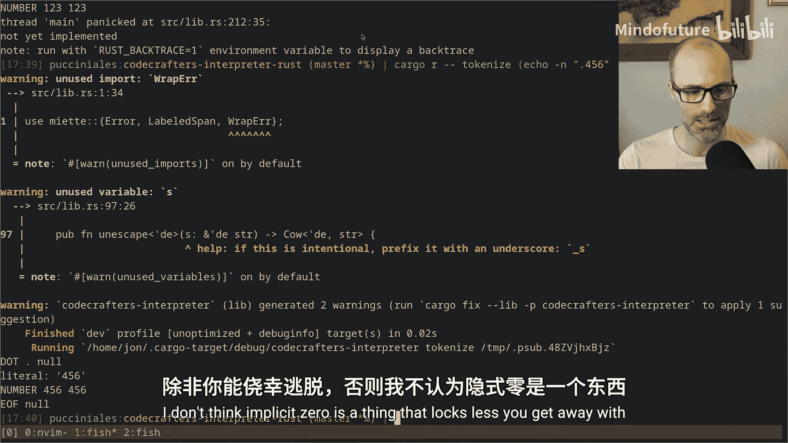

But it's an interesting interesting question。 Like， if I go to numbers。Dot 4，5，6。

 should parss dot followed by 4，5，6。 Yep， So we parse that correctly。 It must start with a number。

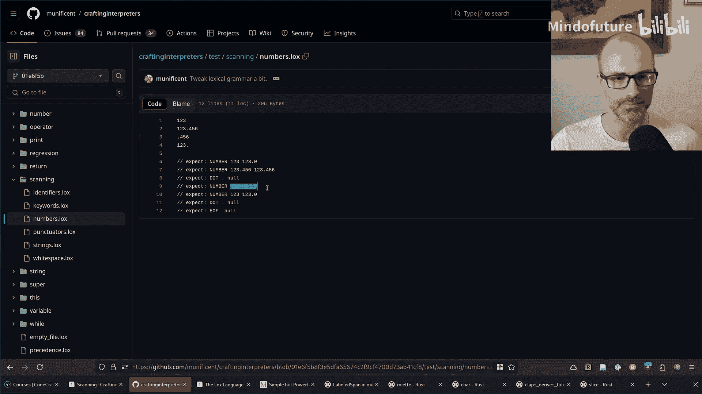

Okay， so I think we now have the parsing of numbers。

 We have the parsing of all of the like double character things。

 We don't have idents and strings yet。These are actually pretty。

 I'm going to do idents because identts are pretty straightforward。

 idents are really just numbers where you don't need to parse anything。 So let's do like 31。

 So we're just going copy the stuff from this first non iddent is going be anything that doesn't match。

What8 is8 is。A to Z or。A to Z or 0 to 9， or underscore。Also， I mistyped there。Right。

 is there anything else that we should allow and identify us nope。

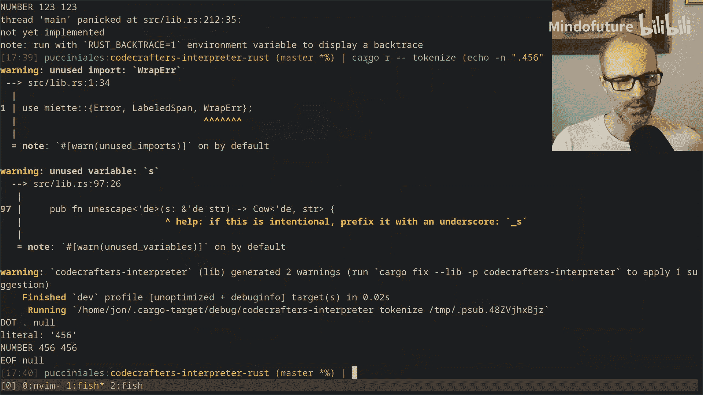

Back and advance。嗯。Those are all fine。 Those are all the characters we allow anyway。

First non id。 as now we don't need to do any of this dot checking。

 We already checked that it starts with a letter， not a number， a letter or earned a score。 So。

 so that part is fine， which means we can do this。呃。First， nonident。Doesn't need to be mutable。

 We don't need to do this extra dance。 We need extra bytes。 We don't need to do any parsing。

 and we can just say It。So that one's pretty straightforward。 But now there's an interesting part。

 which is let kind is we're going to match on the literal。

And then we're going to have to extract out。This。Because these ones are special。

And I don't know whether they're supposed to be case insensitive。The language doesn't really say。

 I'm going to guess that they're k sensitive。呃。So I think we're just going to do token kind and。Well。

 this is gonna be， okay。Let's make this a little bit smarter and save ourselves some time Q A。Okay。

 let me for once， actually talk through what a vim macro is like。 So in order to do a Vm macro。

 which you do is you first click Q， and then you give a name to the macro， which is a single key。

 So a， so Q A， I'm now recording a macro named A。 You see this on the bottom left。

 Then you can write any， you can just do any vim commands that you want and they get recorded until you hit Q again。

 So in this case， what I want to do is I want to。Copy the next word。 So Y W。

 you can see this in the bottom right。YW， then I want to add a double quote and another double quote an arrow。

And token kind colon colon and then escape to get out of insert mode。

 And then back to the start of the line。 So that's carrot。

 and then P to paste in and then back to the start of the line and then one to the right。

 So L and then I want to make the word lowercase。 So that's G U W for make lowercase the next word And then because I'm going to execute this again on the next line。

 I wanted to automatically progress to the next line for me as well。 So I go one line down with J。

 I go to the start of the line and I hit Q。 So now I've recorded that sequence of events。

 And notice I didn't type and anywhere。 because I was copying the preview the word that was already there。

 And so now I can I can hit ampersand A to run the same thing again。

 and then I can hit ampersand ampersand to run the same thing again。 And in this case。

 I can run you know10 ampersand ampersand。 and then we'll do it for。Like it will do it 10 times。

 And so eventually， now it's done the， done the thing that I wanted。And so for anything else。

 I just wanted to return iddentt。And then the actual kind here is gonna be kind。Sorry。

 not Ampersand at the ats symbol。 That's the Miss misay of mine。What about one，2，3 dot。

 which should that be parsed as？

I don't know what's see。Numbers。1，2，3 dot should be parsed as 1，2，3 dot。

That's really interesting。 Okay， so let's add that in that should be pretty easy for us。

 So that does mean that this needs to go back to a match。Because now we have。This case。

Which should do this。And we have。Theit。Leave literal as is。 and then we have the two case。If。

2 is empty。Then the literal should just be one。So let's see。 So if I added a 1，2，3 dot。

 it now gets parss 123 dot。嗯。This also feels like a thing where we should really just add a bunch of unit tests。

 right doing so should be pretty straightforward to this。

 but I'm going to not do it because I'm contrarian today。So if I now write here and。

 it gets pars and and if I want and F， it gets parss identifier and F。Beautiful。Okay。No 12。

3 dot is apparently supposed to be1，2，3 followed by a dot。

 as you can see this line is parsed into this。

So our old implementation was wrong。Okay， and then I'm just not gonna handle strings yet because strings are hard and I don't want to deal with them。

 We're， we're gonna to have to deal with them pretty soon anyway。 But I think now we've。

 we've gotten pretty far。嗯。Okay。So oh。Get add dot， get commit most of the tokenization。Good push。

See what happens。Wait to skip step 18， step 14，15，1617 complete and step 19。And now step 18， Okay。

 great。 Thanks， Step 18。😊，It built successfully。What does that mean？I was compellinging again。Okay。

 we failed。We failed the first test case because end ofophil is supposed to be endofophil space。

 space。Wow， go back to the drawing board， back to the drawing board， everyone， we messed it up。

 it's completely wrong。啊。Major regression。Fixed。Try again。All tests pass。For empty file。 Okay， great。

 Let's see， Let's see what happens。 Like how many， how many steps do we think we succeed at now？

 Okay， so we got empty file。😊，Pentheses， okay， let's， can I just。MarMar stage is complete。Wait。

 did it， Did it test my thing。Tests failed。Expected line 1 on standard out to be left brace。

Got leftbra double space。So there's a lion here somewhere。Is there an extra space？Oh yeah。

 I do have an extra space。Full of bugs。Now， full of bugs， no more。This was the last bug。

All testpa all seems like goli here。Okay， test passed。 great。

 So now does it now it agrees that I pass that one， what about braces。Tesspa。Okay。

 but why doesn't it market as complete then。I guess I'm supposed to read it。 Mark stage is complete。

Other single characters， running tests。Hey， t pass。 great。 Mar stage is complete。 Lexical errors。呃。

Wait， no， lexical errors。A series testing contains unknown tokens mixed in。

Arrs should be printed to the standard error stream， starting with the line N prefix。

 and you must exit with exit code 65。It has to match that format。That makes me so sad。

That makes me so sad。嗯。So luckily， we， we， we can actually do this with me at too。 It's just。

 it just makes me sad as all， which is we're gonna need a structured error type。

 So we're gonna do this with。嗯。就猪。So， up here。We're going to do a pub。 Should it be astruct from yet。

 I forget。嗯。Yeah， I think it's struck my error type， which is we're just going call error。

It's not going to be a me error。And then we're going to derive。Cargo add this。

And then we're just going to bring in this entire thing down here。And with all these。

It's not going to have a code。 not going to have an error。Oh。Tokenizing failed。So， the source code。

Li。Label。If we want to have multiple labels。But， see。Oh， and I think。

 I think all of these can then be turned into， okay， this might actually be okay。 This might be okay。

 This， This might be okay。 I think all of these error types can then be turned into meette errors。

 And then we can downcast it in the outer thing to make sure we give the right thing。It's。

 that's real stupid。 But okay， so， so this is actually not going be error。

 This is going to be like single token error， which is silly， but， you know。A unrecognized token。

Token， which is a character。嗯。And then we don't need any of the other labels。And。And then now， this。

Is still going be a me errors。And then down here， we still。 So this is still going to be a me error。

But what we're going to do here is this is an example of a token mist。

 And so what we're actually going to return here is a single token error。Where the。

Source is going to be self dot hole dot 2 string。Where。And in fact。

 maybe the error now can capture the lifetime， but lifetimes and errors are a pain。

 So we're not going to do that。 The token is going to be C， the error span。Is going to be。This。

And then I guess actually we can even do this over here。

 So the the real error we want to print here is this。Right， unexpected token C in input。

 where this is token。And so now down here， where we actually return。Is。This， but。Dot into。

This should be a source span， and we've made it a labeled span。This character。Sa input character。So。

 this is now a。Socepan instead， which is fine， sourcepan。Like， so。What。Sour span。New。

Doesn't like that。 Does it。 Okay， how am I supposed to use this？

 Why can't it just be like the other one。From。From range， okay， great。So I can do。From。Great。

See so now we're just returning a concrete error type here instead。

 and then we can do the same thing for the numeric parsing if we really want to。

 but we also don't have to like here， remember， we can because they're all bubbled up as meette errors。

 we can combine opaque error types and actual error types。

And so where this now gets interesting is up here， I can do。呃。Match token。So if it's okay。

 then that's easy。 The token is the token。 Otherwise， if it's an error。

Then if let sum unrecognized is E dot downcast ref to single token error。

So if we can turn it into a single token error， then we can。St process exit。

With what did they say we had exitex it with。And。65。Okay， so then we will。Return。

If it's not one of those， then we just return the error。 we print it nicely， et cetera。 If it is。

 then what we'll do is we'll eprint line the full error。And then we will print on standard out。

A stood error。 No， that's fine。 So we'll just onsto error， print this as well。Then， E print line。

This where the character is going to be unrecognized or token。

And then we also need to find a way to get the line out of this。 So I single token error。

 pub FN line。And getting the line is。Real annoying， actually， because it's going to be。Self dot。

 source， dot。Until self dot Asband dot offset。So we're going to slice the string。

 which is everything from the start of the string until until the start of the thing that we are highlighting as being unrecognized。

 and then we're going to count the number of new lines。Right， so this。Until unrecognized， is that。

And。Oh， sourcepan has a line air，ooh airpan。Does it？I think you're lying。I mean。

 that would be amazing if it did， but I don't know if you're right。呃。Oh， it's a trait。That's。

 that's great。 So then I mean， if that's the case， then self dot error span dot line。

Were you saying this， I can get through a。Trait of some kind。S别。Sand contents line。Sm。たし。No。

 something's wrong。Source code。It's specifically on。Soorsus， what is it implemented for。

 It's implemented for。Meet span contents。No， that's not quite right because it requires that I already。

Have one of those， which I don't。I think this is something it uses internally。

So I'm I'm going to stick with my version。Soca it's， it's like not really that bad。

 It's until recognized dot。Lines do count。Right。And。I think that's right。

It might actually be to up to an including。 And then it's the number of lines。

 So imagine it's on the first line， then the。Number of lines in there， I believe， would return。

I mean， this is an easy thing to test out on the playground， right， if I do main。

And I do a print line of whatever， and I want。ABC。Dot lines。Dot count。One， yeah。

 so it would return line number one， which is what we would expect。

So this is then going to be line n where that is going to be unrecognized odd line。And so。

 if I now do。What's a token that doesn't exist。Pound。Yeah。

 so it prints now line 1 unexpected character pound。 And then if I add some new lines。

Then now line 3。Great。Give code crafters what it wants for errors。

 And so notice we still now have all the meekchities， but we just。

Can also downcast to conform to what。What the sort of testing suite here expects。

You can't exit immediately， you need to print all errors， really。

But you can't safely tokenize after you hit an unknown token。

RightBecause once you hit an unknown token， you don't know whether that token should have been multiple characters or one。

 So at that point， you might be sort of deynchronized from the input stream。Som like。

It might be the locks does something different， but it's not obvious to me that it should continue parsing。

 I guess maybe this is like a recover as best as you can kind of thing。I see。

 So it still expects to get end of file。 Okay， well， if if we want to be forgiving here。

Then what we will do is。I mean， it's easy enough to do。We just print all errors。And if。Any。C error。

It's true。And then at the end， we say。If。Any E CC error。Then process exit 65。

And then we also need to continue。嗯。Which I think is fine。

 There's an interesting question of what our parser does in that case， but I think。

So what this requires is that if you fail to parse， you。

Your parser is in a state where calling it again won't just produce the same error。

 which luck think for us is the case， right， because we move past C before we turn。

 return the error about C。 So I think that should be okay。

And I guess we could try it with something like。Pound bang， bang equals。Yeah。

 so we get line  one unexpected character pound， bang and a bang equal， and then into file。

And the output of that is 65， which just so that I double checked should be 65， right？Yes。

Contain one line for each valid token。 even if a little lexical I suppressed。

 I guess is said right there。 And I just didn't read it。

 This output format matches the spec in the books repository。 If you to print errors， first last。

 whatever。 Okay， that's fine。 Only lines start with that。Great。Okay。呃。Keep going after errorss。哎。

Mark state is complete。Hey， assignment and equality。Yeah， we already dealt with that。

Nigation and inequality。Didn't say all testspa。 It did。 Testspa， testspa， testpa。

He's happy with all them， Tu past。Here too， Alts pass。And。Yeah， this is bangs and inequality。

 We've done that。Next。Oh， in the CI。Oh， it no longer says all test pass。 nice。 It's been fixed。

 That's really good。 It says test pass。 So it's like the current stages tests， really， nice。 Okay。

 great。😊，嗯。Tspa， this is relational operators。 Yeah， we handle those。 The division operator。 Oh。

 we need to handle comments， maybe。Are those supposed to be special。That's an interesting question。

scanning。Poettration。

There's not an example for it。 That's interesting。 longer like seams。 This is gonna be bright。

嗯。Okay， that's fine。Right， but are they considered。

Oh， I see。 It walks to the end of the line。 Okay， so comments are special。 great。

 so this is started slash。That's fine。 I like this pattern of started。 It's turning out very nicely。

So down here， if what we started was a slash。Then， and here it it is， in fact。

 the next character needs to also be a slash。 So here we don't need to do the thing that we did for。

 for for the the sort of paired things like less than an equal。

 where we have to skip the white space in between。 because slash space slash is not a comment。

 So this one is actually just if self dot rest dot starts with。A second slash else。

 the else case here is easy because it is just some token， know， some okay。Token。

Ph Strfield's origin is the Cster kind is token kind slash。And then if it's。

 if the next thing is a slash， this is a comment。 See the meta commentary。 think great。

So at this point， if it starts with a slash， then what we want to do is keep reading until we hit the end of a line。

So I think the easiest way for us to do that is self dot rest dot lines。Dot。Next。Dot unwrap or。

Self do rest。Now。What's a little bit awkward about lines is that it skips the terminator。

Which we need in order to correctly compute bytes。And I don't think there is a。H。Yeah， I mean。

 we could。 we could use position here。 We could just like search for them ourselves。

 but it'd be nice to reuse lines just so we sort of get the。😊，R， and N。

Because it's not sufficient to look for backslash n。Because on older macs devices。

 they use just back slash R。 So it depends on how technically we want to follow the spec here。

 I guess I don't actually know what the spec says for this。 whether the， the spec specifically says。

呃。The spec specifically says backlash backslash n。Interesting。But here it handles backslash R。

 but backslash n is the only character used to indicate new lines。

And so armed with that knowledge， I think， well， we can， then we can indeed just do self thought。

 rest， thought position of find， I mean， back slash N unwrap or。Else。Self dot press dot land。

And then we want to do。Selfft out byte plus equals。Bine N dot L。

And then we want self dot rest is self dot rest。Starting from line， End and onwards。Line end。

 actually。We actually don't want to do that。We want self dot rest dos。

 So the reason I don't want to do this is because it actually has to be line n plus one。

 so that you skip over the new line， but line n plus one will cause the slicing to panic if we hit this case。

 because length plus one is not something you're allowed to split at to slice from。

 but I think split at。呃。The argument admitted should be a byte offset from the start of the string。

 it must also be on the boundary。

So just actually say。 So what happens in here if I do。嗯。Debug， please。If I do a dot split at。1。

 which is the length of the string。That's fine。 And if I do A B and split it1， I get a B。

Which means that the in our sort of way of the world here， right， what that means is。We would。

If we use split at， we would include the new line。 So what happens if I do a split at one plus one。

And panics。

Oh， I guess we can let the， that's a good point。 We can just let the， the new line。

Go through because we skip white space later anyway。Yeah， you're right。 so we can just do this。

And remember else。One of I， Oh right， line end here is a。And then， we want to continue。Right。

So we look for the new line。 And if there is no new， if there's an end of file。

 then we just point one past the end， we add the。Something's not right。呃。Oh。

 self do rest includes the second slash， so we don't need a plus one。But we read。

So imagine there's a， imagine there's a slash and then immediately a new line。

 Then find is going to return。1， because 0 is going to be the second slash。

 one is going to be the new line。And so so find is going to return one。

So we're going to add one byte。And we're going to move on one by。

And then we're going to start from the new line。So that's all good。And。This。Would be the same。 Okay。

 Yeah， I， no， I think I'm， I think I'm convinced that it's okay。Okay。So this is。Skip comments。

Is also where writing unit test would let me just test this。 I really should just do that。

 but I don't want to test past。 Great back to here。 All， Let me make this dark for you all。

 because otherwise you're all sad about it。

No， solarized dark。Can I make the whole thing dark question mark？UI orientation。Nope。Oh。

 I might have to change it in my browser settings or something for it to be happy。Well， well。

 I guess it's gonna stay a mix now。 division operator testpas。 I don't get the， the。

 the sparklies automatically anymore。 That's said。

White space， white space， I think we're good on test pass。 Great。

 Mark stitch is complete multi line errors。Ses of tests that contain lexical errors spanning multiple lines。

 For example， if test locks contains this。Oh， this is just a check that our line count is correct。

Right。That's fine。 It is correct。 Great。 Mar stitch is complete， string literals。

String literals we haven't implemented yet。 So this is the， the next one。 we're gonna have to。

Do something about。All right， string literals。Time to time to battle you。

And this is where let's go look at what the book actually says about string literals。

Sttrain literals now though we're comfortable with longer lex seemss， I don't know we're comfortable。

 but。It's interesting that this， they handle this first。

 We handle it last because identifiers are easier。 Locks doesn't support escape sequences。 Oh。

 then this is super easy。Okay， great。😊，So then it's just， then it， I mean。

 then it's just look for the ending double quote。For no particular reason。

 lock supports multiline strings。That's fine。For long instance bit when we create the token mill to produce the actual string value。

 we don't need to do that。 that happens automatically for us。

If Lock supported escape sequences， would'd un escape those here。 Okay， well。

 this is great news for us because it means that our unesscape。😊，Here is Lockx has no escaping。

And so therefore， this just returns cow borrowed to S。 Great， We now have unesscaping。

 And then here in strings， all we have to do is。If let。

Some end a self dot rest dot find a double quote。Else， otherwise。

 we can actually return a pretty good error here。 Are we expected to give some like。

Particularly good errors here for strings。呃。Unterminated string。Right。

 but is this supposed to be the line number of the start of the string or the line number of the end of the string because lock supports multi line strings。

I think it's probably the start because it can't be the end because the end would just be the end of the file。

 So I'm going to assume it's the start。So that means we're going to have to downcast here to produce it the right error type。

 which means we can do this。This is now string termination error。And what does that unterminated。

String in input。The the in input is not really necessary because it's always in the input。

And then this is going to be string termination error。Source， and I guess。

The span here is just going to be the entire literal， so I don't think we even need a token。And so。

 in this case。So in the L case here， we're going to say that source is a whole string。

 Theres no token， and the source span is from self bite。Until。Self dot hold dot L。Right？

And it's including the starting double quote。u。😊，Error appeared out of nowhere。

 not input string termination error。If we do find the end， then this is also really easy。Right。

 because it's just self dot byte plus equals。Well， we read up until end plus1。

Self dot rest is gonna be self do rest from。And plus1。Right， and some okay， token。

This feels too easy。So the the actual， I guess the actual literal is。um。Is actually self do。

Oh the is self dot rest。 So we don't want C onwards here because C onwards would include the opening double quote。

 which we don't really need。 So it's just that until end。So the origin is literal。

And the kind is token kind string。And this is that onwards。Feels， feels far too easy， right。

Low world。Oh， I see。 But the。I see。 Okay， so technically。

 if we want to be really accurate about this， notice how the the raw part of the file is supposed to include double quotes because it's the actual literal we parsed。

Well， we have two options here。 We could cheat and just print the double quotes ourselves because we know they must have been there。

 or we have our unesscapeed just remove them。 And I actually think that's what I want to do。

 So that means the literal is going to be。Oh，I can't type on this keyboardword。 See， see onwards。

To end plus。1 plus one right？ So plus the C onwards， plus the one， which is the starting one。

 plus the one， which is the terminating one。 These stay the same because the things we're skipping over are still the same。

 The literal now includes the double quotes。 and then are unesscape。 So just remove the。Is just now。

S。嗯。We could actually here do trim。Matches。嗯。Since it has no escaping。

Can't contain strings can't contain this。 So trim won't trim multiple。Right because otherwise。

 the concern is， what if someone wrote a string that is like。

Even then trim matches wouldn't do the right thing。 but ABC， this， this， right。

 that would be a problematic case if we use trim matches because it would trim off both of these。

 not just the last one。 But in this case， it's not a problem because you can't put double quotes and double quotes if you don't have escaping。

So， now。That does the right thing。 And if I tried this， it says， oh。

 that should not say input character。 that should say。The street。This string， literal。And in fact。

 if I now do E and I do new line。This string literal。 And if I do。World。Actually。Banana。

Then it highlights that whole string literal。Although。It， it still now gives identifiers for。

All of them。That's not right。Why does it do that。Oh， okay， so this is another interesting case。

 right， Like when you continue on error， weird things happen。 So we can we error when we。

 when we parsse the double quote， right， when we parse the double quote。

 we error because we don't find a closing double quote。

 But because we've been instructed to continue， even though we hit errors， Then now the question is。

 okay， does that mean that there are no more tokens because a string letter was never closed。

 or does that mean that we now continue parsing from after the double quote that didn't terminate。

 right， These are the things that you run into as， I don't know what you wanted。

 So what do you want me to do，Yeah， I don't that like arguably， this is correct， right。

 It continues from right after the token that it wasn't able to deduce rather than assuming that this token actually runs the length of the file。

 You can see this in rust， right。 if I just put a double quote here。

 Then now the entire rest of the file is， while until the next double is marked as a string。

 So this one here。 It will actually eliminate the remainder of the file as be must。

 it must be part of the string。 and I will not parse it。Or I will not， you know， tokenize it。

So I don't know what behavior they want。 I wonder if we go to strings。

 that's not going to be helpful， is it。

嗯。Swallow the remainder of input。Swall the remainder of input as being a string。So I think here too。

 we're just going to do self dot byte plus equal self dot rest dot L。And self dot rest is empty。

It's fine。What。😮，Really， okay， fine， soft out rest。So thought rest out。C。And so now if we run it。

 it just says endo file。Although now our error is all wrong。Because。

Because it tries to read self out bitete。呃。Great， so now that does the right thing。

 And then we need to do the down casting again over here。Which is else， if。Drink。

String termination error。 Then we want this to now， what do they want to be printed。

 unterinated string。Unterminated string。Unterminated。Excel。And that will give us the line number。

And again， this is assuming that the starting double quote is the line number they want。

Dot at the end。 Dot at the end。But that's not required for unexpected， for unexpected character。

 What is this。Where's the next layersers。That one does not require dot at the end， but this one does。

That's unfair。 Okay， so。呃。String literals。Straight from the book。 Yeah， I believe it。 I mean。

 this is probably exactly what the book says is more。It's just unexpected as all， inconsistent。See。

 test pass， but I don't， I don't get the automatic thing。Makes me sad， our stage is complete。Okay。

 number literals， that one I think we've already dealt with。Hopefully， correctly， has failed。

It's exciting。Number 7，7。Expected number 7，7。0。Okay， so in other words for。Numbers。

 the literal is expected to always have at least one。Deimal point。

Which rusts printing of floating points numbers does not do。So here's what we'll do if。

If N dot truth。No， that's not what I want。 I want。

So I don't think there is a in the formatting of rust， let's look at format， I guess。

I think that's going to rewrite me to here。Oh， maybe I was wrong。Yeah， no， I was right。Prescisition。

An integer name followed by a dollar sign used form our Windows as of position。For non numeric types。

 for integral types from how many dig。 Yeah， So the problem with using this is that it's a maximum Its。

 it's print this number of decimals。 It is not print at least this number of decimals。Right。So。

 I actually think。

That won't work。In other words， if I here do print line。呃。Dot1。Of one， it'll do the right thing。

What else？What what do I do why why Why are you not running my thing？Okay。What。Right。Oh， Lord， why？

 Well， this will print 1。0， which is what you wanted。 However， it won't do the right thing。

 because if I do 1。532， then this will actually just print 1。5。Because it we。

 I've told it use a single single。Digit， in fact， I can prove it to you。 This will print 1。

5 because I've said precision is exactly one。 And so that will not do。

 So I think we actually do need to do something like， if an oh， I think there actually is a。

Frarack。Not equal。To0。Or rather equal to zero。T this。Tests require that integers are printed as。

X dot 0。Oh， there's also trunk， right。The integer part of self。 Okay。

 so if n is equal to end up trunk is nicer。um。呃呃。You can do。Oh， you can do the debug print， really？😮。

我。Skepical。Why has the playground forsaken me？No。What do I do， I have no idea what it did。 Oh， yeah。

 the debug print does do the right thing。Although I'm worried。Yeah， see。

 this is what you get when you do debug print。Ain't okay。Any need to print this？

So D book print is not okay。 D book print prints scientific notation。

Integers with dot0。Great。Okay。Boom， an N vce。I think we did identifiers。Yeah。

 Mark stage that complete。Boom。Vi next stage。Okay， reserved words。 Oh， there was one more。

 We'd failed the tests。Print。I， there was， I knew there was gonna be one we missed。 I just knew it。

 alright。Print， and then I really want these to be sorted。I guess they were sorted， and I'm just。u。

Print。Print。down here。Print。Print。Psper。We。Mar stage。 Okay， great。 We're now at parsing。

 Now we're starting to talk here。 So this is the first under parsing expressions。

 Can I like hide this top1， I guess maybe not in the stage you have support for scanning reserved words。

 No， that's the one we just did here。😊，In this stage， you'll import support for the parse function。

 Hey， make sure you've read representing code。 the code covered in that chapter will be required to generate the output tested in the stage。

 recursive descent parsing。 So this is where we're not going to follow the instructions。

 So we're going to do our own thing instead and implement a prat parser。Okay。呃。However， first。

 what I will do is Mauud Lex， and then I will do all of this stuff。Great。We'll go in there。呃。

Pub Mo Lex and pubub use Lex Leer。呃，没。So this is going to be here， Lex。Lx。Okay。

 and then we'll do the same here。Parse， parse， parser。Parse， parse， parse， par， par， par parts。 Okay。

 parse， create module going in there there， Le。 and then we will do。We have tokens。 That's all fine。

 And now we're going have to do pubstruct parser。Don't know what goes in there yet。What am I doing。

 parser？Puban new。And this one is going to be surprisingly similar in the original setup here。

 I think。嗯。I think we'll still make this generic over the input。And it's also going to have a Leir。

Excel。importm that。And so now the interesting thing is going to be， I guess。

We don't actually want a new。Pser， maybe we do。 I's gonna say we could just have parser call do the parsing directly。

 But I think it's nice to be able to create new before you do the parsing because that way。

 you could like configure options， debug print it， whatever。 So we're gonna do。😊，Parse。

And it's going to consume self probably。 And it is going to return a result。Of。😔，嗯。An AST。

 which we haven't defined yet， and a meet error rather。Okay， and we'll， we're gonna have。

Pub struck S T。Now， for the parser， this is where it's very helpful if you've already read the Macdot article。

 if you haven't， this code is going to look a little bit mysterious。

 I'm not going to talk entirely through why it works because I think the article is just so good and it's worth reading。

嗯。But what I'm actually going to do here is。

Go to the article， scroll all the way to the bottom。Grab this guy。Oh。

咖背。And throw this in here。So we have a reasonable starting point。 Now we already have the Leer。

So we don't actually need that part。Now。We do， probably。Right。

 so there is one thing we're going to need， which is， I think actually。

 this is not going to be a Leir。 This is going to be a stood iter。呃。Peakable Xer。

And you'll see why a little bit later。And then parse down here is going to do。Think we can actually。

Move all of this into。I'll explain some of this soon。呃。MinBP。Just give me a second。

 So this is actually going to be mute self。Pase within zero。呃。And then， down here。That can go away。

This can go away。And then。60。Pse with。Promise I will explain it。

 I'm just moving code around at the moment。嗯。Okay。And this is actually going to be。I guess。

 self dot Lexer dot next。嗯。Fft hand side is self doleer dot。Next。And。

Just transforming the code to match here。Self dot Lexir。Nope， self do parse within。

Self do parse within， it'll be easier to talk through once the names sort of the names match here。

Self flexor。P。Match。Kind。呃。And this is gonna end of file。 It's just none。This is some。Actually。

This is token where the kind is token kind op。A lot of this will not actually make sense yet。

But I promise I will explain， once I can。嗯。Actually。Yeah。

 I'm gonna give our an overview of the Pra parts。 I'm just sort of trans trying to translate the。

 the method calls and such so that I don't have the screen full of errors。

 makes it a little bit easier to。To explain what's going on。Much up。These need to be pub。um。Suce。

What。All， right。嗯。It's going to be a little bit annoying， actually。

I'm just trying to get the code in a place where it's easier to explain without all of the errors。

And。But I may just have to write at top to bottom for that to make sense。

Which is a little bit annoying TBH。🤢，but okay。Let's do that。Okay， so parsers。At a high level。

 what a parser does is it takes a sequence of tokens。

 like the things we've already now scanned out of the file and it let me just open a window it's too out in here。

He， we feel this better。Oh air， it takes a sequence of tokens like the ones we've just written a Leor  for。

 And then it tries to put them together into an abstractbstax syntax tree。

 So it knows about things like operators that have operarans， like which side binds more tightly。

 Basically， how do you take this like random sequence of tokens and turn them into a program that actually has structured like things are inside other things。

 things like parentheses actually indicate a group where the things inside are logically sort of children of the group。

 that kind of stuff。 that that's sort of what。What you're aiming for with a。

That's what you're aiming for with a。Partser。The word escaped me。 Now， when you're writing parsers。

 there are a bunch of different ways to write them and a recursive descent parser is one way which you can write to them where you sort of start with。

I'm going to butcher this explanation， but with a recursive descent part parser， you。

You have recursive， in fact， I think there's a good example in the article。 Let me pull that up。

 So if you go near the top here。so this is parsing very visually explained right you go from a string that you've turned into tokens like here one is a token plus is a token。

 two is a token， star is a token and three is a token。

 and you turn it into a tree that represents how those operations are combined and you'll see here for example the multiplication has sort of stronger binding power than addition does and therefore the multiplication happens together and then the addition happens over the result of the multiplication。

And this is sort of grammar the way that you often express what a language。

 how a language should be parsed。And down here you have this thing called recursive disscent。

 which is a fairly simple technique for parsers is often the one that people start with。

 And the idea is that you write a bunch of functions and those functions call other functions which call each other and they recurse into each other as they encounter thing that should be parse So this being an example right。

 if you know that the next thing you're supposed to see is an item， you call the item parser。

 the item parser looks for the next the next token， if the next thing is a struct。

 then it parses what follows as a struct and so it calls the struct parser and the struct parser in turn。

 expects that the first thing out of this should really be Lexer the next thing out of it is a struct keyword and then it expects there to be a name。

 So it calls the name parser and the next expectsor to be a curly bracket and then it calls a field list parser。

 which parses the field list。And you could imagine， for example， that if this was anstruct item。

 but maybe it's mod item， then mod item， in turn， might say， oh。

 I've encountered a new item in here because I expect the children of a mod to be items。

 So the mod item parser might actually call the item parser to parse the individual things in there。

 And so recursively descends into the file that you're parsing。 Now。

 where this gets a little bit awkward is left recursive grammars。

 So the idea here is that imagine you have a。呃。Yeah， so so here is a good example。

 So a sum is a if you want to allow like multiple pluses， then what becomes weird is if you have。

 let's say one plus 2 plus 3， because you have to parse it as one plus2 plus3。

 But when you when you start， what do you parse it as because your definition of what a sum looks like is that it might be an int or it might be a sum plus in when you stand at the first integer。

 you don't know whether this is an int。 and then there's something else after that you're not supposed to parse because it's supposed to be handled by whatever parser called you or whether you should read and try to parse it as a sum。

 So either you need some way to like backtrack your parsing to say you try to parse it as a sum that might have a plus in it。

And if you succeed at that， great。 if you don't succeed at it。

 undo the steps you just did and parse from where you were when you were standing at the integer instead。

 Because， again， all of these parsers are expected to only consume what they are supposed to parse。

 If the name parser here tried to like parse the rest of the input。

 then it wouldn't work because the rest of the input is not a valid name。

 So it needs to parse the next token only， which for name is easy because it's just the next token。

 But for something like an item， it's tricky because you're consuming lots of tokens that make up the struct。

 right， So each parser only needs to consume the minimal amount。

 the minimal number of tokens that make up the thing it's supposed to parse and not leave all of the rest for whatever parser is called next。

 But in this some case， it's really hard to do that because you don't know how much you're supposed to consume。

 Are you supposed to only consume the integer， you see immediately， or you supposed to like。

Consume and look for a plus and then consume some more。 because if you go this path。

 you might fail and then have to like go back and try the other parser instead。 And that's possible。

 but really complicated。You can， for at least handwritten parsers， as it says here。

 you can like combine recursive descent with loops。

 so you parse an int and then you try to eat pluses and integers as long as you can。

 So it is possible， but it just you end up with a lot of these weird corner cases where you have to like manually write them a lot and for every operator the parser becomes sort of specialized。

Prat parsers is way to construct your parser so that it just handles arbitrary expressions and there's a very easy way to express how to group things and again。

 read the whole article for the details I highly recommend it。

 but you'll see how the sort of structure of this ends up being pretty nice。

So the first thing we do when we write like when we start parsing is we need to parse。

 we need to look at whatever the first token is， right， Like we don't have an option。 we're a parser。

 and there's a token right in front of us。 We need to look at what it is。

 So the first thing we do is we consume the next token。

 And depending on what that next token is we need to figure out， okay， what do we do now。 Well。

 if the next thing that we see is an atom like a literal。

 Then the thing we should return is a literal because literals don't have arguments。

 there's nothing to group them with， if you will， they are， as we as we might say atoms。 Now。

 our tokenizer does not actually produce atoms。 it doesn't tell us that， you know。

 a parenthesis is you know， not an atom， but a string is。 So instead。

 what we're gonna have to do here is something like。If we hit a sum and this。

We're going have to transpose question mark here， to propagate the error。Rap error。嗯。Unexpected。

En of file。So。Depending on here， no。Match。So。I guess I can do S here。 That's fine。

See this is where I really didn't want all these errors。H， it'll be okay。Actually。

 maybe I can do this to make it slightly less noisy。呃。呃。Just trying to make it as unnoisy as I can。

Me yet。 I need me up。Wrap there。Great， that is now much less noisy。And then down here。

 we can just return like a。Okay of this。And now， actually， I think I can。Pse within。

 I think I can get this even less noisy with this。And then， we can look。Great， now， this is looking。

Much more reasonable。いや。Allright， so when we look at the very first token the we get。

 we first need to decide， is this the thing that we're just like this this level of the parser。

 if you will， is done。 Like， for example， if we hit a string literal we' done。

 we can just hand that up the stack as like this is this is an atom。

 There's no operation involved here And so if you look down here at atom in this particular language that Matco was using atoms were always characters。

 So it would be things like you know can you can see the example here all of the tests are like you know F plus G or their literals as in numbers。

 but they're always just single character in our case， of course， that's slightly more complicated。

 So here for us， that's really going to be a token。😊。

And it in fact， it's only a subset of the token。 it's only things like。Stringings， numbers。Bulions。

And in fact， I think this is basically what the exercise is， right。Well， in this case。

 it's just true false and nll， which actually we don't parse n。

This feels like a thing that should have been tested， but isn't。Right， isn't Nil special。 Oh。

 we do parsonal。 Okay， great。 So there's only a subset of the token kinds this can be。

 but we're just gonna leave it like this for now。 And then cons here is really just saying it's a。

An operator applied to a set of operaans。 And it doesn't really say what that operator is。

 In our case， we can actually say this is a token kind， but it's not really a token kind。

 It is a type of operator。 So we could be a little more explicit here in the parser and say that。

Atoms。So our atoms are string。呃。Which is going to be a Dster。 There' are going to be numbers。

 which is going to be an F64。 They're going to be nil， and they're going to be Boolean。

Those are all our atom types。And I guess instead of atoms， it' just be at。And our operators。

Or if we go back to look at our Lexir， the operators we have are。These。Not semicolon。

So we have minus plus。Stars in multiplication bang equals equal equal， less equal greater。

 equal less greater slash for division， bang for negation， equal for assignment。These are atoms。And。

Is an operator？嗯。And so is。So as if else is not actually。

 So if is an operator that takes three three operarans， the three operarans of if are the condition。

 the yes branch and the no branch。 or the true branch and the false branch。 Now。

 I don't know if this is the way that the the book parses this。 But like it doesn't really matter。

 We're just constructing the syntax tree。 And then we can always print it out in whatever representation we want。

 The reason that you know is called S is just that that's what it was in in matclads。

 we can rename that pretty easily。 So if is an operator。4 is an operator。嗯。Fun。Fun in class。Or。

Not operators。 They are groups。So we have groups。And groups are things like a class。And groups。

 in turn， contain S。Right， so a group is going to contain。

 These are the and maybe if we give S a better name here， we can rename S to。Token tree， right？

 That's what Rus end isbu for this。 So a group can be a class definition。 And， in fact。

 we could also。We could also not parse out things like classes here。 We could， instead。

Pase them out as。It is either a。The limited group。That has a delimiter， which is let's say。

 a character。The limiter and a block。And in fact， maybe maybe this is just all it is， maybe a group。

 maybe a group is it has a it might have a name。It has a delimiter。

 so the delimiter is the opening and closing bracket。 And so actually we could have enum delimiter。

So that can be curly， which I guess is brace， right？As peren and brace。Says the delimiter。And。

And so that actually means that if you think about it， a four is sort of also a group。

 but it has to be special， I think， because。I think it has to be considered an operator。

 which makes it interesting。 maybe class is just an operator， too。I think it is。

 I don't think we need this group concept。 I think a class is just an operator where its first operaand is the block that defines of the class。

This is essentially Lisp， right， Like， this is what Lisp tries to tell everyone that everything is just S expressions。

 And so I think now we're， we're basically agreeing with them that， yes， it is。 So a。And。

Which means a function is also just an operator， right。

 So a function is something that takes a few operas。 the operas being the name。

 the parameter list and the the body of the function。If we already talked about print is an operator。

And。Return is not。No return is。Yeah， I'd have to think about this a little bit because return。

 I suppose， is an operator in that its operaand is the thing to return。 Oh。

 did I not put ore here already。 Oh， you're right or。So return is an opera end， an operator。

Print as an operator， super and this。So super and this are just identifiers， I think。

 And so I actually think up here where we have atoms， I think the last atom is iddent。

 And I think actually， an iddent is a。An iddent here is just a string。

But I think here one operator would be like a。A field。 So a field access。

 So a dot B is not one identifier。 That is a dot B。

 It is a field access where the two operas are A and B。

 So field access is going to be that So that so super and this are both going to be identifiers。

 And I guess we could have that be in here as。Super and this being distinct from just arbitrary ids。

And。Var is definitely an operation。And while is in operation。Great。

And we can fill the rest of that out in a second。So when we now go back up to here。嗯。

We now need to look at， okay， what is the next token well？We could handle the。呃。

Then we actually want to hear。This is not unexpected end of file。 This is it's like bad token。

Expected expression， I suppose， or something we could come up with a better information about what layer we're at here。

 right， Because par within is going to recursively call itself。

 So we really want to give more context here about what were we looking for。

So we could actually say here in the sort of call stack looking for is。Op。And。U size。

 So which argument of what operator are we looking for。And。

And I guess the root of the program isn't really looking for anything。 So this is an option。

This is again， just in the interest of giving better error messages。 So we could say here。

 wrap error with。If let's some。Up and our I is looking for。Then。呃。Argument。4。Hp。For now。

 at least we can always make that better。 And then here we can derive debug， clone and copy。

We can do the same thing for op， and we can even do partial eke for this。We can do the same for this。

Do the same for this。 And this。We can not do copy for that。Squan。Okay， so argument number R I for op。

 And if we don't know what we're looking for， then that means we must be looking for。A statement。

I suppose。Because like the top level of the program in some sense is an operator too。

 and it is a sequence of statements。Right。So actually。

 this one is a little weird because in some sense。In some sense， we want to keep parsing。

 and then every time we should expect to get a full statement until we get a semicolon。wellll。

 we'll get to that in a second。 That's fine。 So out of the things that we might get here。

I want to also handle the option case。 So for the option case， we want to say。嗯。Unexpected。

 and of file。And we can even do looking for is。This。um。Like this。Okay or else。

So here what we're doing is the transpose here might look a little weird。

 but we try to grab the next token out of the Leir。

 transpose means that we turn option result into result option。

 So we get the result first and then we。Wrap the error with information about what we were looking for to give slightly more information to the caller about sort of the call。

 the parse stack we've gone down here。 because remember， this is recursive descent。

 So we're walking down some structure。 And so it would be nice if it said。

 like why looking for the first argument of this， while looking for the third argument of this。

 etc cetera。 And then we question mark to get out of the results。

 So now we're left with an option token。 if the token is none， that means we got an end of file。

 if we got an end of file， then we want to。I guess actually we probably want this here。

Because if the。Because if the。If we hit end of file， I feel like we want to treat that special。

 but maybe we can just do maybe this is actually the argument for having a pubstruct and a file that we can go over to Lib。

And no， over to Le and grab our。This thing for it。Unexpected and。And a file。

 And the reason I want it to be its own type is so that we could downcast for it。

So now here we can do and the file。Which really can just be okay or。This because now up here。

 we can do match on this。 And if it's an okay T T， then we return。Okay， T T。But if it's an air E。

Then。I suppose。If E downcast ref。So if we can downcast that to an end of file。Then。Oh。

 I guess we could have a sequence operator。 It's something the language doesn't really have。

So the advantage of not having an errorum is that we can actually use the Meet wrap errors。

 for example， and just have it all produce the same type， which is pretty nice。This feels， feels bad。

I suppose。One option here is to just represent this with nil。Right， so we actually just do。Like。

 end of file is not actually a。An error here， really。Okay， I think I want this to not be such a mess。

We're going to just match。On this。And if it is O of sum of token。Then we're going to give back token。

 If it is okay of none， then we're going give back O of token tree of atom of nil。

Feels like cheating。 But， and if we get an error E， then we want to。Return。Oh， wait。

 it's the other way around， right？ O of this。 So it's a sum of O K。 It's a nun。

 and it's a sum of error。Then we want to return error E wrap error。Well， what did I just do there？

So some Air E， then we do this。And then we wrap air with that message。

Instead of all this garbage right there。And then looking for goes away。

 and then this just becomes match on the left hand side， much nicer。嗯。

Because now here we can do what I actually wanted to do， which is we can match on。Left hand side。

And we can say we want to match on token。And if the kind is token kind string， just as an example。

 right， if it's string， then what we actually want to do isken。

 then we want to return token tree atom。Of Adam string。呃。And this is origin， So of token。Unesscape。

Origin。呃。And I think this now can just be。We can get rid of the cow here because we know we're not doing that。

I suppose we can leave it in case we ever want it data it later。

 And that's just going to require that the string here is also a。Cowdy stir。And now。

 it's no longer copy。Just fine。Except。So up here now， if we find a string。

 then we turn it into a token tree atom。 So this here you can see we're translating from tokens which are sort of dumb。

 they don't know their context and token trees which are parsed outputs that have a meaning meaning this is an atom。

 it is a well defined primitive in the language and we can do that a bunch of times。

 So kind number which has an n and we don't need the origin。Then that is an atom number。

Where the value of that number is n。If we get a。True。We also don't care about the rest。

 Then we know that this is a bo of true。If we get a false， we know that this is a bull of false。

 like if we a key word false。If we get a。And。In fact， if we get a， we'll do。

 we'll do parentheses first，'cause they're a little bit interesting。So parentheses。In fact。

 arguably I should do parentheses。Second， but that's fine。

 So if we get a left parent or we get a token kind。Left brace。

 then those are actually pretty straightforward to parse in the sort of prat parser setup。

 because what you can do is you can recursively call the parser and say。Keep parsing at this level。

 So never go further up。 Like if you this is hard to explain if you haven't read the article。

 But basically the， the， the， the argument to the argument to parse within here is essentially the the Min B P here is。

You should look for， you should return rather than consume more items if you hit an operator that binds less strongly than this。

 And so for parentheses， parentheses bind like the least strongly or the most strongly rather。

 So you should keep reading until you hit a close parentheses。

Which is basically just keep reading until you hit。

A close parenthesesis is the only other thing at that level。So in this case。

 what we can say is we're looking for。I guess it is the looking for that we were passed in。

 if you're looking for brackets。嗯。BP is binding power here yeah。呃。Expect。So really。

 this shouldn't be an expect。 This should be something else。

 but we want that dot kind to be token kind right paren。呃。Terminator is。Match left hand side。

 the kind。Oh， Terinator is this， then if it is token kind。Left。Pen， then it should be token kind。

 right， paren。And if it is left brace， it should be right brace。Then this should be Terinator。

And anything else is unreachable。By the match arm。By the outer match arm pattern。And。Yeah。

 so this is basically calling the parser recursively。

 And you'll see when it terminates early down here。 We'll get to that。 Actually。

 maybe we should go to that next before we start implementing this bit。

 But then let's do an operator as well。 So you see what that looks like。 So let's say here we do。

We run into a and， for example。Then。哦。Then we call this prefix binding power。

 this is not a prefix operator。 That's not what I want。I grabbed the wrong thing。

Wheres my。Original。Some's not right。

Oh， right。

So this actually is kind of。I see。 So this sorry， let me give my thoughts in order。

 This function is a thing that parses a complete。

A complete expression。 And so。The， the call to parse within here parses one expression。

 So it expects to get either something that's an atom or something that is a group。

Or something that is a。诶。A prefix operator， so something like Bang。

But any other token represents something that is。Something that should have been parsed one level up。

嗯。

Because what we're parsing here is just the left hand side， right So so again， we're not looking for。

 we're not expecting something like and to be the left hand side of an expression。

 right we're going to look for a left hand side and then look for an operator and then look for a right hand side。

 And so the left hand side must be either an atom， or it must be a group， right。

 a group is fine to be the left hand side of an expression。

 or it must be a prefix expression like exclamation mark boolean， for example。

 because that one is a prefix expression is something that comes before its opera。

 So here we can even leave a prefix expressions。And this is atoms。And this is groups。So， for Bang。

We can pass in here op。Bang。And prefix binding power we'll see in a second what does。But， I guess。

 we could do。O here。Match up。And there are two operators that we're willing to have come here and it is op。

Bang。And it is op minus。Those are the only prefix operators that we have。嗯。

So I won't talk about what this would number this returns yet， but just notice that it has a well。

 okay， I'll talk a little bit about it。 So these this prefix binding power and also the other infixed binding power that we'll see down here and also the postfi binding power。

 all of them return to numbers。 The numbers are how strongly this operator holds to its left side and holds to its right side。

 Now， in the case of a prefix operator， it doesn't bind to its left side at all。

 So it just returns unit as its first argument。 And then it tightly or it binds to its right hand side with some number。

 which is what we return。I suppose you're write the print。Is， in fact， arguably。

It's an interesting question what a function call is。I think you're right that a print is。

Because a print in our setup here， oops。And in fact， I think actually a function call is as well。

So actually， identifiers are fine here， too。 we actually want to cover。Identifiers。As atoms。

It's a good question， is no。It's a very good question。

 whether a function call is a prefix or a post fixx。I think it's a。

 I would say it's a prefix because the id comes first。So I。

 I think what we're gonna to do here is this is an id with origin， which is easy enough。

 And there's actually。This reminds me that down it op。Yeah。

It just makes the op a little bit interesting， right， because it means that if the。

Yet thisambiguating here is interesting because。Sometimes an id is an atom。

I think this comes at evaluation time。Maybe。Sometimes because I guess maybe the thing to say is that。

Okay， maybe an iddent is always a prefix op， but it sometimes has no arguments。 So essentially。

 the way you treat this is all idents are functions。Like everything is a function call。

 some of them have no arguments。And that just happens to be how you reference a variable。Yeah。

 so so I'm actually wondering if。 yeah， you're right。

 like everything is a function call because you could have a parentheized expression followed by a parentheized expression。

 and that's now a function call too。I'm going to ignore function calls for now。

That's' that's what I'm declaring。But there are a couple of other。Interesting ones。

 because a function declaration。A function declaration is。I think is just a standard。Well。

 the promise is not an infi operator。嗯。Right the challenge of the thing you need to parse out is if you have something like A dot B。

42。Then you parse， you parse this as a group。Which means you're parsing that as the left hand side。

But you don't know at that point that you should expect。诶。

Right hand side becauses there's no operator to find。I think what that actually just means is that。

I do think it needs to be handled specially here。Somehow， and I'm not entirely sure。How to handle it。

 Because in， in， in S expressions， it this is very straightforward， right。

 It's like it's a call of a field of。AB。Of 42。So that's what we wanted to parse into。

The challenge is is there's nothing in the tokenization that really tells us that this is a call。

Except the fact that it's a。It's something where the right hand side is a parentheized expression。

And so I guess， okay， so that could mean that it is a， as someone has been suggesting in in chat。

 is that it might be that this is actually a post fix operator where parenthesis is the operator。

Yeah。Interesting。I think you're totally right。 I think it means that call is a post fixed operator。O。

Let's try that。 Let's see， let's see how this falls out。 So prefix expressions are bang and。Print。

Oops。Print。And really， we could make this a little bit nicer by just combining them and say this is token kind。

Print， and then we say， let op is match。Left inside， the kind。And if that is token kind bang。

 then we have op。Bang and token kind print is up。Print。And anything else is the same as there。

And so now this is ohh， what did I do， This is now op。And this guy can go away。Oh， you write n minus。

Toalken kind minus。And so we got to go down here and it's also print。Okay。So atoms。

 I think we covered all our atoms。 See if there's any others。呃。Don't think so。

Think those are all our atoms。Comments are stripped entirely during lexing。

Groups are left print and left brace。 prefix expressions are bang print minus。嗯。

And then I suppose this now can be。O。And we're looking for the。Zth argument。Of the prefix operator。

And I got those。wrong way around。而。Okay。So we've now grabbed out the left hand side of the expression。

 And I suppose this thing we should tidy up， which is if we。嗯。We parse out the expression。

We get something back。And I suppose， actually， this needs to。Ruo。呃。嗯。

So after we parse out the left hand side， the contents of the bracketed group。

 then we should expect to find the terminator， we should expect to find not from the movie。

 but we should expect to find either a parentheses or closing brace。 So the question becomes。

 what happens if the next thing is the wrong kind of closing thing。And so here， I think actually。

 instead of an assert， I want to match on Lexer dot next。Because if it is none。Then， I want to。M be。

Saying something like， this is I， I suppose， an unexpected end of file。

And I do actually think maybe I want to keep this guy。Let。So that this can be。for it。I suppose。

Looking for message， maybe so that we still have access to the original。

And this can be moved because op is copy。This is going pass in none。And then， down here。

What we want is return an error。Of。Unexpected a file there's no really other annotations for us to add。

 but we do want to add looking for message。Here， so that we also include。

 we got an unexpected end of file while looking for whatever that might be。 And I suppose， actually。

Yeah， in bracketed group。Im bracketed expression。Did I create an in file type， I guess suppose I did。

I think you are right。 yes， so。And a file， much better。In the sum case， so we get an next token。

And if。If the token， I guess， I can flatten this。 If the token is equal to the termminator。

 then all is good。If the otherwise， things are not good because what we got is an unexpected terminator after a bracketed expression。

 So here， I think we return this。But here we do use Meat。And， I think。

I think what we actually produce here， and this is where we sort of go back to the Lexer for the errors we produce there。

 because we're going to do something very similar。We're gonna produce a。Custom error here。

Which is going to be。嗯。This。Although I did something weird， there we go。

And then I have a missing something， something somewhere。No， I don't think I do。 Where。

 where is my missing closing bracket。I have too many closing brackets here， this my problem。Right。

 so here what we want to point out is that the。In the entire code that we got。

 does the token give us in our Lexir。If we get a token。

 I think we actually want not just the origin string， we also want the offset。

So this is the byte offset that the operator was placed at。

This should be pretty easy because it's just offset as at。Right。Offset is not at。 Offset is。

But it should be。Let see at。Is self upite。And so now we sh， and I guess we could just see at as fine。

 oops。C at so that every token actually says where it came from。

So that even if it's not an error at the lexing stage。

We can still use it to produce a helpful error message at the parsing stage。Offet is C at。

Offset C at it's easy because all of these， the offset is where the C was always。

Because that is always the start of the token。Theres not a unary plus in locks as far as I could tell。

And。Okay， so up here now， we should be able to say。Token offset。2 token dot offset plus token dot。

Origin dolen。Hereill。So we should be able to hear say。Unexpected。Brackcadeed expression。Terminator。

And we can even do， I think it's hint。In Meet， so hint is equal to expected。um。Hop。

Wheres its suggestion， maybe。Ah， what is it？It is help， I'm pretty sure it's help。No。Yet。😔。

It is help。Okay。Oh， this should say Terinator。呃。Right， because it can be an error as well。

 So this is an okay。But then there's also the summer error case。Which is then。D。嗯。

Why am I using Miet over anyhow and Air。 So Anyo is so generally these days。

 I think air is slightly more featurefold than anyhow is Anyhow is totally fine still。

 there's no reason not to use it really。 But if you want slightly more functionality。

 error tends to have that。 The reason I'm using Miet is because Miet is particularly good at giving parser errors because you can annotate your output errors with like source code and highlighting in that source code。

 which works really well for a parser。😊，嗯。Unexpected end to bracketed expression。Expected that。

 And now we don't need the assert any more。Pattern does not mention field offset。 That's fine。

 I don't need the offset here。 Sam thing here。 Don't need the offset。So we have atoms。

 we have groups， we have prefix expressions。 So now we've read the left hand side。 Next。

 we need to read whatever the operator is and。What we're going do is we're gonna peek at what token would come next。

 Like if we read from the parser， if we read from the Lexor， the next token， what is that。

 Because we don't know whether we want to consume it yet， It could be， for example。

 that this is a just return the left hand side， We should not be giving this thing up because there is no operator that comes next。

 Like， for example， if the next thing that comes is a， is。

Let's see if I can dig up the original code here。If the thing that comes next is and end a file。

 then we're done。 We should just return。And we should only continue if the thing we find next is an operator。

Because that's always what should follow a left hand side。嗯。Although。

What about the case where there is no operator。 Like， what if the program literally is just。

A literal。How does this work。Oh， then your peakique would return nothing。Right， and if it's。

 if the program has anything after a literal， then the next thing must be an operator because you didn't have a left hand side operator。

 Okay， great。 So what we want to read out here is we want to look at what the next。

 the next thing is。 Now， this is gonna be a little awkward because we're using peekable。

hich is an iterator wrapper in rust， and the peekable thing pretty naturally is it calls next for you。

 and then it sort of saves what that thing is in a temporary storage location。

 And then when you call peak， it gives you a reference to the next item。

And that means that it's a little awkward to hoist the。The result out of there。

 I wonder if is there a peak mute。イえ。诶。So I think actually what I want to do here is。嗯。If。Op dot map。

 or false。Op， op dot is error。Then。Self dot Leer dot。Next。Don't expect。Check some above。

Dot unwrap error。Checked air above。Turn。Aair of that。And。Rrap air。With。Looking for a message。

And I suppose up here too， we could do。It's not actually shorter， but it。Feels more right。诶。

Expect error。And so， now。If we get here。Then I think we can dot expect。Handled air above。

Al is no transpose。That's fine。 We can map it， instead。We can map here the rest and say rest do。

Expect。So if the thing is a nun， then great， Otherwise now we need to look for anything that is an operator。

So what are the operators that we want to handle here because？

If you look at the original， it has the the the Lexer already sort of categorizes things into atoms versus operator。

 So see here， the the tokens we get out of the Lexer are atom or op。

 And so down here when they peak at the Lexir。 They look for op。

 And anything that's not opera end a file panics， which is not a thing that we've done。

 Like we just have a flat sequence of of tokens。 We could actually improve this。 right。

 So we could in our Lexer。 And maybe this is a good restructuring to do。 We could actually have。

呃。Have an op token。And a。Atom token。Right， and say that。

Some of these go in one and some of them go in the other。

 As every token kind is either an op op token or an atom atom token。And now braces are ops。呃。

And like commas ops。 But this is like a， this is weird to me because these are ops at a very different level than the parser thinks of ops。

 I'd rather not overload the the nomenclature。 So I think we're gonna stick with just having one token kind。

 But that does mean that here we actually need to look for specifically all of the things that are either infi or postfi operators。

 we need to look for them explicitly。 So what are， if we go back to our Leer here。

 what are the things that are post fix operators。 Well， we know that left brace is now， right。

 like that's one thing we discovered because left brace。

 if you have the left brace as a post fix expression， then it is a。Then it is a function call。

 So left brace definitely， which sounds weird， but is。A comma is not。

A dot is because a dot is field access。So talkingken kind dot。A minus can be。呃，Oops。

What else do we have？Oh， sorry， left Paren。 You're totally right。Pent token kind。Plus， yes。

A token kind。 This is where it gets interesting。 So a semicolon。

Arguably is because it is how you separate the。The statements of a program。

 So it is arguably an infi operator， just like comma is in a list。So。

There is an argument here for program being a token kind or being an op。And it is a semicolon。

 separated list of arguments。Where the semicolonons are。Where where the semicoons are。

Infi operators in between。But that feels weird。Let's get back to semicolon later。

 But plus is star is。呃。And all of these are。But。Yeah。What else we have？We have。Equal is。Is equal one？

It's an interesting question， because。嗯。Like in a way， equal is just noise。

 You could just as well write var A and a value。 And I think the equal is only there really as a kind of grouping operator for to。

 to help determine the。The precedence。 But O， and is one。I think， equal might not be。嗯。呃。4 is one。

Although，4 is a。Now that I think about it。Isn't for a prefix operator？

F is another one that's weird because it comes before its two operas。It's four condition block。

As opposed to condition 4 block。Which I suppose it means that it is a。It means that。Prenheses。Or。

Both an infi and a postfi。Right， it's an infi if the first。Opperand is literally the name for。

Interesting。And same with variable assignment， right， variable assignment is weird because it is。

F token trees。For one op。A statement is anything separated by a semicolon in this language。嗯。

So like variable assignment， for example， is var followed by id。

 followed by equal followed by expression， and that whole thing is a statement。So maybe then。

 actually。I suppose then。The other way to structure this。

Is that semicolon is an infixed operator that separates statements。Or， in fact，A post fixed operator。

 the separate statements。IThink maybe I'm getting ahead of myself here。 I think it would be。

F is a prefix。But I guess what's weird to me is a prefix expression。

Feels like it ends up just taking one operaand。But I guess。For's operaand。

It's almost like four is a prefix operator。Whose operaand is。Curly brackets as a post fix operator。

To a bracketed expression。Which just feels wrong。Yeah。

 it feels like it just needs special handling here。

I think that's probably what we need to do is that we need to handle it as a special kind of group。

Because it it's not a left hand side， right hand side kind of operator。

 I think that's what we're going to have to do。嗯。So in that case， what I'm going to do is。Here。

I'm only going to handle Infi operators。So。If we go back here， inF and post fixed operators。

That means and。If is going to be special。Class is special。4 is special。 Fund is special。If。

Especial nils and atom。 Oh， nil， we don't have doll up here。Right。I think we forgot noil。And。

Or is not special。Return is a prefix expression。Right。P prefix， prefix， prefix。

What else do we have that is an infi operator or a postfi。 Super is not。

 This is not true is not var is not。 and while is not。

 because I think these are infi and post fix operators。

 And I think this language probably doesn't even have a post fixed operator unless it supports like factorials。

 which I mean， maybe it does。 But So， so then maybe let's handle these as groups。 So。No。

So what we if what we find is a so these are ternaries。

And I think， actually， there's a mention of this in the articles。 If you look at。Yeah， here。Like。

The the ternary operator is a a。3 argument thing。And I'm curious actually how that's parsed here。Oh。

 it's parsed as， I guess it is in fix， actually， in that case。

 So we're gonna handle it specially as a， so the not really turnernaries， but this is。

呃。Prefix。Two arguments。Which is going to be four。And。While。And。

Not functions because those are three arguments， right， function declaration function declarations。

 I mean， because they take name， parameter list and block。So those are those like three。

Class just takes name and block。So as weird as it sounds， class is one。嗯。And。I think those are all。

If， without and else。嗯。If without an else is an interesting one。

 because I think that has to be handled under the， if with an else。

And then you just break early from it。So。Let's see how we would handle this。

 So we don't need to look for a terminator here， instead。We look for。The first。

And now we don't need to ask the Lexir for a thing after either。 that's not relevant to us。

So we do first and second。And then， we match on。We match on。The kind。For what we produce。

And then we're going to produce a。That's the expression here， it's a token tree。Cons。

 so cons here just means some operator with a vector of arguments where that is op and a vector of。

First and second。And the kind that we care about here is， if it is a token kind。F， then it is an op4。

It if it is a while， it is a while。And if it is a class， it is a class and anything else。

Is unreachable。And so， this is now。To22 up here。 This is the operator。 we're looking for op。

 and this is the zeroth argument。And op first argument。In。

And then here we're actually going to do this。And。呃。Of expression。Like so。4 loops。

 You have four loops。 take four arguments。 That's why they're called four loops。 That's funny。 Yeah。

 So so， I mean， that one's pretty straightforward， right。

 It just means that you need to parse out multiple arguments。

 And then the triple case is really just var and。So， if is condition。Condition。Block。

Yes it's condition block。Else block。So that's four。And。So。Fun definition， then。Is。

 I think the only other one。And。And so here， a var and a fun。Far and a fun。First， second， and third。

And I guess actually， we should really do these in order， right， So it's。Preunary。

Uinary prefix expressions。Prefix sorry and instead of saying， do do or do worry？

Previous two arguments。And。3 arguments。And then this is going to be four arguments。

 which is going to be4。And。If。Now， these are going to be a little bit interesting because for functions。

It's pretty easy for functions， We don't need to check any of the tokens。 However， for variables， if。

For variables， the first should definitely be an identifier。

 and the second should definitely be just an equal sign。

Which actually means that we could hear say expected identifier。

 So if LHs dot kind is equal to token kind var。 no， yeah， and first。嗯。And not matches。First。

So that's supposed to be token tree， atom， atom。Ident。Right， then here we can actually return。

As sort of。Met meetet。I'm just gonna to do， to do this one for now。

 just'cause I want to structure this a little bit more。 Why is this sad。啊。Yeah。

 so we need to do a bunch of parameter checking here。So。For var。

 it is we have to check that the first thing is a variable。

 and then we also need to so we can keep this one here。If this， then sadness。 But also。

 we don't actually want to parse the second argument。 We know it should just be a single token。

 which is an equal sign。So arguably。It doesn't really belong in this three argument category because it should just be a two argument category with a special case。

Here， so see。 So should actually just be up here where。After parsing the first。It must be an atom。

 but also， we're gonna。Self dot Lexer dot next。 So we're going to walk the Lexer one token and say it must be an equal sign。

 because this is a variable assignment。 And then we parse the second argument。

 because there is no like equal sign is not an argument here。

 It's just a thing we require in the parsing。 And so it's going to be one of these。

Which is not super nice。 I wonder if there's a nicer way for us to do that。

So if the token do kind is a。Tookeken kind equal。Then we're good。 Otherwise， we can say。

Expected equal。We're checking here whether it's an equal sign， right， we're not just skipping it。

 but we we do also need to skip it， but we need to check that it's an equal sign so。

If it is not an equal sign， expect it equal。 And then we say。Mformed variable assignment。

And then this， I think I like better than what we had up here。Okay， so we give a nice error there。

And。The looking for here is a little bit weird， because it's not really。Yeah。

 it would be nice here if the Leer and， in fact， the Lexer can have this， right？ So we could say。

We could。 it's a good suggestion that in our Lexir。嗯。We could do。嗯。In fact。

 that's gonna be way nicer。 I like that idea。We can take this whole pattern， right here。

And we can have a expect。Which is a mutable reference to self。

 And it returns a result of nothing and a me error。And it is going to do self dot next。Next。

 which should be a token kind。In fact， it could be， it could be a function， but let's。

 let's say token kind for now。um。Then。Okay。So if we hit a token that's not the one we expected。

 then we say expected next， unexpected。And we could actually be a little nicer here。 right。

 we could make this a macro actually， because we do want this to be a literal。

But absent that we can just do this， I think， and then say。A。So expected can be a stir here。Expected。

Or I guess， unexpected。So， that's going to return this。And we do have to bring in that。

So now we have an expect function。That we can use， and it doesn't。We don't have an end of file here。

 an end of file error here。 So I think we're going to have to lift。That， from out of here。

Which kind of makes sense anyway， I suppose。Where is our and of file errors， I can。

Import it might not even need to import it。So expect here。嗯。Into。Oops。In2。Could also move。

 expect to parser。 I could， but it feels right for it to be on the Lexer， actually。

 And so then we can do self dot Lexer dot。 Is there an inner。Unpeakable。Oh， that might be our。嗯。

I thought Peable had a way to get at the inner thing。Oh man， it doesn't。That's really unfortunate。

That means we can't really use it as the problem。It means we actually need to。

It means we actually need to have Peakable be a first class property of our Lexer， which is fine。

 It's just a little annoying。So we can do peaked， which is going to be an option of a。An option。

Of a result。Of a。Token of D E and a。Meat。Error。So， peaked is none。And then we're going to add a。

Pub of peak。Which returns。A option。Result。token D E meet。A。And that is going to be。If let， oh， yeah。

 if let。Some。Peak is self dot peak。Then return。Softtop peak。Don't askra。Otherwise， oh。

 we're going to hit a borrow checker here。 I'm fairly sure we're going to hit a borrow checker here。

 Se thought。Peak is equal to self dot next。And then return， salt up Pe。What。Now， actually。

 maybe I can get around it if self dot peak dot is some。喂。Oh， peaked。I think I called it。2 dot p。

Don't as rough。Like so。So now we have a peak and so now we can go back up to our parser and we don't longer need the peekable。

Because our lectureor is directly peekable。Excel。And so now down in here， we can do expect Terinator。

And then we can even give this as sort of a better explanation of what's going on。 And we can do。

And we can question Mark。And we could wrap air looking for。Message。Lexer Peak is peakak1 token。

 not peak1 character。So now that we have expect now we can do the same thing here。

Which is we're going to do token kind equal。嗯。Xcel。Beautiful。嗯。And I suppose actually。

It feels kind of weird to pass in this because here we already know what we're looking for。

 so I think this looking for is just wrong。I think this should be the。The caller's responsibility。

 So here， we're just going to say。Parsing， left hand side。And then， this doesn't need to。

Pass anything down。 and then the wrap area here is in bracketed expression。

And then this is actually just going to say on left hand side。And this is going to say。After。

Bracked expression。Yeah， that this feels much， feels much nicer。

 So the wrap area here is in right hand side。This goes away， and this is now in。First， argument of。

This。Right， and then this will be here in。Second argument。Of this。And then this can now say。

In variable assignment。Why is it necessary to implement peak instead of usingpeakable。

 Because peak peekable doesn't give us access to the underlying。诶。The， the。

 the the thing ins the leor， the thing inside the peakable。

 you can't like de referenceence the peakable to get the inner thing。

 which we need in order to be able to call something like expect on it。K， this now looks a lot nicer。

And then this is and I suppose we can just grab it from up here now。So this is here。And here。

And here， and this is now second and third。And then this argument goes away。

 and this argument goes away。Okay， so var is an example of something that only really takes two arguments。

 And one of them is kind of a fake argument。 The other things we need to check here is we need to check that。

For four and while loops， we have to check that the condition is surrounded by a parenthesis。

 So if Elili just thought， I guess we can do matches。LHS dot kind is token kind4 or token kind while。

Then。Self do。This is like an assert peak。Four loops in this language are here， I'll show you。

2嘟嘟。Oh， boy。

Oh here， maybe。

Like this。

So we want to this becomes sort of like as an assert peak， right？So， I think， actually。

It's a good question whether we want an assert peak。Or whether we just want to inline the parsing。

The one of the challenges we have， right， does that。And maybe actually。

 maybe the way to do this is to。Current for groups， we just output the left hand side as a。

We handle parentheses as just a it just gets replaced by whatever the inner expression of allds do。

 but you can imagine that we preserve the group。But that feels， it feels awkward because。

Like it would allow us to do like the four condition checking later， for example。

 but it feels like it should really happen here。We could special handle the entire for loop construct。

 I suppose that's the other way to do it。And in fact， maybe that is the way to do it。

Maybe we don't treat it as a。As a concert， the same as the other。Yeah。It's just kind of sad as all。

to like have to special case all of these？But I suppose it's not that bad， right。

 But it just makes me sad to。😔，Do this。Right4 is now its own special one。It takes a。It does a。

 I guess it's a， oh， maybe it's not that bad because it's this。 So we expect a left paren。

In for loop condition。So we expect that then we have the condition。And actually。

 that's not quite right either。Cause it's not the condition。 It is， we expect first， the。呃。Yeah。

 I think the question， right， is whether we want the the A's， as someone pointed this out in chat。

 whether we want the a semicolon B， semicolon C inside of four loops to be a。

Specific construct that we've set up for for loops or whether we want it to be just a block that gets executed as a condition。

And I think these art actually treated as like three separate things that are special。

In here。 So in that case， it is like the initialization， the initialization。

 the condition and the the incrementer。And in between each of them。We expect there to be a semicolon。

An in it condition of。For loop in。Loop condition of for loop。And in incremental。

In the incremental condition。In。Incremental condition of forloop。And then， we expect a right。Pen。

And then we don't need any of these。And then， we expect a。We switch to right parn。

 and then we inspect a left brace。嗯。Yeah， maybe it's finisher。And we'll leave it like this for now。

In for loop。So we expect the left brace。And then this is the block。In block。Of for loop。And then。

 we expect a。Right brace。And now， this is a token tree。诶。Nope， it is an op。4 loop。Which has， in it。

 conned。Ink block。So it's not super pretty。But it's not the worst either。

I suppose we can just do and then we do the same thing for while。

 except while is a decent amount easier， which is this。呃。So a while is。

We expect a left br in while loop condition。And。Condition of。And。

And I suppose many of these now don't have anything to print in there anymore。

 So they're actually a lot nicer。In loop condition of for loop。The language here feels。Artificial。

Like， so。So， that's the for loop。And then for the while loop， it's in while loop condition。

In while loop condition， then there are no more things there。 So it's a right parent。And then。

 it is a left brace。And then， it is a。Block。In whilelo， and this should say this。And same thing here。

And now， this is a。While。We just condition and block。Okay。Class is actually not special at all。

I suppose actually we should check that it。Just like for vr， actually。They。

Both require that the first thing is an id。And so the way to do that is probably this。And first。

 yeah， this is actually gonna be quite nice， I think。And then there'll be token。

And so we just modify expect here to return instead of a result， it's going to return the token。

Because why not？RightAnd now we get the token back from this。 And this really， we know is an iddent。

So we can just say that this is。That id is。Atom， iddent。Token。I guess I guess here right。

 we can even do。Let。Token kind， iddent。We don't even need to。 We can We can even assert equal here。

Token， not kind。Toalken kind id。RightAnd then we can here just do origin。Is that？And so now。

 this is the id。And that's the case for both class and bar。And it also has to be a token tree atom。

Okay。So we have， and then we have Var。 Wait， I thought we already dealt with Var。

We already dealt with Vr。So we have function definitions and function definitions are。

Little bit special here in that。 Or they're a little bit similar here。In that。They first。

Take an iddent。 and we can actually change this up here too。In name of that。In name of。Fangsheng。

And then it's supposed to be the parameter list。Which。It's an interesting question。

 whether the parameter list， we should just let it be treated as a。No， we gotta。 We got to parse it。

 I think we got to parse it。Because it's a comma separated list and we don't have a notion of lists here。

Expect this move in the cursor。 Yeah， that's the idea here。

I think we do need to parse it because the comma separated list is not a structure we have anywhere else。

And so， what that means is。Let mute。Parameterters。Theres a V。 And then we're going to。Do this。

So we're going to expect a left paren。And function parameter list。That means we don't need the width。

RightAnd in fact， it's the same thing here。Don't need the width， oops。What do I do。This。嗯。

So we're going to do left parenten， and then。I suppose what we have to do is do a loop here。Where。

We are going to call。No， we're going peak。So while self dot Lexer dot peak dot map or。False。嗯。Next。

 so next here is an error。 So map error map。Or。False。Next。

So this is like the outer thing we get from peak is an option。 If the option is none。

 that means we should we we're at the end of the parameter list， and we might as well stop the loop。

Otherwise， we do have an next token。 If that next thing that might be an error in which case we map a false。

 because we know we should enter the while loop。 Otherwise， this is an O。

 So this is the actual token， then if the next dot kind is equal to token kind right paren。So， while。

It is not equal to right Paren。Then we keep parsing it as a parameter list。嗯。So。

Then we parse a parameter。And I guess we could do here。 we can actually pretty nicely say in。

Pararameter。Of function， we can even print the name。Right， we can even hear say of function name。

In parameter number， that's going to be。Parameterters。Parameterters， dot L plus1。

Because zero indexing on parameter list is weird。 So in parameter number one of function by that name。

And then。And this is where it gets a little bit weird。

We ex because we're not actually expecting a comma。 We're expecting a comma or a。End parent。

So I think expect actually needs to be an expect if。S。So。We could do。

Expect where where this just calls self dot expect where unexpected。So， that's gonna be。So。

 this is expected。And so， next。Next thought， kind is。Equal to expected。And the next here is an I Fn。

Mute。Of。Of a token D E to a bull。And。Check。Right。So now we have an expect where。

 and we can do expect where token。Token do kind。 and we can do a matches here。

 matches token do kind is either left right paren or。Coma。呃。End of argument lists。Or。

Or I guess this is parameter list。Continuing parameterists。In function parameter list of。Here， too。

 we can be helpful， so we choose to be。In parameter list of function， that。So this actually gets。

A little bit weird。 Wait， did I do something wrong up here？Oh， yeah。 you're right。

 This should be iddent。That means this should be I didn't know。That means。Yeah。

 this should be adding2。Missing。Oh， so this should actually be identifier。This should be。

Expected identifier。Same thing here。Goodco。🤧ううん。And function name。Declaration。

In parameter list of function name。We're gonna have real good errors in this random parel we wrote for a language we're never going to use。

 But hey。And this actually， we want to look at the token。

 And if the token dot kind is equal to token kind right peren， then we break。

We need the break in addition to the while loop because the while loop is whether we should even enter the loop。

 so I suppose we could do like an if there。But I。Think because you could have this be the parameter list。

 in which case you don't want to parse the first parameter。嗯。Check for immediate parameter， list。

 end。I suppose we could peak， actually。We could just say， if。This is。Immediate perilist end。Else。

And then we just do a loop。 That looks a little nicer， I think。What did I do wrong now？Here。

And I suppose I might be able to just do a。If this matches some O。Token， kind。This。

And that's a lot nicer。Yeah， that is a lot nicer。 Okay， so if。

If we peak and we immediately find a right parn， then we end the parameter list。

 Otherwise we loop trying to read parameters and the separator until we hit a right parn at which point we break。

 But of course， this parameter needs to be parameters dot push。Prameter。

As sort of the whole point of them， and then now after we've done that。

 the next thing that we expect is we want to pull out the block here。Which is one of these。

So we expect a left brace。For function， for body of function。Name。

And this is in the body of function name。 And now finally， down here。

 we can say that this is a function definition。With。Parameterters。And。Body。

And parameters is going to be wrong because this needs to be a token tree cons。

Although that's a little weird， too。We don't really have a， I think。

 I think function definition finishes maybe can't be a cons unless we have a notion of a list。Yeah。

 it's not a bad idea to make a function for parsing a block。 given we use it a couple of times。

 but some of the， it's only really。Two， I guess， four loops as well。

But I like the fact that we can give them easily give them nice looking error conditions， too。

The question here is what type to return here？It might be that we actually need a separate token tree type。

For fun。I think we might。And at that point， it really is this。Although I'd like to keep the span。

 which I think means this needs to be a token D E， maybe。

 that we just have already checked is an iddent。嗯。So this is then this， right？

But I suppose it can be an atom， I think that's fine。呃。So， it's now a this。This。And of this。

And in fact， the body is not a e。Oh， I guess the block is the body， but that's fine。

And it's unhappy about this because it found token tree。 But I think this one。

 we can just not make it token tree。Once we sort of specialize it like this。嗯。Okay。

And now I think4 is no longer here because we're special casing it。 So it's only really if left。

 And if we can handle if it's really just a less fancy4。 Oh no， but it has else。 Okay， great。

Fantastic stuff。So what we're going to do is we're going to take a while。

And we're going to say down here。 So this is not really four arguments anymore。

 This is just at this point， it's just custom operators。So。In。If condition。And the condition is。

 you need to have the if。We need to have the end of that。We need to have a block。

 And I agree at this point， we really should just have a。

We really should just have a helper for blocks。 right， All right， All right， All right， fine， fine。

 fine， fine， fine， pubub， FN parse block。You are not wrong。So down here。Paarse block。

And then I guess context is this。Stir here。Right， this。This， this， okay。A walk。And then let block。

Can now just be self dot。Parse block。At which point it doesn't need to wrap air anymore more。

Because that can happen at the call instead。And the error will already sort of indicate that the problem is a。

The problem is a missing this or missing that。 So now we can just here， say， parse block。With。

And they'll wrap error in for loop。And this is now in。W loop。And。This is now。With。Yeah， I know this。

 that was an if。But I want in here， I want this as a body of for loop。And this is now in body of。If。

ok。So so this whole like three arguments， four arguments is all just a straight up lie at this point。

 So we're just going to get rid of it。These are more like special cases。specialial expressions。

If you will。Okay， if。 so in the if case， we now need to see。Where is our little peaker right here。

If peak is an else。else oh。Otherwise， is none。嗯。And then if we do have an else。Then， we do this。Well。

 we can really do， do Lexer dot next because we know。We know that we've peaked here and saw some OK。

 so there's no need to check the return value in body of else。So we just grab。The else here。

 and we can then say otherwise is some of that。And then I think if maybe also needs to be special because we need to handle this sort of optional case。

Right， so fun。 And then we have if， which is a。Token tree and an option token tree。

And a token tree for the condition。So if is conned。And then。Block， and then otherwise。Who。Okay。

I think， I think now maybe we have all of them。There is an interesting question of whether。

 for example， we should have special ones for things like。嗯。For things like classes， right。

 because we know that the first thing is an id。 And so it's kind of weird to put it as a。

As a like just any operator where just so happens that we know that if the operator' class in the first argument is。

Then the first argument is an iddent。So we got to think here about whether。

Like whether we want stronger typing there， I'm going to not add it for now。

Oh， boy。 It has a question mark colon as well。 That's fine。 Control flow。

 Can it have arbitrary elseifs。I don't think it can。

And if statements execute one of two statements based on some conditions， so it only has if and else。

嗯。But I'm going to not strongly type things like four loops or classes and stuff for now。

 and then we can think about doing that later。Oh， it's getting late。Okay。

 let's see if we can get somewhere useful， though。Okay。So we've read the left hand side。And。

It's interesting what we want to happen next， because。Because if you think about it。

It doesn't really make sense to like， it doesn't make sense to allow。

Like a class to be used that as an expression。Or a var to be used as an expression。

 These are really statements。 So I think we're actually in a slightly weird case here where。

Partse within really pars an expression。And I think we need a separate parser one level up that is a statement and that the statement parser or an item parser may be。

That will not look for another operator。 It knows that it should only get。Get individual statements。

Where we can think of class as an example of a statement。So。That makes me wonder。Yeah。

 I think parse within currently is an expression parser。 And that's what makes this kind of awkward。

 which is， where it makes it kind of weird because we now have a。

Like these aren't special expressions， they're just straight up statements。

So I think we maybe want a。I think we may actually want a whole。Stay with me here。

Let copy this entire thing and say， this is now parse。Statement within。Right。

 and then this is parse expression within。And when you parse an expression。

You can have left and right braces。But you cannot and you can have prefix expressions。

You cannot have return。And you cannot have print。Right。

And four does not live in the expression parser。hoops。While does not live in the expression parser。

 class and var do not live in the expression parser。Fund does not live in the expression parser。

If does not。So now we're back to this， which is much smaller。嗯。And then up here， so in the parse。

Statement within。This， I think， should never encounter an atom。Or a group。

It can encounter print and return。And the various。Other things that we've talked about here。

But the right hand side is a parse expression within。

In it is parse expression within condition is parse expression within。 I think now。

 I think we're on to something。 increment is parse expression within。And parse block。

I don't know yet。I think parse block is parse statementment within。

And maybe par statement within should actually be par statements。

 and it will look for the next semiical and thelim thing。So this is parse expression。

And block is parts block。Should we have a special loop block case or not， I don't think so。

Because I don't think Lockx has those kinds of。Those kinds of things。So class and var。

Have a name and a block。So this is not second。 Oh v damn it v they actually do vary because。

They're not the same。 A class。Takes a block。Whereas a var。Takes an expression。

So this is pars expression within。So this can now this can now also say， which is quite nice in。

Variable assignment expression。And so this is now op。Var。呃。And this is now。

In variableable assignment。But for class。For class。This is parse。Block。And so this is in class。

Definition， body class。Class name。In class definition。And then this is block。And then this。Class。

So we could definitely do like stronger typing here for a lot of these。

 especially at the statement level because。Like for a while。

 we know exactly what constructs these should have。But while class var fun。

The parameters here are expressions， actually， even though they're really not they type lists。

In fact， they are。Lists of identifiers are not even expressions。So。

 so arguably this should like be a parse id。 In fact， we can make it be that because we can just say。

We can just call the Lexer directly。We can just match on self do Lexer dot next。Right。

 and if that is none。This is sort of a special case of this。If it is none， then we return。Youf。

The into。Left parameter is this。 So if we get a sum。Of error。 then we do that。 That's fine。

And I think when we actually do， and this is going to help us a little bit， I think。Is。

If we get a kind that is token kind iddent。Origin。Then we're happy。If we had any other kind of token。

 then we expected identifier。呃。And I think this maybe just goes there。And there。And。Here。Right。

 so the idea here being。That we sort of construct a where did this go？Why is this so long to。2。

We just directly look for an id in what comes next from the Lexir。And actually， what am I。

 what am I even doing if we know that it's that we can just use the Leer expect。

 that's what this was for。I was。Clearly I am now actually getting tired， token kind iddent。Otherwise。

 expect。Expected。What is it even。Poposed to say here。Unex unexpected。Parameter listing。

Unexpected parameter。It's an unexpected token。Really unexpected。Whatever token for now is fine。

 And then all of this can go a。In exchange for this。To this。And。Fair。Oh， okay。

And so now we know that the。Fun that we get back here。 This can actually be。

What do we give it back a token of D？Because that's what we actually get out of here。

Because the parameter list is not a list of expression， it is literally just a list of ids。

 like the names of the parameters。If this is parse expression within。That's parse block。

And then when we parse statements， there is no loop afterwards to check for the right hand side。

Right。Least I think that is true。So I think we actually just。

I think we just match on the left hand side。And it's not even a left hand side。

 it's like a it's a first。Although is this going to get really weird with function calls because？

Function calls can be part of expressions， but can also be a statement on their own。

So I think actually， we do have to say that。All other cases。

All other cases are going to fall back to calling the expression parser。Right。

Did you make next in Leor update the pre the peak value， I don't think I did。It's a good call。啊。Now。

No。No。Picked。嗯。Y。I think maybe we need to allow。In the statement case。

 we don't want to allow arbitrary expressions。 I don't think。

 I think we just very specifically want to allow。We want to very specifically allow。Idents。

And that might be it。No in parentheses。Because I think we want you to be able to write， you know， a。

 whatever， we want you to be able to write。A dot F。 And we want you to be able to write a dot F or。

 or even a， right。So I think it is specifically。A left par， I think we want to allow。And a。

What's the other thing， I just little， now we're getting to the to the tired face。

 a left brain and a iddentt。We both want to allow。And an iddent is trivial， because。嗯。It is just。

 And this sort of gets at what we do in par expression within。As far as expression within， right。

 if we find an iddent。Then what we produce is just a token tree id。 So that's easy。And a left par。

 I think we just do the same thing as we would do down here。

But I think we only allow left Parensia or not braces。 It's a little unclear， right。

 whether should you be allowed to write a。Dot fo。Or， or a。I don't think so。

It's interesting how the decisions we're making at a source code level here translate into implications for the language。

呃。A， so higher order functions are possible。 So this is fine， but that's still。

That still ends up being this case， right where you have an iddent first that sort of starts the chain。

And。Yeah， I think that's still fine。So。Origin， so here。

Why not just allow arbitrary expressions for functions。 Also check the correctness during evaluation。

 We are going to have to check a bunch of things later on as well。 But sort of at the parsing stage。

We still want to eliminate some sort of obvious cases that we want to disallow。嗯。

Arbitrary expressions for functions。

I don't think locks is an expression language。 So I don't think you can have。

IAt least I haven't seen anything that suggests that you're allowed to do， for example。

 var x equal if true。

The same way that you can and rust。Else， whatever。 I don't think that's the thing you can do in locks。

In other words， like statements are not expressions。And similarly。

 I would not expect you to be able to do， for example， if true else。

And call because each branch returns a closure。So I think。If the thing we see first is an iddentt。

 we need to handle it because that's a statement is allowed to start with an iddent。

 and similarly I think a statement is allowed to start with a left parenten。

And then this is inside of there， though， there has to be an expression。And。This。Okay。

And I guess sure this can be， this can stay LHS。But then， I think in the。嗯。So in these cases。

 we have to fall through。In this case， though， I don't think we have to fall true。

 but that's an interesting question。Because。If if you write。

Like I'm basically trying to figure out whether we can early return here。Which feels like we should。

Yeah。Okay， and same thing with a four。I think we return， okay。Right， for for。For these。

 we don't because we have to handle the function call case。For this， we do for this。

 we do for a while we do。For class we do。For var。We do。 I think it's actually for like all of them。

 except for the。Yeah， it's everything except something that could be an expression。

And the only expression we allow here is。Is those that start with Ident or parent？And then this。

 let's be a little bit better and say here that we return。Turn air。Mat， meat。嗯。

And then I think here what we actually want to do is where's our expect again？Here。😔，哎。

So here we can say expected start of。嗯。Or I guess， really， it's unexpected。Token。嗯。

Expected start of expression。Now， I think I've messed up in that this actually needs to be this。

Because I don't think that one is automatically interpolated。Yeah， this should be to。Great。

So that way， we give a nice error if we expected， expected， I guess。Expected a statement。

Did not get that。呃。You are totally right Yet again that my next is now wrong， which is， if let some。

Next is selftopt peaked。I'll take， then return some next。Totally right。嗯。Okay， so this is now the。

Post fixed case for statements。嗯。And so here we look up whether we have。

If the next thing is an error。Then we return it。And I suppose， we can。Do something nice here， like。

In operator in。What do we even say here when following？When。After。In place of expected operator。

 So weird looking error， but we'll take that。So then we look at what comes next。

 What is the operator。 And I think in this case， in the statement context， the only things we allow。

For what comes next are pers。Dots。I don't think we allow minus or plus or star or bang equal or equal equal or less equal or greater equal or less or greater。

Or slash。 Or and， Or oar。And。Or。No， we don't allow a super or this here either。

 but we do allow those appear。A boy as iddent。 So here。

And those I think I missed from our parse expression。Yep。And that also means that down here no。呃。

So we allow the parenten because its was to be a post fix， and we allow the。Hm。

Dot because it's supposed to be a dot。 Although this gets weird if you have nested parentheses。

 right。No， because those are already handled further up。

 This is the thing that comes after the end parent。 Okay， so we're good。

 Ba token we do better than later Post fixed binding power。 that should indeed take an op。

And the only post fixed operator we have， we have。I， I think。I think the only one we have is。

This shouldn't even， oh， I guess， I guess actually there is a fund which is， there is an op。

 which is call。And that's what。And。That's what this turns into。So， a left paren here。

Turns into op call。And a dot here turns into up。Field。Yeah。嗯。

So I would love to show you how they're parsed on the command line。

 but we don't have a thing that compiles yet。 And so once I have a thing that compiles。

 I'm happy to show you。 So call is a。😊，Post fix and is the only post fix that we have。Infiix。Is。呃。Op。

Yeah， I need to think about these， but this is op field。

You can do the ones that are immediately translate， at least star。Up slash。Up plus。U minus。Yeah。

 this is for ternary。Should probably just have implemented expressions first。 You're not wrong。

 I shouldn't have done statements at the same time。 but hey。

 it's the same thing we did for the tokenizer， right， We decided to tokenize everything。嗯。

Who was files getting long to， parse， So this is actually going to call parse statement。

Within in a loop。 But for now， we're just gonna have it parse a single statement， I think。

So this is like to do。In a loop。And this is to do。In a loop with semicollons。Depends on class。

Versus body。I think it does like if I think the parse block for a class is different than the parse block for for or while loop body or function body。

 but we can deal with that later。Okay。😔，So self to Alex right next。So this is。

 if we discovered that this is a post fixed operator， then。Oh， this is for array access。

 We don't have arrays， So that's easy enough。嗯。We do， however， have。

 and this is where it's a little awkward when you have a function call。I guess we have。Op call。

 Then we need to parse the argument list。And so this is sort of similar to this stuff that we wrote for。

Psing the parameter list， except that we're going to parse expressions instead of ids。For。40， yeah。

So， down here。Arguments。We're going to grab。A thing out of the lexir。Which is a left par。

Argument list。An argument list for a function call。So at this point we know is a function call。

Argumentless length， let argument。 And now this is no longer quite that this is now。

This is now let what we used to have， which is let parameter is self dot parse expression within with a 0。

呃。And then。This。Right， so we parse one expression， which is the next parameter。In argument。

 there are arguments when you're calling。I know。 I know。 Okay。 And so now。Argument， argument， nope。

Argument。So we parse out an argument and then we expect to get either a right par or a comma。

And then， this is now。In argument list of function call。So， now we have that。呃。

We've eaten the right parent as well。 And so down here we now have the function call。And so， this。

Now can go away。 And this now is a op call。With a。And I think what's nice here is this can actually just be arguments。

No， it cannot because it needs。 This actually does need to be different because this has both the left hand side。

 which is the function to call and arguments， which is the this is the function to call。

 And this is the。Arguments to call that function with。So， call。Has a。Token tree。

And a vck of token tree。Oh， left hand side is just a token here。 That doesn't sound right。

Why is left hand side just a token here。Oh， because this needs to be left hand side is equal to that。

Okay。Ho， boy。This inmer takes zero arguments。That means I messed something up。 I mess that up。Okay。

And then we look for。So this is for just unary post fixes， which we don't have any of。

 so that's fine， but we'll leave it in infi。 Do we have any infies for statements？I don't。 Oh， we do。

 We have field access。And teraries， we don't， because that's only an expression context。

So it is only for field access， which means we can get rid of the ternary code here and just say that。

This is。Why is there a continue in here？This is Pars expression within， because we're。

Because we're parsing the。Right hand side of a field。 actually， that's not even an expression。 It。

 I think it has to be an id， right， if you're doing。If you're doing field access。I guess we。

 we might as well leave it in expression。 We can do that later。You also need the function。 Oh。

 that's from earlier。 because of the break。 Why， Where's the。Oh， right。 it's， so that means the。

This needs to be a mute。LHS， because we're going to keep looping。That's right。 And then here。

This is going to be rap error。 And I think we're nearly there Now。 this is the。This is。

In the right hand side。Right， because we， I think for the left hand side， we actually say。on。

On the left hand side， we can do on the right hand side， I suppose to make it。

And then something's complaining about something up here。Cannot move。Out of rest。

 because is beyond a shared reference。嗯。Oh， that's fine。 That's just a asteriskra。Missing。

Why is a function call parses a statement isn't it an expression。 It's both is the problem。

 So currently， so right here， we're parsing the statement version。 And then in the expression parser。

 we're also going to have to parse it to be used as an expression。

 But you can use a function call an as a statement as well。

 And so that's why it needs to be handled in both。um。So now we're in our expression parser。

 And so now we're basically just going have to fill this in in the same way， so。

For the expression parser， it's actually interesting because I don't even know if in expressions you want to allow curly braces。

I think actually， you don't。 I think you only want to allow parentheses。 I think the braces are。

The braces are just for blocks for us。 So this is sort of a leftover from earlier or from from Mattcld's version。

Okay， bang and minus。We do want to support。 and those are parse expressions within。嗯。

So and those are the only un prefix expressions then we have here。呃。So， this is going to be。

Just like in our other one。Like this。And in expression context， we're going to allow。

Left brain for function calls。 dot is fine for field access minus plus star。

 These are all fine in expression context。And。But we need to map them to their corresponding operators。

Unless we say that we're just going to use the token kind， but I don't love that。

 So I think actually here we do need to map each one。So like this， for example， is a call。And so on。

W。It's going to look nicer after formatting it， I think。嗯。

I could have made this way better for myself by having it actually used the。

You the expression from earlier that that was annoying。Okay。Okay。Right， so here。QA。There we go。

And then it doesn't like something。 Where did I mess up here， I messed up。

That doesn't look super pretty。 This might be a good place for a macro。嗯。Okay。嗯。

Do we have anything right？ So here we actually do need to have the same logic。

As we do for statement within， which is pretty awkward， actually。

 because that logic is now decently long。 So this feels like a。

 we probably want a function call parser here。So let's go ahead and add that。

So this is going to be parse。F fun pars fun call。诶。So we're going to go down and grab。

Where is my function called parser。Where is my function called parser。A then parse statement within。

Oh， this file is getting real long。So， this。Needs to be self dot parse。Fun call。Bm。Excellent。嗯。

Actually， I suppose that just returns the arguments。 So this should be a vck of。

Parse fun call arguments。calm。So， this actually is going to be。This。And。Pase fun call arguments。

In function call argument list。Yeah， and now that actually looks pretty nice。

 And then parse expression within now can just do the same thing where。This sort of becomes a。Else。

If so we can really just match on op here instead and we don't have this is like to do ternary。

But we do have op call， which we want to do this to。And then we have everything else。

 which we want to do this to。And this is parse expression within。And so， here we have。Part statement。

On the right hand side。Like so。And this just is self dot Leer dot next。Post fix。Oh， did I mix up my。

I did mix this up。pars。I mix something up。Yeah， that should be in post fix， not in fix。

That should be up here。😔，Where LHS oops。Here， and there's no turnernary in there。And then。This。

Infi is where we want。The turnernary。We don't have a turnary at the moment。

 so that's just going to be。On the right hand side。 And this is a post fix。

 So there's nothing to par。 Okay， great， I think。I think。We now have that， this is Asraf。

There are a bunch of things we could probably share between these， but I think for now it's okay。

What happens if I just run this now？Pse cycle cycle ats 651。Right， In recursion。Yeah。

 I'll make sure to push this code somewhere as well afterwards。And here， really， I can。

 I can use fields here， right， Like， this is condition。诶。Yes and no。

Instead of true and false or else， because that wouldn't work option box。And here too。

 we could do name。Parameterters。And。Body。Call。呃。Caee and arguments。Name， parameters and body。

If is now。Condition。Yes。No。And this is， I guess we'll map that to a box you as well。

This is a box new。 This is a box new。So that it's sized， Oh， I think we're getting pretty close here。

这是。Looks like I'm running out of。Running out of compiler errors， a function call is。嗯。

A function definition， I suppose。Is how do I even want to print that？Death。Name。And I guess。This。

Right， and then。Parameterters。Oh， maybe actually， maybe it is just this。 and then parameters。Print。

 and then。The body goes at the end。Isn't it fun that you can print everything as。

You can print everything as。As expressions。imple。Display for atom。Match self。And I guess。

 when displaying these atoms。We can just do， right。Yes。Right。Yes。If no。Right， F。

Do Booleions implement display or just debug？an interesting question， I think。嗯。Okay。Oh。

 I have to do the same thing for operators。 Oh， I guess so。That makes me sad， too。

The strings can't contain the special characters because this is locks。As we discovered， oops， no。

 that should be up。As we discovered， locks， strings are actually very simple。Okay。

 this feels like a job for。This。And so now this can be okay。Oops。Oh， man。 I'm really，m losing the。

I'm losing the。The steam here， I can feel it。less。Greater。Slash。Bang。衣锅。😔。

Where equal isn't even an op。Equal is not an enough。If is not an op， for is not an op。Right， because。

 or did we， did we end up making four special No，4。4 is an op。 Class is an op。 Fund is not an op。

 Print is an op turn is an op。 field is an op。Call is not enough。So let's， let's not be lion。Var。

Mar is an op。Okay。呃。Function definition is that。How do we want to print a function call？

A function call is just。嗯。Just a colee。Followed by the arguments printed individually。Followed by。

This。And an if。Is little w but weird to make it a。And that expression， arguably， but。So， we want。

I guess there's no real reason for it to wrap these because I think you get the wrapping when you call it nestedly。

 So that's fine。 Yes。 And then if let some no is no， then。No。Also， why is this not using nice syntax？

Also， why isn't this called A？I just want to get to the point where I can run this on a program and get something out。

嗯。Okay， so post fix。Is call， I suppose。I guess we did add a call in there。

But call doesn't really have a。An op。Right。Like we have it there， but we never actually print it。

 I don't think。Because it ends up turning into its own thing。

 we just need it in order to represent it for the Postfi call。But， that's fine。Oh。

Call is never constructed。That doesn't sound right。Do we truly never？Produce that。

 I suppose we don't。Ws then why did I even add。Parts fun。Call arguments。Well， first of all。

 this is wrong。Because。It doesn't include the left hand side， which it needs to。So this needs either。

 we need to extend。Either we need to extend the same vector， or this needs to be called。

 and it needs to be special。And I think I want it to be special。Arguments。

And that also means that the other place where we call this is similarly broken。Wei。

I did something wrong。呃。Match up， let's make these actually be the same。That's this。

And anything else is this。There we go。Al right， de limititer is never used。 Great， if I can go away。

 token tree should be pub。 I agree with that。Origin is not used。 Origin is not used。

What else you got for me， No other diagnostics。Except in Lex。Line1。Okay， that can go away。

Untermininated string。 Okay， let's see now let's write a little locks program。A dot locks。

And it is just going to do hello world。Because we can only parse a single thing anyway。

 and we're going to parse a dot locks。That's true， tokenize and parse。

So what is parse going to look like， parse is going to look like。

This it's also interesting because I think what we're going to need to do is print this tree according to how the sort of book says that you should print the AST。

 which is fine， we can do that it's just we're just going to have to actually do it。Okay。

 we're going to read out the file。 and then we are going to do。Let。Pser。Is parser。

That's not the place I wanted the parser from。I want my own parser。

I want parser as underscore and sub command as underscore so that I get my own parser。Really。Okay。

Fine。We'll do that。 and then this will be Le。Actually， no， we will do this as Iple or I。

And then we're going to do here， impleer。Ible， Ible。And in pars or new of。File contents。And then。

 parser dot parse。呃。And we're going to want to。Match on this or something。 But I think right now。

 I'm just going to unwrap。And then E print line what the token tree looks like。Oh。

 it implements display。Well。😊，Wait， why does the function， I have many questions。

 Let's look at the partsse first， why。O， because parse consumes。 Okay， great。嗯。Did that just work？😮。

It's a long way to get to an S expression。 It's true， but like。That's kind of cool。I mean。Okay。

If we do something more exciting， we do a dot Fu。Call with。True。42。Hello， banana。Plus。Also。

Didn't like that。Bad token and parse。 That error is not good enough。561。呃。So this is an infi。

Where's the place where we did this better last time here。嗯。

So this is when we expect an infi operator in expression。Do I get a better error now？Here。

Unexpected token。Right right paren。 So this means we're forgetting to eat a right paren somewhere。

So we're forgetting to eat in a parse statement within。Here。When we hit a left parentn。

We never even get there。I think something's wrong with the depth here。

You need just stop parsing expression when seeing an end paren。I think you're right。

So what you're saying is something like here。If I see a right paren， then that actually means。No。

 it's not at the start of an expression。 It is here。

Let's think about what happens here so we see the opening parent。

And so we decide to parse this as a group。So that means we call parse expression next。

The parse expression。Seize an iddentt as the left hand side。It is a dot， as the next。

And then it knows the dot as an infi operator。So it should hit down here。And so at that point。

 it should hear say parse expression within with the。Bining power of dot。And it should return。

 if it ever drops below。The right hand side of the infied binding power here。So， I think。

I think what that means。Is。Yeah， I think it does try to parse the parentens。

 but I'm trying to figure out why， because I think it should it should terminate here， right。So。

 okay， we're， we're hitting field。 so it returns。14 and 13。It returns 14 and 13。

And so it checks whether。14 in is less than 0， which is not。 So it continues， which is correct。

And then it passes in 13 as the right hand side。 and it tries to parse an expression there。Then。

It is an ident as the left hand side。And then， in its a。Then it hits a close paren as the operator。

So when it hits a close parent is the operator。

That feels like it should stop。So let's go look at the pratt parser here， the original one。

It feels like there has to be a check here for end Paren。 And it's surprising to me that there isn't。

Because。Like， how else？Does it know。Open bracket means you。Walk in with0。😔，Oh， but they。

They don't have。They do have thought。Oh， but dot for them is different。

Dot for them is function composition。Dot for them is function composition， which is supposed to be。

Which is supposed to be left associative。We basically need to try to figure out whether dot should prefer。

Whether should bind more strongly to the right or to the left。 But I think either way。

 it shouldn't make a difference， because I still don't see how this terminates。

I still don't see how that terminates。Unless the。End the file here becomes special somehow。

 but I don't think it is。 I think it's just everything turns into an atom or an op。And。

En of file is just what you get instead of none。And I don't think this grammar is。Actually。

 maybe this is a part of the grammar that they just don't have， right， this notion of having。

Two parentheized groups next to each other。And I think that might actually require special handling。

Although no， because a simpler version of this right is， in fact。

 we have comments so we can get rid of that entirely。What if I just write？1 plus 2 in parentheses。

Yeah， that hits the same error。On the right hand side， expected an infied operator。

So。Here's what I want to do now， which is， I want to take this。Whole thing from Mattclad。

I want to see。

嗯。Yeah， that's not。 That's no good。I actually just going do Lib。Moud。Maud Matclad。

And then I'm just gonna cargo T。And for sure， I'll bring in the things that they need。Wait， what？

Did I not bring all the tests with， I don't understand。

There we go。喂。Oh， great， okay， so I want to see what happens if I put a top level expression right here。

Well， that pars correctly， doesn't it？Looks like a terminism break after not finding in fix， oh。

 that I， I might just have mistransd here。

It， if lets some。

No， because this is where we end up panicking。

Is the right parent being consumed instead of being peaked when trying to end parse inner。

 I don't think so， because I think。

I think what we run into is。We hit the infi case right with our right here。 I mean。

 we can we can test it just in case， but I'm pretty sure we hit this with our field access。the well。

 okay， we'll take the simpler example， right， We hit this with a plus。And then。

When we go to parse the right hand side。Then we go back up， we find a literal number。

As the left hand side， we enter the loop。 We peak for the next operator。

And the next thing we find is。An end paren。And so does feel here like。Like。

 we should sort of break here if we hit a。

If we hit an end paren， what surprises me is that Mattclad's parser does not have to do the same thing。

And why。Why does the inner parser， does their inner parser not hit this problem？

AndEn Paren is an operator for them。Is that true？For them。

 it is a valid end Paren is a valid operator。I see。 so they don't hit the panic。

 They just hit the fact that it's neither type of operator。Oh。

And so that is equivalent to saying that a right par is a break。Right， because if we made it an op。

 then we would match here on an op and then we'd pass that op to this and get none and to this and get none。

 and so hit the break。So those end up being equivalent。Great。So now back to our original thing。呃。

Okay。In argument list of function called， look at this error message， missing open parenthesis。

That is because。In the function call。That we parse out。Here。Or where do we do that？

Statement expression as a function call， so that's up here。And。So we。We're parsing the call。

 which means we're in the post fixed case of call。 So it should be the case that we're in here。

 Let's just check that that is actually the case。Fo。Great， foo。 I see fo。 Okay， so we。

 we are in this case， and then we decided to parse the function call arguments。

And so the the next here， oh， the next here eats the open paren。Is why。

Because because it has to eat the operator， I see。 it has to eat the operator。嗯。

So that we don't start parsing the opera。 Okay， so I think that means the parse function call arguments should not eat the left parenten。

 So this is do not parent has already eaten left parenten。As the operator。Expected an infi operator。

So this is because， again， comma isn't recognized as an operator。

 And so when we hit in the expression context down here。嗯。Oh， where's that here？

So if we had write paren or。Comma。Or and just because I know it'll end up happening or semicolon。

Or any else？I think it's those。 Those all mean that we should break because we've hit something that must be the end of an expression。

Or rather， something that can't be an infi operator。

 It's not something that can't be in an expression。 its just， it can't be an infi operator。

Dot a of fo is the thing to call is the first argument， followed by true， followed by 42。

 plus followed by a plus of hellello banana and also。

Easy ways to just break on any non operator token。Yeah。

 the problem is we don't have a distinction of what is a non operator token。

But how about that though？Do we have something fancier， like if。That。And if requires brackets。

And new lines are allowed。 less meditationation， than print。嗯。

What else can we do that's complicated print。A plus B times C divided by D。Else。Yes。Fo。

 you an iddent。Foo plus 42。Fruit plus。Divided by two。And not an else in this， if， and return。False。

Let's see。Here。In body of if， O who knows it's in an if missing end of curly bracket。 Oh， this is。

 I think， because of our semico linen here。No。In body of if missing end curly bracket。

 So this is just that print is parsing wrong。 Print is only eating one thing。

Why is print only eating one thing。Where's our prefix？Print and return。Should both do this。And。

I think this is where we have to be a little bit careful with the。The binding， Yeah。

 I think the binding power is wrong。Because partsse expression within is correct here。 But I think。

I think we need to be careful with the minus。OrMaybe it's not even the minus。

 but I think it needs to bind。I think return actually needs to bind really weeklyly。Like bang and。

Minus both bind very strongly。But return and print need to basically not bind at all。

So I think we want those to be one。And then bang， we want to be something that's very high。

 but not higher than post fixed， which should bind even more tightly。

So that got further in body of if。Embody of if。In the right hand side。Well。Okay， this。

 we need a little bit more context here to really understand what's going on there。

On the right hand side of op。On the right hand side of print。おやつ。I want more context for my error。

On the right hand side of。呃。And I guess we can actually here we can we can print the left hand side and the operator。

 right？And I think that they implement display now， too。On the right hand side of print。Print， print。

 null， print， print， okay， that' that's less helpful。This one should just say that。

On the right hand side of print， on the right hand side of a plus on the right hand side of。

Mulipplication of B And C divided by expected an infixed operator at D。Oh， that's because I was。

 I thought I was smart enough。But I was not。 this needs to include token kind。Right brace as well。

HaOkay， if。😊，Where。This is the condition。Then。Print that which looks correct to me。And。If。If that。

 then then the print。Ends where。The print ends。 This goes to that。 This goes to that。

This goes to that。 Oh， so this is the else。 And in the else， there is an if。

And this pluses fo to that division。 That is the condition for the if。 that is。

 that is the yes branch for the if and there is no else' branch。Oh。I think。I think。Therefore， I am。

That's pretty good。Okay， here's what I'm gonna to do。

 I don't think there's any point in pushing this。 And the reason why is because I suspect that we will have to。

Oh。So we happen to actually produce output that's not entirely wrong。

WhatWhat's the intended output here？What's group supposed to be？Interesting。

So we don't even have groups anymore。So the fact that it requires me to print group is a little awkward。

Because I don't have the groups。The groups are implied by the parsing。Yeah。

 group is a parenthesized expression， but we throw those away。

 but but we can add those pretty easily back。

Right。Because where we parse。Prenhesized expressions， which is down in。Here。

We just have this produce instead of a left hand side， we can have it produce a token tree。Cons。诶。啊。

Group。I mean， it's entirely。Unnecessary， but。Right？Cans。And I just。So then I just need op group。

So we're going to add a group。Here。😔，And we're going to add a group here。Sure。

And so now if I run this again。I don't have any groups， give me a group， print this group。Now。

 it's still not a group。Tice expression within。Oh， right。

 it's because I need to do that here as well。Token tree cons op group。Vec。This。How about now。Okay。

 now we have a group。The numbers should be printed as。With our， with our fancy output thing。

 which we had earlier。 So that's in Lex。 we have this。This thing， right？Number。So this needs this。

 sadly。Okay。

呃。So that now prints those。

And so let's see if for this expression。Pisab。Wu。Cashs。 Why does it crash。Oh， boy。

Expected an operator， unexpected token。What。Oh， right， some token。呃。Expected an operator there。

What about without the negative number？So it's not the negative number。嗯。😊。

So here it must be because we're。Well， this should produce。Oh， it's because。

 I think it's because we parse it as a statement。And we don't consider。

 we don't consider expressions valid statements friends。诶。

Because my guess is this parse here is only supposed to be expressions。

This is just for the expression parsing chapter。

So。All of this is just expressions until we get there。So is there a different I'm just exploring？

Aha run is going to be different。 Okay， so that means parse is actually here。

 parse expression within。 So what we' do is parse expression。And then， parse。

This is just going to parse expression within。 this is going to do parse statement within。

Pse expression within。 And so in mainine， main， main， mainine。 So in。Pase。

 that's going to be different from in。Ren。Run is going to do this。Actually， parse。

 this is just going to parse。Sprush it note。Paorse。Expression。And run， we haven't defined yet。

 but it's just going to be this。 So now we can do for hours。

Here， run。That does the right thing。The parse。Expects an expression。

 And so now this does the right thing。Now， does that match？

Does that match the output that is expected， though， if we go over here？

So if I do echo。Those are exactly identical。Okay。Get add source Lex。 Get add source parse。Commit。

All of parsing question mark。What else do we have？I can't get push。 See what happens。

What fetch first？I don't understand。Why is there something。No。

 someone else is committing to my thing。Someone else， someone else is co is committing to my thing。😊。

Get push。Force with lease。 No， just force。Yeah。I'm assuming it's someone from the website。

He's testing things。 Well， something succeeded。 This past。Number literals。Test passed。

String literals。That's running for an awfully long time。Ts failed。Baz tho。Expected line to be Basfo。

I suppose I'm not supposed to。Print out the。Suppose I'm just to。

I should just print strings straight straight out。

That feels wrong。That I think that's wrong。Right， like if I write now foo here。

Then now it's the literal th。 I feel like that should print what I had， which was this。Surely。

 surely the， the。No。😔，Expressions。Evaluate， no， that's evaluation。

Surely the expectation is not that the print of a string is the content of the string without any quoting。

That I think that's wrong， but okay， I will do this and say。Note， this feels more correct。But， okay。

Bad。We were on such a good run。 I was hoping we would just keep going through all of them。Okay。

 back to this。How about now Git has passed？String literals， right， testpas， yes。

 mark stage is complete， celebration， parentheses。It pass， complete unary operators。Unary operators？

Unary operators test pass。Arithmetic operators。See。

 this is why it's exciting to build the whole thing is because then you can just go， yeah。

 I did the thing。Ethmetic operators 1 and2 complete。

 I'm very glad we settled on the same output format that ended up being used。😊。

Athmetic operators two out of two？Yeah。Comparison operators？Test failed。Test failed。我哦。

98 is greater than 84。 that's just here we're just doing wrong。98。Is greater than 84。Well， okay。

 that's just wrong program。 What are you doing。Hey， program， get you sit together。What。😮，Oh。

 I know why this is。I know why this is， it's because we haven't defined those as being in fixed operators。

嗯。less。Less equal。Greater。Greater equal。3，4， I don't really know what issociivity they should have。

Doesn't feel like it matters。But， but fine。呃。Okay， while we're at it。

 are there other operators I missed？Minus plus star。O bang equal and equal equal。Bang equal。Equal。

 equal。What else。Oh， slash。 Do we have slash。 We might already have slash。 We already have slash。

 Okay， great。And an oar。I think Andinor is the last one。So， and an or。And。An or。

 So and an or actually， you need to bind。I think we want them to bind very little。

But they need to bind more than print and return。So they're going to be， it's going to be3。And 4。

Which means this needs to be4 and5。Which means this needs to be。喂。Wait， no。

 this needs to be  five and 6。 This needs to be 7 and 8。 This needs to be 9 and 10。

And then this is 11。 This is the annoying part where the Pratt pars as P Ive understood this needs to be。

呃。11， this needs to be。12。I don't think it matters for call， because it has a。

It has a grouping operator around it。And。And then this has to be 13，14。Or I think。

 I think a good convention is though they all started odd， which would mean this starts at。

 this is 1516。More up define。BP4 more ops。Bush。Oh。T passeds。Great。I'm glad that these are trivial。

 right， Like the things where it doesn't work is like， oh， we just didn't， didn't define the， the。😊。

Operator presidents for them。Equality operators test pests， syntactic errors。

 this is where we're going to fall short。Because we don't actually turn these into anything that's reasonable。

Yeah， see， like we need to provide things like expect expression。Which is easy。

 but not something I'm going to do now because it's way too late。

 I've already gone way longer than I was planning to， okay。Here's what we're going to do。

 It doesn't check the output format。Oh， it just checks the exit code。 Oh， well， that's okay。

 If it's just checking the exit code， that's easy。So then we can just do。Oh。

 it's actually a little bit annoying， but we can do。This is really stupid。

 but I'm going to do it anyway。嗯。Just to。Get it to do。This， and so actually。

 I could even take this code。No， I wouldn't end up doing that， that's fine。And， in fact。No。

 I don't want to do that instead， what I'll do。 So I'm going to claim that certainly for parsing。

 it doesn't make sense to keep going。 So here we're gonna say if we're gonna match on。This。

And if we O a token tree， then we're going to print line the token tree。If we get an error。

Then we're going to E print line。The entire error。And then， we're gonna。Exit with this。

There is technically a way where you can have like a wrapped error type that lets you set the exit code。

Oh， and I， I don't want to remove that quite yet。嗯。I guess actually， I can hoist that。Up to here。So。

 that it。The specific to token ice that is going to keep going。So just in here。

 I'm going to have that happen。Exit 65。Exspecly it's good 60。Oh， we it's okay。

 to do match line format。Mauch error line format。 But also， we're actually panicking at parser 502。

 which is another one of those token。Once where we can just copy paste the thing we already have。诶。

To。Here。And this is supposed to be left hand side of an expression。Expected a。

Apector in his brushrusian。Can I make this not mess with the。Nope， okay， great。

So that means the di is ugly。More nice air。Gt push。Boom。Test pass， March stage is complete。Okay。

 the next stage now is evaluation。 Now we're not gonna do evaluation this time。

 I am very happy we' we got to。 We got to all of Leing and all of parsing。

 And now we have evaluation。 We have statements。 We haven't done too much of with statements。

 but we have evaluation now This， this was fun。 I really like this。

 I got to go through Pratt parsers。 I got to debug a bunch。 I got nice errors。 I'm very happy。

 We're gonna stop it there。 I think I'm probably gonna do a part two about this。

 This ended up very long。 but it was because it was fun。 So we kept going。😊。

What I will do is and of course， if you're watching this after the fact you already know that this is the case。

 I will upload this video on on YouTube， I'll put a bunch of chapter marks for going through the different parts here。

 It would be a little hard to break up the I'll at least break up the Leor and parser subdivisions are probably going to be harder。

Given how long this might come up for a little while。

 maybe like tomorrow evening or Monday or something。But this is fun。

 I'll remind you all that you can also do this challenge yourself。

 I'll put the the link again in the chat here。 if you haven't found it already， and again。

 it'll be in the video description。 although if you're at this point。

 you've probably already realized that。😊，So you can go and try this yourself。

 It's in beta at the moment as far as I could tell。 So it's yes。

 it says at the top it's free here in the beta。 after the beta it's no longer free。

 If you sign up through the link that I put in there， then I do get a referral。

 which is exciting if you enjoy this。 I think this is actually a useful learning sort resource。

 That's why I do these streams。 what I will say is that if you cannot like if you don't have the means to pay for something like this。

 it's not super cheap then these things are also available on Gitthub on the codecrafters Gitub。

 they have all the sort of source content available。

 you just don't have any of the nice infrastructure and tooling and stuff that is here。

 but you can still learn through the resource or of course the book itself。

 the crafting interpretpres book is also available。

 and it's just craftinginpreers co And so far I'm enjoying that a lot so。😊，Very excited。

I'm getting into things there。Thanks for sticking with me if you're watching this on demand。

 And if you're here on stream， I have no idea how you stuck with me this long。

 but at least that suggests that this was interesting。嗯。That's all for me for today。

 and I will see you again in part two whenever that might happen。

 and if you're watching this as a recorded video， it might already have happened and it should be up here in the corner or something。

 it'll show up in an easy to find place。Thank you and see you next time。

