# Rust编程的Vibe-Coding-｜-Jon-Gjengset-｜-Claude-Code--BV1VrBhBgE3U-

Hi， everyone。 welcomelcome back to another rust stream。

 This time we're going to tackle something new。 We're still going to be doing rust。

 but we're going to try to do vibe coding。 Now the caveat to this is I have never done vibe coding before。

 I've like watched some other people do it。 I have installed cloud code and I've set it up with a particular repository and part of this is because I I'm sort of a Luddite when it comes to to like a lot of the current AI let's call it hype。

 whether it's deserved or not。😊，In in particular， I have this deep seated。Fear is the wrong word。

 but perception that these machine learning models don't really understand what they're doing。

 that they are something that they're really good at。 They are really good at pattern recognition。

 pattern replication， merging patterns and being able to。

Reproduce things that that seem like they coherently make sense as in they look reasonable without necessarily understanding that the concerts that happen behind the scenes。

 what that means is， I think you know， if I were to try to guess the kinds of things that it's good at。

 It would be things like you know， writing a Wordpress template or writing yet another command line application or talking to the AWS SDK or multiple AWs SDKs to sort of fiddle bits between them。

 writing bots against well known APIpis， things where there are lots of good examples that exist online that they can sort of patch together enough to construct a reasonable application。

 And those can get decently complicated。 it's not that I think they can't make complicated things。

 It's that I suspect that they where where they struggle is。

In reasoning about things like what are the borrowche rules in rust or things like advanced type system properties like things like is this change backwards compatible。

 things that actually require that you understand the underlying principles。

 not just that you can regurgitate sounds too strict。

 but but you can only replicate things you've seen lots of examples of the four。 But of course。

 this is like this has been an opinion I've held that does not mean that it's true。

 And so what I want to do is basically put put vibe coding through some tests。

 basically to gather evidence for myself。 And really。

 this is like the scientific approach of try to prove yourself wrong。

 right So I have a list of like four different changes that I want to make to this particular library。

 I'll explain what the library is in a second。 And so I'm going to try to make as many of those four changes as I can over the course of the next。

You know， however many hours it takes。 And I just want to see how well the agent AI does of this。

 Like， is it able to do the things that I don't think it can do or that I think it will struggle with to better calibrate my head for what is feasible and what is not。

 Now， keeping in mind， of course， that this is new to me。 I haven't done vibe coding before。

 So you're going get my sort of。My， my raw impressions here of how well or not well this works。

 And that also means that there's a bunch of techniques that I don't know。

 I'm not completely uneducated here。So I have done like some amount of looking at what other people do to prompt to prompt a AI and everything。

 So like I'm not starting from， I don't even know what this is。

 but I don't like I'm going to be lacking a bunch of the sort of skills in the fingers。

 the people who have done this a lot so far to to the extent that you can have done this a lot given how recent the technology is。

 but so my guess is that over the course of this， there are a bunch of things where I will go this doesn't seem to work pretty well。

 And then in chat or after the video， someone else is going to tell me oh。

 you just did this thing and wrong。 if you prompted this way instead。

 it'll do way better So we might end up doing a second stream like this where it's like John is less new to this and now tries again at the things where he claimed that it was bad。

 part of this is also that I want to try to sort of articulate what ends up being hard like shaping the outlines of the things that they can do well in the。

That the agent AI struggles with。 I'm also pretty interested to see what chat has to say here。

 I'm assuming that in chat， we have a decent distribution here of people who have done a bunch of I've couldn before and people who are very skeptical of it like me and everyone in between。

 And so we're we're going to try this journey together。😊，2 housekeeping things before we start。

 So the first is this is actually the first ever sponsored stream that I've done。

 It's not that someone told me to do this particular topic。

 It's not sponsored by like bianthropic or anything like that。

 But there is a sponsor for the video who just want me to make more educational content and and help me do that more about the the sponsor at the end of the video。

 if you're if you're interested， The second thing is the crate that we're going to be working on here。

 is semi arbitrarily chosen。 Like I've picked one where I have some to do things in mind and where I think there's like。

😊，TheThe challenges are along the dimensions that I think are hard。

 so I'm actually going to give a brief presentation on what this library is before we start vibe coding on it and this is just because I think itll be necessary context for you all to have to understand why the changes are nontrivial。

😡，So this is actually a talk that I gave at the Amsterdam Ru Meadup two days ago。

 I'm going to give a shortened version of that here。

 and feel free to ask questions in chat I'll try to keep it relatively brief。

 but is to give you a sense of the problem that this crate is trying to solve and the way in which it's trying to solve it。

Cool， okay， so are there any questions about the setup for this video before I dive into what squaa is and why it's called that。

And。bunch of people who are interested in what this is going to look like。

 Other people who are similarly skeptical， other people were very excited。I will be using cloud code。

 my impression from the community here is that that is the one that seems to be the generally speaking。

 the best I've seen things about like Gemini II， for example。

 that's sort of up and coming and can also be cheaper to run， for example。

 but I wanted to pick what is sort of the the best one， even if it's more expensive， for example。

 to make sure that I don't bias my my initial perceptions of this with a subpar tool I don't want to be able to blame the tool for why it did not work very well。

嗯。Okay。Great， so squaa。 so the setup for this is at work。 We have to do a bunch of spatial math。

 Spial math is not a technical term， but it's like math about things that are in 3D space。

 Think like you have a plane flying through the air。

 and you spot something out the window of a plane。 And you want to describe where that thing is in relation to the plane。

 This is the kind of thing where you need like 3D coordinates， you might think about GPS coordinates。

 But if if you have a pilot sitting in the pilot seat and says that way。

 how do they say that way in a meaningful sense。 And how do you translate that into something the mate sends to someone that's standing on the ground or in GPS coordinates or whatever it might be。

 This requires transforming between these different coordinate systems。

 and you're doing math in spatial like in 3D space。 And so spatial math。

 all of our code is basically in rust。 And so I wanted to write this in rust。 And in particular。

 I wanted to make a typeafe。 So I wanted to make sure that if you。😊，Create a coordinate。

 which is really just an X Y C coordinate， right， So it it just has it just three floating point numbers。

 But if you create a coordinate in one coordinate system like。Like northoreast down， for example。

 which is compass directions。 and then you create a different coordinate that's in the coordinates that the pilot uses when looking out of their window。

 Then those are those two coordinates are in different coordinate systems。

 They are not interchangeable。 And so we want at the type level to enforce these to be different。

 The interesting property of this is that the squaa library is actually mostly types and not that much implementation。

 Most of the implementation is really just like an algebra types and Queternions and some multiplications。

 And then most of it is just trying to pack this into a type representation that makes it safe to use or or hard to use it incorrectly。

嗯。So really， we're trying to answer the question of where is that way when you say that way in 3D space。

 There are two things you kind of need to solve。 One of them is what is your frame of reference。

 Like what is that way in relation to， And the second is。

 how does my frame of reference relate to your frame of reference。 how do the two compare。

And how do I go between them。 So we're going to go through an exercise here where is the balloon。

 So let's say that a pilot in a plane spots a weather balloon out the window30 degrees up from sort of straight out there window and at 2 o'clock to the right from forward at a distance of about 150 me。

 The plane itself is flying north northeast and climbing at a 10 degree angle。

 So already you can see that there's like something we need to do to combine these angles because if the pilot is looking 30 degrees up and the plane is climbing at a 10 degree angle and clearly。

 it's like a 40 degree to the ground。 So already there。

 something's happening and the plane itself is located at this particular these particular GPS coordinates。

 which happen to be the above the Viking museum in Osno， because why not。

 it has to be somewhere And the question now becomes wheres the balloon In theory here。

 you have enough information that you should be able to compute the GPS coordinates of the balloon。

 but。😊，Try， if you will， out of the information that's on the screen here to compute what that coordinate is。

 It's really not very easy。And the reason is because there are a bunch of different coordinate systems here。

 The first one is what's known as FRD or front right down。

 which is descriptions relative to the body of the plane， like the axes of the plane。

 which go through the belly of the plane across the wings and along the fuselage rather of the plane across the wings and down through the belly。

 Then you have any D， which is what we think of as compass direction。 So north， east and down。

 Those are the three axes of that coordinate system。 And then we have WgS 84。

 which is what we commonly know know as GPS coordinates。

 So this is not a Cartesian coordinate system。 It doesn't have Xyz。 It's just latitude。

 longitude and altitude on as like a point on the Earth sphere。😊。

So we need to some way to relate between these。 The first of these is a local coordinate system。

 It describes coordinates relative to the body axis of some object like a plane。

 We have front right down， like I just talked about。

 there's also other coordinate conventions here for for the axes， such as front right up。

 which is commonly used in unity， So here the X， Y。

 Z axes are front is x right is y and in FRD frontron right down， Z is down。

 So positive Z is down from the plane in unity the Z axis is positive up So up from the ground or up from the screen。

😊，Then we have spatial reference systems， these are are the opposite end of it。

 which is where is something on Earth This is normally what we think of as geographic or geodetic coordinates like latitude。

 longitude and elevation， like WGS84， but there are also xyz coordinate systems around Earth like EF like Earthcented Earth fixed。

 which is a Cartesian coordinate system where the X axis goes from the center of the earth and out through zero latitude zero longitude。

 and then the y axis goes along the equatorial plane。

 but then points like 90 degrees along the equatorial plane。

 and then the z axis is the third axis which goes up through the pole sort of orthogonal to or perpendicular rather to both of the previous angles。

And then we have local tangent planes。 local tangent planes are， for example， compass directions。

 So imagine the reason it's called a local tangent plane is imagine that you are standing somewhere on earth and you hold a compass out and it says north is that way。

 Well， if you look at how that person is pointing if you follow that finger straight ahead what you actually end up with is a line that goes out into space。

 And what you're doing is you're pointing along the local tangent plane。 The plane。

 So the plane is like a flat surface like a sheet of paper。 that is tangent。

 So it barely touches that one point on earth。 and that's what you're pointing along。

 So any time we talk about compass directions， it's as if you put a flat sheet at that point and then you're putting directions according to that sheet。

 And perhaps obviously if you're in a different point on the globe。

 your sheet your plane would be angled differently would be rotated differently because north there is different than north here。

 And so we need to be able to。😊，Talk about different northeast down system。

 different compass direction systems， depending on where we are on Earth here too。

 I have mentioned northeast down is a common one。 So the X axis is at north。

 the east axis is the y axis is east and the z axis is down。

 This is commonly used in aerospace because usually you want to talk about things that are below you like at the ground。

 And so it makes more sense for positive z coordinates to be down because that's where most things are。

 And you don't really want most your your coordinates to have a negative number in one of the axes。

Meanwhile， in ground vehicles it's more common to use east north up where the x axis is east。

 the y axis is north and the Z axis is up from the ground。

 and you might be confused about why these have north and east in different directions。

 this is another thing that will be complicated。So to put these things together。

 you need a spatial reference to tell you where on earth。

 you need a tangent plane to tell you orientation at that place on Earth。

 and then you need body reference to be able to talk about things in relation to yourself where you are like an object in the world。

T out that you can take any Xyz and a Cartesian coordinate system and move between them just by doing a rotation and a translation。

 So imagine I'm standing here and you're standing over here。

 if I say something is that way to make that angle relative to you I have to rotate it to where you are but if I just did a rotation then that vector is still pointing from where I am and so I want to translate it to where you are and now it's pointing in the right direction So every conversion between two frame of reference systems that are Cartesian。

 so Xyz coordinates are are a rotation plus a translation which mathematically can be expressed as a quaternion you can kind of think of as a matrix this only works in Cartesian systems So WgS84 like GPS coordinates are not Cartesian so in general you need to go via an additional coordinate system like the XyC thing around Earth in order to go transform between coordinate systems to get close to GPS and then there's a conversion between GPS coordinates and EF that is relative。

Well defined。Okay， and then those a conventions， which we're gonna to ignore for now because they're not that relevant into what we're going to do。

 And then those bearings， which we will actually get to。 But enough to say about bearings。

 the bearing are things like they're aszimuth and elevation。

 So they're like at 2 o'clock would be an asziuth。 So it's a rotation along your sort of forward plane an elevation which is up from your forward plane。

 you can also do bearing in in compass directions So you could do two degrees or 60 degrees from north and 10 degrees up that's also a totally valid bearing。

 And there's all sorts of things reasons why bearings are really complicated。

 I think the talk is gonna be posted at some point。 So if you're curious you'll get to that。

 But all of this means that my head hurts。 these things are wildly complicated and super annoying to deal with And so I wanted to build a library that means that I don't need to fuck this up。

 or it's unlikely that I will mess this up。And in particular。

 it's not so much that I'm worried about getting it right one time。

 It's about getting it right repeatedly， right， Like someone else write some code。

 and I have to review it， or I wrote some code in the past。 And now I had to change it。

 or I'm writing to。 I'm trying to convince someone else that it's correct。 All of these things。

 I want the types to help me with rather than just having to do these like random matrix multiplies in Quatturnian transformations myself。

 because that seems like it's just a mess。So I wrote sququaba to use types。

 Squaba comes from Celtic mythology， the sququa T， which is the Celtic word for the wave sweeper。

 was this like selfnavigating boat that this Celtic saint called Manon Macleir had that was navigated just by the thoughts of the pilot。

 So the thinking here is that you could navigate it without knowing about things like coordinate systems just thought where you wanted to go and it went there。

 And so it felt appropriate to build a spatial math library where you don't have to think about all of the math and call it the same thing。

😊，Okay， so this is what squbble looks like you construct a coordinate system with a macro called system。

 the inside there is like astruct definitions。 you can write pubstruct here。

 you could add like derived serialized like inside of the system macro。 you just define a type。

 but you don't define any fields for it。 It's like a marker type。

 you also describe what convention you're using。 So here I'm saying plain fRD is using the fRD convention。

 So the Xyz axes are front right and down。 Similarlyly， plain ND is using north east and down。

 and then it generates a bunch of other stuff for you so that all of the coordinate conversions and everything you get for free。

 note that the reason you need to do this is because as I mentioned， on earth， for example。

 if you're in two different points on earth， you have different anyD systems。

 your north is different from this north。 And so we need to be able to have multiple coordinate systems and talk about them as different types。

 so that we know this coordinate is in that one and this coordinate is in this one and so they're not into。

😊，Changeable unless we convert between them。 Sam thing for FRD。

 If there's a plane over here and a plane over there， they have different frames of reference。

Okay so so we have coordinate systems as a type and then we can construct coordinates in a given coordinate system so here for example we want to say where the balloon is so we create a coordinate where with the type parameter plane FRD because it's a coordinate relative to the plane's front right down system we want to construct it from a bearing and the bearing is a combination of asziuth and elevation so the aziuth is 60 degrees because we said2 o'clock。

2 o'clock is 60 degrees and the elevation is 30 degrees up because we said the balloon the pilots saw the balloon 30 degrees up from the windshield。

And then note here that elevation needs to be in minus 90 to 90 degrees。

 it cannot be like if you have an elevation of 110 degrees。

 then really you're not facing this way looking up by 110 degrees you're facing this way and looking up by 70 degrees and so this is why elevation is enforced to be in minus- 90 to 90 and so hence the expect here so the builder will not allow you to construct a bearing that doesn't have this property and then at the end we call build build uses a type state pattern to enforce that you've set both both asziuth and elevation。

 neither of them are defaulted to zero。And then when we say where this coordinate is。

 we give the bearing， we also give the distance。 so how far away it is it。

 and that is sufficient to give you an X， Y Z coordinateant。

 So behind the scenes this gets turned into an X， Y Z。

We also need to write down the orientation of the plane。

 So there's an orientation plane ND using Tate Brian angles。

 So this is yaw pitch and roll terms you might have heard before。

 So you see here I given three angles here。 These are the yaw angles。

 So how much are we turned from north。 north， northeast is so northeast is 45 degrees。

 north northeast is 22 and a half。 So that would be the the yaw here。

 pitch is how much you're pitching up。 So that would be 10 degree climb and we're not rolling。

 So we're not sideways。 Okay， so that's our orientation in NeD。

And then we can sort the GPS coordinates of the plane。It's like read out of some instrument。

 noticeice here that latitude is similarly here。 we have an expect on it。

 So it's like an unwrap with a message because the latitude also cannot be above 90 degrees。

 So 90 degrees latitude means basically the North Pole。 if you had a 110 degree latitude。

 What that really means is you're that side of the earth that much up。

 So latitude also will never go above 90。 And so that's enforce by the library here。嗯。

And then you end up with a thing that actually type checks Now we'll talk about the own safety in a second here。

 but you can construct a transformation from here EF to NED using a method that's provided by the library where you say I want to transform from EF to ND at the given GPS location。

 so at this location on Earth， give me a way to convert between EF which is the Xyz world coordinates and the local tangent plane。

 the NED plane at that point。And then I say， okay now I need a conversion between the compass directions at that place and the plane at that place so you know if we take a plane plane as in PA and E here that's oriented with north and then I have my plane as in PA and E damn it that doesn't work。

 I have a flying plane that flies at some offset relative to north then I need to tell the library how to convert between these directions and these directions because there's a rotation and translation in both of those as well。

 So the way we do here we take an orientation in ND and we map it as saying that orientation in ND so the plane is like this in N ED that is zero in FRD because forward in this is that angle in north。

😊，This is a little subtle， but like we're basically saying that the transformation from this to this is to say this is zero when you measure it from here。

If that was hard to follow， don't worry about it， the vibecoding will not be about this particular part。

 but now we have two transformations， we can chain them。

 so we have a transformation that goes from EF to plane NeD and we have a transformation that goes from a plane NeD to plane FRD and we can combine them because the middle type is the same and we end up with the transform from EIF to plane FRD and this type check so if you try to give the transformations the other order or this transformation was for some other coordinate system and then here would not compile it is part of the types that they must be connected correctly and and then once you have this confirmation you can use transformation or in this case inverse transform because the transform here is from EIF to plane FRD and we want to go from plane fRD to EF if we're going to go the other way so we use an inverse transform to take the balloon observation in plane fRD to go into the balloon position in EF and then EF we can convert to WgS34 which is GPS coordinates and so now we can print out。

The location of the balloon and GPS coordinates。Okay。

So thats that's the whole chain from start to finish the unsaaffey just I'm going hand wave that away that's explained in the readme and the docs for sququaaba why I think this is the right call。

 but it's not unsafey as in memory safety， it's unafe as in type safety let's leave that alone for now there's not any unsafe code in the true sense of unsafe in in the squaa library。

Cool， so now we have this whole end to end thing。 The thing that's really interesting。

 And the reason I chose squaa here is because all of the things that I've explained to you so far are actually pretty simple implementation wise。

 The hard thing is to get the order right and to make sure that the types correctly represents what coordinate something is in what a transformation really represents and that stuff。

 That's all done。 The library exists， and it works。

 The what I want to vibecode here are a couple of improvements to the library that range from relatively simple to much more complicated。

😊，And so we'll walk through this。 and in theory， I think。

I think the vibeconing here is going to be able to get us through two out of the four challenges I have。

s， that's my current guess。 The other thing that's interesting。

 And the other reason I chose squaa here is because all of this stuff about coordinate systems and quaternions and rotations。

 All of this stuff is explained all over the Internet。 like this is this domain。

 even if it might be new to you， De， Deer viewer， is actually very well known。 It's not。

 it's not new。 It's not modern， It's not recently developed。 It's not even a rust thing。

 It's very well knownn mathematical properties and conversions。 So this stuff。

 I would expect that the the like。😊，Underlying knowledge is actually fairly well established。

So now we're going to try the vibe coat and the place we're going to start here， I have a。

 I have a little。

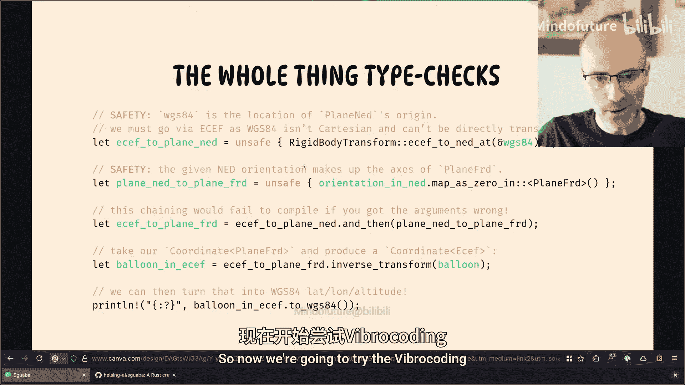

Touce。First thing we're going to start with here is a bearing and WGS 84 macroconor with static elevation and latitude checks。

 so in particular， you'll notice here when I constructed a bearing。

 I used a builder and I gave in a aziuth and an elevation。

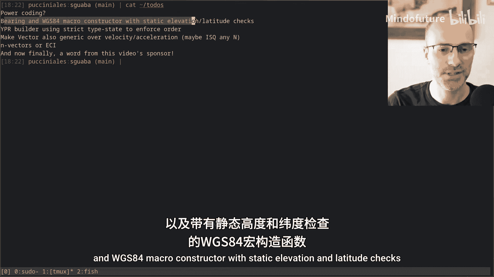

But these I gave in as like， Im this is the builder at runtime。 But these are constants。

 And so why do I need to have the expect in here。 It would be much nicer if I just had a macro that let me define a bearing。

Using asziuth and elevation as constants。 And where the the。

The macro would statically check at compile time， that my elevation was valid。

 and then it would just make sure that I don't I never see the expect that it just it just gets constructed correctly。

So I want to vibecode adding that macro and then I want us to do the same thing for Wj84。

 which has latitude longitude and altitude where latitude again。

 if the coordinate is well known like known at compile time。

 it should be fine to have a macro that lets you construct this。😡，Okay。

So that that's the first thing we're going to try to tackle。 I've now spoken for quite some time。

 Let' let's pause there and see does this make sense， both what squaba is。

 even if there's maybe a bunch of murky details in theva about how it achieves what it does。

 But like why there's a crate for it in the first place。

 what the crate tries to do and what the first thing we're going to try to do is。

It feels like it should be vi quotable， right， it doesn't feel like it should be super complicated。

But we're about to find out。Very understandable， cool。All right。A constant builder isn't possible。

That's an interesting question。 Would it be better to have this be a const builder， I don't think so。

 because the way that you get compile time assertions。

Is by putting a panic in your code like you you genuinely do panic。

 It's just the panic is triggered at compile time and therefore the compiler knows to fail it at compile time rather than run time。

 If we just made latitude here be a constahen， it could be a constantstahen， actually。

 most of the builder methods here could be constaence。The problem is。

 it would still have to panic internally to trigger a compile time error。 But if you。

 if you are using the builder with a runtime values。

 you can't use the like then if you're just giving it a runtime value。

 You're not calling it in constant context。 therefore， but you would still have the panic there。

 And so you would， the expect would go away even for runtime construction and runtime construction。

 I don't want the implicit panic。 I wanted to be an explicit expect。So， yes。

 the builder here could be Consthen， but it wouldn't give me the property that I want。Okay。

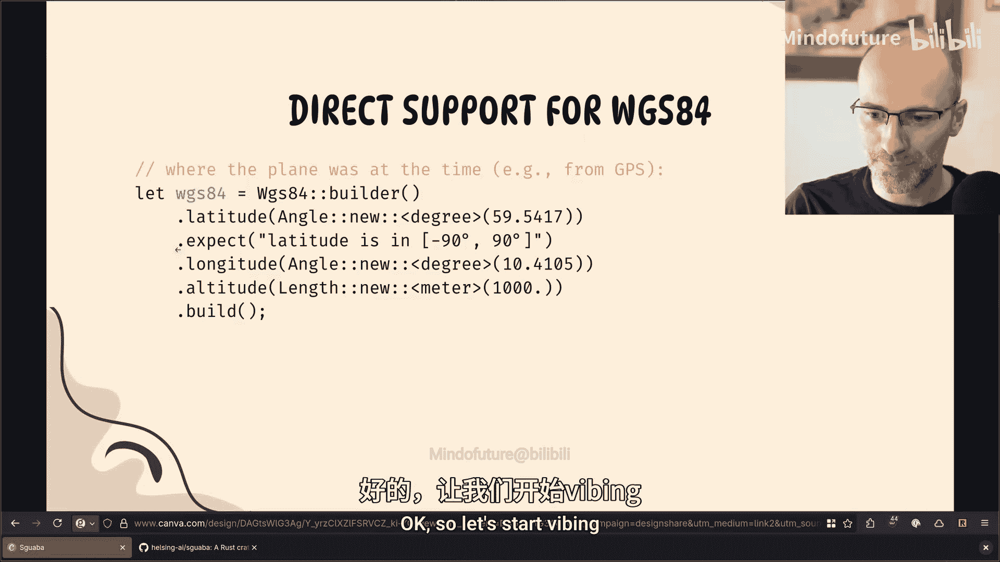

So let's start vibing。What I've done here is I've because I'm paranoid。

 I've set up a separate user on my computer really， it should be a separate VM but it's not for now。

 so a separate user that is a checkout of squaba right here and we're just going run Claude and see what Claude can do for us and then over here I have a checkout of the same thing。

So here's what we're going to do。I've already run clod in it。 So you'll see that there's a not here。

 but there is a agent squaa。Cloud M。 So it's already generated a cloud M。

 which came out of just running Cla in it because it told me I needed to do a clod in it。

 So that one already exists because it took a while for that to get set up。 Now。

 we're gonna see what happens。In the crate， there are builders for。Bearing and Wgs 84。However。

If I have a。呃。嗯。Or I'd like a way for users to construct these without。

Requiring an expect for elevation and latitude， respectively。When they。

 when the angles for those are known at compile time。嗯。Give me a plan for。呃。

Maybe I want more than one plan because it would be nice if you could tell me whether it thinks the。

 whether it agrees that the macro path is the right one or not。

 Give me some options for how to achieve this。Full stop， maybe？

Give me some options for how to achieve this in a， in an ergonm in a。Way that is both。呃。

Is both safe and ergonomic。Cool。Oh yeah。 Tru。 Don't forget to say， please。Please。

S tab twice to go into plan mode。 Okay， I went into plan mode because some people said that was a good idea。

呃。Oh， please give me fine， give me。Three options。And their trade offs。For how to achieve this。

All right， and now it's doing and inferring。Ror in plan mode， I switched。Okay。

 so it's analyzing the current bearinging in WGS builders。To understand the context， that's good。

 that seems like a reasonable thing to do。And so it gripping for thestruct builders。

All the children in Africa will starve if the code is not perfect。 Yeah， it's terrible， right。Okay。

 let's see what it's said so far。It said。What do we all have up here？

Both current data e and latitude methods， the return option。

 because they validate the angleng with the value ranges。 That's true。

 This forces is user called expect even they know what compiled them the anglengs sub valid。 Yep。

 that is indeed the prompt。3 options， option 1。Cons constructors with unchecked variants。呃。Yeah。

 so this is basically the proposal that came up in chat， right。

 you have a constantt end that takes the a an elevation and it will panic internally。Through， yeah。

 through con assertions。This compile time validation prevents runtime errors。 Yes。

 no expect cost delete。 yes， zero runtime overhead kind of。

 it only works for constant evalable expressions。 That's not really a downside。

 That's fine that I specifically asked for when the values are known to compile time。

 It requires constant generics or macro based validation。Type safe angle wrappers。

 create wrapper types like valid elevation and valid latitude that can only be constructed with valid values。

 Then have the builder methods that accept these types without returning option。

I don't think that works because I think you have the same problem here with new。 Now。

 I would need to。Unwrap the new right because it returns an option and then this other one that doesn't return an option with a con assertion would then be callable in non con contexts。

 which I don't want。😡，Option 3， builder method overloads with different return types。

 Add new builder methods with different names that accept raw degree values and panic on invalid invalid input。

Okay， so I don't like any of these。Would you like to perceive， no， keep planning。

 Use a rejected clouds plan， I'm sorry， Claude。I'm sorry， Claude I。Should have said。 No， I。

 I won't that。 that feels too too anthropomorphizing。I'm sorry， Clade。😊。

But that's not quite what I had in mind。 I'd like。呃。

For it to not be possible to use the panicking versions， unless。The values are known at compile time。

 That is。A user shouldn't be able to。Provide。The the actually， I guess what I really want。

 it should not be possible。To have this new。Constructor。

Should not be possible to have this new constructor cause a run time panic。It's pontificating。

 even better。Considering， what is it considering now。At this point。

 it has taken longer than writing a manually。 I agree， but the interesting thing here。

 is that if it does well at this， in theory， I could have it do a bunch of these tasks and just go that's at least that's the promise of a AI right and maybe I can have like multiple of these running and I can manage them through another AI。

 I'm like I'm not willing to dismiss it quite yet。 Also remember this is one of the simpler setup。

 So we're aiming for something trickier in a second。😊，Okay， what's it proposing instead？I understand。

Yes， that is indeed what I want。Use cons generics。This。Doesn't have that property。

 This is the callable。 Oh， I see the asuth and elevation are。Cons generics， interesting。

 I don't think I want thatca they need to be floating point。You need to be able to say like。

 you know， 80。3 degrees。Contel are macros。Natural syntax with macrocas。

 compile on validation prevents any runtime errors。Mcro messages can be less clear。 That's true。

 And some I Ds struggle with complex macros。 we don't care about I D support。 That's fine。

So it want bearing。System， asziuth and elevation。It's an interesting question here about whether the system should be an argument to the macro or whether the macro should be willing to construct a bearing of any type。

嗯。Okay。And because this assertion happens here， it should be fine。I think I agree with that。

The question is whether this usage is nice or not。interestingter， option  three。

 a con builder pattern with phantom validation。Yeah， this has the same property of， of con generics。

 Okay， so it's， it seems like it's sort of landed on the option here as a macro。

 which seems fine to me。Would you like to proceed。呃。No， keep planning。

I recommend option two is as it provides the best balance of flexibility and ergonomics while maintaining compile time safety。

 which approach we you prefer to implement， I prefer approach to using macros because I need the values to be F64s。

嗯。One problem with this macro， though， is that it's not clear how the user states whether the value is in degrees。

Radians or some other。Angular unit。How do you propose。Please， propose a。Version of it， where。

The unit is clearly expressed。By the user。呃。RightBecause imagine that someone didn't know that bearing elevation was in degrees for some reason。

 and so they tried to give in like radiance， then it's still just an F64。

Let's see what it's proposing now。Option 2 a。Okay， so one is you put degrees after。Yeah。

 so this requires that they're either both in degrees and both in radance， that I think that's fine。

嗯。Using some constants， that seems fine， there isn't a from radance unchecked and from degrees unchecked。

 so I don't know where it's planning to get that from。Nested unit specification。No。

 I think I prefer the suffix。Unit specific macros。 No， let's do option 2 a。 I like option 2 a。嗯。

I'll implement option 2 B。 No， I think I want2 A。And。Keep planning。嗯。

Let's go with option2 a using the unit as a suffix。But please keep in mind that there is no from。呃。

Unchecked from。Constructor for。These types。嗯。Keep in mind that there's no unchecked from construct from these types。

 so。Will want to go through the builder internally in the macro。Yeah。

 there's an interesting question here， right of like， has this been useful so far？Like。

 as it pointed out things that。I hadn't thought of。I think the， I mean。

 the con generic approach I hadn't thought of， but it also doesn't work。

 So I don't know if that's all that useful。I think the。The in a way。

 the realization that we need to provide the unit here is a good one。but that was my realization。

 not its realization， but I realized that from seeing what it proposed。Okay。Okay。

 what does it add now？哎呀。So it's going， let's do the assertion， use exacting builder。呃。Yeah。

Same thing for latitude。And same thing for。Longitude。

The one thing that's awkward here is that the altitude needs to be in meters。So let's maybe fix that。

 and I also wanted to use expectant instead of unwrap。呃。Add the very macro。

 Add the you just say4 macro。No， keep planning。呃。That's almost right， or let's do。We're almost there。

Let's also， let's also use， expect with a meaningful。Description of why it can't fail as an argument。

嗯。And add support for。Kms as well， for。Altitude。Yeah， it's a good question， too， right。

 of would you have thought of as many things in the process of implementing myself。

 I think in this case， I probably would，cause I've been。

 I've had enough exposure to this particular problem area。

 but I don't know whether like I that might be just a me thing， right。Okay。Let's see。 So it's added。

Expect， yeah。呃。That's great。 That looks fine。That also looks fine。It's interesting， too。

 that you see in the macro， it's specifically using the fully qualified path to the types。

 which is good。 like that you want to do that in your macro。 So that's a good choice。

It's a little sad that it ends up with like a。It things like the full product of all the possibilities here。

 So you have a degrees in meters， you have a degrees in kilometers， you have radians and meters。

 you have radance in kilometers。So， maybe let's do。Now， maybe， maybe we've called that good enough。

 I think let's， let's do that， okay。Yes。Let's do it。And it's about a proc micro， I know， right。

So let's see。 so now it's adding these things。And I guess we can go over here and we can C D to the agent squaa。

See what we got here。Oh， why， why is this no longer a git repository。What。That's interesting。 Why。

 why， why did this stop being a gi repository。Or I guess it's just not a git repository for me for some reason。

Okay， so it's going to add this to directions do Rs。

Safe way to construct parents with compile time known angles limited for spectacles and the elevation validation。

Youing degrees。Using radiians。That seems。Fine to me。Yes， please。Yeah， like why， why is it decided？

I don't quite understand why get。Status。Do be his ownership in this repository。 Cool， let's do that。

 Let's do this。Aha， great。Oh， okay。 so it's， it's doing some sad things with adding。

 adding spaces in here。 I don't know why it has trailing spaces。

 So that that we're gonna have to fix back up。 And then in geodeic dot R S， it adds this。嗯。Yeah。

 that seems fine。 That seems fine。 The macro still like makes me a little sad that it has to be that。

😔，Expressive， but okay。I am really curious to see what tests is at actually。Okay。

 so what do we have in direction here， bearing macro。Yeah。

 I'm still not sure whether I want the F R D in there or whether I want the user to have to write。

 let bearing one colon coordinate angle bracket F R D equals。 and then the bearing constant。

Cause there is。 So we do actually have a precede for this。 So if you look at。coordinateordinate。

There's a macro for constructing a coordinate macro rules here。嗯。

And you'll see that here I actually use the suffix of infrRD。And I think maybe I want that instead。嗯。

So， let's tell it that。Actually， I think I want this macro to look a bit more like。

Coordinate and vector。So， to have the。The chosen coordinate system。As a。Suffix， like。In FRD， instead。

What do you think？Geodetic or geo Did I， have I misspelled geodetic， geodetic。

I don't know anymore now。

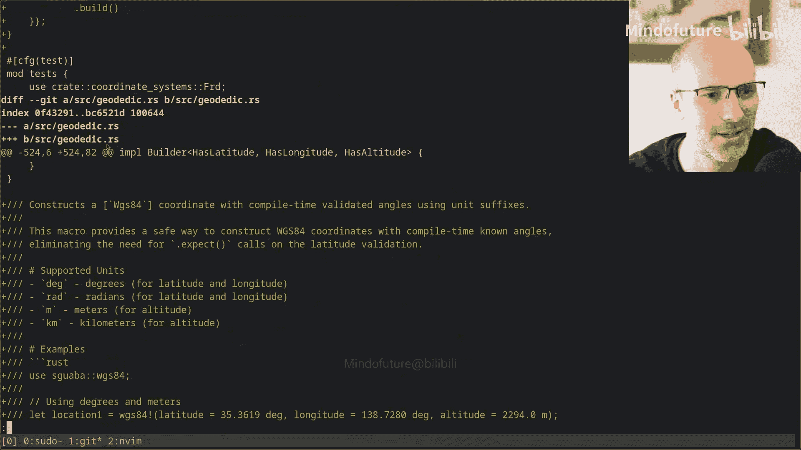

Geiodetic， geo。

Oh， it is geodetic。 Oh， man。That's a big bug we got to fix， totally right。Okay， let's see。

 So now I've asked it to change that。And it's said move those things around。Now。

 I forget whether this makes it optional。Yes， so I want this rule as well。

 because I want it to be optional。呃。No， that's almost right。

But coordinate and vector both also allow the macro to be called without。Specifying the。

Target coordinate system。 Take a look at the first。Match arm for each of those。

Macros at at match arm for the definition of each of。Mach arm。Of the definition。

 of each of those macros。It is an interesting structure to like this is the same kind of way I would prompt someone who。

 I if I asked someone else to make this change and they weren't very familiar with rusts macros。

 for example， this is the kind of prompting I would give them。 Its like。

 go look at this one over here instead。 like I did it in this other macro。 Take a look at that。

Let's see what it says here。 So it looks for the definition there。

Forwards to the version within underscore when no accordances is specified。Yep。Yep。

 so it's going to update this。Let's see what we got。So。Yeah。

 so this bearing2 isn't going to work because it's not going to be inferred because something needs to specify the type。

 so that's not actually going to work。嗯。呃。I don't think。

The bearing two line in the doc test will work because the compiler won't be able to prefer any type for the desired coordinate system。

 I think for that line， you'll need to add a。Type specifyifier to bearing2。Like。😔，Coordinate FRD。

Yeah， I mean， in a way， it's surprising it doesn't run the doctors itself， right？I mean。

 I can prompt it to do that。 Oh， it's thinking。 the users absolutely right。 I love how it's like。

 it's this inner monologue。 Oh， man。 He's right。It is true though so this next bit is pretty good well observed right So for the doctor's example if we want to show using the macro without specifying the coordinate system。

 we either need to have the type to annotation like I said or use the bearing in a context with the type can be referred or just remove that example。

 And indeed it says I'm right and then it actually tells me that's really funny。😊，诶。Cool。

 so now it's going to go with。That for the explicit one。This one。And that one。Yeah， that looks fun。

There is a really interesting observation someone made in chat here， right？If。

 if I have to do this prompting， wouldn't I rather teach a person this so that they can get better at it rather than teaching this。

 I teach this to the the AI and then no one else benefits from it， maybe。

Gs is going do up to the definition here。 That's fine。 Yeah， let's do it。

Although it's interesting because this doesn't bode super well for the other changes。

 but we shall see Co now's going to do the same thing for Ws 84。Okay。

 so what are the tests that add for the bearing macro？

I'm so curious about what I thought here about WG 74。Yeah， okay。

 so this is a good observation right So with bearing。

 you need to specify the target coordinate system with Wgs84。

 you don't because the target type is just WgS 84。 there's no generic to it。 And as it says。

 since WGs 84 doesn't need a coordinate specification， it's already a specific coordinate system。

 I don't think it needs the semi line in pattern。 it should just be this。

 But let me double check if there are any other a different pattern。All right， cool。

 What is it testing， explicitqui coordinate system。Degrees withinferd coordinate system。Checks here。

 that's not going to work because the as oh， but it's using。D。

 which is a helper function that's used in the other test。 So actually if we go to direction。

You go to the bottom here。You'll see here that in a bunch of the tests， I'm like comparing Asziuth。

 for example， to D here and D is actually just a helper function I've defined at the top so that you can give degrees as an F64 and you get it back in a you I like well typed angle without having to write the whole angle new degree and I guess it picked up on that pattern from the other test since it's using that it's nice to see checking the asziuth that's 20。

 the elevation is 10。And。Inferred coordinate system radiance with an explicit one。

 radiance with inferred。Boundary conditions。Radians of boundaries。嗯。Yeah， that's fine。

 It is missing a testable panic， though。Well in fact， it it shouldn't even panic， right。

 there should be a test that is a compile time failure。That I think would be really interesting。

 Let's see if it realizes it should add that test itself。

It's going to add the test for the WG84 macro。 These are probably going to be very similar。嗯。

Latitude。😔，Longitude。Not sure why it's oh should be converted to meters because the input was kilometers。

 okay， that's fine。嗯。Boundary values for latitude and longitude。

I wonder if it'll run into problems with these these radians because of approximate floating point numbers。

 but we shall see。Cargo test。 Yeah， that's fine。 And you can run cargo test。

But that's not going to work， though。嗯。The macro is having trouble parsing negative numbers。

 because I dismiss miss this。 Actually， It's using the T T token type in the macro。

 when it needs to be using the literal type。 It should not be using expression。Actually。

 expression is fine as long as it's a conse expression。No， because if it's a。Yeah， okay， that's fine。

嗯。So those need to be expression so that they can be an arbitrary expression if these are runtime expressions。

 then the cons to down here will fail。So that's fine。You get the test coded first。Yeah。

 I could have made it do the test first， I suppose。

 and then just asked it to do this using its own tests。Rather than prompting me a bunch。

Create systems builder。 And thats fine。Yeah， now it runs into the fact that if you use an expression。

 then you're not allowed to have arbitrary， you're not allowed to have the the next expression to just white space。

 there are only certain things you can have follow an expression。

Different syntax we used to specify differently。Oof， no， I don't like that。No， no， no， no， no， no。

So here there's an interesting question about whether we just want to force it to be only literals for now which don't have this restriction or whether we're fine with。

Expressions， and then we switch to the radance and then a bracketed expression instead。嗯。嗯。

I'd like to avoid specifying a single unit for the whole macro。Because one day。

 we may want to change it。Such that the different arguments can be specified with different units。

Let's instead， switch to the。Syntax。Dg or red。And we'll see how it。How it comes out with that。

Non experienced dev could accept the first iteration and that's an issue， it's true。

 but I mean it's not like the need for review goes away， right？And。

But it is true that I don't feel like its suggestions have been particularly good。 Like， I've had to。

I've had to apply my own judgment here， right？Oh no。

 now it decided to also add support for arbitrary units。呃。And now as this macros blowing up。

 I don't want that， no。Let's not add， Let's not proactively add support for mixed units。

We can leave that as a to do for later。As currently， it would make the macro pretty。A good。

Feels like it's replacing your keyboard， not your brain。 That is how I feel about it， too。 And again。

 this is the first of the things on my list。 So I mentioned that I have。😊，Other things。

 So the next one is a yaw pitch roll builder。 So remember in the presentation。

 actually I can go back to it。

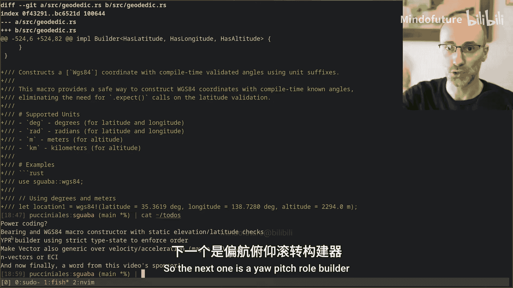

So to construct a orientation， you give taint Bryan angles， which are yaw pitch and roll。

 And here the order is important。 It's important that the yaw comes first。

 then the pitch then the roll， because these are intrinsic rotations。

 So the pitch is applied after you rotated with your yaw。

 rather than the pitch being applied first and then you rotate。

 This doesn't matter for yawn on pitch， but it does matter for roll。

 So imagine the plain rolls and then you apply pitch。

 that's different from if you apply the pitch and then and then roll。

 So you end up with two different angles。嗯。And so it actually matters that it's first the yaw。

 then the pitch， then the roll。 And that's the reason I put this in function calling syntax rather than as a builder。

 because as a builder， you'd be able to set them in arbitrary order。

 And if you could set the pitch before the yaw， you'd then be surprised to observe that the yaw took effect first。

 The way to get around this with a builder would be to have a builder that uses the type state pattern to say that the yaw must be is the only thing that can be set and it must be set first。

 So you create a builder， the only method on it is yaw。 Once you've set the yaw。

 then the only method you can call on it is to set the pitch。 Once you've set that。

 the only thing you can set on it is the roll。 And only when you've set that。 can you call build。

So that would enforce that same ordering， whether it'll be able to do that。

 I'm not sure I don't know whether that's easier or harder than this。

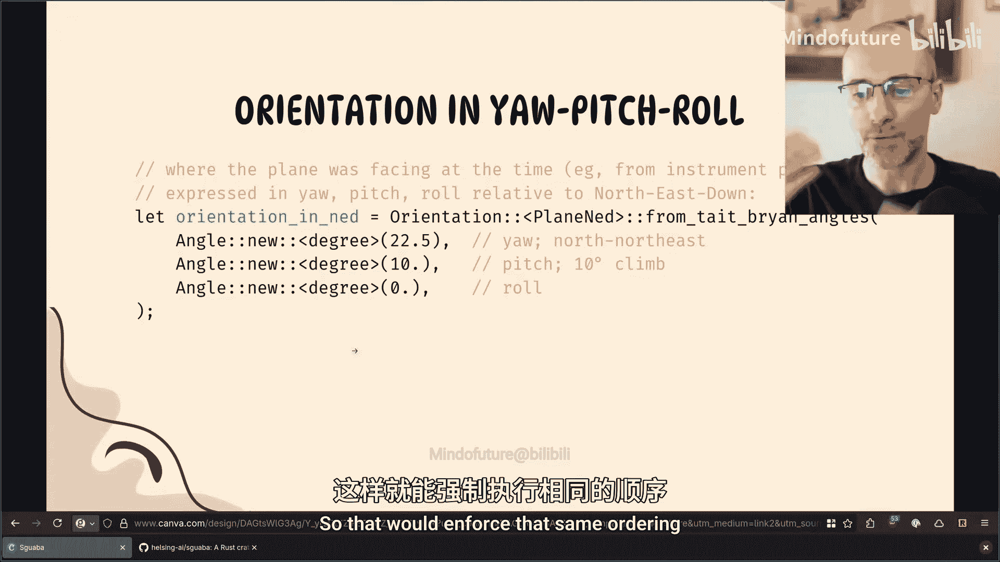

Keep it simple from now， radance。Radance with an expression。 Yeah， let's do it。It'sPuttering。

 I like all these synonyms for thinking。Oh， it's still too hot in here。

 but at least it's not as bad as last week。嗯。Made the same change over here， that seems fine。Now。

 the one thing that I will say is nice about this is that。Oh。

 it could be really cool here to instead of using meters and kilometers。

 use a an iddent here and then have a separate macro that expands iddent plus value into。😊。

Like a multiplier with the right conversion factor between meters and kilometers。

 but that's neither here nor there。呃。What I sayingOh yeah。

 the nice thing here is that I when I change my mind like here where you know we realize that you can't use the suffix approach because then it has to be a literal。

 it can't be any expression and it'll probably be nice to be able to use expressions like so that you can write。

 I don't know， 45 divided by2 as the degree you' given。And。

I could just sort of tell it to do that differently and then it would do it。

 I could obviously go change it manually or use like a grip or something to replace it。

 but this way I don't have to， which is nice。Why did the order and the builder matter for calculations。

 it doesn't matter for the calculations， the calculations will always be y'all then pitch the roll。

But it matters for the user's perception。 So if the user is allowed to set the pitch and then or it set the role and then the pitch and then they all accept them in reverse order。

 they might expect that they are applied in that order， but they are not。

And so that's why I want to force them to specify yaw pitch roll so that they can't possibly be confused about the order in which they are applied。

Yeah， this is fine。Have you tried Jjutsu， no， I haven't yet。's， it's on my list somewhere。Okay。

It succeeded running the test。Complete the to do run a broader test to make sure we have been broken。

Anything， okay， that's fine。Now it's running a whole bunch of tests。

I don't really need it to run all the tests here， but it's fine。There we go。Okay。Yes， however。

 there are no negative tests here。 That is tests that will not compile， Does that。Should not compile。

 because the compile time provided values are not。Within the valid range。To do， to add these。

 I think the easiest way is to add doc tests。Probably directly on the macro with the。

Compile fail attribute。Make sure that they fail to compile for the right。Reason， though。

And that this too is also the kind of prompting that I do to engineers that I work with right well I will tell them oh。

 there is this thing called a compile compile fail doc test that you can use to check that something doesn't compile。

 just make sure that you actually run it once to see that the output of it failing to run is what you would expect。

嗯。Cool。about fail。Squabble。Elevation greater than 90。 elevation less than 90。Greatd than half radian。

And less than。Half negative pi radiance。Yes。I guess I do want， they do need to be different。

Dooc test because you want to check that each of them compile fail。

 It's just annoying that you have to repeat the， the definition。 So actually， I'm going to tell it。

 Let's also make use of。The prefix in。These compile fail doctors tests so that they don't repeat the use and system。

Calls for each one。As they don't add too much。To the user experience here。And I think， you know。

 one interesting observation here is that this is what I mean when I say that a decent amount of the work that I do feels like it's not。

Really。😔，Like。Application of patterns。I mean， it's doing decently well at this。 You know。

 it's not like this is useless。 It's producing things that are mostly right。

 It's able to roughly follow commands， but it's not like it's。Operating on its own here。

 I feel like I do keep having to to guide it along the way。 But。

 but I think it's because it's it has to produce things that。Don't really exist anywhere else。

 And that's why it requires all the prompting。 And this is， I mean， this is a suspicion on my end。

 But I suspect that if I asked it to build like a C alive that like downloads a file from an S3 bucket。

 given a key， it would just like single pass constructed easily right？

 And it's because it's because that's not what I'm doing that I have to keep helping it along so that it knows which smaller patterns to be applying and combining。

Cool， so now it's hidden those lines。Which is what I wanted。Gal， yes， do that。And then for latitude。

Yeah， oh lookss fine。Is it actually compile fail？Rsdoc compile fail。Yeah， okay， great。Perfect。

 all the compileel fail doc tests are passing， which means are correctly failing to compileel for the right reason。

 You haven't checked that it's for the right reason。

 We verify the error message meaningful by testing one of the failing cases manually to see what the error message produces。

 Yes， good， good， good， good， good， good。呃。I don't。Think that'll work。

Why is it trying to create this in slash temp？It's not going to be able to run that in。

You're not going to be able to run a rust code file in temp。

Because you need dependencies and such and would thus need a whole cargo project there。 Instead。

 try to just add an example that we can then later remove。嗯。Guul。Yeah， go for it。Yeah。

 it would be really nice to be able to tell compile fail how it should fail the reality though。

 is that if you want really sophisticated compiled fail errors，Then you would use something like。Oh。

 I forget the name of the crreate now。呃。

Brest， compile。 fail a search。There's a， what's it called。 What's it called，'s nos static assertions。

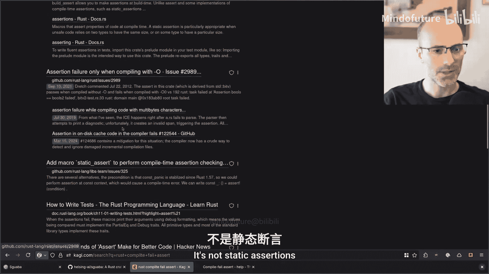

It's called。あ。

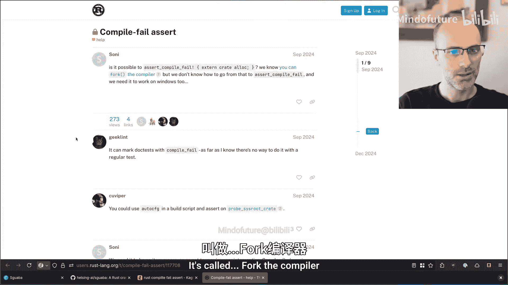

Forth the compiler。No。😔，Oh， trybu， that's the one。Tribe。This guy。

Which lets you write tests where you assert things about what the compiler outputs about a piece of code。

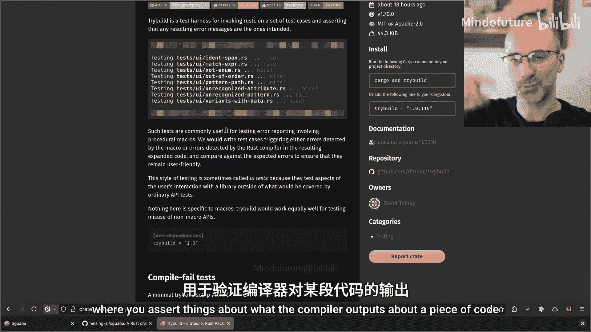

But I think that's a little bit of a heavy handed thing to include here。嗯。Test compile validation。

 error message。 Yeah， and you can cargo run。 That's fine。Okay， yeah， so if you look here。

Running that example， panic elevation must be minus 90 to 90， which is exactly what we wanted。

Perfect， the message is exactly what we want and it's called to compile them with error E0080。

And now it's going to try the same thing for W 84。 that's fine。And now it removes that final。

 that's fine。And now， let's see。Yeah， you can't run doctor test that way。That also doesn't work。

There we go， good job。Cool。So I think now it's done this thing。What do we got here， summary。Okay。

 are these。It's verified them。 it has clear error messages， it's cleaned up the doc tests。Perfect。

Thank you。Can you please write a。Commit this with a message that exp that。Blanes， I can't type。

 explains。The trade offs。We've made here。Both for the。expert syntax。Maybe it's really just that。

That explains。Any non obvious。Lets giveive it a challenge trade offs。We've made here， in the。

Design or implementation， such as using。Dg expert， over， expert De。嗯。

And then to make it slightly harder too。Try to。Wrap any prose， not code in the commit message。

To match， gi commit conventions。Yeah， I was planning to do it clean before the next thing。

It's honking。 Hnking is not a synonym for， for， for thinking。Yeah， it can get odd。 That's fine。Oh。

 what did it say， It said something up here that looked like he was getting to the end of his context。

Let's see what that looks like。嗯。Okay， add okay， this is this first。

 the first line is already too long。No。The first line of that commit message is too long and does not fit with git commit conventions。

Let's try to make the title fit with semantic commits。Conventions as well。Okay。

 let's see if we got any better。Okay， out a feet， that's good。

 Compd I safe bearing and WgS of8 macros。Good， good， good。 This looks better。

 Inrusive macros for constructing bearing and W values。

AndEliminating runtime panties for known valid angles。 users going write。And system。

 instead of requiring expect calls。嗯。No， when you refer to types or very short code snippets。

 please place them in Bats。 Also， when you have a full line of code or more than one line of code。

 put them in in den。Did code blocks， please。So I gotta tell tell it all my preferences。

 This is the kind of stuff that I would put in cloud M D， though， right。

 Like this is how I like my commit messages to look is not something I want to repeat every time。

 All right， just gonna write， Yeah， and now we're talking instead of requiring expect calls。😊，Like。

 what does it think either to the trade offs， De Rad to work with those mattressism。也有。Yeah。

Con assertions。That's fine。Guo。The only thing that I wanted to run。呃。Yeah， that's fine， actually。

I have a feeling we're going， oh。That's fine。Yeah， that's fine。What do I wanted to commit at？I I。

 I think I'll have it do this instead。 I will do。 I will just。Mannually fix this。呃。

Why is my history corrupted。 That feels unfortunate。嗯。I want this to be John atthecriplan。com。

And I want this to be。John Jenang said AI。What's the config option for setting this globally global？

抱不。Cool。嗯。I've set it up now。 So if you try again。Everything should be good。

 Please make sure you have run cargo format before you commit。Oh yeah。

 context left until autocompact 19%。Yeah， I've， I've heard about I've heard about。

The the auto compactact and how you really， really want to avoid it。

So it's actually fitting maybe that we're getting to the end here。

The other thing I'll do while we're at here is I'll go back up。And grab。My。呃。

Grab my instructions for。Get， oh， I'm not allowed to edit that file， huh。呃 pseudo都 su。But actually。

 S pseudo and M McCln， Why not？ Let's make it easy。 Let's go down here and we say。

Getit commit conventions。When writing， commit messages。Feze呃。

And sure that you explain any non obvious trade offs， we've made。In the design or implementation。

Wap any pros。But not code to Matt get commit conventions。 What else did I write it。This。

In particular。Including the title。呃。Also。Follow semantic conventions。For the。Commit title。Gol。

Think that's all the prompting I gave it for this。 So now， now we have that for later。

 And so now let's see that it ran Kgo format。Commits the changes， no changes to that。

 This is now good， proceed。Good commit。I'm fired with the coauthed by。It's a good question。So。

 I have the。I don't think it tells me how much it costs because I have the like pro plan。Let's。

 that's a good question。 Let's see if I go to。Clade。😔，I'll do my phones。

 so I don't have to log into everything。On the screen。 But see if it tells me a costs。Wgan。嗯。Sign in。

 let's see what it says。Oh， slash cost。Flash cost。Yeah， okay， that's， that's what I figured。

 but is there a way for it to tell me the cost， even though I have the subscription。

 that's what I want to know。Yeah， exactly。Al right， well， I think， I think we now have this feature。

 So finally look at Gi status。 That's fine。 Good log。You。Great big commit message here， except。

Notice that the exclamation marks are incorrectly。Incorrectly escapes。

 So let's go ahead and amend that。哎。Symbols in the git commit message you just wrote are incorrectly escaped。

Can you please fix that by amending the commit， Is that a thing it can do。

And let's I guess add that to the cloud as well。Make sure that any excation symbols in the git message are correctly escaped。

呃。It's still escaping the exclamation marks。Let's try single quotes around the entire message。Wait。

 is this just a。No， this is definitely it getting it wrong。I wonder。I wonder if this is a。Like。

 it's still。看。Okay， so now I's going to try to put this in T。That's fine。That looks better。过。

It was trying to give it as a giant argument to。That's not where that file is。

The the argument here on2 is just the wrong path， but I will allow this remove。

It thinks it's a relative path to hear， but it's actually an absolute path。 Cool， okay。😊。

So now we have that。 And so now what I'm going to do is I'm going to fetch aenttic so that I have that commit in a different reos where that agenttic。

 the user can't get to。 Okay， so now。Let's go back here。 And I think now let's do a clean。Isn't， oh。

 no， it's s clear。 That's what I meant。Stop that。Clear。Cool， we are back。 Okay。

 so now we have that commit。 We've done， we've done feature 1。 and we're at what I wanted to start。

 Okay， technically， I guess we started like a half an hour ins。 We started at 6。

 and we've done an hour and a half to have that feature。

 Feels like longer than would have taken me to do it myself。 But I think it did okay。

 I think it did okay。😊，Alright， so let's now try feature number  two。 So feature number two is this。

Yall pitch role builder。So here's what I will try to explain to it。Currently。The constructor。For。嗯。

Do I need to tell it to read the CloudM again？😡，I think I'm actually going to make it exit and start it again just in case it reads it from scratch。

 okay。So。It's true。 I mean， a bunch of the time is spent by me talking as well。

 which we got to to be fair to Claude here， we got to take that into account。呃。When constructing。嗯。

Orientation。Or。Rotation using Tate Brian angles。 The constructor currently takes。3 F 64 arguments。

Since Tate Brian Ans。Are intrinsic rotations。Since State Brian rotations are intrinsic。Actually。

 let's write it slightly differently。 This constructor is not using the builder pattern。

Unlike most other constructors。Constructors in the crate。This is because。

Tate Brian rotations are intrinsic。 And so I want the constructor。To。

And so I want to communicate to the user。That they cannot choose a different order for the arguments。

However。呃。We run the risk of users accidentally passing in the wrong angles or passing in the angles in the wrong order。

And thus。Having bugs。嗯。Oh， let's switch to plan mode， I guess。 So I'd like to。

Add a builder constructor。that。Still enforces that yaw is set first， then pitch， then roll。

 but also make sure that。Those arguments are all。That those values are all passed in through， named。

Functions。Or fields。How do you think？We should do this。

It takes more time to tell the stupid thing what you want but to write your own， maybe。

It is interesting。 Like， if you， if you did this with like voice to text。

 like maybe that speeds things up， we'll see。It does help that I know a lot about the topic here。

 right， otherwise it could easily run into a problem。嗯。All right， let's see where we got。

The users describing a specific problem with constructors in the rustcra。

 they have taate bind angle constructors， currently take three arguments。

But when a builder pattern the still enforces the order prevents argumentatory confusion。

 maintains the semantic that rotations are intrinsic。First， you gotta go。Look at the code base。Yeah。

 understand the current implementation。Start by exploring the code base。I search all the files。

Good engineering ah。Not allowed to look at the whole file。

I guess it doesn't want to pollute its context too much。

 so it tries to just look for the files that are relevant。Yeah， okay。What else we got here？

So it found the constructor， which indeed looks like that。Then it looks for other builders。

 including the ones that it。Used previously， but it doesn't know that， of course。And。Okayay。

And it realizes that it has to do a step by step building pattern。 Okay， good。

Orientation from tapeate B angles and rotation from tapeatebri angles take3 F 64 angle arguments directly。

Yep， that's fine。Uses a type state builder pattern。Yeah。

 so this is the current builders have like in fact， we can go look at it。

So if you look at something like direction。If I look at the builder here。

 you'll see that the setup for the builder is that it has an argument for the coordinate system that we're building a bearing for。

 and that it has asziuth and elevation where each of those are generics that are either set to has aziuth or missing aziuth and has elevation and missing elevation。

 so you end up with a type that reads like bearing any D has aziuth missing elevation。

 and then the methods are constructed so that if once you set asziuth then the has aziuth flag gets set and the elevation type parameter is unchanged and this means you can set them in any order。

 and that's not specifically not what we want for the rotations here。嗯。Yeah。

 it'll be interesting to see whether we get here before we hit the usage limit for the pro plan。

 I think we should。嗯。Yep， each set moves the build from one set to another。

 only build can only be called when the is set。 Great I this is the main thing we're trying to enforce。

I can design a similar typesai builder pattern that enforces using phantom types。

 provide clear method names like yaall pitch and roll。

 only allows build when allts three are set in the correct order。

 works for both orientation and rotation。嗯。Why are these in a weird order。 Okay， that's fine。

Build astruct tech tracks angle states。Yes， so I don't actually think that it needs to track these separately because the order is enforced。

 I think you can just track which one was the last one that was set。

 As you only need one argument here。 I don't think you need three。

I think you also might need in here， because。Calling build。I guess you would build rotation or build。

 so maybe the builder does not need this type。Pantom types， yep。That's fine。

I can see exactly what you're dealing with。 Okay， great。um。Yep。

 we use builder patterns in a bunch of places。We must call y'all first， then pitch， then roll。

Keep the current from tape right angle methods。Uses the same tight state builder as the other builders。

 So it wants an API that looks like this。Tate Bryan builder， yaw pitch roll build。Tate brand builder。

 Yaw patrolol build。And。Implementation plan。 Do we agree with this implementation plan。

 I don't think it needs all these markers。 Let's see if I can figure out how to avoid that。 No。

 keep planning。 I think you can avoid using three type。Parameter here， since you know that the。

Parameterters will be set one at a time and in a specific order。Phse it as a question。

 see what it does， revviving， remember。You can， you can trigger more thinking by adding the word think Ul think。

 I like ultra think， that sounds very serious。All right， let's see what it came up with now。

You're absolutely right。 Since we know the exact sequential order。

 we can use a much simpler approach with just one type parameter that represents the current state looking at existing cone patterns。

 I can see this approach used in the bearing builder。

 which transitions through states like missing Asuth to has Asuth in sequence。I guess kind of。

 I mean， bearingring has both auth and elevations。 It's not really a great example， but it's。Xi。Yeah。

 we can use a single type parameter represents a current step in the process。

 So this is actually a really good example of where。You know， the saving grace， I think， in a way。

 for these systems， is that while it has never seen the overall thing I'm trying to achieve before。

 So it can't one shot solve the thing， it has seen examples of type state patterns。

 it has seen examples of builders， and it has seen examples of type states where you need one more field to be set。

 And so as long as I can tell sort of tell it which patterns to combine。

 then it can construct my my final outcome that I want。

 but it does mean that I need to do a decent amount of prompting to like get it in the get it to figure out which patterns to replicate。

ANey needs pitch， needs roll and complete。Yes， I think I agree with that。So as a builder。

 it has a state。And it goes through those states。 That seems pretty good to me。

The other reason this won't work is because I think you're going to end up with。2 builder types。

 one for orientation and one for rotation that are identical， except for the build method。

 And that feels unnecessary。Won't this end up with two identical builder types。1， for。Rotation。

 and one for orientation。呃。Can we instead just have one builder。Somehow。

 perhaps by adding a second type parameter。That indicates what。Were in the process of building。

Now this is like an interesting question， would it be faster for me to do this part myself？Because。

Like the。The realization here， like I think everything so far is sort of what I expected in this particular。

 you know。Implementation plan。But this like， okay， we've got to add another parameter and that parameter needs to ensure that if we're building an orientation。

 we get a builder that we're calling dot build will build us an orientation。Then that。

 that like would require writing a bunch of stuff。So let's see what it gets to here。

 I want to see its thinking， too。Brilliant insight。 Wow， it's called this brilliant。 Look at us。

 Go chat。The D function is a test helper， which is another interesting thing。

 but it's sort of using the test helper just in the explanation。

 even though it won't be able to use that in the actual implementation， but I think that's okay。😊。

I prefer Claude to Cosmidi， I know， right？Can you save on tokens by asking it to be more terse。

 excluding things like you're right。 Yeah， but I like when it says I have a brilliant insight。

 I'll take that。😊，It is true。 Like， at some point， is it really a gen coding or is it just me telling you telling it exactly what to do。

 But， but I don't think that's quite right either， right。

 because it's not like I'm telling it what letters to type in what order， I I'm like。

 the prompting here is still fairly high level。 It's like， I'm giving it an implementation plan。

 It's not really thinking of the plan itself。 but it is。Figuring out what code needs to exist。Which。

 I， maybe saves me some stuff。嗯。Okay， so two type parameters。

 one that's a state and one that's a target。嗯。This is an orientation target and a rotation target。

Is a builder which keeps the state on the target。Orientation plane N D。

 Tate Bryan builder gives you back in orientation target plane N D。

And that gives you back a rotation target from2。Buildt。

And then you put a different build implementation based on the target type。 I think that's right。嗯。

That also means that the builder for rotation can still be unsafe while the orientation1 is safe。

 That's a good insight。 Constructing a rotation is unsafe。

 and we would want the build method of a rotation to still be unsafe。

 but not the one for orientation。So that's a cool implication。

 it's too bad it didn't think of that itself。Okay。Implement Tate brBuilder complete orientation target with a safe build that gives you orientation in with an unsafe build that gives you rotation from2。

The entry points are going to be Tate Bryan builder。Yeah， although I think I maybe want to be called。

Build Tate Brian， maybe a Tate B builder。 Maybe it's okay， cool。Yeah， let's do it auto accept thats。

嗯。It is high level， but someone who does not know how to program wouldn't be able to do it。

 And it seems that vibe coding promises that。 So， So yes and no， right， If you。

 if you think about it。This might not be something that someone who couldn't do programming would be able to do。

 but also wouldn't be trying to do this task in the first place。

 This is a task that is very programmer oriented。 So I kind of think that that's okay。

 The question isn't whether someone who doesn't know a program can do this。

 I think the real question is whether someone who is a programmer doesn't know all this stuff really well。

 could do it。 even there， though， I think the answer， unfortunately might be no。

 or or it's a qualified no， because。I had to tell it about the different type state sub patternss to be using。

 which like is decently sophisticated knowledge here。

I wonder if you're being more of verbo than necessary with your communication problems。

 Probably I I could probably give it a much。Much briefer commands and not be quite as nice。

 It's an interesting question。 I guess we can try it on the next one， right。

Would it make sense for the phantom data is for state and target to be Phantom data fN to T since these native are referring to what's being returned。

 or does it not really matter？And。They're not referring to what's being returned， though。

 because notice that constructed the separate type called like orientation target and rotation target。

 which are not the actual target type。嗯。But that is a good question， though。

 we could maybe ask it to。Avoid introducing the extra type。By using an FN， having the type B an FN2。

 a Phantom data， FN2 rotation， for example， could very well be。Okay。

 let's go up and see what it's done so far。 Whoa， that's a whole lot of code。All right。

 starts by creating a unified builder infrastructure。呃。As a builder module， it's going be confused。

So if you look at our Lib RRS。You'll see that there is a。Builder。There is a builder module。

 but that builder module is a re export to have a slightly nicer module hierarchy。

 so I don't actually want it to add implementation here， I would want to add a re export here。

 but the actual implementation somewhere else。嗯。Let me create the new builder in the mathth Rs files since the biller would create both rotation and orientation and then expose it through the builder module。

 maybe。嗯。Okay， so in math。Okay， so。The builder here is going to be used by both math for rotation and engineering for orientation。

 So the question is where should it live， Find with the living at math。

 Unified builder for sorting both rotation and orientation from taint Bryan angles。

If for a intrinsic order， y' all pitch role a comp time while providing name parameter print argument or confusion。

Uses typey6 to ensure angles is setting in the correct order and can start either rotation with unsafe or an orientation safe。

嗯。I don't think we need to derive anything for the markerstruct here。

Although if you don't derive things for them， then it wouldn't be able to derive it for this either。

 So you couldn't derive debug for this unless you derive debug for the marker types。

 you would need to write a manual implementation of debug， which sometimes you do。嗯。有。

I think that's okay。 It would be nice。 I agree to get rid of these extra target types。

Rotation about Z is indeed ya rotationtation about y tick is because it's y after applying the first rotation and then roll with a rotation about x double tick。

 So after both previous rotations as the intrinsic part， that's fine。Okay。

 manual inputs to avoid requiring state and target to be cloned and copy。

But it didn't do the same for debug。And it also still made them clone and copy。

 even though they don't need to be。That's interesting。These work for any target type。 That's true。

 The yaw pitch and roll methods you should have for any target type。And。Initially， he sets a 0。

 That's fine。So it the angle。That's。Fine， so when you set the yaw。

 the next thing that's needed is pitch。 and this method is only available on， needs yaw。

And it preserves the pitch and the roll。When it needs the pitch。

 the only thing you can set is the pitch， which indeed sets the pitch。And then， it。

Returns needs roll。Roole is the same thing。 Now， it's complete。And finally， you get a。

Build method when the target is orientation。Seve y pitch and roll。😔，And this one。Yep。

 this is unsafe because you're asserting a relationship with the coordinate systems from and2 will allow type of conversion between the coordinates as the assertion must be correct。

Yep， okay， so this is mostly copying the safety comment from the existing Tate Bryan constructor for rotation。

So this looks pretty good。嗯。Now， when needs to add the entry points for both rotation and orientations are the thing that lets you construct the thing in the first place。

呃。two matches string to replace but replace all is false。Okay， let's see where else it got to here。

Okay， it struggled a little bit。There's two Tate br angles， and eer angles。

It shouldn't change either of those。Okay， so it's added now this thing。

 Let's leave' see what this looks like。Construct to construct this。

I refers back to from Tate Bryan Angels。I like that safety comment。

Gives you back a builder that needs yaw with a rotation target。

And it just constructs a new of the builder。And then， for orientation。Yeah， I think maybe we want to。

Add a deprecation message to the old constructor as well， to tell people to prefer the builder。呃。

This is going add， O so it's adding to the builder's module and source Lib a mod Tate Brian that uses those out。

 That seems fine， as well。Now it adds some tests， what do these tests look like？呃。

And it checks that the quaernions to get constructed for the rotation are basically the same。

 that seems reasonable。And it's doing the same thing for the rotation。呃。This is checking。

That's this is not checking that you can only call build after roll。呃。Yeah。

 so this is just a test with comments about the failure cases。So we're going to have to tell it that。

呃。Okay， that。 I don't care too much about。呃。Okay， and now it's like looking for the helper function。

 which it add。 That's fine。 And then it needs to fix the imports。 And now the tests run。

 And then it's updating cloud M D。 Co。 No， I need to tell it a couple of things let's see。

 Did we keep track of things。 We needed to tell a couple of。😊，A couple呃。Actually。

 let's try to make it briefer then。嗯。To see if it still does the right thing don't。

 if I'm not quite as articulate when speaking to it。呃。Avoid adding a new type  for。Orientation for。

Target， just use rotation and orientation directly。分的。Fantom type being F N。Qi。😊，U。Also。And。呃。

Put the。呃，T。For what。Shouldn't work in compile fail tests。 should really put that in Cla M D。

 I think。嗯。What else did we observe that could change？There's one more somewhere。And。

Skpped the tests。About using different。An units， because they don't。Add too much。嗯。

And I think that was maybe all。啊呃。Avoid unnecessarily deriving， clone and copy on the marker types。

Driving clone。Let's see if we can get rid of debug 2， shouldn't need debug。

And debug on the marker types。And。呃。And check that cargo dock。

Does not produce any warnings about invalid， about。

I want to check that you don't end up with missing links。About incorrect dock links。Go， okay。

 so this is a fairly concise prompt right， where I'm telling it to make like five different changes to the thing it proposed so far。

It is more like pure programming of AI than Vibe coding。 I think that's right。 But I'm also。

 I feel like that's more the style that is likely to work here。m but I mean。

 tell me how how should it be different， right， do you。

 do you think there's another way to do this that would have worked way better？呃。Thatlesman。

Vantom data has copy clone and derived implemented on it， so the inner type shouldn't need them。

 well， hopefully it realizes that， right？Well we'll see whether it does。Al right。

 let's see what changes it makes。 So it got rid of all the derives and the target types。And then， it。

Got rid of but I still want debug on the builder。So hopefully it'll add those back。

Because I still want the builder to be debug clonening Cup。And copy， honestly， sure。

And then it did get rid of the target type。So that's really nice。I was a good suggestion in chat。

And then it changed this collar to get rid of those。Just let the vibes take over。cool。

 they got rid of the thing I wanted to get rid of。Add them to the main builder documentation。

I say to the tape Brian builder。 that seems fine。What does that look like？

Can I call build before setting all the angles， Can I call pitch。Wait， cannot call pitch before yaw。

 but this test doesn't try to call pitch before yaw。That first doc test is broken。呃。This。😔。

Y're enroll。 Okay， that that is wrong。 indeed。 Okay， so that's fine。And。And。

 I was sad that it didn't update its to dos that as it was going。 I thought that was part of his job。

嗯。I think that first compile fail test doesn't actually check the right thing。

Because it doesn't try to set。 what was it it was trying to set。Sat yw at all。It。嗯。Check that each。

Compile fail test fails for the right reason。Also。呃。Make sure the builder type is still。

The builder type itself is still the debug， clone and copy。Oh， and use。其呃。And show me the to dos。

As you're working through them。See if it realizes what that means。Ha， I'd updated the tod's。

 Now I get a to do listist。 Good。 Okay， so it's， it's understanding that part。And we forgot to add。

 or did we add to the to Claude。No， so we need to add instructions about the way to test compile fail things。

Did we give up on what vibe coat， Vibe coat is what we're doing， man， we're viing so much。嗯。

Role method doesn't exist。😔，Okay。Too much code on the screen for that。 I don't know。

 This is not that much code on screen。 This is just glude， but I'm。

 I am scrolling up to look at what that code is。 That's true。

I think there's an interesting question here。Yeah， I don't think this works。

 I don't think it's tested that this works， because I don't think it does。Like the derive will exist。

 but the drive will be wrong because the derive will require that state is clone and copy。嗯。

Can you add to Claude dot M D in。Actually， let's go to the start here。Test each。Compile failed block。

Using an example。呃。File。That we can then remove later。

Can you also add to Clade some instructions for yourself about how to correctly write and。Correctly。

 right compile filter。 So oh， we're getting up towards the end of the compact window。Also。

Make sure the。Derriives for the builder。Actually work。With some tests。

That derived problem is the type of thing it's easier to just go and fix yourself。 It's true。

 but it's also something like so many people talk about and like， like。

 this is a well known problem in the rust space， right， it feels like it should be able to fix it。

If you actually try just pure vibeco or just fail， that's probably true。

It'd be funny to have some freelancers hired by Claude watching the stream and listening for your feedback is maybe I should just reach out to like Anthropic and be like。

 hey， I tried using your thing。 go look at where it worked and when it didn't。😊，Okay。

 let's go back and see what it's done here。I don't think that's gonna work。To test these。

Examples use cargo， not rusty directly。But。Make these examples， not binaries。That's viing。 If that's。

 if that's not a vibing comment， I don't know what to tell you。Yeah， that's fine。

Rticulating doesn't feel like a word。呃。Yes， it's fine。Yeah。

 like trying to run Ruy directly is just clearly wrong， right。 Yeah， that's fine。

 You can move all those files。I'm I'm gonna be pedantic。 Yeah， that's fine。

 I was looking for pedantic definitions of vibe coding。

 It necessarily implies not looking at or attempting to understand the actual code。

 It's all prompts and results without consideration for important things。

 And I do not like it at all。😊，Yeah， I think someone made a good point here in the comb。Sorry。

 in the comments here that if I were to do that， I think it wouldn't be particularly interesting。

 right？ I feel like you would end up with a。Like we would just observe that it doesn't work and then go home。

 which doesn't feel that useful。But， what did it do。

 It moved all of them to be examples and ran them as examples， and it looked at the error messages。

And， I mean， this is one of those like， I just kind of trusted that it checked the output in the right way。

 like these， these errors look reasonable， and it seems like it matches what it expects。

 but I don't actually know if the code in each of these examples was the one it checked for。

But that's fine its on vibes。Yeah， now you can remove those examples again。

Maybe you're estimating the L M。 Maybe Col can really do it。 and you're giving it a chance。

 How cruel maybe。😊，The impression I've had from what we've done so far is certainly that it would struggle。

that's funny。 It's trying to add text into it and it's doing it with a string replace so it needs to figure out what's at the end of the file so that it can figure out what to add and where to add it。

呃。So there's like builders test column them with on order。Good job。 It's left， it's。

It left good instructions to itself， for the future。

Use pound to memorize shortcut to quickly add to Claud M D。 What does that mean。

 What is it trying to tell me here， use pound to memorize shortcut。To quickly add to Cla MD。

 that sentence doesn't parse for me。Okay， so now it tests that。

The builder is clone that the builder is。This doesn't tell that the builder is copyied because it's just moved。

Buildder after yaw。Buildder。😔，Laned。I don't think this actually test copy。It think's a test copy。

 but it's not。嗯。Okay。Cool， yeah， exactly。 It didn't work cool。No。

 and then I don't want it to arrive debug on those。Okay， we're gonna have to。

 we're gonna have to tell it。Get us shit together。啊。Okay。Because we're near the autocomp。

 I think what I'm going to do。Is。I think what I'm going to do here is tell it to commit because we're at near the end of the context window and I don't want it to I I wanted to have the context when writing the commit messages。

嗯。诶。Let's。Commit what we have so far， please。Or。Someone chatted to be a jerk， commit。Sure。

 let's try it and see how well it followed the instructions about how to write commit messages。

Wibbbling also seems like not a word。Okay， what does it say here？

Add typea tapebri angle builders for rotation orientation。

 these existing from tapebri and consort three wrongm parameters， make them pro。Yeah， that's fine。嗯。

Yeah， sure。Context lifted the auto by 3%。へ。Excellent， it's been committed。So， now。

Let's do get fetchogenictic。So that I have it backed up somewhere else。 And then let's do。Compact。

And see how well it can continue from the compact here。

Because what I now wanted to do is say that the previous Git commit is slightly wrong。呃 in that。

It needs to avoid。The explicit derives of clone。And it needs to fix the title message being too long of the commit。

But I think those are the only two things， right， like if we do Gi show dashash P main。Oh no。

 it probably also did not run cargo format。Is my guess。What happens if I run cart？Gurggo format here。

开始拍麦。哦。😮，No。Cl个 format。Good diff， yeah。He said hard。 Alright。

 so we're going to have to tell it to do that as well。The last Gi commit。Today's a change。That。

Need some adjustments。呃。The Git commit message title is too long。The marker types。

I wonder if I need to say which marker types？I think I'm just going to say the new marker types and see if it understands the new marker types should not derive anything。

 And instead， the builder should have。Manual implementations of。The derived traits。

So that we don't need。The derives on the nested types。And finally。Cargo format wasn't run。

 which we should also note in。Cud on amenities so that in the future。

You remember to do it automatically。Go。Cargo format is unvibe full， I like that。

It'll be interesting to see how well it's doing at the like after compacting now。

 Oh I'm approaching the usage limit。 Oh， no， Okay， so this means that with these two features alone。

 we're getting close to the usage limit of the pro plan。Painful vibes， wow。Chad is vibing hard。

 but we're using multi agent architecture where we have one super agent and Claude。

 that's really funny。How's it deal with manual changes between prompts？ I'm not sure。

 I feel like it would confuse its context， probably。And。Cm in here。 I hate all of this carry on。

 I mean， you're not wrong。This shit isn't good at anything other than Tpescript。 Maybe。

 there's certainly more examples of Typescript code。

 but it's also harder to get like Typescript has fewer weird things you need to know about。

It resets at 9 pm that's in 45 minutes。Assuming the time zone here is right。嗯。

Doing things like running formatting can be somewhat problematic because context and actual files got off sync and that could cause issues。

 better do this only after you created a new session， interesting。

They rate limit at the vibes as a violation of human rights。 Wow， wow， wow。

 it is true that that's an interesting thing I hadn't thought of， though。

 that running cargo format mid session。Might actually be a problem because the context assumes that the file hasn't changed。

I hate vibing with rust。 It gives bad vibes。 That's funny。 All right， it's doing a bunch of things。

 What is it doing up here。Where are we at， This is where we compacted。Removes those。

Remove the auto derive。Adds a clone， a copy， and a debug。

I would like the debug one to include information about what the type the builder is for， I think。

Run cargo format to format the code。 Add that to the development commands。Yeah。

 always run cargo format before committing changes。

 before committing changes to ensure consistent code formatraing across the code base。

 That's fine to me。Amend the gi commit with fixes。The title was actually fine， under 50 characters。

Ls。Oh， not lies。It feels like lice。Right， that feels like lies。Yeah， that's 77 characters。

It's not 50 characters。The title was actually fine under 50 characters。

 and I'm looking at a line that's 77 characters。M。Title is over 70 characters。

 so it's above the limit。It's just， that's just light。 That's just the straight of light。

Please fix that。Also。呃。Let's write out the type name。Of the。呃。State and target。Type parameters。

In the debug implementation。It did commit that， right， Yeah， okay， great。You're right。 You're right。

 It is over 50。 I was just lying to you。 Oh， man。It can't count characters correctly。

 That's really funny。I wonder if does it tell me how close I am to the usage limit。

 I'm trying to look now。Online。😔，Like， I'm on my。Clauudude i。Website thing。

 But it doesn't really tell me。How much of my stuff I've used。

Is there anywhere I can see how close I am to my limit？Usage policy。

Like what is the limit on the number of tokens because that way I guess we can just compute how many tokens we've used for this and then we can from that compute the cost。

This is just this。 that's unhelpful。It is nice that I can just randomly scroll on my phone while it's doing this thing。

Sorry about that。I think the debug implementations exclude the fields that haven't been set yet。 Oh。

 that's nice。 I like that。😊，I like that。 Let's make it do that。77 characters is too long。😊，Yeah。

 okay， fix that。Guo。😔，What else did it do？呃。But it。Oh， I see。

 It wants my confirmation on this one first， That's fine。

I think it's dynamic based on the loads of their server， that's probably why they don't tell you。

Interesting。Could be， is there slash tokens no。Actually。

 let's make the debug implementation Also only print the fields that have。Been set。

According to the state。At the time。I'm really curious how close we are to this usage limit。

 Is it like， is this going to kick me out in a second or is it like， yeah， we have another like。

We can finish this change。We I see here， file has been modified since read， either by the user or Li。

So I guess that's the downside here of cargo format， right？Okay， let's see what it got to。

 Implement target debug for。Needs your。😔，Needs pitch includes the yaw。

 needsed roll includes the yawn pitch。 That's close。 but I wanted to also include the name of target。

 which I think means it needs to use。

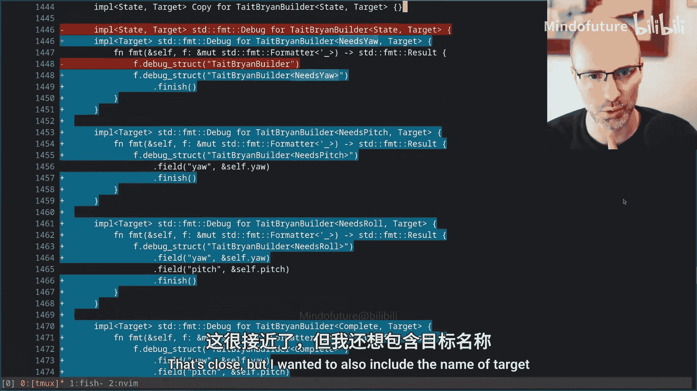

The type name。Yeah， this thing。But like， is that useful， I'm not sure because you end up with a。

It's like a best effort description of the type， which means that it could be a very long type。

Alternatively， it could。It could exhaustively enumerate all the combinations of needs yaaw and orientation。

 needs yaaw and rotation， which feels like unnecessary。

 I guess the type is actually relatively well known。 So only the values matter。

 So I think I'm okay with this， as is。

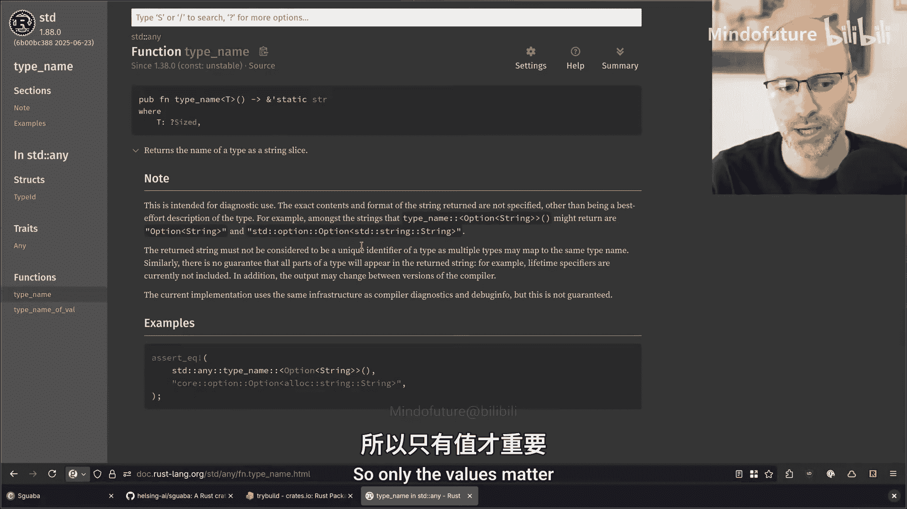

m。Okay。This debug shows only set field per state。Great。Then updates the orientation tests。

So that they' are the same thing， runs the test。Now， it also needs to run cargo format。

 and we ran out a user's limit。 Your limit will reset at 9 PM， which is in。37 minutes。Cool。

 I'm not gonna upgrade to max right now。 That seems excessive。 Okay， so we have a git di。

 Let's cargo format ourselves。 That's fine。嗯。Oh， but I'm not allowed to commit here。

 I need to do this。And then I do git commit。Amen。Wow， oops。It can it aendd。What is commit dash F。

Dash F。But I just wanted to。Keep the one that was there。 Alright， Ed equals smm。It log。

Get fetch agent。Okay。Well， I think， I don't think we're gonna get very much farther。Aenttic main。

But we got， it's funny actually remember how I said， I think we'll get through two out of the four。

 we got through exactly two out of the four， and then we ran out of tokens。

And that took us what It's now 8，30。 We started the6ca of the the mess。 So6 so 7，30，8，30。

What am am I saying，6，7，8，830， so two and a half hours。So two and a half hours of use。

 we got two features out。And I feel like， okay， so here's my thinking。 I don't think this was faster。

But I also don't think it was way slower。嗯。It also probably wrote more tests than I would have bothered to write myself。

 which is a good thing。 right， It means we got better things。

 Certainly wrote a better commit message， although it's also a little verbose， I think， for my taste。

 which I guess I could， I could tell it that my taste is slightly different。

The fact that I run out of tokens is。Like interesting because I don't feel like we did anything particularly fancy here。

 We didn't even get to the things that I thought were harder。 but it did pretty well。 right， Like。

 this certainly feels like a it。it didn't get stuck on any of this。

 but it also basically needed me to tell it what to do。I switchwitch to Gemini C。

 I've heard Gemini C is a lot worse， though。Are you doing this with the unsafe or whatever you want like。

 no， I'm running here。 I I'll show you。Just running it directly。

 And then I'm just allowing it to ask me for permission。 It doesn't take me that long。

 And usually I go down and just do like accept and remember for things like cargo dock。 for example。

 I'm fine with it just remembering it can do that Yeah， two out of four。

 that that doesn't mean that it wouldn't be able to do the others， right， So so if we now， you know。

 now we're slightly smarter than we were。 So the other two is make the vector make vector also be generic over velocity。

 So this ones actually quite a lot harder。 If you go look at the vector type。😊。

So the vector type is currently generic just over the coordinate system it's in。

 but I want you to be able to have a vector that holds not meters， but for example。

 meters per second or meters per second squared because it's acceleration。

 the way you do this is you probably can't have like this be acceleration。

 although maybe you could maybe you could have this be marker types instead。

 But the thing I was the way I was imagining we would do this is using here if you find acceleration。

 for example。

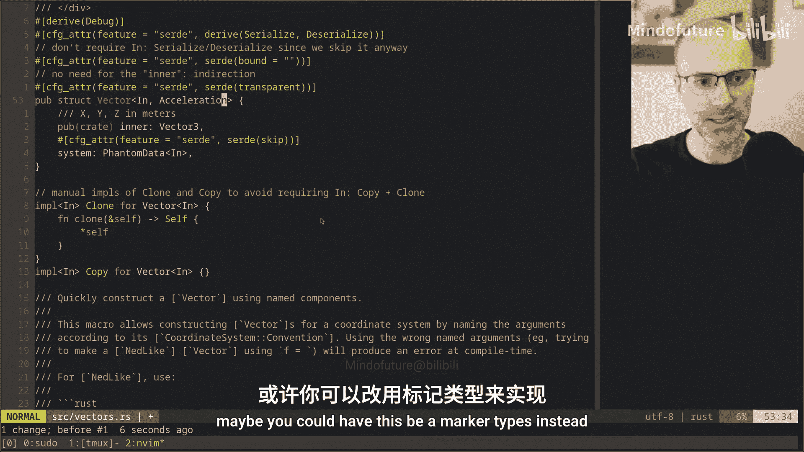

So in U O M， the way you encode a unit is you give a dimension like this and a dimension is an ISQ and an ISQ is the international system of quantities。

 which is like a。It it has a few different properties， I suppose。

 It's the length dimension or a few different dimensions， length， mass time， electric current。

 thermodynamic temperature， amount of substance， luminosity intensity and kind。

 And every unit can be expressed in terms of these。 So， for example。

 meters is length to the power of1 and all the others to a power of 0。

 meters per second is length to the power of1 time to the power of -1 because it divided by seconds。

 All the others are 0。 acceleration is length to the power of1， Time to the power of -2。

 So meters per second squared。And you can see that here by acceleration being an ISQ where length。

 which was the first parameter is p1 a positive one。

 The next one was what did I just say it was the next one is mass so mass is Z for 00 and then time is n2 for negative 2 And so the dimension for acceleration is this particular representation。

 So my thinking was we could say here that this is what did they call it an ISq T for time So you can give a T here that normally is equal to z0。

😊。

But that vector is， you're allowed to construct a vector that is， for example， in plain N E D。

 but that has N1。 And this would be， you know， we， we could even have a type alias for this， right。

 So this would be a vector vector。It would be a velocity vector。In in。Is an in like this and a。

Accel vector would be an N 2。 And then all of the methods on vector would be generic over the the second parameter。

 The only place where the second parameter matters is in the constructor and in the place that allows you to get out the values。

I think we could probably do this， but this is definitely a more convoluted change that I was interested in throwing it out。

 but we didn't have time。 Maybe we do this， Maybe we do another stream like this and we try to do make that change and see how well it fares。

😊，So that was the second change I had in mind The last one was n vectors or ECI。

 which is even more complicated。 N vectors are a different way to represent locations on Earth。

 so I mentioned now there's EF， which is Xyz coordinates from the core of the Earth towards the primary of la long zero and various other axes。

 the other is GPS coordinates， so latitude longitude altitude。

 which is a position on a sphere or ellipsoid n vectors is an interesting third way to express coordinates。

 which is that you pick a point on Earth that you want to describe， you take a normal vector。

A normal unit vector to that point。 So it's a vector that points like。

Perpendicular to the Earth's surface in every direction。 and unit magnitude。

 And you put that where you are。 It turns out that that gives you a one to one mapping between every position on earth and the the n vectors。

 And then you encode the components of the N vector in Eive。 And that is your N vector。

The reason why the n vector representation is cool is because it allows you to do things like compute latitude and longitude。

 like convert between n vectors and la long super trivially。

 converting between EF and Wgs 84 is actually really complicated。

 N vectors have this property that they have an X Yz coordinate system kind of but they also have these easy conversions。

 the other problem with GPS coordinates is that for la long， there's a singularity at the poles。

 So when you go from latitude like imagine you have longitude 0 and latitude keeps going up。

 it goes 89。 and then it goes 90。 and then it goes 89 again。

 but suddenly the longitude changes to 180 instead of 0。

 So you get these massive shifts in the values， even for small changes in the position。

 N vectors don't have that problem or that property。

 So it would be really cool to add support for n vectors in squba。

 but this would require like way more understanding， I think from the。😊，But we didn't get to those。

 but maybe we'll do another stream when I also know more about how to prompt these things。

 which I already feel like I do compared to what I did when we started this video。

 I think experience so far was okay。 I don't really feel like I was surprised。Like maybe a little。

 maybe， maybe the insight that I'm essentially teaching it to apply smaller patterns is a useful insight here。

But it's also the kind of thing where it's not clear to me that the agent AI can get better at that part。

ILike the part I felt like I had to do a lot is point out which patterns to use or which changes to make。

And。That itself is not clear to me as a pattern。 Like I don't know how you make the LLM better at that or the agent AI better at that。

But maybe that's the role for the software engineers in here is that that's the thing we're good at。

 and then it gets to do a lot of the the pattern application。 Will I use this a lot more。Maybe。😊。

Was this better than writing the code myself， I'm not sure。 I really like writing code。

So I don't know if this was better， but it was different， and I like different。嗯。

Let's take maybe before we we sort of end here questions about how we got here the experience we had so far。

 My plan is to actually push these as PRs to squaba so can you can look at the changes in more detail there。

 I'll push them as two separate MRs because there's no reason for them to be the same so that people can look at them if you're looking at the recording of this of course the PRs were already be up if you go to the squaba repository and hopefully they'll be merged unless people have lots of thoughts about them but questions about this whole process or questions you would like me to answer about my experience with it fire away。

I've been trying to vibe go in parallel with the stream。

 trying to do the same work I did this morning。 And it was atrocious。

 He constant poking and still got it all wrong。 Yeah， I mean。

 the experience here very much was I have to correct it all the time。But。At the same time， like， I。

 I don't feel like that。嗯。Meant that it ended up being slower than I， if I did it myself。

But it also wasn't faster。I do wonder like if if the goal here is to elevate the skills of software engineers。

 right so imagine that you don't have quite the same amount of experience I have with many of these patterns。

Then if you used the agent coding here， would you have ended up with a the same result as I did。

 but or B。Ended up with something that was still like a good idea， like the right implementation。

 Like basically， would it have guided you in correct directions or would have just have like picked the first pattern that roughly did what you were after。

 which is the more vibe aspect of it。 And then you end up just going， okay， I guess so。

 And then it commits it。 And then you call it a day。I， I guess I not worry。

 but I'm unsure about the degree to which this。Makes people better programmers than they were or make them produce better code than they did。

 At least my experience right here has been。 I had to tell it about the things it had to do better。

 It didn't tell me， at least so far about patterns I missed or things I should have thought of that much。

嗯。I would have preferred the two last features as normal streams rather than vibe coding。嗯。Maybe。

 I think the。I think doing them as streams would also be interesting。

 I don't think you would have gotten very many other insights， which is maybe。

 maybe an interesting observation here， right， Like when I try to do educational videos。

 I try to teach people the things that aren't necessarily obvious。

 And in a way that's what I had to do here。To the agent as well， right。

 is explained to things that are not just pattern application， but are actually like。

 let's think about this for a second。 What if we did this or this will have the following drawbacks。

 I guess the thing you miss out on is like。Rust， syntax。

 things or like how to structure things in rust。 because there was a lot of parts here where I was scrolling through the diff output from it and reading that over very quickly and going。

 yeah， that looks reasonable。 And you missed that on me actually typing it out so that you have a chance to look at。

 oh， I understand how it actually did this now。 So some of that is maybe lost。

 But it does maybe distill better the insights from the sort of learnings or the key differentiators or key observations I made in the implementation。

And。It has encyclopedic knowledge， but often doesn't know how to apply that effectively。Yeah。

 it's like， it's both similar and completely different to an internal junior engineer。 It's true。嗯。

Yeah， part of this is also like I really like writing code。

 So the fact that it writes code for me unless it writes it a lot faster， which in this case。

 I'm not sure it really like produced like because of all the prompting I had to do the neck time was actually faster than if I wrote it myself。

For fulls Typescript， it's amazing。诶。But the things I've been doing there are mostly already a solved problem or just data shling。

 Yeah， that's what I would expect。 right， First of all， for front end things。

 I would expect it to be a lot better。 there， there are more examples， and it's more uniform。

 but also like things that are just replication of basically full patterns that have been done elsewhere。

 I would expect it to be really good at and be able to do without a lot of intermediate prompting。😊。

嗯。I bet you couldn't write the same level of docs and tests that it wrote as fast and as deep in the same amount of time。

Yeah， so， I mean， as I pointed out， right， I， I think I would have written fewer tests than it did。

I think that's true。And so in that sense， there was a good use for the docs。

 I actually think it wrote more words than I would have written。

But I don't think it wrote more content than I would have included。

But that is a little bit speculation， right？Were you able to try out the subag feature。 No。

 I did not。 And I think if I tried to use sub agentsent， I would have run out of budget even faster。

And。As a nons engineer， do these tools provide access that didn't exist before that I totally grant。

 like especially for things where you can one or two shot things。

 and I think that's true for a lot of data visualization parsing websites。

 like a lot of those things where people generally want something that is very similar if not identical to something that's built before。

 then you can now do that without having to know how to build the software。

 I think that's hugely valuable and one of the big upsides here。

 I think when I say that I'm a skeptic about a AI， It's not that I'm a skeptic about it being useful。

 I think there are a bunch of things that's really useful for。

 The question is whether I find it useful for the kinds of things that I do most of the day and there I'm less clear。

 but on the like nons engineers getting to build more software and use software more as a tool in their toolkit。

 absolutely 100% super useful。😊，In my opinion， if you're doing it yourself。

 you're more focused on the business logic rather than spend the brain power by thinking how to prompt so that the AI understands you as you do。

And。I actually think I'm in a weird position here because because I'm doing this on stream。

 If I was writing the code myself， I would still be speaking out loud about what I'm trying to do。

 So I would still be trying to articulate。Just in。In voice rather than in， in prose。

 what I'm trying to achieve。 So I don't think the difference would actually be that much in my case here。

 I do think that in general， when you're writing stuff， like when you're writing code。

 you don't talk out loud about what you're trying to achieve。

 And so then the thinking about the prompt engineering would be a sort of added thing you wouldn't otherwise have to do。

嗯。Let's also take into consideration how much power it' probably required to do these changes。 Yeah。

 I mean， that that is also the other very valid aspect of this。 The way I'm really talked about。

 not only the， the monetary cost from running this， which I guess is。1，1 instance of pro plan。 but。

 but it's also the， the environmental cost of the hardware needed to run this and the power needed to run that hardware and to cool that hardware。

 like there's clearly a bunch of hidden cost here， too。 and， you know。

 that that's part of the part of the the trade off where if I feel like it's not really adding that much more over what I would do myself anyway。

 then。Is it， is it worth the the total set of costs， the life cycle cost almost。

 I also think there's， there's something here about if I was able to prompt this less。

 there's an argument that I could do other things while it's thinking。

 I didn't feel like that was the case here。 I in a way。

 I'd sort of hoped that that would be more of the case。 that I could kick it off to prompt like。

 I could prompt it。 It would like run for like 10 minutes。 And at the end。

 I could come back and it would like maybe I would adjust it a little bit。

 it actually basically finish the feature。 That wasn't really the case。

 Maybe I should have trusted it more and let go more。 I vibe more。 But but the。

I didn't feel like that was the right way to go here。 Didn't。 I didn't get the sense that that's。

 that would have worked。 But if it had， and maybe this would have had with sub agents and everything。

 if I gave it larger tasks， perhaps。That I could go spend。

 you my brain on something else while it's doing this， and then， of course you get concurrency。

 you get actual parallelism， and that is pretty valuable too。嗯。

I didn't ask it about things you'd missed。 That's true。 I would have been a good thing to ask。

But I also ran out of context for both things。 Both of these prompts。

 I ran out of context before the thing was really done。And。In my experience。

 you will not become a better software engineer with it。

 If you're not good software engineer already， you can be much faster through some practice。

 I'm not sure if that's true， because。It。It does know about patterns you don't know about。

 unless you're very， very experienced。 I expect that this knows about a bunch of patterns you didn't know。

 whether it remembers to apply them is less clear。 But I'm guessing that in a way。

 similarto sometimes maybe watching my videos。 People might go， oh。

 I didn't realize that was a pattern。 I didn't realize you could do this。

 I could imagine seeing the output of the agent coding and having the same kind of of insider realization that you then learn from of like。

 oh， I know that you can do this in rest now。So I do expect that you would be able to learn from this how well I'm not sure because it seems to be more geared towards do the changes for me than also explain to me the things that I might not know。

 but that might be a thing that you could prompt it into right in your cloud M or something。

 basically tell it when like at the end of a session。

 tell me about some things that maybe I could have learned or that I have now learned。And。Yeah。

 someone mentioned here structural tagging roleplay other prompt tricks that might work well here。

 you know there's some there was a good post recently from Niko Mataks about using the sort of what's it called Sotic the Socratic method。

 to basically teach the AI what kind of role it should take on in the interaction that could be interesting。

 the other is this idea of tagged comments where you tell the agent to leave comments for itself for the future in the codeb so that it like has a bunch of anchor points in the code for it to it later progress too。

And that I think could be a really interesting way to see how this gets better as well or the degree to which that helps。

Oh I guess I can go back to this view。😊。

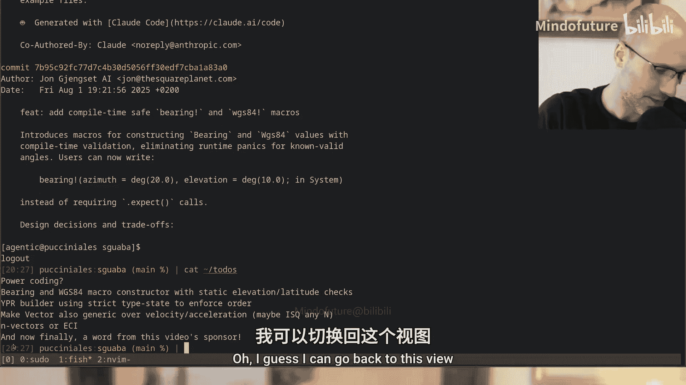

Why historically what your stream is the process of writing code， yeah。

 I don't think I would go away from doing streams where I write code。

ButPartially because I enjoy it too much。 and partially because I do think there's a lot of value that you can learn from that that you wouldn't learn from this kind of session。

 That said， I， I still think this was useful。 I mean， this is in a way， a question to you。

 the audience， right， Like， was this useful to you， But， but I do feel like it's。😊。

It teaches you a different set of things or maybe it， it highlights a different subset of the stuff。

 because you learn more from the prompts and my read of what it does and what it chooses to do and what it should have done instead。

 Where in the coding， it's I think maybe a lot of it is more smeared out about also writing a bunch of code。

 So I think they're different。 I don't know if it's。Worse。And。Yeah talking out solutions with it。

 asking you to write a test in docs， that stuff， I think is useful。 again， like as I mentioned。

 I actually think that the test writing part of this is probably what added the most value to me compared to what I would have done myself。

It' would be interesting to see like if I wrote a bunch of the implementation myself and then told it。

 hey， please test it， that would also be an interesting sort of use the AI as a peer programming partner exercise and maybe that would be a really fun thing to try one day。

And。Try shorter description， I tried some pretty short ones in there。嗯。

Let's see I'm just scanning through chaters if anything particularly useful。Qujiu。😔，Or to touch on。

Implementing things from papers。 Maybe you could use the agenda AI to just follow the spec of the paper to write an implementation in Ru。

 for example， maybe。Wor trying。 I don't think I would do it on stream， but it's worth trying。嗯。

I would never want the AI to do the writing code and architecting solutions for me because that's what I find fun。

 So， so yes and no， right if。😊，It's not like you have to always use aogenic eye or always write the code yourself。

 You can do a balance， right， the times when you don't want to be writing the code yourself。

 use the agent for it。 Things like tests， I think are a good example here。

 You could even do the opposite right， You could tell it， Hey， here's the feature I want to add。

 write to me And this is what I want the interface to look like。 Write me a bunch of tests。

 And then I will write the implementation。 And you basically get test driven development or behavior driven development。

With not having to do the annoying part of writing the tests and behavior definitions。

 that would be an interesting way to try to do this， too。And。

We're definitely in the infancy of how these tools interact with us。

 Often we forget that in the the I and HCI or UI is both ways。 It's true。 I mean， I think， you know。

 Claude was a big step up from the way we used to interact with agents。

 which was more in the sort of autocomplete context or in editor context。

 and it feels like it's maybe better， but it's not clear that this is the end of the road。

 To agree with that。嗯。One of my favorite uses of L O Ms is to write some unidomatic code that functions how I want and ask it how to make it simpler or more idomatic。

 That's a cool way to use it， too， right， So it becomes a sort of clippy that is slightly less rigorous and slightly more vi based of like。

 does this code seem good， I'd be curious to see how often it's wrong， though， Or like， in a way。

 like， what is clod's。😊，Taste encode code。 What things does it point out and what things does it it not。

呃。As for running out of context of that， what would happen if the codebase was much bigger。

 So I don't think the codebase being much bigger would make a huge difference here because the thing that happens when you run Cla in it is basically that it takes it actually walks your whole codeb once and it produces a clo MD that tries to sort of be a summary of your your codeb so that in subsequent runs it doesn't need to read all the files。

 And that's also why this is like limit on how much it's allowed to read from a file at a time。

 and the sort of harness for it forces it to grep through the files instead rather than try to read the whole thing And I think a big part of that is to not pollute the context too much。

My contacts got nued every time it failed to build the thousands of lines of C errors8 up 4% every time。

 yeah， that's pretty rough。And。Is time to write code even a good metric to optimize？

I can imagine that if you let the agent do that， you will pay that extra later on。

 since you're not familiar with the code。Yeah， in a way， it's not just the time to write it。

 It's like the time until the code is as if you had written it to yourself， right。

 in terms of your confidence in it， but also your ability to build on top of it。 that's true。

 that that time part， I think， is otherwise easy to discount， but I do feel like。

Depending a little bit what you prompted to， I feel like it doesn't spew out lots of code that you haven't looked at。

 but maybe that's'ca I'm not vibing enough， right， Like here， I feel like in a way。

 I read all the code it wrote， but that might not always be the case。嗯。

I'm not sure it's the same amount of content as watching one of your streams where you write the code yourself。

 like educationalgital content。 I think that's probably true。 Like writing the code myself， I think。

 is。More programmer content because it's both the writing of the code and you're using a rust and the architectural decisions。

 And here you get the latter， but not the former。 But what you do get here is more insight into how I would prompt an agent or maybe maybe to put the agent aside for a second。

 how I would talk to a person more junior than me about how to implement a feature and maybe that's useful。

 It's different kind of content。 It's not clear it's less content。

 but maybe it's less of the content than you actually want。And。People opening 100。

000 line change PRs written by Claude， you are definitely not vibing enough。

Fair I'm guilty as charged。 But at the same time， I think I came up。

 I came out with something that was useful rather than something that was just a bunch of noise。

 So that's， that's maybe good。Okay， I think that means that we're at the end。 we've covered。

 I think I've caught up mostly with Cha's questions。 We did the two features。 I'll do another video。

 I think at some point where maybe we follow up with these with the other two or maybe where I implement one of them and then ask Claude all of the things that I got wrong。

 The other thing the pointier about asking Claude， hey， what is unidimatic about this code。

 I've thought about doing the same for a bigger codeb that I know is kind of unineymatic。

 I wrote a slackbot like6，78 years ago， maybe that is from my early days of writing rust。

 I'm sure it's bad in a bunch of ways。 It'd be fun to throw Clade at it and be like， hey。

 make this thing a bunch better。 Like just just reorganize the bad tests like make it better in lots of ways and just see what it comes up with。

 So expect that there'll probably be some second vibeco video of some kind。

 but I don't quite know what structure that will take yet。😊，嗯。In meantime， thank you for watching。

 I hope that was interesting。 I hope that was fun。 And now finally， a word from this video sponsor。

 Let's go。 The sponsor of today's video。 And the first sponsor of the channel is Hudson River trading。

 HR is a quantitative trading firm using the latest advancements and machine learning。

 high performance computing and systems engineering to make trades in over 200 global markets。

 They pride themselves in having a deep engineering culture and a relentless focus on performance。

 HR T is primarily as you in Python shop， at least for now。

 But the kinds of things that draw people to rust in the first place。

 or exactly what they're facing daily， delving deep into the lowest levels of their hardware and software stack。

 including instruction set optimization and compiler tuning。

 all whilst meeting strict correctness requirements。

 They're hiring in offices across the globe right now。 And if you're interested in joining。

 check out the link in the video description to learn more。😊。

