# 【全集 附课件】慕尼黑工业大学 C++系统编程 中英字幕 1080P p01 Lecture 1 - 课程概述 -BV1QTzjBFER2_p1-

Allright， hello and welcome everyone once again to the systems programming and C plus plus practical course in this summer term。

Before we jump into the first little bit of content in this course。

 let's take a little bit of time and run over the organizational parts that we need to get out of the way。

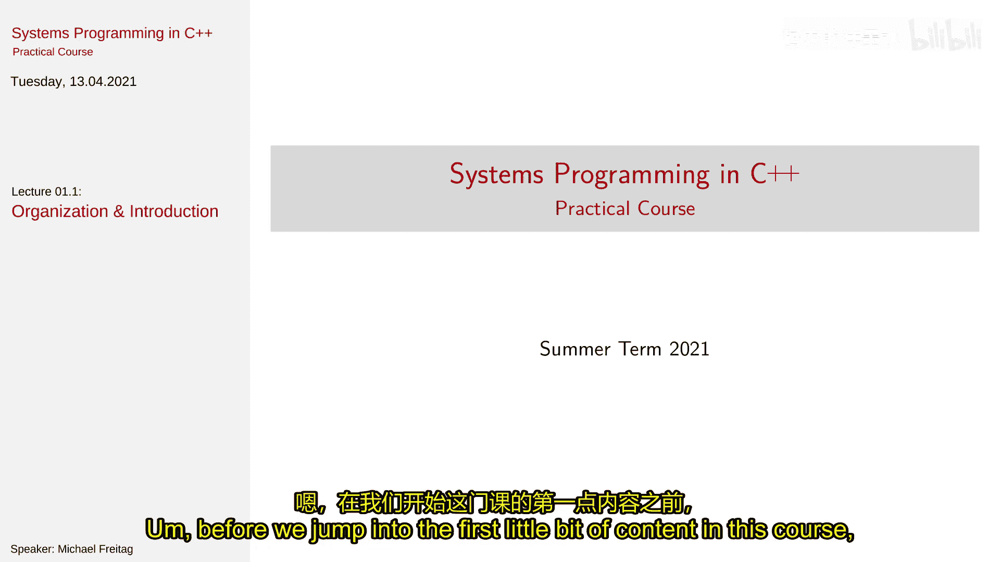

Some of what I'm going to talk about has already been covered in the kickoff meeting。

 so if you attended the kickoff meeting， just be patient and we skip over those parts pretty quickly。

 but there is also some new， more detailed information about how we are planning to run this course。

So this is probably nothing new。 What are our general goals in this course of course we want you to learn to write C++ obviously and this of course entails basic syntax idioms and then we also want to teach you how to implement larger systems so for this we're going to cover the C++ standard library how you can interact with Linux and all kinds of tools and techniques that you need for this task and finally a lot of people are drawn rightfully to C++ because it promises to make it easy to write very high performance code and this of course requires us to talk about things like multithreading and synchronization and some common pitfalls that might compromise the performance of your system and as you will see throughout this lecture there are surprisingly many of these performance pitfalls so we'll try to point them out whenever we come across one of those。

I'll skip over the formal prerequisites you're all already in this course。

 so this is not that relevant anymore， the practical prerequisites are a little bit more relevant。

So as we've already pointed out in the kickoff meeting。

 we do not expect you to have any previous experience with C or C++ and at this point。

 let me even word this a little bit stronger， even if you have any previous experience with C or C++ we would recommend to you that you try to forget this previous experience and really see this course as starting in you。

 not because we don't trust that you already know how to write some programs。

 but because it will make it easier for you to write code in a way that we expect of you because this course is not only about learning how to write C++ but also about learning to write good C++ in whatever sense that means we'll clarify that of course later throughout this course So if you have some previous experience that's great and it'll make certainly make it easier for you but try to。

To attack the programming assignments with as little previous knowledge as possible and try to use just what we have covered in the lecture so far。

 and I promise you this will make it easier for you to get good grades in the programming assignments。

Of course。Even if you don't have any previous experience。

 you will be able to solve these programming assignments provided that you have familiarity with some other general purpose programming language such as Java or Python。

 so I think this applies to all of you， and then you won't have any trouble。

Concerning your operating system， we。Essentially expect that you work on a Linux system this may be in a virtual machine。

 but even there we cannot guarantee that everything we do will work in there。

 so ideally if you really have a bare bones Linux operating system and ideally with root access because we've had some trouble in previous years with people trying to work on a Linux operating system where they did not have root access。

 such as the computer rooms at tomb， but I think during this semester this won't be an issue anyway given the current situation。

Since we do expect that you work on a Linux operating system。

 you also need to have some basic experience， so in particular with the shell but nothing fancy just being able to move around the system。

 execute commands， and so on。Given all this， of course you can still use whatever operating system you want。

 but if you do use something else， then Linux we will try our best to give you support。

 but if something just doesn't work on a different system。

 you're essentially on your own because this course is tailored towards a Linux system。In particular。

 our continuous integration server about which Mus will talk some more on Friday runs Linux and this server will run automated tests on your submission。

 So the best way to make sure that these tests actually pass is being able to replicate them on your local system。

 So if your local system runs something different then R CI server it may be possible that your local tests。

 for example， pass and then on the continuous integration server they fail。

 So this is just unnecessary overhead that you can avoid by working with Linux from the get go。

Do we have any questions so far？Doesn't look like it great。

 so let's move on about the timing organization stuff。

 So you've all found the first lecture session so this shouldn't be new to you and we have sessions on Tuesday from 12 to 2 we will start sharp at 12 but we'll try to keep our sessions within 90 minutes so usually we should be done around 130。

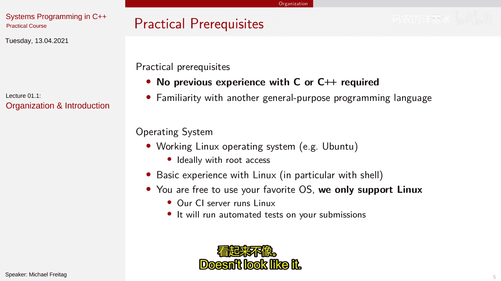

And the same goes for Friday there our session is from 10 to 12 once again we start sharp at 10 and we'll try to keep it within 90 minutes so usually we should be done around 1130 both these sessions are going to be live in the big blue button room that we are in now and we'll split these sessions between roughly 50% lectures where we present new content and just talk about new stuff in C++ those are the recordings that are going to be publicly available and we roughly have 50% tutorials where we discuss the programming assignments and any questions that may come up while you work on these assignments or just questions in general。

And as I've already said， those recordings are going to be uploaded on Moodle and since these slides are now online。

 thanks Mors， you can just click on the links in in these slides here and it'll take you directly to the respective websites。

Both。The lectures anti the tutorials have mandatory attendance。

 of course if you have some good reason like a retake exam will make an exception。

 but apart from that we expect that you attend both the lecture anti tutorialial sessions and this is for a good part because we will present important and new content in both the Tuesday and the Friday sessions。

Right， and if any。Any important announcements are due we'll make them through our website and mostly through the metatamost chat。

 so make sure to check the chat regularly。Picking up on the division between lectures and tutorials。

 we have a preliminary schedule here。

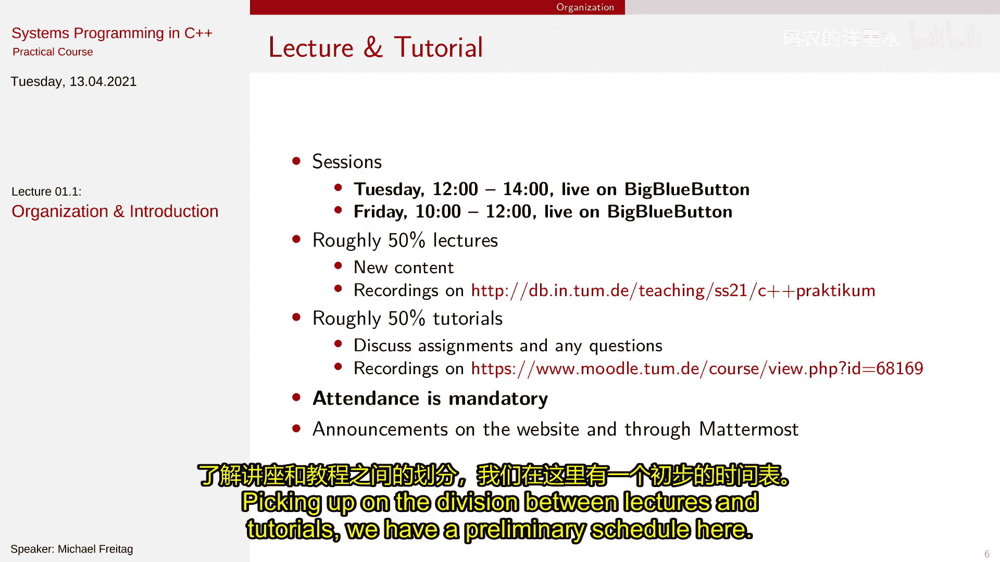

For the semester so this is preliminary so we might have to change it if something unforeseen comes up。

 but we'll try to stick to this schedule as far as possible。

 there is one holiday that coincides with a lecture session and of course this won't be taking place and it's your holiday after all。

All right。

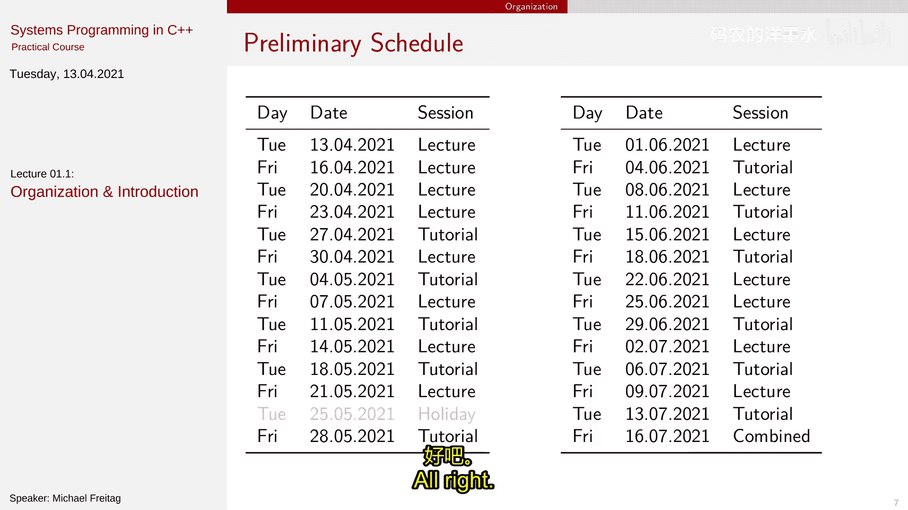

We've already briefly mentioned that there are going to be programming assignments of some sort。

 so let's take some time and clarify that some more。

 so I've already mentioned we expect you to attend both the lecture and the tutorial sessions and to encourage attendance there are going to be brief quizzes on the day of random lectures or tutorials。

These are non coding quizzes， so those are just brief questions that can usually be answered in one sentence or even one word。

And they are going to be published on Moodle， and we will announce them in our metamost chat since usually we would just hand out。

Quiz sheets at the beginning of a lecture， but since we were doing the lecture online。

 this is a little bit more decoupled in the sense that these quizzes can be completed at any time during the day of the quiz。

But they are time limited， so you can choose for yourself when you're going to do a quiz。

 but once you start the quiz， there's I think usually five minutes that count down and in these five minutes you'll have to complete the quiz。

In addition to the quizzes and this is probably at least for the first part of the semester。

 what you're going to spend the most time on， we have weekly programming assignments that are going to be published after each lecture starting today。

These programming assignments have to be completed individually。

 so there should be no teamwork and we will check for plagiarism。

 so just don't share a code between yourself， solve those program assignments on your own。

They are due approximately nine days after we publish them。

Approximately because this will change just depending on the scheduling throughout the semester。

 but we have exact details on each assignment， so it's stated there when the exact deadline is。

So that you always have up to date and detailed information。

The programming assignments themselves are going to be managed through our Gitlab instance。

 and this is also something that Mos will talk about in more detail in our first tutorial session on Friday。

One important thing to note here is that the deadline is going to be enforced automatically。

 so we have automated time script scripts。That will mark your repository。

 so because these run automated， unfortunately， we cannot make any exceptions regarding the deadline of these programming assignments。

And finally， through towards the end of the semester。

 we're going to reduce the amount of weekly programming assignments and these are going to be replaced by a final larger project at the end of the semester。

 which essentially has the same rules as the weekly programming assignments in that the final project has to be。

Sod individually。And we have an automated deadline that's managed through our GiL instance in the same way。

 like the weekly programming assignments。The contents of the final project。

Are going to be published approximately mid June and they are due three weeks after the last lecture。

 so we will try to time this in a way that you have exactly eight weeks to work on this final project。

So once again， just stay tuned， we'll release more information about the final project once this date comes closer。

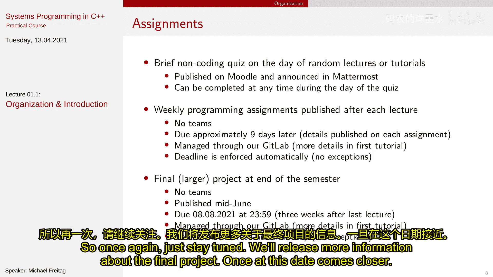

Having talked about the assignments， of course， we'll have to talk。

Briefly about the grading approach that we take。 So essentially， we。

Grade each category of assignments individually。 So for the quizzes。

 they have varying numbers of points。 just depending on the number of questions。

 for the weekly assignments， we also have a varying number of points that。

We try to make proportional to the workload of a specific sheet， and then， of course。

 we have the final project since all of these are graded individually。

 the relative scaling between quizzes， weekly assignments and final projects is essentially irrelevant because towards the end。

Once we have all the grades in， we'll just weight the individual categories approximately like we show here。

 so the final grade will be approximately 60% programming assignments。

 30% final project and 10% quizzes。That said， of course。

 we expect that you have at least half of the points within each category， so for example。

 if you do not participate in any quiz， you will not pass this course。

 so you need 50% of the overall points within the quizzes weekly assignments and the final project。

Since this has come up several times in the past years， of course， if you miss maybe one quiz。

 this won't affect your final grade in a very bad way， but if you miss a lot of quizzes。

 then you will notice this in your final grade so if you just have a family emergency and cannot participate in one quiz as an exception。

 don't worry， but don't don' try to not make this the rule that you miss every second quiz。

 then you're going to be in trouble。All right。Do we have any questions up to this point。Looking good。

 then let's move on。 We have some literature recommendations。 Most of these are supplementary。

 The only one that's really essential to this course is DC C plus plus reference documentation that's shown first here。

And we'll talk a little bit more about this great document in the next lecture on Tuesday， I think。

So this is more as a reference， if you're interested。

 you can take a look at some of these supplementary books。And finally， just for completeness。

 we have a list of important links， all of these are hyperlinks so if you download the slides you can just click on them for the different important websites and contact addresses that we have。

For this semester。Al right， so this concludes what we wanted to say about the organizational part of our course。

 so I'll pause once again in case there are any late questions and then we'll move on to the first little bit of content。

All right。Appears as if no more questions are coming up。

 So let's start with a very brief introduction about what C plus plus actually is。

And of course you can view this from different directions。

 so maybe the most formal definition would be that C++ is a multipar general purposepose programming language。

 meaning you can do almost anything in essentially any way that you want a little bit more specific。

 it means that C++ is an imperative programming language like most of the programming languages that you've probably come into contact with。

 It supports object oriented programming。It also supports generic programming through templates as they are called in C++ and finally a little bit in contrast to the imperative programming aspect。

 C++ also has quite a few aspects of functional programming if you decide to use them。

 So we have a lot of different ways in which the same problem can be addressed and of course。

 this is both this both makes C++ attractive and makes it complicated to use it correctly because as usual theres more than one way to attack a problem and part of our course here aims at giving you some intuition which tools are the right tools for the job that you're facing。

Some key characteristics of C++ are that it is a compiled language。

 so we have a compiler that takes our code and converts it into machine code before we can execute it。

 in contrast， for example， to Python， which is for the most part an interpreted language that doesn't need to be compiled to machine code first。

C plus+ is statically typed。 so every variable and expression that you have in C+ plus。

Is statically at compile time assigned a specific type。 And this， of course。

 makes it very easy to write type correct code， as opposed to some other programming languages where it can mix and match essentially as you want and then end up with。

Some some very convoluted code where you make cannot really see the types of expressions anymore。

 and you might even run into con。And then something that we've already briefly touched on。

C++ provides us a lot of facilities for very lowle programming， once again。

 if we decide to use these facilities and this is quite important when it comes to writing very high performance code because then of course you want to be as close to the hardware as possible so that you have as little overhead as possible。

C++ is by no means a new language， so the initial development of C++ started at the Bell laboratories since around 1979。

 and in large part， C++ is based on C， in fact。It is even backwards compatible to see for the most part。

But it also took inspirations from other programming languages such as Simuli with classes and from Al。

 where it took the idea of operator overloading from。Since the initial development of C++。

 it has been standardized by EO for the first time in 1998。

 which was then called the C++ 98 standard， and this standardization has been amended in following years in 2003。

 2011， 14 and 17 and most recently in 2020， which is the current standard of C++。

And as you can see in recent years， there has been roughly a three year cycle for amendments to the standard。

 so the next plan standardization is due to take place in 2023。Of course。

This standardization process is a little bit decoupled from the actual compilers that you are able to use。

 so the way it works is usually that the standardization committee gets together and they talk about all kinds of different proposals to this standardization of the language itself and then they decide on some things that are going to be added to the feature that many people request and that is deemed sensible。

 but at this point it's only part of the standardization document。

 but compiler architects still have to build support of this feature into their compiler。

The reason I'm talking about this is that we try to use the current standard C plus plus 20 throughout our lecture。

 and we will talk about some。C plus plus 20 specific features。But we cannot really。

Do this unconditionally， because the most recent standardization is。

Quite recent its just a little bit under a year old。

 and so not all features that are present in C++20 are actually implemented in the compilers that are available today。

So we'll try to point this out whenever we come across it。Just。

Be aware that you cannot use an ancient Linux distribution with a very old compiler because it will most likely not support the more recent C++ 17 and C++ 20 features that we are using in this lecture。

Finally。The most important question， why use C plus+ at all。

 And there are many arguments that speak in favor of using C plus plus some of the most important ones are listed here。

 So the one that you probably hear most often is just performance。And this was。

Due to several reasons， so we have a very flexible level of abstraction in C plus plus so you can write very high level code that looks essentially like Java or any other high level programming language。

 but then either encapsulated within this very high level code or in a completely separate project you can write very low level code down to issuing individual assembly instructions if necessary。

 So this amount of flexibility allows you to。Have the best of both world you can write assembly if you really need to just a spoiler alert most of the time you don't need to do this and then in the same project you can have all the usual facilities like object oriented programming。

 several layers of abstraction for whatever you want to achieve。

The high performance that C++ offers you is also present for the user defined types in C++ so even if you define a class and you take some of the appropriate steps to ensure that you actually get high performance。

 your user defined types are as performant as the built in types within C++。

And this is very useful because and this is one of the reasons why usually we don't have to write a code because we can write code with a suitable level of abstraction that still performs very very well。

Right， so。Another reason why C++ offers such good performance is that it directly maps the capabilities of the hardware that it runs on。

 so you can directly interact with main memory， for example。

 and you can directly interact with the individual CPUs in a system and so on。And finally。

 we can all of we can。Encapsulate all of this in the zero overhead rule。

 which states that you don't pay for any features that you don't use。

 So even though C plus plus offers us the features for functional programming or for object oriented code。

 if we don't use these features， they do not incur incur any overhead。 that's just there。

 even if we don't use the respective features。 And this is very useful because it allows this broad range of。

Of different paradigms to be merged in one language without compromising performance。Of course。

 performance is not everything and usually code that optimizes exclusively for a performance is pretty ugly to read。

 There are also other arguments in favor of C++ and the second most important is the flexibility that you get when you use C++。

Because you can mix and match programming paradigms and approaches that the language offers you。

 and you have a very comprehensive ecosystem around C plus+。

 so there is a multitude of tool chains and libraries that you can use together with with C+ plus that make developing even very large systems。

Comparably easy。C++ does， in fact， scale to very large systems。

Up to the complete operating system scale， or for example。

 like we do at our chair an entire database can be written in C++， but of course。

 as usual you need some discipline so that it doesn't get out of hand。

 but if you apply the correct rules， then you can write very large systems in just C++。Finally。

 and this is a very important reason why C++ is so popular today。

Is that it has great interoperability with other programming languages。

 And this especially applies to the C programming language。 So with a little bit of additional work。

 you can use any library that has been written and compiled for C in C plus plus code without any wrapping logic。

Or additional overhead。And this， of course， opens up yet another ecosystem when you ride C+ bus because you can use all the C libraries。

 you can directly interact with the kernel on Linux systems and so on。All right， I hope so by now。

 if not even earlier， we've convinced all of you that C++ is in fact a useful language。

 I think you wouldn't be here if you thought otherwise。

 so let's in fact stop talking about C++ for the remainder of this lecture and take a look at some background before we jump into the background that we think you need to know let's just have another opportunity for questions if there are any。

All right， no questions so far。So let's jump into the background by background。

 we mean anything that is not C+ plus essentially。And let's start by talking a little bit about the hardware because we've already seen C++ allows you pretty direct access to the underlying hardware。

 but of course this opportunity comes with the necessity to actually understand the underlying hardware。

 otherwise you cannot really make good use of it。And as usual。

 we start with the central part of any computer， the CPU or central processing unit。

 which does all the heavy lifting。 It is in some sense。

 the brains of the computer and what this means is the CPU takes programs that are stored in main memory。

And executes them。 And this is done by fetching instructions from main memory。

 examining these instructions and then executing them in whatever sense。

This is possible for an individual instruction。The CPU itself is connected to other components within a computer by a bus。

 which。Can be thought of as a collection of parallel wires that transmit signals， and each wire。

Transports one bit。These buses are prevalent in computers so we have both external and internal buses。

 so buses can connect different devices and they can connect components within one device such as the central processing unit。

And just as an example， we can take a look at this simplified schematic here。

 so we see that we have our central processing unit as one component and this central processing unit is then connected via a bus to。

 for example， the main memory， and of course to all sorts of other components such as disk controllers。

 network cards and so on。But also within the central processing unit。

We can see here that there are several subsystems such as the control unit， the ALU。

 or the different registers， and of course these components are also connected to each other by their own buses。

One thing that this this schematic here already hints at is that the buses are essential for throughput。

 So you see that the main memory is very large and the CPU in modern systems is very fast。

 but they are connected by a bus and a lot of times this bus can actually become the bottleneck that limits the performance of your program because。

It has a limited width， It has a limited bandwidth。

 and even if your main memory and your CPU individually are very fast。

 they are connected by a rather slow bus， and this will have a visible effect depending on your specific use case and we'll also talk about this a little bit more later in this lecture。

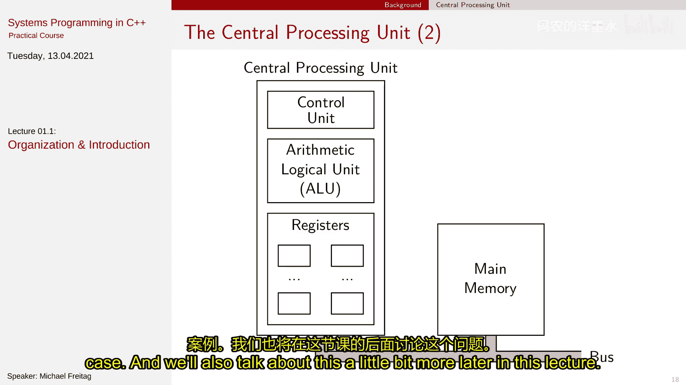

We've already seen in our schematic that a CPU consists of different different internal components。

 So we have the control unit， which。feettches instructions from memory and determines their type。

 and then essentially orchestrates all the other components so that the instruction can actually be executed。

One of the most important， important other components is the arithmetic logical unit or A L U。

 which actually。Performance the operations that are requested by an instruction such as an addition or a logical and and so on。

So in the same way as the CPU is the workhorse of the computer， the ALU is the workhorse of the CPU。

Supported by the registers， which are very small but very high speed memory cells with a fixed size and function。

 so these are used to store temporary results， for example the result of a computation performed by the ALU。

 and also some control information， for example， a flag that controls how precisely the ALU performs a specific operation。

These registers are very small， so usually we store exactly one number per register。

 and there are of course some specialized registers such as the program counter。

 which gives us the address of the next instruction that should be fetched from memory or the instruction register。

 which contains the instruction that's currently being executed。Yeah。

We can already imagine that there has to be some kind of defined control flow and data flow through a CPU。

 Otherwise， it would just all end up in chaos， and this control flow is formalized in the data path。

 which。And we can see， of course， simplified here。 So usually the way it works is we have some general purpose registers up here that contain some information in our case。

Let's just say we have two registers that contain numbers A and B。

 we can then through the appropriate instructions， move data from these general purpose registers to some specialized registers which serve as the input registers to the ALU then in the next step we can issue an instruction that actually causes the ALU to read these values from its input registers。

 perform some operation and then write the result of this operation to the specialized ALU output register and then of course we can have an additional instruction which moves the result of this computation from the A output register back to one of our general purpose registers。

 So we see here that there's kind of a cycle in this data path and this allows us to。

Build very complex computations from a set of very simple， primitive operations。

 such as moving information from one register to another or causing the AU to do something to its inputs。

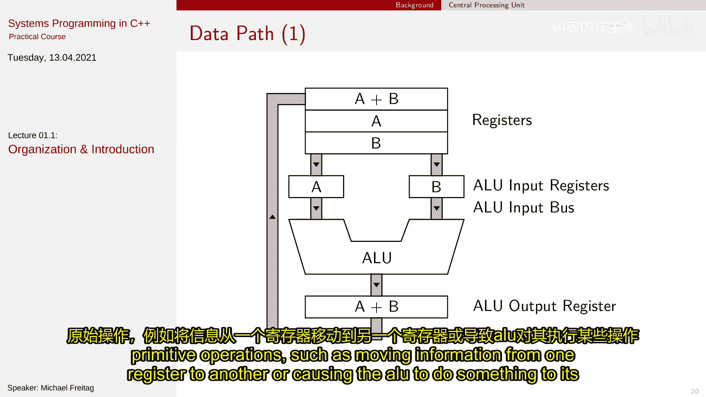

This internal organization is typical of a Phon Neman CPU。

 which is the basis for all modern CPUs that we see。And right， I think。

The data path is just written down once again in bullet points here。In particular。

 this data path cycle is found in X 86 CPUs， which probably is the type of CPU that all of you are going to be using for this。

This practical course。 and because it is so central to a CPU。

 it fundamentally determines the capabilities and the speed of a central processing unit。

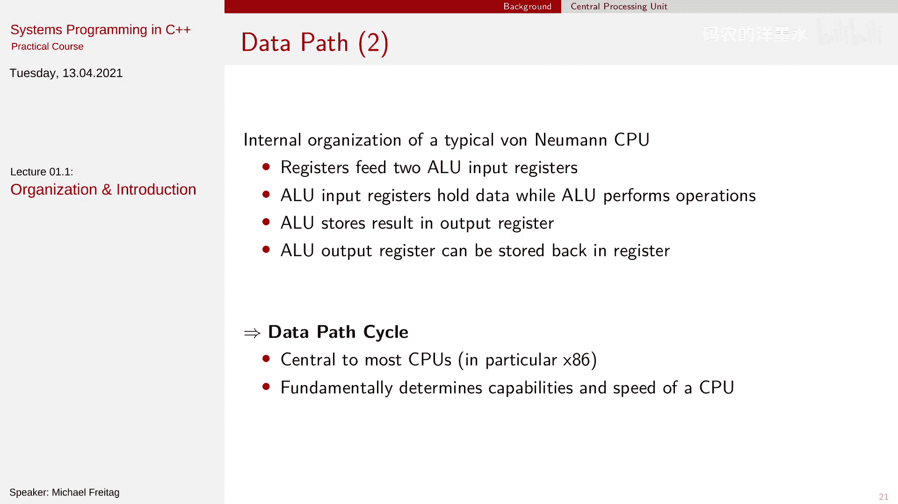

Something that we've also already seen when talking about the data path is that there are several different categories of instructions。

 so when talking about the data path we've seen that sometimes we need to move information from one register to another。

Register such as fetching the opera from some registers into the AL U input register or perform some computation on values that are resident。

In registers and move and the result back into another register。

A key characteristic of such instructions they is that they have very low latency。

 so we need very few clock cycles to execute such an instruction and they correspondingly have a very high throughput。

 so register register instructions are usually the fastest instructions that you can run on a typical CPU。

The second important category of instructions are register memory instructions。

 which take a memory address and then fetch some data from main memory into a register so that we are not limited by the compably small number of registers in our programs。

 Of course， it also works the other way around。 We can take a value from a register and move it back into memory。

Common to both directions is that register memory instructions potentially have a very high latency。

Meaning we need a lot of clock cycles to execute one register memory instructions and depending on the dependencies between instructions。

 this may cause the CPU to stall and essentially just wait for a register memory instruction to complete before we can continue doing useful work。

And this already tells us that。We have to take some care with register memory instructions otherwise。

Our fast registers could end up being underutilized because we have to wait all the time for register memory instructions。

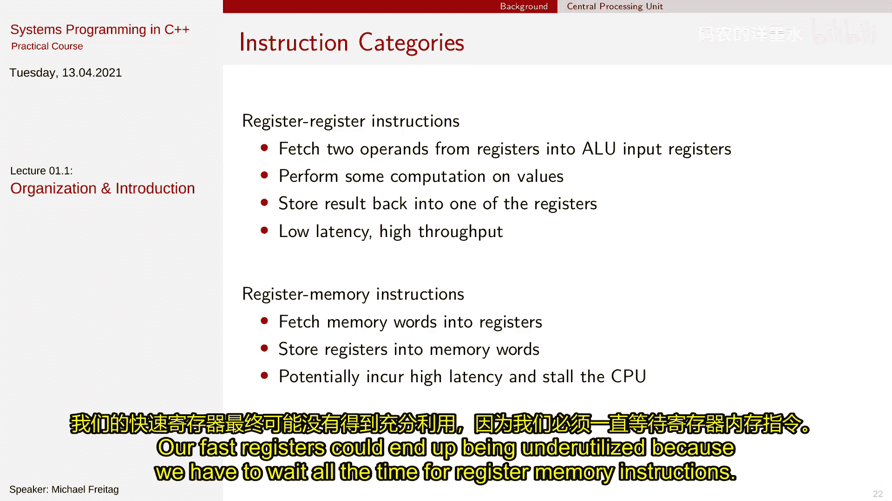

In order to actually execute such an instruction， we have to take one step further and take a look at the actual process to execute such an instruction list this is called the Fe Decode execute cycle。

Informally， we've already talked about this just now。

 but let's take a look at a little bit more formal recipe for this fetch decocode execute cycle。

So the first thing that we have to do is we have to load the next instruction from memory into the instruction register。

 so for this we take a look at the program counter which tells us the address of the next instruction and we then issue a register memory instruction to actually load this information from memory into the instruction register。

Then we since we've just loaded the instruction， we then can update the program counter so that it points to the next instruction in our program and subsequently we can inspect。

The instruction that we've just loaded。 So this is。

The job of the control unit and determine the type of the current instruction。

Then this instruction may of course be a register memory instruction in which case we have to next determine the location of any memory words accessed by the instruction if it's a register register instruction。

 of course we can skip this check。And also the next one which would then be to just load the required memory data into appropriate CPU registers and finally we can actually execute the instruction and then once this is done continue at the first step。

 which is loading the next instruction from memory into the instruction register。

So this is essentially all that's needed to execute programs on a CPU in some sort in some form。

 this fetchdecode execute cycle is performed by every CPU to run any kind of program and this of course includes programs that are written in C++。

An interesting thing about the fetch decocode execute cycle is that we do not necessarily have to implement this fetchde execute cycle in hardware。

 In fact， it's very easy and a fun exercise to write an interpreter for this fetch decocode execute cycle in software。

 or possibly。If this should be more than just a fun exercise。

 some hybrid system where some parts of this fetch deco execute cycle are executed in hardware and other parts are interpreted in software。

The way to do this is that we break each of the potentially quite complex instructions into a number of small steps。

 which are usually called micro operations。W whichch then can be executed in hardware。 And of course。

 we try to keep the number of micro operations very small and very simple so that it's actually easy to implement them in hardware and that we don't have to implement a huge number of these micro operations in hardware。

 and our interpreter then。Breaks the instructions that it gets into these micro operations。

 tells the hardware to execute these micro operations in the correct order and then moves on to the next instruction and repeats the same process。

This has some very major implications for the organization and design of computers because such an interpreter requires much simpler hardware than a system that would implement every possible instruction in hardware directly。

And a very important corollary of this architecture is that that it's very easy to maintain backward compatibility because it's much easier to retain。

Support for a very complex but obscure instruction in an interpreted way than having to build all of these old fashioned and probably unnecessary instructions in hardware。

Historically， this has led to microprocessors that have a huge instruction set。

Which is mostly interpreted because it's quite cheap to add a new type of specialized instruction to such an interpreter based system。

 our micro operations probably won't change and we just need to add a little bit of code to our interpreter so that it can deal with a new type of instruction。

And coming out of this trend， we have then gained the distinction between risk and cis architectures。

 So these historic architectures with a large instruction set that is mostly interpreted are called a complex instruction set computer or cisc for short。

But since all of the instructions are interpreted， these systems incur quite an overhead because of course interpretation is usually slower than direct execution in hardware。

So as a counterpoint to these complex instruction set computers。

 we have reduced instruction set computers。Which have a very small instruction set。

 But this small instruction set。Is executed directly in hardware and for this reason。

 much faster than a cisc architecture。Nevertheless。

 Cisc architectures still dominate the market mostly because backward compatibility is so important for commercial and even private customers。

 it's just not possible that with every new CPU that you buy all your programss break and you have to recompile all of them for your specific CPU because it doesn't support some instructions anymore。

But of course， we still want performance and as a way to get the performance that consumers expect。

 the modern Intel CPU， for example， has a reduced instruction set core for the most common instructions and the instructions that have the most impact on the performance of your system。

 and then all of the less used， unimportant quote on instructions are interpreted in the much larger complex instruction aspect of these CPUs。

Do we have any questions so far。Oh questions， great。So having talked about。

The fetch decocode execute cycle， and how we can。Build systems that both retain backward compatibility and have high performance。

 We could think， well， all is good。 we're done now， but。

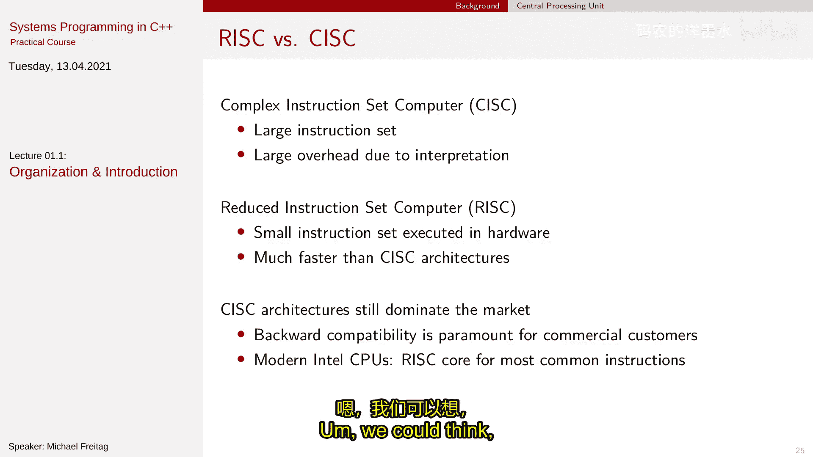

Unfortunately， just increasing the CPU clock speed and then executing instructions in hardware as fast as we can is usually not enough because first of all。

 fetching the next instruction from memory。Becomes a major bottleneck。

 We've already seen that register memory instructions are much slower than register register instructions。

 and if you don't do anything smart， in addition， we'll essentially have to wait for a register memory instruction every time we want to execute an instruction and thus slow our system down quite a bit。

What we can do to alleviate this problem is increase the instruction throughput by executing multiple instructions in parallel。

And this can be done by prefeing instructions， so even before we actually want to execute a specific instruction。

 we issued the corresponding register memory instruction to just fetch the instruction from memory。

And then hold these prefetched instructions in a buffer so that we can very quickly access them once we actually need them。

So what this does is that instruction execution， which up to now we've seen essentially as a black box that just executes an instruction in this fetch deccode execute cycle is broken up into distinct。

Steps， first of all we have to fetch an instruction。

 and then the second step is the actual execution of the instruction。

And if we take this concept even further， we end up with pipelining。

 which almost all modern CPUs implement where we divide instruction execution into even more fine grain steps and each of these fine grain steps can be handled in parallel by a dedicated piece of hardware。

And because it is so useful in increasing the instruction throughput。

 it's central to almost all modern CPUs。 So let's take a look at how this might work。

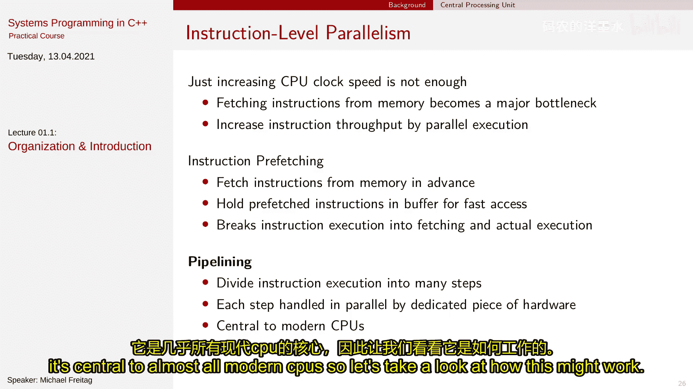

So， a slightly simplified。Pipeline could look as follows。 we have on the horizontal axis here。

 different stages of our pipeline， which correspond to the individual steps that we need to take to actually execute an instruction。

 And we start， of course， by fetching instructions from memory。

The next step is to decode the instruction， so determine what kind of instruction do we have here。

 What do we possibly need to load in addition before we can execute the instruction， for example。

 these might be opera that have to be fetched from other registers or from memory and only once and these first three steps are done。

 we can actually execute the instruction， but then we're not done quite yet because now the result of our instruction。

 for example， might be in the AU output register， which we have to。

Vate before we overwride this output register with the result of the next operation。

 that we have to write back the result of our instruction to some register or two memory。

By splitting instruction execution into these distinct stages， we can。

Have a system that has several dedicated pieces of hardware for each of these individual steps。

 And this is indicated below here。 So we might have。5 different。

Pieces of hardware for each of these stages。 and then of course。

And we can start with the first instruction that moves。Over time through these pieces of hardware。

 so it's time step1 our instruction1 is fetched so it's handled by the hardware for step1 then at time step2 we've fetched the instruction1 and then we can decode it by the hardware used for stage and so on and what this allows us is as soon as the hardware for stage1。

Is free once again。 We can start decoding or fetching。 I'm sorry， on the next instruction and so on。

 So we end up with this pipelining。Approach to execution。

 which allows us to hide the high latency of the instruction， fetch， opera。

 fetch and write backtage by performing these steps in parallel。

 and while the other pieces of our pipeline also perform useful work。

What you also often see is that we separate this pipeline into a front end and a back end part and usually the front end encompasses the instruction fetch and decode parts and the back end。

 then the actual operant fetch to write back phases。On X 86， which for the most part。

 is the architecture relevant for our practical course。 This looks as follows the front end。

We have a question in the chat whether I have forgotten to go to the next slide。 I don't think so。

Can someone else confirm whether they are seeing slight pipelining too？

Maybe your big blue button just。Froze。So some people are typing。Alright。

 So it seems as if big blue button is showing。Pipelining too。

 so I think your big blue button just froze， maybe try disconnecting and reconnecting again。Allright。

 so back to these slides and we were talking about the pipeline front end on X86。

 and what this does is it fetches instructions from memory in the order that they appear in the programming and then in the program and then decodedes these assembly instructions to the individual micro operations that comprise our more complex instructions and then provides a stream of work to the pipeline backend。

On Skyl， for example， the pipeline backend， so the actual execution part of our pipeline can process up to six micro operations per single clock cycle。

And of course。The front end is a little bit slower than this backend。

 we can execute much more micro instructionsions in the back end than in the front end and in particular。

 if our program contains branches， then we don't even know which instructions are going to be executed in the future and because of this we need some kind of prediction that tells us which branch of a conditional statement is likely going to be taken so that we know which instructions to actually fetch from memory so that we can continue to maintain this stream of work to the pipeline backend。

The pipeline backend itself is then not ordered any more。

 We only see that we get a stream of micro operations that we should execute。

 but these may appear out of order with respect to what our program actually tells us。

 So the backend just takes the micro operations that arrive and executes them as soon as possible and。

 of course。Because we have this out of order execution。

 and we need some quite complex bookkeeping to be able to actually。

Match the results of speculatively executed micro operationseration to the actual results once we。

 for example， know which branch of a conditional statement has been taken。

 So this is a very large part of modern CPUus， that's all running under the hood。

 So we don't really see it， but we have to make sure if performance is our prime concern that our code is amenable to this pipelining model of execution because for example。

 if we have a large amount of data dependencies。 So that the next instruction depends on the result of the previous instruction。

 then。Pipelining in some sort breaks down because we cannot issue a parallel stream of work to the backend anymore。

 we cannot continue working with micro on future micro operations as long as we don't know the result of the previous instructions。

 so then we end up with what is called pipeline bubbles where our pipeline stalls and we cannot do any useful work until some previous computation has has finished。

Of course。This is all under the hood， but we will talk about this a little bit more later during the lecture when there are。

Points where you can actually write code in different ways。

 one of which is more unsuited to pipeing and others may be less suited to pipeing。

So pipeing already allows us to hide the latency of fetching instructions and opera from memory if we write our code correctly。

 so now we have a CPU that is even faster than our initial model。

 but of course this is still not enough。We can make our execution even faster if we provide multiple pipelines in parallel for executing multiple instructions。

 not only parallel within a pipeline， but even parallel between pipelines。

This has some restrictions so if we have if we really execute instructions in parallel。

 they must not conflict over resources， so for example we shouldn't have a right to the same memory location in two different pipelines and these parallel instructions must be independent。

 so we precisely cannot have the case that I described before where the result of one instruction is required so that the next instruction can be executed。

The downside of such superscalealar architectures is that。

 of course we need to replicate all the hardware that's required for a pipeline several times。But。

This is a。A price that usually hardware vendors are willing to pay for the added performance that it gives you。

The motivation for this is that usually the。The instruction execution。

Is much slower than the previous， especially the operant fetch instruction if this is only a register register instruction。

 so moving opera from some general purpose registers to the ALU input registers is much faster than then actually。

 for example， computing the addition of these two values in our AU input registers。

 So because of this。

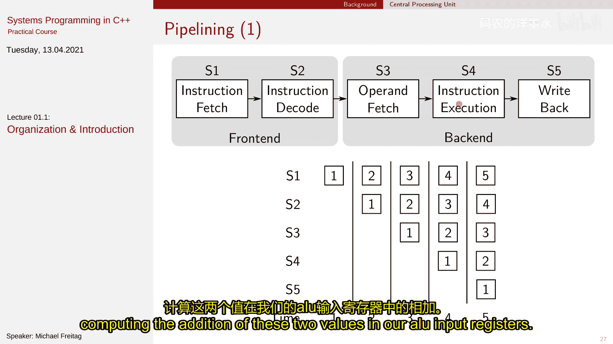

We replicate some of the execution units in the actual instruction execution stage， so for example。

 we might have multiple ALUs or floating point units to keep up with the instructions that are issued by the earlier stages of our pipeline。

We have also seen。That the pipeline front end requires branch prediction。

 because we need to guess which branches are going to be taken， for example。

 if our C+ plus code contains an if statement， then in order to be able to prefetch instructions。

 we need to guess whether we're going to take the then branch or the else's branch。

And once this guess has been taken， we just speculatively issue the corresponding micro operations to the pipeline be。

 so we act as if we already know that， for example， the then branch is going to be taken。

 and if at some later point we determined that our guess was wrong。

 then we just discard the results of this prediction。Of course， if our guest was right。

 then were happy because we then have already executed a lot of the instructions that are required to execute the then branch of our if statement。

Because。This allows us to essentially jump into the future。

 This can have a very heavy effect on the program performance。

And it's very noticeable if code that we write。Causes the branch prediction hardware to make a lot of errors。

 because then it will。Be quite slow。The upside to this is that branch prediction actually works very well in most of the cases。

 so。I remember。Someone telling me about the branch prediction hardware in one of the major CPUUs that are on the market that usually reaches around 95% accuracy in its guesses。

 whether the then or the else branch is going to be taken。

 this is of course great because in 95% of the cases。

 we have already executed the following instructions before we have even evaluated the if condition itself。

Since as we've seen on the previous slide， the micro operations that are issued by the pipeline front and。

Utilizing its brand prediction hardware may be executed out of order。

The effects of individual instructions may become visible。

 Also in arbitrary order and the little bit unpleasant。

Side effect of this is that the order in which the effects of an instruction， For example。

 the effects of an addition or moving a value from registered to memory may appear in an order that does not necessarily match the order in which the instructions were written in assembly。

 and this can have visible effects， especially once and we start。

Working with multiple CPUs within a system， and we have a whole dedicated lecture talking a little bit more about these peculiarities。

We've already touched on this as a closing word on。On pipelinelining and super scalar architectures。

 if we have a lot of dependencies between instructions。

 then we will not be able to fully utilize such a superscalealar architecture。 So in an ideal world。

 if we really want to get the most performance out of our CPU。

 we have to make sure that our program contains a lot of independent instructions。

 So a very good example for this would be a vector addition。For example。

 we could have two vectors each with 10，000 elements and we want to compute the addition of these two vectors。

 since each of the individual additions on an element is independent from all the other additions。

 we can at least in theory， execute all elementwise additions independently and then immediately have the result of the full vector addition。

 of course， it wouldn't work like this because we don't have thousands of ALUs within our CPU but at least we can execute。

 for example， four or eight additions at a time because they are mutually independent。And this。

 of course， if written correctly， will cut the time we need to compute this vector addition by a factor of 8 in comparison to a non superscale architecture。

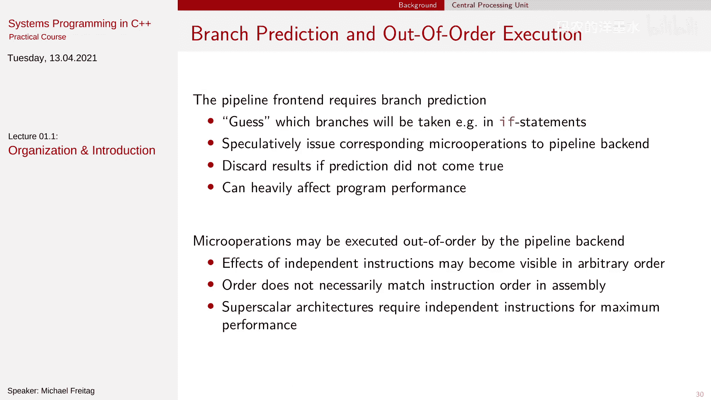

The final step to really squeeze the most performance out of a little piece of silicon is to then include multiple CPUs in a system。

 and this is also something that all of you of course have within your computers by now。

 where we have multiple CPUs that share access to the main memory over a common bus。But of course。

 we already see some problems here。 First of all， we have one common bus that connects all of these CPUs to our main memory。

And without any coordination， our different CPUs may try to write to the same memory address or do other conflicting operations so as soon as we have multiple CPUs within a system。

 we as programmers need to do some work in software to avoid such conflicts。

Another problem is that we have one shared bus， which of course。

 still has the same limited bandwidth as the bus that we initially used to connect one CPU to our main memory。

And in order to reduce content contention on this one limited throughput bus。

 usually assist hardware architects then introduce CPU local caches so that we don't have to go all the way to main memory through this。

Small bus， if we can avoid us， avoid it。 But， of course。

 implementing in hardware such CPU local caches then requires very sophisticated cash coherency protocols。

 And we'll also talk about those a little bit in a later lecture。First of all。

 let's take a step back from the really in depth hardware building guide and take a look at the next important component within such a system。

 so up to now weve talked about the CPU and always just said we fetch some information from main memory when we need it and then do some work within the CPU。

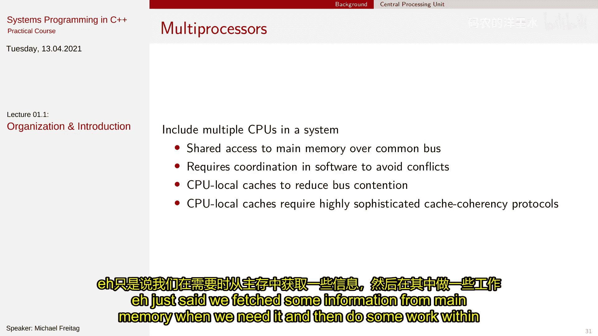

But the main memory in itself is also quite interesting and involved。

 So let's just briefly talk about what main memory actually is。

So the main purpose of main memory is just to provide data storage for both information and program instructions that we need to do whatever work we wanted to do。

As you all know， this information is stored in binary units and usually represented in hardware just by some values of a measurable quantity。

 for example， the voltage across a capacitor。If we have something more interesting than just a bit。

 we combine multiple bits into。Larger words that we can then use to have， for example。

 the2 complement representation for integers or the IE E representation for floating point numbers。

The good thing about main memory is that it is much larger than the registers that we have。

 so registers are usually a couple of tens within a CPUU Main memory， of course。

 can contain up to terabytes of storage space， but we buy this much larger size by a much slower axis time than the register。

 so this is the difference here is several orders of magnitude in latency between a register access in a main memory axis。

In order to actually store and retrieve data from main memory， we have to organize it in some way。

 and this is done by viewing main memory as a number of cells where each of these cells contains the same number of bits。

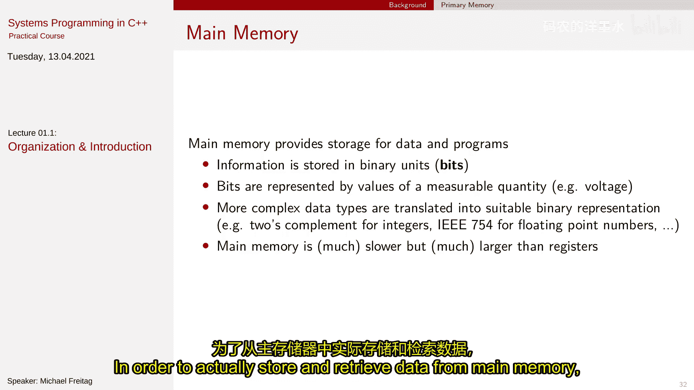

So most of the time we have one byte per cell， which then gives us byte addressable memory because each of these cells is addressable through its unique address。

 so essentially what we do is just we subdivide our memory into a number of cells and then assign a unique number。

 usually contiguously to each of these cells， which we then take as its address。And then。

We can take the address of a memory cell and store a single bite or read a single bitete from such a memory cell。

 Of course， life is much easier。If we give logically adjacent cells also consecutive addresses。

 because then we can use simple integer operations on these memory addresses， for example。

 to get the next byte following a byte that we've already loaded。

Usually one byte is defined to consist of 8 bits。But a fun fact about the C plus plus standardization is that this is not required by the C plus plus standard。

 Of course， all of the usual CPUus that you will probably encounter use 8 B for a single byte。

 but C plus+ does not require this。 the smallest unit in C plus+ is 1 B。

 and it might also contain 7 B if for whatever reason and the hardware that you are using C++ on has 7 B per individual memory cell。

Of course， one bite is still quite limited in scope。

 and usually instructions operate on entire groups of bys。

 And these are quite frequently called memory words。 and the size of such a memory word depends on。

The architecture that you're on， if you have a 32 bit architecture。

 you would have four bytes or 32 bits usually per word。

 and on a 64 bit architecture you will have8 bytes per memory word。

Usually this is not of much concern because the compiler will take care of you。

 but there are certain situations in which we have to take care because usually memory accesses need to be aligned to word boundaries。

 so for example， the hardware might complain if you try to load something from memory address5。

 if the word size of your system is8 bytes， so if you wanted to do this then you would probably have to load the bytes starting from address0 and then from address 8 if required and manually stitch together the information that you initially wanted to load。

An important。Aspect of。This。This approach is that addresses of memory cells are memory words themselves。

 So what this allows us to do is that the address of a memory cell can be stored in memory or in a register。

 just like data。 But of course， since we are then limited by the word size of our architecture。

 The word size of our system determines the maximum amount of addressable memory。

So you've probably encountered this in the context of 32 bit architectures where our word size is 4 bytes。

 32 bits。And thus， if memory addresses are memory words themselves。

 the maximum amount of memory that we can address is 4 gigytes because this is the largest number that we can represent in a 32 bit integer。

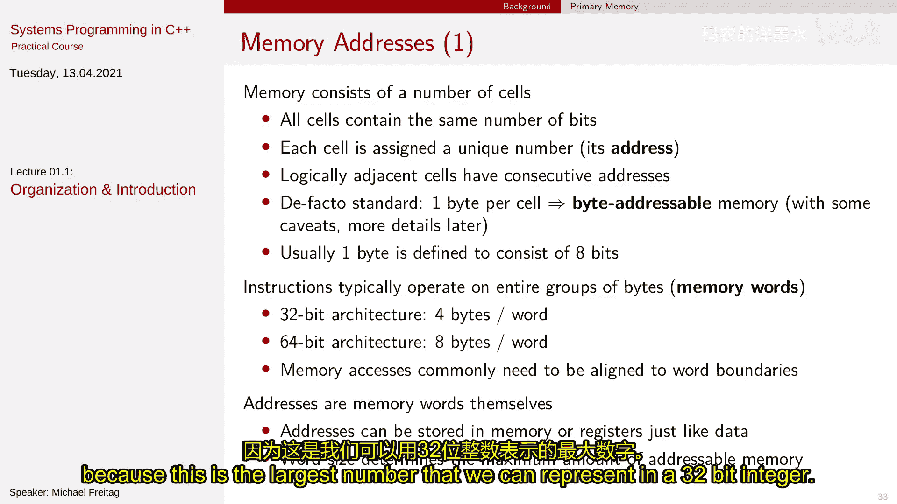

So。As an example， we can take a look at our simplified main memory here where just for the sake of our example。

 we assume that we have two byte addresses and one byte cells and then we have arranged our memory cells in this rectangular grid here so we have address0 and then consecutively increasing addresses to the right up to address seven in hexadeciimmal of course and then in the next row we start。

With address 8 and so on。If we view these， the contents of our memory cells just as hexetsimmal numbers。

 we have some。Some type of numbers， if we， for example， interpret them as ASI characters。

 then we see that they actually contain some sensible text。

 but in the same way as we interpret these hexadeimal numbers as ASI characters down here we could also interpret them as something else so in case of ASI we have one byte per character but we could also get the idea to interpret these memory contents as for example a number of four byte integers that are stored consecutively in memory and then of course the first integer would consist of the first four bytes the next integer would consist of the next four bytes and so on。

 what you should keep in mind here is that memory just contains a bunch of bytes and the meaning that we assign to these memory contents is essentially up to us we can interpret it is a character string we can interpret it as a number of integers or something else depending on what we try to achieve。

嗯。A corollary of this is。While ASI just requires one byte per character。

 our interpretation is unique， we have a one to one mapping from the memory cell with a headecimal value to our single ASI character。

 but this is not necessarily the case for other information， for example。

 if we have 32 bit integers which would span four memory cells。

 then we have a choice how we would like to order the bytes within our 32 bit integers。

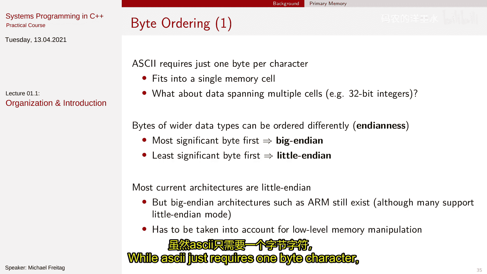

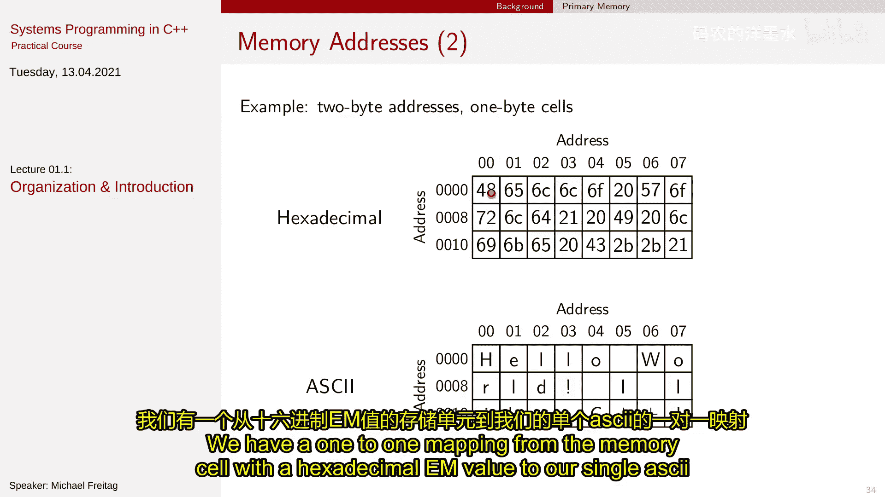

And this is called the Indianianness of a system， the two。

Prevalent approaches here are either big Indianian systems which store the most significant by in the first memory cell and little Indianian systems which store the least significant by of an integer in the first memory cell that we use to store at this multi byte value。

Most current architectures are little Indian architectures and there are some good reasons for this。

 which we're going to take a look at on the next slides， but there are big Indian architectures。

 for example， arm is a big Indian architectures， so we still have to keep this in mind。

If we want to write portable code that at the same time does very low level memory manipulation where we actually come into contact with the individual bytes that comprise。

 for example， a 32 bit integer。

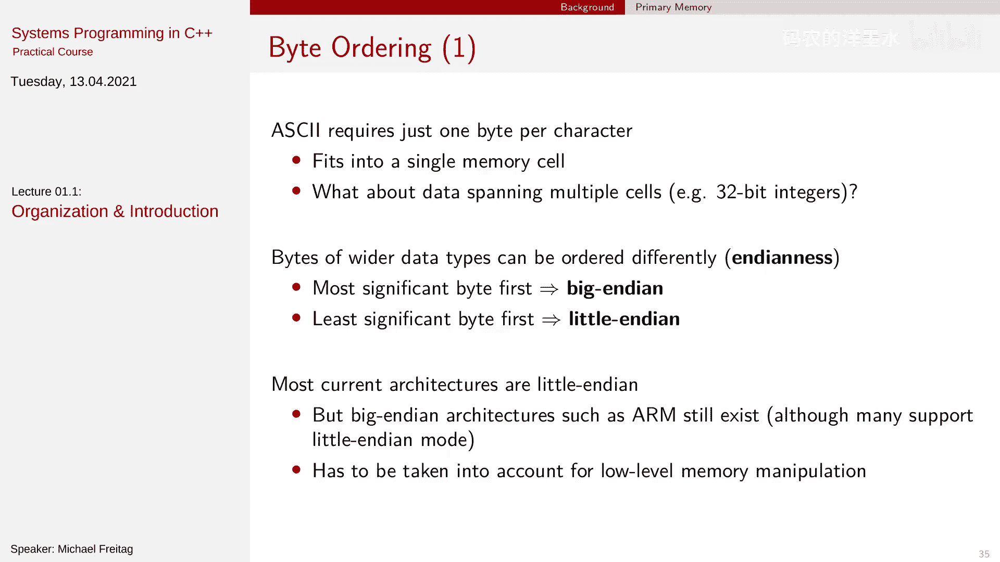

The reason why most current architectures are little Indian is that it makes work size conversions simple if we take a look at a big Indian system。

We could。Imagine the example that's shown here。 We have a 302 bit。Integer。

That's stored in four memory cells in a big Indian system。The most significant by is stored first。

 So we have three bys that have just value 0。 And then we have one by， which contains。Actually。

 some nonzero values。 If we now load a 32 bit integer at address 0， so we load 4 bytes starting at0。

 we would get the value 42 in the decimal system。 however。

 if we load a 16 bit integer from the same address we would just load the first two bytes here and then correspondingly since they only contain zeros the value in the decimal system now would be at0。

 So if we convert between work sizes。On a big Indian system。

 the value that we load from memory will actually change。

Provided that we do not run into any overflows， because then the value would obviously change anyway。

The same goes， of course， if we rearrange the by contents in memory a little bit。

 if we store our nonzero values at address 1， then our 16 bit integer would now contain the decimal value 42。

 but if we load a 32 bit integer at the same address。Its value would be much larger。

 This cannot happen on a little Indianian system if we want to convert between word sizes there。

 we can just load from the same address as for the larger word size and our value would not change because they the least significant values would be stored first and we would load those regardless of the specific word size。

That said， little Indianian byte ordering is not great in every aspect as well。

 and this is mostly because we are used from reading from left to right。

 but for little Indianian by ordering because it's in reverse you actually have to read from right to left if you want to interpret a number。

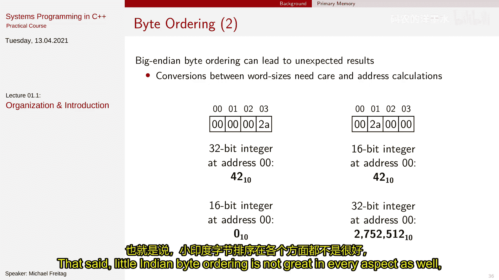

And one example where this can have a somewhat unexpected result is if we just order our contents in memory lexiographically by individual bytes。

 then if we interpret this lexiographically ordered information as little indian integers。

 we will see that the values are not actually ordered in the decimal system。

 so here we would have to take another approach to sort these numbers。

Or do we have any questions so far。Great。So let's move on to a very important topic in connection to main memory we've already seen on our previous slides that main memory has a very substantial latency。

 usually tens or even hundreds of nanoseconds。Which is orders of magnitude slower than。

Register accesses or even simple instruction execution laencies。

 so because of this every time our CPU accesses memory without doing anything additional。

 we would stall our CPU for multiple cycles where it just waits for the memory access to complete and return whatever data we wanted to load or store to main memory。

Fortunately， accesses to main memory very commonly have both spatial and temporal locality。

 So whenever we， for example， load a memory word。It's quite likely that adjacent memory words are accessed as well。

 And also， once we access one word from memory， it's quite likely that the same memory word is accessed another time within a short amount of time。

And both of these dimensions of locality can be exploited to hide the latency that true access to main memory have。

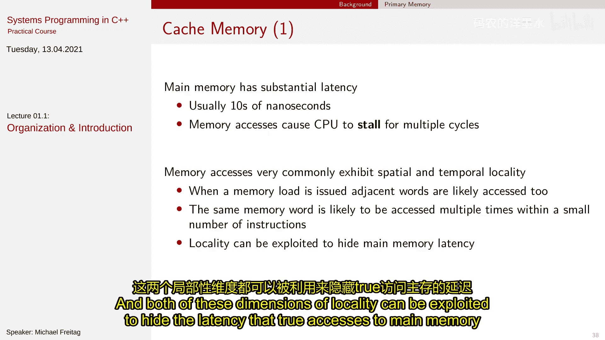

And the way to do this， I think this is familiar to all of you is to introduce a small but very fast cache between CPU and main memory。

And the way this cache is used is that the CPU transparently keeps data that was recently accessed in this cache memory。

 so transparently means that we as a programmer don't directly see this。

And in order to do this in order to reduce the amount of bookkeeping that's required。

 we logically divide the memory into larger blocks consisting of multiple memory words。

 which are then called cache lines。So， on。On my CPU， for example。

 one cache line is 64 bytes or 8 memory words since I'm working on a 64 B architecture。

 and then whenever a single memory cell is referenced。

 we load the entire corresponding cache line into our CPU local cache so that any spatial locality that our memory accesses might exhibit can be satisfied from our local cache memory because for example。

 if we read memory addresses in ascending order we need to do one large load loading 64 bys into our cache memory and then the next 33 memory accesses can be served from this cache memory without having to access main memory again。

Of course， because these caches are much smaller than the capacity of our main memory。

 we need some kind of eviction strategy so that stale data is removed from the caches and we have room for。

For new memory accesses to be cached。On Intel and I also think on AMD CPUs。

 we usually have three levels of caches which are labeled L1 L2 and L3， which have increasing size。

 but also increasing latency。 So L1 is the fastest cache。

 but it's also the smallest L2 is larger than L1 but a little bit slower and correspondingly for L3。

All of these caches are usually inclusive so that the contents of the L1 cache are replicated within the L2 cache and likewise the L2 cache is replicated within L3。

 this allows us to have some kind of cascading eviction strategy where maybe L1 is too small to hold everything。

That we would like to hold， but instead of directly evicting the contents of our L1 cache to main memory。

 we can still keep them in L2 cache so that the next access to this information is a little bit slower than an access to L1 but not as slow as a true access to main memory。

A question from the chat， whether the cache is part of memory or whether it is a separate auxiliary storing place。

Neither， and we see this on our next slide here with another simplified schematic。

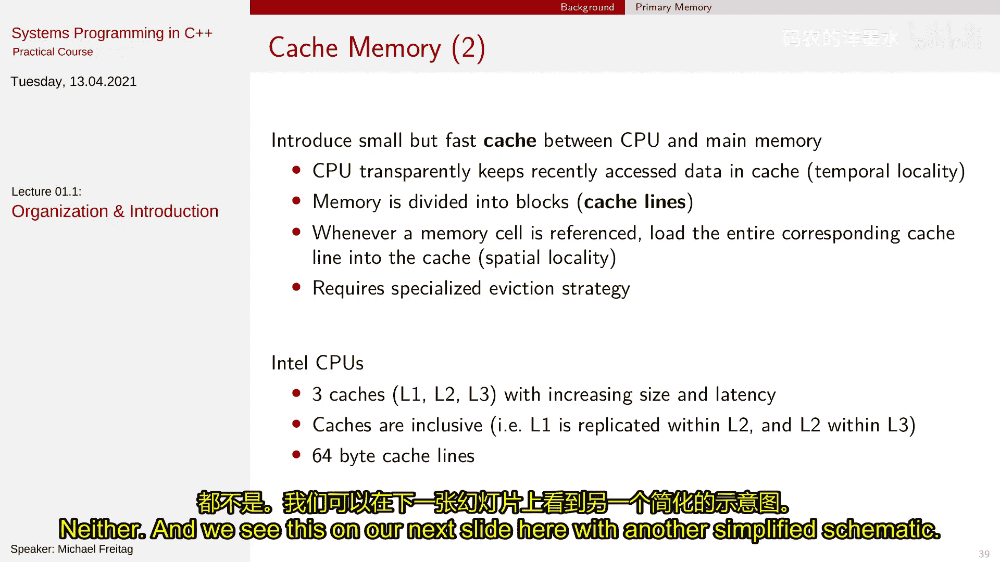

Usually the cache memory is built directly into the CPU。 so from the outside。

 a CPU looks as if it's just connected to main memory and internally the CPU takes care of managing caches。

The typical cache hierarchy in particular then looks like this if we have multiple CPUs as most systems have today。

 we have dedicated L1 and L2 caches per CPU core， and then we have a shared L3 cache that is not replicated across CPU course。

Within an individual CPUU core， we then have separate instruction and data caches on the L1 level。

Because here。Our instruction accesses will have a very high。

Spatial locality because once we load an instruction usually we don't have any branch statements and we need the next instruction in the next step。

 so we keep this separate from our data cache so that accesses to data do not invalidate our instruction cache。

 but in the upper levels of the cache we have a unified architecture where both instructions and data are stored in the same cache memory。

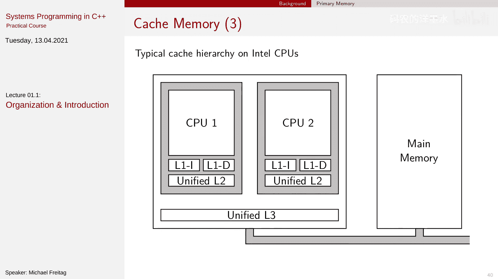

A side effect of caching， because we now have these larger cache lines， is that we。

Have a rather non obvious interaction with the byte addressibility of memory because even if we have cache memory within our CPU。

 we can still access each byte individually。 remember that as a programmer。

 you do not interact with cache memory in any direct way。

 you just say I want to load this memory address。 and then the CPU takes care of all the caching aspect。

However， on each axis to an individual byte， the entire corresponding cache line is loaded。

 So if our memory access pattern is very unfortunate。

 this could lead to a very large read amplification。So for example。

 if we read every 64th byte from main memory。We read 64 times as much memory because every time the entire corresponding cacheline is loaded。

 then we actually need to do whatever our program intended to do。On top of this。

Since we cannot directly say， tell the CPU keep this value in cash， it's a。

Quite hard challenge to design cache efficient data structures， because on the one hand。

 we have to take care of that all the data that we frequently access is kept in the CPU caches as long as possible。

 But we have no way to enforce this in by， for example， issuing a certain instruction。

 So to have cache efficient data structures。We have to use suitable programming techniques so that a side effect of our program execution is that the relevant data is kept in the cachehes as long as possible。

So this requires some techniques when writing programs and will'll try to point those techniques out during our later lectures whenever we。

Talk about things that might affect the cash efficiency of your programs。

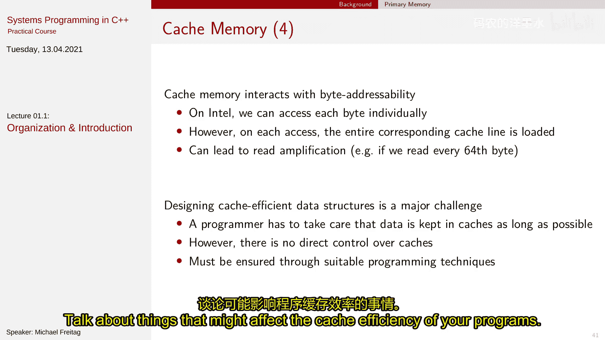

Another thing that cache memory interferes with is。Presence of multiple CPUus in a system。

 because usually modern processors use a write back strategy for their caches。

 So if you write something to memory， in fact， the CPU lies to you and doesn't really write。

To memory， but it just writes to its CPU local caches first and then at some later time that's out of your control。

 the changes that you wrote to memory are propagated to the higher level caches and eventually to the actual main memory。

Within your system。A very unpleasant side effect on multiproces systems here is that。

Every read and write to memory is ordered only within a single CPU。

 So if you write a multi threadreaded program and within one thread。

 you have a sequence of reads and writes from it to memory。

 The order in which these reads and writes actually applied to the system is only defined on this single CPU if you have another thread running on another CPU。

 It might see the effects of your memory rights in a different order than you actually programmed and executed them on in the other thread。

And because of this， we require special programming models to maintain consistency within multi threaded programs。

And of course， this is a quite complex topic and will dedicate another lecture to talking about these programming models。

A question from the chat， whether this is a problem only for multiple CPUs or also for multiple cores already。

 Great question。 It's already a problem for multiple cores as far as this lecture today here is concerned。

We used CPU and CPU core interchangeably， so by multiple CPUs on our slides here。

 we just mean multiple CPU cores， whether they are packaged within one chip or several chips is essentially irrelevant for our discussions here。

 so you have these problems even on your multiprocessor laptop system and you can actually write code that will exhibit some weird behavior due to catchching and its interaction with these write back strategies on a multi processorces system。

Or do we have any further questions or follow up questions to this。Doesn't look like it。

 So then let's move on to the final part of our introductory tour of a computer system。

 and that is assembly language。

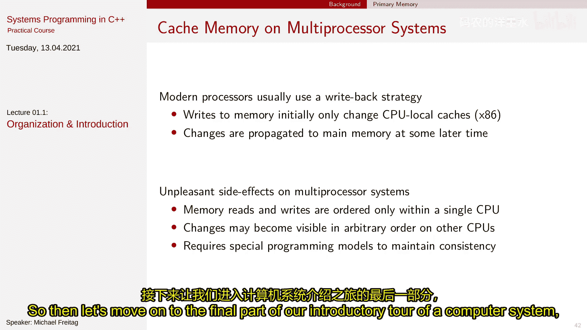

Of course， you can rightfully say you're in a C++ course here， you're interested in learning C++。

 what does assembly language have to do with this？After all。

 we have high level programming languages precisely because we don't want to write assembly code。

 Nevertheless， at least a basic understanding of assembly language is extremely helpful。

 both when learning and when writing C++ code。As far as learning C++ is concerned。

 if you have an understanding of assembly language。

 you can understand how certain C++ features map 2 assembly code and then of course。

 understand the close connection between C++ and low level code because a lot of code that you can write in C++ has a direct one to one mapping to some sequence of assembly instructions。

And if you are able to understand this close connection。

 at least sometimes design decisions that were made when standardizing C++ become a little bit easier to understand。

 because you see the way in which this specific feature in C++ is specified。

 it very easily maps to this or that sequence of assembly instructions and if we had done this in another way。

 this direct mapping， for example， might not have been as easy。Also。

 something that's from time to time quite useful is if you take a look at the assembly code that results from a C++ program。

 it actually becomes easier to visualize what a piece of C++ code is doing and I'm saying this a little bit with the whole topic of pointers and memory axises in mind because the C++ syntax is sometimes a little bit convoluted here but if you take a look at the assembly language that corresponds to such a piece of C++ code is immediately obvious what's happening。

So this is the part of learning C++ that can benefit from understanding assembly language。

And of course。We also can use our understanding of assembly language when writing C plus plus we have a question in the chat。

 but I'll just briefly postpone it until we're done with this slide。

 so back to why assembly helps us when writing C plus plus。嗯。

If you write some C+ plus code that has to be very high performance。

 then you can just take a look at the generated assembly and double check that nothing sketchkey is introduced by the compiler that you actually get the performance that you expect from your code if you write very high performance code。

 you are writing C++ plus essentially you're expecting a specific sequence of assembly instruction or at least a rough structure of the generated assembly that matches your expectations regarding the performance of your program。

And the same thing goes for the behavior that you expect from your code。

 especially when writing very low level code， because then you're sometimes just writing syntactic sugar for assembly instructions and then of course you also want to double check that what you wrote in C++ matches you wanted to achieve。

And finally something that actually quite frequently comes up is that you can ensure that the compiler is doing what you expected it to do This is sometimes compilers contain bugs。

 of course this is only rarely the case， but there you can and take a look at the assembly and for example see that the assembly does not match what the C+ plus standard tells you that a specific code should be doing and sometimes also just different compiler flags can have unexpected effects on the generated assembly from AP of C++。

Returning to the question that we had in the chat， which was whether some C++ features are mapped directed to assembly not through multiple translation levels。

 I think through the C。All of C++ is more or less directly translated to assembly。In particular。

 there is no intermediate step in which C++ is converted to C code so within a compiler C++ is of course transformed through several successive steps of lowering where we first parse our C++ code and then transform it through multiple intermediate representations until we arrive at machine code。

 but none of these intermediate representations is C so C is entirely independent of C++。

What we mean by a direct mapping from C++ constructs to assembly is just that a specific code fragment written in C++ has a more or less one to one mapping to a specific assembly instruction or maybe two four or five assembly instructions。

So there is nothing like a virtual machine that you have in Java in between the code that you write and what is actually run on the CPU。

 So I hope this clarifies your question。 Let me know if not。Allright。Seems okay。

 so let's move on and take a brief look at some actual assembly code。

 So the basic program structure of an assembly program is quite simple。

 We have a series of processor instructions that are given some human readable names， for example。

 move L or add L。And these instructions usually operate on one or more opera that can be registers or constants or memory addresses。

And once again， we do not expect that you actually are able to write assembly code or that you are able to read arbitrary programs in assembly code and immediately tell what they are doing。

 but at least some basic things will come up several times and we will have some assembly code examples throughout our lecture at points where it's important that we see this connection between C++ code and assembly code。

So returning to the example。Instructions here， we could， for example， have a move instruction。

That takes a register as its first opera run， and then。

The syntax you see here tells us that this is a memory access where we use the value that's stored in this register here as a memory address and then move a constant offset of four bytes back from the memory address that's stored in this register。

 So this instruction here would take data that's stored in a register and move it to a specific location in main memory Of course this also works the other way around。

 we can take data that's stored somewhere in memory and move it to a register and then just as some further examples we can have some arithmetic operations which shift the contents of a register。

 for example， one bit to the left so this is the shift left operation and of course it's also possible to。

 for example， add a constant to the contents of a register through a suitable add instruction。

What we already see here is that in assembly languages。

 we actually interact directly with the CPU registers and they are apart from being able to store information in memory。

 the only variables that we have in assembly programs。

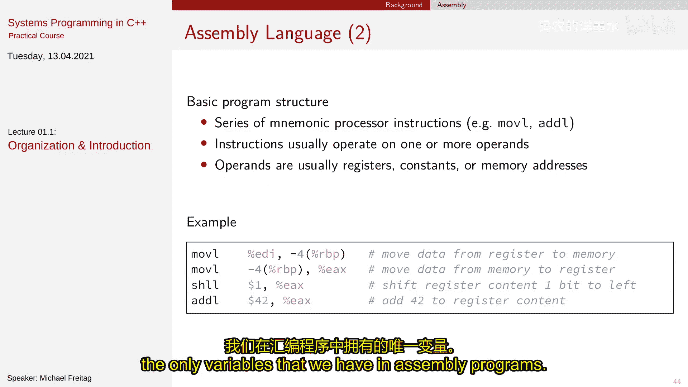

So let's take a little bit closer look at the registers that we actually have in a typical CPU。

And the first thing that's important to note here is that the number of registers is very limited。

 So as opposed to main memory， where essentially we have unlimited storage space and we have a very small number of registers。

But of course， we want to make sure that our programs use these registers as much as possible because they are so much faster even than the cache memory that's present within ACPU。

So what this means is that the compiler has to determine which of the variables that we define in our C++ programs are actually put into CPU registers and of course if we use very few variables and within our program this is easy because then every variable can be stored in a register but as soon as we start having a lot of variables they are not going to be enough registers available to store all of the variable values in registers and then the compiler has to statically determine a scheme in which the surplus variable values are spilled into main memory and loaded into registers whenever they are required。

As I've already said， assembly instructions usually only manipulate data that is stored in registers and these registers are referenced in assembly code through their names。

 so we've seen this on the previous slides in the first instruction here。

 we took the data that was stored in the EDI register and moved it to some location in memory where the location in memory was stored in the RVP register。

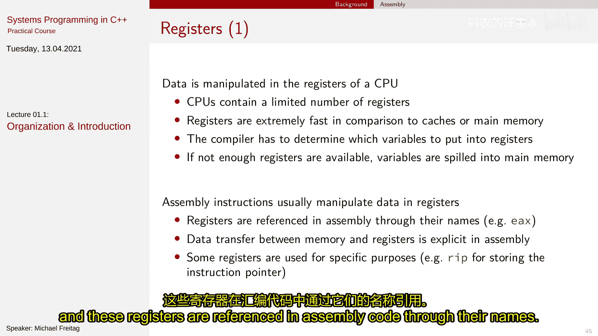

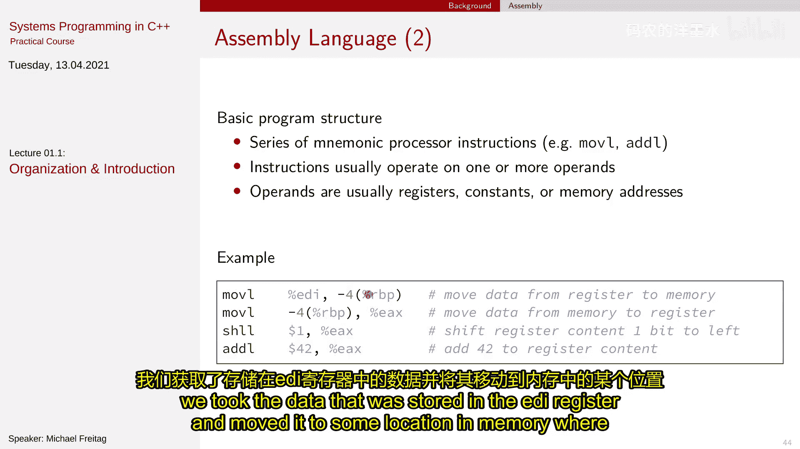

What this also tells us that data transfer between memory and registers is explicit in assembly。

 so in your C++ program you just write variable a equals B plus C and you don't care whether B or C are currently stored in a register or in a memory。

 but in assembly code this is made explicit， the compiler has determined that your variables are either stored in registers or in memory and whenever we have to load something from memory。

 this is an explicit instruction off the form that we've seen here in the second line where we load a value that's stored in memory and put it in an available register。

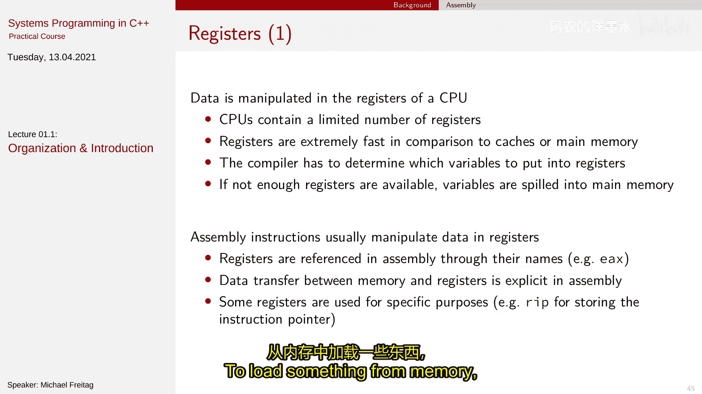

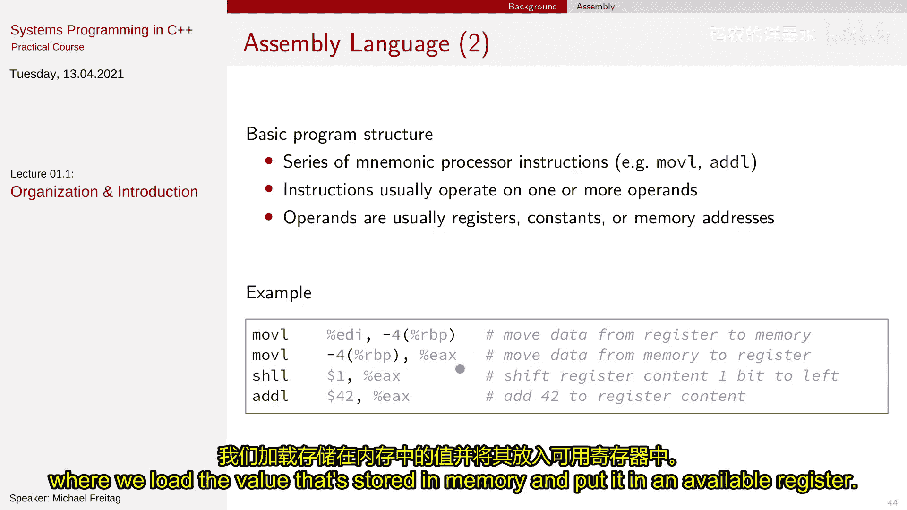

Some of the registers in ACPU are a general purpose that can be used for almost anything。

 while others are used for very specific purposes， just to give you an example。

 we have the RIP register which stores the instruction pointer or program counter as we've called it on our previous slides。

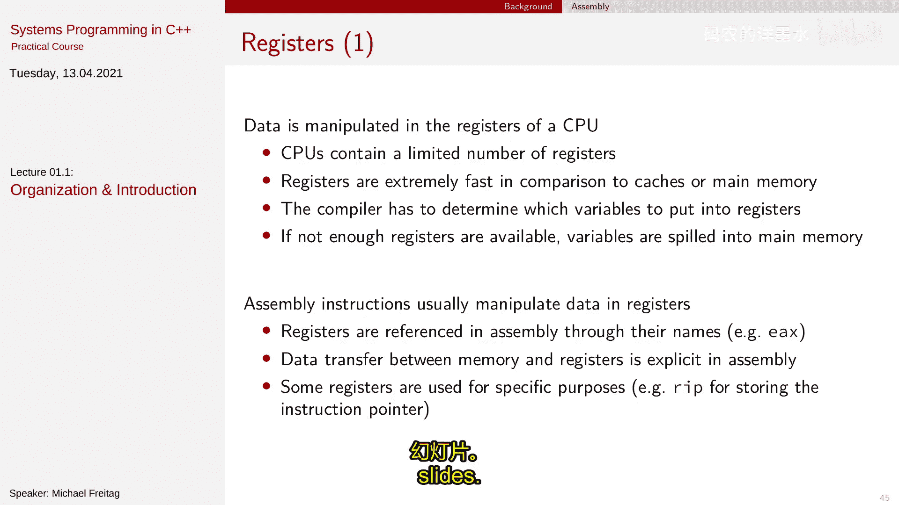

A brief overview over the important registers on a typical x86 64 bit architecture。

 so we're not going to go into detail about all of the individual registers just give a general overview so we have on the vertical axis we have several registers and on the horizontal axis you see that each register。

 of course， since we have a 64 bit architecture is 64 bit wide but we employ a certain amount of aliasing so that we can register a part of such a 64 bit register under a different name so for example in case of the RAX register if we use RAx we get 64 bits worth of register but we could also use the name EAX in which case we would only reference the lower 32 bit of this entire 64 bit register and then。

Even smaller with this continuous。 So we could also use A X。

 in which case we would only reference the。The lower 16 bit of the RAX register。

 and then finally we have two even smaller aliases A H and AL。

 which can reference the upper and lower8 bit of the lower 16 bit of our registers。

A lot of the registers that are named directly are general purpose。

 Two additional important specialized purpose registers are the RBP and RSP registers which use the which are used to implement the。

Stack that is used for local variables， and we'll also talk about these stack somewhere more in a later lecture。

 And then over time， more and more additional general purpose registers were added to CPUs。

It's not that important to know all of these registers by heart。

 it's essentially just important to be able to read register names and remember that we have some aliasing between the same register and the different names and that there is a distinction between the general purpose and the specialized purpose registers。

Finally， concluding on our assembly language topic， I just want to point out。

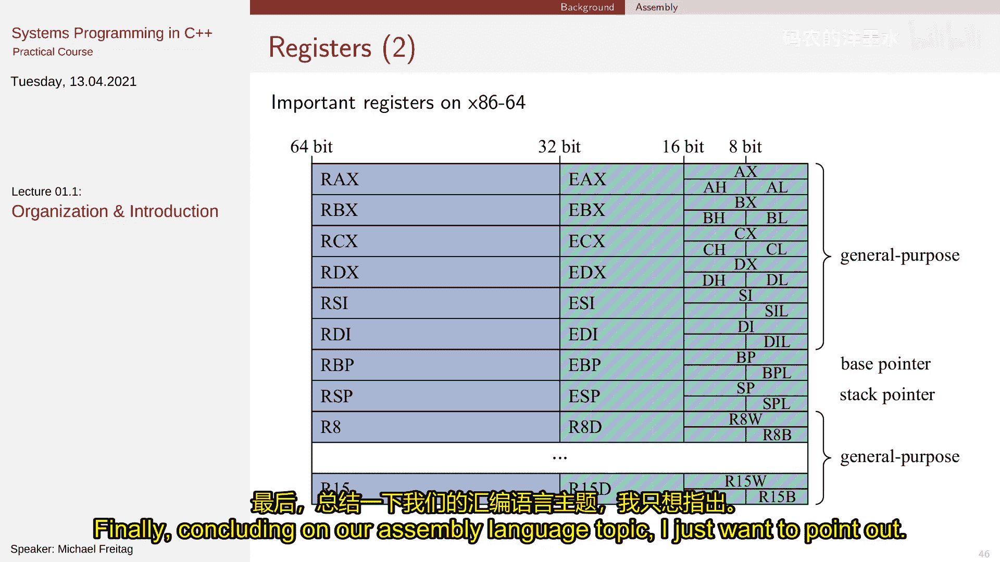

The Godbald compiler Explorr， which makes it very easy to actually view the assembly that is generated by various C plus plus compilers。

 So this was created by Matt Godbald and。We host our own instance under the link that's shown here。

And we very much would like to encourage you to play with this tool throughout the course so you can go there right away and。

Just take a look at the interface。 There's also， I think， an example program in there。

 And what the tool allows you to do is really just。

Enter a C plus plus program and then directly view the generated assembly from this program。

 as it would be compiled by the different C plus plus compilers that are out there。

And we'll return to this tool several times to our lecture just whenever it's interesting to actually take a look at the assembly that comes out of AC++ program。

So with this， I would like to thank you for your attention。 Our lecture for today ends at this point。

 I'll pause briefly some for some time in case there are any questions otherwise。

I'd like to say goodbye and until Friday。

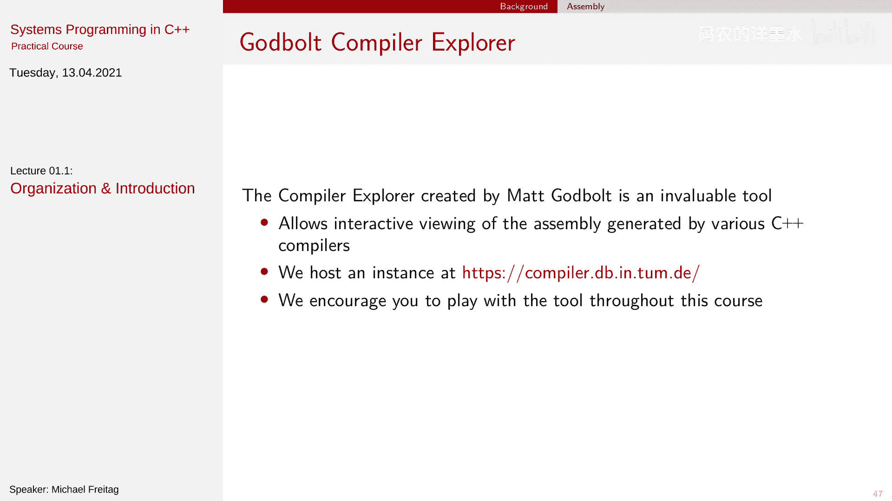