# 【全集 附课件】慕尼黑工业大学 C++系统编程 中英字幕 1080P p02 Lecture 2 - C++生态系统简介 -BV1QTzjBFER2_p2-

Welcome everyone to today's lecture on systems programming in C++。

Today's topic is is introduction to the C plus+ ecosystem。 This。

 unfortunately means we will not be talking about。C++ and detail yet we will start to do this next week but there are quite a lot of things that you will come into contact with when working with C++ and we think it's important that I mean not only do we think that it is important that you'll know some of the ecosystem but you will also need a lot of this in your programming exercises in the next weeks。

 so this is why you will talk about them。

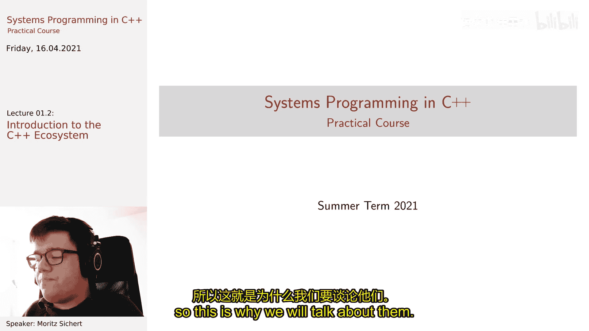

Nevertheless。So that you at least can see a bit of C++ code in an lecture called system Forium and C++。

 I will show you a small hello word example in C++。

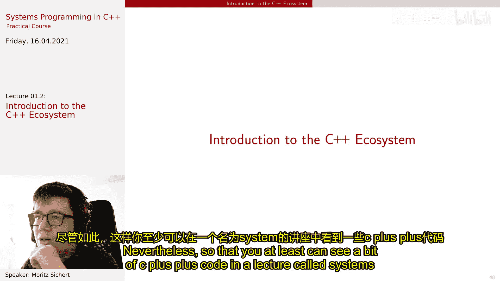

So I will not talk about the syntax today because this is what we will do next week。

 but just that you have an idea how a C++ program looks like。

 you will have a file that's usually has the file ending a CPP and then you have some I mean。

 some statements there you can define the main function and this a bit of weird looking line here this is。

Essentially， the standard way to print something in Z++。

And here I mean it's just a hello word example so you print hello and then the first argument you give on the command line and yeah then just return0 and Of course。

 as we said on Tuesday C+ bus is a compile language so you can't just execute it directly the program like you would be able to with Python I mean Python you still didn an interpreter but you don't need to compile it first。

With C++ you do need to do this and for this you need a program and here in this example we call this program C++ so you can see the C and and the example terminal here。

We just run the program CP+ bus with those arguments。

And then we get a binary file that is called my program and this we can then just execute with the command and argument here and then we get what we expected just to。

Hello words are printed on the term。Okay， but before we start talking about the syntax， as I said。

 which we want to today， instead we want to talk about the second example here。

 namely the C plus program， So this program is。

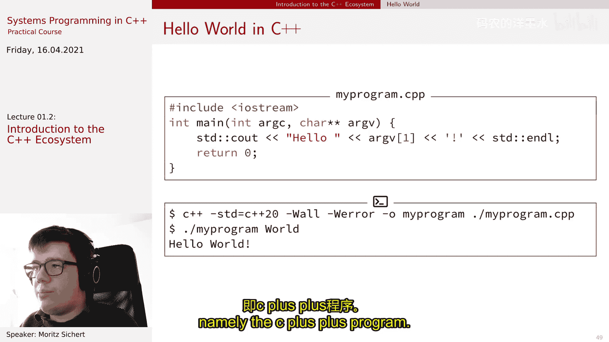

Essentially， a program that transforms a C plus plus file。

 or usually its's multiple files into one executable that you will then be able to execute order the operating system knows how to execute。

 And those programs， they are called compilers。 It's just any program that。😊。

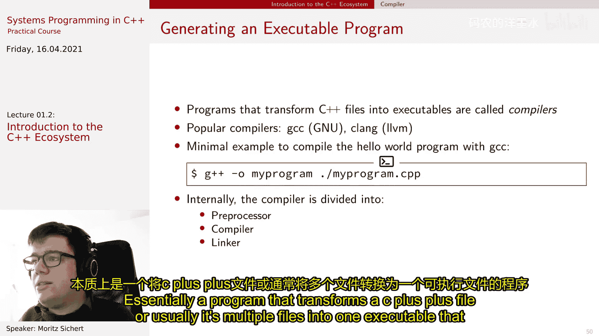

Takes some programming language as an input and outputs outputs and executable is usually called a compiler。

For CA spa in particular the most popular compilers are GCC。

 this is CGCC is short for new compiler collection so this is from the G project and there's another very popular compiler which is Kang。

 this is from the LLDM project you may have a third of it and GCC is mostly used on Linux systems so if you develop on Linux you will most likely be using GCC。

And GCC， as it is from the new project， you may have expected that it is open source and it is of course。

 but Kang or the LVM project entirely is also open source and this is also very common to use on Linux it's just the default usually is GCC but you can easily install KLang you may also have heard about Kang and LVM when working or developing on Mac OS because I think the default compiler on MacOS if you're install there the IDE of Apple this is then K instead of GCC。

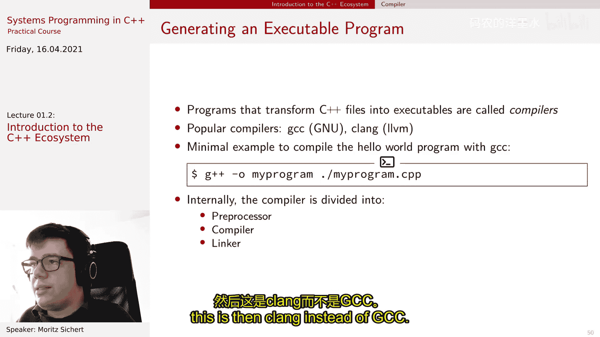

And GCC so the reason why we also present those two compilers is that they are mostly compatible in command and arguments。

 so if you see an example from GCC with command and arguments。

 you can usually just exchange the executable from GCC to Kang and then it will just work most of the time but let's first look at how you use such a compiler so you can see here an example of GCC and the GCC as I said。

 is called or stands for new compiler collection， which means that I mean one thing that it means that it not only support C++ but it can also support or compile C and other programming languages as well。

 so they are like different ways to execute this compiler and if you want to compile C++ program with GCC。

 you have to use the G++ program。

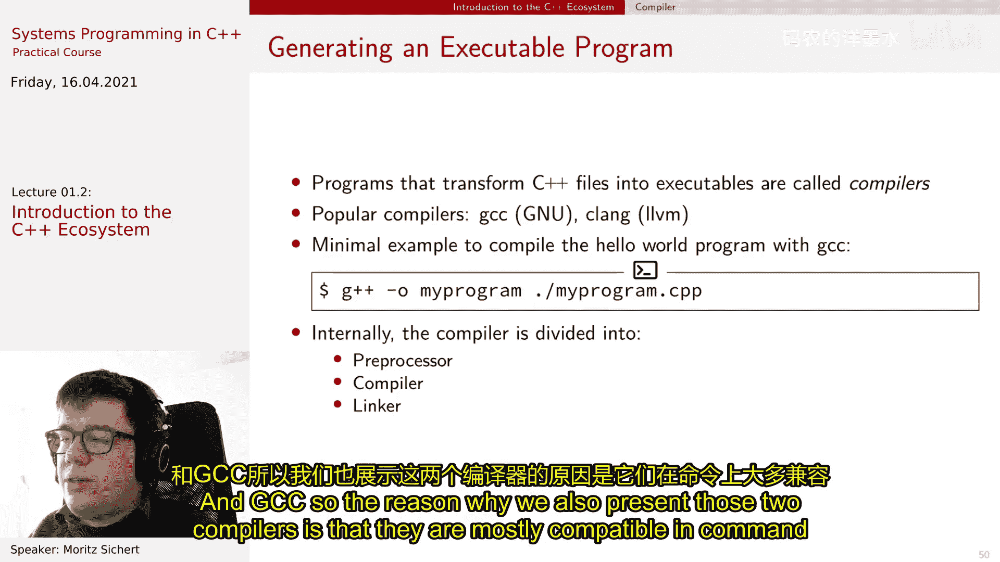

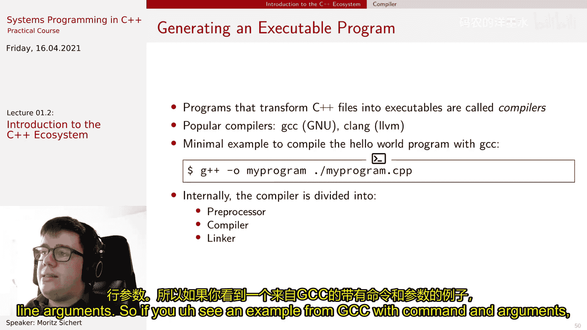

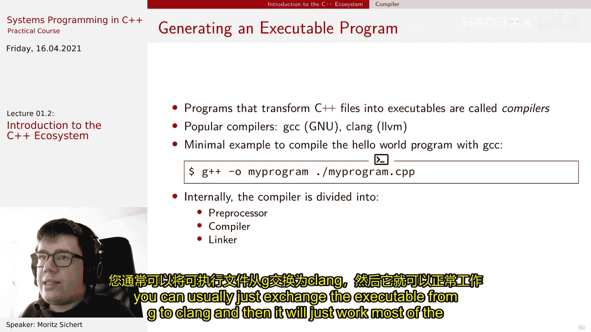

the Reper essentially to tell GCC to enable the C++ specific features and the most basic example to create a binary out of a source file is just to call the compiler with an input file and then use the dash O argument for the output file so that you have like so that the compiler writes the executable to this file。

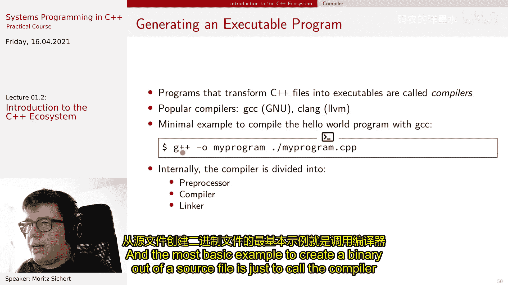

but internally and compiler， I mean， this just works， but internally of course。

 quite a lot happens and the first thing you have to know is that。Internally。

 compilers are usually divided into or at least C+ bus compilers。

 they are usually divided into a preprocessor， a compiler and a linker。 I mean。

 you see here that a compiler contains a compiler。 This is a bit confusing。

It's just that the word compiler。Usually if people talk about compilers。

 they usually mean all of those three steps together。

 even though technically the compiler is only one step of multiple that such a compiler needs or such a program needs to turn an excutable or turn source file into an exable。

 we will also talk about what exactly those are more in more detail， but this we won't do this today。

 but still what I want to give you today is a short overview of。

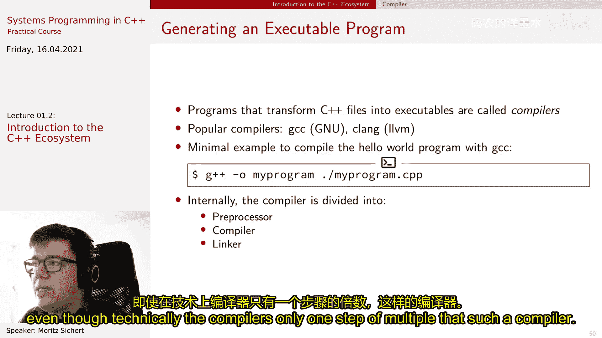

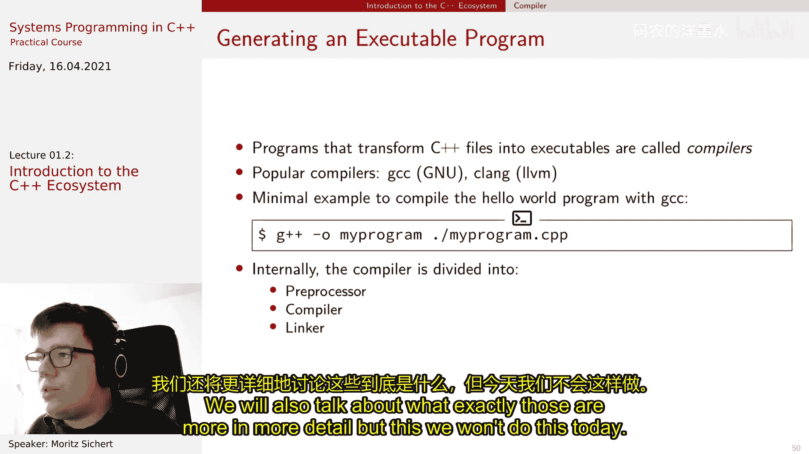

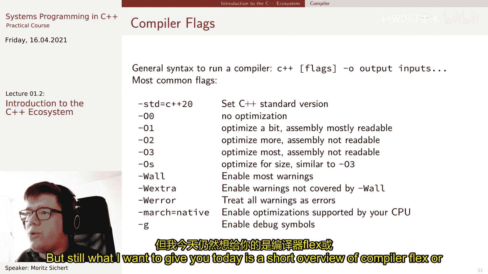

Compilr flex or command and arguments that the compilers and at least Gcc and clang that they have and that you can use to influence the compilation。

 So you as you saw the general syntax is you just use the C plus plus version of your compiler。

 So for Gcc， this would be G plus plus for clang， this would be clang plus plus。

Then you have some optional compiler flags that you usually specify the output file here with the dash O compile of F or command and argument。

 and then youll write all of the source files that you need as an input。

 you write this last on the command leg。And here you can see。

A few of the most common flags that you will probably always use either explicitly because you just type this out in your terminal or just implicitly by using some kind of IDE or something else that automatically generates those compiler flags for you but still it's useful to know about them I mean the most important one probably is the first one here is dash Sd equals c plus plus 20 this sets the or tells the compiler that you want to use the C++ 20 standard as we said on Tuesday there are several C++ standards and they have I mean the newer standard。

 the more features it has and because some features are not entirely compatible between versions I mean they mostly are but。

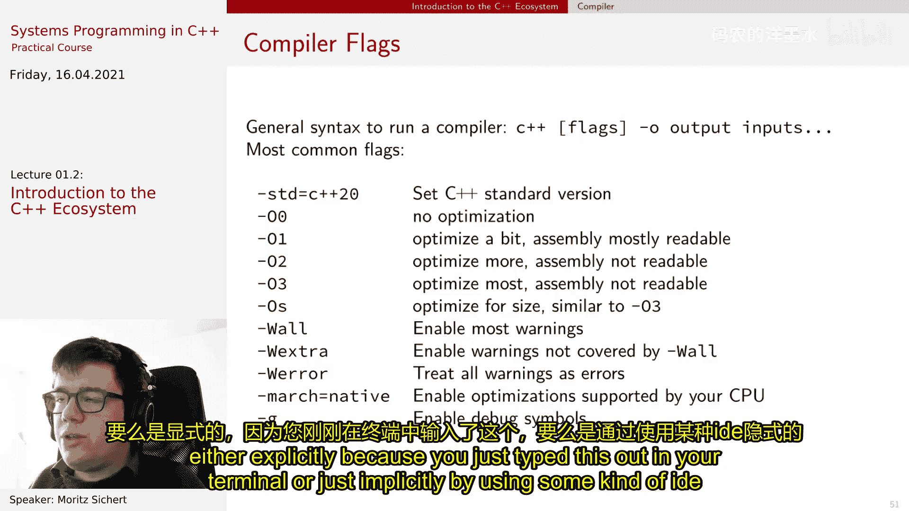

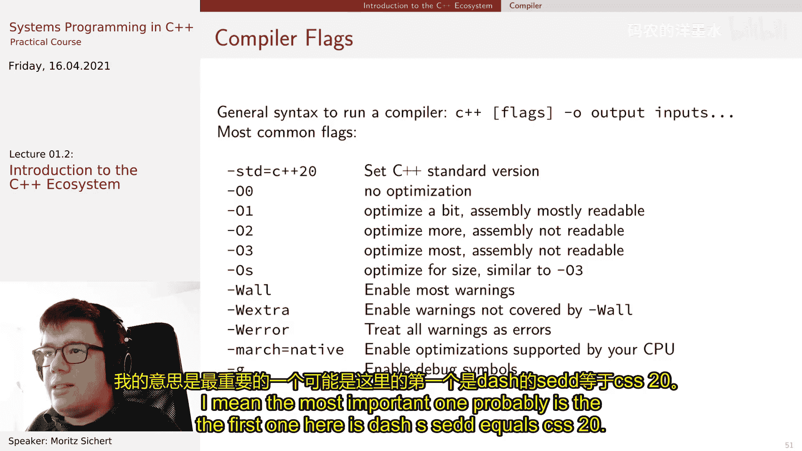

Not all the time。This is the reason why you have to tell the compiler which version of the C+ passing that you expect so that it can compile your program accordingly。

There are also a bunch of flags that affect the optimization optimization means I mean you have the same source program but of course there are multiple ways to generate assembly for the source program and depending on the optimization flex the compiler will try harder or not as hard depending on the Fl of course to generate a faster program that is equivalent to to what you would expect from what you've wrote down yeah it just tries harder to generate better assembly essentially the default for at least for claim and G aspa is00。

 which means that you have no optimization。

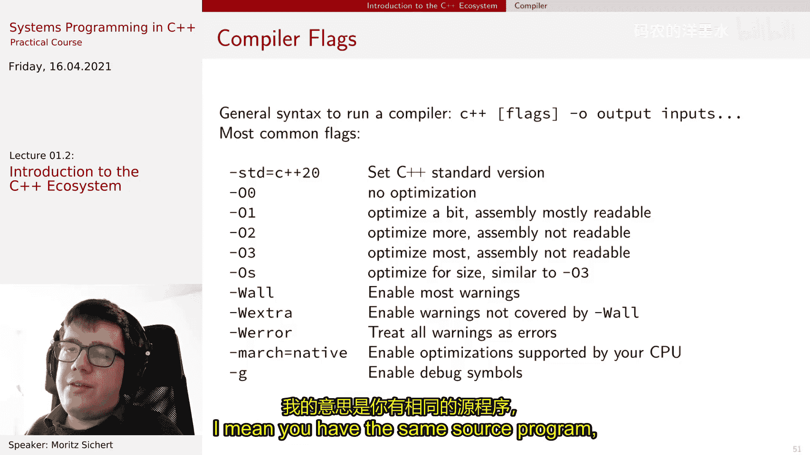

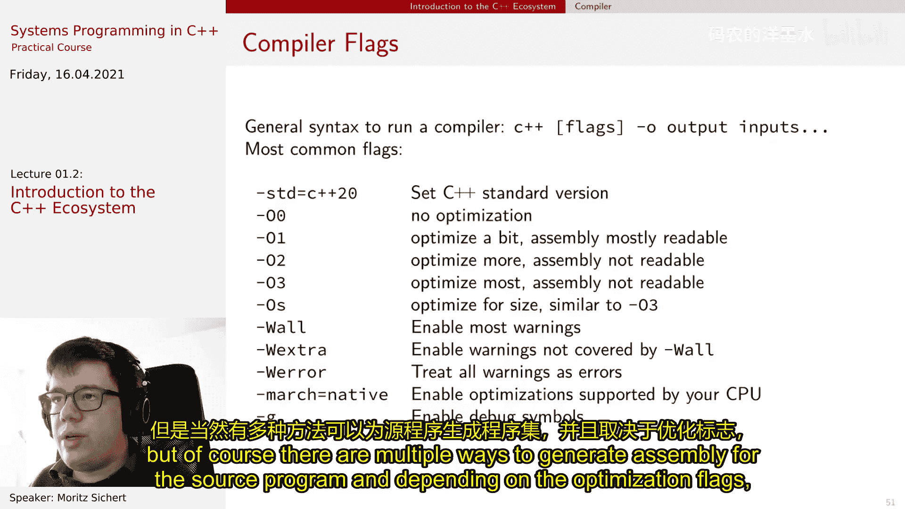

And the reason why you would want this is that this is the so if you want to debug a program。

 it's usually best to not optimize it at all because if you do optimize a program。

 the compiler will potentially omit some instructions or not execute some lines that you would expect because it can prove。

😊，Well it knows that some line is not useful for the program because it's not used or because it's not relevant for the program and then it will just remove it from the assembly but this of course makes optimization harder on the other hand of course non optimizeimized code is the slowest and there's like。

😊，You have several levels of optimization， the highest level is dash or3。And as you can see here。

 I mean， it's not a very precise definition， we just right。😊，O，01 optimizes a bit or two a bit more。

 and03 optimizes most。 Yeah， this really depends on a compiler which kinds of optimizations will be run on which level。

 but。What you should know is that， of course the higher the optimization level。

 the worse the assembly will be to read manually so if you need to read the assembly for some reason to debug something it will be harder of the higher the optimization level is and but still if you use all1。

 usually you can still figure out which C++ line corresponds to which assembly if you need to debug something that is related to performance problems。

 you usually want to enable a few optimization at least so that so that the program is not super slow because if it's very slow then sometimes the performance problem doesn't even occur or something so yeah for this you would use O1。

The compiler of course can also tell you or will tell you if your program is just wrong。

 so if it is syntactically wrong， of course the compiler can't compiler program but even if it's syntactically correct。

 there are many things that the compiler can detect。

 which may be allowed from a syntax perspective but not ever makes or maybe not really make sense in any circumstance for this the compiler has warnings。

And the warnings， I mean they are warnings because it's technically not an error so you can do this but there are hardly any cases where you would ever want to do this yeah and this is why warnings are very useful the most common facts for this are dash capital W and then all or extra for some reason the dash W all does not enable all warnings it only enables most warnings if you really want all warnings you have to use both the flex W all and W extra。

😊，And I mean， if you want to enforce that you want to compile your program and make sure that you do not even have any warnings。

 you you should also use the compiler F W error， this will just treat all warnings all as errors。

 which means that the compilation will fail even if you。Only you have warnings。So， in general。

For the programming assignments you will get in the following weeks。

 we will already enable the warnings for you and you should definitely always look at the warning output for the compiler because we will of course grade your programming exercises。

 not only on whether they work or don't， but we will of course also look at your code and see if it's like if it adheres to what we teach here。

 so as a general rule， if you do have warnings from the compiler。

 you should definitely change your program so that the warning doesn't occur anymore。

Okay let's look at the last two Fls one is M equals native this will just tell the compiler that you want to use the micro or the compiler architecture from your local system and this is relevant because especially on X86 CPUUs I mean they have existed for a long time。

 and have essentially the same instruction set but newer CPUs support better and newer instructions。

 but the compiler usually tries to generate programs that also work on rather old hardware。

 but if you know that your program will only run on your system because it's only your program that you are testing yourself or if you explicitly tell users of your library of your program that they should have a fairly recent CPU then you can also enable this and this will usually make。

Your program a bit faster。And last but not least， I talked about debugging a bit already and we will also go into detail into more detail about this in a future lecture and you can also explicitly enable debug symbols。

 which means that your program will be or that the debugger will be able to like essentially step through your program line by line。

 even though the program technically I mean if you compile it。

 you don't have any source lines anymore， you only have assembly instructions。

 but if you enable the debug symbols then this will still work。

There's a question which new compiler version do you expect us to have is version 9。

3 fine I am actually not sure what the first version is that supports C++ 20 let me see。So。

I think the most recent GCC is probably GCC 10。And let me see what what's the most recent version we have in our compiler。

Yeah， Gcc 10 is the most recent version， but I think GCC 9。

3 should all support everything that we teach in this sector I'm not sure I。In general。

 we need you to use a compiler that supports the features that we teach here。

 but of course I mean we also just use regular Linux distribution so we won't teach you anything that requires you to compile your bleeding edge compiler yourself so if you just use a fairly fairly recent Uuntu version for example and just use the newest GCC there then this would be fine。

Okay。

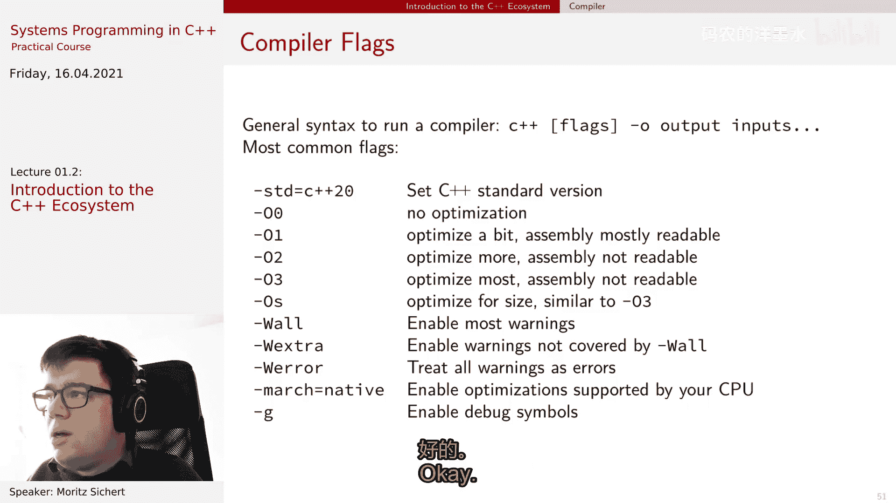

嗯。So let's go to another topic that we want to cover。

 which is also heavily used in C++ in the ecosystem and this is called make。Okay。

 so let's first talk about。L C plus plus project。 So usually a C plus project， of course。

 not only consists of a single C++ file， but multiple files And you will also see that you on in plus。

 we not only have C P P files， but you also have H P files which are called header files。

 and for now， you just have to know there are usually multiple files in the C plus plus project。

 And of course。😊，You need to compile every individual file。 and for larger projects。

 what you usually want to do is you do not。Have a single call to the or single execution of the compiler and just append all of of the files of your project into the single compiler call。

 But instead you compile each file individually。 And then so this is the second point here you。😊。

Compile each implementation file separately into an object file first this is an object file that's essentially like an executable which can't be executed yet and then in the end you have to link all of those object files and the reason why you do this is because this usually leads to better compile performance if you do not try to compile all the files of your program at once。

😊，But this also of course means that you have to write this GCC or G++ or Cl++ command line for every single file every time you want to compile your program and this of course is very repetitive because usually you want to use the exact same compiler Fls for every single file。

So you would just have to copy paste it quite a lot and of course。What you also want to do is if you。

 if you change something in a CPP file。Then you want to recompile everything that is required to generate your program with a new state or with a new change of PP file and when you do this with the object files this means that you only have to recompile the single object file that you whose。

Soce file was changed and then you can only do the linking again and then you have an entire program again。

And and also you have like if a header file or the HVP file changer， of course。

 you also need to recompile some files that will be affected by this。

 which means that if you would do this manually， you would have to figure out which files you have to recompile and which files are fine to just use the old versions Of course this is again very repetitive and fortunately there's a program that is called make that can automate this and make is I mean it's a fairly old program and most modern projects they don't use make directly but still it's useful to know what make is and how this works the program make it。

😊。

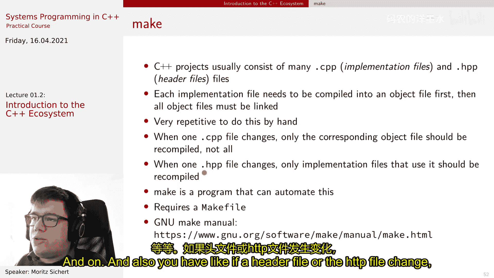

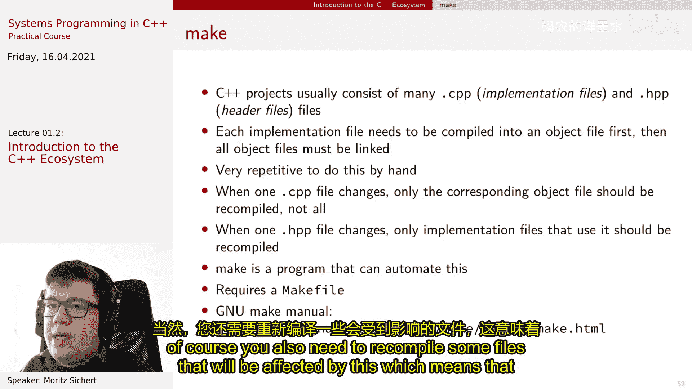

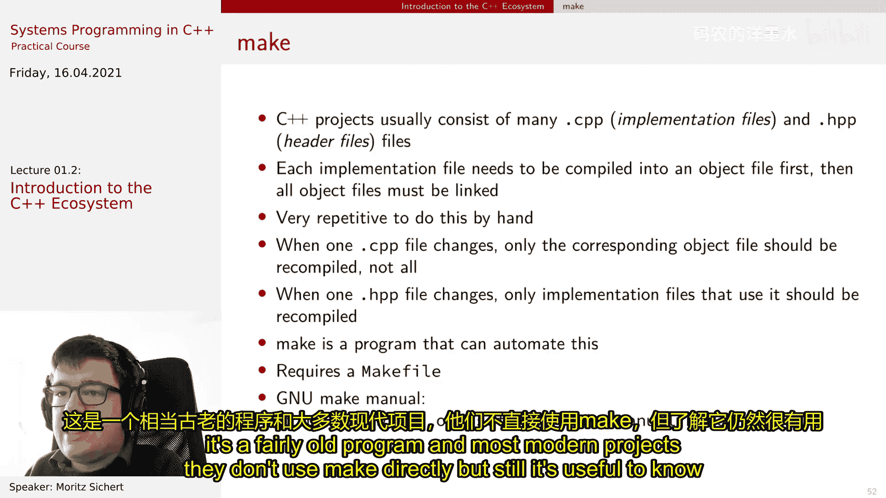

requiresquires only a single config file I to say， and this config file is called make fileile。

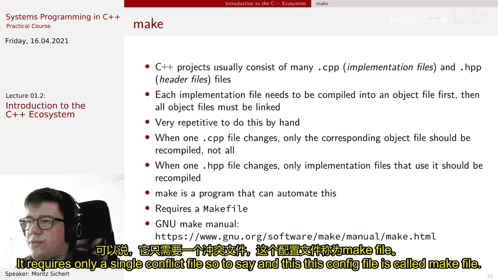

and the most popular implementation of make is also from glue and you can see the documentation here。

 which will contain everything we talk about make today in more detail so you can look up everything there。

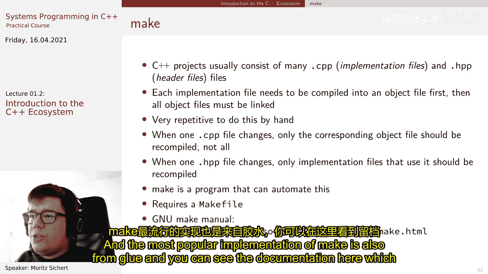

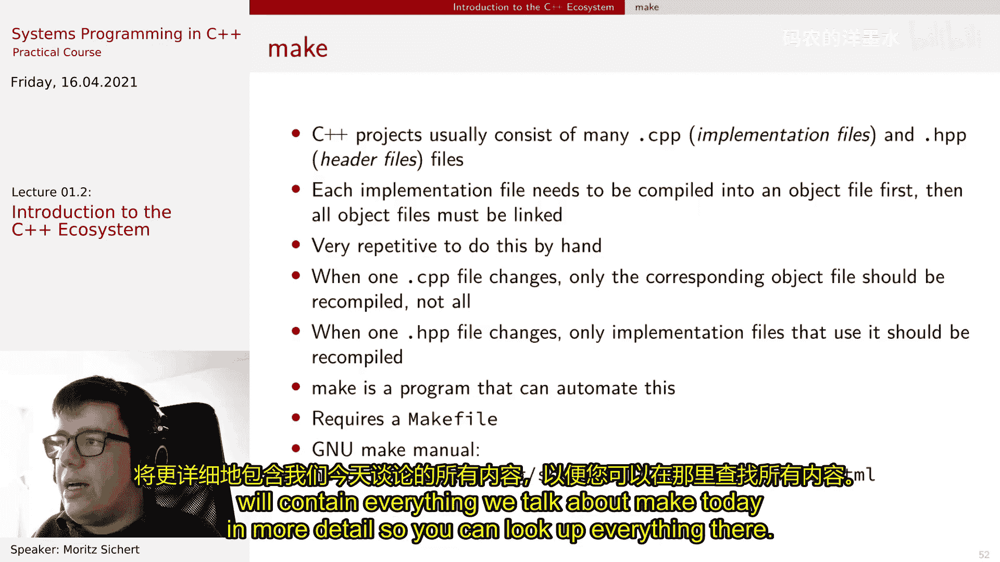

There's a question， what is the headout file？😊，This requires a bit more of knowledge about CP+ itself。

 this is why I will not talk about this today， we will go into detail about this next week I think and for now it's just fine if you know a CP+ project consists of many different files and if you change one file you may need to recompile multiple other files so this is just the basic idea you have to have for now we will talk about this in more detail。

😊。

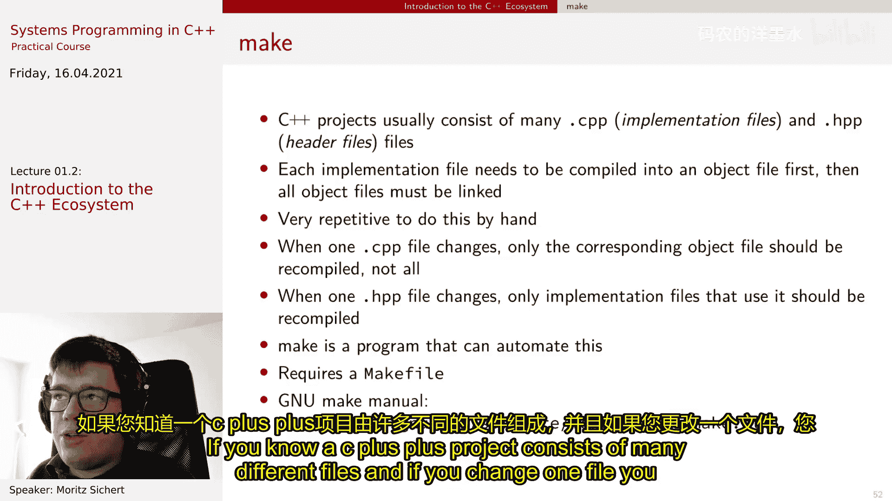

So but for now talk we will talk about make files and this is a very simple example of a make file so a make file the basic contents of a make files are rules and variables so in a make file you can define those two things。

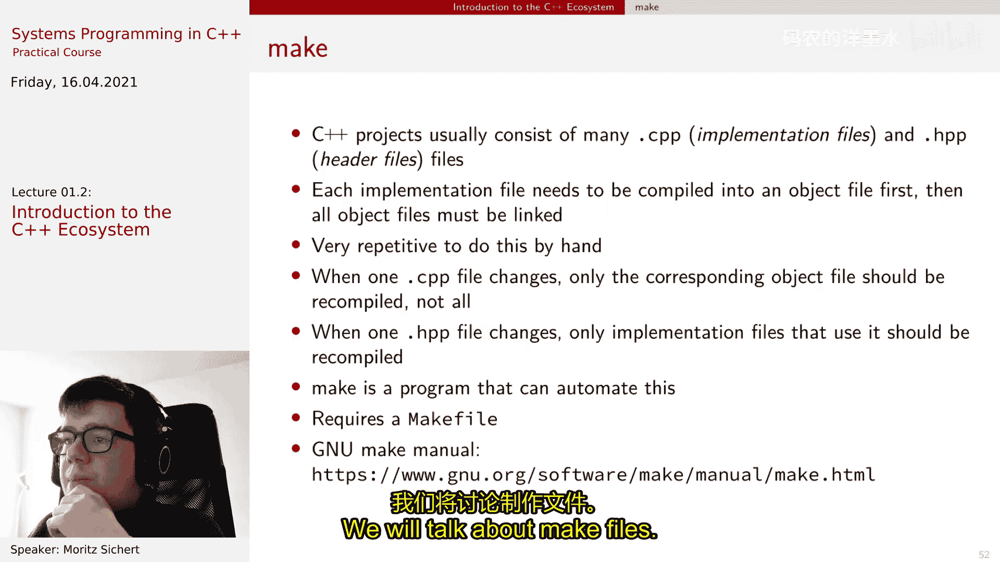

And for each rule， you have a target， which is usually the output file。😊。

At least if you are talking about C++， then you have the prerequisites which are usually the input files and you have the recipe。

 which is the command that will generate the target out of the prerequisites and。😊。

The nice thing then about make is that it automatically checks。

Whether the prerequisite files are newer than the target and if at least one prerequisite file is newer than the target。

 then make assumes okay that the target needs to be generated again and in a case of C++ project。

 this just means you need to call the compiler again。

 and for this this will just execute the recipe again。嗯。And you see an example of the magfi here。

 as you can see here， the note in in makefi the indentation。

 So the space here needs to be one tap character。 So no spaces this is sometimes a bit confusing and will generate very weird error messages from make if you don't use an extra tap character here。

 just as a note here。 but you can see here so we define a variable content which is just contains a string。

 And then we define two rules。😊。

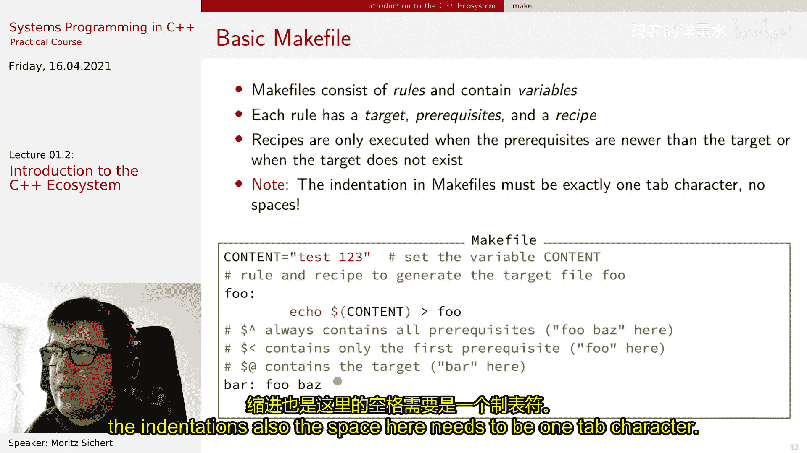

嗯。Which have the targets fo and bar。 So this means here we have a full rule。

To generate the target file full。And the recipe for this is， we just。

Echo the variable content and pipe it into the file fo。

 So this is just regular shells andt essentially everything that is inside of a recipe make will just take and execute as is in a shell in your like in batchsh for example。

 if if this is your default shell and in this case you can see。

 I mean the variables of course they are replaced by make first because make knows about this variable and this will just execute on your shell echo test one to three and pipe this into fo and you can see here this means that this rule every time it is executed the file fo will be generated this is the entire purpose of of make files Of course you could think of instead of like having like a simple echo here。

 this of course could also be compiler command So like g plus plus something。😊。

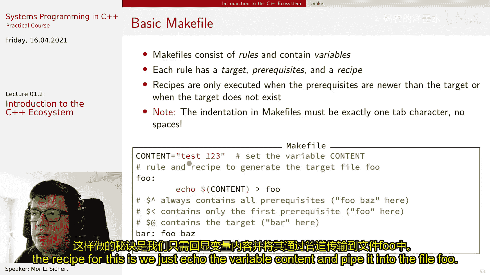

let's see a more a bit more involved rule here， so to generate the file bar， we tell makeg okay。😊。

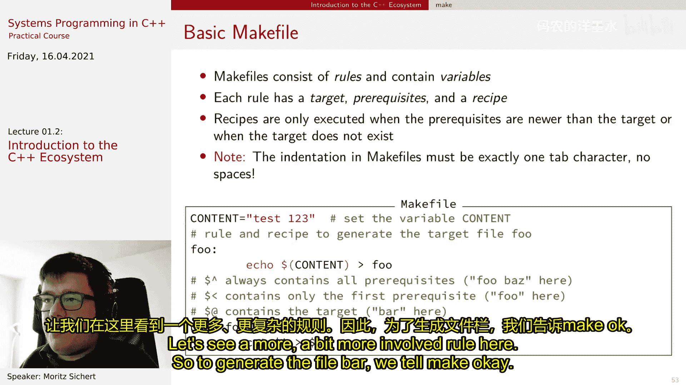

To be able to generate the file bar， we need the input files fo and bats。

 the rule for who we have here， so make knows how to generate this and we have no rule for baths here。

 which I mean this is fine， you can tell make okay I mean this could be like a source file of of of your C++ project for example。

 and of course the make program doesn't create the C++ files it just has to know that an input so a prerequisite for your rule and that the recipe needs this prerequisite to execute the recipe。

And you can also already see here there are some kind of special variables that you can use if you do not want to type the prerequisites and the target again。

 so you have a special variable， so this one here is the special variable that contains all prerequisites in this case。

 this would be full and best， then you have this variable which we didn't use here but if you for some reason only you need the first prerequisite you can use this variable。

 and you also have a special variable for the target。

And this essentially means if this rule is executed。

 we concatenate the files full and best and write them into bar。

 so this is the only thing the recipe here does。😊，Yeah， I mean， again。

 you would usually write something else here like something more useful like G plus plus and then dash O and then the output or the target and then the dollared variable for all the inputs and there are a bunch of more of those special variables which you will find if you look at the make documentation and you also have and so the current sheet also has an exercise on this you will see more about this there。

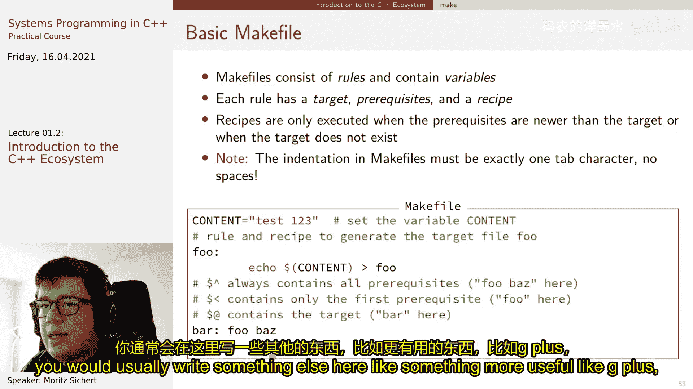

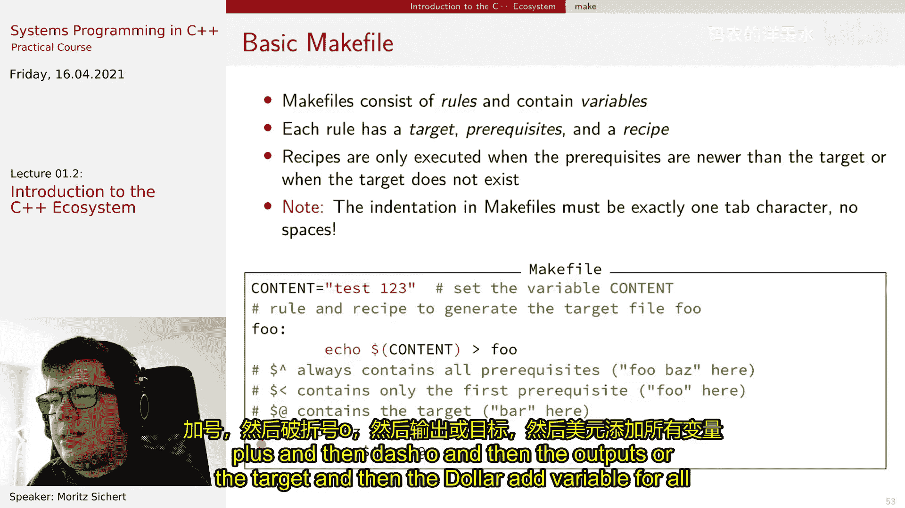

嗯。But let's now first look at。How this make file will then be actually run or executed by the make program。

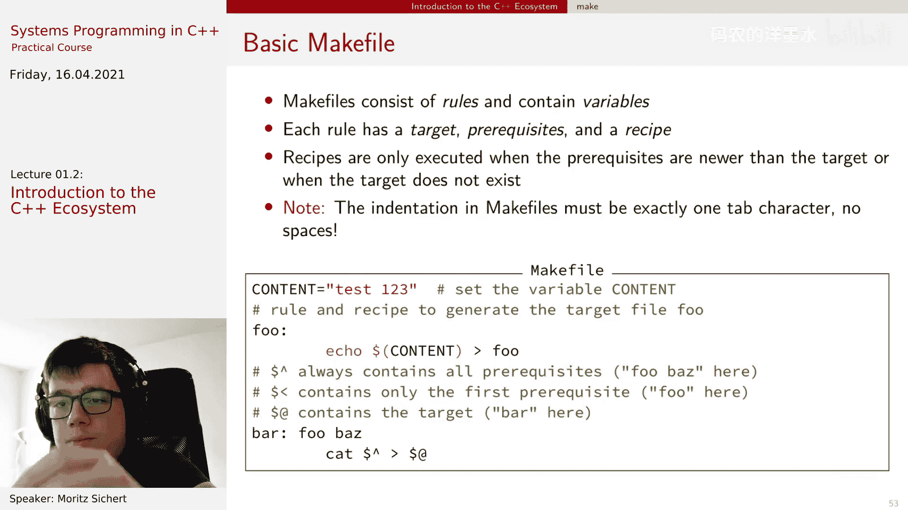

There's a question， so P and power are like function definitions in the make file。

 which can be added prerequisites。

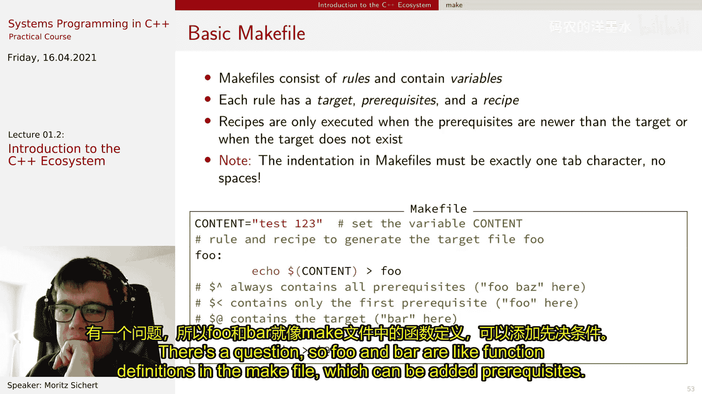

嗯。I wouldn't call them final definitions because this may be a bit confusing if you're talking about make files and C++ files。

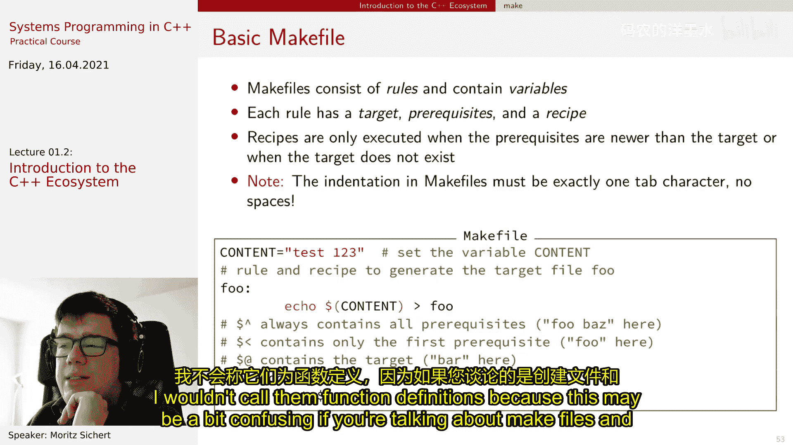

The the things here I would really just call them targets or rules and recipes。

 and I mean this is those are not arguments to a function。 They are like prerequisites to a rule。

 This is， I mean， this is the terms that the make files use， but I yeah。

 I would not call this functions because it's not。I mean。

 I guess you could think of this rule as something that takes the full and best file as an input and then returns the file bar。

 Yeah I guess that makes sense， but I usually don't think of it like that。

Okay so if we now take this make file and try to actually execute it。

 oh I mean we somehow need to run the logic that we defined here and to do this we use the program make what the program make does is it just looks at the current directory and looks for the make file and then just passes all of the rules and then executes everything that's in the rules or in the make file。

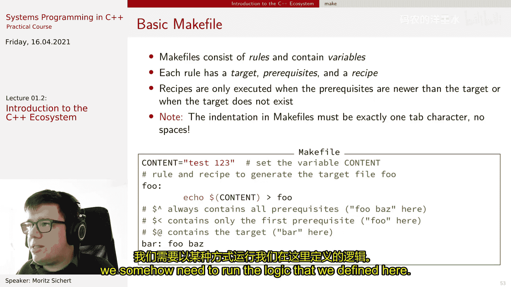

So what you can do is you can。Run make and then as a first argument。

 give it the target that you want to generate and if we assume that our current directory only contains the make file and nothing else。

 this means that if we run makeF we will see that I mean just we have the rule for F here and F doesn't exist yet the file so makeF will execute the recipe here which。

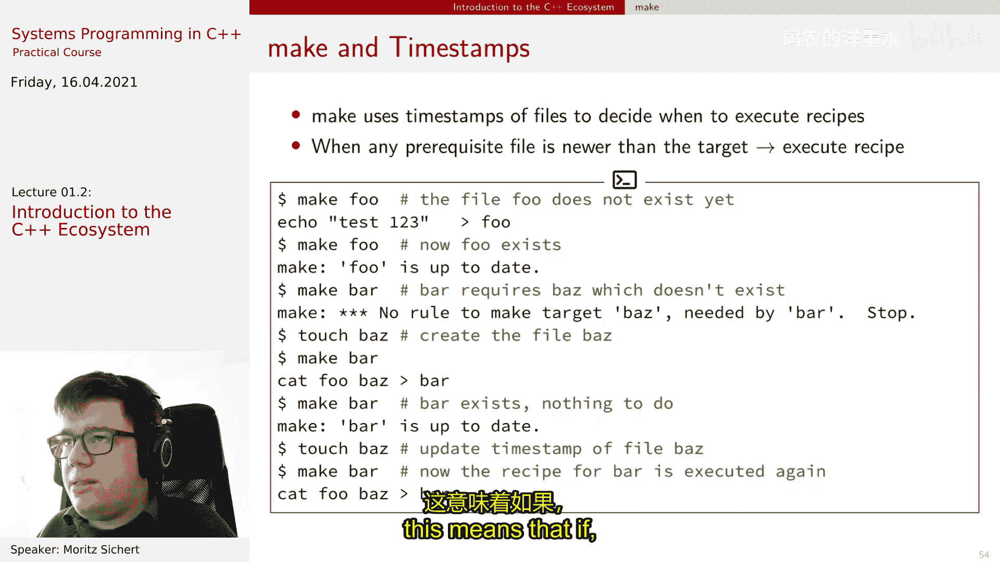

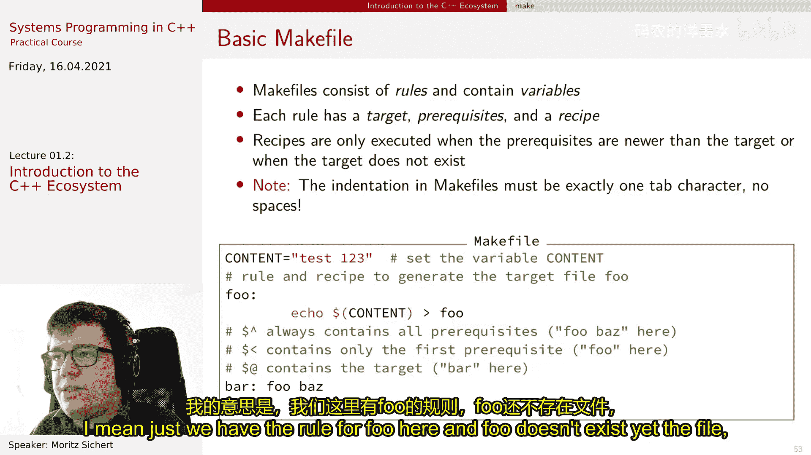

It's also usually， I mean， make usually prints all the commands that it executes。

 so you can see here what it actually does。If we now try to make food again here。

TheF file now exists because it was created by the recipe in the first command。

 make the program will detect this and will tell youF is up to date。

 which means that it will not run the recipe again and this is the entire beauty of make that it automatically detects if something already exists or not。

So as a second example， we want to generate the file bar， but as you saw in the make file。

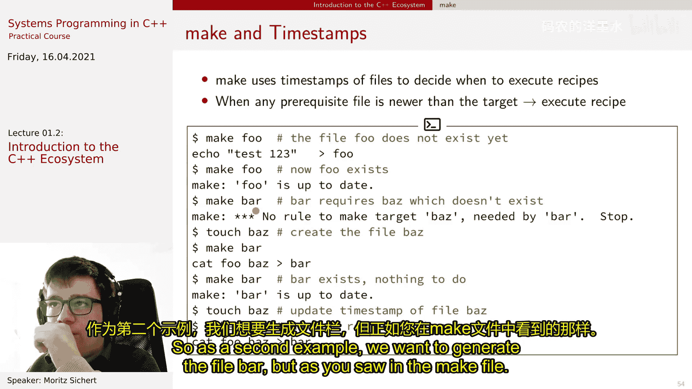

The bar target requires full and be as an input or as an like as a prerequisite。

 but the file be of course doesn't exist yet， So this is also something that make will tell you it knows that for bar to be generated and the file bias needs to exist or you at least need some rule that can generate this but make doesn't have any of this so it tells you there's no rule to make the target and it fails what you can do of course is then just create the file manually and then try to do make bar again and then will just execute the recipe。

😊，And the same here， if you then make bar again and we'll see that all of the input files exists and then that the output file is newer than all of the inputs。

 so that's fine， but if you now run touch best， but this does on the it just updates the timestamp of the best to be more sort to now essentially。

 then make will detect okay the input file or the prerequiite best is newer。

 then the target bar which in the terms of make means that the target needs to be regenerated so if you type make bar again。

 the target will be or the recipe will executeded again。

 which means that the bar file will now also be regenerated。

 which means that it will end up having a newer timestamp than best because it was newly created。

There's another questions of the arguments of the command make。

 so things like fo and power here must be defined in the make file first。I mean。

 they don't have to be defined explicitly， but there needs to be a way for make to find this file either the file already exists on the system or there or make has some special rules which we will see in the next slide here which will tell make how to generate a bunch of different files without you having to specify every individual file and because as I said and the motivation for make is that usually writing compiler commands is very repetitive and if you would just have to repeat all of the compiler commands in your make file again then you wouldn't reduce on the repetitiveness so this would be I mean then this wouldn't kind of defeat the purpose。

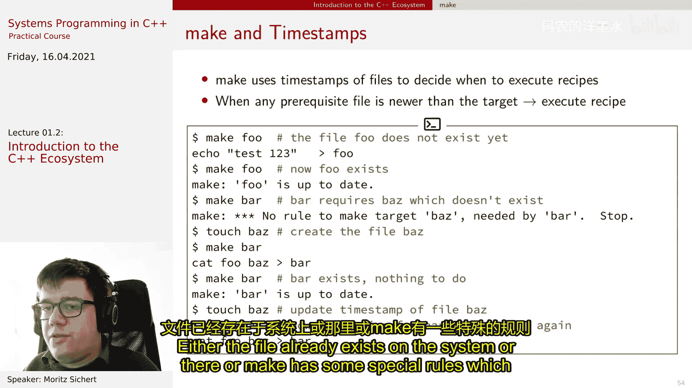

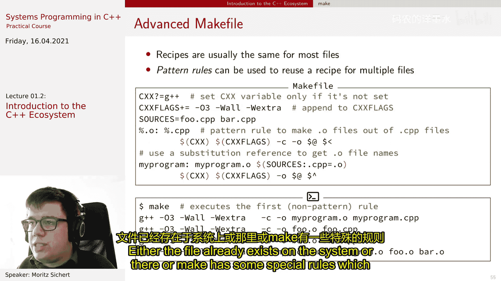

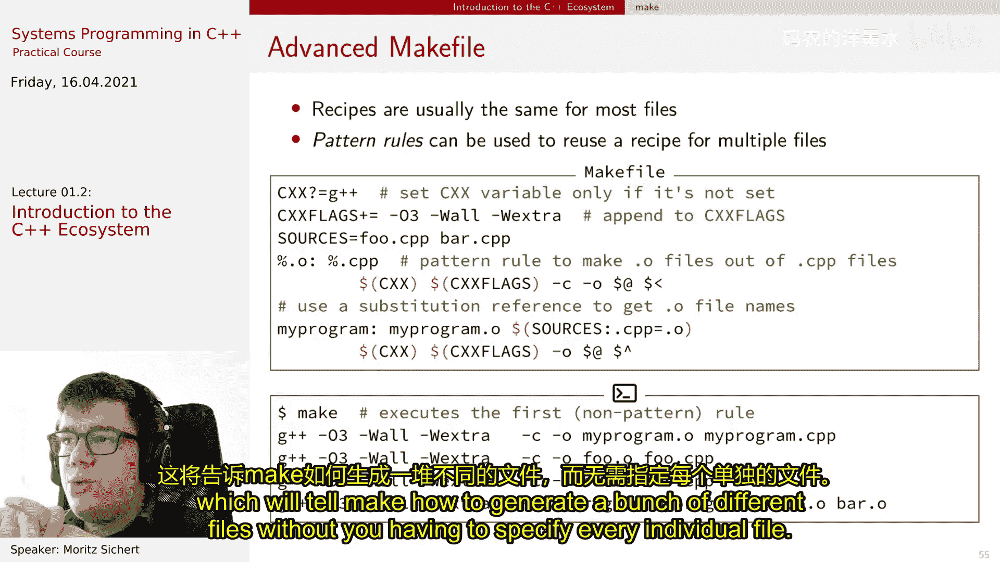

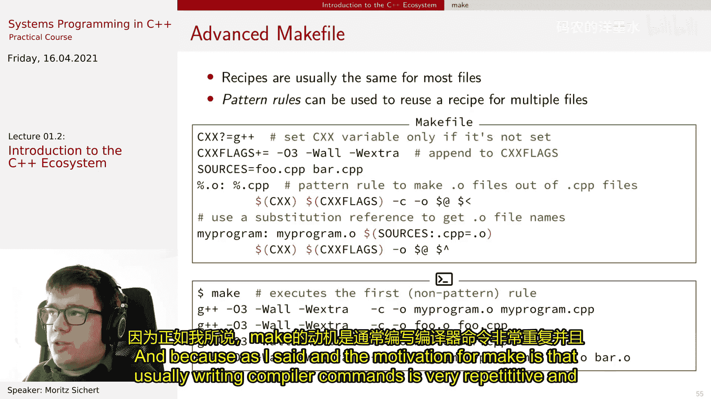

So what make also can do is you can write pattern rules。

 so a pattern rule is something where you don't explicitly know the names of the target and the prerequisites。

 but you know the recipe so you know for example here。

 we know how to whoops we know how to make an object file which usually has a file ending do0 out of any C++ file by using the D++ command。

So we know this， but we don't， I mean we only want to write this once and because we know this is true for all of our。

 I mean， for all possible source files， we want to use the same command。

And for this we write this kind of pattern rule and you can also see here in this advanced make file we have like we use a few more features we set a variable。

 so the question mark here sets the variable only if it's unsai then we appends to a variable we also define our source file here in another variable and we can then replace something in this variable with like we replace CPP with do0 so those are a bunch of advanced features which you will mostly have to work with in the sheet anyway so I won't go into too much detail here but I mean if you have any questions right now feel free to ask them。

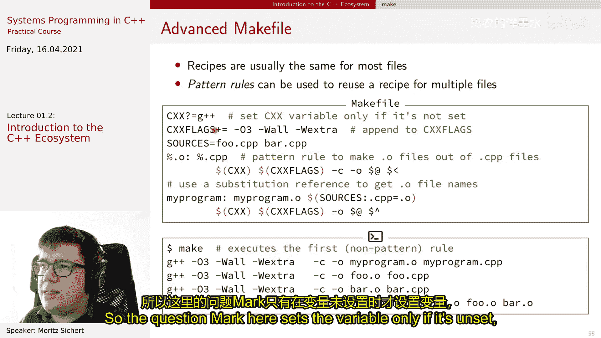

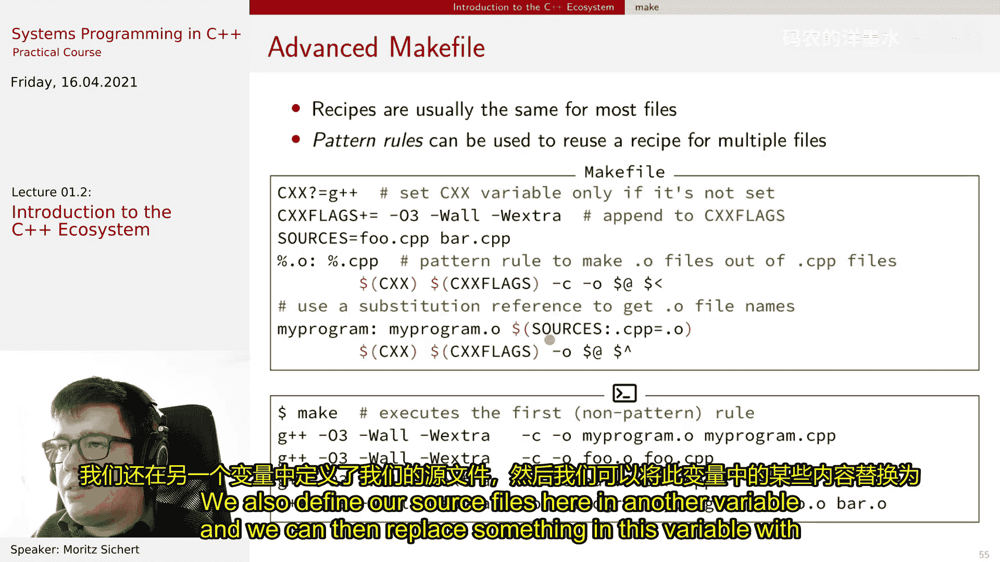

And of course， I will answer them。 but let's now look at mainly at the result here。

 So if if you just run make。Without any arguments what make will do。

 it will just look for the first rule which is not a pattern rule。

 which in our example here is my program and then we'll just execute this one。

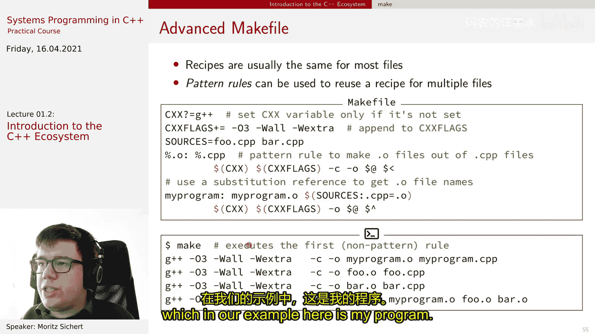

And in our case， we can see okay the my program has a prerequiite as a prerequisite has my program dot0 and all of these source files where the ending cP is replaced by dot0 so essentially the prerequisites of my program are my program do food。

0 and bar。 okay we assume that my program do0 doesn't exist yet in our directory which means that make notes okay I need to generate mypro do0 first and then。

😊。

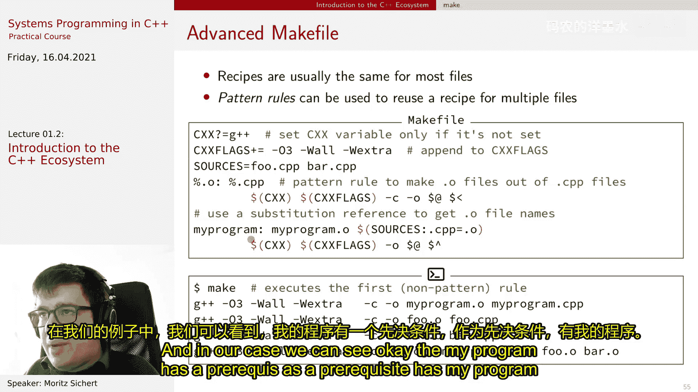

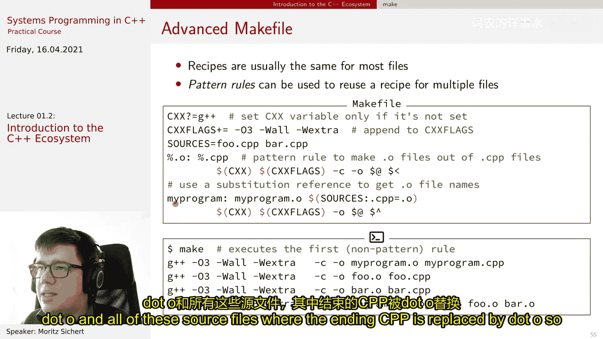

To answer the question， we don't have an explicit rule for my program at all。

But we do have an pattern rule。 So this means that make will try to apply this pattern rule by trying to find my program about CPP。

 because this pattern rule says。All files ending with0 can be generated by the same file name ending with CPP by using this recipe and in this case you can see here exactly this command will be first executed for the first prerequisite which is mypro。

0 then for the second which is who。0 and so on and you can see here that this is like three applications of the same pattern rule which like cuts down heavily on the repetitiveness because it just generates all of those commands and duplicates all of them as you need and in the end。

😊，As soon as all of the prerequisites are generated。

 then actual only then the actual recipe of this rule will be executed。

 which is very similar to the commands above， but we don't use the minus C Fl which is only used to generate object files but instead we generate the actual executable which is done this command。

🤧嗯。Okay， so。This is everything I will talk about make。Today， so。Do you have any questions about make？

So I see some typing， so Ill wait a bit。I mean， you can also always just use a microphone this is sometimes faster than to type it out。

Is there no keyword for the pattern rule。嗯。I don't know what you mean by keyword because the normal rules also don't have a keyword。

 I mean， by the pattern rule。I mean， a rule is a pattern rule if it contains the percent character because then make notes that this like percent should be replaced by the or is like a pattern that should be matched。

The question is what are sources？Dot cP equals do os so you mean this this part here yeah。

 this is one like there are several ways to modify variables in make and this is exactly does exactly what you says so it turns all of the or I mean it takes every string of this this variable and replaces dot CP with dot O this is exactly what it does yeah。

Okay。や。So I just repeat the question for the recording so the question was whether the rules for the prerequiites need to be defined before the rule that uses this。

In our example here we defined the rule for F before the rule for bar because power uses F。

 but in general this is not necessary， I mean make will first pass all of the rules that it has and then only if you need to execute one rule then it will only then search for the actual rule for the prerequisite so you can define them in any order。

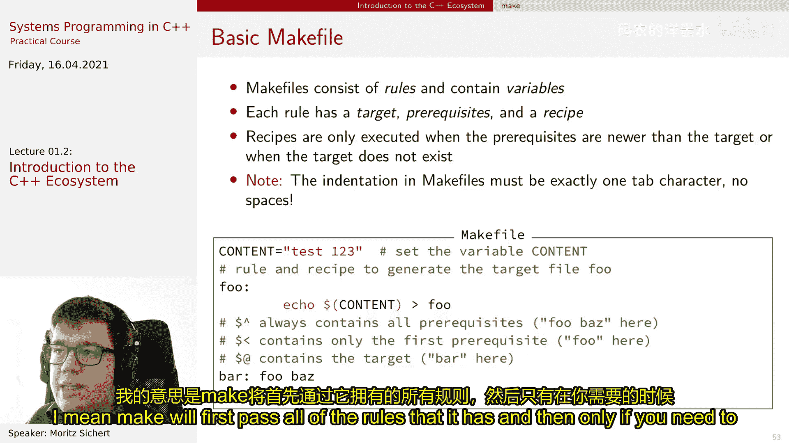

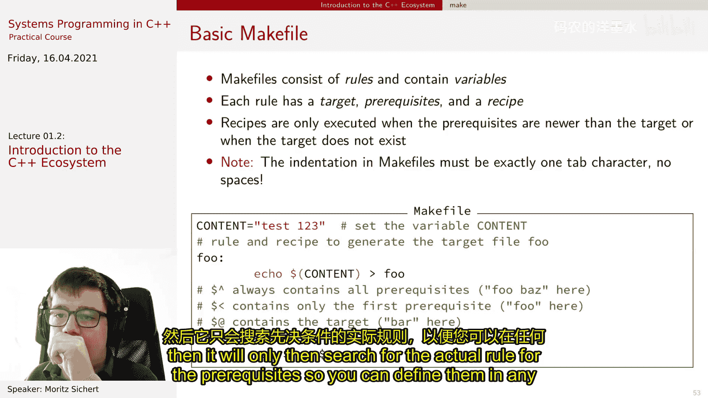

嗯。Okay， yeah， another question。So the question was whether I think the question was whether you need to repeat the recipe here so that you can execute this command if there are no other arguments。

I mean， unfortunately we haven't talked about object files and stuff yet。

 so this may be a bit confusing， but the thing is。Makeake will always execute。

All of the recipes that are required to generate the prerequisites and then it will also always execute the recipe for the rule that you are currently executing so you will essentially always execute all of the commands that are required and the reason why we write this here we write this like this is because this command here to generate the actual executable instead of object files is slightly different so you can see we don't have the dash C command here I hope this answers the question。

Okay， another question。Am I wrong or does the IDual Studio provide some tools that help with make files and so on Yeah that's definitely true。

 there are many tools that help you writing make files and we want to talk about one of those tools right now and this tool is called SeeMake so I mean as you saw already is that make already prevents your writing many repetitive compiler commands because if you can't just give it a bunch of or a list of of source files and then give it a pattern rule and then would automatically。

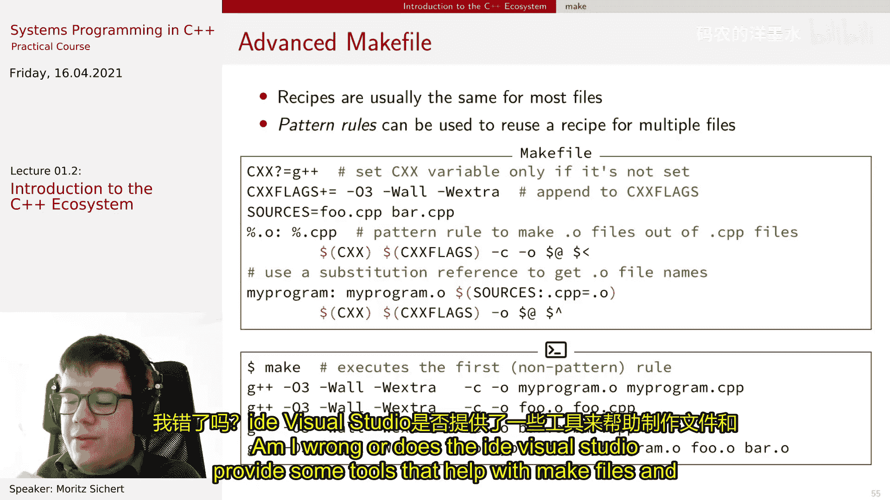

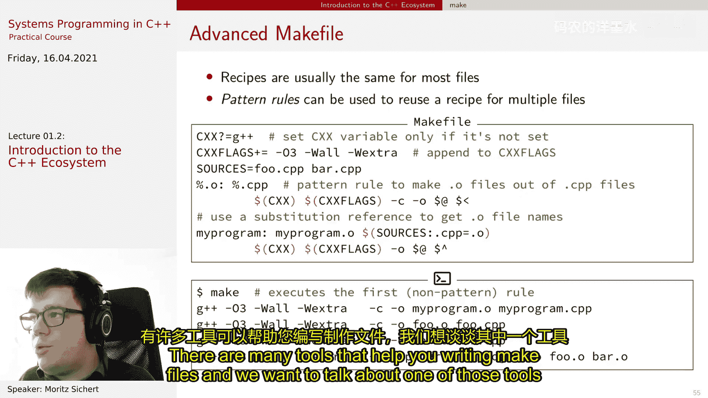

just。Execute them all together and then yeah， you have saved a lot of writing。But still。

 if you need like a different flag to generate an executable， for example。

 as opposed to an object file， you will need different compiler Fls and they also if you sometimes also need additional compile of flags like the dashL to link in external library。

 which we haven't talked about yet it' also not that important。

 it's just important to know that you may need different compiler flags for different kinds of compils。

But the more annoying part is that of different systems。

 the same library or the same dependency or even like the same source file may need different compiler flags I this is。

Of course， this is true if you use a very different compiler， for example。

 if you use the Microsoft compiler， the flex for the Microsoft compiler， they look very different。

 they don't use a dash instead they use oops they use a slash and they are also named very differently so they are totally different。

And which means that you would have to write a make file that can deal with all of this。

And this is also usually pretty repetitive， because， I mean。

People need to write CPS programs all the time for different systems。

 so this is essentially something that every CP programmer needs to do eventually so instead of everyone having to write this again。

 theres a tool that is called CMake that is a tool that is specialized explicitly for C and CP+ projects that uses yet another kind of convict file which is called CMake list of TxT which then generates a make file and then this make file of course can then generate the actual or can actually compile your program because I mean the make files they are still useful for all of this dependency tracking and automatically checking the time symptoms on or this make files are still very useful。

😊。

But usually you don't want to write， I mean you would need to write different make files or different kinds of systems。

 but you don't want to do this， so instead you write you have a program that generates a make file for your particular system in this program this case is called CMake what's also interesting to know is that CMake can not only generate make files it can also generate build files for other build systems and maybe there's an build system that we use at our shell for example this is called Ninja。

I think it's not as common as Makefi as make， but it has a few advantages。

 especially if you're compiling with multiple core。

 but the more common one probably is Visual Studio。

 which means that a CMake can instead of a make fileile can generate a visual Studio solution file or something it's called so that you can import it directly into your visual Studio。

😊。

But I think nowadays， Vi Studio should also directly support CMake anyway。

 so if Vi Studio detects that you have a CMake list Txt in your repository。

 then it willll just do the right thing automatically。Also there is very popular。

 at least it's popular at our chair， the C++ IDE which is called Sea lion and C lion also uses CMake internally so for C lion。

 I know this to be true is if you do have a programming project which does have a CMake list see then C lion well just figure out automatically how to compile this correctly and then it just works。

Similar to a make file， a lists。😊，TC is also just a text file that you can edit and it doesn not have fors recipes instead it has a series of commands and also of course there's an entire documentation about CM which you can find here by clicking on this URL but we will yeah we will talk about a few of those commands right now so。

A very basic Cac lists， what it always will need are the first two commands here。

 so the first thing you usually want to do is you want to set the minimum required CMake version this is just。

So that your。That CM enables the use of more like of newer features and of also that CM will automatically file fail if you try to run CM on a system that has an older version of CM than you would have expected。

😊，So this is just like yeah formalities sort to say to make sure that all the features you use in your CMake are actually available then you define the project name is I mean for make files a make file doesn't really have a name of the entire project it only has names for targets and so on but some other build files especially the virtual Studio files they do need to have a name so this is just a convention and CMake you have to give you project and name and then you can also set variables and instead of just writing it like my program files equals and then the contents you also have an command for this which is called set and then you can just create an executable by saying okay or by using the executable call it my program with those inputs and then then the CMake list will be able to generate a make file that。

Can turn your say hello dot TP， say buy dotTPP and my program your TP into the executable build my program。

And you can see how to do this in the second box here with CMake you usually create a separate build directory so that you don't build all of your output into the same directory where your source files live in so you create a new directory。

 then go into the directory， then called the program CMake on the source directory。

 which in our case is just the parent directory of the current directory。

 which on Linux is just the two points。And then as I said。

 CM will generate a make file so the CMake program itself will not compile anything。

 it will just generate a make file and of course by now you know to execute the rules in a make fileile you just need to run the command make and you can see here the make file generated by CM even has nice output compared to what we had in our manual make file it is like percentages of progress and it tells you like nicely de formatted what program it is currently compiling and in the end you will also end up again with the executable that is called my program。

There's a question it is also whether it is also possible to define flexency make Yes it is。

 we will come to this in the very next slide so I talked about the first two commands already。

The set command is also very simple， it just sets the variable with the name F and gives it those contents and the a executable we saw already as well。

 what you can also do instead of adding an executable to your project， you can also add a library。😊。

This is essentially almost the same， so in the sense that also compiler commands are generated for the makeFenceson。

 but the result will not be executable that you can execute but instead it will be a library so on Linux this would be a file with the file ending dot SO for a shared object and on Windows for example。

 this would be a file with the ending dot DLL for dynamic library。And to answer the question。

 you can also add custom compiler options by using the command a compiler options。

 we can see here if we， as I recommended in the beginning。

 you usually want to enable all the warnings that the compiler can give you。

 You want to use this command a compiler options dashboard dash W extra。

 and this will just enable those compiler flags for all compiler commands that the。😊。

that CMake will generate inside of theMake file。And you can also if you need some external library to link with your program。

 there's also a commanders called target link library and this library can either be as I said an external library or could also be a library that you added before with Ed library yeah this is not yet。

That important for you， because the program exercises will mostly be self contained so they don't have any external dependencies。

 But so just so you know， there are definitely Cmakers definitely can definitely handle external。

Depenencies。

Another thing important thing to know about CMake is that there are a bunch of variables that you can modify that will affect the compilation。

These variables you can either define yourself saw as we saw in the last slide。

 but there are also a bunch of predefined variables which start with CMake underscore and you can either set them or modify them with the set command as we saw already。

 but more commonly they are especially the CMake underscore variables。

 they are usually modified by the command line， so every time you call or you execute the program CMake you can give it on the command line the dash capital D argument。

And then specify a variable here。😊，So here a dash cable D and then P equals bar will define the variable with the contents of par inside of the of the C make lists or instead inside of the CMake execution so to say and what you can also do there's a program that's called C make So that's not a typo here that's2 Cs and this will give you a graphical interface to browse all of the variables that you can change and will also display a short help text for every variable and you can just change it with CC make and then rerun the CMake command and then it will update all of everything that depends on those variables。

 So let's see a few common variables here。

Wonder that's very useful is the CMake CxX standard because we already saw。😊。

That we can set the compiler version by using the dash Sd equals c+ plus 20 or flag on the compiler。

 but this only works for or at least I know this only to work for clang and Gcc but as I said I definitely know that this won't work with the Microsoft compiler because it has it has different kinds of flexs。

 So instead you can use this variable and CMake itself knows the different flexs for different compiler so if it just set CMake cx x to 20 then it will look up in in its directory。

 whatever which compiler is currently used and it will know which flex you need for to set this C++ version you can also change the compiler itself of course and for example。

 as I said the default Linux is usually Gcc or C++ it would be g plus plus but if you want to use Kang instead。

You can set these CM Cs as compiler variable。You can also change the built type which essentially will affect mostly the optimization flex because as I said also in the beginning。

 if you want to debug your program， it's most useful to not optimize a program at all。

 but if you want to program to be fast of course you do want to optimize it so for this you can use the Cac build type variable which can be set to either debug or release or RE with step info so debug is as I said。

 it has no optimizations and it enables all debu debugging flex and again you don't need to set any00 or G or something the CM program will just know which flex to use for which compiler release will essentially do the opposite it will disable all debugging features and it will enable the best optimizations and there's like something in between that's called RE with step info so essentially this means release with debug information。

Wwhich tries to make the program fast but still debuggable， so yeah you can play around with this。

 but usually for development the debug mode is the best one。

And what you can also do instead of using the the compile options。Command。

 you can also set it as a variable and you can for this you can use the CM X X X flex variable and you can there are also variables with the underscore debug or underscore release suffix。

 which will then of course only be applied if you are compiling your program in the Dbug or the release mode。

 which may make sense， for example， if you have a very special optimization。😊。

Flack which only should be used in the release mode then you would only append it to a Cm flex release or if you have something that makes debugging easier but it's not useful for the release mode because it makes the program slower than you would only use it for in the underscore debug version the difference between setting this variable and using the compile options here is that usually as I said the variables they are set by the person that runs the CMake command on the command line while the compile options command of course it' written by you by the person that writes the CMake list Txc so you have to think about whether this should live in the CMake list or whether you just want to allow a user to do this and to answer this usually I mean。

Need to ask yourself， does this configuration make sense for all use cases and for all users of my program of my library。

 whatever， for example， it wouldn't make sense to set the build up to debug in your SeeMake lists。

Because of course users may want to compile this project in release mode。

 so this definitely shouldn't live in DC makelists。

And also like selecting the C++ compiler also doesn't make sense in the CMake list itself。

 because maybe the user doesn't have the compiler that you have on your system so the user wants to select a different compiler。

And I mean， yeah， there's no real reason why you I mean。

 usually there's no reason why you should force people to compile your program with only one compiler。

 on the other hand， if you if you write your source files with the assumption that the compiler supports the C++ 20 standard。

 of course， this makes sense to accept it in the CMake list file。Because otherwise。

 your program may not even compile because you assume that the compiler uses the C++ 20 standard。

And this you won of course want to explicitly state in the C list file and I mean for the flex this really depends do you have like is it really important for your program to be compiled with M equals native and if yes if your program doesn't make any sense anymore if it doesn't use this flex and of course you can edit here in your C lists on the other hand maybe a user just wants to compile the program。

😊，With optimizations enabled。But for your program， this is not essential。

 this means that it should not probably not live。Like unconditionally in the cement lists。Okay。

 so I have talked a lot about CMake variables and commands。

 Let's talk about another feature that CMake also has is。

It can deal with subdirecties very easily， usually if you have a larger simple source project or any kind of software project。

 you of course usually divide it into subdirecties which represent like sub features or sub components。

And for make， I mean， make of course only looks at the make file in the current directory and yeah this sometimes makes it a bit hard working with make and multiple directories。

 but for CM you can define a CM list in every directory and you can then add this subdirecty by using the add subdirecty command it will then look。

In the subdirecty that you specify here for another Cic list。

And will then include the subdirectory with its Cic list into the like main CMake lists。😊。

Environment or however you would call it。But of course。

 since the subdirecty is part of the main project and the CMs of the subdirectory usually doesn't have the project command because it is part of the top level project I to say。

 so let's look at a small example for a CM project。😊。

And how it would look so you have oops， you have the likely top level。

 we call it CM sample project here。And you have the top level Cmic list。

 this is like the main C lists， so this one that will contain the project command。

And will then also contain the a subdirecty stuff and so on。

 And for example you can divide your program into the lip and the source subdirecties。

 This is arbitrary So this just as an example here and all of those sub each of those two subdirecties has its own C make lists which will be include included by the C lists top level file with the a subdirecty command and then you can also see here we have。

multiple source files and header files and each of those subdirecties and for example。

 this Clist will probably contain a line that says at library which probably will contain those files here and this probably will contain line that says at executable print greetings。

cP as we write here you can find this project or after this vector you can find this project on our Gitlabs so you can look at the contents of those Clist and if you want you can also try it out。

Okay。So this is the end of the topic CM， do you have any questions？It doesn't seem so。Then， let's。

Continue right with the next topic。The next topic from our C++ ecosystem introduction are version control systems。

This is I mean this is something that has nothing to do directly with Makefi and CMake it's just another thing that we find very important when working on software projects in general this is not very specific to C++ at all。

 so this means that this is also useful to know about version control systems when working on other software projects。

The general idea or the problem you want to solve is that if you have card projects。

 they usually evolve gradually， which means。

You don't sit down one day and write down your entire program or maybe even a week but you usually don't write it down once by like working on it several days and then never change it again because I mean it's just the nature of software development usually find bugs or you want to add new features and so on。

 which means that the code project evolves from its initial state。

 which means that you usually have incremental changes so incremental means you start from one state which we call version here and change a few things and then you end up with a new state version。

And what you want to do or what we now tell you that what is useful to do is to track those incremental changes or versions and the reason why you want to do this is that I mean the first reason the easiest probably or the most easy to understand is that this。

Create a documentation of the project history if you if for every incremental change。

 you write like a one liner or something that explains why what you did and why you did it。

 then this should make it easier for other people to start working on your project because they can see how something evolved。

嗯。But of course， if you track every individual change。

 this also means that you can selectively inspect or even modify or maybe also remove specific versions。

 This is useful， for example， for debugging。 if you know， okay， since version 1。0 we have this bug。

Why did this bug occur or which change introduce this bug？

 And if you track every every change or every version， you can narrow it。

 usually narrow it down more easily by。Like by going back and seeing， okay。

 which files changed and which version could have made this bug occur？

And another main setting point of version control systems is of course。

 the efficient collaboration when working in a team so if you have。😊。

A team that works on the same C++ or any software project。Usually different people。

 they have different incremental changes or different versions for the same software project and if you have a version control system that can manage multiple changes by different people at the same time。

 this makes your life much easier， but I mean we still want to emphasize using a version control system。

 even if you are only working on yourself on your project is still very useful because of the other two reasons we we stated here。

 you will have a documentation for yourself on the evolution of the project and it will make it easier for you。

😊，To like， see。Or maybe to try to find out why a change was made and why it may have introduced the bug。

 And it also makes it easier to like revert this kind of change。 so in general。

Now to make it more concrete， maybe a version control system。

 they manage those kind of versions and they usually represent them in a directed basically graph so which means you have the notess or the vertices which usually represent a version so we have here version one which is we gave it the description created project so here we just created a new project and we gave it the name or the version one。

Then we edit the file A。Whi means that we ended up in a new version and then we started from version2。

 maybe one person edit a file B， another person edit a file C。

 and then even change file C and in the end we want to combine those versions and we end up with a new version6 which is just a combination of things before。

More formally， the reason why this isnt directed in S graph is is it is directed because one version has to come before another。

 So I mean， this is only always strictly audit。The version V1 is conceptually older。

 or least comes before V2。 This is why it is directed。 If if the edge would be the other way around。

 this would mean that the version V2 is older than the version V1。 So this is why it's directed。

 And astic， of course， it is because you can't have something。 I mean。

 it doesn't semanity doesn't make sense to have。A version that is older than something something that it itself depends on so that just wouldn't make sense from the real world perspective to have a cycle in this kind of graph。

Okay， so this is like the theoretical aspect of version control systems。

 but especially in a C+ world， we want to talk about one VCS in particular and this is called Git。😊。

Git， I think， is probably the most popular， at least it is among the more popular。

Versual control systems。 and in particular it is used by Linux。 So the the Linux kernel project。

 and I mean， the Git was originally developed for the Linux kernel project。

 So this is why it even exists， but it is also used by other mainly open source projects like Gcc。

 for example， LVM， Both of those projects use Git to manage their。There。Project in their， their。

New code and the new versions， the new changes and so on and you can see all three of those projects they are pretty large。

 So I mean the Linuxox kernel I think the Linux kernel recently passed a million commits in their more recent version and LVM also has thousands I think even1 hundred thousands of commits and GCC similarly so you can see that Git is definitely it works for very large projects but it is also as I said。

 in general version processing are very useful if you're working alone and Git is also very useful I mean its it not only works great for large projects also works great if you're working alone。

And so a few advantages of Git in particular compared to others is that it is open source。

 just like all of the compilers and everything else we talked about today。😊，I mean。

 whether open being open source or not is an advantage or not， I mean。

 this is of course a a matter of perspective， but I would say this is an advantage。

 but the real advantage or like a more tangible advantage is that it is decentralized。

 which means that you can use Git。If there's no server either because you don't have one or because you don't have an internet connection currently and you just don't have a connection currently。

 which means that you can work with Git while you are sitting on a train or something and don't have internet currently。

 you can still use Git and only if you're back with an internet connection you can then synchronized with this server。

 another thing that is nice about Git is that it has efficient management of branches and text。

 we will come to what this exactly means in a bit， but efficient here just means that compares to other version control systems。

 this does not require a lot of additional disk diskb and so on and is also yeah it has very useful commands to work with those kinds of branches and text。

Again， you can find here a few links to the documentation of Git Git is also documented。

Very nicely in main pages so if you want to find out exactly what Git commitmit does。

 you can just typeM Git commitit with a dash in between。

 but there's also like the reference manual on the Git website and there's also a Gitbook which is also free which you can access from the Git website。

Okay let's first look at a few basic concepts of Gi so the very like the entire or a Gi repository is everything that or you start。

😊。

Out with Git by using or creating a repository， a repository is a collection of everything else that Gi has。

 So it contains gi objects， which are， for example， commits and trees。

 And it also has references to those kinds of objects， which are called branches and text。

 So let's look at what all of those terms mean。 So a branch。😊。

It's just a named reference to a commit， so named means it usually has like a one word name it's usually very short。

 something like you can see here， a fix XY Z or feature ABC， this is like a usual name of a branch。

And if you start out with a new Git repository， it usually has at least one branch。

 which is the main branch that you work on and this is usually called master or main。

 I mean you can change the name you Gi it doesn't really matter， but the default。

Named for the main branch on Git is master， but you can always create more。Then we have text。

 text are also named references to commits。

The difference between a tech and a branch is that if you take something。

 you usually don't change the tag anymore but a branch is usually like continuously updated so if you if you have a branch that is called like stable release or something。

Then if you have new commits or new changes for your stable release。

 then you would just add them to the stable release branch。

Wwhichch means that the branch will be continuously updated but an example for a tech would be something like stablerelease 1。

0 and the as soon as you release or as soon as you create a tech with the name stable releaselease 1。

0 you'll know okay this is this particular version which has this name and I will not change this particular version anymore so this is why we have a distinction between branch and text。

😊。

Let's finally come to a commit。So I committed a snapshot of a tree。

So a tree is just a bunch of fires， which I would come to next。

And a commit is in Gi identified by a Shaon hassh so essentially essentially there's the has of everything that the commit contains commit also has a commit message。

 so this is like to implement the documentation part of a version control system。

And also a commit can have multiple parents and as you can see here if you have something that multiple can have multiple parents。

 this will be able to form a graph and kit also makes sure that this will not generate any cycles and since you have like the strict child parent relationship this is also directed so youll also have always have children and parents。

😊，And finally a tree is just a collection of files and Git this is important to know it's not a collection of directories。

 only files with their paths and other major data and of course the contents the reason why I wrote this explicitly here not directories is that this means that Gits does not track empty directories because it only knows about the paths of files and if a directory contains no files then there will be no file that has this directory in its path so Git will not be able to track this。

Directory what's also important to note here is that a commit is a snapshot of a tree。

 this is a bit different to other version control systems if you have worked with others is that a commit can also be represented as the change between the last version and the current version。

 so you only store the differences between like the last version and the current one。

 but this is not the case for Git Git at least conceptually stores the entire snapshot of all the files in your repository in every commit of course because in the real world you do not change many files in every commit in the backend git has some optimizations that will not actually copy all of the files every time you have a new commit but just so you know conceptually a commit is just a snapshot of an entire tree。

Okay， so those are the like theoretical concepts of Gitlets now look just in a practical use of a gi。

😊。

The very first thing you want to do when using Giters， of course。

 create a Git repository and to do this。Assuming you don't use something like Gitlab or GitHub where they will create the Git repository for you if you work just on your computer to initialize a Git repository。

 you use the command Git in it。And this will just make the current directory。

 essentially the root directory for a new git repository。

Then the things you should also do is you should set your username and the user email if you use the global flag here。

 this will like remember the setting across all of your Git repository or you only need to do this once。

 but so reason why you want to set this is that every time you create a new commit Gi will add a commit message that also contains your name and your email and this is especially useful of course if you're working in a team。

So that they know who created this change and another very basic command is Gi status。

 which shows this status I mean the current status of the gi repository。

 I mean that's maybe obvious from the。From the name so you can see an example in the in the command line。

 we create a new directory， we call it my repo for for just a new repository。

 then we go into this directory。Then we initialize it。

By using the grid in command and it actually tells you that it initialize it initialized it。

 And then if you type kit status， you will see that。😊。

Getit created the branch master because it's the default name。 And it tells， okay。

 you have no commits yet and you also have nothing to commit because no files exists yet。

 So this is like the very basic。Layout of a newly created Git repository。There's a question。

 is it possible to set a password locally？はい、どの。What do you exactly mean because Git itself doesn't know about passwords？

Because every， I mean， and get to everyone。I mean， your commits， for example。

 they are not password protected everybody can set any name so I could set my name to Michelel S and my email to Michelel's email。

 then I would be able to just create commits in Michelel's name this just works So there's no no password here I mean。

 of course if you if you then try to synchronize with it with a server like Gitlab。

Then you will probably need to authenticate on the server。

 but this is like this is not related to Git， this is usually you use something like SSH keys as someone wrote or like yeah youre authenticate in some other way so Git itself doesn't know about passwords。

Okay， so let's now look at how how we can actually add files to it。😊，In Git。

A change or a file can live in any of those three places， so we have the working directory。

 so the working directory is just like the current directory that the operating system knows about in the current file system or in the current directory and you have the staging area。

This is like an in between area where you can add things that you want。

To make a commit out of。 But usually you want to commit multiple changes into a single commit。

 So this is why Gi has the staging area here， which is also pictured here。😊。

Where you can add few or many things first， and then if you are done by adding everything you want to combine into one commit。

 only then you can create a commit by using Git commit and then the changes or the new snapshot will live in the commit。

AndThe nice thing about Git is that the way it works is that once something lives in a commit。

 so once you committed something and it is referenced by at least one branch or tech。

 this means that it's not like that you didn't delete the branch or the tech。😊。

This means that the commit or the contents of the commits will never be deleted again by Git。

 which means that even if you accidentally remove the file or remove a line of this file and you want to get it back。

 you will be able to do so with Git。Of course， I mean。

 you can always also remove all of the metadata of Git as well。 then the changes will be lost。

 but usually as soon as you committed something， then it is very hard to remove it again from Git。

 And this is， I mean， this is by design so that you can track all of the older changes。

 And here you can see an overview of Git commands that you need。😊。

To like move changes from the working directory through the staging area to a commit and maybe back so you can see I mean as I wrote here from the working directory to the staging area you would use GitE and then to add all of the changes from the staging area into a commit you would use Git commit if you want to get all changes from a commit and overrite file in your working directory you would use Git checkout for this and if you want to remove changes from the staging area back to just living in the working directory you would use Git reset。

Yeah， so let's look into those commands a bit more。

嗯。There's another question does every commit always automatically have a tech No text they only exist if you create a manually and maybe I was a bit unclear here what I mean by that a commit is referenced by at least one branch of tech is that the commit only needs to be referenced implicitly or transitly even like also through multiple child parent relations which means that if you have the master branch which contains commit and this commit has several parents and this has other parents and all of those parents will also be considered to be referenced by the same branch so all of the parents a tech or a tech commit or commit that is the top of a branch will also will never be removed by Gi again。

Okay， so to come back to the actual commands。TheU the syntax at is for add and reset is you just write Git at and then the path you can。

 I mean you don't have to specify all the files individually here you can just write Git at and an entire directory then it will add all of the files from this directory and the same for Git reset or also a very nice feature is Git at dash P which will then。

Cha or ask you for every individual change interactively whether you want to include this or not。

 this is sometimes useful if you have multiple changes in the same file which you want to add into different commits。

 then you can use Gi at dashP for that。

And of course we have Gi commit， this collects all of the changes from the station area and turns it into a commit and as I already said this you can write or you should write a commit message there and it would also include the author and the date information。

😊。

And what it also does is that it。It makes the current newest commit of the branch will be made。

 the parent of new commit， and then the current branch will be updated to point of the newly created commit。

And then here we have Git checkout which as I said。

 overrs the local files or the local changes with their committed versions。

 this is useful for example， if you change something in your in local directory in the working room directory but you don't and just just for testing or something and just you want to go back to a clean state you can use Gi checkout for that。

😊，The question is， is there a backup in case you want to reload the changes you reset， no， for reset？

So as I said。😊，Git remembers everything that was committed but not everything that was in the staging area。

 so if you add something to the staging area and then reset it again and then override the local changes。

 then this change may be lost the only thing that Git remembers is the commits but what you have to know。

Adding something to the staging area and then doing Git reset doesn't actually modify any files on your file system unless I mean there's a flag from Git reset which is called dash force which will then override the change。

 but usually the staging area is just the conceptual concept of Git this has nothing to do with what your working directory contains So the work directory is the actual。

Fight system and the sging area is just like a conceptual thing of Gi。

Okay， so once you have a commit， of course， you want to inspect the history and the entire history of your project and Git you can do this by using the Gitlock command。

😊，This will just show you the comm of the current or another branch when you give it as a command and with it show。

 you can show the changes introduced by。Either by the last command commit if you don't give it any extra arguments here or by the given commit。

 so you can give it as a hash here。So。Yeah this is useful if you want to know for example。

 okay this commit I know this commit edit this kind of change but what other things did did this change edit as well so you usually would do this in the context of browsing the commit history by like looking at the entire lock and then for every commit look at maybe which files changed and so on and for this there's a nice program that is called tick。

😊，So T is just essentially git reverse and this program provides a text based interface where you can more easily scroll through all of the branches and commits and so on。

 and you don't have to type out all of the Git commands individually So you would just run tick without any arguments to show the lock and then you can just browse to the through the lock and then press enter to go to the commits and see all the change and so on。

 So this is a very nice。😊。

Helper for it。But still nevertheless， it is， it is useful to know about the about the。

Commands that Git gives you and another command that's very useful is the Git diff command and this as maybe the name implicates。

 it can show you the difference between two versions If you run Gitdff without any commands。

 it will show the changes between the newest committed version and your version in the working directory without the staging area。

 if you want to see the changes in the staging area， you would use the staged argument here。😊。

But you can also see the changes introduced by a certain commit。

 so head is always like the topmost commit is always has the special name head you can see here what the topmost commit did or you can even see the differences or the difference between two branches you can also do this with two text or two commits or even one commit in a branch and so on。

 because essentially as I and every commit is a snapshot。

 you can give it a snapshot here in a snapshot there and then we'll just calculate a difference between those and then give the output to you and in this format。

Okay。Let's also briefly talk about products and text。

So if you just want to know which branches exists， you would just run Git branch and this also tells you which branch you're currently on if you want to create a new branch you just use a git branch command with a name argument。

Unfortunately to switch to a different branch， you use the same command that is used for I mean that we had before to get changes from the committed versions into the work director again。

 and this is again the key checkout command， but this here has an entirely different semantics。

 it just switches the current branch to the one you gave it on the command line and will change all the files in the work director so that they are like they match the new tree of the other branch。

And usually if you create a new branch， you also want to directly switch to it and for this there's a shorthand and get checkout with the B flag。

 which tells checkout to also create the branch first and then switch to it。

And very similar for text， you can get run， get text to show all text and you can run。Good tech。

With a name to create a new tech with this given name that will point to the current commit。

 you can even sign this with PGps or PGps like as。Yeah how would you briefly describe it It's a way to a system for managing public and private keys of different people so you will be able to sign your commits or text with PP And the reason why this is useful is。

 as I said in the beginning。

When I talked about Guidus that essentially everyone can set their name and their email to everything they like。

 so its you can't easily verify whether this person is actually the person you think it is but if you cryptographically assign something and you have a signature and you know that this key is from this person then you of course can verify this and actually we use this method to。

😊。

Create a tech in your repository for the automatic submissions。

 so we create a tech in your repository that will be signed by us。

 which means that you can't modify it so that we have a snapshot essentially of your repository at the time of the deadline Yeah so this is why mainly why we included this flake here so that you know that this is what。

But we are using。嗯。Another thing when talking about branches and text or like the commit history is that sometimes you want to modify the commit history。

 so let's say we have this kind of history， so we start out with this kind of history we have the master branch which has which points of the Cs three commit and we have the feature ABC branch with points to the C5 commit and by the way you can see that the edges are reversed compared to our example in the beginning from version control systems this is just because in Git every commits every commit points to its parents instead of a commit having children so this is just why the edges are reverse but conceptually of course it's the same。

So if you now have the mathran and the feature branch and you want to。

 as we also saw in the example for the which version control systems。

 you want to create a new version that combines those two。

 you could of course do what we also did in the figure of the version control systems。

 you create a new version that just has both of those so both of those versions here as parents。

And this， I mean marked this here in orange because this is in Gi this is called a special mech commit。

 you can either do this by using the good mech command or instead what you could do is you could change the commit C4 and C5 so that their parents are not C2 anymore but instead C3 so that this will end up with the linear history and the reason why you。

😊，Oneant to do this is that you will end up with a cleaner history so I mean as you can see here。

 you have a linear history as opposed to like to a more complex history here。

 and this is often nicer to look at when inspecting the gi history。

 so this is why you sometimes or often want to use gi re instead of gi me。😊。

嗯。😊。

How to use this it's yeah it's pretty straightforward you either use Git mergech with the branch you want to merge into or Git rebase with the branch you want to merge into and as you saw on the figure Git mergerch will create a special mergerch commit which has the current branch and the other branch that you referenced as parent and this just creates a new commit and no commits are modified。

As opposed to Gi rebase， where the。Commits of the current branch will be reapplied to the branch you gave it here。

 so maybe let's go back to the figure if if I am on feature on the feature ABC branch。

So here， and I rebase on master， this means that the C4 changes will be applied on top of the master branch。

 which you can see here here here， which will then become a new commit because of course the commit is not the same anymore because this commit does not have the same featuresus as this commit because it has a different parent。

And this is why this is now a new commit and here we call it C4 prime the same for C5 because it's not because the parent or C5 is not the original C4 anymore。

 this is now C5 prime。

Yeah， so this means oops in particular forget， this means that every commit after rebates will get a new hash and this will sometimes。

 yeah， I mean， you have to be a verb of this because this can lead to problems if you are not。😊。

What can also happen when when you are merging stuff is that， of course。In two different branches。

 you can have the same changes or two people could have changed the same file and of course Git doesn't always know how to resolve this automatically and in this case Git。

Yeah， did merge or rebase will lead to a merge conflict。And Git will of course tell you， I mean this。

 I will say it's。😊，It's。Nice to work with mergech conflicts in Git because it would just tell you。

 for example， if I merge with branch2 it。Can sometimes automatically merge a file。But if it can't。

 it will tell you there's a conflict and it will just tell you that you should resolve this conflict manually。

Even if you type Git status Git status will also tell you what you should do to proceed and usually Gi status tells you okay。

 please open this file full and look into the file and fix it manually and what Git then does it adds those lines here。

 those marker lines。😊，They tell you， okay， this is the place where the merge conflict occurred and this is the place where Git can't do it automatically anymore。

 Please do it manually and then Git at this file again and then for in in the example of Git mech。

 you would need to run Git mergech continue again。 This is so Git status will tell you everything and then you will resolve the merge conflict and then it will just proceed by。

😊，Generating the merge commit or in the case of rebase by generating the new modified commit。

what I also want to briefly talk about is undoing committed changes because I mean， as I said。

 this is one advantage of version control systems that is you want to be able to selectively modify or even undo things that were introduced in a previous version。

😊。

But on the other hand， I also said that once you commit something， Git doesn't ever。Remove this。

 So how can we actually still undo stuff in Git， The easiest way is to use Git rebirt。

Git rever doesn't actually remove this change from your repository。

 This will just re create a new commit that is just the inverse of。😊，The the commit that you give it。

 so essentially you will try to find out which changes did the old commit introduce and then we'll just create a new commit which just removes all of those changes again。

But you have to be aware， if you want to use this to remove， for example。

 if you accidentally committed a password in your public repository and you want to remove this again。

Kit revert is not the way to go because then your repository will still contain the original commit and even the revert commit will just contain the like the negative di of your password so we will say okay the change line is okay I removed my password which is has this those contents so this is yeah this should only be used I mean this can't be used to like remove accidentally leaked data。

嗯。What you can do to entirely remove a commit is when you are using Git reset。

 so if you run Git reset with a commit， this unfortunately again means that Git reset has multiple uses because we also use it to remove changes from the staging area。

If you run this with a commit， then it will reset the current branch to point to the given commit。

 so if you for some reason maybe let's go to the back to the figure。

 if you are on the NAA branch here and you say， okay no the the C3 commit shouldn't really exist any more than you can with Git resetset can reset the MaA branch back to C2。

 this is what the Git resetset command does。

If you don't use it with the dash heart argument then it will not change any files in your working directory。

 which means that you will not lose any data yet， but you can if if you know that you don't need the changes anymore。

 and then you can also give it the extra flagake heart here and then will also overwride all the files in the working directory。

 which of course means that you may potentially irrevo remove data because they commit doesn't exist anymore because it's not reference anymore because no branch points to it anymore。

 and you overbroought the local changes。So you have to be a bit careful when doing this because this may actually then actually lose data。

Another thing you can do is you can use Gi rebase with the dash I and flag。

 which will give you like a prompt where you can selectively choose which commits to modify or which commits to remove and this is mainly useful if you're not because so if you want to。

Remove all the commits because with Gi resetset heart。

 you can also you can only remove the the news commit， but with Girib data。

 you can also remove other commits。

Still， if you accidentally remove commits with with one of those two commands here and here you want the data back。

 you can use Git reflock。 This is similar to Gitlock， But this shows a history of。

Like a chronological history of。

Commit hasshes that were added or removed， which means that even if you're removed and commit entirely with Git reset or Git rebase。

 the commit will still exist somewhere in the Git repository until the commit will be garbage collected and usually if you just run Git reset hard and then immediately afterwards remember that youll still need the commit。

 you can restore by looking and Gitrelock to find the the commit hash and then getting the changes from the commit hassh again。

😊。

Okay， the another thing that is maybe the most speed will be the most relevant thing for you is how to work with remote git repositories。

嗯。😊，The main commands to get the contents of a repository that is stored on a server is Git clone in the URL。

 this will just download the repository with all its commits。

 text and branches and this is also sometimes important to know because for example。

 if you git clone and then the URL for the Linux repository。

 this will take several minutes depending on your internet speed because this contains the entire history of Linux since it started using Git which。

 as I said， contains now over a million commits so it does not only contain the latest version it contains all versions and all changes。

If you edit new commits locally on your system by using Git commitit。

 they will not be automatically transferred to the server again to do this。

 you need to use Git push manually。And to get new changes from the server。

 maybe if someone else changed something or push something you can use， Git fetch or Git pull。嗯。😊。

And sometimes， I mean， the way this works is that Git push verifies whether the server still contains the same history you had or it had the last time you pushed something and if it doesn't。

 then it will tell you with an error。

That the history diverged or that the history on the remote server is not as expected。

 and you can overwrite this by using the Ffl so this is for force and this may be necessary if you change the history and you actually want to do this for example。

 if you use rebase which generates new commits or modifies existing commits or if you use like things like Git reset out and this sometimes may be useful and just know force pushing is something that can also it will remove commits or it potentially may remove commits on the servers or this may also irrevocably remove data and especially if you're using if you're working with multiple people。

 you should avoid using Git pushush F these on a branch that is's used by multiple people because it will confuse then fetch and pull because they then also get another version。

From the server then expected and then this will to merge conflict and yeah it's a bit annoying。

That's the last thing I want to talk about。How to find out who brought the code Because I mean。

 this is also something I said that is useful when you're using a virtual control system is to find out who exactly brought something and why And to do this。

 there's a tool that is called Git plain I mean the name is。

Comes from to find out the person you want to blame for the buck I mean course you shouldn't blame people for the code they wrote but I think that's the motivation for this name and Git if you' write get blame with the file name then it will print the file but for every line in the file it will annotate which commit and which person modified this certain line last。

And this again， too easier to browse this more easily you can also use T blamela and it just has a nicer interface where you can also do things like reBlame so you can step through the history changes that modified a particular line。

 and I mean just as a reminder here， T of course， not only supports T blame。

 but it also supports most of the other commands that Gi has。

Okay， as the last thing in Git， I want to talk about the special fis that Git generates。😊。

Usually the commands like Git status Gi they just look at all files and all subdirecties of the repository。

 but usually you have some files in your repositories that you do not want a new Git repository or you have files in the directory that you don't ever want to commit。

 for example， if you have built files or you have local cache directories or something you don't ever want to include them in your source code history and you can ignore those files by writing them to the Git ignore file which has the contents of this files are as you can see here。

And what I want to mention here is that this is very useful if you start working on the coding projects because if you just blindly commit everything which unfortunately some helper tools like a Viual Studio code with their Git extension they just commit everything in your current directory。

 this is not what you should do， you should I mean at first you should explicitly look at what you are committing and of course you should never commit any binary files because this makes your repository very large and this makes very annoying for us to download your。

😊。

Download your repository again and of course this wastes a lot of space because nobody needs the binary files if you can just recompile them at any time。

 so make sure to look every time you create a new commit that you don't commit any unnecessary files。

And lastly， you will find that if you create a new repository by either using Git in it or clouding a repository。

 there will be a subdirectory that's called it a dotgit。

And this is its subdirecty that contains all actually contains all of the metadata or the actual data that Git needs to track So this git directory contains all of the commits。

 all branches and so on。 So just as an example， this subdirecty here contains one file per branch which just contains the hash of the commit that the branch points to。

😊，Which also means that if you remove this directory。😊，Then all history， of course， is lost。

 And the only thing that will not be lost if you only remove this directory is。

The current working directory， but everything else will be lost to the entire history。

 all of your commitments so on， so you should probably never touch this unless you know exactly what you're doing。

Okay， so that's。Everything about the C++ ecosystem for today， do you have any questions？Okay。

 I don't think so or maybe。Oh， yeah， I see a question。嗯。

Would Windows Substem for Linux be a suitable option for this course instead of installing Linux？

I'm not sure。I wouldn't recommend it。 I would recommend using。Was in a real Linux instead。Okay。

 I mean there are a few more questions about the course itself， so then that's it for the lecture。

