# 【全集 附课件】慕尼黑工业大学 C++系统编程 中英字幕 1080P p03 Lecture 3 - C++基础语法 -BV1QTzjBFER2_p3-

Welcome back， everyone to another lecture on the systems programming and C++ practical course。

So as the title suggests， you can already imagine that today。

 we're going to cover a pretty large chunk。

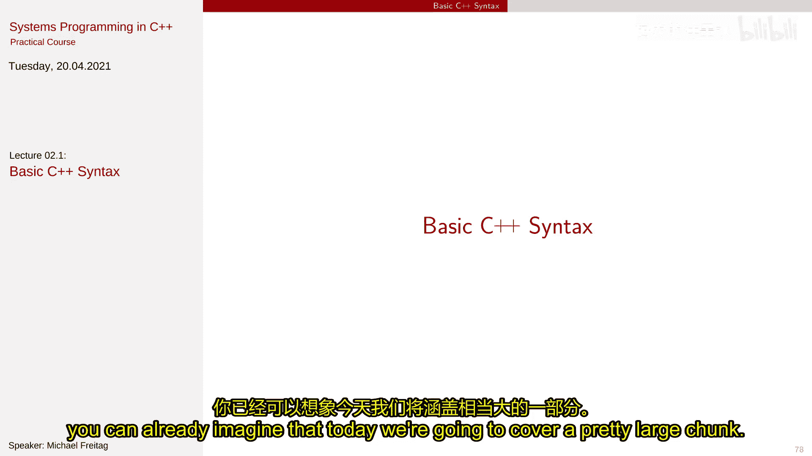

嗯。Of。C plus plus syntax today， and since this is should be pretty familiar to most of you because it doesn't differ too much from other languages in this respect。

 we'll have to cover a lot of content in quite little time today， so if at any point I'm losing you。

 please just interrupt me and will clarify whatever we're just talking about。So like you know。

 almost every highle programming language shares a common set of basic features such as built in types。

 integers or floating point numbers， variables， then expressions and statements so that you can manipulate the values of variables some control flow stuff and of course functions and then on top of that if you have an object oriented programming language you can add programmer defined types。

Classes essentially， and of course， also library functions。So before we move on。

 there's a quick question in the chat and whether there will be exercise sheets every week for now。

 yes， until approximately the midpoint of the semester， when we will publish the final project。

 then we're not going to publish an exercise sheet every week。Alright， so moving on in the lecture。

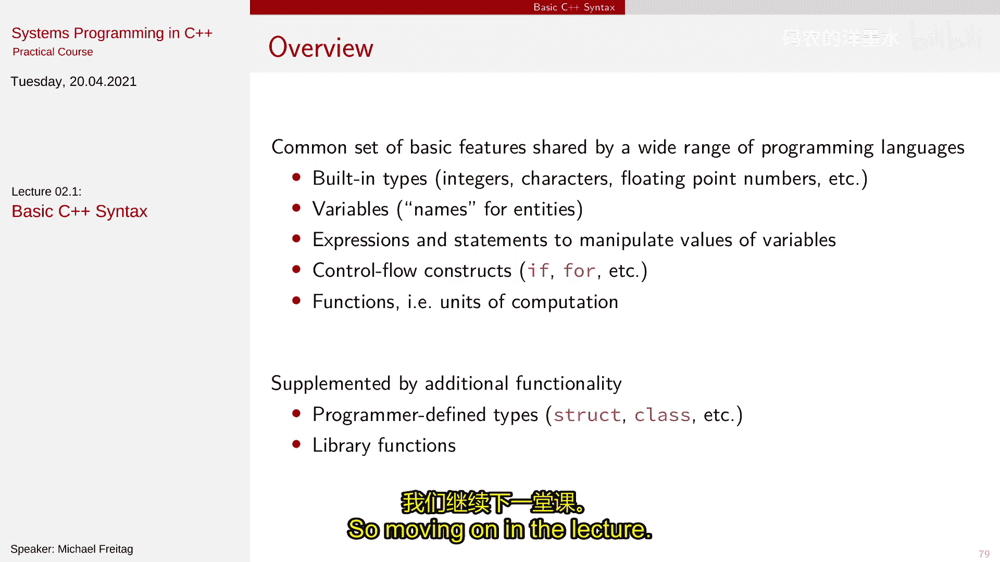

Essentially C++ is a rather simple language because there is a limited number of basic features and rules we have our syntax and that's essentially it and this syntax doesn't differ too much from other programming languages as I've already said。

 but of course the devils in the detail， there are a lot of corner cases for features in C++ there are exceptions to most rules and also some features and rules are pretty obscure。

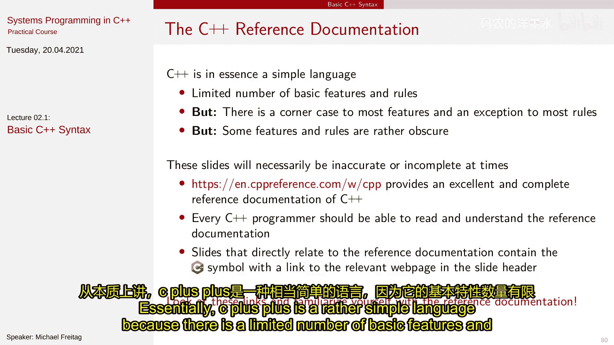

And because C plus plus is。Has a limited set of features。

 but there are so many exceptions and rules our slides will almost inevitably be inaccurate or incomplete at times。

 and this is at some points even intentional because we just simply don't want to talk about some obscure feature but you're in luck there is an excellent and essentially complete reference documentation of C+ plus that you can find at this link that's put on the slides here and this is essentially the go to documentation if you have any question about C++ and because it's so well written and so informative every C+ plus program。

Should or even has to be able to read and understand this reference documentation。

So what we did to kind of facilitate the entry into this documentation for you is that on every slide。

 for example， the next slide that's coming up that relates to some information that you can also find in much more detail on this reference documentation we put a symbol in the top right of our slides and this symbol is a link so this is important because it's easy to miss this symbol is a link and if you click on it itll take it directly to the page in the reference documentation that corresponds to our lecture slide page so please take a look at these links you don't have to do it for every slide of course but just click a couple of those links and familiarize yourself with this reference documentation and spoiler alert there will also be an exercise on this reference documentation。

So let's jump right into it and start with the quote on most useless feature of C++ of course this is comments as other languages we have two types of comments in C++ we have a multiline and a single line comment and that's essentially all that there is to say about comments so of course they're not useless use them if you have to document your code and they work just like you would expect them。

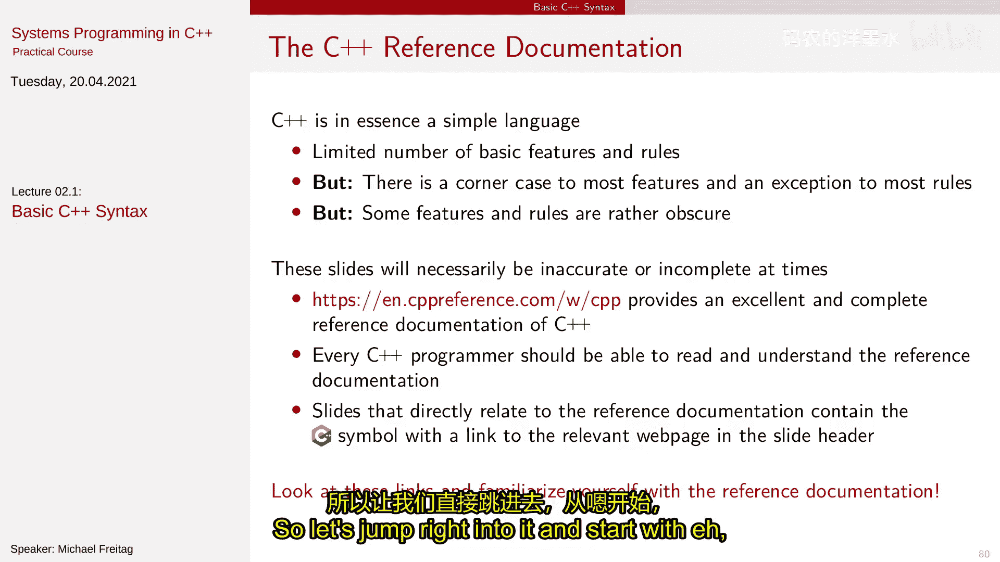

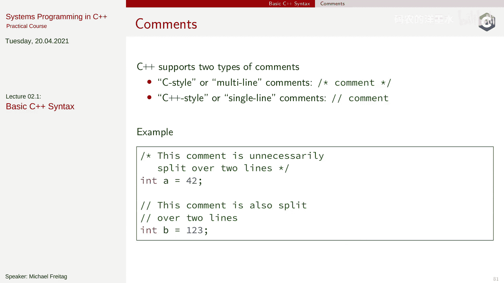

Furthermore， a little bit more interesting than comments， we have a couple of fundamental types。

 which are essentially primitive types。

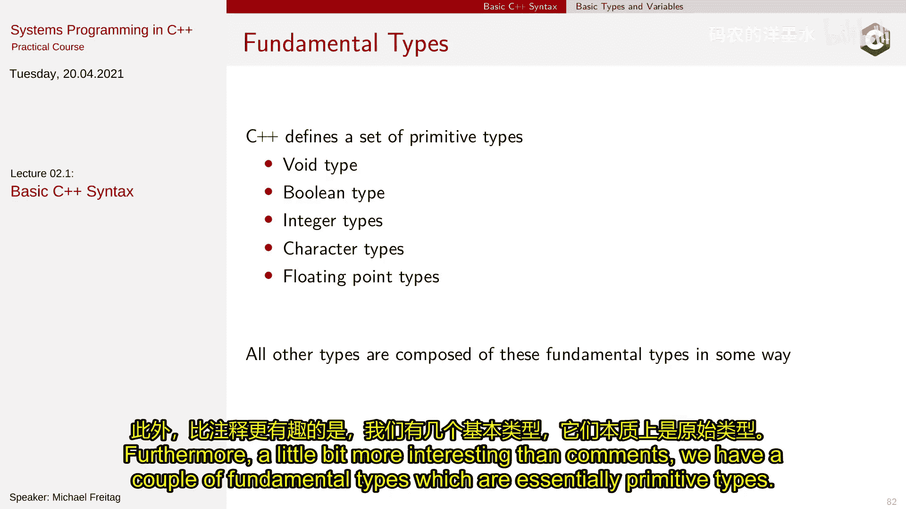

That make up all the other composed types that you can build in C++ and here we have an a void type and then Boolean integer character and floating point types and we'll just walk through this list pretty quickly on the next slides。

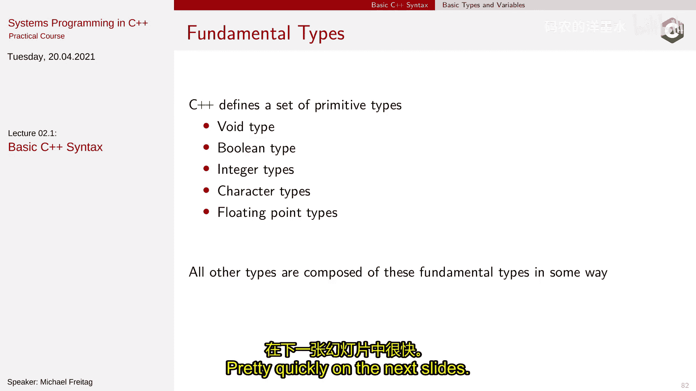

Theoid type is a little bit weird because it can have no values and correspondingly no objects of typebo are allowed and as in other programming languages it's mainly used as a return type for functions that do not return any value with one exception and one difference to other languages in that pointers to theoid type are permitted。

 but we're not go into detail about that in this lecture this is coming up next week in more detail。

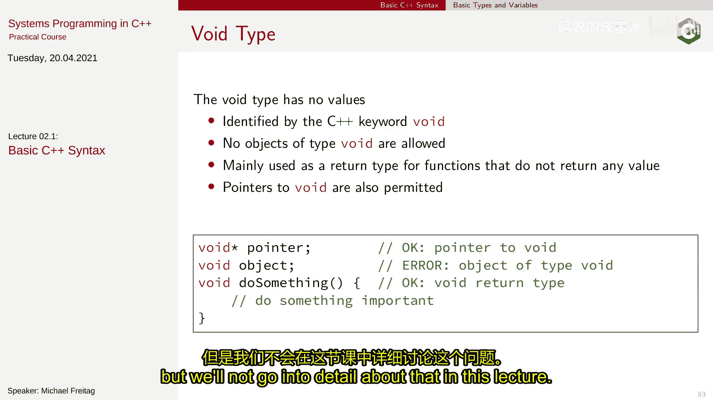

The Boolean type is also pretty straightforward， it can have two values。

 it's identified by the keyword tool and apart from the obvious stuff。

 one side note is that it's quite frequently obtained from implicit type conversions and we'll see a little bit more about this data throughout today's lecture。

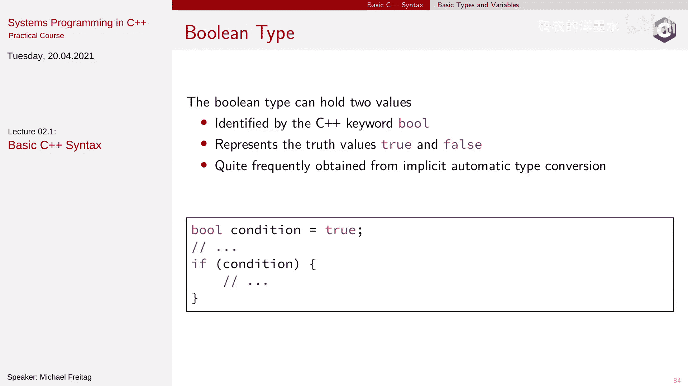

Integer types are possibly the first type where there are some real differences。

 there may be some real differences to the programming languages that you already know。

And it starts pretty straightforward。 So they are all。Identified by the C plus plus keyword inch。

But before I move on， we have another question in our chat。 And the question is。

 how many bys does a boolean have and。

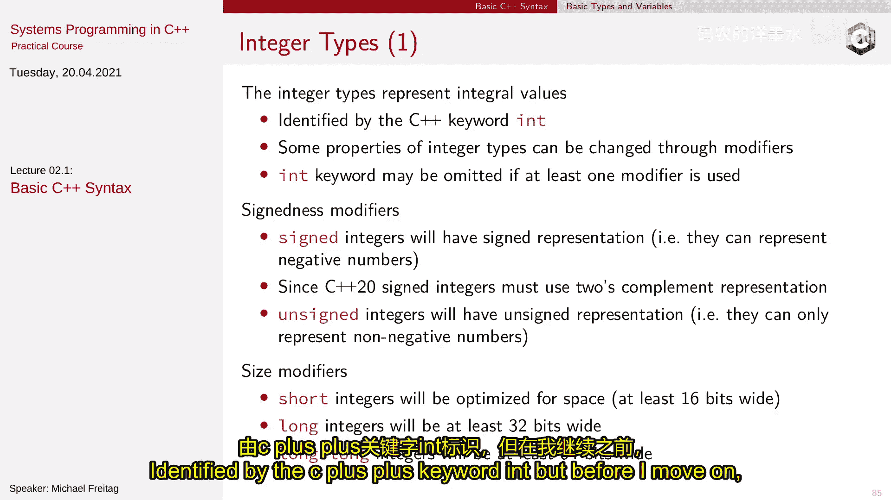

A boion usually has1 B in C plus plus but because we have biteed wrestable memory。

 it doesn't really make sense to use anything less than1 B and anything more than one B would be a waste of space。

Right back to our integer types。 So all integer types are identified by the C plus plus keyword int。

But then we can change some properties of the integer type that we are specifying through so called modifiers。

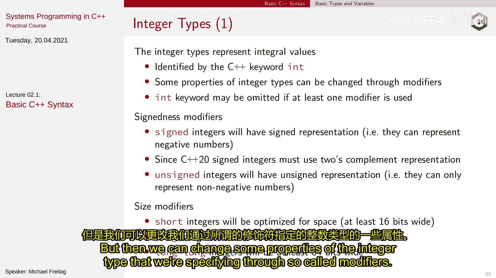

And what makes it a little bit more confusing is once you use one of these modifiers。

 you can actually omit the in keyword and this is something that you see quite frequently in C++ code。

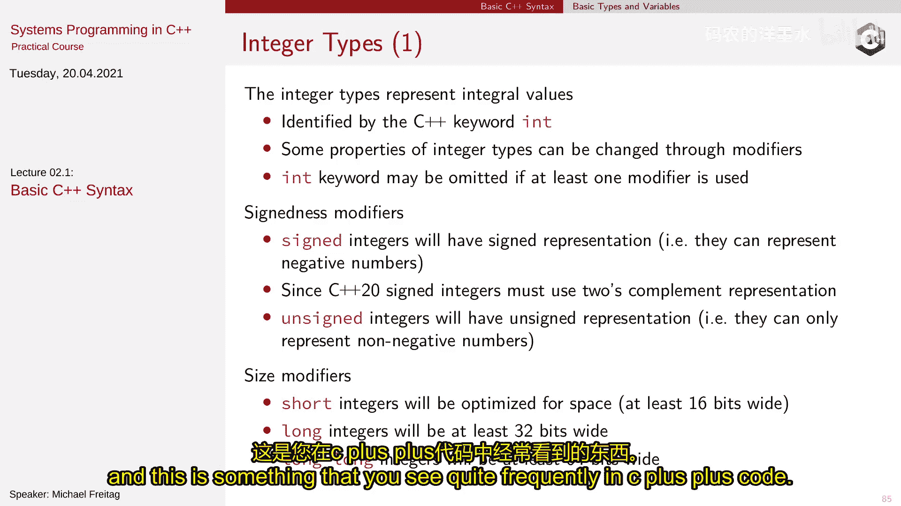

，Most often used modifiers are probably the sinness modifiers because C++ distinguishes between s and unsigned integral types。

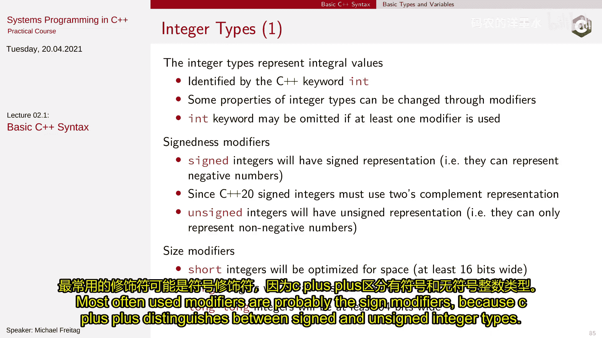

The signed integers at the name suggests can represent negative numbers and this was not standardized up to now but since C++ 20 signed integers must use the two complement representation。

 so if you use a signed integer， you can be sure if you're using a recent compiler that it will use the To complement representation internally。

And then of course， unsigned integers will have unsigned representation。

 and as such they can only represent non negative numbers。

Orthgonically to this we also have size modifiers where the short modifier will optimize integers for space。

 so it will usually be a little bit smaller than regular integers， but at least 16 bits wide。

 and then we have long and long， long integers which will be respectively at least 32 or 64 bit wide。

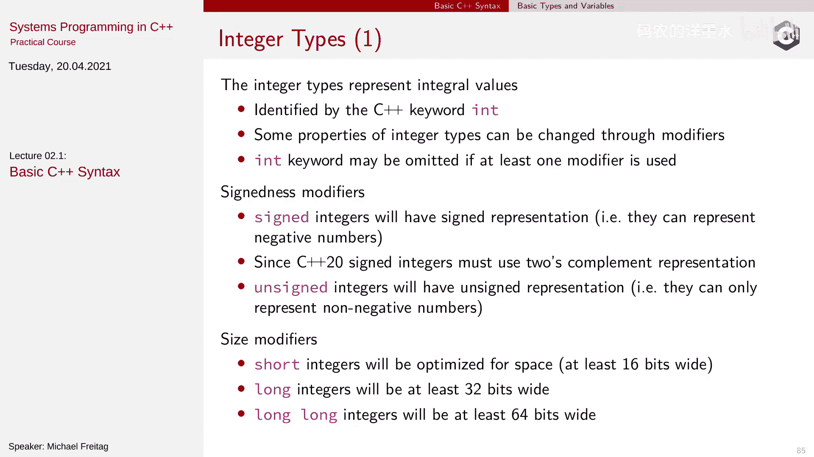

The modifiers and the in keyword can actually be specified in any order。

 And this gives a wide range of equivalent ways to define the same integer type， which， of course。

 makes code harder to read if you mix and match them。 So just as an example here。

 we have four ways of specifying the same integer type by just mixing the。The different modifiers。

What makes it a little bit simpler is that by default integers are signed。

 and thus we can omit the signed keyword， so you very rarely see the signed keyword in C++ code because a signed in is just the same as an int。

And by convention， and this is our convention， we would like you to order these modifiers in the following order so first you put the this modifier if you have an unsigned integer。

 then if necessary you put the size modifier and then if you don't have any of the above tool modifiers。

 you put the into keyword。So this then results in。

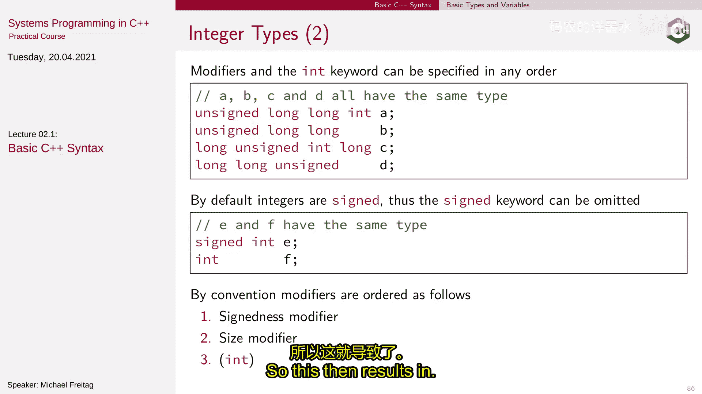

Kind of canonical type specifiers。 And we've listed these on this slide here together with their minimum width and corresponding the minimum range of values that they can support。

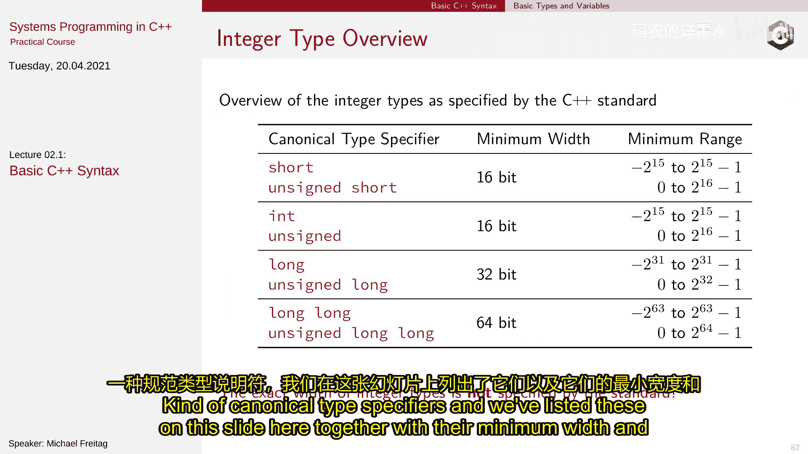

One thing to keep in mind is that the exact width in bits of the integer types is not specified by these standard。

 so if you just use int， it's guaranteed that it has at least 16 bits。

 but depending on the compiler and the architecture that you on it may have more than 16 bits。

And sometimes this can become a problem， of course， usually it doesn't matter。

 but sometimes we need to be sure that our integer types have an exact width in bits。

 And if this is required then。

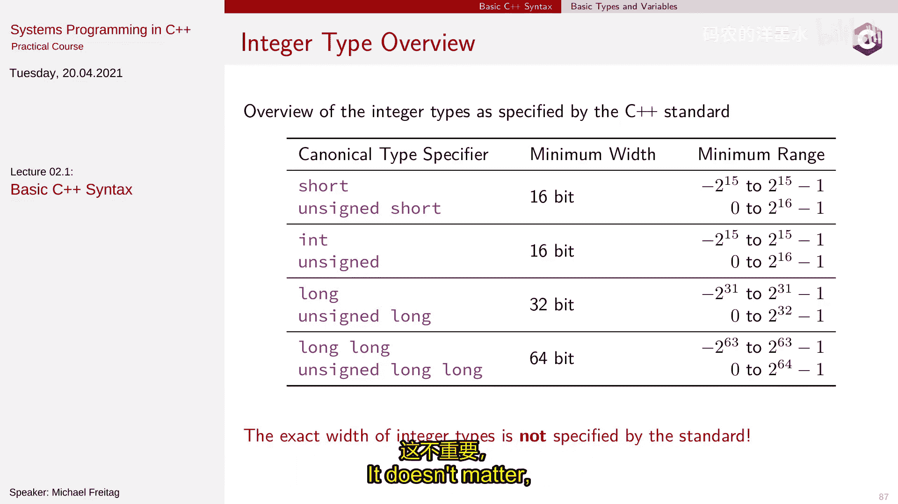

As an alternative to the regular integer types， we can use the fixed width integer types that are defined in the header listed here。

 and then you get type names such as in8 underscore T and so on for different signed integers with a specified bit width and the same for unsigned integers with a specified number of bits。

The useful thing here is that for example， U in 64 underscore T。

Type is only defined if the C+ plus implementation that you are using directly supports this type。

 so it doesn't have to emulate it， for example， through two 32 bit integers so you can be sure that you really get 64 bits of integer space at once。

And then， of course， youll see。嗯。You can see some examples down here。

So we have a question in the chat why one should use integer types without fixed width。

 and this is a good point because we'll talk about exactly this on the following slide。

 Our recommendation is to use the basic nonfixed width integer types by default。

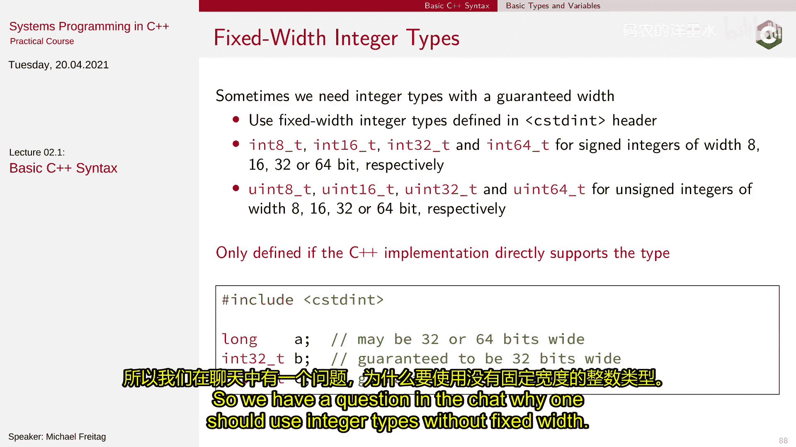

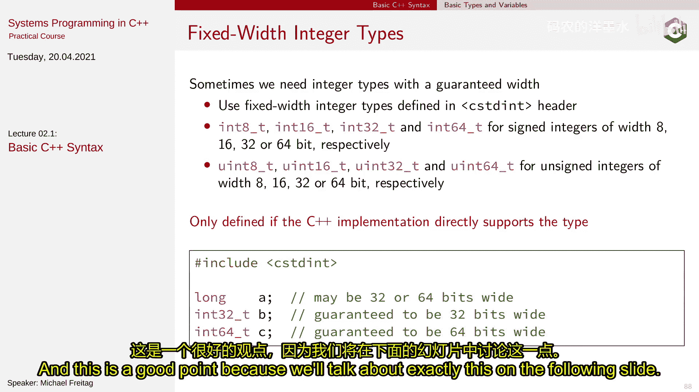

Because you get a guaranteed minimum range that can be supported。 And most of the time。

 we don't actually care about the exact maximum value。 For example。

 if you have a loop that counts over。Customers， then if you use one of the。

The built in integer types with 64 bits minimum width。

 you can be sure that you can count every single customer on this earth and probably a couple more so you don't really care whether the exact maximum value is 64 bit wide or 56 or anything else that's above the minimum threshold。

Usually。Simple， simply an unsigned in or long are a reasonable choice。

 because most of the time you don't even need these full 64 bits of integer space。

32 bits are perfectly fine。 If you are sure， for example， that you count at most into the millions。

 then a maximum value of 4 billion is perfectly fine。

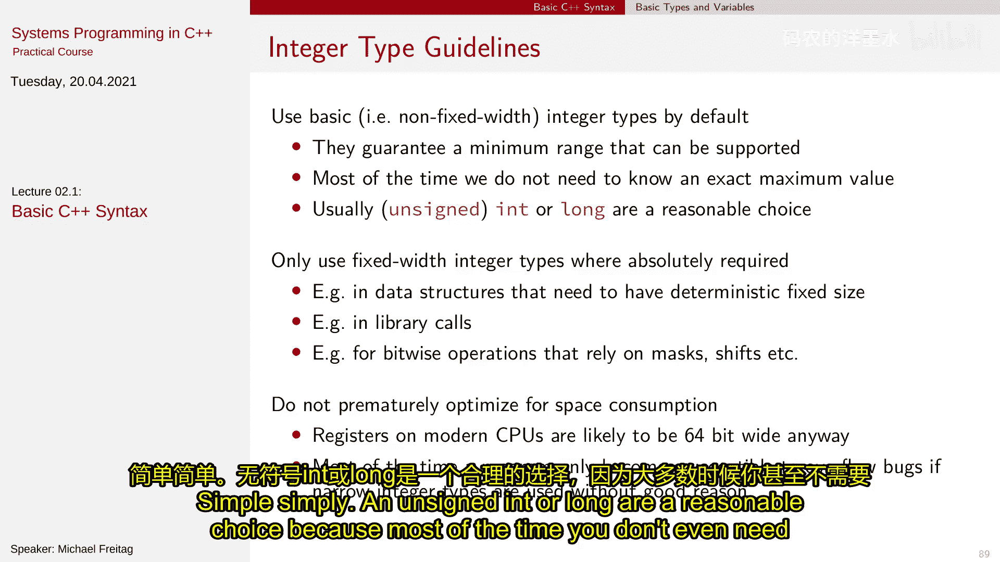

On the other hand， the fixed width integer types are should only be used where they are absolutely required。

 and the most common use case here is if you build some data structures that need to have a deterministic fixed size。

 for example， if you send them over the network are similar。

 also some libraries may require that the parameters that you put into library calls have a fixed with。

 or if you use some bitwiseice operations that rely on some masks or shifts and so on。

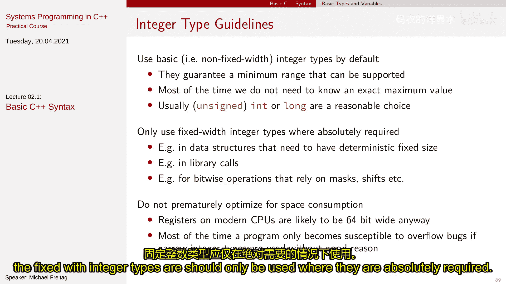

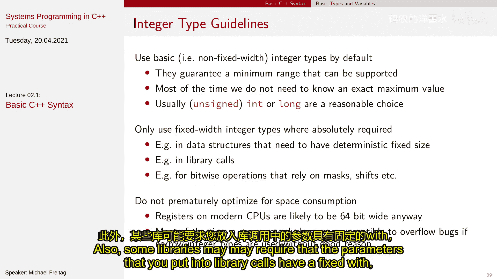

And one。Hint in particular， is that here we should not prematurely optimize for space consumption because on modern CPUus。

 our registers are most likely 64 B wide anyway。 So even if you use a 32 B integer。

It's going to be put into a single 64 bit register on the CPU most likely and you don't really gain anything。

 so most of the time if you optimize really heavily optimize for space consumptions by choosing the bit width of your integer typess。

 you just run into overflow bugs， if the value that you want to store or actually exceeds the value that an integer type can。

Represent。So does this answer your question， Let me know if not。In the meantime。Moving on， of course。

 we can also represent characters in C plus plus， and characters are a little bit。

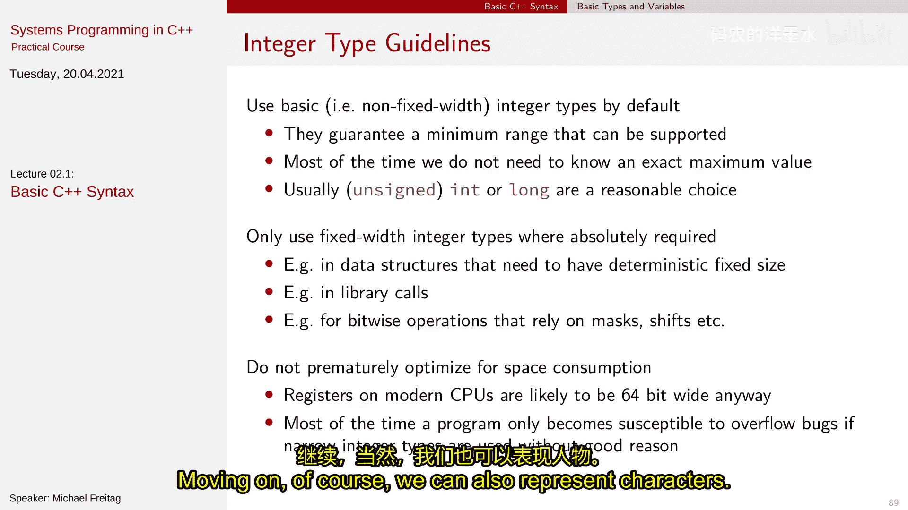

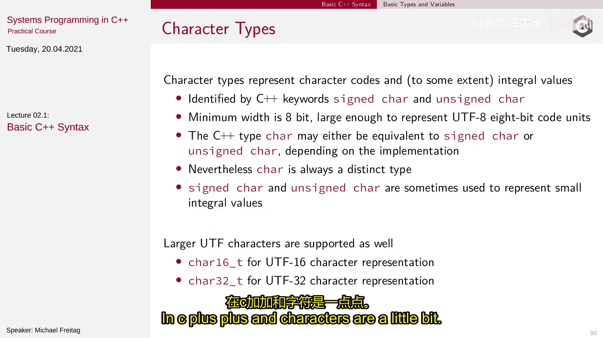

Schizophrenic in C++ because they can both represent characters and small numbers。

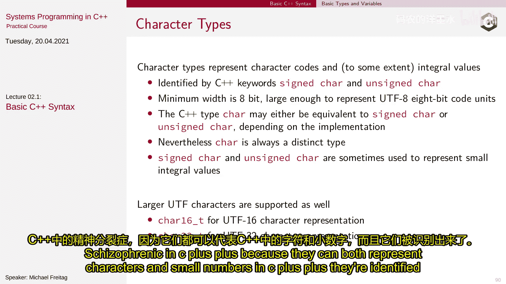

In C++ they are identified by the keyword signed and unsigned cha。

 so the minimum width here is 8 bit and they behave more or less exactly like signed or unsigned 8 bit integers。

Of course， this is also large enough to represent U T of 8，8 bit code units。

 so they can be used to represent。Characters and for characters， most of the time。

 the C plus plus type char without a sinness modifier is used。

And here this is one of the exemptions of the rule that design and specify can simply be omitted because depending on the implementation of the C++ compiler and the platform。

 this char type may either be equivalent to a signed char or an unsigned cha。

 but nevertheless as it is always a distinct type， so char is neither the same as signed char nor is it the same as unsigned char。

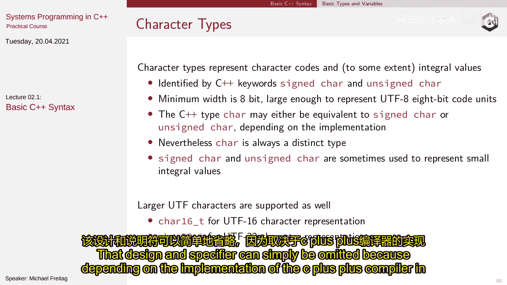

So usually if you represent characters， you simply use char and if you have to represent small integral values。

 for example， a single byte， then sometimes you may have to use signed or unsigned char Of course。

 8 bit code units are most of the time sufficient but not always NC++ also provides you with larger UTF character types as well。

 specifically a 16 and 32 bit wide character type。

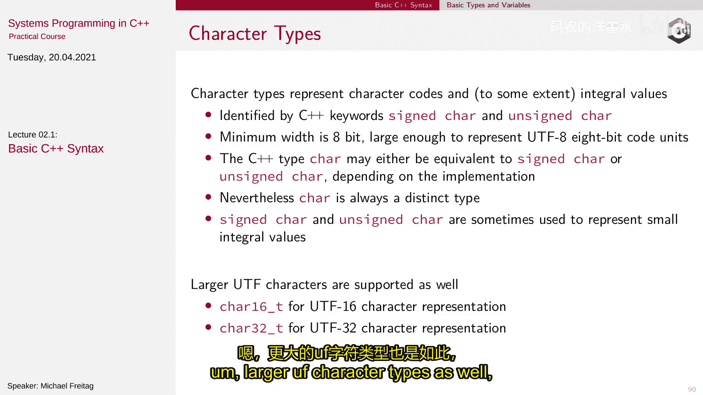

Finally， completing our list on the fundamental types in C++ we have floating point types which are not very special they are usually we have float representing 32 bit。

 IEE floating point numbers double representing 64 bit。

 IEE floating point numbers and then for very large floating point numbers we have a long double type which has an extended precision。

 but this is platform and operating system dependent but usually it's between 64 and 128 bits。

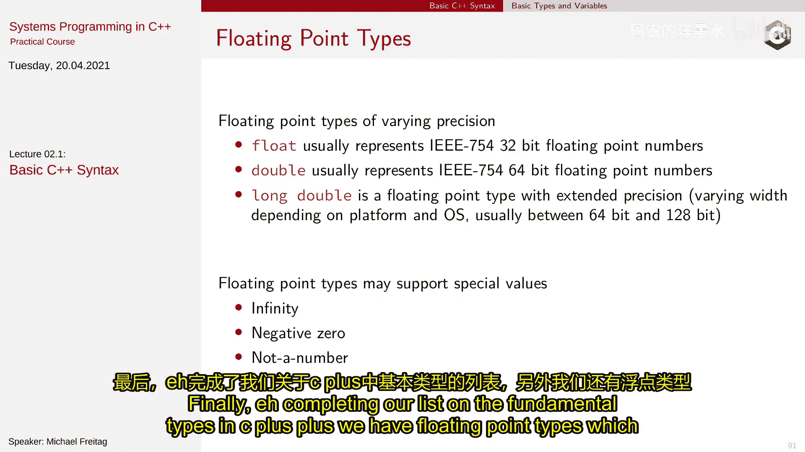

And like all floating point numbers in other languages。

 floating point numbers in C++ represent some sometimes annoying special values such as infinity。

 negative0， or not a number。

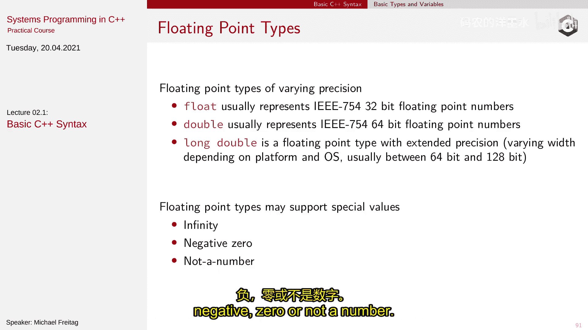

Of course， we need to have some way to convert between these fundamental types and most of the time these conversions may happen automatically。

 for example， if you use an object of type A where an object of type B is expected。

 the prime example here would be a function call where you pass a parameter that has a different type than the type of the parameter that is actually specified。

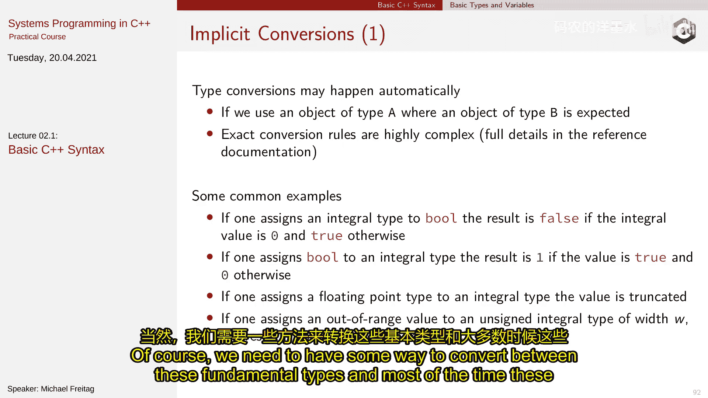

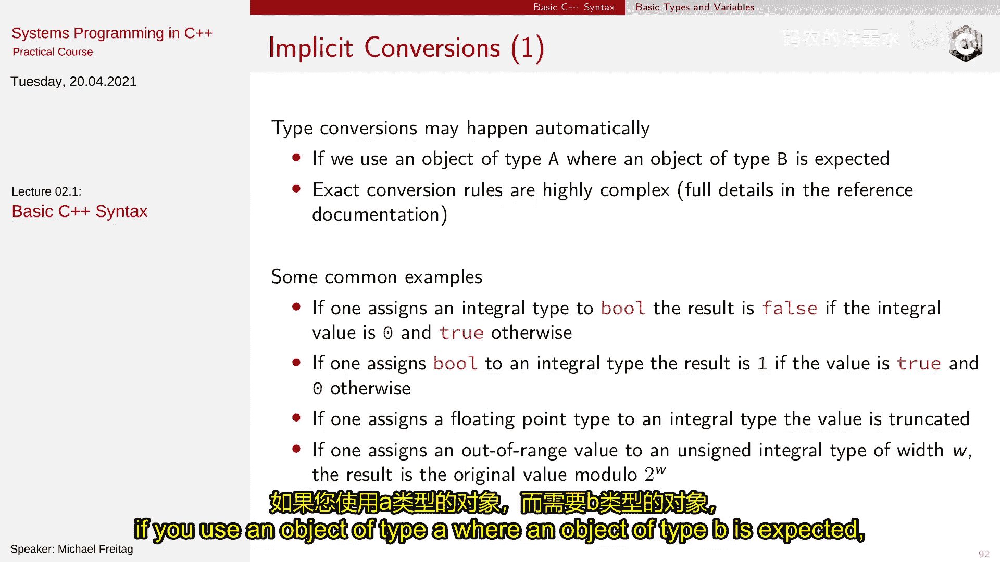

These。Conversion rules are extremely complex。 You can take a look at the reference documentation to see just how complex they are。

 So we're not even trying to go into detail about these conversion rules here。 Most of the time。

 intuition will guide you in the right way。 If it doesn't just take a look at the reference documentation and look up the special special case that you've just run into。

Some common and often used examples are that you can assign an integral type to a Boolean and then the result of this assignment is false if the integral value is0 and true otherwise。

 this is used quite often in C++ and you can also do it the other way round。

 you can assign a Boolean to an integral type and then the result is one if the value was true and0 otherwise。

If you assign a floating point number to an integral type， of course， the value is truncated。

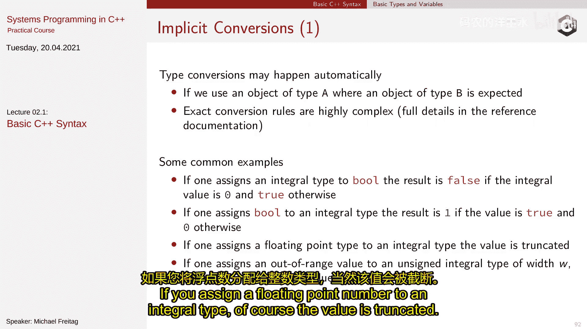

And if you assign an out of range value to an unsigned integral type， so for example。

 you assign 257 to an 8 bit unsigned character value。

 then the result is the original value modo the maximum value that can be represented。

By the the s integralte type plus one。 So just two to the power of the bit with W。

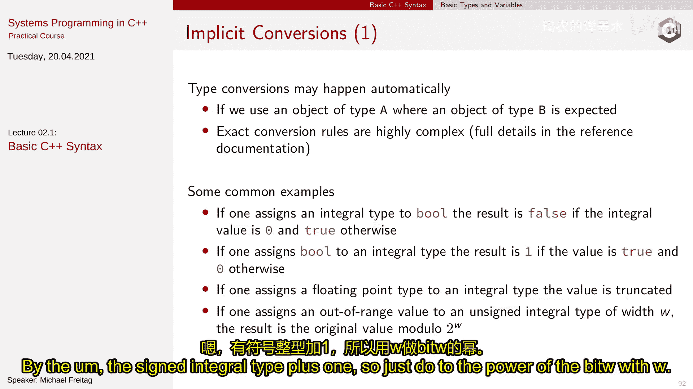

Please remember that I said if you assign to an unsigned integral value here。

 because we will return to this for signed values in a couple of minutes。

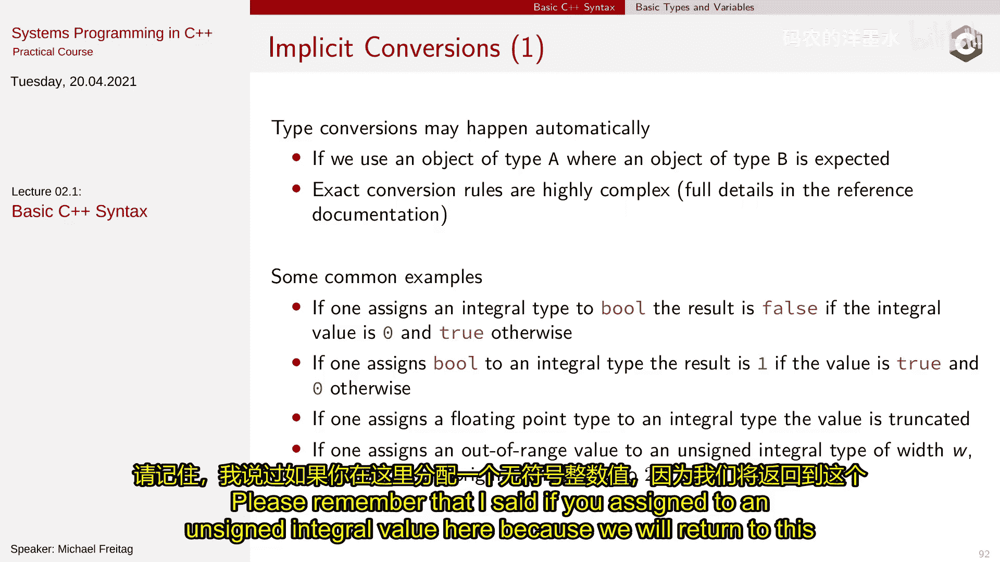

So just to give you an example here。What I've just said before we have a 16 bit integer with value 257。

 of course this can be represented and if we assign this 16 bit value to an 8 bit value。

 it will be computed mod of 256 and the result is going to be1 and then of course we can have an if statement where we put this integer J in a place where a boolean is expected so implicitly our integer is going to be converted to a boolean which evaluates to true because j is not equal to 0 and then we will execute the then branch of our if statement here。

Do we have any questions so far。Alright， looking good。

 So let's return to assigning an out of range value to a sine integer。

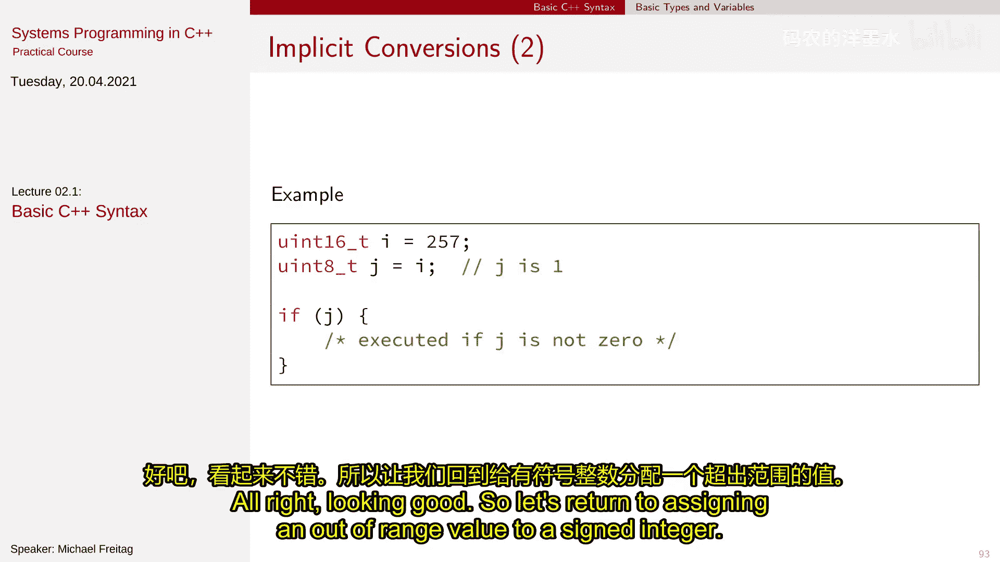

And this opens up a whole new topic， which is called undefined behavior in C++ terms。

So let's start from the beginning。We've seen that the overflow of an unsigned integer is well defined。

 There' is a rule that specifies what happens if you assign an out of range unsigned integer to a smaller unsigned integer。

 but in some situations。

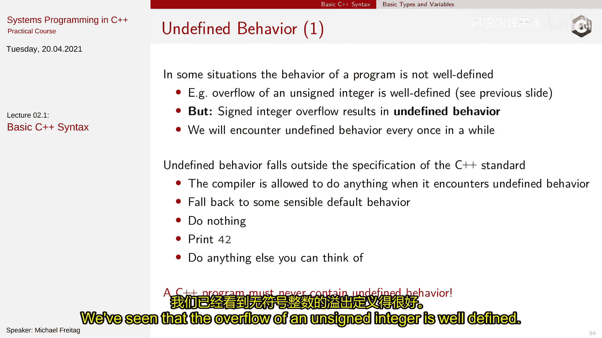

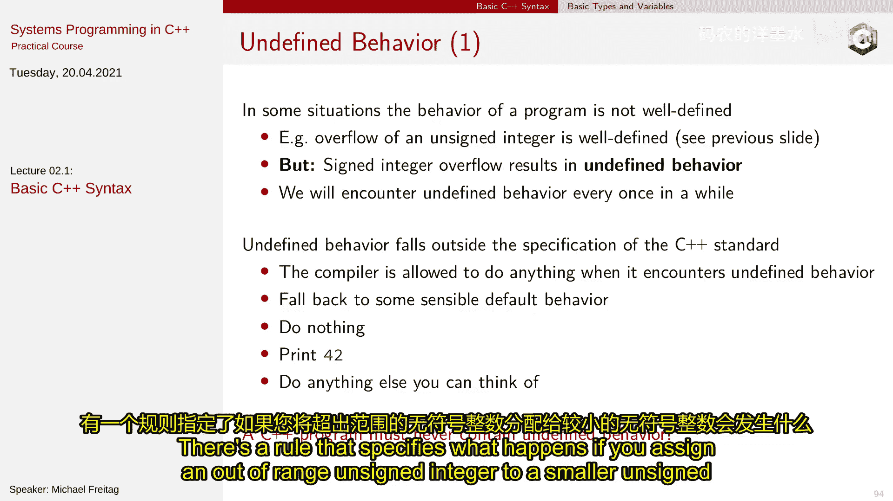

The behavior of a program is not well defined， and one example of this is if you have a signedine integer overflow。

 this is not well defined according to the C++ standard。

 and then you end up with a program that contains undefined behavior。

And this is a very important concept that's a little bit confusing at the beginning because undefined behavior is as the name already suggests not defined in any way by the C++ standard。

 so because of this C++ compiler is allowed to do anything it wants when it encounters undefined behavior。

Most of the time compilers will just fall back to some sensible default behavior， a lot of compilers。

 for example， implement signed integer overflows in the same way as unsed integer overflows。

 but it may also do nothing or print 42 or do anything else you can think of。And because of this。

This wide range of possible outcomes when you have undefined behavior in your program。

 you must never write C++ programs that contain undefined behavior。

 even if the compiler may implement some sensible default behavior here and just to give you an illustration of what could go wrong if you include undefined behavior in your programs。

 let's take a look。

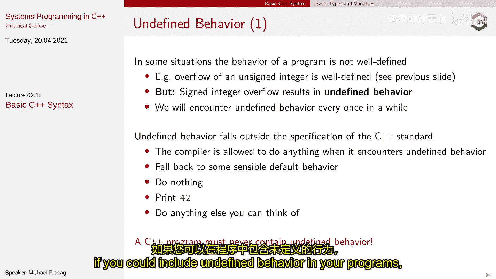

At this slide here。 So here we have a simple function that takes a sine integer。

As an argument and then has an if statement that adds one to this signed integer and checks whether this is larger than the original value。

 Of course， intuitively， this should always be true， and if this is the case。

Our our program should return 42 if this is not the case， which would be the case， for example。

 if we have a signed integer overflow and the compiler resorts to some default behavior where the integer values just wrap around。

 then we want to return another value。 If we compile this program here。

 I think this was compiled with a G plus plus。Then you will see that the compiled assembly completely eliminated this branch here。

 And this is because。The compiler is allowed to assume that undefined behavior doesn't occur in your programs。

 so by writing i plus1 greater than I this can only happen if you have undefined behavior。

 namely if this results in a signed integer overflow。

 the compiler assumes that undefined behavior doesn't exist so it can deduce that this statement will always be true and it can eliminate this else branch here and just generate code that always returns 42 here。

But this is just a small teaser of how undefined behavior in your programs can result in different outcomes than you may expect。

I have a questionYes。Would it also omit the if branch if we use signed unsigned it。Good question。

We've seen that unsigned integer overflows are welldefined behavior and in this case。

 the compiler cannot assume that overflows don't happen。

 so in this case it would actually have to generate the branch statement and this is exactly the point that we're trying to make here for welldefined behavior。

 the compiler cannot omit any if statements it cannot make any assumptions but it can always assume that undefined behavior doesn't occur in your programs。

Does this answer your question？被也。Great right so let's move on so we've seen undefined behavior which is simply not defined in any way in the C++ standard and as such it differs from unspecified or implementation defined behavior because these two behaviors are allowed according to the standard and they are still valid C++ the only thing to keep a note here if you have something that's unspecified or implementation defined then its effects may be different across compilers and of course。

 if you have portability in mind， you should usually also avoid unspecified or implementation defined behavior because then you can simply not be sure that your program behaves in the same way on all compilers and across all platforms。

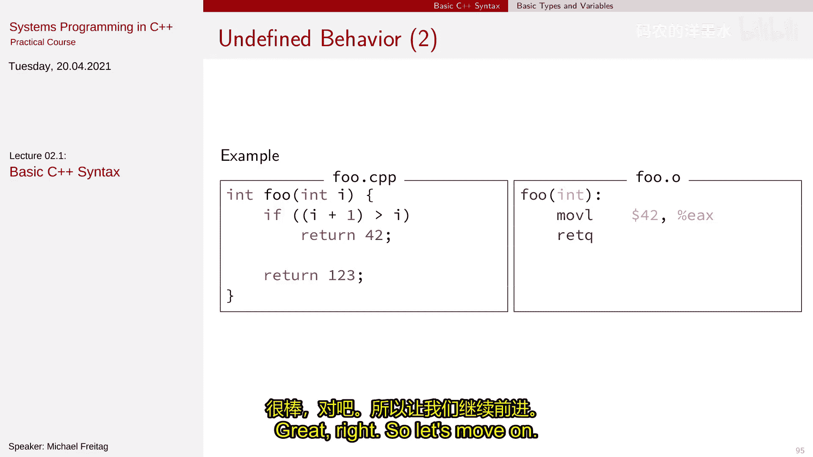

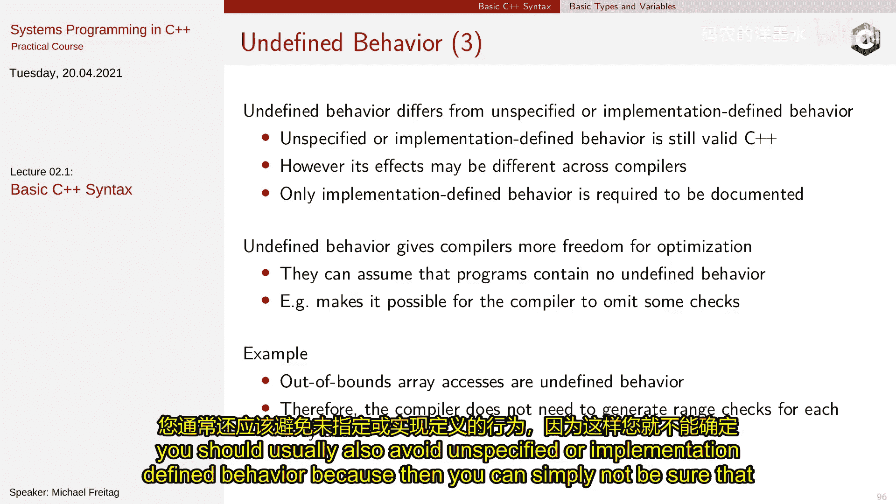

Another thing that's a little bit annoying here is that only implementation defined behavior is required to be documented by the compiler。

 so if you encounter something where the standard says this is unspecified behavior。

 then sometimes it can be difficult to figure out what actually is going to go on and this would then。

 for example， be a situation in which it could go to the Godbalt compiler Explorer and simply look at the assembly that is generated for the unspecified behavior that you just programmed。

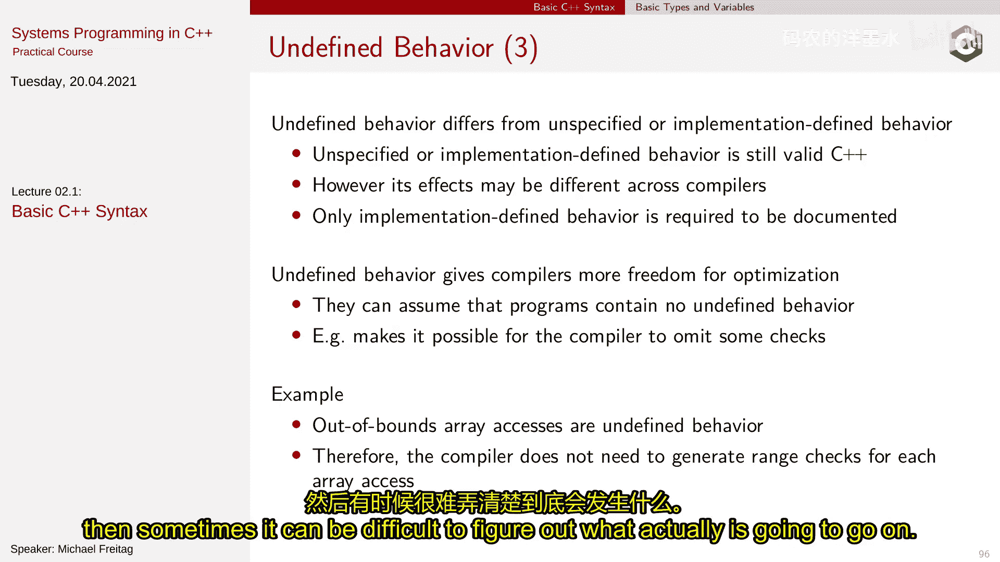

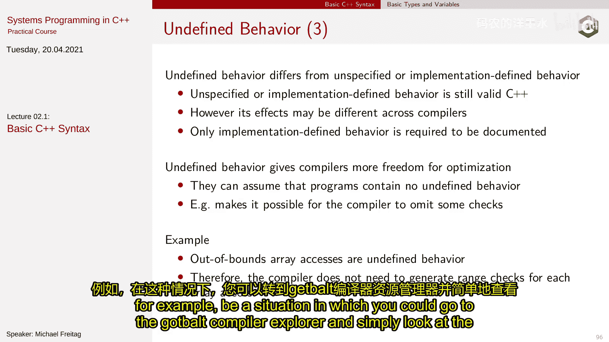

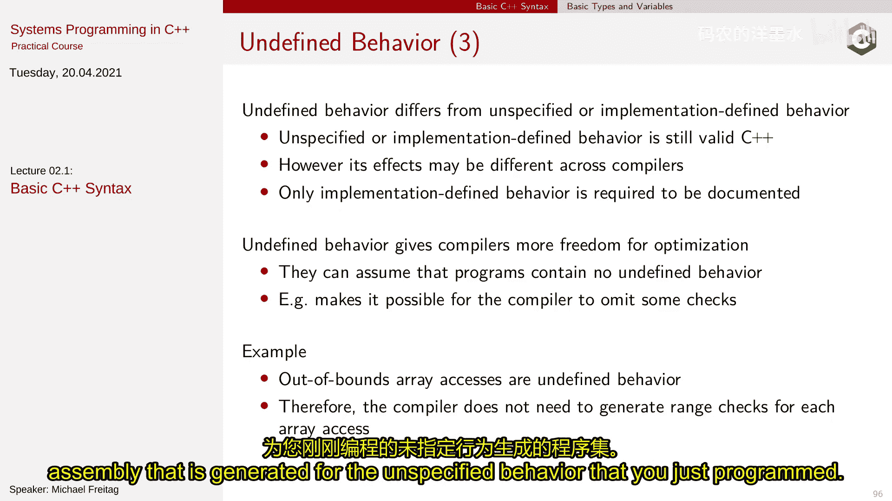

So at this point， the usual question is why do we have undefined behavior， why does this make sense？

And。The biggest reason here is that。Compilrs can assume that programs contain no undefined behavior。

 and this makes it possible for the compiler to omit some checks。

So this is especially important when it comes to performance optimization。

Because if we think of an array axis， just like in any other programming languages。

Then C++ specifies that out of bound array accesses。

 so excesses beyond the bounds of this array are undefined behavior。

 and because of this the compiler is allowed to assume that you as a programmer have made sure that out of bounds array accesses do not happen and the compiler does not have to generate range checks for each array access which of course would be very expensive if you would have in a hot loop for example。

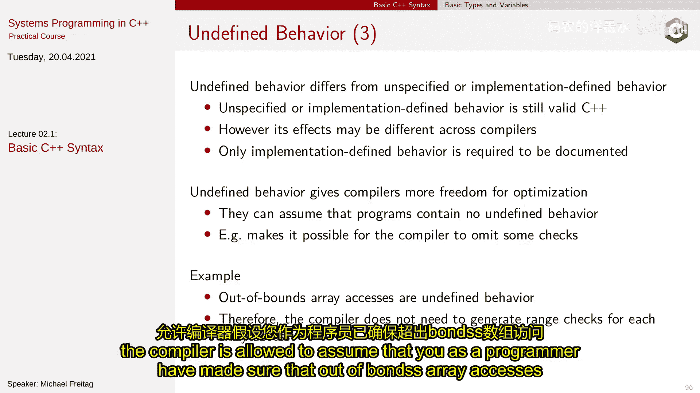

So of course， this doesn't mean that out of bound array accesses cannot happen， but if you。

 for example， get user input， which may specify an indexed out of bound and is your responsibility as a programmer to implement the respective if statements to make sure that you do not generate out of bound array accesses。

 so with this undefined behavior concept。In some sense。

 the responsibility for all these checks is shifted from the compiler to you as a programmer because you as a programmer。

 have much more information， for example， about invariance that your program may contain that simply make any range checks obsolete because you can be sure that your area accesses are always going to be inbounds and the compiler doesn't generate any boiler platelate code that's never required here。

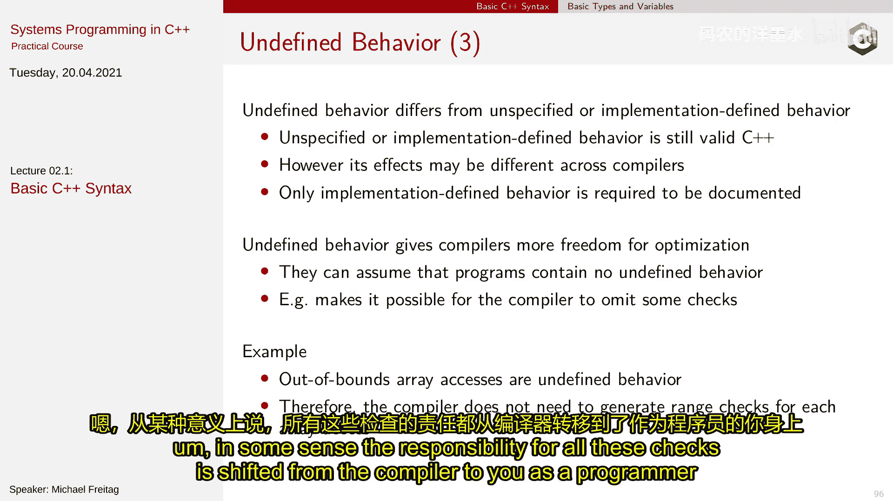

So do we have any questions on this motivation， why we need undefined behavior？Alright。

 so we have a question in the chat what is unspecified behavior？So。Essentially。

 it's similar to implementation defined behavior。 It's simply not specified by the C plus plus standard what should happen in a specific situation and for implementation defined behavior。

 the C plus plus standard says this is sensible stuff。

 something meaningful should happen here and the C plus plus implementation。

 So the compiler implementation simply needs to document what it's doing in this case。

 andspecified behavior is a little bit less meaningful。

 So usually it's something that doesn't really make sense。 It's not undefined but。

It also does really make sense to have it in your program。 So， for example。

 the compiler should could simply generate an error and it doesn't have to be documented because it's not assumed to have valid use cases。

So I think there's another question coming up， so let me pause for just a couple more seconds。

RightI think this is going to take a little bit longer so in the meantime。

 let's use the time and move on a couple slides。 Please just let me know when the there it is。

The question is， was that the case with be put and get function because it may access not wanted chunk of memory。

 I think you need to clarify a little bit more what you mean here。 I have a vague idea。

 but please clarify which functions exactly you mean in which context。

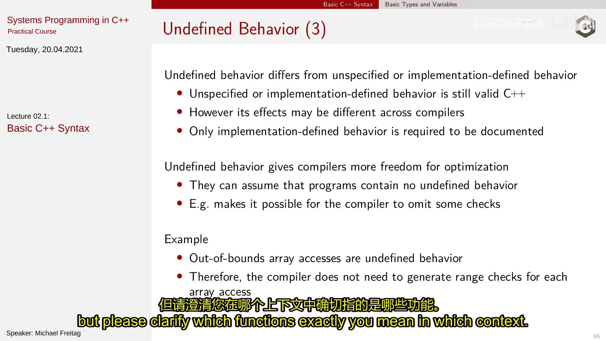

So in the meantime， let me just。

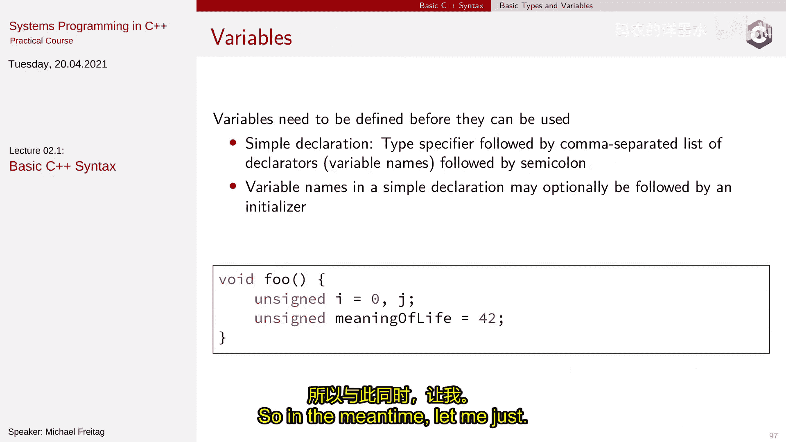

Oh， I， I see。So these are， you're talking about， I think。

 some C library functions that are that you are discouraged from using in C++。I mean。

The the thing here is that a lot of functions in C plus+ can very easily generate undefined behavior。

 Ar Exes are a prime example。 It's very easy to write such code。

 So it's not really that just because a function may generate undefined behavior that you should not use it。

 you simply have to make sure that these cases cannot occur， for example。

 by implementing suitable checks before you call a function with specific parameter values。

 So the reason why these functions are deprecated。Is more that they are safer and essentially just better alternatives in C plus plus。

 not because they may generate undefinced behavior。All right。

So let's move on to the next chunk of C++ syntax， which deals with variables because simply having types doesn't really help us a lot。

 we need variables that can actually store values in that we can assign values to manipulate the state of our programs。

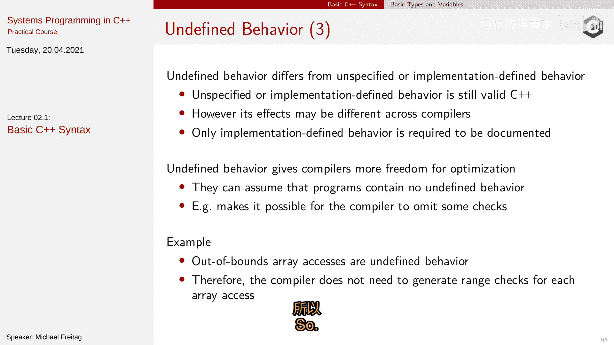

Essentially， variables are the same as in other programming languages with some differences。嗯。

What's not very surprising is that variables need to be defined before they can be used and the。

Most often used way here is just simply a simple declaration as the standardout calls it where there is a type specifier followed by a commona separated list of variable names or declarationlarators in formal terms followed by a semicolon。

And in such a simple declaration， the variable names may optionally be followed by an initializer。

 which provides an initial value to the variable which can be achieved in a number of different ways。

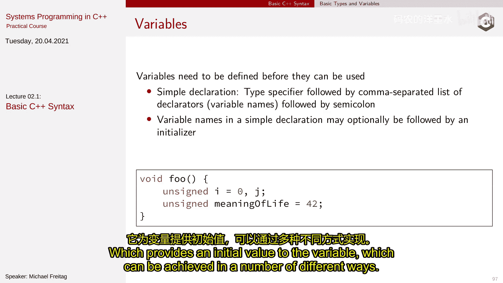

So。Initialization is actually a formal term in the C plus plus standard and somewhat hand wavy a definition for this term is that an initialization provides an initial value at the time of object construction。

 And the three most important ways in which this can happen。Are listed here。

 so we can have a variable name followed by round parentheses enclo in expression。

 we can have an equals expression or we can have the same in curly brackets。

The important differences here are that options one and two simply assign the value of this expression to the variable。

Possibly invoking implicit type conversions。 So if you have a variable name here is an integer and an int type and the expression has long type。

 then you will invoke implicit conversions from long to int and of course， once again。

 this may lead to signed overflows option 3 will result in a compile error if these implicit type conversions could potentially result in a loss of information。

 for example， if you trunccate a floating point number。

These initializers are optional we've already seen this on the previous slide and here there is an important difference between local and nonlocal variables because nonlocal variables are default initialized for the built in types this usually means that they are simply set to zero。

 but local variables are usually not default initialized and accessing an uninitialized variable is undefined behavior once again。

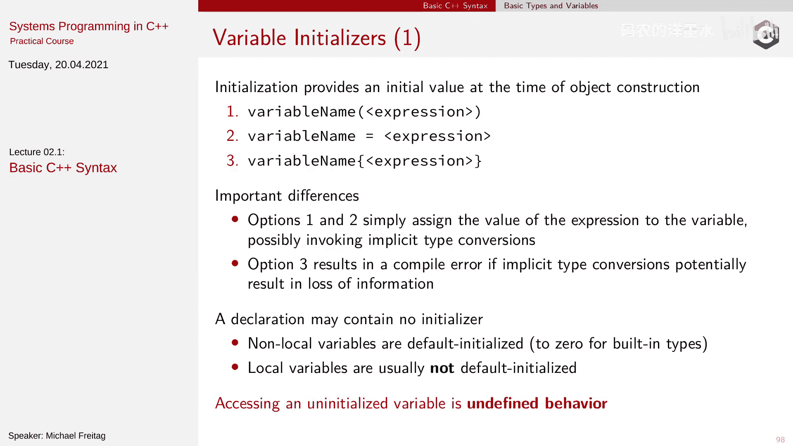

So just as an example here， some different ways to initialize variables。

 we have the equals form here。 we have the round parentheses form and then。

Here we can see that we can without any problem assign a double to an unsigned value if we use the equals form of initialization。

 then the decimal places are just going to be truncated and C is going to end up being three and of course the same works for the parentheses with another double but if we do the same。

With the curly brackets， you see that both assigning A or B to an unsigned value will result in a compile time error because we could potentially lose information And you see here in the example in the last line that this does not depend on the actual value of the double because here it is actually an integer value that's most likely going to be represented exactly。

 but the compiler doesn't inspect the runtime value。

 it just sees you assigning a double to an unsign and this could potentially result in truncation of decimal places so it will generate a compile time error if you use this curly bracket form of initialization and of course。

 the initializers are not restricted to simple literals or variables。

 they can be arbitrarily complex expressions as you see down here。

Speaking of literals， of course， we can represent constant values for our fundamental types embedded in the source code。

using more or less the standard notation， so if you don't do anything just write a number then it's assumed to be in the decimal system。

 if you prefix with a0， then it's interpreted as an ocal number， if you prefix it with a0 x。

 then it's Xadeimal， and something that's not as widely used in other programming languages is that you can also specify binary inte literals。

 if you prefix the literal with a0 B specification。

We can also append suffixes to our literal types to specify the type because if we just have 42。

 we're not really sure is it signed integer， which in fact it ist C plus plus but you may want to specify explicitly that this 42 should be an unsigned integer literal and then you append the U character to the literal so to change the type of the 42 from int to unsine and of course the same is possible for the size modifier us if you need a long integer。

You can append 1 L， and if you need a long， long integer。

 you can append two Ls to your integer literals， and they can be combined to have an unsigned long or unsigned long。

 long integer literal。For very large numbers and this is especially useful for binary or hexadecimal constants。

 you can also insert single quotes anywhere between digits just as a separator to make your code more easy to read for decimal numbers it makes sense to use thousands separators but for binary litals。

 it may make sense to use byte or nibble separators。

We have a question whether the order of these literals is important， I would say no。

 but I'm not even entirely sure whether you can mix and match them or whether the unsigned modifier has to appear before the long and long long modifiers。

 I've never seen them mixed in any other way that first unsigned and then size modifiers。

 but if you want to know exactly you'll have to take a look at the reference documentation that's linked here it should be documented there。

Moving on， we， of course， also have floating point literals。

 They work essentially the same as integer。Literals。With。

The addition of having decimal places and optionally an exponent for a scientific notation。

Another question from the chat regarding integer literals is whether there would be an overflow when assigning unsigned integer literals to integer literals。

 This depends on the value if we assign 42 as an unsigned integer to a sine integer that can represent 42。

 then nothing happens， but if we have for example。

The unsigned integer literal 257 and try to assign it to a signed 8 bit integer。

 Then we will have an overflow。

So returning to our floating point literals， we've seen decimal places in scientific notation。

 we can also append suffixes to distinguish between double float and long double literals in the same way as for the integers。

 and of course we can also insert single quotes just as a separator between digits。

Finally， we have character literals。Representing constant characters embedded in our source code。

 which can be any character from the source character set， so if your source is encoded as UTF 8。

 you can use any UTF8 character except for a single quote backslash and new line。

And as in other languages， the。A quote character is used around this character to specify a character literal for the characters that you cannot directly represent as characters in your source code。

 you can use the usual escape sequences and for example。

 back slash quote to have the single quote as a character literal and so on。And once again。

 just like for the other literals， we can， in this case。

 prefix character literals with some prefixes to specify the type of character literals。Alright。

 so unless there are any further questions on literals， let's move on to the next topic that。

To some degree， distinguishes C plus plus from other languages。

 So here we have some of the differences。 and these are constant volatile qualifiers。

Because any type in C plus plus except function and reference types can be cont or volatile。

 qualified， and you will very often see the term C V qualified as a shorthand for this。

 So a con qualified type is simply con T and a volatile qualified type is simply volatile T and。

As we've already seen a couple of times， these qualifiers can appear in any order before or after the type。

The semantics are pretty straightforward for constant at least in that constant objects cannot be modified。

Volatile is a little bit more subtle because any read or write access to a volatile object is treated as a visible side effect for the purposes of optimization。

However。Volatile is almost never used and you should not use it in new code because it's very likely to be deprecated in future versions of C++ and there are better ways to achieve the same semantics in particular atomic operations。

 which we will see a little bit later in the lecture。

Just to illustrate what we mean by。

Visible side effects。 we have a short program here where we have two unused integer variables without the volatile。

Moifier， and then we have two or at least one unused integer that has the volatile qualifier and if we inspect the generated assembly。

 we see that without the volatile qualifier， our statements are going to be optimized away。

 but with the volatile qualifier even though they are not used anywhere in the program。

 the compiler will still generate the respective code in the assembly。

Alright， so we've now seen the fundamental types， we've seen variables and we've seen literals。

 but of course this is still very boring because we want to be able to manipulate the values of our variables and for this。

 of course， C++ provides a rich set of operators that you can compose together with opera into expressions。

Something that's very useful in C++ is that most of these operators that are provided can be overloaded for custom types。

 so if you have a class type that represents whatever you can think of， you can for example。

 overload the addition or assignment or multiplication operator for your class type and then you can simply write code that multiplies one object of your class with another object of your class type and we'll see this in future lectures and I think you'll also have to implement something like this。

As usual expressions are defined recursively， so we have fundamental expressions。

 which are variable names and literals， and then we have compound expressions where operators connect multiple。

Other expressions， for example， by unary operators negation or dereference operator binary。

 such as equality or multiplication and the terernary operator that you also know from some other programming languages。

When talking about expressions， we have to take a quick detour about value categories because each expression in C++ is characterized by two independent properties。

 the type of the expression this is pretty straightforward if you add to integers。

 the result of the expression is also going to be an integer。

 but we also have the value category which is assigned to each expression in C++。

And the reason why this is important is because operators may require that their opera have a certain value category。

 and also operators may result in expressions that have specific value categories。

For the most part we can think of two value categories and they will be sufficient for most of what you have to do in C++ but that just as a sign note this is inaccurate。

 so in fact there are more value categories， but for now we'll just think of the two value categories that are important to us namely L values in R values。

And。They are pretty straightforward。 So L values refer to the identity of an object。

 and their name historically stems from the fact that if you have a modifiable L value。

 this can appear on the left hand side of an assignment。 We also have R values。

 which just refer to the value of an object and both L values and R values can appear on the right hand side of an assignment。

 but you cannot assign anything to an R value。 an R value， for example， would be an integer literal。

 which simply refers to the value of an object， and it doesn't make sense to assign anything to an integer literal。

Of course as I've already hinted at， the actual taxonomy of expressions is much more sophisticated。

 and at least to some extent this will become relevant later and will break up this inaccurate categorization into L values and r values to some extent。

Now， moving on， we just put a list of the most important operators on our slides。

 I'm going to jump over those very quickly because it's rather boring。 You know。

 all of them from other languages with some exceptions where I'll try to remember to stop and talk a little bit more about the interesting operators。

So we have a bunch of arithmetic operators that essentially all have the expected semantics。

The only thing to keep in mind here is that incorrectly using these arithmetic operators can lead to undefined behavior。

 for example， if you add to signed integers and inadvertently generate a signedine integer overflow。

 you can of course have a division by zero or a shift by a negative offset and so on。

 so once again take a look at the reference documentation。

 if you want to know more abouts what can go wrong essentially。

We also have a set of logical and relational operators。

 so we have the logical knot and then the two short circuiting logical operators with a double ampers and double pipe so the only thing to keep in mind here is that they are short circuiting as I've said。

 so for example， for the logical and if the first expression evaluates to true the second expression is never evaluated。

This is important， for example， if the second expression is a function call that returns a boolean。

 if the first expression evaluates to true this function call is never going to be executed。

And then of course， we have a number of relational operators that are all pretty standard。

Except for the three way comparison operator， which was introduced in C plus+ 20 and is actually rather useful。

Just as a fun fact， because it looks kind of like a spaceship。

 you will quite frequently see or hear this operator being called the spaceship operator。

 and it simply evaluates to a value smaller than0， if the left hand side smaller than the right side to a value that's equivalent to0 if they are equal and to a value greater than0。

 if the left hand side is greater than the right hand side。This， for example。

 facilitates sorting code quite a bit。Because you don't have to write a function that uses essentially the regular comparison operators and then conditionally return minus-1。

001。And what's very useful is that this function can actually be generated automatically by the compiler in some cases。

 but this mostly applies to user defined types such as classes。

 so we'll defer this discussion to a little bit later。

Moving on， of course， we have a bunch of assignment operators， the simple assignment。

 the most basic one。 And then we have all the different。Arithmetic operators。

 combined with an assignment。Which simply， for example， increase a by the value of B。

What's important to keep in mind here is that the left hand side of an assignment operator of course。

 must be a modifiable L value， so most of the time it's just going to be a variable name。

 but the important thing here is that it has to be modifiable so you cannot assign to a cont variable obviously。

And for the built in types these contracted assignment operators are just equivalent to a simple assignment to the result of adding。

 for example， A to B， if we take a look at the addition assignment operator up here。

Something that's a little bit counterintuitive， maybe when you see it for the first time is that these assignment operators return a reference to the left hand side without going into detail what that exactly means。

 you can simply chain assignments so you can write something like a equals B equals C equals some literal and then all of A B and C are going to have this literal value here。

Usually it's bad practice to write code like this。With one exception， which is shown down here。

 This is something that you see rather frequently when you have some local variable。

 And then you want to assign a value to this variable。 and at the same time， evaluate。For example。

 in our case here， whether the local variable is0 or nonzero。

 then you could write something like shown here where you just assign the result of a computation to this variable and because the assignment returns a reference to the variable itself。

 we can just immediately use it in the condition statement in the condition part of an if statement。

Finally， or not finally there's more and we have increment and decrement operators they behave in the same way as you would expect so the prefix variance increment or decreement the value and return a reference to the result so you get the result after the operation and for the postfi variance。

 the object is copied， then incremented or decremented and you get the original copy as a result。

 so you get the result before the operation was applied。

And finally， we have this it conditional operator。Where these semantics are that the first part so A here is evaluated and then converted to bo。

 if the result was true， then the B， which of course can be an expression is evaluated and otherwise C is evaluated。

What can be a little bit confusing here is that the type and value cut category of the resulting expressions。

 expression depends on B and C， And this may result in。

In compile time errors or a little bit unexpected behavior。

 if B and C do not have exactly the same type and value category。So。

You see this down here jumping over some of the more obvious examples here where we have initialization in curly brackets and we have one double and one integer literal as the opera of our alterernary conditional operator。

 then the type of the whole expression is going to be double because we have a double in here。

 and then of course we run into a compile term error because we try to assign double to an integer even though this expression might evaluate to the elses branch which is an integer type。

Any questions so far？

Doesn't look like it， So let's move on。Of course， when it comes to expressions。

 we have the usual question how to group multiple operators in one expression。

 And there's nothing special going on here。 Our operators have precedents where high precedent。

Presidentnce binds tighter than operators with lower precedents。

 And if the precedence of two operators is equal。Then the associivity of the operator determines in which direction the opera are bound。

 so we have operators with left to right， associativity and right to left associivity。However。

 often these grouping rules are not immediately obvious and essentially we recommend whenever grouping is not very obvious that you should just use parentheses to make the grouping that you intended explicit。

Also， something that is important to keep in mind that these precedents and associivity rules do not specify in which order the expressions that make up a compound expressions are evaluated and this evaluation order is mostly unspecified。

And this is one reason where you see unspecified behavior because you should never rely on the evaluation order within a compound expression。

And going even further。It's even undefined behavior if you change and refer to the same object within one expression。

 So for example， if you have an addition of the result of two function calls and both function calls。

 modify the same object that may even be the left-hand side of an assignment from this edition。

 so this is something that you should simply avoid because you may run into undefined behavior here and of course。

 if you want to know more details once again， just take a look at the reference documentation and you will see the full specification of what is allowed and what is not。

So we've said parentheses should be rules used really as soon as things may start becoming non obvious。

 so of course， in the example up here， you may argue that they are not required because we have the usual intuitive rules that multiplication binds tighter than addition。

 but。Thigs can get confusing really quickly， even with very simple expressions。 For example。

 if you have two subtractions here， the associivity becomes important。

 and this is not immediately obvious how the associivity is defined in C plus plus。

 So instead of relying on the。The default behavior。

 just write parentheses to make clear what you actually intend to write。 and of course。

 if you scale up the complexity of your expressions。

 stuff is going to be more and more confusing up to the point that I've put down here where we have a real worldor example from a library that's used to convert raw images from digital cameras where you simply cannot deduce by just looking at the expression what the hell they're actually doing here。

 So avoid code like this and just put parentheses so that someone that reads your code is not unnecessarily confused。

Also， even though this code works in other cases， you may inadvertently just generate bugs in code that doesn't use parentheses。

 as you can see down here where。We would like to have compute a shift that should be4 if a long has 4 bys and 6 otherwise。

 but we forgot that theterernary operator here has a very low precedence。

 And instead of adding two to。To the result of this expression。

 we actually first add two to size of long before doing this comparison here。

 so once again this box could have simply been avoided by putting parentheses where things are not obvious and we will expect you to do the same in your programming assignment submissions。

Just for completeness， of course， we have put the full operator precedes table on the following slides。

 but I'm not going to talk in detail about this is this just for reference in case you need to look something up quickly。

Do we have any questions up to this point。Nothing great， so let's move on。

Now that we have expressions， we can move on to the next more complex。

Feature and C+ plus which are simple statements。Or essentially all statements are the next most complex feature。

 and we start with some simple statements， the simplest of which is probably the declaration statement where you simply have a variable declaration followed by a semicolon and then of course you can have expression statements which can be any expression followed by a semicolon so these may make more or less sense。

 we could write I plus5 as a perfectly valid expression statement。

 but it doesn't do anything useful So you will not see this。

 but for example a function call is also an expression。

 and this is a valid and possibly very useful expression statement。

 If you call a procedure somewhere in your code。

And of course， these simple statements can be combined into more complex statements。

Which are so called compound statements or blocks， which are just a brace enclosed sequence of statements。

 So we have an opening price here。 and we have。A declaration statement and a closing race so this whole block here is a single compound statement containing in this case one simple statement here and of course。

 as you would expect at the end of the block this variable I here goes out of scope so afterwards we can declare another variable called I with a different value and they will not collide in any way。

So this already illustrates that we have a scope concept in C++ in that names in AC C++ program are only valid within their scope。

 and the scope of a name begins at the point that it's declared and ends at the end of the relevant block。

Something that may happen but is usually bad practice is that scopes may shadow each other so if you have a nested scope。

 then names in this nested scope can shadow the names in the outer scope and we have an example here where we declare variables A and B and then open a compound statement so another scope and where we can define another variable called a and then the scope of the first variable called a is interrupted as long as we are in this compound statement here and the name a will refer to this variable here。

Until the scope is closed and then the scope of the first a resumes， so from now on， if we write A。

 then it will once again refer to the a that was defined up here。Of course， you can already see。

That this makes it unnecessarily hard to read programs。

 so usually you should simply avoid shadowing names in inner scopes and most compilers will also generate warnings if you accidentally still do it。

Now， moving beyond these simple statements， of course。

 we have a whole range of control flow constructs starting with the if statement。

Which。Is not very special from other languages。The only thing that's possibly。

Offf note here is that in C++ the if statement can have an init statement before the actual condition。

Whi essentially just defines local variables for the duration of the if and L's branches。

So as an example here， it's useful if you only need a local variables inside the if。As we see here。

 So we have our init statement which declares a local variable value to some value。

 and then we do something depending on the value and possibly in the then and else branches of our if statement。

 we can also use this local variable， but it goes out of scope once the if statement is complete。

 So the equivalent formulation， which just needs a little bit more code would be that we open explicitly a scope。

 Then declare this local variable and then have our if statement without the init statement here。

 So this is essentially the upper example here is just syntactic sugar for the。

Forulation shown here on the bottom。 Apart from that。

 M if statement behaves exactly as you would expect。

And as you know it from other programming languages， of course。

 this also means that if statements without braces are somewhat dangerous because if you nest if statements and write an elses branch here。

 it is going to be associated with the closest if that does not have an else's branch so if you omit the braces around the then and else' branches。

 this can lead to bugs is shown here where the indentation suggests that the else's branch here should be associated with the outer if statement but in fact it's going to be associated with the inner if statement so the usual recommendation here。

 when in doubt you should use explicit。

Scopes for the if and else branches of an if statement just to avoid unnecessary bugs in your code。

Moving on， of course， we also have a switch statement which can conditionally transfer control to one of several statements with a similar。

嗯。Sometimes as the if statement in that we can have an init statement with the same semantics and a condition。

And this condition here has to be an expression or declaration that is convertible to an enumeration or integral type。

And then the body of course， can contain an arbitrary number of case labels and up to one default label where the case labels just specify constants that the condition may take and the control flow is then transferred to the respective case statement if the value of the condition is equal to the constant that you specified or to the default label in case it doesn't match any of your cases。

And as usual， the brake statement has to be used to exit the switch statement because by default。

The body of the switch statement is just executed sequentially from the case label that control for what was transferred to。

So in a regular example， you may have a switch statement over the result of some function call and then just some case labels that do something and then exit the switch statement。

But if you omit the brake statement， then of course control flow will simply continue。

 so in this case here， if we omit the brake for the 21 case。

 this code here is going to be executed both if the value was 21 or 42。

Sometimes it's useful to do this， but compilers may generate warnings when encountering such fall through behavior because very often it's an indicator for bugs in your code。

 so if the compiler generates warnings and you as a programmer are sure that you actually want to have this behavior you can use the special fall through statement that's shown here to mark a case as intentionally falling through to the next case label here。

And I think there's a question coming up， so let me just pause for a second here。

The question is that the break in the default case is unnecessary。

 that's true because control flow would exit the switch statement anyway。

 but usually it's good practice to still have it and depending on the settings of your compiler warnings you may even get said compiler warning here。

 if you omit the brake statement in the default case here。

Allright， moving on， of course， we also have a while loop in C plus plus。

With very expected semantics。The condition has to be convertible to bo。

 the statement may be an arbitrary statement， so a simple statement or a compound statement。

 and we can use break and continue to break out of the loop or skip the remainder of the loop body respectively。

We then also have a do while loop， which。

Essentially behaves in the same way as a while statement with the key difference that the condition is checked after the body of the loop has been executed。

 whereas for a while loop， the condition is checked before the body of the loop is executed。

So as a consequence， the body of a do while loop is executed at least once。

 whereas the body of a while loop may never be executed and just as a very simple example here。

 and we have the same condition for a do while and a while loop。

 but because the condition is only checked after the loop body。

 this do while loop here is going to be executed once。

 whereas our while loop is never going to be executed。

And finally， we also have four loops with the usual syntax so we have an init statement which can be used for example。

 to set up some counters， then we have a condition and finally an iteration expression in the head of our force statement and once again an arbitrary statement as the body of our for loop。

The semantics are straightforward， the in its statement is executed once。

 and then the body of the loop and subsequently the iteration expression are repeatedly executed until our condition becomes false。

The iteration expression may be an arbitrary expression so you're not restricted to just incrementing a loop counter。

 This can be a computation or a function call or anything else that you can think of and all three of the above statements may be omitted and once again。

 of course we can use break and continue to influence the control flow in the loop body。

We have some examples here， so a very straightforward for loop that just counts from 0 to 9。

 we could also initialize more than one variable in our init statement as shown here。

 this makes sense， for example， if computing our limit here is a very complex computation。

 if you put it in the init statement， then it's going to be executed only once。

 but if we put it in the condition and it's evaluated for every iteration。

 So if it's very expensive to compute our limit here。

 it makes sense to put it in the init statement instead of the condition。

Of course four loops are susceptible to integral overflows for sine overflows。

 this is straight out undefined behavior， but for unsigned values you can very easily write infinite loops that look perfectly valid at first glance。

This can happen in both directions so if you have， for example。

 an 8 bit integer and you want to count from 0 to 256 exclusively because you will overflow when adding one to 255 and end up back at 0 you have just written an infinite loop here and even more dangerous if you're counting down and you have an unsigned loop variable and you want to count down to0 inclusively then subtracting one from 0 will just end up with the largest possible value that can be represented in an unsigned integer and of course you will once again end up with an infied loop。

So， especially when counting down。Simply use a sine integer because then subtracting one from your lower bound will just in this case end up with a negative number which is still smaller than0 and the loop will exit as expected。

Any questions so far。

All right。So let's move on towards the end of our syntax tour by talking about functions。Functions。

 of course， are very useful because they can associate a sequence of statements。

 the function body with a name， and of course functions can have zero or more function parameters。

 which you can then invoke using the function call expression which initializes the parameters from the provided arguments。

The actual syntax， as specified by the standard for functions。

 is actually rather involved because there's a lot of different options。

How you can how you can write functions and what you can。

Apply in terms of of modifiers and other syntactic additions to a function。

 So we just put an informal function definition syntax here。

 which covers most cases where we have a return type specification followed by a name and then a parameter list enclosed in parameterheses。

Followed by curly brackets inclo an arbitrary statement。

 So note that as opposed to all the statements that we've seen before。

 the curly brackets are actually mandatory here。 so you cannot omit them if the statement happens to be just a single simple statement。

For function calls informally， you simply write the name of the function followed by parentheses that enclose the argument list。

 which of course has to match the type and count of the expected parameters。

We can of course， also have functions with a void return type that do not return any values。

 as you can see here。But if you do have a return type。

 then your function has to contain a return statement on every path code path that exits the function。

 the only exception to this rule is the main function of a program that you've seen in the previous lecture in which case zero is implicitly returned if you omit the return statement in your function。

Concerning parameters， we can do a couple of fun things。 First of all。

 parameters may be unnamed in which case they cannot be used。

So a perfectly valid question at this point here is why does that make sense。

 Why do we need that and the answer is if we just take functions as we've seen them so far it doesn't make sense where it does make sense is if we bring classes and inheritance into the picture because there a base class may define a function with a given number of parameter and you as a derived class have to overwride this function but you do not actually use the parameter that's specified because your computation in the function is simpler than what the base class caters to and then you may have to have an unnamed parameter if for example your compiler is set to warn you of unused variables or parameters so in this case you would do something like we show here where you comment out the variable name to get an unnamed function parameter just so the compiler doesn't generate Eer plate warnings。

However， even if you have an unnamed function parameter in your function implementation。

 you still have to supply an argument to this parameter when invoking the function。

 so if we continue our example here， we cannot invoke the meaning of life function without any argument because we still expect one parameter even though we do not use it。

Going a little bit more into detail on calling functions。

 there is one very important thing that you should always keep in mind in C++ and that is that arguments to a function are passed by value in C++。

And there are no exceptions to this rule， so all arguments are passed by value。嗯。However。

 you can explicitly specify a parameter as a reference type。

 in which case the reference itself is passed by value。 But of course。

 it's a reference to something else。 And we'll see this in more detail next week。

 But just keep in mind that。Argument passing is always by value if we want to have something else。

 we have to be explicit in our intentions。This is important。

 especially if you have custom user definedfined classes， just imagine for example。

 a class that contains a couple of megabytes of state， for example， an image or something like that。

 and you want to do some read only computation on this image。

 then you probably want to avoid copying this whole image into your function。

 if you pass the argument by value instead you would want to explicitly pass by reference so that you don't have to copy your large user defined object。

But stay tuned for this， we'll talk in much more detail about this in the future。

So just as an illustrating example， of course， if we pass something by value into a function we can assign a new value to our parameter here without having any effect on the argument that was actually passed into the function。

 so you see that we initialize v to be8 here， pass it into a square function then assign something S to the parameter。

 but this V is a copy of the argument that we passed so the original v here is not going to be changed by our square function here。

Finally， our function parameters can have default values。

Which is simply indicated by including an initializer for the parameter in the function definition。

At declarationlar， I'm sorry。If you do have a parameter that you specify to have a default value。

 all subsequent parameters must also have default values。

 because otherwise the semantics will be ill defined。And of course。

 if you have a parameter with a default value， this may be omitted from the function call。

So just as an example here， we have a function P that has one parameter without a default value and then following two parameters with default values。

 and then we can callF with either one， two， or three arguments。Right， any questions。

That have come up so far。Great， all right。

A little bit more about functions， we can of course， also overload functions。

 which means that several functions may have the same name。

 but they have to be distinguishable in some way， and in C++ this is exclusively done through their parameter lists。

So if you overload functions， they must have distinguishable parameter lists。

 and then if you call such an overloaded function， overload resolution。

Will spring into action to determine which of the different equally named functions is actually going to be called。

Once again， this is。A case in which the actual rules are highly complex。

 you can see them once again in the reference documentation。For the purposes of our lecture here。

 we resort to some more informal definition of distinguishable parameterists， which are。Essentially。

 if parameterists have a different number of non default parameters。

 they are distinguishable and if they have at least one parameter with a different type。

 they are also distinguishable。

So as an example， what we mean by this。before I go to this example。

 theres a question in the chat about default values。

 whether there is a way to specify the last parameter and omit some parameters before it。 No。

 this is not possible。 of course， I see why this would be useful。

 but unfortunately you cannot do this in C++。

Most of the time， you can probably get away by reordering your parameters。

But if you have the case that you， for example， may either want to omit B or C in this example here。

 then you're out of luck， there's no way to achieve this。

All right。Then let's go back to our example about function overloading so our first example here is a set of indistinguishable parameter lists。

 our first function just has an unsigned integer as its parameter。

 of course the name of the parameter doesn't matter。

 so we cannot overload this function by another function fool which takes a differently named unsigned integer as a parameter。

And we can also not overload it with。A function that takes one unsigned integer as its first parameter and then a defaulted second parameter。

 because we could call this function here with one argument。

 And then we wouldn't know whether this function is meant or one of the two above。 And， of course。

 something that。Maybe a little bit surprising if you accidentally do it is that also the fixed width。

Integer types may be indistinguishable from the default integer types。This depends on the platform。

 unfortunately， for example， on X8664， A UN in 32 is going to be the same as an unsigned。

 but on different platforms this may not be the case。

 so here you may have the case that you have colliding function signatures on one platform and distinguishable parameter lists on another platform。

A valid example would be， for example， when we have。

One version that takes an unsigned integer and another version that takes。A floating point number。

 then。By calling this function with one time an unsigned inte a literal and then a floatinging point literal。

 these function callss are going to end up in these two different versions of the overloaded function fool。

We have another question in the chat how to define such a function。 What。

 What do you mean by such a function。Also， so if you do want to have overload resolution between unsigned and U and 32 then probably your program is ill form because it doesn't really make sense。

 They represent the same type on X 86，64。 So I would， I would bet that you。

We'll have a very hard time finding a use case in which you actually need to distinguish between U and 32 and unsign。

 If you really have cases where you want to do this， then you could， for example。

 wrap this integer in a user defined type so you could define a class that contains this unsigned integer and you have one class meters and the other class temperature。

 for example， and then of course， because it's a user defined type they are distinguishable even though they contain the same integer as a member。

Any further questions？All right。So let's move towards the end of this lecture up to now we've seen essentially all the control flow and basic syntax constructs that you need to write imperative programs of course we haven't talked about classes yet and everything that follows from that we haven't talked about the standard library。

嗯。But you essentially have all the tools that you need to write basic imperative programs and you will have to do this in the programming assignment that we will soon publish。

 but there's one thing missing because up to now you cannot really interact with the user in any meaningful way。

 of course there's a lot of ways which this could be done。

 but for now we're just going to restrict ourselves to some basic IO functionality that the C++ standard library provides。

And in particular， we're going to take a brief look at the facilities for printing to and reading from the console which can be done through stream objects that are defined in the IO streamream header file。

For now， all that you need is the C out stream， which is used for printing to the terminal and the C in stream。

 which can be used for reading from the terminal。For writing。

 what you do is your left shift whatever you want to write into your stream object。

 So we see an example down here。Where we want to print some string and an integer value that we simply use the leftshift operator and shift our string constant in double quotes into the stream followed by another left shift operator to write the integer value and then another left shift operator to write the special end line。

Constant into the stream， which internally prints a new line character and then flushes the output。

Similarly， you can use the right shift operator to read from the terminal using the CN stream。

So for example， a simple interactive program could do something like shown here where we first write to see out。

That to prompt the user to enter a value and then we read from C in into an unsigned integer value to get the number that the user enter and then of course we can write back this value to see out again。

This IO streamream header is part of the C+ plus standard library and of course contains many more interesting and useful features。

 Some of these are going to be covered in later lectures in the meantime do read the documentation of the IO streamre header。

To learn a little bit more about what useful features this header contains。

One thing that I want to point out at this time is that there are different ways in which you can read and write values to and from the console。

We intentionally do not cover a lot of them because they may have some hidden problems with them。

 one very good example is that we show here how to read an unsigned value from C in。

There are other functions which can read numbers from terminal input， but for example。

 they are locale dependent。 That is the formatting of floating point numbers that these functions expect depends on these system locale that you've set on your system。

 And， of course， if you use these functions， then your program may not be portable。And in fact。

 as a fun observation on the side， we are using OBS Studio for our recordings here。

And they use a Json library for reading configuration file that makes this exact error。

 So they use these local dependent functions， and you will be unable to import configuration files if the loe that was used to generate the configuration file differs from the locale that is used to read this configuration file back in。

 So this is not just academic they you can run into real problems if you use such。

Such problematic functions。 So as a general。As a general guideline。

 which we've already said in one of the previous lectures。

 simply assume you know nothing else about C++ than what we've introduced in the lecture so far。

 then you won't accidentally use problematic functions or problematic functionality that will result in point deductions because for example。

 you can run into localization problems or something else。So any questions on this？

Are we also not advised to use printnt F and scanf？Correct。

 we discourage you from using print F and scan F those are C functions。

 C plus plus has more suitable and safer alternatives of these functions。

Following up on this we have the next question what purpose do these problematic functions serve then a lot of them come from the C standard library。

 which is included in C++ so you can directly use the C standard library from C++ this is mostly for compatibility reasons。

But of course， if you write a new code that doesn't have to be compatible with some legacy code。

 you should always use the modern facilities and not the old quote on C standard library stuff。

Because after all， we're writing C++ and not C code in this practical course。Any further questions。

Alright， looking good。 So wrapping up today's lecture， let's just briefly talk about code formatting。

 which is always an important part of learning a new language。

 The general motivation for code formatting should be familiar to all of you So your project should always use a uniform code style。

Which means you should have consistent conventions for naming， for documentation， and so on。

And some of these aspects of a uniform code style have to be implemented manually。

 so you cannot really have tool support for using consistent naming conventions throughout your project。

But a large part of a consistent code style can be enforced through automated code formatting tools。

In particular， for our practical course， we are going to rely on the clang format utility to。

And for a uniform code style across your submissions。

This tool is very widely available just through your standard package manager。

 and it is very configurable， which makes it a good default choice if you need a code formatta for C++。

The configuration of clk format is usually done through a dot file in your project route。

 you will see this in the skeleton for the programming assignment that's coming up and in this configuration file。

 of course you can specify according to their syntax a number of rules that define how exactly you want your code to be formatted。

Another thing that's very useful is if you choose to use C lion for your programming exercises。

 Clang format support is already integrated。That is。

 if C line detects that there is a dot clang format file in your project。

 it will automatically switch to using clang format as its formatta so。

Most of the time you won't have to do anything special。

 you can take a look at the bottom right of C line。

 it will say clangform somewhere there if it detected a Kangform file and uses Kangform internally。

And of course， if there are any questions regarding this。

 feel free to reach out to us via metaommost。

If you do not use C line， then you'll have to in some way call clangform directly either on the command line or。

From your favorite text editor， if that editor supports it。

 and the basic syntax is simply clang format minus I and then the path to the file that you want to reform it。

This reformatting is done in place。So it will override the previous contents of this file and the rest of this slide we've already talked about。

 So let's move on For now， we will provide you with a clk format file that contains formatting rules that are。

 in our opinion， quite sensible。

As long as you participate in this practical of course。

 please make sure that your submissions are formatted according to these rules。But of course。

 our rules are not the single source of truth， we just try to have as uniform a code style as possible in your submission so that corrections are a little bit easier on us。

I， as even though you may very validly。want to deviate from some of the rules that are sensible in our opinion。

 there are some high level formatting guidelines that we believe should be universally followed。

 such as using descriptive names for variables and functions commenting complicated sections and code and so on I mean I think every one of you could continue this list for quite some time。

And with this。We are done for today， so let's wait for some final questions if there are any。

 and I think there are some coming up。

A question on slide 98。Which was about variable initializers。

 The question is whether you should always use the brace syntax because it doesn't implicitly convert。

This is a good question。 Sometimes you may actually want to have implicit conversions。

 Then of course， you cannot use it。 A apart from that。

 it's probably good code style to use the brace syntax if you do not plan on having。

Problematic implicit conversions that may lose。May lose information That said。

 I myself rarely use it just because I find it a little bit less intuitive to read if you see an equal sign at least I personally immediately recognize this is an assignment if I have the brace syntax。

 it's a little bit more difficult， but this is just personal preference。

 So if you want to really be consistent in this and use the brace syntax。

 feel free to do so it's definitely a good idea。Write any further questions。

Are one and two equivalent on this slide， yes。They will become slightly different once classes are involved。

 but for now they are equivalent。All right。 Anything else。All right。 in that case。

 thanks for listening， everybody， and we'll see each other again。

 or we will see words again on Friday。 Good bye。

