# 【全集 附课件】慕尼黑工业大学 C++系统编程 中英字幕 1080P p04 Lecture 4 - C++文件编译与声明、定义 -BV1QTzjBFER2_p4-

Welcome everyone to today's lecture on systems programming in C++ today's topics will be compiling C++ files we talked about this briefly last week but we want to go into more detail today and the other topic today will be decorations and definitions so let's start with compiling C++ files。

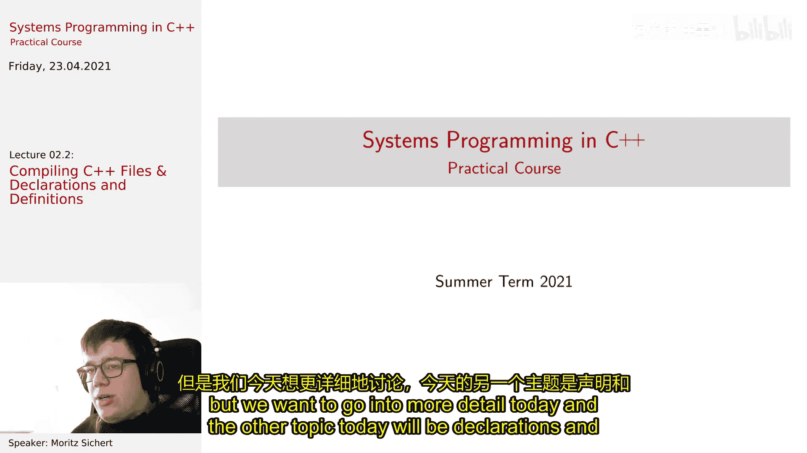

As you already saw we had a very short Hello World program now we have a like briefly longer hello world program。

And also what I told you already is that in C++ the code is usually separated into header files and implementation files。

 and today we will also talk about why this is and what the difference is。

 but for now still stay just you just have to know for now that those are two different kinds of files that or they'll refer to the same function in this case。

 say hello。And now we want to take a closer look at how the compiler actually works and what the compiler does with those files。

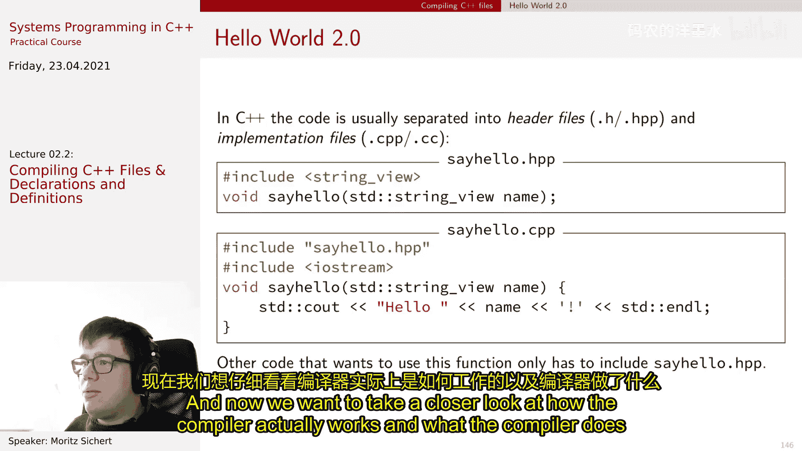

As you should know from last week。And internally， the program that we call compiler is actually divided into three parts which are called preprocessor compiler in the linker。

 so the compiler， the program that people usually call compiler actually contains to other parts that are not technically a compiler and this is sometimes useful because some error messages will appear only in the preprocessor or only in the linker。

 not in the compiler itself and for this reason it makes sense to at least know conceptually how a compiler works internally。

 so let's look at the preprocessor first。What the preprocessor does is it takes an input file of almost any programming language which means that the preprocessor is not tied to C or C++ in particular。

 it's just mostly used with those two programming languages but you could also use it with any other language because the preprocessor doesn't know about any programming language yet it just as the name indicates a program that preprocesssses your input file and what it does it only handles the preprocessor directives and those are the lines that start with the hash symbol。

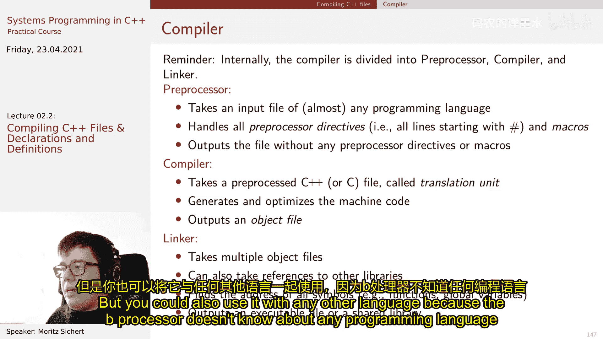

And macros and we will also see what those are and the output of the preprocessor。

 So so the input of a preprocessor let's start with that is as I said。

 the input file of any program language which will be the file that you actually write。

 So if you write code in your IDE and your editor this file will directly go into the preprocessor first and the output of the preprocessor is the same file but with all preprocessor directives and macros replaced so that it does not contain any preprocessor directives anymore only then it will be given to the compiler and what the compiler then actually does is it takes a preprocessed source file So in our cases would be of course。

 a C+ bus source file which for the compiler is also called translation unit。

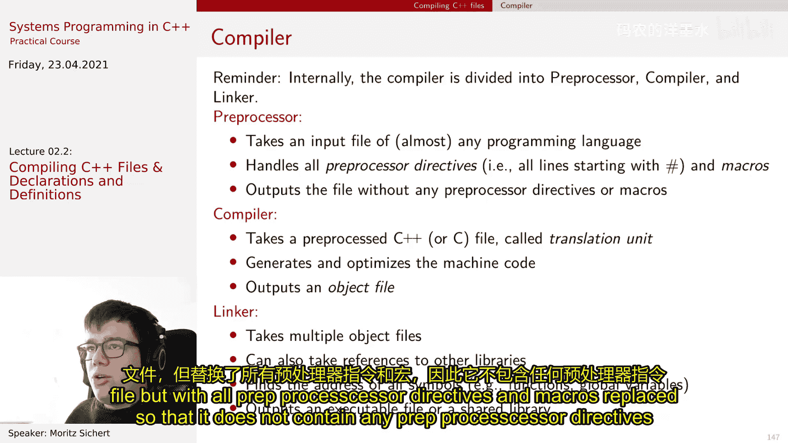

And this parts of the actual compiler then generates and optimizes the machine code。

 so it tries to pass the C plus buscode， tries to see if the anti syntax arrows and so on。

 and generates the actual assembly code， which is also called an object file， so an object file。

Essentially the binary representation and the machine code of your translation unit。

 which is the Cs class file essentially。😊，And as a last step you have the linker which takes multiple different object files because a project usually consists of many CP+ files。

 which means you will also have many object files and you need to combine them into one program or one library at the end and this is what the linker does。

😊，It takes modern object files and also it understands references to external libraries and what it then does it tries to find all of the symbols that are referenced by all of the object files and just tries to combine them all in an executable or file or a library。

Okay， let's。

Take a closer look at the prefecessor。And there are a lot of preprocessor directives we will talk about a few of the most important ones today。

 but as always there's a lot of documentation about everything related to C+ so if you come across a preprocessor directive that you haven't seen from the lecture then you can look it up online yeah but I mean everything you will need for this particular course we will teach here of course and which for a preprocessor are only a few directives。

 the most important one is probably the include directive and what this does is because as I said the preprocessor does not know about any programming language。

This means that also the include directive doesn't know which programming language you use so it can't know how like the inclusion of external functions and whatever should work。

 So what the include does it's very dumb so to say it just copies the contents of the included file into the current file。

 nothing more there's no magic there。 and the syn of this is you just write the hash include And then either in quotes or in angle brackets and the path。

The only difference between those two versions is that in the first version you can write a relative path to the header file。

 so the path is relative to the include directories that the compiler looks in and those are usually。

 for example， Linux， this would be/lash use R/lash include and slash includelude in some other locations。

And the angle brackets they let me continue with the quotes first the if you include something with the quote syntax then this will also look in the directories set you can specify as a user on the compiler command line as custom include path so to say but with the angle brackets it will only look in the system directories。

 which means that if you include something from the standard library， for example。

 you would always use the angle brackets syntax and if you include something from your project。

 you would always use the quote syntax Another thing you also have to know it usually almost never makes sense to include CPP files directly because CPP files they are first compiled to object files and only then they are linked which means that in C++ files。

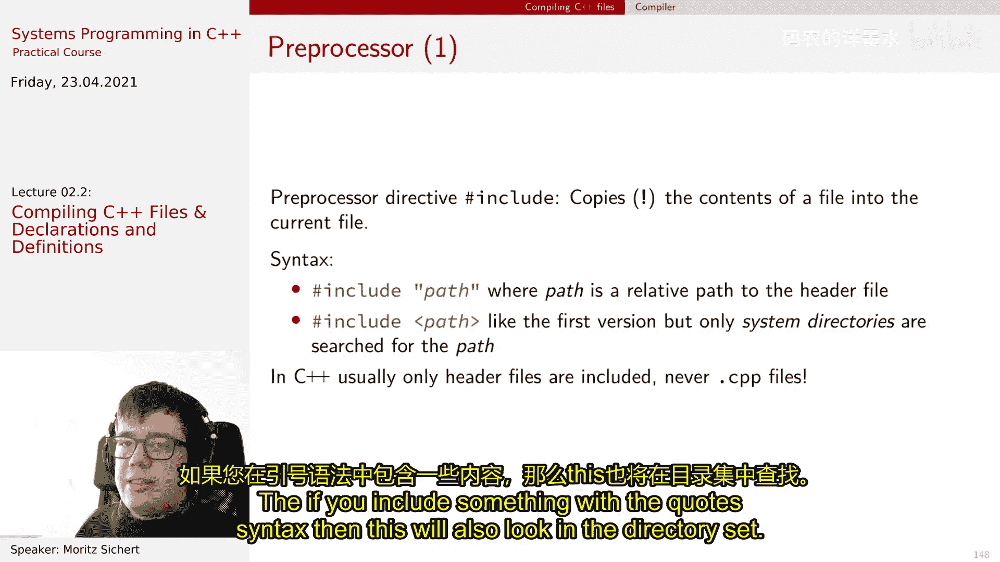

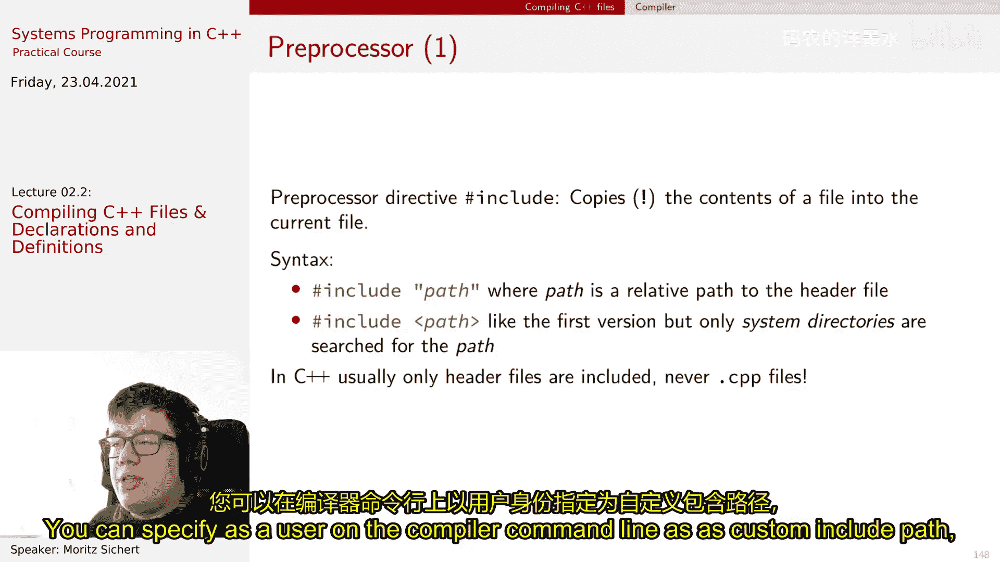

Usually the only thing youll see is include and then a head file and never a C+ plus file just as。😊。

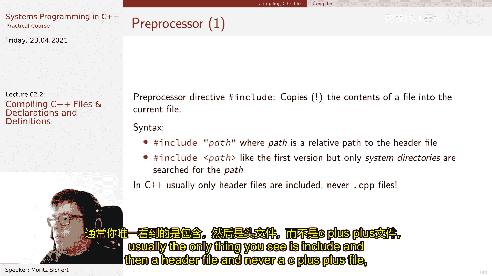

As a brief hint。Let's look at define， this is the preprecessor directive that defines a macro and you can see the synx C it's also very basic if you write defined food this just defines a macrofo but doesn't give it any content but you can also write defined bar with one for example where this can be any string anything because as I said again。

 the preprocessor doesn't know or care about programming languages。😊。

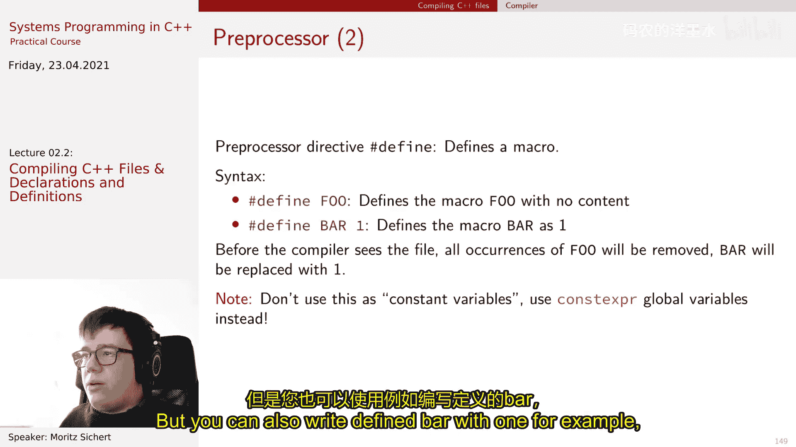

What it will then do if you define this macro， it just takes all occurrences of F in this case and will just remove them because there is no content for this macro and it will take all occurrences of power and replaces them with one。

 Nothing more Also note here for C+ plus in particular， you should。

Never use define macros for like as a way to express constants or constant variables or something This is often done in C++ in C。

 I mean so if you look at source code for the Linux kind， for example。

 this will be all over the place， but in C++ you should never do this。

 they are way better ways to do this for example， constant expert global variables which will be which we will talk about in a future lecture。

 but so that you know just so you know you shouldn't use this as global variables in C++。

And the last directive we want to talk about today is the if deF or if N devF and the else and the N ifF。

😊。

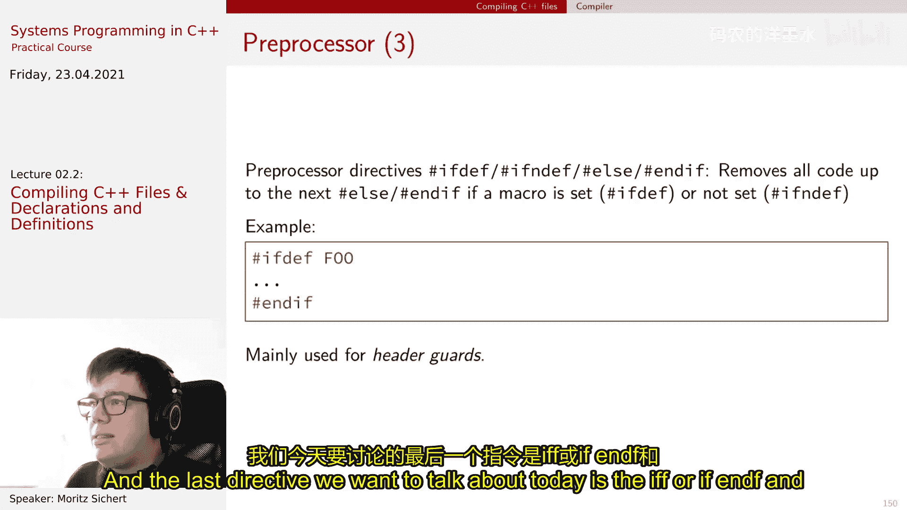

Those can be used to selectively remove parts of the file before it is given to the compiler so here just as a very brief example。

 if you write ift F and if this just means that if the macrofo is defined。

 then the preprocessor will just leave everything in between the ift and end of ass。

 but if you did not definey the macrofo， then。The content will be removed I mean it is sounds a bit I mean why would you ever do this。

 the main use for this are header guard， which we will also talk about。Today and later today， okay。

Let's look now at the next stage of the compiler， which is then the actual compiler and as I already said it。

Turns a translation unit， which in Car bus is usually a dot CPP file into a。Object file。

 which on Linux at least is usually filed with the ending doO。

And because CPP file may use functions that are not defined in the CPP file itself。

 this means that it may have references to external symbols。

But this is also important to know if you。Turn a trans unit in into an object file by using the compiler。

 Those external sums will not be referenced yet。 And you can see this in this example here。

 We have a program that's called dot CPP for just multiply。 and this function is essentially very。

Very unusual way to multily two numbers， we have the function at and the function mu and the function mal implements the multiplication just by calling the function at。

 but you can see that we never write down what the contents of the function at actually are and if you look at the resulting assembly you can see oops you can see that the function call the function mo lets say is of course you have assembly for the function mo but we don't have any assembly for the function at。

Of course， I mean， this is。As I said， this is because the external references are not resolved so you can see here we do call the function at。

 I mean the reason why this is a jump instead of a call is just because of optimization but you can think of this as a function called to at and this is a function called to mole so the function itself because I mean you can see here we have a recursive call here。

嗯。And I mean this is like how the assembly could look like for this function as you already saw we have a website which is called compile Db InterDA where you can actually try this out and you will probably see a that looks very similar to this。

Okay now the question is how do we actually resolve those external symbols then this is exactly what the linker does。

 the linker again interestingly doesn't know I have to know anything about the programming language because the linker just takes an object file which on Linux is is a standardized binary format which is called L so ELF and this binary format contains the information that the linker needs to know which symbols are undefined or which symbols are required for for the object file to link。

😊。

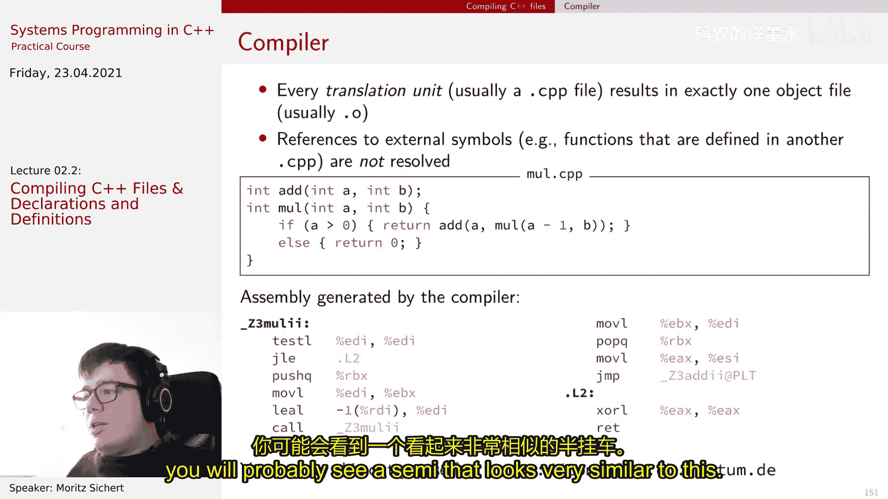

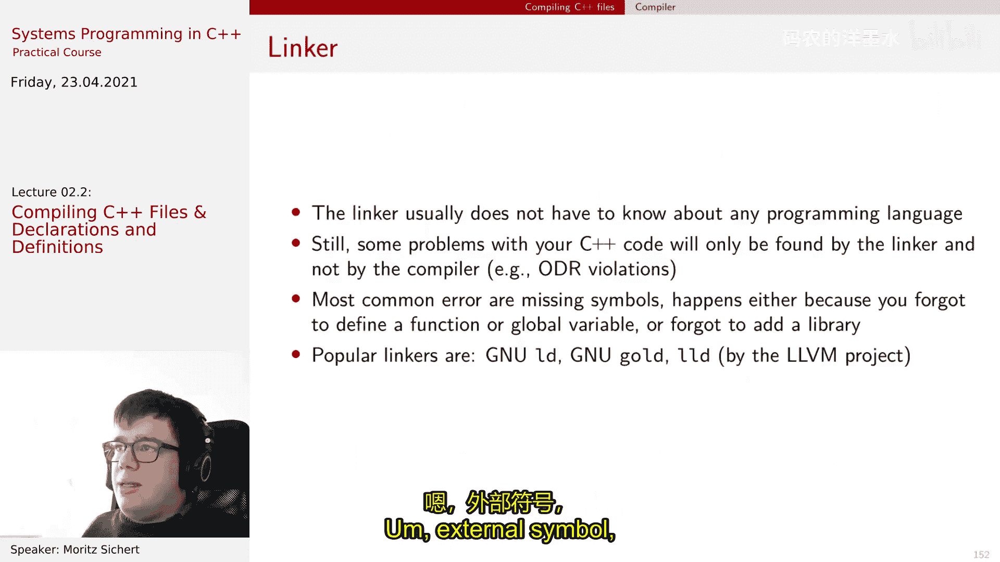

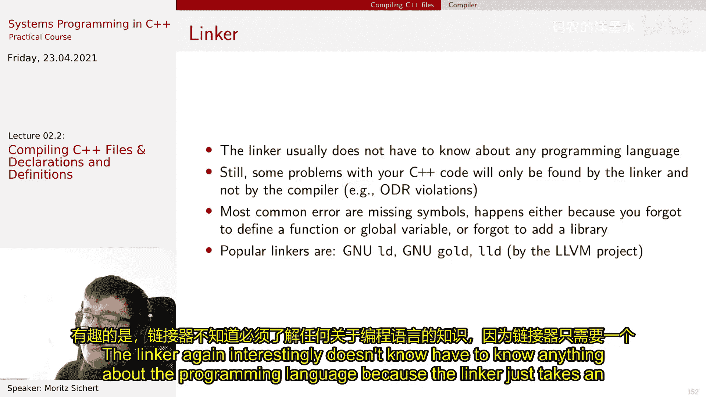

Yeah， this is what the linker will do It will try to find all of the unresold symbols。

 try to find the actual the real address of those symbols and then combine all of this in an executable file interestingly though even though the Lier doesn't necessarily have to know about the programming and language。

 some errors will only be found by the linker I mean most probably if you use a function that you then never define so the assembly doesn't actually exist for it。

 then of course only the linker will know this and there's the technical name for this in particular cells which is called ODR violation。

But I mean， what does you have to know in every step of the three steps we talked about in the compiler。

 there can be errors which will or won't necessarily be detected by the compiler。

What's also interesting to note just a technically note a linknker is usually not directly included into the compiler program itself。

 so if you call GCC or Kang or if you run this program。

 it internally uses another external program for the linking phase which is usually on Linux at least one of those3。

 the classical one is the new LD which is just the linker。

 the the standard of Lier then there's a new gold which is an improved version of LD。

 so they are not related， this a separate project new gold is just more modern project and it's usually faster and there's also a linker by the LBM project which is called LLD which is in my experience at this is' usually even faster than gold。

😊，Okay。Let's go back to the compiler a bit and let's talk about a few more compiler Fls。

 we talked about some basic Fls last week， but I want to introduce a few more now that you know what a preprocessor and linkers but first let me answer a question here are the addresses that the linker uses just number of bias from the start of the file or that's a very good question and the answer to this is it depends so the way a linker resolves the symbols is very system dependent。

 so this is very dependent on if you are even if you are on the same CPU depends on if this is an Elf library which is usually used on Linux or if this is a binary that is used on Windows and especially if you have different kinds of CPUs or even on an X86 CPU you can do this very differently so this is a very lowlevel implementation detail which usually don't have to care about when writing T++ but nevertheless it's a good question。

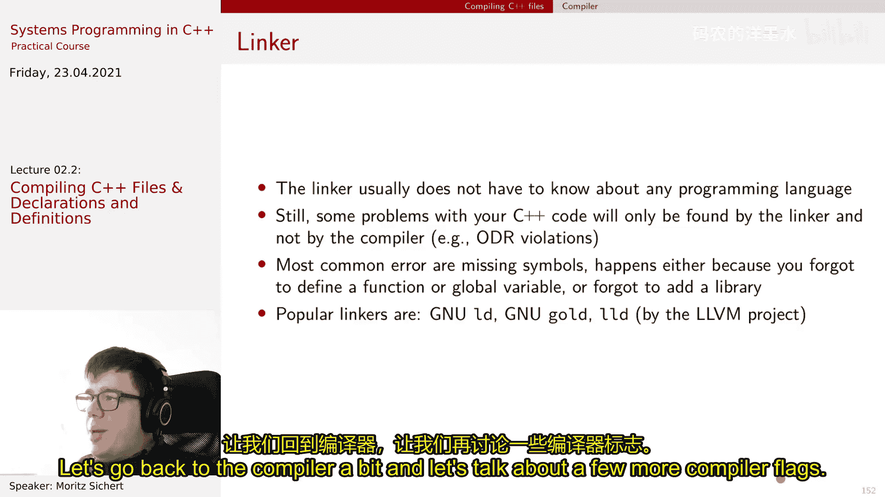

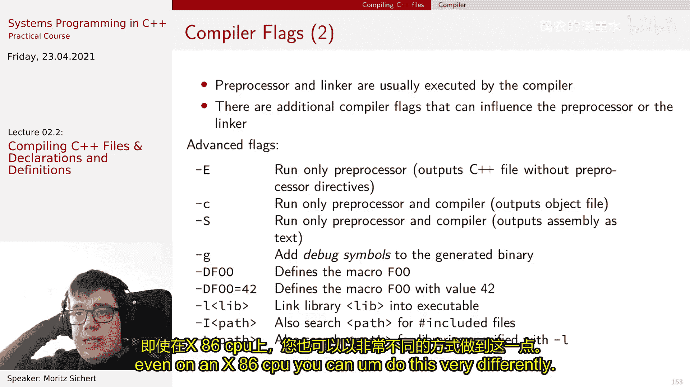

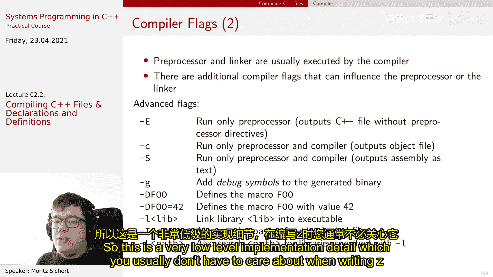

If you have any more questions about this， probably ask them in metatamost so that I can answer them to you without like expanding the。

Lectture unnecessarily。Okay。So as I said， even though preprocessor and LinkA are technically not part of the compiler they are usually executed by the compiler。

 so it does everything for you and they are actually flexs that you can give to the compiler so to the G++ or K++ program that will not influence the actual compiler step so the flex we saw last week like dash SDD equals c plus+ 20 tells the compiler that it should treat your source file as a C plus 20 file and this is like very specific to the compiler step but we can also we can also use flex that are specific to the preprocessor or the Lier step so you can see here a few symbols。

😊，So for example， the first one is dash capital E。 If you do this。

 then the compiler will not actually be executed。 It will only run the preprocessor， which is。

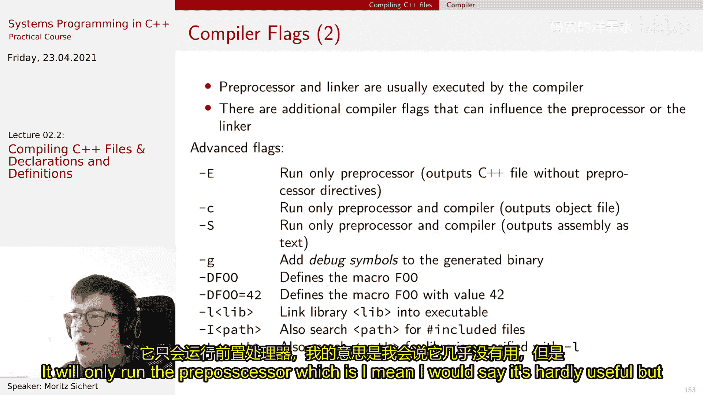

I mean I would say it's hardly useful， but sometimes or maybe if you're interested。

 if you really want to see all of the system header filess copy pasted into your file because as I said。

 include it's just copy pasting or file contents then you will be able to see this by using this if you run only the preprocessor and the compiler to get an object file。

 this is usually what you do just before generating an binary or an executable I mean you would use the dash C option you also have the dash capital S which is essentially the same as a dash C。

 the only difference is that it doesn't output an object file。

 it instead outputs the assembly as a text so that you can see it and this is by the way exactly what the compiler DB into the website does it just runs the compiler with this flag so that that the compiler will print the assembly。

You can also use the DG and we already saw this I think last week just as a reminder here。

 this will be used by the Lier and by the compiler to add debug symbols to the generated binary。

 which is then useful for debugging of course。You can also influence the preprocessor on the command line。

 you can define the macros directly on the command line， which is sometimes useful， for example。

 if you have a conditional part of your library which should only be enabled if you are on Linux for example。

 then you could have a macro or an ifDeEef in your file which has ifDeEef， we are on Linux。

 then do something else to something else， and then you can define this on the command line。

 for example by using CMake to detect the operating system so that CMake can give us on the command line and then you have essentially a more flexible way to build your library。

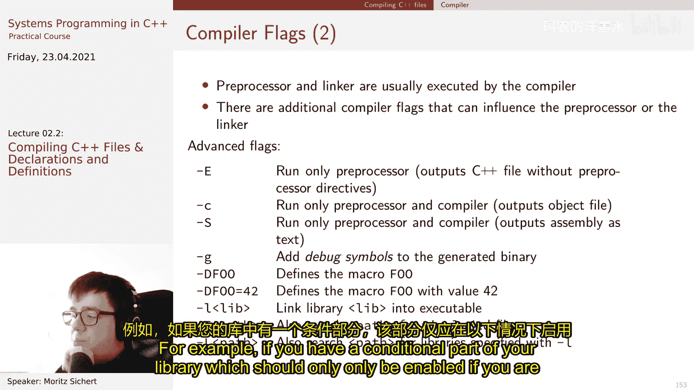

Yeah， and then you have， as I said， for the include directive it tries to search all paths in the system。

 but you can also give it paths manually here and the same also calls for libraries and you can link external libraries and those libraries are then searched in the path to give here okay I mean this is。

Again， the compile effects are usually documented very well。

 so if you come across a compile effect and want to know more about it。

 just look it up in the documentation and of course we also have or had the。

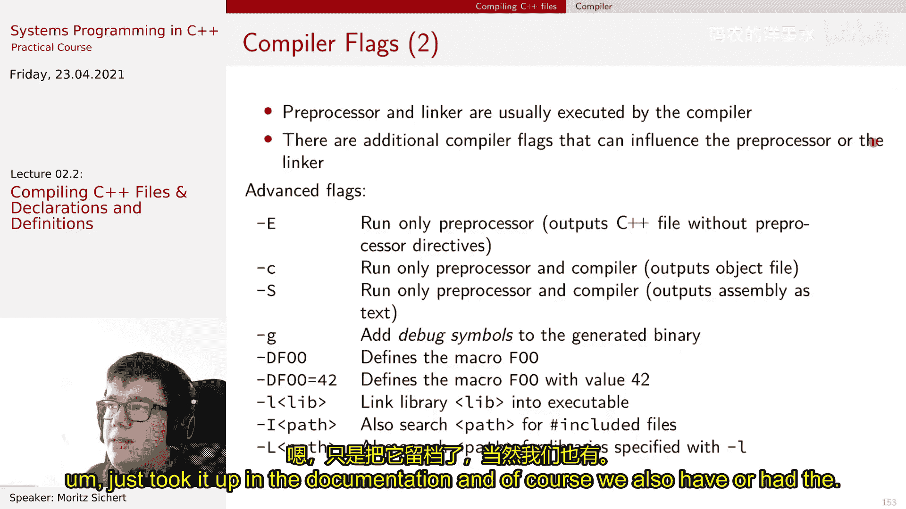

Exercise sheets about that。Let's also briefly talk about debugging。

 I mean the usual way that everybody knows how to debug is of course printing text。

 but I would argue this most of the time， or sometimes it can be useful as a very quick and dirty way to debug a certain part。

 this is the easiest way of course but for more complex programs I think it's very limited。

 especially I mean if you have a multi-thed program you have some issues for example that if you print simultaneously from different threads you can get garbage output because the outputs from two threads are combined and also you don't really know while printing which threat was active at which time。

😊，So this is not very useful in that case and when you work with C++ the most used debugger is usually GDP。

 even if you use C line for example as an IDE internally it also uses the GDP debugger which is also from the new project which means it's also open source and this is definitely good to know even if you use an IDE it's good to know how to use GDP on the command line。

 so this is why we'll talk about it briefly now it' already said if you want your program to be debugable。

 you should usually compiled with all optimization。

 so with the or zero flag and an able debug symbols only then debugger will allow you to set a breakpoint on a certain source line for example or will allow you to look at all local variables for example。

And as always， the documentation for this is also online。

 you can just look at it and it's also usually very helpful。

But let me introduce a few commands that you can use with GDP so if you want to debug a program with GDP。

 you would run GDP my program and my program is of course your program compiled with Dbug symbols and with dash or0 and then you get get a GDP command lines or to say where you can write any of those commands and I will only go very briefly over those because you will have to work with those in the current exercises anyway so you will have to look and use them and you then I think it's easier to understand what those do if you actually run them yourself so I mean there's of course a help command which shows you the brief help text for all of the commands then you have run run a program you can set breakpoint and delete lead break points you can then continue after a break was hit or you can interrupt your program at any time by using control C you can step a single line or。

Into a function call， you can do the same for assembly instructions。

 you can print values of variables of CPU registers of expressions and there are a few more commands you can see the current stack frame which is essentially if you call multiple functions or nested functions or to say this will show you the current level in the function call hierarchy and if you use back traces this will show you all stack frames up to the very first one which is usually the main function and then you can also manually traverse through the back trace by using up and down and you can also in addition to breakpoint you can also use watch points and of course you can also switch threads so this was a very very short and fast introduction to GDP but as I said I think it's not very useful tell you more details about all of the commands because。

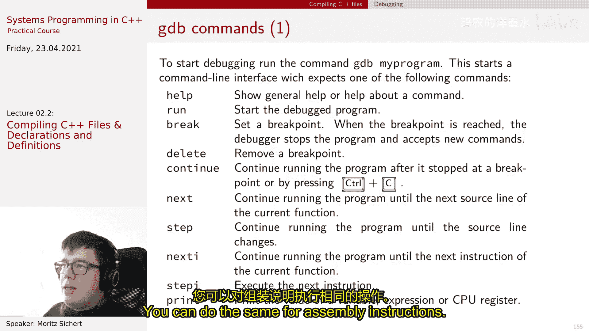

If you actually。

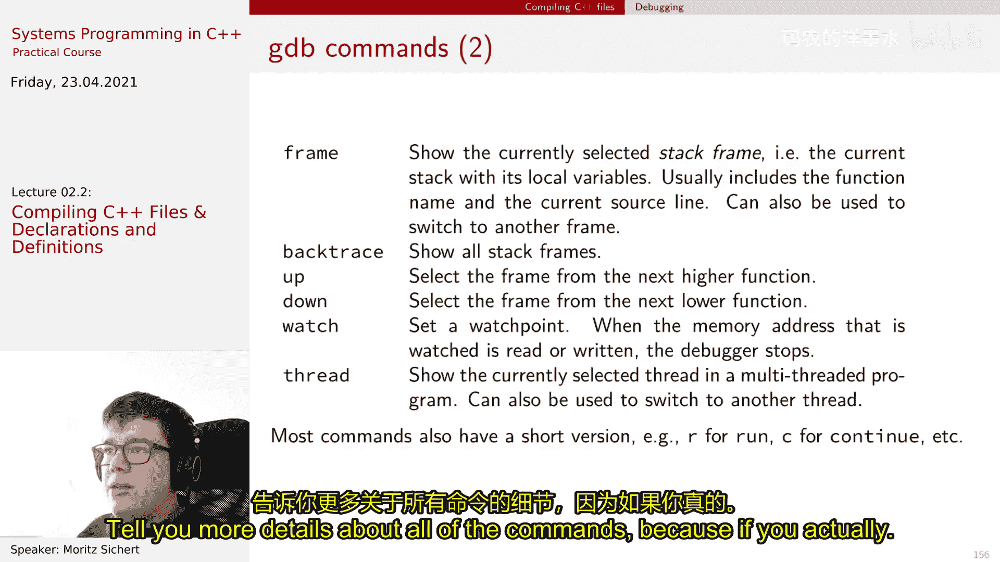

Try to developbu a program， you will very easily understand what those commands do and why we need them。

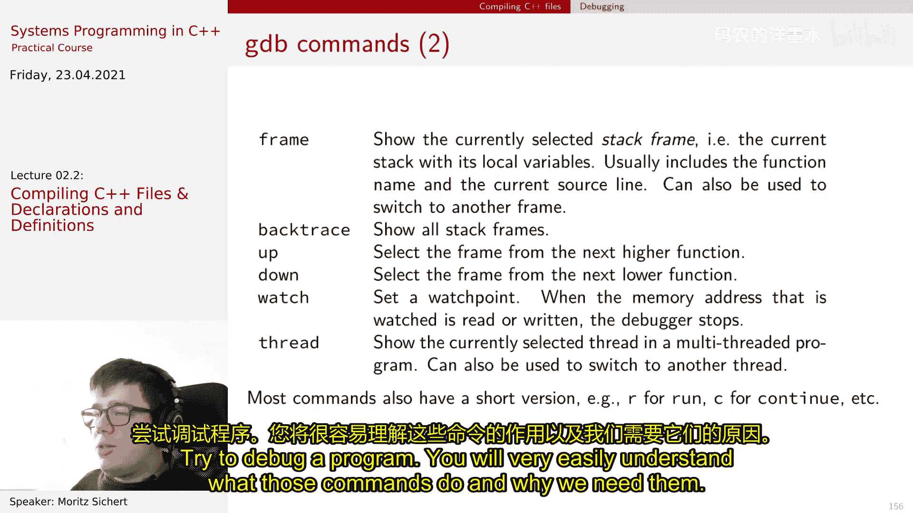

嗯。Let's look at another thing when we talk about debang is。

So if you step through a buggy part of the program， this will often you will find the bug this way。

 or at least you will be able to narrow down the like the rough location in your program where the bug should be。

 but sometimes you know why you of writing your program。

 you know that some invariant must hold and you can see as an example here。

 if you wrote a division function and you tell like you know， okay you should never divide by zero。

Which means。I mean， apart from that divide by0 is undefined behavior and C plus plus anyway。

 of course it wouldn't be useful to divide by0 so instead of like trying to find a bug because you did divide by0。

 you can just make the D function check for this case itself。Every time it is called and for this。

 what those runtime checks are called， they are called assertions。😊，And as it does fast。

 you can use the asserter macro by including the C assert header and what it essentially does is you just call it like a function and give it a booting expression and if you compile your program in debug mode which means so that the N debug macro is not defined you don't have to worry about this when you are using CM because it will define the macros correctly anyway so just know if you compile this in debug mode。

 those assertions will be checked at runtime every time this line is past but if you compile this in release mode then of course the assertions will not be checked because assertions can be expensive because instead of just dividing a by B you also have to check if B is not zero and then throw an exception or something like that or press the program so this is why you usually don't want the assertions in the release mode but for debugging is very useful so any time you are writing the algorithm or data structure and you know that at this。

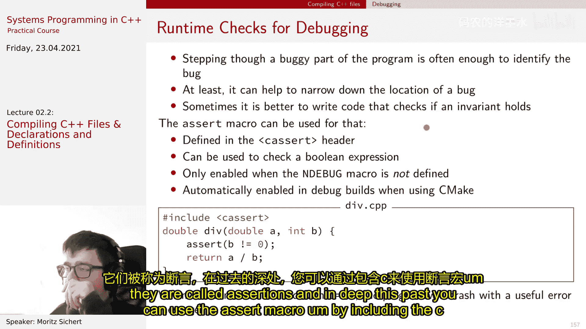

in something has to be true， it definitely makes sense to write an assertion there so if you're writing a tree structure or something and you know okay at this point I know this tree only or this note only has exactly one child note。

 then you could write an assertion， something like a certain number of children equals one and then your program will crash automatically if this an invariant doesn't hold anymore which is usually very nice for debugging。

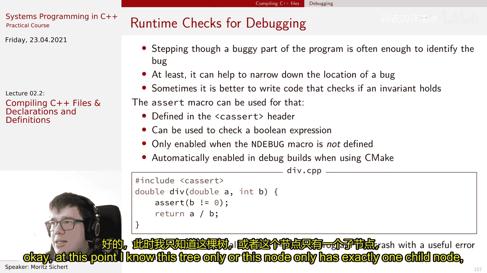

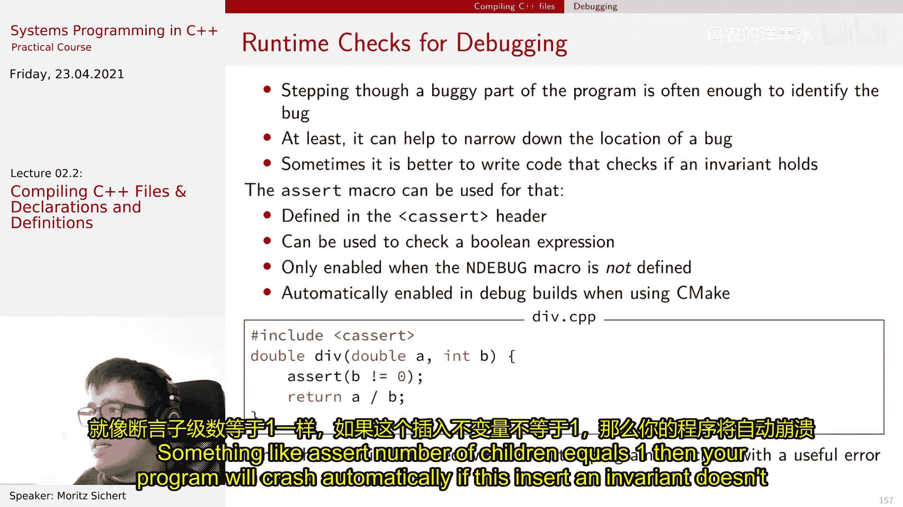

Okay嗯。Even though assertions are nice， its still can be a bit annoying to write assertions all the time。

 especially if you're using especially for things where you think that the compiler should know the volume by zero is never valid in S fasta why can't it just include the run track for this automatically there's a question is there something like debug assertion which is disabled if you compile it for production and that's what asserter does so assert is disabled in the production mode and so assert is enabled and debug mode and disabled release mode and there isn't a function that would be still enabled in release mode。

😊，Okay， so the question is， oh not the question I can tell you。

 compilers can insert a few of those runtime checks automatically and those are called sanitizers so they essentially sanitize your code by including additional runtime checks。

😊。

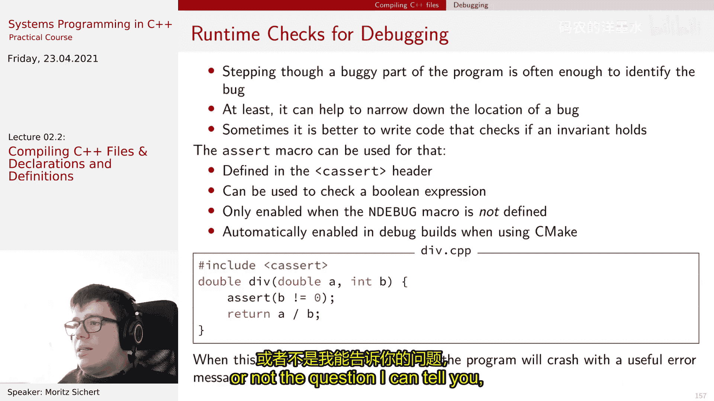

And the most important ones， so they are multiple ones。

 but the most important ones and that we also at our chair when we develop our code use all the time are the address sanitizer and the undefined behavior sanitizer what the address sanitizer does is it essentially instruments so instruments means it adds additional instructions to every memory access So to every memory read and memory right and will essentially add an assertion that checks the most common error so it checks something like are you trying to dereference an address which doesn't even exist。

 are you trying to use an use an area memory area which you already delete it again and so on well this is what the address sanitizer does and the undefined behavior sanitizer does exactly what is said in the last slide it will add runtime checks。

😊，For。Some kinds of undefined behavior， especially things like dividing by zero。But of course。

 runtime Texas are set， they add overhead， those automatic sanitizers they are also not enabled by default。

 but we always use them in conjunction with， of course with DG for debug bids。😊。

And the compiler option for this is。At least for Gcc and for Kang is dash F sanitized equals and then the name of the sanitizer and for the address sanitizer in which we usually call Asm is address and the name for the UB S is undefined。

😊，And as I said， so even for our large development project， our chair， which is our database system。

 we always enable the address sanitizer in our debug builds。

 and even though you would think this could make the program much slower and of course it does it adds overhead。

 but for the debug builds this is so useful for us that we always enable this by default。

 which means that we also recommend you to oh I mean we recommend you to do this outside of this practical course but in the practical course。

 all of the rep repositories that we give you will automatically have all of the sanitizers enabled already。

 so just so you know， all your tests will be run with those sanitizers enabled。😊。

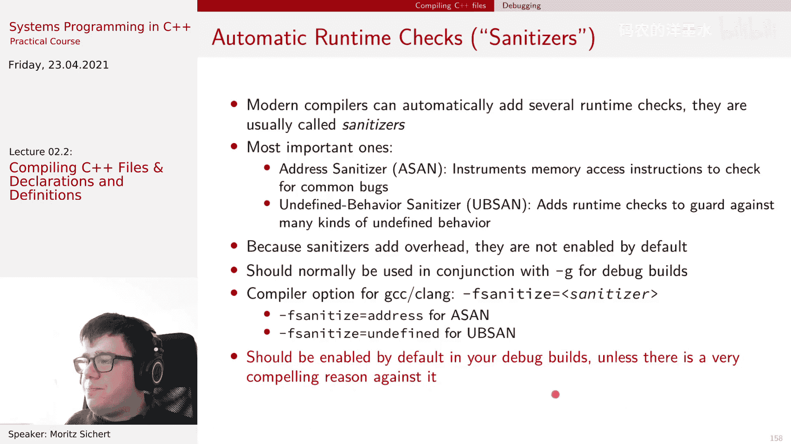

Let's just look at a brief example for the UB Z， so you can see here we just write a very short program。

😊。

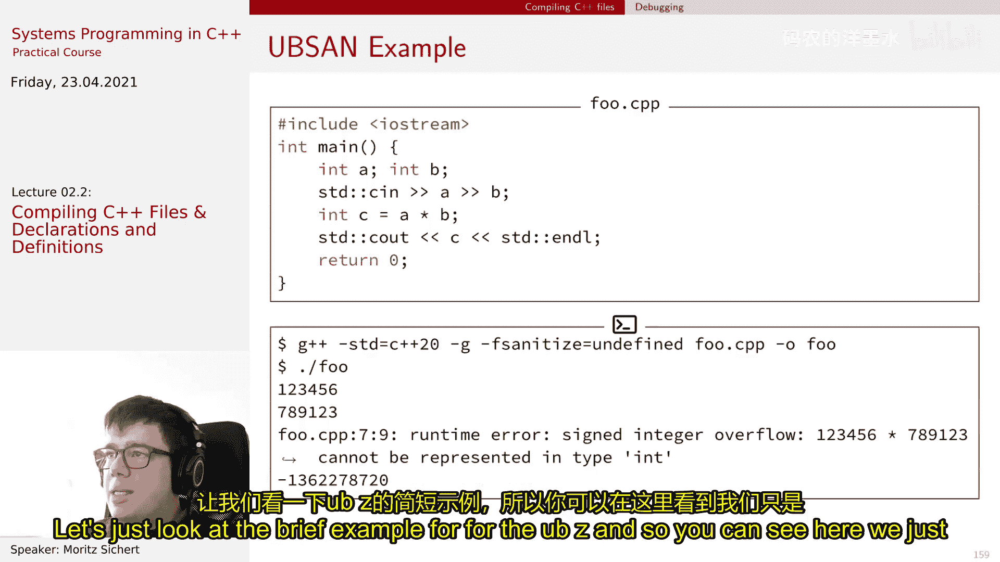

Wwhich reads two numbers A and B multiies them and then output the result and as you should know from this week's lecture is that integer site integer overflow is undefined behavior and C+ bus which means that if the result of a times B is larger than the maximum allowed integer or it is smaller than the minimum integer。

 then this is undefined behavior which of course should not happen and if you then test this so if you compile your program with f sanitized undefined and then run this and then give it to numbers which are valid integers but multiping them results in an integer which is larger than the largest integer then you can see here the UB then will actually add some nice printing of an error message and then will crash your program。

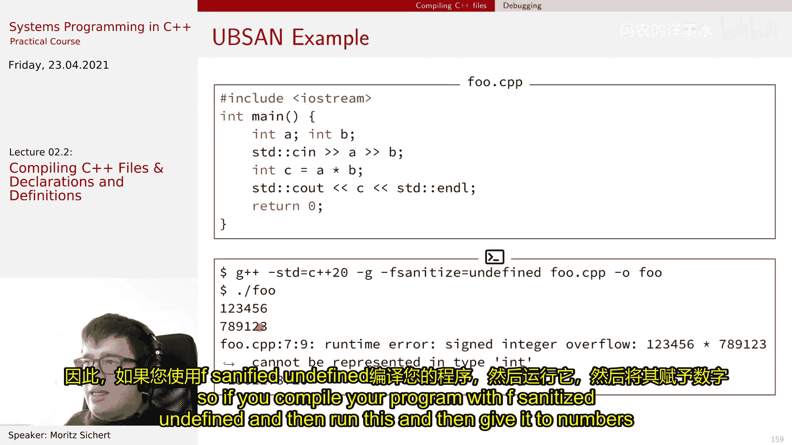

Oh in this case it doesn't increase your program， you can see here that the result of multiplying those two numbers is a negative number which of course doesn't really make sense。

 this just happens because of integer overflow， but at least the UB send will give you a useful error message。

😊，Okay。So this is everything about compiling and debugging and so on I want to talk about today。

 the next topic would be declarations and definitions， Are there any questions so far？

Okay I don't think so then let's start with this chapter the first thing I about to talk about is are objects because the objects are one of the core concepts of C++ so the C++ standard says that the main purpose of C++ programs is to interact with objects in order to achieve some goal。

 I mean this is a very general description but this shows you that the concept of objects is very important C++。

😊，嗯。So that you can already imagine what an object would be is examples of objects are local and global variables。

 so every variable is considered an object in C++ note that this is different from languages like JavaA。

 for example， where some things are primitives and some things are objects。

 this is not true in C++ every variable is always， I mean every okay now that's well let's say most variables that are not all variables that are not references are always objects independent of their type。

😊。

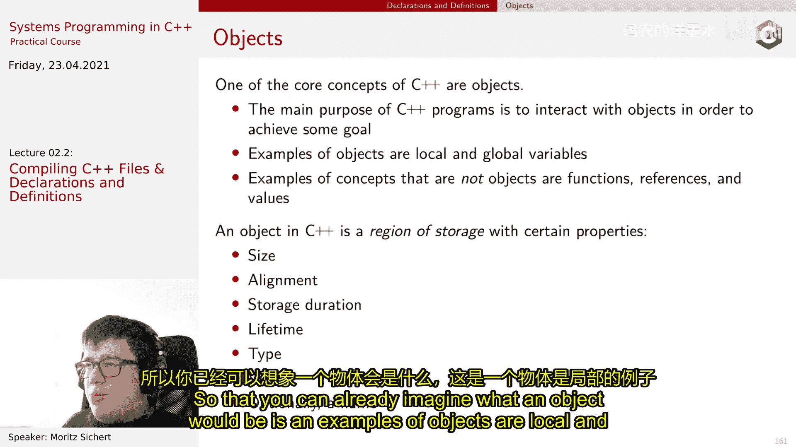

But there are still things that are not objects in Cus+ and some examples are functions。

 so functions。😊，themselves are not considered objects in C++。

 so they which means that they can cannot be used like things that would be objects references they also exist in C++。

 we will talk about them in the future。 they also are not considered objects and there's also values which is a very related concept to two objects but values are not considered object Sos let's now talk about what actually is an object and object in C++ is a region of storage。

 which means that an object needs at least one byte of storage otherwise it wouldn't be an object which has certain properties and those properties are listed here。

 so it needs to have a size and an alignment， the alignment is。😊。

I mean its necessary because on most GPU architectures， for example。

 integers need to be aligned to some multiple of an address。

 so this is why objects Ts also have alignment。They have astonished duration lifetime， a type。

 every object have a type has a type and an object also has a value which you now hopefully understand why a value itself is not an object。

 just an object has a value， but as you can see it also has a bunch of other properties and an object also can have a name and of course I mean for variables this is very clear where the name comes from but there are also things like temporary object which can happen sometimes which also are considered object but do not necessarily have a name。

😊，Okay， I mean， beside size and alignment， those properties will be clear。

 but let's now talk about the other ones here。

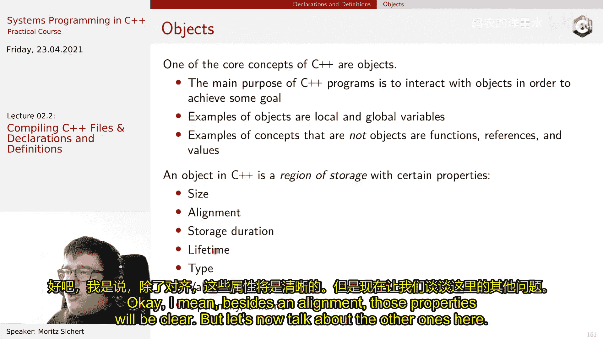

The first one is the storage duration there's a very technical description of storage durations in the Cpa standard and you can see in the top right corner of the slide of course also the reference or the URL to the CPP reference where this is explained but let me try to explain this a bit more intuitively so there are four different kinds of types of storage durations that an object can have and the first one is the automatic storage duration an object with automatic storage duration is usually allocated at the beginning of a scope so at the beginning of a curly brace and then delocated automatically so it automatically in a sense here that the compiler automatically generates code to deelelocate the。

😊。

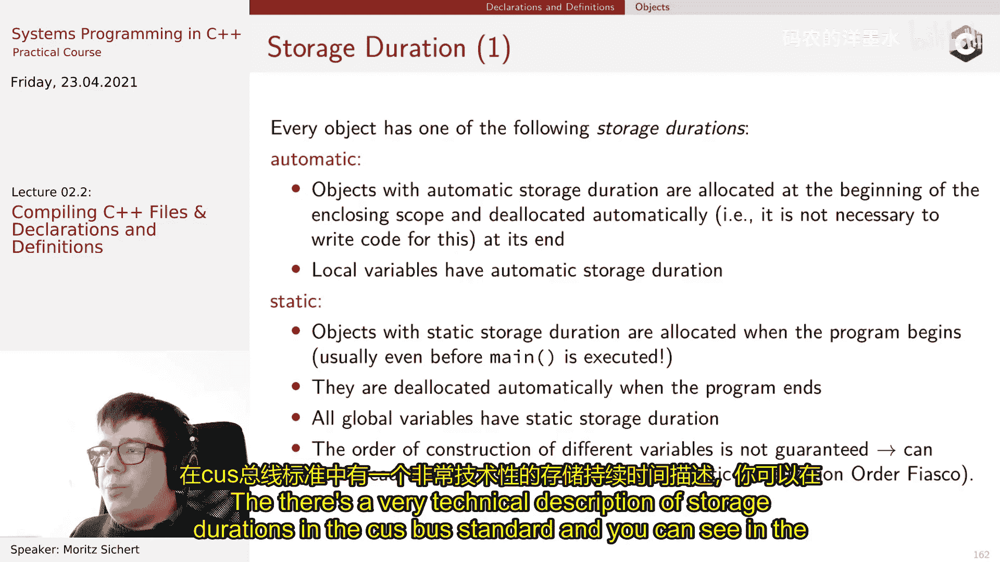

The object at the correct time so I mean this is not done by the runtime。

 so this is not like a garbage collection in Java or in Python or any other language and this is actually only done automatically by the compiler because it generates code to do this。

😊。

An example for objects that have local storage duration are local variables because you write just write your local variable into a equals1 and eventually at the end of your function this object A will not be used anymore so the compiler will just generate code to to delocate this and everything is fine so you don't have to care about anything or anything about the storage duration at least with automatic storage duration there's also static storage duration which is。

😊。

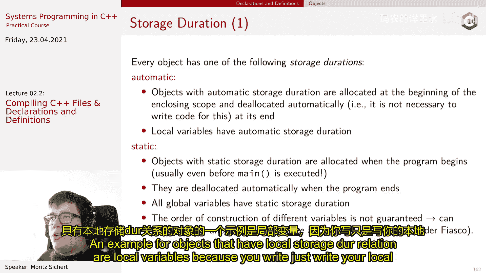

Similar to automatic， which means that they are allocated and delocated automatically。

 but they are allocated when the program begins， which is in particular is even before main is called。

😊。

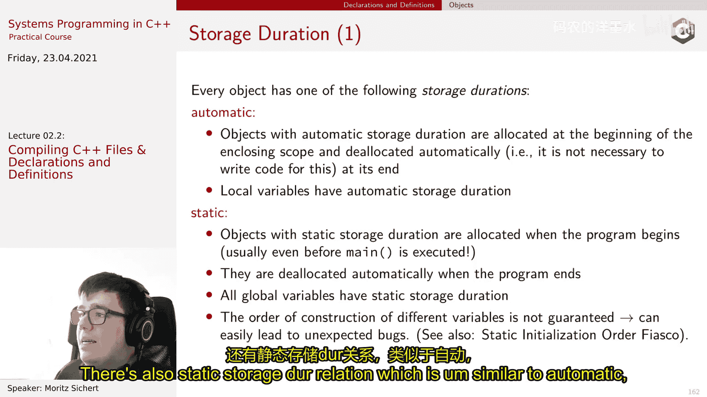

An example for this would be global variables， because a global variable can， of course。

 can be used in the main function already。 so it has to be。😊。

Alllocated and initialized correctly already if you are in the main function。

 which means that the compiler will generate code so that the resulting executable will make sure that all of the objects with static storage duration are allocated just at the very beginning of the execution of the program。

😊。

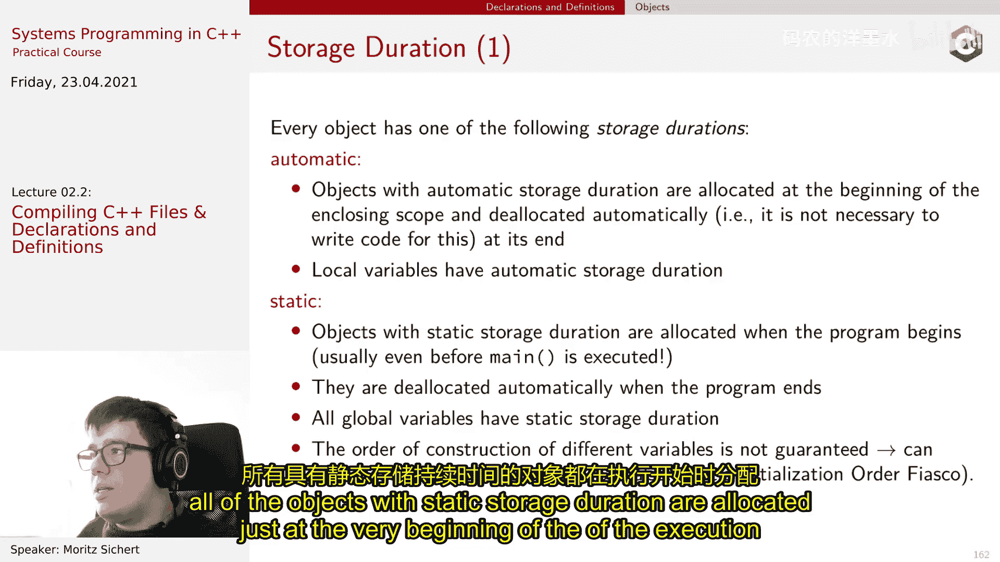

And I mean， they are also not delocated at the end of a scope or something they are just only delocated at the very end of the entire program。

AndThere's one cave with this is the order of construction of different variables so if you have different global variables。

 the Z+ bus sign up and the compiler does not guarantee any consistent order of initialization of object with static storage duration。

 which can sometimes lead to unexpected bugs and this is so subtle that there's actually an entire term for this which is called the static initialization order of fiasco。

😊，You should， I mean if you never use cur variables you will never run into this problem this is like the good thing about it。

 the bad thing about it is if you do run into it and this can be very annoying and how to debug yeah so I mean by the way this is an URL so if you don't know the slides you can click on this and this will briefly there's also a short link to a CPP reference where they briefly explain what this means。

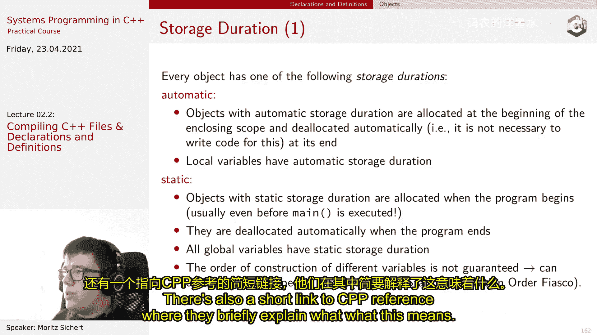

Okay， there are two more types of storage durations， we have threat storage duration。

This is very similar to static storage duration， the difference is that the variables are not allocated at the start of the program but only when a threat starts and then delocated again when the threat ends。

 this is very useful if you do multi multith programming and you need some variables that are local to a certain threat and they should not be accessed by any other threats。

 well this you would use threat storage duration。And of course， I mean。

 because it is initialized for every thread， this also means that every thread gets its own copy of the object。

 so if you define a variable with threat storage duration。

 then every thread will get a separate independent copy of this object。😊。

And the last type of storage duration is the dynamic storage duration and this is essentially the type of storage duration where you have to deal with everything。

 you have to allocatecate the storage， you have to delocate the storage。

 you have to construct the object， you have to deconstruct the object and this is done by using dynamic memory management which。

😊，You usually know about which is usually done when we are talking about pointas and stuff which we will not do today but just know I mean of course we will cover this topic but just know this is what the the dynamic storage duration covers you have some you can see some examples here so as I said Lo variables I have static storage duration so you just write in equals one and then you have an object of type int with the value1 on x86 size 4 alignment also for with storage static with the nameF。

You you can also， I mean， there's also the keyword static which doesn't influence the storage ser。

 So those two are essentially the same， I mean， at least the storage duration is the same。

 If you want a thread storage ser， you have to use the keyword thread local。

And as I said local variables they have automatic storage duration。

 but you can also define variables with static storage duration inside of a function。

 so this I mean this is not a global variable because it's not accessible outside of the function F。

 but it still has static storage duration， this means that if a function called to F modifies this variable。

 this will be persistent across calls to the function F。😊，Okay。

The next concept of objects or the property of concept I want to talk about is the lifetime。

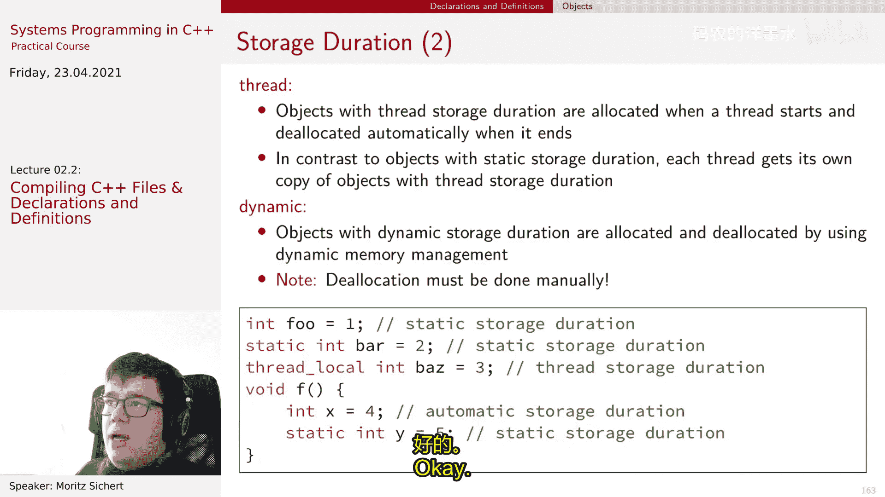

嗯。Every object as you saw， has a storage duration， which of course， I mean。😊，If， if。

 if you have an object of。Automatic storage duration and the scope is at the end then of course this object can't live anymore and because it storage doesn't even exist anymore。

 but they are still a separate concept of lifetime which is closely related to storage duration but still is different and also what is also important to know that references also have a lifetime。

 even though references are not objects they still have a lifetime。😊，And again。

 the more technical description of lifetime is that the lifetime of an object or a reference starts when the object or the reference was fully initialized and for local variables that would be something like writing int a equals one。

 then the object a is initialized to one and then the lifetime of the object also starts。

 the lifetime of an object ends when its deor is called。

 so if you have if the type is a class and it does have an deor。

 which we also see in a bit when we talk about classes，😊，Or when its storage is delocd or reos。

 so if you just have the type int int doesn't have a deor of course。

 which means that if the storage of an int is reused for something else， for example。

 if you have a lock variable on the stack and then eventually the stack is used by some other function for some other object。

 then the lifetime of this object is considered to be at its end。😊。

What is also good to know or interesting to know is that the lifeome of an object never exceeds its storage duration。

 which intuitively should make sense if the storage of an object doesn't even exist anymore。

 then why should this object even be considered a alive， so to say。

 which is like just the intuitive explanation of the sentence here， and just as in addition。

 the life of a reference because a reference doesn't have a storage duration。

 the lifetime of a reference like if it were a scalar object。

 so like if it were an intovariable if you declare or define a reference in your local as a local variable and and then you go out of scope or you return from a function for example then the lifetime reference is also considered a2p end it。

😊，So those were the technical explanations， the more like the thing you should take away from this is or at least or at first let me say the thing you should know is that using an object outside of its lifetime is undefined behavior or at least will lead to undefinifieded behavior and actually the lifetime issues are。

 I would say the main source all bugs and in particular of all memory bugs in C++。😊，The嗯。

So if if you in Z++， you can in it's very easy to use an object even after its lifetime and this will。

 I mean， not only is this undefined behavior， this will always or not always but most of the time use or lead to very。

How to debug bugs and in the best case you will just scratch the program in the worst case it will do very weird things。

嗯。And also unfortunately， the++ compiler cannot detect many lifetime errors of lifetime users。

 it can only detect very basic ones， but if the compiler detects them and once about them。

 you should always fix your code， but because if your lifetime if the issues are so bad that even the compiler can detect them。

 then your program is definitely wrong and you should definitely fix your program so just know if the compiler wants about anything that's related to lifetimes always fix your program。

😊，There's a question， why is the concept of lifetime meaningful？

The thing is with C++ because it is such a lowle language。

 it is not always easy to say when an object is usable or not。

 and for this the Zpa standard defines a very like abstract concept which is called lifetime which then compilers can use to determine whether they have to generate。

😊，Let's say less efficient assembly code because some object is still alive or maybe or if they can assume that an object can't exist anymore so sometimes can generate more efficient code。

 you will see this in the current exercise sheet where you will have to write a program that leads to different kinds of results depending on the optimization levels I mean I know this is a very probably not very satisfying answer if you have more questions about this feel free to ask me on metamost and I will answer more questions。

😊，嗯。Okay。The next thing I want to talk about， which is the not related to objects are namespaces。

 but first we have another。

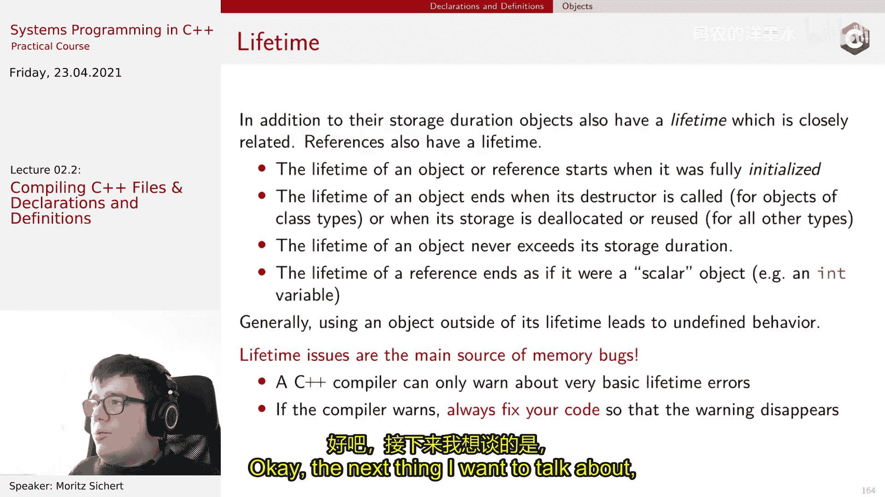

Question， how can a program use an object outside of its lifetime and still be syntheticically correct oh this is also a very good question。

😊。

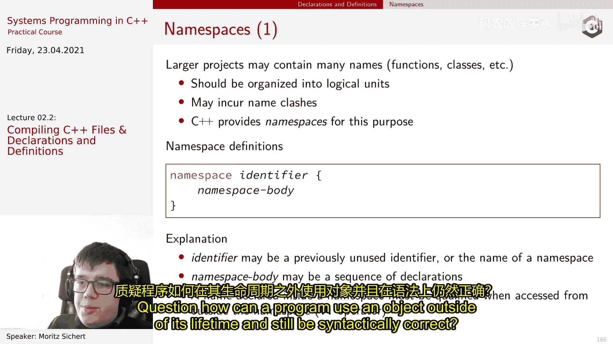

Unfortunately， if you use dynamic memory management with objects with dynamic storage duration。

 you will be able to get a pointer or reference to an object and then manually end the storage duration of an object by manually delocating it。

 which as you saw in the explanation of lifetime means that the lifetime also ends automatically because the lifetime can never exceed the storage duration。

😊。

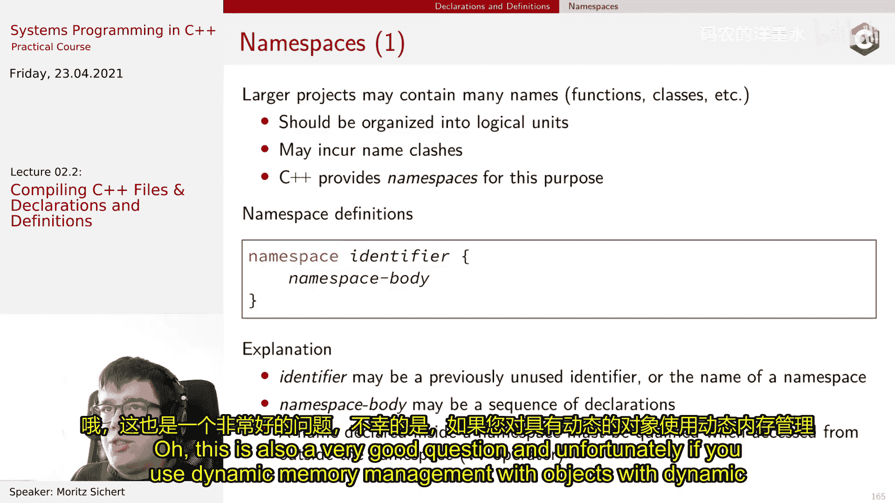

But you can still have the point or reference to it。

 which means that if you then use this point or reference to access this object。

 the last already ended， but you still access or still try to access the object and this leads to all kinds of errorss。

😊，We will talk about this about pointas in reference and everything related to this in detail。

 I think next week already， so don't worry if you don't understand pointers of something right now。

 we will definitely cover this in great detail， I would say。Okay。

You already saw that you can give your functions and variables names， of course， I mean makes sense。

But。Let's just say if you have a larger project， it can easily happen that you accidentally use the same name twice for different things and also you usually want to organize your names into logical units。

😊，In C++ there's a handy feature which is called namespaces and you can here the synex suggest you write namespace and then a name for your namespace and everything inside of the namespace can then be global variables。

 functions and so on and they will then。😊，Because considered it is to be nested inside of this namespace and if you want to access a name from a namespace。

 you have to use the double column operator， like which is called or the scopepe access operator。

So let's look at an example， I think this makes it more clear。

 so I have a namespace A and I can define a function fo and bar here and if I use just the nameF in the function bar。

 the compiler knows okay I'm inside of the namespace A so this will just call the function P of the namespace A。

😊。

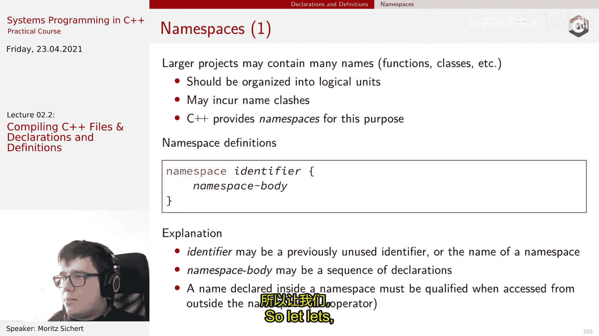

And also in particular it will never call the function F of the nameCP because those are separate namespaces and they will never conflict with each other and if you are outside of the namespaces。

 of course you have now to qualify explicitly which version you want to call you either write A double column F or B double column F and then they will call the respective functions here。

 if you just try to callF without any namespace prefix here。

 then the compiler because in the main function is outside of any namespace will not know which of those two functions。

You want to call it that' the questions the question are namespaces declaration part of the CPP or HPP files。

😊，I mean， NASces are used in both because I mean we'll talk about declarations in a second here but if you declare something inside of a namespace in the head of file。

 you also have to define it inside of the namespace in the implementation file。

 which is the CPP file， so this is not a concept that is only used in one of both types of files。😊。

What you also should know is that you can also nest namespaces。

 this is for example in Umbra that's the name of our database system our chair。

 it has several thousand lines of code and have we sometimes have like nested logical components of our system so we also use nested namespaces for this you can either just nest a namespace declaration inside of another namespace one or you can just directive right like the nested namespace name here and then like accessing a name of a nested namespace also looks like you would expect。

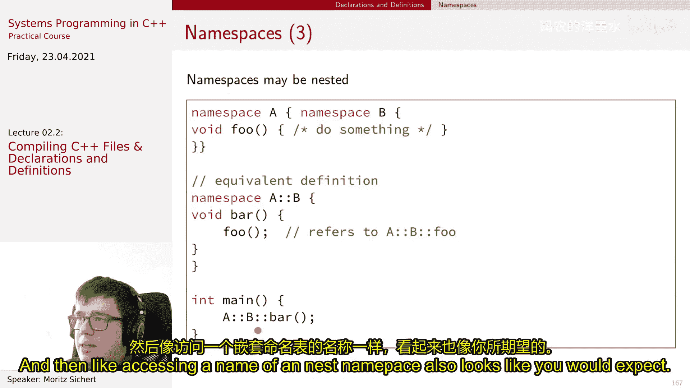

Just as like as a style guide， what we usually like to do is especially if you have nested namespaces and many different of them。

 it can be a bit confusing or it can be hard to see inside of a source file in which namespace you are currently so what we do is we use visual separators instead of justmp lines。

 this is just a style guide that we use especially for our C+ coding in our chair and also if you have a closing brace of a namespace which usually can like if the largest very file is very large。

 this can come several hundred lines below the opening brace。

 so it is useful to write a shortcom here which tells you which namespace this closing brace。😊。

Actually closes。

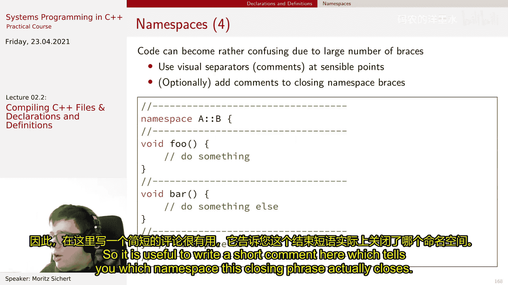

So the nanospace is like the hierarchy for function is the question and yeah I would say you can yeah hierarchically name your functions and this I mean this also not only works for functions but also for variables。

 so global variables and also for classes which we will also see in another lecture。😊。

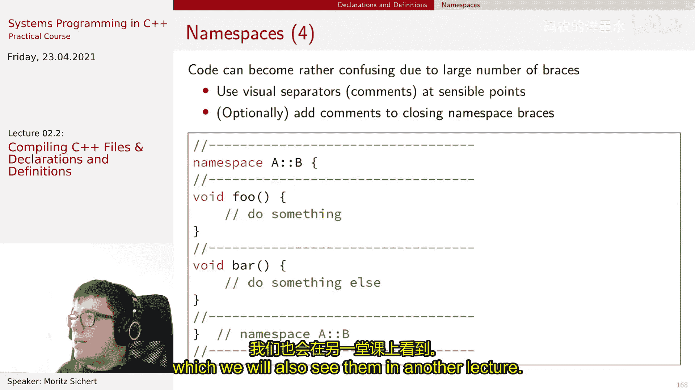

嗯。😊，Okay， let's talk about another thing about NAspaces。If you use namespaces。

 you will have to use the qualified names So the like the double column syn to access the names within the name space。

 but sometimes it may be obvious from which namespace the name comes from and。

Or maybe you it just that very annoying to repeat all of the the qualified accesses again and again in the same file。

 So for this they access the keyword using and using namespace， which can be used to import。

Names from another namespace into the current namespace or even into the global namespace。

So the syntax using namespace x means import all the names that the namespace x has into the current namespace。

😊，And using x double column a means only import the name a from the namespace x into the current namespace。

 so the difference is this imports all names， this imports only the names we give it here。😊。

And one note here， though， is that for this。You should know that this should not be used in header files。

 especially for the global namespace so if you write using namespace A here because this using line is not nested inside another namespace。

 this will include all of the or import all of the names from namespace a which in this case is just the name X into the global namespace and if you do this in an header file and someone is includes your header file then you will essentially pollute the global namespace with your nested names which defeat the entire purpose of namespaces because you create namespace to avoid name clashes but if you use using namespace in a header then this I mean this essentially will revert all of the benefits of namespaces so as a rule of thumbs never use using namespace in a header。

😊。

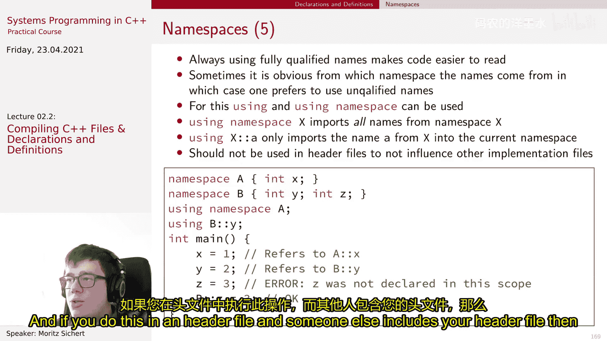

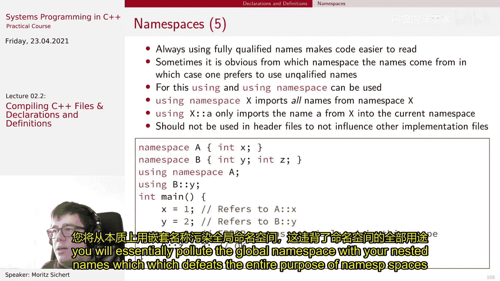

Okay， I see someone typing， so let me wait a bit。Can name size be imported from other files？

I'm not sure what you mean。 and because if you include， so if I ahead an include at the top here。

I said in the preprocessor that the preprocessor just copy paste the contents of the other header file into this file。

 so if the other file defines any namespaces， then of course you can also using namespace the namespace of the included file so this 70 works。

I hope that answers your question。Okay， let's now finally talk about declarations because this the entire this is one of the names of the topic of today。

😊。

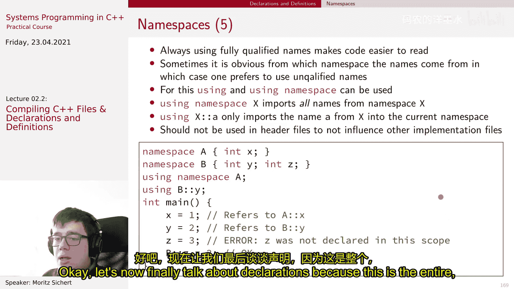

Okay， so what is the declaration in C++ and any C first code that introduces a new name that can then be referred to is called declarationlar so this is a very very easy and to remember everything that introduces a new name is the declaration easy。

😊，What is not so easy and anymore。😊，What different kinds of declaration text is because T class has many of those and a few of those you already know。

 you have the variable declarations， function declarations and now you also know names for declarations。

 you also saw that using declarations。 So the one without using namespace because theyre using declarations。

 they explicitly specify a new name So those you already know。

 but they are a bunch of more they are class declaration， for example。

 they are template declarations you will see in a few weeks what those are and they are even more。😊。

So this is not so easy anymore， but yeah we will just。We will introduce a bunch of more declarations。

 and we will explain the the new new ones we introduce at the time we introduce them。

 What you have to know for now is that。

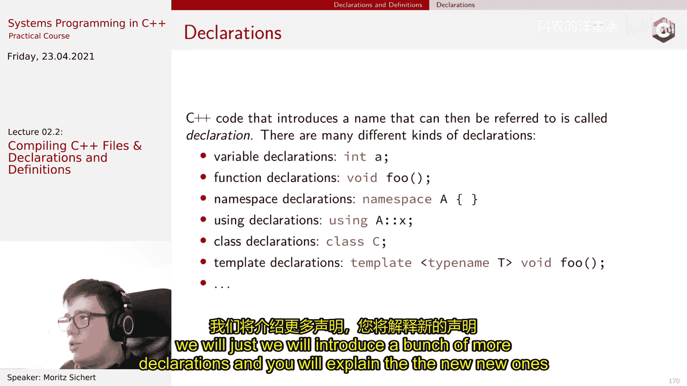

There are also different properties to， like similar to objects and declarations also have。

Properties essentially， and the syntactic way to do this is to add specifiers to a declaration。

Here you can see some commonly used decor specifiers。😊。

And as I said we will not only see different types of declarations in future lectures we will also introduce some more declaration specifiers。

 but for now we'll talk about those three， we have the static， the external and the inline specifier。

 what the aesthetic spec does it can only be used for variable and function declarations。😊。

And what this sword does is it affects the declaration's linkage。

 which is one property of declarations， which I will talk about on the next slide。😊，Also。

 what is good to know if you declare an object with static with a static keyword。

 then this object will have static storage duration。 this is where the name originally comes from。

 I think， but as I said， functions are not。😊。

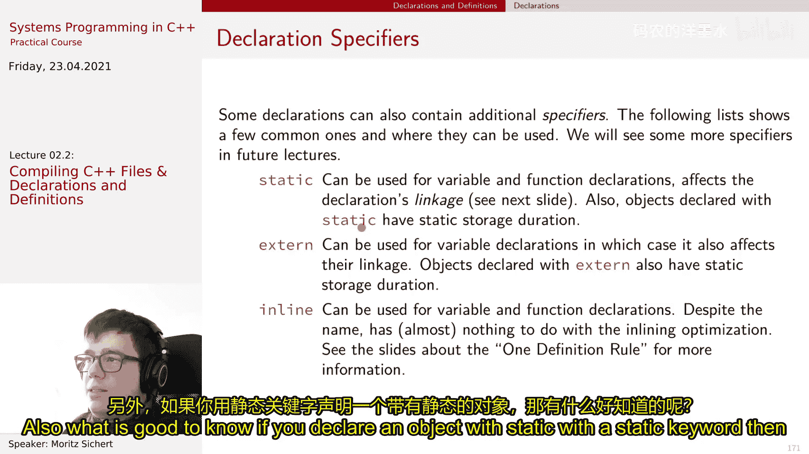

Objects， but functions still can be used with the aesthetic specifier because then it affects the declaration's linkage。

 but only for objects， so called double variables， for example。

 this will also set the aesthetic storage duration。😊。

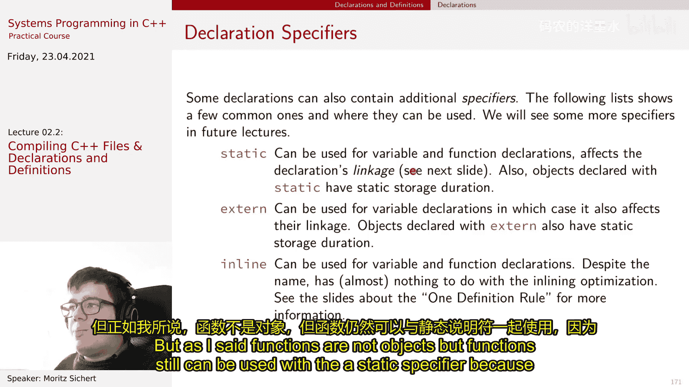

There's the specifyifier external。😊，which also affects the link linkage and will also set the storage duration of objects to static and there's another specify which is called inline。

 and this can also be used in variable and function declarations。😊。

The weird thing about the inline keyword is that despite its name。

 it has almost nothing to do with what you would expect naming the optimization of inlining functions unfortunately I mean I think this is a historic like for historical reasons this is called inline。

 but this has more to do with linkage and also storage duration and the one definition rule which we will also talk about。

😊，So don't be confused if you see the keyword in line。

 this has nothing to do with whether the compiler will or will not inline your function Okay so lets look let's first talk about linkage because we saw those declaration specifyifiers they will affect a declaration's linkage so let's see what linkage actually is。

😊。

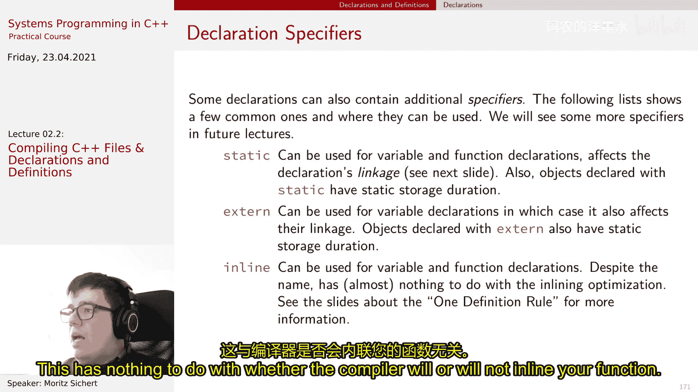

Most declarations， so unfortunately it' is also not true for all。

 but at least like most of the declarations we have talked about。😊，They have a linkage。

 The linkage determines。How the name of the declaration will be visible in the current and especially in other translation unitss。

 So let me， let me make this more intuitive。 If you have two CPP files and you want to use。

Decled name from oneP file in the other CPP file， the question whether this will be or the other CPP file will be able to see the declaration of the so if or let's say they put it like this。

 whether a symbol or like a declaration can be seen from other translation units depends on the linkage of the declaration that declares this name。

😊。

And the different types of tick rate of linkage are written down here。

 So we have like if you don't specify anything， so if you' right just right。No way。 That's not。

 not correct。 If you， if you want no linkage， which means that you don't want your declaration to be visible outside of your current。

declaration which means like that the linker should not give this symbol to other translation units。

 this is also probably where the term linkage comes from because the linker mainly deals with this this is then called no linkage I mean the most obvious example of no linkage are local variables because I mean other functions cannot access the local variables or function cannot access the local variables of another function bar which means they will not be seen by each other which means they have no linkage。

😊，Then theres internal link linkage。 This means that the names can be referenced referenced across functions。

 for example， but not across different translation units。 So this is essentially like a。

A name that is private or local to one specific f units。

And the way to make a declaration have internal linkage is to use static so global functions and variables that are declared with the specifyifier static always have internal linkage and also global variables that are not declared with external so if you just write just equals1 and don't write external to it then this will also have internal linkage。

😊，And there's another way also which is called anonymous namespaces which we will also see in an example in a bit and the last thing is of course if you do want your symbolus to be visible to other translation units then you want something that's called externalage linkage and external linkage can be enabled by just define or declaring I mean a global function without using static because static would make it have internal linkage or a global variable with the specifier external。

😊，Okay so this is， I mean this again is a very technical explanation。

 I think this will be more clear if you start actually writing code and especially code that it has multiple translation units then this may be easier to understand why those even exist in what they do。

😊。

The next thing I want to talk about is definitions。Okay。

 so I said when a name is declared by using a declaration with the correct linkage。

 it can be referenced by other code， which just means that the compiler will be able to determine whether your code is syntically correct so because it knows whether the name was declared or not but。

😊，Most users of a name also require the name to be defined and not only declareds。

What does this even mean so let's first talk about the formalities first again in the Z plus thrust Tenna this is called ODR use so every time you use a name which will then also require an definition and not on the declaration of this name is called an ODR ODR use and you can see here some examples so if you have a variable declaration and you want to read or write the value of this variable then you need the variable to be defined and intuitively what this means is that the linker has to know the location of the variable to be able to get generate code which will read or write to this variable so this is like the intuitive explanation of the first point here。

😊，And I mean， the same goes， of course， if you just take the address of a variable or function。😊。

This is essentially the same to take the address of variable to get the address of variable Of course you need to know where it stored。

 the linker needs to know what the actual address is so it needs to be defined and if you call a function the generated assembly as we saw in the beginning also。

😊。

Needs to generate code which jumps to the correct address and of course for this the code needs to know the address。

And the same is if you want to create an object of a class declaration。

 you need to know what the class looks like， but as I said。

 we will go into more detail about this when we actually talk about classes。😊，嗯。😊，First things first。

 because before we talk about definitions more in detail is that many or most declarations automatically are auto definitions。

😊，With some not ofable exceptionions。Any declaration。

 especially any variable declaration that has an external specifier and no initializer is not a definition。

 so this is only declaration， so external into full semicolon is only a declaration。😊。

But in full semicols or without external is declaration and the definition function declarations without function bodies。

 this is something that we already saw in the hello word example in the very first slide。

 if you just write down the declaration of a function which has the return type。

 the name and the argument types of a function， and this is also of course not a definition because the compiler doesn't know what the code inside of the function is。

 and you can also like declare a class name without defining it which is called forward declaration which again。

 which I will just refer to the class lecture here for more details。😊。

Okay before we talk about definitions you have to know something that's called the one definition rule or also for short ODR this is by the way where the ODR used term comes from and this rule in the super class standup says that in the oh I mean it says the following things here that you can see here at least know at most one definition of a name is allowed within one translation unit which。

To say it intuitively。It doesn't make sense to have two different global variables which have the same name。

 because how should the compiler know which global variable you are referring to if there are multiple definitions？

Also， in the entire program， there should be only one definition of every non inline function or of every variable that is already R used。

 So we talked about all the R on the last slide。 So if you take take a variable's address or want to read its value of want to write its value then in the entire program there should be only one definition and this is。

 I mean the intuitive。Reasoning for this is very similar to the first one。

 of course if the compiler or the linker generates executable。

 there should be only like one location of every function and every variable so that the program does what you would expect。

Here there's a a very small word hidden here it's called non inline。

 which means that this only refers to all functions which do not have the inline declaration specifier and here you can see here this is where the inline specifyifier is useful it can be used to like fix and like let's say in quotes fix the one definition rule。

So instead of like there's an additional rule that only is only there for in functions that。😊。

One exactly one definition of an inlet function must appear within each translation unit where this used or all the are used to be precise。

 which means which。😊，Intuitively， again， means that if you。Declare a function to be in line。

like you probably want the compiler to be able to inline it， I mean this is where the name as I said。

 comes from historically， but the only way the compiler can inline a function is if the compiler knows the source code of the function of course and the only way the compiler can know the sort of the function is if the function is actually defined within this translation unit because if it would be defined somewhere else then only the linker would know the code of the other function but at this point the C+ compiler step is already executed and finished so it can't be in line it can't inline the function anymore so here hopefully you can see why the inline keyword is I mean why it's called that way and what it actual purposes。

😊，Also for classes and it's very similar， you need to have exactly one definition of a class within each translation unit。

 but there's no additional requirement for a definition of a class within an entire program because a class definition usually doesn't class definition by itself doesn't lead to any assembly code generation。

 so this is why it's okay， you need one in each translation unit。

 but you can have multiple ones like once in each translation unit in your resulting exable。😊，Okay。

 I mean。As always for those technical descriptions。

 a more detailed descriptions and of course more subtleties and exceptions of those routes can be found by clicking on this link here。

 but usually you should be fine if you know this okay。😊。

Instead of talking further about the technical descriptions， let's now look at a few examples。😊。

嗯。Okay so you see here if I define the same variable twice so variable the same name in the same in the same translation unit。

 then the compiler will tell me error this is a redefinition of I this is usually what you would expect but this is fine because as I said if you just write external inch j without an initializer so without equals and then a number。

 this is just a definition just a declaration， sorry and not a definition which means that if I then write in J equals 7。

 this is a declaration and a definition， I mean I declare the name J and to be more precise I redare the name because it already existed but for declaration that's fine and I define it for the first time and it also is only defined once in the entire translation unit8 or TP so everything is fine。

😊，嗯。The next thing is the next example here very similar for functions。

 so if you write void bar and semicolon， this means I declare a function that returns void。

 has the name bar and has no arguments。😊，嗯。Instead。

 I can also like if I write just a regular function like this。

 this would declare and define a function at the same time。

 so again this declares a function that returns void has the name who has no arguments and immediately also defines a contents in which in this case is just a function called to bar。

😊，And now at the bottom I can also now redecle the function bar。

 but then actually also define it by writing down the contents of this function and here I can callF I mean you will now see that those functions are not very useful because this will lead to recursion which will never terminate but you can see here that it may be useful。

😊，To declare a function before defining it even within a single translation unit。

 because only this way you can like recursively call functions because the body of the function fo could not use bar if it was not declared at this point but we also want to call fo so this is essentially a cycle we have to break and this can be done by using declarations and only then definitions。

There's a question after the reddeeration is J still external or not？That's a good question。

 so we saw the external keyword makes it that the declaration has external linkage。

And if I really declare the name， this does not change the linkage of the previous declaration。

 so just to answer your question， J is still external and there's a more technical description we declare the name Jde to have external link ones which will not be changed by any following declarations。

😊。

Okay let's now look at like an example for the one definition rule that deals with multiple translation units。

 so you can see here we have two functions in two different translation units that have the same name and are not in line。

 which means that the one definition rule says。😊。

in a resulting executable， we only are allowed to have exactly one definition of a function with that returns in test the name Fo and has no arguments and this is actually what happens so if you try to link this program you will first maybe generate the object files this will still work because the ODR within each translation unit is not violated。

 but only if you link the program， then the linker will tell you so you can see here that is the LD program which only tells you this tells you that there are multiple definitions of the declaration full。

😊，And so this is not valid。 and here you can see an example of something that I said at the beginning is that some errors that are like。

😊，Symtical or like conceptual errors。From a CPP language or C+ plus language perspective。

 because the one definition rule is like something that's defined in the。

C++ standard still can only be detected， whoops can only be detected by the linker and not before。

Okay， and now let's look at the example for like head of functions and variables or there should be loggged translation units and this is exactly what internal linkage is for so if you have something like a function or car variable that should only be used within your translation unit or within your CPP file you can use either a static keyword as we saw or also anonymous namespaces and how this works is that you declare a namespace without a name。

😊，嗯。And everything inside of a namespace that has no name has automatically always has internal linkage so the name even though we don't write static in the beginning ofF or bar。

 both of those declarations will have internal linkage so yeah this is like an alternative to writing it like this。

😊，And I mean an anonymous namespace also works for declarations where the static specifier cannot be used and this is especially the case for classes because class declarations cannot have the static keyword but if you still want classes to have internal linkage and you have to use an anonymous namespace so again I mean I'm talking a bit about classes I mean I'm talking quite a lot actually or classes today but again don't worry we will definitely talk about this in more detail when we talk about classes in an entirely separate lecture。

😊，So I see some typing I'll wait a bit。After the closing price of the namespace。

 don't you do a slash less namespace in your style guide You are correct Oh yeah。

 you're right in our example， I mean， as I said before。

 you should usually write a slash namespace here and probably the question would be what do you do if you have anonymous namespace and what you usually do is then you write s slash namespace and then nothing and what you're right it would be better for us to include this here maybe I'll do this I'll update these slides。

😊，For a namespace with with a name it will also be internal linkage right No that's also a very good question that is only the case for anonymous namespaces If I write namespace A。

 then fo and bar will not have internal linkage then a double column P and A double column bar will be able to be used by other two units This is only an exception for namespaces that are anonymous so I have no name。

😊，Okay， now that we have talked about declarations and definitions。

 we can finally talk about why head and implementation files even exist and why we do this and so first you just have to know that。

😊。

Code is usually split into header implementation files and header files。😊，And implementation files。

 they usually have the same name。 So this is just a convention。

 This is not enforced by the C plus plus standard or any。😊，or any compiler。

 but usually you have like if you write a function that' is called like my project。hPP。

 then you would also have the C++ file in my project。

cP and sometimes people also use docc or docxx or do H8 or do h there are different kinds of conventions and also those are also just conventions and the C+ standard doesn't care about file endings and most compilers will accept all of the most commonly used sixes we prefer to use HVP and CPP for that。

And now so what should a head of file contain competent implementation file ahead of file？

Uually should only contain declarations so declarations only no definitions that should be visible and usable in other parts of the program which with other parts I mean all implementation files that are not the implementation file for this particular header file so if I have now we'll see in an example at the end then well show you here instead of trying to mo here without any examples on the slide and then in contrast the implementation files they contain the definitions of all the names that were declared in the header and of course I mean the implementation files if they need any header functions or so they can of course always and declare and define more names but those then should usually always have internal linkage because all names that have external linkage they should already be declared in the header file。

😊，And because the header file is the thing that declares the names for the first time。

 at least the header file should include some documentation for each declaration and usually at least what we like to do is we also put the documentation in the CPP file as well so we essentially just copy the documentation or at least as the short version of the documentation into the CPP file because then if you actually write the code for the definition you will also know what documentation set in the declaration。

😊。

Okay。But now still the question is why do we separate header and implementation files。

 I mean we now know that the convention is that header files should only contain declarations and implementation files should only contain definitions of those declarations and possibly more declarations and definitions。

The reason why we do this is that CPP files they usually use external functions in quotes so I mean not in a sense of the external keyboard they just use functions and variables that are defined in other translation units so it's very common to split your program into multiple object files and of course they use functions and variables from each other that's a very normal way for a CP project。

😊，But if you want to compile a translation unit so that it's just another name for a CPP file to an object file。

 the compiler needs to know all of the declarations of the external names that you are using。

 of course。Because the compiler has to know the type of the declaration and it has to know whether this declaration is like a variable。

 which is a function， is it a template， is it a cloud something else。

 so the compiler has to know this。😊，But。There are often cases where knowing the declaration is enough and it does need to know the definition。

And this is true for many things， like if you reference a global variable that has external linkage。

 the compiler itself。😊，Doesn't need to know the definition only the linker will have to know it eventually so I mean the ODR says that if a name is ODR used。

 so if you write or read a global variable， the definition need to exist somewhere。

 but it doesn't need to exist in the very same translation unit where this is actually used so it can it can be defined in any other translation unit which means that in one particular translation unit。

😊，Most of the time you only use or you only need declarationations and not definitions。

 which now means that if you have interdependent CPP files so files that need functions from each other。

 they still can be compiled independently and simultaneously。

 because they would just include the header files from each other。

 then the compiler for both translation units which would note the declarationations for all functions。

 and then the compiler that generates the object files can just compile them independently。

 doesn't have to care about the definitions yet。😊。

And another advantage is that if the definition of a declared function or variable changes。😊。

Only the translation unit that actually defines the function or the variable have to be recompiled because all other translation units。

 they just had the declaration and as long as the declaration doesn't change or as long as the type for a function。

 for example， doesn't change， you don't have to recompile anything and this is very useful if you have very large software project。

 especially like if you think about the LLVM project for example。

 it has several hundred thousand lines of code， and if you just change the way a particular function does something internalD。

 but it does not change the behavior or the type or something of the declaration。

 and of course you absolutely don't want to recompile the entire LLVM project。

 just just as a comparison compile the entire LLVM project on my system which has 20 hyperths。

 it takes like half an hour or so so it takes ages and of course，😊。

You't really don't want to do this if you only change a single line in a single implementation file and this is another reason why headers and implementation files are separated conceptually you can also think of this as like a separation between API and which is then of course declared in the header file and the implementation of an API which would be in the implementation files。

😊。

Still， you have to know for now we will talk again。

 unfortunately I have to refer to future lectures quite a lot today because C++ is a very large language but this will eventually all make sense hopefully at least。

😊。

You have to know that in some cases the compiler already。

 so not only the linker already the compiler does need the full definition for a name you saw one example for this is inline functions and the ODR says that inline functions need a definition in every translation unit where they are actually used but there are more examples where this is necessary and if this is necessary then of course you can't separate the definitions from the declarations because every user of this declaration will always also need the definition immediately which means that there are cases where you put definitions in a header yeah as I said we will see more cases where this will be necessary in future lectures。

Okay。Let's talk about headergars also when I talked about the preprocessor。

 I very briefly talked or said that。If the if de and the FN de preprocessor directives they are used for header guards。

 now I want to tell you what headergars are。You have to know that if you have a larger project and you have include files。

 it can happen that a file will。Or I mean， it can very easily happen that a file transitively includes other headers。

 of course， but it will also happen that the same file will be included transitively multiple times。

😊，And this can， I mean， this is not a problem if you only have declarationlarations because redeclarations of course they are always valid。

 but redefinitions are not valid inside of the same compilation unit， translation what I mean。😊。

This means you have to take care about the includes so this does not happen and I mean maybe the first thing you thought about is you can try to avoid duplicate transitive includes entirely in your entire project but this is usually very hard to do because then you have for every include that you write in your source code you have to think about okay which file includes my header file and which files are included by the file that I include and this can become very hard to track if you're especially if you are including headers from external projects from like LVM for example。

Instead， what you should do， you can use a neat trick with the preprocessor that will make sure that the contents of each。

Header file are only included at most once in a single translation unit before I show you the header from me let me show you the example how this can become an issue。

 So we have two header files，8 do HP and P do HP， which both define。😊。

A function which in a is called Fu and in B is called bar and this is the example that it said on the last slide is this is one of the few examples where you actually want a definition and not only in declaration in your header file because this is an inline function and you want the compiler to be able to inline this function so it needs to see the definition in every。

A translation unit。 So you have a definition already in your。

Header file and let's say just for example that the bar function calls the P function which means it needs to include the a header and now if in the main function I want to use the F and the bar function。

 I don't necessarily know that the B dot HPVP header includes a do HVP because I don't really have to know that bar uses the function Fu internally。

 so the main dottPP file just includes a and P both。😊。

Wwhichhich will then leads to an error because if I include a， I will define the function4。

 if I include B， this will transitively include a again。

 which will then again contain a definition of4 because as I said。

The preprocessor does not know anything about C++， which means it will just be very like very dumb and just copy paste the contents of the specified file every time you write include。

 which as I said will lead to two definitions of who which of course is not allowed in C++。

Okay let's see now how we can avoid this， the solution is headeras。

 the trick for this is that we define a macro which I mean does need any value。

 the value doesn't really matter， but the very first time header is included we define a macro that has a unique name which is like uniquely related to the file name itself。

 so the file is path8 HP and here we would call this unique name H underscore path underscore a is just an example there are many different conventions and now the trick is we check for whether this macro was already defined and only if it wasn't。

 then we will actually then the precessor will actually just leave all of the content of the file alone but if if we run through this once。

 this means that the macro would be defined and the next time，😊，We include A to HPP。

 this if and de would be false because this macro is defined which means that the preprocessor will remove all code that lies between the if and de and end of and this is like the very very straightforward and easy way to heck essentially the preprocessor to avoid duplicate includess。

😊。

Sometimes or maybe even often， you also see that instead of this trick。

You can there's also the like a special non standard preprocessor direct of which called pragma one。

嗯。This is supported by all compilers essentially， but we still recommend you to only use the the like the normal headeras because a。

 they are standards so you don't need any nonstand features for this and B， the preon once is not。😊。

It does not always work perfectly and I won't go into further detail just you know。

 you should always use this version of the include cards。

Should we always use headerGs for every header file， this is a good question。😊。

The answer to this is mostly yes and you should always use a headergar for a header file where you definitely don't want the header file to be copy pasted twice into into other files that are included so if you don't want this then use a headergar but there are some very rare cases where your inclusion file has very weird contents that maybe need you explicitly want to copy paste this multiple times and in that case of course you don't want a headergar because otherwise this would not be copy pasted but this is very rare so as a rule of thumb。

😊，I would say always use head guts。Do we simply wrap the entire header file with the header garden and practice and the answer to this is yes。

 usually the very first line of your file or the very first two lines are if in depth some name define the same name and then like a bunch of lines of your code and then at the very last lines on the end of this is the very this is like the usual way to go about this。

😊，How do I know if the function is defined correctly if I use the header got？I mean。

 do you mean declared or defined I mean if you only include a file once then the macro will not have been defined before because it will only be defined once you actually have included this so if you include this so the headgo will not make everything that worked before a break so the very first time you include this the decoration will all be there。

The header guards will just prevent the preprocessor to transitively include the file or they put it into more basic terms。

 copy paste all of thes again， so there will be no or there should be no cases where this will lead to unexpected undeclared names。

Okay， I mean there are some other questions and I think while some of you are still typing。

 I will at the end today， I will want to show you a very brief example in the example CAC project from the last lecture。

You can find the Smic project in our GitLb and I actually changed a few things for this today's lecture and they have not been updated yet in the GitLb repository I will update them sometime later today。

 so that you can also download the actual code for those examples here。😊，So let's say we have to。😊。

To header files that they are called say hello。 HP and say by dohQP and each of those they just declare a function each which is called either say hello and say by。

 they each take something that a name that has the type SD string view you don't have to worry about this right now just know that this is essentially a string we pass a string to say hello and say by and we can see the implementation files and what say hello does it just print hello with a name and then excation point。

And say by does the very same thing it just prints by with the name and excation points and now if I have a file that wants to use both functions。

 for example， I have the print greetings of TP with the main function this would just include say hello。

t HPP and say by dot HP and this can just use those functions say hello and say by yeah and this just works and then it will print say hello and say by with the name you gave it on the command line。

😊。

Okay。So this is the example。😊，A very short example for like a more complete project with header cardss and so on。

And this would be the last slide for today， do you have any questions？Okay， I guess not， as always。

 feel free to ask questions on metatamost anytime and other than that。

 have a nice weekend and see you next week。

