# 【全集 附课件】慕尼黑工业大学 C++系统编程 中英字幕 1080P p05 Lecture 5 - 引用、数组与指针 -BV1QTzjBFER2_p5-

Welcome everyone to today's lecture on systems programming in C++。

Today we will talk about another very important and interesting， I think， I hope topic。Namely。

 references， errorss and pointer， oops， all those are the wrong slides at the beginning。

 when we talked about C plus plus。We talked about C plus fast being a low level language。

 but up until now， we haven't really talked about any。Very low level things。 and I mean， I mean。

 references are probably not that low level， but if you think about。

I think usually when people think about C in particular。

 they know that it's about pointers and that pointers usually lead to bugs。

 so this is why this entire lecture will be about that。So。So far。We have I mean， as I said。

 we talked about the S cluster a low level language， but for the types we have talked about。

 we have only talked about the special void type and the arithmetic types such as int and float。

As we also said in the motivation for C+ is that most of the power of the language comes from the ability to define compound types that。

Consist of also user defined types and then that usually are very fast or as fast as the hardware allows and some examples for compound types are functions。

 they are considered compound types because a function type consists of a return type and the argument types。

 then we have classes of course which is also a very large topic which is why we will have an entire lecture about this and then of course references arrays and pointers which we will talk about today。

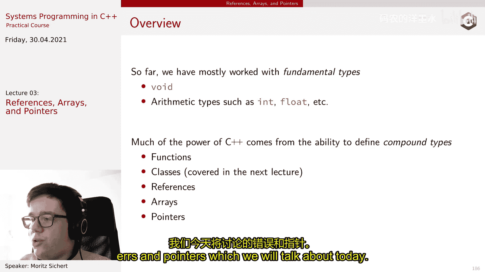

Okay， let's start writing in by talking about references。So this is like the syntactic。

 this is everything you have to know about the syntax of references if you want to declare reference。

😊，To an existing object or function so this is important to know a reference can only reference an existing object or a function and as you also know a function is not an object so this is why this is explicitly mentioned here and the two for this is you just write the type and then the em symbol and then a decorlarator and decorators I mean the technical synax description for this you can see when you follow the CPP reference link but this would just usually be a variable name for example。

 and there are actually two different types of references in C+ pass there are L value references and R value references we talked about value categories very briefly and thoses reference types of course are closely related to those value categories but we will go into more detail I mean I wish show some examples today but the motivation for why we have two types of reference。

😊。

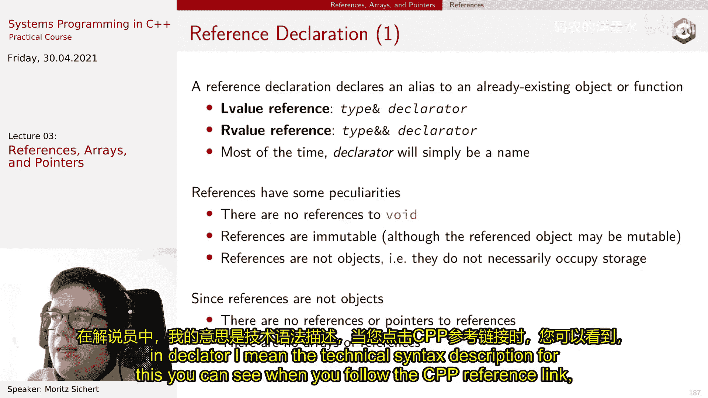

We will also cover in another lecture。What you have to know about reference though is that you can't reference everything。

 I mean because I said you can only reference an object or a function。

 this means that you can't reference void because void is not a type of an object what is also po to know is that references are immutable which means that the reference itself。

 so。The thing that represents the reference cannot be changed anymore。

 so if you set a reference to reference an existing object once。

 you cannot change the reference to reference another object。

 This means that only the reference itself is immutable。

 but this does not mean that the object you do reference is immutable。

 This is entirely independent concept。Also references themselves are not objects。

 we talk briefly about this last vector the consequences of references not being objects are that they are for example that they do not necessarily occupy storage which may be surprising but this means that if you have a reference variable in your function。

 this means that this variable may not occupy any storage on this stack for example。

And of course since they are not objects there can't also be pointless for reference and we will talk about this in a second and also there can't be areas of reference because an area also only stores objects and reference andt objects okay but let's look at a few examples for reference declarations。

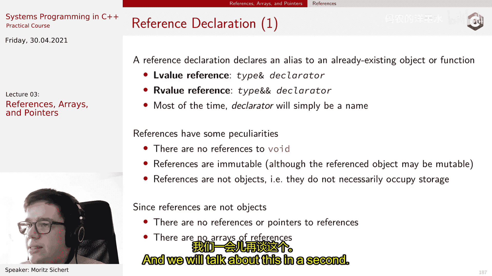

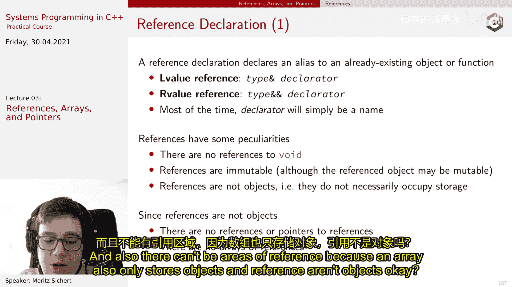

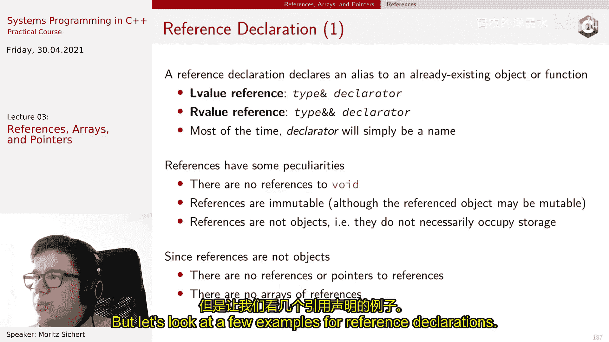

So if。So here you can see in simple example and you can see the first pitfall with the references is that。

The and token so the end symbols here。Those this and those they are for some reason synically part of a declarator so let me go back one slide so technically in the C+ pass syntax the n symbols here are part of the declarator and not part of the type I don't know why this is the case you just have to notice because there are are some H cases where this will matter So if you define a variable I and just give it a value and then try to define reference J that references the object I this will work。

 But then if you try to declare and define a second variable in the same line。

 then K will not be a reference。 It will be an in without reference because this and symbol belongs to the J declarator and not to the type so because this。

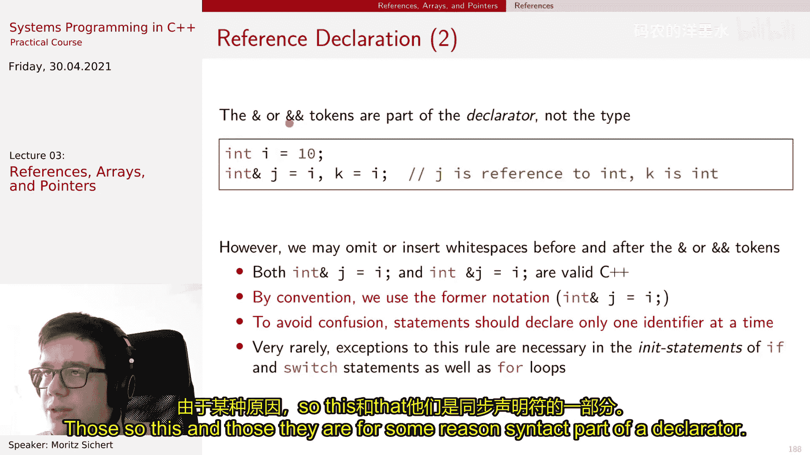

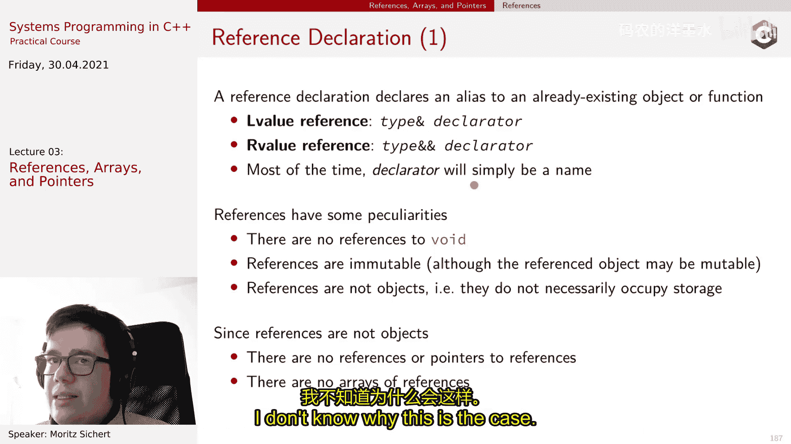

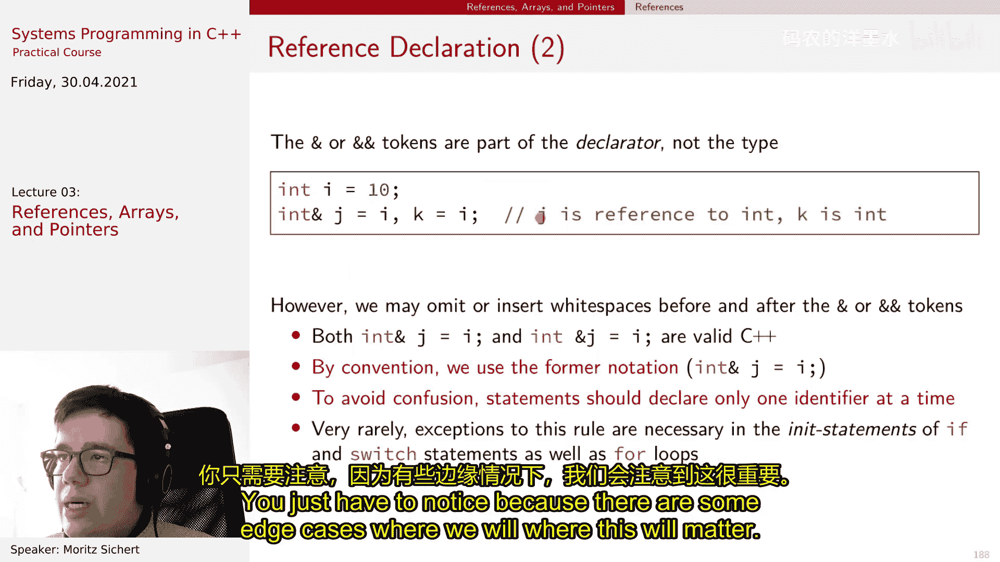

Can be very surprising， our convention is that we never declare more than one variable per line then this can't happen。

And also we will always write the type like this， you will see other language guides where they actually write in space as so what you can see here in space and symbol and then J because this is how the PAsa treats it syntically。

 but we always consider the reference or the ensemble part of the type。

 so this is why we always write it like this and to avoid any confusions with the weird syntax rules we also only declare one identifier at a time。

😊。

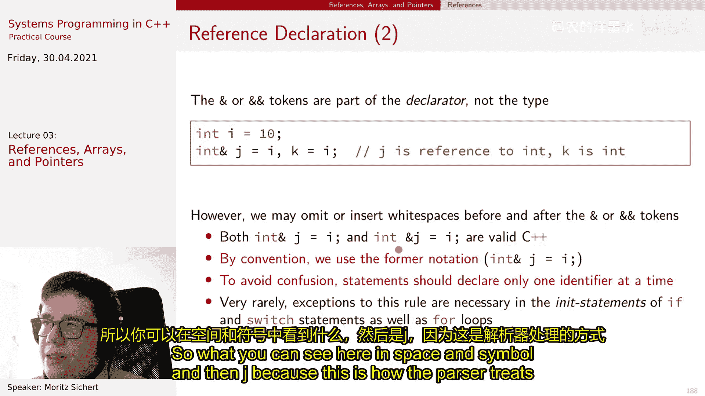

There are some very rare exceptions， for example， in the in statement of an if you can only write exactly one declaration but that can。

😊，Include more than one identifier， so this is an exactly way you can't。I mean。

 we have to break this rule， but apart from that， you should always follow this。Okay。

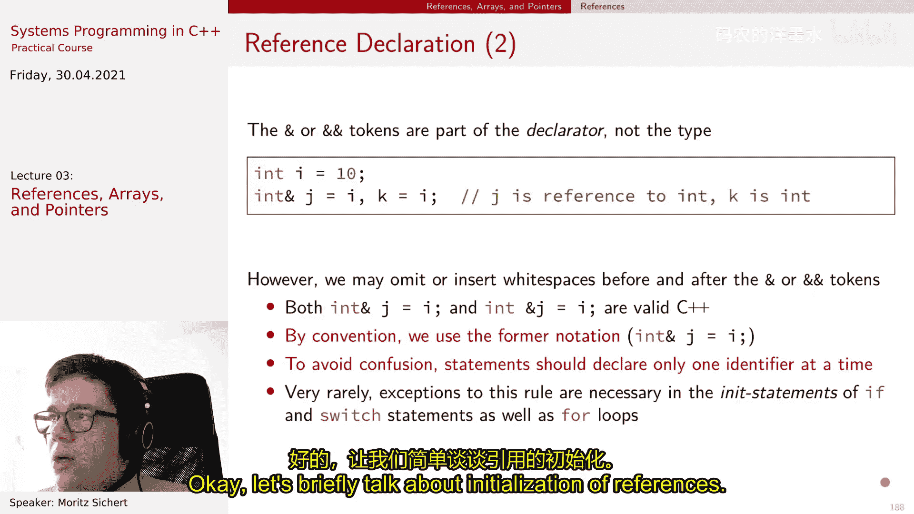

Let's briefly talk about initialization of references。😊，As I said， if you define a reference。

 it must be initialized to refer to an existing object at the point of definition。

 so every time you define a reference you have to immediately initialize it and so you can't do this later because as I said。

 references are immutable。Which means that any reference or define must be initialized to refer to one of those three things。

 either an object of type T， a function of type T or an object that can be converted to the type T。

There's a question what is the convention if you want both J and KW references。

 just write two lines and write in every line int and symbol J equals something and then a new line int and symbol K equals something else and then you will have two references。

So just don't declare two variables in the same decoration， then you will be fine。嗯。

Okay let's go back to the initialization， of course there are cases where you only declare a reference without defining it and in this case of course they do not need an initializer and examples for this are function parameter declarations of course in a parameter of a function you don't necessarily define it so you don't need initialization。

😊，The same goes of function return types， you can also declare a reference as a class member variable。

 which we will also see when we talk about classes and of course。

 as you already know when you want to declare a variable without defining it。

 you can do this by using the external specifier。There's a question so an area of pointas is not possible。

 no an area of pointas is possible， we are only talking about references right now。

 pointas are a bit different， we will talk about them in a second。😊，Okay。

 let's now see a few examples for L value references。

 so can see here again we define two variables of type unsign with the names I and J and then we define a reference with the name R that refers to I。

 which means that essentially r is now an aius for I， which means that if you change R。

 this will modify I to be the new number here 21 and。😊。

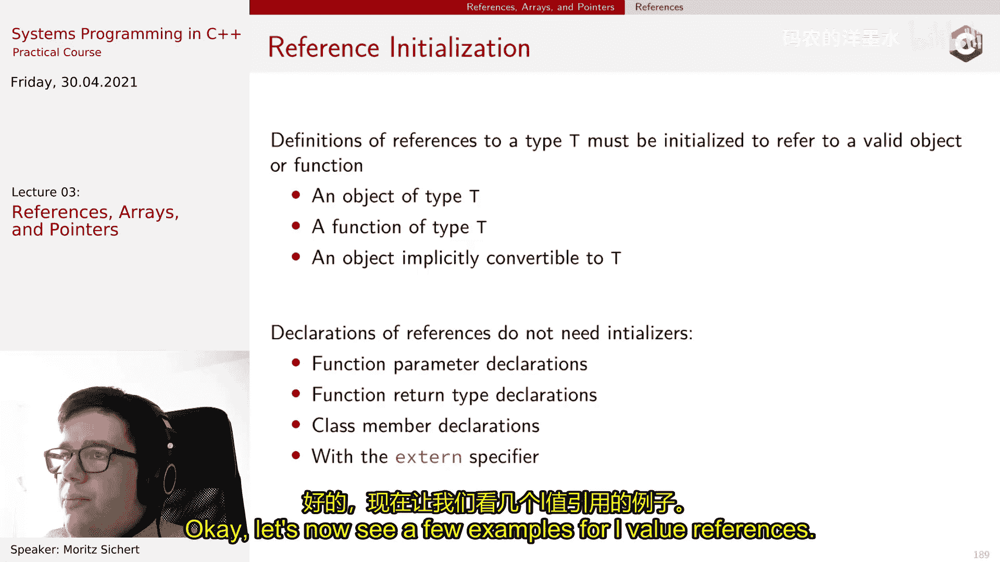

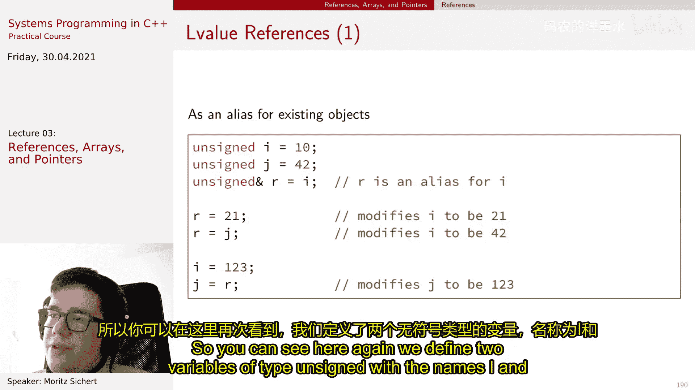

What you may expect or what you should know that if you write R equals J this does not change the reference r to now reference J instead it will update the reference object which which is I to be the value that j currently has。

 which means that after this line I and J will both be 42 and the reference R will still reference I and not J because as I said。

 once you initialize reference you can't change the object it references anymore and of course。If I。

 I mean， you can still modify I of course， and you can also treat the reference as a regular like。

Like it would be I so if you write J equals R and you set I to 123 before。

 then of course J will now also be set to 123 so you can just think as an L value reference of being an elias to some other object。

Another use case for LB references are passed by reference semantics of function parameters so you can see here we can pass a value by reference and if we change this value instead of the function。

 then this will of course affect reference or the object that we gave it as a reference here so if we call this function food twice。

 then every time our variable I here will be incremented by foli2。😊。

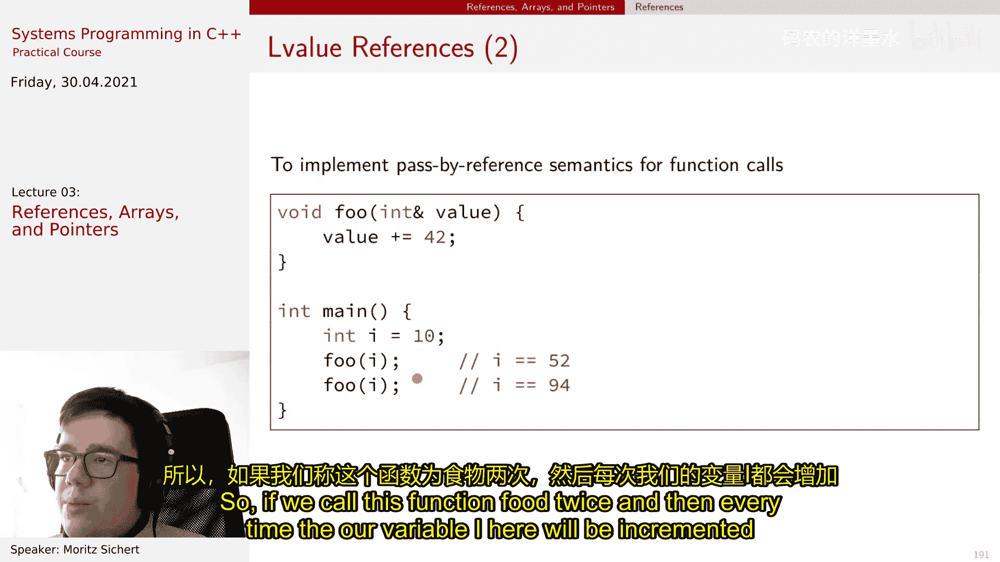

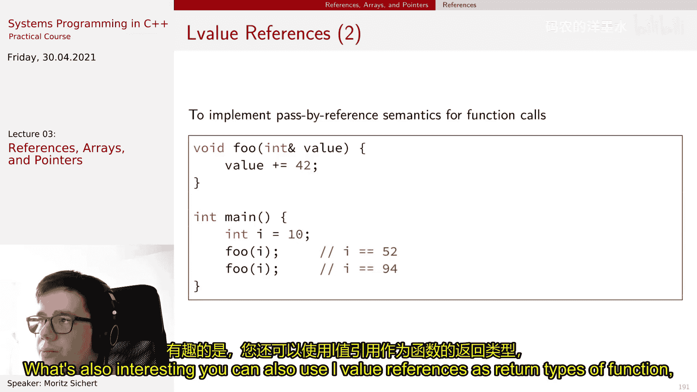

What's also just you can also use L value references as return types of a function。

 which means that a function call will then actually be an L value expression。

 which means that you can assign to it so you can actually write something like this and0 equals 42 in this works because fu0 returns an L value and you can assign something to an L value or an L value reference to be more precise here and in this case this function is not very interesting it just depending on the argument returns reference either to one or the other global variable。

😊，Okay， so those are the examples for L value reference。

 let's also briefly talk about R value references， the differences that you can't assign an L value to an R value reference。

😊。

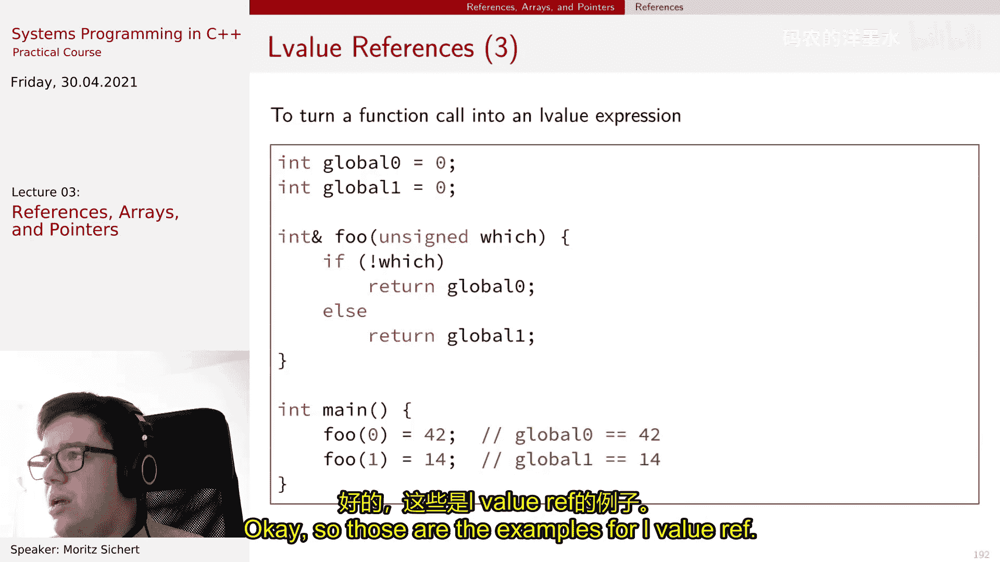

I mean， you don't have to know the precise details about the difference between L values and r values yet。

 but you have to know that I itself， if you use I after the definition here。

 I is considered an L value expression and you can't assign an L value expression to an r value reference and this is the error message that the compiler will give you will precise details to this what you can do though is you can assign an r value to an r value reference and in this case 42 is an R value。

😊，And the one use case for this is that temporary objects are usually R value， so if you。

 for example， at I and y the result of this so this entire expression will be considered an R value and if you want to further modify this you can what is here called extend the lifetime of an temporary object by binding it to an R value reference。

😊，And then you cannot actually still modify this okay I mean this sounds a bit contrived and the actual use case for r value reference we will talk about in another lecture。

 but let me briefly show you what the difference differences are and this can be shown most easily by showing the overload overload resolution that distinguishes actually between L value and R value so we have the function fu which is overloaded for an inre and constant reference and an r value reference and we have the function bar which returns an L value reference and a buts which returns so value without a reference which means that calling this function will be r value expression and we also define two variables here you can see as you expect maybe if we call4 with I this is just a regular L value so we get the overload with the L value reference if we have a constant reference this will actually make sure that or we have。

😊，ACon object here J is a cons object， so this will make sure that the con cons reference overload is called but if we now have an r value which we saw before you can't bind an r value to an L value reference but we do have an R value reference overload so this overload will be chosen and the similar logic goes for function calls here。

Okay I mean this is still very seems very arbitrary。

 but there are actually very useful use cases for this。

 which we will talk about when we talk about lifetime and ownership in C+ yeah but this we will talk about I think in two weeks or something so。

😊，Just believe it for now that this will be useful eventually。

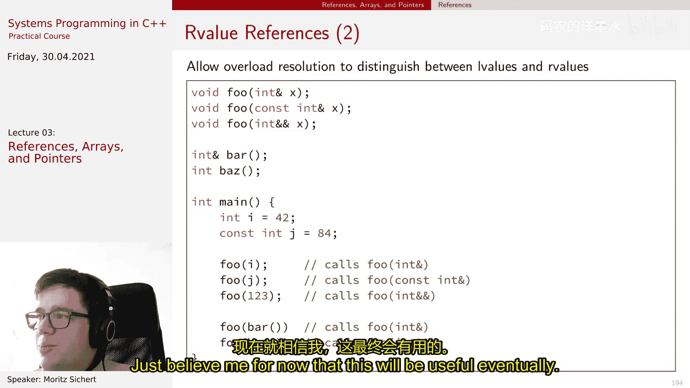

Okay let's also briefly talk about references and CV qualifiers so you saw in the example that we can also write cont。

😊，In reference， for example， the thing is you have to know that references themselves。

They cannot be c qualified。 So you can't have a。Or you， you don't distinguish a cons reference and。

Noncons reference so to say because the reference itself is always immutable， as I said。

 you can't change the reference itself， but the object that you do reference。

 this can be con or noncons， of course， I mean， we can write a reference to int or a reference to con int。

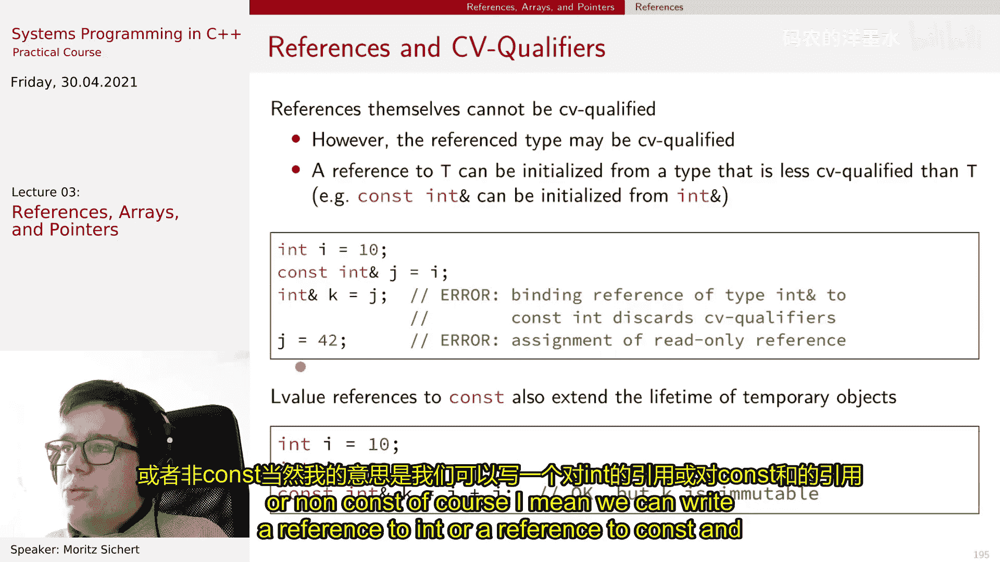

And what this does is that a reference to constant means that we have a reference that is essentially read only。

 so we say okay， we want to have a reference to some object but we will only ever read it and never write it。

 which means that。😊，Logically it should also make sensitive can if you know you have an object that is not cont。

 you should still be able to assign it to a cons reference because this is less strict of a requirement so this actually works in a C++ so you can see an example you can initialize a cont reference from a non con value and of course a non con reference as well。

But you can't assign a new value to the con reference because synically the compiler knows that J is a reference to a constant。

 so it may actually reference a real constants object。

 which means that it may not be allowed to assign to this object。

 which is why this is synically never allowed。Another special case about cons references is that instead of using ourly references。

 cons references can also bind temporary objects to extend the lifetime。

 but this is a very niche use case so I won't go into much detail there。😊。

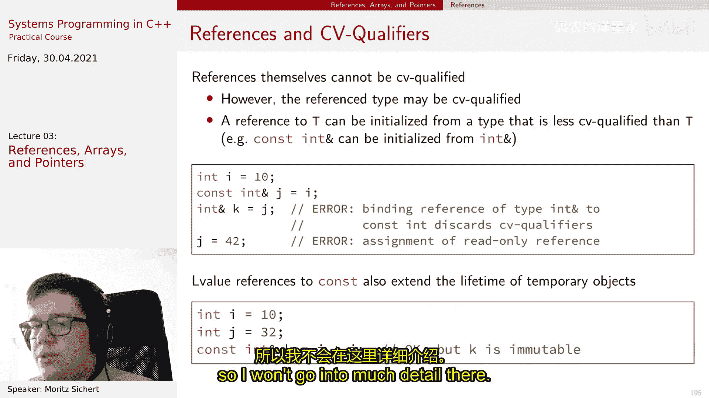

嗯。Another thing you also have to know is that。It is possible to write programs where the lifetime of a referenced object ends。

Before theli ofic reference ends， I talked about this very briefly when I talked about the concept of lifetimes and the interesting thing here is that this can already happen when you only reference object with automatic storage duration。

 So even if you don't mess with manual memory management at all。

 this can still easily happen in C++ and this is called a dening reference then in C++ and this is of course or this will lead to undefined behavior very quickly because as as you know accessing an object after its lifetime is undefined behavior So here you can see an example if I。

😊。

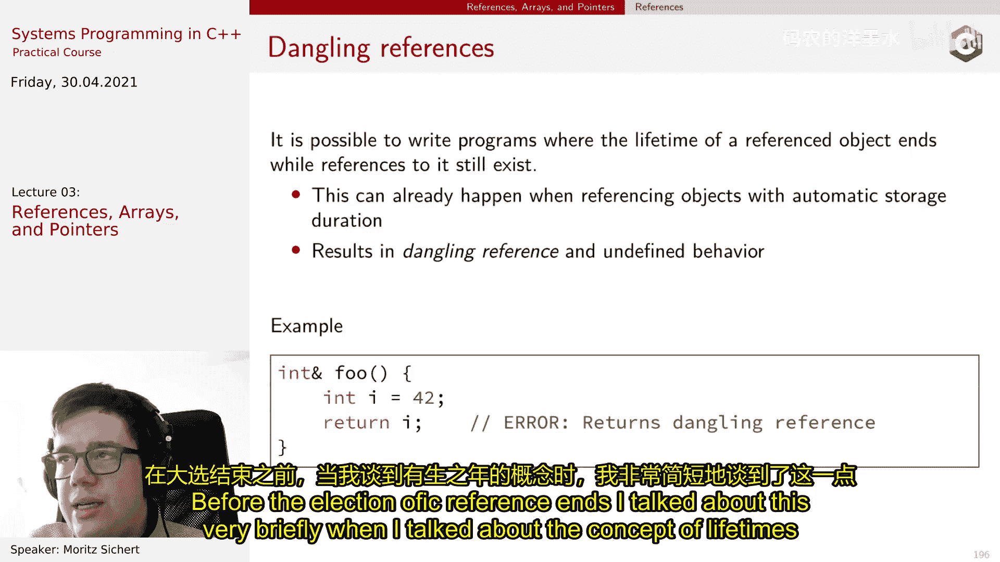

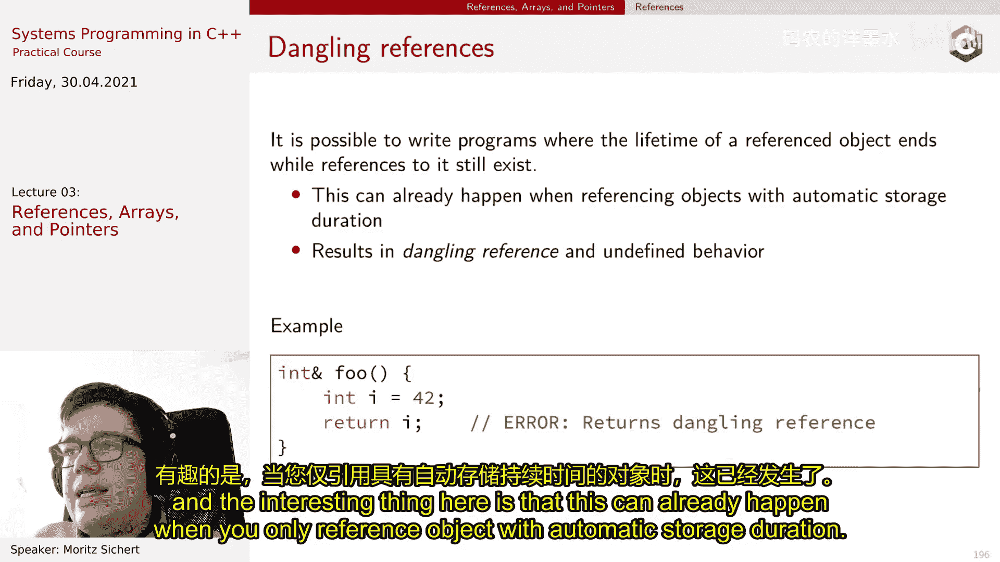

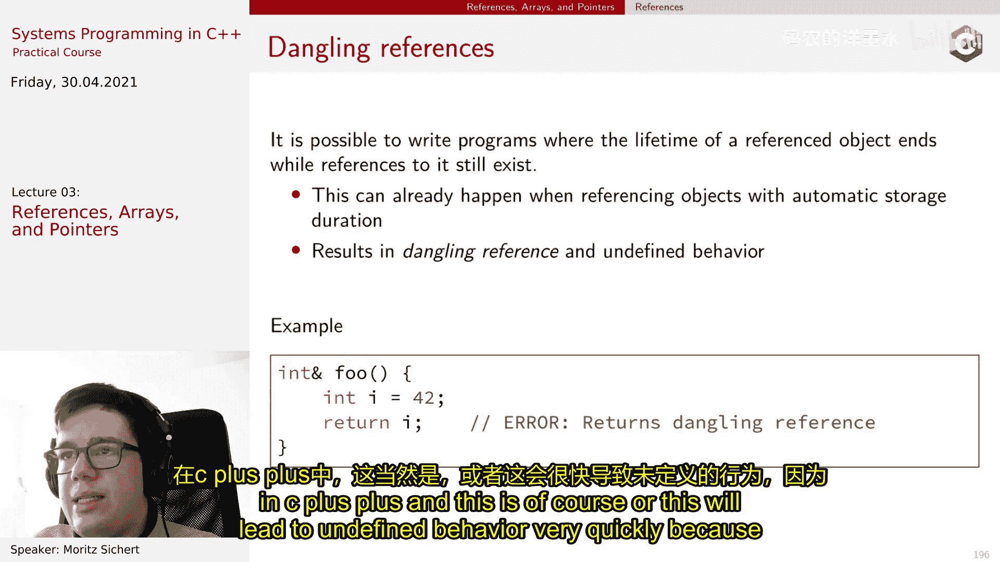

Define a variable I which is a local variable of this function this variable has automatic steration of course。

 and if I then return I and this function will return an L value reference。

 this will mean after returning from this function I will have an L value reference to an object whose lifetime has ended because the function has ended so using this reference after this function will then always be undefined behavior。

 Fortunatelyly this trivial case will always be detected by modern compilers。

 I mean because the compiler can quickly see that this can't ever work but in general。

 of course the compiler can't prove for all cases that the lifetime will be valid for a reference and that it will never be d so yeah you just if your program sequence you have to take care of this yourself to make sure that the lifetimes are always correct。

😊，Okay。Any questions about references so far？Doesn't seem like it。

 then let me go to the30 to the next thing I want to talk about today， which are arrays。

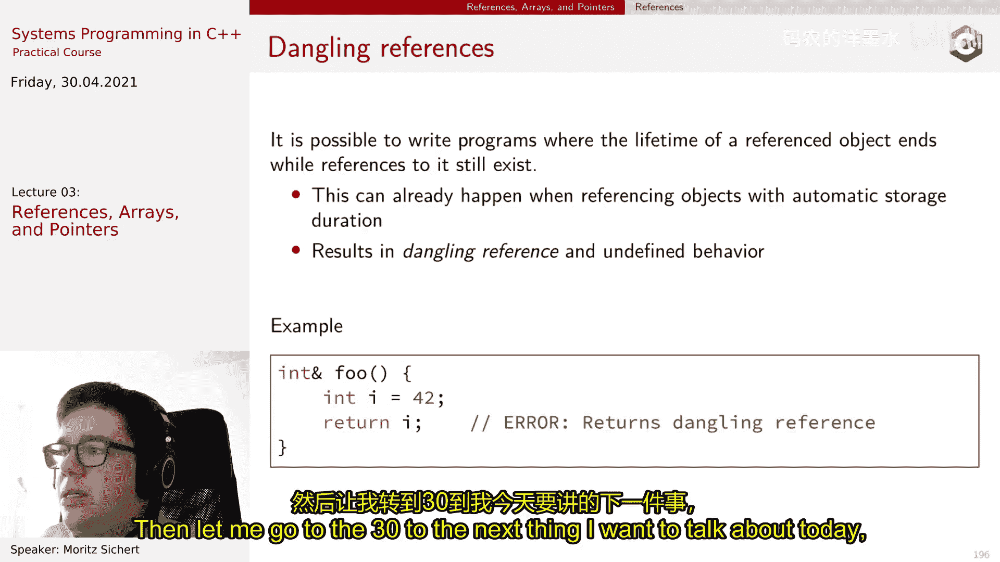

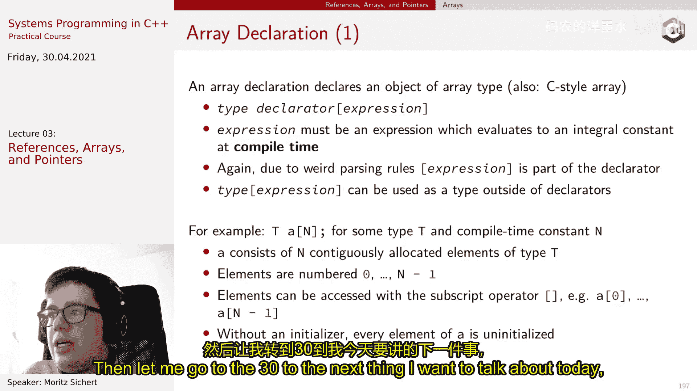

And every declaration looks like this and C++ this is also called C style array because I mean this comes from C C also has the same syntax。

 so this is called a C style array， you just write type。

 then take theator again which again is usually just a name and then in brackets an expression which is just an。

😊，Integ constant that will be interpreted as the size of the array you want to have。嗯。I mean。

 so two things are important here to know the first thing is this expression must be constant at compile time。

 even though most compilers allow this to be any variable。

 this is not allowed in the C++ standard and even in C where this is allowed and this is considered bad practice because this leads to very weird core generated by the compiler so C++ they just removed this option altogether and this has to be a constant value here。

 so I mean the easiest example for a constant value is just a inte lital which would be usually the case。

Another thing that is a bit weird is that the declarationlar for an array。

 like it spreads apart the brackets from the actual type so you write type。

 then the name of the variable and then brackets the size of the array。

 which is again due to passings rules， so the brackets are part of the declarator and not part of the type。

😊，But still the syntax so type and then directly in brackets。

 the expression is allowed if you are out of the declaration， so if you only write the type。

 for example， in a using declaration，😊。

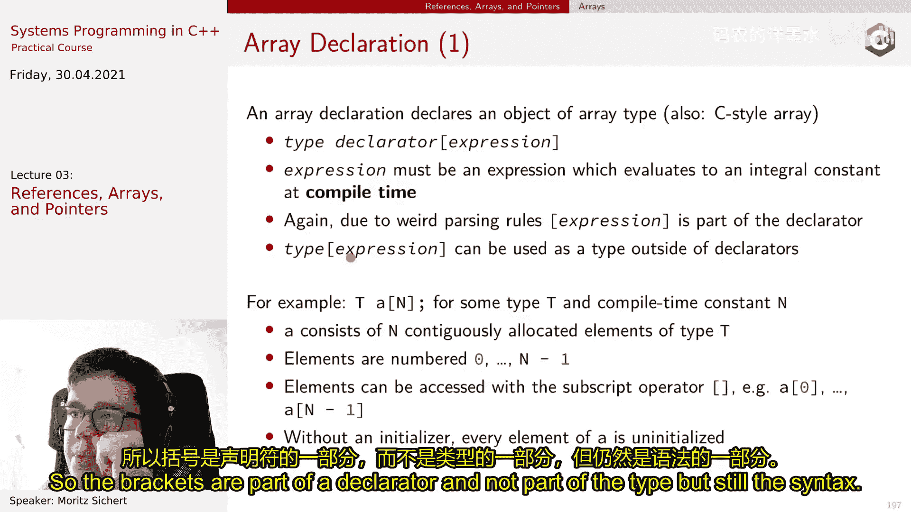

Or in templates， for example， which we will also see in the future。😊，But for for now， just now。

 So if we have just any type T and some some compile constant N。

 if we write T and then a in brackets N， we will。Define an array with a name A。

 which has n contiguously allocated elements of type T。

 which means that they live right next to each other in the memory。😊。

they start so the numbering of the area starts with0 and goes up to n minus1 of course。

 and if you want to access the element of an area you can also use the which is called Sub operator and plus or also the brackets。

 so to access the first element you would write a bracket0 and so on。And also。

 I mean you have to know you also have to initialize arrays， but this we will see in the next slides。

 So let's first look at the error declarations， So here we declare an array of of with an name a which has 10 elements of type uns short and of course we can initialize the elements of this array by writing it in a loop for example。

😊。

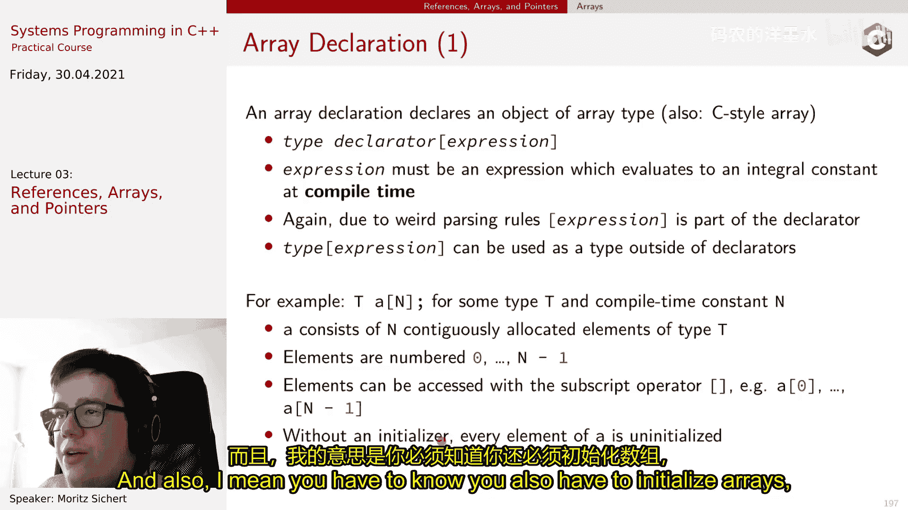

What's very。Weird again about arrays in C++ is that they are considered L values but you still can't assign and do so if you write a ques B。

 this isn't a compileant error， this wouldn't just copy all the elements from B to A or something else and also you can't return arrays from functions yeah this is just for some reason a weird I mean this is mostly again due to C and the semantics of arrays in C yeah just know that arrays are very weird in C+。

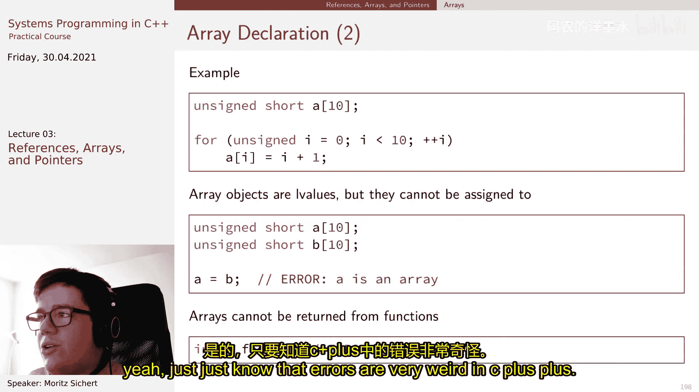

But let's also first look at the。Memory representation of an array I said that the elements of an array are allocated contiguously in memory。

 so if we have an array of 10 uns shots， which let's say we brought the integers  one to 10 to them and we assume that we have a two byte uns shot and a little end machine。

😊，which should be the case for all of of your machines then this array will look like this in memory so we have some address here and the number one and little Indian of course has first the  one then thete zero and this would be the first array element and immediately after this array the first array element we get the second one and so on so essentially we have just a very large block of memory which contains all memory elements。

😊。

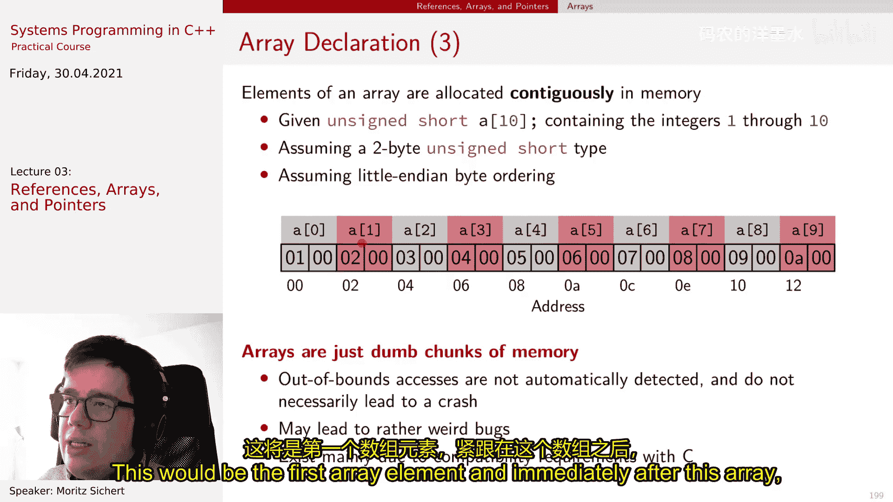

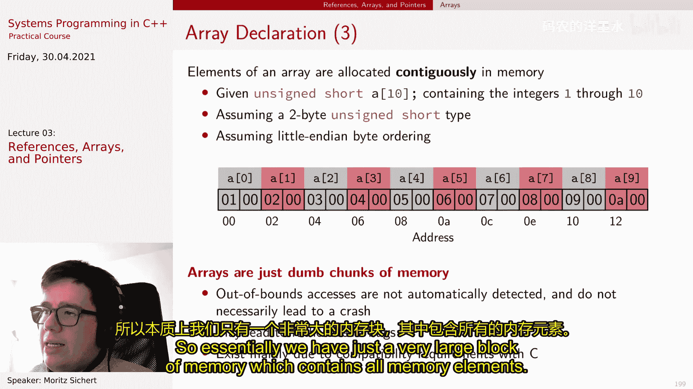

What you have to know about arrays in sequence class is that they are essentially what we would say dumb chunks of memory。

 which means that they don't have any bounce checks for the indexing and so on。

 and this can usually or will quickly lead to weird bugs if you don't check for this。😊，Yeah。

 this is just an unfortunate part of C++ this comes mainly from C。

 but yeah you just have to know this and write code in a way that you will never run in two arrows there。

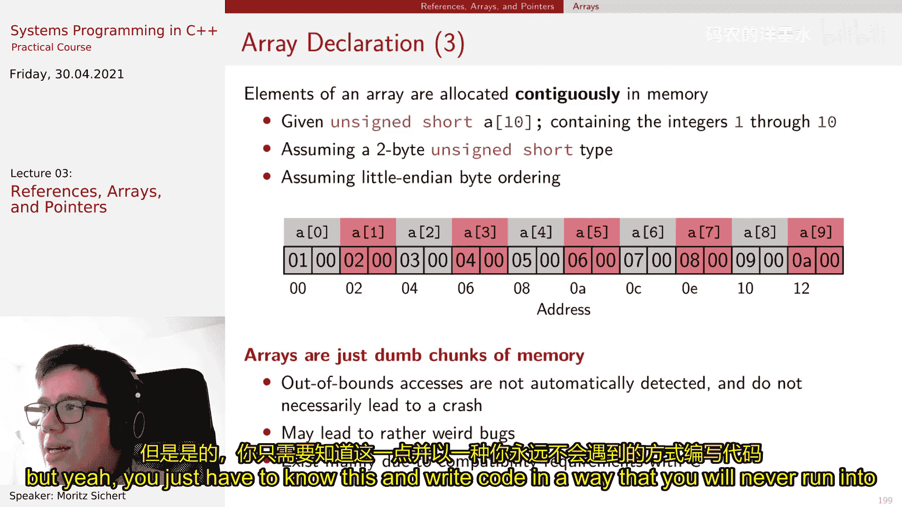

You can also adjust a small node， you can also define nest array sort to say or multidimensional arrays。

 I won't go into much detail there because this is hardly ever useful in C plus I just want to show you the syn briefly here so you essentially have an array in an array so to say and you can then access it as you would expect by using the two bracket operators and this multidimens areas then also again stored contiguously in memory in a raw major format which means that first you have all the elements of the first row and of the second row and so on yeah but that's very。

😊。

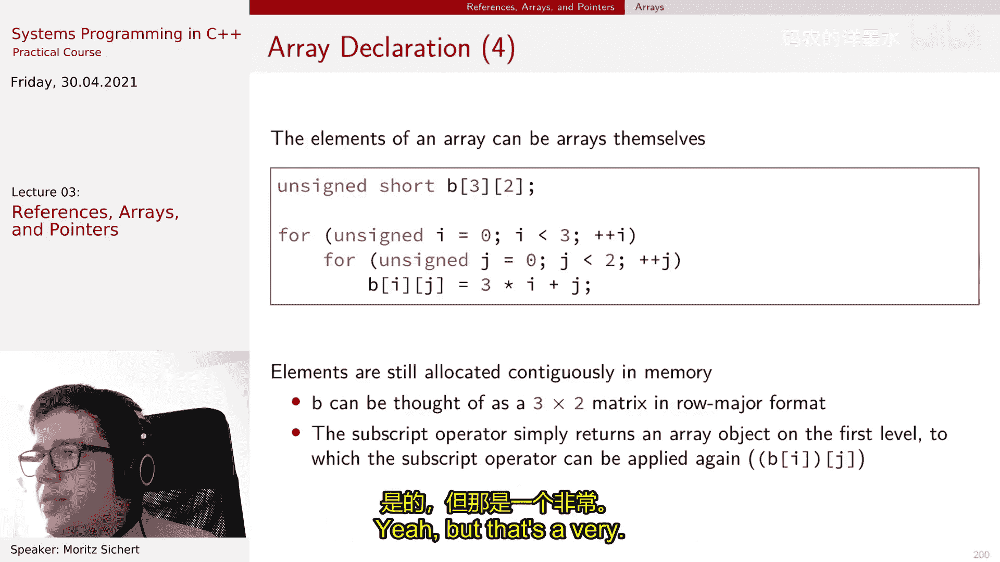

Brief introduction to them。Let's look now at initializing arrays。

 there's a shorthand to initialize arrays to be zero。

 which is if you're just right equals and then to curly brackets。

 this will initialize all of the elements to zero or I mean it will default initialize them which for integer means that they will be zero you can also explicitly write in curly braces all of the numbers or all of the elements of the array and if you do that you can actually omit the size of the array because it will then be determined by the compiler automatically and this also works for multi dimensional arrays。

 but as I said this is hardly useful so the main initialization you will use are either the default inization or the explicit list initialization here。

😊。

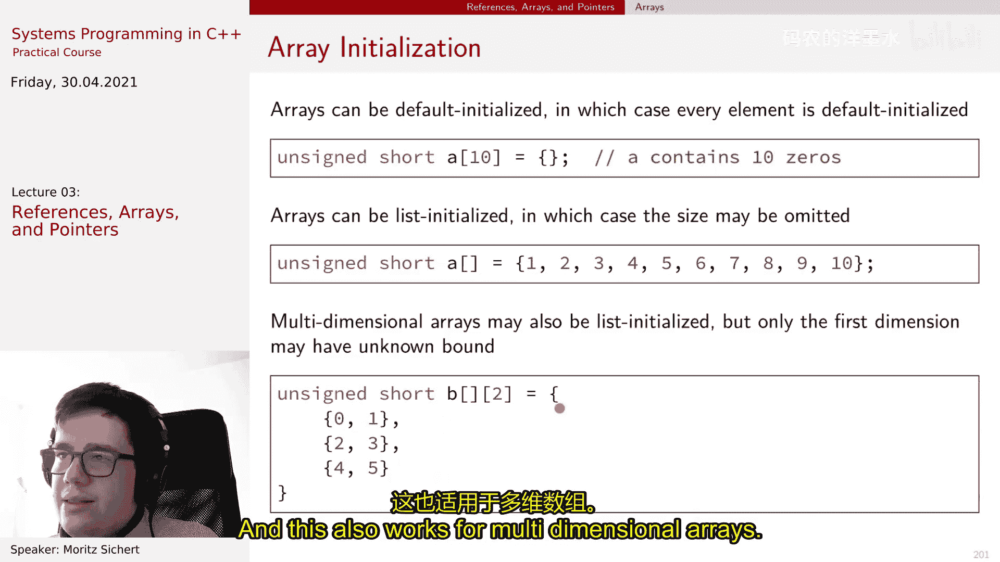

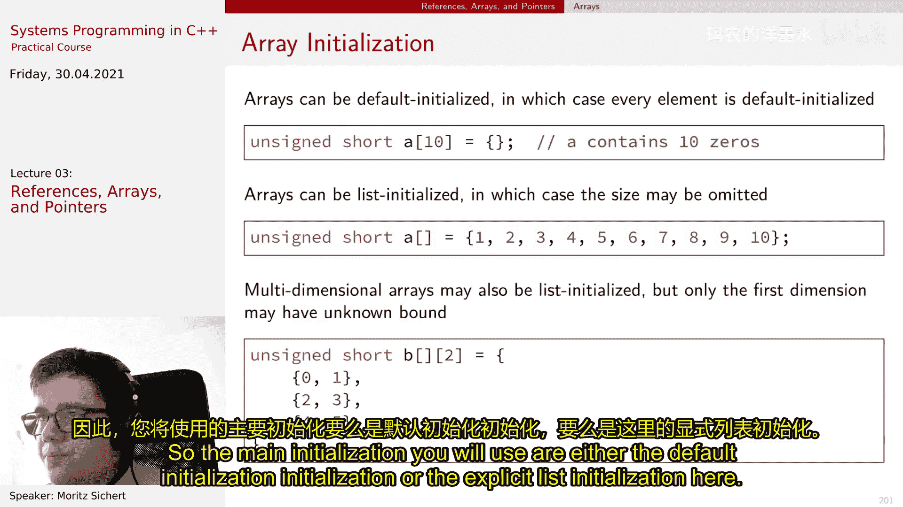

Okay before I talk about further things considering errors。

 I briefly want to introduce the type size underscore T because if you do work with arrays。

 you usually work with indexes into areas of course。

 and there's actually a designated type and C+ plus which you should use if you are working with indexes or sizes and this type is called size underscore T what this type is it is an unsign integer type that is guaranteed to be large enough to represent all possible sizes and all possible error index that your program could have on the target architecture which on x 86 for example means you could have an array of bytes and technically if you would have enough memory this array of bytes of course could。

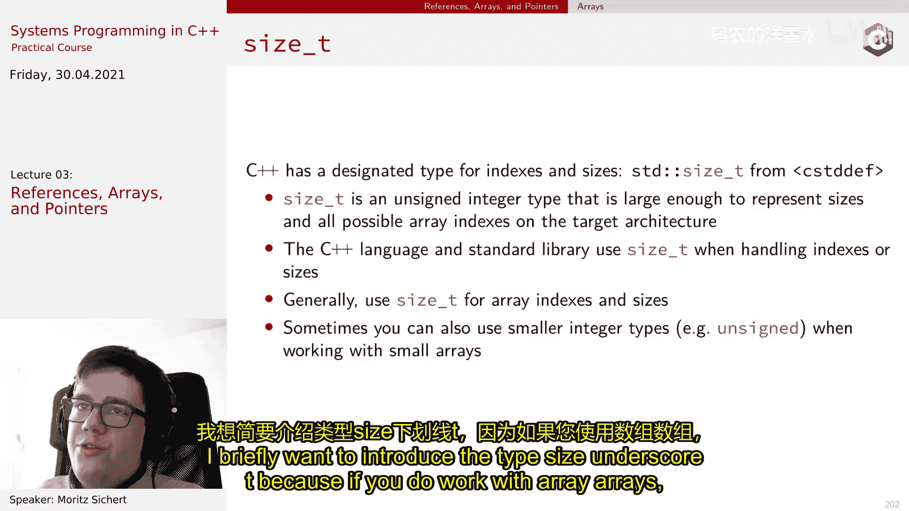

Cover your entire memory， which has two to the 64 bytes。

 which means that the size T on an 64 bit Intel processor needs to have 64 bit。

And also the not only does this type exist， but the C++ language and the center library。

 they make extensive use of this type whenever they handle indexes or sizes。

 which means that you also should generally use this for any indexes or sizes。😊。

If you need some type that can represent an index in general， of course。

 if you know that your array is small enough and that it will never break the bounce of a smaller integer type like in unsign。

 then of course you can also use the smaller integer type， but in general。

 the largest possible type when index is size underscore square T。😊，Okay。

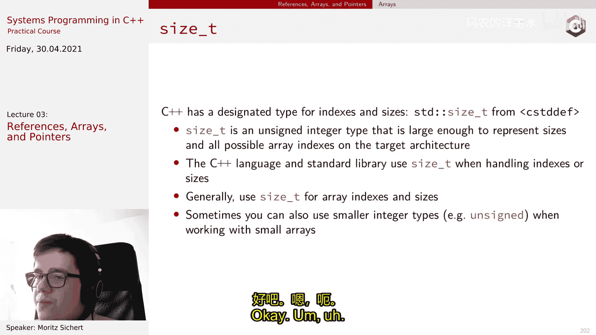

呃。Okay， let's go back to C plus+ arrays。😊。

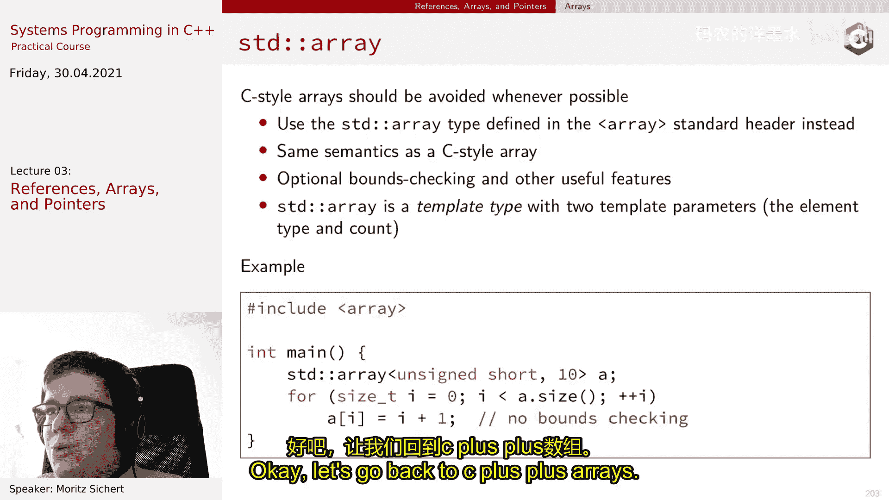

So I set these Ct arrays， they are called that for a reason because they come from C and they are mostly only there for compatibility with see。

 but in C++ there's a very nice alternative that works much better syntically at least than arrays which is called SCD array。

 this is a class or a type defined in the array header which you can just include in every C++ compiler。

😊，And these semantics are。😊，Mostly or essentially as an C style array， but much more usable。

 which means for example， you can。 So or let's say the first thing is an array。

 an STD array has two template parameters for now you just have to know you have to write like this。

 So in angle brackets you write first the type then comma and then the size of the array。

 and this will be the exact same size as C style array with the type unsign shot and the size 10。

 So in this case so it will also just allocate 10。😊，Oject of type un shots in contiguous memory。

 so in that case it's the same， but it has much more useful features。

 for example it has the function size which you can use to make sure that your array excesses or index axis are not out of bound and it has a few other helpful functions which。

😊。

In general means you should always use SDD array if you need a fixed size array and you should never use Ct arrays。

😊，Nevertheless， you should know about CC errors because if you work with Cpis， for example。

 you will come across them， but in general， if you're in your code on the use SDD area。😊。

Does the array size have to be known at compile time also with SD array， Yes。

 the size here also has to be known at compile time this is the exact same as for a C style array so there nothing changed there。

I have a question concerning size T and your style guide if I iterate over something in decreasing order size underscore scores t is problematic here due to the zero and wraparound effect what would you recommend to handle that in general I would recommend never so if you。

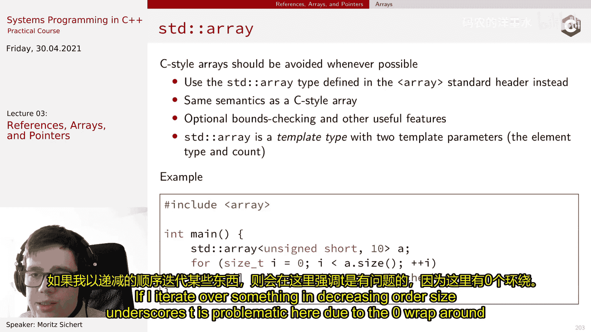

I mean this only becomes a problem if your brake condition for the follow here would actually be I smaller than0 and I would say this is generally a bad quality style anyway that your loop breaks at minus-1 instead of0 so if you want to loop through an area in reverse just write the loop like this so write I equal0 to size and then here write size minus I then it works。

But for I greater equals than 0， Yeah， I mean， I greater equals0 is the same as I greater than -1。

 right so this is。😊，I mean you are right this may be easier with yeah I mean you are saying this is not the case for unsigned but this is what I'm saying if you are using sizes you should generally so you should not write decrementing a loops because I mean it could happen that so if you use some s type which is equivalent to the unsigned type here this will mean that you have less possible positive integers then you have possible error indexes that could exist on your system so this may not actually be correct because what happens if you do have an index that is larger than the largest number that is able to be represented in your signed type that used for a loop so in general you are right using unsigned for loops can also lead to very weird bugs。

😊，But there are easy bookarounds for that。🤧Okay。There's a question。

 is there a style guide document available anywhere。

 I mean when we introduce new concepts we always immediately talk about this style there but we don't have a separate document where we'll list all of this if you don' mean that。

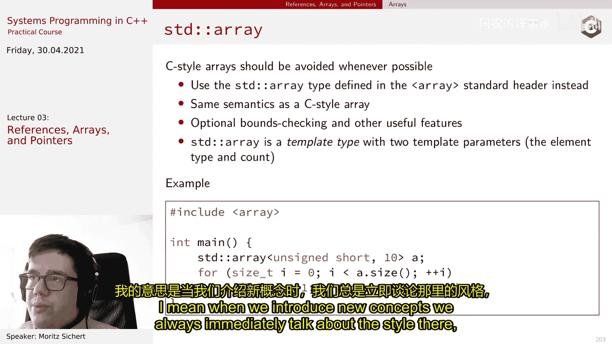

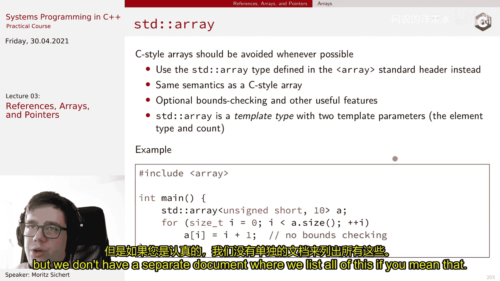

Okay， so someone asked whether this array also has to be fixed size and known at compile time and the answer is yes。

 but of course you。

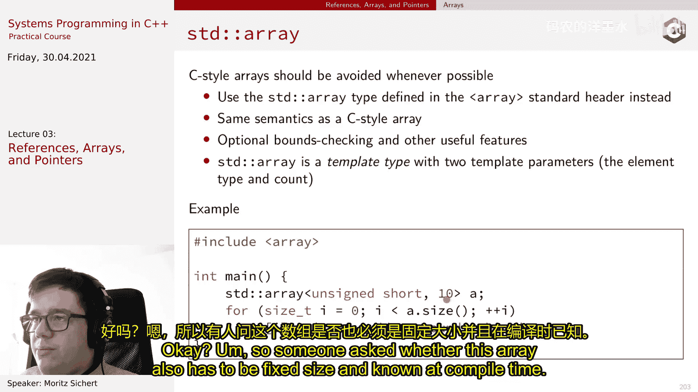

Often you don't you don't know the actual size or you want to be able to increase the size。

 And for this， there's another type that's very useful in simple size， which is called SD vector。

 This essentially is works very similar to SD array， but instead of allocating a fixed size array。

 it will algorithm expand and contract as needed。 So if we add new n events or remove elements。😊。

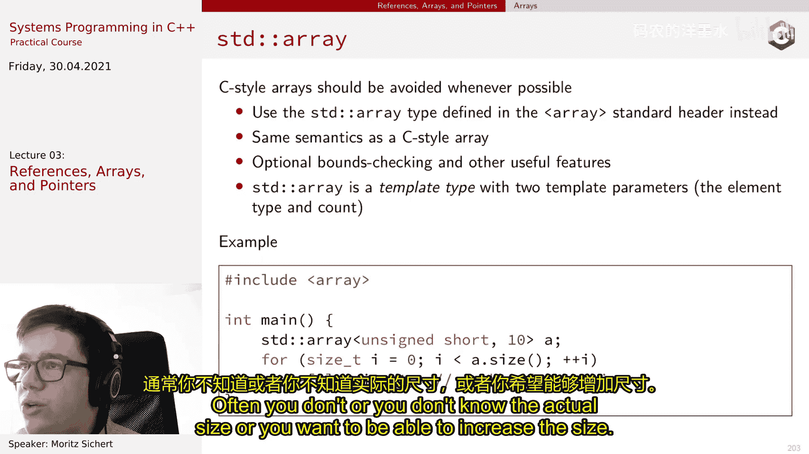

This will automatically make sure that the storage that the acidD vector uses is grown or shrinked。

But apart from that it's still very similar to an array in particular。

 the elements are still stored contiguous in memory。

 so this still mostly behaves like an array and the most important functions that you will need probably are pushback which inserts a new element at the end of the vector then size of course you have clear which will remove all of the elements and you have resize where you can manually set the size of the vector and you can also use the sub operator just like for so the brackets operator just like for Ct errors in general。

 vector has a bunch of more functions and if you want to know more about that of course you can always look at the reference documentation。

😊。

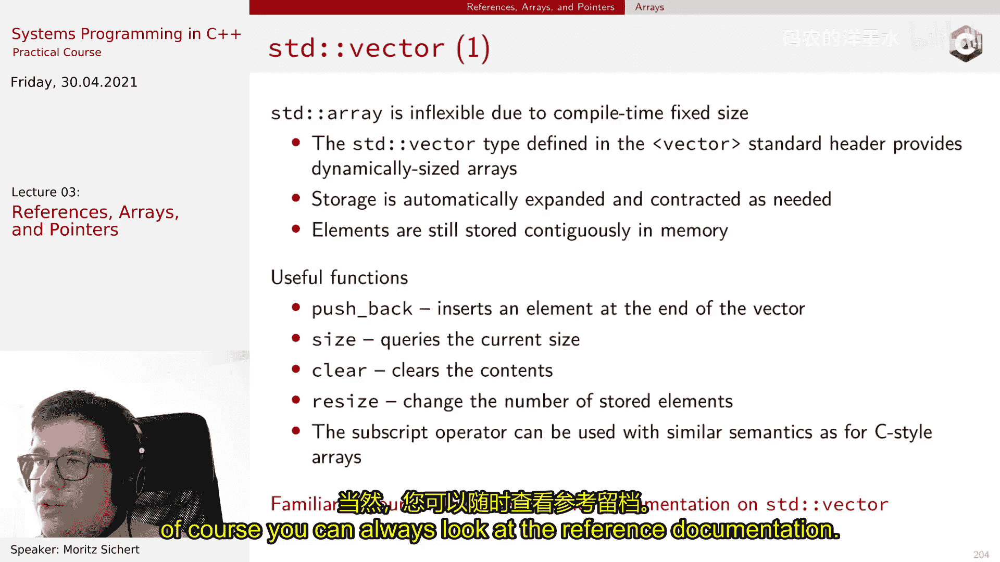

Let's look at a small example here。😊，Because。Vectctor doesn't need a size at compile time。

 It only has one template parameter here so you just write S vector。

 then an angle bracket as the type and then you can just loop write a loop and then push back elements and this will automatically expand the size of the vector which you can verify by printing the size here here will print1 if we clear the vectors or remove all elements again。

 then size will be0 of course， again， if you manually resize the vector then it will。

Essentially create 10 objects with their default in initialization in this case。

 which after that the size will be 10 again of course。

 and of course you can also just use the subscript operator here。

AndA nice thing that also exists in C plus if you don't want to mess around with indexes at all。

 then there's a syntactic construct that is called range4。

 so instead of explicitly writing the index out and then using the brackets operator you can just loop through array or something that behaves like an array by using this construct so you write for and then an in statement this works like the edit statement if for example。

 this is mostly omitted but the core of the syntaxes here so you write the range declaration which is the declaration of the actual element of the range you want to loop through and then the range expression which is the expression of something that is like an array。

😊。

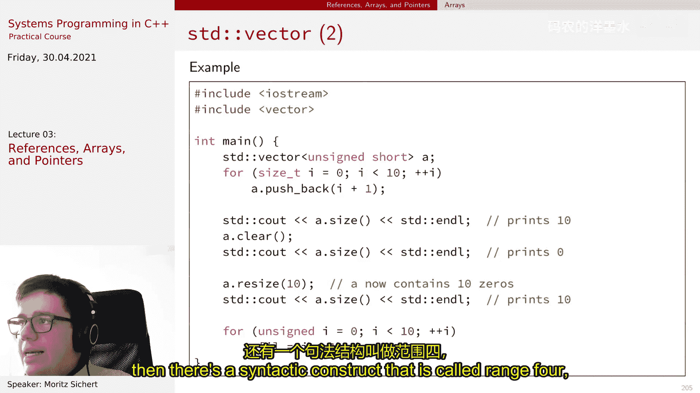

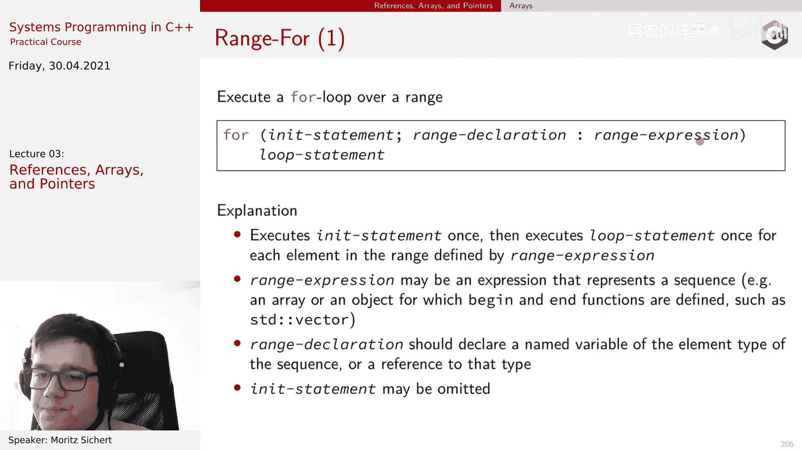

Here you can see an example so this is very similar to the example from the last slide。

 if we have a vector and push back10 elements to it we can then just use a range for by using this so we write for every constant unsign short reference E of a we want to print this and of course I mean this works with all kinds of array like type so this would also work with SCD array for example。

😊，Has the question， should we use SD array or SD vector or does it depend on the use case， Of course。

 it does depend on the use case because they have they work differently。

 And SD array always has the same size。 It has a fixed size known at compile time and SD vector grows dynamically the main difference。

 I mean， the main reason why you would use SD error instead of SD vector is because SD array。😊。

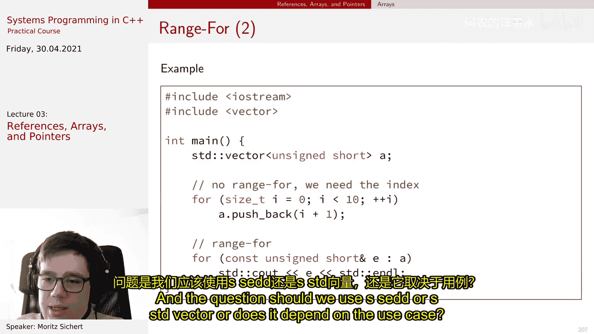

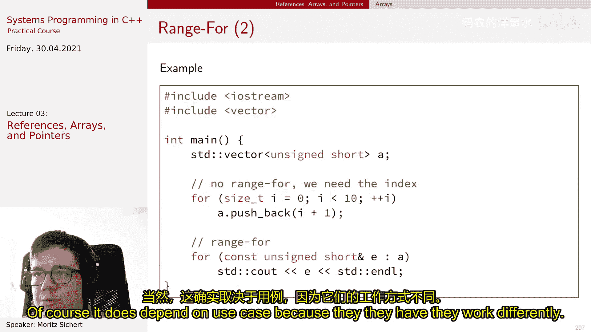

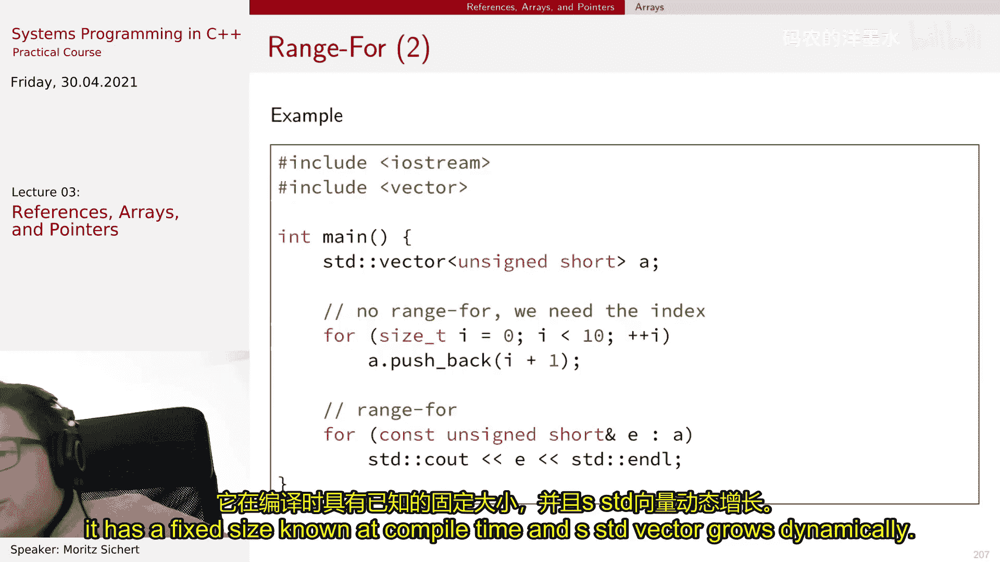

Has the same semantics as C cell arrays regarding the allocation。

 which means that an SD array will allocate its objects directly on the stack， for example。

 instead of the he or instead of like dynamic memory allocations， which means that。Aways。

 S errorss are usually faster。 I mean， that's not。It's not always true because if you define an SD error with a billion elements。

 then your protein will probably crash due to a stack overflow but in general， SDD errorss。

 if you know the size they can be faster than vectors。Okay。

Another question is cont always necessary in a range for no you can also that's a good question actually you can also use a noncon reference here and then you can actually modify the element so if you write for uns short reference E without the cons and then write E equals e plus1 then I would automatically or then I would loop through all of the element of the vector and increment every element by one so this works as well。

😊，Okay。Let me now talk about before we come come to point us， let me talk about storage of objects。

 and we saw when we talked about objects that every object。

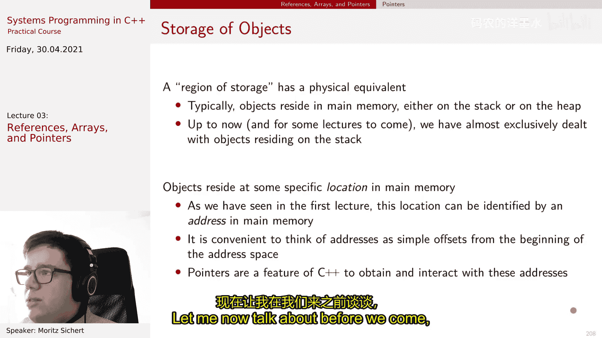

Requires some storage and we have concepts like the storage duration。

And what this actually means for the physical word of your computer is that an object resides somewhere in main memory of your computer。

 this usually means that it is either on the stack or on the hip。😊，m and I mean， up to now。

 we have almost exclusively dealt with objects on the stack which I mean。😊。

All of the all local variables that do define they only live on the stack。

We haven't talked about how to actually allocate。Things on the heap yet。

 so which is why we haven't talked about things that are not located on the stack。

 but still for objects that resideite on the stack， the same principles score， which means that。

Every object needs some location in memory， which this。

Can of course be this so can be identified by an address in the main memory。

And usually an address can be just thought of an offset from the beginning of your address space。

 which means that an address can be thought of as an integer which is just the offset starting from the like the very first address that your system has and those addresses they can be represented in C++ by pointers。

 this is the entire reason why pointers exist in C++ to obtain those addresses and then interact with those and use them in programs。

😊。

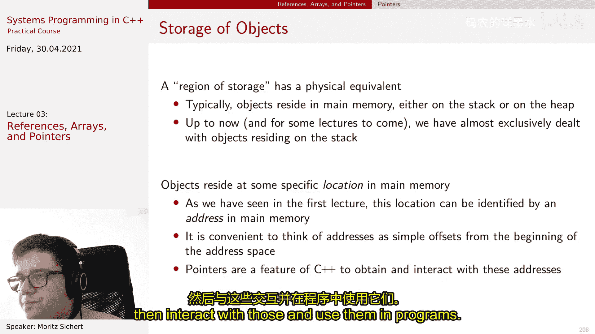

Okay。Let's talk about first about how the a pointer。

 the declaration looks very similar to the declarations of a reference。

 so you write the type and then instead of an end you have the asterisk here。

 then you can also have a CV qualifier and then the decorator again。😊，For reference we said。

 references themselves can't have CV qua us but point us can， so this is why the CV qualifier exists。

Unfortunately again due to weird syntax rules， the asterisk is also part of a decorlarator。

 so this again leads to the same weird problems like with reference definitions and declaration。

 so the same rule applies here don't define two pointers in the same line and you won't run into any problems。

😊，So now the question is what is a pointer so if you have a pointer to an existing object then this pointer will represent the address of the very first byte and memory that is occupied by the pointer to object and what's interesting in contrast to references is that pointers themselves they are objects and someone asks this at the beginning and because pointers are objects they can also be stored in errors for example and of course because pointers are objects themselves。

 they can also be pointers to pointers and I mean the。😊。

Maybe the reasoning or maybe the intuition for why pointers can be thought of as object is because a pointer is essentially just an integer which。

Which is the offset of your memory where your object lives。

 This can be thought of as an integer and integers themselves are objects as well。

 so pointers can be thought of objects in the same way。

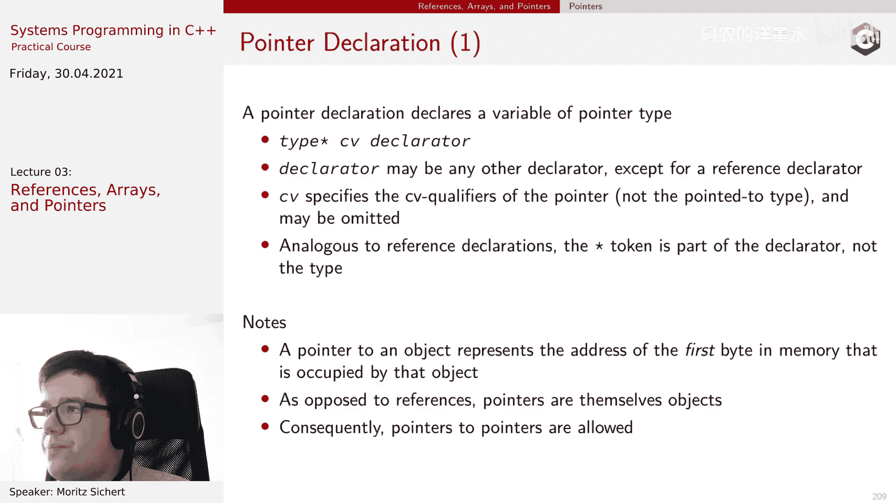

Let's see some examples of quantum decorations here so you can。😊，Define I mean。

 declare and define a pointer to int here。 Of course。

 the pointed two object can also be C qualified or can have a pointer to a constant。

 but you can also have a cons pointer to a non-con。

 So the difference between those two is that here the pointer value itself。

 So the pointer can be modified。 but the pointer to object can't。

 And here's the other way around the pointer itself cannot be changed。

 but the pointer to object can and of course you can also have a cons pointer to a constant。

 And since you can have pointer to pointer。 you can also have things like this。

 You have an in pointer to and pointer to an int or you have a cons pointer to a cons pointer to a constant but you can technical right。

 but usually this I mean， in Ubra have never seem something like this like a pointer to a pointer may happen sometimes but like the contraption below here this usually never happens。

 So don't worry。

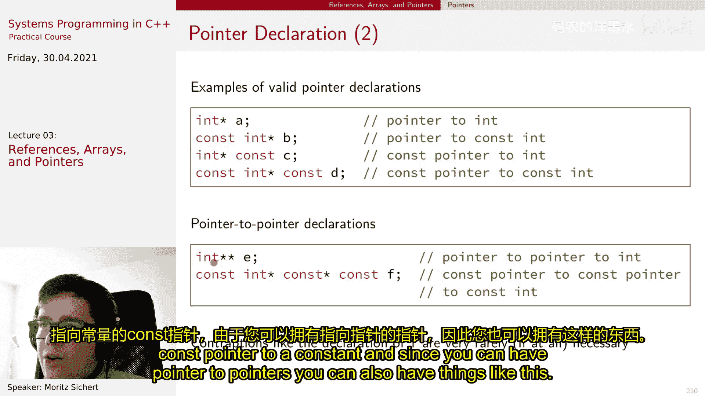

Okay。The question is now， okay we know about pointers how can we actually get a pointer to existing objects What you have to know is that in general if you do have an object of some pointer to type which could be into for example。

 there has no implicit conversion to its pointer which means that you can't implicitly convert between objects and the pointers to them instead you have to use the explicit address of operator which which is also the ampersent don't confuse it with references this is the same symbol but it subjectly means something different。

😊。

And what it means is that if you have an L value expression A， which essentially。

 I mean again the L value expression just means that you can't take so this can't be any thing that is not an object that lives in memory somewhere if you then write m percent A this will give you a pointer to the value of this expression and you also have to know that the C qualification of a is retainant which you can see in the example here。

 so we have two object A and B， and if you want to get a pointer to the object A we use the m percent A and then we have a pointer so a pointer to a noncon but if we take a pointer to B for example we get a pointer to a constant because B itself is a constant and this of course also just like for reference doesn't work if you have a pointer to a constant you can't just convert it to a pointer to a noncon because the object itself is a constant。

And if you would assign it to a pointer to a nonConst。

 then some other parts of your program would think that the point2 object be referenced。

 can be modified which of course it can't， so this is why this conversion is not allowed。

The other way around is also not implicit， so if you have a pointer and want to get back the pointer2 object。

 so for example， if you want to go from interpointer to an int， this also doesn't work implicitly。

 you have to use the indirect operator， which is the asteriskis here。😊，Again。

 this is the same symbol as for the pointer type but again Don confuses how this works is if you have an expression that has pointer type writing S risk this expression will give you an L value reference to the pointer to object and again you see we qualifies of course are retained and what this usually is called this is the dereference operator and applying this to a pointer is usually called dereferencing a pointer you case see an example so we define a pointer to the object a again and if a dere this object again we get an L value reference a non constant L value reference to this original integer a back again and of course the same rules for constant go so you can't switch from constant back to nonconst but the other way around works。

😊，Okay。This is still a bit theoretical。 let's now look at an actual example how this could look like on your system by looking at the actual memory。

😊。

Oh， in this case， only the stack memory。 But how this would actually be stored in。Honnaistic。

So let's say we have a main function and in this main function。

 we first declare a local variable with the name A and the value 10。😊，嗯。😊。

Let's say we don't have any optimizations turned on。

 which means that the compiler will just treat this line as okay。

 I need to write this value 10 somewhere in memory and what usually happens at least Linux。

 you have a stack where on the stack we will then allocate four bytes for this integer and this will then write the value 10 to the last four bytes and let's assume this is a little n machine which means that0 a so this is hexadeimmal will be written to the first byte you can also see here the stack grows upwards which means that if we add another variable here。

 the new variable will be added on the top of the stack here。😊，And so far a good。

 we have two variables on the stack and they just exist here in the stack memory。

 Let's now see what happens if we take a pointer to the first variable。

 we know the first variable was written to this location in this stack， which has this address。

 So this is0 x and then some zeros and then 1，2，2 C。 And of course。

 if we do take the address of this object A， this should exactly be this address。 And if you。😊。

Try to compile a program like this and look in the debugger， this will actually happen。

 So you will be able to see that the new variable C， which is a pointer。

 which means it's also an object itself， which means it will also have some space in the stack。😊。

This will write the address of the object A to the location of the object C。

 which in this case will be exactly the exodadecial address want to see， of course。

 in little Indian again。😊，And now the interesting thing is if I dereence this pointer and then assign a variable or a new value to it。

 it will of course first read this from memory we willll see okay。

 I have stored the address12 to see here and then I will update I will dereence this and then I will write a new value into this location which of course then will be location the location of the first variable。

😊。

Okay。Now if we define another variable which is a pointer to a pointer which is appointed to the variable C here。

 this of course first will' just allocate more memory on the stack and the variable C we saw what written to the address here。

 which is the addresss 122 4 which then as we would expect will be written to the stack here for the variable D and if we now de referenceence value D twice。

 this means that first the CPU or the compiler of the generating subcode will read the address here。

 which is。1224， then it will look at the location of 1224 and then it will reach this address which is 12 to C and then finally it will write the new value into this address。

Because what you can also do is if you do not want to modify the the WD reference value。

 but only the de reference value once here。Which again， means we take。

The address that is written into DD reference at once， which is again 1224， which is。

 of course as we know the variable C and now we modify this variable C by writing the pointer to B to it。

 which we also can look in our diagram here which is 1228。

And of course we can then assign a new variable or new value by twice d referencing D。

 but since we modified the value that we stored in so we modified the value here。

 which means that in this memory cell， we now have the address 12 to a instead of one to2 c。

 which means that in this expression we now modified the variable B instead of a。😊。

And then in the end， when we return， since all of those variables have automatic star duration。

 the entire stack memory will be cleaned up， which again shows that if you would return any of those pointers or references outside of this function。

 they would all be invented to use because all of the lifetimes of the objects here ended and this would of course lead to undefined behavior okay。

😊，Any questions about that？This is， I mean。Of course。

 this tu me around with parties like this doesn't really happen in the real world。

 but still this example I hope was very useful to show you how this is usually translated into machine code。

😊。

And of course， if you do have optimizations and all of that stuff。

 this changes a bit that for example， the order of the variables bit on the stack is not predefined by the C Western。

 that so the compiler can do anything here， which means that this will。😊，Yeah。

 this the real word this looks unfortunately much more complicated than this。😊。

Here's a question if x is an L value is then pointed and so the address of x and error R value oh that is a very good question。

 the answer of this is yes。😊，嗯。Let me see if I could show an example somewhere。

Okay， so your question was。😊，A itself， so if we have variable A。

 a is an L value which means we are allowed to take an address of it or let me go one slide back。

 so I said we can take the address of any L value expression A in this case a is an L value。😊。

But the result of the address of operator itself is the of deporter to a and to be very pedantic。

 this expression itself， so the pointer itself is an R value。

 which means that you can't take a pointer to a pointer。

 which means it is never valid synax to write M percent and M percent A this can never work。😊。

Oh let me say there are some exceptions when you hack the language but usually it can't work writing pointer to pointer to a this can't work because taking the pointer of N value already an R value and you can't take the point of an R value so this doesn't work I hope this answers your question without confusing you too much if you want to like try it out this is probably very nice to try it out on our compiler do Db interim website whether the compiler will actually tell you if you try to take a pointer of something like this then it will tell you that you can't get a pointer out of an R value。

😊。

Yeah， okay。

Okay let's now continue talking about pointers another interesting thing about pointers that is different than references that a pointer is allowed to not point to any object at all。

 I said about references that references have to be initialized to refer to an existing object but for pointers this is not true and pointers are allowed to not point to any object at all and for this they are then called null pointers and there's。

😊，Especially literal in Cus plus， which is called N PTR， and this is like the rip literal for all。😊。

Pointters that do not reference any object。嗯。😊，So， I mean。

 very what you would expect if you have two null pointers of the same type， they are， of course。

 considered equal and of course， what should always be also be obvious is that since an null pointer is explicitly the value of a pointer where the pointer does not reference any object at all。

 you can't dereference a null pointer or you must not dereference a null pointer because theres no object which which would have a lifetime which is active at this time。

 would dereference a null pointer， which means that。😊。

Dereferencing an La point as always undefined behavior and as always。

 undefined behavior will lead to all kinds of surprising results so you can see here。😊。

An example， if we have a function which essentially。

Just take the pointer and returns the value of the pointer2 object。

If it is not an N null point and if it is a N null pointer it will return 42。

 the thing is we accidentally wrote the dereferencing of this pointer before we checked for the N null pointer value and what the compiler then did it said okay since we are dereencing this here you as a programr you told the compiler I guarantee you that this pointer will never be null because otherwise they wouldn't be allowed to dereence it which means that the compiler will be able to prove that here it is not allowed it's never allowed for the program that the pointer will be null here。

 which means that the compiler will not generate any branch instructions。

 anything it will just generate in a single instruction which will dereference the argument here's just a move instruction with a memory opera and just return this nothing else so this is again an example of why your program must never contain undefined behavior anywhere。

😊。

Okay， another interesting thing about pointers or if you think about everything and pointers。

 you will notice that they are very similar and。😊，I mean a pointer something that is an address to a location memory and arrays of course also are a contiguous storage or a contiguous area of memory so to make working with arrays a bit easier and see this plus arrays are implicitly convertible to a pointer and what thisit conversion will do it will give you a pointer to the very first element to the pointer and again the of course the CV qualification they have to be retained and you've see an example here so if we have a Ct array with three elements。

😊，I can assign this array to a pointer variable and here this array will be implicitly converted to a pointer to the first element and we can verify this by printing trying to print this if you print the value that this point reference references then we will get the number 123 here。

😊，嗯。

What is also interesting is the subscript operator is also defined on pointer types。

 we saw that you can use the subscript operators of the brackets。

With arrays， but you can also use them with pointers and the semantics for this is that the compiler will then treat the pointer as a pointer to the first element of an array。

 then it will conceptually convert this pointer back to an array and then will just follow the same semantics of the bracket operator as it would be for the array So you can here see an example if you first convert convert the array to a pointer and then use the subscript operator on the pointer instead of an array。

 it will do this program will print the exact same thing as if you would have written array here instead of a PTR So this is the like the easy semantics of。

😊，Offers up to the operator。There's also an interesting special case when talking about pointers and arrays。

 especially T cell arrays， and this is string literals they also。😊。

This comes mainly from C compatibility， so a string literal is something that you'll write in double quotes。

😊，And what the compiler will do here， if you have a character or a string litter with n characters。

 So in this case， we have a full， which has three characters。

 the compiler will give this the type con cha with n plus one in size。

 The reason why this is n plus one is that in。😊，See。

 every a string must be terminated by a zero byte， which means that actually what will be stored in memory is full and then the last byte will be a0。

 which means you need one more byte than the actual length of the literal here which means the size is n plus one and what programmers often write instead of explicitly writing down the size of the string literal。

 they will just take advantage of the area to pointer decay。

 which means you can also write this because on the right hand side you have an area type and this of course can be implicitly converted to a pointer to character。

😊，And those string litals have very very similar to character literates so can also write U8 or U so but just what you have to know is that C style strings if you so this is called a Cside string if you have a con sharp pointer to something this is called a C style string but you should never use this in C++ and the C plus standard library they provide much safer types namely SD string and SD string view which will prevent many of the errors that happen due to this Nllbte thing in C where we will accidentally forget about the Nllbte or you will read through the Nbte or something。

😊。

Withch means discuss you should never use the Cs strings I mean you of course can use the literals but just don't assign a literal to a conchar pointer instead use the other types here we will talk about those two types soon just so you know I mean up up until now and also for the next few sheets you will not need strings anyway so don't have to care about that。

You still have to know about C style strings though， because if you use libraries， for example。

 if you use some like systems library on a Linuxux they are usually are often written in C and in C they will require a C style string parameters so you have to know about that this exists and the standard library knows this as well that you will often need a C C style string representation of a C++ string for example。

 which means that the standard library actually supports getting the C style string there。

 but as I say we will talk about those two types in another lecture。

Another thing that is very interesting and very important to know about pointers is that you can do arithmetic on pointer。

 so essentially integer arithmetic and the thing so the way it works is that，😊。

If you do in arithmetic on a pointer。You have to have a pointer and an integral type。

 So so for example， you have a pointer to an int and then a size T， for example。😊。

And how this works is that the pointer is again treated as a pointer to some element of an array。

 and then if you add an integer I to a pointer， it moves the pointer to this array。

 I elements to the right and if you abstract I， of course it will move the I elements to the left。😊。

Which means that in general， if you write， so the the brackets。😊。

Or the subscript operator for pointers is usually equivalent to writing p plus I because this shifts the value that the pointer the resulting pointer of p plus I will be exactly the pointer to the array element I element right of the element that P points to and then if it do references then we get the same element as using the。

😊，The brackets operator here。You can see an example here。

 so if we now take a pointer to the not the first element but the second element or the element with the index1 and then try to dereference this pointer minus1 we would get this would print 123 so this line would print 123 and pointer plus1。

 then dereference of course would print 789 and this would be equivalent of course if we would have written hereR in brackets minus1 or PTR in brackets 1。

 this would also have worked。😊。

嗯。Of course， what is still what you still have to take care about is that you don't accidentally de reference invalid pointers。

 This is especially important because。😊。

While you can't initialize a reference to an object that doesn't exist。

 you can easily and also this is sometimes useful to get pointers to objects that to an address which is not a valid object。

 which is for example， the pass the end pointer of an array or an SD vector。

 which we can see here if we define a vector and resides it to size 10。

 of course the valid indexes are only from0 to9， but for an Se vector。

 it is allowed to take the pointer of the one element past the n。

 this is called the past the end pointer， you are allowed to take this pointer。

 but of course you can't dereference it because there is no object on the index 10 here because it only contains 10 elements and the larger index is 9。

 which of course means that this might hit an error it might setfold or which means it might crush your program the same with this。

 but in general this is just undefined behavior and it will。😊。

Will end as so it can and will lead to any possible weird behavior。

Another thing that is useful when talking about arithmetic on pointers is that you can also instead of adding or substructing an integer to a pointer you can also sub two pointers from each other so you can't add two pointers but you can sub two pointers and the semantics for this is that again they are treated as as if they were pointers to the same。

😊。

To different elements of the same arrays， and then they will compute the number of elements that exist between those two pointers。

 So if I have。I pointed to the first element of the error and I pointed to the past the end pointer so which would be a pointed to the element that comes right next to this 789 and then subtract them then I would get the value3 because they are exactly three values between the very first element and like conceptual first element past the end so this result of pointer 2 minus pointer1 would be3 of course this also works if you have like if you would take the difference between area1 and area 2 this would then just be one。

So in general， you have to know that all of the pointer arithmetics。

 you can always think of them as operations on errors。

 So conceptually the compiler will treat this as。😊。

Poiners to arrays and then try to work out the semantics on this conceptual arrays。

 What you can also do then， of course， you can not only sub pointers。 you can also compare them。嗯。

And conceptually again， this is the same again as for when thinking about an array。

 so two pointers are equal if they point to the same element in the same array and one pointer is less than the other is if it if they both point to some element of the same array。

 but one element is like comes before the other so you can see an example here。

 I have a variable which point to the first element here and I compare it with the pointer to the past the end pointer and of course if I increment this pointer by one will first point to the first element than the second and then the third and while I point to the first second or third of course those array indexes will be smaller than the error in this three。

 which means that the pointer also the comparison would also be true here。😊。

And essentially this is just a complicated way to write a loop through an array and you can also think an alternative way to think about binary comparisons is what we wrote here is essentially the same thing as thinking of that the pointer is converted to an integer and then the integer values are compared。

 which means that the address of the first element of an area of course is smaller than the address of the last element。

 which means that also the comparison will be true here。😊，The question that's a question。😊。

Oh I saw that's another question What is the difference between SD string view and SE string as I said we will talk about this in a future lecture and they will will go into detail about that so I won't go there now The other question is it seems that array index grows in the same direction as memory addresses our arrays stored on the heap or on the stack but in reverse order。

😊，🤧嗯。哎。So the supercar standard itself。😊，Doesn't know the difference between stack and the he for the standard。

 there just exists addresses on some point so addresses of some storage。

 but what is true is that the addresses of elements in an array independent of where they are stored so also if you have an SD array or if you have an SD vector which tells you that it has con storage of the memory。

 the addresses of later elements in the array will always be larger than the addresses of the first elements。

 I hope that answers your question。So in essence， your assumption is true。

 so the error index grows in the same direction as memory that's correct。

m， okay。Let's talk about another bit weird thing about pointis that even though void is not a type of an object。

 you can have pointers to avoid， of course since void is not not an object type you can't do reference pointers to void but the special case about void pointas is that。

😊，Any pointer to any type can be implicitly converted to a pointer to void。

Which means that a void pointer is essentially like a universal pointer can point to anything。

 The only thing that must be the same， of course， is the C qualification you can't。😊。

Convert a pointer to constant to an pointer to non-cons void this doesn't work by a platform that everything works and was's also important。

 of course the pointer value so which means the address itself is not changed so if you if you take or convert an inpointer to and void pointer and then this convert this back to an inpointer again then you would have the SX n pointer the usage for this they are a bit limited they are usually used in C especially to pass object of unknown unknown type because this can be implicitly converted from any pointer this will then work with any type but in C this plus they are way better alternatives for this you can use templates for generic programming but we will also cover。

This in a future lecture， you just have to know that in C those options don't exist。

 so in C void pointers are used very extensively everywhere you need a like a generic。😊。

Something of a generic type。But it's it as plus。Not many operations are allowed on avoid pointers。

 you can of course assign them so you can assign one point to another。

 but you can't increment the void point or decrement you can't do any arithmetic on it。

 you can compare two void pointers for equality but there's also it。

 and you of course you can't derva it， so yeah the menu use case for this is in C interfaces。

So and right here in order to use the point to object。

 one must cast devoid point to the required type and this cast back to the original type is not implicit。

 so there's an explicit syntax in C plus bus and the syntax looks like this。

 it's called a static cast。😊。

In static cast is the syntax to change a value from one type to another related type and the syntax so this is like this you right static underscore cast and then in angle bracket is the new type you want and then in parenthees the expression of the value that you want to change but the star is that of course it changes the value of the expression to a value of the new type。

😊，Again， you can't change the CV qualifications of the expression by using staticcast。

 which means that you can't change a constant pointer to a non constant pointable staticcast this is not allowed。

 but for example， you can change a void pointer to a pointer to int。

And there are many more use cases and mainly you have things like integer conversions you can convert from a double to an integer or something。

 but there are many cases for many use cases for static cards which you can see in the documentation let's see a small example here。

😊。

So as I said， if you take the pointer of any type， they will be implicitly convertible to void pointer。

 which means we don't hit any cast here， this will be just done automatically。

 but if we want to get if we for some reason we have somewhere in our program a void pointer but we know that this an integer pointer we of course can cast the back with static cast。

😊，This of course needs thetatic casio， it's not implicit。

 but then we will get back the pointer which will now be appointed to the eye again and as I said。

 you can also cast to double for example， so between in the double and so on this is meant useful if you have overloads for example。

 you have a function that is overloaded for integers and doubles and if you want to tell the compiler okay I actually want to use the version with a double and overload here you can explicitly use a static cast。

There's also another type of cast in， which is called reinterpret cast。😊。

The difference between static cast and interval cast is that in static cast we said it is used to convert between related types and now it says it is used to convert between unrelated types。

 so related types in static cast means to have like numeric types so double and in are related in the sense that they are both represent numbers void pointers are related to any other pointers in a sense because any pointer can be implicitly converted to a void pointer。

😊。

But with reinterpret cast you can convert between unrelated types and what this works it's I mean the indextex is just like forcetic cast。

 you write a reinterpret cast in angle brackets a new type and an expression and this will convert the value of the expression to a value of the new type again the C qualifications cannot change by using a reinterpret cast。

😊。

嗯。But the interesting thing toll know about reinterpretcast is that if the。

 I mean you can't just do this with arbitrary types， you can't just change don't know。

 an SD string to an SD vector， they are completely unrelated and there is no way to change one to another。

 and there are only some allowed conversions but the versions that are allowed。

 the interesting thing about is that the reinterpret cars will not generate any CPU instructions。

Usually at least this is in contrast to staticcast because if you， for example。

 convert and double to an integer， you will need some CPU instructions that will talk to the floating point unit of your CPU that gives you an integer back from your floating point value。

 but this is not the case for interprett cast。😊。

And the main use of reinterpre cars， as I said， this can't just work on any type is usually to convert pointers between unrelated types so if I want。

 for example，😊，To change an int pointer to an cha pointer or an SD byte pointer。

 or I can also change a pointer to an integral type。

So if I want for some reason I want to get the actual integral address value of a pointer。

 I can also use this re term broadcast。😊，But still you have to take care that many conversions will lead to undefined behavior when using redtt cast。

One very easy thing that happens very quickly in Cuspa is the violation of the strict aliasing rule。

 what the strict aliasing rule in Cuspa says is that this undefined behavior to access an object，😊。

Using an expression of a different type to be more precise or more like concrete is that you are not allowed to access an object through a pointer to another type。

 which means if I have an object of type int， I am not allowed to access this object through a pointer that is not a pointer to end。

😊，嗯。This means that the compilers because it is undefined behavior compilers will always or typically at least when you have optimizations enabled for example and they will assume that pointers to different types they will never have the same point of value there are some exceptions where we talk about briefly but let me。

😊。

Show you an example first。So we have a function4 which takes two pointers of different types。

 so we have an inpointer and double pointer and we write 42 to the referenced object for the pointer x and the value of 3。

0 for the object that the pointer y references and then we return the new value that x points to and this of course。

We could expect that this should always be 42 because I mean we assign the pointer here and then return this and this is actually what the compiler is allowed to assume。

 but you can see our program that contains undefined behavior here。

 we have a variable A and then we take a point of it and we reinterpret CA。😊。

This in pointer to a double pointer。 This works。 So this line here。

 the reinterpret cast itself is not undefined behavior。 This is allowed。 I mean， it is not useful。

 I don't know why you would ever do this but this is not undefined behavior until now but if you call the function we know here that the address of a and the pointer y they point to the exact same storage in memory。

 which means that the assumption that if I write value 42 to the point to object of x and then try to return it。

 this will not be the same anymore because in between I may change the object that this points to and G plus plus for example。

 it will detect this it will detect if this does some weird stuff so it just returns zero from the main function and what' also interesting if you compile this with or two instead。

😊，This will just return 42 instead of  zero。

This is very arbitrary because your program contains undefined behavior。

 the compiler essentially can do anything and this then heavily depends on the order of optimizations and which optimizations are run。

 so yeah just another motivation for never have undefined behavior in your program especially which means don't do aliasing here and the reason why we talk about this extensively here is that this is not true in C or maybe it is not followed as strictly in C compilers which means that in C program must they often uses this so if you。

😊。

For some reason you have a double but you want to do some hex on it to。

 for example there's a very famous fast inverse square root algorithm to calculate an approximation of the inverse square root of a floating point number。

 what this algorithm does or the code for this at first converts a to a double pointer to an integer and then does some operation of the integer and this is not a out in C plus+ this is what the undefined behavior and the compiler would be allowed to essentially generate any arbitrary code which is why you should never do this。

There is， however， one important exception to the strict Eison rule。😊，Namely。

 you are allowed to give reference。诶。A point to char or uns char。

 even if it points to an object which is not originally a char on un cha and the same goes for a SD byte which was introduced in CP217。

 which is rather recent， which is why we。Put this in a separate bullet point here but essentially you can think of if you reddeate cast to char or let's say if you reddeate cast to a pointer to char or a pointer to anticharr or pointer to SD byte。

 then you are allowed to violate the strict EN rule which means you are allowed to dereence your object and the reason for this is that this permits the examinations or what right it permits the examination of the object representation of any object as an area of bytes because as we said。

 an object is just essentially just some storage in your memory which is just a bunch of bytes。

 and if you want to actually inspect every individual byte。

 of any object you can do this by casting the pointer to the object to char or anti char or SD byte first and then dereferencing oil or every individual byte。

😊，嗯。😊，SD byte is essentially just for completeness is essentially like an uns cha。

 the only thing is an uns cha as you already know is that an un char is also an integer type。

 which means you can also write integer arithmetic arithmetics on it。

 which is I would say hardly useful if you work with raw bys of objects you don't ever want to increment。

 for example， byte， which is why the SD by type exists which does not。😊。

Support any inte arithmetics on purpose so that you don't accidentally change the bytes of an object。

Okay let's see an example for the object representation here so you can see here again we have a double and now we cast this with reinterpret cast to a byte pointer and this not only is this reinterpret cast allowed but since this is an S byte pointer this is an exception to the to the strict e rules which means we are allowed to give reference this bys pointer without leading to undefind behavior and what this does then is essentially it prints us the bytes of a double。

😊，Instead of the actual like the value of the AA will print as the bytes of a double object。

 and this actually works for every object， not only for AA would also work from SDD vector。

 for an S array， for anything you can any title you can write， this would be valid。😊。

Okay I want to talk about a few additional things at the end of the lecture today。

 one thing is that I said also forint classes you are allowed to convert an integer to an integral type you just have to make sure that the integral type is large enough to hold any pointer and there's similar to size underscore T there's another special type that is guaranteed to be large enough to be able to hold all pointers and this is called U and PR underscore T this is also an unsigned。

Well you this can sometimes be useful if you write custom data structures， yeah。

 but just so you know， if you convert a pointer to X to U and PDRT。

 you will just get the integer that represents the address of your system。Okay。

 another thing that you that。

We already used in the last slide， but I haven't talked about it， it is the size of operator。😊。

Because we said that every object has a size and this size needs to be known by the Z++ compiler run at compile time。

 there's also an expression or an operator that can give you the size at compile time so the compiler will be able to replace this by the actual size。

 so the size of a type is always counted in bytes， which I mean regular regular systems this is usually one byte that's just eight bit but this is not required by Z++ standard。

The only thing that is required that size of byte char and un char is one by definition because this is just one byte。

 but unfortunately as I said one byte can also have more than8 bits I mean it can also have like 16 or 32 bits for example。

 and another thing I also have to know is that the value type that of generates size underscore t。

 this is what I meant when I talk about underscore t also being used by the zip+ plus language whenever we use sizes。

 this means that the type of the size of expression is also size t。😊。

You can see here see an example if you write size of int on our machine。

 this we would usually expect this to print for because an integer has four bys of course。😊，嗯。

What we can also do is。We reinterpret cast the values。

 the pointer values to the first and second error elements to U and pointers and what we then do is we print the difference between those two pointers and the difference between the U and PTRTs which are just integers essentially and what you should know is that the very first line this is essentially as I said。

 pointer arithmetic always treats this like errorss and tries to find out how many objects are between the index0 and1 which in this case of course would be1 now the question is what is the result of this。

And this we can see here， as I said size of in before。

 between those two pointers we have only one element。

 but if we convert the pointers to a U and pointer and then take the difference。

 we can see that the difference between those pointers is actually four or between those u and PTR values and this is because one integer occupies four bytes and we have one inch between those pointers as I said。

 which means that there must be exactly four bytes between those two pointers which we will find out if we convert the pointer to the actual number of bytes。

 so to say。😊，But this is very important to know that。😊，The difference of pointers。

Does not calculate any byte difference， it has essentially not much to do with bytes。

 this always works conceptually on arrays， but if you do convert this to a UN PTR for example or also to a chart pointer。

 then only then you will get the actual number of bytes。😊。

Another similar operator to size of is a line of because we said in the very beginning of the first lecture that most CPU architectures not only have particular sizes for integers for example。

 but also alignment requirements in memory， which means that for example， a four by integer must。😊。

Be aligned or must live on an address which is a multiple of four and this alignment you can also find out and the compiler can give you this by writing a line of。

嗯。Essentially what this does it tells you， so what you write here it tells you the number of bytes between successive addresses where an object of type can be allocated。

 which is a bit like convoluted way to say this is as I said does the what the multiple so if you convert and pointer to an object to an unit pointer。

 then this unsigned value must be a multiple of the alignment here the alignment is required to be an power of two so it can't be like three for example。

 because this doesn't really make sense on any a architecture。

 but what you have to know also is that if you for some reason manage to create a pointer which is underaligned。

 for example， if you。😊，Have an array of chas and you cast this back to an inpointer but you accidentally caught an array which is not a multiple of4 then this is also undefined behavior。

 the reason for this is that on many architectures this is not allowed at all so the CPU can't load from underyme excesses。

 this is not true on X86 from x86 CPU you will not mostly not notice this but this is still undefined behavior so again you should of course not do this。

Okay， let's now come to like a small overview of the concepts we talked about today and especially the usage guidelines for references and pointers。

 The first question is when do we want to use references very easy use cases if we need password reference a semantics for a function call then of course references the way to go and also when when we。

😊，Know that the reference to object will always be valid。

Then of course using a reference also makes sense and also if we never want to change the object that we reference again。

 then we can use a reference because as I said a reference itself cannot be changed once it is initialized so using a reference only makes sense if we actually don't need to update the reference to objects。

😊，Now the next question is when do we use pointers the very first thing you have to know is you should only use pointers if absolutely necessary because pointers can point to objects that are not valid。

 I mean preference can do this as well， but for pointers it's much easier because there's also a valid type of a pointer which is an null pointer but if you want to be able to represent。

A pointer that does not point to anything so for example。

 if you have something like a function argument which should behave like pass per reference。

 but it should be optional and references are not optional you can use a pointer for that instead and if you do not want to pass anything there you could use mal pointer or also if you want to be able to update the object that the pointer points to then of course you can't use a reference you have to use a pointer instead and of course also you can only do pointer arithmetics on pointers and not on references so those are the cases where you should use pointers。

What you have to know though， is that this discussion between references and pointers is very closely related to something that is called ownership semantics。

 which is a very important concept in C Bu， which is why we'll have an entire lecture about this。😊。

So just for now， now that。We actually in real programs we like to avoid raw pointers so raw pointers is just the name of like the pointer objects。

 but we want to avoid using them as much as possible because the standard library provides many classes which encapsulate the use of pointers and make them much safer to use so in general。

Try to not use pointers as much。 And we will have in our next sheet。

 We will have an entire task where you many tasks where we have to use pointers quite extensively。

 This is， of course， because you have to know how to use pointers。 but general。😊，Pointers。

 it is important to know how they work and you will also often need them。

 but often you will also be able to use other rapid instead which are nicer to use and will hopefully lead to less bugs。

The last thing I want to talk about today is。😊，Troublesshooting when working with pointers and I think or I would say the reputation of pointers is that they are highly error prone because it is very easy to write code that will generate pointers that point to invalid locations which will then lead to any number of bad things which in simple means this of course undefined behavior which for example if your pointer points to something that is outside of your program's address space then your program will just secfold immediately。

 so a Sefold in this case means the operating system will kill your program immediately。

 but unfortunately there can be much worse bugs where the program doesn't crash immediately but it changes some random memory area of your program and they will just crash much later because some memory change so yeah。

😊。

This is like a problem with point of but with the right tools。

 we believe that debang is not as bad as it may seem。

So for example， if you have a Se fault here， what a Sefold essentially is is if you。😊。

Try to use an address so if a process tries to use an address that the operating system knows is not valid for your process。

 then it will just kill your program with a signal which is called segmentation fault and on Linuxux this would come something like this。

 if you compile this program， this has an uninititionialized pointer and then tries to zero reference this pointer and of course because it is unialized this may contain any variable or any value and this could look something like this then if you compile the program and run it of course every compiler would warn you about this so you would have to ignore a bunch of warnings to even get to this point here and if it then execute this program the program will just crash。

And this is pretty straightforward， but on the other hand， if you have like a more complex program。

 so where you have an array of size3 and then try to assign the array element with index 3 this of course is one past the end。

😊。

On some architectures， this line actually will not crash because it will just overrite some other parts of your program。

😊，And it will actually only crash at the end here， which is。😊。

I mean this depends on how the variables live on the stack and how they are layout and so on and GCC actually generates codes so that this line would actually already crash but you can explicitly disable this by using the ethno stack protector I mean you should never do this we just did this here to show a as an example。

😊，The nice thing though is that we talked about the address sanitizer when we talked about compilers very briefly and the address sanitizer will be able to find this bug here。

 so if you compile this program with address sanitizer and run this then you will get this output it will tell you okay exactly on this。

😊。

In this stack frame essentially so so in the function main。

 we address or we access in an memory area which is not allowed or which is not valid and it will tell you that this is a stack buffer overflow and it will just crash which a much better error message。

 which is why we also always enable the F sanitized equals address option。😊。

In your programming tasks so that you will be able hopefully be able to find your memory box easier。

Okay， that's it for the lecture today， are there any questions？😊，Okay， I guess not then。As always。

 you can of course ask questions and metatamost and see you next week， have a nice weekend。

