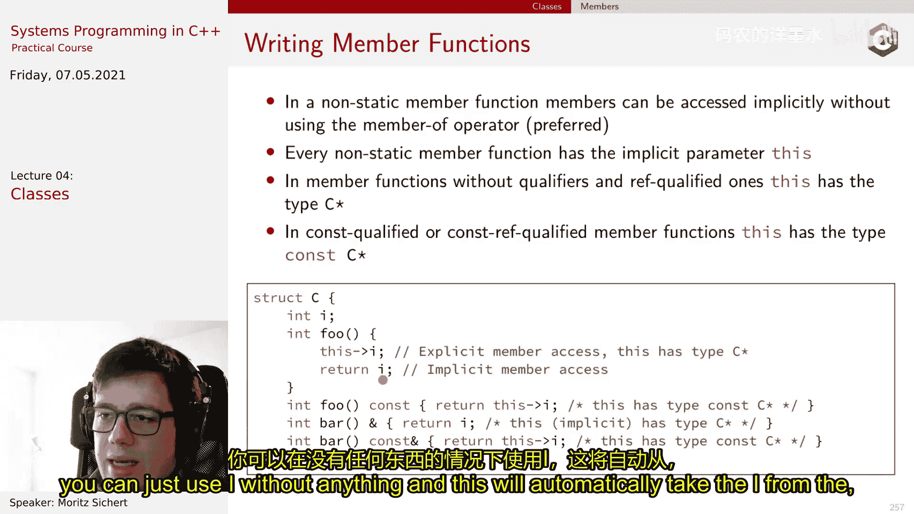
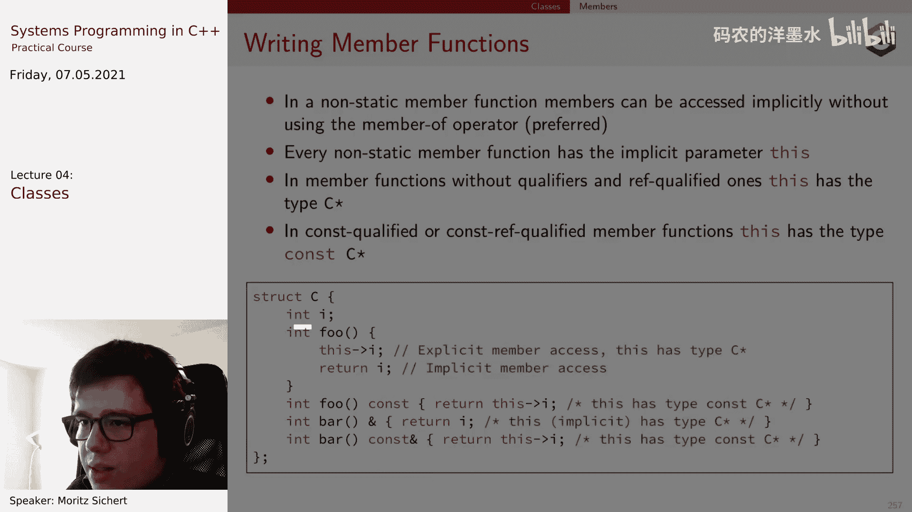
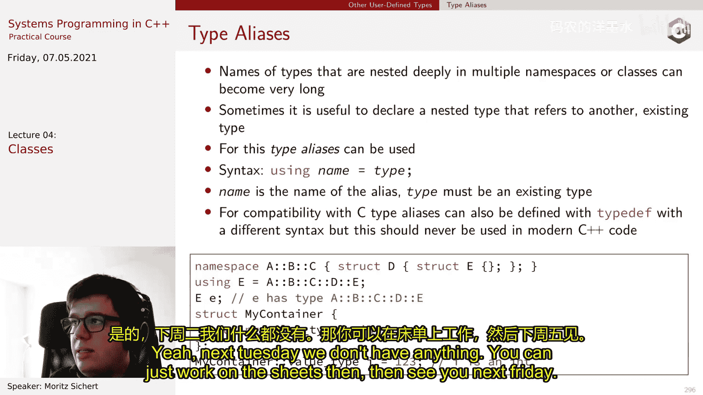

# 【全集 附课件】慕尼黑工业大学 C++系统编程 中英字幕 1080P p06 Lecture 6 - 类 -BV1QTzjBFER2_p6-

Welcome everyone to today's lecture on systems programming in C+。

The cover we will topic the topic we will cover today finally is classes and as we said in the very beginning when we talked about C++ is that。

C++ is a multipar language and one of those paradigms that it supports and that is used quite heavily when working with C++ art classes。

 so this is why we will have an entire lecture on them。Okay， let's start writing in with this syntax。

 so to define a class which is one of the user defined types that are possible in T++。

 you have to use the following syntax you just write。The class keyword。

 which is either struck or class you may know struck from C， the keyword。

 but C++ also has the Ql class and the name of the class and then embraces the member specifications so those are all class members which we will talk about in the next slides。

The name is just like for variables， it can be any valid name for the members we will talk about all of those types so you have either variables which are called data members functions which in C are called member functions and you can also have types as members which are then called nest types and one maybe weird thing that you are not used to if you for example if you know Java already is that you have to have a trailing semicon here at the end if you don't have this this will lead to some very weird compiler messages so don't forget the semicolon so this is just the basic syntax let's talk about the members because they of course are the things that make the class interesting。

Let's first talk about data members， data members， they are essentially variable declarations。😊。

So not definitions。 that's an important difference inside of a class。

And they mainly work like regular variable declarations that you already know there are some differences。

 for example you can't use external， I mean external for a variable declaration we learned means that it has external linkage and that it's only a declaration and not a definition but both those things don't apply to classes anyway because I mean a class member itself is not a variable so it is not a definition anyway and also can't have any linkage so the keyword doesn't make sense so it can't be used。

You can use static， all members without static are called non static data members。

Kind of obvious and the other ones are called static data members and the difference between those two is like you should know from Java for example。

 and nonst data members， they are specific to each object that has this type but static data members they only exists once in the entire program so in our example here theres only one in S in the entire program but for every object of type2 we have an A a B and C for example。

😊，But you can also do， you can only write static， but you can also use a threat local for static data members。

 which essentially then works like a threat local global variable。

Just that it's defined or declared inside of the class。

What you have to know is that all data members they have to have a complete type。

 which we will also talk about today。So I'll just defer to the next slide where we talk about it。

And of course， the name of each data member must be unique。

 so you can't have two data members with the same name。

 which is also probably should be kind of obvious。 and was also just saying is that nontator members they can have a default value。

 So as you can see here， this does not mean that this is a definition。 This is still a declaration。

 So this is only a declaration it looks like a definition。

 but it's only a declaration of the data member a， but with the default value of 123。

 and we will see in a bit what what the effects of this default is。

But let's first talk about the memory layout of data members and because C++ is a kind of low level pro language and we also said at the beginning that C++ achieves the same speed for user defined types as for built in types。

I mean， one of the reasons for this is that it is strictly defined。

How data members of a class are layout in memory。 So you know exactly how this will work in memory。

 And if， if you know this to be inefficient， then you can change this。

 But let's first start talk about how this actually works。

 So you know already that every type has a size and alignment requirement。😊，嗯。And I mean。

 well let's phrase like this， every object has a size and an alignment and the size and alignment requirement from an object they come from the type。

 so which when we talked about the introduction to CPU architectures we said that many architectures require that for example integers are aligned on a multiple of their size。

So this is what we mean by this line and also unfortunately or unfortunately it depends on how you see it。

😊，C++ tries to be compatible to other programming programming languages mainly C and for this to work the layout of the of class types or objects of class type is fixed so that it remains the same regardless of which compiler you use and which programming language you'd use and in this case fixed means that the nonstead data member。

 they just appear memory by the order of a declaration so if you declare ABC then A will appear first memory than BN then C so it's pretty straightforward but you have to take care that every data member potentially has a different size and just different alignment requirement so this could lead to gaps which are called patting bytes in C++ to make sure that all of the alignment requirements are still still。

As satisfied。And the entire object itself， of course also needs to be aligned so that all of the members within are aligned correctly。

 which means that the alignment requirement of a class type is equal to the largest alignment out of all non static data members。

😊，And the size， of course， is。I mean you could think that the size of class type is just the sum of all sizes of the nont data members but we write here is at least the sum of all sizes and the reason for this is exactly those padding bytes and because if you have padding bytes and the size of course will be larger and also because every class type or every object that has a class type needs to occupied storage it has to have a size of at least one it's just the semantics of C++ and also as I said already static data members they are only stored onces and which means that they are not stored inside of the object they are just stored separately somewhere else which is not defined precisely by the C++ standard those are I mean kind of formal definition thats now look as an example of how this works with alignment and padding bytes and so on so we have here a class type C which has the four members IPB and S。

All of those have different types and sizes and different alignments。

 so let's say on our architecture in test the size4 which also means that it probably has an alignment of four。

😊，Let's say we have a system where the pointers are have the size8 and also an alignment of8 and character。

 you know by definition they have to have a size of one and also an alignment of1。

 so this will be the same for regardless of the architecture you are using and let's say short has the size2 and alignment 2 okay。

I said if we now have an object of this type， the members are just laid out a memory in the order they are declared。

 which means that the very first thing that stored a memory is the member I。

 so at the very first byte at the offset zero， we store the four bytes of the integer I okay so fast so good。

 but now we have the next member which has a higher alignment requirement。

But if we would start storing it here， then it would be stored at an address which only is a multiple of four and not a multiple of eight。

 which means we can't store the pointer starting here instead we have to skip four bytes so that we again have a multiple of eight and only then we can start storing the pointer and the free space here this is exactly what I called patting in the last slide。

And of course if following the pointer， I have something which has a lower alignment requirement。

 I can't just store it directly after the pointer that doesn't matter。

 but now again I have a similar problem after after the single byte I have an address which is which has an odd address but I need an even address or an alignment because I have an alignment requirement of two。

 which means I have to add one the compiler it's one padding byte than I can store the shot and now also what you also have to know is the entire object also has an alignment requirement which is the alignment of the largest alignment requirement amongst all members which you can see here of course is the eight from the pointer。

 which means that also in general the size of any object must be a multiple of its alignment and to guarantee this we also have to add padding bytes at the very end so that the entire object。

The size of the entire object is a multiple of eight。😊。

And this is the entire representation of thestruct in memory and we can see here if we just count the bytes here we have a size of 24。

 even though if we would add up all of those individually so 4 plus8 plus1 plusus is of course less than 24 but due to patting bytes it is larger and of course as I said the alignment is the largest alignment requirement out of all members。

😊，Okay。You you can see that theing bytes in this example。

 they lead to quite a lot of wasted space which is never used by the which will never used by the compiler because it doesn't contain any relevant data and one thing or one way to fix this is you can actually I mean you can kind of。

Try to make this better by。Trying to order your declarations of the data members in order of decreasing alignment。

 because if you order it only decreasing alignment。

 you can never have the case where the alignment of a member is larger than the alignment of the previous member。

 which means that you do need to add padding。 So if you order， for example， in this case。

 we order first P， then I then S then B， then P has alignment I8， I has alignment 4， then2 and then1。

 if if you just write this out again and try to draw it。

 then you would come to the conclusion that the same structure with the same members。

 but in this order would have the size 16 only So we would we would save8 bytes。

 even though we essentially store the same information。

 So this means you sometimes have to take care that your size of the object doesn't become larger just because of padding bytes。

 Of course this is only relevant if you have like very。

A very large amount of those objects if you have a class which is of which you create only five objects in your entire program。

 then this doesn't really matter because if you waste five times eight bytes。

 this will be hardly noticeable but if you are programming a large project and you have an object that is created millions of times and of course you do want to take care that is not larger than necessary。

😊，There's a question， is there ever a reason we would want a different declaration order or why doesn't the compiler automatically order the members efficiently？

😊，The first reason why it doesn't order automatically is precisely because of the compatibility to other languages。

 especially C and also other compilers， because it could be that compilers order them as differently。

 mainly if you have two members that have the same size and same alignment then it could be that two compilers order them differently so compatibility is the one reason why this matters and the other reason is that if you initialize a class in the constructor。

 which we would talk about in a few minutes and then it can also make a difference so the order of members could also have a difference。

 especially if for example， if this pointer points to the I here then it would be harder to initialize it if it were the other way around。

 I mean it does work， but the members are usually initialize also in the order of declaration so always the first members initialized first and the second and the third and fourth and so on and。

😊，reference each other then it could be beneficial to put them essentially in a worse order on purpose。

 so it's not always obvious that you want to order them efficiently。But it's also。

 I mean it's not impossible to do so， for example， if you look at the programming language rust。

 a rust actually does this rust， they don't guarantee any compatibility of their tostructs in C。

 for example， so they precisely do this to save space。😊，Okay， so that's data members。

 let's now talk about member functions。Just or very similar to the data member declarations。

 they also look like regular function declarations just inside of the class。😊。

They are also static and non static member functions。

 and they also have the same semantics as you are used to from Java， so。

The static function can be called without requiring an object and the non static metafunction can only be called if you do have an object so this is the only difference between them。

An additional thing that you can do with member function declarations that normal function declaration don't have you can qualify them either with cont or with a ref qualifier so after the function you write either cont or cont ref or ref or R value ref so you can see the examples here we can write void Cfo this is just a function declaration and then you write then you write cons which means that this is a cont qualified nons static member function。

then we have here we have a ref qualified nonsetting malfunction and so on and there are also some functions that have a special name or a special purpose and those are mainly the construct the deor which you can see here so those are the names of those and we can also overload operators which looks like this these synintex is a bit strange so you write the keyword operator but this is how it looks like they can also be virtual this is relevant for inheritance so for virtual inheritance to be precise for inheritance with virtual functions of virtual function calls。

😊，Which we will also talk about later or in a later later， let's say。Okay。嗯。

Now so we saw how to declare members let's now look at how we can access members of an object of a class type。

 So if we have this code so we define a class type with the members with the non data a non static data member I and the static data member S I and now I just define。

A variable all of type C and a pointer to this all。

Wwhichch is called P and now to access a member of this of this object， of course。

 I mean as you would expect you just use the member of operator。

 which is just a fancy way to say that's the period here so。

If you write O period I then you get of course the I of the object O and the same also goes for the aesthetic data member。

 there's a special syntax for if you have a pointer to an object that is of class type instead of dereencing it first and then using the member of operator。

 you can also use thisarrow operator which is this is also called member of operator。

So this just saves you a bit of typing and this you can see quite a lot when working with C++ if you have a pointer to an object of class type。

But as I said， static members can also be accessed without an object。

 so the member SI here can also be accessed by using the scope resolution operator。

 which is the way to access static members so you could also write C W column SI instead of writing O。

sI。This also works， but only for static datas， of course。Okay， another thing that you have to know。

 of course， is not only how to declare memberfunction， but also how to write them。

And the first thing you have to know is that inside of a nons staticatic data member function。

 of course you can access the data members and you can do this just implicitly。

 so if you have a data member eye here and you write a nons static member function。

 you can just use I without anything and this will automatically take the I from the from the oops from the current object。

嗯。

How can I yeah。Whoops。What you can also do is that every nons static data member function also has the implicit parameter this。

 so this is a special keyboardword and this is a pointer to the current object that this member function was called on and so you can see here this is just a pointer to C so to access the member I of a pointer。

How can I reset it up like this so here this is a pointer so to access the member I of of something that is a pointer to see you use this error operator just so you know usually in C+ bus you don't explicitly write this if you don't need it so this is this is the way we preferred don't use this if you don't need it。

Another thing you have to know is that the type of this depends on the qualification of the function。

 so if it's just a function without qualifier or we have nothing here。

 then this is just as the type pointer to C， but if it's con or a conre qualified。

 then its type is a pointer to con C so as you can see here and here but for a ref qualified function is still just pointer to C so this means that if you are in a con。

Qualified function you can't get or you can't modify the object itself or the member I， for example。

 because you would only get a cont。AReference to this eye and not a non console you can't modify it and this which we will see in a bit can be useful to work with conness or with coned objects。

 let's say。嗯。Another thing you have to know about functions is that。Just regular functions。

 like regular functions， you can also declare member functions in the class but then define them outside of the class or somewhere else。

 which would usually be in the implementation file not in the header file and for classes this is called out of line definitions。

and the opposite of it is so if you just write the body of the function directly into the class definition then this is called an inline definition。

 so this here would be an example of an inline definition and the reason why it's called an inline definition is because inline functions with inline definitions。

😊，In a class or member functions of a class within a definition。

 they implicitly have the inline specifier as we write here。

 so this would be the same as writing inline void F1 and so on and you know the inline specifier the only difference it makes or the compiler is that it is an exception to the one definition rule so this only means that if you if this function is defined multiple times in the same program in the resulting program then this would not be a violation of the one definition rule so this is the only difference that inline makes again has nothing directly to do with the inlining optimization。

😊，Yeah。Of course， the syntax for the out of out ofline definition。

Looks a bit different because of you have to specify from which classes come from and for this you again use the scope resolution operator and of course you have to make take care that the qualifiers of the out ofline definitions must match the qualifiers of the declarations of course I mean just just like for regular functions is that the definition must match the declarations otherwise it's not a definition for that declaration and I mean and it also goes the same you can do in line and out ofline definitions for both static member functions and nons static member functions。

😊，Okay， what you can also do with classes is you can forward， declare。

 So this is how it's usually called。 you can forward declare an entire class。

 which means that you only declare the class name without。😊。

Actually declaring the members of this class and so the zoo so this is you write class keywords of which would be either class orstruct then the name and then directly semicon on without brace and this as I said only tells the compiler that there will be a class type with this name but the compiler doesn't know anything more about it yet and this is called that the thing that that you declare here is then called an incomplete type until you define it and I mean。

The reason why it's called incompetence， of course。

 as you would expect is because we a we don't know the members of this class， so it's not complete。

What's interesting， though， is that you can still use incomplete types of forward declared class names without ever having to define them fully in some situations。

 which we will see in the next slides。😊，The use cases for this， so why would we ever do this。

 they are very similar to why we would want declarations or functions that are not definitions。

One case， for example， if two classes refer to each other。

 which is similar to the case of mutual recursion that we had as an example for function declarations。

Another advantage is that you can reduce the compile time sometimes even significantly if you can avoid includes of large header files。

 if you instead of including the large header file you can just use forward declaration here and this is why forward declaration they are usually used in header files to avoid those includes implementation files you usually need the complete type any way to work with this class so in in implementation files they are not as common but header files they are so let's look at an example here。

😊，So here you can see we declare the class A and the class which is called Class from expensive header and even though this is an incomplete type。

 we can still use this namely as a pointer for example I said in the beginning when talking about data member is that if you declare a data member the type of the data member must be complete so what we couldn't have done here is just write class from expensive header without the pointer because then the class from expensive header type must have been complete but it isn't but a pointer to an incomplete type again is considered a complete type and but what we can also do here we can use a reference to an incomplete type and only。

😊，Make it complete at the bottom here， and then we complete essentially the type that was incompleted here。

And then in the so this is the header file and then of course in the implementation file I need to be able to work with this member here。

 so only in the implementation file I would include the expensive header which is the file that completely declares this classroom expensive header。

 but as you can see we don't need to include this header in this header anymore。

 which means that anyone else that includes only the food or HPPP header doesn't need to include the expensive header anymore。

 which usually means that the compile time is reduced significantly。😊，Okay。

 let's now look at the overview of。How incomplete types can still be used。

The things you can't do with incomplete types are all of the things where you require the size and the layout of a type。

 So this is kind of similar to the thing we talked about when talking about declarationications and definitions。

 So for example， if you。Want to do point arithmetics。On a pointer to an incomplete type。

 then the compiler to generate co for it has to know the size of the type and the size of the type of a class type of course is only known if you know the members。

 so if the class type is incomplete you can't know the size of the class or you can't do any pointer arithmetics on it。

And。😊，So also if if you define or call a function but not declare it which has an incomplete return or argument type。

 this also doesn't work and the motivation similar and because if you want to generate assembly to call or define a function you also need to know the sizes of all arguments in all return types because this effects in which registers the arguments and return values are stored for example。

 so the compiler needs to know the sizes of all，U。Arguments and the return type。

 if you want to define a function or call a function， because I mean。

 those are very similar for similar reasons the compiler needs the knowledge。Of this size。

 but if you only declare a function， then the compiler doesn't actually generate any code for the deteration only it just tells the compile okay。

 this name now exists， this function exists with those return and argument types but nothing else so you don't need。

😊，Complete types for only declaration。But as we saw there are some declarations that can involve incomplete types and the most important things are those here。

 so eitherer pointers to incomplete types are again considered complete types you can go back and think about how CPU or how the assembly generated for pointers would look like。

 and you should know that every pointer have the same size or let's say at least every pointer to objects。

 they all have the same size， regardless of the type that they points to。😊。

Which means that the point2 type doesn't actually matter for the compiler to know or to determine the size of a pointer。

 which means that every declaration that every pointer type is already complete regardless of whether the point2 type is。

Compete or not。And mean as you can see from here above， if you declare a member functions。

 a member function or any function for that matter。

 they can of course also have incomplete parameter types because function declarations don't require incompte types。

 they of course as always more details about this which you can of course see when you click at the link here in the logo but this is the most important things you should know about this。

😊，Okay， are there any questions so far？Okay， it doesn't seem like it the next thing I want to talk about is our constructors when I talked about members I said very briefly that there are some special members which are special names one of those is the constructor and the constructor is a special function that is called when an object is initialized all the other way around if you want to initialize an object you have to call the constructor。

😊，The declaration of a contractor looks a bit weird because it does not have a return type and because a construct initializes the object。

 it doesn't return so to say， so it doesn't have a return type and also it doesn't have any qualifiers and the name is exactly equal to the class name so I have the class full here and the contractor needs to have this name。

What you can do in the constructor is you can give it multiple arguments So this is this is fine。

 the only special cases if you have a constructor without any arguments。

 then this is called the default constructor。😊，Which sometimes has a special role。

 but a constructor can have any number of arguments。😊。

And what you should also know is that for every class you declare。

 even if you don't write any constructors， this compiler will of course always make sure that there is a constructor。

 for example， if I declare a class with the members A and B and B itself is a class type which also has a constructor then the compiler will implicitly define a constructor which does nothing with A because the constructor of a type like int does nothing but it would call the default constructor of B。

 so this makes sure that every time you define an object it will always be initialized correctly。

I also wrote here that a definition of construct can also have an initializer list。

 so let's look at the initializer list now， the usual way to initialize members of a class in a theor is to use the initializer list so even though the constructor is a regular function you can I mean in the body of of a。

😊，Constructor， you can just write any code that you could also write in any other function。

But if you want to initialize the members to some where。

 you usually use the initializer list for this。So the in the syntax of the initializers is still write the the declaration of the。

Constructor function， then you write a colon， and then you write the initializer list by writing the name of the。

Member， you want to initialize and then the initializer of this member and what you should know is that the members。

 they should be initialized in the order of their definition。

 This is what I briefly said when when answering the question about the order of declarations of the members and this has。

Some very subtle differences if you do have different types that all need a constructor which needs to be called and for some reason you function or the constructor exits before it's completely executed。

 which can happen when working with exceptions， which we haven't talked about yet。

 which we will talk about them， but you just have to know there are some very weird corner cases where the order of initialization of members is relevant and this can so any potential issues can be avoided if you just initialize the members in the order of their definition of the declaration。

 let's say so just always do that。If you don't。Specify a member in the initializer list and it will just be initialized to the default value and this now you should know how the default value works and if it doesn't have a default value then it will just be default initialized which。

For classes， class types means the default construct is called and for primitive types like int。

 it just does nothing。And also an important thing you have to know is that you can have con member variables and because the account you can't change them and the only way to initialize them is actually in the initializer list so for con member variables and this is the only way to initialize them and this by the way also calls for references because as you know from references you can't change the reference once it is initialized but once you define a reference you need to initialize it and the only way you can do this and if you have a member that that is a reference is also only in the initializer okay so let's look at an example here。

😊，so we have a default constructor and the default constructor explicitly initializes the member B to 2。

5 and the member C to 7， and we know C is a constant。😊。

AMe so we need to initialize it in the initializer and we don't initialize a explicitly here。

 so just the default value is used instead so we initialize a to 123 instead we can also write a constructor which takes arguments。

And here we would just initialize the member A to the argument A。

 the member B to the argument B and so on， so this is the usual way to write a constructor which just takes all of the individual members as an argument and then initializes them in the same order。

 what you can also do in a constructor and you can in the initialize list call another constructor and here in this case。

😊，We have a construct that takes a float value and then first calls the default constructor which in this case。

 of course would for example， initialize the con character to7 and I mean would also again initialize a to 1 to 3 and so on and then in the body of the constructor again I can of course just write any code I for example。

 for some reason I want to multiply B by defect factoror F so this is just the example。

The unfortunate thing about initialization in simple puzzle is that there are there's more than one syntax。

 so you can only write the parentheesis here， there are some more ways to initialize an object or also remember。

😊，As we said， when we initialize a type or an object of class step then a constructor is executed and of course the arguments that we give in the initialization are passed to the constructor and。

😊，The initializations that exist in C++ looked like this。

 so if you write4 F without any parenthees or braces。

 then this is called default default initial initialization and this will call the default constructor the value in initialization will also call the default constructor but the difference between those two is that for integers for example。

 or for primitive types this will set them to zero and this version will not then you have direct initial initialization。

 this initialization which look very similar on the difference that they have braces versus parenthees and you can also copy initialize object I mean you don't have to know all of those by heart just know that usually we used one of those two syntexes we either use。

😊，writeite the class type then the identifier and then em parentheses the arguments or embraces the arguments。

 so those are usually syntes that you would use。😊，There's a question。

 so the default initializer can be overwritten by defining who with no arguments。So what you can do。

 I'm not sure if I understand your question correctly。

 but if I here if I would have written a in parentheesis 200 here。

 then the default initialitizer would have been ignored just like in this example we ignore the default initializer and instead use the initializer which comes from the argument a does this answer your question。

😊，对。Okay， I hope so。Okay， let's continue with constructors。

 there are some special kinds of constructors and namely if your constructor only has exactly one argument。

😊，Then the compiler will use this to convert types of other objects of other types to the class type。

 and this is called either explicit or implicit conversion。

The difference between both that as the name indicates implicit conversion happens automatically and the compiler does this automatically。

 but explicit conversion only happens if you as a programmer explicitly write it and because of this to avoid any accident conversion to you should generally use explicit。

😊，Conversions， unless you I have a very good reason not to。

 So there are some reasons where implicit conversions are useful and where you want them。

 but you have to。Think about it and usually you should use explicit so let's look at an example here we have a constructor which which has exactly one argument of type in and it has it has no explicit keyword so this is an implicit conversion constructor from the type in if I now have a function that takes fool。

😊，As an argument， I can call this function with an integer because the compiler sees okay there's a implicit conversion from inch to fu。

 so the compiler will just create a temporary object by first calling this constructor from this integer and then calling this function printfu and of course I mean what you can also do you can just explicitly convert an integer to type fu by using staticcast or by just calling the constructor directly of course but the explicit conversion always works the difference between implicit explicit conversion is that if you do write the explicit keyword here and try to call this function then this will not work because compiler will tell you there's no implic conversion from inch to bar so this is not possible to call this function but the explicit conversion by using static cast is still possible so you could still have written print bar staticcast bar one to3 but as the name indicates you then have to be explicit about。

😊，The congratulations。嗯。Another special type of constructor is a copy constructor。

 and The copy construct is the is a constructor that takes a con reference to。Itse。

And what this contractor should do is it should just create a copy of the other object。

 and this is also implicitly called by the compiler whenever the compiler needs to create an copy of an object。

 which most of the time happens if you call a function that takes an object by value。😊。

So if I declare a copy contractor here。😊，And also have a function that takes a fu。

 and I define object with the name F here， and I call。

The function let's say what I do first here I call the copy constructor explicitly。

 so this would just create a copy of F and write it into G and if I now call the function P or do fu with the object G。

 then the compiler will create another copy of G because the function4 takes fu by value which means that the function needs to get a copy of the value G here so which is why it's called implicitly so this means if you write a class you have to take care of defining those special constructors especially the copy constructor to make sure that this implicit copying works at least if you wanted to。

😊，The other special function when talking about constructs is of course deors and the street des they are essentially the opposite。

 they are called when the lifetimethe of an object ends or also we can also rephrase it is if you' call the deor then the livethe of your object ends。

 the name of deor is also the class name but but prepened with the I don't actually know how this symbol is called in English but this how it looks like。

😊，What you already know is that if you do have objects with automatic storage duration like local variables。

 the compiler will make sure that the lifetime of such an object ends at the end of the scope。

 which means that the compiler will automatically called the deor of every object at the end of its scope。

 but it will do so in reverse order of that definition so if I have a scope here where I just define the object with name C。

 then at the end of the scope， the de for this object is called and at the end of other scope or the topmost scope here。

 the compiler will first destruct B and then destruct A。😊。

And the reason for this is again that if for example。

 B uses A because you could have constructed B by giving it a reference to A and you need to make sure that a is not deed before B is。

 so this is why the order of destruction is always the reverse of the order of construction。

And the same of course goes for a member variables， so if you write the deor yourself。

 you can write any code in there， but what the compiler will also do automatically is it will call the destructors of all of the members also in reverse order so in your deor here we can just print something if if for some reason want to print every time our object is destructed and then automatically the compiler will first destruct B and then destruct A。

Okay，There are fortunately no special distractors， this is the only distractor you can declareplay and define。

 you have no qualifiers and no nothing， no arguments is also very important。

 this is because I mean because the distract is called automatically most of the times you can't control it so in particular you can't give it any arguments anyway。

 the distract can never have any arguments。😊，Okay。The next thing I want to talk about is member access control。

mYou probably also know from from languages like Java is that you can give。

Every member some kind of access control to control which other classes may access members and which members will only be able to be accessed by the class itself and for this。

C++ has one of has those three types of member access control。

 which are public protected and private。and here you you will now also understand the difference between class instruct because until now I use this interchangeably class Instruct。

 the only difference between those two keywords is that if you define your class with the class keyword。

 then by default everything is private， if you define it with astruct keyword。

 everything is public apart from that there's no difference class instructs are exactly the same。😊。

Only this， this is the only difference。And the semantics of those are what you should know from Java again or from any other object orient into programming language so public members they can access by everyone protected members only by the class itself of course and it's subclasses and we will talk about subclass and inheritance in another lecture and private members can only be accessed by the class itself and not even by subclasses the syntax for this looks like this in C++ so as I said by default if you use class then the members are private so I don't write anything no no member access control specifier here so this is private。

😊，Now if I write public and then code on， this means all following declarations are public so you don't repeat the keyword public for every declaration。

 you just write it once and then all following declarations will be public so B and get A will be public and the same Ive write protected all the following declarations are protected and for public again this will be public again。

 which means of course you can use public protected and private multiple times inside of your declaration if your class definition I mean this doesn't matter。

You usually just don't repeat it for every individual decorations。

 you just write it once and then put all the decorations that should have this member access control。

There are you can explicitly specify exceptions for this and those exceptions are called friends。

 so you can define a friends to a class and。😊，What this does is that if you， if。

Another or if you function friends， another function or class。

 then this means that the other function or class will have access to the private and protected members of this class。

😊，Even though this is usually not the case， so friend is something that is just can use as an exception to the member access control。

 syn for this is inside of the class you write friend and then either a function declaration you can even write a function definition which is a bit weird so you should usually just stick to declarations and you can also friend an entire another class。

😊，So。What you have to know about France is that friendship is nontransive and its also not inherited。

 which means that if A is friend of B and B is friend of C， this does not mean that A is friend of C。

 we'll see an example on the next slide。And also the place where we write down the declaration doesn't matter。

 so if it if it appears in a private or a public section doesn't matter has the exact same semantics。

 but let's look at an example， maybe I think that's easy to understand15 an example。

 so I declare a class A here， I don't write anything any access specifyifier here so which means that everything is private which means that the member A is private。

 but I say okay the class B is a friend and a function that returns void has the name who and takes。

😊，And a noncons reference as argument， this is also a friend。 Okay。

 let's now look at the definition of class B here and say okay the C is a friend of class B and in the class B I define a function that modifies the private data member A and this works。

😊，Because B is a member of a， which means that all member functions of of B are allowed to modify all private members of a and use all private members of a。

 So this is okay on the other hand， if I define a class C this is an error because as I said。

 the first reason is that friendship is not transitive。

 so even though B is a friend of a because of this declaration and C is a friend of B because of this declaration is that does not mean that C is also a friend of a so this。

For this reason those front declarations are not transit and also even though this function looks like it has the same declaration as this one。

 this is a member function and this front declaration is only for non- membermber function so this means a function in the global scope or in the enclosing scope which with this signature so this front declaration holds only for this function here。

😊，Even though it looks the same， the difference is that this is defined within class。

 and this is defined in the enclosing landscape a name space of。Plus a。Okay。

To wrap up the when talking about members and there was also a third type of members that I talked about namely nested types。

Instead of or in addition to data members and member functions， you can also define。

Other types within a class。 And this would。It's just called nestttypes。

 And this mostly behaves like a namespace。 So if you define。呃。Class B inside of a class A。 then oh。

 I saw we have an arrow here。 This should be A and B， or this would be food and bar。 But I mean。

 you can imagine how this would work。 if you have a nested name。

 you would just exit it just like you would for a namespace。

 the only difference or the only addition that you have here is that nested classes they are on always automatically friends of their parent classes。

 which means that in this case。😊，Even though I is private。

 the NA class B can access it because it is implicitly a friend of the class A。😊。

Here's a question if a declares B as a friend， Does B automatically declares a as a friend In other words。

 is the French relation symmetric， No， it is not symmetric that's also good question if if B would declare any。

😊，Additional private data members a cannot access them。 So this is not symmetric。Okay。

So we have covered all of the。Kinds of members that we have。

 the next thing I want to talk more about is the constantness of member variables and also the con qualifiers。

So the thing you have to know is if you have。😊，A constant value。

Of a class type and you access a member， then you will also usually get。

 as you would expect a noncon L value to this member。

 but only if it's not declared cons in the class。 but if you access it through a constant L value。

 then of course you only always get constant L values and the exception for this is mutable。 Okay。

 this is maybe with a theoreticaloretic， let's look at an example。

 this makes it much much clear I hope。 So I have。😊，Astructful with the member's eye。

 I just has it type in， C is a special member because it is const。😊。

And we also have the special keyword Mo here for the member M。

And I have two references that refer to some object I doesnt matter which object it is exactly。

 I just know I have one non cons reference and one cons reference let's now look at which of those expressions will be consed and which will not be cons so the easiest thing is if I wrote4。

 I。😊，Then I have a noncons reference and a non cons member。

 so I get a noncons L value easy if I have a noncon object or a noncons reference， but a cons member。

 of course I can't just magically get a noncons reference out of it again because this is a con value。

 I can't change it， which means that even though I have a cont。😊，A noncons reference。

 I still get a con L value and I mean for the mutable doesn't change anything con for noncon references。

 so if I have4。M I also get a noncon L value。Now， the interesting part comes if I have a constant reference to an object of typepho。

 if I access the member variable I， I also will get a constant L value。

 and the reason for this is that。My con reference， of course。

 could reference an object that I defined cons somewhere else。

 so this is actually an object which is actually cont， so it's not only a cons reference。

 but this could reference and a cont object， which means that of course I'm not allowed to change the value I if it actually is a cont object so to make sure that this can't happen。

 this will always return a con L value， and of course the con member will still be a cont L value。

 the interesting thing though， is that if you have a mutable member。

 this will always be a noncon value， even if you access it through a cont reference the reason why you have is that sometimes。

😊，You need to modify members of a。Function and not the function of a class。

 even though you only have a con reference and this is mainly used to cache results of a function。

 for example， so you should be very careful with mutable。

 there are very little use cases for mutable， there are some and we will talk about them in the future but in general you should avoid mutable because it can leads to bugs easily because this makes the member mutable or it makes it noncons。

😊，In all of your code， even if you have a con reference。

Another thing that's very important when talking about consensus and member functions。Because。

If you call a member function。The conness of the expression that you call it through is taken into account for overload resolution。

Which means that if you have a non constant L value。😊。

This will first try to call a noncons overload and only if it doesn't find a noncon overload it will use a con overload instead and for con L values of course you can only use con overloads which means that you can't call a noncon qualified function on a cons L value of a object of class type and again let's in an example here。

We define two overloads for the function gett a， one is consquified， the other isn't。

 then we define two overloads for the function gett B。

 one is ref qualified and one is consre qualified and then I have the function get C and get D which one is consqu and the other is not qualified at all and again I have the two。

References fo and seafo。 Theres a question in the last lesson you mentioned to avoid using global variables。

 Does this also apply to a class。I don't know exactly what you mean。

 Do you mean the static data data members in a class？

Yes I mean the same goes for static data by which behave like a lower variable。

 if you use them like you would use a double variable。

 this doesn't change any of the of the disadvantages of using double variables。

 so yes the same goes there。😊，Don't you discover variables if you can avoid it。Okay。

 let's look at the example here， so okay， if I have。😊，A noncon expression of the type fo。

And call get A， then it will see okay， I have a non cons overload and a con overload。

 but since I have a non cons reference， I this will prefer this overload here which means that this returns one。

😊，And I mean， very similarly， if I call B， this will prefer the ref qualified instead of the consre qualified。

 and if I call here get a again， then inside of this function。

 this point of course also has is non cons type so this also will call the function here which returns one。

Okay， what happens now if I call get C， gett C doesn't have any overload so it even though it is cons and I have a non con reference。

 I cant call this function because it's the only possible overload。😊。

But now what you have to know is if you inside of a contqu function。

 we said that this pointer has type the type pointer to cont Fu。

 which means that if I then inside of the get C function， I call get A。

 this will then try to find the correct overload by using the cont this pointer。

 which means that this function call will actually prefer to call this。

 which means that a ch in get C on F will return two when not one。And of course。

 I mean calling Catti is just the only function immediately returns3。

 So there's no question about that。 and let's now look at the quas for the constant object。

 a constant object。😊，If I call get a on it， then of course I will get the value2 here。

 if I call get B on it， then it will prefer the con a ref overload。

 which again inside of this function， this point I has a type。

Poiner to confo so this will again return to for get C it's the same as as for the full version here and now also one thing you have to note is that if I call a noncon function on a con expression then this will be a compile error and the reason for this is。

Because inside of a noncons qualified function， of course the this pointer is also non con。

 but how should this work that this pointer as non cons even though the object itself potentially was cons before。

 and this of course can't works so this is a compile error。嗯。Fortunately， I mean， in some edge cases。

 you may know that even though you have a con reference。

 you know that the object actually is not consed。Or in other cases。

 you know you have a function which。😊，Even though it is not con qualified。

 you know that it doesn't modify any members which mean that this would actually not violate any or would not lead to any undefined behavior because it doesn't change any cons objects so there sometimes you want to be able to convert between cons and noncons and for this there's a special kind of caste which is called conscast but let's answer a few question first。

嗯。What exactly does the ref qualifier do。The ref qualifier is essentially the same as writing so I mean get the two versions of gett B。

 they are essentially the same as the two versions of gett A so we have a nons function and the cons function。

 the difference why this even exist is that you can also have an r value qualified functions so you can also write gett B with two em here and then you have an r value qualified function and why this is useful and we will talk about in future lectures for now for now this is essentially for you it's the same you can use both it's both equivalent and we will also accept both but the reason why this exists is to differentiate between L values and r values。

The other question is don't we need a return before the call to get a yes you are right。

 this is an error on the slide， of course we need to return here because then otherwise you wouldn't get the value thanks。

Okay， let's go back to conscast and so you already know static reinterpret a dynamic cast。No wait。

 we haven't talked about dynamic cars if I think about it。

 but there are static reinterpret and dynamic cars those cars exists。

But all of them cannot cast the constantson away and also I mean in general。

 they can't cast CV qualifier， so neither constant nor volatile can be cast away with any of those three casts here。

The only cast to do this is the conscast and what I mean the suggest for thescast is just like for the other cast and what you can do then is as a new type。

 you can have a point of reference to the type of this expression which has different CV qualifiers。

And of course， what doesn't change is that modifying and a con object is never allowed。

 so this is an always undefined behavior， but the conask itself is allowed。

 so you can see an example here， I have a con object， a con object of type4 with a name F。😊。

And I use concast to get a noncon L value reference out of it so the cast itself is allowed and if I only access the value without modifying it then this is also still allowed because I just read the value and I don't change it but if I then actually change this。

 this will not lead to a compiler error probably a compiler will be able to one here because it's a very simple example but if you have a more complex example this will just be undefinifieded behavior and as you already know undefinified behavior is not guaranteed to do anything useful so you should avoid doing this and now the question is why do we then even want to use concast if it can easily lead to undefined behavior and there's one very common use case and this is the only use case I would say where concast is actually useful and should be used。

😊，And namely。To avoid code duplication in member function overloads。 So you saw that we can't。

Call non con overloads。With a cons object。 But if we want to write a function that is essentially the same for con and non con objects。

 we don't necessarily want to copy paste all of the code。 For example， let's say we have a class a。

Let let's say just。Should behave something like an array， so it just has a pointer to numbers。

 which is。Just a storage where we have stored some integers。 And if I have a con。

Or let's say if I have a non cons reference to a， I want to be able to get。

Some non cons reference to those integers。 And let's say I just calculate some index and I do an incredibly complicated computation so I have。

😊，I have many lines here and then I return numbers with the brackets operator I and then will because this is non cons。

 I will get a non cons L value reference。But of course， if I want the same for a con。

For a cons object， I of course can't return and or I don't want to return an noncon L value instead I want to return a con L value but I don't want to repeat all of the code here so what I can do as a trick is I cast the reference to this to a noncons reference first then I call fu on it。

And then implicitly by the return this non- cons reference is returned back to a cons reference and this of course should only be used if I know that the computation here doesn't actually change anything because if it would then this would be undefined behavior and also if I just have one line here then I can't just copy past it so I don't need this potentially dangerous line but here is what I would say the most important use case for conscast。

There's a question。😊，Wouldn't it make more sense to just have the cont method in this case No because the cons method it returns a cont L value but if I want to call the function4 and want to be able to write a new integer into the returned reference this would only work if I have a noncon L value reference which is only returned by the non-con overload so this is why I do need both of those overloads but I don't necessarily want to duplicate the code。

Okay。Another large topic I want to talk about today is operator overloading in。C+。

 as I briefly mentioned in the beginning， you can write special member functions that essentially overload most of the built operators so you can overload things like plus like the quality operator。

😊，And。You can do this by either writing them as。As member functions or you can even do this as non-mem functions and in general the syntax is always say this。

 you have a return type as for a function， then you write the keyword operator then you write the operator。

 this is for example you write plus or the equality operator or something like here， like this here。

 and then you write the argument that are necessary for this operator for example。

 if you have a member function which should overload addition then of course this has one argument because the implicit this argument is already contained in the member function and then you have the other argument for the thing you want to add to your class。

😊，But how the compiler finds those is that it just uses a regular overload resolution just like it would for any other functions and also what's interesting in S class is that the overloaded operators they are not required to have any meaningful semantics。

 which means that you could write an operator plus which returns I don't know。

 returns a random value always， which is not very useful but it' not required by the compiler or by the language。

 let's say that they are useful。😊，And what you also have to know you can overload almost all operators but not all of them some exceptions are the scope resolution operator and the member access because I mean how would the semantics of this even be and there are even other so for example we have the this kind of operator we haven't talked about it and you probably also will never need it so you can't also overloaded and also theterernary operator can also not be overloaded but。

😊，There are some other unusual operators I would say that you can still overload so you can overload the assignment operator so with just one equal sign not with two like here。

 you can even overload the call operator， so the way to write it is then operator and then parenthees and then in a second set of parenthees。

 the arguments to your call operator。You can also overload the dere and the address of and even the comm operator。

 So this， this is， I mean， especially overr the comm operator is is not useful very often but。😊。

You you just have to know you can do this， So let's look let's first look at arithmetic operators。

The way this works is that if you have an expression with left hand side operator right hand side。

 this is most the equivalent to just writing left hand side and then period and then operator so this is the member function with the right hand side or you use the non-memmal function with the left hand side and right side as an argument。

😊，There's a comment that seems like you could intentionally write the most confusing code of all time yes this is true and because the semantics of the operators are not required to be or to make any sense you could write very weird code but of course you shouldn't so yeah just just don't。

😊，OkayBecause calls to overloaded operators， they are treated like regular function calls。

 So for the compiler， those two essentially are the same。 if the operators overloaded。

 this means that if you do overload the special operators and for or and end for logically on the logical end and they will lose their special behavior of shortcuting so a shortcuting means that for an or if the expression left of the or is true。

 then the entire thing will already be true and the right- hand side of the or operator will not be evaluated but this of course can't happen if you overload it because the compiler will just use a function call like this and how would it know that the left hand side is true already and how would it be able to call a function without it evaluating the right hand side so this doesn't work just have to know if you for some reason overload those operators and they will lose their special behavior and this is not that important the more important thing you have to know is that。

😊，呃。Most overload operators， they usually。Take the argument by cont reference and some of them are consed themselves as well for the arithmetic operators in particular。

 they are always const。😊，And they also always return a value and not a reference so if if you add two integers。

 for example， you also get a new value as a return type of this expression。

 not a reference to the old value or something， So this is why you usually return a value but you also have to know by about arithmetic operators you can also overload the unary operators plus and minus。

😊，which can be useful for minus for pluses it just for completeness。

 which is not that useful very often okay but let's see an example here。

 we have a class int which just contains one int which is just I mean it's not very useful because it does the exact same like regular int would。

 its just as a demonstration here， we overload the addition operator as a member functions so we write int because we want to return a value operator plus and since we want to over overload the binary addition we write here。

 the argument which is the righthand side which in this case is's a contraference to int。😊。

And then this also should be in constant I mean， and then of course the semantics for addition here。

 we just define it to be sensible， which in this case we will will just add the member。

I here and of course， the unary negation operator we can also define by just negating the member here。

What you can also see here we instead of writing the overload operator as a member function。

 we can also write it as a nonme function， which the only difference is that you don't have the implicit this。

 So we just take the two arguments explicitly so we。😊，Yeah， I mean， apart from that it's the same。嗯。

And now we can just write so we can declare two types A or declare two objects A and B。

 And if you write a plus B， this would just call this member function， if we write a times speed。

 then this would call this function and if we call minus a this would call this function here There's a question the constructor int that takes an in I that implicit yes。

I mean this is a special case for instantization in C+ if you have astruct and don't write a constructor but use braces here and write down all members that it has then it will automatically initialize the members this is a special case and you don't really have to know about I mean it can be useful if you want we just brought it like this so that's short on this slide。

😊，Okay， as I said， you cannot only overload the arithmetic operators。 You can also overload。

The binary comparison operators， for example， the usual semantics that you should adhere to。

 which you don't have to SS， but you usually should because otherwise nobody will be able to read your code。

 is that they should return pool， I mean except for the three way comparison。

 which we will see on the next slide。But and they should also be con and take cons reference because if you compare two objects。

 you don't need to modify any of the objects so they can just be coned。嗯。

What is also interesting to know is if you only implement the threeway operator。

 then your object will also automatically work with the less then less than equal greater or greater than or equal operators as well so you can sometimes save a bit of implementation if you only implement this。

 the only thing you always have to implement separately is the equality。

 but what also works is if you only implement equality， inequality automatically works as well。

 So if the compiler sees that you use a not equal B， but you only implement the equality。

 then the compiler will know how to translate the one into the other it will just turn it into not a equals B。

Which means that if you。Only define the two functions。

 the three way comparison and the equality then your class will be able to be so to be able to use with all comparison operators so you only have to define those two and then it works with everything and you can see here the return type is SD strong ordering this is a special type which we'll talk about in the next slide as a question。

If you implement less， then will greater than or equal work as well。And this is a good question。

 but the answer is no。 So mathematically， if you implement less than。

 you could implement greater than or equal in terms of not less than， but this does not work in C++。

 So C++ does not do this。 It only does the cases that I brought down here。😊。

Okay let's look at an example again we again have our int class here and now instead of the arithmetic operators I want to declare the comparison operators and for this I overload the threeway comparison and because I know I only need to compare the one member I have I can just return the result of the threeway comparison of the members and for equality I mean this is very easy to implement for integers as well so now because I implemented this threeway comparison this works and what the compiler actually will do it will call a operator three way comparison B less than zero so this is the semantics of the threeway comparison operator this is what we talked about when we introduce this operator and one of the first sectors about C+ and of course the equality just just works as well。

😊，Let's now talk about the special return type of the three way comparison in general。

 your overloaded operator with the three way comparison it should return one of those three types and nothing else and this is those three types are defined in the compare header so it's either partial ordering weak ordering or strong ordering the semantics of or the values of those types they can then be used as follows so this is essentially the semantics that the three way comparison has So if I。

😊，If I call the three way comparison of two objects and get a value with the name ort here。

 I can compare this with0 and this doesn't matter which of those three types I actually have so of which of those three types the variable ort actually is for all three this words。

 so if A and B are to be considered equal should be true so then ort equally comparable to0。

 if ort is less than0 than this means that a is smaller than B and if ort is greater than0 than this means that a is greater than B。

And what you also often know is that any value of type strong ordering can be converted to weak ordering and to partial ordering and the weak ordering can be converted to partial ordering。

 So this is essentially the strong ordering is the strictest which can be converted to the less strict ones。

 Okay， let's not talk about the three individual ones here。 The first thing is。

Your type or your three by comparison should return partial ordering when two values can potentially be unordered。

 which means that。Both of those a less or equal than B and a greater or equal than B could be false at the same time and this is I mean this is the mathematical definition of a partial order。

 this is why it's called partial ordering。😊，And the possible values that this class has are exactly those four。

 so you have partial ordering less equivalent greater and unordered。

 so if you write your comparison function manually。

 you have to I mean you have to find out if your object is less equivalent or greater or if they are incomparable and then return one of those four values。

😊，And this is very similar for the weak ordering and strong ordering。

 the difference between the partial order and those two is that here we don't have a partial order instead we have a total order。

 which means that two values always need to be able to be ordered which means that the possible values are only less equivalent and greater we don't have an unordered variant anymore and I mean we have the same here for strong ordering and a weak ordering。

The difference between strong and weak ordering is that for strong ordering。

 there is an additional requirement for the valuess to be indistinguishable。

 which means that they or need to behave exactly the same in all aspects。😊，Which。

For most purposes would usually means that they are bitete vice identical or which means that they are really identical if you have two integers and both of the integers have the value too。

😊，Then there's no way for a function that takes this integer to differentiate them because an inte job with value 2 is always an integer value 2。

 nothing else。 But if you write a function that。Returns the week ordering。Because for example。

 you only compare the first member of your class， even though you have multiple members。

 you could still differentiate your class by looking at the other members。

 so in this case it's not an indistinguishable so you should use weak ordering I mean this is a very technical detail and this is sometimes used by the center library because sometimes it requires strong ordering you just have to know that those types exist and that you should when to use them。

Another operator that can overload is the increment decreement operator。

 the difference you have or the important thing you have to know here is that of course we have pre and post incremented decreement and in order to distinguish them。

 you have to give your operator overload an additional int parameter that is unused so you should never give it a name because it's not used anyway and this differentiate the pre increment from the post increment。

So the overloads without an argument， they are pre increment and the overloads with an end argument。

 they are post increment or decreement and the difference between those two is also usually the semantics of the pre increment is that it returns just a reference to this。

Of course it modifies the object by incrementing it I mean the semantics of incrementing the precise semantics are not of course up to you and post increment usually copies the object before modifying it and then returns the unmodified copies so this is consistent with how pre and post increment works for built types like integer for example。

😊，So we can here see again see an example for our in class have we overload the pre increment and the post decreement which just does exactly what you would expect the pre increment just increments the value I and reference to this and the post decreement it first creates a copy then modifies this object or decreementments the I and then returns the copy and you can see here we can pre- increment a which means that the value of a is now 124 we can't post increment it because we didn't overload this operator。

If we post decrement it， then we get the result of this is a copy of the object before modification。

 which means that B dot I still is 124， but A dot I is now modified which is back to 123 and of course we can't predcrment B because we didn't overload this。

Another operator you can overload is this subscript operator。

 which is useful if you have a class which behaves like a container or array and the syntex for is also。

 I mean very straightforward。😊，Usually the argument for this is the size T。

 if it works like an array， because as we said， size T is the type you should use for indexes。

You can also not only overwride the substitute operator。

 you can also overwride or overload the dereference operator。

this works or this is useful for types that behave like pointers because you can dereference pointers and if you have a report to a pointer。

😊，This should also be able to be dereferenced and the syntax for this is I mean as you would expect operator star which should return a reference to something and also you can also overload this error operator and this should usually return a pointer on an object。

That itself again has overloaded this operator because otherwise this would lead to an syntax error when you use this function。

 So here by overloading this， you can emulate a pointer。

Interesting thing is you can also avoid the assignment operators。This is useful。

If you want to customize the assignment of your class。

 so for our inclass it's just very straightforward， we just want to update the member。

 but if you have a more complex class， for example。

 if you have an array like class you may have to copy all of the elements of the one array into the other。

 so this can be implemented by overloading the assignment operator。😊。

There's also the inverse of a conversion constructor。 There's also an conversion operator。

 the this is， again， this for this can be used for the same reasons so you can have an implicit and explicit conversion just from the from the other way around so you don't define a。

Conversion from another type by defining a constructor。

 instead you write how your class can be converted into another type。

And the syntax for this is you write it without a return type。

 so you just write operator and then the type and then without arguments and this also usually is const and the return type of this of conversion operator of course is the type here so operator into will return and into of course。

 and the same like for the constructs， you can write explicit or not and non explicitplit conversion operators they are just used implicitly by the compiler and explicit conversion of course only if you explicitly write it and the same guidelines go as for the conversion constructor only use them only use implicit conversion if you actually want implicit conversion and if you want to avoid Exial conversion then write explicit of course。

One useful trick that you should know is that if you want your class to be able to use in an if statement or if you want to be able to write if Fo and Fo is of type of the class that you wrote。

 then you need to overwrite the pool conversion operator because then the if statement will just use this to find out if your class is truthy or not。

 so this is how you can use this。ASll detail you have to know of the C++ link。

 which is how does the C++ compiler actually know which overloaded operator to call？😊。

Because if I have a class of a nested in a nested namespace which overloads the operator plus for example。

 and I defined two objects of this type， and then I call operator plus on x and y。

 how would the compiler now that I actually want this operator plus which is only defined in the nested namespace a here。

😊，I can do this， of course， by writing a double column operator plus， then the compile， okay。

 this is precisely this function here。But the problem is if I want to write this with the infl notation。

 so just write x plus y， there's no way to write a double column plus this just doesn't exist as a syntax So what the compiler does is that if you call a function without any scope resolution operator in front of it。

 then it will try to find this function in all namespaces of all the arguments which in this case it will look in the of x and y which are in the same name a。

 which means that all those examples work you you don't have to memorize this is just this is the technical explanation of y this actually works and this sometimes leads to weird problems because unfortunately this is not only the case for plus and for operator plus but this also works for function with actual names which can sometimes be confusing so you have to know that this exists and if you come across an error you can click here and see more details。

😊，嗯。The last thing I want to talk about about classes and the member functions is a defaulted member functions and there are many member functions。

 especially constructors and copy assignment operators and so on and destruct us whose implementation is essentially trivial so you don't want to repeat all of the implementation again and for this you can just write equals default which will then tell the compile okay just do the sensible default here and this avoids or this prevents you from writing annoying code so you can see an example here。

The writing default constructor equals default is the same to defining a constructor which has no body。

 so this will just both of those versions they would just call the default constructor of a bar and the deor for the it goes the same。

those two are exactly equivalent and mostly the deor and construct default constructor。

 they are mostly defaulted or implicitly defined anyway， so you don't often need this。

 but for default for copy construction and copy assignment。😊。

This can be useful because if you're right。😊，Copy Conor equals default then this will just create and initialize a list that copies all of the members and for one member this is still easy to write but if you have five members。

 you don't want to repeat all of those members here so you still just write equals default for the copy Conor and for the copy assignment and then it just works and you don't have to care about anything this is much easier to write。

😊，And what's also nice is that you can not only default those kinds of constructs and assignments。

 you can also default comparisons。So again， the default so the defaulted comparison operators。

 they must return bull， otherwise the compiler will complain in the default declaration。I mean。

 of course， except for the three way comparison， the three way comparison will then automatically choose one of the three ordering types。

And what the default defaulted comparison operators then do is that the defaulted equality operator just compares each member for equality。

 of course， and this of course only works if each member actually has a definition for the equality and what the three word comparison does。

 the defaulted three word comparison it。😊，Licographically compares the member。

 so which means it first compares the first member， then the second and the third and so on。

 and well combine this into one of those ordering types here。Another thing you have to know is that。

😊，We said that if you only write operator a three word comparison yourself。

 you also have to write the equality operator。 and this is a bit different if you default the three word comparison。

 then this will automatically also default the equality。 So in this special case。

 you don't have don't even have to default the equality operator。

And also even though you can default less or equal than greater and greater equal than operators。

 they will just use the three way comparison of your class so if you haven't defined this then those defaulted will not work but if you have defined a three way comparison those four comparisons will work anyway so there's hardly any reason to default any of those four but I just added it here for completeness let's see an example here。

 so let's say we define a class which is called int 128 which is essentially a class that behaved like in 128 bit number and for this it has two members and we have the member x which has the more the most significant 64 bits and then we have the member y which has the least significant 64 bits and we just default the three way comparison。

😊，And we know because we only have integers， we have a strong ordering because。If。

Two types are equal， this also means that thes are identical so they are indistinguishable and of course they are always audible because we can always know whether one thing is smaller equal or greater than another thing and I mean you can see if I defaulted this I can use all of the comparison operators here and then they would return what you would expect。

😊，嗯。😊，In contrast to defaulted member functions there are also deleted member functions and this is essentially the opposite。

 if you have something that a compiler usually generates implicitly， like I said。

 the assignment operator or the constructor， you can tell the compiler explicitly that you don't want something to be implicitly defined and this you can do by writing equals delete。

 and then the compiler will just give you an compile error if you actually try to use this。😊，Okay。

We have a few slides left for today about other user defined types。

 and do we have any questions about classes so far。Okay， I think not。

 so let's talk briefly very shortly about other user defined types that exist。😊。

One of those types is called union。The syntax for this is very similar to class orstruct the difference is that。

😊，Only one of the members of the union is active at a time and the size of the union is not the size of all members together。

 but it's only the size of the largest member and the alignment is also only the alignment of the the largest alignment requirement of all members and which this means that essentially all of the members they store or they share the same storage this sounds a bit weird but the reason for this or why this even works is that only one of the members of a union can be is considered active at one time。

😊，Which means that you can't use。Two members of a union simultaneously because this would violate the strict esing rule which still applies with unions and you often see this strict eing rule with unions violated in C code。

 but I'm not sure actually if this is even allowed in C but in C CA definitely isn't allowed。

 so you can't just use a union to circumvent the strict esing rule。

 which means you can't just get a pointer double and to a pointer to to an intodo or something just by using a union。

And in simple class， they usually also have better alternative。

 So if you just want a bunch of storage where you just store any type。

 you can just use an array of characters of bytes。 or there's even a class that that emulates a union but in a typea and aliaing save way。

 which is called SD variant。 So here the example is if I define variable with the name F of this type4。

 then at first， no member active， So I'm not allowed to read any of those。 If I write to a。

 then a is considered active， which means that if I now try to read B， this is unactive。

 which means that I essentially have evaluated these to eing rule because I use the storage where an integer is stored but。

😊，Try to use it as and double which of course not allowed。

 what I can do is then I can write a floating point value to the member B。

 which will then deactivate the member A essentially and activate the member B and then this is allowed and another thing you have to know is that this activation deactivation doesn't call any contractors or des automatically so if you would have any class types here which need to to have their contractors and deors called then you need to manually call contractors and des which can very easily toarrow so in essence just don't use union in C+ class because it's very hard to use correctly。

A more useful type is the enum which is as a name indicates just an enumeration type and this is just usually used to give names to integer constants and we saw this in our in the last exercise or in the VM exercise where we had a bunch of magical constants for the opcodes but we could also just。

😊，Could have given them names if we had known about inums in that exercise and。

The subject for this is you write the inM key， then the name and then the list of inums。

 the inM key is either one of those three。And we will see the difference between those in the next slide and what the statusis will just define them to be into just starting from0 if they don't give it a value or just incrementing it by one from the last value So this is just yeah just how it looks like if you want to use an inum you can use the inum values by using these scope resolution operator So as you can see here the。

If if you use the enam keywords or without class orstruct。

 then the names of enam are also introducing the enclosing namespace。

 which for this example means that I can， because I didn't write class orstruct， I can also use red。

 blue and green and so on without writing color so this here would work。

And also enums that are declared without classical structure can be converted implicitly to int and all enums can be converted explicitly to int and the other way around as well so you can convert an int back to an enum。

😊，Apart from that class in classically abstract they are exactly equivalents or there's no difference like this for classes what you should。

😊，though， is that you should usually always use EnM class so that you don't accidentally introduce names in the namet that you didn't want to and also you don't want to accidentally implicitly convert your enum to an integer。

 this is why you should usually use enM class。OkayThe last common thing I want to talk about is type aliases。

 so this is like not read I mean it's not really a user defined type。

 but you can define aliases to a type and this is especially useful if you have very deeply nested namespaces and you need to use this type often and it's annoying to write。

But also if it's something useful for a class to define or to declare a nested type that refers to another already existing type and for all of this you can use type Alias by using the using keyword and the studio for instance you just write using。

 then the name of the alias and then equals and then the type that you want to Alias so using E equals then A B C D E。

 then you have a nested type but you can refer it by just using E using the name E and then this has the type and of course you can also as I said you can give nested types make them type As to something else。

What I briefly want to mention is typepe ASS can also be defined with typeyFF because of a compatibility to C。

 but in C++ there is no reason to ever use typeDF typeF has a very weird syntax and everywhere where typeFF could be used in C++。

 you can always use using in C++ so no typeF is just there for C don't use it N C++。And I mean。

 and for type A you already know quite a lot of type analysis already so you know all of the underscore T types。

 you know the UN and underscore T types size T you already also know UN and PR underscore T you also have talked about there's also in PR underscore T which is essentially the same as U and PTRt is just just a signed integer and then you have other things like PTR to T which is like the result type of expression that subtract to point as this is very similar to size T and then you have maxs aligned T which is type L to a type that has the type the largest alignment requirements of all scalar types okay。

Yeah， so that's it for today， do we have any question？

There's a question I know that you can also change the base for enams。

 what is the purpose of that you are right you can I mean we haven't talked about inheritance and so on yet。

 but just to answer your question usually the compiler will pick a type for this enum so that the enum can represent all of the values that you give it here。

And it usually just starts out by using int， but if you know if you only have those colors here so those are1。

2，3，4，56 and the largest value is 11 then you know this will fit in a UN8 T for example。

 you know this because as a programmer you know that the largest value is small enough so if for some reason you want your enum to be smaller you can explicitly tell the compileer please use an UN。

😊，E anosqua T instead of an int， for example， this is the reason why you can do this。😊，Okay。

 I guess there aren't any more question then Oh yeah an important thing we don't have any lecture or tutorial next Tuesday and the next lecture tutorial will only be on Friday。

 so it's essentially。Yeah， next Tuesday we don't have anything you can just work on the sheets then。

Then see you next Friday。

