# 【全集 附课件】慕尼黑工业大学 C++系统编程 中英字幕 1080P p07 Lecture 7 - 动态内存管理与所有权 -BV1QTzjBFER2_p7-

。And with this， welcome back to another lecture of the systems programming in C plus plus practical course in which we're going to talk about dynamic memory management and some closely related topics that are very important when it comes to writing modern C plus plus。

 Unfortunately， these are also some of the most difficult。Aspects of C plus， plus for。Newcomers。

 So just in advance， please do ask as many questions as you can， because from our experience。

 this is something that people typically struggle with a little bit what we're going to cover today。

 And this lecture is your best opportunity to get answers to any immediate question that that might arise。

 So with this reminder， let's jump right into our first topic for today， which is。

 as the slide already states states dynamic memory management。 And to talk about this。

 we first have to take a look at。

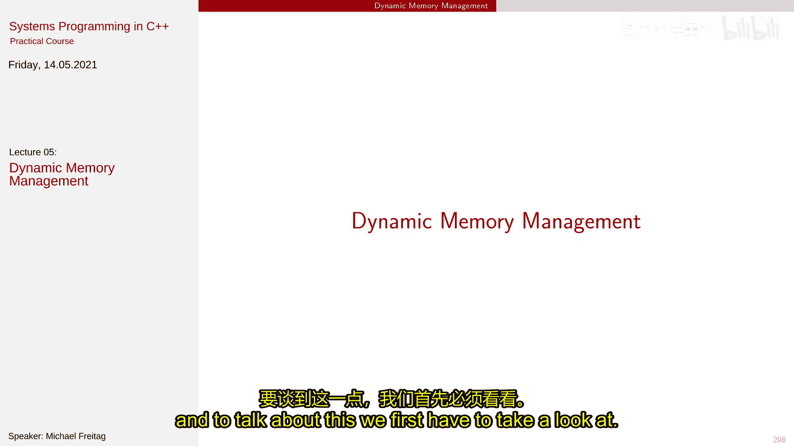

The process memory layout that we typically find on Linux， and also。

Quite similar on other operating systems。 So as you might probably know。

 every Linux process runs within its own virtual address space。

 And what this means is that the kernel pretends that each process has access to a huge continuous range of addresses。

 So on a 64 B system， This range can be as large as2 to the power of 64 Bs。 But， of course。

 this is far larger than the actual physical memory that's present within a system。

 So what the kernel then does internally is that these virtual addresses are mapped to physical addresses。

 using page tables， the memory management unit。 If there is one available。

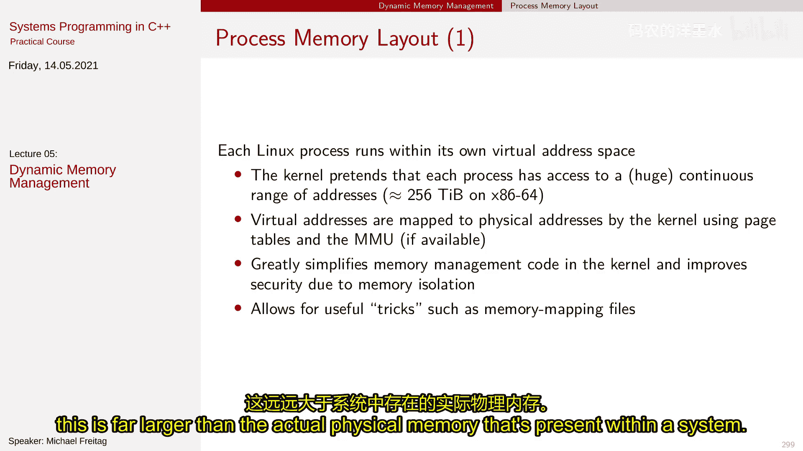

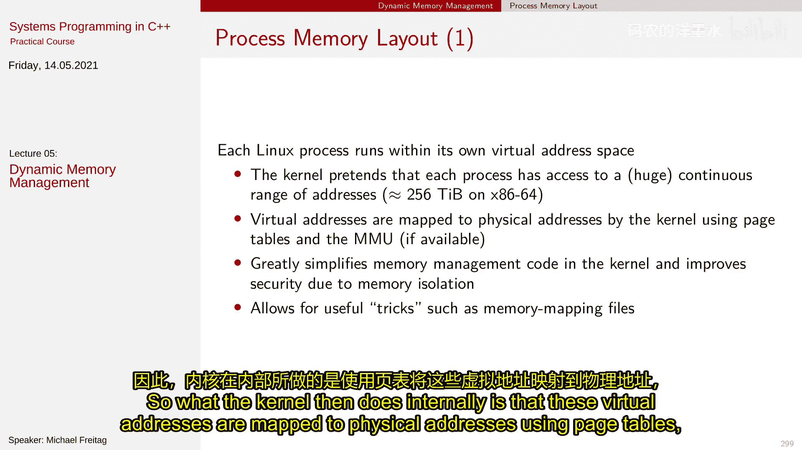

Some more data structures that are managed internally。

 So what this gives us is our processes can just pretend there that there is this huge address range。

 and the kernel takes care of mapping this huge address range to the actual physical memory that's present within a system。

And this greatly simplifies memory management code in the kernel and also as a nice side effect improves security because each process gets its own outer space。

 we do do not run the risk that one process inadvertently accesses or changes memory that belongs to some other process。

And finally， and this is something we're going to see in some of the later lectures。

 This also allows for some useful tricks， such as memory mapping files where you just。😊。

Pretend that a file that's present on a disk is mapped to a range of virtual addresses。

 and you can access the contents of this file as if it were a memory resident data structure。

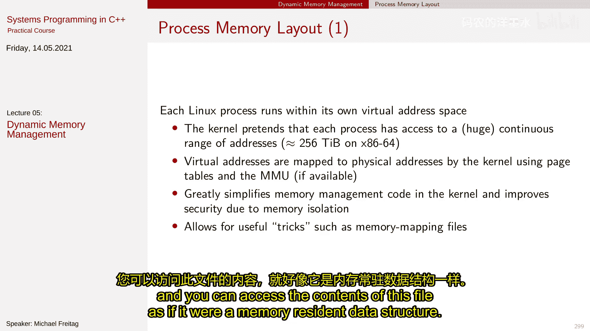

One thing that we have to keep in mind that of course。

 the kernel itself also requires some memory and the kernel itself also uses some part of this virtual address range。

So because of this， the address range is usually partitioned into parts that are reserved for kernel memory。

And parts that are accessible to user space programs。 And we see。

A figure how this looks on a typical Linux system over here。

 So usually we take the upper2 to the power of 48 addresses and reserve them for the kernel。

 And you can see this by just theing。Bs set to all ones here in the addresses。

 Then we have a very large unused part of our address space。

 and then the lower2 to the power of 48 bytes are addressable from user space。

 So the reason why we only use 482 to the power 48 bytes here is that most memory management units on x 86 platforms only support 48 bit pointers at the moment。

 So we simply cannot。Adds more memory， but this might change in the future。

 and the Linux kernel already supports 56 bit pointers in which case， of course。

 the amount of addressable memory would increase。But even with this restriction of only 48 bit pointers。

 we can see that and there is still a huge amount of memory that we can realistically address。

 so we see that we have 128 TV bytes of addressable memory for user space programs and the same for kernel space。

 which。For the time being is more than enough for the usual programs that you will provide now because we are mostly concerned with user space programs。

 let's zoom in on this user space part of the address space。

 and there we can see that it is itself once again organized and distinct segment。

 So we have the stack segment， which contains your program stack， all your local variables。

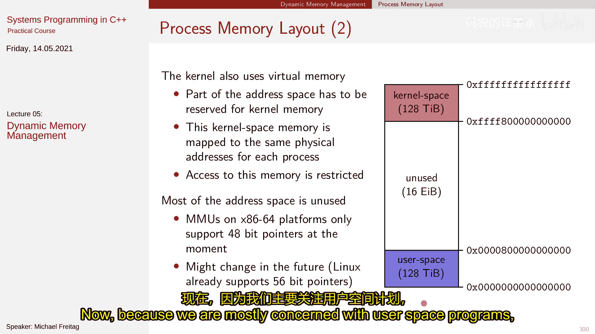

We have a memory mapping segment which is not that relevant for our course here。

 then we have a sleep segment and some more segments that contain mostly static data。

And as we can already see here is these segments can grow and usually this is for example， required。

 if we call a function， then we need to allocate more stack space for the do variables of this function possibly for any parameters and return values and usually the stack memory segment grows down。

 so addresses decrease as we allocate more stack memory。

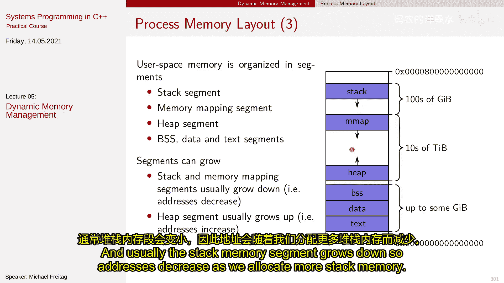

In contrast the heap segment usually grows up， that means that addresses usually increase if we allocate more he memory。

So this is just。Some background information that might become handy in some use cases。

 And also it makes it a little bit easier to read pointers。

 because if we take a look at the minimum and the maximum addresses within the addressable user space memory。

 you see that they。Are rather restricted。 And if you take a look at the pointers within your programs。

 you will see that usually they start with a 7 in this place here。

 And that is simply because your pointers are usually located towards the top of this segment。

 So the uppermost。Used bits in your pointers are going to be set to all onces。

 and this means that your point has point somewhere in this upper region of the process memory that you can address。

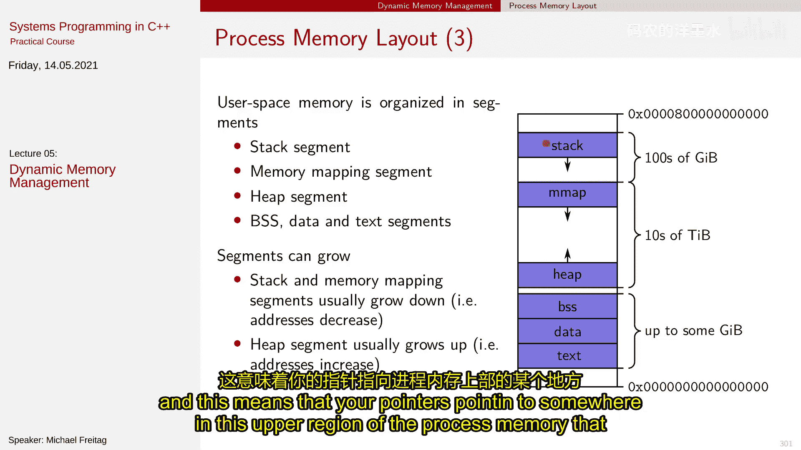

Mostly up to now you have been interacting with the stack segment because the segment is usually used for objects with automatic storage duration。

 so local variables that you have almost exclusively used up to now and this memory is of course very convenient because the compiler can statically decide when allocations and delocations must happen and the memory layout is known at compile time because of course the compiler knows which local variables you use in your function and this allows for highly optimized codes because any allocations and dlocations on the stack segment simply increase and decrease a pointer so these base and these stack pointer registers in assembly。

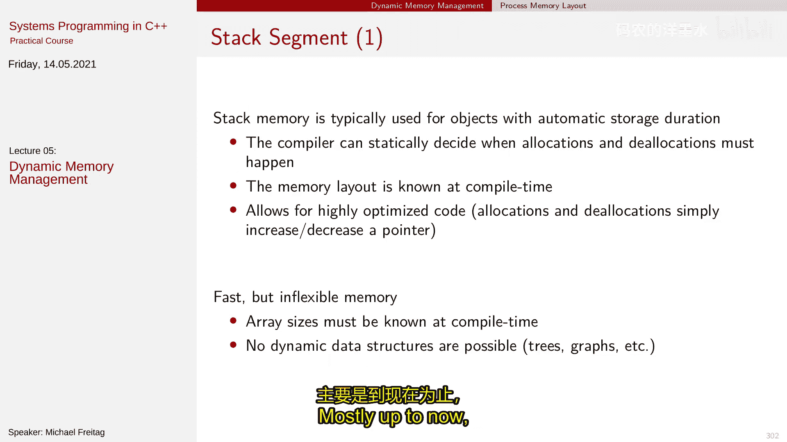

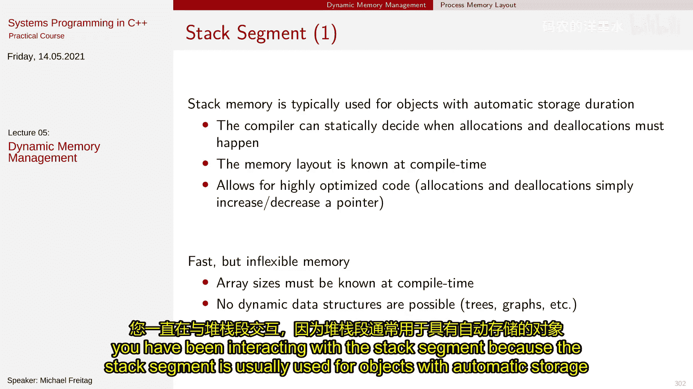

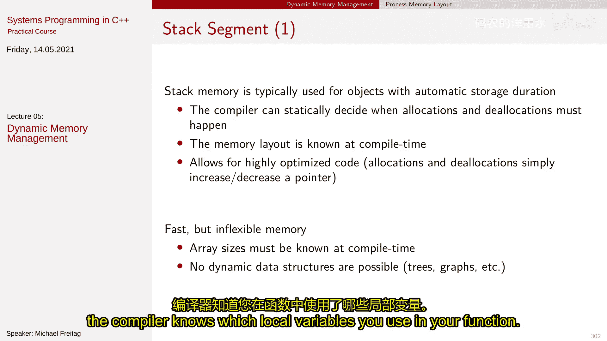

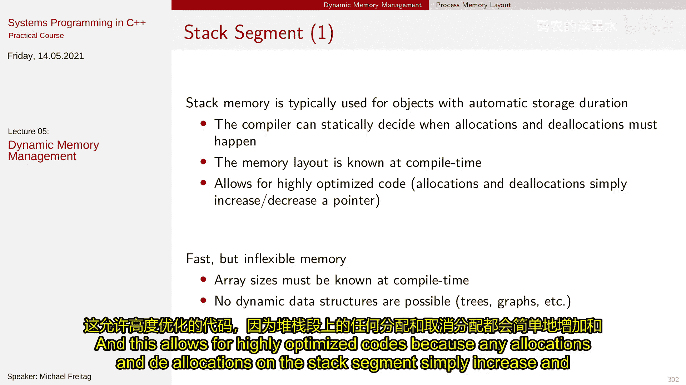

Because of this， this segment is very fast， we don't have to have any complicated code。

To allocate memory， but it's very inflexible in particular， array sizes， for example。

 must be known at compile time， and we cannot implement any dynamic data structures on the stacks such as trees。

 graphs and so on。 But of course， these are very useful。

 And today in this lecture we're going to see how we can implement those as well。

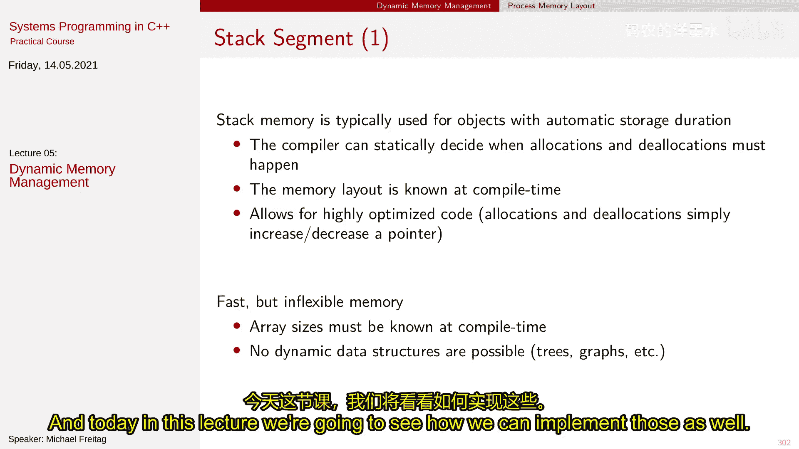

So just to give you。An example that you can take a look at offline。

 We have a very simple program here with two functions where we have some statically allocated。

Variables are better variables with automatic storage duration。

 and on the right we can see how this translates into into assembly and we can see that essentially we are just manipulating the stack base and the stack pointer in assembly to allocate memory for these local variables and once again we're not going to go into more detail on this example here。

 but I encourage you to study this example offline in your on your own time。

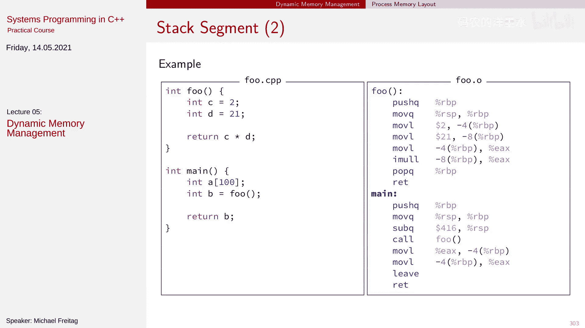

Now。The stack segment is rather straightforward。 You essentially use stack memory transparently in your code by just writing local variables。

 and you don't have to do a lot more to make it work。 This is different for the heap segment。

 which usually is used for objects that have dynamic storage durations， where the programmer。

 That means you have to explicitly manage allocations and de allocationlocations。

Up to now you've only indirectly used He memory， for example， through STD vector。

 which internally performs this allocationation and deallocation of dynamic memory depending on how large the vector is。

 and this is already one example of how using He memory can allow you to write much more flexible programs because youre not constrained to constant sizes that are known at compile time anymore。

But of course， there are some major disadvantages to using heat memory as well。

 not the least the performance impact that I using heat memory has because allocations on the heap need some highly non-trivial implementation to track which parts of heat memory are allocated。

 which are free and can be reused and so on。And of course。

 a related problem is that when using heat memory， you always risk fragmenting your memory。

 if you have， for example， very many small allocations。

 then you can actually manage to run out of heat memory， although this is unlikely。

 and finally and this is something。That a lot of the remainder of this lecture will focus on is that dynamic memory allocation is of course very error prone because once again。

 you have to manage allocations and delocs， and this means that you run the risk of having memory leaks when you forget to delocate memory that you do not need anymore。

 you can run into problems such as double freeing where you delocate memory twice at two different points in your program and many more fun problems that arise when using heat memory。

And this is also a common theme throughout this lecture to find all these bugs。

 luckily we have a large amount of debugging tools。

 in particular the address sanitizer will become very handy once you start writing programs that use heat memory here。

So， with these。Preparatory background information， I would say， out of the way。

 let's move towards how this can actually be achieved in C plus+。

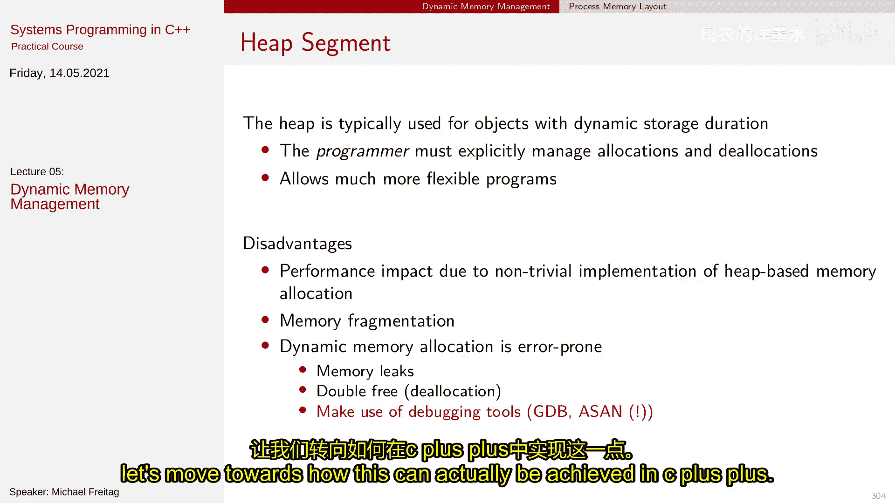

And。C++ provides several mechanisms which can be used for dynamic memory management。

 the first of which are new and delete expressions。

 we are going to cover these because they form the basis of everything that you can do in C++ nevertheless it's important that already at this point you keep in mind that using new and delete is actually discourage there are better ways in C++ to achieve dynamic memory usage。

Something that you can also do in C++ is use the C library functions Malock and free。

 but once again this is also discouraged。 It works。

 and sometimes in very rare cases it's useful but most of the time you should not use those and then finally once we have these background functionality out of the way we will move towards smart pointers and ownership semantics which are the preferred way to deal with dynamic memory allocations in modern C++。

All of these mechanisms give you some control over the storage duration and possibly also the lifetime of objects。

 and this is in contrast to local variables， for example。

 where the compiler takes care of the storage duration and lifetime of objects and you do not really have much choice to exert some control over these properties of objects。

Well， of course， the level of control that you get。Varies by the method that you choose。

 and in all cases， some extent of manual intervention is required。

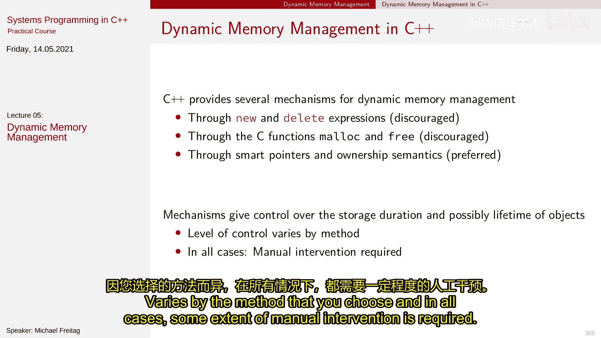

So the first。Way to do dynamic memory management is through new and delete。 And for this。

 we have the new expression， which looks quite similar to expressions in different programming languages。

 but the semantics are somewhat different。 So we have these syntax that we have the keyword new followed by a type and then an initializer。

 which， for example， can be a constructor call。 And what this does is that it creates and initializes an object with dynamic storage duration somewhere on the heap。

This can also be used for airs， and we will see an example of this， I think， a little bit later。

But in any case。This object is now allocated on the heap， and initialized。

And the entire expression then returns a pointer to this object that you can use just like any other pointer that you have used up to now。

Now， once we have allocated such an object， it lives on the heap as long as you want until at some point。

 we decide we do not need this object any。 And then we have to delocate this object through a corresponding delete expression。

 So everything that's allocated through new has to be delocated at some point through delete。

 This is not something that the compiler will do。 there is no garbage collection mechanism at all in C plus plus。

 you have to do everything by yourself。 And you have to make sure that everything you allocate this at some point deloated again before your program terminates。

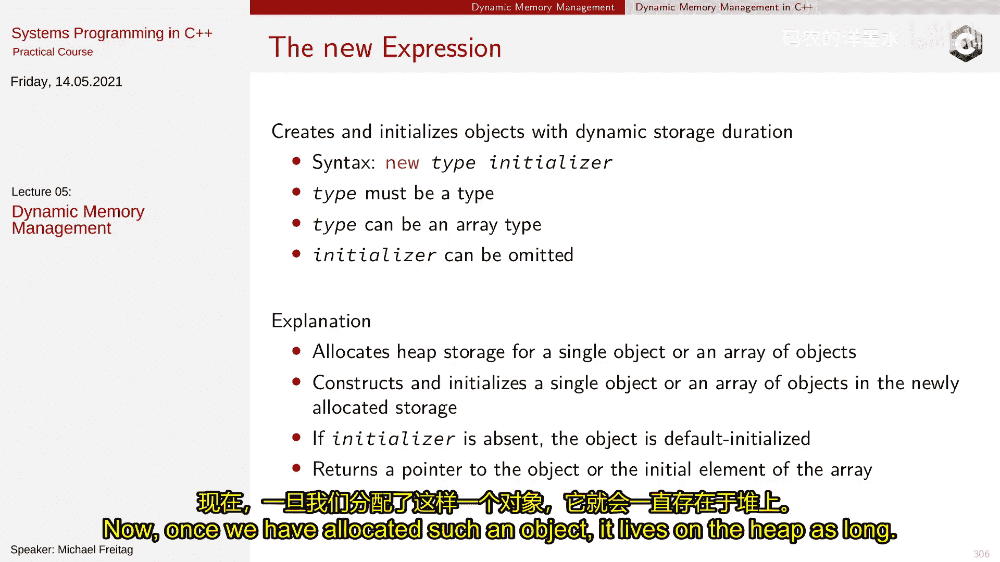

The syntax of the delete expression is rather straightforward。

 You just have the delete keyword followed by an expression。

 which is a pointer that was returned by the new expression。

 So you get a pointer out of the new expression and you return it to the delete expression to delocate your object again。

If we have used new for an array， but this is an edge case we have to include square brackets with our delete operator and then of course the pointer has to be a pointer that came from the array form of the new expression and in both cases the expression may be no pointer in which case just nothing happens。

If it is not Nile pointer， then the delete expression will first invoke the deor of the object that is being destroyed or and the deor of every every object in an array。

 And afterwards， it delos the memory that was previously occupied by the object。

 So this then ends this new delete life cycle with new。

 we allocatecate memory initialize an object with delete。

 we destroy an object and then decate memory。

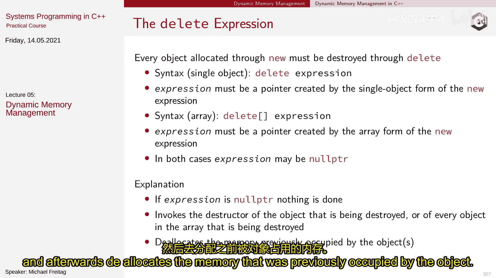

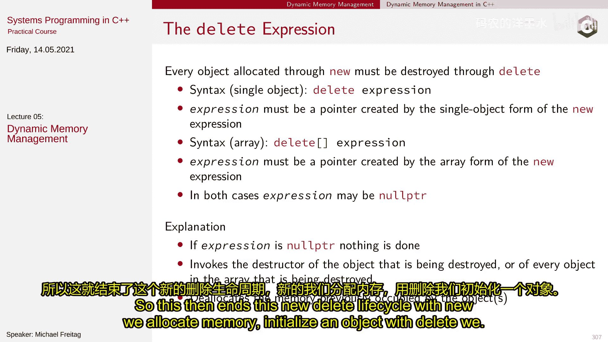

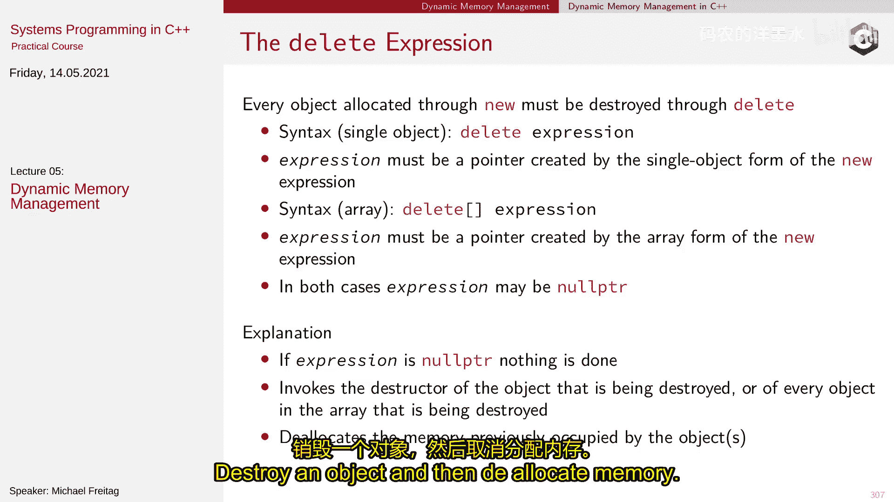

And just as a quick example of this， we can。Take a look at this int list class here。

 which essentially implements a very simple and incomplete linked list of integers。

 So we see we have a node here that contains an integer payload and then a pointer to some next node and we have first and last pointers within our int list class Now if we look at the pushback function first here。

 what do we do we allocate a new node on the heap set its payload to the value that we wanted to push back and then we have to do a little bit of of and if else here in case the list is empty。

 but essentially we just set the next pointer of our node and then remember these pointers Now why do we have to use heap memory here。

 the reason is that we want our linked list node to keep on living after this pushback function here returns So we cannot use automatic storage duration or stack memory for this because this would be deloated once the pushback function returns So here we need to use。

Dynamic memory to make sure that our linked list nodes live long enough。And long enough。

 in this case means as long as the enclosing inch list class exists。But of course。

 we still have to make sure that eventually our nodes are delocated and this is why we need to implement a deor for our Inlist class here。

 which just iterates over the linked list by following this pointer chain here and then invoking the delete expression on every node that previously we allocated in our pushback function here。

So while this example is rather straightforward， it already illustrates one of the big problems that we get when we use new and delete。

 and that is that we potentially allocate and deallocate memory in completely different places in our program here it's still encapsulated within our interlist class。

 but already these allocations and delocations happen at different points and this makes it very hard to track when how and where there is any dynamic memory present in our program and we have to be very careful to not run into memory des for example。

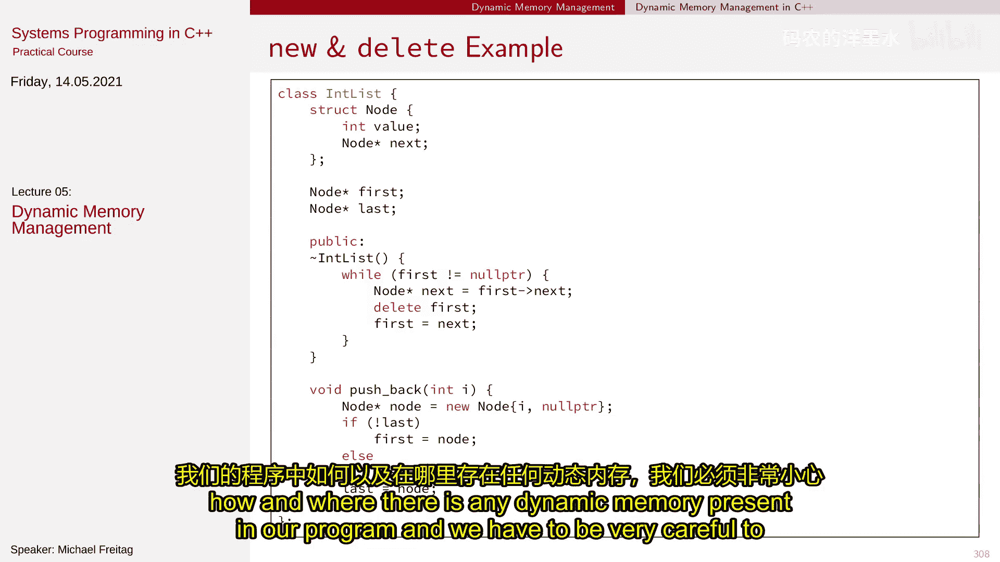

And these memory leaks can happen very easily， as we can see in yet another example here。

 where we have some function in which we allocate a dynamic sized array on the he through the array syntax of the new expression。

Then we do something。 And although we thought of deleting our buffer before returning from the function。

 we then have another short circuit return where we forgot our delete expression。

 So if we run in into this code path， then we return from this function without ever delocating。

Our bufferet memory here。 And then we end up with a memory leak。安。Related to this。

 we already have a question in the chat。 What happens if you do not delete I， nothing evil happens。

 The object just lives on on the heap， But since you since we lose this pointer here。

 once we return from our function， we can never deallocate this memory again。

 So one of several things can happen here。 if you do not have any swap memory on your system and you call this function very often。

 then you just allocate more and more objects on the heap that， of course。

 have to live in some physical main memory。And then you will run out of Ram eventually。

 but in the meantime， you clarify your question， I mean that you mean before the end of the program。

 not if you have a league that grows so。Once。You have a memory leak。

 and then your program terminates， then actually。Nothing evil will happen because the kernel will just throw away your virtual address space。

 it will probably remove all the page mappings and evict everything from main memory。

So once your program terminates， then this memory leak will go away because the kernel takes care of that。

 but of course this is still a very bad practice if you do have memory leaks then most likely you will run out of main memory before the kernel gets a chance to clean up after you。

Another question whether memory leaks are undefined behavior indirectly， yes， they are。

 and the reason is that you will never properly clean up the object that you have created on the heap so you will never invoke the deors of these objects。

But a memory leak in itself， as long as your program doesn't terminate without cleaning up is not a undefined behavior as far as I recall。

Yeah。So any further questions up to now？Doesn't look like it。

 Let me know if any further clarification is needed regarding the questions that we did encounter。

In the meantime， let's move on to another form of the new expression that is sometimes useful。

 and that is the so-called placement new expression which constructs objects in already allocated storage so the plain regular new expression takes care of allocateocating some memory on the heap and then initializing an object in this memory that you have just allocated with placement new you perform only the initialization step and the memory that's actually occupied by the object has to be provided by the programmer。

 So the syntax for this is quite similar to the regular new expression with the exception that。

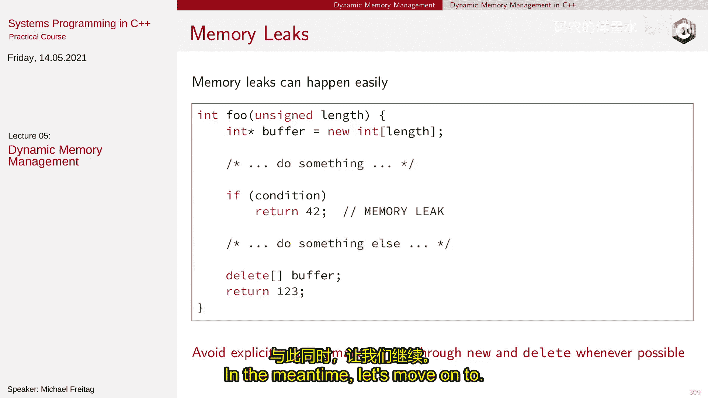

We have to put some placement parameters so called in parentheses after the new keyword。

 and these must be a pointer to a region of storage that's large enough to hold an object of the type that we are initializing here。

In doing so， of course， we have to make sure that the strict aliasing rule is not violated and we have to ensure that the memory or the pointer is aligned properly according to the alignment requirements of the type that we're initializing here。

This type of new expression is rarely required， except when you implement some sort of custom memory management。

 which depending on your projects might be necessary at some point。

Just to give you another example here。And I think this example actually contains a bug because we have to include the new header。

 This is something that we will correct in these slides once the lecture is over。But regardless。

 let's take a look at this example here。 So what we're doing here is we're first allocating。

A buffer on the heap that contains size of a byte。 So it's large enough to hold an object of type A。

 And because a doesn't have any specific alignment requirements。

 we don't do not have to do anything special about that。

 And then once we have allocated this region of storage。

 we can use placement to construct an object of type A within this buffer here。

 And then we can just use our object or the pointer to our object as we would regularly do。

 But since this object must not allocate it through a regular new expression。

I mean we cannot free it through a call to delete， we have to explicitly then call the deor of a and finally free the memory that we have allocated for a。

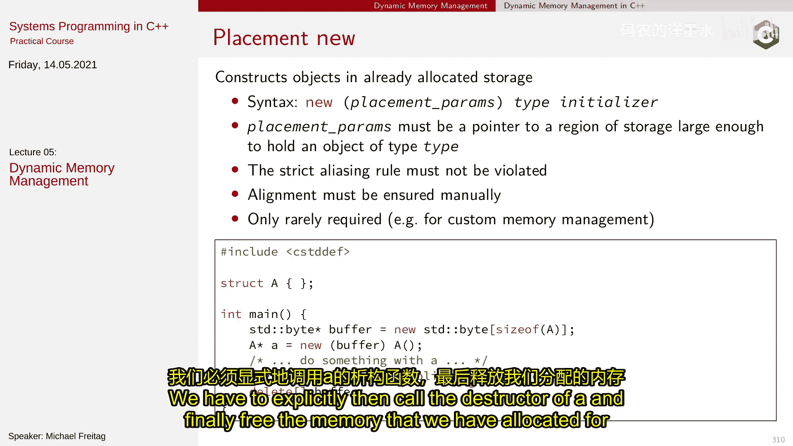

。What this already illustrates is that the lifetime of an object is not necessarily the same as the storage duration。

Or the lifetime of its storage for regular new and delete expressions， these are in fact， equal。

 but for placement new， we can construct cases in which the lifetime and the storage and the lifetime of storage are different。

And one very simple example that illustrates this is shown here where we use a regular new call to allocate an object of type A on the heap。

 Then we invoke the deor of a， which ends the lifetime of this object。

 but the storage still lives on because we have not invoked the delete。Operator yet。

 so then we can use placement menu to construct another object of type A within the same storage。

 So now the storage still lives on， but we have started the lifetime of a new object within this region of storage。

 And then finally， if we invoke delete， then of course the object is going to be destroyed and also the storage is going to be delocated。

So why。Do we show you this example， the reason is that。

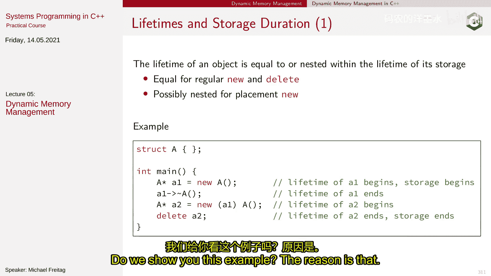

This is not only a theoretical side note， but these properties of objects。

 so lifetime and storage duration do have real world implications because if you access an object outside of its lifetime。

 this is undefined behavior， and often this will lead to segmentation faults。

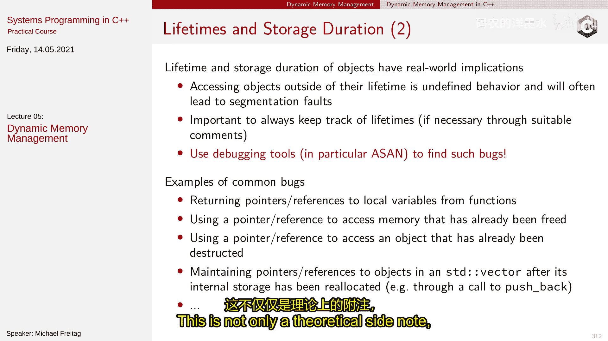

And in fact， this is a very common reason how you can generate segmentation faults or undefined behavior within your programs。

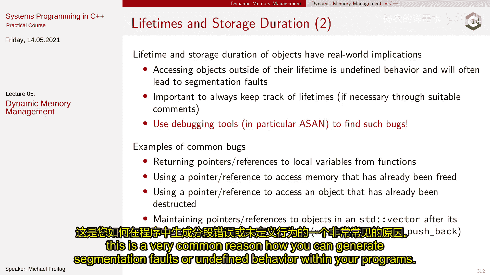

Because of this， it's important to always keep track of lifetimes of your objects， if necessary。

 even by commenting explicitly， once you allocate memory somewhere write a comment。

 this memory is allocated here and it's delocated here so always pass this pointer to this function once you're done something like this and of course once again the reminder use the tools that are available to you to find such bugs and once again in particular the address sanitizer is very good at telling you when you do something that you shouldn't be doing so always pay attention to the output of these tools。

And just some examples where you can run into such lifetime bugs is the。

The common returning of a pointer or reference to a local variable from a function， because here。

 the pointer and the reference will exist even after the local variable goes out of scope and the corresponding。

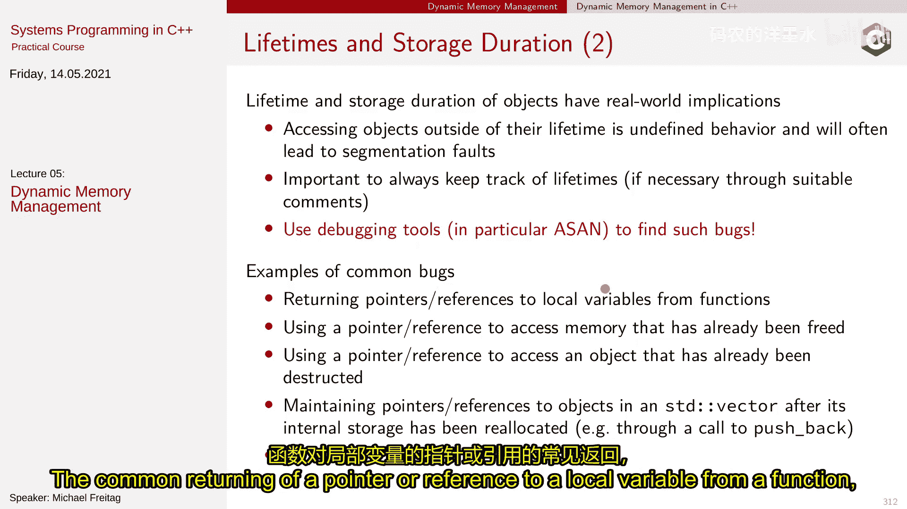

Storage is reclaimed something that also happens quite often as using a pointer or reference to submemory that has already been freed。

 for example， through a equal to delete， also sometimes if you do some more sophisticated custom memory management。

 you might get a pointer or reference to an object that has destructed even though the storage still exists。

And finally， something that we want to mention explicitly here is once you maintain pointers or references to objects in an STD vector。

 you have to be extremely careful because if you call pushback or similar functions on a vector。

 the vector might reallocate the internal storage and this invalidates any pointers that you have maintained into the previous internal storage so to clarify this a little bit if you have a vector that contains 10 elements and the storage also can only hold 10 elements。

 you push back another element， then the vector will allocate a completely new array somewhere else on the heap and copy all the previous elements over there and then deallocate the previous buffer that it had internally So if you now have a pointer into this previous buffer this will of course point to deloated memory and you will most likely run into a zgfold if you try to access。

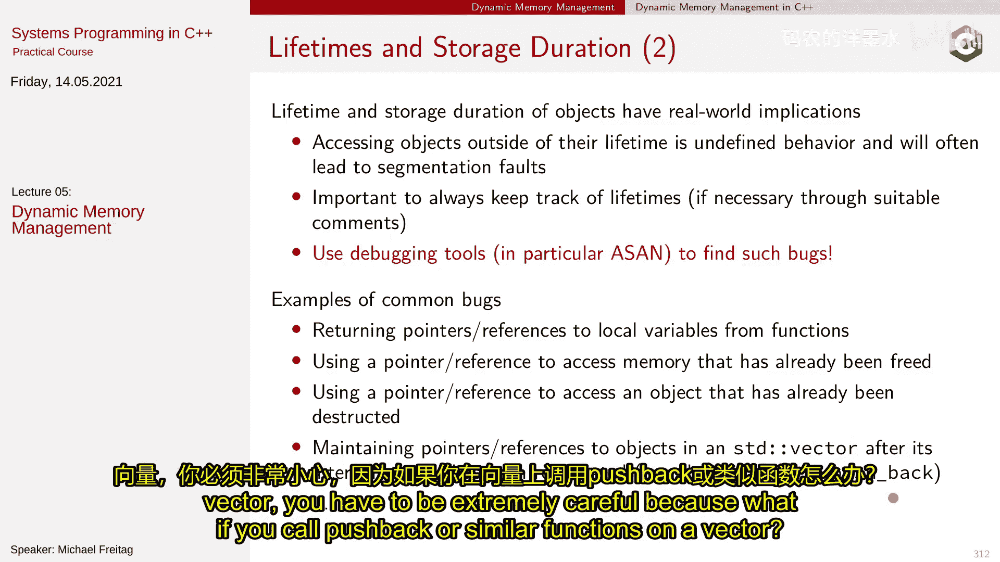

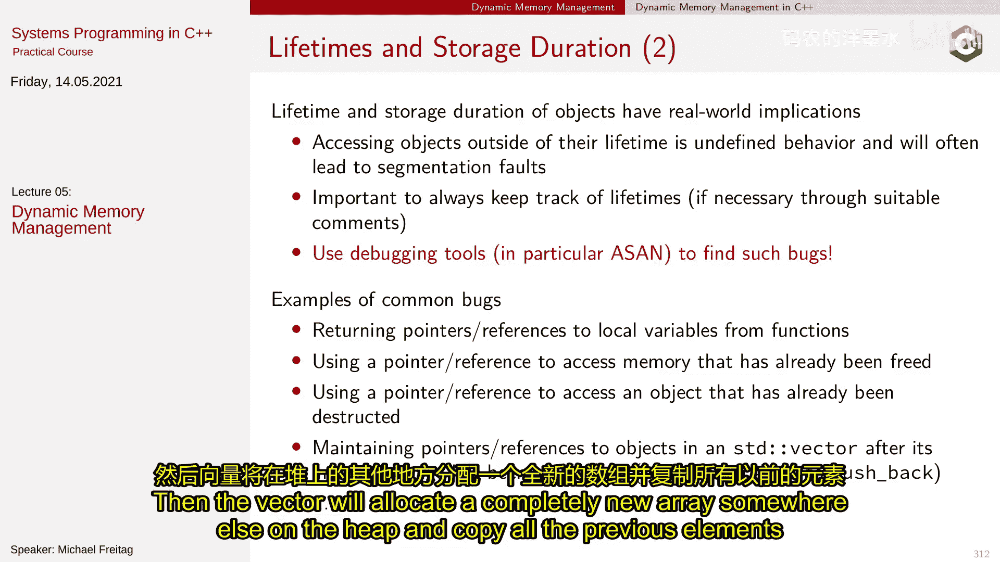

Something through this pointer。But that said， of course。

 there are many more sources of common bugs that are related to this lifetime and storage duration discussion。

But clearly we cannot list them all here。 So if you run into some problems。

 just remember them and add them to the pool of things that you should avoid in your own intuition。

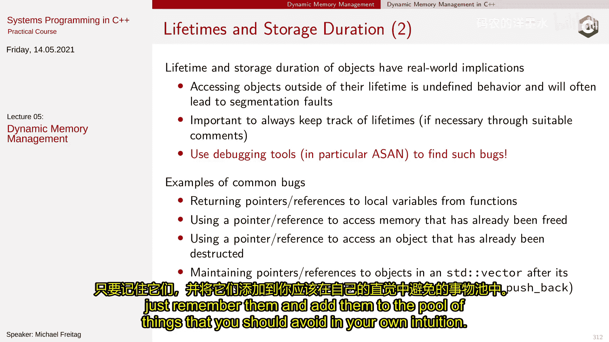

Moving on。We now know how to allocate variable size buffers or allocate objects on the heap。

And in conjunction with this， it's also useful to be able to。To copy stuff around on the heap。

 especially if you have to deal with raw data。 And this is where the mem copy function comes in handy。

 And what it does is just simply it copies some bytes between non non overlapping memory regions。

 You have to include the sea string standard header to use it and the syntax。

The signature of the Mem copy function is shown here。And it's very straightforward。

 It just takes two pointers， a source and a destination pointer。

 and then it copies a number of bytes starting at the source pointer to the destination pointer。1。

Useful application of Mem copypy is to work around strict aliensing rules without causing undefined behavior。

But of course， there are some restrictions on the use of Mem copy。

 the most important of which is that the objects must not overlap and that the objects must be trivially copyable。

 so you cannot use MeM copypy on arbitrary classes that you have defined。

 but they have to fulfill this property of being trivially copyable and we will see what this means in detail on some later slide today。

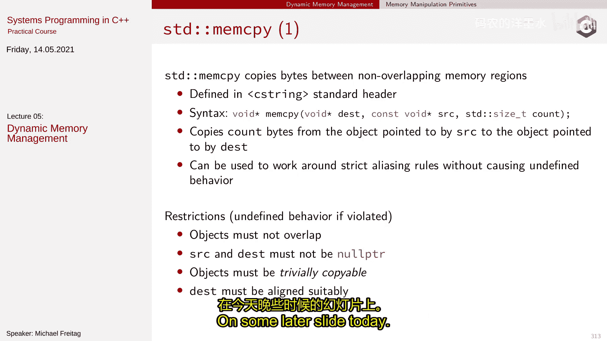

Just two quick examples here so we can use a straightforward copy just to copy some elements in a vector。

 So we start by having a buffer that contains one to，3，4 here of type int。

 then we resize our buffer to have enough space for8 integers。

And then we use Memco to copy the first four elements to this newly allocated space at the end of the vector。

 so we copy from the pointer to the first element in our buffer we copy four integers。

 so four times size of int bytes and we want to put them at the location where the fourth element would be located so after completing this function here。

 our buffer will be twice as large and it will contain two times one to 34。Just as a side note。

 integer and all primitive types in C++ are in fact trivially copyable。

 so this is a valid piece of C++ code。And another example here that demonstrates how it can be used to work around the strict aliasing rule。

Is shown here。 So we have a 64 bit integer here。 and for some reason that is admittedly a little bit arbitrary。

 we want to be able to view this 64 bit integer as a double So as you already know。

 we cannot simply reinterpret cast this integer here to a pointer to double because this would violate the strict aliasing rule。

 What we are allowed， however， to do is simply copy the bytes that make up our 64 bit integer into a newly allocated double。

 and this is also something where we can use mem copy。 We just take。

Probably 8 bytes from our 64 bit integer here and copy them to the location on the stack where the double resides。

 and then we can access this double without violating the strict aliaing rule。

Closely related to Mamcopy is Mammo， which does exactly the same thing only that the source and destination memory regions can overlap。

 so it's implemented slightly differently potentially so that we do not lose information once we copy overlapping memory regions。

 Apart from that， it's essentially the same as Mam copy。

 So we're going to skip over this rather quickly。

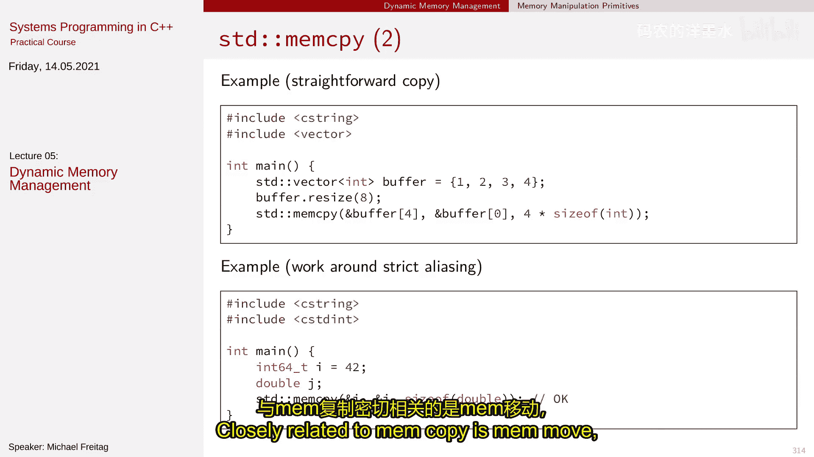

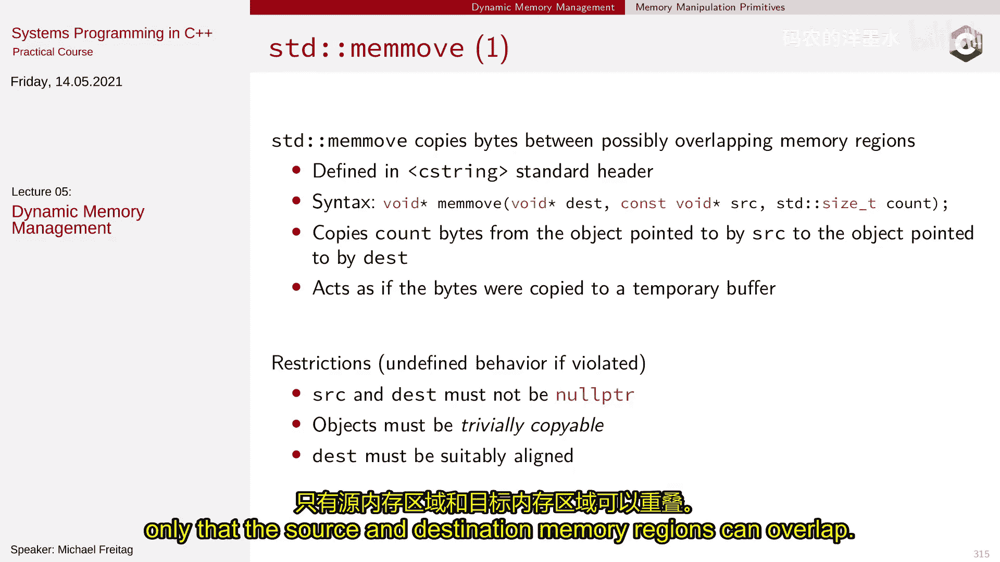

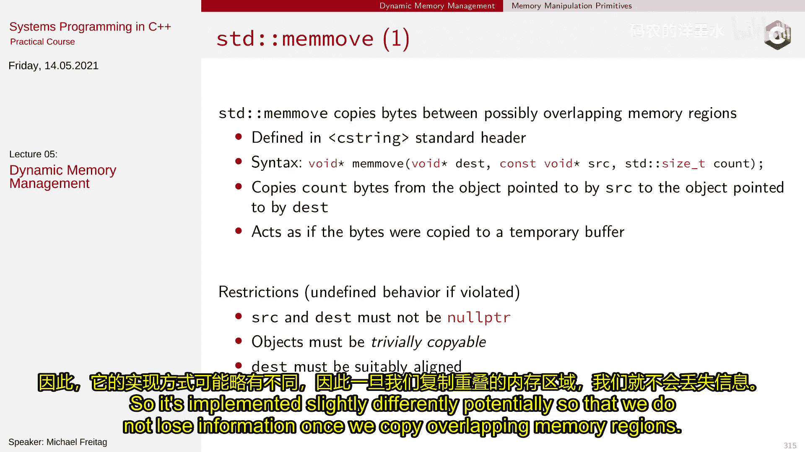

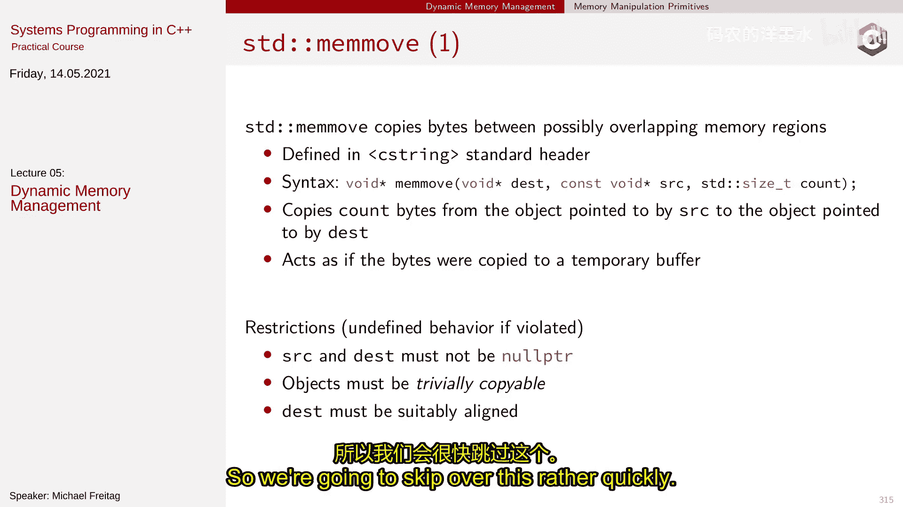

And， of course， we also have another example that you can take a look at on your own time if you are interested。

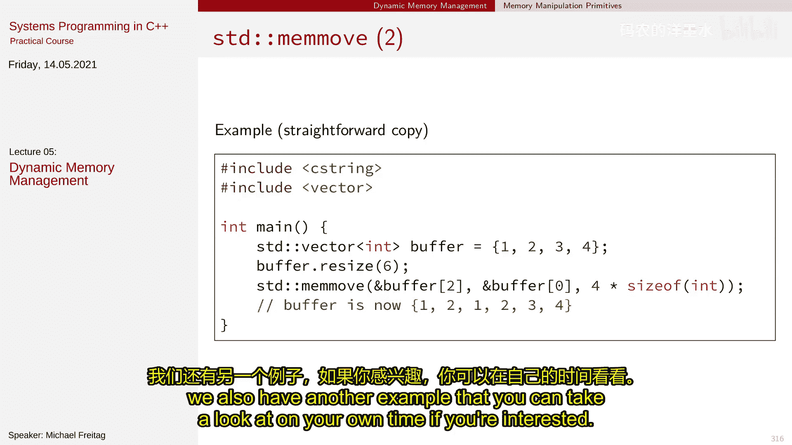

So with this。We are essentially done with the basics of dynamic memory management in C plus plus。

But as I've already said， in the beginning of this lecture。

 this is mostly background information and we should not use these facilities for dynamic memory management directly。

There are much better alternatives that take away a lot of the burden of manually having to manage all the allocations and delocations in your program and the goal of the remainder of our lecture here is work towards these facilities。

 but before we can take a look at them we first have to talk about a very big topic in modern C++ which are copy and move semantics because those form the basis of implementing these smart pointers that we've briefly touched on in the beginning of this lecture。

So let's start with copy semantics， which might be a little bit more intuitive than move semantics。

What what do we mean by copy semantics usually。If we construct or assign classes to each other。

 copy semantics are employed， which means that if you assign one object to another object by default。

 a shallow copy is created， so all the members of your class are copied to the class that you're assigning。

And nothing more happens。 So if we have fundamental types such as integers。

 this is most of the time what we want， and it's not very relevant。

 but it can become very relevant for user defined class types。 For example。

 imagine that you have a class that contains a vector as a member and this vector holds somewhere around 10 megabytes of data。

 And then you assign your an object of your class to another object of your class。 as we've seen now。

 this will create a shallow copy。And copy all the members。

 including the vector holding 10 MBby of data。 So if we assign an object。

 we will copy all the data that your object。Our example object here holds。

 and sometimes this might be desire， but most of the time， probably this is not what we want。

 So there are some considerations that we have to keep in mind when we deal with user defined classes。

 So my example just illustrated that copying may be very expensive。

 which we might want to avoid copying may sometimes be plain unnecessary or even unwanted。

And the most serious problem that we can run into that is that an object on the left hand side of an assignment might manage dynamic resources。

 So it might be that the object that we' are assigning to has at some point during its lifetime called new and allocated some memory on the heap。

 if we now just assigned to this object we will override this pointer and once again run into into a memory leak because now the pointer has been overwritten and we have no way of freeing the object that we have at some point allocated。

And in order to be able to deal with these kinds of problems that all stem from this default implementation of copying。

 C++ allows us to implement our own copy behavior for user defined classes。

And this is always relevant when the default way that C plus plus does copying is not what we want for a variety of reasons。

 Exp， unnecessary， or because we have to。Keep track of dynamic resources that we manage in our objects。

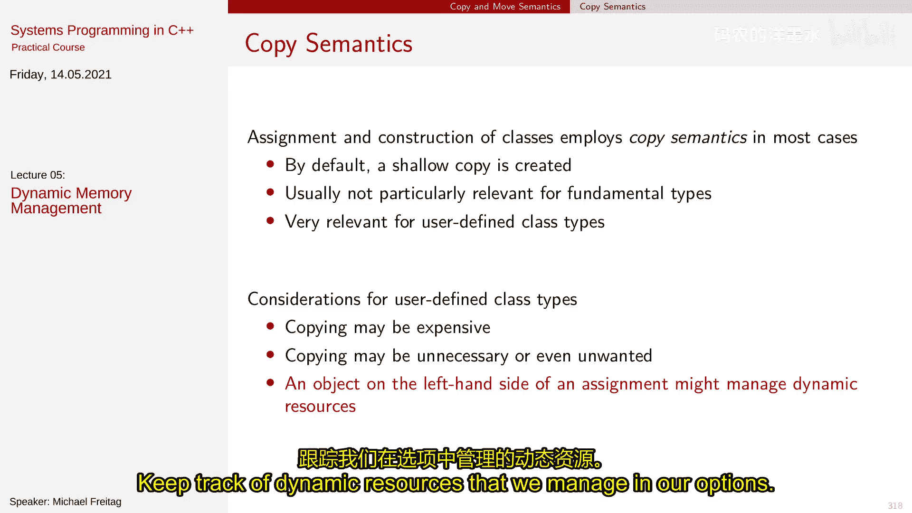

These facilities that C++ provides us are the copy constructor and the copy assignment operator that I think we very briefly seen in a previous lecture but not really talked in detail about。

 so this is what we're going to do next。

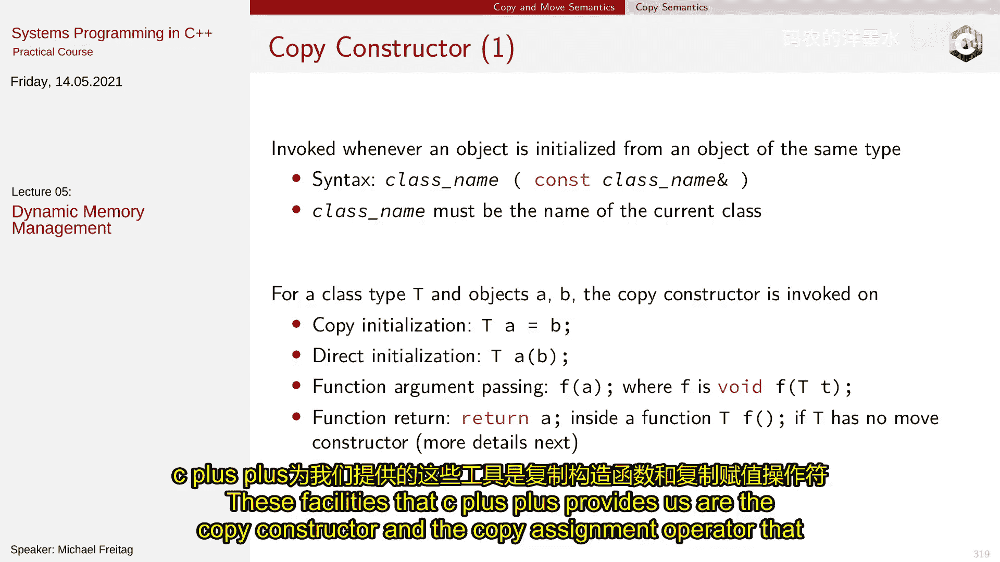

So first of all， we have the copy constructor， which is invoked whenever an object is initialized from an object of the same type。

 so if you declare a new variable of your class type and you initialize it from another object of your class type。

 then the copy constructor is invoked。And the syntax is simply the regular constructor syntax with a single parameter that has is a constant reference to your class type。

And you see below here a list when the copy constructor is actually invoked。

 So if we have some class type T， if we initialize an object with the equals。Operator。

 then this is copy initialization and will invoke the copy constructor。 We have。

Direct initialization， which will also invoke the copy constructor。 And then very importantly。

 if we have a function that takes a class type by value， then invoking this function will also copy。

🤧Your object into this function。 And finally。Excuse me。 And finally。

 if we return something from a function that does not have a move constructor。

 which we're going to take a look at next， then the object is also going to be copyied。

And just as an example here， we have a made up class A here that defines an explicit constructor that takes in and the copy constructor。

And below here， we see some cases in which either of these constructors are called。

 so we have direct initialization with an int。 This calls the regular constructor here。

 and then we have direct initialization from another object of type A or copy initialization。

 which both call the copy constructor of our own class here。

A question from the chat is what is the difference between overr the assignment operator with a constant reference to the class type。

 I do not entirely understand this question， Please clarify this and we're also going to talk about copy assignment next so maybe that will answer your question。

嗯嗯。😊，Another question is whether the copy constructor can also be defined implicitly。 Yes， it can。

 We're going to see this in a couple of slides。

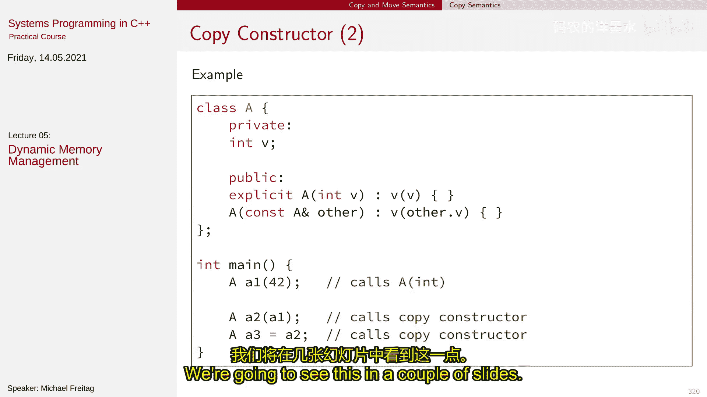

But before that， let's first move on to copy assignment。

 which essentially serves the same purpose as copy construction。

Which is typically invoked if an object appears on the left hand side of an assignment with an L value on the right hand side。

The syntax you can see here， I think we've already seen it。

 there are two different ways of implementing the copy assignment operator。

 usually the version that takes a constant reference is preferred unless you use something called the copy and swap idiom。

 which were also going to see in a couple of slides。

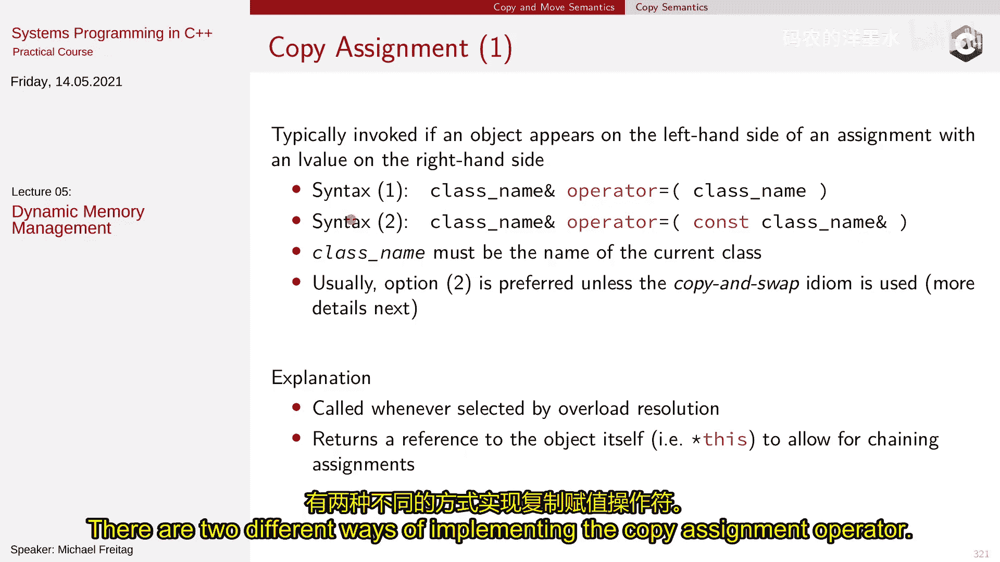

In the meantime， the question in the chat was clarified， but the question meant as if you were write。

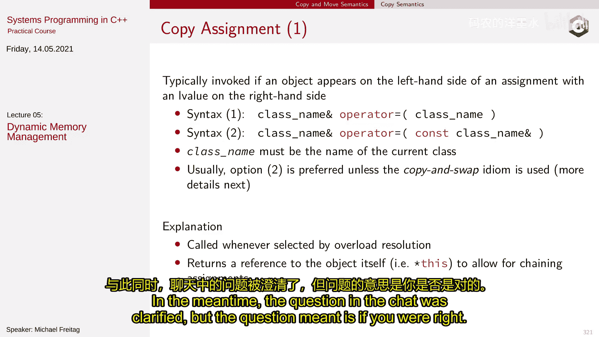

This line here where we have a so type A a3 equals a2。 this calls the assignment operator。

 This is incorrect。 The assignment operator is not called here。 This does in fact。

 call the the copy constructor because we are initializing a new object of type A here。

 we will see a case in which the assignment operator is called essentially this appears if we do not initialize a new object but assigned to an existing object And this line here。

 a3 does not exist yet we' are just initializing it。

 and this is why the copy constructor is being called。

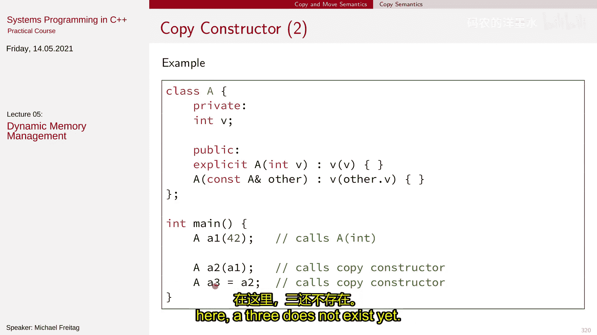

So。Finishing up on the copy assignment operator here。

Whenever we do have such an assignment that does not initialize a new object an overload resolution decides that this implementation of the assignment operator should be picked。

 then the copy assignment operator is actually invoked。嗯。As all the other assignment operators。

 it usually returns a reference to the object itself so that we can chain assignments as we've seen in one of our earlier lectures。

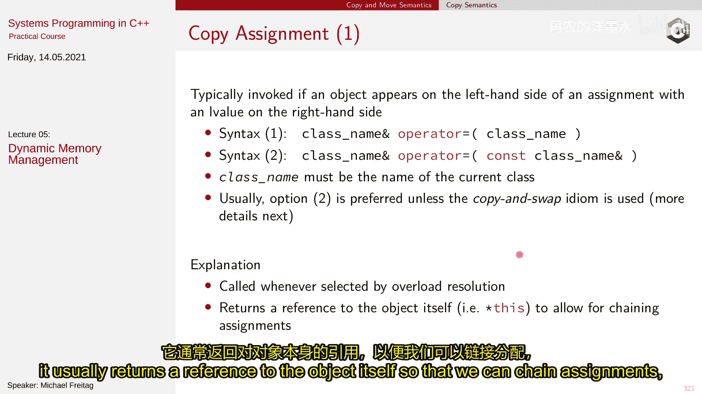

So。Continuing the example from before we have our same class A here with now an added copy assignment operator implementation and here we see what I just explained so if we initialize an object from another object of the same type then we will call the copy constructor and if we assign to an existing object like we do here。

 then the copy assignment operator is going to be called。Now。

To the next question that we had regarding implicit definition。

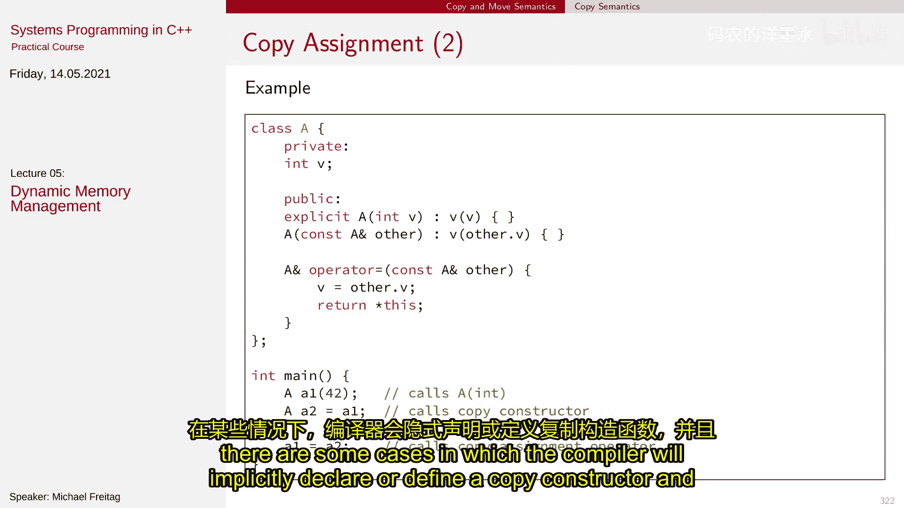

There are some cases in which the compiler will implicitly declare or define a copy constructor and copy assignment operator。

 The rules are quite similar， so we're going to talk just about the copy constructor here。

 the copy assignment operator is also shown on the slides， but I'm going to skip over that。

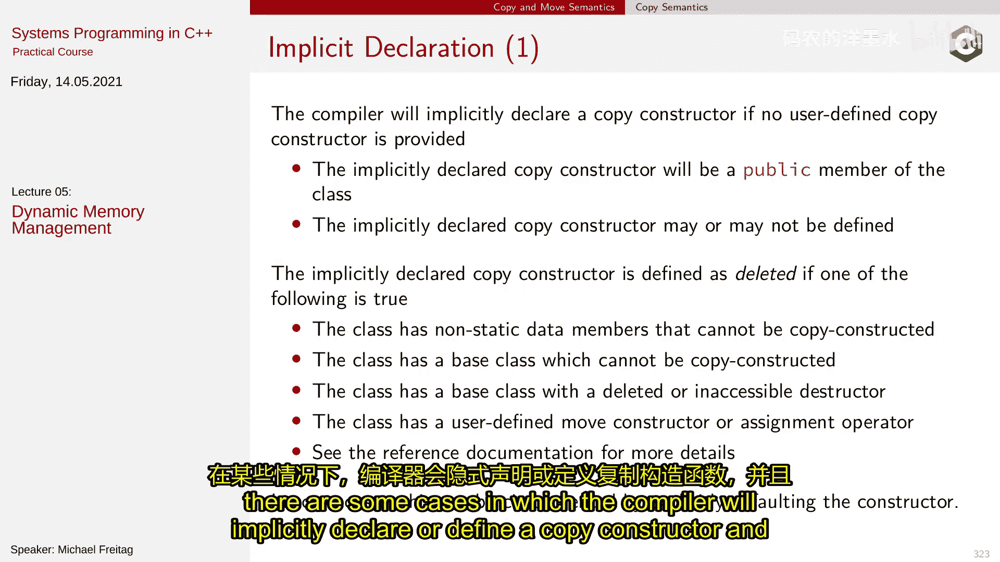

So if you do not provide a user defined copy constructor。

Then the compiler will at least declare a copy constructor as a public member of the class。

 and this implicitly declared copy constructor may or may not have a definition associated with it。嗯。

If it is。If it might be defined and have a default implementation。

 and it might be defined as deleted。A deleted copy constructor means that you cannot copy initialize your object。

 And this is for possible， for example， if you have some members that cannot be copy constructed themselves。

 you have a base class， if we have inheritance。That cannot be copy constructed。 and for some reason。

 and some more cases in which the copy constructor will be defined as deleted。

 If you want to know details， take a look at the reference documentation。 In general。

 a deleted copy constructed just means the class cannot be copy constructed。

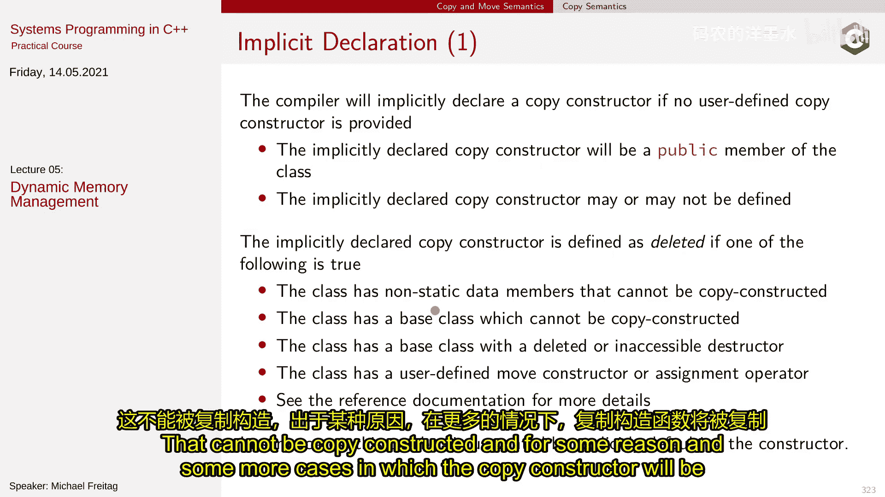

Because the compiler doesn't know how to do this， and in some cases this can be circumvented by explicitly defaulting the constructor。

 in other cases you will have to implement your own copy constructor if the compiler cannot implicitly define a suitable copy constructor。

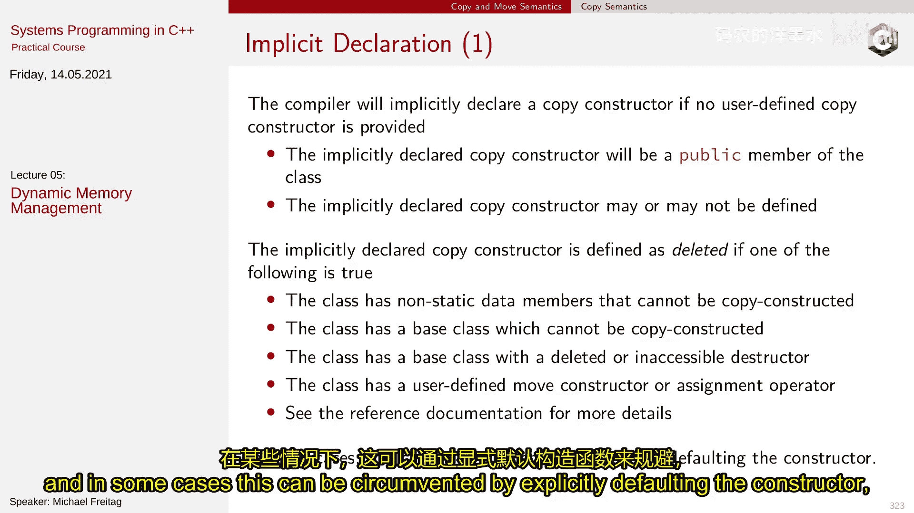

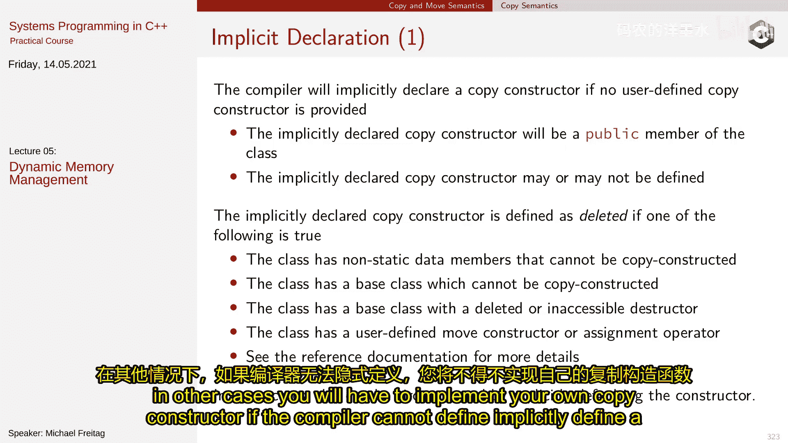

So as I said， we're going to skip over the copy assignment operator because here the discussion is essentially the same and instead immediately take a look at the implicit definition if it is not deleted。

 so we've seen that in some cases the implicitly declared copy copy operations are going to be deleted but if they are not deleted then the compiler will define a default copy constructor or assignment operator this will only happen if it's actually used so if you have a class and never copy it。

 then the compiler will also not generate code for copying but if it does then it will simply perform a full memberwise copy of all base classes if they are any and all the member so what this means is that just for each member the compiler is going to invoke the copy constructor of that member to copy your custom class here。

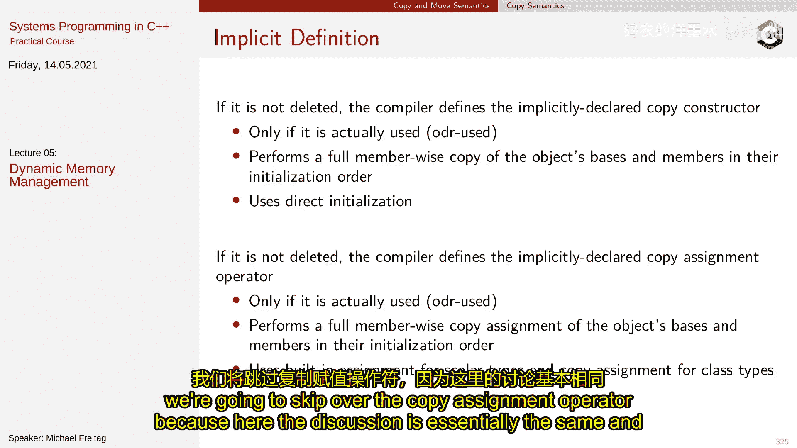

And but this is only a sign how this will use direct initialization。And the same， of course。

 also goes for the copy assignment operator。

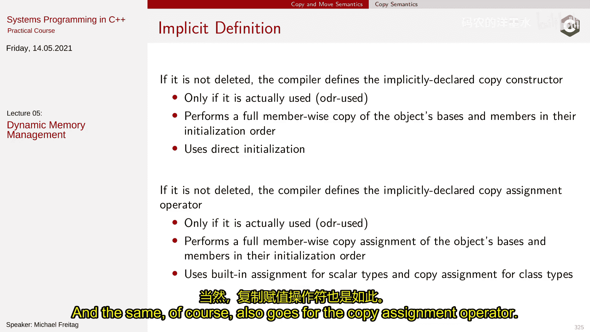

So。Here we have an example that just shows that sometimes these implicitly declared operations are going to be deleted。

 and the reason here is simply that we have a cont member to which we cannot assign but just initialize it so what works here is of course our own constructor which initializes this member to some value and also the implicit copy constructor will work as we see here。

 because this can also initialize our cont member here but the assignment operator cannot assign to this cont member here。

 and because of this the compiler will declare the implicit copy assignment operator as deleted and this line here would lead to a compile time error。

So any questions up to this point。

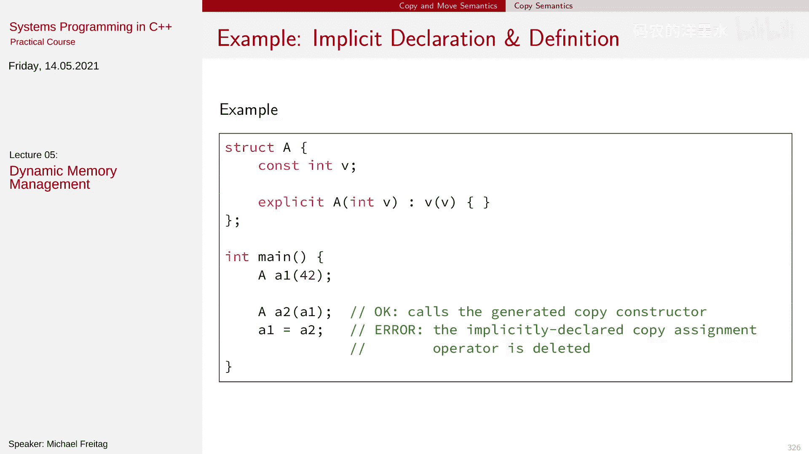

Doesn't look like it。So let's move on。 We've already。

Briefly touched upon trivially copyable when we talked about Mem copy and what this means in detail is that the copy constructor and assignment operator of a class may be trivial。

 and this is only the case if you do not implement them yourself。

But what we can do is explicitly default them， so this does not count as a user provided copy constructor or assignment operator。

And then furthermore， the class has no virtual member functions。

 This is related to inheritance and polymorphphy， which we're going to cover in the next lecture。

And also， the copy constructor for all base classes and members has to be trivial。

If you have a trivial copy constructor or assignment operator。

 then the default implementation of this behave similar to Me copy。

Because every sub object is just copied recursively and no further actions are performed。So。

 because of this。Similar behavior to mem copy。 this is precisely the reason why we may use Mem copy to copy trivially copyable objects around。

 There was a lot of copies。And in particular， something that's important here is that， of course。

 all the fundamental types in C plus+ are trivially copyable and also all data types that are compatible with the C language are trivially copyable because C doesn't have this concept of。

Classes， constructors and virtual members and so on。 So every plain planestruct， for example。

 is going to be trivially copyable as long as you do not have any complex user defined classes as members of thestruct。

And just to give you an example here， we see precisely such astruct here which just contains M2 fundamental types。

 an int and a double and then。We define a vector of objects of type A here that contains 10 elements。

 and then we have two options to copy this vector here。

 we can either use the copy constructor that is implicitly declare it for a to do this if we invoke pushback。

And with a con reference to a。 But since a is trivially copyable。

 we are also allowed to copy the entire buffer using mem copy， as we see down here。

 And this is defined behavior and works as expected。

If for some reason ourstruct a here would have a user defined deor or copy assignment operator or something like that。

 then we could still write the same code here， but then it would be undefined behavior because a is not trivially copyable anymore and then we would have to use this version here where we explicitly use the copy constructor to copy a buffer to another buffer。

 of course we could also do this by just assigning buffer 1 to buffer2 here because the copy constructor of vector will internally invoke the copy constructor of the objects that the vector stores but this is just for the illustration purposes that you see what happens here。

Now， this was a lot of theory about。

Copy construction and assignment。 The interesting part here。

Besides this theoretical background knowledge is， of course。

 how to actually implement custom copy constructors and assignment operators and especially when you have to implement them and as far as copy operations are concerned。

 you only occasionally have to implement them。Because often。

 if the implicitly generated versions of copy assignment and construction do not make sense。

 then probably your class should not be copyable anyway。The noteworth。

 the exception to this is that are classes that manage some kind of resource， for example。

 objects that were allocated on the heap。If you have such a case where you need to implement a custom copy operation。

 then there are some guidelines which are that either you should provide both the constructor and assignment operator or none of them。

And the assignment operator should usually include a check to to detect if youre assigning an object to itself。

 This is just a corner case that can lead to problems if you assume that you assign to some other object。

 but in fact， you' are assigning to yourself。If at all possible。

 the resources that are managed by the objects that that is being assigned to should be reused。

 But if they cannot be reused， then you have to clean them up。 So what this means is just。

 for example， if you have。If you have an array on the heap within your class and by chance the array that you're assigning to this has the same size and we could reuse this heat memory。

 but if we cannot， then of course we have to make sure that we properly clean up after ourselves and free this memory that was allocated on the heap again。

And this is precisely what we see in this example here。

 we essentially implement a simplified SDD vector here in ourstruct a。

 you see we have a capacity and we have a pointer to some memory。

And this memory is going to be allocated on the heap with the given capacity。

 If we in invoke the regular in constructor of our class A here。 Now， because of this。

 we have to be very careful because the default copy。

The default copy operations that would be defined by the compiler would simply copy this pointer and not do anything about the heat memory here。

 and this can of course lead to problems。 we then have the same pointer in twostructs here so if we manipulate memory in manipulate this memory through one of those it's going to also show up in the other which is maybe not what we want and of course we also have to make sure that we do not try to free this memory twice here。

And because of this， we have to implement our own version of copy construction and assignment and these。

As work as follows。 So for copy construction， of course。

 we have to make sure that we allocate another buffer on the heap。

 this is by just calling done by just calling our regular constructor here。

 and then we have to copy all the integers from the other buffer to our newly allocated buffer here。

 So this is quite straightforward。 and of course， and once we destruct an object of type A。

 we have to free this memory again。What's a little bit more interesting is the copy assignment operator here。

Because here we actually have to make sure that we clean up after ourselves as well。

 So the assignment operator here once again takes a con referenceence to another buffer here that we want to copy into our own buffer。

 The first thing that we have to do is we have to check for self assignment because if we are assigning to ourselves。

 we do not want to do anything。 And in particular， we do not want to free any memory。

TheNext step that we should do is we should attempt to reuse our resources here so we should try to avoid reallocating heat memory here。

And for this， we simply check if our capacity is， by chance。

 the same as the capacity of our right hand side of the assignment。 And if not。

 then we have to delete our heap buffer and reallocate it with the correct capacity。

 So this line here is essential。 We have to make sure that we free the resources that we manage before we can copy anything new into our class here。

And， of course， once we've done that。And we can then perform the actual copy of the data that was stored in the other buffer。

And this is a pattern that we will essentially replicate in some form whenever you implement custom copy operations。

 you first check for self assignment， you then check where they can reuse any resources if you cannot then clean up those resources。

 and then you reallocate them or do whatever you need to do to be able to then copy whatever you need to copy from the right- hand side of the assignment。

A question from the chat is whether there is a way to only delete part of the buffer。

 no there is not， so if you get a buffer from a new expression。

 then you have to free it in its entirety， you cannot free only part of this bug buffer。

If you really have to optimize for this， there is the C library function relog。

 which does something similar， but there are only very few use cases in which。

You actually this actually is useful。 So most of the time you will not and you should not use those but simply rely on the facilities that C++ already gives you。

 And this means that usually you wouldn't even implement a class like this because there is SDD vector which encapsulates all this functionality and you can just use it without having to worry about all these allocationation and delocation problems。

 So the examples that we show here are mostly for illustration purposes。

 this is not something that you would typically implement yourself because once again。

 C++ already has implementations that do these kinds of things and they are much better than what we or you could implement ourselves in most cases。

Any further questions。Alright， doesn't look like it。

 So let's move on to the second part of copying and moving。

 which is not very surprisingly moving objects。 So we've now spent quite some time talking about copying objects。

But often copying is not even necessary， even if you implement some useful user defineded copy operator。

 it might still just be unnecessary to copy at all because an object that you copy may be immediately destroyed afterwards。

 For example， if you return something from a function you return a copy from the function that the original object goes out of scope and is immediately destroyed。

 So here the copy would be unnecessary and also there are cases in which the semantics of your program dictate that an object may simply not want to be copied。

And this is also a problem if we only had copy semantics。

 but we have an object that we do not want to copy， then we couldn't return it from functions。

 we couldn't use it by value as a parameter and so on to resolve these issues。

 C++ also provides us with move semantics。Which outwardly looks similar to copying。

 So we also have a move constructor and a move assignment operator。

 but they have slightly different semantics， which informally we can。

Specify as stealing resources of the right hand side。

 So if we have an assignment that is a copy assignment。

 then we copy the righthand side into the lefthand side。 if we have a move assignment。

 then we steal the right-hand side and move all the resources off the right- hand side into the lefthand side and afterwards the right-hand side is in a valid but essentially unspecified state。

 So this means that the right-hand side shouldn't be used after we have moved from it and this is。

 of course， very useful， for example， to return to the case in which we return an object from a function。

 then we know that the original object， the right-hand side is not going to be used anyway。

 so we can simply move it out of the function， leave the object that's within the function in some unspecified state and then let it go out of scope immediately and this greatly enhances performance in some cases because we can avoid a lot of cases in which otherwise would。

Have to copy a large amount of data by instead moving this data and relying on the fact that we do not need the original object anyway。

So please let the sink for a moment and。Really try to get your head around this concept of stealing resources。

 because this is one of the most central concepts in modern C plus plus。

 which enables most of the cool features that we're going to cover in the next segment of our lecture here。

 this concept of stealing resources。For example， allows us to define a notion of ownership to have objects that manage some resources and so on we're of course going to talk about this in more detail。

 but the underlying functionality that allows us to do all this is this notion of move semantics that we can move objects around and there is always one instance that actually contains data and if we move it then remove all this data and leave the original object in this unspecified state that doesn't contain any resources anymore。

Now。Of course。First we still have to walk through the syntactic details of how this actually works so let's tackle that first the syntax is quite similar to the copy operations if you recall the copy constructor we take a con reference to a class for the move constructor we take an R value reference to our class type。

 but apart from that they look essentially the same the only difference is that usually we want to add the noex keyword to our move operations to indicate that the constructor and the assignment operator for that respect never throw and expect exception and this is useful to the compiler if it can be sure that moving objects around never throws then it can apply some optimizations。

As far as invocation of the move constructor is concerned。

 this is exclusively decided by overload resolution。

 So the only thing that determines whether the copy constructor or the move constructor is called is the type of the right hand side of an initialization or assignment statement。

So temporary values and calls to functions that return an object are R values without having to do anything。

 So if those appear on the right- hand side of an assignment or initialization those are always going to try to call the move constructor。

 but if you want to move something that is not a temporary value or return value from a function then there's the STD move function in the utility header that you can use to convert an L value to an R value so if you want to invoke the move assignment operator or the move constructor with an existing object then we have to use STD move to convert this L value expression to an R value and then overload resolution will select the move constructor and we're going to see some examples of this on the next slide of course。

And in the implementation of move construction and assignment。

 we can assume that the right hand side， So the argument to the constructor or assignment operator does not need its resources anymore。

 So instead of copying them， we can simply steal them。

So once again， here's a list of the cases in which the move constructor is invoked and you can see it looks rather similar to the copy constructor with the difference that we have to wrap the argument in an STD move call。

 if it is an L value， which we assume for B here。And then also an example here that demonstrates how overload resolution selects these constructors we have in a with a copy constructor and a move constructor。

And then we see if we initialize with an L value here。

 we will call the copy constructor because the type of the value category of a1 here is an L value and will then of course lead to the con overload of the constructor being selected。

 but if we explicitly wrapped this in an STD move call then we convert this L value to an R value and then overload resolution will select the move construct and likewise if we have a function that returns an a we've seen on the previous slide that this return value is also an R value so if we。

Use the result of the get a function call in initialization。

 this will also call the move constructor。And in this last example。

 you can already see the motivation for this because。

There is no use in copying the return value of this function that is not going to be used anywhere else anyway。

 so by moving the return value into our A4 here， we avoid one copy that would would make no sense in any case。

Now， the same。In the same way that we have a copy constructor and a copy assignment operator。

 we also have a move assignment operator to complement our move constructor。

 and its semantics are essentially the same as the move constructor just that it is invoked when the。

When an object appears on the left hand side of an assignment。

 so not an initialization with an R value on the right hand side。

 so once again an R value on the right hand side could be the result of a function call。

 a temporary or something that's wrapped an SDD move to guide overload resolution。

And in the same way as the copy assignment operator。

 we usually return a reference to the object itself， but different from the copy assignment operator。

 we know that the right hand side doesn't need its resources anymore。

 so just like in the move constructor， we can simply steal them instead of copying them。

And once again， an example to demonstrate how overload resolution comes into play here we have extended our class A with a move assignment operator and a copy assignment operator。

 so if we take a look at these last two lines down here， if we simply assign the object A2 to A3。

 this will call copy assignment because there is an L value on the righthand side but if we wrap the right hand side in a call to STD move。

 this will convert it to an R value and then overload resolution will select the move assignment operator。

Moving on in the same way that we have implicit declaration and definitions of the copy operations。

 the compiler will also implicitly declare and if necessary define move operations under some conditions that we list somewhat incompletely on our slides here if youll need any details。

 take a look at the reference documentation。

So the general guidelines， when the compiler will implicitly declare a public move construct is if there is there are no user declared copy operations。

 no user declared move assignment operator and no user declared deor。 So as soon as you。Right。

 on one of these operations yourself， then the compiler will not implicitly declare a public move constructor。

 and once again， this is similar for the move assignment operator that is covered on the next slide。

And then also similar to the copy operations， this implicitly declared constructor may be deleted if one of the data members cannot be moved。

 one of the base classes cannot be moved and some more conditions that are listed in more detail in the reference documentation。

Now， as I've already said， we move assignment operator behave similarly。

 so we're going to skip over this。

And take a look at the implicit definition of the move operations here。So once again。

 if these implicitly declared move operations are not deleted。

 then the compiler will also define them if they are used。

 and then it will just simply move all the members from the right hand side into the left hand side。

So once again， for the implicit copy operations， the compiler。

 which copy all the members for the implicit move operations。

 the compiler will move all the members of your classes。

And then the same example that we had for the copy operations。

 it may be that only parts of these operations are implicitly defined in our example once again with a cont data member only the implicit move constructor is going to be defined because the implicit move assignment operator cannot be defined because then we would have to assign to a con in member。

 which of course is not possible。

And continuing the similarities to the copy operations。

 the move constructor and assignment operator may also be trivial under the same conditions that the copy constructor and assignment operator may be trivial and。

If they are trivial， then they will also act similar to SDM copy。

 So if you have a trivial move constructor and assignment operator。

 it will not move its members but simply copy them。

 this once again mostly applies to the fundamental types in C++ which are all trivially movable and if you have somestructs that contain only trivially movable objects then destruct itself will be trivially movable and it will be moved by simply copying。

Now once again， you see the similarities here， we've talked a lot about the theory behind moving the interesting part。

 in fact， here is how to implement custom move operations and here there's the key difference to the custom copy operations because it's very often necessary to implement custom move constructors and assignment operators。

 So for the copy operations we saw that it's only occasionally necessary。But for the move operations。

 we almost always have to implement them ourselves as soon as our classes manage some kind of resources。

And。Resource here could mean anything from He allocated memory to file descriptors or anything else。

Now， the guidelines for implementing custom move operations are similar to the custom copy operations in that we should provide either both operations or none of them。

 we should always check for selfassignment， but the key difference is that we should typically not allocate newly resources as we would for a copy operator but steal the resources from the argument。

 so simply take the resources that our argument managed and use them as our own。

And in order to avoid problems such as double freeing or maintaining pointers from several objects onto the same location on the heap。

 we should reset the members of our argument to some valid state that indicates this object doesn't manage any resources anymore more so that it can then。

 for example， in its de detect。The case that。The resources were stolen by some other object through a move operation。

But of course， if the left hand side of a move assignment。

Already held some resources we have to clean those up before we can steal resources from the right hand side and as an example here。

 we see our custom int buffer implementation that we already saw before with the key differences that we now instead of implementing custom copy operations implementing custom move operations on this int buffer and here we can see the essential differences between copying and moving if we recall for the copy operations。

We allocated a new buffer on the left hand side and then copied the contents of the right hand side into our left hand side。

For the move operations here， you see that we do not allocate any new memory in the move constructor。

 But instead， we just steal the memory from the right hand side。

 So we set our own pointer to the pointer that the right hand side had up to now。

 and then we reset the right hand side to have zero capacity and a null pointer。Buffffer。

 which in our case just indicates that the structure doesn't hold any resources。 and then of course。

 when we try to delete this， if the argument to delete is an nu pointer nothing will happen。

 so this works as is expected as well。 So if we have moved from an object。

 then someone else has stolen the resources and be moved from object will not do anything upon this structure。

And of course， then the same goes for the move assignment。 We first check for self assignment。

 we then clean up our own resources and simply take the pointer that was up to now managed by the right hand and then reset the right hand to some state that tells us。

No resources are managed by the right hand anymore。So， I hope that。

That youd now have a an intuition of the differences between moving and copying。 If not。

 if there's anything unclear， please let me know in the chat。And we'll try to clarify this some more。

In。The meantime， now that we have this framework of copy and move semantics。

 we can move on to some applications of this functionality and C++。

And the first of which is something that's called copy e。Because under some circumstances。

 compilers must actually omit any copy or move constructors under certain circumstances。

 And this is mostly the case。When we return something from a function where instead of copying or moving the object out of a functions function。

 they are instead directly constructed in the storage into which they would be copied or moved anyway。

 and this results in zero copy passed by value semantics because we return a value from a function。

 but we do not actually have to copy this or move this value out of the function instead it's immediately constructed in the location where it's going to be used anyway。

The reason why we talk about this is under some circumstances and most importantly。

 as I already said in return statements and also in initialization from a temporary。

 this is required by the C++ standard。And the result of this is that this is one of the very few optimizations that changes observable side effects。

 because。Although this is a bad idea in theory， the copy and move constructors might have observable side effects。

 but the compiler has to omit them and these side effects will never become visible and we're going to see an example of this on the next slide。

 so because not all compilers perform the same optional optimizations that are not required by the standard。

 programs that rely on side effects of copy and move constructors are not portable anymore。

So something that illustrates this is this example here where we have a constructor that simply prints constructed and a copy constructor that prints copy constructed。

 So these are observable side effects because they will show up on the terminal。

 and then we have a function that returns。An object of type A。

 So here this is a case where the compiler is required to omit any copying or moving。

 and because of this， even though it looks as if the copy constructor might be invoked when we have this copy initialization statement down here。

 this will only print construct， because the compiler will not invoke the copy constructor of a here。

So I think there is a question coming up regarding copy illusion。Even when it's compiled with00。

 I think even then this is a good question。 that's something that we should try out on the compiler Explorer。

 But this is a mandatory optimization by the。That the compiler has to perform。

 And I think it will even perform it on when it's compiled with00。

 But please do go ahead and try this out on the compiler Explorer and share。

The results of your experiment with us。Now， in the meantime。

One last topic that we have to cover now that we have learned about copy and move semantics。

Is that we have to dig a little bit deeper into the value categories that our expressions can have up to now we've only talked about L values in R values roughly but we've already said that this is imprecise and you've had this one exercise and where you had to already look up the precise value categories that we know in C++。

And here we see that in fact， we have this matrix of value categories that splits values into categories depending on whether the value has an identity。

And whether we can or cannot move from this object。

 And we see that what we've up to now called an L value is， in fact， a G L value in C plus plus。

 And this identifies an object。 So a variable name， for example。

 usually is a G L value because it identifies an object。

Now we've also seen that we cannot immediately move from A GL value and this is because usually this is in fact an L value and we can convert an L value to an x value by using this SDD move helper to identify that we want to actually move from our variable name here。

And， of course， we can also move from temporaries， for example， which are then。A PR value。

 So this is just a sign。 note most of the time， this is not really relevant in your programs。

 but this should give you。A rough guideline of how the value categories that are actually used in C++ relate to these two properties of expressions。

 whether they have an identity and whether you can move or cannot move from them The one relevant consequence from this taxonomy is that STD move really does nothing else but convert its argument to an x value expression。

 and this means that STD move is exactly equivalent to static casting to an R value reference and this is something that's important to keep in mind because the name STD move implies at least intuitively that something is actually happening here someone is moving something from a to B。

 but STD move is really exclusively syntactic sugar it does nothing but convert its argument from an L value to an x value and this is exclusively to guide overload resolution because if you have an L value then the copy of。

O would be called if we have an x value， then the move operations are going to be called。

 So this is the one thing that you should really keep in mind。 SD move does not execute any code。

 It's exclusively there to help the compiler select the correct implementation of functions such as the constructors or assignment operators。

Right， so if there are any questions on this， please let me know。 If not， then let's move on。

Towards some idioms that are frequently used in C++ so in the interest of time I'm going to skip over the copy and swap idiom because it's rarely used and you do not really see it in practice。

 please do look at it on your own time。 it's still useful to know about it as background information because it illustrates some concepts of moving and copying quite well。

In the meantime， in our lecture here， let's move on to the more relevant idms。

 and the first of which is the rule of three in rule of three simply states if that if a class requires one of the following。

Operations， it almost certainly requires you to implement all three。

 and these three are a user defined instructor， a user defined copy construct or a user defined copy assignment operator。

 So as soon as soon as you will find yourself implementing one of these three。

 you can be almost sure that you have to implement all three of them yourself。

And the explanation or motivation for this is that if we have a user defined copy constructor。

 this implies that we need some custom setup logic。

 which also needs to be executed by copy assignment and vice versa， of course。

Furthermore， having a user defined de usually implies some custom cleanup logic that needs to be executed by the copy assignment operator and vice versa。

If we need to clean up after ourselves once an object is destroyed。

 we also need to clean up before we can copy into an object。And。

A final note here is that the implicitly defined versions are usually incorrect if a class manages a resource of nonclass type。

 so for example， a raw pointer that you allocated with new a file descript and so on because then the implicitly defined versions do work。

 but they usually do not do what you intend to do。A。

A question from the chat is that in the bit reference class that you have to implement on the sheet。

 you also have to implement de and copy constructor for the sheet。

 you can just follow what we say on the sheet that you have to implement you do not have to remember anything besides what we tell you to implement on the sheet。

And we， we can talk about this in more detail。 once we discuss the sheet in a tutorial。

 So if there's still some questions regarding。Regarding this， please let us know these tutorials。

 this does not necessarily holds true in the future。

 but we will make clear on the sheets what is expected of you。 So just read the sheets carefully。

 And if there is anything that's unclear， just ask on matter most and we will clarify。

Now， moving on from the rule of three， there's also a rule of five。

 which essentially just extends the rule of three。Because if you follow the rule of three。

 then you have a user defined copy constructor and a user defined copy assignment operator。

 And this means that the move operations are defined as deleted by the compiler。

 just because of the rules that are specified by the standard that say if you define one of these yourself。

 then the move operations are defined as deleted。 That means if you implement。

Copy operations and also want to have move semantics for your class。

 then you have to implement a move assignment and move construction as well。So。

Then you have to implement these five operations so what we've seen in the rule of three and in addition。

 move assignment and move construction and this is true even if you only want move semantics。

 but then you just simply have to define the copy operations as deleted and implement the move operations yourself。

And the explanation for this is pretty straightforward because if you do not follow the rule of five。

 so implement move operations yourself， then usually this leads to。

Doesn't lead to incorrect code because your objects are just going to be copied。

 but you lose a lot of optimization opportunities because the move operations are not defined by default。

Alright， so any questions on these two rules of 3 and rule rule of 5。Great， so now。

AndWith this all out of the way， we can move on to the central idiom that we were working towards throughout this entire lecture。

 and this idiom is called resource acquisition is initialization。

And this is one of the core concepts in modern C plus plus。

 So try to mobilize your last reserves and follow carefully through the remaining couple of slides。

 because this is。Really， most， one of the most important and powerful idioms。In C plus plus。

 So what does resource acquisition is initialization mean。

What this means is that we bind the lifetime of a resource and this the canonical example here is just a pointer that you allocated that you got from allocating memory on the heap。

 So when I say resource here， just think a pointer to some heap memory for now。

 and we now take the lifetime of this resource that we as a program I have to manage and bind it to the lifetime of an object that's managed by the compiler。

And this guarantees that our resource that we have to manage ourselves is available during the lifetime of the object。

 and it also guarantees that these resources are properly cleaned up when the lifetime of the object to which we this resource ends。

So of course， usually this object should have automatic storage duration so that the lifetime of the object is managed by the compiler。

 seeing that it has automatic storage duration， and then indirectly the compiler also manages the lifetime of our resource here。

And one consequence of this is that we should never use new and delete outside of such an RAII wrapper。

 as it's called for short。And， in fact， Cpl already does this for us。

 defines smart pointers that are exactly this。 They are wrappers around new and delete calls that allow us to have objects with automatic storage duration that internally manage a pointer to some heat memory。

 And then once this object with automatic storage duration goes out of scope。

 the deor of these smart pointers will take care of delocating the respective heat memory。

 So through this trick。😊。

We can avoid having to manually remember calling delete at the appropriate time。

 because we have wrapped it in this R AI I class that。We'll have its deor called by the compiler。

 and then this distractor will clean up our resources。

Now， in when you implement such a wrapper， you typically encapsulate this resource into a class that has one single responsibility。

 and that is managing this resource。 So the constructor of such a wrapper acquires the resource。

 for example， by calling you and establishes all class invariance。

 and the de structureor of the wrapper then releases the resource again， for example。

 by calling delete on the pointer that we got out of。

Out of the new call。 And typically in such an RA AII wrapper。

 the copy operations should be deleted because excuse me。

 because we do not want to duplicate our resource。And the move operations have to be implemented by ourselves because we need some custom logic here to clean up the previous resource This is hold by a refer and so on。

And then once we have these RAII wrappers， we should always use them only with automatic or temporary storage duration。

 and we've already talked about this because this then ensures that the compiler manages the lifetime of our wrapper and thus indirectly manages the lifetime of the resource。

And。Just as an example here that we're not going to cover in。Cover line by line。

 we have our custom in buffer example from before here where we have a private pointer to some memory that's allocated on the heap and we implement custom move and move operations and delete the copy operation。

 So this qualifies as an RAII wrapper that manages this resource of having a custom in buffer。

 and then of course we can have these accessor functions that allow us to actually interact with this memory region。

Now， once we've implemented this RAII wrapper for our buffer， we can then use it in a function。That。

 for example， takes such a custom int buffer by value。

 then do something and we do not have to worry any more about forgetting to free memory when we return out of this function because then this custom int buffer parameter with automatic storage duration goes out of scope so the de is called and the resources that are managed by this rapI here are properly cleaned up So this is really although it looks so innocent。

 the key slide the key example let's say in this lecture because if you remember in the beginning of our lecture。

 we had a similar example where we manually allocated buffer memory on the hip through a call to U and then we promptly forgot to free it in this early return statement here and now through our journey through copy semantics move semantics and RAII rapas we have arrived at a point where we can define such rapas that completely eliminate this problem that we might forget。

To to delocate memory here。And I think there is a question coming up。

 which is good because once again， this is really， I think the most important idiom that is used in modern C++ to make dealing with resources and resources。

 as I said， mostly refer to heat memory so much easier。

Okay， so the question is whether I can already once again show the code that gave us this R A I I functionality。

 So please do clarify your question a little bit。What exactly you are interested in。In the meantime。

We have another question。Because we had to use SDD move in our function call in this example。

 And the question is whether this would lead to an error because copy is deleted if we omitted it。

 This is correct。 If we didn't use SDD move。Didn't use SD move in the function called and we would get an error。

The question regarding this slide here was what are the lines that made RAII possible？

There's no one specific lines。 So what made made it possible is the entire implementation of our custom in buffer class here that。

Has a。That that。Allocs resources in the constructor。

Deals resources in the de structure and then defines custom move operations that make sure that once that that make sure that especially if we assign to our object。

 we clean up our resources before stealing them from the right hand side。 So these。

These are three or four functions make it possible to use this class as an RAII wrapper。

 So allocating resources in the construct， delocating them in the de structure and properly implementing the move operations and marking the copy operations as deleted。

 All this together makes up the RAII wrap and allows us to use it as it is shown here on this。

slidelide。So I hope this answered your question。 please do let me know if some more clarification is。

Required， alright， looking good。 Another question is whether there is a way to check if your implementation actually gives us our A I I functionality。

Unfortunately， there is no compiler check or something similar that can guarantee you this。

 so this is something that you will have to ensure yourself through proper assertions。

 proper tests and essentially just a correct implementation one thing that makes this easier is what we stated here that once if you implement such a wrapa。

 usually the only responsibility of this wrapa should be managing the resource so that you do not have to concentrate on several possibly conflicting goals in this implementation so if you implement such a wrapa。

 it should do nothing else but manage the resource and delegate everything else to some other part of your code。

All right。Any more questions， please let me know。 But in the meantime。

 there's one final topic that we have to cover。 But fortunately， this is going to be rather quick。

 And that is ownership semantics。 And this is essentially a result。

Of having copy and move semantics and these RAII references。走。If we think back a little bit。

 one of the main challenges that we identified when performing manual management is essentially boils down to tracking ownership。

 So tracking who is responsible for the resource at a given point in time and an an owner could be。

 for example， a function or a class。

And then this owner of the resource， the semantic owner of the resource may safely free the resource or reuse it for something else。

 The problem here is that， for example， if we have heat memory that multiple objects may have a pointer to the same dynamically allocated object。

 and then it becomes a little bit more difficult to specify who owns this object and who is responsible for cleaning up。

And the problem here is that if we do not have any of the fancy functionalities that we just covered。

 then this is purely semantic， so we can only think of this and maybe add comments to our program。

 but it has no way for us to actually enforce that someone owns a resource and enforce that only the owner can free it and so on。

The cool thing now is with the RA AII idiom and move semantics together。

We actually have a syntactic way to ensure this， this is what is referred to by ownership semantics。

 because now within these RAII wrappers， a resource is always owned by exactly one C plus plus object。

 namely the wrapper that we implemented around the resource。

 and then we can transfer ownership only by explicitly moving the respective object if we try to copy the wrapper。

 Then we will get a compile time error because the copy operations are deleted。

And the example that we just saw the custom in buffer implements ownership semantics for a dynamically allocated in array。

 and the great thing here is now that through these wrappers and move semantics we have a syntactic way to ensure that we follow this ownership semantic concept instead of having to do that outside of the program and manually remembering to always keep track of ownership。

And now， finally， we can also talk about smart pointers in the standard library， which。Exactly。

 implement ownership semantics for objects that are allocated on the heap。

So the first smart pointer that we're going to see is SDD unique pointer。

 which implements an RAII wrapper and ownership semantics for arbitrary pointers。

And this unique pointer then assumes ownership of such an object through a pointer which usually is allocated on the heap and automatically destroys and delos that object when the unique pointer goes out of scope。

Of course， a unique pointer may own no object， just like a pointer may be null pointer in which it is called empty。

 and the cool thing is that you can use S the unique pointer almost exactly like a raw pointer。

With the main exception that S the unique pointer can only be moved and not copied。 So with this。

 you see that unique pointer exactly follows the guidelines that we just saw for implementing an RII wrapper。

And this is the way that you should almost always use when dealing with objects on the heap。

 you can create unique pointers， we're going to see how on the next slide and then you have this object with automatic storage duration where the compiler takes care of delocating any resources once your unique pointer goes out of scope and you can only pass it around by moving not copying so you do not run the risk of suddenly having two pointers to the same object on the heap where you might run into a double free or similar。

The syntax for SDD unique pointer is as follows， so you have the SDD unique pointer type。

 and then we have to use angle brackets with the type of the object that we are pointing to So this is a template and we're going to cover templates in a later lecture but for now just similar to how you use SDD vector you can write the type of the pointer to object in these angular brackets So instead of writing a regular pointer2 type we now have a unique pointer to type and once again we should always prefer this overall raw pointers when dealing with heap allocated memory。

Some more usage guidelines of unique pointer for details， of course。

 you can also take a look at the reference documentation。Of course。

 we want to create unique pointers。 This is。Done through the SDD make unique helper。

 which you can call just like the constructor of the type that you're pointing to。

 So this function takes a variable number of arguments and the arguments are just going to be passed to the constructor of your type。

 So just read STD make unique in the same way as you read a regular constructor call with the difference that make unique allocates and the object on the heap。

And then once you have a unique pointer as a result of a call to STD make you need。

 you can then use the indirection subscript and member access operators in the same way as they can be used for raw pointers and in the same way as raw pointers can be converted to bull STD unique pointer is also convertible to bull。

 so you can use it in if statements in the same way as raw pointers。And finally。

 sometimes you need to get actual access to the raw pointer， so with the get member function。

 you just get the raw pointer， but the SDD unique pointer still retains ownership of the object but this is very rarely required there's also the release function。

Which gives you the raw pointer and releases ownership。 So once you call release。

 the unique pointer will not manage the he object anymore。

 And this becomes once again your responsibility。 So you can already imagine that this is quite dangerous and usually it's not required。

 So if you do need access to the raw pointer， the get function is what you should use。

And then just another quick example here。We have astruct here and we allocate an object of this type on the he through SDD make unique and as a result。

 of course， get an SDD unique pointer。 Now， this pointer behaves like a raw pointer so we can use the arrow operator to access a member of ourstruct here and we can dereference the unique pointer and then。

Get a reference to our object here so we can pass the result of the reference the pointer to a function that takes a constant reference and of course since this is only a reference。

 we do not assume ownership of the object in this function and then we can also move our unique pointer into a function by which we then transfer ownership into this function because now after moving from the pointer。

 this pointer will be another pointer and the function full here will get the actual unique pointer and of course once it goes out of scope and the full function。

 the object is going to be delocated。Now， a final note on unique pointer is that it can also be used for he based arrays。

 So just like you can use the array syntax of the new operator， you can also allocate。

Arrays on the heap by using make unique and unique pointer just in the same way as with new and delete here。

In some rare cases， we need true shared ownership。 So with unique pointer。

 only one location or function or class can be the owner of a heap object and you have to move the object around to transfer ownership。

 if you do really need shared ownership。Then you can use SDD Sha pointer。

 which behaves in the same way as SDD unique pointer with the one difference that shared pointer can also be copied。

And internally shared pointer then implements some sort of reference counting so that the underlying object is only deleted once the last shared pointer that references the object goes out of scope。

 so with this you have the shared ownership semantics that everyone that has a shared pointer to an object can safely use it and once no one has a pointer anymore。

 it will be。Destroyed。 So the on， you can use SDD make shared instead of make unique create shared pointer。

 But the remaining operations are analogous to SDD unique pointer。

What's important to keep in mind here that SharePoer。

 because it needs this reference counting mechanism is rather expensive and usually you do not need shared ownership。

 so you should avoid using an STD SharePoer and prefer using SDD unique pointer whenever possible。

Now， a final example and then some usage guidelines to wrap up our lecture here。No嗯。

One example where shared pointers are actually useful is if we want to build。嗯。

Build a graph like structure here where we have a node that just contains a list of children because it's not a tree structure。

 Several nodes might have outgoing edges to the same child。

 so we might need un shared ownership for this。 And here。We just see that we add a child。

 the implementation is omitted here that takes a shared pointer by value。

 So if we invoke this add child function here。With a shared pointer as an argument。

 the Sha pointer is going to be copied and ownership of the underlying object is then of course going to be shared between all the shared pointers that reference the same object。

And in our example here we just have a root node that has two children and then one of the children gets an edge to one of the other children。

 so the second child of the root node has two incoming edges。

 so even if we remove this child from the root node the memory is not yet freed because the other child node still has a share pointer to this node and only once the last reference is removed then the memory is going to be freed。

A question from the chat is that basically you can read from an object wrapped in a unique pointer。

 but not write to if if you don't own it。 This is not correct。

 you can still modify an object that's wrapped in a unique pointer。

嗯。So we could just as well in our example here， have the bar function take a modifiable reference and then modify the object in whatever way we want。

 The key thing is that。We do not assume ownership of the object here， which for a global function。

 of course， is not very relevant， but it might be relevant if you pass a reference into a member function of a class。

 then you can do something with this object as long as you have a reference to it but you shouldn't store。

 for example， a raw pointer to this object because you do not own this object and the unique pointer that manages the object might go out of scope before you reset the pointer that you remember to this object。

 but so it's allowed to modify objects that you do not own， but you should not。

Do anything that implies that you would also like to own the object。

And we will see some more detailed guidelines of which parameter types you should use in which cases So we have。

Right， we have。Them coming up right now， anyway， so。

The only thing that SDD unique pointer does is represent ownership that doesn't imply anything about a modifiability。

 and the main use of SDD unique pointer is for dynamically allocated objects。

 so objects that are allocated on the heap。

And this is。Quite often required if we have polymorphic objects that we're going to cover in the next lecture and also useful if you have an object that doesn't have move operations。

 but you would still like to have a handle to this object that can be moved because then you can place the immovable object at a location on the heap and never move it from there。

 but still have a unique pointer that is， as we've seen movable and can be moved around。

Whenever we have SDD unique pointer as a function parameter or return type。

 this indicates that ownership of an object is transferred either to a function or from a function to the column。

And because of this STD unique pointer itself should always almost always be passed by value because we want this ownership transfer whenever we have an STD unique pointer parameter。

If we dereence the unique pointer， then we do not say anything about ownership。 We just。

Pass a reference to the underlying object and the discussion of whether this object should be modifiable or not is essentially orthogonal to the ownership semantics that are represented by the unique pointer。

I hope this answered your question。 at least to some extent， please let me know if I。

Didn't clarify it's enough。Alright， looking good。 Then let's move on， so。

What we've also seen is that a raw pointer represents a resource because of this。

 we should almost always encapsulate raw pointers in RAII classes and usually we don't have to implement them ourselves but we can just use SDD unique pointer。

 but very occasionally raw pointers are useful as function parameters or return types。In particular。

 if we do not transfer ownership， so we do not want to pass an SDD unique pointer itself。

 but there may be no object value at all， so we want to have this out of the main null pointer value that can indicate that there is no object。

嗯。And also in some cases， it's useful to not transfer ownership。

 but still have the possibility to do pointer arithmetics in both of these cases it's useful to have raw pointers as function parameters or return values。

 but apart from that， they are not usually not required。

So because usually we do not need raw pointers。

What we should use instead are referenced because those grant us temporary access to an object without assuming ownership。

And as we've already seen， if it's necessary， we can obtain a reference from a smart pointer through the indirect operator。

And please note that。This ownership discussion is not only relevant to smart pointers。

 but also applies to other types， for example， an SDD vector。

 which we've already discussed is essentially an RA AII wrapper around a heap allocated buffer。

And here the same guidelines apply， usually we want to pass STD vector by either constant reference or modifiable reference is if ownership of the underlying buffer is not transferred and if we do want to transfer ownership。

 then we should always prefer moving the vector over copying。

In the same way that SD unique pointer can only be moved because moving it always indicates a transfer of ownership。

And here， because STD vector。Does more than just manage the resource。

It also gives us access to the underlying buffer， we have to be a little bit more careful here。

 we should pass it by L value reference if ownership is not transferred。

 we should pass it by our value reference if ownership is transferred and then we have to use SDD move to convertver an L value to an x value as we've seen before and finally in the rare case where we actually want to copy a vector it should be passed by value。

If an object that is not a smart pointer is not copyable but still implement some sort of ownership semantics。

 then we can relax these rules a little bit and pass our objects by L value reference if ownership is not transferred and pass them by value if ownership is transferred。

 so here we do not have to pass them by our value reference to indicate transfer of ownership because they cannot be copied anyway so the only way to pass them by value is moving them。

And with this， we have a final concluding example here that illustrates how this affects our function signatures。

So we have one function that takes a con reference to a。

 So what this does it reads the object without assuming ownership。

 Then we have a function that takes a modifiable reference to a。

 This function might read or modify a， but still doesn't assume ownership。

 Then we have a function that takes an R value reference。

 This function assumes ownership of the argument and of course， can read and write it。

 and finally we have a function that takes a by value。

 and this indicates that a works on a copy of a。Because this。This parameter here。

 unless we use SDD move， is going to be copied into the function。

And finally this is something that I'm not going to talk about at this point we also have a table that gives you an overview of common situations and which function argument type you will most likely want to use in these situation so this is more for your reference you can skim through this list and if you have some situation in which you are unsure about which type to use for function arguments and then try to find your situation and what type is recommended to use in this situation。

So with this， we are through this rather long lecture apologies for that。

 and now we have some minutes left for closing questions if there are any。Alright。

 it doesn't look as if we have。Questions regarding the topic。Of today's lecture， so。

I'll stop the recording goodbye and see you in the next lecture。

