# 【全集 附课件】慕尼黑工业大学 C++系统编程 中英字幕 1080P p08 Lecture 8 - 继承 -BV1QTzjBFER2_p8-

Welcome back， everyone to the next lecture of the systems programming in C++ practical course in which today we're going to talk about inheritance and object oriented programming in C++。

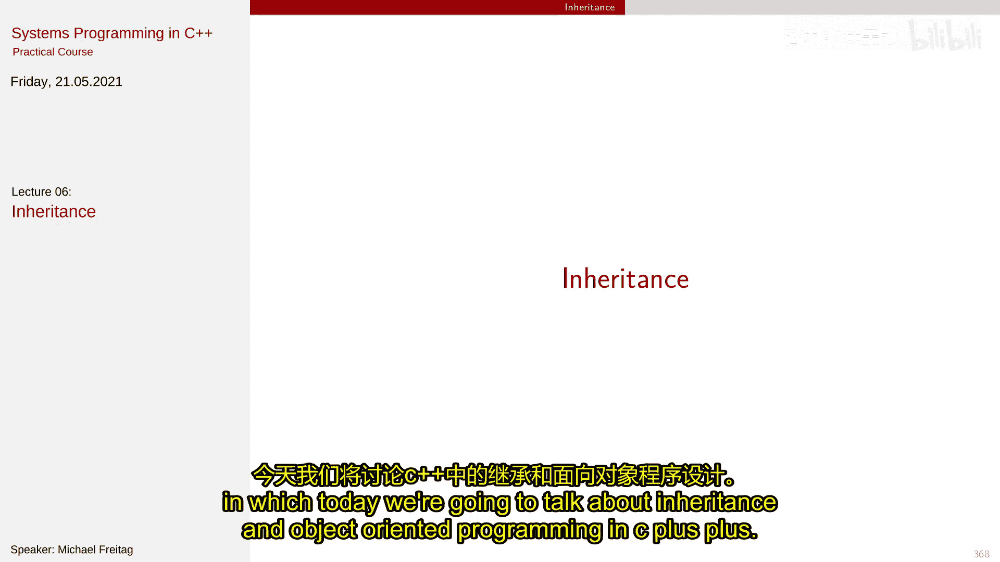

So as you all probably know object oriented programming is essentially based on three pillars。

 we have data abstraction， which is implemented by classes in C++ and many other programming languages。

 of course， and we've already covered this in a previous lecture。

Then the second pillar is inheritance， which is implemented by class derivation in C plus plus。

In which the derived classes inherit the members and member functions of their base class or base classes。

 And this is the first topic that we're going to talk about in this lecture today。

 And then the final pillar of object oriented programming is dynamic binding or also polymorphism。

 which is implemented by virtual functions in C plus plus。

And this allows us to write programs that do not really have to care about the specific types of objects in an inheritance hierarchy because we have this dynamic binding mechanism that allows us to call functions on an a base class and in fact in bulk the behavior that is implemented in some derived class。

 and this is the second large topic that we're going to talk about today in this lecture。

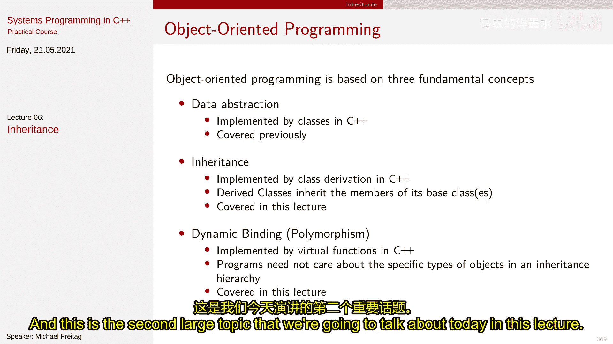

So without further ado， let's just jump right into it and take a look at how we can implement derived classes in C++。

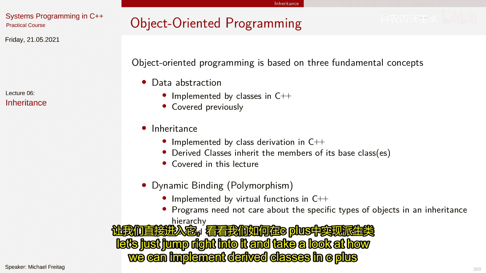

And this is relatively straightforward because any class type that you define in C plus plus may be derived from one or more base classes。

 and this is possible for both classes。Andstructs。Of course， the base class itself may。

 in turn be derived from their own base class so that we can build。

An arbitrarily complex inheritance hierarchy through these derivation relationships and the highle syntax for this looks as follows。

 so both for class instructor it's essentially the same we have our regular class definition here with the class keyword and our class name and then if you wanted to define a base class we use the colon and then a so-called base specifier list in which we list the base classes and some modifiers that influence how exactly this derivation looks like and we're going to take a look at this base specifier list next。

Because apart from this， there's nothing special， we just have our regular class definition here。

In which nothing particularly interesting changes。

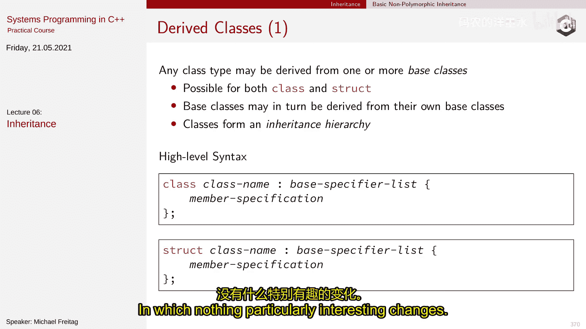

This base specifier list that we have after the colon just contains a comma separated list of one or more once again。

 technical term base specifiers essentially just base class names and this one of these entries is just an Excel specifier。

Which controls the inheritance mode。 This is something that we're going to see towards the end of the lecture。

 For now， it's sufficient to just remember that it can be either private， protected or public。

 and most of the time it will be public。In some very rare cases that are not really relevant for this practical course here。

 we can also have the virtual keyword in this base specifier。

 but this is something that we're not really going to talk about today because it is only used for multiple inheritance。

 which is essentially discouraged anyway。 and then finally。

 the only thing that's mandatory in one such base specifier here is the actual name of the base clubs。

So， of course， this is rather technical。 and you don't really think about。

Driving from a class in terms of these highly technical terms。

 So let's just take a look at an example to illustrate how this actually looks in code。

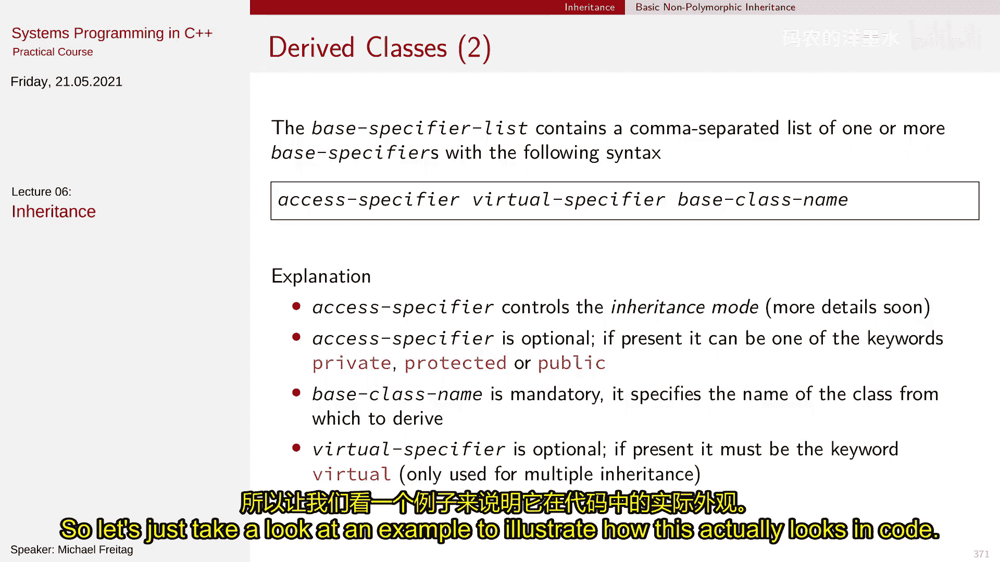

So in our example here we have one base class， of course it does nothing really interesting and then we have a number of derived classes that just illustrate how we can define such base specifiers yes so in our first example we simply have the colon followed only by a class name and this means that according to the rules on the previous slide we implicitly have private inheritance。

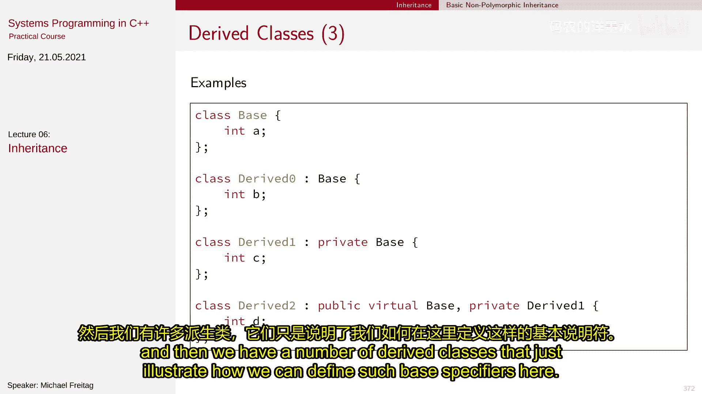

Here， so this is equivalent to writing this line here in the second example and derived0 and derived one。

 of course， are derived from the base class here。And then a slightly more complex example that you will probably never see in actual code。

is shown down here where we have a public inheritance from the base class that is also virtual。

 and then another base class and from which we privately derive。嗯。

In which we privately derive from the derived one class here。

 So this example is really just here to illustrate how these base specifiers could， in theory。

 look in practice， you will almost exclusively see public inheritance from a single base class。

So essentially in the same way as in the third example here。

 just that instead of private we have public here， but this is just something to keep in mind for the remainder of our lecture until we actually talk about inheritance modes。

Yeah。So now that we know how to define an inheritance hierarchy， we have to， of course。

 think a little bit about how we can actually initialize and destroy objects that are part of such an inheritance hierarchy。

 And of course， this is， as usual done through the constructor and de of these classes。

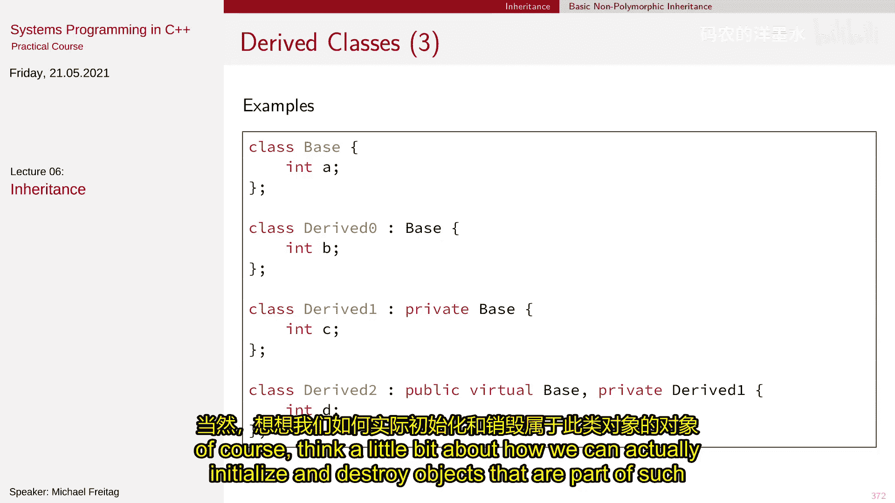

And they account for the inheritance that you have defined。 And in particular。

 if we take a look at constructors first。If we invoke the constructor of a derived class。

Then first of all， all the base classes are initialized and in case there are multiple base classes。

 they are just walked through in left to right order as you have specified them in this base specifier list。

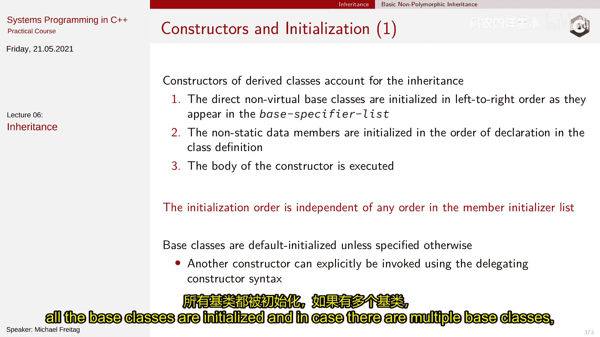

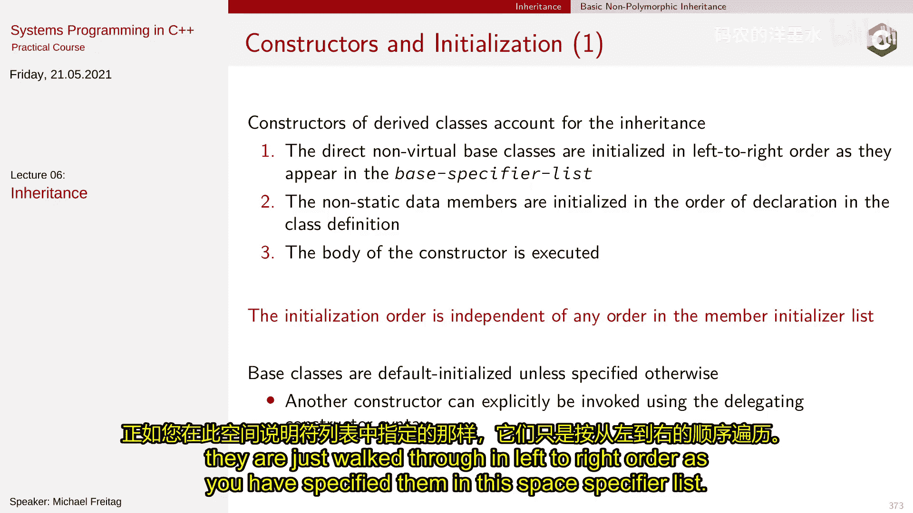

Afterwards， the data members of your derived class are initialized。

 so this is the behavior of a constructor that you've seen up to now and these are initialized in the order that they are declared in the class definition and then finally after these two steps have happened then is the body of your derived class constructor executed So we have this very wellspecified order。

 first of all the all base classes are initialized。

 then the data members are initialized and then finally the constructor body is executed。

One thing that is particularly important to keep in mind here that in step 2。

 the order in which data members are initialized is entirely independent of the order in which you specify them in the initializer list of the construct。

 so this only depends on the order in which they are declared in the class definition。

 and this is the reason why sometimes you get compiler warnings if you mix up the order in this initialization list。

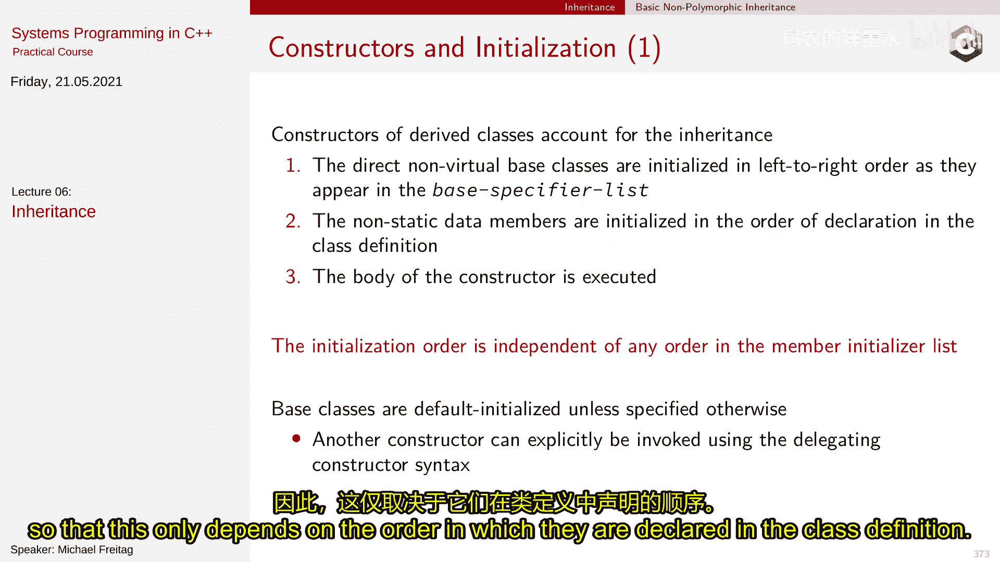

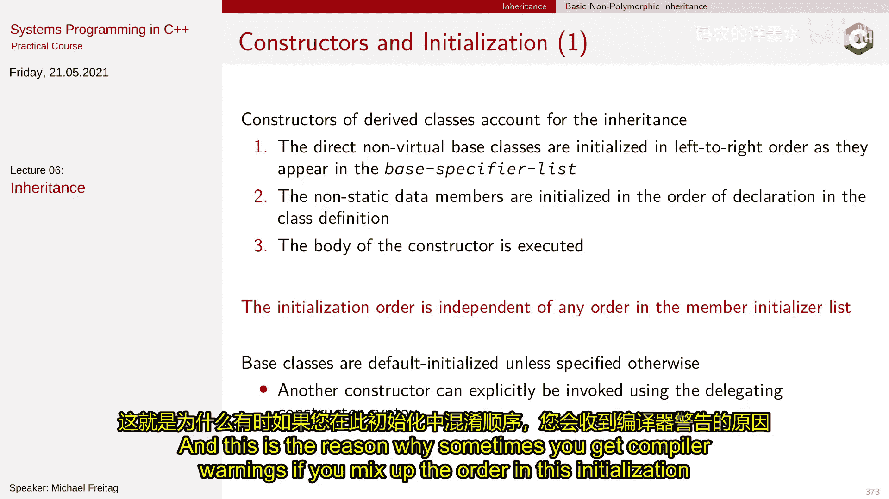

And as a final note， if we think once more about initialization of the base classes here。

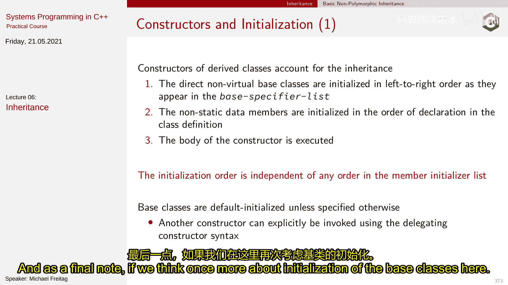

They are by default default initialized， so the default constructor of these base classes is used for this initialization step here unless we have specified something else。

 and this can be done by explicitly invoking another constructor using the delegating constructor syntax that you have already seen。

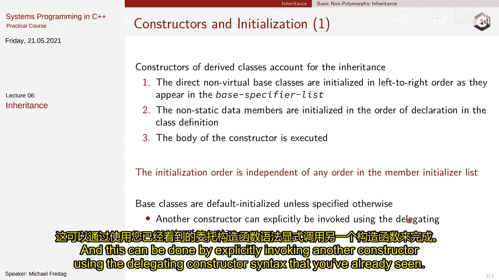

And once again， to make this a little bit more tangible。

 let's take a look at an example that illustrates the effects of these initialization rules。

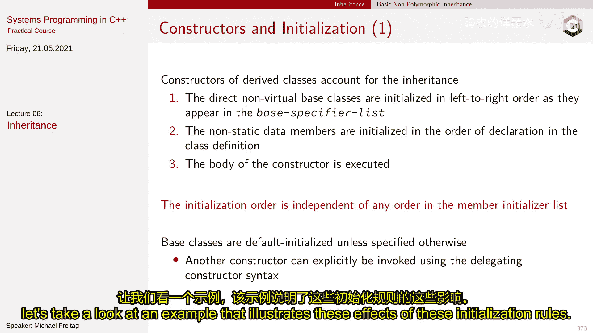

So let's assume we have the class definitions that are shown on the left here。

 we have a base class with two constructors， a default constructor and another constructor that takes a single int argument。

 and then we have a class that derives from this base class here that also has a default constructor and another constructor that takes two int arguments and then for the purpose of this example let's assume that the implementation looks as follows so essentially we initialize a couple of member variables。

 the important thing here is that in each constructor we print some information that allows us to trace what is actually being invoked。

Now。The one thing that I want to point out here concerning initialization is that in all the constructors。

 except for the last one， we do not explicitly invoke this delegating constructor syntax。

So in the derived constructor here， as we've seen on the previous slide。

 the base class is going to be initialized using the default constructor。

 whereas in the second variant of the derived constructor here。

 we explicitly invoke the single argument constructor of our base class。And of course。

 then this is going to be used over the default constructor of the base class。

And now if we just invoke the constructor of our derived class here。

 so one time we invoke the default constructor， one time we invoke the two argument constructor。

 we will see that the output of our program will be first the base class is constructed in this first constructor call。

 then the default constructor of the derived class is invoked and if we invoke this two argument constructor that if we take a look back at the previous slide explicitly delegates to another base class constructor。

 we will see that first this single argument constructor of the base class is going to be invoked and then the body of our derived two argument constructor is going to be invoked。

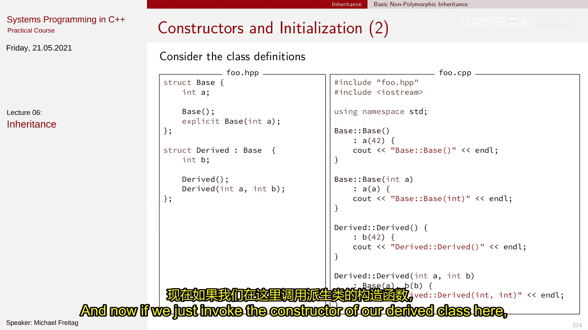

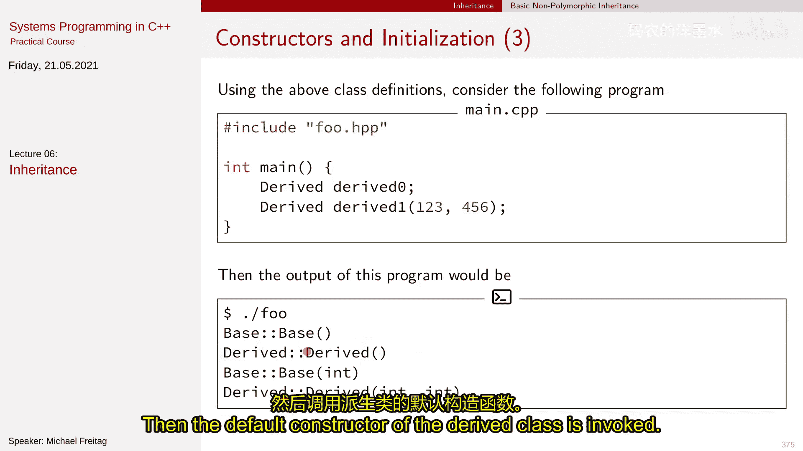

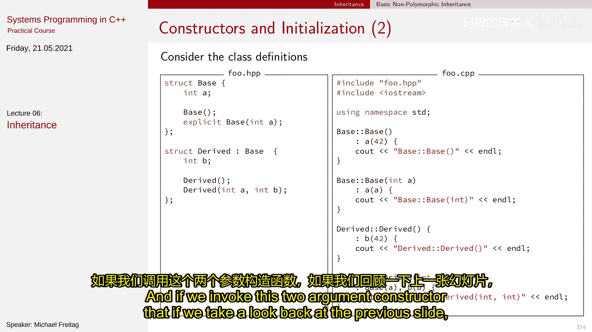

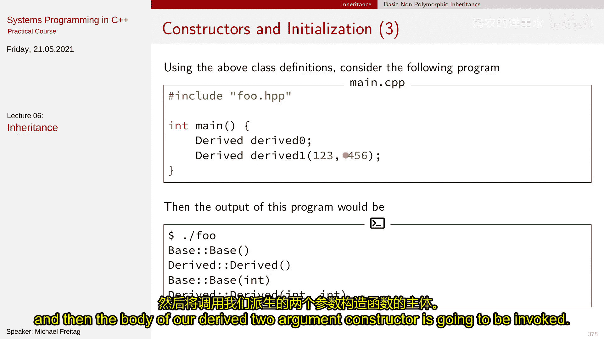

One thing that's also important to keep in mind here is once again we did not explicitly invoke any base class constructor in our default derived constructor here。

 but still the base class constructor was invoked and this is just a result of the rules that we've seen that all base classes are initialized before our derived class is initialized through this member initializer list and the body of the constructor。

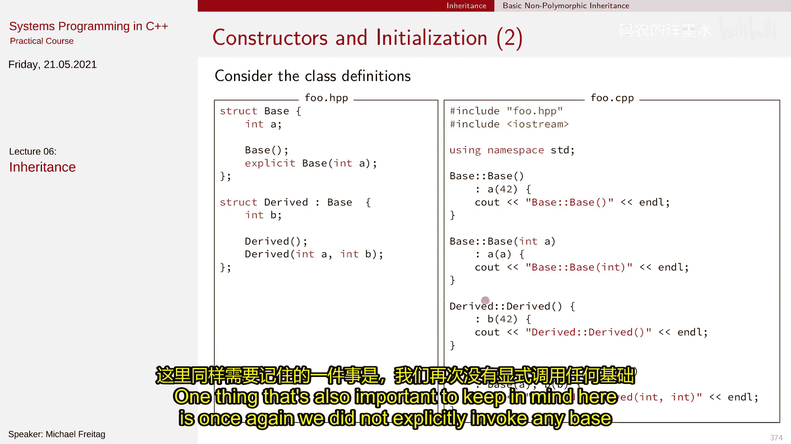

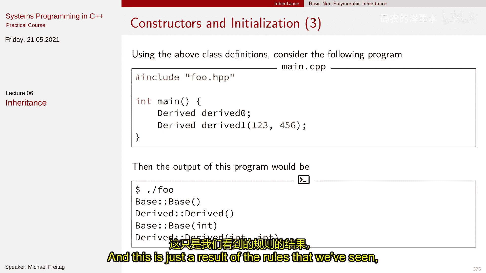

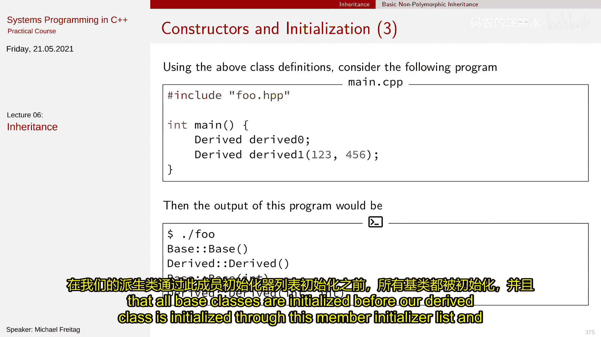

Right， so do we have any questions up to this point。Looking good。 Alright。

 So then we've seen how we can initialize objects that are part of an inheritance hierarchy。

 Let's now take a look at how we can clean up after ourselves。

 And this is essentially the inverse of constructing in that。

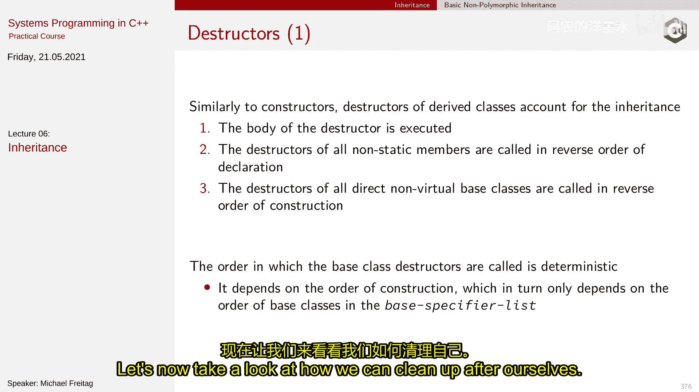

The order and the rules that we've just seen for constructing are reversed for deing objects that are part of an inheritance hierarchy。

In particular， this means if we invoke the de of a derived class， then first of all。

 the body of the deor is executed。Then all data members are deed in the reverse order of declaration。

 so for initialization， it was the order of declaration in which they were initialized now for destruction the order is reversed and then in the final step。

 the des of all base classes are called also in the reverse order in which they were constructed。

And the one thing that's once again important to keep in mind here is that the order in which the base class des are called is deterministic and this only depends on the order of construction which in turn is determined by the order of base classes in this base spec list。

 but once again usually you will not have multiple inheritance。

 so this is essentially an invariant here because it we only have a single base class then of course the order is always unique anyway。

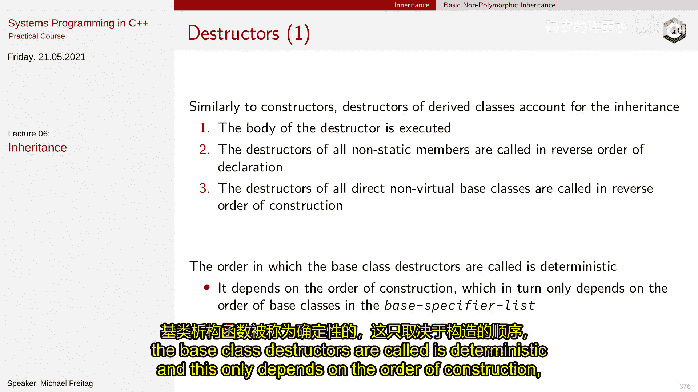

And once again， to make this a little bit more。Easy to understand let's take a look at this example here so once again we have an artificial inheritance hierarchy we have two base classes with therapy structuress and then we have a derived class that has both of these base classes as its bases and its own de and once again we simply just print which the is invoked in this implementation here。

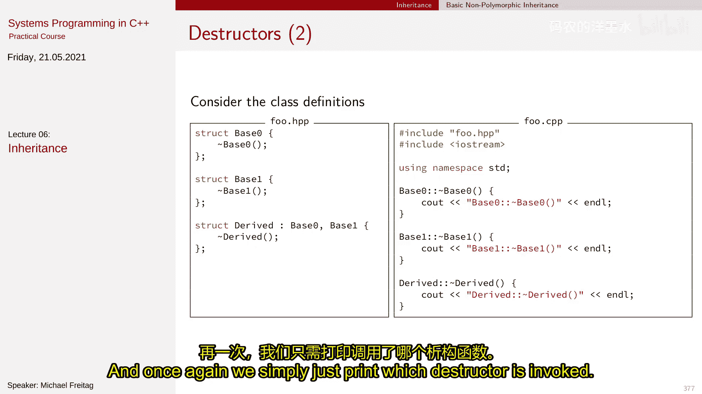

And now if we take an object of our derived class here。

 of course it's initialized according to the rules that we've seen before。

 and then once it goes out of scope at the end of our main function here， it's going to be ded。

 And as we can see in the output here， we follow the rules from the previous slide。 first of all。

 the de body of the derived class is invoked。 and then the des of the base classes are invoked in the reverse order in which we specified them。

 So we see here back to the definition of our derived class， the first base class was base 0。

 the second was base1 and in the output we see that first the de of phase one is called。

 then the de of phase 0 is called。

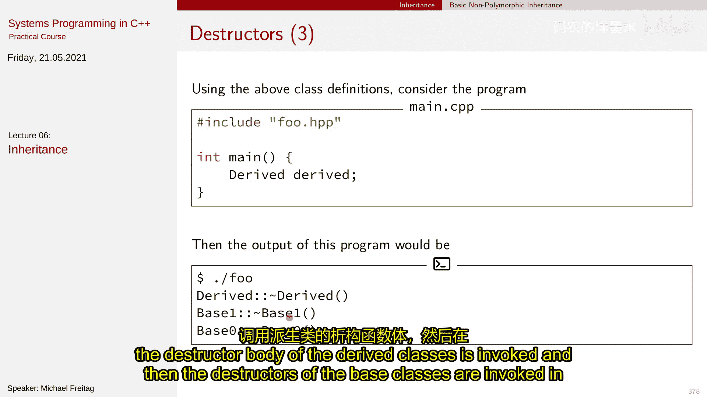

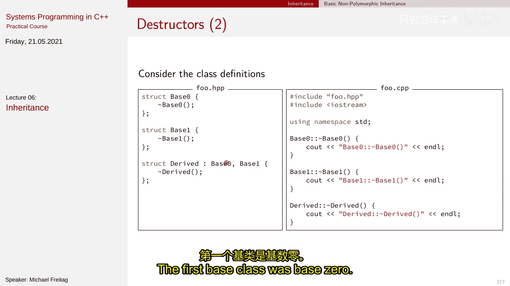

So we see here we have a very clearly specified set of rules how construction and destruction work。

 so once you've memorized these there shouldn't be any major surprises when you initialize or destroy objects of your class hierarchies。

Now the first important step is now out of the way we can at least somehow get objects of such a class hierarchy。

 but of course there are a couple more topics that come into play once we have objects that are part of an inheritance hierarchy and in particular something that's important to talk about here is how we actually resolve names and by names we usually mean the names of variables and particularly the names of functions。

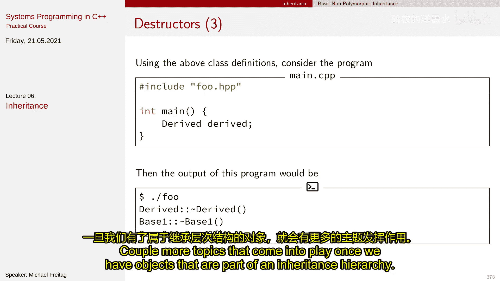

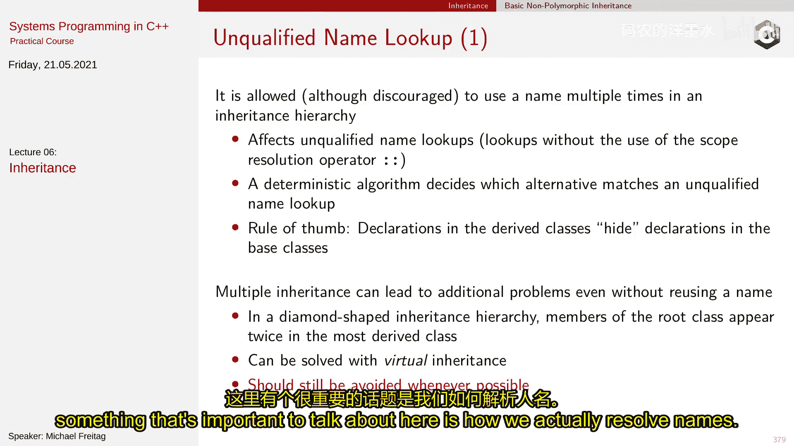

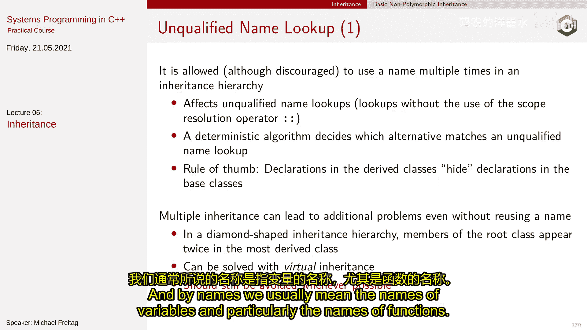

Because there is something that makes this a little bit complicated in C++ because it is allowed。

 even though it is discouraged to use the same name， so the same function name for example。

 multiple times in an inheritance hierarchy and of course this affects which functions are actually going to be called if you just write some function name if you just call some function name and the technical reason why this is a problem is because using the same name multiple times in an inheritance hierarchy affects unqualified name lookup。

 so any lookups without the use of these scope resolution operator that is the double colon that you' for example used if you call functions from another name space。

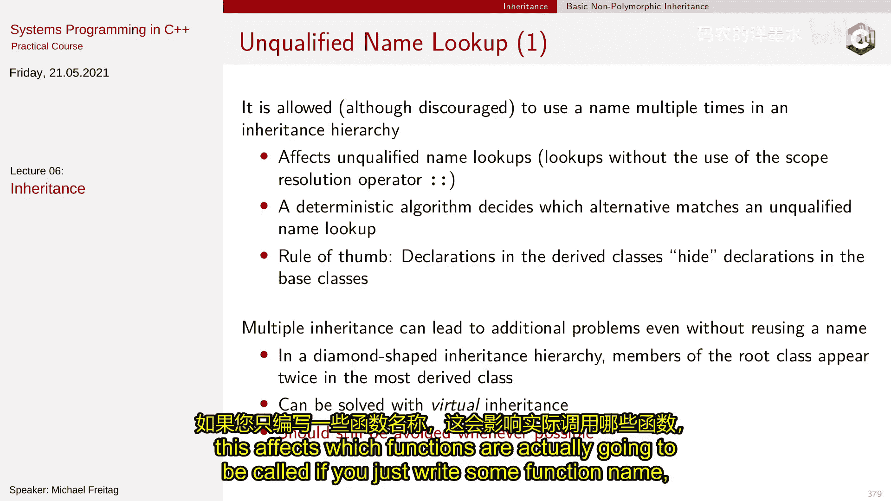

。Once again， this is one of the situations in which there is a rather complex but deterministic algorithm defined by the standard。

 which decides exactly which alternative matches an unqualified name look up。 This algorithm is。

 as I said， rather complex。 If you're interested， you can take a look at the reference documentation。

For all regular purposes， there is a much simpler rule of thumb。

 which is that any declarations in the derived classes quote on high the declarations in the base classes。

So if you have the same function name in an inheritance hierarchy。

 then the definition in the derived class almost always takes precedence over the declaration in the base class。

 and of course we're going to see an example of this in a second。

But before we can take a look at an example， just another side note regarding multiple inheritance。

 because here we can have additional problems even without using the same name multiple times。If you。

 for example， think of a diamond shaped inheritance hierarchy where we have one base class。

 then two derived classes that derive from this base class and then another derived class which derives。

 in turn from these two intermediate derived classes。

 then all members of the root class will appear twice in the most derived class。

So here we have the problem that essentially the same function appears multiple times in a derived class。

 Of course there is also a solution to this which is called virtual inheritance。

 but nevertheless and you see the common theme here。

 even though it is possible to resolve all these problems we would still like to avoid multiple inheritance whenever never possible and because it is so rarely required we will not go into more detail how virtual inheritance and all the related techniques work。

So with this out of the way， let's take a look at the actually interesting part of this problem。

 namely unqualified name lookup in a regular single inherited hiarchy。

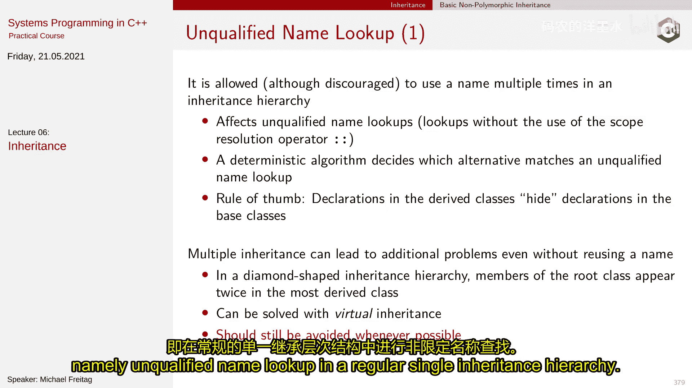

So here you see that we have once again a base class a， which defines a single function A。

Then we have another derived class B， which derives from a， which itself defines another function A。

 and here we see how this declaration in the derived class hides the declaration in the base class。

 because if we now call the function A from somewhere within ourstruct B here。

 this will call the function that is declared in B and not the function in the base class。

And now if we derive further from our class B here and call A once again。

 this will still call the function that's declared in a because this appears informally further down in the inheritance hierarchy and thus hides the declaration that is further up in the inheritance hierarchy。

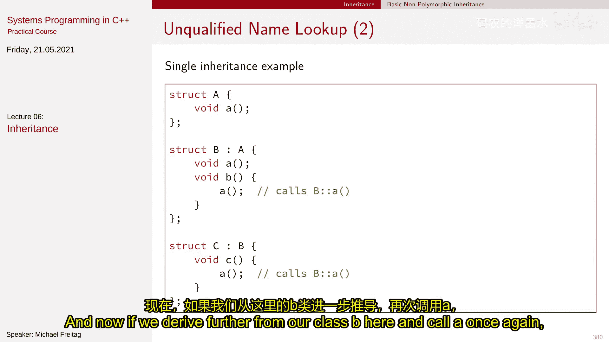

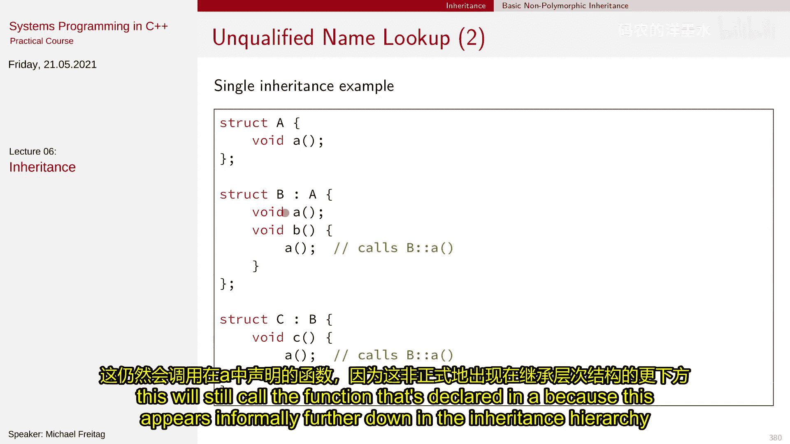

And just to give you an example of what we just talked about regarding multiple inheritance。

 this is essentially what I described before we have our single base class x with a function X。

 then we have two intermediate classes which both derive from this X and then we have this most derived class which derive from both intermediate classes here and if we now try to in both x then we just simply get a compile timearrow because this function X is present in both B1 and B2。

 So once again this is just for illustration usually you do not want to use multiple inheritance anyway so we can essentially skip over this example。

Now。This problem of unqualified name lookup is of course a little bit annoying because sometimes we may reasonably want to define functions with the same name。

 but still have control over which functions are actually going to be invoked if we write a function called somewhere and of course there's a solution to this we can simply use qualified name lookup involving the scope resolution operator to make explicit which of the possible alternative functions we want to call。

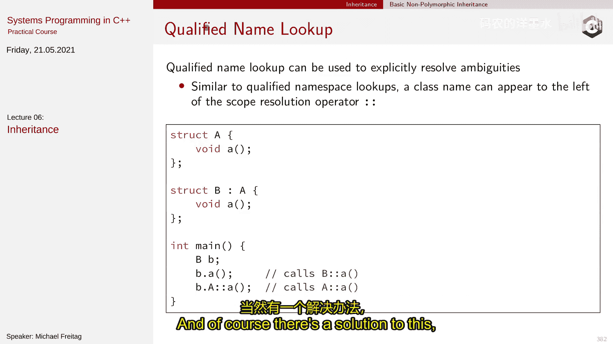

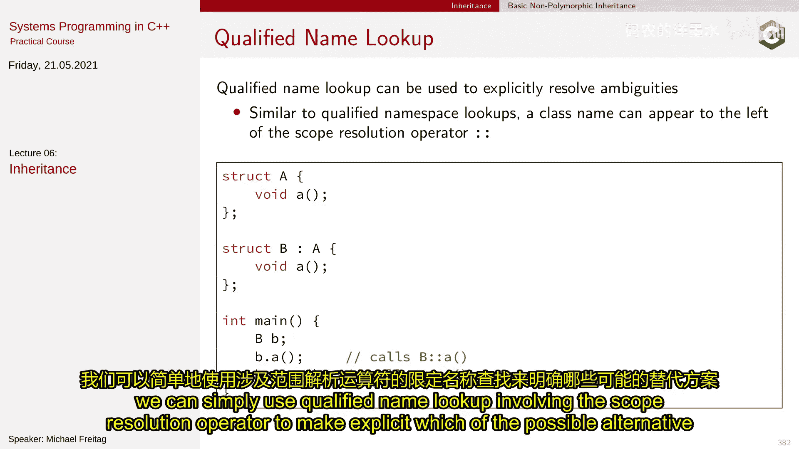

So this looks similar to qualified namespace lookups with the only difference that now instead of a namespace name。

 the class name can appear to the left of the scope resolution operator and we see an example down here how we can use this to resolve this ambiguity in name resolution once again the example is the same as before we have our base class A which defines a function A we have a derived class B。

 which also defines a function A and now of course if we simply call a on an object of type B。

 this will call the function that's declared in B， but if we use the scope resolution operator to explicitly select the declaration in a。

 then we can still call the initially hidden version of our function A here。

Any questions regarding name lookup in inheritance hierarchies。Great。

 so let's take a look at the final topic that's important。

When we talk about regular inheritance hierarchies and that is how our objects of such an inheritance hierarchy actually represented。

 And， of course， the object representation of a derived class somehow accounts for the inheritance。

 this is a no brainer because somehow somewhere we have to store all our information。

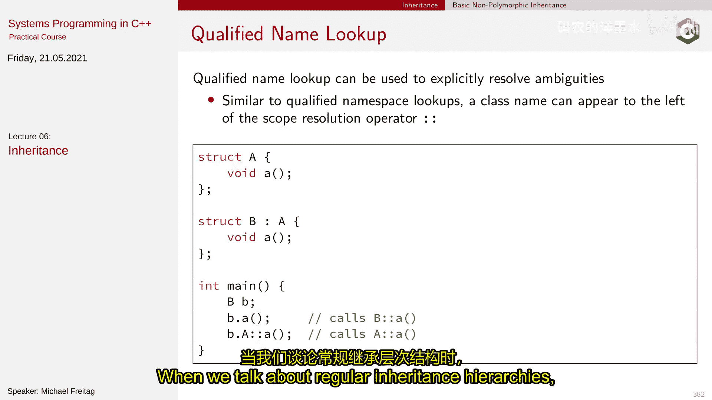

But it's worthwhile to take a look at how this actually looks in our code and how such objects are represented in memory。

 because sometimes we might have to interact on a more low level basis with such objects。

how this works is that all base class objects are stored as a sub objectject in the derived class object。

 so although it is not precisely implemented in this way you can think of the base classes as being just another data member of the derived classes only that you do not need to use a specific variable name to access this。

 but you can just directly access all the members that are defined。

In the base classes from your derived classes provided that they have suitable visibility， of course。

And because of this behavior， if you have an inheritance hierarchy。

 the derived classes may still be trivially copyable， constructable or destructible。

 as we've seen in our previous lecture， because for the purpose of determining whether these objects or classes to be more precise are trivially constructable。

We treat the base classes as just another data member essentially and if this data member is trivially constructable。

 for example， then of course， our derived class can still also be trivially constructable。

And to illustrate this a little bit more， let's take a look at another inheritance hierarchy here where we have a base class with two int members and then a derived class with which defines another inch member。

 And then we simply define an object of type B on the stack。

 And if we take a look at the assembly here， we see that。Essentially。

 all these data members are part of a single object that occupies some contiguous region of memory。

 of course， accounting for any padding that could be required due to alignment requirements and so forth。

 but essentially you see here if you take a look at the offsets that we have essentially an array of three integers on the stack which form this single object of type B here。

So。Up to this point， we just talked about inheritance without talking about polymorphic inheritance。

 so all of what we've described now simply allows us to have classes derived from other classes。

 but we still have not any functionality that allows us to have this dynamic dispatch functionality and polymorphic inheritance。

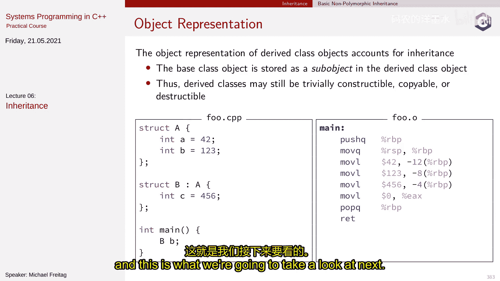

And this is what we're going to take a look at next。So as I've already said。

 by default inheritance in C++ is nonpolymorphic， we've seen that member definitions in a derived class high definitions in the base class。

 and for this reason it really does matter if we call a function through a pointer or reference to a base class object or a pointer to the derived class。

And just to reiterate this， this is essentially the same example that we've seen。

Regarding the qualified name lockup problem， if we have non polymorphic inheritance。

 which is once again the default and C plus plus and have a function that hides a base class function。

 then we can see down here if we call fo on the derived type。

 then it will of course invoke the derived function。

 but if we have a reference to this derived class which has type of the base class， so which would。

Possibly imply that there is already some polymorphphy in play here。

 We can see that in this case without polymorphic inheritance。

 we do actually print base colon colon fu here because the base class version of the function is is called。

 So this is contrary to， for example， how inheritance works in Java where it is polymorphic by default。

 if we were to write the semantically equivalent program in Java and would call P on a reference to base here。

 then it would actually print derived colon colon fu because we always have polymorphic inheritance and the。

The language would determine that this reference to a base class has in fact typed derived and would call the correct function。

In C plus plus， as we see in this example， this is not the case by default。

 our inheritance is non polymorphic， and we have to do some explicit work to make our inheritance polymorphic and the key。

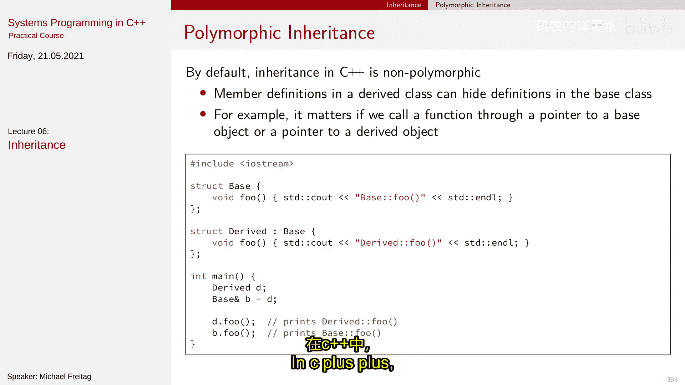

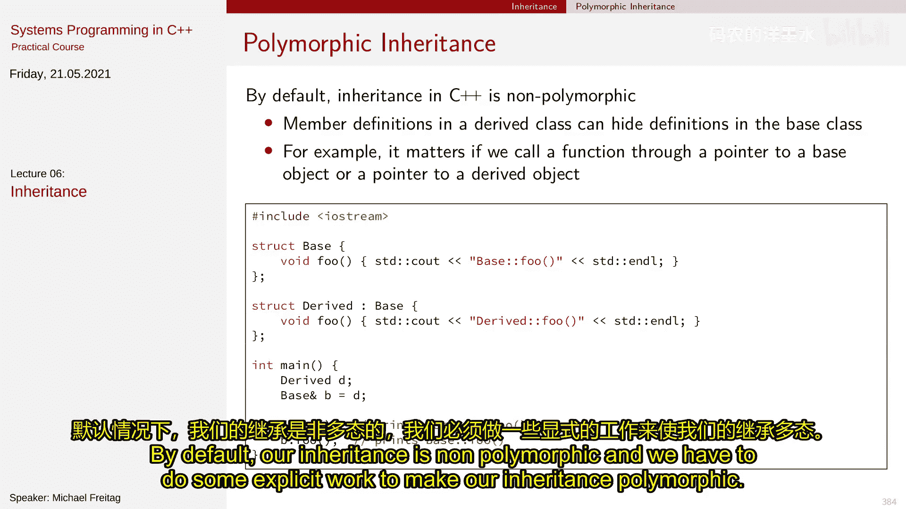

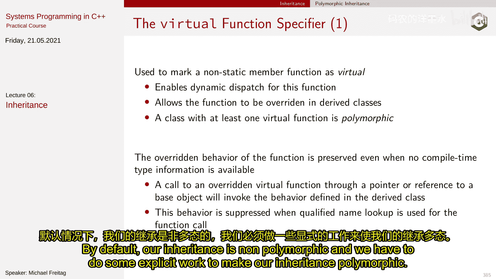

Keyword here is the virtual keyword， which is used to mark a non static member function as virtual。

 and this enables dynamic dispatch for this specific function。

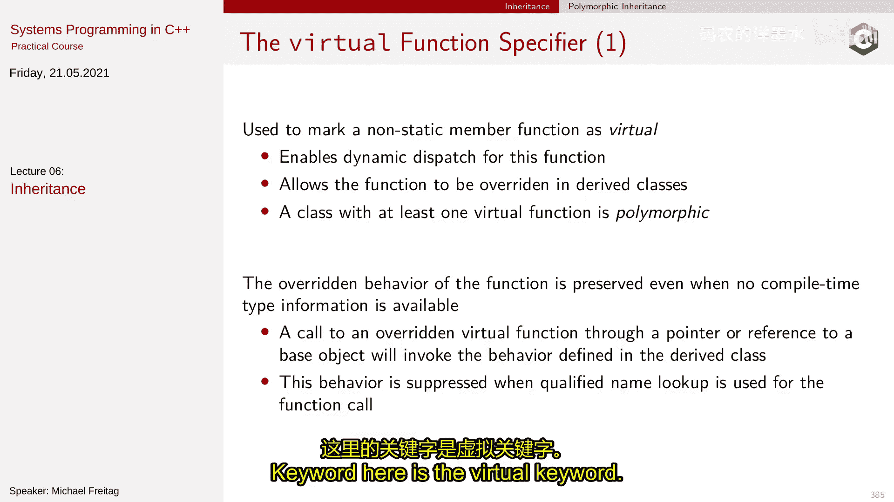

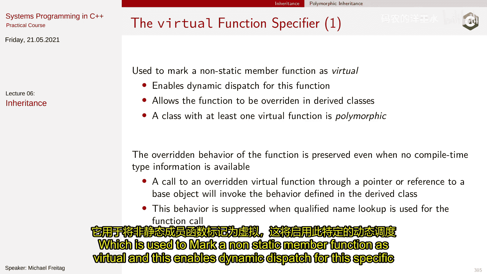

And once we mark a function as virtual， then we get the behavior that we， for example。

 would expect from Java， that the function can be overridden in derived classes and we get the expected dynamic dispatch behavior。

Once we have at least one virtual function in a class then this function is polymorphic。

 but once again， this dynamic dispatch is enabled only for those functions that are explicitly marked as virtual any other functions retain the behavior that we've seen up to now in the non polylymorphic inheritance case。

Now， if we do have such a virtual function， then the overwrittendden behavior is preserved even if we do not have any compile type information available anymore。

So in particular， this means if we call an overwrittendden virtual function through a pointer or a reference to the base object。

 then we will still invoke the behavior defined in the derived class。Of course。

 we can influence this behavior to some extent， if we use qualified name lookup。

 then we can still force invocation of the base。Class version of the virtual function。

 But usually this is not what we want。 if we have already gone gone through the trouble of marking a function virtual explicitly。

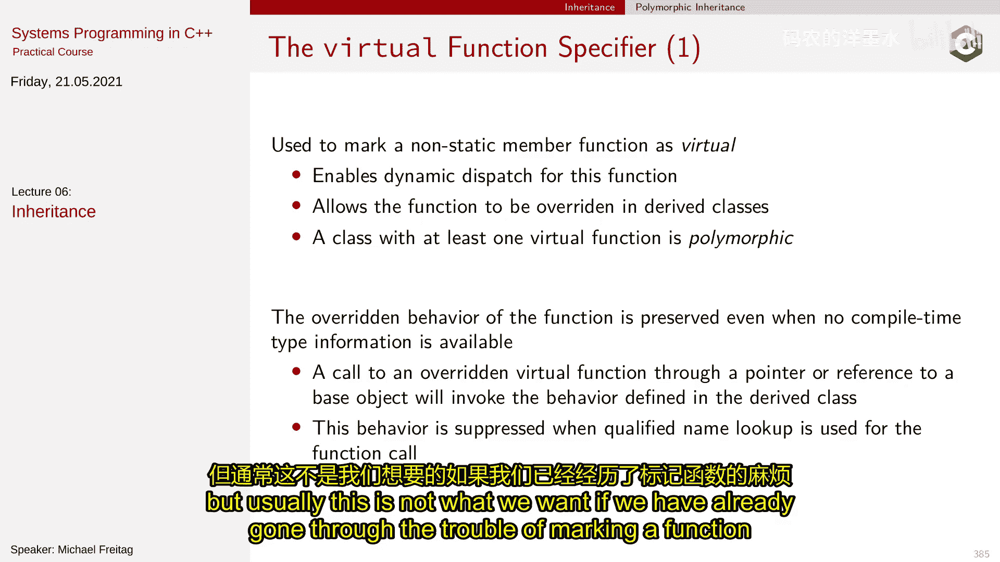

So。Just to refresh your memory we have had this example here with two versions of the full function that just print which function is called and we have this derived object and a reference to the base class that points to this derived object。

 and here we've seen without polymorphic inheritance we essentially print。

The type of the reference or the the object on which we're calling Fo。 Now。

 let's take the same example and mark the base class function virtual here。

 So the implementation is exactly the same with the only difference that weve preended this virtual keyword to the full function in our base class here。

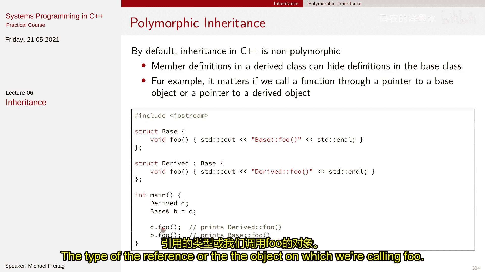

And now we see that the behavior changes slightly。 So also our example is， of course。

 a little bit more more extensive。 We have one object of type base。

 we have one object of type derived， Then we define two references that are both references to the base type。

 one of which points to the actual base object， the other of which points to the derived object。

And now we see regardless of whether we call the full function through a reference to base or on the derived object itself。

 as long as the underlying object is of type derived。

 we will print and invoke the corresponding function in the derived class。

 even if we call it through a reference to base。Of course。

 we can overwride this behavior by using the qualified name lookup。

 as we've seen on the previous slide。And also of course， if we。

 the underlying object is actually of type B， as is the case for this MBR reference here。

 then also we're going to invoke the function defined in the base class here。Yeah。So。To reiterate。

 if we want polymorphic inheritance with the behavior that probably is most intuitive to most of you。

 then you have to use the virtual specifyifier to explicitly mark functions as。

Being able to be overridden and enabling dynamic dispatch。A question in the chat。

 what if the full function in the derived class is also virtual， In fact， it is virtual。

 It's implicitly virtual because it overrs the virtual function in the base class。

 There are some additions that we're going to see in a couple of slides that make this more explicit and more safe。

 so to avoid potential bugs， but essentially。A function is virtual。

 either if you market virtual explicitly or if it overrdes a virtual function in some base class。

And because of this， we usually do not write the virtual keyword anywhere else。

 but in the base class， so the code would work the same if we would mark the full function in the arrive class virtual as well。

 but this is not required。Right， any further questions。What if it is virtual in。

 but not in the base class。 Okay， let's turn this around then。

We can just apply the rules that we've learned so far in the base class。

 we just have a regular function that is non virtual and does not have dynamic dispatch enabled。

 And then in the derived class， we have a virtual function。

But the function in the base class was not virtual。

 so this function in the derived class initially just hides the function in the base class with the same implications as we've seen up to now。

 The only thing that this virtual in the derived class then does is that any class that is derived from our class called derived here will be able to overwride the function that is defined in this derived class。

 but of course， not the function that is defined in the base class。

 because that is simply hidden by the function in our derived class here。So， the。

The virtual keyword essentially just affects anything that's below this class in the inheritancy。

 nothing that's above this class in the inheritance hierarchy。I think another question is coming。

 So let's wait a couple seconds。So in the example that we have a non virtual function in base and a virtual function in derived。

 the question is then whether DR dot4 would call the method in the base class。嗯。

What is the RDR is a reference to base。And then since the function in the base class is non virtual。

 you are correct。 If we call fo on this DR reference here。

 then it would call the method in the base class。Because here。

 we do not yet have any dynamic dispatch。 And there it depends only on the type through which we are calling the function。

 which function is actually called。 So you're correct。Right。

 I think that's all that needs to be said here。Right， if there are any further questions。

 please let me know in the meantime， let's move on a little bit with our discussion of polymorphic inheritance。

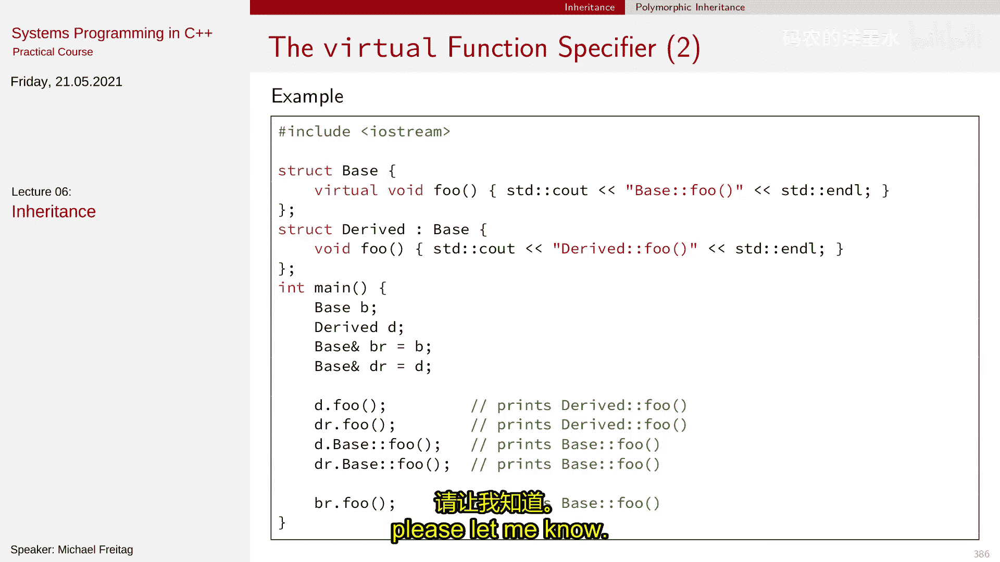

Because， of course。We have to think a little bit about what actually which conditions have to be fulfilled so that we can actually override a function in the base class。

And this luckily is one of the cases in which the rules are pretty straightforward。

 If we have a function in a derived class and there is a function that is marked virtual in some base class。

 then this function in the derived class overrdes the virtual base class function。

 If the function name is the same， this is rather obvious。The parameter type list is the same。

The return type does not have to be exactly the same， it can be the same。

 but it can also be a so called covariant return type and see we'll see what this means in a couple of slides。

And beyond this， the CVV qualifiers of the functions have to be the same。

 And the ref qualifiers of the function， if any， of course， have also。Also have to be the same。

And if these conditions are met， then the function in our derived class overrides the virtual base class function。

 and we've already discussed this， then the derived function is automatically also virtual and can be overridden by any further derived classes。

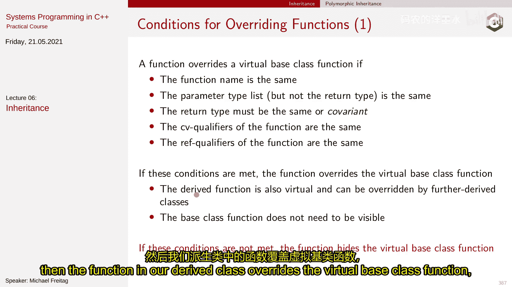

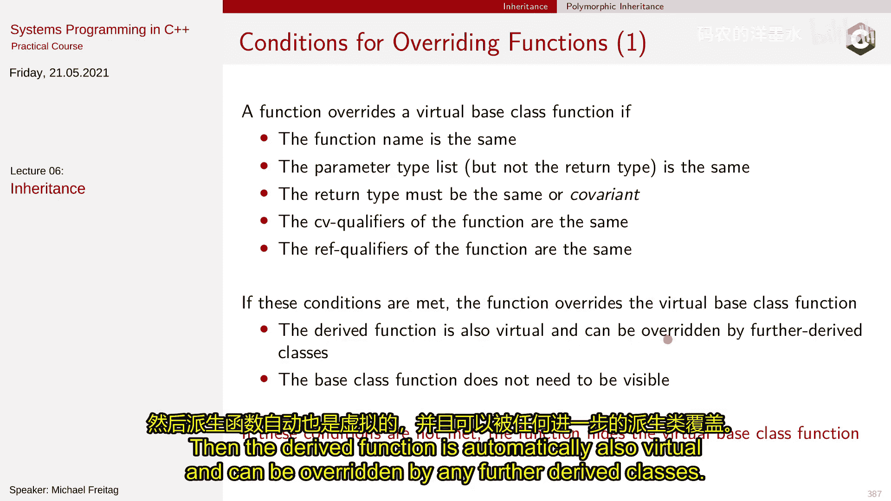

One peculiarity about this is that the base class function does not even have to be visible in the derived class for this mechanism to work。

The important thing here is if any of these conditions are not met。

 then the function that you have defined in the derived class actually hides the virtual base class function instead of overriding it。

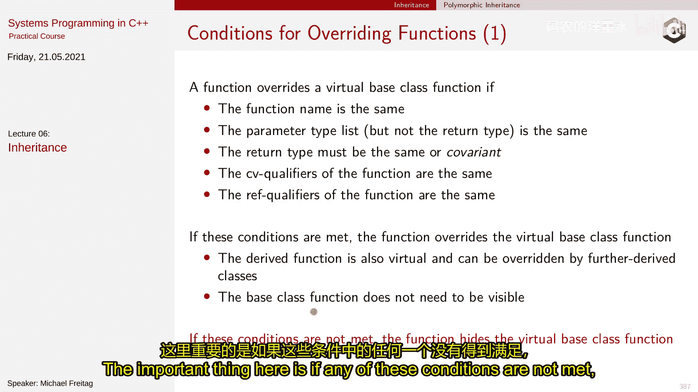

So once again， to illustrate these rules a little bit， let's take a look at another example here。

 we have another base class， which with one private virtual function and one public virtual function。

And according to the rules that we've just seen， if we now derive derive from this base class and define one function bar。

 one function full with some signatures here， we see that the bar function fulfills the rules for overriding and it has the same function name。

 it has the same parameter， the same Cv qualifiers and the same return type。

 So this function overrs the bar function in our base class。

 even though our derived class cannot actually see this bar function because it is declared private in our base class。

On the other hand， the full function takes another parameter of type int。

 which is not present in the base class， and because of this it does not override the full function in our base class。

 but instead it hides this base。Base class function。 and of course。

 this has some consequences when it comes to calling functions。

 namely if we have an object of type derived and once again a reference of type base to this object we now call the full function without any arguments on the derived object we get a compile time error because this function with a one parameter hides the version without any parameter in the base class and unqualified name lookup then only finds the version of who that takes a single inch parameter so this does not compile here。

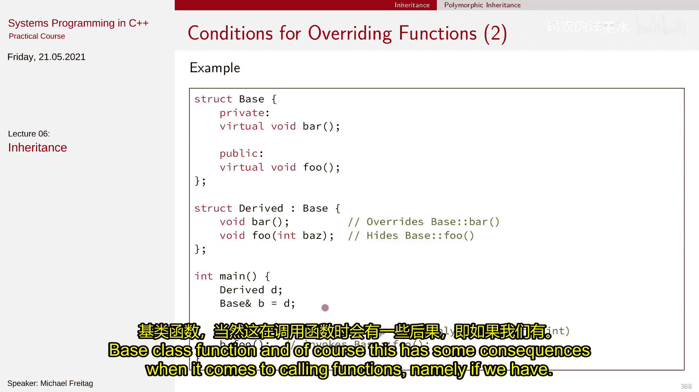

On the other hand， if we call fo through a reference to base。

 then regular the unqualified name lookup will of course find this function fo without any parameters in this line it would compile。

Now。Up to now， it has always been rather obvious which function is going to be called if we do have some polymorphic inheritance here。

 but。

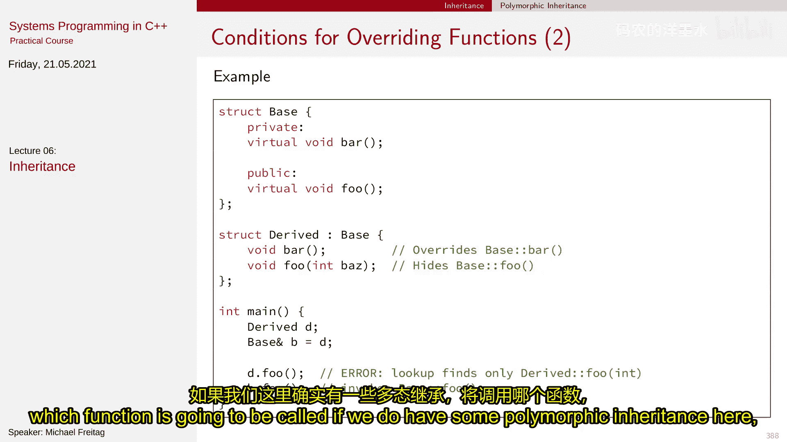

This is also something that may be a little bit less obvious and to have some clear rules。

 what is actually going to happen there is the concept of the final overrider。

And this applies to every virtual function because every virtual function has a final overrider。

 and this is the function， the version of the function that is actually going to be executed when a virtual function call is made。

And。Usually if we do not have any fancy multiple inheritance hierarchies。

 the final overrider is the function in the most derived class that overrides the virtual function。

 so if we want to state this the other way around， if you have a virtual member function somewhere。

 this function is the final overrider， unless there is a derived class that overrides this function further down in the inheritance hierarchy。

If we have multiple inheritance， and the rules are， of course， a little bit more complex。

 but since we want to avoid multiple inheritance anyway。

 let's skip over this and instead like take a look。Add another example here。Now once again。

 three virtual functions， Foo bar and BS， then we have a derived class B， which overrites F and bar。

 and another further derived class， which overwrdes F again。

And now let's define an object of type C and have a reference of type A to this C object here。

 and we see if we call P， then the final overrider is of course。

 the P function in C because this is the most derived class， if we invoke bar。

Then the final overrider is in thestruct B here because C does not overwride bar once again。

 and for the B function， none of the derived class overr it so the final overrider is in fact the implementation in the a class here。

One side note here is that the final overrider， of course。

 depends on the actual type of an object if we replace our object of type C with an object of type B in our example then invoking P in a reference to a will invoke B do P because the actual type of our object is B and of course in B。

 the final overrider of the P function is P itself。

 because we essentially do not know anything about C yet we are an object of type B here。

Any questions regarding how the final overrider is determined？

Alright， so the final thing that we covered when it comes to the conditions for overriding functions。

Is that the return return type can be the same， or it can be a covariant return type。

 So let's take a look at what we mean by covariant return types。

A covariant return type can be a single level pointer or reference to a class。

And the return types are covariant if the return value so this reference or pointer in the base class function is a base class of the class that we return in the derived class function。

And， of course， we have to have similar C V qualifier。 So in the derived class function。

 the C V qualifiers can be at as at most as specific as in the base class function。

 And most of the time。 So this is the。第嗯。Use case for this that you will see if at all is that this covariant return type in the derived class is simply a pointer or a reference to the derived class itself and in the base class。

 it is a pointer or reference to the base class itself。 So since these rules are rather convoluted。

 another example to make this more clear。

We have a base class with two functions that return a pointer to this base class and then a derived class。

In which we are allowed to return a pointer to the derived class。

 because these return types are covariant instead of a pointer to the base class and still override the function fool。

 But， of course， we cannot return arbitrary types。

For example， in int， because the function bar would for all intents and purposes override。

 the base class function， but the return types are not covariant because int is not derived from base in any way。

And I think there is a question coming up regarding covervarian return types。

 So let's pause for a second。Okay， the question is that you thought the bar function in the derived class would hide the bar function in the base class。

嗯。In fact， it does actually produce a compile time error because this return type checking does not。

Does not influence the decision whether a function overrides or hides a base class function。

 So you're correct。 We described this slightly different on a previous slide， but our slide， I think。

 is inaccurate here。 So what actually if we go back to this slide here。

嗯。What we actually have to say here is that this return type condition here is separate from the other conditions。

 So we first check the remaining four conditions here to to check whether the base class function would be derived。

 And then once this has been determined， we then check the。

Return type， whether it is covariant。 So once we've determined that a function overrdes a virtual base class function。

 then the return type has to be the same or covariant。 Otherwise we get a compile time error。

You mean that also the name condition has to be adjusted。

 I don't think so because the function name is still the same here。

And if the function name is different， then these rules do not apply at all if we call this function bar2。

 then it could never override another function in the base class。

Please let me know if I misunderstood your question or if there is anything left unclear。Oh， well。

 yeah， this is a technicality。 If the name is not the same。

Then， of course， we cannot。We cannot override a function that has a different name。So this。

 this list here should be read as an if in the one side it sends not an if and only if。

If these conditions are met， then your function overritedes a base class function in the other direction the rules are a little bit more complex because some of these conditions if they are not met simply mean that you do not overwrite or hide any base class function we will probably state this more clearly on this slide and re uploadload them。

So that you do not get confused。 You're correct。 This is a little bit confusing If we think about the case that a derived function does not hide any base class functions。

 but。I hope that I clarified it at least for now， let me know if there' is anything left that's unclear。

Allright， there's some typing， so let's see what further questions。There are。Right。

 a question regarding the final overriide example， so let's go back to this。

We only have to specify the virtual keyword in the base class。 And then for all subtypes。

 it is not needed。 This is correct。 So this is also something that we've seen。

Somewhere before。Let's take a look。 We've seen it here。 If we override a virtual base class function。

 then the derived function is automatically also virtual。

 and we do not need to specify the virtual keyword once again， so。

In our example here， these Fo bar and another full functions in the derived classes are automatically also virtual functions because they override a virtual base class function。

All right， looking good。Great， so please let me know if there are。

 there is anything left that's unclear。 In the meantime。

 let's move on a little bit and take a look at construction and destruction again。 But this time。

For polymorphic inheritance， here， we actually have to be a little bit careful when it comes to calling virtual functions。

 because during construction and destruction， a class behaves as if there are no。

 no more derived classes than our class itself。So if you call a virtual function during construction or destruction this function。

We'll call the final overrider in this specific class， not the final overrider。

 depending on the actual type of the class。And we can see this in an example here。

 we have a virtual function fo in our base class which is overridden in a derived class and we callF in the constructor of our base class。

 and then even if we construct an object of type derived in the constructor。

 this full function call we'll call the final overrider in the base class。

 which is the base class version of the full function， not the full function in the derived class。

So usually our advice here would be to simply avoid virtual function calls entirely in constructors and deors if for some reason you do have to call a virtual function。

 just keep in mind that they behave slightly differently from what you might expect。

Another thing that's very important to keep in mind is that we can。

Well have a situation in which a derived object is deleted through a pointer to the base class。

And here we have to be very careful because this is actually undefining behavior unless the de of the base class is a virtual function。

And because it's so easy to invoke undefined behavior here， there's another rule of thumb。

 which states that if you have the base class of an inheritance hierarchy。

 then the deor of this base class should either be protected and non-virtual so that it is not possible to destroy an object through a pointer to the base class because this deor is protected and does not visible outside of your class。

 or if it is not protected。Then it should always be a virtual distract。And this rule。

 I don't think it has any exceptions。 So you can always apply this rule if you have a public de。

In a polymorphic inheritance hierarchy， then it has to be virtual， of course。

 only in the base class in the derived classes， it will automatically be a virtual function。

 but in the base class， you have to make it virtual if it is public or you have to make it protected if it should not be virtual。

If you do follow these rules then we can end up with this example here in which we have a base class with a virtual public de and a derived class and then it's perfectly legal to create a derived object on the heap and this also applies for unique pointer since we should not use new outside of examples assign this pointer to the derived object to a pointer to the base class and then delete this object through this pointer to the base class so this works because the deor is a virtual function and invoking the。

Informally speaking， invoking this virtual de of the base class， we then select the final overrider。

 which is the overriding de in the derived class implicitly defined here。

 and we will properly clean up both members of the derived class and the base class。

If this deor here were to be non-virtual but public， then of course。

 it would be undefined behavior anyway， but more intuitively what would happen here is that we would only invoke the deor in the base class because the type of our pointer is based so we would clean up any any data members of the base class。

 but we would forget to clean up any members of the derived class。

 which of course may have non-default deors themselves and need to be properly cleaned up so that we do not end up with memory leaks or other bugs。

 So this is just an intuitive explanation why it does not work keep in mind it is undefined behavior anyway。

 So even if you can think of some contrived use case for this it's still undefined behavior and you cannot actually do this。

哦。A question from the chat with the derived de called the base deor in this case， yes。

 the rules of how des are called are still applying here。

 so the virtual specifier here only has the effect that we call the final overrider of this deor which is the deor of the derived class。

 but then the regular rules that first we execute the body of the deor and then we execute the deors of all base classes still apply。

Any further questions。Yeah。I think there's something coming up， so let's wait for that。Okay。

How can a base deor be protected if it has to be implicitly called in the derived de。

 This is no problem because any protected data member is visible in the derived glasses。

this is the same as in other programming languages such as Java where private is only visible within the same class。

 public is visible everywhere and protected is visible in the same class and all derived classes。

 so within the derived class D structure， the protected base class de structure is still visible just like you would expect and this implicit call works as expected。

All right。That's looking good。 So let's。Let's move on， now。

You have already through your questions pretty much prepared perfectly for this slide here。

 which talks about the override specifier because you are completely right with your questions about whether you have to mark derived functions virtual or it happens implicitly that there is some ambiguity and potential for bugs here。

And the examples that we've shown up to now omitted a very nice feature of C++ which makes your code much less bug prone。

 and this is using the override specifier to make explicit that you intend to overwrite a virtual base class function。

So this override specifier can appear directly after the declarationator of a member function declaration or an inline member function definition。

 and this then ensures that the member function is。

 in fact virtual and does override a base class function and this is extremely useful because it allows you to avoid bugs where you intend a function to override a base class function。

 but in fact， it hides this base class function because the function signature is slightly wrong or the C qualifiers do not match and as a consequence。

 you should always use the override specifier when you do actually override virtual base class function。

And just a quick illustration of the benefits that this gives you。

 let's assume we have another base class with two virtual functions。

 one function food that takes an inch argument and another function bar。

 note that both of these are not con qualified。And if we now attempt to override these functions one time with a an incorrect parameter type。

 which， of course， prevents overriding。 But we do add this override specifyifier。

 then we get a compile time error， which states something along the lines of。

That this function does not， in fact override but hide the base class function fool。 And of course。

 this also works for all the other potential mismatches that could happen such as having the wrong C qualifiers or anything else。

So once again， let me reiterate， always use this override specifier when you override functions in derived classes。

 and of course this is required anyway， use the virtual keyword in the base class when you where actually define a virtual function。

Any questions I think I saw some typing。All right。Let me know if anything comes up。

Now similar to the override specifier， there's also the final specifier。

 but this is much less used and the final specifier。

 I think not very surprisingly allows you to prevent overriding a function。

And this specifier， just like the override specifier。

 can appear directly after the member function declaration or the inline member function definition。

And then if we attempt to overwride a function that is marked as final。

 then we also get a compile time error this time， not because overriding does not work。

 so the signature and everything match， but simply because the base class function is marked final and we are not allowed to overwride this function anymore。

And。Just like we can mark individual functions final。

 we can also mark entire class final in which case we have to put the final specifier immediately after the class name and then we get a compile time error as soon as we try to derive from such a final class here。

But apart from some niche use cases， the final specifyifier is by far not as useful as the override specifier so。

If you remember anything， please do remember to always use the override specifier。 you can。

For most purposes。You will not need need the final specifier。

And I think there is a question coming up now， So let's。Pause a little bit。

The question is whether we could also mark fo in the derived class with finals。

 so I think you refer to this previous example to break the polymorphic chain。Yes。

 and this is the more useful case anyway， so usually marking a virtual function final doesn't really make sense in the base class。

 but what you want to do is override it in some derived class and then mark this derived function final to prevent any further overriding of this function so what you described is essentially the exact use case for final not directly appending it to the base class function but having it somewhere in in a derived class to as you said。

 break the polymorphic overriding chain so to speak。All right。

Now that we've talked about polymorphic inheritance。

 the logical next step which follows from polymorphic inheritance is to talk about abstract classes。

 which C++ of course， also allows us to define。

And as you probably all know， an abstract class can only be used as a base class。

 but it cannot be instantiated itself。 And the way that this works in C plus plus is that any class that declares or inherits from some of its base classes。

 at least one pure virtual function is an abstract class。

 So note that this does not apply to virtual functions， as we've seen them up to now。

 but only to pure virtual functions。 and such a pure virtual function。

Is simply a virtual member function that contains the sequence equals 0 after the Declarator and any override or final specifies。

 if there are any。Of course we can still declare pointers or reference to an abstract class。

 but the underlying object， of course， then has to be a derived class that implements all of the pure virtual functions so that it is not an abstract class itself。

Even if we do mark a virtual member function as pure virtual with this equal zero syntax here。

 we can still provide a definition for the pure virtual function。

 So an implementation of this pure virtual function。

 and then the derived classes can call this default implementation using qualified name lookup。

 but the derived classes still have to provide their own implementation of this pure virtual function Sometimes it's just useful to have some common functionality defined for such a pure virtual function。

 but still make sure that all derived classes have to actually implement this。

This pure virtual function。One thing to keep in mind if you do want to provide such a default implementation is that the pure specifier cannot appear in a member function definition。

 so this default implementation for a pure virtual function cannot be provided as an inline function definition directly in the class definition。

Now once again， there's potential for bugs and errors here and in particular making a function call to a pure virtual function in the deor or destructure of an abstract class is undefined behavior。

 and this essentially follows from the behavior of virtual functions in constructors and de structuress that we've seen before because as we know in the constructor or destructor the final overrider in the class itself of a virtual function is involved。

 but of course for a pure virtual function this final over does not have to exist we do not have to have a definition for a pure virtual function。

 so it doesnt it would not really make sense to call such a function anyway。

And this is also one of the reasons why in most cases you should simply avoid calling virtual functions in the construct and destructure entirely because then of course。

 you do not run the risk of accidentally calling a pure virtual function in this place。

Now， an example to illustrate abstract classes， let's take our by now probably well known base class here with our full function。

 market virtual， and also append the equal0 specifyifier here to make it a pure virtual function。

And then define a derived class that overrs this full function。 Now。

 since the base class here contains a pure virtual function， it is an abstract class。

 And for this reason， we cannot instantiate objects of this type。 So if we try to define。嗯。

An object of type base on the stack here， we would get a compile time error because base is an abstract class and we cannot create objects of this type。

But of course， the derived class here implements all pure virtual functions。

 and for this reason it's perfectly fine to define an object of this derived type here。

 and we can still， as we've seen on the previous slide。

 declare references or pointers of type base as long as they point to an object that actually implements all of the pure virtual functions。

 and the same rules for overriding or hiding apply here， So if we call fo on a reference to base。

 but the underlying object type is derived， then this function call will as we expect from polymorphic inheritance call the implementation in the derived class here。

We may provide a definition for a pure virtual function， we've also seen this on the previous slide。

 so the same example here， our virtual pure virtual function fo in the base class we can provide an out of line definition here that does something then in the arrive class we still have to overwrideite Fo。

 but we can call this definition of the pure virtual function。

 which may for example contains some common functionality。

 maybe some logging statements or something like this。诶。

Sometimes useful feature is that we can also mark the deor of a class as pure virtual。

 and this is useful if a class needs to be abstract for some reason。

 but it does not contain any suitable functions that we could declare as pure virtual， in this case。

 since we always have a deor we can just resort to marking the deor as pure virtual to make sure that our class is an abstract class。

The only thing that we have to keep in mind if we do this is that as opposed to function declarations。

 we have to provide a definition for this pure virtual de for functions， this is optional。

 We do not have to provide a definition for pure virtual functions for a pure virtual deor。

 We have to provide this definition。And then if we do this， we can see。

That although our class does not contain any pure virtual member functions。

 we can still not create objects of this type because due to the pure virtualr de。

 our base class here is an abstract class。Now， of course， usually this is less of a feature。

 but more of an annoyance that we cannot instantiate in abstract classes。

And the usual way around this is that our programs always have to refer to abstract classes through pointers or references。

 And this also means that in most cases， if we have an inheritance hierarchy that contains an abstract class somewhere towards the base of the inheritance hierarchy we usually almost always have to create objects in this inheritance hierarchy on the heap and of course。

 as we've learned in the previous lecture in the vast majority of cases。

 this should be done through smart pointer such as unique pointer。

But we can， of course， if we do not want ownership trip also reference。

These objects on the heap or have a raw pointer to these objects on the heap。 if for some reason。

 we need null pointer as a possible value for our pointers。

And just to illustrate this a little bit because the syntax is somewhat counterintuitive here。

 let's take a look at another example， so a base class that is an abstract class since it has a pure virtual function and a derived class which implements this pure virtual function。

Then what we will usually see is that we can have a unique pointer that points to base so。

Just recall that a unique pointer can be treated in essentially the same way as a raw pointer just that it implements ownership。

 semantics and the RAII pattern。 and so we have here a unique pointer to base that is initialized from an object of type derived that we initialize on the heap through a call to SDD make unique。

And the implementation of unique pointer internally makes sure that this assignment actually makes sense so that the right hand side here is derived from the type of the arrived hand side is derived from the type of the left hand side here。

 which of course in our example works because the derived class is in fact derived from the base class here。

And now， just as you would expect， if we call functions on this unique pointer here。

 dynamic dispatch still works。We call the full function on this pointer to base here。

 it still calls the derived function， and we can also dereference our pointer here to get a reference to base for example。

 pass this to a function that should not acquire ownership of our object here and then。

This full function call here， just as you would expect。

 still resolves to the final overrider in the derived class here。

And now once our unique pointer here goes out of scope。

 it of course destroys the object that is contained within and just as a reminder this would be undefined behavior。

 unless as it is here in our example， the base class deor is also marked as virtual because this is a pointer to base and internally we will call delete on a pointer to base and we've seen this on a previous slide this requires us to have a virtual de to avoid undefined behavior。

Now， once we have such complex polymorphic inheritance hierarchies。

 we will pretty soon run into the situation that we have to figure out the actual runtime type of objects and potentially convert between pointers and references to different classes in an inheritance hierarchy。

And the。Canonical way using language features here is to use the dynamic cast expression。

 the syntax of which is the dynamic cast keyword followed by angular brackets。

 so just like for example， for a static cast enclosing the new type and then in parentheses an arbitrary expression which。

Must be an L value expression or of reference type if our target of the cast is a reference type or an R value expression of pointer type if our target type of the expression is a pointer type。

The most common use case here is to have a safe downcast in an inheritance hierarchy。

 So if you have the situation that you have a pointer or reference to a base class and you do not know what the actual underlying type is here。

Then you can use dynamic cast to safely try to downcast to a more derived type。But， of course。

 this then involves a runtime check， whether the。The type that you want to cast to is actually derived from the type of the expression from which you're casting。

 If this runtime check fails， then dynamic cast will return a null pointer for pointer types if the new type is a reference type then it will throw an exception and we've already talked about this quite a bit usually you want to avoid exceptions and for this reason you almost always want to use a pointer target type in your dynamic cast expressions because then you can actually just compare to null pointer in case the cast did not work and you do not have to involve exceptions。

In this process。Of course， this runtime check is not for free。

 We do need some runtime type information for dynamic cast， and this does incur some overhead。

 as we will see in a couple of slides。There are some other use cases for dynamic cost。

 but since those are by far not as useful as safe downcasts in an inheritance hierarchy。

 we would just like to refer you to the reference documentation where it can look up all the details if you're interested。

Now， once again， to。And take a look at an example。 We have another inheritance hierarchy。

 and then let's just assume we have a function which gets a pointer to the base class of this inheritance hierarchy。

 but we want to actually do something depending on the underlying runtime type of this object and then we can use dynamic cast to。

Try to cast our pointer to a to a pointer to B。And this of course will be null pointer if the underlying type is not in fact B。

 but if it is not null pointer， then we can be sure that the underlying object is of type B and then involve。

 for example， a function that is only defined within our B class and in the same way we can try to downcast to type C here which will return a null pointer if it is not possible and otherwise we can involveke a function that is just defined within our class C here。

Now， since dynamic cast does have a nontrivial performance overhead。

 there may be cases in which dynamic cast should be avoided in particular。

 if you have a situation in which you have to perform a large number of casts。

And one way to avoid using dynamic cast is to explicitly encode the actual runtime type of your objects。

Within your classes themselves， and the canonical way here would be to use a type inum。

That is defined in the base class which lists all the possible types of the derived classes and then just have a member in your base class that stores this type information and then of course you have to initialize it in some way and set it from all derived classes。

And once you have this， we can implement the same function without a dynamic cost by simply checking the value of this type member。

And then instead of using a dynamic cast， we can use a static cast since we already know that the underlying type。

 what the underlying type is based on the value of our type inamir。Just note。

 you have to be a little bit careful if you implement something like this because static casting to something that is not。

嗯。To some type that is not derived here would be undefined behavior so with a dynamic cast you are safe。

 you get a null pointer if the cast is not possible if you implement such aty in them yourself。

 you have to make sure that this static cast here is actually legal in particular this way of implementing inheritance hierarchies does not work。

 if you do not know all derived classes beforehand。

 there are many situations in which you do know all possible derived classes beforehand but for example。

 if you implement a library and allow users of your library to subclass classes that you define within your library then this is of course not possible because you do not know what your users will do with your base class。

Right， any questions regarding this alternative implementation of。Of dynamic costs。

Allright， so to conclude our discussion of polymorphic inheritance。

 let's talk a little bit about why there is actually this nontrivial performance overhead that we touched on a couple of times。

And this is essentially just due to the fact this dynamic dispatch mechanism that the final overrider。

 which depends on the actual runtime type of your objects， has to be called。

 this has to be implemented in some way。So the C++ standard itself does not require a specific implementation of this mechanism。

 but all major compilers use V tables for this implementation and for this reason we're going to briefly talk about this way of implementing dynamic dispatch。

The way that V tables work is that for each class that defines virtual functions。

 we construct one such V table object。 And this V table contains the addresses of the virtual functions of this class。

 So these are just pointers。Within the address space to some location at which the actual instructions that make up this virtual function are stored。

And then any object of a class that contains virtual functions contains an additional pointer to this V table object。

And then whenever a virtual function is invoked， this pointer to the V table is followed。

 and then the address of the function that should actually be executed is loaded from the V table。

 and of course。

This will then point to the correct implementation of our virtual function。

 because the pointer here will always point to the V table of the actual runtime type。

 even if you have a pointer to a base class。

And to make this a little bit more clear， let's take a look at another example here。

 let's assume we have a base class that contains two virtual functions F and bar。

 and then a derived class which overrdess the P function but not the bar function here。

Now as we've seen on the previous slide， this will mean that somewhere within our code segment。

 we create V tables for both the base and the Vri classes and the V table for the base class。

 of course， the entry for the full function will contain a pointer to the instructions for the full function that is implemented in the base class and the slot for the bar function will contain a pointer to the instructions that implement the bar function。

In the derived class， this looks slightly different different because we override the full function。

 so the the V table for our derived class here in the slot for the full function will contain a pointer to the instructions that implement the derived version of the full function。

 but since it does not override the bar function， the slot for the bar function will contain a pointer to the same instructions as the V table for our base function here。

And now if we define one object of type base and one object of type derived on the stack。

 in addition to any data members， of course， we can see that our derived object here will contain a pointer to the corresponding v table here。

 as will the base object which will contain a pointer to its own v table here。

 and now even if we call the full function on our derived object here through a pointer or reference to the base class。

 we can still take a look at our stack object here， follow the V table pointer。

 I'm sorry for the derived object of course， follow the V table pointer and regardless of what the type of the expression through which we callinging this function is。

 this v table pointer will always point at the V table for the derived class and correspondingly the derived version of the full function will be called。

Now， if we think a little bit about this implementation of virtual functions。

 we can immediately see that every virtual function call incurs an additional indirection because we have to follow this pointer to the V table。

 and then we have to follow another pointer to the actual implementation of the function。

 and each of these steps may， of course， incur a cache miss。

Which can be very notable if you invoke a virtual function millions of times。

 so the rule of thumb here is if you have functions that are hot functions， for example。

 the inner loop in a matrix multiplication or something like that then you really do want to make sure that you're not calling any virtual functions there。

 of course if you're calling a virtual function a couple of thousand times this is not very noticeable because probably something else within your program will take up the bulk of the execution time anyway。

Another implication of this implementation of virtual functions is that polymorphic objects have a larger size than you would initially expect。

 because each object needs to store this V table pointer。 And in our example。

 on the previous slide post the derived and base classes will have size 8。

 although they do not have any data members， and this is。

Simply because implicitly both of these objects have to store this V table pointer， which of course。

 is 8 bytes wide on a 64 bit architecture。

Right， so do you have any questions on V tables？

If not。Then， let's move on。To the final thing that we didn't really talk about up to now which is the possible inheritance mode。

 So if we recall the definition of such a base specifier in which we declare the base class of our derived class。

 we see that before the base class name here we can have this Excel specifier。

And this X specifier specifies the inheritance mode。

Which controls the access mode of the base class members in the derived class。

If no access specifyifier is given， then derived classes defined withstruct have public inheritance by default。

 And this is what we used in our examples up to now。But for classes defined with the class keyword。

 if no access specifyifier is given the inheritance mode is by default private。 And this means that。

If you have a class defined with the class， you word and forget to specify the public access specifier here。

 you will not have any access to the inherited。Funs and members outside of the derived class itself。

So this is just something to keep in mind because it is a common mistake to make if you define derived classes。

 if you use the class keyword， make sure to use the public keyword unless of course you explicitly want some other inheritance mode。

Now。This is a lot of theory and words let let's talk about what these inheritance modes actually mean。

 So the public inheritance mode is which what you most of the time want to use and the semantics here are relatively straightforward。

 everything that is public within the base class is usable as a public member of the derived class and anything that is protected in the base class is usable as a protected member of the derived class and this implements the well-known subtyping relationships so the is a relationship of object oriented programming。

With all that this implies。 and in particular， this implies that。

A pointer or reference to a derived object should always be usable where a pointer to the base object is expected。

 So if you have an inheritance hierarchy of cars， for example。

 wherever a pointer or reference to a car is expected。

 you should be able to pass a reference or pointer to a specific implementation of this car based class。

And as a result of this requirement。The derived classes should maintain the class invariance of the base classes and in particular a derived class must not strengthen the preconditions of any member function and it must not weaken the postcondition of any member function and this is just a consequence of this requirement that we should be able to use derived classes wherever the base class is expected if we were to violate this rules then in implementation that takes a reference appointed to a base class object might suddenly fail because the derived class has stronger preconditions so the implementation does not meet these stronger preconditions or the derived class has some weaker post conditionsdition but our implementation depends on the post conditionsdition of the base class implementation。

Now， another example。I'm here just to illustrate the access modes here。

 if we have a protected member A and a public member B in our base class and then we publicly inherit from this base class。

 we can see that within our class B， we can use a as a protected member of B。

 but outside of our class B， we can only access B， which is a public member of A。

 but we can access A， which is a protected member of A here。

We have a question regarding pre and post conditions to clarify what are pre and cost post conditions again。

 this。

reThese are any assumptions and guarantees that a function makes。

 so preconditions are any assumption that a function makes on the state of the class or the parameters and postconition or any guarantees that a function gives you regarding the state of the class or the return type after the function completes So a function for example。

 on a vector might assume the vector is not empty and if for some reason you have a derived class you may not strengthen this precondition。

 which of course for empty does not really make sense。

 let's assume the base class function assumes that the vector has at least five elements then are derived class must not strengthen this precondition and assume for example。

 that the vector has at least eight elements it can only assume that there are at least five elements but it must not strengthen this precondition and in the same way if your function guarantees you that after it has been invoked in。

Base class the vector contains at least five elements。

 then our derived classes must not weaken this post condition and for example。

 just guarantee that there are at least three elements。

Does this help you or did I just make it more confusing？Yeah。Allright， looking good。

So。

The remaining inheritance modes， besides public inheritance are much less used。

 So most of the time you will want to use public inheritance。

 This is what models this subtyping relationship， which is usually what we intend to implement through inheritance hierarchies。

That said， there are some specialized use cases for the other inheritance modes。

 So let's just briefly skim over those as well。 Let's start with private inheritance here。

 The semantics are that。Public based class members are only usable as private members of the derived class。

 and in the same way the protected base class members are also only usable as private members of the derived class。

This has some specialized use cases， mostly if you do some policy based design using templates or you have implement mixs。

And some rare use cases in which you want to model compositions with some specialized under some specialized conditions。

 But these are。

In very， very in the very strong sense， edge case。 So let's just skip over those and just take a look。

嗯。At protected inheritance。 Next here， the semantics are。

Essentially follow from the examples that we've seen before。

 the public based class members are usable as protected members of the derived class as are the protected based class members。

And within the derived class in all classes that are derived from this class and themselves。

 pointers and references to a derived object may still be used where a pointer a reference to the base object is expected。

 So this is similar to public inheritance。And the use cases here are。

Something along the lines of controlled polymorphism。 but this is very rarely seen in practice。

 and in fact， I don't think I have ever seen protected inheritance anywhere。

So for the same reason as for private inheritance， let's just skip over the example and have some closing words about multiple inheritance before we move on to the final small topic of this lecture。

Now we've already seen and we've already obliquely talked about multiple inheritance a little bit。

 and we know that C++ supports multiple inheritance。

 but I've also repeatedly said that this is rarely required and should usually be avoided because it is very easy to produce very convoluted code using multiple inheritance and it also leads to actual implementation issues。

 for example， if you have something like diamond inheritance。

There are language features that help us address all these issues。

 you can check the reference documentation if you are interested。

 but you will never need multiple inheritance during this lecture。

 This is something to keep in mind for your programming assignments。

And also beyond this practical course， we would really strongly advise against using multiple inheritance unless you've really thought about it very well and determined that multiple inheritance is really the only way in which a given piece of functionality can be implemented。

Alright， so this concludes our discussion of inheritance per se。

 something that we can finally talk about now that we've seen inheritance our exceptions。

 which is the closing topic of today's lecture。

We've already sometimes touched upon this and told you， for example。

 if we have a dynamic cast on references that in some cases， exceptions might be thrown。 And。

 of course， this already implies that C plus plus supports exceptions and they have similar semantics as in other languages。

 So exceptions transfer control in information up the call stack。 If a function throws an exception。

 then the calling function。

Can either catch and handle this expression or it can choose not to do so and let it travel further up because until someone actually handles this exception and dynamic cast beve already talked about exceptions can explicitly be thrown through throw expressions and they can also be thrown by new expressions in case you run out of memory and some standard library functions。

When control is transferred up the call stack， C++ performs something that is called stack unwinding。

 which makes sure that all objects with automatic storage duration are properly cleaned up and this ensures correct behavior in particular of RAII classes。

 which are cleaned up and destroyed when an exception is thrown before the control flow leaves the current function and moves up the call stack。

As I've already said， exceptions do not have to be handled。

 but they can be handled and try catch blocks if an unhandled exception manages to escape your entire program so it's not handled anyway。

 anywhere， this will lead to termination of your program。 so just keep this in mind。And also。

 if there are further errors during exception handling， this may also lead to termination of。

Your program。When it comes to throwing exceptions， you can throw an object of any complete type as an exception object。

But usually， and this is the reason why we talk about this after we've covered inheritance。

 Except objects should derive directly or indirectly from the SD exception type and should contain some information about the error condition that caused this exception to be thrown。

 The syntax is rather straightforward， which I have the throw keyword followed by an expression。

 and the expression。

Here。Should produce an object which is then copy initialized by the throw expression here and thrown out of the current function。

 so。Just as a quick example here， we have to include the exception header for STD exception。

 if we choose to throw such an object， but we could also throw any other object of complete type here。

 although keep in mind this is discouraged usually we should if we have to throw exceptions at all derived from STD exception in some way。

If we throw exceptions， we should handle them somehow。 this is done in try catch blocks。

Which has the expected semantics here， any exception that occurs while executing the try block can be handled in a corresponding catch block。

 and the parameter type of the catch block determines which type of exception causes the block to be entered。

 And if you implement catch blocks， think of them like functions with the same rules for the parameter types as for regular functions。

 namely， if you have fundamental types， you should catch them by value。 Once again。

 this usually shouldn't be required because we shouldn't be throwing fundamental types anyway。

 if you have any other type， we should usually catch them by constant reference here。 and then。

 of course， use this。On parameter to actually handle the exception in some meaningful way。That said。

 and we've already stated this quite a few times up to now。

 even though exceptions are possible in C++ they should only be used in some very rare cases and there is essentially one legitimate use case for exceptions。

And that is， if。A class for some reason fails to establish or establish a class invariant。

 and this is particularly relevant for RAII classes。If we remember how those should be implemented。

 we know that in the constructor of such an RAII class， we have to acquire a resource。Now。

 if you think， for example， of a wrapper for a memory buffer where in the constructor。

 we want to acquire x gigabytes of memory， this might fail。

Our system could contain simply less memory， and then we cannot acquire X gigabytes of memory。

 but because we are in the constructor of our class。

 we also have no way of communicating this failure to whoever called the constructor。

 And here this is the reason why exceptions are legitimate here。

 we have to use an exception to communicate the failure to acquire our X gigabytes of memory to whoever called our constructor。

 and this is what we mean by establishing a class invariant。

 our II wrapper around this buffer has the invariant as long as this object exists。

 we have internally a buffer of X gigabytes of memory。

 If we cannot establish this invariant in the constructor， then we have to throw an exception。

So that's it， some things that are not legitimate use cases。Are， for example， if a function。

Notices that its preconditions are not met。 If a parameter is out of range， for example。

 in this case， you should not throw an exception。 Instead， there are assertions。

 and we have already talked about those that should be used instead。

And something that should also be well known from other lectures about programming is that exceptions of course。

 should not be used for regular control flow， so do not use exceptions where a return value or a reference parameter could be used for the same purpose。

Beyond these recommendations， there are also some cases in which functions actually are not allowed to throw exceptions。

 and this applies specifically to des and move constructor and assignment operators。

There are some more cases here， once again， take a look at the reference documentation if you are interested。

 the most important functions that must not throw in say exceptions are once again the structures and the move operations。

So in general， just to sum up our brief discussion of exceptions。Always。

Attack your programming tasks， whether within this practical course or outside of this practical course with the mindset that you want to avoid exceptions whenever possible and only use them if there is really no other way and as we've talked about just now the main case in which this might be required is in the constructor of RAII classes。

So with this， we are through for today， if there are any final questions， please let me know now。

Right， I think one question is coming up。Now it' still typing。

So the first question is that I said the V tables are an implementation detail。

 so it's not required that V tables are used and the question is whether this means that the size of objects is implementation dependent。

Essentially， yes。At least as far as polymorphic objects are concerned。

And this is also why you should always use the size of operator instead of hard coding sizes because precisely because of this reason。

 the size of an object， if it is polymorphic may not be the same across all platforms in all compilers。

 That said， I do not know of a compiler that does not use V tables to implement virtual function calls。

 but still it is possible that such a compiler exists。

Another question is whether exceptions are common in IO problems， for example。

 when establishing a connection to some server。This depends a little bit on the implementation of your IO subsystem。

 if you use the RAII idiom liberally， which is almost always a good idea。

 then you will probably have quite a few exceptions because all of your RAII objects。

Will probably throw exceptions in their constructors if for some reason。

 and a connection cannot be established and so on。There are also other ways in which this can be implemented。

 but then you lose these nice guarantees of the resource acquisition is initialization Iiom。

 and you have to be a little bit more careful to actually manage your resources correctly。

Any further questions or follow up questions。Alright， I don't see any more typing。

 so let's assume that we're through all questions in this case， thank you all for your attention。

And until next time。

