# 【全集 附课件】慕尼黑工业大学 C++系统编程 中英字幕 1080P p12 Lecture 12 - 现代硬件中的并发与并行编程 -BV1QTzjBFER2_p12-

Welcome everyone to today's lecture on systems programming in C++ The topic for today will be concurrency in modern hardware and parallel program。

 of course the C++ language itself and especially the standard library they have a lot of classes and functions and so on that can be used to do concurrency and parallel program and so on。

 but before we dive into the actual C++ language and library features。

 we want to spend this entire lecture about just talking about concurrency in general and parallel program in general。

 So today we will mostly see。

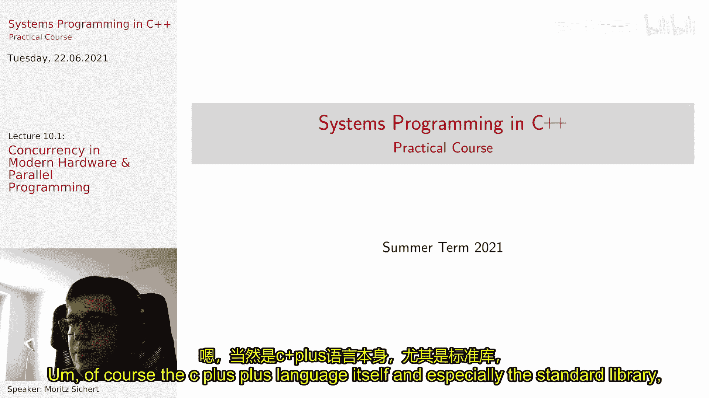

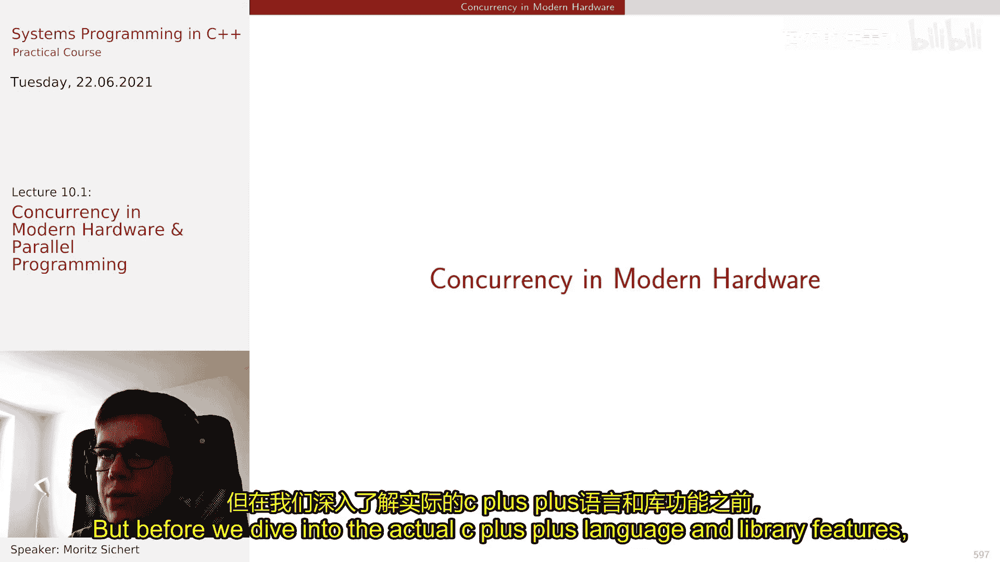

Like C++， like pseudo code， but we will not talk about actual C++ classes because we want you to have a bit of background knowledge of what concurrenrency modern hardware means and what parallel programming is before we talk about the the actual ways how to implement this in C++。

So when we talk about concurrency， the first question is， of course， what is concurrency。

 This is conceptually very simple to answer。 So if you have some language where you can define functions fo and bar。

Then this language probably has some kind of function that can start a threat。 So a threat is。

Its something that or in most operating systems， it's just called a threat。

 which will allow you to run a program concurrently or two functional currentlyrently。

 And this example we。Start two threads。 We call them T1 and T2 and each thread gets a function that it should execute。

 and then in the end we just wait for the two to finish， and then this is our main function。

 So if we talk about concurrtency， this means that in this program two functions fool and bar they are executed concurrently。

 which means that they are executed at the same time。

 So they are not interlead or something they are really executed at the very same time and the question now is of course how does a CPU actually implement this So how how can this actually work。

 especially if those two functions are from the same program and of course。

 then the more broader question is how can thecurrency be used to make your programs faster while not introducing any new weird arrows。

So to answer the first question， yeah we have to look into the CPU design a bit more so what modern CPUs can already do on also if they only have a single thread or single core。

 they can do out of order execution， which means that you essentially get instruction level parallelism。

 but this is not what we're interested here， what we are interested here is that we have multiple different instruction streams。

 so instruction stream you can think of an instruction stream。

 something like the execution of a function because different functions have different instruction or even if you call the same functions from different threads。

 they may not be at one point in time they may not execute the same instruction because they slightly drift because one is faster than the other or something like this。

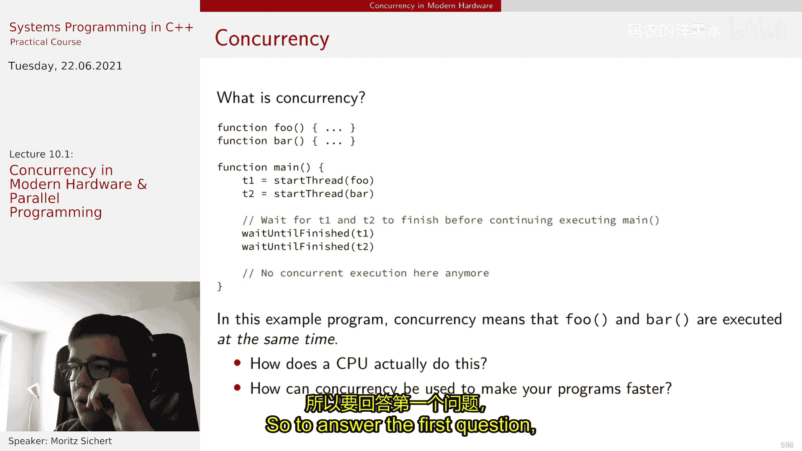

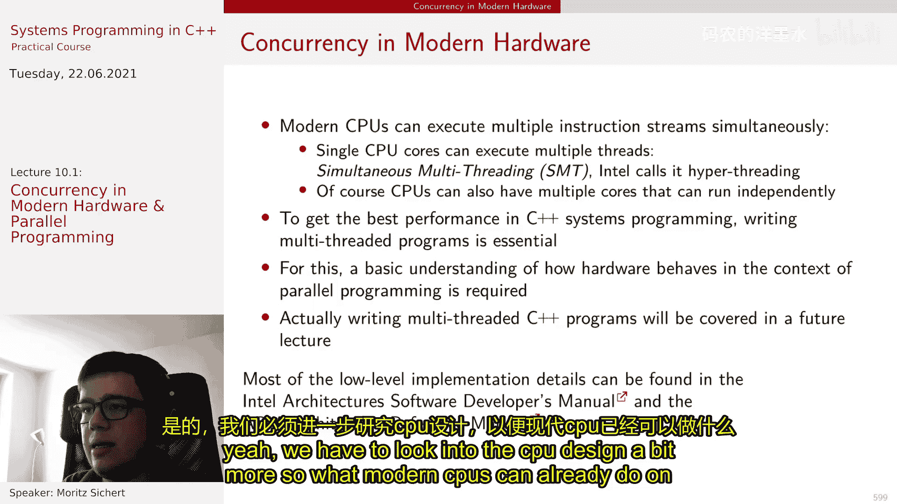

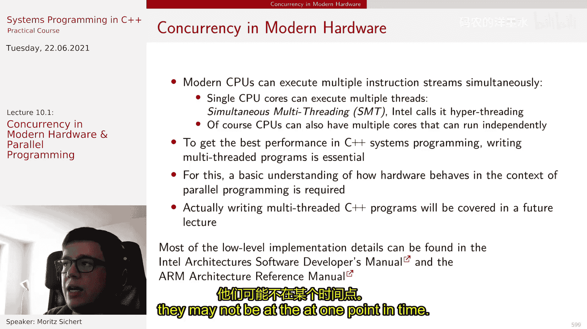

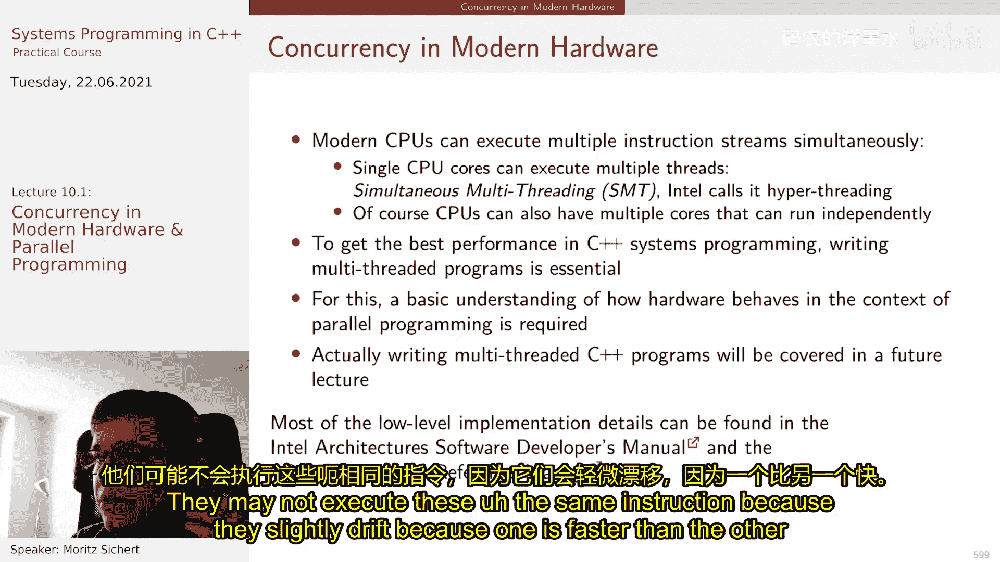

We want to look at the cases where a CPU can execute multiple instruction streams simultaneously。

One thing that a single CPU core can do。 So a physical。

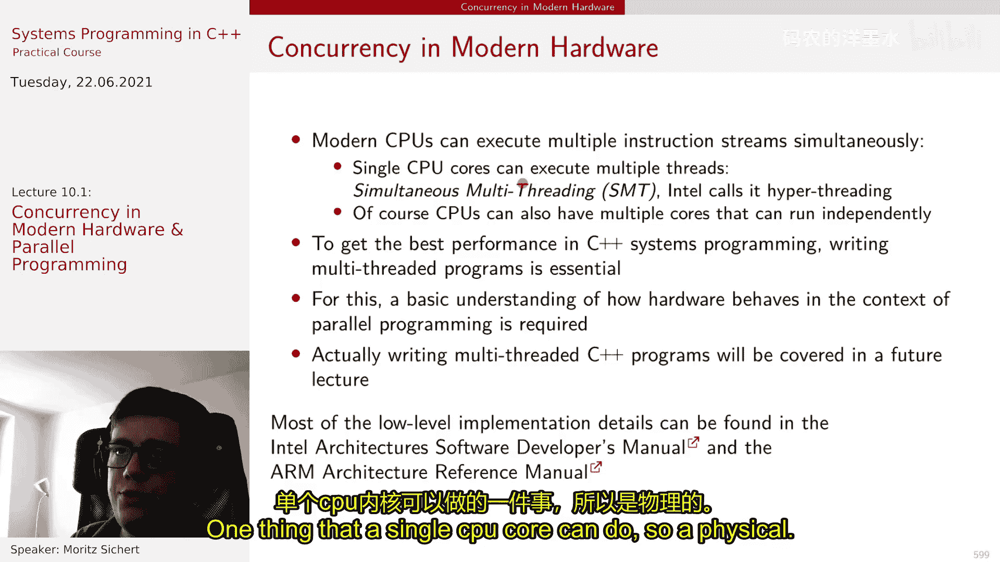

Like a CPU core on your CPU。 there's something that's called simultaneous multithreading。

 which means that a single CPU core is able to execute multiple threats and you may know this better under the name that gives it because calls it hyperthreading。

 but the concept in general is I mean it's the same hyperthreading is the name that gives it but the general concept is called simultaneous multithreading and of course you can also have multiple different CPU course that are mostly independent so they can also run independently So this is so if you for example。

 have a quad core CPU a quad where interc usually have four actually physically separate cores where each of the core has two hyperths which means that each core can execute two instruction streams at the same time。

 which means that you basically have something like eight threads in total。

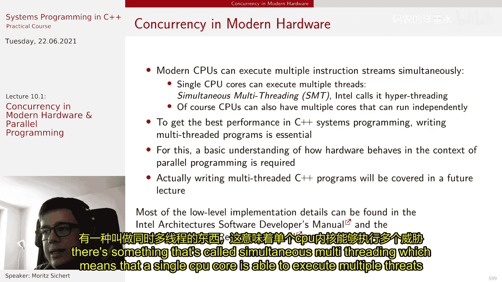

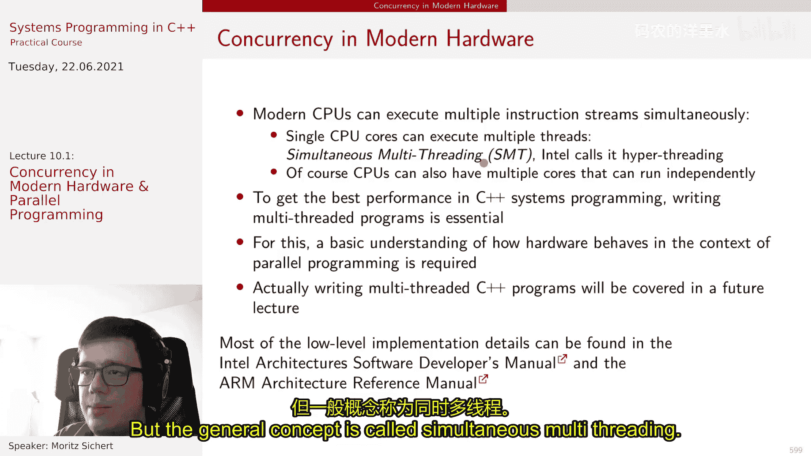

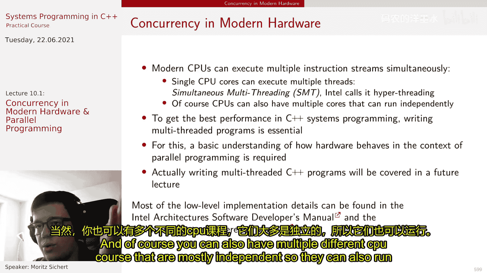

Why do we want this because of course if you execute if you manage to execute a program on multiple threats and cause at the same time。

 you will usually end up with a FAFSA program and if you're talking about system programming in C++。

 which is a rather low level language of course， we also want to be able to use this。

Because Deep+ is a rather low level language， you need to know a few of the details of how S CPU actually implements this so that you can understand the potential issues and bugs and also how you should implement this so that no issues can happen。

But as I said， actually using this NC++ itself， so talking about the actual C++ functions and classes and so on。

 we will do this next week， today we will fully focus on the concepts。😊，As a reference。

 usually we reference the CPP reference website， but because we're not talking about CP+ today。

 most of the contents we talk about today come from the developer manual from the CPU window。

 So theres the Intel architecture software developers manual， there's also an URL here。

 which you can click and the same for Ar。 So arms and the CPU architecture that is used on most mobile phones。

 for example， there's also the same software developers manual for MD。

 they are just mostly similar because they both describe the X 86 architecture。

 So we just chose to use the Intel thing here。 but this mostly applies to AMD processor as well。

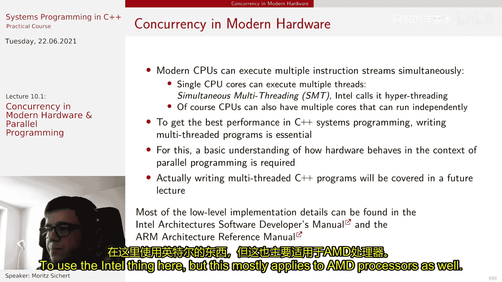

Okay， so let's first talk about simultaneous multi threadreading and how this actually looks within a CPU core。

 So as I already said， a CPU with without multithreading。

 so without simultaneous multi threading already supports something that's called instruction level parallelism。

 which is also sometimes just called out of odd execution， which means that。

It can take a single instruction stream， so something like as I said。

 a function that is executed and can choose to execute multiple instructions of these single instruction streams in parallel and this the reason why this works is because if you have independent instruction。

 for example， one instruction writes into one memory location。

 the other instruction writes into the other memory location。

 they are essentially independent so the CPU can execute them simultaneously and this actually works without any multi threadreading without any simultaneouslyimaneous multi threading without any multico CPUs。

 this already works with with an individual instruction stream。

 but of course we want to focus on the actually multi threadreading here and then especially the simultaneous multi threading。

😊。

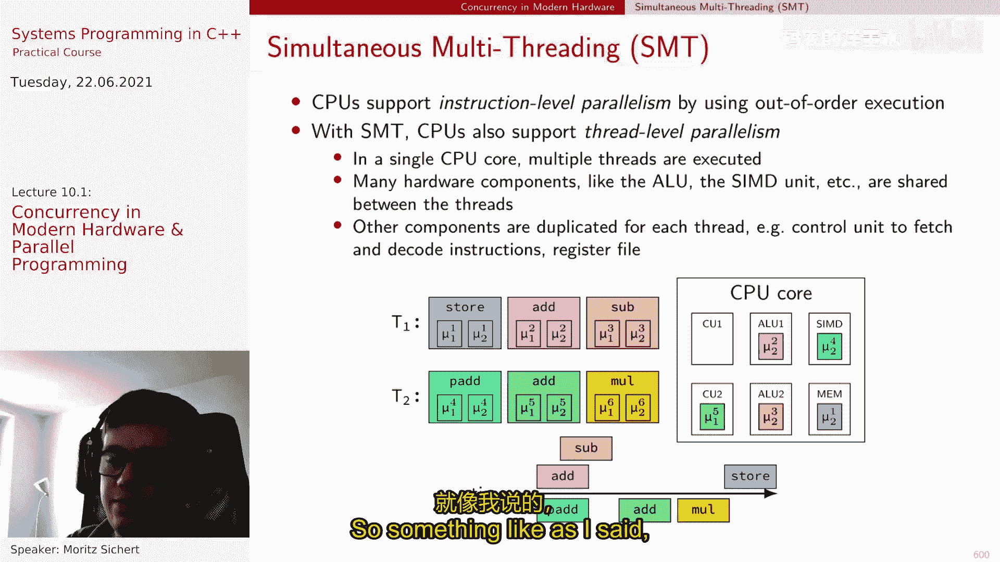

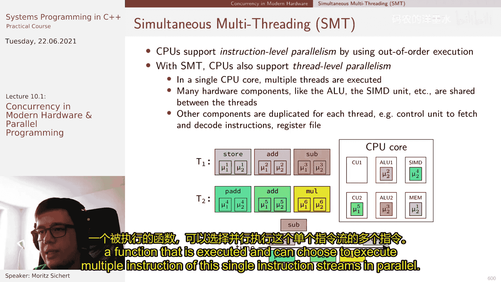

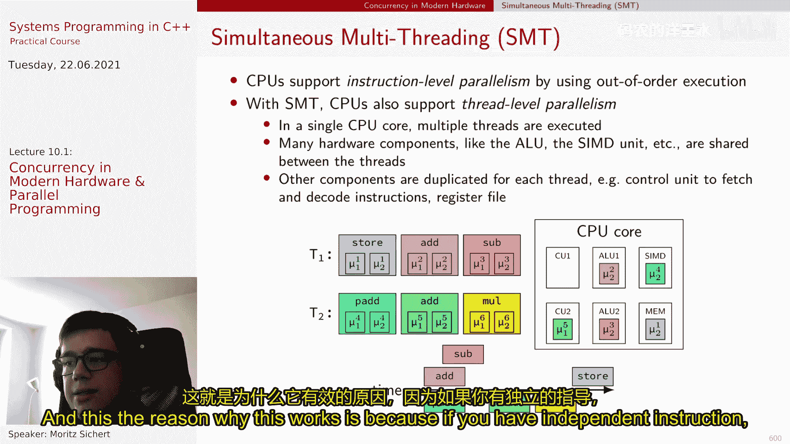

Which means that in addition to instruction level parallelism。

 the CPU will also support threatle parallelism。 What this means is then， of course。

 that in a single CPU core， as I said， multiple threads。

 which on today's CPUs is mostly two are executed at the same time。

 but since so the special thing about simultaneous mud threading is that the different threads they share many hardware components。

 so they share the Alu for example， which is the arithmetic logical unit。

 this is the part of the CPU that does the integer arithmetic for example。

 we have the SD unit S stands for a single instruction multiple data。

 this are some advanced instructions that can process multiple floating point numbers or integers at the same time and also have larger registers on x86 for example。

 or at least on intelprocesors， the largest S registerars have 512 bits as opposed to the largest integer registers of course。

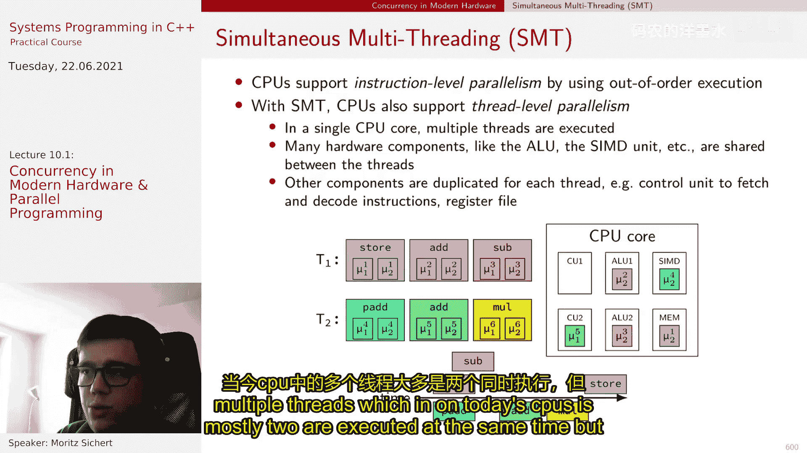

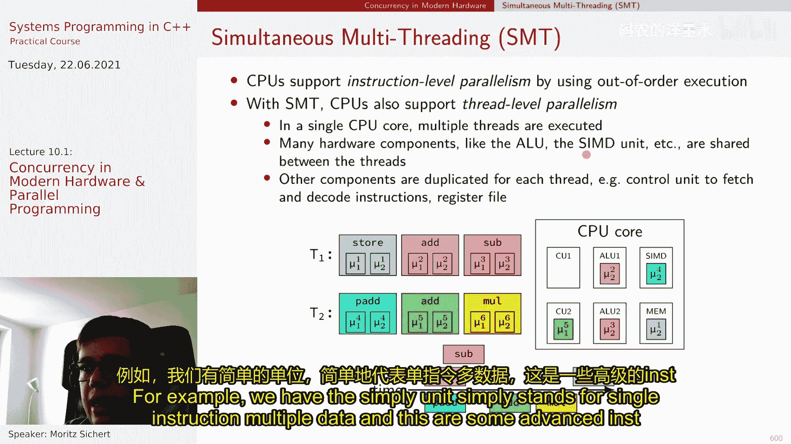

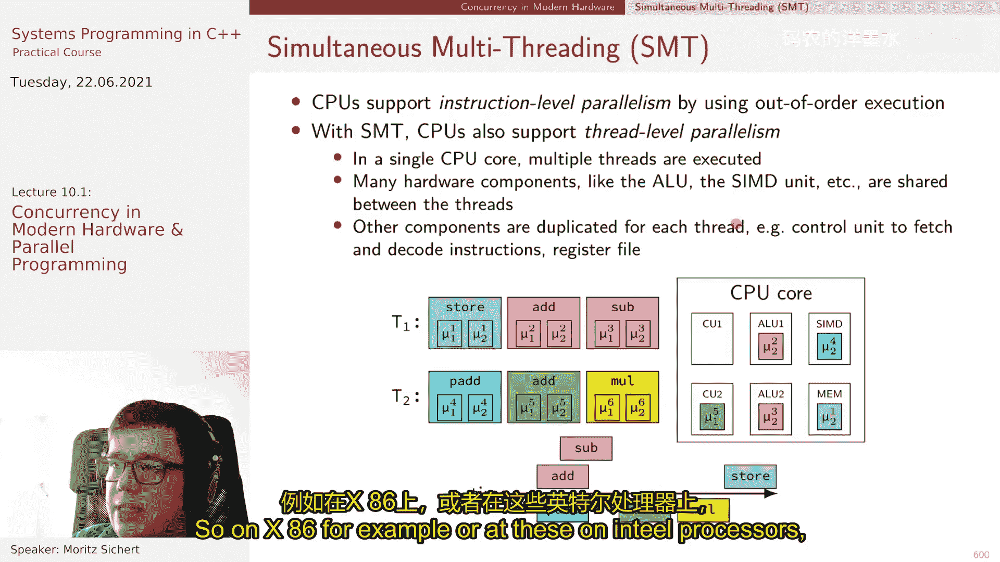

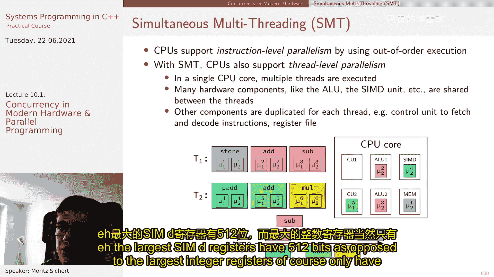

on have 64 bits so this is just another part of the CPU and you have some other units and they mostly are shared between oil threats within a semi CPU core but of course there are also some execution units or some components that cannot be shared and this is mainly for example。

 the control unit， the control unit which you can see in the figure here。

 is is the part of the CPU that actually fetches new instructions and then decides。

Where the next instruction pointer will be for example it processes branch instruction and so on。

 and of course each set also needs its separate redt are file and some other things。

 so in essence we can say there are some components that are shared between alls and CPU core and some that are exclusive to each thread。

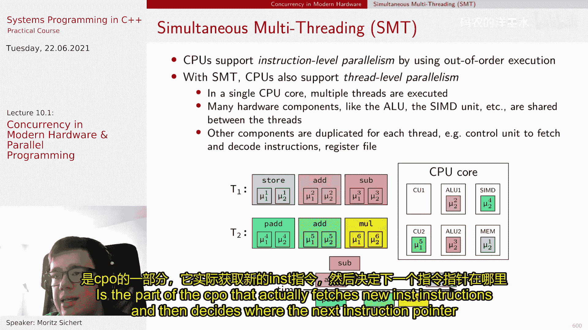

So let's look now at two instruction streams so we have essentially threat1 and thread2 and thread1。

 let's say executes the instructions store at and sub。

 so store store something in memory adds to at to number sub to subtract to numbers and then we have thread2 which has P at at and Mole and P this is an example of on X86 this would be an instruction that the SD unit。

Exeecutes because P means peed so we have multiple or we add a larger register or two larger two large registers。

 then we have a regular a instruction， the regular multi instruction So let's now look at how those instruction could be executed in time。

 So if we only look on thread1 first， we can see that what the CPU already can do is it can execute the a and the subinion first and execute the store instruction much later and the reason why CPU would want to do this is that the a and sub instructionsions。

 they may only work on register so they don't have to fetch any memory which means that they are generally very fast。

 but the store instruction， of course it has to write something into memory。

 which means that it can be very slow so it may make sense for the CPU to begin executing the store instructions and while the store instruction is still executing already execute the other instructions that you can also see。

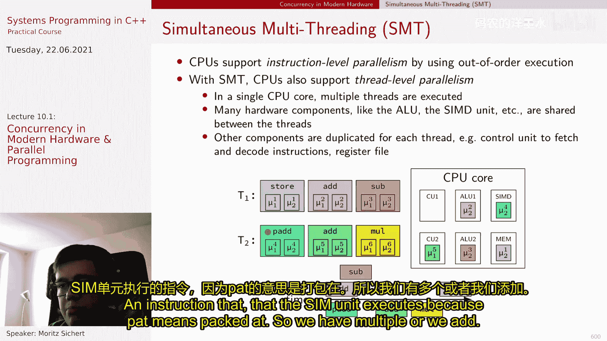

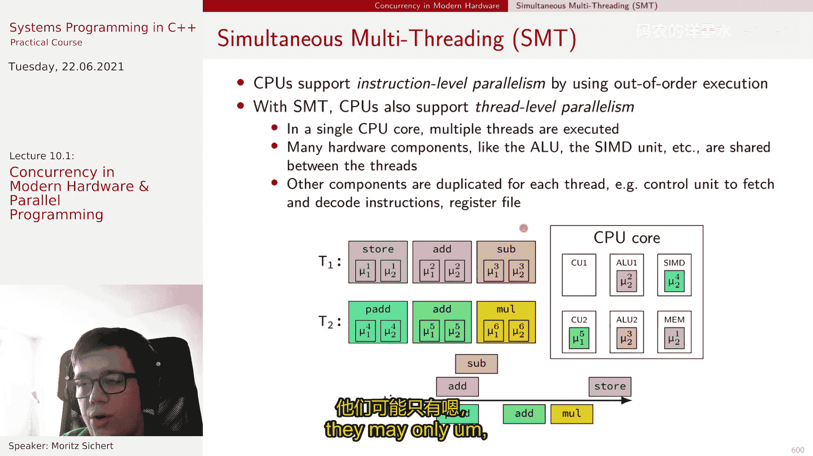

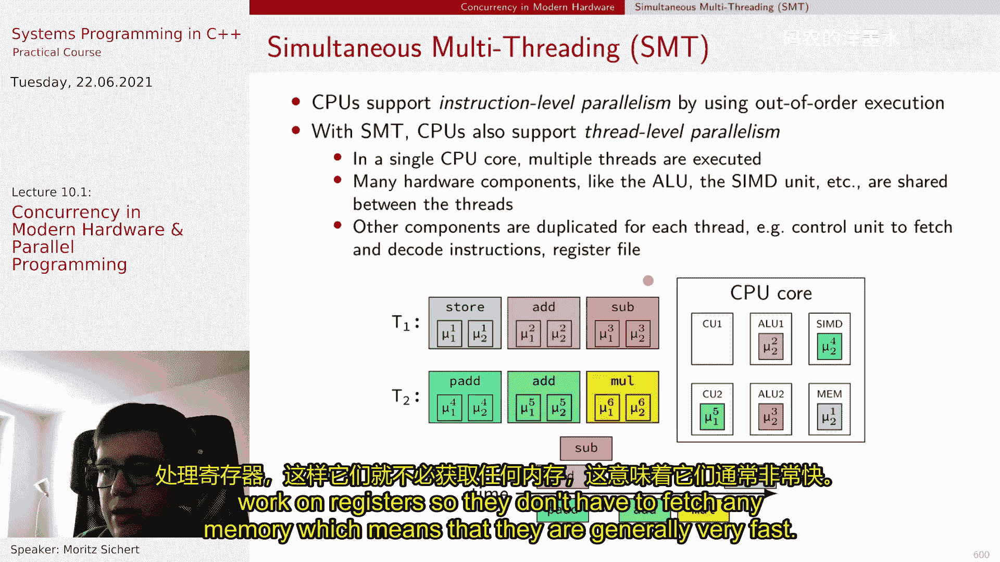

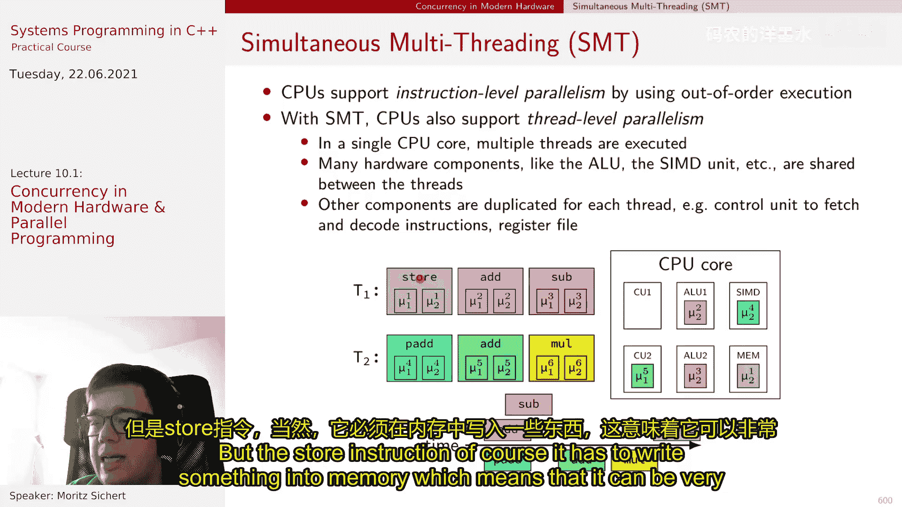

That within a single instruction stream， we execute two instructions kind of simultaneously。

 so we have the and sub instruction which are almost executed at the same time。

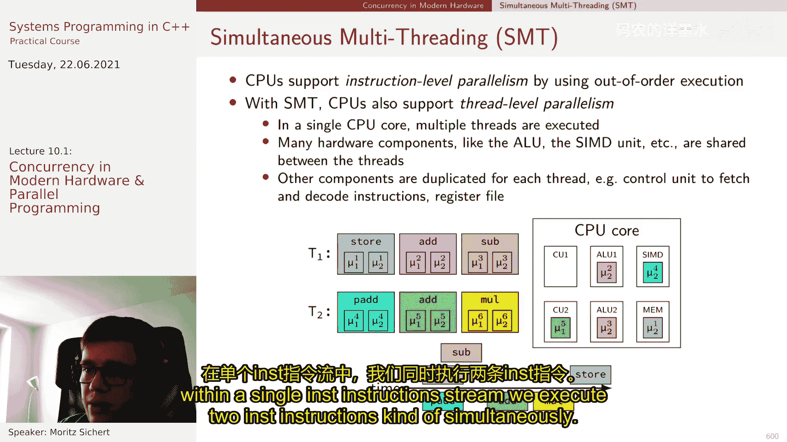

So you can see this is just for a single instruction stream we already have something like instruction level parentism and on the other hand we can see the thread tool which just executes the instructions in the order they came in the instruction stream。

Another thing you also have to note here in the figure is that for each instruction you have two boxes here which have M and what this means is that every instruction will be separated into two micro instructionsions and this is actually also what modern CPUs do especially x86 x86 CPUs。

 they do separate the instructions into multiple sub instructionsions so to say and those sub instructionsions they are called micro instructionsions。

 so just so you know to execute a store in our example we first have to execute the micro instruction1 and then the microinions2 and so on and if you look at the actual CPU core we can see how the state of the CPU could look like at one point in time。

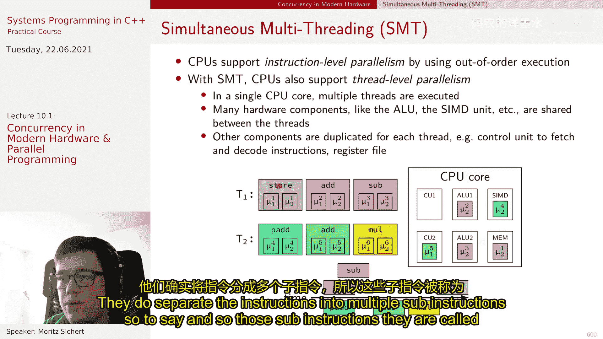

So we can see that the， the control unit of the threat one currently doesn't have to do anything because it has。

Received all of its instructions already， which means it has read all of the read and decoded all of the instructions already。

 which means it's essentially currently waiting for the current instructions to be executed。

 we can see here so if we look for those three micro instructionsions。

 we can see here that the store the second micro instruction of the store instruction is currently in the memory unit。

 so this is probably the part of the CPU that manages the communication with the with the main memory then we have the a instruction which is currently in the AU and let's say our CPU core actually has twous which means that the second so the subtract instructions also currently in the ALU which would explain the case why we can execute them at the same time here because we have two A use which even a single instruction stream could。

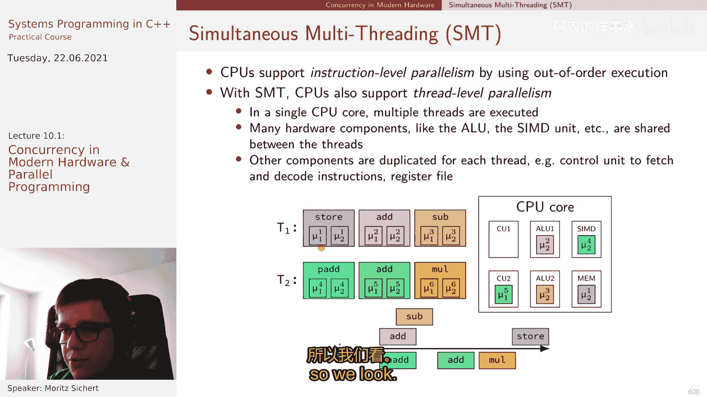

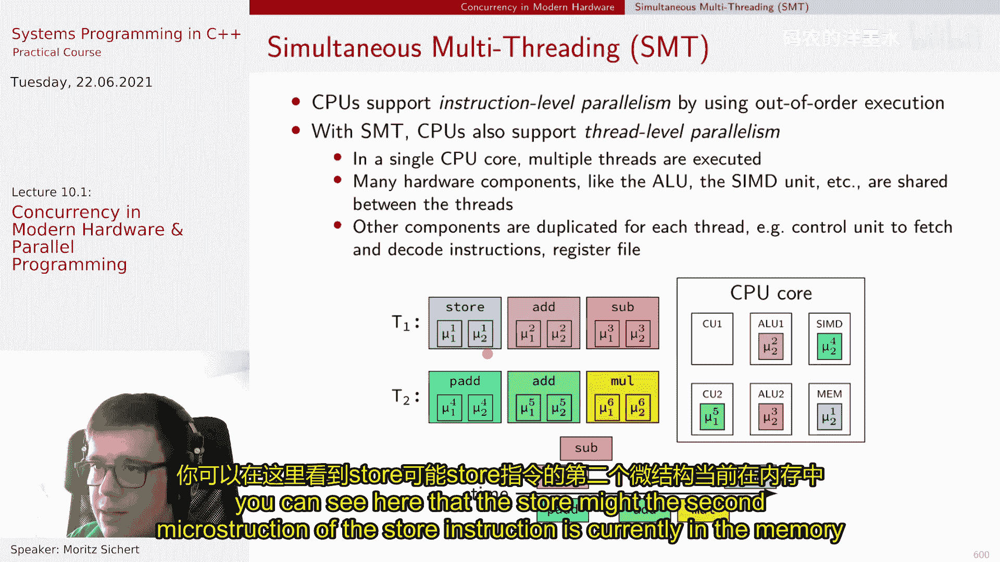

Could use both of them。 Then on for the second instruction machine， we can see， okay。

 the the second micro instruction of the S D instruction is also。

 as we would expect in the CD part or the SD component。Then we have the add instruction。

 the add instruction is currently so the first micro instruction of the Ed instruction is currently still the in the control unit。

 and the reason for this is。Because we can see that in the AU so no AU is currently free for the second instruction stream to add a new AU instruction。

 which means that the second instruction stream has to wait for one of those two micro instructionsions to finish before it can essentially dispatch the next micro instruction and you can also see that the mood instruction here is currently doesn't exist anywhere in the CPU core because we haven't managed to get the a instruction out of the control room yet。

 So this is yeah it's a very low level and detailed example。

 usually if you program in C plus+ and with multi threading， you don't have to look。

Into your CPU architectureject into that much detail。

 but it helps to understand some of the effects that can happen with parallel program if you understand especially how simultaneous multi threadreading works。

 especially if you understand the potential problems with this。

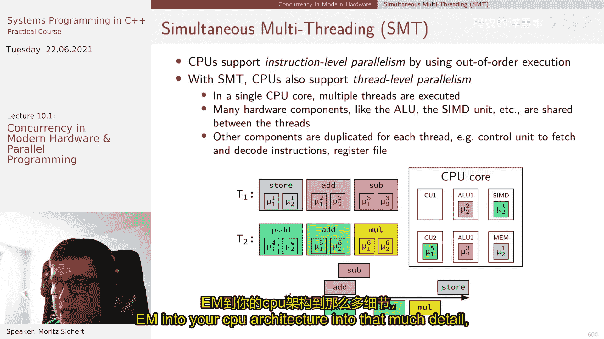

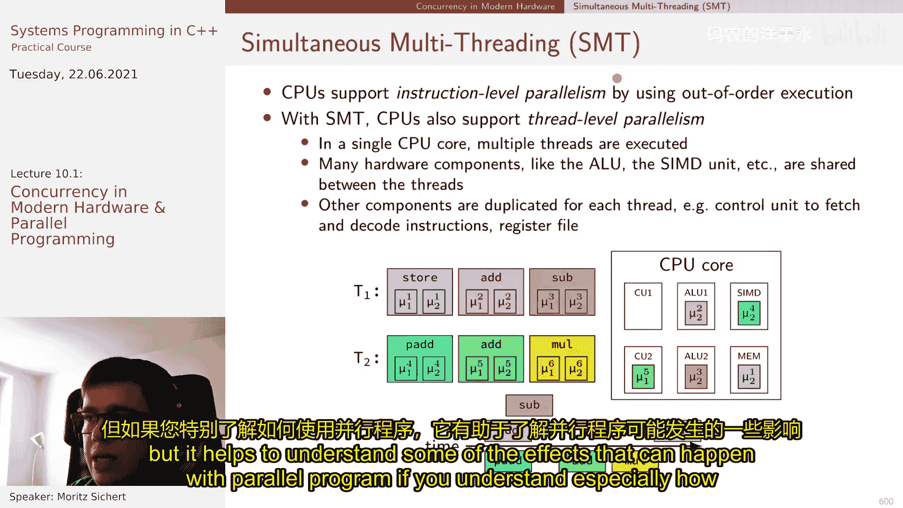

Because as you can see multiple instruction streams they share large parts of the CPU。

 which means that if a single instruction stream alone already utilizes all of the let's say AU units。

 for example， this would mean that adding another threat by using SMT would not increase the performance because the CPU is already add its performance bounds because it is using all of its A use already。

 so if you would add another threat， this wouldn't gain you any more AU instructions per second。

 so it can often happen that SMT does not really increase the performance。

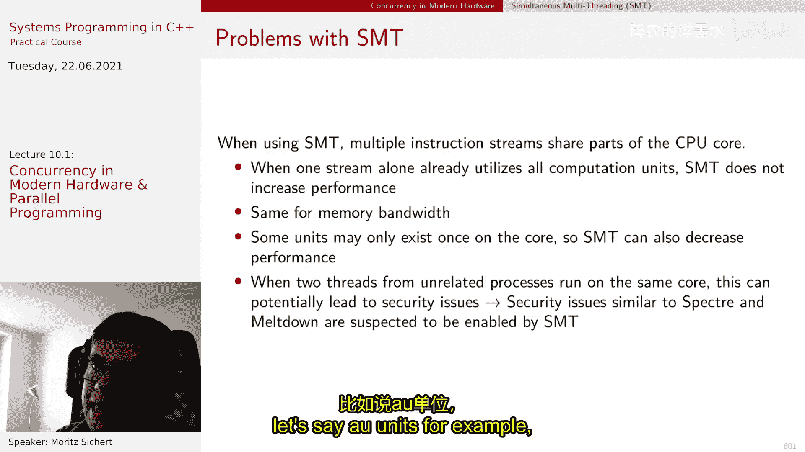

And of course， this not only goes for a use， but also for things like the memory bandwidth。

 If one single thread can already saturate the entire memory bandwidth。

 then it doesn't help adding a new。Threat。What is also interesting， of course。

 is that some units exist only once， even though we have， for example， two threats which can。

 which is the case， for example， for assembly units。

 because they are usually like physically much larger than the AU units。

 which means that if we execute two simultaneous multiths on a single core。

 they can essentially steal the execution units from each other。

 which means that this can also actually slow down your program if if on the same core and another program runs which also needs to use these same computation units what is also interesting to know what is rather recent is that because the execution units are shared between different threats and which is even potentially different threats from entirely unrelated processes this can lead to some security issues so you may have heard。

Of specre and melttown。 And those are examples of security issues which are suspected to be enabled or at least to be supported by ST because it's much easier to do something like the attack with cash。

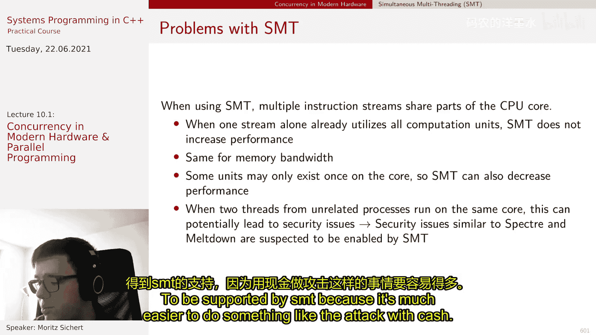

Cash invalid and so on that Specter and Madon need if two unrelated processes already share a lot of resources。

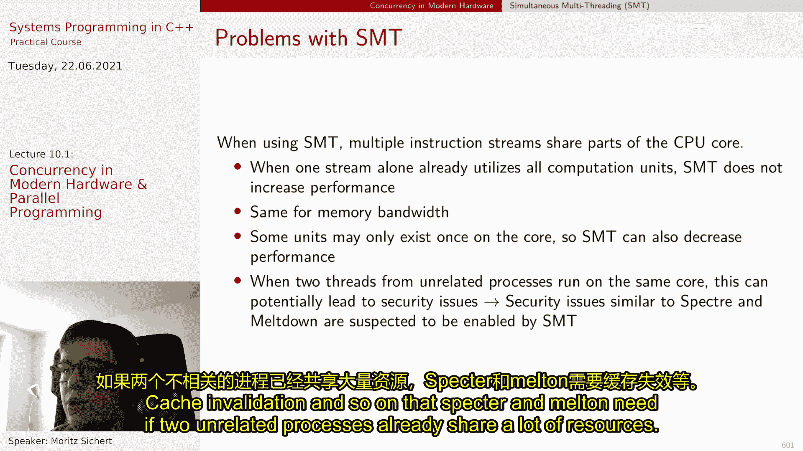

Okay。Another important thing when we talk about multico CPUs or in general。

 if we talk about simultaneous processing on on modern hardware。

 is something that's called cache coherence， which you also definitely should know when working with a low level language by C++ So what you have to know in general。

 So you have this figure which we already had in the very first or second lecture when we talked about like CPU architectures and assembly and so on in general。

 So we have usually a main memory， which is connected by a bus to the entire CPU socket and the CPU socket。

Mostly currently so modern CPUs， they have multiple CPU core within a single socket。

 but all of the different course， they are connected via the same bus to the main memory also。

 of course we have caches and the caches they are inclusive。

 which means that if some cache line is included in the L1 data cache。

 it will also be included in the L2 cache and in the L3 cache and as you can see。

 it is possible that different CPU course share some caches which in this example is the L3 cache but since caches are inclusive the entire architecture needs to make sure that theimultaneous excesses to L3 cache from different CPUs they actually are consistent。

And。So that we can that we still have the guarantees that the caches are inclusive。

 but we can also have shared caches， which of course。

 is very useful if you have a program that runs on multiple CPU calls。

 it is very useful to have a shared cache because different CPU course may or probably access the same data very often So you want you really want a shared cache。

 So what we need is we need some kind of communication between all CPU course to make this consistent and this communication is called the cache coherence protocol。

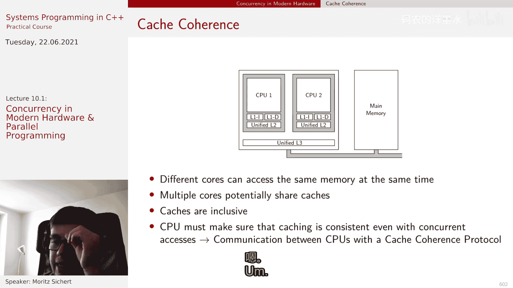

And to go into more detail the protocol that is mostly used on modern CPUs。

 this is called the mei protocol。 and the reason why it's called mei is because it essentially assigns every cache line。

 one of the four states which begin with those four letters So we have the four states with the letters M E S and I and what you also already know is that caches they are separated into cache lines。

 which on 86 is' usually 64 bytes。 So the lowest that a cache can track is 64 byte and for every chunk of 64 bytes。

 which we call a cache line this protocol first assigns one of those four states。

 So we have the modified state and modified So when a cache line is modified。

 this means that this cache line is stored exactly in。

So in one logical cache location and was modified in the cache but not written back to the main memory because I mean the entire point of cache is that you do not want to communicate with main memory all of the time because main memory may be much slower than the CPU itself。

 so it can happen that we have some changes that only exist in the cache but not yet in the main memory。

 so this is the state for modified。

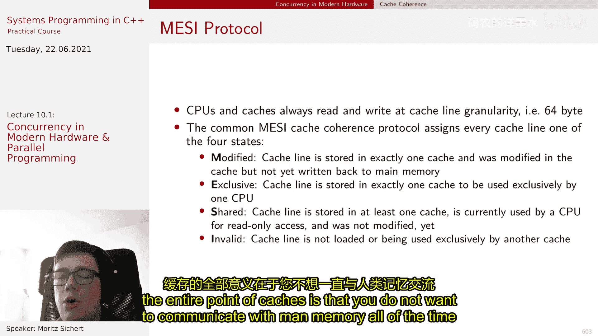

Then we have the exclusive mode。This is when a CPU tells the system in advance， okay。

 I want to be able to modify this cache line eventually so I need exclusive access to it so that other CPUs will not interrupt me when trying to change this and this is the most exclusive。

Then we have shared。 is this means that the cache line is is stored at least somewhere for one CPU。

 but it may also be stored in multiple different locations for multiple different CPUs。

 And this is used for read only excess where no CPU call needs to modify anything yet。

 So they can actually share the cache lines。 And then we have the invalid say this is just essentially to mark that the cache line is unused or or may not be used anymore because it's now used exclusively by another CPU。

 Okay， so let's look at an example。 I think this makes it。

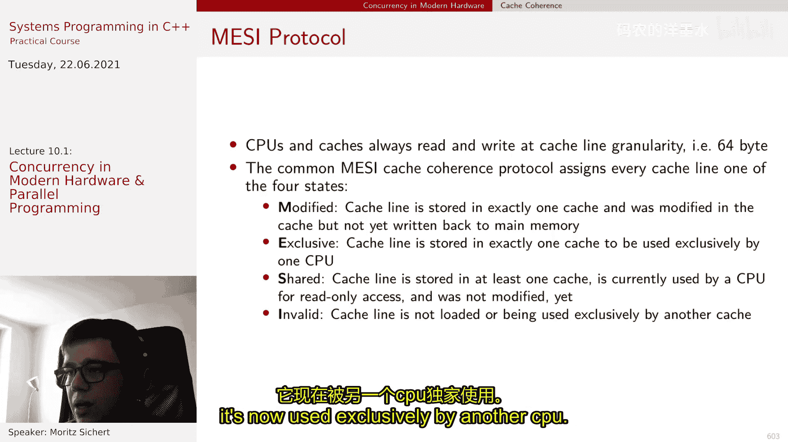

Much easier to understand。 So let's say we have a main memory and we look at the addresses with the the addresses in memory that have the addresses a 0 and E0 and hexademal notation。

 And let's say they currently have those values in them。

 And we have two CPUs which currently have empty caches。

 So let's say our CPUus only have caches which can fit two cache lines。 And of course。

 in in practice， you would also have multiple layers and caches and so on。

 But let's just look at the simplified example where each CPU has exactly two cache lines and initially they are empty because nothing has been loaded into the cache yet。

 And this is the initial those are the initial contents in the memory。 So let's say we now have。😊。

One instruction by each CPU where the CPU1， it loads the it wants to loads the memory or the cache line at the address a0。

 and the CPU2 wants to load the memory at the address E0。

 you also can see that we have the right load S here。

 which means that the CPU tells the system or the memory controller or whatever part of the system actually manages the messy protocol。

That it only needs the cacheline in shared mode， this is probably because the CPU doesn't actually want to write to the location just has some memory load instruction so its read only operation so it only needs shared access to the cacheline and this is actually done by both CPUs and so what you can see then of course the cacheline has to be loaded from main memory into the actual cache and you can see here that the first empty slot is selected here and for CPU1 of course we load the value from here and for CPU from CPU2 we load the value from here and they get the state S so far good that's not that complicated let's now say okay the CPU1 which loaded the cacheline at location a0 with shared mode now wants to load the cacheline at e0 in exclusive mode this is probably because the CPU wants to actually。

Write something to this address。So we know that this is currently it exists currently in a shared state in CPU2。

 but of course this is not allowed now because we want exclusive access for CPU1。

 which means that this load exclusive will invalidate the CPU the CPU cache line for CPU2 but will' add a new cache line on CPU1 with the exclusive mode because this is what we had here。

And let's say the next operation that CPU1 does it actually stores something into this address and I mean this is the whole point of loading a cache line in the exclusive mode is if you want to modify it afterwards so the CPU1 actually store something into this address and let's also say CPU2 now wants to get shared access to the first cache line again So one interesting thing is here that you can see。

 let's say the CPU stored the value 0350 in the cache line at the address E0 but you can see here in the main memory this is not written to memory memory yet and this is also of course on purpose because writing to cache is much faster than writing to mainmemory so unless a CPU really has to write to main memorym it will avoid doing so instead it will just write it to to the cache instead and we can also see if the CPU。

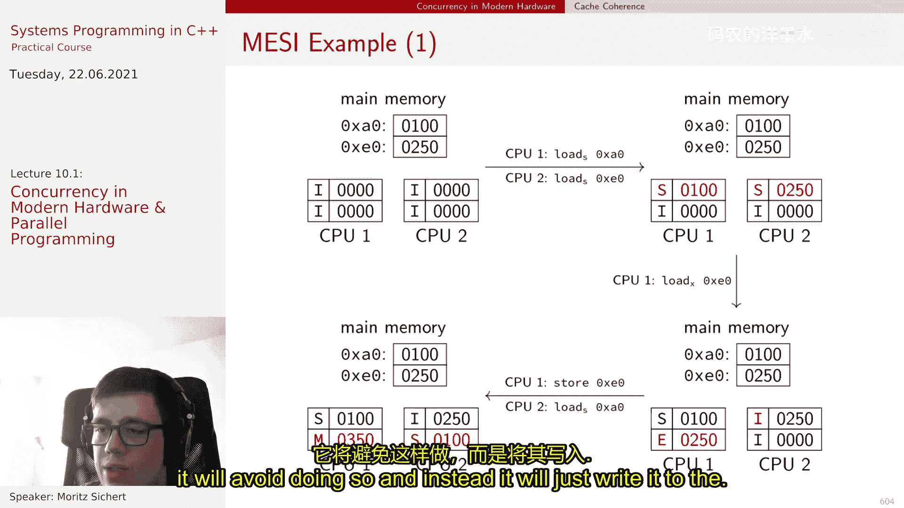

2 wants to load the cache line at the address a0， this already exists in CPU1 but already in shared mode。

 so let's say the CPU 2 selected the second cache line and this will just also be loaded in shared mode but the cache line for the CPU1 will not be invalid yet because there still are two shared accesses so no issues there。

So if we look further， and as I said。Memory store instructions they don't directly or not necessarily directly right to memory。

There's a question does memory location really have to be read every time a CPU wants to write to it Oh yeah that's a very good question so the question is why do we need a load here if we are not really interested in the actual value but we are only interested in overwriting this value with some other value。

So in general， this。The CPU may not want to read the cacheline。

 but what it still has to do is it has to load the cacheline so that other CPUus will know that this cache line will be invalidd because will be modified by another CPU。

 So the answer to this is they may not care about the address。

 but to make the entire system consistent。 They have to at least tell the rest of the system that this cacheline is exclusive。

 They don't necessarily have to read the value from memory memory if doesn't exist。

 They could just read it exclusively and have some invalid value here。 but this， I mean， this is。

 of course very specific to the actual CPU implementation。

 there are also are some special assembly instructions which allows you to tell the CPU okay this is a store instruction which should bypass the cache essentially because I don't really care。

When the value is written to memory， I just want this to be written eventually。

 but this will in total then have better performance because you don't have to fiddle around with cache lines so much but yeah in general this yeah this is very very much a low level detail and if you really want to find out what your CPU does。

 you would have to look into the manual of the CPU。So the question is now。

 if the memory store instructions don't directly write to memory。

 how can we enforce that something actually is written to memory。

 there are essentially two ways the one way is to use explicit flash instructions So there are instructions where you can tell the CPU please write this cache line back to main memory right now or at least as soon as you can because I want to make sure that this cache line is not。

In my CPU only anymore， but also in main memory and you can see here the CPU 1。

 it flashes its modified its modified cacheline。 and by doing so the cacheline will be set to shared again because by flashing you essentially tell the CPU okay I'm done modifying this cacheline。

 please write it back to main memory So this will be shared and you can also then see it then it will actually be written to main memory。

😊，嗯。Of course， this also happens implicitly if some other CPU wants to load the cache line here again。

 then CPU1 will say wait， I have modified this cache line。

 you have to wait wait until or least load this modified data from me and of course the CPU will also periodically or if the cache is full and you load a new cacheline。

 you will have to evict cache lines from your cache which means that the CPU will eventually make sure that that the modified cache lines or modified data is written back to memory so that's another question。

In the previous example， does CPU 2 essentially have to wait until CPU1 decides to write back the invalidd line to share main memory？

So。You mean here。嗯。Does CPU2 have to wait until CPU1 decides to write oh okay I think you mean。

 so the question is， if CPU1 never would have done the flash instruction here。

 what would have happened to CPU2 when CPU2 would have read the cache line at the address E0 And the answer is that the system will know okay some other cache will or wants to access this modified cache line。

 which means that the CPU1 then will have to give up this cache line by writing it back itself to main memory so that it can be used by CPU2。

 So in general， the CPU they don't really weigh that much on each other instead the cache lines they will just be written back automatically essentially。

Yeah， so。Yeah， so this is yeah， again， this is a kind of low level concept。

 but what's the main takeaway you should have from here is that。

Because every time you write to some location you need to explicitly or the CPU needs to this get exclusive access to this cache line。

 This means that if multiple different CPU costs right to the same location memory at the same time so simultaneously you will get something that is called cache threing cache threashing means that the ownership of the cache line switches between multiple CPU costs very often very quickly。

 this is， of course very slow， which means that it usually leads to bad performance there was a question but I apparently just answered it。

Yeah， so the answer is it does work CPUs， they can access cache lines that are owned by other CPUs。

 but this will lead to essentially CPUs fighting over cache lines which does work。

 makes the system a bit slower， but of course in general。

 you try to avoid this because if you can solve it with less cash threateninging。

 threashing then your problem will be faster。Okay， let's now look。

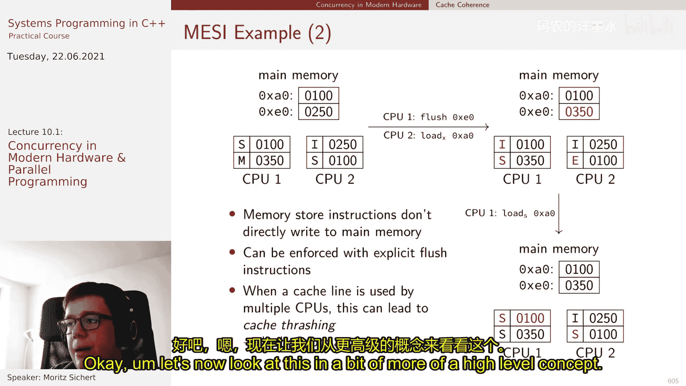

It is in a bit of more a high level concept so in form of memory axises so we are not at the low level of the CPU implementation anymore we now look at the bit of a high level of what a programmer would write so let's say we have two functions full in bar and let's say they are executed concurrently by for example。

 just putting them on different CPU course and we have a global counter which is a global variable that is used by both functions and what the first function does it just decreementments this1 thousand times and the other function just adds one and then modplifies it by two and those are executed concurrently now the question is what is the value of the global counter at the end。

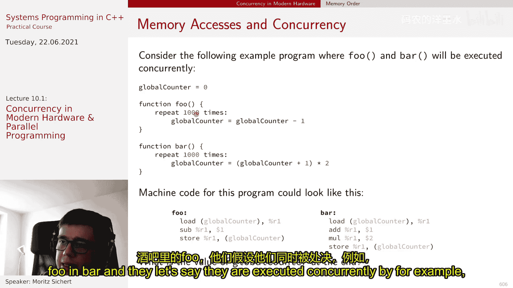

We could look at some pseudo assembly code， for example， so let's say we have。

Yeah we have a load instructions so for the function4。

 we first load the current value of the counter， then subtract one。

 then store it back into the absorb counter and similarly for the bar function we first load the value。

 then add one， then multiply by two， and then we store it back into the global variable。

Note that this is not especially not X86 code because on X 86 you can do especially this in one single instruction or you can2。

 you can sub one from a memory location with one subinion。

 but conceptually the CPU internally still has to split this into individual micro operations which means that even on an X86 CPU internally。

 this will look something like this， so you have a load from memory then you sub this internally in the register and then the storage deck。

Of course， as we saw when we talk about simultaneous multi threading， there isn't really， I mean。

 those two instruction streams， they will be interleaved by the two CPU because execute them arbitrarily。

 which means that if both happen to load the same value at the same time。

 they will eventually store the value back， but this of course will then quickly lead to inconsistencies because this is not atomic or whatever in any way。

 so they don't know about each other they will just load the current memory value。

 then do something internally and then write back some new value for this memory even though someone else have might have modified the memory in the meantime。

Interestingly， though， CPUs and CPU vendors， they actually define which effects may happen and which affect stone。

 So in particular， they decide or they tell you how instructions may be interleaved and how they will not interleave。

 And this is called memory order。 So in general， the concept of memory order means that。

The CPU vendor tells you how the interleaving of memory instructions。

 which are reads and writes in particular， will be executed on your CPU and how we write the here we write can become visible in a non-istic order。

 this means that if one instruction one instruction stream executes a read and a write and another instruction stream also execute a read and a write can happen that they may see the write at different times from their point of view and which kinds of a reordering also with with of order execution can happen。

 this is actually called memory order。 So the definition of which interles are allowed and which are not and in general。

 the only thing you don't have to worry about is that instructions that depend on each other。

In within a single instruction stream， they will always work as expected。 So well， let's say。

 they will mostly work as as expected。 So if you store some value into the memory location A and then load from this memory location A。

 of course， the CPU is not allowed to。

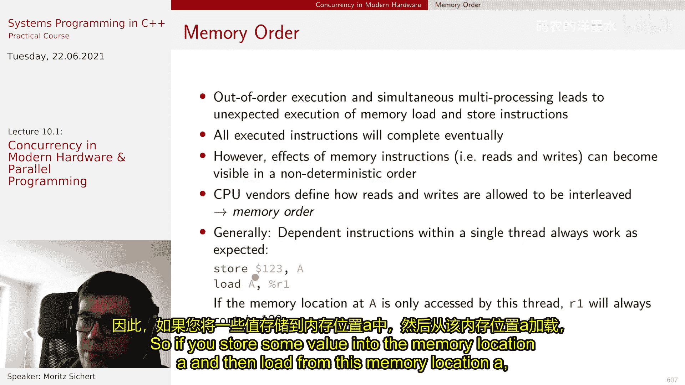

Execute the load instruction before the store instruction。

 This wouldn't make sense because within a single thread。

You brought the program in a way where you want the instruction to be executed one after each other。

 so it wouldn make sense to to reorder them within a single thread。 But of course。

 as as soon as you add multiple threads， then this can get a bit weird。

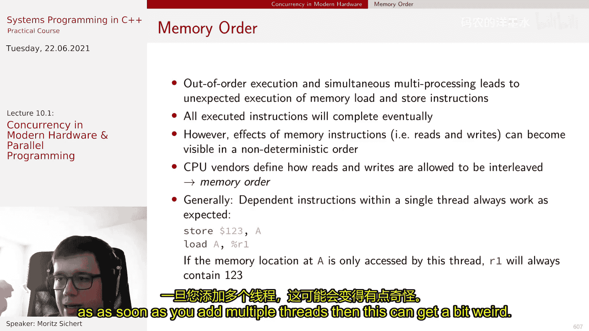

So let's go into more detail about memory order。 So in general。

 there are two broad categories of memory order。 We have weak memory order and strong memory order。

 and so the the main CPUus that use weak memory order are usually risk CPU in particular arm and on the other hand。

 X 86， 86 CPUs， they have strong memory order。 So this is one of the differences between of course。

 the two architectures， they have a lot of differences。

 but this is also one one large differences between one large differences between those two。

 So what does weak memory order mean weak memory order means that as long as the dependencies are respected within a single thread so that if you write to one memory location and you read directly。

Read from it afterwards。 Then， of course， those are not allowed to be reordered， but。

As long as this is guaranteed all other memory instructions and their effects on so which means how other threats will see the rights。

 especially they are allowed to be reordered， essentially arbitrarily which also means that different threads will very likely see rights in different order。

 So if I have one thread that first rights to a and then to B。

 it is possible that another thread will see this instead as this thread broughts to B first and then to a we will see an example on the next slide where hopefully this makes a bit more sense so the strong memory order as the name indicates has a few more guarantees so of course the dependencies are also respected this is always the case。

 but strong memory order also says that within a threat。

The only thing that is allowed to be ordered is stores are allowed to be delayed after subsequent loads as long as they are not dependent。

 of course， which means that if I write a value to location A and then read from location B。

 the CPU is allowed to execute the right to location A much later because maybe it's not in the cache yet and it takes much longer。

 So this makes sense。 But the other way around is not allowed。

 So if I if I read from a first and then write to B。So to location B。

 then the right to location B is not allowed to be reordered before the load the load instructions。

 we essentially are only allowed to delay right instructions， so to say。

Another thing that strong memory order also guarantees is that all threats will see rights in the same consistent order。

 so if if I have two concurrent threats where threat1 rights of location A and then rights of location A then all other threats will also see this in in this exact same order and nothing else and this not only goes for individual rights to the same location。

 but also for from all rights from a set of threats again。

 we will see this an example where I hope this will make more sense there's also a thing that you have to know that what can happen for both types of memory orders is that rights from other threats may be reorit with respect to the rights from this thread so if threat1 rights to some location A and some other threat writes to。

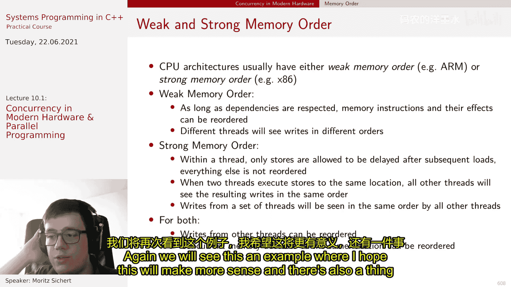

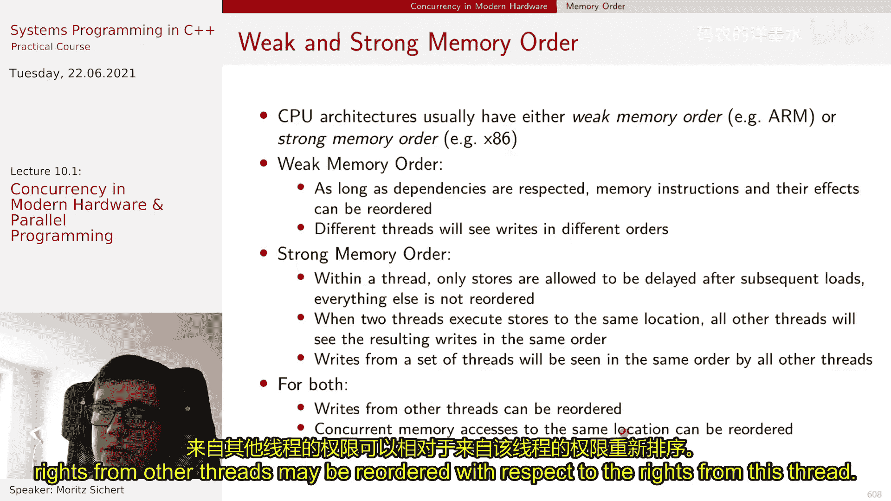

Other location， then the CPU is free to decide whether this will be visible to the threat1 before or after it brought to location A。

And of course， whats also always what the CPU also always is allowed to do is that concurrent memory access to the very same location。

 they also are allowed allowed to be reordered because， I mean。

 the CPU needs to pick some order which guarantees that this is somehow consistent。

 and we know for strong memory order， this has to be consistent at least for all threats that see those rights and but still they of course will be able to be reordered。

 So as I said， let's look at an example now which I hope makes us a bit more clear。

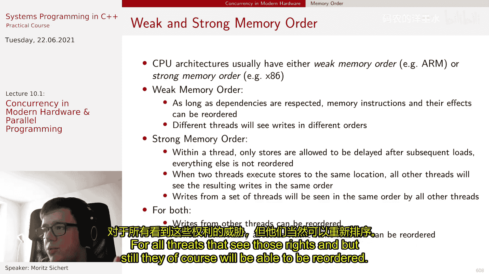

So let's say we have an example where we have two memory equations， A and B。

 and they initially have the values 1 and 2， and we have four threads here。

 we have one thread that just stores the value 3 to a。

 we have a thread2 that just stores the value 4 to B so we change a from1 to3 and we change B from 2 to4 and then we have two other threads。

Which load the values A and B into local register。 So we here in threat 3。

 we load A first and then B， but at thread 4， we load B first and then load A。So let's look now at。

What kinds of conditions we have here what we can see at first is that we do not have dependent instructions within threads。

 so we have no thread that first writes to some memorization and then reads it again。

 which means that we are not limited in that sense。

Which means that for weak memory order in particular。

 we can reorder memory instructions arbitrarily because we have no dependent instructions。

 which means that all loads and stores， they can be reorder in every thread individually arbitrarily。

 which means that we can get as a result something like this。

 so we have the value is 3 and 2 in thread3， which means so if R1 is3 in3 this means that thread3 is Cs that the thread1 executed the store3 to location a already。

 so which means store a is now3 so threat3 loads the new value a so in register 1 we have3。

 but for some reason or myfor I mean yeah it's just arbitrary。

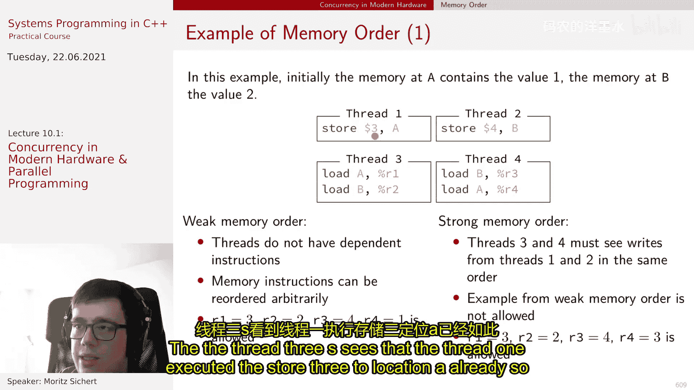

Let's say the threat3 didn't see the store for the new value for B yet。

 so the register 2 has still the initial value 2， but on the other hand， the threat 4 loads B first。

 let's say threat4 saw the right to the B location already， which means that register 3 will be。

 but it did not see the store to a yet， which means that R4 will be1。

 This means that threat3 saw the right to a， but not the right to B。

 which means that essentially threat3 think that this instruction was executed before this instruction but threat4 think the exact opposite。

 thinks that this instruction was executed before this instruction and this is something that is allowed in the weak memory order。

 but which is not allowed in strong memory order， because in strong memory order we said that all threats must see rights。

In the same consistent order， which means that in particular， threats。

3 and4 must see the rights from Ts 1 and 2 in the same order。 So either globally。

We brought to a first and then to B all the other way around。

 but we can't choose in those two threads， which means that this example would not be possible。

 because， as I said， this would only work if the threads 3 and 4 would see them in consistent order。

 but what can still happen。 What is maybe also interesting is that is is this result here。

 So we have。R 1。Is3， which means that threat3 saw the right to a already。

 Then we have our  two equals2， which means that it did not see the right to B yet。

 so this is the same as for the example here， but now we have threat4 has for B it saw the value 4 and for a it saw also the value 3。

 but this is still consistent with our rules because this means that threat4 saw that both of those stores where were written because for both it has the new values。

 but we are allowed or the CPU is allowed to reorder this load after or in between those stores。

 this means that even even if the store may already have happened can happen that the CPU will just tell this thread much later than the dot instruction here。

 which means that this example is still allowed even for strong memory order。Oh。

 that's a good question And the question is what does C mean here。

 so does it refer to a read from the cache？So when， when I say as if you see something， this is。

Essentially， just what。The program would。Now how how can I explain this a program if you've write a program that has store and load instructions。

 load instructions， they will load some values into your registers right and if you look at the values of the registers。

 the value of your registers， they correspond to some kind of order in which the memory was actually modified and this is what I mean by by C here So a CPU Cs write to B So let's say I if threat3 saw the store4 to B。

 then this means that all loads from B will also return the value for So this is just a conceptual explanation so it does not directly correspond to cache lines I hope this answers the question。

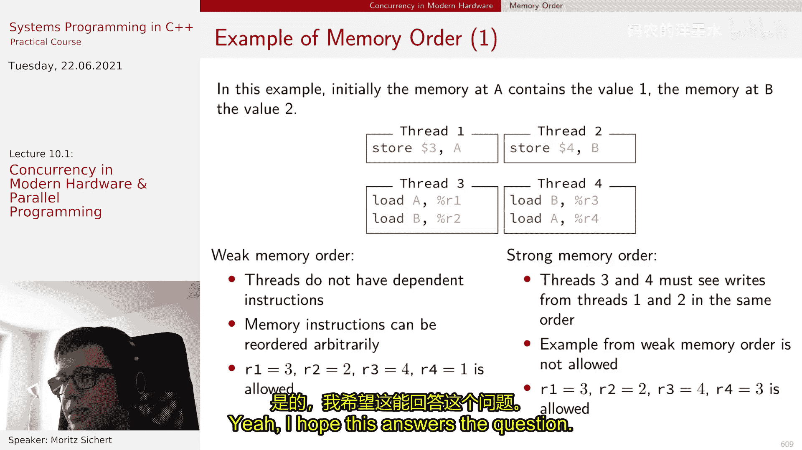

嗯。What I also want to go into a bit more detail is the example for the we memory order So how can this actually happen and we have an explicit interleaving of all of the instructions here。

 I already explain this but let's go through those steps again so let's say let's say that even though we have four threads we just order all of the instructions individually so that they are executed one after each other。

 So if threat one so let's say the store to write a is executed as the very first instructions from all four threads together。

 which means that the right to a succeeds。😊，So now3 is stored in a。What happens then。

 let's say then threat3 reads the value a。Because we said that this happens before this thread。

 we already knows that this was written so。A will return or loading a will return3。

 Then let's say then the load for B is executed immediately afterwards。

 which means that the value for B will now be2。Okay fourth so the fourth thing that will happen is that the store instruction from threat2 will be sent or visible or seen or however you want to call it in thread3 it's not that important anymore because3 doesn't read from B anymore。

 but its just conceptually the3 will notice the right to be eventually。

So this happens as a fourth step then we have the fifth step， let's say as the fifth step。

 the right to B will be sent to T4， so sent in a sense that T4 will now notice that B was modified then threat4 loads B and A but threat4 does not or didn't yet get a notification that a was also modified。

 which means that reading a will only return1 and only as a last step。

 the right to a from threat1 will actually be visible by threat4。

 which means that so as you can see here with with the cross lines here。In thread 1。

 B A has a larger smaller step number than B B。 But for threat2 is it's the exact opposite。

 in thread 2， right A has step number A and right B has step number 5。

 which means that B B will be seen by threat for before the B A。

 And this is exactly what is happened what is allowed in weak memory order。

 but it' not allowed in strong memory order。 So this is the example。 Yeah， that you can。

So this is the detailed example how how this this can。

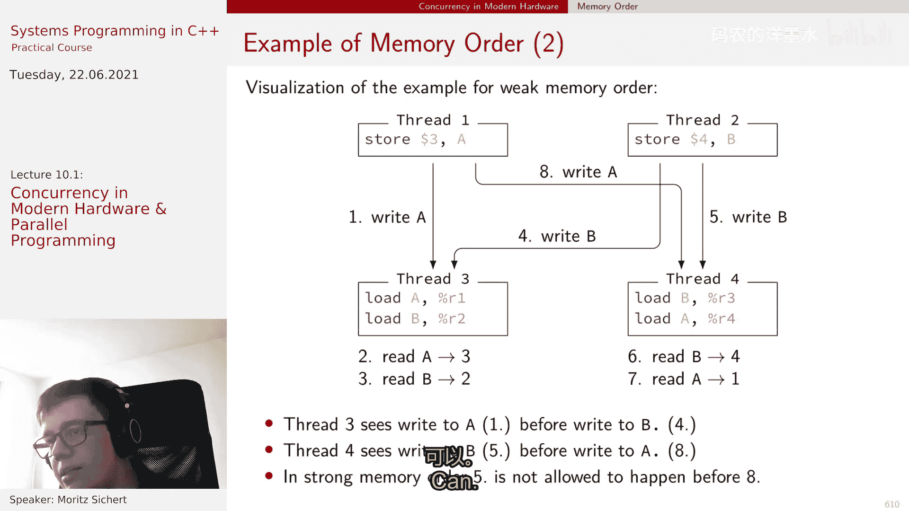

Or how such weird results can happen。Okay。Now the question is if essentially especially for weak memory architectures weak memory order architectures。

 if they are allowed to reorder anything outarily， how would you even be able to write consistent programs if you can't rely on any particular order and the solution to this is called memory barrier or memory fence instructions so this is essentially a memory synchronization instruction which T CPU okay for those rights I want I know that I'm especially on a weak memory architecture I know that I have weak memory order but for the rights I just did please make sure that they are actually consistent in other threads。

😊。

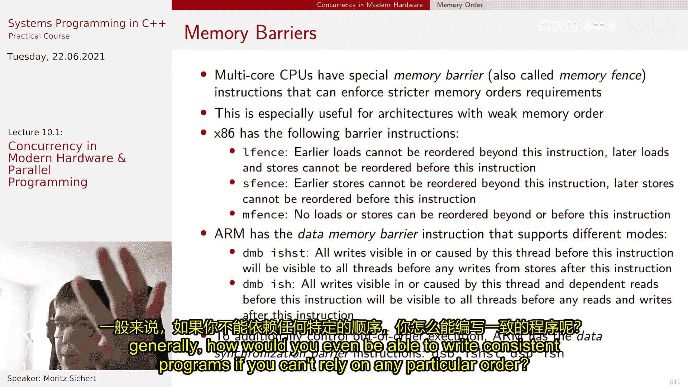

嗯。So， I mean， those are just an example on X 86， we also have fence instructions which。

Also prevent some kind of reordering， but especially on on arm， we have the data memory barrier。

 which prohibits some， some reordering。 I don't want to go into detail here because this is also very。

 very specific， but if you're interested， you can look up the inseem instructions here。

But there's another question。 what does it mean when we have two bright A's in the diagram？ Yeah。

 that's a good question。 So you can see here we have this bright A。 we have this two times。

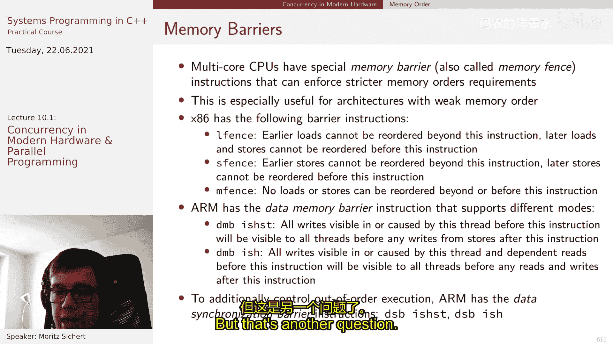

Even though we only have one store instruction， the reason why this happens is that if one thread brights something。

 then this will usually mean that so let's go in the let's go with an example for cache lines。

 Then this will mean that this。Threat will bright or will have a modified cache line and bright this value into its cache line。

And now if threat3 and4 wants to read this cacheline that contains a。

 they will request this cacheline from threat1 and depending on how how the CPU cores are actually connected or on like other factors it can happen that threat4 gets the new value for the cacheline that contains a much later that threat3 would receive them so this is why we have so this does not mean that the right instruction is executed multiple times。

 it's just that the side effect essentially from a store instruction will only be visible at different points in time for different threads I hope this answers your question。

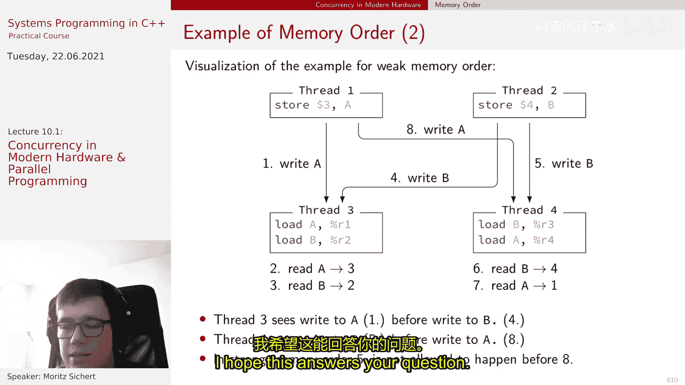

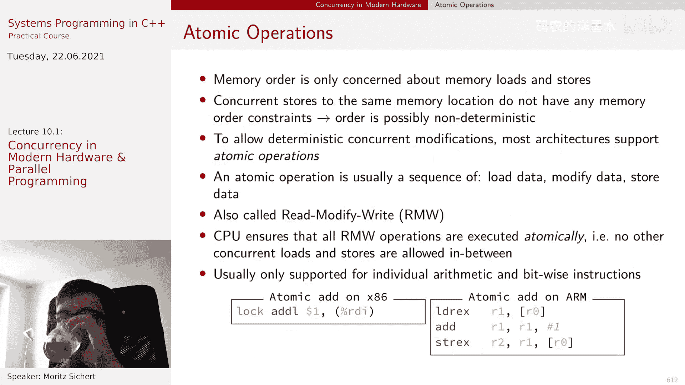

The next very useful thing when talking about memory order and concurrent programming is our atomic operations。

So we know that we saw that memory orders is only concerned with loads and stores， nothing more。

 And in particular， this means that if we have concurrent stores for the same memory location they。

Never have any memory order constraints。 So we also said this this is true for strong and weak memory order。

If we concurrently start the very same memory location。

 the CPU can't of course can't guarantee that one thread will always come before the other。

 so this is always nondeterministic， so you can't rely on this。

 which means that if you want to do something like you want to increase the counter by one which we saw in the example a few slides back。

This doesn't work because we write simultaneously from different threads and we can't guarantee that one right will always be executed before the other。

 but to still allow things like atomic modifications or concurrent modifications that still are consistent。

 most architectures have something that have instructions that I call atomic operation。

What atomic operations do， they are usually a sequence of so we load something then modify and then store it again。

 This is what we saw in the example。 we load the global counter first。

 then incremented by one and then store it again， but the special thing about atomic instructions is that the CPU guarantees that this will actually be atomic。

 So in a sense that no other threat is allowed to read or write。

 or at least to modify the value which would lead to an inconsistent results in the meantime because because of this pattern of reading and then modifying and writing those are also called read modify write instructions。

 this just an alternative name。😊，And here again， you can see some real assembly for this。

 So if you want to increment some counteratomically by one on x86 there there's a lock prefix for some instructions。

 for example for the add instruction where can say lock at1 to this memory address and then the CPU will make sure that this will actually work and be consistent on arm those are actually multiple instructions。

 but arm so you have the load inter register exclusive and then store from register exclusively again so this is very similar but here you can see the pattern of load modify and store explicitly again and so this is how it would look like on arm。

Another kind of atomic operation is the compare and solve operation。

 so to understand why this exists。

You have to know that read modifyify by right instructions on X 86。

 at least to be able to guarantee that they are actually atomic。

 the the CPU will potentially lock the memory bus， or at least it will make some will do something like make the cacheline exclusive and。

In the meantime， while the cache line is being modified。

 it will make sure that this cache line cannot be used by another CPU because this of course would lead to inconsistencies again。

 but because you have some kind of locking in there。

 this can then actually lead to performance issues because CPUs will actually have to weight on each other on each other and this is of course。

 especially true if the actually modify instruction is not only at one but something more complex。

 which means that the CPU takes more time and it essentially prevents other CPUs from getting the same cacheline for a longer period of time。

And because this can be very can lead to very bad performance issues。

 there X N6 only has very few read modified bright insertion， essentially only the at sub multiply。

I'm not even sure whether division is atomic， but adding and substructing， they do exist。

 but most of the others are they are hardly used。But if you do want some more complex atomic operations because they are sometimes useful and they are also very nice to write concurrent data structures with if you can do some more complex atomic operations。

 there's a special operations， a special operation which is called Comp and swap。

 which is also an atomic operation。😊，Yeah， so let's look at what what this actually does。

 So a compare and swap instruction。 it has conceptually three parameters。

 So we have the memory location M， which we want to modify concurrently。

 Then we have the expected value。 So this is a value that we expect to currently live in or be stored in the memory location M。

 And then we have the desired value D that should be stored only if the expected value matches our value we gave it。

 So what in pseudo code， this means that the compare swap operation essentially it first loads the the value at the address M then。

😊。

Compares the loaded value with our expected value and if they are equal so if our expectations are true。

 then it will store the new value， which is the desired value D and then it will tell you that it was successful otherwise it will fail and tell you that it was not successful because the the old value was not equal to the expected value。

So why is this useful？ The first thing you have to know is that， of course， this is pseudo code。

 but the CPU will make sure that those steps out of those steps， they are executed atomically。

 which means that no， in particular， no other threat is allowed to do any store in between this load in this store。

 So we can't have any concurrency issues here because this is guaranteed by the CPU。

 But since you can potentially have many CPUs which modify the the。

The memory or the value at the memoryification M in between the load and the store， of course。

 this can happen。 the CPU is allowed to tell you that the Comp swap operation failed。

 So if you do those if you use those， you have to make sure that you actually handle the failure case。

 another interesting fact about operations that arm does not support locking the memory bus at all。

 which means that it doesn't have any readmodifier right operations， it only has compare swap。

 And this is precisely what we saw here。 So this is essentially a swap。

 because the exclusive here tells the CPU okay， I want to load this and mark this cache line as exclusive exclusive not in the sense of the messy protocol。

 but the sense ofity。 and then the store instruction it checks whether this cache line was modified concurrently by another threat while we did something in between here。

 And if it did then it will set。

Some special CPU flags that your problem can check to make sure that this actually succeeded and if it didn't。

 it will just repeat this sequence of instructions。

嗯。But because， of course， they can fail， as I said， not only on arm。

 but every time you use a comparison of operation usually use it in a loop that has precisely those steps。

 So you first load the value from the memory location into a local register。

 So by just using a regular memory loads or no atomics yet。

 then you do a computation with the value that you load into the local register under the assumption that no other thread will modify this memory location in the meantime。

 So the simplest thing would be just to incremented by one。

 but you can also do some more complex thing， you can maybe if it's a pointer。

 you can look at the value that the pointer points to something you can。😊，Do whatever。

 Then you generate a new desired value。 And then so， for example。

 you can generate a new pointer which is， for example， the case， if you want to have a linked list。

Where you generate where you read the current next pointer and then you allocate a new object and then write the then to get the new next pointer out of say。

And if you did this all of those steps there， they don't necessarily have to use atomic operations because they just operate under the assumption that the comprehensive operation will succeed。

 So then what you do as a fourth step is you do the actual comparison operation by telling the CPU okay I computed something under the assumption that my value will be equal to this to the value that I loaded in step 1。

 So this is what we do in step 4 and then step 5， the CPU will tell us if this actually if this assumption was actually true and if it was not。

 then we will just repeat this loop starting from one again and we do this as long as it fails。

 of course。

So let's look at theut called example here， so we essentially have a while loop and we loop through this while we don't have a success yet。

So here can see the step one as we load the memory the memory location to get the expected value。

 then we， for example we call some function which calculates some non-trival operation on this expected value and then writes into the and then we get a new desired value which are steps2 and3 and then we do the actual compare and swap operation on the memory location tell it tell the system that we expect this value to be stored in the memory location A and we want to store the new value here。

And of course， if this succeeds， then we will break out of a loop and if not。

 then we will repeat this nontrovi operation as long as it is necessary。Of course。

 the advantage of this is that this nontral operation， it can be anything。

 you can compute some complex trigonometric functions or something。

 and you don't have to use any atomics necessarily in there so you can do as you can essentially make all kinds of operations atomic。

But the likelihood that this will fail will actually increase the more time you spend on this nontro operation。

 because if you。If you spend 10 seconds on this nontri operation。

 it is much more likely that some other CPU will have modified this value in the meantime。

 which means that it is very much almost guaranteed that the comp operation will not fail。

And of course， every time this operation fails， you have to repeat the entire calculation from the beginning and if this operation is very expensive。

 this of course can also lead to better forms。In general， this is a nice approach for to to make。

Something atomic without requiring muttices or something。

 but you have to take care that you do not run into any accidential and performance problems。Okay。

 do you have any questions about the concurrency in modern hardware chapter so far？

Because the next thing I want to talk about today is。Paraallted program programming。

 So what is the difference between。The first chapter。

 and so the concurrenrency modern hardware and parallel programming。

Paraallel programming is essentially the high level view of。

How you can write your programs conceptually so that if they are executed concurrently。

 they still work nicely together。 So a multithread program usually I mean to be very useful it usually has a lot of shared resources so we share some data structures。

 which means that for example， we have just an array of data which multiple different threads used。

 but may also have some more complicated structures we have lists or maps or something we also have things like operating system handle。

 So we have a file that is that some thread opens， but multiple threads want to write to it， we have。

 of course， I mean individual memory locations can also be thought of as resources。

 Yeah so all of this can be shared between different threads in multith programs。

But to make sure that this actually is consistent because we have to manage the concurrent excesses to those shared resources。

 So in general， if you have uncontrolled excesses to concurrent to shared resources concurrently from multiple threats。

 this is usually called a race condition。 So a race condition is so every time two threats access the same shared resource at the same time and try to modify it at the same time。

 this is called a race condition and race conditions。

Most of the time the word race condition is used in the context of undesired effects because I mean。

 if you use atomics， for example， as we saw， you can have concurrent accesses to the same memoryplication。

 the CPU will make sure that this is consistent， but of course race conditions in general is the term for if you have unintended consequences which lead to bugs in your program or to inconsistent program states。

Of course， I mean， inconsistent program states they either leads to directly your program crashing。

 but usually which is much more likely in much more harder to debug is that they will lead to silent data corruption because one threat will modify something in a way that the other thread didn't expect and then this will only be detected if at all much later by some other threat or maybe you will just silently leak memory or something。

And of course， the， the topic of parallel program is the or it's is the。

Area where we want to talk about how synchronization can be achieved to make this。To make this。Yeah。

 consistent and to execute the program safely。 So they essentially there are mostly two ways so we at first we can rely on operating system support。

 for example， all operating systems or Mo operating systems they have something that's called mutixes which guarantee that or can guarantee that two threads will not execute the same locked or the same critical section concurrently。

 but of course we can also use modern hardware support。

 especially through atomic operation that we saw so that we do not have to involve the operating system which usually its much slower So let's look at at an example of a race condition here So if we have a linked list and we want to insert or in this case we want to remove elements from this list and we do so without any synchronization。

That's say we have two threads and threat one wants to remove B and threat2 wants to remove C。

 So what threat1 does， then of course it sets the next pointer of a to C。

 which means that B is essentially removed from the list and threat2 sets the next pointer of B to D but of course。

while threat2 is modifying the next pointer of B， threat1 already removed the element of B。

 which means that in the end， we have something that looks like this。Which。

 if we assume that A is still the head of the list， we will not have removed C。

 even though threat to executed the remove operation。

And this can also mean because the threat2 things that is removed。

 it will delocate the C node because it removes C， which means that if we iterate through this list again。

 it can happen that the excesses to C will result in a Se fault or some other memory error。

 but this of course can happen much later， namely only as soon as someone iterates through the list again。

 but this is an example of a very common problem where it is very or where you have need to have some synchronization here。

In this case， we essentially have something that's called a critical sections。

 or we have some part of our code， which must not be executed by multiple threads at the same time。

 which means that only one thread。Is allowed to enter this critical section of the code at a time and if we structure our program in a way that we have critical sections where we say。

 okay， if those are guaranteed to not be executed，Couldcur， then our。

Program will be guaranteed to be。To be consistent， of course。

 the the actual order of which threat gets to execute which critical section in which order this is not at。

 of course， but the program behavior will still be consistent。

Now the question is how can we implement such mutual mutual exclusion and as I said the last slide we can use operating Susan support so theres operating solution they actually do support this feature directly but we can also simulate this by using atomic boolean variable so to say we can say okay we can use a boolean and this is by default sets to false and if we want to execute a mutual a critical section。

 we have to set this to true atomically and by using something like a compare swap or in this case。

 this is a special case for booleions， this also sometimes called test and set operations we can make sure that we set this atomic boolean。

 only to true if it was set to false before but now the question is what do we do if it was set to true because we need to wait until it sets to false again and the simple simplest solution would be just to。

Repeatedly read the value until it is actually falses。 But this。

 So this is essentially essentially called spin waitinging or spinning。

 but this can also lead to some dangerous behavior of a program。

 So the like the easiest way to do this， those also the slowest is just to rely on the operating system to do this。

Correctly。So in general， this concept is also called locks。

 So locks are essentially the high level concept of。So of managing share taxes to resources by。

Using new Texas。So the terminology is that you acquire a lock on a muttics object and a lock can only be acquired by one thread at a time on a mutticix and the nice thing about boxes is that if you try to acquire a lock on an early locked muttics。

 then whatever implementation you have which is most likely operating system supported。

 it will make sure that the kernel threat will not execute any instructions as soon or as long as the lock is still held by another threat。

 and especially if you do have kernel support or operating system support。

 the kernel will actually schedule your thread out which means that it will make space or make room for other threads to be executed in the meantimetime because your threat can do anything anyway。

 so the operating system can optimize this in a way。

AndOf course， you can also use multiple mut taxeses to。To manage separate critical sections。

Which means that because， I mean， one thread can only enter one critical section at the same time。

 but if you have multiple mutexes for different critical sections。

 then of course multiple threads may enter different critical section simultaneously。

 which generally makes the program a bit faster because different threats can work or can do more work concurrently。

 which so in general we call this fine grained synchronization because we try to use。

Cical sections that are as short as possible， but of course this can then because you have multiple logs and this can easily lead to dead logs。

 which means that one threat waits for another while the other threat waits for the one and then you have infinite weights。

 which means that your program is in a dead log。

There's also something that's called shared locks because often you don't need strict mutual exclusion。

 which means that you。

That sometimes you want to allow concurrent read only operations。 so if if we， for example。

 to go back to the list example， if we iterate through a list。

 we don't really care so if you only read the valuess。

 we don't really care if other threads read from the list as well because reading from memory without changing it is just fine concurrently so we need to but we need to make sure of course that no other thread is currently removing or inserting element at the same time。

 so to implement this and there's something that's called a shared lock。

 which is essentially generalization of logs， which means that you can have。

So multiple threads can have a shared lock on a muttex， which is exactly the concept。

 So if a thread only needs to read something， it would only acquire a shared lock。

 but if you want to modify something you would acquire an exclusive look and only one exclusive lock is allowed to exist for the same muttex and why an exclusive lock is held by one thread。

 no other logs so no neither exclusive nor shared logs are allowed to exist。

 so this is how you can implement this read right logic essentially。

as I said for Muutixes， but this also goes for shared locks。

 you can deadlocks can happen very easily if you if you are not careful because what can happen if if you have multiple mutixes。

 so in this case， A and B， and for example， threat1。

Tries to get the lock onuttics A first and then tries to get the lock on B。

 but threat2 does in the opposite order that can happen that threat1 gets the lock on a while threat2 also gets the lock on B。

 but if they then try to get the lock from each other。

 then of course threat1 will will block the lock instruction here。

 threat two will will block the lock instruction here。

 which means that they will wait for each otherly indefinitely because they will never release the lock while they are waiting or this is called a dead do and this is of course yeah this it was a state of your problem that will that you never want。

In general to avoid this， the easiest solution to avoid this is， of course， to。To only have one。

L or mutex in total， because then you can't have multiple mut textes and you don't have potential dead locks。

But of course， it is sometimes as often more efficient to have defined grand locking， as as I said。

 which means that you have multiple new textes， but to make this a bit more manageable with that logs。

You you always must acquire the logs in a globally consistent order。

 which means that every time you acquire multiple locks。

 they should always be acquired in the same order， which means that for example。

 you should always first acquire a， then B， and if all threats would do this in the order。

 first A then B， then you also wouldn't there no detailss would be possible。That's the question。

 is there a danger of the CPU reordering lock operations？

That's also a very good question because actually the mutex is， I mean。

 if the muttix is implemented by the operating system。

 then the CPU reordering isn't so bad because this is actually implemented as a Suis call so you have you call into the operating system and the operating system then handles this by making sure that the threats are scheduled calling the answer so on and a Sus call is an instruction which is not allowed to be reordered by the CPU and some other instructions are also not allowed to be reordered for example。

 atomic operations on X86 they are not。

Mostly not reored。 And but if you need the guarantees that because you are locking something and you need to make sure that the first lock is acquired before I try to acquire the second look。

 you can precisely use those memory fence instructions that are very briefly skipped over。

 but you're right。 And if you program if you try to write your own muts。

 you have to make also have to make sure that those cases cannot happen by actually。

Trying to think about which memory orders may happen and which kind of memory fence or atomic instructions do I need to make sure that this can't happen。

嗯。Okay， and in addition to deadlocks， there are， there are also a few more problems with mutual exclusion。

 So in general。嗯。Something that can happen is called starvation， and starvation is something that if。

 if many different threats。Neat access to the same mutex at the same time。

 It can happen that some threats will never get the mutx because for some reason。

 some other threads will always get the lock faster than the other ones。

 which means that some threats will never be able to make progress， which is then called starvation。

 The threats are essentially star from from work。 This， of course。

 can be alleviated by using either using a better implementation from muttexes。

 which makes sure that the locks are distributed fairly， or by using less restrictive locking steams。

 for example， shared locks or by using more finerant locking or or something like this。

There's another question。Does the operating system somehow make sure that no right operations are done with the shared lock or is this the programmer's responsibility。

 or this is also a good question， this is entirely the programmer's responsibility and also also also for regular muttices which are not we just have the one lock。

Nobody also in C++， nobody would stop you from writing to some shared location if you don't actually have a quiet look。

 it's just a convention essentially for the programmer。

 so you have to make sure that you do this yourself。Okay。

 the next issue with Mu is highlight andency， the reason for this is that。Muttic is， and they。

So because they use or often。Implemented by using operating system calls。

 they can be this can be very slow because you have to step into the operating system first。

 and the operating system has to find out what this matrix actually is then has to communicate with the scheduler to make sure that some threats are woken up and some are put to sleep。

 And this is especially true if you have again， high contention if many threats try have to call into the operating system all of the time。

 then this can lead to even to reduce system performance。

 So this can not only affect your own program， but this could also could affect the entire system。

And this actually is also true that if you use muttices in a single thread program。

 so if you have a program that is designed to work on multiple threads。

 but you decide to run it only on a single thread， this means that it potentially probably also already uses mutixes because it could theoretically have multiple threads。

 but if you use a mutticix very often and if you have a bad implementation that calls into the operating system all of the time。

 then this can also lead to a worse single thread performance。😊。

Another important thing that can happen is called priority inversion。

 And what this means is that if you have。Some threads that have a higher priority than others on Linux。

 for example， you can set this as an attribute of a process。

 but also just conceptually if you have a thread that just does some background work and you don't really care when this is finished。

 but the background thread uses some shared resources。

 which means that it will also sometimes have to use auttics， but if now a background thread。

Acquirees a local onim muex and a foreground threat or a busy threat that should have priority over the background threat also needs this mutex。

 This means that the prioritized threat actually needs to wait for a threat that does have a lower priority and because a higher priority threat needs to wait for a lower priority threat。

 this is called priority and inversion because usually it would be the other way around。

 you want lower priority threats to potentially wait so that higher priority threats can execute faster but this can easily happen that you accidentally get the inverse situation。

嗯。Fortunately， especially for modern hardware， there are some or there are there are some tools you can use to not rely on new textex so much。

 So as I said now multiple times using music is relatively expensive and they are not only slow。

 they are also usually relatively large So large than you would maybe expect。

 So they are not just the size of one point are something on X86， for example， on Linux。

 they are something between 16 and 40 bys in size。 and I said of course， multip timess ready。

 they require system calls which can take thousands of cycles in which the CPU could do some arithmetic operations instead okay so。

This means that in general。Even though I said fine grand locking may make sense for more of a better performance because locking a muttix is so expensive and individual muttices are relatively large。

 muttices are usually used for cost grand locking so with a muttix you usually lock an entire data structure instead of just parts of it So if you have a mutix on a list you would just lock the entire list instead of locking every individual node because if you would do so you wouldn need up to 40 bytes additionally for every individual node。

😊，AndOf course， this makes especially sense if it's not very contented。

 so if not many threads access the log at the same time。

It is also fine if the potential critical or this critical section is much more expensive than locking the mut itself。

 So if the critical section involves something like reading something from disk or getting something from network or something。

 which usually or even getting some input from the user， which can take an arbitrary time。

 then the actual time that it takes to get to do the system call isn't that important anymore compared to the time of the critical section so then it may not make。

😊。

Then it isn't so bad anymore to use a muticix， but of course， if you have high contention。

 you don't want to use mutixes， so what we want to do instead。

 you want to exploit the modern hardware instead for more efficient synchronization。

One thing you can do is something that's called optimistic locking。 And this。

 the concept from optimistic locking is very closely related to what we saw with the compare and swap operations。

 So what we do with an optimistic lock is essentially。Or let's say the。

 the concept of optimistic locking assumes that generally， if you have a data structure。

 you will have。More read only excesses than write accesses。 Of course， there are。

 you can always think of use cases where will only want to append into your list or something will have much more write accesses than reades。

 But in general， optimistic talkinging is used for cases where you will or where you expect to have much more read accesses than write accesses。

 and the idea behind optimistic talkinging is sets for the very familiar very not for very the case can happen very often。

 which is the read only case， we want to optimize it。 So the read only case should be very efficient。

 which means that in particular parallel read only exercise。

 they should be efficient and should not require any loging at all。

And of course shelocks could be used for that but chatlocks also use muttes so this is not very optimal so what we do instead we do optimisticly talking with atomics。

 essentially how this works is we have a version that is associated with the shared resources and because writers。

 of course you can't have concurrent writers because this will lead to inconsistent results。

 we need to somehow synchronize writers so we have some version here and。

This version makes sure that every time we write something or we we modify the resource。

 we will increase the version， which means that in particular。

 every writer will get its individual version， essentially， which means that only then the readers。

 they can read the version to find out if the version changed while they access the shared resource。

 So this means that the reader。Reads the current version atomically at the beginning of the critical section。

 then it does something。 So read the opera the read the。

The shared resource and then at the end of a critical section it reads the version again and validates if it has the same value as before。

 and if it didn't have the same value， then of course a concurrent right occurred。

 which means that the critical section has to be restartled because it was not successful。😊。

So let's look at an example here， so we have two functions which are called B and reader。

 what the reader does。Is。So。The， the writer， of course， needs to。To lock the exclusive lock。

 to make sure that different writers are synchronized with each other。 And then what it does。

 then it atomically increments the version after it modified the shared resource and。

 and then it unlocks the mes again。 What the reader does。 You can see here， we have。

 we don't have any muts operations here。 We just load。The version atomically。

 then we read the shared resource and then we load the version atomically again and check if it actually matched our old version and if it did。

 then we return otherwise we repeat this。One very important thing you have not yet， though。

 is that we will have。Basically， race conditions here because。

While a writer is modifying the shared resource， a reader。

Can also try to read the resource at the same time。

 which means that this optimistic locking scheme is only it only makes sense when modifying and reading the shared resource is possible even with race conditions。

And this means that usually modifying and reading the shared resources also needs to involve some atomic operations so that you don't run into any race conditions in between。

 But if you， if you have this， then optimistic lock can be very efficient so。

Why is this sufficient， we saw that the readers， they only have two have to execute two atomic cloud instructions or not even riots。

 which means that。Atomic loads they are comparatively cheap。

 so this can be done very cheaply and in particular， this is， of course。

 much cheaper than acquiring a shared look。 of course it requires modifications are rare because if they are not。

 then we will retry the critical section all of the time。

 which is of course the similar problem we have with the comparison swap。😊，And as I said。

 the shared resource it may be modified while a reader is only reading it。

 so the reader cannot assume that it will read a consistent state。

 so yeah you have to take care there are to to make sure that this does not。

Break accidentally。So。Another， so if we go beyond that， often you don't really need mutual exclusion。

 so you don't need strictly strict。Critical sections that are really only executed by one thread at one time and so the example for this is a parallel insertion into a linked list because you don't really care which so if two threads insert a new element you don't really care or you can't even control which element will end up first in the list。

 you just want both elements to be inserted into the list eventually。So。

 but we can implement this actually without any mutex operations in and also without any race conditions by using the compare swap here and the usual pattern for linked lists here is that we load So if we insert something at at the front of the list。

 we load atomically the current head of the list， then we update the next pointer of our new element to point of the current head and then we do a compare and swap operation on the memory location of the current head and tell it okay we assume that。

Or we assumed in our code here that the head value is the one that we loaded here。

 and we want to change it by the new element pointer。

And here it also may hopefully make sense for you what the purpose of this expected argument here is because we used the head value here by writing it into the next pointer of the new element and of course inserting using this element new element as a new head only makes sense if nobody changed the head of a list in the meantime because if someone else did。

 then this link in does not make sense anymore， so if the comparison variation fails。

 we try this loop again and then actually read the new head and write it then as the new head value into the next pointer。

So in general， those data structures thats do not use logs at all。

 they are called non-blocking because they do not use any potentially operations that can block the entire thread which is the case for muttices。

 so usually non-bing algorithms that are implemented by using atomic operations because this is the this is the harder feature that enables you to write this and in general this leads so nonbing algorithms in general。

 I would say are more efficient than algorithms that use mutixes。

 but of course there are always caveats because it's a bit harder to write because you can't because every thread can interfere at any line in your program at any time。

 in contrast to mutixes where you have critical checksuits where you are guaranteed that you don't have any interference here。

So there's also two different levels of guarantees that such algorithms usually give there's something that's called weight free of weight free algorithms or weight freedom。

 This means that an algorithm is guaranteed to succeed eventually which in general is it's hard to achieve because you can think of and this loopier。

 it can potentially this compliance operation can potentially fail indefinitely if other threats also execute new insertions all of the time and and the CPU architecture somehow prefers to execute the other threats first before this can't this kind of algorithm we can't guarantee that a threat is guaranteed to succeed some so eventually so the weaker guarantee is called log freedom so that that we eventually。

If we run the program for a sufficient time。 So if we have read all of our inputs， our program will。

Eventually succeed， but it may not have very nice properties because we potentially repeat some operations very often。

So you have to know that lock free does does not mean non blocking because it depends on how you define blocking if this operation again if it loops。

The entire time， then of course， this is also something like a threat blocking on a comprehensive operation。

 So this is， yeah， not the exact same thing。

One of the last things I want to talk about today is one thing that is very common with lock free algorithms and data structures。

 which is the ABA problem， so because as I said we don't have dedicated critical sections anymore。

 which means that any operations can be executed in parallel so we can have parallel insert insertions and removes and within those functions also every instruction could potentially be concurrently executed with some other instruction of another thread。

Which means that sometimes if we have those arbitrary interleavings， we can。

This can lead to a very hard to debug anomalies which are such as lost updates。

 which is what we saw in the example of the list at the beginning。

 we updated the list by removing an element but we lost this update because some other threat did something which undid this change essentially or the ABA problem so。

Yeah， so let's see an example for the for the a problem here， ABA problem。

So， that's。Sa again， we have a simple linked list where we use compare swap operations。

 So the to to push and pop elements。 So essentially they。

 they just do the compare swap on the on the next pointer。 So let's now look at an execution。Of。

So the execution of this program with this initial list where we have those two threads that do those operations。

So let's say the threat one executes its store。 No Yeah， it it now， it pops the the value first。

 So let's say it。Loads the current head value， which in this case will be B and then we'll say okay the next value is of course the next of the head。

 but let's say now before threat1 is able to continue its execution T2 will execute the so will just execute the entire threatsa pop function。

 which means that this will now be reduced to C and D and then it executes threatsafe pop again。

 which means that this list only contains a D。And then we will push a new value again and now we just happen to push a new value which had the same value here that the other thread red before。

 which means that if this thread now uses compare in Comp sub operation is operation will succeed because the head is still the same。

as it was here， but in the meantime we changed the entire list， of course。

 if you implement this this is very unlikely to happen because those head and neck they are pointers and of course they will be different because you allocate them by using metal or something。

 but you have to be aware that if you use atomics and Comp swaps there can be some very weird problems like the ABA problem。

Another problem， what I also said is that if you try to implement muttics by just using comparison of operation。

 So this is what what I briefly explained before is to can essentially have a booleion。

Poul an atomic operation or poolole in atomic variable。

 And if you want to lock something you just do in an endless loop。

 you do the compare and swap until it is successful from switching it to the expected value 0 to the desired value 1。

 And if of course， if you unlock， then you want to just set it to 0 again。

 So this conceptually works， but using something like this， which is called a spin lock。

 it has several disadvantages。 one disadvantage is that this very naive implementationation has no fairness。

 which means that it is not So if you。

A lock， if you get， if you want to get the lock on a new text， But this implementation。

 user rate is not guaranteed to get the lock eventually， because this really depends on。

On。In the order of how the CPU synchronizes the memory excesses。And of course。

 doing a loop all of the time wastes energy and resources and again。

 this is a prime example of where this can lead to priority inversion and this is even worse than with muttices because if you have a CPU spin so that executes many instructions than the scheduler of the operating system we'll probably think oh。

 this threat is executing a lot of instructions in a short amount of time。

 which means this threat is probably busy so I want to give it more work。

 but in fact this thread is doing no useful work whatsoever。

 what we would want instead we want to give the other thread that currently holds the lock more resources that it can finish the critical section faster so that we go back to locking can unlock the thread more quickly which means that in this case a spinning threat。

Makes the entire system performance even worse than using a muttics。

 So the solution for this is either you spin for a limited number of times。

 So maybe for like several hundred thousand generationerations or something that we just have a counter or you try to use a real muttics if either if if the compare swap or something fails。

 you fall back to a real muttics or even to the operating system。

Or maybe you do this only after a few hundred thousand durationerations and this in fact is how mututes are implemented in most programming languages because as I said。

 accessing the operating system directly is rather expensive so what you try to do。

 they first try to do this without the operating system within your process and only if this fails they will fall back to talking to the operating system to work out a better strategy that will actually make put threats to sleep so they don't unnecessarily waste resources。

😊。

Okay， so that was the that was everything I wanted to talk about about parallel programming today。

Are there any questions。As I said， the actual lecture about how to use this in C+ will be next Tuesday。

 so there we will build on those concepts and learn how you actually can use atomics and music systems on actually in your C programs。

 but for now。We are fine with the。With the context， and with the with the concepts。Okay， I诶。

Guess there are no questions so far then yeah， that's it for today and see you on Friday。

