# 【全集 附课件】慕尼黑工业大学 C++系统编程 中英字幕 1080P p14 Lecture 14 - 大型项目的组织与管理 -BV1QTzjBFER2_p14-

Yeah。Welcome back everyone to another lecture of the systems programming and C++ practical course in which today we're not going to talk about C++ as much。

 but more about how to manage and organize larger projects and what kind of tools and facilities you could use to achieve this goal。

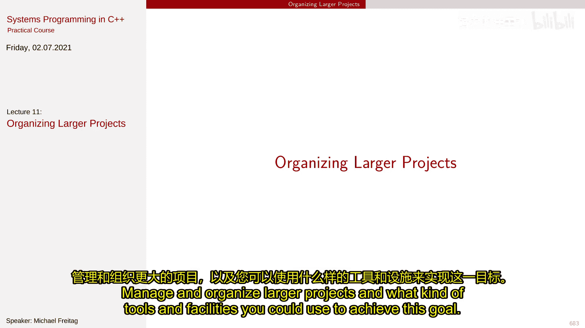

So what is the motivation behind this simply that up to now in the programming assignments we've mostly provided a project scaffold to use。

 so there were some predefined source and header files there was a CMake setup that already worked and you essentially just had to fill in some source code into these predefined files。

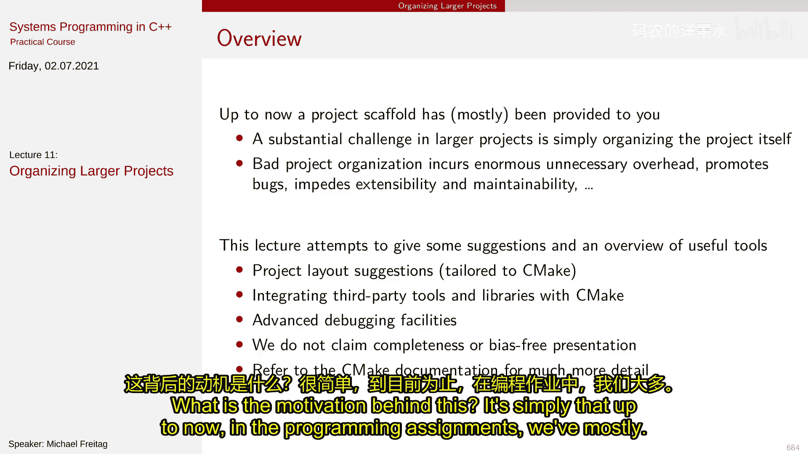

But of course， usually if you think beyond this practical course。

 this is not how things are going to be， so usually you start from scratch you have an empty directory and then you have to set up all this stuff yourself and today's lecture tries to give at least an introduction into how this can be done and tries to provide some general guidelines that help you along the way。

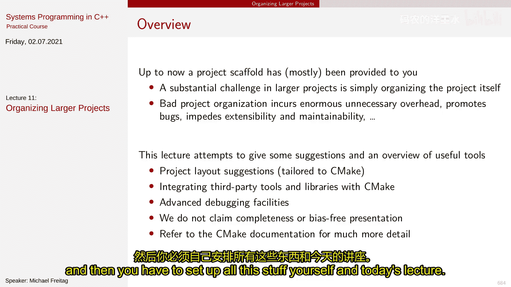

Because one of the main problems is that once your projects start growing a little bit larger and large is of course subjective here。

 then simply organizing the project can be quite a major challenge and at the same time if you have a bad project organization and this can be either bad processes for communicating between people just simply bad directory layout bad architecture all these things。

 this can really impede the progress that you can make in your project so you get this enormous essentially unnecessary overhead because it's much easier to introduce bugs into a badly organized project it's much harder to extend them。

Sometimes they are so confusingly organized that it's really hard to maintain them when something breaks at some place or you have to upgrade a library and so on。

 So there's a huge number of things that can go wrong that each of you。

 I think can think of once you have a badly setup project。

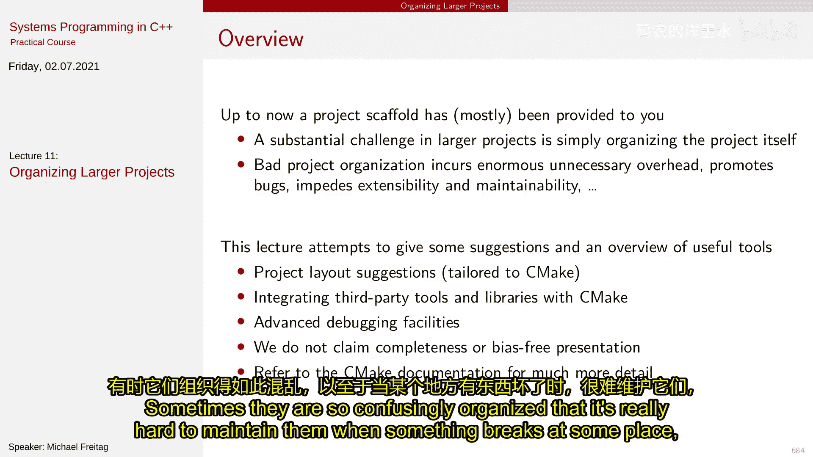

So what we try to do here is to give an overview of some best practices that you can adhere to and some useful tools that help you stick to these best practices。

So a rough overview is that we talk a little bit about project layout。

 This is tailored to CMake of course， because we're using that in this lecture。

 then we're also going to talk about how to work together with third party tools and libraries once again how to achieve this in CMake and also some advanced debugging facilities that we haven't really touched on up to now So of course。

 our lectures are rather short and this is a huge area which you could probably spend weeks talking about。

 So by no means do we claim completeness or biasfree presentation here。

 So this is what we have found to work well， then this is a rough overview of we have found to work well you're free to talk to us or read up on this topic yourself one good starting point for a lot of the content in this lecture is to simply read the CMake documentation which contains。

 of course， a lot more detail about the CMake specific。Stuff that we're going to see today。

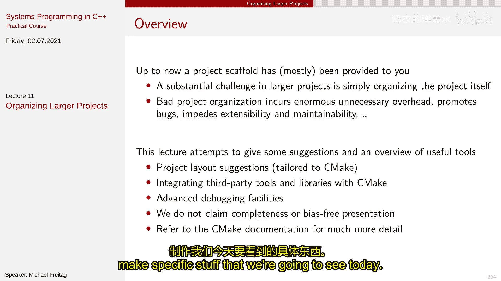

So， let's start with the。First， broader area， which is simply how to structure your project。

On your file system and although this sounds somewhat trivial。

 it actually has quite deep a quite deep impact on essentially the entire project lifetime。

 because the general project layout affects things that you will observe to have effects within your actual C plus plus part of the project。

 and this is， for example， the source tree structure， the namespace structure。

 how your includes look like maybe you have cycles in your includes that are introduced by choosing a bad file system layout。

 and then you also have the library and executable structure。That also。For example。

 effect extensibility， maybe you want to split your project into two projects。

 This is much easier if you have a suitable file structure from the beginning as opposed to when you have everything mixed up and then you have to painstakingly separate individual files from each other。

 So once again， I think the basic motivation here should be rather obvious。And， of course。

 if you change one of these properties， for example， if you change your directory structure。

 then most likely you will also have to adjust some of the other properties。

 So especially if you if you change the directory structure。

 then the namespaces should probably also change。And also。

 if you have different libraries and executables， for example， if you add another library。

 then this should be in a separate source tree from the remainder of your project。But， of course。

No one will get this perfect on the first try。 So usually this project layout will evolve as a project grows。

 And also， depending on how large your project is， you will most likely want to follow some different rules。

 depending on the size of your project。 So， for example。

 if you know that your project will remain small。 It's just a small tool to achieve some minor task。

 you can probably get away with some inaccuracies or。

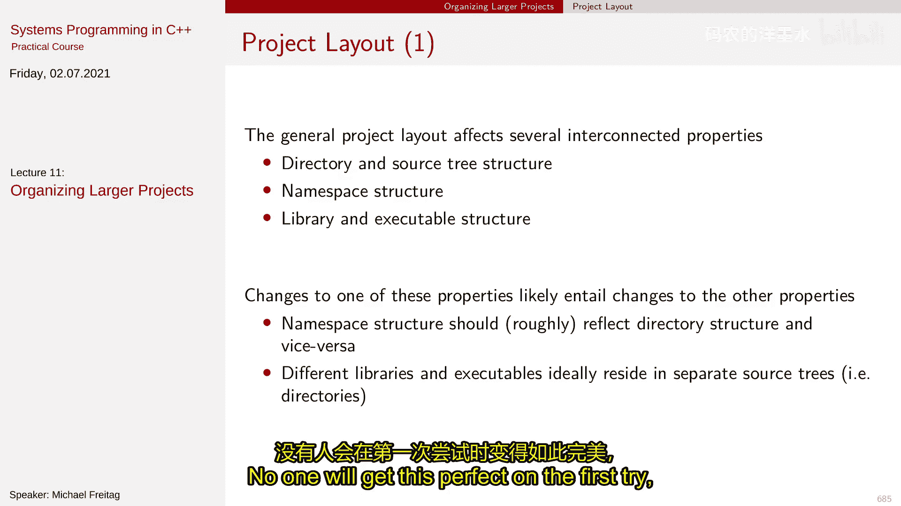

Someop solutions that are fine in a small project， but would become major issues in a large project。

And on the。On the contrary， some things you only have to do in large projects because they would be plain overkill in small projects。

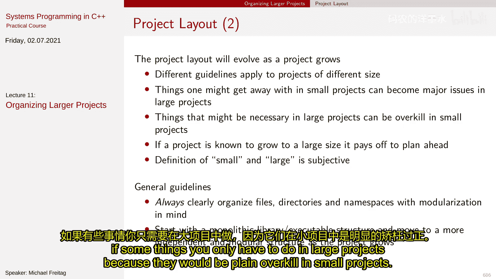

So the takeaway here is if you know that your project will likely grow in the future。

 then it pays off to plan ahead and maybe introduce some things that are not necessary in the beginning of your project。

 but will definitely become necessary once your project has grown to a sufficient size and of course。

 small and large here is subjective so。This also also depends on how many people are going to work on your project。

 if it's only you then also you maybe don't have to spend too much time on making it easy for many people to work on the same project and so on。

Regardless of the size of your project， there are still some general guidelines that we would recommend you to follow。

 such as always cleanly organizing files， directories and namespaces with the objective of having proper modularization。

So this， this is probably a area that you have already heard about in different lectures So the general guidelines of how you can achieve modular code you want to have。

High cohesion， low coupling and so on this also of course。

 applies to C+ plus and you can make this a little bit easier by having a clean directory structure that maybe reflects the different modules that you have within your project。

And if you most of the time， unless you really start a huge new project that you already know will be very large our recommendation would be to start with a monolithic setup where we have one library or one executable。

 and then as the project evolves a move to a more independent and modular structure within your project。

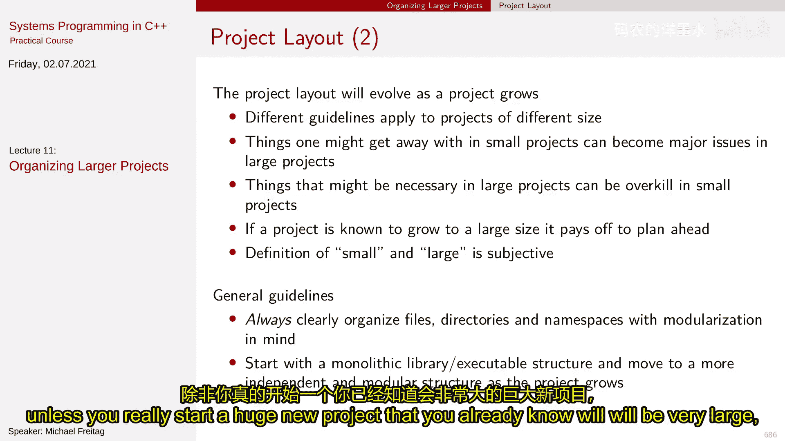

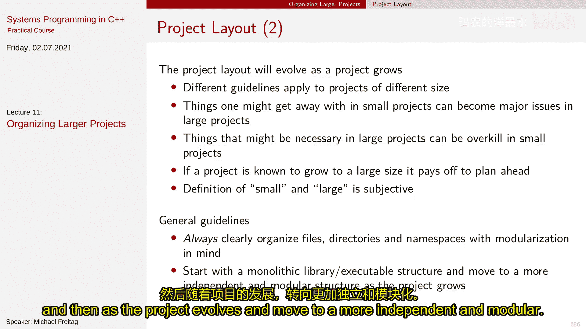

So。In general， when it comes to directories， we have found the following to work quite well， so。嗯。

Definitely if you have files that belong to different libraries and executables。

 these should reside in different directories so you shouldn't mix two or more libraries or executables within the same directory tree。

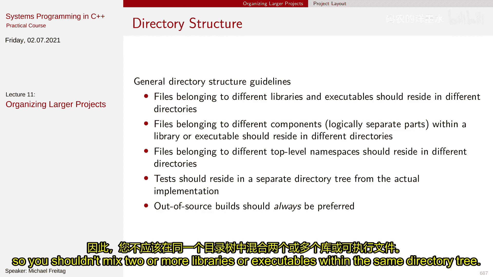

And this also continues to components within the same library or executable files that belong to different components within your project should also reside in different directories。

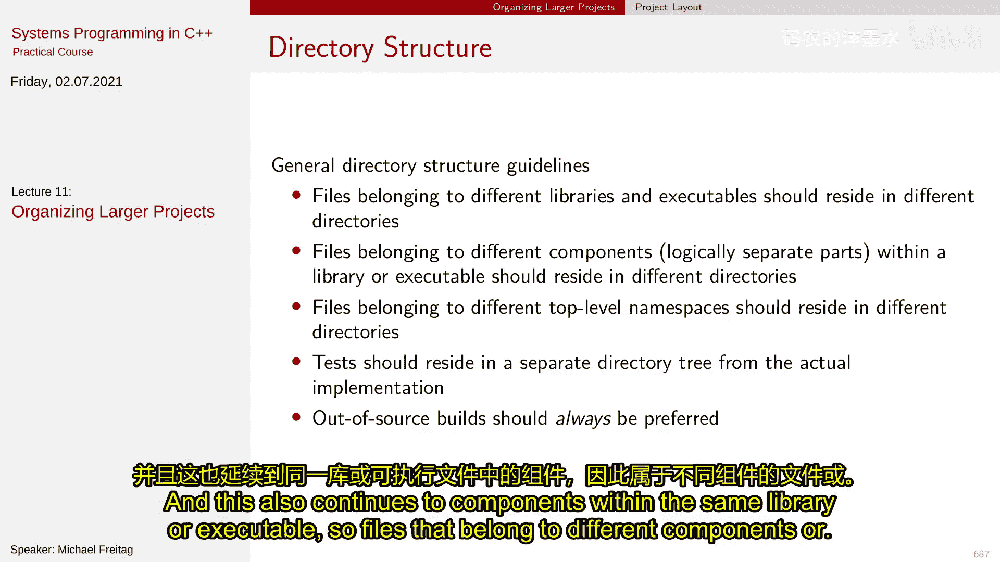

So this。Maybe this corresponds to modules or components within your system， and of course。

 if you have different modules or components， then these should probably also belong to different top level name spaces and therefore once again reside in different directories。

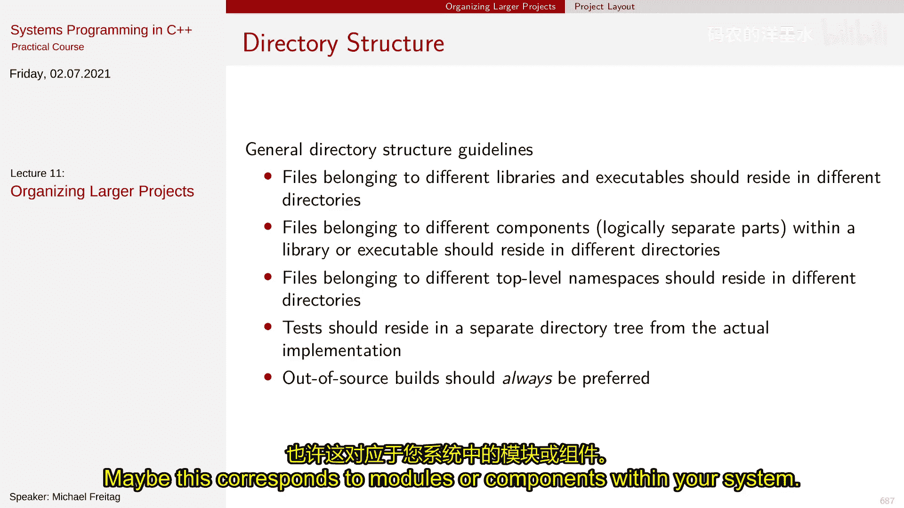

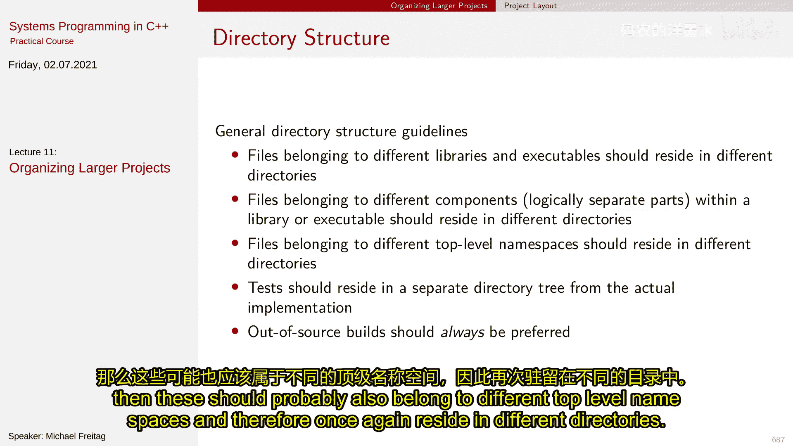

And something that's also quite useful is that when you write tests。

 those should also be placed in a separate directory tree from the actual implementation so that it's easy to。

 for example， strip test code from your project。For distribution or building and something that we have already talked about and that I think by now all of you do is of course。

 that out of source builds should always be preferred， so with CMake。

 this means that you have this separate build directory which then contains all the generated files and your actual source files are not cluttered with this generated stuff that then makes it very hard to find the actual files that you want to change when you continue implementing on your project。

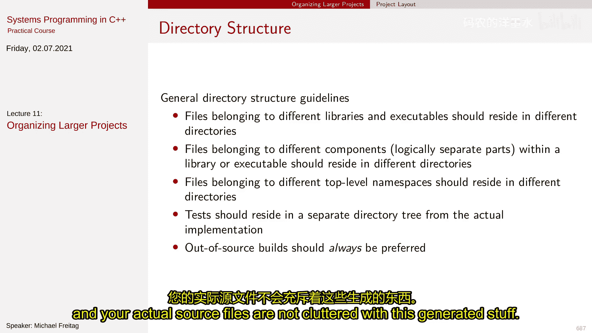

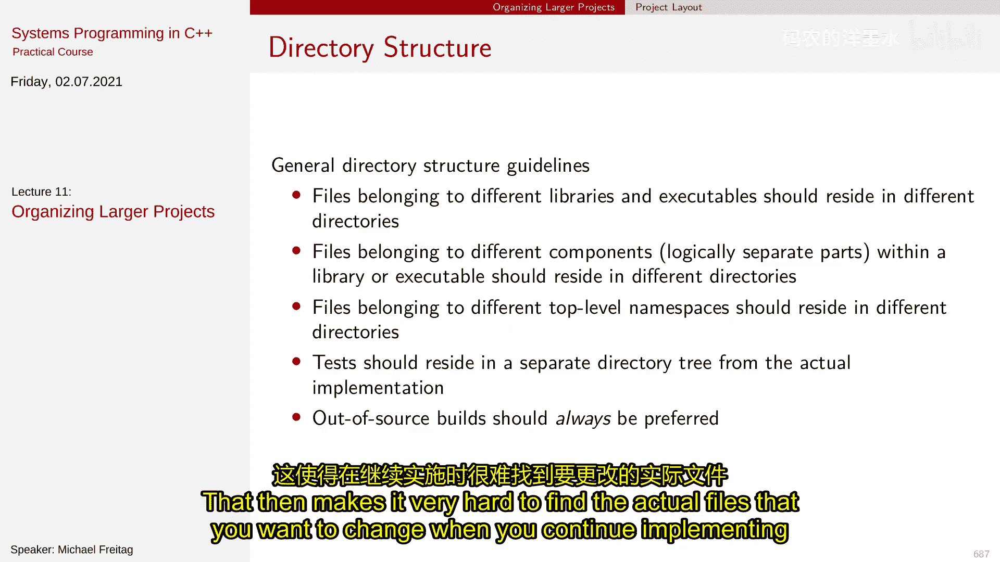

So what follows now are some high level recommendations。

Distinguished between smaller and larger projects， of course， as usual， these are just some ideas。

 will you will see that this quite closely matches what we have used in our programming assignment so far。

 but you are free to diverge from this if you find that some choices simply don't work for you as long as you're consistent。

 So this is I think something that generally applies choose one approach and then stick to it。

So for small projects， of course， all the general guidelines that we've seen on the previous slide still apply。

But you can make some trade offs here， so for example。

 you don't have to write entirely separate CMake lists files for the different components so you can share a lot of code between these components such as the build system set up the compiler flags and so on。

 maybe also dependencies such as third party libraries。And also。

 the test code and executables that you may have in your project can be shared by all the components within the project。

So。Thinking ahead， what will happen to this kind of setup eventually， so。

Eventually some of your components will grow rather large。

 maybe to the point that they become an entirely independent library that you would want to reuse in some other projects and then once these are sufficiently large。

 these components should then be moved into an entirely independent subproject so that you can develop them can maintain them and distribute them independently of the remainder of your code。

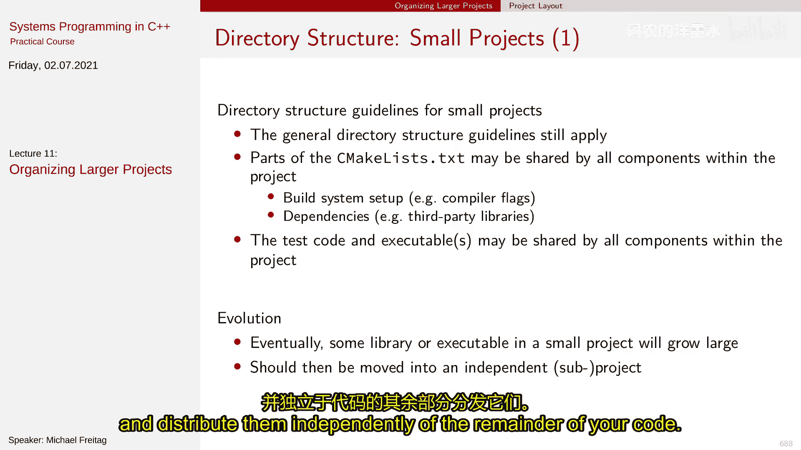

So how could this look like this looks quite similar to the programming assignment setup that you've seen so far。

 so we have our main project directory， we have a global top level CMake lists that contains all this common setup logic。

 we then have separate directories for the libraries and executables as our general guidelines suggest we then have specific CMake logic for these components so here we have a CMake lists that。

Collects the source files for our executable and then adds a target that compiles our executable the same year for our library。

 and then we have this shared test folder where we have one C make lists and then test code for the executable anti library here。

So you see that this essentially precisely reflects what we've seen on the previous slide。

 so we have already separate directory trees for libraries and executables but we have shared CMake lists logic and shared testing logic here。

 and this will work quite fine as long as your project isn't too large。Yeah。So。

A question from the chat if the my executable， for example， has different components in subdirecties。

 should those components contain separate C makelist files in general， I would say no， But。

 of course， this is also up to discussion。 The reason why I say no is that separate components within the same executable。

Essentially don't need their own CMake lists because all you would have to do there is collect source files。

 but you would still have this one command that adds all these source files to an executable in the main CMake lists file here。

Of course， what can and probably will happen over time is that some of these components。

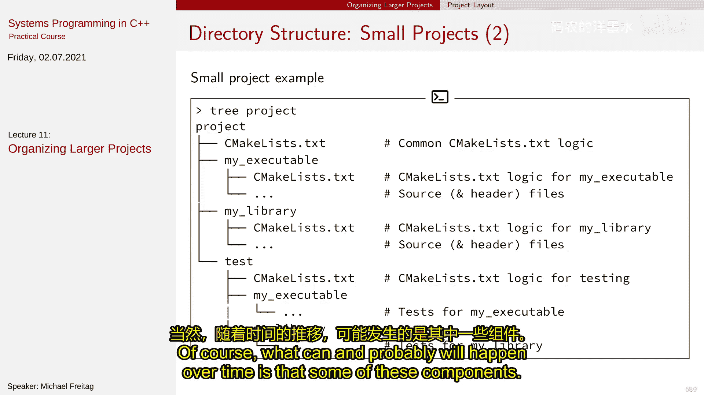

Become large enough and independent enough of the remainder of your executable that you may want to move them in their own library and then of course you will have another library folder here with its own CMake lists file and then in your executable simply have a dependency on this now independent library here。

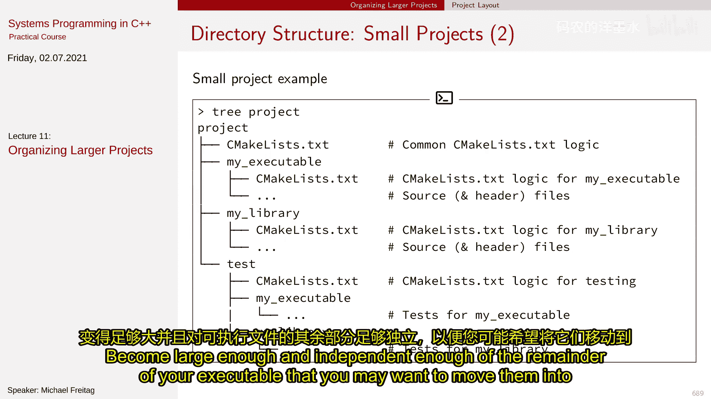

But as far as a single tree of a single library is concerned。

 I would say a single team make this hereor is sufficient。Any further questions。Allright。

 some we typing， so let's wait。What is the definition of a library。

Good question Up to now it's a little bit fuzzy。 we will see the difference between libraries and executables in the next chapter of today's lecture。

In general， an executable is something that you can run from the command line or double click in a library is just a collection of code that can be used by other things within a system。

Yeah。All right。

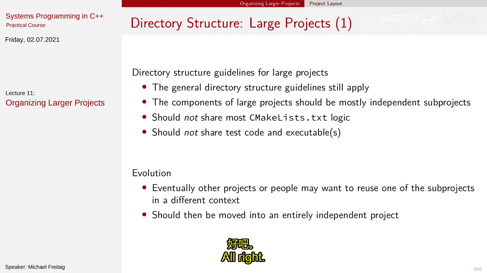

Moving on， so we now have started with this small project infrastructure and I've already talked a little bit about how this could evolve and which directions are possible here and essentially once we think that to the end。

 we will end up with a slightly different directory structure that is then more suitable for larger projects。

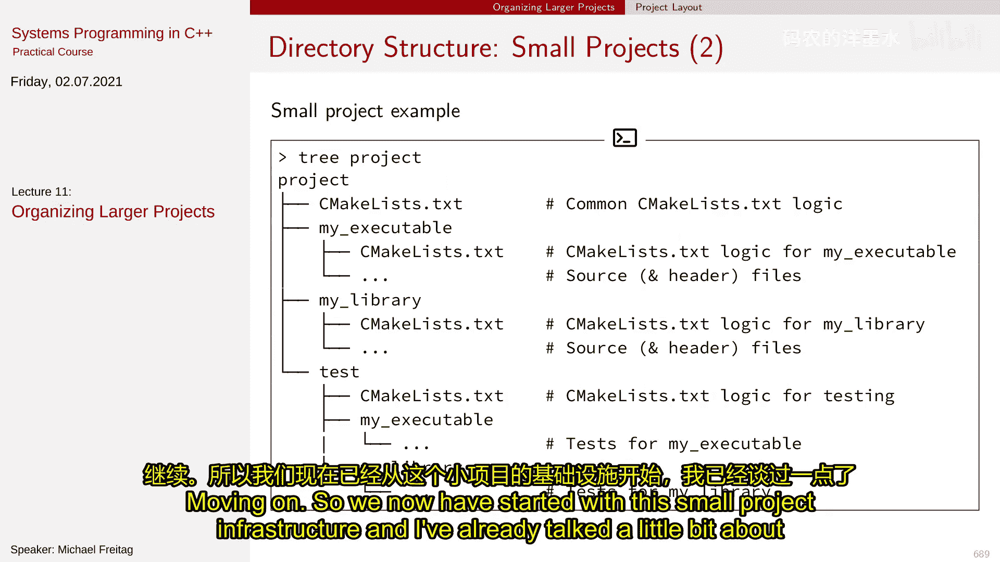

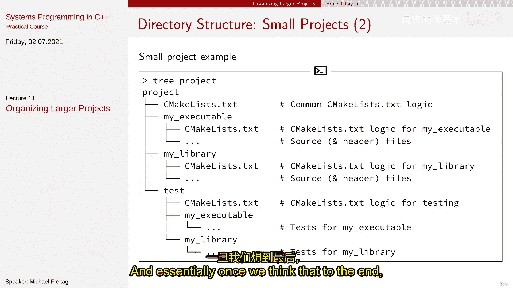

So for larger projects， of course， all the general stuff such as putting independent code into independent directory trees and so on still applies。

 and in addition to what we've seen up to now in a large project the major components should be mostly independent sub projectsjects。

 so this means that they should not share most CMake lists logic and they should not share any test code and executables that they might require。

And the motivation behind this is that eventually once your project grows even further。

 maybe other projects or other people may want to reuse one of the sub projectss。

 one of these components of your project in an entirely different context and once this happens then this component should be moved into an entirely independent project。

 so maybe。

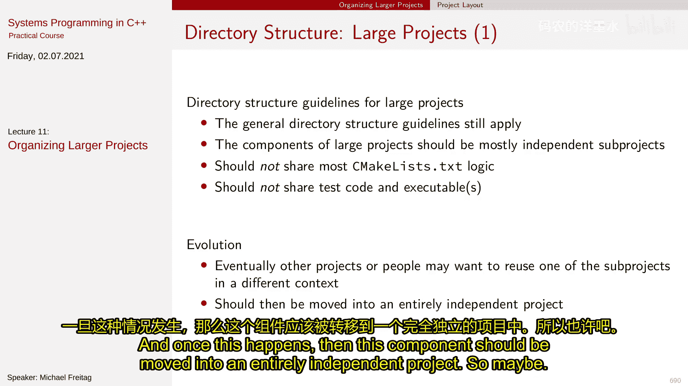

You've started writing some cool project， and one of the components is so useful。

 it implements something in such a performant way that you realize that this can be very useful to other projects。

 maybe even other people and then in the interest of encapsulation and maintain ability。

 you will probably want to move this into an independent project so that you can maybe produce independent releases of this component and don't have to update。

Your other project all the time and so on。 So this is the motivation why we want to start moving components into independent sub projectsjects initially so that eventually it's easier to move them into entirely independent top level projects here。

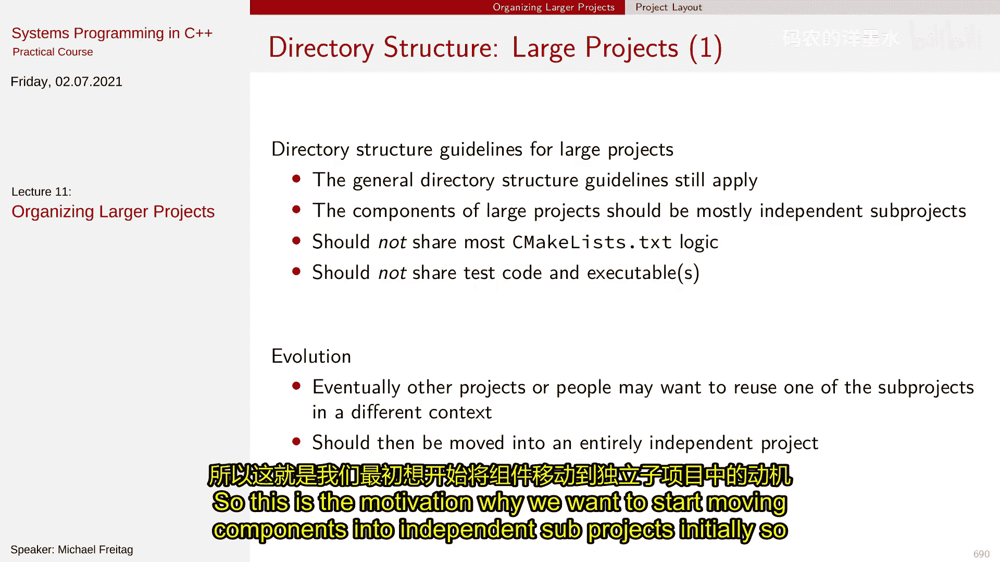

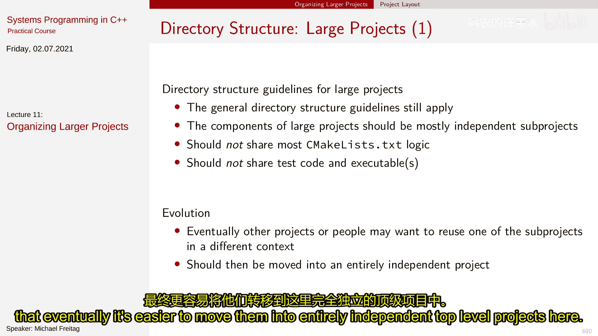

And when we apply these rules we will end up with a directory structure that looks roughly like this。

 so it's still quite similar to the directory structure for smaller projects here。

 but you'll see that now we've moved some things into the components here so the top level CMake lists still exist。

 but most likely this will simply aggregate the CMake lists of the of the independent components here and for example not contain global flag selection。

 global dependency collection and so on because that is then done。

Within the C make lists of the independent components here。

 So what you want to want to be able to do here is essentially take this my executable folder。

 move it somewhere else on your file system and be able to compile it as still compile it without requiring any code from this on top level C make list here。

 And also because we want to be able to do this。

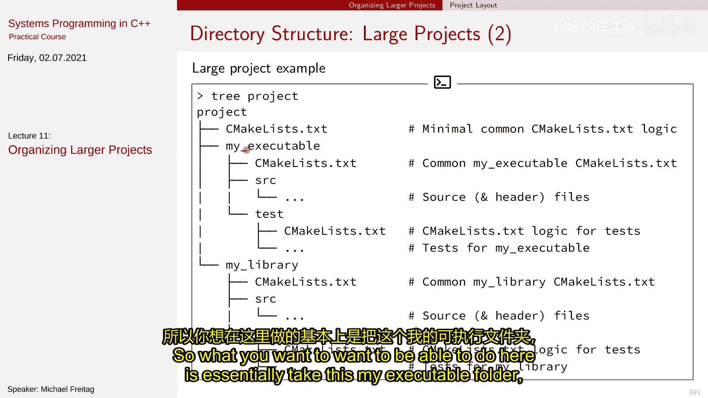

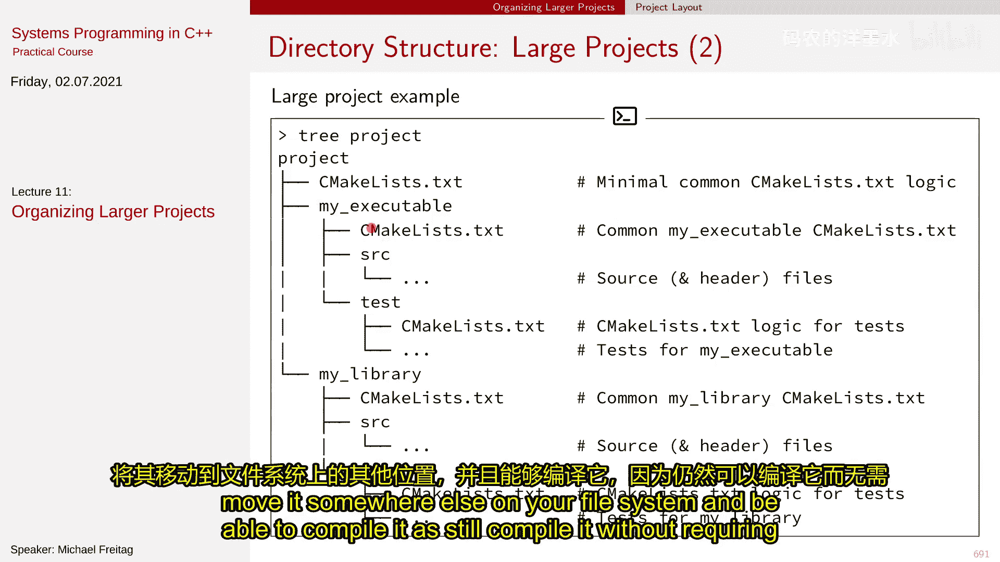

We have moved test code， and we have separated it into the set test code for the my executable and the test code for the my library here。

 and of course， here as usual， we have our。See makelists that maybe add some test dependencies。

 some executables for the test driver and so on。But apart from that。

 you can now think essentially of this my executable unfold here as a project to which the small project rules apply。

So， I hope you see。Kind of the the evolution path that may be possible。For such a project。

And some general ideas， how you can start and then evolve your project。Now， of course。

 once we have this directory structure， we can start thinking about the actual C+ plus part of our project and here we also want to follow some general guidelines。

So that we end up with with somewhat clean code in the meantime。

 we still have a question in the chat the final project of this course is still considered to be a small project。

 Yes， I would agree to that。The final project still doesn't require many people to work on it and the the time frame that you have isn't long enough that it can really evolve into a huge project。

 So here in the final project you're free to apply the small project guidelines。

To your implementation。

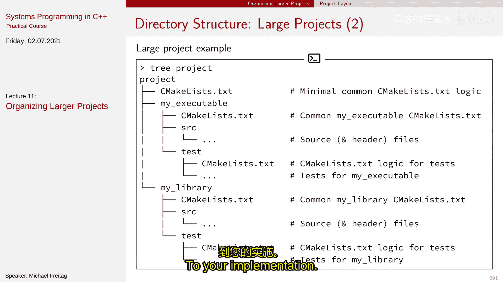

Right， so returning to the lecture， the next thing that we want to think about is how to organize our individual files within this general directory layout that we've now come up with。

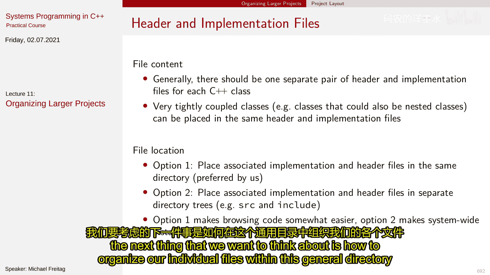

So as far as the file content is concerned in general， of course， there are exceptions to this。

 but in general we would like to have one separate pair of header and implementation file for each C++ class。

One exception to this is are very tightly coupled classes。

 so classes that could essentially also be a nested class of some other class can be placed in the same header implementation files。

 So something like an iter writer for a container。Usually is defined as a nester class。

 but it could also be defined as a free class， but it can then still be placed in the same header and implementation file as the。

As the actual container implementation， for example， also something that's that's fine is you。

 if you have an inheritance hierarchy that essentially。

Is just there to encode some type information but where the individual classes of your inheritance hierarchy don't really have a lot of functionality。

 this is also something that you can arguably put in one pair of header and implementation files。

 but of course here the boundary is already a little bit fuzzy because if your inheritance hierarchy is very large then your header and implementation files will get quite long and it will become a little bit difficult to find one specific instance within your inheritance hierarchy here。

So here the boundary is a little bit fluid and this also depends a little bit on personal preference。

 so the one strict guideline that I would see here is that if you have entirely independent C++ classes。

 you should never put them in the same header and implementation files。

As far as the file location is concerned， there' is also some room for decisions here。

 So the first option is that you place em header and implementation files in the same directory。

 This is what we have done in the programming assignment so far and this is what we prefer for our personal projects as well。

 The other option that you will see quite frequently in other open source projects。

Is to place implementation and header files in separate directory trees。

 so something like a source tree and an include tree where the source tree contains all the CPP files and the include tree contains all the header files。

So what are the differences between these two choices in the first option where we place both files in the same directory。

 it's much easier to browse code because you always know that the header file is directly adjacent to the implementation file and it's easier to find your way around that。

With option2， where we have separate directory trees。

 it's a little bit easier to write code that installs a library on a system， for example。

 because there， of course you only need the HPP files。

 you don't need the CPP files anymore once you start distributing precompiled binaries。

But we still prefer option one， especially because with CMake。

 you can quite easily write a little bit of CMake code that simply extracts all the relevant header files from your directory tree and then places them into and include directory just for installation so if you don't have CMake this may become a little bit harder。

 but since we recommend using CMake anyway， there's no real hard requirement to use this option to here anymore。

Now， of course， whatever we put in our header and implementation files should be enclosed by。

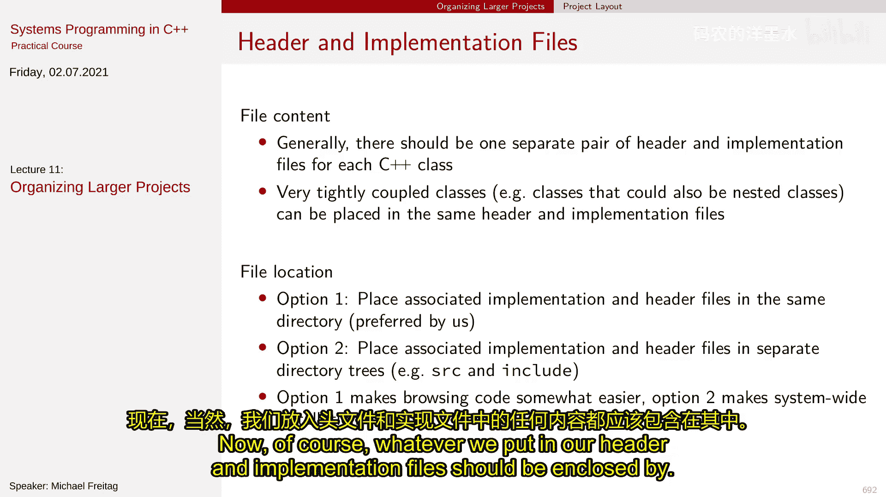

By some namespaces and these namespaces should ideally identify logically coherent components within a library or executable。

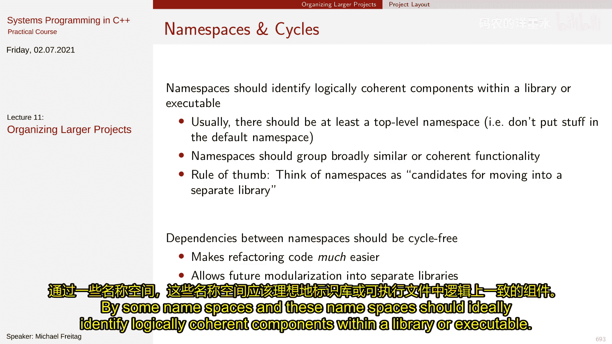

So usually there should be at least a top level namespace that corresponds to whatever library or executable you're writing。

 so the takeaway here is don't put stuff in the default namespace and this is also something that you've already seen in the programming assignments where we always had this top level namespace that we defined with some sensible name and then all of our classes functions and so on went into this top level namespace。

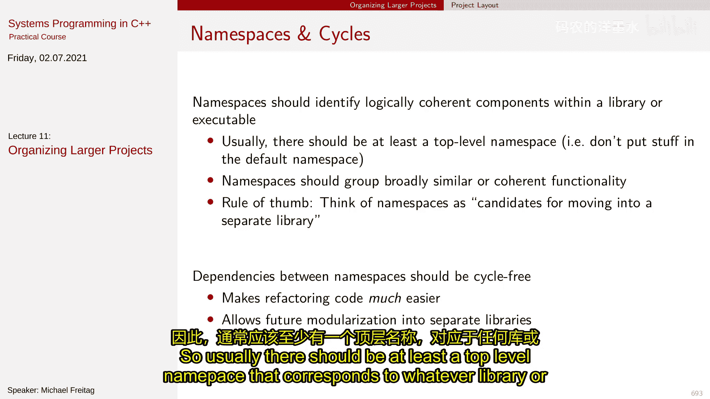

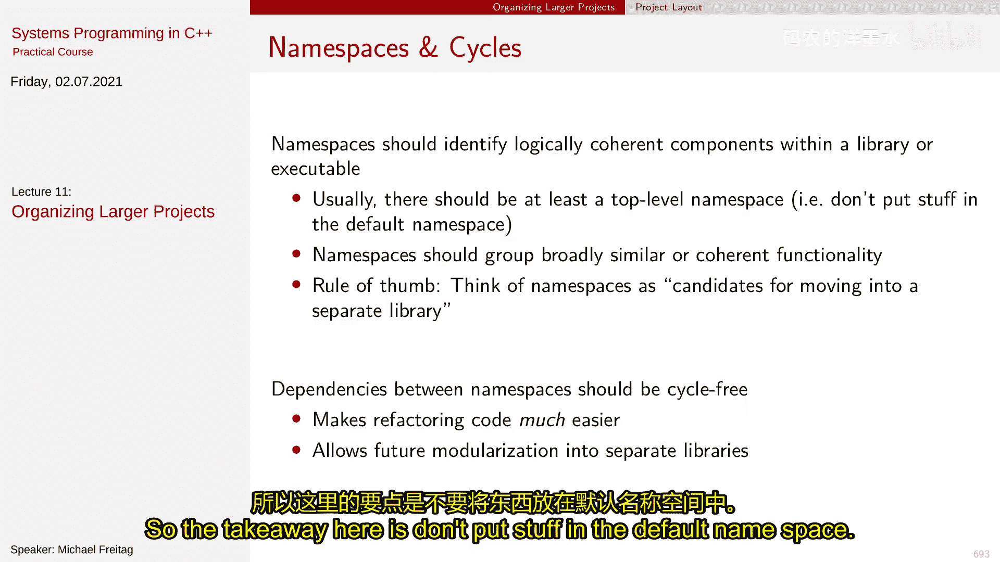

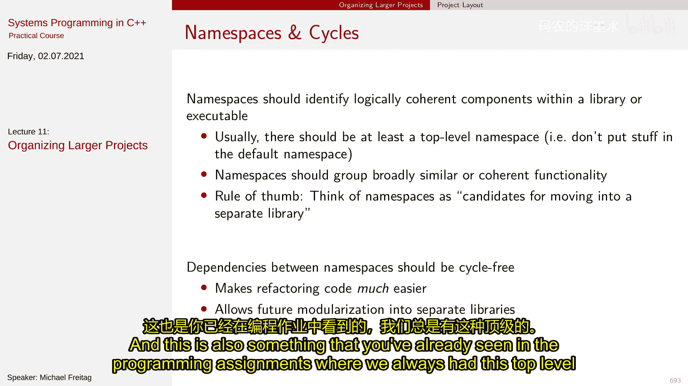

So these name spaces should then group broadly similar or even better coherent functionality。

And some rule of thumb to help you a little bit to determine what should go in the same namespaces is to think of namespaces as a candidate for being moved into a separate library。

So maybe you have a project where you do a lot of IO stuff and then you put all of this IO functionality into one namespace and eventually you may want to reuse this IO functionality because it's also useful to other libraries and then you could move it into its own library。

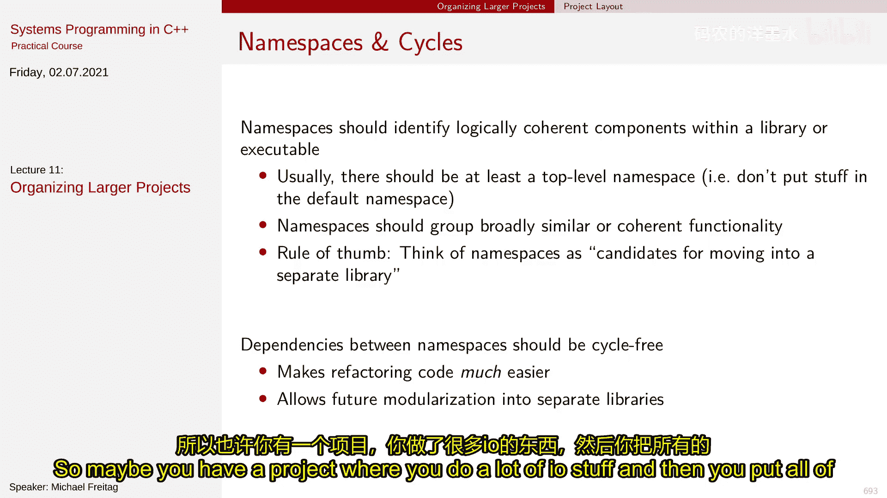

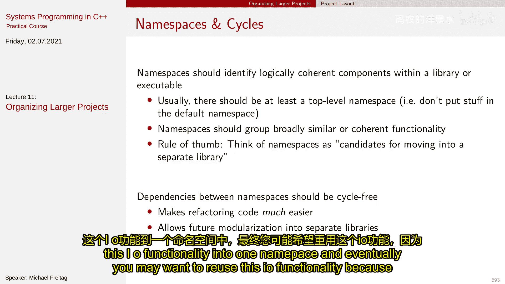

So this helped me a little bit to determine what should be placed in the same namespace。

But of course， you will probably need to build your own intuition here simply by trying different things and seeing if they work or not。

Something that also helps。

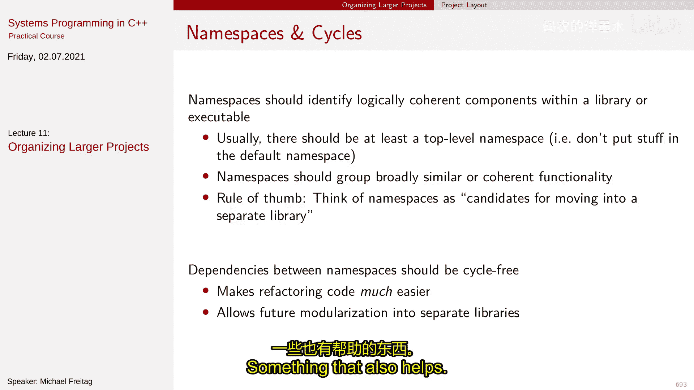

To determine which components should go in which namespace is that dependencies between namespaces should be cyclefr。

 So if you have a class in namespace A that uses something from namespace B。

 then usually you don't want to have anything in namespace B that also uses classes from namespace A。

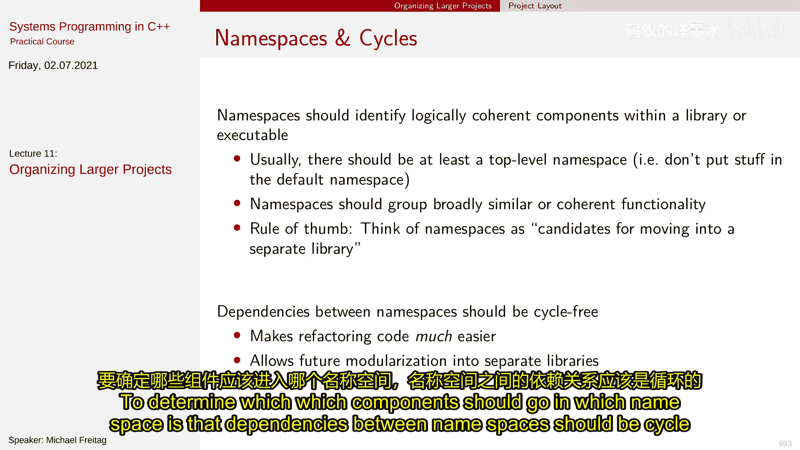

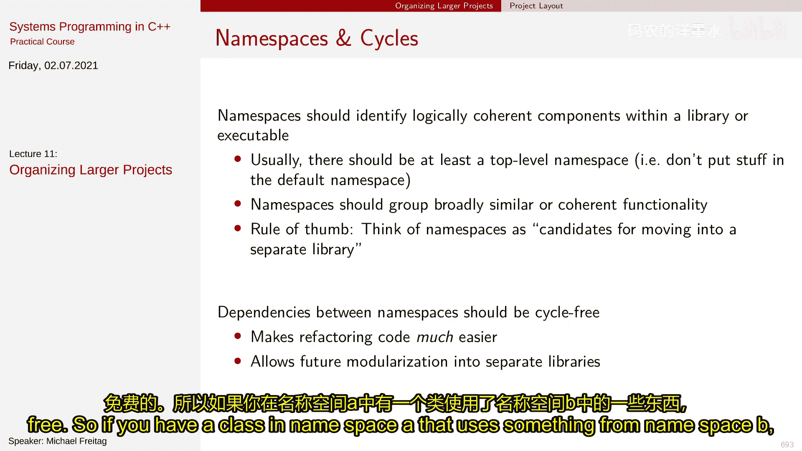

And this is a rule that you will maybe also know from other programming languages such as Java where this rule applies to packages you don't want to have cycles in your package dependencies and the reason behind this is that it makes refactoring code much easier because you don't have these cyclic dependencies where changing one thing breaks another thing and then changing this other thing breaks the first thing again So this is something that。

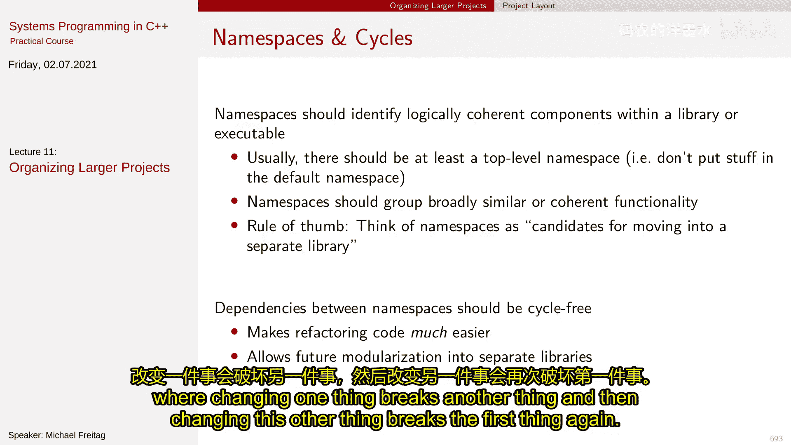

I is really one of the most useful guidelines for organizing your code into easy to refactor and easy to modularize code。

Also， if you don't have these cyclic dependencies， then it's much easier to simply extract part of your code and move it into a separate library。

 which has been kind of the main guiding principle in our project layout discussion up to now。

So finally we now have all of our source files， we have our functionality it's moved into sensible namespaces。

 there are no cycles so everything is fine， so the next higher level that we can think about is then what to put in libraries and executables actually。

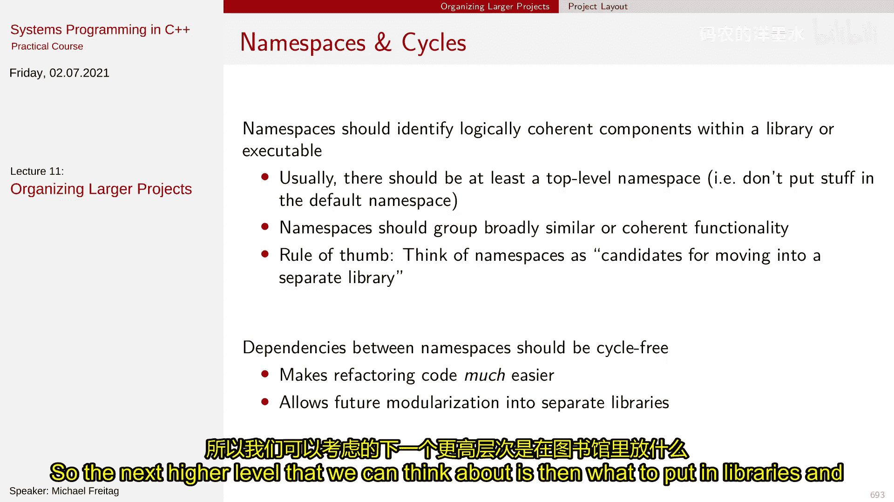

And here， we would recommend to most of the time。Have separate executable front and core functionality libraries。

 because what you will quite frequently see is that an executable only serves as a front and to some kind of library functionality so you have some functionality that could also be used by other programs and then you also have an executable that you can simply use from the command line or maybe a graphical front and that you can use on a desktop environment to interact with this library functionality。

And something that's also quite useful is that this separation then keeps all the interaction logic。

 So input and output and especially communication with a user separate from the core functionality of your library。

 And this is very pleasant because you can then apply。

This rule that we've seen a couple of times in our programming assignments where you say that you specify some invariance and preconditions for your library functions that people simply have to adhere to。

 and then all the input sanitizing and validation can be done in this executable front and you don't have to worry about this in your library where maybe some other users can already guarantee that your library will get valid input。

So we say here that this is not necessary in very small projects， but even in smallish projects。

 this can already be useful because it also forces you to think of this separation between communication with a user input validation and the core functionality that you're implementing。

And of course， once you have decided on some kind of separation between different libraries or libraries and executables。

 then you have to once again write CMake lists code for this and usually there should be a separate CMake lists file for each library in executable。

And once again， the reasoning behind this is that in the future。

 this makes it then easier to move these libraries and executables around into separate sub projects or independent projects。

And also this is something that we've already seen if we have separate CMake lists。

 there can only be one CMake lists per directory， so we need to put our libraries and executables in separate directories。

So this is something that we've already seen when we talked about the directory structure of our projects。

Now once we have several such CMake lists file， we can then use the Add subdirecty CMake function to aggregate several such sub projectsjects and we're going to see this in the next part of our lecture year。

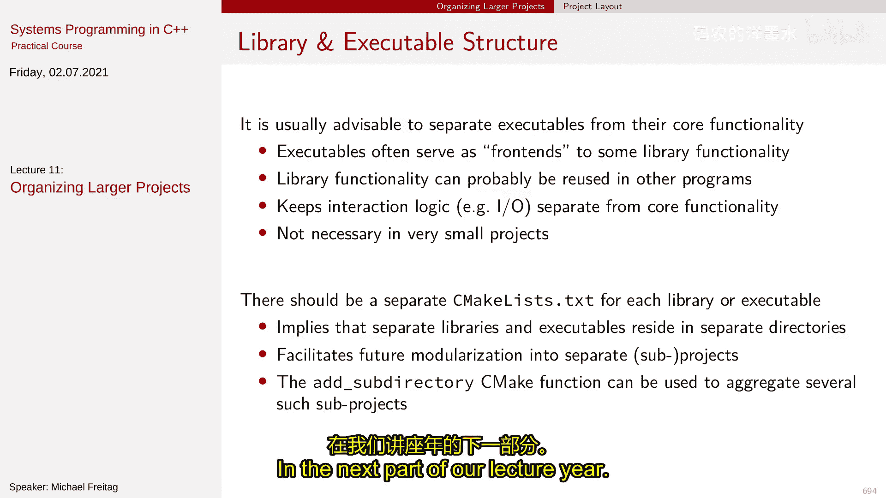

So the final thing that is important when I'm thinking about the general project layout is that。

 of course， we have to be able to include header files from our libraries within our components。

And usually just to avoid name collisions and to make a little bit more obvious and what you're including。

 we would recommend that the include path for a library contains some sort of prefix so if you have a library calledF then includes from this library could start with a full folder before writing out the actual header files here and of course since include paths are simply directory paths that are relative to some route directory。

 this requires us to have this food directory within the source tree of our library。So。

If we now replace the nameF by the name My library。

 this means that below the source folder for the My library。

 we have another folder called My library， which then contains our actual header and implementation files。

 so that include paths， then have to write this My library folder before including any of the header files here。

If you do this， then usually you will have to use the target include directories director if in the C makelists。

 file and we're also going to see what this exactly does。InIn just a couple of slides。

So this essentially concludes our discussion of the overall project structure。

 are there any questions up to this point？

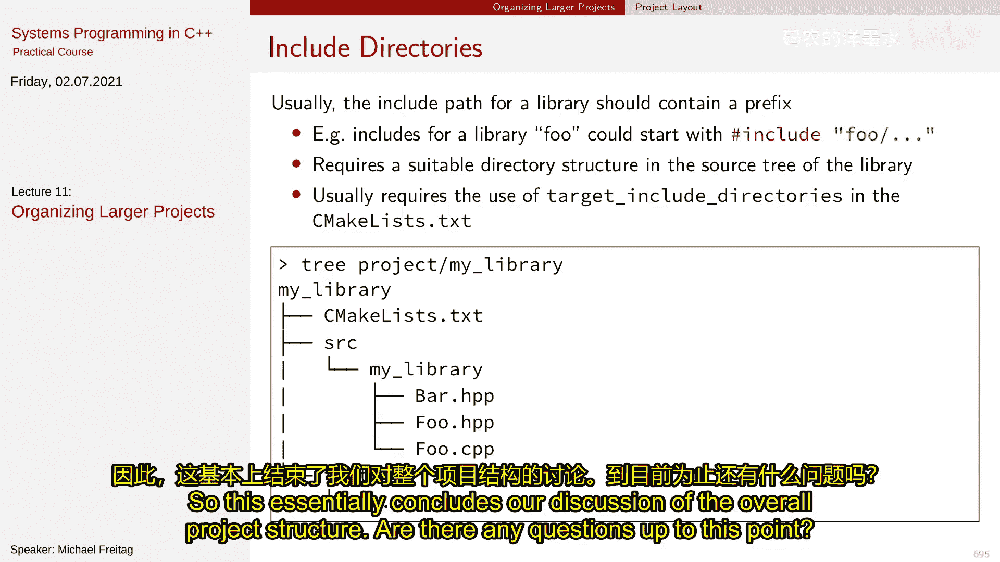

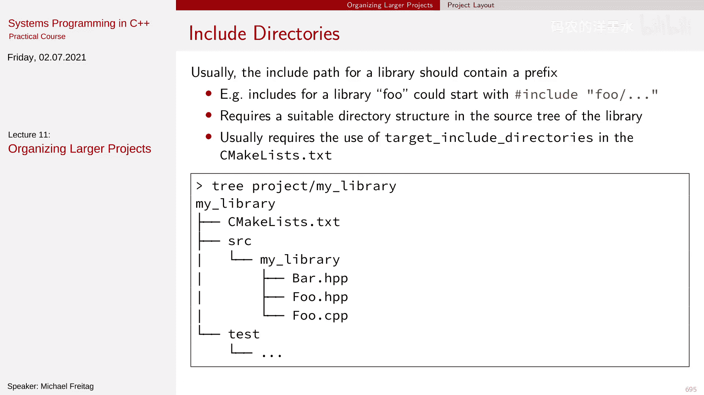

Alright， everything looking good。 Then let's move on。

 as promised to talking a little bit more about di and executables in detail so。

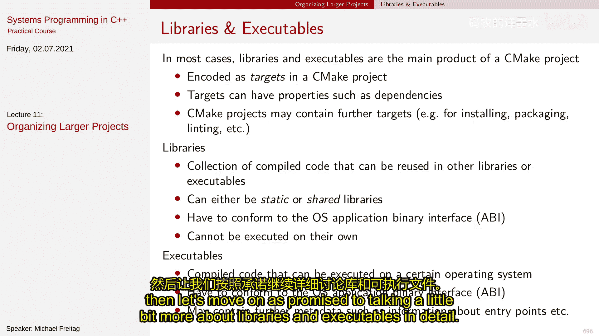

Libraries and executables are essentially the product of a CMake project。

 so you write all the C plus plus code， you write your CMake lists file。

 but what you what you essentially want in the end is an executable file or a library that you can then use for whatever purpose you are thinking of and these libraries and executables are encoded as targets in a C make projects。

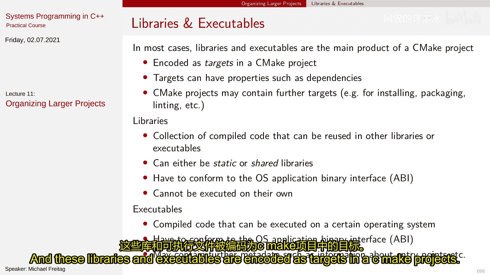

And targets such as a library or an executable can have properties within the CMake ecosystem。

 such a property can， for example， be a dependency on a third party library。

 it can be some include paths where head of files can be found for your library and so on。

Besides these tangible targets， asemic projects can also contain fur targets that may not produce some actual files such targets can。

 for example， be used for installing or packaging for distribution， for linting and so on。

So targets are everything that a CMEC project can build， and this for example。

 of course can be filed， but this can also be tasks that the build system performs。Still。

 libraries and executables are the most interesting ones of these targets。

 so let's take a look at those in more detail。 so as I already briefly mentioned。

 a library is simply a collection of compiled code that can be reused in other libraries or executables。

So you really just write a bunch of C+ plus code， this is then packaged into a library and then you write。

 for example an executable and you can make use of this already packaged code without having to write all this code within your executable again libraries can either be static or share we will see the differences between those two choices in just a bit and of course libraries have to conform to the operating system AI so this means that usually you will have to compile separate libraries for different operating systems。

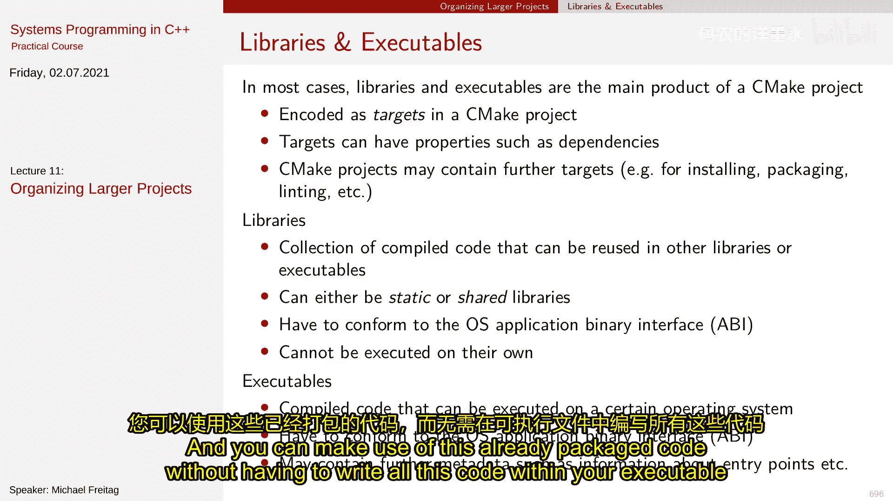

One one version for Linux， one version for Windows and so on。And， of course。

 since libraries are simply a collection of compiled code， you cannot execute libraries on their own。

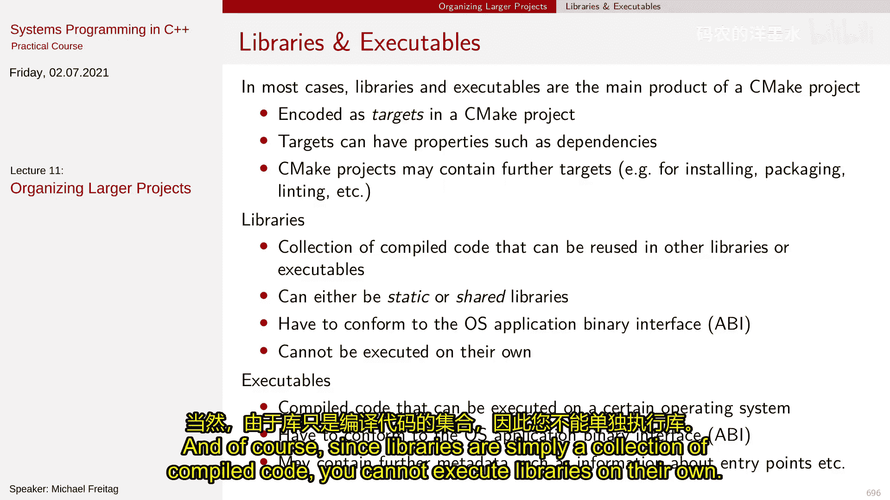

They cannot be invoked on the command line or anything。

 and they can only be used from somewhere else。If you need something that you can execute。

 then not very surprisingly you need an executable。

 and this is also just a collection of compile code。

 but with the addition that it can be executed on a certain operating system and because of this once again we have to conform to the operating system A because an executable has to tell the operating system about things like where to start execution where within our binary file is the main function located and so on。

 so there is some further metadata that executables may contain and this metadata is most of the time specific to operating systems。

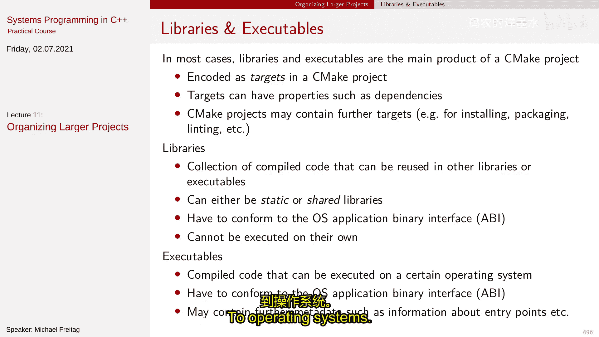

Now how can we actually define these targets in CMake so starting with executables we use the addd executable command and here we specify a name for our executable and then a list of source files and this then adds a corresponding CMake target with the specified name and once you build your project this will produce an executable with this specified name in the same relative directory to the root of your CMake project as the current CMake lists。

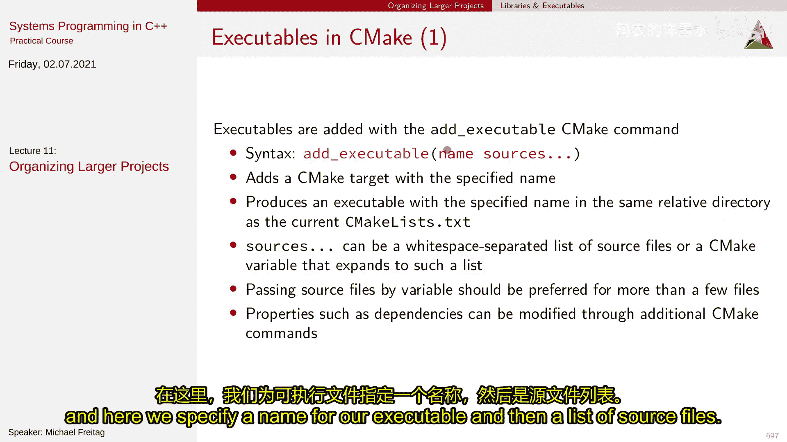

So if you write a executable in some kind of subfoldder within your project。

 then the corresponding executable will also appear in this subfold of the build tree。

 and this is something that you have also seen already in your programming assignments where the test executable is located in the test subfolder because the corresponding ad executable call was made in a nested CMake lists file。

This sources list here can either be directly a whitespace separated list of source files or most likely a CMake variable that expands to such a whitespace that separated list of source files。

So most of the time， as I've already hinted at we want to have a variable here because this makes it a little bit easier to see what's going on if you have a lot of files。

 then it's better to have this variable that just collects the source files and then an ad executable call together with some additional CMake directives for example。

 for dependencies and so on below that。这。So the adecutable call here simply adds this executable if you need to modify properties such as dependencies or include paths。

 this is going to be done through additional CMake commands that we're going to see in just a bit。

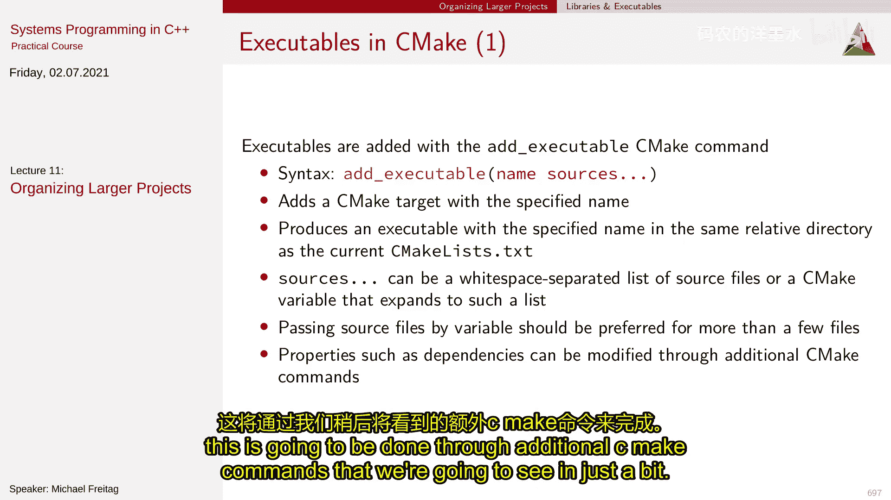

So。Just as an example， if we think of our my executable subproject here without worrying too much about the details of our file system structure here。

 our CMake list could look something like this， we have this CMake variable that simply contains all of our implementation files and then we have this add executable call with a suitable name and then reference to this variable here。

Something that I already want you to note at this point is that this list here that is passed to the editcutable file only contains the implementation files。

 not the header files， because the header files themselves are not compiled。

 only the CPP files are compiled as you maybe remember from one of our first lectures where we talked about compiling individual CPP files without using CMake。

As far as library is concerned， we've seen that there's this distinction between static and shared libraries。

 so let's start by looking at static libraries。Static libraries are essentially just archives of executable code。

 so a static library contains assembly from a number of object files that were generated by the C++ compiler such as for classes or functions and so on。

And these are then all dumped into this single static library file。

If you have something that depends on a static library。This dependency is resolved at link time。

 So when you compile something that depends on a static library。

Then the linker that builds up your executable for example。

 is going to resolve this dependency on the static library。

 so this means that all the code that is in this archive of executable code is then copied into the library or executable that depends on the static library and once you run this executable for example。

 there is no dependency on the static library anymore。

 because you have copied everything from the static library into your executable。Of course。

This is not the only way in which things can be done and shared libraries have a slightly different approach to dependency resolution in that that they are still archives of executable code。

 So this is not different from static libraries， but the main difference is that dependencies on shared libraries are resolved at a run time。

So as opposed to static libraries where the compiler was responsible for resolving dependencies with shared libraries。

 the operating system is responsible for resolving dependencies。

So the compiler only puts some sort of quote on pointer。

To this shared library code into our executable， for example。 And then once we run this executable。

 the operating system will load this shared library into memory and then。

All references to library code will be resolved to this inmemory version of the shared library and this。

 of course， means that we can share a shared library and this is also where the name comes from between several executables so if you run several executables that all depend on a single shared library。

 the operating system will load this shared library into memory once。

 and then all these programs depending on this code can access the same memory when they need to execute code that's located within this shared library here。

And， of course， if we think about the slightly。The slightly slight differences between these two types of libraries we can think of the advantages and disadvantages that they each have。

So as far as static libraries are concerned， the advantage is that they can have slightly higher performance since we don't have this indirection at runtime。

 we don't have to look up some code in memory， it's already pre compileiled into our own binary。

And we don't have this indirection anymore， something that's also quite useful about static libraries is that they can prevent any compatibility issues since you don't have any external dependencies。

 So if your program depends on an ancient version of some library and you have a static library then you will not run into any problems because you package this dependency yourself。

 if you would use a shared library in this instance you may run into the problem that a new operating system doesn't have this ancient version of your shared library anymore。

 and then your dependencies will break and you will have to invest quite some time to fix these dependencies once again。

The disadvantage， of course， is that the file size of your libraries and executables will get much larger because you will actually copy code from a shared library into your own executable。

And also on the one hand， you can prevent compatibility issues。

 but also if you want to change one of your dependency。

 you will actually have to recompile your program that depends on a static library。And。

Because of this， you can sometimes run into problems with transitive dependencies。

 Maybe your static library has a dependency on another shared library or your static library。

packageages a different version of another static library that then suddenly breaks something within your code。

 So this is just something to keep in mind that may lead to problems when you use static libraries。

With shared libraries， essentially， we have the。TheWhat was a disadvantage for aesthetic static libraries is translated into an advantage in case of shared libraries。

 so we have a much smaller file size since the shared library is not copied into our executable It's only loaded into memory at runtime。

 we have much lower memory consumption because only a single copy of this shared library is kept in memory。

And we can easily exchange a shared library with another compatible version without changing the programs that depend on this shared library。

 so we don't have to recompile our executable once the operating system updates the version of a shared library。

 for example。Of course， the disadvantages are that our programs now rely on a compatible version being available。

 so this is the example that I gave when you depend on an ancient version of something。

 the operating system might not have this version anymore and then you are missing a dependency and cannot run your program and also since we have this additional indirection at runtime where we have to look up this。

This shared library in memory code that depends on shared libraries can be very slightly slower than code that depends on static libraries。

But just as a side note here， this performance difference is so minor that most of the time you will not be able to observe it。

 so it's not necessary to optimize for this tiny performance increase from the beginning。

 only once you' notice that this actually has a noticeable effect on your performance。

 then you can think about switching from a shared library to a aesthetic library。

 if this is the only motivation for doing so。

Now within CMake static and shared libraries are specified quite similar to executables。

 essentially the only difference is the syntax of the corresponding directive。

 so for static libraries we have the a library called once again with a name in a list of source files and then this static identifier in between。

Apart from that， essentially the same rules as for executables applied。

 so we're not going to go in detail over these again。

 this is essentially the same as for executables。

As an example。We can take a look at this CMake snippet。

 you will see that it looks quite similar to the executable example if we once again have this list of source files in a CMake variable and then instead of having an a executable call。

 we now have an a library call with a name the static keyword and the list of source files here。

We want to define a shared library in CMake looks almost the same， so the directive is the same。

 We simply replace the static keyword by the shared keyword here and leave everything else unchanged。

 So taking a look at an example， you will also see that it doesn't really differ from our static library example。

 we simply change the static to a shared here and left everything else unchanged。

And I see some typing。 So I'm assuming there is。There are questions。

 The question is whether the set of files only contain CPP files again， this is correct。

 even for libraries， you only add the CPP files to the CMake target。

 but of course I think your question is aimed at how we can actually use this library somewhere else then because there of course we have to include HPP files。

 and this is achieved by setting suitable properties on the library and then adding a dependency on the library which will also add a dependency on these properties whenever we want to use the library but we're going to see this I think in the second to next。

Slide。嗯。So let's postpone that discussion for a little bit。

 Another question from the chat is what happens if you use a library without the static or shared keyword。

 keyword like in the programming assignments。Do we really use it without any keyword there？

I know that within the programming assignments， we have static libraries。

 So if we actually use it without the keyword， then apparently it ends up being a a static library。

 but I didn't know that you could oit this keyword。

 So this is something that we may have to look up in the。

CMake documentation and by the way， of course， you already know this by now the CMake logo in the upper right here once again is a link to the CMake documentation in this case。

 so if you want to look it up just click on this link hoping that it's not broken and it will take you to the corresponding page on the CMake documentation。

Now。Picking up the question about only adding CPP files to our libraries， usually。

 as we've already seen a couple of times， only the implementation files should be added to ACMake target because the header files on their own are not compiled and only the header files that are actually included by implementation files are relevant for compilation of a library。

But there is。An exception to this that essentially has come up with the introduction of templates in C plus plus。

 because you might have libraries that only contain template definitions and。No source files at all。

 And we also want to be able to model this in C making for this。 there are interface libraries。

 which。Have once again used the ad library directive in CM with just a name in the interface keyword。

And then this library doesn't have any source files associated with it and consequently cannot be compiled into a aesthetic static or shared library unless of course we use some sort of explicit instantiation。

 but then we wouldn't need an interface library anyway。

The reason why we have this and a library with those source files that we cannot compile is that such an interface library that。

 for example， contains some templates can still have properties such as include paths or dependencies on third party libraries。

 which may also be a template library and so on。 So even those can be modeled in CMake and then assuming that our my library sub projectject only contains templates。

 we could add。

An interface library for this target and then and we will see in more detail what these are used for set some properties off this my library target through the corresponding CMEC directors。

Now we've already seen when we talked about our project structure that most of the time we will have nested projects where we have separate CMake lists file within some of the directories within our project and if you want to aggregate these into a more complex compound project we can use the add subdirecty directorive and CMake。

 which simply takes a single argument which is the directory that we want to add as a subproject to our CMake list project so this source directory then has to contain a CMake lists file and will add the CMake lists to our current CMake project so what does this mean it will simply continue processing the nested CMake lists and once this is done this add subdirecty call will return and we will continue processing the top levell CMake lists file。

If we have this kind of nestA project structure， then we can use the CMake source De CMake variable to refer to the directory which contains the top level CMake lists and the CMake current source steer variable to refer to the source directory in which the currently processed CMake lists resides so this is quite useful because it helps you write relative paths that are not hard coded with respect to some top level directory。

 so it makes it easier to move code around if you use these variables instead of hard coding paths within your project。

And then as an example， once again， in the context of our recommended project structure。

 we could have a top level CMake list that adds some boiler platelate code。

 maybe some more general setup code such as locating dependencies figuring out compiler flags and so on。

 and then simply contains these ads subdirecty calls to add for example。

 one of the sample CMake lists that we had for our my executable or my library sub projectsjects here。

Yeah。

Now。Usually we have to adjust at least the included directories of libraries and executables and this is simply because we have all these guidelines that we want to have prefix for our include paths we have this project structure that maybe we don't want to have in our include paths so for example we usually don't want to include stuff by having to write and the source directory in front of it。

 and this can be specified by using the target included directories directive which。

Takes the name of a target that has already been defined as its first argument。

 then either public or private， and then finally a list of directories。And。

This should usually be set to the top level source or include directory of the current subpro that we are working on。

And the very useful thing about this is that if you specify these include directories with public。

 then anything that depends on this target will inherit these include directories。

 so you set them on the target you say for for a specific target。

 this is the path where we can find the header files that belong to this target。

 and then all all everything that depends on this target will automatically inherit these paths and can then include header files with the path that you intended when you wrote the library。

Speaking of such dependencies， these dependencies can be set with the target link libraries。

Directive so once again you specify the target on which you want to set these dependencies。

 once again you distinguish between public and private dependencies where public dependencies are inherited by anything that depends on a target private or not。

 and then you have a list of libraries and this list of libraries can either refer to targets defined within the current project or imported targets for any third- party libraries。

So。Taking this and applying it to our sample SeeMake list what do we actually write here previously we simply had this comment that some additional code will be required now we know what we have to write here。

 so once again the first part is unchanged we have our list of source files we have our ad executable call here。

 but now we want to be able to write。

Just my executable slash some header file instead of having to write my executable slash source slash my executable slash header file。

 and this can be done by setting the target include directories。

Properties here。 So we set it on the my executable file since it isn't executable and usually nothing depends on an executable。

 we can set them to private。 And then we say that the source path relative to the current source directory should be the top of our include path。

 So now since header files are searched also relative to this include directory here。

 we can simply write include my executable slash some header file because our search path starts at this source directory here。

And of course， just by way of example we could also have a dependency on the My library target that is defined in some other subpro of our entire C makelist project and for this we write the target link libraries directive once again we set the dependency on the My executable。

 it's private and here we simply write the name of the target that we used for the My library subpro here。

Now。Since we often have to work with paths in CMake there are several variables for paths that are quite often used within such a project configuration we've already seen the CMake source directory in the CMake current source directory paths and these are also mirrored for the CMake binary directory and CMake current binary directory path。

 so just like CMake source directory contains the absolute path of the top level of the top level CMake lists file and the current source directory contains the path of the current CMakeake lists file that is being processed the binary and current binary directory。

Contain the path to the build tree。 So the sea make binary directory will contain the path to whichever directory you invoke sea make in and the current binary directory will then。

Point to the subdirecty that corresponds to the current sea make lists that is being processed。

And whenever you write relative paths within a CMake list file， so something like this source here。

 they are usually relative to the current source directory。

 so we could also have written CMake current source directory slash source slash here instead of writing this relative path if we wanted to make more explicit which path we mean here。

Or any questions up to this point regarding defining executables and libraries within your own project？

。Nothing so far。 Allright， so then let's move on。

So one important aspect that we haven't talked about yet are third party libraries because usually of course。

 we do not want to reinvent the wheel， and there is a huge ecosystem of high quality open source libraries that do all sorts of stuff that you simply may want to reuse within your projects。

So if there is a well maintained third party library that matches your requirements。

 usually you should use it instead of writing this code yourself so that you can focus on the interesting and necessary parts of your project instead。

At the same time， as long as it is possible and feasible， depending on your precise requirements。

 you should usually not distribute these third party libraries bundled with your own project。

Just because many of these libraries can easily be installed through a package manager on your operating system。

 and it also reduces the complexity of your project configuration and maintenance。

Because you don't have to worry about updating the versions of your dependencies yourself。

 this is going to be done by the operating system， building your project is much faster because you don't have to compile these third party dependencies yourself and so on。

Luckily， CMake once again helps us。In locating third party dependencies and then adding dependencies to these thirdpart dependencies and the cool thing is that for a lot of these dependencies this is possible in a platform independent way。

 so you don't have to write code that is different between， for example。

 Windows and Linux you can simply use CMake and CMake internally we'll figure out how to actually locate and set up such thirdpart dependencies。

The preferred way to do this in CMake is to use defined package function。

 which takes the name of a package as its first argument and then optionally you can also specify precisely which versions you need and whether this is a required dependency or just an optional dependency and a lot more configuration options that you can take a look at at the CMake documentation if you're interested。

What this function call does is that it attempts to find and load settings from an external project。

And if this project was found， then it will set the package names or whatever you specified here。

 underscore Foency make variable so you can use this variable to test whether this fine package call was successful in case you have an optional dependency that isn't required to be fulfilled。

And then additionally， a fine package call may provide additional variables and important CMake targets。

 depending on which package precisely you are locating here。

 so this is the way in which this can usually be used you do a fine package call for your thirdpart library and then this find package call will define a CMake target which you can then use in a target linked libraries call to declare a dependency on this thirdpart library from your own executiveecutable library。

Internally， this fine package call is implemented through CMake scripts。

 so this means that the third party library that you attempt to locate has to provide a suitable CMake script for this fine package call to work。

Because。Findine package will attempt to find a file that is called find。

 And then the package name dot C make。 and some other names are also possible in the path that is specified by the C make module path variable and within the C make installation itself。

 So this is a slightly inaccurate description here because the。

The search algorithm is actually a lot more involved， but once again， if you' are interested。

 take a look at the reference documentation here and will explain in detail how fine package will attempt to locate a suitable CMake script。

So many CMake as find something CMake scripts for very common dependencies are provided by CMake itself for those you can take a look at the CMake documentation。

 so all of these packaged scripts are documented in the CMake documentation。

But third party libraries may provide their own fine script and if nothing else helps。

 you can also write your own fine scripts， but this is beyond the scope of this lecture。

 so if you're interested， the reference documentation is quite detailed so you can take a look at those also if you just want to see how such a script could be implemented our SeeMake scaffold for the programming assignments contains a find clangtidy script that attempts to locate clangtidy on your system。

 so that is one example of how such a fine script could be written。

 but there are no guarantees that this is actually the best way to implement such a script just one example that does work up to now。

So how can this look within our CMake lists file So let's just assume that we want to test our library with Google test and then we do this find package call with the G test name so this is something that we have to figure out we have to look up in the documentation how the corresponding package is called so that Cm will find the correct script and then we say that this dependency is required because without Google test and we cannot really test our project and then we have this ad executable call here for our test driver that of course。

Contains a list of source files here that we omitted here and then apart from some other dependencies that we might have。

 we add this G testest colon colon G test target that is imported by this find package call and the way to figure out that this is the name for the imported target is once again to take a look at the documentation for the defined G test script。

 which will then list in detail which variables and target are going to be defined when this find package call was successful。

The good thing about such imported targets is that they will automatically have all the include directories transitive dependencies and anything set。

 so if you can use find package and this is also the reason why you should prefer it。

 you only have to usually add this imported target and you're good to go everything else is going to be taken care of by C make itself。

Of course， not every library will provide such a fine script and if you do not want to write your own fine script because that is a little bit of work。

 you can also directly use a find library which will essentially search the file system and a couple of search path hints for a specific library。

And then it will simply create a variable with the name that you gave here to store the result of the command and especially if nothing was found。

 the result will be within this variable once again， the variable name mine is not found。

The name here specifies the name of the library， so in Linux you would for example。

 specify G test here to locate the Lib G testest dot something library file here。And of course。

 besides the default search paths such as user Li， you can also specify some additional search paths here if you know that you have installed a library in a non-standard location here。

 but of course， once you start specifying such non-default search paths here。

 you have to be a little bit careful to retain portability of your CMakeake scripts。

 if this is something for example， that points to your home directory。

 it will not run on for any other user or any other system most likely。So as I've already said。

 this find library called simply searches directories for a library。

Although it does search a wide range of parts， it's still not the optimal function to locate libraries because it does not automatically configure non standard include parts。

And it also doesn't define this nice imported target that you can simply add to your。

To your own targets。 So it should only really be used as a fallback when you don't have when you cannot use find package or。

 of course， and when you write your own find package scripts。

 then you also have to use find library internally。

So if we assume that for G test there is no fine G test script。

 we could also do a fine library call here and then you already see that we have to write a little bit more code because we now have to check whether G test was actually found by comparing this variable to the G test minus not found string。

 if so we have to aort configuration and then we can add this G test library to our executable here。

What is。Noteworthy here is that here now we only add the library dependency。

 we do not set any include paths that may be required to use G test。

 so this is something that we would have to add manually through a call to target include directories here to make this code actually work。

So in conclusion。We've now seen how we can have a basic CMake setups。

 we have seen how we can define our own library and executable targets and define dependencies between these and we've scratched the surface of how we can locate and use thirdpart libraries within CMake but of course this is only a very。

 very small part of what CMake can do we have a lot more useful functional such as conditionally checking for compiler flags or compile features。

 checking for host system features and then conditionally compiling code depending on that also we can。

 of course， define custom targets as we've seen in the beginning of this discussion， for example。

 for Linting or installing code and a lot more so if you're interested in this and if you want to learn more about that once again we would like to refer you to the CMake documentation or of course if you have some specific questions you're always free to talk to us about those。

Are there any。嗯。Questions about this。 And I already see one。

 why can't finding packages be as simple as in other languages。I the。

 the underlying reason for this is that。C plus plus is much more tightly integrated with the underlying operating system。

 So you don't have this abstraction layer where you could easily place a package manager。And also。

 for example， you can easily depend on on binary libraries that have been written in entirely different languages。

 So most of the time this will be C。 you can also have dependencies on libraries that are written in forron。

 which is quite frequent in high performance C plus plus and。

All of this makes it much harder to have this kind of package manager that you have in other programming languages that helps you locate these dependencies。

 Of course， this is still a。An important characteristic of C plus plus that you may want to take into account when you decide on the programming language for a specific project。

 but。Once you have selected C++， there unfortunately are no really robust and easy to use package managers that would take away some of this work for you。

Any further questions。Yeah。Doesn't look like it All right then so now that we've talked about how to structure and set up our project there is some remaining assorted stuff that we also would like to talk about and the first of this is of course how to actually test your projects So something that shouldn't be new to any of you is that tests should of course be an integral part of every larger project So anything that's larger than a couple of source files that just quickly are just quickly hacked together for some ad hoc task should contain unit tests and integration tests and maybe even more complex tests to ensure that your code is actually doing what you intended to do。

And if you have good test coverage， then this makes it much。

 much easier to implement a large project because when you have good tests。

 then you can ensure at least to some extent， that modifications to existing code do not break anything within your project。

 So it's much easier to refactor code or to change the internal of a component because you can make these changes and then run your test suite to determine if your changes break anything instead of changing anything and then suddenly having new bugs in other parts of your code because you slightly change some invariant of your component or something like this。

So the takeaway always write tests starting at anything beyond a project that has a lifetime。

 I would say， of less than a day， because it makes your life so much easier in the long run。

Within our programming assignments and the final project， we use Google test。

Which we selected because it works on a large variety of platforms。

 it contains a large set of useful functions and it can usually be installed through a package manager。

嗯。But， of course， this is not the only testing library that is out there。

 There's a lot of testing libraries， and。For any of your own projects and we encourage you to take a look at those and then select the testing library that best fits your need because as any library Google test has some advantages and some disadvantages and you may have some specific requirements that are better addressed by some other testing library。

If you do decide to use Google test， it can be added to a Cmic project through the find G test module so this can。

 as we've already seen， can be done through the Find package call。

 and then you have all this nice functionality that allows you to define test cases do you have all these assertions that you can use to check。

To check the outcome of your tests， you can also write something more complex such as death tests where you assert that under specific circumstances。

 your program aborts or maybe throws an exception and a lot more。

So。A。A simple test skeleton could look something like this， so we have to include the G test header。

 and then we use the test macro where we provide a test suite name and then a specific test name similar to a function call and then some curly brackets that enclosse the actual test code here。

Such a test suit can， for example， map to one specific class or if you have a very complex function。

 also to one specific function， and within the body of your test you can then use Google test assertions to control the outcome of this test function and then if any of these assertion fails or if the test function crashes。

 the entire test case will fail and Google test will tell you this on the command line。

 as you've all probably seen when you were implementing the programming assignments。

For assertions， you can have some different kinds of assertions。

 so you have fatal assertion that are prefixed with assert underscore。

 and when a fatal assertion fails， the test function is immediately terminated。

So these are the hard requirements when one of those fails after which you cannot really continue testing。

 but in some cases you might also want to write nonfatal assertions which are then prefixed with expect underscore and in this case the assertion may fail。

 but the test function will still continue to run and only eventually will the entire test case fail。

So this depends， of course， a lot on what specifically you are testing。

 whether you want to use non fatal or fatal assertions。

 so this is up to you in the specific test case that you're writing。

All of the assertions that are defined in Google test exist in fatal and nonfaal variants and some examples of the some examples of the most often used assertions are assert true or assert false。

 where you can simply write an arbitrary condition。

 and then also some more specific assertions such as assert equal or assert not equal。

 where you can directly pass two values for comparison， and， of course， a lot more。

 which you can also。Take a look at the reference documentation for。

Finally， with Google test， you need to provide a custom main function that is used in the test driver so the program that you can actually invoke from the command line to run your tests。

 and this is essentially just boiler play code which usually will look like this snippet that we show here and should be placed in a separate tester or main。

cP file that you can then。Then add to an executable target in your see make lists。

This just ensures that the parameters， the command line arguments that are passed to the tester are pared by Google tests so that you can control the behavior of the tester and then as you can see here。

 we'll simply run all of the tests that are defined within the executable。

。Now something that we're only going to talk about briefly。

 but which is still very useful is some code coverage。

 because this can help you ensure proper testing of a project。

But of course， and this is something that you may have heard in other lectures as well。

 is that simple metrics like line coverage have to interpret it very carefully。

 So usually the way to interpret this is that if you have a part of a project with low line coverage。

 this is a certain indicator that this part of your project has not been tested properly。

 but just because some part of your project has a high line coverage。

 this does not necessarily say that this part has also been tested well。

So， I think。Most of you have already heard this discussion of line coverage as as a testing metric。

 and there's of course a lot more that you can say about this year， but nevertheless。

 despite all the downside of line coverage is still a useful tool that you may want to use within your projects。

This line coverage information can automatically be collected during test execution。

 and this is possible with a variety of tools that also depend to some extent on the operating system that you're on and the IDE that you're using。

 but as far as Linux is concerned， you can use the builtin coverage tool that's provided by GCC which is called GCV。

 and if you useang on Linux instead of GCC it can also provide output that can be interpreted by GCOP。

And then once you have this output， then you can use another tool which is called Alco together with the Gen HTML tool。

 which can then be used to generate an HTML line coverage report from this information in G format that has been collected during test execution。

Just as a brief example here is an execution trace of how you could do this。

 so first of all we build our test executable with some additional flags that are required and to enable GCV。

 we then simply run our executable and this will generate another file or several files that contain our coverage data。

 then first we generate an LCCV report which requires us to invoke LCV with some set of flags。

 so if you're interested to take a look at the corresponding man pages and finally we use Gen HTML to generate an HTML report from this LCCV report which is then put into a a directory and there we have an index HTML file which we can then open an a browser to browse our coverage report here。

Of course， this example here is now only an ad hoc example how you can do this on the command line。

 usually you will want to configure all this in CMake have a separate build type that enables the corresponding flags and then define custom targets that do all of this report generation so that in the end you simply have a single CMake target that you can invoke that will do all of this stuff under the hood without you requiring to type out these commands yourself all the time。

So if you have some spare time， if you are motivated。

 this is a rather useful way to build a little bit more CMake knowledge by taking a look at the Cic documentation。

 figuring out what you need to do and to integrate this into CMake and try to make it work。

 for example， for your final project。

Yeah。Finally， something that's very useful once you start working on really large project is having a continuous integration。

Set up somewhere， this， for example， can be done with platforms like Gitlab。

 where you automatically run tests or other checks every time some commits are pushed to the Gitlab instance。

And this， if you are the only contributor to a project， this is not as useful。

 but it is extremely useful in large projects where we have multiple people working on the same project because with such a continuous integration and set up。

 you can then enforce certain standards within a project such as having a minimum line coverage。

 having no failing tests and so on。 But of course。A continuous integration setup has to be taken seriously to be effective。

 so the most obvious way here is for example， that you should refuse merge requests when the continuous integration pipelines fail so that you at least do not introduce changes that are already known to break some tests into the main line。

As far as Gitlab is concerned， this configured through a YML file that's placed within the repository。

 but unfortunately the server site set up for continuous integration is quite complex on Gitlab and at least for the purposes of this practical course it's already provided by our Gitlab server so if at any point you have to set up this yourself then we would refer you to the Gitlaub documentation that tells you how exactly you can set up such a continuous integration。

Pipeline， and of course， and the same applies to any other platforms that may provide continuous integration functionality。

Something that's quite useful to add to such a continuous integration pipeline and this is also something that shouldn't be new to any one of you is Lnting。

 which performs some static source code analysis and can detect some types of bad code and we use Kangtidy in this practical course you've all come into contact with this and you probably have experience that Kktidy will complain about a variety of things some plain bugs。

 some stylistic errors that may lead to bugs or simply some code that looks as if it could be buggy because it is suspicious in some way so Kktidy is based on Kang and specifically a C++ Lntter it's very widely available and it's extremely configurable and has a wide variety of different checks that are almost all a very useful so whenever you start your own projects。

We would recommend to also immediately start using clang tidy simply to catch a lot of bugs very early on during development and this will save you a lot of time and headache later when you would have to debug these bugs instead。

Now the remaining things that we're going to cover in today's lecture are intended more as an outlook on things that are also out there。

 but in the interest of time we kept the discussion rather short nevertheless all of these tools are extremely useful so if you are interested once again feel free to take a look at the documentation or talk to us and we will happily give you more details about these tools。

The first of these tools is PEf， which is useful for analyzing and debugging the performance of your programs on Linux。

This is an extremely useful tool with a wide variety of different approaches to profiling programs。

 so one possibility is to use the standalone executable PEf which can then be used to profile any program that you can run on Linux then another possibility is to use the PEf API that can be then used to directly integrate performance profiling within your programs by using the corresponding API calls。

And this Perf library interfaces with both hardware and performance software counters。

 so your CPU collects a lot of performance information on the fly and Perf can read this performance information and then present it in a human readable format and also within software you can implement a lot of performance counters and Perf also interfaces with those that are implemented in software by the kernel and once again can present them in a human readable format。

As far as the standalone PEf executable is concerned， there's two main ways in which it can be used。

 you can use the Perf sta command with some options and then followed by a command which will simply run this command and display information about performance counters such as cache misses。

 branch misses and so on and of course through the options that you pass here you can configure which events precisely you want to view。

Something that is also extremely useful because it is more fine grainined is instead of running this command and then displaying aggregated performance counters。

 you can also collect a performance trace by using the curve record command。

 which runs the command and instead of aggregating performance counter as samples them at a specific interval and then displays you a report that assigns the frequency of a certain event to the functions within your programming so you will see which function takes up a lot of instructions or cycles or cache misses whichever event you specify here during the execution of your program。

And because of this because you want to have this mapping from events to symbols within your executable。

 usually if possible， the command should be built with debug symbols so that the names of functions and so on are a little bit more precise but of course building with debug symbols has a performance impact and sometimes you cannot get around running an optimized executable with Perf record and then the assignment from samples to locations within your source code will be a little bit more fuzzy and also you will see a lot more assembly code in the output of Perf record。

 then if you build your command with debug symbols。

Regardless of this， once you have sampled such an execution trace with the per record command。

 you can then invoke per report to analyze this performance trace which then displayplaces you on the command line and interactive report that shows the sampled event counts for each function and each instruction within such a function。

Just as a brief example here， using the per stat。Commans are just some arbitrary executable here in our example and we want to have detailed information。

 so then the executable runs just like it would run when you invoke it on its own and then once execution completes you get this report that tells you which which the value of the different performance counts that Perf collected during the execution of your my executable。

I'm called here。So。Once you start writing performance critical code and Perf is really one of the most useful tools to debug any performance bugs within your program to figure out which functions are taking up a lot of time。

 figuring out whether this is actually。Matching your expectations where you expect your program to spend a lot of time and also to figure out in detail which kind of optimizations you may want may want to apply to your program because you've identified a bottleneck or or a hotspot within your program。

 So if you find the time just play around with Perf a little bit collect some traces with perf record as well look at the output of perf report and try to to get a feeling for what you can do with Perf。

Perfe。Something that's also quite useful is Valgri。It's a general purpose dynamic analysis tool。

 so mainly it's used for memory debugging memory de detection and also for profiling different from Azan or Perf for these purposes Valgri essentially runs programs on a virtual machine that allows tools to do arbitrary transformations on the program before execution。

 So here you have can really have deep。Make deep changes to the program execution by tweaking this virtual machine and so on。

 but at the same time because of this Val Gr has an extremely high overhead compared to other tools like Azan for memory leak detection and memory debugging or Perf for profiling。

So because of this extremely high overhead Vigra has some limited use cases。

 it's not used as often at least by us。Mainly it's useful if you have some very complex memory bugs that you really cannot figure out through any other way like depending on ASan or a manual debugging or for very complex profiling tasks that may have to fulfill some very specific requirements。

But that being said， I personally don't really use vielgri a lot because in most cases。

 Aszan for debugging and curvef for profiling are more than sufficient。

The final thing that's just a fun and very useful way to do debugging， once again。

 just intended as an outlook on what is possible if the need arises is something called reverse debugging。

And the motivation here is that with a regular debugger like GDP。

 you can only step forward in the program， you run your program within GDP， then execution starts。

 you maybe have some break points， you step and your program essentially runs forward all the time with some interruptions which you can use to inspect the current state of the program。

However， this does not necessarily fit the divvagging requirements because， for example。

 you might have a crash that only rarely occurs and then ideally what you would want to do is you would want to run your program in a loop until this crash occurs and then once this crash occurs。

 you would like to step backwards in time until you have found what caused this crash So this is quite hard and to do with GDP because if the crash only rarely occurs。

 then you have to run your program from the beginning in GDP with all your breakpoints。

A lot of the times， most of the time the program will not crash and you will still have to look at the state of your program at a suitable point in time。

 just in case that this execution run will now crash。So this stepping backwards in time。

 functionality is something that is provided by reverse debuggs which work a little bit different from GDP so as opposed to GDP where you run your program with some interruptions and step forward in time a reverse debugger will usually first record a program run without any interruptions and then subsequently using this program trace the run can be replayed and will reproduce the exact same behavior and then of course because you have this full program trace during debugging。

 you can step forward and backwards in time to precisely figure out where the root cause of your crash for example was。

GDB does provide some reverse debugging functionality last time we checked it was not yet that complete and especially the front end support was a little bit limited。

 so for the time being we recommend using RR which is developed by Mozilla as the reverse debugging tool of your choice。

 but of course support in GDP will most likely improve over time and at some point it may be impossible to switch to GDP for this purpose。

So as the final example in today's lecture， let's assume we have this C+ plus code here which does nothing really useful so what we have here is astruct4 which internally has a counter and a bar function which increases this counter by 2 and we want this counter to wrap around once it reaches 16 so we increment by  two every time and then we simply take the mod low by some maximum number。

To wrap this counter around to 0 once it reaches 16。

 of course we have some bug in our class here in that the maximum value here is accidentally written as 15。

 so this is a typo instead of 16。 So what will happen here is once our counter reaches 14 we will increase it to 16 and then computing the modlo with 15 will end up with one instead of 0 So in the next invocation here our assertion that a is always an even number will fail here and this is simply what we trigger in our loop down here。

 So this program runs and eventually it will be it will crash because this assertion here fails。

Now of course， this is a bug that you can easily find by just looking at the code or using regular G。

 but just for the sake of example， let's assume that we see this crash and we have no idea where it's coming from and we would like to use a reverse debugging to figure out this crash。

So the way we would want to do this is of course first compile our program。

 then use RR to record an execution trace， including the crush。

 and then replay our execution here based on the execution trace that we collected previously here。

This will then start a GB session with some additional commands for reverse debugging and initially will break at the entry point into our program here。

We can then simply invoke continue to have our program run until the actual crash we then move to the proper stack frame and then since we already know that our crash has something to do with an assertion on a so this assertion here fails where we assert that a is equal we simply want to observe the value that a takes on so we add a watchpoint for a which will break the execution whenever the value of a changes and then we continue backwards in time so the first step moving backwards will break at the time at which the the assertion here fails and then the second step backward in time will break when the value of a change and now because we were able to move backward in time we now break at the last change to a which was then the change that broke our assertion here。

So now when when we hit this break point we see that the value of a was changed from 14 to 1。

 so the order here is reversed because of course we were moving backward in time。

 So in this backwards perspective and the new value is whatever a had previously and the old value is whatever a has currently。

And here we see that when a has value 14， this line of code here will change it to one。

 And now we have figured out that this line of code for value 14 of a will break our program。

 And here we can maybe already imagine how this can be useful。Because。嗯。

If now this bug here only occurs once in every 1 million times。

 then stepping forward through your program until you hit this crash is probably not as feasible as simply running your program and then stepping backwards in time to the last modification that caused your assertion to failure。

So this once again， just as an outlook， if you're interested as for a lot of things in today's lecture。

 just play around with this yourself and see what kind of useful things you can do with this reverse debugging facility。

With this。We have arrived at the end of today's lecture， so are there any closing questions。

Nothing here。 So in that case， I see you next Tuesday。

