# 【全集 附课件】慕尼黑工业大学 C++系统编程 中英字幕 1080P p15 Lecture 15 - Linux中的C++系统编程 -BV1QTzjBFER2_p15-

Welcome everyone to today's lecture on systems programming in C++ the topic for today will be C++ systems programming on Linux so far we have Mandy talked about C++ so the language itself and this is of course a very important。

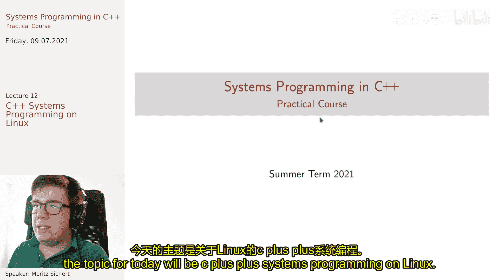

Part of being able to do systems programming in C++。

 but today we want to talk about how you can actually communicate with the operating system and we will use Linux here as we of course have already used Linux for all the exercise sheets and yeah。

 so we will mostly focus on Linux today。Okay， so as I said， the what we talked about。

So far is standard C++ so the Z++ standard it does contain a lot of functions that can communicate with the system so you can write to files you can read from files。

 you can also do things such as start threads and so on。This is。I mean。

 for example for streams we said streams are usually very slow and you also don't get very much control over the exact functionality or the exact system calls the setup library will use and of course there's a reason for that namely because the standard library it should work on all architectures and all operating systems but of course if we are doing systems programming we usually will some somehow need eventually access or direct access to the Ex system we are working on so I mean examples for system programming are things like handling files and directories。

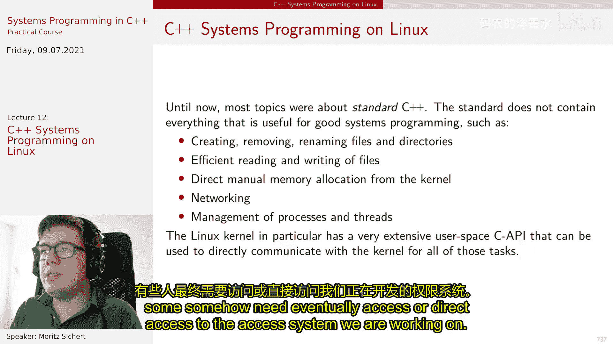

So said there are some features in the center library already for this。

 but usually the operating system gives you quite a lot of more functionality and that you also want to be able to use then of course reading and writing files but efficiently because。

As I said， streams are very slow and there are different use cases for reading and writing files and we will see a few of them today。

 but of course for this you need directly， you need to use the system cos or the functions provided by the system。

Then of course， also manual memory management or manual memory allocation。

 because so far we have used the standard allocations of C++， which。

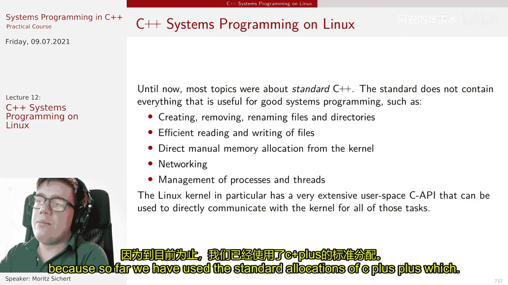

Mainly use malloc in the background， but the question is how would you implement Malo yourself if you for some reason think you can implement a more efficient malloc？

Of course， they didn't also need to be able to talk to the operating system to be able to actually allocate new memory in your in your process。

 Then we also have things like networking。 We will not talk about networking today。

 The main reason for this is that you。I mean there's an entire lecture on this in the informatic specialistcheulas so this which focuses a lot on also the CAAPpi for networking on Linux so we will not cover this today。

 but of course this is also a very important part of systems programming and then of course you have the management of processes and threats because I mean you can use the SD threat class in C+ but you also may want to do things like start a new program or customize your new thread or your new process or something so yeah those are all good examples for systems programming。

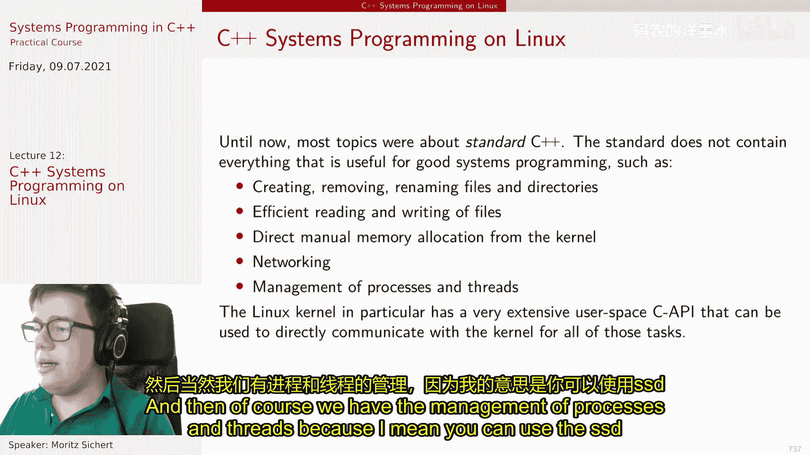

And in Linux， all of those functions they are available in a user space CAAP。

 so user space means that many of those things are implemented as much as possible in the user so not in the kernel。

 I mean of course creating a new process or even opening a file you need to talk to the kernel eventually but the standard library of Linux are to say it tries to implement as much as it can in the user space and this is implemented in a CAP which means that you have headers that are written for C。

And those headers will declare functions。 and then you will need to link with the usually with just with the lip C on your system。

 And then you can， yeah， then those functions can be used。 and of course， the advantage of。

Using C++ is that it is easily interoperable with C so you can usually in a C Earth program you can just include those C headers and they will work just fine so and yeah this makes system programming with C++。

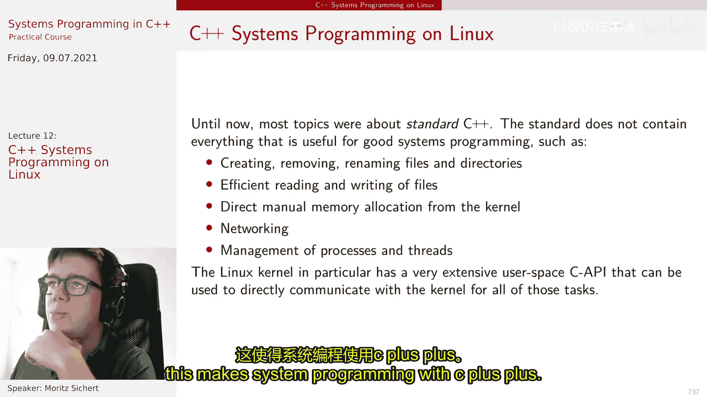

Very easy， I would say。Okay so let's talk about the Linux API in particular a bit more。

 so there is a standard that is called Posss and Posss is essentially collection or functions and behaviors and so on that defines how operating system should behavef and what kind of functions it should have so Posss actuallyifies most of the functions that Linux provides are actually specified in the Posic standard which means that they are not only specific to Linux they can also use used in all other PoOSic systems and examples for those are I mean most Uni like systems so not only Linux but also like meS for example or also the several BSD Unies that exist so those usually support the Poss API as well which means that if you only use the pure Posss functions that Linux implements then your program mostly。

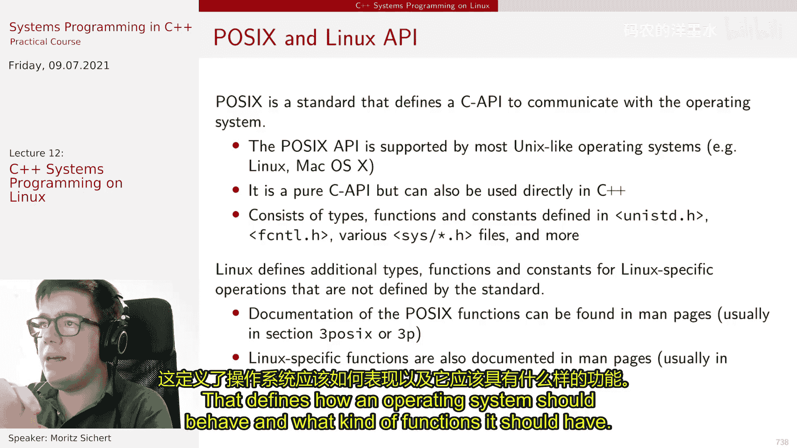

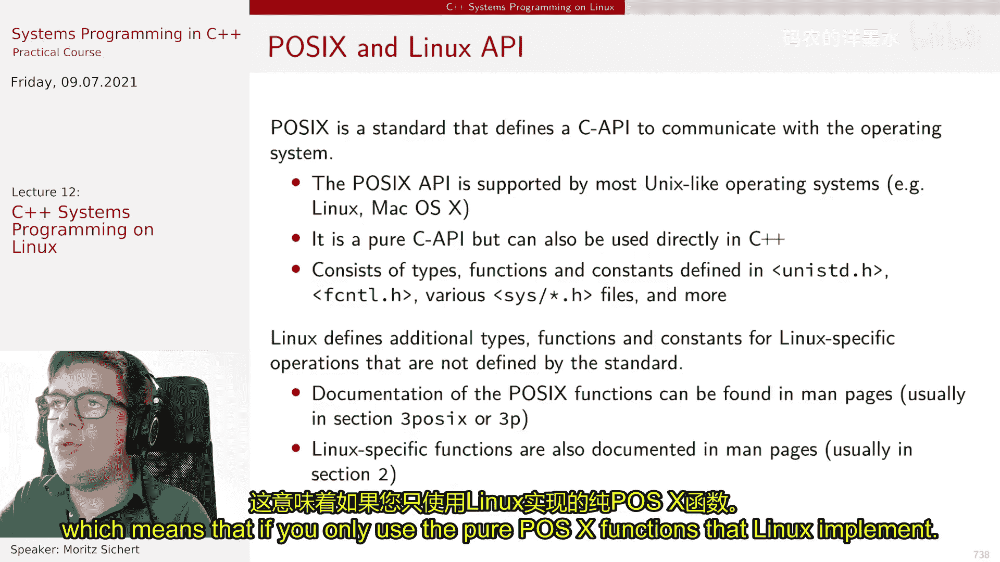

Pable also to other operating systems that use deposits API。And as I said， I mean。

 this is just like for the Linux API， they are also of course mostly comprised of C headers C API and the most important headers we can see here。

 there are the UniiSD dot H you have the F and T L dot H and then you have several headers in the Suis directory and we will for the functions we will talk about today。

 of course I will also briefly tell you which headers to use。😊。

Of course the because thepos API tries to be compatible with or at least it tries to be a standard that can be implemented in multiple operating systems。

 this also means that。Usually every operating system will have additional functionality which is not covered by the Pos API and this of course is also the case for Linux Linux is quite a large software project and it has a lot of features that are very specific and only work on Linux so they will not work on MegoOS they will not work on any BSD。

And。Yeah， they are very similar in that they are also defined as C functions。

 but of course they will then only work on Linux and especially if you're using rather new functionality。

 then this will also mean that when you execute your program you need kernel a Linux kernel that is new enough so that it implement this functionality。

 but for both so for the Pos API and the Linux API you can't find all of the documentation in man pages。

 so usually it's divided into the pure pos documentation is in the section 3p or 3 Pos so it doesn't really matter if you just write men and then the function it will automatically find the correct documentation and for Linux specific functions just the same you can also just write men and then the function name and Linux and you will find a very descriptive documentation of the function。

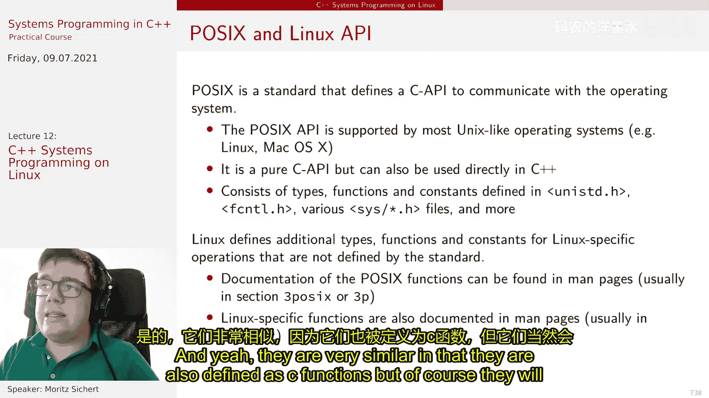

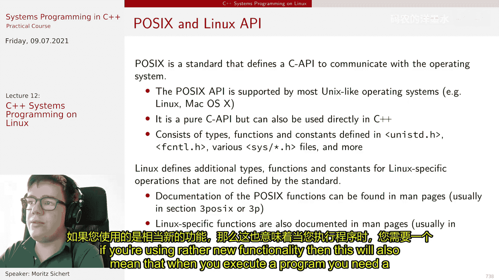

Okay， so this is the overview of what kind of API Linux supports and what kind of API we want to talk about today。

😊。

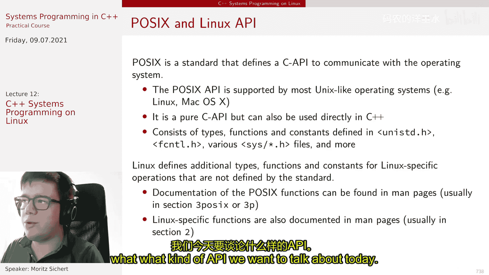

A very central concept in Poss and then of course also Linux are so called file descriptors so they are usually abbreviated as FD or like the plural as FDs and file descriptors。

 I mean the name indicates that they are of course used to handle files but this is not the only case where file descriptors are used。

 they are usually used as a handle for。Many different kinds of resources so of course a file is a resource that makes sense to have a file descriptor for。

 that's where the name comes from， but you can also have a file descriptor for directories and the file of stimulus may also still be okay acceptable but then you also have file descriptors for network sockets which of course you could still argue that in like the Unix philosophy is everything is a file so maybe network circuit is also file but then especially on Linux you have a lot of current objects that do not behave like files whatsoever which are still handled by file descriptors。

 so essentially you have to think of as a file descriptor is some arbitrary int so it's and the types of file descriptors are always in and this is just some kind of handle to whatever object or resource you are currently hand。

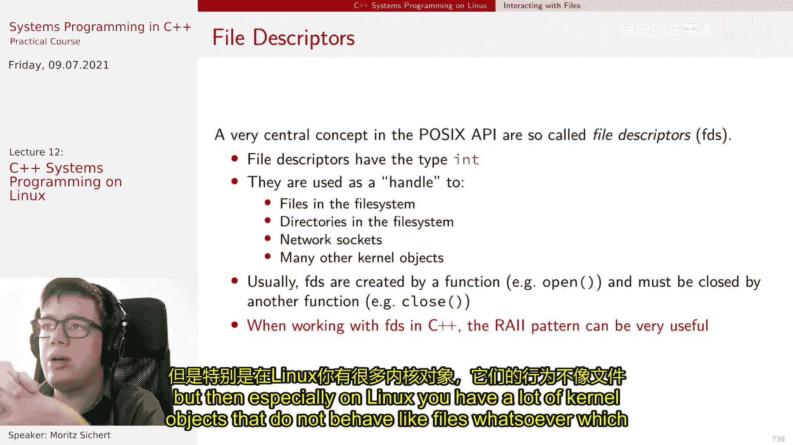

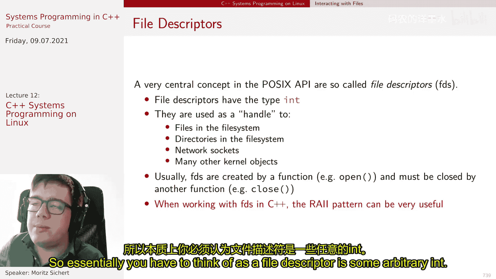

Because they are handling a resource， of course this resource must be freed eventually again。

 so for example， if you open a file by using open， you need to close it with close again and they are like similar functions if you created the filescriptor to have a socket or to some other kind of current object so generally you always need to manually clean up the resources again and of course if you hear this you should immediately think of the RAI pattern in C+ because this is of course this makes it。

😊，Much easier to work with a resource that must be ded。

Because it will make it harder to forget doing so， so in general。

 if you're using file descriptors in C+， you should use RAI classes for that。

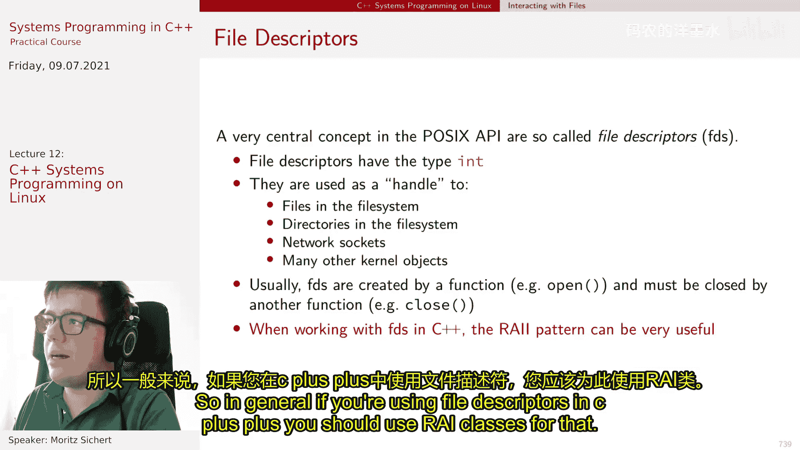

Okay so let's jump right in opening and creating files you saw on the example in the last head already there's a function open that's very straightforward name and if you want to use the function open you need to include those two headers。

 the reason why you need to include two headers instead of one even though it's just one function is that so there are multiple reasons the positive extender just specifies that the open function will be defined in one of those two headers and also some of the constants you can use especially those you can see here on these slide so those oh underscore they may only be defined in the step header and the open function only in in the other header here so this is why you usually just need to include positiveer。

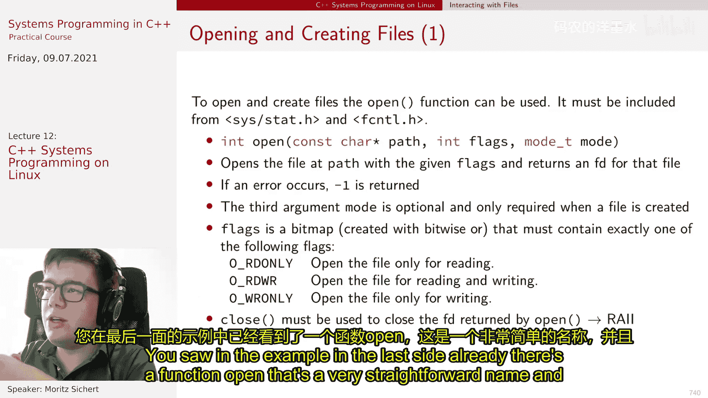

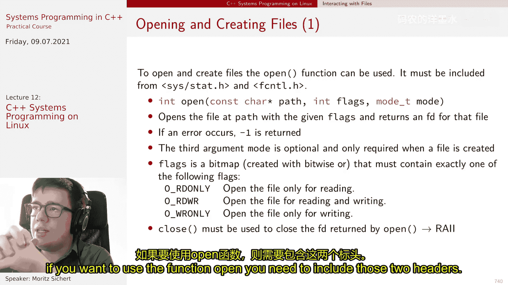

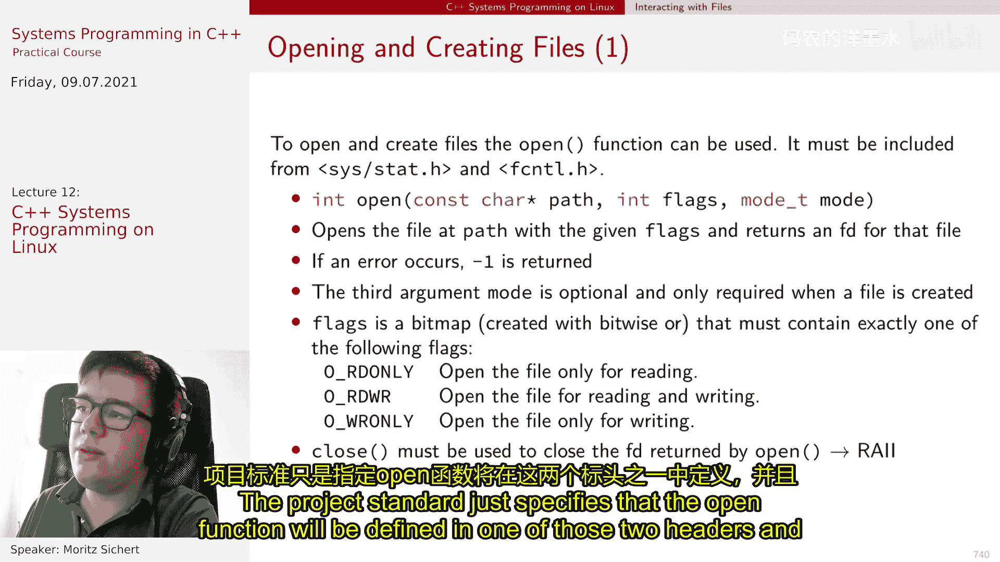

So the functional like this so you have the function open。

 it returns an integer which will be the file descriptor of the fine opened then as the first argument you have pointed to a con character to the path so this is essentially a C style string so this needs to be a string that is terminated by a zero byte because of course it is a API so we don't have things like SD string view or SD string so the Linux and Po APIs。

 they use C style strings in most places when strings are needed。And then we have flex and the mode。

 so yeah， so this is the low level interface to open a file。😊。

And what you also should know about filescripters is that usually even though they are of type in filescripters they are so valid filescripters are non negative。

 so filescripter of0 is a regular filescriptor and on Linux usually the filescripter0 is used for a standard in so for the input of your program so0 is just a regular valid filescriptor。

 but all negative filescripters they usually indicate an error and for open in particular open returns minus1 if an error occurred。

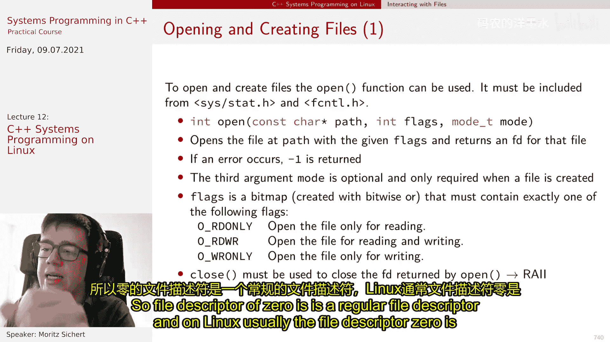

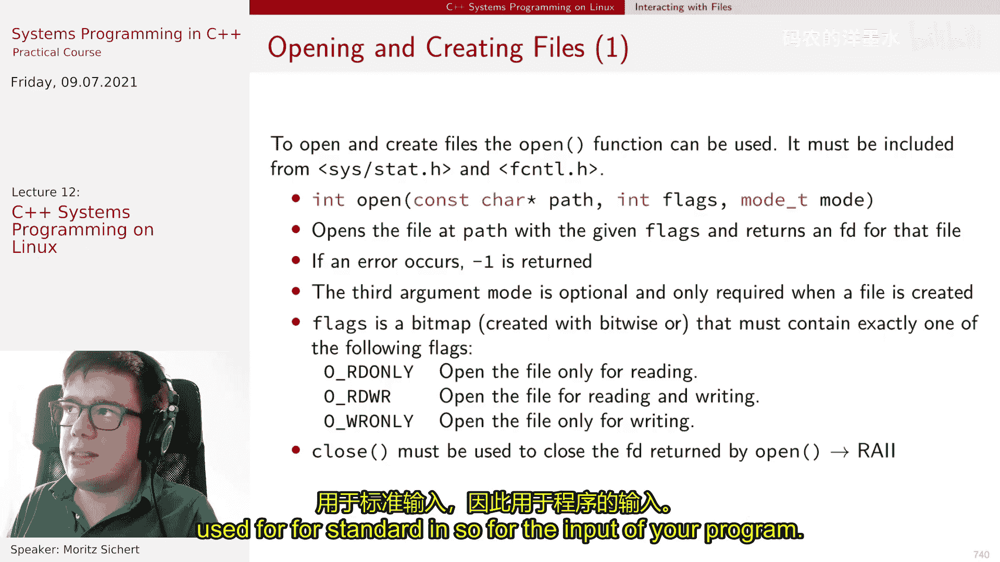

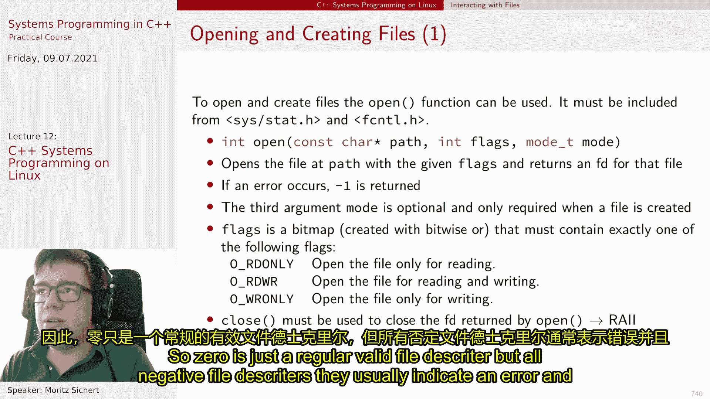

So which can happen， for example， if you give it a path that for a file that doesn't exist or if you are not allowed to access the file or on yeah。

 so of course you can think of many kinds of errors in when when calling the open function so the third argument the mode this is just an argument to give the permissions mode of a file only when the file is created and this is why as optional because of course if you open a file。

 this doesn't necessarily create a new one，And then the second or the the second and then important argument is flex。

 And this is a bit map。 So you have to combine multiple flexs with， with bitwise or。

 So this is a bit map of。Different kinds of flags so they can they must contain one of those flags so you have to tell the open function either if you want to open the file and only read it or you want to only write it or you want open the file for reading and writing so you need to include exactly one of one of those three of course if you have two of those if you have read only and read write this also doesn't make sense which will also usually return an error。

And of course， if you get a valid file descriptor from open， you need to call close on it again。

 so definitely use RAI for that。 there are a few more flags that you can use in the Fl argument and those are for example。

 used to create files。 So if you want to open a new file I mean if it doesn't exist you want to make sure that this file is actually created you have to explicitly tell this to the open function and this can be done with the O underscore create flag So this just creates the file if it does not exist and this will actually use the permission flex in the optional third argument。

😊。

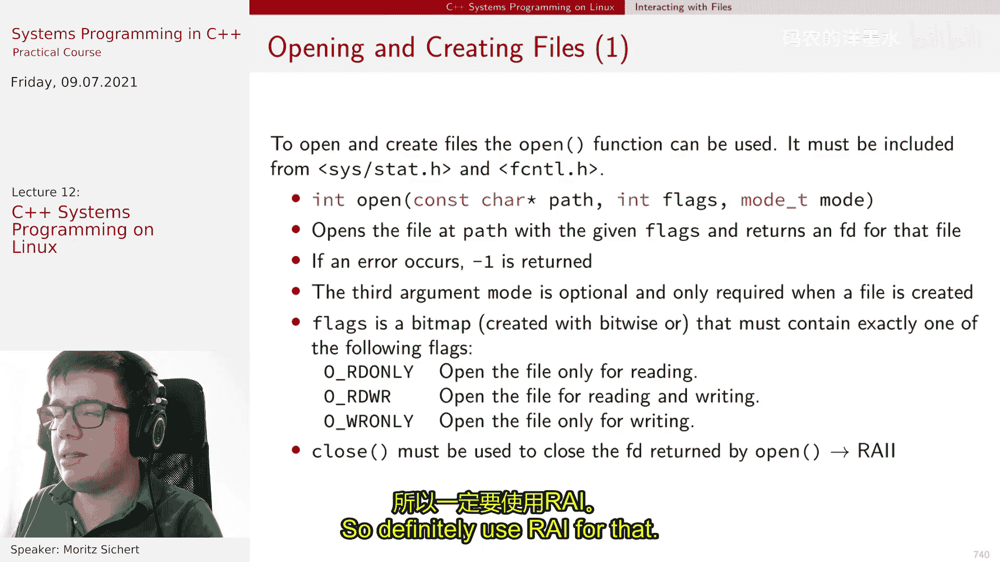

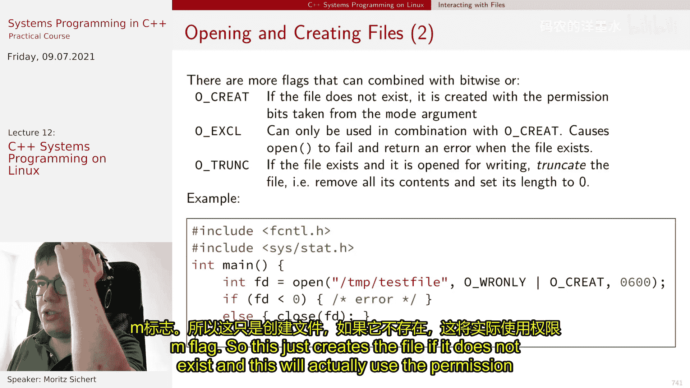

Then you also have some other effects like oh underscoreco XQ which which will make the open function fail if the file already exist so that you don't accidentally over write file and also you have。

 for example， like oh underscore trunk which will even if the file exists it will trunc it。

 which means that essentially will remove it or will just set its contents to be empty and you can see an example here so we just call open we want to open the file with a path1 test file of course a string liter will be implicitly convertible to a sharp pointer and this of course the compiler make sure that this is terminated by a zero byte so this will work just fine and then we say okay we just want to write of a file and we want to create it if it doesn't exist and because we credit it we give it the third optical argument for the mode which is anocta notation which if I' worked on Linux and use the LS program for example。

 this is the mode that you will see so。😊。

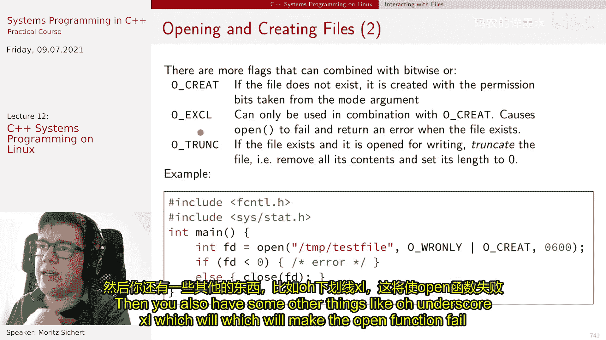

600 means that only the owner of the five will be able to read and write it。

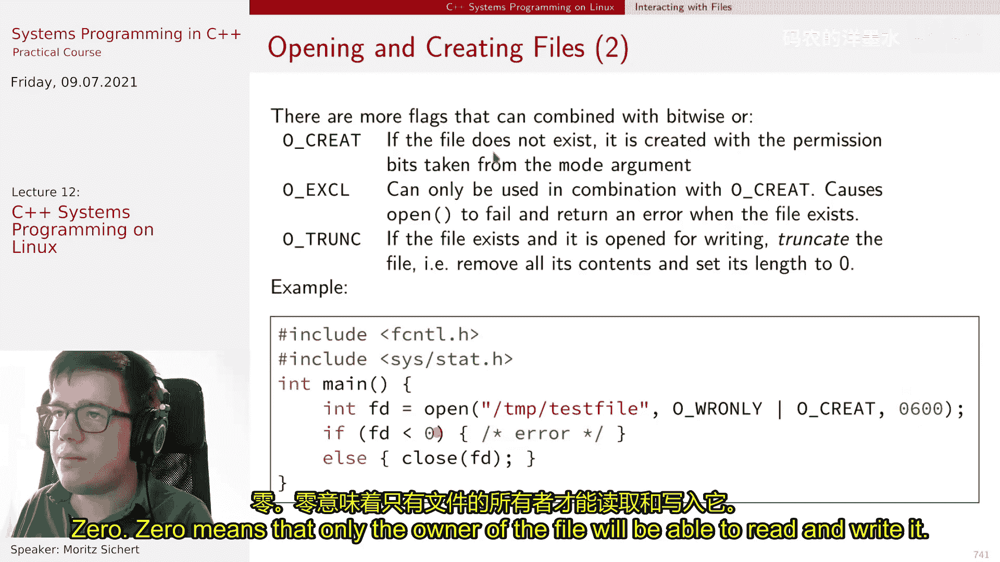

Of course we check for an error and then we need usually we need some kind ofarrow handling here and of course we also use close。

 as I said usually you should wrap this in an RAI class but this is just yeah。😊，An easy example here。

 Okay， so once we have an opened file and then of course you want to read from it and write into it。

 And for this， you use the functions， read and write very very straightforward date。😊。

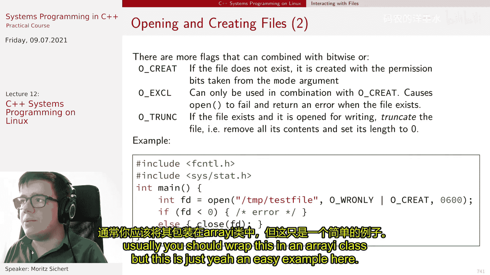

Both of those they are defined in the UniS do Hl and as you may be expected， they of course。

 work on the filescriptor that you get as a return value from the open function。

They take this as a first argument and then they take some additional arguments for read Re takes a noncons pointer to a buffer which is where the data that will be read from the file will be written into and then count which is exactly the number of bytes that you want to read and for right it the opposite you can give it a cont pointer to a con buffer because the buffer of course only needs to be read and this is exactly count bys from this buffer will be written into the file Of course the FD must be a valid filescripter that you've got for example by using open and then the buffer already talked about。

What this function returns is the number of bytes that were actually written So are right and so you even though you give the read and write functions the account。

 it can happen that the operating systems will read or write less bytes than what you specified and there are several reasons for that it can happen that for example。

 if you are reading and writing from a socket that the network connection somehow doesn't allow reading or writing more at the current time or maybe the file is at its end when you are reading so there are multiple reasons why this could happen。

 so this is why this function also again returns how many bytes were actually process and because this is the S size underscoreos T title。

 this is not a typo the S size underscorecor T is just the designed signed version of the size underscorecor T type。

😊。

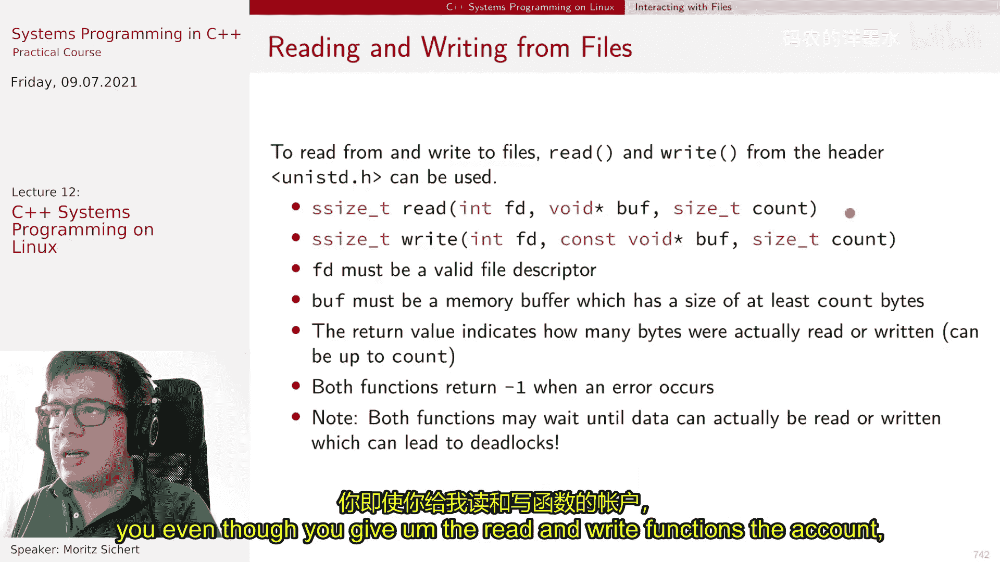

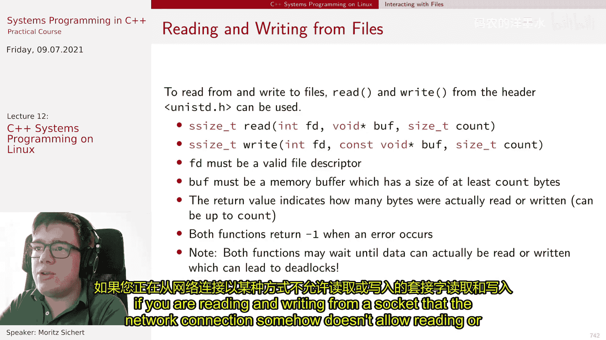

And this similar to open will also return a negative number when an error occurred。

And what the other should know is that。Even though I said the operating system is allowed to read or write less bytes than you specified。

 operating the operating system can also just make your program wait until enough data was read or written so this can also happen。

 which for example， if you are reading from a network socket。

 what usually happens is if if you are saying okay read 10 bytes。

 then the operating system will wait for as long as or until 10 bytes are actually available from the socket。

 which means that or maybe also if you're reading from standard In if you're reading 10 bytes from standard In and the user is not typing in anything。

 this will mean that your program will be blocked until the user has typed 10 bytes。😊。

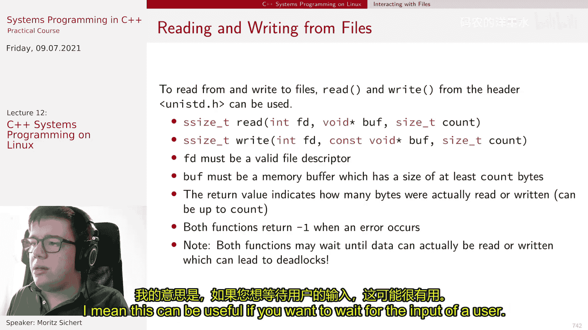

Yeah， this is。I mean， this can be useful if you want to wait for the input of a user but also sometimes you don't want to actually wait for this and there are more API functions or inosics and Linux where you can do things like only read as much as it is available。

 which we will not talk about today but just so now and there are of course many more functions that deal with reading and writing from different sources。

And what you have to know about reading and writing is that the。😊。

Kel internally remembers the position within the file of every file descriptor。

 So if you open a new file descriptor with an existing file or also with a new file then the position will be at0 so it will be at the very beginning and if you then read five bytes。

 then of course the position will be increment by5 and I mean it's a similar thing if if you open an empty file and then write five bytes and the new position will of course also be at the new end so which is at offset5 and what you can also do。

 you can manually modify this current offset by using the function L And the reason why you would want this is of course。

 if you for example if you want to write at the end of an existing file that is not empty as I said。

 if you open a file it will have it will be at the offset 0。

 but if you want to write at the end you first have to modify。😊。

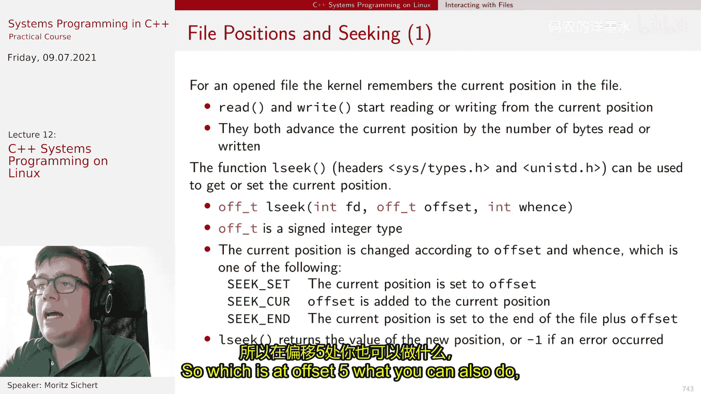

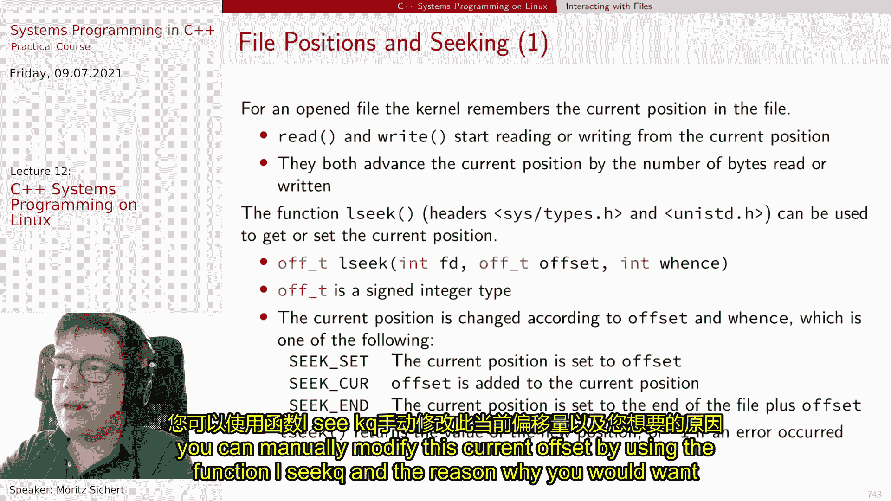

The position so that it points to the end and only then use the right suscal or the right function。

And this is exactly what the L function does。 So it again。

 it takes the fiber descriptor of which you want to modify the current position。

 then the offset by which you want to modify the position and then when this is this is one of those three values here which will indicate what kind of offset this here is so you either can have a。

😊，诶。So as that the offset is an absolute value， this will be Cq underscore set。😊。

Or you have seek underscore score current， which means that the offset is relative to the current position。

 and then you have seek underscore score end， which means that the offset is relative to the end of the file。

 which means so if you want， if you don't know how large you file this you can just write offset zero and you seek underscore score n and then you will be automatically at the end。

😊，So that's why those three versions exist and of course the as always。

 as you might have guessed already now， is that most of those functions return and sign integer and when the integer is negative。

 then this will indicate an error。

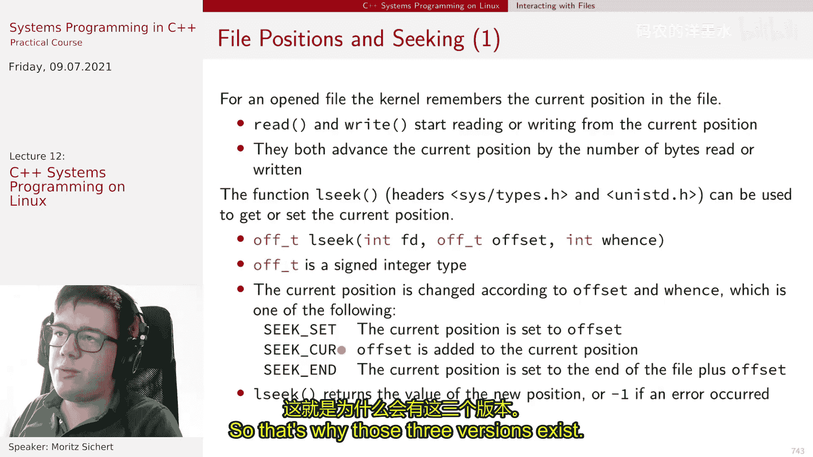

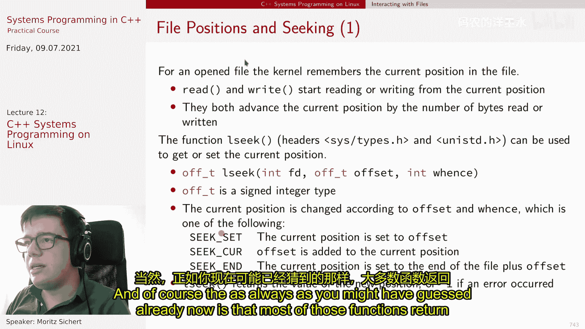

So the off underscoreee is a sign edge and LC returns the new position or a negative number。

 which is usually minus-1 if an  error could so we have an example here so if let's say we want to open the file ETC pass WD which is the file where Linux stores all the users of your system and let's say we want to open it in read write mode so we can read from it and write to it and we want to write something at the end or let's say we want to overwrite the last four bytes which means that we first。

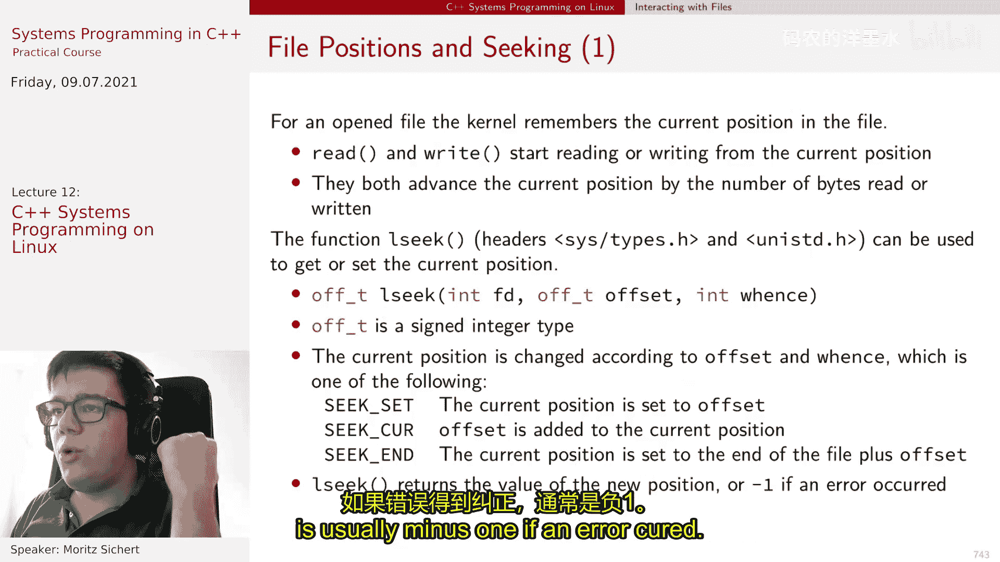

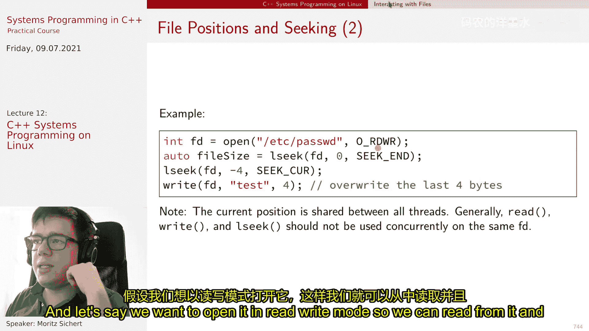

For example， we would first see at the very end which means that now the current position is at the end and then we go back four bytes from the current position which will be the end。

 of course we could just this could be simplified by just using minus-4 instead of0 but we wanted to show different versions of the L function and then if you write four bytes so if you use the right function now the current position will be four bytes from the end which means that we will overwrite the last four bytes of this file with those four characters so this is just yeah how you would manipulate files at arbitrary offsets。

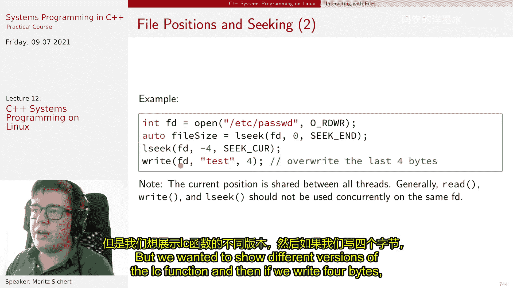

what you have to know is that the current position is shared。😊。

Or it's stored within the file descriptor and file descriptors are shared between threads。

 which means that if you use functions that read or modify the current position from multiple threads concurrently this will usually lead to results or to unexpected results so you should I mean this is not undefined behavior because Linuxux kernel can deal with that。

 but this will put usually or most of the time used to unexpected results。

 So it's generally a bad idea to use read right end or Lse at concurrently from different sets on the same file descriptor and there's a question。

😊。

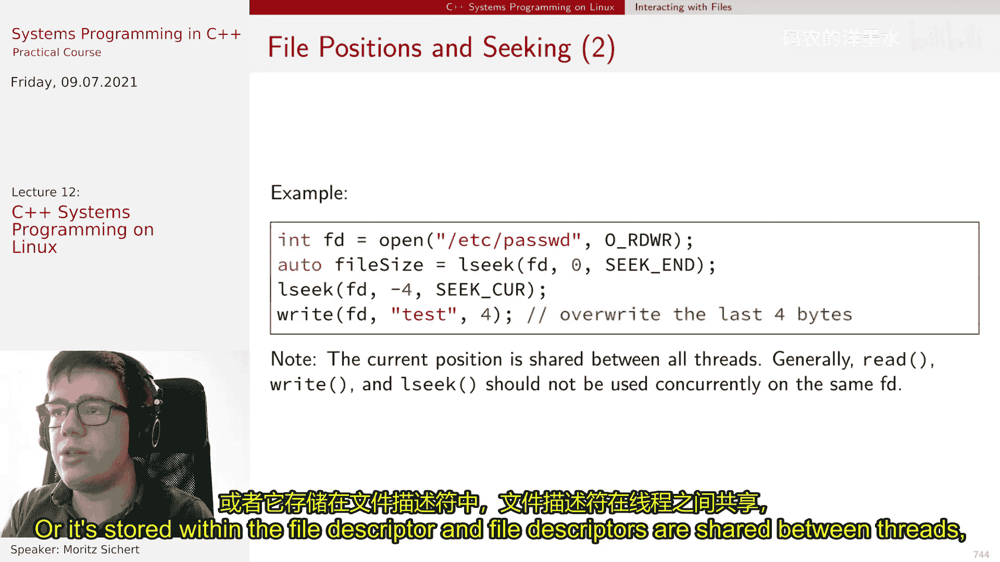

Isn't the string nu terminated Yeah， that's oh yeah， that's a good question。

 The the buffer you give to the right argument here。

 it doesn't really matter how long it is because you also specify explicitly how many bytes the kernel should take out of those buffer out of this buffer。

 even though even if I wrote test test test here。😊。

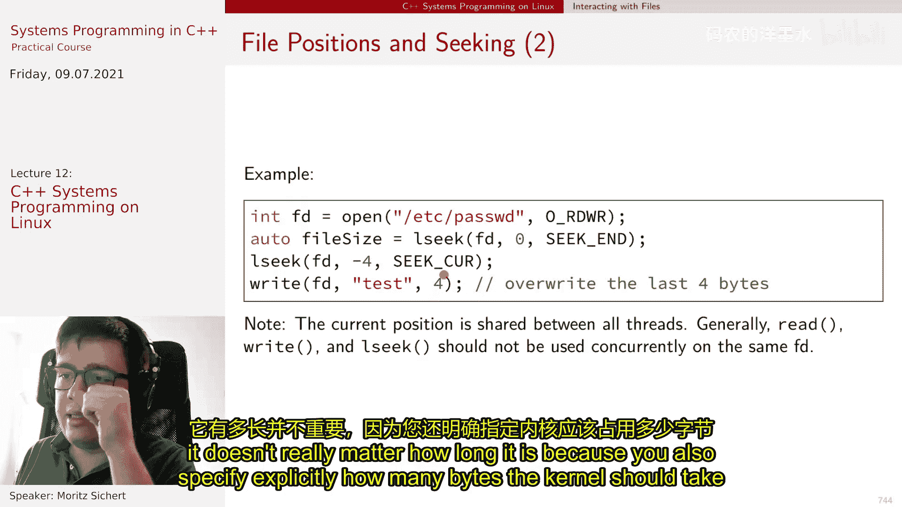

I still specify that I want to write exactly four bytes。

 so it doesn't matter what comes after the the final T of。

So so compared to the open argument for open， this must be an nu terminated string。

 but for right this just needs to be an arbitrary pointer。

 a con void pointer and of course this is a con character pointer but this is implicitly convertible to a void pointer so this is why this works。

😊，Okay， I said you should not use this concurrently， but now the question is。😊。

You may want to write through a file concurrently， of course。

 because if you have a large file that is and contains some pages of your database system。

 for example， you want to be able to write distinct parts of this file concurrently。

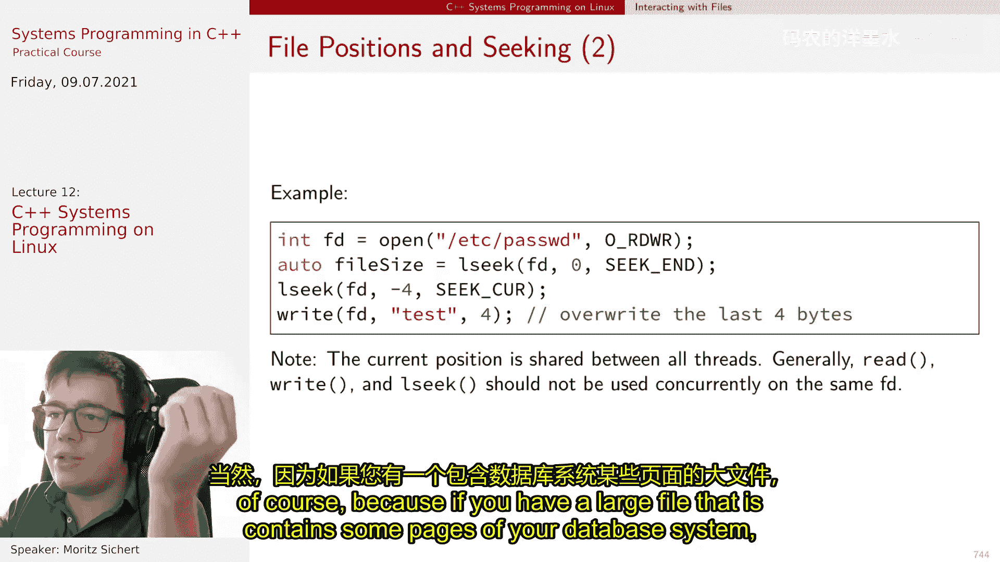

And yeah， another question is how can you do this？There's a question。

 The current position shared is shared between all threats of the current process。

 right or or running on the system。 Now it's only， oh yeah， that is also a good question。

 It's only shared between all threats on the current process。 So different。Different processes。

 of course， they don't interfere with with each other with the file descriptionscripters， of course。

 if different processes writes to the same file， the contents。They also， I mean， they。

This of course will then be noticed by different processes， but the file descriptors themselves。

 filescriptors are something that is local only to a process and of course the process can contain multiple threats so they will be able to share their filescriptors but not between multiple processes。

😊，Another question， do different file descriptors of the same file in different threads have the same position Oh that that's also a good question。

😊，This current position is stored for every file descriptor， not for every file。

 If you open the same file in the same process multiple times。

 you get different file descriptors and they are mostly independent from each other。 So they store。

 they store， they are offset independently， which means you can also use them independently and you will。

Not run into those concurrency problems。 Of course。

 the actual underlying file will then be written concurrency by， by two threads。 But as I said。

 this may be exactly what you want。 So this works。 and also。

 there are also functions to get a duplicate of an existing。

Filescripts or this function is called du so DUP very easy so you don't don't even need to open the file at a second time if you want to get a new independent filescripter but the usual solution is that you still only have one filescripter and you will use one of those functions so we have the functions P read and P writer they are very similar to read and write。

 the all difference is that they have a third argument or fourth argument is and an additional fourth argument which explicitly specifies the offset at which you want to write。

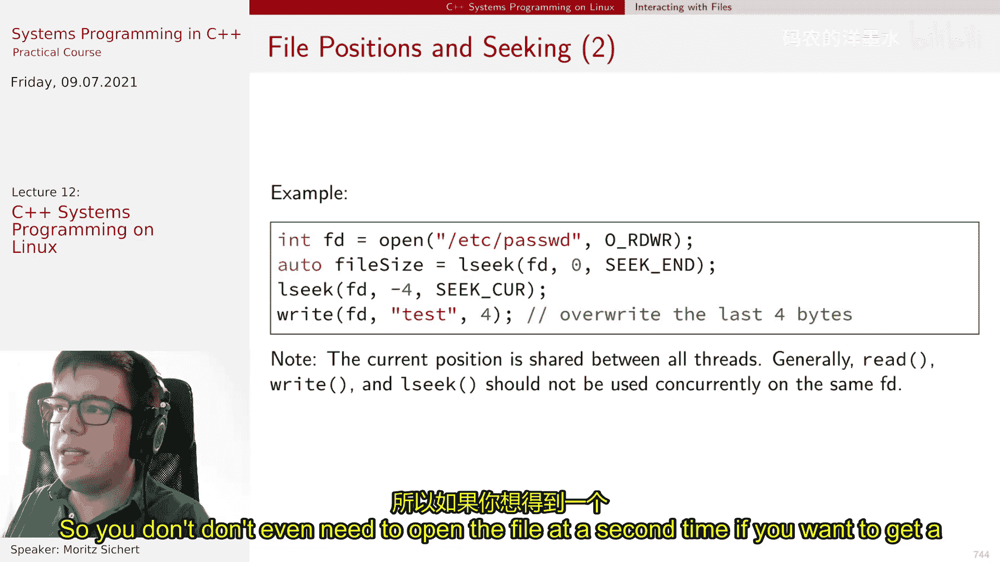

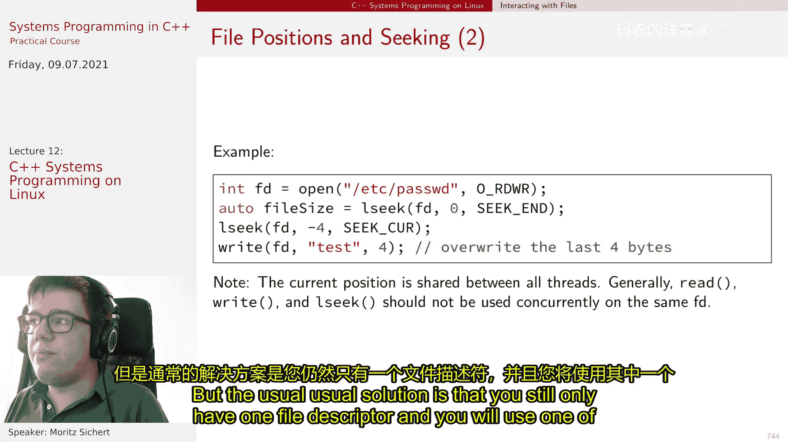

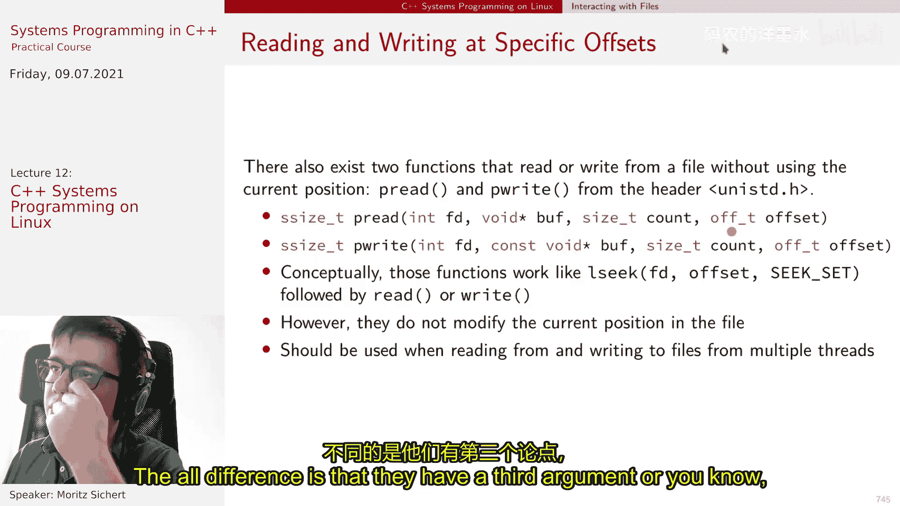

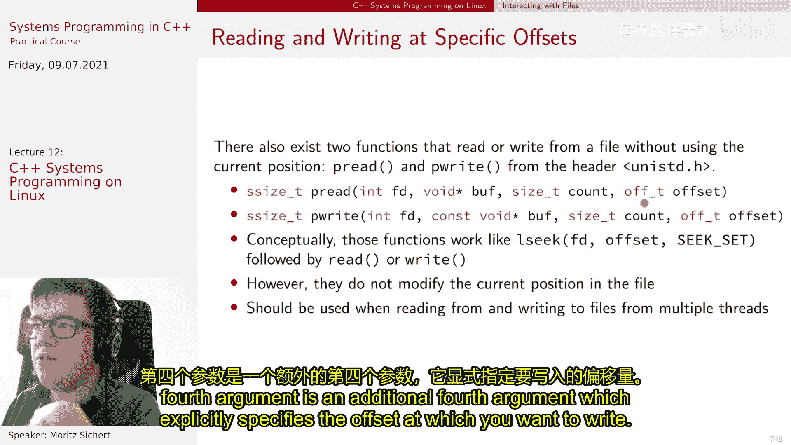

So conceptual this just works that you first seek to this offset and then use the regular written right。

 but of course those those functions they make sure that this that they don't actually modify the current position of your file of your file descriptor so using peer read and P write concurrend different different threads this works so this is fine。

😊，And in general， so if you I mean this use case I am most familiar with is that if using if you're writing a buffer manager for a database system。

 then of course your file is separated into pages and different pages will be written and written to and from different threads so this is where you would use those P functions and of course if you're using a buffer manager。

 you usually have the page ID and then you can directly calculate the offset because you know the page size and you know the page ID so you can just calculate the offset for your set。

😊，Okay。

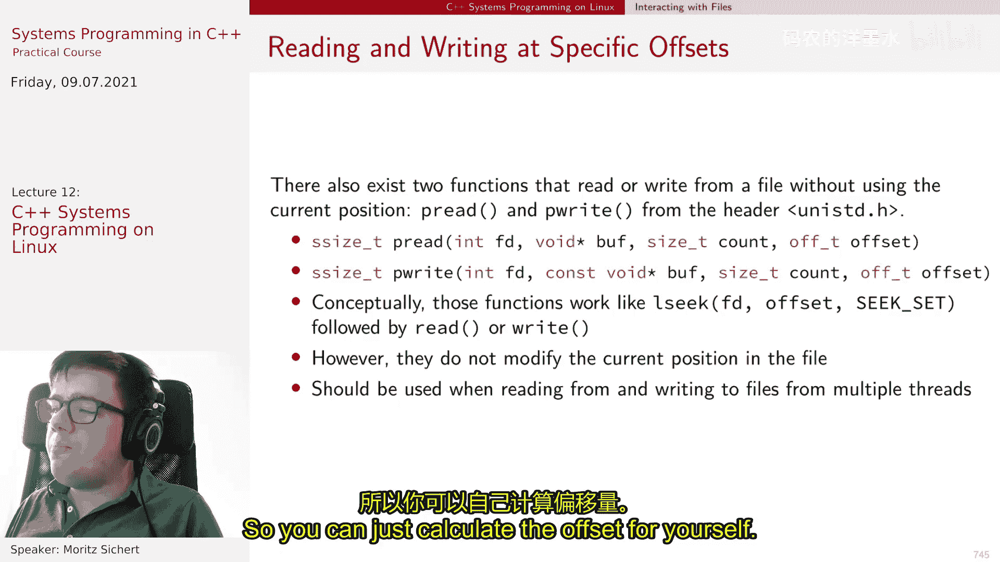

Other things you can do with files is to get their metadata because I mean with read and write you can get the actual contents of the file but files on Linux they also have a bunch of metadata。

 things like the own of the file， the permissions， the last access time。

 the size and so on and those information can be read by using the ST or Ft functions and the difference between those is that the ST function。

 it takes a file name so this means that so that you don't need an open file descriptor of this file。

Yeah， so this is the set function and you have the F step which can give you the same information on an opened filescriptor and how they return the data that you need to give them a noncons pointer to an object of type sta。

And this is astruct that has several member variables。

 so you can also see finds in the main pages of those functions so。😊，Just some yeah。

 those are just a few member variables that they have so there's ST underscore mode which will tell you what kind of file this is whether this is a regular file or directory or even things like a symbol click。

 there are even more kinds of files and Linux， things like device files or any other special files。

 then you have of course user of the owner you have the total size and bytes which by the way you could also find out by using Lse and seeking to the end and then SiQ will return the current position。

But of course， this doesn't require opening the file if you're using a static instead of Ft and there are a bunch of more。

 which you can SS find。By reading the documentation and as， as usually。

 they return an integer in this， the integer doesn't。

Doesn't return anything useful but so the only thing it tells you is whether an error occurred or not。

 which an error can of course happen if for example。

 if you're using instead on a file that doesn't exist， then you will get an error。

 otherwise it will usually return zero。

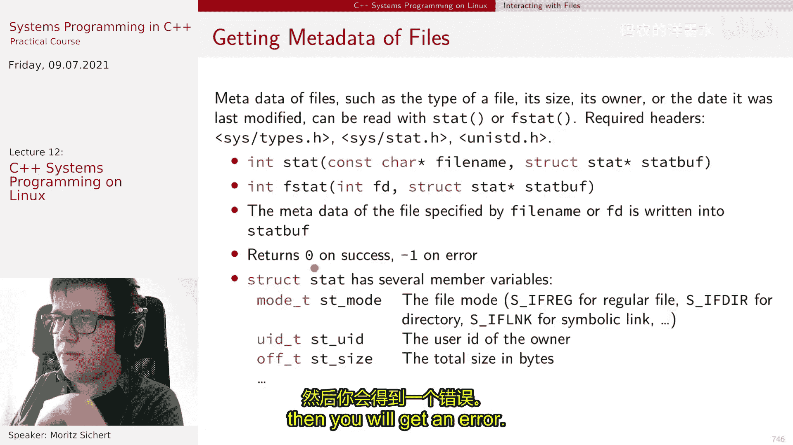

Other things you can do with the file is changing its size so there are the functions truncet and F truncet there are just like for step and F that the only differences that one takes and file script or the other takes path and then they take a length and the file will just be or the new length of this file will be changed to the length argument you give it So the question is what I mean it should be obvious what happens if the new length is。

😊。

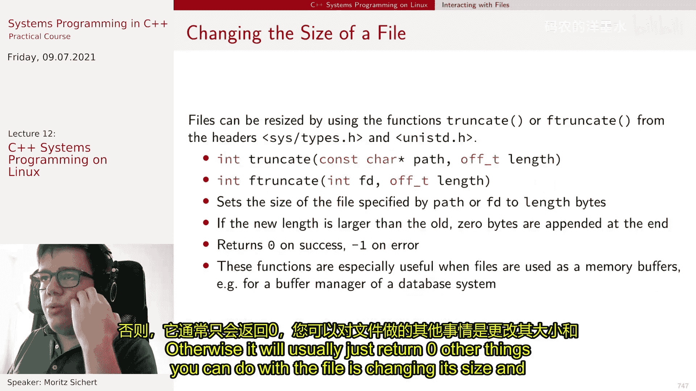

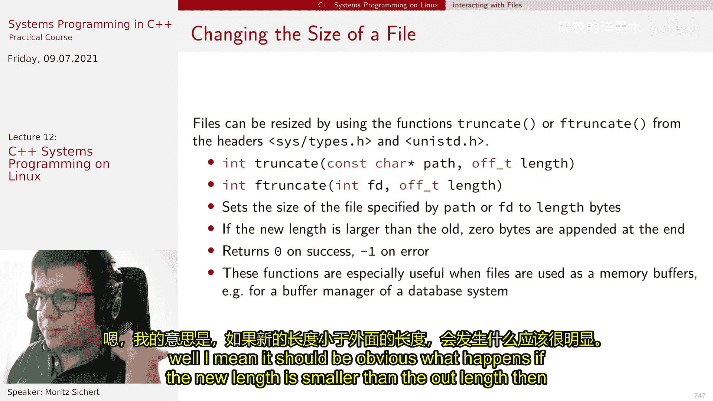

Smaller than the old length then the rest of the file will be discard or will be removed but what happens if the new length is larger than the old length then the file will be paddted with0tes so everything from the old end of the file to the new end of the file will be0s and what interesting on Linux by the way this depends on the file system。

 but most file system and Linux they support so-called holes in files。

 which means that if you for example， if the first megabyte of your file contains some data and then you truncate your file to be of size 1 GB and then you write at the very end of the file then the file system will not have to actually write out a1 GBabte of0tes instead the operating system will tell the file system that this is this was a trunccate operation and then the file system will remember that your file essentially has a。

😊，A hole in it， which is just a large area of zero bytes， which means that。😊。

You can have kind of efficient。Fes that only contain a bit of data every few gigabytes or so on most file systems。

 and of course， as always it returns minus-1 on error and just a0 on success。

And so why you would usually use them because if you use write。

 the right function will automatically resize the file if necessary but if you want to。

 of course if you write something like if you need a large memory buffer and then of course you don't want to explicitly write many bys into the buffer to resize it inside you just use the truncet function again。

 the use case for this would be a buffer manager of a database system of course， I mean。

 because the other share of database systems for us most use cases are of course tied to database systems。

 but of course， I mean， this is just a very general function you can use it can think of other use cases as well。

😊。

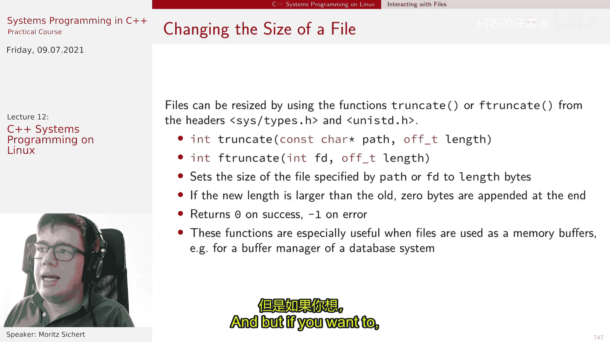

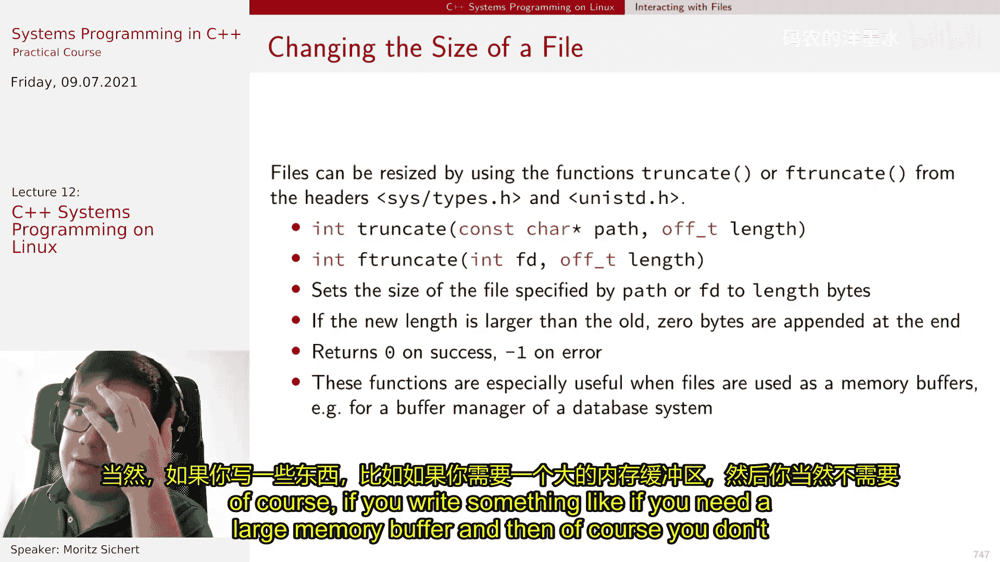

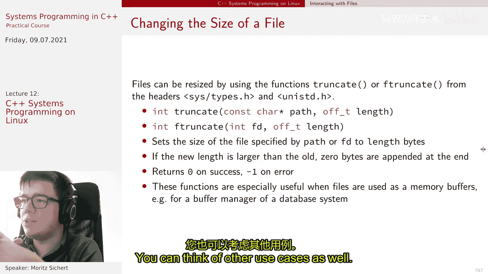

Of course this is there are a bunch a lot of additional functions that deal with files and we will not talk about all of them today。

 you can find all of them by reading the main pages。

Just as a short overview of what L says you can not only create files， of course。

 you can also create directories。You can also open files relative to a directory and then you can remove files。

 this is not called remove this so the function to remove a file is called unlink。

 then you can remove an empty directory， you can change the ownership。

 you can change the permissions mode， you can force changes to file to be written to disk this is again very useful for databases where the database needs to make sure that if it tells the user that the transaction committed。

 then it needs to make sure that the data actually lies on the hot disk and of course there are several more functions which if you need some functionality which we haven't talked about today for file you should be able to find this function by just browsing through all file functions that Poex or maybe just googling it usually Google results are helpful。

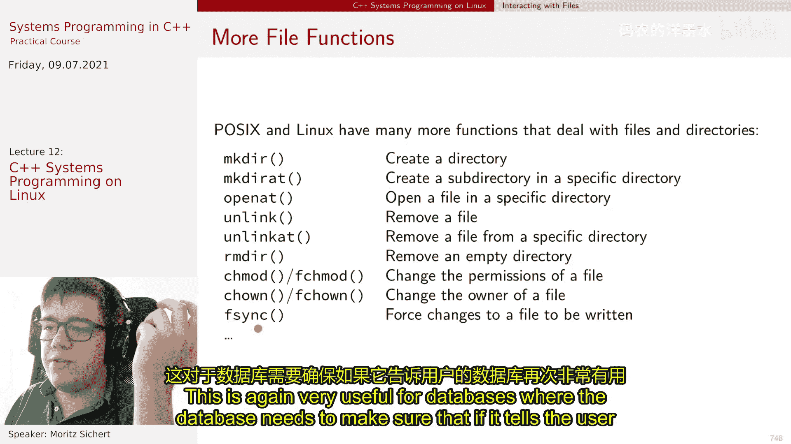

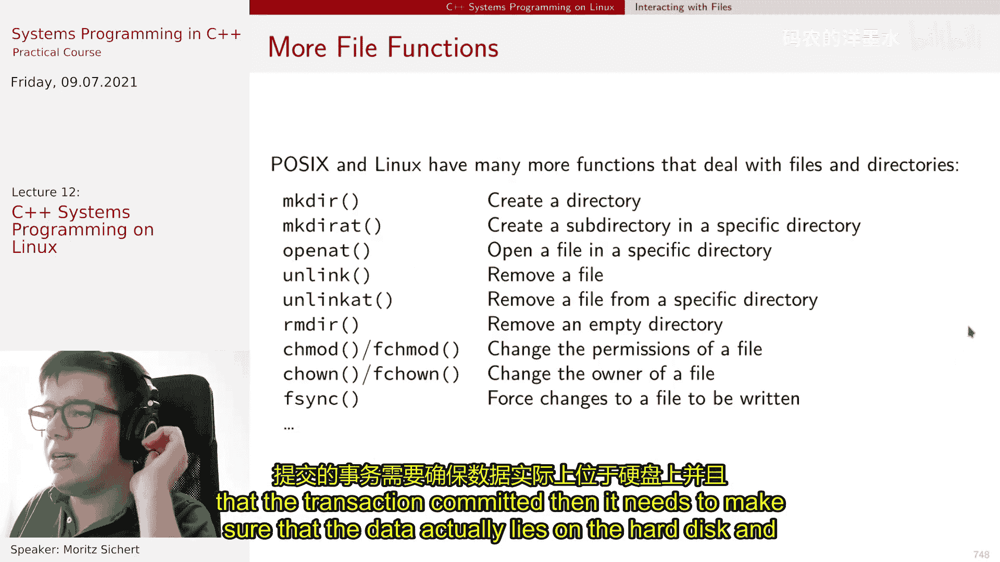

I mean， let's say it like this， the Google results are helping are useful to find out which kind of function you even want to use。

 but for the documentation of this function itself I would really recommend just reading the Men page because especially on Linux sometimes they add new functionalities for existing function so if you read the Men page of a function on your system you would get the most recent documentation for this function on your Linux version so I would definitely recommend reading as a documentation reading the Men pages because they are also written very well usually so there's really no reason to find worst documentation online if you could just read the man page which is already contained in your system。

😊，Okay， so this was the chapter about。Fileles， do you have any questions so far？Okay。

 I mean I'm not going to wait for a long because I think handing files is quite straightforward I mean at these in the basics and I answered a few questions already so I'll just go right ahead with the next chapter or the next section which is about memory mapping。

😊。

So。First I have to talk about what memory mapping even is and so you know your process has virtual memory。

 which means that there's some component in this CPU。

 which is usually called the MMU memory mapping unit， which。

Translates every pointer which of the virtual address space into the actual physical address of the Ram that your system has and the reason why virtual address spaces exist is that so that different processes that they are independent from each other and that they can't easily write into the memory from other processes So this is just one use case for virtual address space。

 but there are several more useful features and that virtual memory can give you and in general to manage virtual memory。

 the main function to do this in Linux is the M function So the M function has a lot of arguments and those arguments are usually so these meanings of those arguments usually depend on which kind of flexs you give it in general。

 what M does is。😊。

You'll give it some length and then it will return a memory area of this length and then what exactly this memory area does this will then be specified by all of the other arguments and we will see a few examples in the next few slides。

😊。

Similarly to open， you also need to essentially free the resource returned by M which is done by using the unmap function and again this is a very good use case for RAII which is like very similar to things like unique pointer because if you allocate memory with M of course you also want to be able or you want to make sure that this is automatically delocated。

And the呃。Maybe one special thing that's a bit different from the usual STD free function is that for MMMap you also need to give it the length and this must be the exact same length you gave the M call here and of course this this address argument must be the value you got from as a return value from M there's a special value that is returned for an error because of course a pointer doesn't have negative value or something so there's a special macro that's called map underscore failed which you can compared to the return value of an M if it is equal to this value then this will signal an error。

😊。

嗯。Yeah， okay。 so those are the basics of M。 So let's first talk about one。

Uual use case for Map which is memory mapping files so because what you can do on Linux is I mean we saw you can open files。

 you can read and write them but whats very interesting what you can do Linux as well you can open a file and then give it to MMap which will make the file a part of your virtual memory space which means that you will be able to access all of the contents of the file by just using pointers so essentially just normal accesses in your programming language without needing to use any read or write you can just use regular pointer arithmetics。

 anything Memcopy， whatever you want and the operating system will make sure that this is read from the file or written to the file。

And for this use case the arguments work like this so the address parameter is a hint for the kernel and which every address you want usually you don't care about the exact address because you just want to get the content of the file as a pointer but you don't care where the pointer exactly lies which means that you should pass it an null pointer because if you give it an null pointer that the kernel will just pick the pointer it wants this is what you usually should do there are some cases where you want want to control the pointer but yeah for memory file usually you don't need this and then of course you need to give it a length。

😊。

Which， of course， is the length of the， of the。

Essentially the buffer that you get as a return value from M and especially if your memory mapping files on Linux this must be a multiple of the page size。

 which on Linux is usually 4K so 4096 bytes and if it's not a multiple of the page size。

 then it depends on the exact implementation but it will either return an error or will just silently round up to the next multiple of the page size。

 which means that of course you should always make sure that this is always a multiple of the page size。

😊。

And then with the Pro argument， so you maybe let's go back here the third argument is called Pro。

 this is a bit bit set again of those and flex and those will determine。

The permissions of the virtual memory mapping in the MMU essentially so you can see here we have four kinds of flags or we have either Pro underscore exec。

 which means if you set this， then this memory area will be allowed to be executed by the CPU so this will be allowed to contain CPU instructions and you will be able to jump to this or to call a function or to cast the address to a function point down then call this function or something。

 this is what Xec does and you have read right， of course obviously this means if it's only read without right。

 then you are only allowed to read the data， but if you write using a pointer to this。

 then this will lead to a sec fault and of course if you want to read right to use right and if you want to make the page inaccessible for some reason then there's also another flag that's pro underscore down。

😊。

And for flex， for a file， you should either use map underscore share or map underscoreco private。

 the only difference between those is that map underscore Sha will make sure that if you write to this memory area in your process this will actually be written back to the file on the disk but if you use map underscore private then it won't so this is the only difference and this of course depends on use case if you want to read some initial data and then you want want to change it in your program but you don't want to save this back to disk and use map private otherwise if you want to modify the file use map underscore share。

Then of course because we want to map a file into the virtual memory space you need to give it a file descriptor and then of course as an offset because we may not need the like the first page or so of our file so again this must be a multiple of the page size but we are not required so neither length nor offset must be written away so that we map the entire page and the entire file。

 it's fine if we just select a subset of the file。😊。

Okay， so let's see an example for mapping files， so let's say we have a file that is called ins in the directory slash TmpP。

😊，And this file containss integers。But it does not contain them as as a decimal。

 just as decimal bytes， which you could read as a human。 But instead。

 it contains them as actual little Indian byte。 So which means that every inte will have exactly four bytes。

 and we want to read them from this file。 So this is essentially a binary file。

 you can't easily read it with your text editor。 So instead we want to write a program that reads those bytes。

 So what we could do and we could。😊。

Open the file like we do here and then just read four bytes or multiple bytes by using the read function multiple times。

 but in this case we use MM instead， which means that we get an a void pointer for the contents of the file。

 then we cast this to a point of it。

And that and then we can just use this as a like we would use any other pointer so we don't need to use any read anything else anymore here。

 we just use one call to Mm and then on just use regular point arithmetics。

 and of course at the end we need to call M unm and close and of course you must not forget this。

 but this is like this highlights the。😊。

The very nice properties of memory mapping files into your process。

And。第一。😊，Reason why， I mean， the first reason why you why you would want to do this of course。

 because it can be much easier to write programs that just deal with partners and part arithmetic instead of multiple calling read and write very often and this because you don't need any operating systems functions anymore here。

 this also usually makes your program much much faster because you only need M once and afterwards。

 the operating system will make sure that if you access an integer of a page that does not load it into memory yet then will transparently do this for you you don't need to use any read function anymore or anything like this。

 the operating system will just automatically load the file into memory if necessary and then maybe also catch them and also automatically write the contents back into the file if you're using map underscore shared。

So if you need to write or read a very large file very quickly。😊。

You of course know that streams are very slow， but usually then in this case even read and writer can be very slow。

 and especially if you're dealing with binary data。

 which essentially you would just want to write or read with a Me copy or something like this。

 then in this case using MF is the fastest option。😊。

Okay but this is only one use case of M what M can do as well is you can use MM for memory allocation because as I said M is a general function that deals with butcher memory of your process。

😊。

There's the question， is that okay with the strict eliasing rule， oh， that's a very good question。😊。

So the strict asing rule is not violated here as long as you don't access this file in this array with another type。

 so if you cast this map file to a double pointer and then access the double point as well。

 then this this would violate the street aSN rule but I would think the more critical question is whether this isn't just undeified behavior in the first place because you are not initializing any objects。

 you just。😊，Just open a file and then just tell the Ccal file Okay。

 those are point to ins and then okay， just go ahead and read them And the reason why this works is that for primitive types and for even forstructs that contains primitive types。

 the C++ standard allows you to read。😊。

Essentially。Things like a memory where the objects were not initialized explicitly。

 and of course you' are not allowed to read aninitialized memory， for example。

 if you have a stack variable which you have it initialized。

 but since this is I mean this is something that the C plus plus doesn't know about anyway。

 this is a like a lowle operating system function usually the compiler treats this as a point at which it assumes that it does contain initialized data at least。

😊。

Okay so let's go back to the example of using MM for memory allocation so the way memory allocation with MM works is essentially it's almost the same as using MM for reading files。

 the only thing is just you don't give it in a file descriptor we just tell MM okay give me this amount of memory but I will not give you a file descriptor and then it will give you this memory but of course this will not I mean this will will not be related to any existing file so this will essentially just be new memory that your process can use and to be able to use this MMap with an invalid filescriptor you need to give it the argument map underscore anonymous this essentially means you have something like an anonymous file or a conceptual anonymous file and also it must have the map underscore private flag because because you do not have a real file which you could write the changes back into。

😊。

So map underscore Sc share wouldn't make sense so you have to use map underscoreco private because you don't have an F。

 the kernel will mostly does not care about the argument in FD but as a convention you should set it to minus1 and of course because you do not have a file you I the offset must be zero because any other offset wouldt make sense。

But the other arguments， especially the pro argument。

 they have the same meaning so you can allocate new memory that read that has read and write permissions。

 or you could also allocate new memory that is then actually executable by your process and this function is actually at least on Linux this is the function that is used to allocate large memory blocks by melo so if you call meoc with one megabyte of memory。

😊，Then MEO will very likely use M， there are some other tricks how you can allocate memory on Linux and because as you may know from or maybe Re from the first lecture or also from your operating systems classes processes usually also have a he and this he can also be used by MeO and the memory return by MMap is separate from the memory from the He memory that the process has so M is MEoc does not only use MM but it uses MMap for very large allocations。

And so， in general。This means that you should also do the same。 You should only use MM MM for。

For large allocation， so largely medium several hundred megabytes， for example。😊，So呃。I mean。

 the reason for this is that the MM function is kind of expensive because it needs to modify the virtual memory space of your process。

 which usually means that the page table needs should be modified。

 which will invaliditate a few caches of the CPU so。

MM is a rather expensive operation so you should not use it very often which means that it's usually only worth it for large sizes for smaller sizes of course you should always use me especially if it's only a few hundred bys or so of course I mean as I said earlier because the size or the length of the MM function must be a multiple of the pages size anyway。

 itt I mean it doesn't make sense at all to allocate memory that is less than one page。

 but even for one page the overhead is usually very large only for a single page so you should only use Map explicitly for。

😊，Larger sizes。 So that's the question。 if Meoc uses M。

 how can it be more efficient Because Melo does not only use M Melo for smaller sizes， use。

 as I said， uses the he of the process， which is separate from the memory that M gives you。

 So the he already exists in the process and Mm will manage the memory on the he melo， I mean。

 will manage the memory on the he， especially for smaller locations。

 which means that melo will usually be more efficient。

 Another thing that you may ask yourself is if Meoc does use M internally for larger locations。

 Why would I ever use Mm myself And the answer to this is that if you use M yourself。

 you can control the arguments yourself So in particular you can control this read and write。

 which means that if you want to write a compiler a J compiler that generates assembly code in the program and then。

😊。

want to execute in this code， this will not be possible with memory returned by Malo because Malo returns readr memory。

 but you will need a executable memory， which is only possible by using MMap。Okay。

 so is those are the two main use cases for M。Because M is a function that can。Essentially。

 modify the virtual memory。 There are a lot of。There are a few more fancy use cases for M who can hack the virtual memory in a sense。

 so general M is yeah you can think of M as a general function to modify the virtual memory the two main use cases are to map files and to allocate new memory but there are some more use cases where you just want to mess with your virtual memory for some reason yeah we will not talk about them today but just so you know M is a very versatile function。

😊，Okay， any more questions about。And map so far。Okay。

 the next thing I want to talk about is emerging processes。😊。

着低。Function you may have heard already to create a new process which is the most common function on the Poss API so not only on Linux but also for our other Po systems is using the fork function fork is a function that has no arguments。

And what's interesting about fork is that fork duplicates the current process。

 so it generates a new exact copy of the process and。😊，The return value of fork。

It's the only thing where you can differentiate whether you are in the old process or in the new copied process or of course it will also return minus-1 if an error cur and you can see an example how this works here so we have a program that print start and end and in between it will print new if fork return0 and old if it did not return0 and let's assume that does not have an error here。

😊。

One possible output for this program would be start old and new end so you can see here that the print end two times and the reason for this is that at the point where the for function is called the process will be duplicated so there will be now two versions of the exact same process and because we differentiate by the return function return value if the return value is 0 this will be in the new process and if it is not zero it will be in the old process。

😊。

And then of course， we have two processes， which means that we will print and two times。

 So this is like the this is the usual way to。Create new processes Yeah this is a bit weird because for will really make sure that the process is an an identical copy。

 which means that it will of course copy its entire virtual memory with all memory mappings so all all anonymous memory mappings for memory allocation and also all memory mappings to files it will copy all file which so on it will copy everything and now you may maybe the first thing you may ask how can this even be efficient if you have a program that has several gigabytes of allocate memory and then I call for then I would need to copy the entire memory and conceptually this is true but。

😊。

The Linux kernel has a nice way to deal with this。 And because it will。copy it的 pages。

Lazily only， which means that essentially if you call fork。

 the kernel will make the pages shared between both processes， which means that in physical memory。

 both processes the will have the exact same physical location and the Linuxux kernel will make all of the pages read only。

And as soon as as a threat or the new or any process wants to write in in this page again。

 of course this would usually lead to a segmentation fault because you are trying to write into a read only memory but the kernel then knows okay this page was supposed to be writeriable but I only made it read only so that it can because I had a fork before so only then the kernel will copy only this particular page so that that the new and the odd process have separate copies of this and this is the way how Linux at least implements fork very efficiently and of course internally a file descriptor in the kernel is stored as a I mean this is just astruct。

 which is called。😊。

File info or something I'm not sure exactly， but different file descriptors of different processes can of course also point to the same structure in the kernel as long as the kernel makes sure that conceptually the processes will not notice that this is the same data structure。

 especially with things like the current position of the file。

 so the kernel also need to make sure that if one process modifies a file descriptor that the other process will not notice this。

😊。

So this is fork， this is just create a new process but of course I mean this is a very like general let's say a very coarse grand function just gives you a new process and then it's done you can't control anything so to get more control of newly created processes and especially to create threats there's another function that's called clone and clone is actually the function that is implemented by the Linuxux kernel and the fork function that you call is just implemented in user space and the fork function will just call the or use the clone system called internally as well。

😊。

So the most general function is clone and what this does is it has a function point as a first agreement。

 this is the new function that will be executed in the new process or the new thread。😊。

If you create a new thread， then you will also need to give it an explicit stack because of course your current thread uses a stack which was given to it by the operating system。

 but if you create a new thread within the same process，😊。

You can't reuse the same stack pointer because all threads share the same memory which means that if you use clone manually to create a new thread。

 you need to manually allocate a stack for it and of course you have also flex which will control if you for example create a thread or something else and then you have one additional argument and this argument is the argument that is given to the new function in the thread and this is yeah because you can't pass the lambda here because this is a function pointer and lambmbdas can only be converted to function pointers if they don't have any capture variables but sometimes of course you want to be able to use like give the function some more information and this is exactly what this argument is useful。

 this is just passed directly to this function here。

And as usual， it returns a negative number if it failed and if it did not fail。

 it will give you the process I of the new process， which even if it is a new threat。

 it will give you the process I of the new threat。And for the flexs。

 there are also a bunch of different flexs because essentially what you can do with clone。

 you can control which kind of things should be copied into the new thread or process and which kind of things should be shared between both processes and you can control many of the things separately。

 So can， for example， say， okay， I want to share。😊。

And。The file descriptors but do not want to share the virtual memory this can make sense if you are for example。

 if you're writing a web server and you want to create a new instance of your web server which can still use the sockets of your alt web server process。

 but of course the new web server should have its own own separate virtual memory which is where you would use clone files but not clone VM。

😊。

Then of course， I mean and there are a bunch of morefls， for example， there's cloneos called threat。

 which is used to create a new thread and within the current process。

 which usually implies those three things from above so of course new threads they will share the visual memory。

 they will share the filescripts and they will also share the file system informations on earlier。

 as I said， there are a bunch of morefls if you need some more fancy fortunate。

 you can just look in the one page of clone which will list all of the available。😊。

Fs， okay， so now we know how to create a new process and even how to find have find grain control over what the new process should have。

😊。

But we still don't know how to actually run an entirely new program because fog and clone both will run in the context。

 so you need to give it a function pointer， which means that they will run in the like image or the virtual memory image of the current process This virtual image may be copied from the oil process。

 but it still will be the exact same executable file for example。

 and to create or to actually execute a new program。

 you have to use the exec V function So are a bunch of functions that all start with exec and they have either V or there's also just exec V or exec VP or something so they are a bunch of versions the only difference between them is that they have different arguments。

 but in general you can use this function you give it a path to the new executable file and then you give it the arguments and the environment。

 the arguments this is what you also get in the main function from。😊。

You see the first problem， for example。😊，And the environment， this is similar to the arguments。

 this is also a nu separated array or an nu terminated array。

 which is an array of environment variable equals and then value so can what you can see here。

 for example， and this is like the environment variables that the new program will get。😊。

What this starts is then it。

It will replace the current process with the new program that you gave it as arguments which means that on success。

 this function will not return because the new program will be executed。

 which means that the only return value that you can realistically get from this exec B function is a minus1 because this is an error cut which happens。

 for example， if the file here， the executecutable file does not exist and of course this is usually used in combination with for because if so if you have a running program and for example you want to run LS the LS program in your current existing program。

 of course you want to do not want to replace your entire program。

 instead you first write a new process and then in this process the new process you will call ex so that the new process only the new process then will be replaced。

😊。

And of course， if you use this combined with the advanced flex of clone where the new process will for example。

 share the fileyscripts with the oil process， you can implement some things where the new program will be able to communicate with the old program because as I said or as I' have right here。

 XXVE will replace the entire virtual memory， but it will keep the filescriptus and that it currently has。

😊。

Okay。

Another maybe related thing to when talking about processes is something that's called threat pinning。

I mean， this is。Kind of specific compared to everything as you've talked about。

 but the reason why we want to present threat pin here as well is that usually if you're writing a systems program。

 so especially things like an operating or not an operating system。

 but a program that runs an operating system like again， a database for example。

That uses multi threadreading or also if you're just writing any program that uses multi threadreading very extensively and is very compute intensive。

 you want to make sure that the CPU doesn't have to or isn't overloaded with the work of just be grading between different threads because you know if you create a new process。

 the Linuxux kernel is allowed to run this on any CPU that your system has， but if you know， okay。

 my system has 20 CPUs and I。😊。

Create exactly 20 threads。 Then， I mean， of course。

 I'm creating 20 threads because I want every thread to run。 So on I want on every CPU， physical CPU。

 I want to run an actual。😊，That and to actually enforce this you can use this SC underscore set affinity function this essentially tells the operating system that the current process or the current threat must be executed on on this exact set of CPUs and it's not allowed to be executed on any other CPU and yeah this is done by giving it the process ID or this can also be a like a so if you give it a zero this will mean the current threat。

😊。

And then you give it essentially a bit b of CPU that this is allowed to be executed on and to work with the CPU set mask。

 you usually use the。😊，The macro CPU underscore0 and CPU underscore set。

 so you just create a new variable of new unized variable of the type CPU underscore score set underscore T。

 then you zero it out。 So if it is zeroed out this means that the process is allowed to be executeded on no CPU so it's essentially not allowed to be executeded at all and then you can set individual CPU。

 So in this case we set okay。😊。

This is allowed to be run on the CPU0 and on the CPU4 and then if you call this Set affinity function with a point to the set variable and you also need to give it the size yeah the reason why you also need to give it the sizes that essentially it will be back called compatibleable with new account which will have potentially a larger type here so this is why you need to give it a size and then your current set will only run after this will only run on CPU 0 or4 usually what you want to do。

 of course you want to for example spa 20 threats and in every threat you want to CPU said it on exactly one CPU and then your threats will be guaranteed to be distributed across all CPUs。

Okay。

Another thing that you may have come across when working on Linux or on projects in general are signals。

 So signals are something that is used to。

Communicate something to a process and those signals can either be generated by the operating system because an hardware event happened or they can also be sent manually by a process to another process。

 for example， for example， if you press Cr C on your terminal this will usually make the terminal or the terminal emulator or the shell program。

Will make。Or will then send the signals S in to the process that currently currently running。

 And another example for an hardware vendor is if you are。

 if you're accessing memory that doesn't exist， then the hardware will give this a page fault and then the kernel will turn this into a thick segmentation for。

 which you'll probably already。😊，experienced。And so there are a bunch of signals and for every signal there's a default behavior that a process does。

 so the default is either that the process is terminated immediately。

 which is the default for segmentation for for example。

 or it can also be that it does nothing and this is the there are I mean there are in total I think up to 100 signals or so and there are a bunch of signals which are just for like。

😊。

Some information that the process may use but doesn't have to so in this case the default actually is just to for the process to do nothing but of course you can't change the behavior of your process and this is done by using a signal handler and for every signal you can set a signal handler or let's say there's one signal cannot be handled and this is the kill signal and so the signalel will terminate the process immediately without the process being able to do anything this is like the last result of terminating process if it really does want to terminate by itself。

Usually you want to use something like SInt， which is， as I said。

 it happens when usually when a user press control C or S term。

 and this is like the more urgent variant of SInt， which for example happens if you have a graphical program and you press on the X of your program of the graphical interface。

 then usually this program will get a S term。😊。

So but it really depends on the implementation of the test environment and so on。😊，And of course。

 in the end we have S kill which which will tell the operating system kill this program immediately without telling it。

 so this is the only thing that cannot be handled and as an example of a signal that where the defaultation is to not terminate the program is the sick child。

😊，And this signal is delivered to a process every time a child process is terminated。

 either because it just returns or just uses exit by itself。

 or because it got another signal which terminateinated it， which is especially useful。

 if you have a program that handles multiple child processes like for example a shell。

 a shell program you can type LS and you can also use background。😊。

Process head so on。 And this is why a shell would wants to be notified when a child process terminated。

 So this is what this。

Sick of this four。To set a signal handler， you need to use the S action。

Function and as a first argument， you give it the signal。

 so all of those they are essentially macros for integers and then you give it the the new。

Action that you that you want us to have。 And then you also need to give it another pointer。

Well this optional this can also be null and this will then be set to the old function single handler which sometimes may be useful if you want to replace one single handle with another but still want to know what the old single handler was and as always return zero and success minus1 and error。

😊，And this Sig action， this is again a structure which has multiple different member functions and you can find the executive documentationation on the Sig actionction Man page。

 but the most important thing is that you can give it as function pointer and this function will then be executed every time the signal was received by the process。

😊，And you can see an example here， so if you want to be able to handle the user pressing control C。😊。

We can set a sick action on the second end signal。We set it to our new action S where we set the function pointer to this handler function and then yeah we do not care about the old handle so we just set this to now yeah and after this line if we now press control C。

 this function will be executed。😊，You can see here that we immediately accept the program。

 And the reason for this is that。The user of course， can press C C at any time in your program。

 and this means that in particular， the user could also press C C while another SDD C out print。

Is currently being executed and this， of course， would be an undefined behavior in C+ because you are essentially it's essentially a data race because while you are executing the SDC out a left shift function。

 you execute a handle which then execute this function again。

 which of course if you have a single threat， this will not be really executed concurrently。

 but like conceptually in C+ this is still considered a data race。

 So especially if you return from this hand of course， your program will just continue as normal。

 but if your right signal， you have to be very careful to not violate any or to not have any undefined behavior。

 usually。😊。

Mostly the only thing you can do。So printing is， as I said。

 is also already very likely to lead to unified behavior。

The only thing that is guaranteed to work is to write and read from global atomic variables。

 So this is one of the very few things you can do in the signal handler and of course what you should then do is instead of printing something here。

 you would set a global atomic variable that is called something like did user a press control C and you just have to check this variable regularly in your regular code and then you will also be able to check whether control C was pressed but without having undefined behavior。

😊。

By the way， what's also very interesting， you can even handle the S segmentation fault。

 but of course it should be very obvious that just returning from a signal handler from S segmentation fault will just lead to another segmentation fault because you haven't fixed the problem which is that you access em that doesn't exist but this is by the way also how the address sanit is implemented the address sanitizer handles the segmentation fault to be able to print a nice error message and of course because the program can be continued in a sensible manner after six segmentation fault。

 the signal handler of address sanitizer will of course eventually also terminate the program but only after it printed useful error message。

😊。

Okay。To send a signal explicitly from a program you can use the function kill I mean the name may indicate that this only is useful to kill a process。

 but this is not true a kill is trust the function that can send any signal so not only the signal it can send any arbitrary signal to any arbitrary process and how it works is you give it a process ID and the signal number and then the operating system will send the signal to the other process。

😊，There are some special cases for the process ID so if if you give it the ama0 then this will send the signal to all other threats and if you give it the minus1 it will send it to all。

 all processes on your system for which the coding process has the permission， of course。

 if you are non-ro and you try to send a sick kill to all processes on your system。

 this will not be this will of course not send a sick to all processes。😊，On the system。

 because you are not allowed as a non-root user to kill root processes。

 so you will only kill all the processes of your user。

 I mean you can try this out by writing a simple program if you write kill minus-1 stick term。

 for example， then then your desktop environment will be terminated and it will usually will bring you back to the lockin screen。

😊。

But of course it will not crash the in system， it will not crash all of the other critical components of the system。

😊，As always， it returns0 and success minus1 and  error and how you can do this to communicate between processes you can use the custom command S user one and S user two。

 those are the user defined signals they are never used by the kernel itself so you are guaranteed so if you use them manually you can I mean yeah you will not get any interference by the kernel but of course。

😊。

If you send a signal to another process the other process will not get any data with it。

 so this is a very limited communication， of course。

 a better way to communicate between two threads is using Fiscriptors， but not over a file。

 but instead you can use a special kind of file which is a pipe。😊。

And pipes can be generated by using the pipe function and this essentially you need to give it an pointer to an array which has space for two integers and this will give you then two filescripters where in one filescripter you can write and the other you can read from so you can see here everything that is written to the filescripter at the area offset one can be read from the filescript is offset0 and of course because this is because you open a new filescript essentially with this you need to call close on them again。

😊。

And you can see here how this can be used。 So we we have a we create two file descriptionscripts with the pipe function and we just rename them so that we know which is the read and the right end。

 And if we write hello in the right end of the pipe and then read from it again。😊。

With the read end， then， of course， this will also contain hello again。

 The reason why this is useful is， of course， when you are when you are sharing this file descript between multiple threads or multiple processes。

 even which we can see here。😊。

So if we first create the filescriptors and then fork the program。

 both programs will have the same filescriptors and they will refer to the exact same pipe。

 which means that if one process writes to the pipe the other process will be able to read from this pipe so this is like a way how processes can communicate with each other and of course。

😊，I mean you can also see here in the new process we only want to read which means that we close the right end of the pipe in the new process and similarly in the old process we only want to write for the pipe so we don't need the read end and because those two branches of the if are executed in different processes when we close the right filescripter here。

 it's of course not close here it's only close for this process and like and similarly here if you close the read file scriptter。

 it's only close in this process and not in this and here you can see if you write hello in the old process we can read it from the new process and of course then this is much more flexible just sending individual signals because we can use actual data and use read and write to pass arbitrary data。

😊。

Okay。

The last thing I want to talk about today is error handling I mean we thought that all functions have returned some kind of special value which is usually minus-1 or from M this would be the map failed special value。

 but you also get a more detailed error。😊。

Vue， which is stored in the global variable Erno。 So this is how it's called。

 And this can be accessed by using by including the C Arno header。 And， of course， I mean。

 you should then， of course， use the SD prefix。😊。

Because this is， again this。😊，A sea header， which is。

Available from from the C++ function from C++ library oh wait no I think I got this wrong this is one special case。

 if you're using Cerno from C++ you must not use the SD prex for ErRno and the reason for this is that ErRno is allowed to be macro and not a variable the reason for this is that ErRno at least on modern Liy implementations。

 Erno is actually a threat local global variable so that you can reliably detect thearrow even if you have multiplepos in your program and for this reason sometimes this is a macro so forget what I said at the beginning this is the only exception if you're using Erno from the C header still don't use the SD prefix here。

😊，And what function this global variable contains is it contains the more precise error code every time an operating system function returns an  error and they are again several kinds of errorss。

 you can find them by in thearrow no man page， so you have for example。

 something like E so they all start with E for error and then you have in for invalid argument。

 this is for example， if you give M something that is not the multiple of the page size or if you give close an file trick that is not valid or similar things。

😊，You have E no end which usually is the  error that happens when you try to open something that doesn't exist you have excess  errors。

 you have something like not enough memory and so on and there is a function in the C string header that is called stir arrow and this will give you a nice string representation of the  error message from the arrow no so if you just call stir error with the arrow no then you will get yeah so essentially you will get an  error message that that you can print for to the user which will yeah it will be easier to understand。

Okay， so yeah， that's it for today from C++ services programming on Linux， do you have any questions？

😊，Are there standard C+ plus repas for those functions， For example， are AII for files。 Oh yeah。

 it's a very good question。 and and the answer to this is no everything I talked about most of the things I talked about today do not have any rappers。

😊。

In C++ Senate library， one exception， of course， is a threat。

 they can be just started by using SD thread。

But the set library of C class doesn't know anything about filescripts。

 so it doesn't have any notion of filescripts which means that it also doesn't have any repas for that。

 so you will have to write a reppers yourself。I mean， of course， because this is。

 this is specific to po on Windows。 for example， you don't have fighterscriptors。 You have。

Something like handles， they of course work very similarly to filescriptus。

 but they have different semantics and you have different functions。

 So yeah this wouldn't be portable in the supertal library， which is why it's not included there。😊。

Are there common third party packages for that？Yeah， I mean， of course。

 there are a bunch of libraries， but I mean。If you want just simply to read or write a few bytes。

 you can just use file streams。And usually if you want something more sophisticated。

You can just use open and close and read and write yourself。I not't。I don't think that， having some。

Extra library just to abstract calling open close read write would give you much。

 I have yeah would have much benefit there。 So usually every developer writes their own RAI rep Yeah。

 that's that's the case， I mean。It's because usually it's only a few lights。

 I mean if you have an RAI Reper that makes sure that close is quite an instructor。

 you just have to provide a instructor that calls close so that's pretty straightforward。😊，I mean。

 there there are of course libraries， especially the boost library that's a collection of that's essentially a very large extended standard library。

 and I'm pretty sure that boost has。😊，More functions for fight handling and so on。 Let me see。

But usually I've boosted a very， very large library， which is why。😊。

Many people don't like using it because then you have a bunch of a very large dependency。

 but yeah if you。

If you want your program to be portable， but still use low level operating system some APIs using a library like Bo may help you there。

Okay。I guess if there aren't any questions anymore， then of course， as always。

 if if you have any more questions about this later on。

 you can just use the metataOS channel and yeah。Then let that's it for today and。

Yeah will see us again， next week。

