# 【全集 附课件】慕尼黑工业大学 C++系统编程 中英字幕 1080P p16 Lecture 16 - 总结 -BV1QTzjBFER2_p16-

。Hello and welcome back everyone to the final lecture of the systems programming in C++ practice course in which today we're going to talk about a couple of different things that we haven't really had the chance to talk about in the previous lectures。

 but that we still consider to be sufficiently interesting to give them some time in our lecture here。

 so most of this stuff is actually much larger than it might appear in this lecture today。

 so we are only going to scratch the surface of many topics so that at least know that they exist。

 and if you're interested， then of course we encourage you to read up on these topics yourself but at least with this overview you may remember。

 oh there was this topic or that topic in case you run into a problem where they may be helpful。

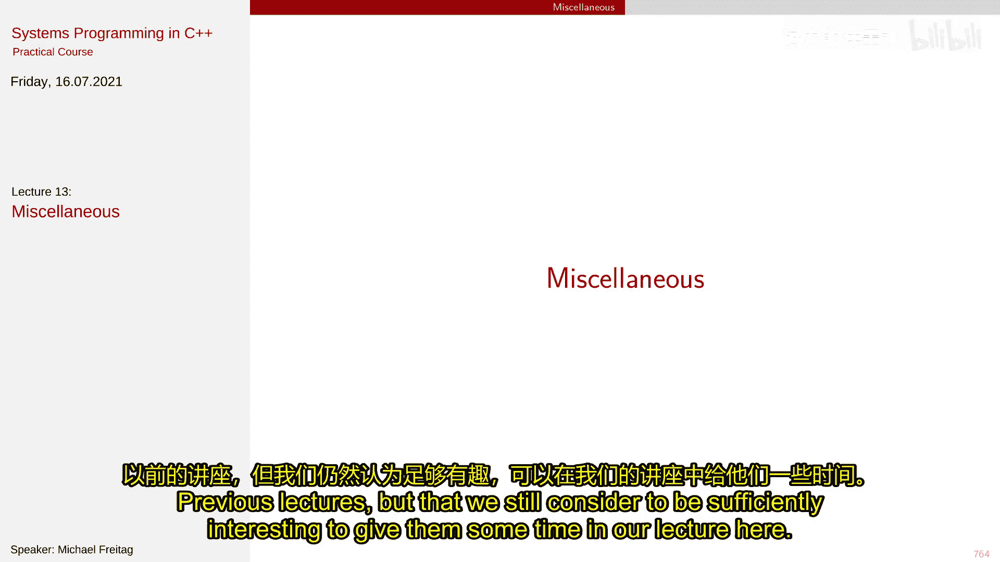

So with this in mind， let's start taking a look at some fun things that you can do on X86 in particular。

 and the first thing that we want to briefly talk about is a topic called pointer tagging。

hich exploits that， as we may remember from our lectures about dynamic memory management。

 and we have this virtual address space that we use in our programs and these virtual addresses are translated to actual physical addresses within our main memory by the memory management unit。

And these virtual addresses， if you have a 64 bit system。

 which by now I think is the defect facto standard。

 then of course your virtual addresses are also going to be 64 bit integers。

 but the memory management unit on X84 only uses the lower 48 bit of pointers as actually relevant for translation to physical addresses。

So what this gives us is that our pointers actually only contain 48 bit of information and the upper 16 bit of our pointers are unused by the system and of course we can get the idea to try to store some useful information in these upper 16 bits of our pointers and this is then called pointer tagging because we were adding these tags if we were talking about individual bits to our pointers。

Of course， we have to be quite careful if we do this because if we accidentally set one of these upper 16 bits and then forget to clear it again before using our value as a pointer。

 then we will run into all sorts of fun memory bugs that will screw up our program。And of course。

 if we want to have truly portable programs， then we also have to provide an implementation that works without such pointer tagging because this is specific to X86 so it might not work on other architectures where these upper bits of pointers are actually used。

Another thing that is depending on the situation that you're in extremely useful is that with pointer tagging。

 you can modify two values， so a pointer and these 16 bits containing whatever information you want to store in those with a single atomic instruction and depending on what kind of data structure you're building。

 this can be an extremely useful property to exploit to make synchronizing your data structure much more efficient。

And of course， with this capability at hand， we can。

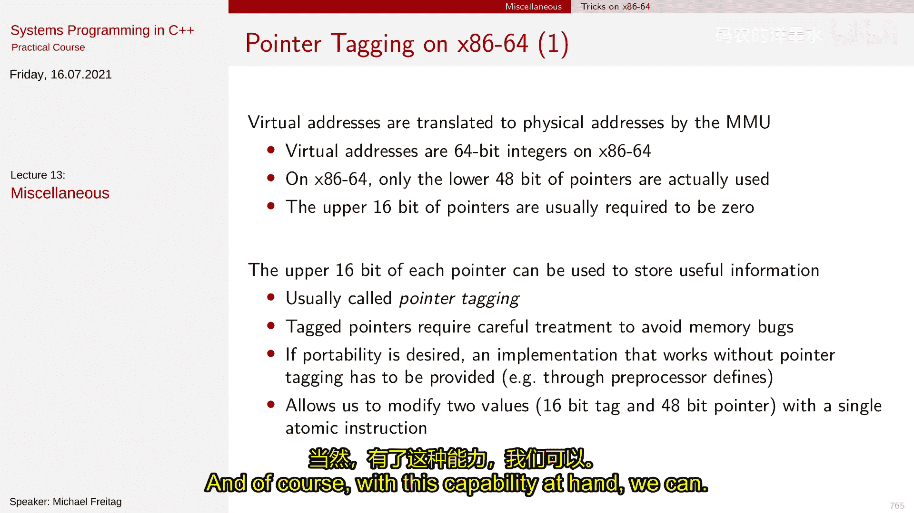

Do essentially whatever we want with these 16 bits。 so we can， for example。

 store up to 16 binary flags that tell us something maybe about the target of our pointer or we can store a single 16 bit integer or whatever else you may think of。

 and just to give you some ideas what this can be useful for is I personally， for example。

 had to implement at some point a data structure that was essentially like a tree。

 So we had this relationship between nodes。 but the nodes themselves were just chunks of raw memory。

 and you couldn't really know beforehand how this memory was structured。

 So that was the possibility that you have different types of nodes that are all just raw chunks of memory。

 So we had what I had to do is I had to encode in the pointer that points to such a raw chunk of memory what the type of this raw chunk of memory actually was And this is a situation where pointer tagging was very。

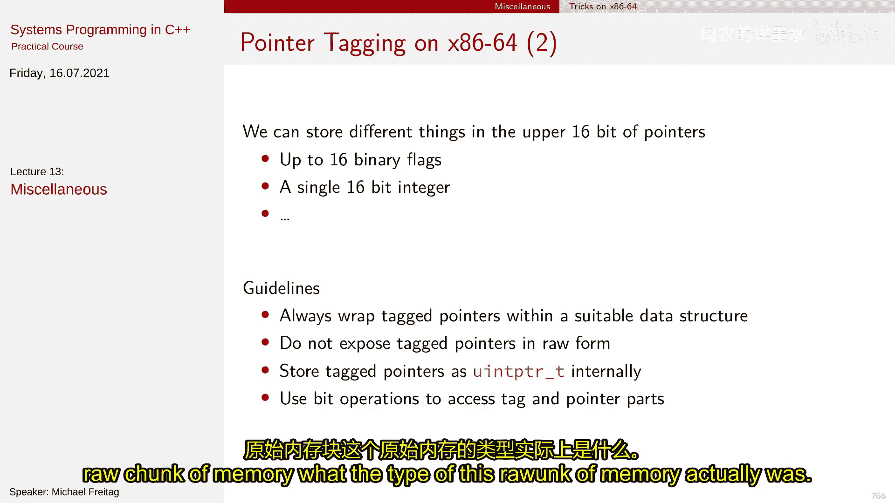

Useful because then I could store the pointer and the information about the target together in one single 64 bit integer。

 and I was also able to modify this 64 bit integer with a single atomic operation。

 So this is one possibility and another possibility what you can do is this is something that we do in our database you can for example that have a small bloom filter in these 16 bit for hash table lookups if you think about the pointer that you store in the buckets of a chaining hash table。

 then you also only have to use 48 bits for a pointer and you can use these 16 bit bits to have a small bloom filter to in some cases skip a lookup over the chain which is comparably expensive if you can deduce from this bloom filter that a specific value is certainly not contained in this bucket here So these are just two examples of of course there are many more examples that you can think of and it's quite often actually pretty useful to use pointer tagging。

But of course， most of the time it's an optimization。In addition， if you do use pointer tagging。

 since it's so easy to introduce memory bugs into your programs。

 try to always wrap taggged pointers within a suitable data structure that allows you that gives you some interface to extract the actual pointer and to set these tags in a little bit more typeafe manner than just having a raw 64 bit integer。

 so do not expose these taggged pointers in raw form only use this wrapping data structure to access the actual underlying data。

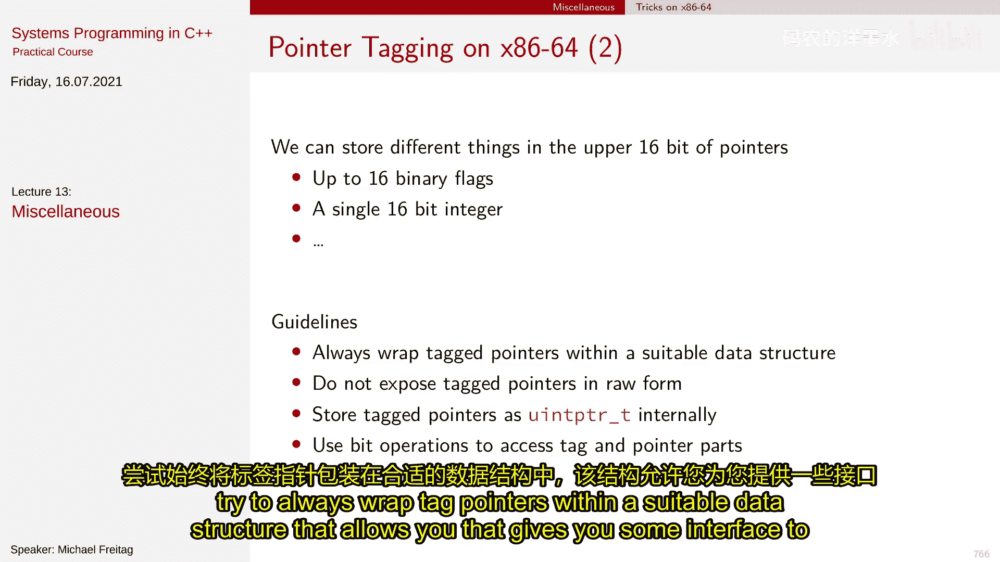

Of course， to be able to actually do all these fancy modifications here。

 we have to convert our pointers to an integer first and the suitable type for this of course is un pointer underscore scored T internally and then we can use just regular bit operations to access the tag and pointer parts of this 64 bit value So as an example in this code snippet here we are using the upper 16 bit of a pointer to store some information so we have some。

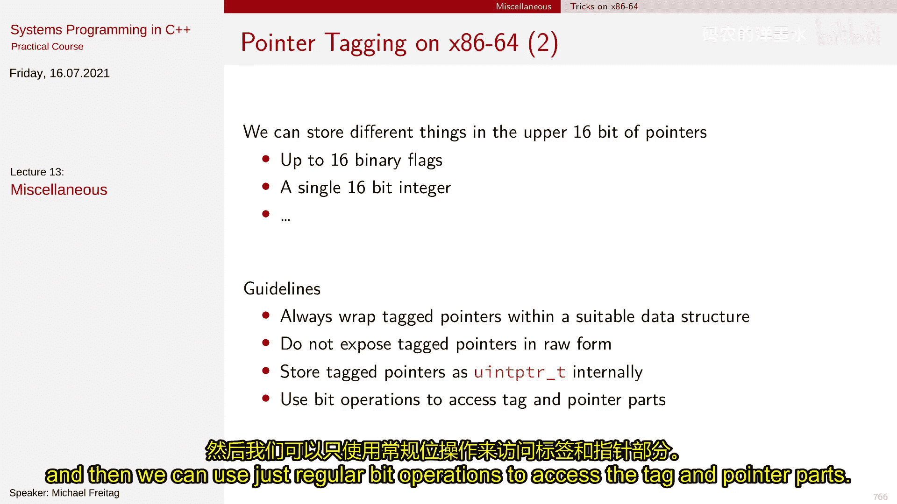

Auxiliary constants here。 We have the number of pointer bits， which is 48。

 And then we compute a mask， which simply contains。

Contain zeros in the upper 16 bit and ones in the lower 48 bit。

 And then we can use this mask to extract the pointer or the。The the tag from our 64 bit integer。

 So if we want to add a tag to a pointer and we take the regular pointer value and our tag here and then return a un pointer T。

 and we do this by simply converting our pointer to a 64 bit integer， clearing the。

The upper 16 bit of our pointer shifting our tag so that the lower 16 bit now become the upper 16 bit and then use a bitwise or to combine these two values together and get our final tag pointer and of course we do the same thing in reverse to then extract the tag or the pointer from such a tag pointer again。

Of course， you can do the same thing with the lower 16 bit than just the shifting and masking is a little bit inverted。

 but essentially the example is exactly the same。 so let's skip over that here。

Any questions about pointer tagging so far？The strict aliasing rule here does not apply in any way because we're not using a pointer to a different type to refer to to a data structure of a different type。

 so there is no aliasing here， we're actually copying the value of this pointer here into a new variable of type U in pointer t and this is always legal。

And then when we extract this and we have our 64 bit integer here， and we。

We copy the bytes of the 64 bit integer into a new value of a pointer type。

 so also nothing evil is going on here。I hope this clarifies your question about the strict alienliaing rule。

嗯。Follow a question on this。 So before we move on to the next question is but if it was from double to India。

 So you're probably talking about the reinterpret cast here， this wouldn't be allowed。

 This is correct。 So the reinterpret cast here works only because it is allowed by the T plus plus standard to reinterpret cast pointer types  to U in pointer T。

 So this is a specific exception to the rule that we cannot arbitrarily reinterpret cast stuff around。

Yeah。嗯。And， and this is。An intentional exception here because sometimes it is useful to treat a pointer as an integer value here。

Alright， so that seems to be cleared up。 the next question is about whether this is actually used because it sounds a bit like overkill。

 Of course it is quite complicated and it's a good thing to have the mindset of I probably don't need this but speaking from experience especially within the database that we're developing at our chair。

 and we do actually use pointer tagging in quite a few places and it does help with performance。

 but of course this is on a rather low level。 so this is a micro optimizationtim。

 but it does have a noticeable effect， especially what I talked about previously that we can have this small bloom filter within the pointers in the buckets of a chaining hash table。

 this is actually very useful and you do notice a performance boost when we enable this optimization here。

Of course， if you are writing high level systems like， for example。

 the final project where you have a compiler and performance is not that critical。

 then probably you don't need to do this， but once again。

 this depends if you have a really performance critical application。

 then point tagging can actually help you。

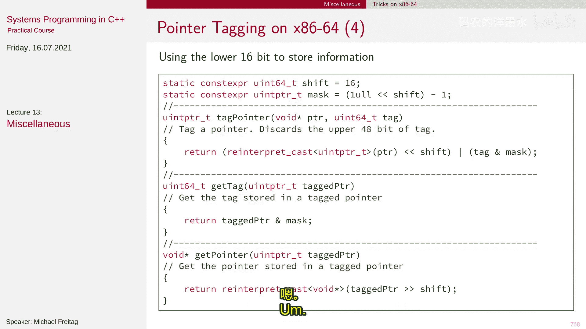

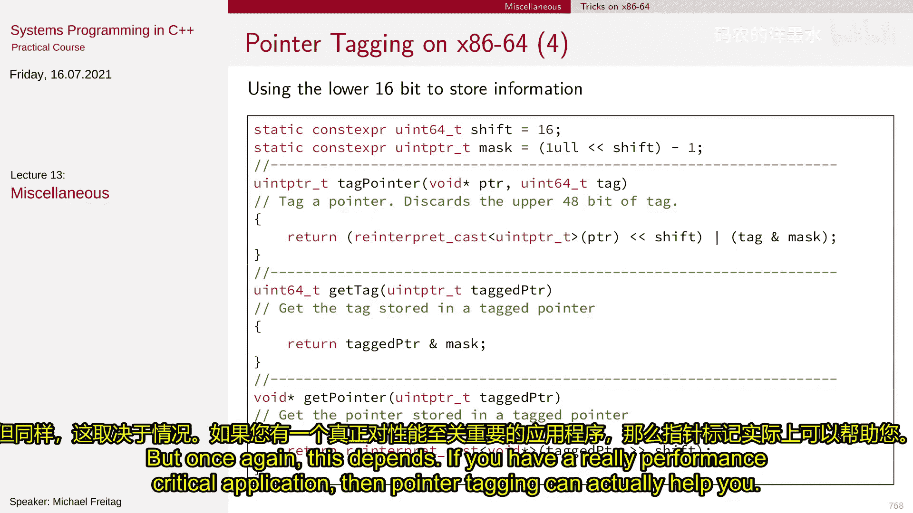

And I think another question is coming up since I do see some typing here。

 so let's wait for a second。Did I write an RA AI I wrapper for tag pointers。

 I assume you can't use SDD unique pointer。This is actually a good point。

 You could probably do something like this。 So what you would have to do is so these functions that I'm showing here in this example here should。

 of course， in a real program be member functions of such a ra type for our tag pointers and of course。

 what you can then also do is add this。

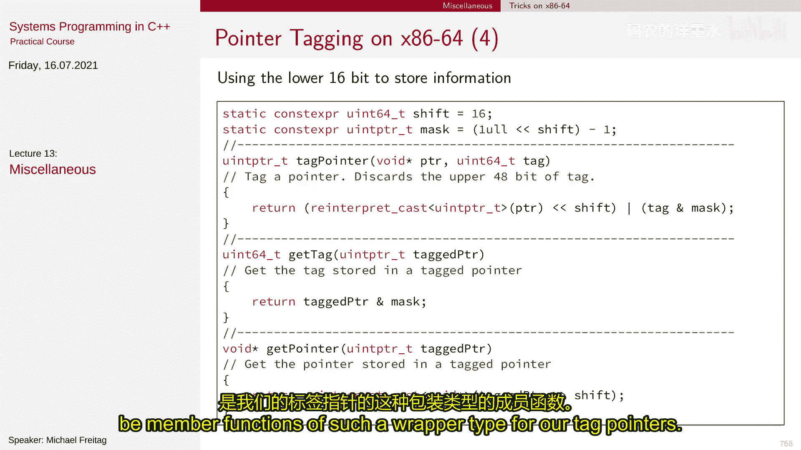

AndThis unique pointer functionality to yourre wrapper。 and you're right。

 you cannot directly use unique pointer here， but usually you don't need to actually do this because。

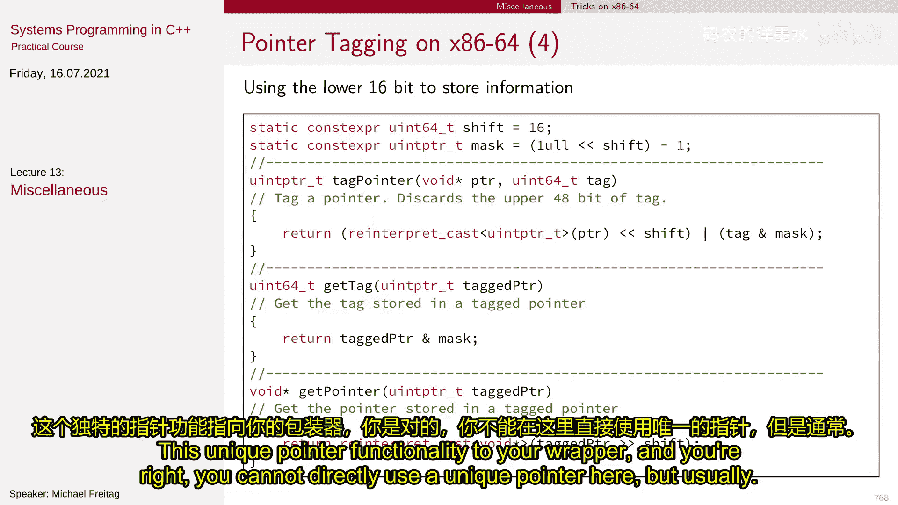

OhWell， you're right。 might you might want to do this depending on this situation。

 So I just thought about our use cases for this， where we mostly have manual memory management anyway。

 But if you do want to rely on SD unique pointer， which is almost always a good idea。

 then you would probably need to extend your tag point or wrapa with this functionality as well。

 So good question。 And I think you're you're correct that you。

That you would have to write this yourself。All right。 Any further questions。Yeah。

 comment on the previous question that one of your takeaways from this course is to use unique pointer as much as possible。

 and this is definitely correct。 so I'm happy that you got this takeaway from the course course keep this and keep this in mind whenever possible use unique pointer and of course this also extends to tag pointers if the situation allows it。

 All right， so with that let's wrap up our discussion of pointer tag。 So once again。

 this is essentially just an outlook on different I'd say advanced topics and move on to the next fun thing that's also somewhat specific to X86。

 but also supported by many other modern CPU architectures and that is vectorization。

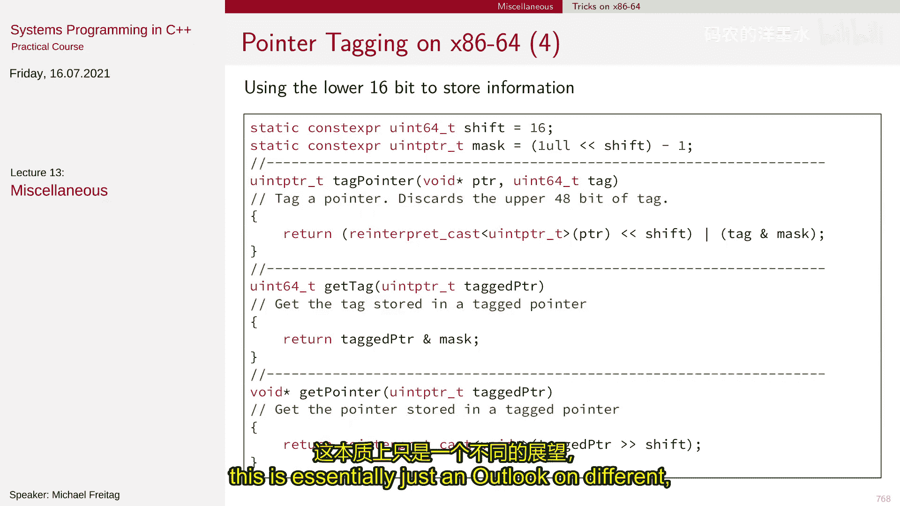

Because most modern CPUs contain vector units that can help you exploit data level parallelism。

 So what they allow you to do is they allow you to apply the same operation， for example。

 in addition or a multiplication to multiple data elements in a single instruction。

So these vector registers are， for example， 128 bits wide or 256 bit wide。

 and then you can cram a couple of let's say4 byte integers into one one of these vector registers and then have special CPU instruction that applies in addition to all of these4 byte integers in the same instruction and of course this can then depending on your algorithm give you quite a performance boost especially if you have compute heavy algorithms。

 for example， such as image processing or signal processing and so on。

 but of course not all algorithms are compute heavy for example， sorting， can be vectorized。

 but this is a lot more tricky because it's not this classical algorithm where we have a lot of data and then you want to do essentially the same computation on all these data elements at the same time。

The way this can be used is through extensions of the X86 instruction set architecture。

 which are commonly referred to as single instruction， multiple data instruction。

 so Simdy is the term that you will quite frequently see。And within C and C++ code。

 they can be used through intrinsic functions， which are essentially functions that the compiler will recognize and then replace by the correct assembly instructions。

The instruction set is by now quite large， so there is a huge number of such Simdy instructions that you can use for all sorts of purposes。

 but there is an excellent guide by Intel， the Intel intrinsics guide which provides an overview of all these intrinsic functions along with a detailed explanation what they do what their performance characteristics are and so on。

 So this red text here is a link if you're interested， click on this link。

And it will take you to this intrinsic guide here。

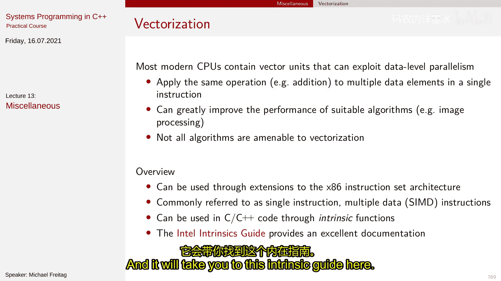

Now I've already briefly mentioned this that these extensions have evolved substantially over time。

 so they started with MMX then came a couple of instances of the SSE instructions that and by now we most have the AVx extensions which of course are always inclusive so any CPU that supports AVX will most likely also support SSE and MMX but the more recent extensions have wide vector registers。

 so with SSE for example you have I think 128 bit registers with AVx then you have 256 bit registers and with AVx 512 at the name suggests we have 512 bit wide vector registers so you can simply do more operations at the same time within more recent extensions and also the number of supported instructions and the instruction types have。

Drown over time。So as I've already said， modern CPUs retain backward compatibility with the older instruction set extensions and the specific supported instruction sets can be determined by looking at the CPU info file and the corresponding CPU flags that are exposed in this file。

In the following， we will briefly talk about A V X。 It is already quite， quote on old。

 So it should be supported on even slightly outdated CPU。

And it still gives them a good a good overview of how SD instructions could be used in general。

 so within newer instruction sets， you simply get wider registers and more instructions。

 but the general principle remains the same。

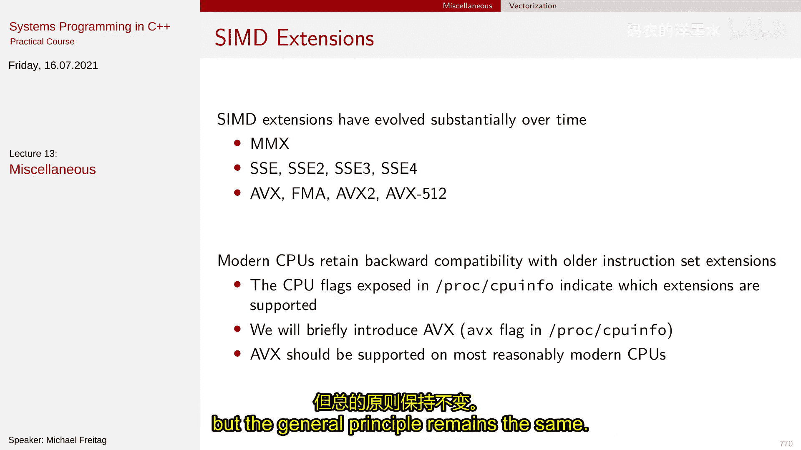

All right。So how can we use all this stuff in C+ plus code， so we have to include a specific header。

 which then defines the required data types and the intrinsics that we can use to apply operations on these data types。

With AVX our CPU has 16 of these vector registers which are 256 bit wide each and of course。

 as we've already talked about these registers can then hold multiple data elements which can be used through special opaque data types。

 so you cannot directly use these vector registers for example as an array of 32 bit integers。

 but we have to use one of these AVX data types which then internally will represent such an array in some way。

And for this we have these underscore underscore M256 data types without any suffix we a Im we have a register that can hold 832 bit floating point values with the suffix D we have a data type that can hold 464 bit floating point values and then we also have an integer type that can hold any of 328 bit integers 1616 bit integers and so on。

 So these data types are commonly referred to as vectors。

 but this should not be confused with STD vector， so here the vector actually refers to the vector registers within the CPU and not a dynamic heap allocated data structure here。

And of course， the otherIMD extensions such as AVX2 or AVX and 512 have essentially similar naming conventions for their data types。

 so once you're familiar with AVX you will be able to get up to speed with the other instruction sets pretty quickly as well。

Now we have these data types and what's still missing， of course。

 are the intrinsics that we can actually use to manipulate data that is stored in one of these data types here。

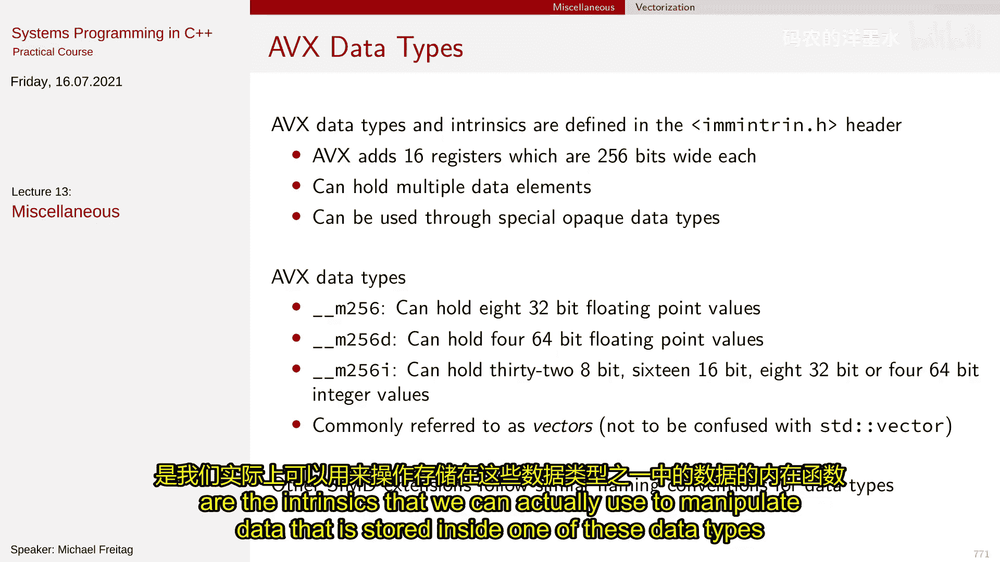

Usually and here you see that CD instructions within C++ code are pretty close to writing assembly code we have。

Separate intrinsics for each data types， which usually all begin with a single underscore than  two Ms and 256。

 followed by the name of the instruction that we want to generate and finally the data type for which we want to generate an instruction。

Where we have a P for the 32 bit floating point version， AP PD for the double precision。

 so 64 bit floating point version and then the S I 256 for the integer versions here。

 and as an example for one of these。Intri names we could then for example。

 have the underscore MM 256， which is just the prefix for AVX。

 then underscore load U which gives us the type of the instruction underscore P。

 which tells us that this is operating on vectors of 32 with floatinging point values。

In the following we will give a brief rundown of a couple of intrinsics for the floating point vectors for the other data types。

 usually the instructions follow similar patterns with the exception that AVx does not actually have a lot of or any arithmetic operations on integer types which were only added in AVx tool here But once again if you really want to use this then these slides here are not detailed enough anyway。

 then you will have to look at thetel intrinsics guide that we linked on a previous slide to get a full overview of all the intrinsics functions that are available。

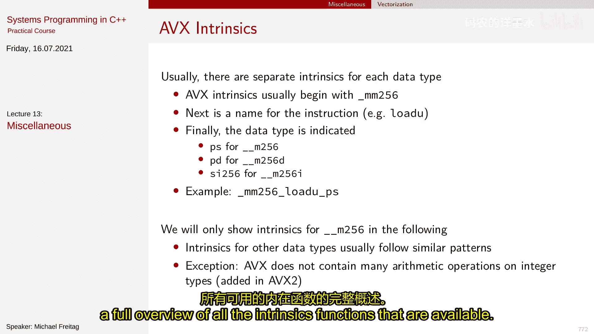

Now， moving back to our floating point vectors and a couple of exemplary intrinsics here。

 let's start with actually putting data into our vectors here because of course these types are opaque and we kind of directly modify the individual data elements that are stored in there so we have to already use intrinsics to simply get values into our vectors here and the general pattern here is that we apply an intrinsic to some arguments or a vector and then the result of this operation is returned by the intrinsic so usually you see something like a equals and then some intrinsic that is also applied to a if you're just modifying a vector register in place here。

And then for example， we can create constant vectors such as setting all elements of a vector to the same floating point value or specify a separate floating point value for each of the elements of such a vector register to be set here。

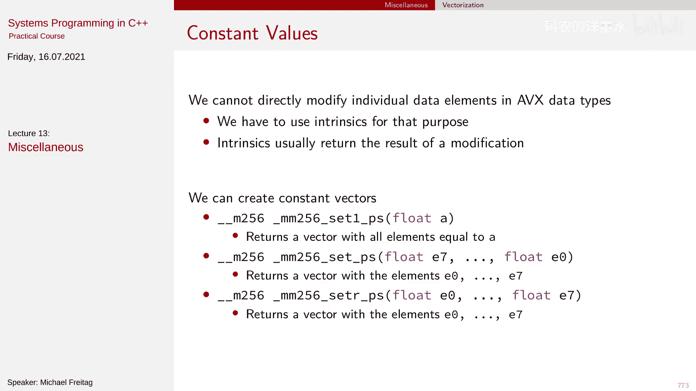

Of course， constant values on their own are a little bit boring。

 we can also load value from memory or store values to memory。

 which is done by the load and store intrinsics， which take a pointer。

 and then load in case of the floating point vectors， for example。

832 bit floating point values starting at this memory address here and store them in a vector register。

The one thing to keep。To keep in mind here is that there are two versions of the load install instructions。

 there is the load instruction without a U suffix in which the address from which we're loading has to be aligned to a 32 byte boundary。

 so this is something that you may be able to enforce in your program if you' are not able to do this then you have to use the load U instruction in which the address does not have to be aligned。

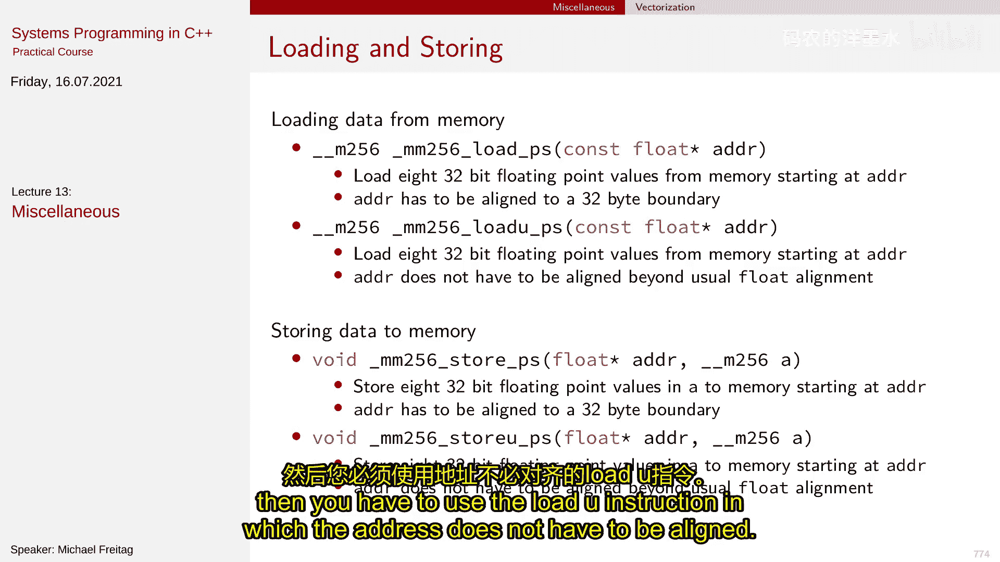

Historically， this distinction was made because aligned loads were implemented a little bit more efficiently by the CPU so there when you were able to use the load and instruction then you' got a little bit more performance code by now unaligned loads are implemented so efficiently by modern CPUs that it doesn't really make sense to use the aligned versions any anyway because the unaligned versions are going to be just as fast and then you don't have to worry about aligning your addresses for load and store instructions anymore。

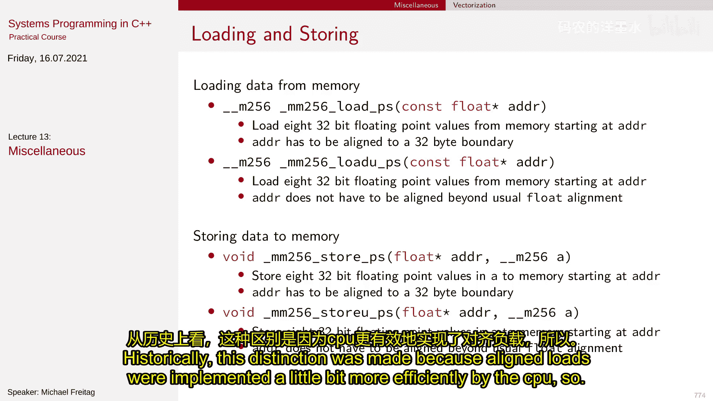

And of course the inverse of loading is storing and we can do that through the corresponding store intrinsics which work essentially with the same semantics so we get a pointer to an address and a vector and then we store the8302bit floating point values from this vector at this memory address here。

 Of course， just as a sign note since we already had a question about this today。

 you still have to make sure that you don't violate the strict aliasing rule or any other of the rules that are imposed by c plus plus so usually what you want to do here is either have a fixed size SDD array or an SDD vector that contains floating point values and then use the load and store instructions on pointers that point into the memory of this array or vector here。

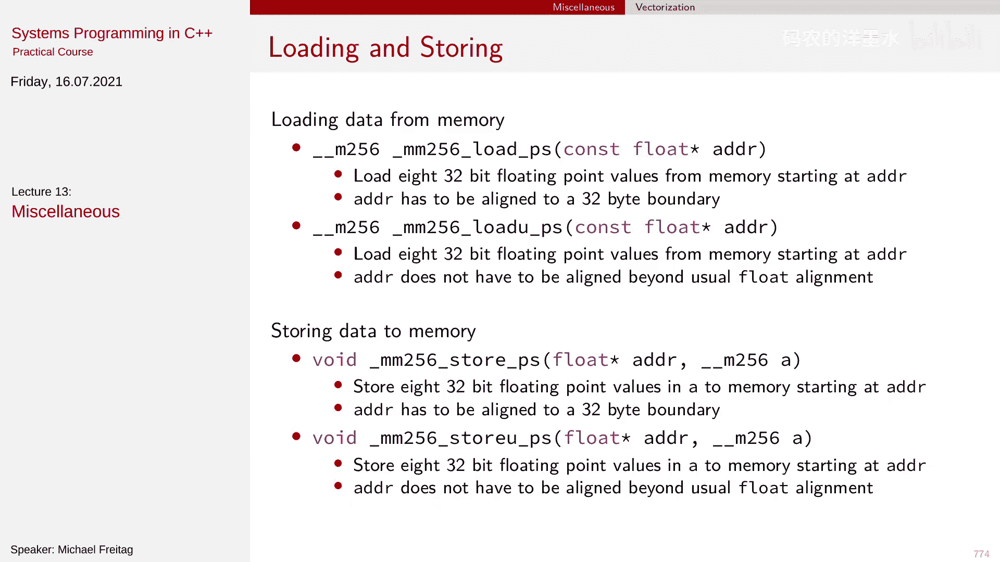

Beyond loading and storing， of course， we have a large amount of arithmetic operations on vectors like all the usual operations that you might expect。

 as well as some bitwise operations on integer types and some logical operations and many more since there are so many we're just going to give one example here that illustrates how most of these will look like for adding two vectors。

 So here we have the addd instruction once again suffix with the P。

Characters to indicate that this is operating on 32 bit floating point values and this intrinsic then takes two vector registers and will add the individual elements of the vectors A and B and place the result in the corresponding slot of the result vector。

So。Just as a side note here， this will of course， not add the elements of a single vector。

 but will take the first element of the first vector add it to the first element of the second vector and then store this in the first element of the result vector and so on for all the other elements here。

And this will work in the same way for subtraction， division， multiplication， and so on。

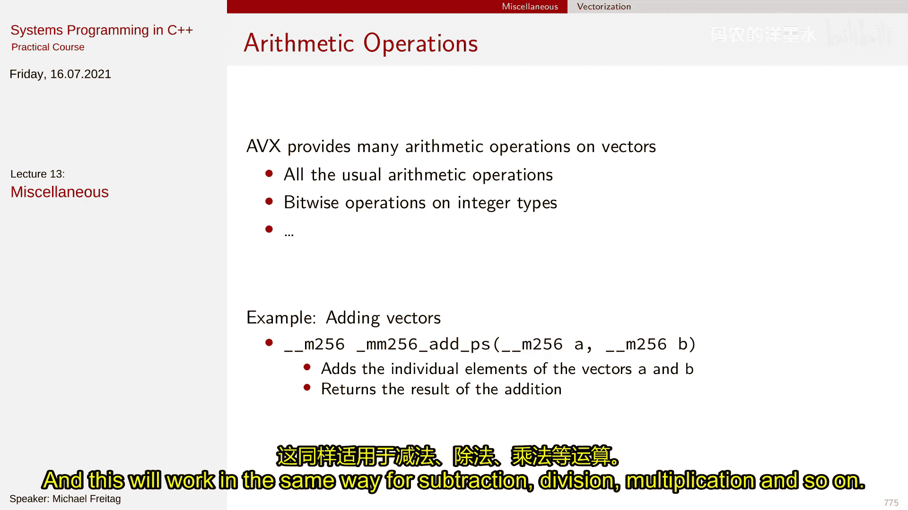

So as a brief example of how we could apply the few intrinsics that we have looked at up now。

 we can try to implement a vectorized sum of the elements in an STD vector here。

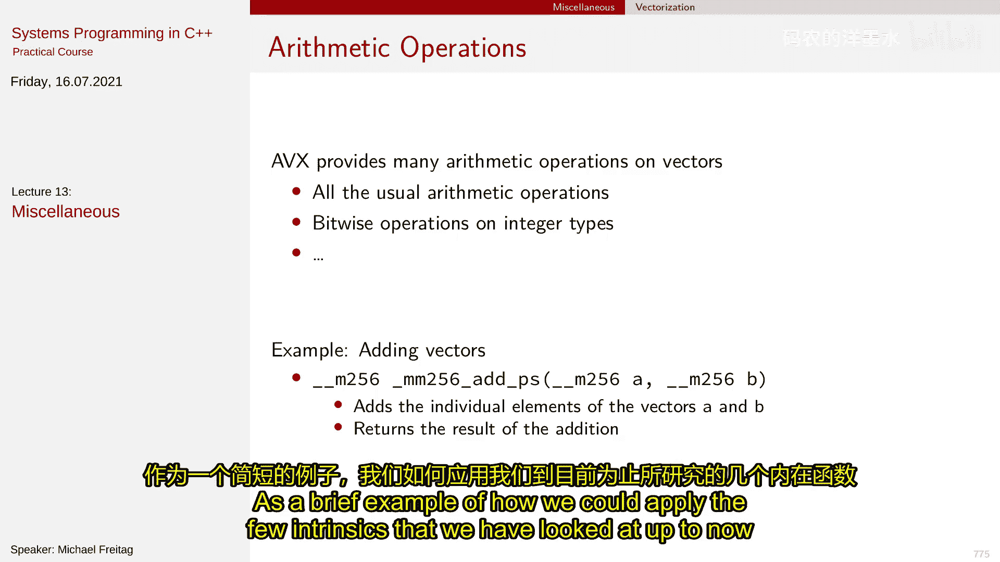

So the function signature here is pretty obvious we have our fast sum function。

 we take a reference to a vector that contains the elements of which we want to compute the sum and we return the sum of these elements here。

And now the implementation is a little bit more complicated and here you can see that we're really moving rather close to the CPU since it's much more verbose to write vectorized code than it would be to write regular unvectorized code here。

So what do we do here？And we start with a vector sum vector。

 which we initialized to contain all zero elements。

 And what we now want to do is we want to take eight elements at a time from our input vector and initially compute。

Add them to this initial vector sum here so that we get essentially the sum of every eighth element in our vector。

 and then in a final step we can compute the sum of these eight elements to obtain our final sum here。

So the way to do this is simply iterate through our vector in steps of8。

 so we skip eight elements at a time within our vector。

 we load eight elements from the current index of our vector with the load view instruction。

 get a vector that contains these eight elements， and then add our previous sum to these new elements and update the current sum of our vector。

Yeah。Now finally， once we have done this， we extract the eight elements from our vector that contains this sum here into a buffer containing eight elements。

 add all of these eight elements to our final sum， and then in case the length of our vector was not a multiple of eight。

 we also add any remaining elements of our vector that we couldn't process in a vectorized fashion here to our final sum and。

 finally return this value。Any questions about this example？Nothing so far， all right。So。Of course。

 I've already said this a couple of times AVX contains many more instructions。

 you can also have comparison operations on vectors which elements are in which vectors are compared elements wise。

 then you can use the result of such comparison operations to do mask operations。

 where you only apply operations on some of the elements in such a vector register depending on a bit mask that tells for which elements these operations should be applied。

And with these mass operations， you can also vectorize many more algorithms that are not just plain computations。

 but which also may contain some conditional code， but still vectorization is not guaranteed to improve performance。

And in general， these compute heavy algorithms that I talked about are the ones that benefit most from vectorization。

 whereas algorithms that have a lot of fine grain branching。

 or that need to do many loads and stores from into memory may not benefit as much from vectorization and may also be just plain hard to vectorize at all because of all this branching that they may contain。

And in general， of course， as with all optimizations。

 vectorization should not be applied prematurely， just write unvectorized code first and if you figure out that a specific part of code does some very heavy computations。

 then you can try optimizing it through vectorization。All right， any。Final questions on this part of。

Our tour today。Yeah。All right。 Looking good。Then let's conclude our discussion of X86 specific topics and move back a little bit to actually C plus plus topics that we haven't covered in that much detail yet and walk through just once again a brief overview of some advanced stuff that may be quite useful to know The first here is something that we have already hinted at in our lecture about templates and that is template meta programming as it is called。

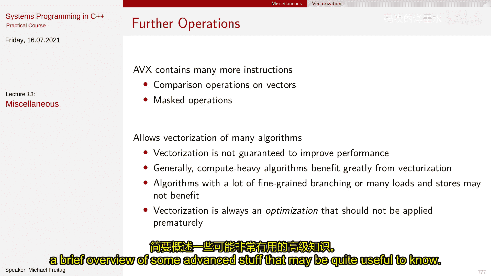

Whi essentially encompasses the whole topic of using templates for programming a compile time。

 so what this means is that we can through smart use of templates force the compiler to do some computations that are useful to us a compile time and especially do computations on types。

 which is of course not possible in a regular program， but is possible at compile time。

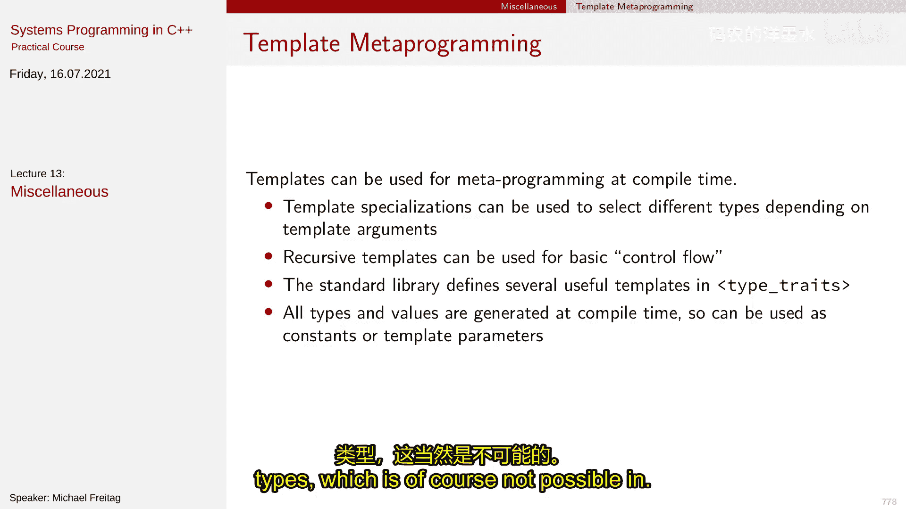

And the underlying principle for this is that we can exploit the template specialization mechanism to select different types depending on template arguments。

 and then with this basic building block here， we can use recursively use such specially written templates for basic quoteun control flow at compile time here。

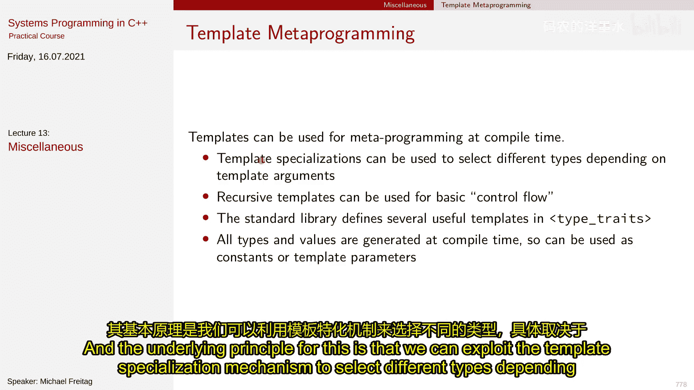

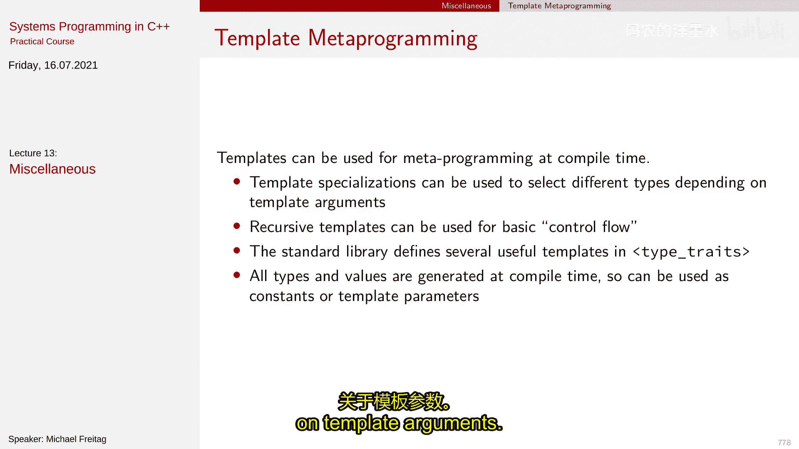

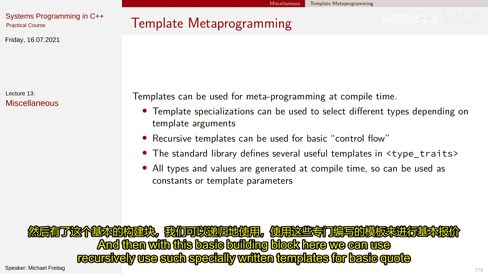

And will see a couple examples of what exactly we mean by this。

The good news is that you won't have to write these template specializations yourself most of the time because the standard library already defines many useful templates in the type C set that do exactly this。

 so there's a variety of such templates that allow you to select types depending on template arguments and a variety of templates that help you implement implement some control flow at compile time。

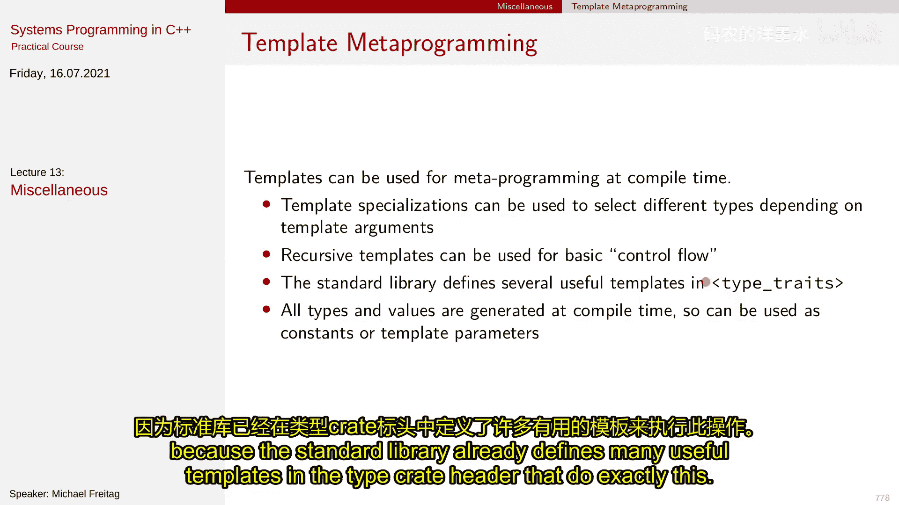

The reason why this is so useful is that with template meta programming。

 you can have conditional code that is evaluated at compile time and therefore is treated as a constant expression if it is a value or which is a type and because of this you can use the result of such template meta programming code in places where the compiler expects a compile time constant or a type and this is something where of course you cannot have any computations at runtime because this is the exact opposite of a compile time constant or even a type at runtime。

C plus plus is a statically type language， so you cannot easily manipulate or at all manipulate on the types of your expressions。

 So this is the reason why it's so useful to be able to do this at compile time where this is still possible。

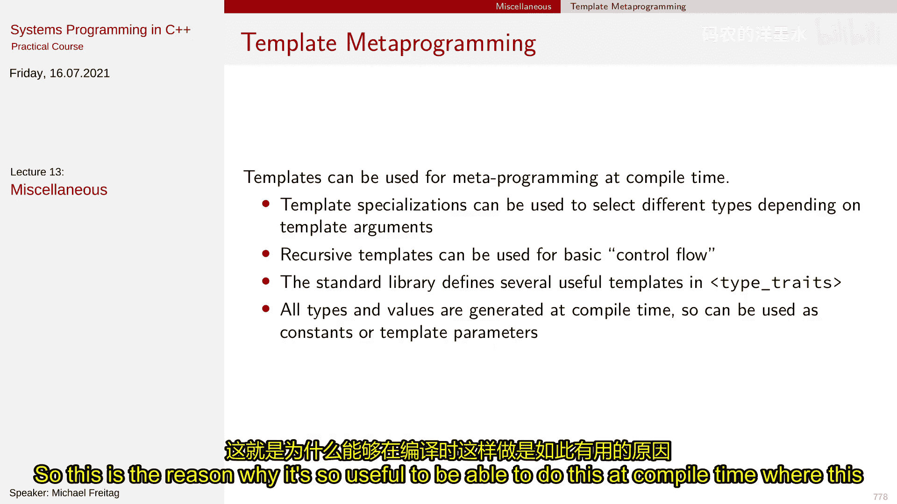

And as an example of how we can use this， for example。

 we can use type traits to analyze properties of arbitrary types and of course all of this is most useful when it's applied to template arguments instead of static types here。

 so there's， for example， an SDD is arithmetic underscore V template in the type trait header which evaluates to a Boolean constant expression and tells us if the template argument is an arithmetic type。

 or for example with the is class V。Template this evaluates to a constant boolean which tells us if the template argument is a class type。

 and of course， if we pass an integer to this it will return false。

 but if we pass an SDD vector of integers， this is a class type， it will return true。

And then there are many more advanced such templates here， for example。

 there' is an SDD is move assignable V， which tells us if the template argument is move assignable。

 and you can already see that you may be able to use this intd code to achieve some things that you may not be able to achieve without the possibility of compile time programming essentially。

And this is because in addition to these conditional templates。

 we also have a bunch of templates that transform types。

 sometimes unconditionally sometimes depending on some condition here， so for example。

 there is a template called remove reference which takes a template argument and if this template argument is a reference removes the reference and returns the underlying type here。

 So if we pass an in to S to remove reference underscore score T。

 then the result will be integer as a type。And the same， of course， for。

For other templates such as add pointer， which adds a pointer to a specific type。

 we can also chain these， for example， we can add an L value reference and a con to a template argument in which case this expression here and will evaluate to the type con reference to vector。

And finally， where this all becomes then very useful is we can also do this conditionally with the SDD conditioned conditional underscore T template。

 where the first template argument is a constant oolean。

 and then the second and third template arguments are two types。

 And depending on the value that the first template argument evaluates to the result of this whole expression will be the first or the second type。

 So with this。Here what were doing is we are checking if the size in bytes of a pointer is 8 or4 bytes。

 if it is 8 bytes， then our my U pointer underscore T type will be a 64 bit integer if it is something else。

 then 8 bytes， it will be U in 32 underscore t here。And here。

 this is one example where you can already see how this may become useful if you're trying to write portable code and then you can have a type defef like this somewhere in your code and simply always use my U pointer underscore T and it will automatically take care of having the correct bit with here。

 Of course， this specific example is a little bit useless because we already have the U pointer underscore T type devef in the standard library。

 which essentially does the same thing only a little bit more typeafe but still I hope that this example illustrates a little bit why such code may be useful。

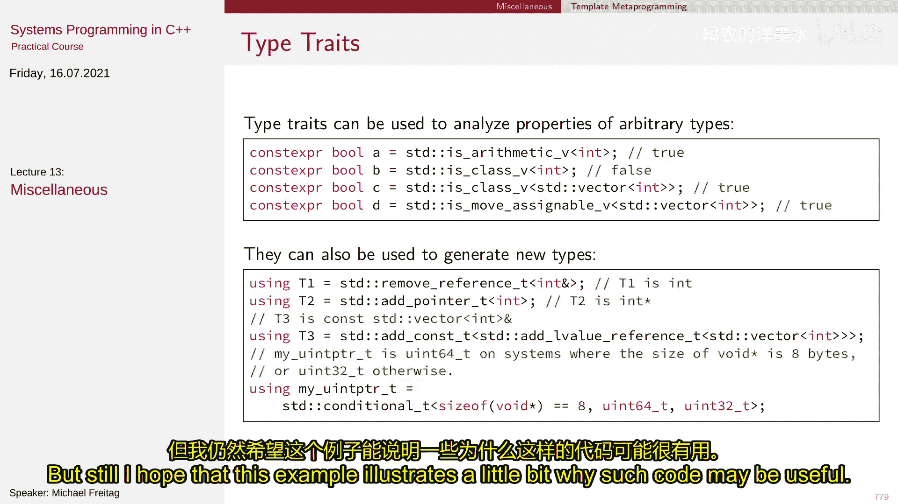

Something that's just as a sign note important to note here is you will notice that we have for these Boolean constant expressions we always have the underscore V suffix for our templates and for anything that evaluates to a type。

 we have the underscore T suffix for our templates and this is something that is consistently done in the standard library。

 so anything that evaluates to a Boolean constant expression will have this underscore V suffix。

 anything that evaluates to a type will have this underscore T suffix here。Now， of course。

 once again， this is a huge topic， there is a lot more that is already defined in the standard library and there is also a lot more that you can implement yourself here just to give you one concrete example of when this is used often and when this is extremely useful is when implementing iterators because if you think back。

To a couple of the exercise sheets where you had to implement iterators。

 you always had to implement two of them， you had to implement one iterator for one modifiable iterator and one constant iterator and the code was essentially the same only the return types of a couple of the functions were different between these two versions here and this is something where you can use the SDD conditional T template and eliminate this code application in some cases。

Because what you could also do instead of writing two different iterators is write one templated iterator that gets a value template parameter that tells the iterator whether it should be a cont or a noncons iterator and then in the type defs that the iterator has to contain anyway you set for example。

 the reference and of course， also the pointer type def conditionally depending on this template parameter to either a cont reference to the type that you're iterating over or a modifiable reference to the type that you're iterating over and then for the actual iterator type def that your container provides。

 you simply use the false you pass false to the is cont template parameter for the modifiable iterator and you pass true to this template parameter for the non-modfiable iterator and with this you only have to write the iterator code once and you can reuse it for both the iterator and the cont iterator here。

Any questions about this particular example？Yeah。Allright， looking good so far。

 So just as a brief outlook。

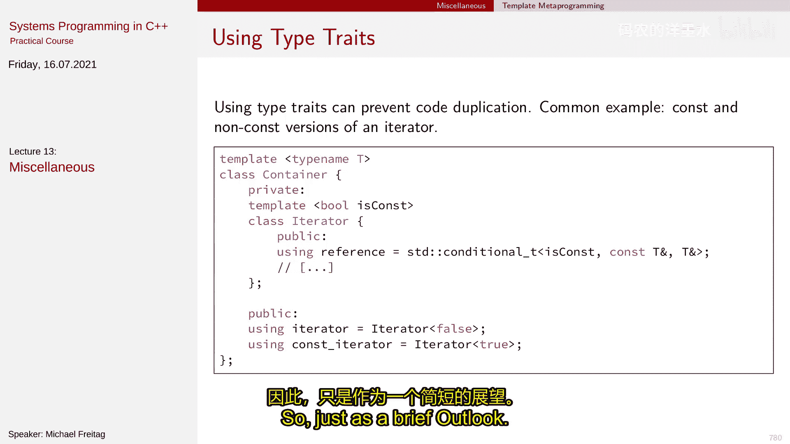

Let's also take a look at an example of how we could implement such type traits ourselves。

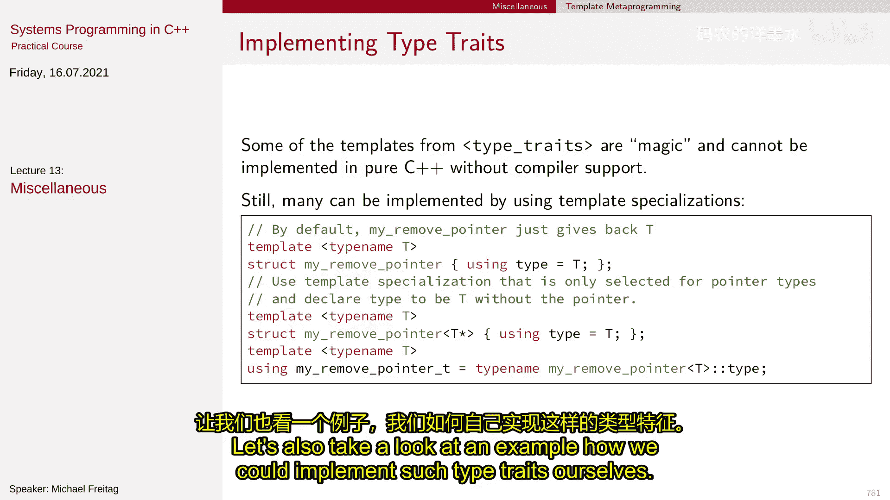

Of course， some of the templates in the type trade setter are essentially magic and you cannot implement them in pure C++ they have to have compiler support。

 but of course these are already defined， so those are not the ones that we have to implement anyway。

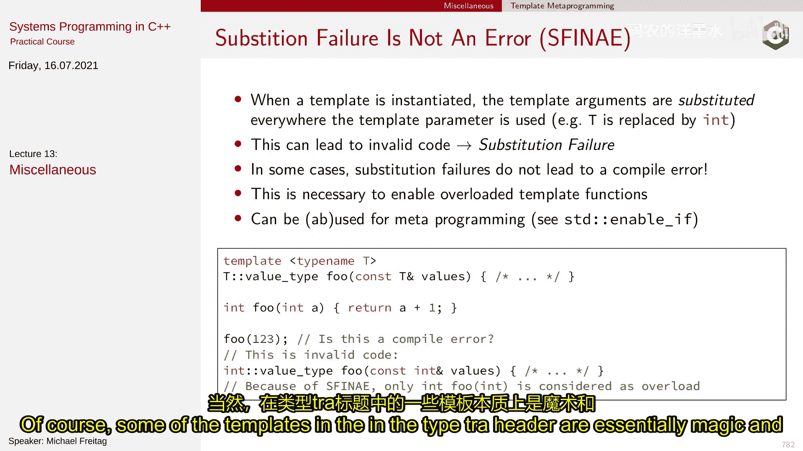

A lot of stuff can be done by ourselves。 So as an example。

 let's try to implement a type trade that removes。A pointer from a specific type。嗯。

The way to do this is to rely on template specialization。

 So we have this my remove pointerstruct here that is templated with an arbitrary type here。Now。

 the generic version of our template here will simply return the type itself because it is not a pointer。

 and then we declare a specialization of this template for any pointer types。

And then here we also simply return the underlying type。

 so you see here that for anything that has a pointer。

 this specialization here will be selected and then the member type de type here。

 the member type alias type will be the underlying type without the pointer argument and for anything that is not a pointer type the general version of the template here will be selected and then of course our member type alias will also be just T without any pointer。

And then to adhere to the naming conventions used by the standard library。

 we also declare this type alias My remove pointer underscore T。

 which is then simply an alias for this type member type alias of the my remove pointerstruct here and with this we now have this Myre pointer underscore T trait that we can apply to arbitrary types and which will remove a pointer from the type if it is present。

Now the final topic which is also just very superficially scratched here is yet another concept that's related to template meta programming。

 which is the nice term substitution failure is not an error。

 which you will often see abbreviated as SPA， which is actually a hugely complex topic with some very useful implications。

 but that is quite quite difficult to follow in detail。

 so as usual the detailed rules are listed in the reference documentation on a high level。

 we try to give a brief overview of what this is used for and how you can it in template meta programming here。

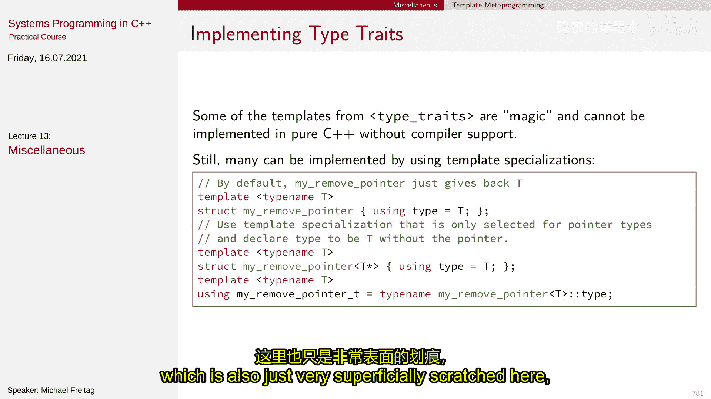

So the general problem that we're faced with where this concept here comes from is that whenever we instantiate a template the template arguments are substituted for the template parameter。

 so this is something that we have already seen in our template lecture where we said that essentially we are textually replacing any reference to a template parameter by the template argument。

 so for example if we have a template parameter T and we pass int as an argument to this template parameter then everywhere T appears in our code we replace it by int。

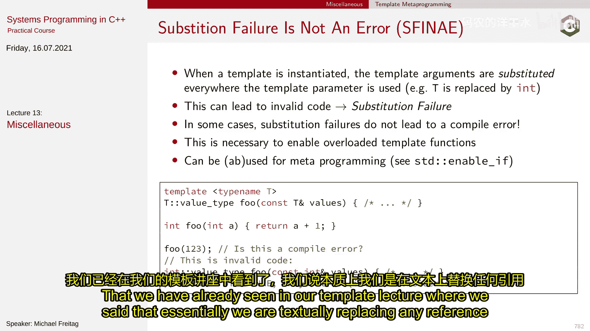

But this substitution can lead to invalid code， which is then called a substitution failure。

 And we see an example of this。Below here where we have a template function called F。

 which takes template parameter T and then as the return type will have the value type member type alias of this type T here。

 So this for example， you can imagine this being applied to an SDD vector which has this member type alias value type。

 then we have a function that takes a constant reference to a vector and returns a value of whatever the value type of this vector is here。

Now， of course。What happens if we pass int as the template parameter to this function here。

 then we will have code in which we will try to compile something that writes int colon and colon and value type。

 which of course， is invalid code。 This doesn't work。 This wouldn't compile if you wrote it directly。

But in case of template parameter substitution failure， in some cases。

 such invalid code does not lead to a compile time error， but instead， it simply results。

In this particular function here， not being considered for overload resolution of the full function。

 And because of this， since we also define a full function that simply takes an integer and returns an integer when we try to invoke fool with an int。

With an in parameter here。When overload resolution looks up the full function that is templated。

 this would result in invalid code， so this function is simply not considered for overload resolution。

 and overload resolution will then select this version of the full function here for which we can actually pass in as a parameter and the code will happily compile so even though during substitution we have invalid code at some point this does not lead to a compile term error but simply to some changes to overload resolution。

This mechanism， of course， is necessary to enable overloading such template functions in some cases。

 something that's even more fun is that this mechanism can also be abused in template meta programming and without going into further detail there is this interesting SDD enable if template which essentially allows you to define a compile time condition through some of the type traits that we've seen on the previous slides to selectively disable some overloads of a templated function depending on the values of the template parameters。

 so with this， for example， you can have two different templated versions of this full function here that are available to overload resolution depending on some properties of the type that you're passing as a template argument。

This is sometimes useful， admittedmitly， the use cases are somewhat rare。

 but you may well run into some situations in which this is actually required to achieve some some behavior of the code that you're writing。

 So once again， this is intended as an outlook so that if you run into one of these situations。

 you remember maybe that there was something that was provided by the standard library to help you in such situations here。

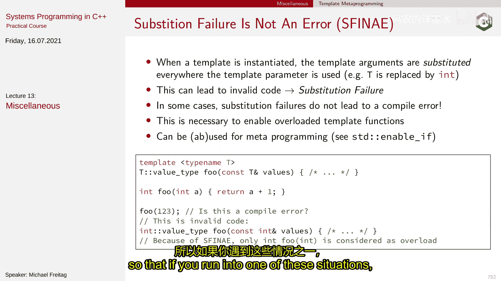

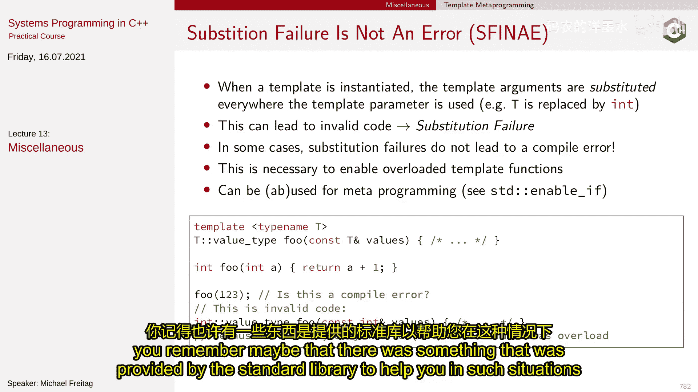

But as far as this lecture is concerned， we're not going to dive into any more detail here and leave it at this superficial level here。

So do you have any questions about template meta programming？Yeah。Yeah。All right。

 no questions so far。

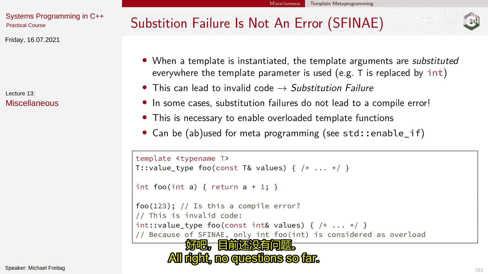

So let's move on to yet。Another couple of topics that are rather new in C++ so template meta programming vectorization。

 pointer tagging， this is all stuff that you have been able to do for quite a long time。

 what follows now are new features in C++ that have only been introduced with the latest release of the C+++ standard in 2020。

 which added some very cool new features to the C++ language。

A lot of these features have already been covered throughout this lecture。

And this applies essentially to all of the well supported new features。 For example。

 we've already talked about concepts when talking about templates。

 this is something that is new in C++ 20。 We've also talked， for example。

 about the three way comparison operator which was newly introduced in C++ 20 and so on。

In the following， we will give an overview of some additional potentially very useful features in C++ 20 that are not as well supported by compilers as of now。

 they are supported by many compilers， but the compiler support may still be intermittent and that some features。

 for example， modules are simply not yet implemented completely by some compilers and for example。

 some other features such as coroutines may be implemented。

 but still affected by some pretty nasty compiler bugs。

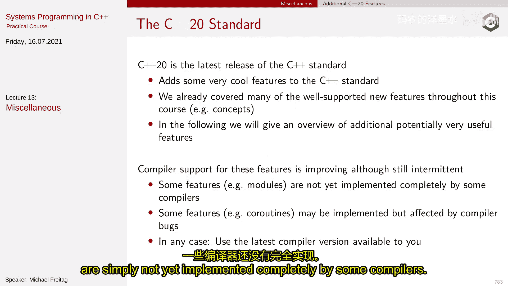

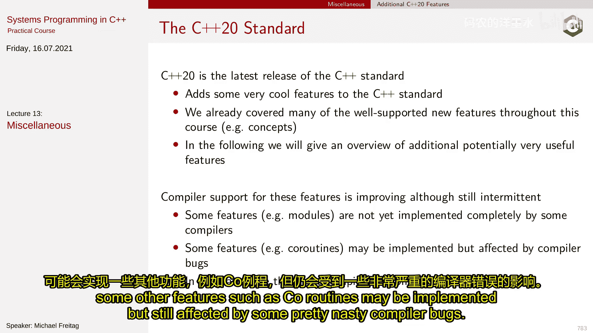

So this is why we moved those features to the end of this lecture since it's still very hard or maybe not even possible to use them to their full extent。

If you do want to play around with these just a general recommendation。

 use the latest version of whatever compiler you're using。

 because especially as far as bugs are concerned。TheAny but the most recent version will most likely contain a lot more bugs than the most recent version。

 and this will save you quite a bit of headache trying to debug your program since you're not sure is it a bug that you introduced or is it a bug that simply the compiler introduced。

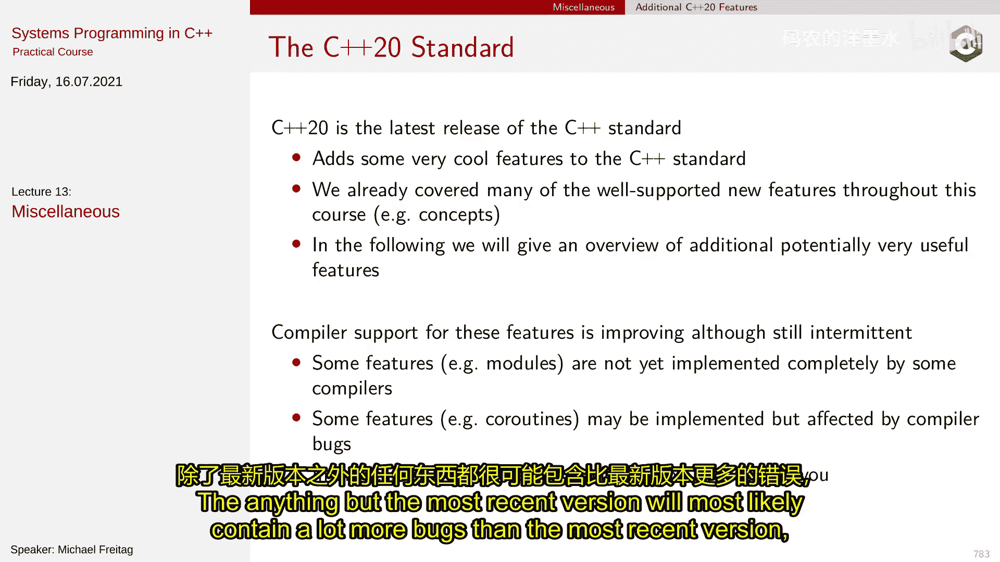

对。The first of the major new features that we want to talk about here are corouts which are quite fun to work with once you get them to work actually so before we start about what you can do with them and how you can use them let's talk about what they actually are and for this we have to take a step back and take a look at regular function calls。

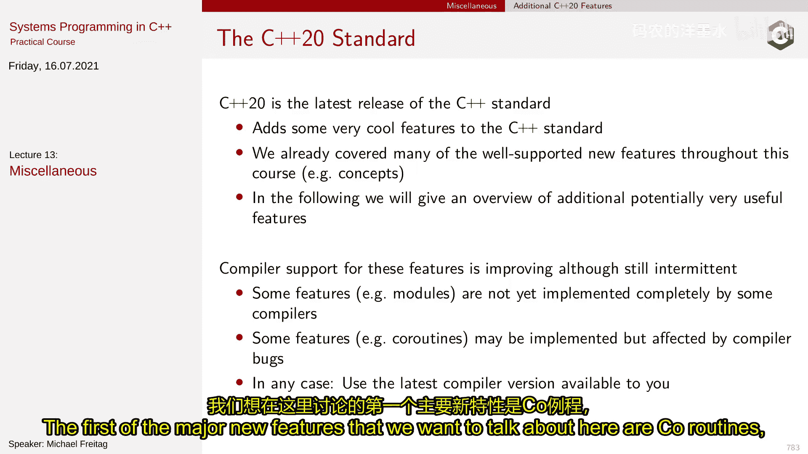

Essentially， all the function calls that you wrote throughout this course here。

And then we will observe that regular function calls are always strictly nested。

 So whenever you call a function， the calling function stops executing on a high level。

 we jump to the beginning of the call function， and then we resume execution at this point in the called function。

 And then eventually for the moment ignoring further function calls eventually the call function will return and then execution jumps back to the calling function and will continue after the function call expression here。

 So this is what you' are all used to this。 These are regular functions and。

The thing to note here is that we have this strict nesting。

 So the only way to start execution of a function is calling a function。

 And then we are stuck with this called function until this function determines I return now。

 and then the calling function continues。Of course， this applies to all sorts of function calls。

 and we always have some state in our functions that has to be maintained across nested function calls。

 So whenever we call a function， we have to save the values of any local variables within the calling function。

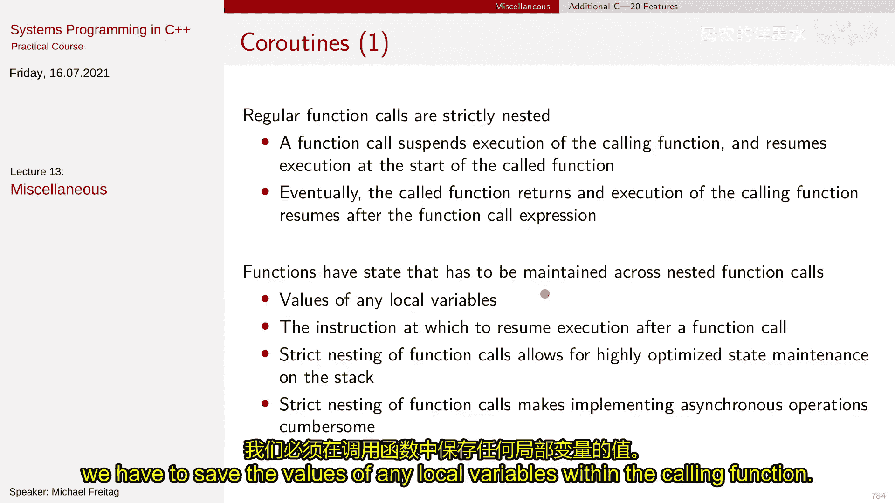

And also， potentially the instruction at which and we want to resume execution after the function call returns。

And since we have this strict nesting of function calls。

This state maintenance is highly optimized and can be done on these stack since essentially all that we have to do when we call a function is we have to manipulate the stack pointer so that the called function will put its local variables at some place higher up on the stack and the local variables by the calling function are not overwritten and then once we return from a nested function called we simply manipulate the stack pointer once again so that we restore the state of the calling function here。

So this is all well and good。 It's extremely well established。

 This is essentially how programming languages have worked for decades， and of course。

 it's what we're all used to。The one thing。That is a little bit annoying。

 depending on what kind of programs you write， is that this strict nesting of function calls makes implementing asynchronous operations a little bit annoying because if you think about some asynchronous operation where。

 for example， you issue an IO operation and then at some later point。

 once this IO operation completes， you want to continue execution at some point。

 then you always have to split up this code into separate functions where you say at this point now I do this asynchronous IO call and then I have a separate function that resumes。

Execution with the result of this asynchronous IO call and of course。

 if you have a lot of these asynchronous operations in your code。

 then you will have a lot of different small functions or maybe lambda functions that make up all these steps between these asynchronous operations of your code。

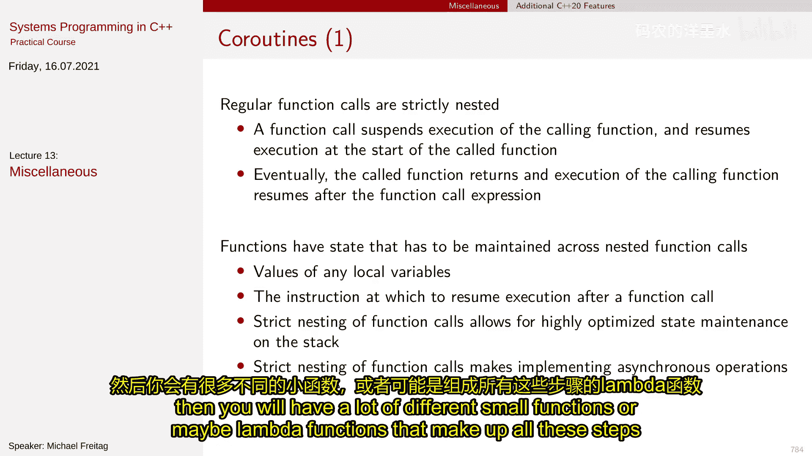

With co routines， and we now have an additional tool that makes implementing such code much more pleasant。

 since corouts are functions that can be suspended and resumed almost arbitrarily。

 So we're not bound to this strict nesting of function calls anymore。

 But instead we can suspend a co routine at any point at which point an execution is transferred back to the collar of our co routine and that at some later point。

 we can decide we want to resume a suspended co routine at the point it was last suspended。

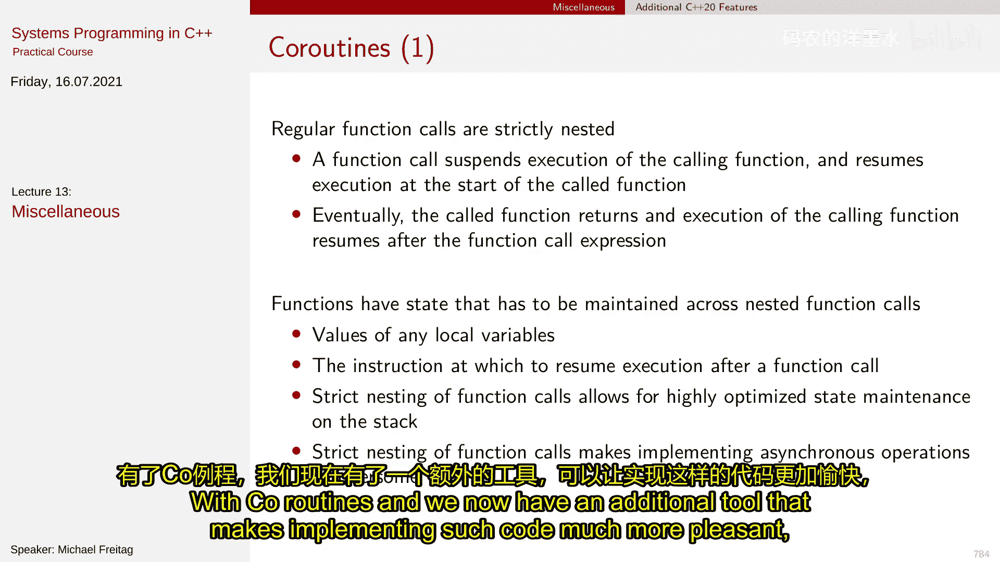

And the interesting part here is that the state of a co routine so for example。

 the values of local variables remains alive across such suspensions。

 so with this we deviate from regular function calls where once a function returns its state is destroyed and we cannot resume it again whereas in co routineouts we can suspend a co routine arbitrarily often and then depending on whatever code we're actually implementing resume it at some point when this makes sense here。

Is the general difference between coal routines and regular functions。

At least somewhat clear from this explanation。 If not， please let me know。

Before we move on to how we can actually do this in C++。All right， no questions。

Then you're apparently faster than I was when I first started thinking about cor routineines because it took me quite some time to wrap my head around how to actuallyuse these。

So with N C++ core routines are implemented with the help of three new keywords。

 we have always the prefix code underscore。And then essentially， we have the await keyword。

 We have the yield keyword， and we have the return keyword。

The weight keyword is followed by an expression， and this suspends the current cor and returns control to the collar with the yield expression。

 we do the same thing and we suspend our cor and return control to the collar。

 but also in addition to just returning control to the collar。

 we also return a value along with this suspension。And then finally， we have the Co return statement。

 which is essentially analogous to the regular return statement in which we also return a value to the call and wrap up our core routine。

 So this then finishes execution of our core routine here。In the meantime。

 we did get a question in the chat that asks whether corouts use the heap that is correct excellent observation。

 so since we do not have the strict nesting of core routines anymore we cannot easily maintain their state on the stack and instead the state of a cor is usually manage on the he so that we can ensure that it stays alive across suspensions and whatever else our code does in the meantime until a co routine is resumed。

Any further questions。Al right， looking good so far。 of course。

 please do interrupt me at any point if there are any questions。So once again。

 I'm only scratching the surface here， let's take a look at a couple of examples that try to illustrate how Co routines make writing asynchronous code a little bit nicer in comparison to code that wouldn't be able to rely on core routines。

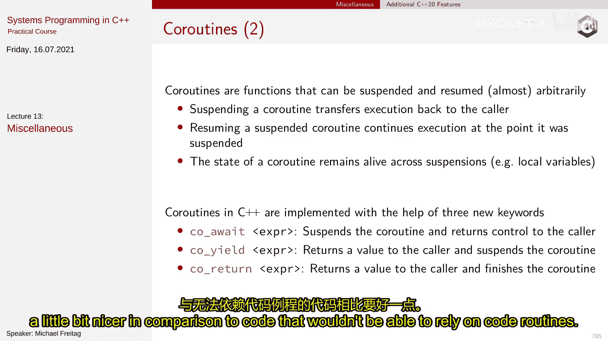

And the first example here is that。With core routines， they look like sequential code， but in fact。

 depending on how we use our core routines， this code is actually executed asynchronously。And。

One hopefully pretty good example here is shown in this code snippet here where we have a thread pool data type。

 so this thread pool then internally manages a number of threads that can each execute tasks on one of these threads and then we have a corout called work that of course take some parameters which initially is of course executed on whatever thread it is called on and then we can do some work on this calling thread and then the key difference to a regular function call is that we can now write something like this weight statement here or we say co weight and then call the schedule function on our thread pool and what this does。

 of course all of this has to be implemented somewhere but just for illustration and what this does then this suspends the coroutine so execution initially stops at this point here。

And then this cor is scheduled for resumption on our thread pool。

 and what internally will happen here is that at this point when we have this weight statement here。

Control returns to the collar of our work function and then the thread pool gets notified that here is a piece of work that you should execute on one of your worker threads and at some point when a worker thread is available the thread pool will resume this coroutine and then within this coroutine execution will continue at this point here but now of course。

 there has been a pause the caller of this work function has since long continued working on something else and our coroutine simply continues executing at the point it was suspended。

 but now on a thread from the thread pool and there of course we can do some more work with whatever local variables or parameters we have in our coroutine here So here we can see that with corouts and we can write a single function that executes asynchronously without having to split this part that is executed before this schedule call and the part that is executed after this schedule call into two separate function。

SoThis simply makes writing such asynchronous code easier and more readable。But of course。

 it requires us to have this infrastructure in place to actually be able to do all of this stuff and we're going to talk about this a little bit more in a couple of slides。

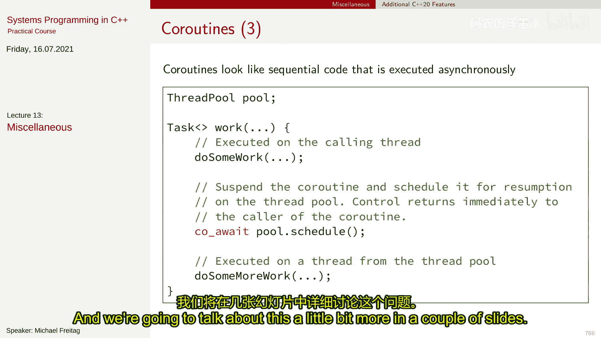

Something that you can also do with co routines is implement something like a lazy generator。

 this is something if you come from Python， for example， that you may be familiar with from Python。

 what a lazy generator does essentially you can write an infinite loop that will simply yield values back to the collar as long as the collar requests this because this infinite loop will not simply spin but in this infinite loop we have this yield expression which suspends the cor returns a value to the collar and then the core routine remains suspended until it is resumed again by the collar or someone else。

So the simplest example that we show here simply counts up from a given starting value and then whenever the code routine is resumed yields the next value of our sequence here back to the collar and then we can have code like this here where we obtain such a generator and then in our example here 10 times simply retrieve the next value from our generator here and then we determine that we are done and we don't use the generator anymore and then of course since it is not resumed。

 it will also not continue running here。So once again。

 you see that here we have this kind of asynchronicity where we write code that looks sequential and looks like an infinite loop here。

 but due to the use of this co yield expression here will suspend at this point until it is resumed again by someone else。

And I you see some typing。 so I'm assuming there are some questions now。Yeah。

Could you maybe explain the syntax of the generator initialization。

 So you're talking about this line here。All right。So。As you've probably guessed。

 there is a lot going on under the hood here that we're not showing since our main objective here is to illustrate how we can use core routines。

 what will happen here is that initially we simply obtain a generator object the return type of this function here from this function call here。

 but depending on how we implement all the support infrastructure that is required to use co routines。

 this core routine will not start execution immediately so it will do some initial initialization it will create such a generator object here and this is done through some specific interfaces that this generator class here has to implement which is then called by the compiler so essentially the compiler will call a bunch of functions here that eventually will create such a generator object here and then in this process the compiler will also see that we do not。

Want to start this co routine immediately， so we simply get this generator and it now refers to a suspended cor with this code here and then through even more functions that we have to implement on this generator object here and we enable using the weight keyword on this generator object and then once we do such an weight on the generator it will internally resume this cor until it is suspended again with this yield statement and then return the value that was yielded here。

So I hope this gives you a general idea of what is going on here， but as you've probably guessed。

 you do actually have to implement a lot of stuff to make this example work here。Right。

 so that is looking good。 So yet another example once again that tries to just illustrate how we can use corouts is what I gave as the initial motivating example here。

 but before we do that a follow up question， what happens if a color returns before a co routine So if we have a return statement in our work function here before the co routine here is finished In that case。

 essentially nothing special happens this generator object here acts as an RAII wrapper for our core routine So if we return here。

 for example， then the cor state is going to be destroyed and everything is fine。

So the corrine here is suspended， and the state is somewhere on the heap if a return。

 this generator object here goes out of scope and in its de will'll make sure that the corrine state is cleaned up。

Yeah。Right。Let's see if any further follow up questions come up。

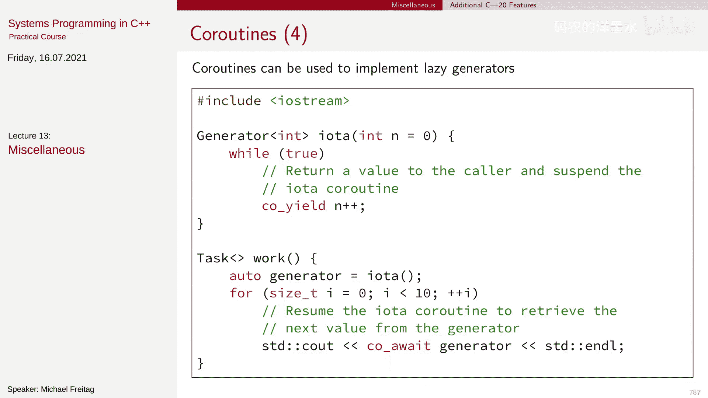

Nothing， alright。 So then let's go back to our asynchronous I O example， which， as I said。

 I gave us the motivating example for this whole excursion here。So once again。

 just some made up interface here。 Once again， we have a work function that now gets a socket as it's an argument。

 So we're doing some network I O here。 And then we have some kind of event loop here。

That essentially waits for data to become available。 And then once data has become available。

 will'll do some work and then send data back into the socket。

So the really cool thing that you can do with corouts here， of course， once again。

 given that we have actually implemented all the support infrastructure that is required。

 we can co weight on the asynronous receive operation on our socket。

 So what this will do is it will suspend the cor until data becomes available on our socket and once data becomes available we will put this data in some kind of data structure。

 So this is what we illustrate by this auto type incoming here and then。

The core routine is going to be resumed at this point now we have some data we can of course do some work on this data to determine what we want to send back and then once again we suspend our core routine until this outgoing data has been sent asynchronously and once this operation here has completed once the kernel port all this data out through our network interface。

 core routineout is once again going to be resumed in which case we continue our event loop here。

 suspend the core routine until more data becomes available and then continue execution。

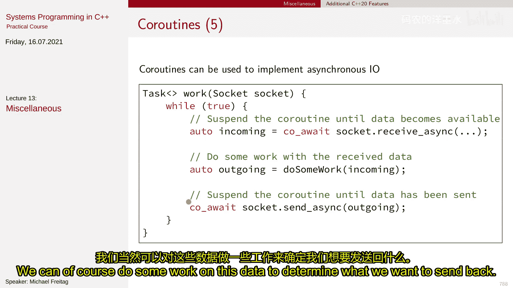

And once again， the main takeaway here is that with corerines。

 we are able to write this code as a single function that looks like sequential code。

 but in fact executes asynchronously because at these co weight statements here the corine is suspended until data becomes available and only then resumed without core routines。

 this would require us to essentially write three separate functions where function one issues this asynchronous read。

 function2 is invoked once data has become available and then issues this asynchronous right。

 and once again then the third function is involved once this asynchronous right has completed。

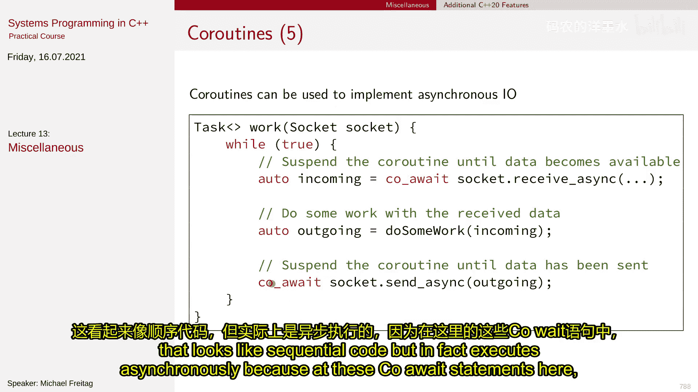

Right， a further question from the chat that this receive Async has to have a co yield or co return in it。

 right。Indirectly， yes， in fact， what will happen here is that this receive asch operation will not directly be implemented as a corout。

 but instead it will return something that is called an awaitable object it can internally do essentially what it wants awaitable object could also do something like issue the the asynchronous read and then then do a synchronous weight for the result of this asynchronous read so this doesn't have to be a cor。

 but of course it could be implemented as yet another coroutine and then at some point this awaitable object has to has to resume this coroutine and at that point it will actually just from a special member function that has to be implemented on such an awaitable object will return the result of this operation so the implementation of this。

Asynchronous receive operation is essentially up to us。

 we can implement it as another CO routine but we can't implement it as something else as well for example we could also do something like suspend this CO routine issue the asynchronous read and then once the asynchronous read complete we can set some magic data member somewhere and continue this CO routine on a thread pool that is responsible for IO operations。

So I hope this gives you some idea of what we can do here once again apologies for not diving deeper into this。

 the reason why we're not doing this is that I did actually implement the support infrastructure that was required for these examples。

 but this required roughly 2000 lines of code in C++ which I figured was a little bit too much to show in this lecture today here。

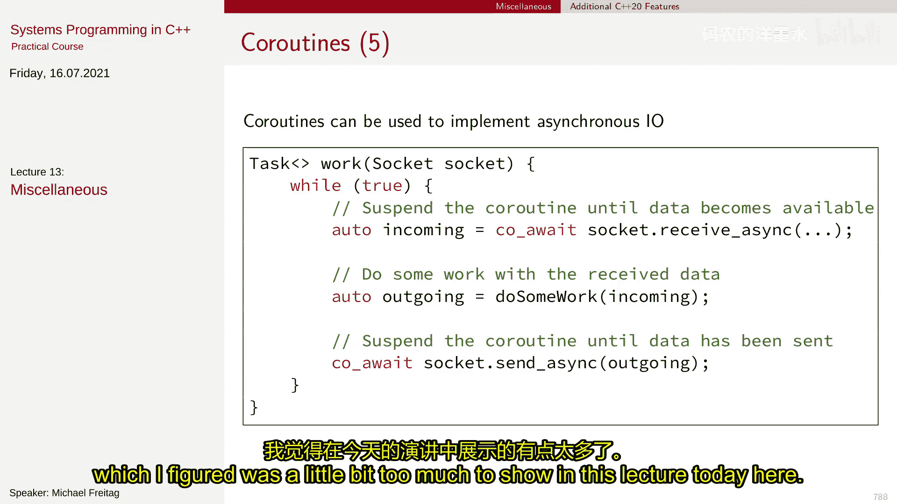

And this also brings me to my wrap up on co routines， which is that unfortunately， currently。

 they are quite painful to use precisely because there is not yet any co routine standard library。

 And in order to actually be able to use any of this really cool stuff。

 we have to implement a huge amount of boiler platelate infrastructure ourselves。

 So all this stuff that I just。

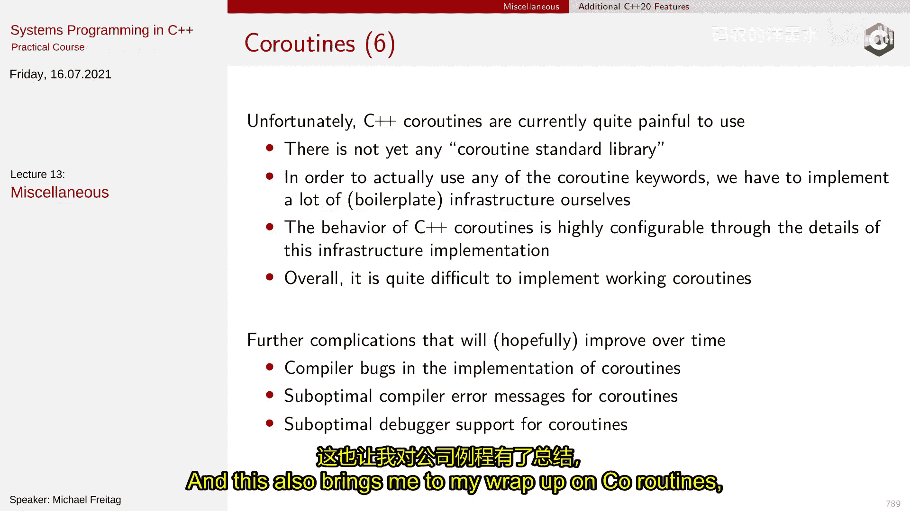

Blanket that goes on under the hood has to be implemented by ourselves。

 So in the co routines that we write， we don't see any of this， but unfortunately。

 we have to implement all this under the hood stuff ourselves at the moment。

And something that you may also have grasped from my explanation of how we could implement this receive async function here is that the behavior of C++ co routines is actually extremely configurable this infrastructure implementation there are some interfaces that are defined by the C++ standard that are called by the compiler whenever we have such a co weight or co yield statement and then through our implementation of this interface we can exert in extremely high amount of control over what exactly happens。

And once again， since there is not yet any co-routine standard library， it is up to us to implement。

 for example， this IO scheduleula that takes care of notifying anyone about the completion of an asynchronous IO event we ourselves have to implement the threat pool that we may want to use for this and so on。

 and all of this adds up the required API that we have to implement on our support types here is quite extensive。

 So there's a lot of stuff that we have to implement and also。嗯。It is not yet that well documented。

 so it's simply quite difficult to actually figure out what in detail we have to implement to make such a co routine work。

And on top of all that some further complications that of course。

 this will hopefully improve over time is that there are some compiler bugs。

 so when implementing all this I initially use GCC 10。

 which promptly crashed at some point because there was a bug and deco covertine implementation。

And then there are also quite suboptimal compiler error messages and suboptimal debugger supports because all of this stuff is so new so the compilers haven't had time to fully adapt to these changes and think about how to optimally support them。

 So the essence here is that cors are extremely cool。

 I expect them to be used across a wide variety of different code that has to deal with this kind of asynchronicity in it。

 but as of now， you can already start using them， but you will have to go through some pain to make them work。

A question from the chat is whether I implemented the under the hood part for my own learning because the standard library should adapt pretty soon Yes。

 I did implement all of this for my own learning there are already some libraries out there on Github that essentially do this and I also shamelessly looked through their code to get some starting point so if you're interested in this this is also what I would recommend you to do just take a look at the different co-routine libraries that are implemented open source mainly on GitHub and then try to reimplement this stuff together with looking at the documentation of course on your own to get a feeling for how this is actually working in the compiler concerning the second part of your question that the standard library should adapt pretty soon this is something that unfortunately I do not expect because the standard library is also fully specified by the E++ standards。

SoIt can only adapt whenever the standard updates its requirements for the standard library。

 so this is not something that the compiler vendors can simply add to their implementation。

 but this is something that has to be actually standardized by the C++ committee and then put into a new iteration of the standard。

 the next of which is due in 2023 and then only can the compiler vendors adapt their implementation of the standard library here。

So in the meantime， what I would rather expect is that some of these open source implementation of such support libraries will become mature enough that you can simply use them as third party libraries in your code so that you don't have to implement all of this stuff yourself。

But still， depending on your use case， if you need something that is not covered by one of these generic libraries。

 then of course， you don't have any choice but to implement all of this yourself anyway。

And for example， if I think now about the database that we're building at our chair。

 this is probably what we would have to do if we wanted to use corouts because most likely we can apply some optimizations due to the domain knowledge of being within a database system that such generic libraries cannot do because they cannot make any assumptions about their use cases。

 So here that's a situation where we probably would have to implement most of this stuff ourselves anyway。

So I hope this helps if you do have any questions， if you do want to play around with CO routineouts feel free to reach out to us。

 of course we have played around with this a little bit and can maybe help you get up to speed a little bit quicker than it was for us when we have had to start from scratch。

Apart from that， my suggestion would be to keep a close eye on the state of Corout support in C++ because once again I can not stress this enough。

 I think that they are extremely useful from a high level point of view they make writing particular types of code much easier。

 the only thing is that they are a little bit hard to use but this will hopefully improve over time。

Any further questions about core routines。Yeah。right looking good so let's wrap up this course with a couple of more brief discussions of some further quite useful topics。

 the first of which are modules， which is something that is broadly similar to。

 for example packages in Java and it essentially helps us just structure large amount of codes into logical parts。

 so this is something that was high on the wish list for C+ thus for a has been high on the wish list for a long time。

Since right now we don't really have any good way to modularize large projects apart from being disciplined about structuring stuff into namespaces。

 but even then through this textual include mechanism。

 we cannot really encapsulate our our modules and that well and our components that well and with modules we will be able to do this because a module consists of multiple translation units。

 so for example， all the translation units for one component of your system。

 and then such module units。Can import other modules and can export certain declarations。

 So here you get this facility for encapsulating because you now have control over what you export from a module unit。

 And only this is visible， visible when someone else imports this module。

So only the exported declarations are visible to name lookup in translation units that import the module and any other declarations helper types internal classes that may only be used within your a component are not visible outside of the module and of course besides helping you with encapsulation。

 this also reduces the compilation overhead because these exportive definitions are compiled into a binary format and the compiler doesn't have to parse transitive includes anymore with all this textual replacement stuff。

So just as a brief example， what you could do is have something like a greeting module unit where you。

Say that you export the module greeting and then implement this greeting function that you also export。

 and then within the main CPP， you can import the greeting module and now have access to the get greeting function that we exported from this module here。

TheMoles are also partially implemented in the current versions of most compilers， but for example。

 as far as G++ is concerned， some parts of the module specification has not yet been implemented。

 so here this is one of the features where we may have to wait for a future version of compilers for full support。

Beyond that and these are now a couple of rather minor additions that may still prove useful。

 we have some further things such as designated initializers。

 which allow us explicit initialization of class members by name as you can see down here so if you have astructF with publicly publicly visible data members。

 we can write code like shown here where we have this dot a syntax to explicitly initialize a to1 and with dot B then B to2。

 which was mostly already possible in C++ anyway because it is supported in C by default and was also supported for C++ by many compilers。

 but with C++ 20 this is also now standardized so you can actually rely on this being available instead of relying on a compiler to maybe implement this functionality。

Then this is something that we already partially covered in previous lectures。

 there is a new header for bit manipulation， the bit header， as it is aptly named。

 which allows us to do a couple of things such as inspecting the object representation of an object some useful functions for manipulating a bit。

Bit vectors， essentially， for example， the pop count function that some of you used in the exercises already。

 this is all stuff that was added in this new bit manipulation header here。

And then finally， we also have an atomic specialization of SDD shared pointer。

 which is quite useful if you want to do lock free operations on large data structures。

 as you can see in this example here。

And then。Wrapping up there is of course， a lot more that doesn't merit its own slides such as SDD's source location。

 which allows us to reference the location in source code at a specific line which is quite useful for debugging purposes we have a numbers header that contains mathematical constants we have new keywords。

 constant evil and constant in it， which essentially behave like a mandatory constant expert。

 so constant Exp allows a function to be evaluated at compile time by the compiler。

 but this does not have to be possible with constantt evil and constant in it。

 this actually has to be possible， so it's a little bit of a safer constant expert。

 and then some minor changes as well such as that more functions and classes in the standard library are constant expressions。

 some restrictions on Las were removed and some changes to non-type template arguments and of course。

A lot more even smaller changes here。 So this is just。

 a brief outlook on some further things that you can do in C plus plus。

So with this we have arrived at the end of our outlook on more advanced features and also at the end of our lecture here。

 so do you have any final questions？Al right， everything looking good in that case。

 it's now time for me to thank all of you for attending this course for coming to the lectures。

 I do really hope and I can also speak for words here that you learned something that you had fun and I wish you the best of luck in the future goodbye。

