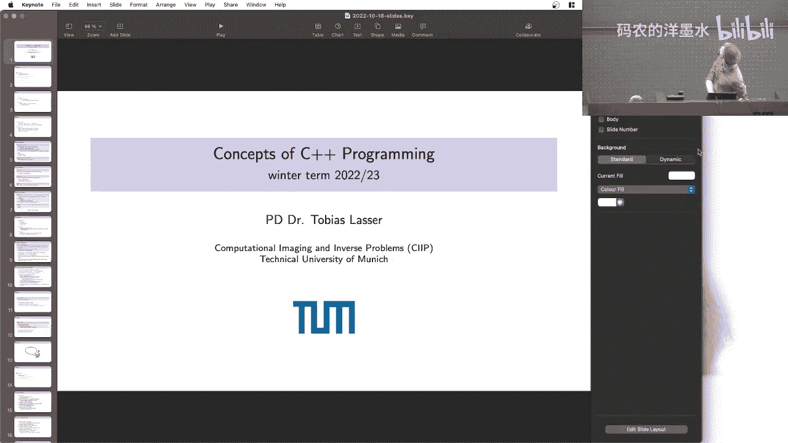
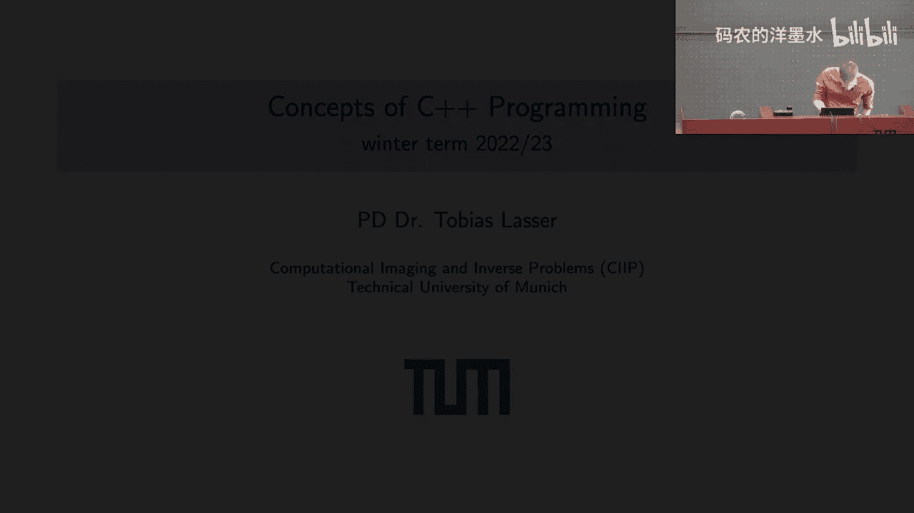
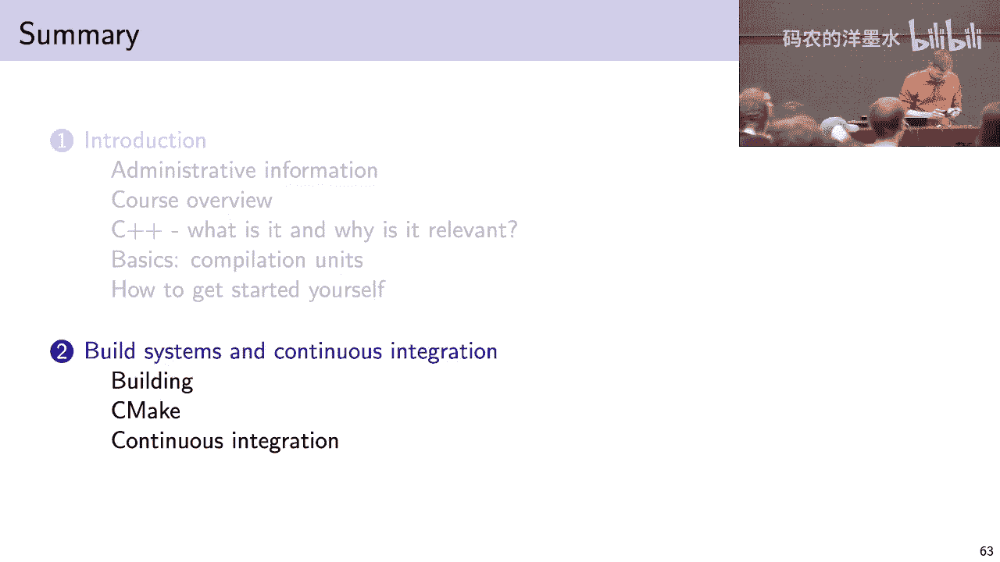

# 【全集】慕尼黑工业大学 IN2377 C++编程概念 中英字幕 1080P p01 Lecture 1 - C++的历史 -BV1b8mgB8EDQ_p1-

That's my audio on test， test， test。Not my， not my test。 lies test loud。Test， noash。

So hello， everyone。Welcome to the concept of C plus+ programming course。

I'm very happy to see you all here。 And also hello to all the ones who are live streaming。😊。

It's quite a number。I feel honored。Thanks for joining。My name is Tobi S Laza。 And yeah。

 I will be a host for this lecture for the rest of the term。And， yeah， let's get this party started。

So today， we will start with some introduction。About how the lecture format is going to work。

What were going to do in this course in terms of topics。And， of course。

 if you talk a little bit about why the topic is relevant， why it's worth being here。

And what you hopefully will learn from this course。So let's get the boring stuff out of the way。

 This cause is organized by me。 I am to be a sa。I have a group for computational imaging and In problems at now。

 it's called Department of Computer Science。Since now， we are the School of Computation。

 Information and Technology。And I'm aided by Alexandra Voick。Yonaerton。

 who isn't here in person right now， and Abbott Frankunk。They are all PhD students of mine。

 and they will do the exercises for this course。The aim of the lecture is， well。

 the title gives it a way to study the concept of modern C plus plus programming。 Actually。

 the modern is not in the title。 When I got this module approved。

 I was forced to remove the modern out of the title， but it's really meant here。And of course。

 we are going to see and practice a little bit in the exercises and in the homework assignments。

 how these concept can lead to elegantgen and efficient solutions。 because， of course。

 that's what we want to use modernphipl+ for。Who's the audience？ But you， obviously。

 everybody who's sitting here or watching remotely。In terms of study program， bachelor students。

Of informatics or related study programs should be able to use this course。EFor their credits。

 ideally， you are in your third term or later。Because some of the basics of algorithms and data structures and introduction to programming should be known to you。

 The course should also be， it's definitely available for master students。 And as far as I know。

You are also able to use it as credits now。And， of course， anybody who's interested。

 you're welcome to be here and listen in。So when and where， I think that part。

 you already successfully navigated because you're here and either watching in person or remotely。

 So Tuesdays， at this time，2，15， we meet here every week in the interim to Hle number  two。

 there's a live stream。 And after the live stream is done， there will be the recording。😊，V live。

 RBG dot to dot T E， That's the self hosted video streaming solution from the informatics department。

 well。From the School of Computation Information and Technology。

gonna take some time to get used to this， but it's only been 18 days。

 So it's I hopefully can be excused。 And we will be using feedback for feedback mechanisms。

 So if you're here in the room or if you're in the remote audience， please feel free to use feedback。

 we will have a separate feedback room every week today， the feedback session。 I D is E B， F 9。😊。

So if you go there， it' asks you for a four digit I D。 You enter this。

 and then you can do some comments as you like。And， of course。

 I will look at your comments during the lecture and try to answer them as much as possible。

 For the ones that are here and presence， you， of course， I welcome， you know。

 to ask a conventional question， raise your hand， Make yourselves known to me somehow and ask your question。

Right， Thursday days from 5 to 6，30， we will have the exercise session that takes place in the Galile Leo Herzar。

There's two auditoriums in the Galileo  building。 The Heryle is the small one， not the very big Aax。

 but the small one。I will post a link in Moodle how you can get there in case you haven't been there。

 It's a bit tricky to find the entrance to that building。 There also no signs。

This will also be streamed live via a video conferencing tool。

 big blue button that's also self hosted by。In computer science department。

 there will be no recordings of this because the idea of the exercise session is that you actively participate。

That you do。Questions， comments， talking， discussions。

And since we don't want to record you and then present you on the Internet for everyone。

 That's why there won't be any recordings。 There are some other reasons， too。

 but the exercise sessions will not be recorded。 So you can attend remotely。

 You can attend in person。But you will not be able to see the session later on in a recording。

Oh my God。 I see。 We have the I use arch comment again。Who is it。Must be。 so， so。

 so last term we had this lecture。 Of course， we also had that tweet back。 and for some reason。

 kind of meme took off that one of the first posts on the tweet back was always I use arch。Okay。

You can keep doing this。And let's see what creative responses I come up with this term。So yeah。

 there's other online resources。 There's Zullip or chat platform that's operated by us actually。

 So if you join the stream CPP， you can ask any questions about the lecture content or administrative info about not。

 And there's a second stream CPP homeworks， which is intended as the name gives it away for all the questions regarding the homework assignments。

 There's a moodle course， where you will find all the official news and announcements。 So。

 for example， if it's about the exam modalities， exam dates， or if for some reason。

 one of the lectures has to be cancelled。 This is where we will announce this。

All of you who register and to online for this course are automatically registered for the Moodle course。

 And once youre ready， once you're registered for the Moodle course， you automatically。

Receive notifications about our news and announcements。

I think you can't turn those notifications off， which is good because you shouldn't。

But sometimes these are email notifications。 And I know some of you don't use email that much。

 So maybe for this purposes， it might be good to have email notifications working。And， of course。

 all the materials， all the slides， For example， Other the slides from today will be on the Moodle course。

 usually。On the day， the lecture is taking place a few hours before。

Depending on how fast I will be in preparing the slides。 There's a website。

 as well on our working group website。Since the term has now started and we have Moodle。

 it's no longer that relevant， but for completeness here A U。走。😡。

How can you get in touch with us with me as a lecturer， Miss Arlessando， withionas， with David。

That's primarily via Zlip outside of the lecture hall， obviously。During the lecture。

 any in person contact is， of course， welcome。 and of course， you can use the tweet bag。

 which today has session I D， E， B， F 9。If you really。

 really didn't get your question answered or if it's something personal that you don't want to do in front of an audience。

 feel free to write me an email。But please consider， you're quite a lot of people。

 And if every one of you writes me an email， my inbox will overflow。

So please only use email in urgent cases。Right， and if you have feedback about the lecture。

 about the exercises， about the homework assignments or anything else， feel free to use the chat。

 the email。In person。Send smoke signals， somehow， whatever floats your boat。Does 5 E， T。

 S mean 5 hours per week of workload， not quite。Think the， the formula is。

 as one of your colleagues puts 30 hours per EC T S in total spread over the entire term。

And we aim to hit that first with the impression part。

 plus the homework assignments and the self study part that you will have to do。

Is this course going to be theoretical or practical。Both。The lecture will be mostly theoretical。

 in so far as I'm gonna stand here， talk to you， answer your questions。

 show some code samples here on the slides， But you probably won't be sitting there coding stuff。

 So you won't get assignments during the lecture。 But for the exercises for the homeworks。

 that's a practical part。Right， credits for masters students。Is there any confirmation。Yes and no。

 Offial confirmation。 I'm waiting for months now， and I haven't received anything。

 The person who responsible for us doesn't answer my email， doesn't answer the phone。

So I don't know what happened there， but I know from one of your colleagues that it turns up as credits for you into online already。

 So it should be working。 for the R C I students。 I will actually be getting in touch with Alexander lenss to make sure that it also works for you。

 but I don't see any problems there。Right， then always a crucial question for most of you。

 What about the examination， There will be a written exam After the lecture period。

 we don't have a date for this yet。It will be in presence on campus here in guing。 most likely。

 it will be 90 minutes。And most importantly， also there will not be a repeat exam。

 This is an optional module。 It's not mandatory for any study program。 So there's not a repeat exam。

 So if you want to take the examination。Please be there。 if for some reason。

 like Covid or some other V T C that still doesn't seem to want to die。

 you can't attend that one exam because of sickness or so drop us a message and we will sort out some alternative solution if you need the credits。

In this term。What's also important。 And that's why it turns up on the examination slide。

 is that there's homework assignments， these homework assignments。Are optional in a way。

 But for each programming assignment that you solve correctly or correctly enough。

 you receive one point。 There will be 12 homework assignments unless we miss planned。

 but it should be 12。And these points will count to your exam result。

 So there will be points from the written exam。 There will be points from the homework。

 And if you put all of them together。That's where we perform your grade from。

 So the homeworks for your grade are not optional。They are not bonusless points。

 They are part of the great。 So you're really encouraged to do the homeworks。😊。

That's the practical part of the course。 And， of course。

 any programming language you have to practice。 You have to practice。Until you really get to know it。

And if you've been programming for a while already， you also know that this practice is never over。

 You have to keep doing it， and we will do a little bit as much as we can do in this course。

So speaking of the homework assignments。Let's talk a bit more about that。 So each week。

 you will get an exercise sheet， be a Mole， like all the lecture materials， of course materials。

 There will be programming assignments and these assignments you should solve。

 And then once you have your solution， you submit it via the L Z Gila。😊。

And there will be automatic tests that run on your code and that basically say， oh， yeah。

 you solved everything correctly or no， there are some miss。If it says， yes， everything is correct。

 then you will receive one point out of these 12 maximum。

And you will have a time of one week to solve these homework assignments。So， yeah。

 the total achiable points is 12。 We will add them together with the points from the written exam。

And then from the sum of points， we will derive your grade for the course。

All the details on how this homework assignment staff works in。

Eabboorate detail will be presented by Alexlessandro on Thursday。

 So in two days during the exercise session。The brief details I will announce now。 So basically。

 there will be one homework assignment every Thursday。And as as Christmas or something like that。

 then there won't be a homework assignments。 You will have one week to work on them。

 The deadline will always be Thursday， plus one week， at 1700。😊。

And you will have to upload your solutions to the Gitlab repository。 Now。

 how do you get that Gitlab repository。You go to Gitla Lvete。You lock in there。

 if you do this for the first time， what you should do is you should edit your name because the default is some weird I D that nobody knows who you are。

So you should update your profile， go to account， go to username and。

Put something there that reflects your identity， somehow。ESo that we then know。

That who you are into online and who you are in Gitlaap。

That's not linked to each other automatically。We need that link。

 and we get this link from you by you going into Moodle。

Go to the activity that's called add your Gitlab username。And then basically。

 you enter your Gitlaub username there。So if you change your username， change it in Gitla。

 change it first， then go to Moodle and enter your username because that gives us the mapping。

Who you are and term online versus who you are in Gitlaap。

 And in order for your points from the homework assignments to count， we need that mapping。Right。Now。

 how to get the repository is there's a waiting room。That you can find under this address here。

 Gitlab L ZD E， CPP course， you know， for the course here， obviously， winter term。

22 for the winter term very currently in。 And it's called waiting room。

You can sign up there or request access。 This will trigger a script that's running in the background on one of our servers。

 It will set up a git repository for you that give us all access rights so we can actually look at your solution。

 give you access rights with right permissions centre on。😊，And it will set up everything。嗯。

If there are any issues with this。How do you contact us。Yes， Zlip。Or in person。Right。

 here during the sessions。Right， as you've already noticed。

 the lectures will be in this format in general。 So， you know， me standing here。

Doing some fun stuff in front of you。 You're sitting there， enjoying it or maybe not enjoying it。

 maybe sleeping。 But that's the general idea。The slides will be available in Moodle beforehand every week。

 And if you have questions， feel free to， to raise your hand and ask your question or go to tweet back and put your question there。

I try to look at， feedback。Every。Few minutes， basically， when。

 when I see that something is happening。And also try to address your questions。And speaking of it。

 let me get rid of all this stuff。 Oh， any updates I'm on in my frying pan。No。

And if you don't know what the frying pan is about。You will get to know it at some point。

Credit from mechanical engineering students。I don't think so。Maybe， maybe not。 so。 but yeah。

 probably not。If you're an S D， of course， you can enroll in this course。

 not take part in the assignment and in the exam and take part again in the third term。

 But if you do well in this first term， you can also do the exam in your first term。

 It's just a guidance that you should do this in the third term。 But you know， if you're。Fit and。

 and。And， and doing well， there's no， no issue of doing it now。Exam date， We don't know。

 The exam date is set centrally。 We have no influence on this。 And so far， it hasn't been set。

 So it will be in the regular exam period。 And that's sometime。plus。

 one week from the lecture period end， which is mid February， something until early March。

We don't know。 Ill let you know as soon as I know。 I would also like to know， because， you know。

 that kind of influences my holiday plans。There are bonus for this course， nope。There is no bonus。

 There's homework assignments。 There's a written exam。 Both count for the final grade。

 and there's no bonus。How's this course different to P GDPDP。You're learning C plus plus。

 And trust me， C plus plus is a bit more or offers a bit more than what you've been learning about Java。

So it's an addition and extension。 But if you， of course， already are programming visardency， plus。

 plus， you probably don't need this course unless you want the entertainment that we offer for you。

Programming on paper。Feel free to do so。I would prefer a computer typically。 But， of course。

 you know， there's a written exam， which is on paper。

 So some little programming will have to be done on paper for the exam， yes。The points will be added。

 also if you don't pass the written exam， because there's no passing the written exam。

 There's points from the written exam points from the homework。

 And together they decide if you pass or not。What's the ratio of examine homework points。

The idea is to have something like 70 points in total，12 from homework。 And that makes 48。No。68，58。

 There we go。 Doing math under flyly is difficult from the exam。 That might change a little bit。

 but that's roughly the ratio that you can expect。There are no hidden tests。

 You will see all the tests straight away。And how many points for the programming assignments do you have to collect。

Strictly speaking， none， you can pass the course only by doing the written exam。

 but you won't be able to get the best grades。Can you test your homeworks before the deadline， Yes。

 as you will see， we will use a regular Gitlab continuous integration setup so that it mirrors what is being used in actual practice。

 And that means every commit you do will run the pipeline and every committee you do will you will see if it worked or not。

Does modern C plus plus mean C plus plus 20， yes。Also， C plus 23 because， you know。

 next year is around the corner。Will there be a retake exam， no。

Can you request access to the homework assignments yet， Yes， you can。 It should be working。

We are not focusing on data structures In the assignments。

 We are focusing on U learning C plus plus that includes data structures， but also other things。

Right， I think that should answer most of the questions。 Do the tests give feedback。Yeah。

 but that depends on how we have written them。 If they were written properly。

 that you should get some feedback。 what failed。嗯。It's not written that nicely。

 You might have to hunt a bit around what， what went wrong。 But in general。

 the idea is that you get some idea of what failed。Right。Oh， I forgot the slide here。 So yeah。

 exercises as I said one exercise sheet per week with some assignments。

 program assignments for homework。And during the exercise session。

 you will discuss previous weeks from work， how you should have solved it or how you might have solved it。

 how you did solve it。 And there will be some point as to the current exercise sheet。 But， of course。

 we won't discuss the assignments yet because you will have one week of time to work on them。

Before it's done， Ma available on Moodle。 And this is an exercise session。

 as opposed to the lecture here where I stand in front of you and entertain you or at least try to entertain you。

 This is an exercise session， this。Lives from a certain level of interaction and how much interaction happens is。

 of course， up to you。Right。We will be working this Do test， yes。

We mask the students get the credits in general。Yes， not all master programs。

 but the informatics master programs should be fine。Is there a try limit for the homeworks。

 There's an implicit one。 We have C I servers running your test shops。 And if you overload them。

 then at some point， yes， there is a limit。 But other than that， there's no limit。

Can you follow the lectures entirely online， Yes， you can。

There's video stream and recordings for the lecture。 There's a video stream。

 but no recordings for the exercises。 So yes。What's the benefit of taking this course， Let's see。嗯。

That's what I'm gonna talk about now。 So thanks for the nice transition。 So I don't have to do it。

 Let me give you a bit of an overview over the course and why it might be worth it for you to not be here only today。

 but maybe or the next week and the following weeks。So in terms of topics， what we will do。

 we will have to start with the basics because we assume nothing in terms of your knowledge about C plus plus。

 or we will talk about syntax。Strong typing， type deduction compilation units that we'll actually do today already。

 And we talk a bit about boot systems and dependency management。

 which is something you might not be familiar with yet if you've only used Java。

We will talk about the typical concepts for procedure programming， for object oriented programming。

 for generic programming。 This is all stuff that in theory， you should already know for Java。

 If you're a computer science student， if you're not a computer science student。

 this might be new for you。 but this is basically just about。How does。

 how do these standard paradigms work in C plus plus， Are there any specialties。

 And let me tell you one thing in C plus plus specialties everywhere。

And exceptions of these specialties and so on and so。There will be quite a lot to cover。And。

 of course。It gets really interesting once we talk about generic programming。

 because the plus has very few， very nice features for that， like fold expressions。

 variety templates。😊，And there's a few patterns that you can apply in C plus plus that。

Work in almost no other programming language， like expression templates or curiously static expression templates and。

The curiously recursive template pattern and stuff like this。

 So this fun stuff is the stuff that's more complicated。

 This will come near the end of the course because we want the basics first。😊，And， of course。

 it being C plus。 we have to talk about resource management。

 how to do it properly and how to not fail at that， because that's one of the main areas where。

Program has fail。We talk about compile time programming。 There's lots of cool stuff to do there。

 which is also fairly unique to C plus plus。 And， of course。

 we talk about the standard library a bit containers， iterators and all the stuff。

 parallel programming， what support there is in C plus plus， which is unfortunately a bit small。😊。

And at the end， we will look towards future concepts。

 What's coming in the new standard that hopefully comes out next year。And some other things。Right。

So that's the content that you should learn。About what you should also learn is how to apply all this stuff。

In practice， of course， in a limited amount in in a limited way。

 because this will only be homework assignments。 They won't be a huge project。

But the idea is that you get to know the tools that you need in order to do C plus development from compiler to link it to a build system。

 to do source code management withkit to do automated builds using the Gitlab continuous integration shops to get used to this because this is a setup that's being used in all kinds of practical work settings once you're done with your studies。

 So it pays off to practice this early。Right。What I have to say also is a note for you。

 This course is relatively new。 This is now the。Third， third time， F time。Fourth time。

 I'm doing this。嗯。So this course is still developing in terms of contents of how we present it。And。

 of course， any feedback from you on this is very， very welcome。You' are the target audience。

 And if you say， oh， I want to hear more about this and that。

 or I want to hear less about what I've been spending so much time on。This feedback is welcome。

 We want to improve the course so that it's the best it can be。Right。

I look at your questions again because there very a few。 But while we're doing this。

 I want to take a quick survey via a tweet qui。 So let me just activate this。The question is。

 have you done anything N C plus plus yet。And if you go to tweetbe， you should be seeing。

The quiz pop up now， and there are some answering options like nothing a little bit。

You are quite proficient already， or you're an expert。And there's also an option。

 I am completely new to programming。 I just arrived here。So while you're doing this。

 let me have a look at your。Questions。Can we work with Javascript instead。Nice question。Next one。

 the answer is， of course， no。Right， what if you' are not able to attend the exercise because you have a scheduling conflict with another cho or work or something。

That's， of course， unfortunate， but there should still be quite some materials available。嗯。

You have the slides。 There's the homework assignments。 And， of course， there's。

 you can read the feedback feedback afterwards as well。And theres Sulip。

 where you will see that usually with this number of participants。

 there will be a lively discussion going on， basically every day。

And one hint while you're still answering the quiz。

The feedbackback questions that you' are posting now。

 I'm trying to answer most of them in person right now during the course。

 But what I will also do is I will go。After the lecture。

 I will go into my office and then I will go through your questions again and the ones that haven't been answered by Alexlessandro yet。

 who is currently being nice and helping me here answer the questions already by keyboard。 I will。

Take all the questions that haven't been answered yet and and add my own official answers。

 So it's always worth also to check back if you missed something。Right。Which tools are recommended。

 That's a point I'm getting to。So give me a minute for that。

Is there anything in the following room that's not in the lecture slides。嗯。Me。And me talking a lot。

 as you noticed already。Because I already spent half an hour on this administrative stuff。Oh yeah。

 I'd read this out， even if I shouldn't。 the best thing about last lectures are the responses to tweetback during the lecture and after the lecture。

 So， yeah， here's your additional content that you get。 don't get in the slides。

I'm missing the question about Eex of M。I'm disappointed。There the question sublime versus V S code。

 But what are we。You're too young。And yeah， if you wanna have a question。

 if you have any question about Emex， ask Alexanderlessand or Jonas there， the Eex gurus。

 If you want a question about Wi， ask David or myself。We are mother vi guys。

 but not as extreme as they they are。So let me see。

 How do I get the questionnaire results to the big screen， I think I have to move this over。So， here。

😊，Let me stop the questionnaire because I think all of you who is gonna answer have answered already。

And also publish the results for you。So， yeah， nothing In plus plus is。Quite a big part of you。

A little bit， N plus bus is always a big part of you。

 which is good because these 84% or something are exactly the ones I wanna address with this course。

😊，And the 1516% who are already quite proficient are an expert in this plasma。

You probably don't need to be here。 You're， of course， welcome to be here。

And maybe learn a bit here or there。 But strictly speaking， you probably don't need this course。

But as I said， you're welcome anyway。Right， completely new to programming。 that's 0。5%。

You might struggle a bit。 C plus plus is not the nicest introduction to programming。 Rather。

 I would say it's one of the nastiest ones。So let's see if you're still here at the end of the course。

um。It's not the recommended way of learning to program。 Let's put it like this。Rise my mouse。熟。

So let's talk a little bit about why we should be doing C plus plus。Where's my queen gone， okay。

 anyway。So now dropping all the passwordwords。 C plus bus is a multipar general per this programming language。

 What does this mean， Well， it supports several programming paradigms。

 It supports procedural programming， like almost every programming language。

 It supports object oriented programming。 like almost every programming language。

 That's kind of decent。 It supports generic programming。

Which already reduces range of programming languages a bit。

 And it also supports somewhat functional programming。

 It's not quite a functional programming language like Husker or or Lisp or something like this。

 But you can do functional stuff in it， as well。😊，And that's one of the cool things。

 because basically， you want to do certain things in a certain way。And you can do that in C plus。

 Maybe not in the most elegant way。 Maybe it's more elegant to use a specialty language for that particular programming paradigm。

But if you need all of them in one package， that's what thepl offers you。

And some of the other key characteristics that you have is that they are static typing。

As opposed to most of the scripting languages， where。Probably no typing at all。

 It's a compile language。So not just in time compiled or not interpreted。 It's compiled。

 So you have to translate the program before you are able to execute it。 And， of course。

 that means that compiler can do a lot of optimization in your code。

 And that's also one of the reasons My C plus plus is one of the。😊。

Most efficient and fastest programming languages。 And， of course。

 one of the main reason it's still around， even though it's so old。

 is there are facilities for low level programming that you don't have in other more high level language programming languages。

So you have both。 You have a lot of high level programming concepts that are useful for different paradigms。

 but you can also do the really low level stuff。 And you can all do all of this together very。

 very efficiently。So to give you some idea， C， plus plus is as old as I am。

 It started in 1979 by Bna's throw trip。That's Danish computer scientist。And basically。

 what he wanted to do is he wanted to add。The class concept from similar and small talk to C to the programming language C。

 which， of course， already existed for quite a while back then。

Then he came to the clever idea four years later to not name it C as classes。

 but to call it C plus plus。 And if you already know a little bit of programming。

 you know that plus plus is the increment operator。 So that means it's an increment over sea。

And I remember when I told my parents when I was learning programming at， I don't know。

 When did I learn C plus+， I think when I was 14。I， I， I said， yeah， C plus plus。

 And they were like making fun of me I like C plus plus。 what kind of name is that， right。And， yeah。

 unfortunately， it's stuck around and。It's what it is。And 1985， there was a reference book。You know。

85， there was a period where the Internet was not everywhere。 In fact， there was。Basically。

 no Internet。But there was a book that defined a reference for C P plus for the programming language。

 And also the very first official commercial compiler got released then。So as you see。

 the language is really old。 It's older than most of you here in the room， I guess， except myself。

1998， So it took like 13 years。For a standards committee， namely the Iil。

To standardize this programming language。 And that's what's colloquially called C plus plus 98。

 because it was standardized in 98。And then there was a revision of this IL standard that was really minor。

 Some minor details in 2003。 That's called C plus plus 03 surprise。

 So this is basically what most of the C plus plus code looks like。

 It's according to the standard from 98 or 2003。So if you look for Cpl code on Google or any other search machine。

 most of what you will find is this kind of code。That's old， C， plus， plus。

Now there's modern C plus plus。 This came around in 2011。This was a major。

 major revision of the IO standard。 And as you see， there was a period of eight years in between。

And in fact， this development took so long initially。

 the version was supposed to be called0 x because it was 2003 and it was supposed to come out before 2009。

 but actually it took until 2011 to finalize it。And it was a huge major update to C plus plus and basically introduced a whole new programming language。

That's kind of trying to get out in Cpl， however。C plus plus is a backwards compatible language。

 So it's backwards compatible to the old C plus plus。 and， of course。

 all the backwards compatible to C。Which is one of its strengths。

 because that means you can mix old code with new code。

 You can use all the old code bases with new compilers。

 You can add on top of it using new language features。 But， of course。

 it's also old craft that you can't get rid of。😊，And that's why some of the syntax and some of the specialties and exceptions that you have in Cpl are so horrible。

Because you have this backward compatibility。If you take newer languages， like rust。

They took the same lessons as the plus plus， but they got rid of the backwards compatibility。

And that's why they are nicer in some of the aspects。Right。

 this modern C plus idea developed quite a bit in 2014。 There was a minor revision。

 which is called C plus plus 14， naturally。2017， there was the next one。 This was a fairly big one。

 C plus 17。And two years ago， in 2020， there is the current revision of the I standard。

 C plus plus 20。You will see a pattern here since of was this long period until C plus plus 11。

 And subsequently， there was a long period until the compilers actually supported the new standard years。

Some of the compilers didn't support C plus plus 11 By the time C plus plus 14 came out。

That was really a horrible situation。 And basically。

 the Standard Committee decided to push out those updates on a three years cadence。

 so basically that everybody knows when the next version is coming。

And that everybody is on track with their developments and extensions of compilers and build infrastructure and all that kind of stuff。

 And that's why next year in 2023， there will be the next revision of the Ia standard。

And you will note that these are all revisions that are not necessarily minor。

 C plus plus 17 wasn't that big。 C plus plus 20 was fairly big。

 and C plus plus 23 is also shaping up to be a fairly big update to the language。

So while on one hand， this is cool because it gives you a dynamic language that adapts and improves basically every three years。

😊，The problem you have， it changes every three years and keeping up to date with all of this can be a pain。

So， for example， when I did the， these slides， the first time。C plus 20 was just around the corner。

 Now，23 is just around the corner。 So that means I need to update my stuff。

 And if you want to use the new stuff， you need to update your stuff。 And， of course。

 you need to wait until the compilers and all the other infrastructure supports these new features。

So there's a continuous flow of upgrades， which is cool because it's dynamic and improving things。

 but also not so cool because you're constantly having to catch up。😊，I' try to give you an idea。

We have a。Fairly decently sized library at our working group。 that's called Elza。

 Some of the people might know it。I developed this。 I started writing it in 2000。

18 was just before Covid， yeah。And， of course， I was using C plus 17。

But we've been working on it for quite a while now。 And， of course， now C plus plus 20 is available。

 and we would like to use it， but we can't， because the compilers we have to support still don't support C plus plus 20 fully。

And this， this is a recurring theme that he will see all the time again and again。

So the backward compatibility of C plus plus is a huge Achill skill and a strength， both at once。

And this kind of new revision cadence of three years is， again， a strength。

 but also and a kid is here， both at once。However， the good part is。

 modern C plus+ is really a modern programming language。

 It focuses on safe programming and zero overhead。😊，So it's basically trying to be。

But Javava set out to be in the early days without losing the efficiency and the zero overhead。Right。

 performance。Why should you use C plus+ performance is usually the answer。

Because that's where you get high performance for all types。

 including the ones that you yourself define。You have low level hardware access to the very lowest level。

 everything is possible。 There's no nasty workarounds or switches to other languages you have to do。

 like in Java。And there's a zero overhead rule。Which is a quote quote from behind a throwdpe。

 you know the。AtThe person who introduced C plus plus idea D of C plus plus。

 you don't pay for what you don't use。 So not all the features are exactly0 overhead。

 as we will learn in the for the duration of the course。 But if you don't use that feature。

 it's not gonna cost you。And， of course。There's a great flexibility。 As I already said。

 there's multiple programming paradigms supported。 So you have a very flexible level of obstruction from very low to very high。

😊，There are several programming paradigms supported， some of them very well。

 some of them not so well， but supported。And there's excellent scaling to very， very small systems。

 you know， like embedded systems or very small computers to really。

 really huge ones like supercomputers。And， of course。

 then C is basically the standard of interoperating between programming languages。

 Interoperability with all the other programming languages is basically all also excellent。

And since it's so owe。There was a， really， really extensive ecosystem of tool chains。

 libraries and so on。So it's a combination of it being around for a while。

 It being backwards compatible。 There's lots of things that's been done。 But also。

 there's positive features like performance and flexibility。 Why you would like to use C plus plus。😊。

Just to give you an example， anything。That requires high performance， like medical image processing。

 which is what we do in our group。Medical image processing is。Working through huge amounts of data。

Hopefully， in a very fast and efficient manner。 What do you use， What programming language do we use。

 Obviously， we use C plus plus， There's basically no alternative to that。Look at the latest hyp。

 deep learning。Do you know how the deep learning libraries。

 like Pytorch or Tensorflowlow are implemented。The answer， obviously， is C plus， plus。

 Everybody is using it via the Python bindings and the Python interface because that's more convenient to prototype and develop this。

 especially if you're not very good at programming。嗯。I didn't say that。 I'm not gonna imply that。

I'm not gonna imply that everybody who uses Python doesn't know programming very well。 But Python。

 of course， supports people who don't know programming very well pretty easily。

My C plus plus doesn't。 If you don't know how to program， you will be lost in C plus。So， yeah。

 all of the core stuff。It's usually done in C plus plus。And that's why it's still around。

 And that's why it's still being developed with very， very high activities。

 Also from a lot of the companies starting with Microsoft， Google。😊，Facebook。To name a few inter。

Whatas even Apple is supporting it somehow。Even though they have their own language， you know。

 like swiftif and stuff。不亮。So the answer Y C plus plus is because it's used in practice for basically all the important software systems that there are。

So， yeah， it pays off。And also， let me tell you about one anecdote。That was a few years ago， now。

I'm part of the study commission at， at the Department of Informatics。 Well， back then。

 when it was the Department of Informatics。 And one of the feedback we got from companies is that our。

Deeggree holders from Tom Inforatics。 They suck at C， plus， plus。And then there was discussion。

 What do you do about that， Some of the professors said， yeah， well。

 we don't care what industry wants。 We are university。 We are doing university stuff。And。

Nothing happened basically， right。 And then at some point， I was like， you know。

That's kind of stupid。 Let's do this course。 And that's how it came into being。 Of course。

 the real motivation was that if you wan to do a master thesis in our group。

We need you to be able to program C plus， plus。And that's why all of you are， of course。

 potential targets for thesesis for us。But I have to warn you we are only a few people。

 We are me plus 7 PhD students right now。 So our capacities of actually doing mathsis is a bit more limited than the amount of people that are currently listening in here。

Right。Let me give you some examples。 I picked them all as randomly to show you a little bit of O C plus plus is capable about We won't learn immediately why and how this works。

 But just to give you an idea This is an example of generic programming， really。

 really generic programming where you take whatever template arguments of whatever type and basically compute the average of that thing。

😊，That's a very。Cool example in my eyes， at least for generic programming。 And of course。

 other programming languages can do this， too。呃。So yeah， this is just one example of what you can do。

One of the different things that's particular， My focus is something like this。

This is a math formula， namely the Gaussian lock likelihood that you're computing here。

And if you look at the form actual math formula， it looks very similar to the code。 You know。

 you have the exponential function of one half times the square of X N minus mu。Divided by。

Why did I call it Sigma square， right。And then some take the logarithm of that。

 multiply with a constant。 Take the sum。 And the cool thing about that is not that you can write this line of code。

 Other programming languages can do this， too。 But what you can do is you can have this line of code emitid Ka code or any other graphical programming language code at compile time。

 So when you're translating this code。 It's automatically translated in GPU code。

 and then automatically。😊，Executed on the GP， of course， with the performance that comes with it。

 the performance gains that you have。 and the code looks perfectly readable， right。😊。

That's one of the cool things that you can do with C plus plus。

 And that's also one of the things that I like the most。 And in order to be able to do this。

 you basically， you need the generic programming， you need the compile time programming。😊。

And you will see how to do this in one of the last sessions of the course。

 when we talk about expression templates， because that's exactly what's happening here。Right。

 and if you wan to do a more functional style of programming C plus plus 20。

 we have the Rnges library， which allows you to do stuff like this。

 which doesn't look terribly efficient， but actually is fairly efficient。 for example。

 if you want to have the last three numbers in the interval from 101 to 200 that are divisible by 7。

You generate the numbers from 1001 to 200。 You filter at them using a lambda that tells you if it's divisible by 7。

 and then you take the last three。Again， other programming languages probably do this bit more elegantly。

Especially functional ones。 But you can do this here， too。And it can do all of this together。嗯。

These are just three examples。 And， of course， what he can also do is this。

I picked this from the website for the International Obcated Sea code contest。

So this is intentionally obfuscated code。But this also works。Right， I mean。

 you don't want to do this unless you're taking part in such a contest。But it's possible。 It works。

And C plus West basically supports all of this。Under have one umbrella。Right。Okay， so。

You could use Rft。 Yes， I could。 And， in fact， we also looked into using Rft for our library。

But the stumbling block that kept us away from at least doing a prototype in rust is ka programming。

Libraries for quoa support。Not yet there in production quality。 fory plasma。

 It's been there for years。Whether it's really awesome。😊，I's another question， but it does work。

And you might know a famous quote by Linus Toverts。 Maybe you know that person。

About Nvidia and his opinion about Nvidia， I happen to share it。

 but I'm not gonna speak it out loud because it's。Not politically correct。And yeah a go， maybe。

I don't know。 Go with something I'm not really familiar with， So maybe。

We'll see knowledge come in handy， during this course。嗯。I would say。Probably not。

 because what I will be teaching is modern C plus plus。And modern C plasma tries to go away from sea。

So some of the syntax will be familiar， but some of the concepts of C。Are， in fact。

 kind of deprecated or。Not really。Well considered in C plus plus。 So it will help a little bit。

 but actually， in fact， you might do well to forget about C and start learning modern C plus from scratch。

What are the main difference between these versions。Of C plus plus， wow， there's a lot。

 We'll talk about some of them， as we go along。嗯。But， there's a lot。Okay， wow， there's。

A lot of comments。 Let me see。 I can't answer all of them。 So here we are at the stage。

 I will go over your questions after the lecture and answer them in a written form on my computer。嗯。

Like， yeah， what do I say to the recent statement of the Microsoft C TO that C plus should be considered deprecated in favor of rust。

In theory， yes， in practice， not quite yet。 Ru has a way to go in terms of infrastructure and library support until it's ready to replace C++。

What's a recommended way to learn programming That's a good one。嗯。Practice。Practice。

Practice and practice some more。What we do here in university is not really good for learning programming。

 I mean， this is。Kind of the opportunity for you to spend some time with this here。

 But what you should really do if you want to learn， learn it really。

 really well is do stuff on your own。With the programming language of your choice here。

 it would be C plus， but it can also be rust or go of whatever you wanna do。

But program as much as you can。 That's， that's really the， the only thing you can do。 Forge about。

 I mean， not completely。 forget about courses， seminars and practical courses， because， of course。

 there you have the opportunity to practice。 But the best way is really on top of what you're doing here at the university to get the credits and get your degree。

 And so on program your own stuff。 program the stuff that's fun for you。😊，Do it。And then， do more。

That's the only thing。 how you really。Learn properly。

 And one of the other things is learning programming is never over。

I've been programming since I was 12， I think。Maybe 11， I don't remember exactly。

So I've been programming for over 30 years now。And I'm still not donelear。I still learn everyday。

 Well， not every day since not every day。 I get to program。 But when I do get to program。

 I still learn stuff。It's never over。Oh， is the correctness of the exercises grades or the vibes of the submission also take into account。

I'm afraid we have an automatic test system that doesn't take into account vis。 So it will only test。

Your results， it will not test your code quality。 It would not test your vibes， or any other。

Not easy to rate things。 If you do want our feedback on the vibe of your solution or the code quality。

 feel free to approach us， and we will have a look and tell you about it from our perspective。Right。

Recommended tools is a part of how to get started yourself。 So I get to that in a bit。

 So I'm not gonna talk about it right now。嗯。When would you choose C oversea plus， plus。Never。

 unless you're called Lios Tovis， then you choose C over C plus plus。

 But I think he has reconsidered his stance a little bit already。Because， you know。

 there's now this rust part in， in the corners or。Yeah。Oh， this is good one。

 When will the pluspa have as good compilation error messages as rust does。😊，这样。Maybe never。

Who knows？ Klang actually has very， very decent error messages。GCC has caught up。

And I don't know if they can be dressed in this aspect or not。

What do you think about C plus for deep learning。If you wanna develop deep learning stuff on the low level。

It's your tool of choice。 If you want to use deep learning。It's not your tool of choice。

 use was Python like everybody else。 it's better。Any thoughts on carbon。Yeah， it's from Google。

So wait two years， and it's probably gone。Like a lot of other projects， Google likes to kill off。

It looks interesting。 No question about that。 But with the recent track history of Google killing off interesting things in one or two years。

 I mean， maybe you know， Google Staia。That cool idea。 So I think my prediction is。

 in one or two years， carbon is gonna be that。So yeah。Can you revertch this lecture？ Yes， you can。

 It's being recorded。Oh yeah。Well， one of you said it。 quote from Lions Tos。

 I'm not saying this because I I'm only saying nice words。 F you and Vidia。With， with pleasure。

Seriously。And video graphics cards are awesome。 but the software they write for this is horrible。

How's my pen。 I already answered this。 It's doing fine。 It's sitting in the cupboard， unused。

Will you en entertain us with some roasting like in BMT， I think I just roasted N videos， or maybe。

 maybe that qualifies。😊，So if I understood well， this course is relevant for people who are willing to work in industry。

 Yes， also in academia， because also academia， some areas like ours medical imaging need C plus bus。

 but of course， industry also。😊，Needs it。Jesus， how， how many questions are there。 So yeah。

 I Ill skip the rest for now because I still have some content I want to go through。Right。

But don't fear。 I will answer your questions afterwards via keyboard。Right。So， a little bit of。

On topic contents now， because most of it was administrative stuff motivating why you should be doing this。

 And Y C plus+ is cool and la la la， all that stuff， you know。

Now that you're hopefully convinced that it's worthwhile being here or maybe not convinced on you。Le。

嗯。Let's talk a bit about how C plus look like。 If you've done this before。You will know it。

 If you haven't done this before， let me point out a few things。

 Well you store your program into a file that's usually called dot CP PP。

And you put stuff in there and it looks like this。 It's a very sea like syntax， and it also。

It's no coincident that also Java looks like it because Java copied most of the syntax。

 obviously from C and C， plus plus， you include。The I O stream library。

 in order to be able to do some console output， main is the main entry point of your program。

 It has to be there。Everywhere in every program that you do， it returns an integer。

Takes no arguments， or maybe it takes arguments If you wan to supply command line arguments。

 and then you do a console output hell over it。You know， your first program。 And in fact。

 what you should be doing。Is if you've never programmed Cpl before， do this as your first step。

Why the program is ridiculous， right， It doesn't do anything useful。But。

It's useful to get to know the tools， because what you have to do in order to run it is you have to compile it first。

 then you have to link it。And incidentally， this can be done in one command line call。

 you call the C++ compiler， this could be GCC， this could beLang。

 this could be Microsoft Viish Studio。嗯。You activate C plus plus 20 language standard。

 Some of the compilers already have this activated by default。 So， for example。

 recent G C and recent clang have this activated by default。 So you don't have to do this。

 We activate all warnings。Because warnings are useful， and your code should give no warnings ideally。

We treat all warnings as an error。 So these are two optional flags。 you don't have to specify them。

 but they are good practice to get used to。 You specify the file you w to compile and you specify how it's gonna be output。

 And then afterward， everything worked。 you can actually call the program。 Andvoila。

 you get hello word。😊，And getting this。Getting this to work is basically the first major hurdle you have to do。

 You have to install your compiler。You have to set up your editor so that you can conveniently do this。

 maybe do an I D E to automate some of this， these steps。呃，巴地亚。Now。

 there are a few specialties that some of you already noted。There is。Main is a function。

A regular function with a very specific name and a very specific return type。

And that's the entry point for every C plus bus program。It doesn't have a return statement。

But every function that has a return value should have a return statement。

 And here you have your first exception。In the C standard， Maine doesn't need a return statement。

It's optional。So yeah， And as you will see， C plasma iss a collection of all these。 Yeah。

 this is a rule。 And here's a list of exceptions， yeah。So。

How it looks like typically is that you will have source files with your code。

 typically with the ending of CPP。 Sometimes it's also called C， C， for whatever reason。

Some of the header files dot H or dot H P P， that's personally one I don't like。

 but a lot of people are using it。 The compiler will put these together。

 compile them and form object code out of them， which are typically called dot O in Uni based systems and dot O BJ on Windows based systems or similar systems。

And then you have libraries like the standard library or the Kuda library or Tensorflow apply to or whatever that you will have to link together in order for your code to actually work because your code might be invoking library code。

 And the job of getting this together into an executable。 That's what the linker does。

So strictly speaking， you need two tools。 You need the compiler， two。Compile your source code。

 and you need the linker to basically resolve all the symbols and have everything together in an executable。

As you will note， in this call， there's only one call。

 And this automatically does both the compilation and the linking。Theres， of course。

 options to do this separately。 but we don't wanna touch this now。So。 sorry。Right。So， the input。

To the compiler is called a translation unit。 So a CPP file， for example， is a translation unit。

 And this is important because some of the rules， like the one definition rule。

 which well talk about in a moment。嗯。Referd to that。The output of that is object code。

 And there was a question， what is object code， Object code is basically binary code。That。Was like。

Binary code for your particular computer architecture that you compiled for。

 but code that is not directly executable because it lacks basically the stuff around the around it for the operating system to actually be able to execute the program。

 So it's machine code or object code that basically is ready to execute。

 but lacks some of the stuff around it。😊，Right， and a translation unit is typically a source file。

With some header fileses that are included via this include statement。

And now we come to a relic of C plus plus 17 and older is that you have to do this。

 via the preprocessor。The preprocessors originally from the C language。 So it's a really。

 really old concept。 It's very powerful。But it's also very， very arrow prone。

And it's also not very efficient because what happens if you do an include statement。 And I remember。

 let me recall you the include statement that we had here include I O streamream。

Which loads basically the definitions of the output standard output library of the C plus+ language。

Right， and what happens here is that the included file is literally copy and pasteed by the compiler into your source file。

 So your five line source file suddenly is 20000 lines of code because all the standard library code got included。

😊，And this is also one of the main explanations。 My C plus plus compils are sometimes really。

 really slow。So it's not terribly rare to have compilation times of several minutes。Or even ours。

 depending on the size of your project。And one of the reasons for this is exactly that include thing here。

This is a relic of C。There is， finally， since C plus plus 20， there's a replacement for it。

 that's a lot more efficient。😊，But。Since it's changing everything about C plus plus and all the tools that I used around it。

 it's not quite supported yet。So， in fact， the compile inf compiler infrastructure that supports it best currently is the one from Microsoft。

Vision Studio has the best module support， so far。And T C and Kang are lagging behind。

Not that much anymore。 I think Kang 16 will have fairly decent support of modules。

 And I think G C C 13 will also be。Fairly decent， but theyre lagging behind。And for once。

 Microsoft is at the forefront， used to be the other way around for many years。Right。

 so why would you want to have include files。Typically， example could be this。

 So instead of having the， the output of hello world directly in the main procedure。

 you might want to call a function a separate function called it say hello doesn't have a return type。

 So you say void because void stands for no type。 We talk about the types in more detail next week。

 Don't worry about that。And that's a definition of the function。

 And we have a declaration of the function。 So how does。The interface look like no parameters。

 no return type name， say hello。That's a declaration。 And we put this into a separate file。

 such a head of file dot H， right， And then we include this to get the declaration。

 Then we do the definition。And， of course， it looks like a lot of overkill right now。

 And it also not necessary for this simple example。

But why we do this is so that we have all the declarations for more complex code in one header file that we can include in different translation units。

 So let's say you're defining your。New class。Herarchy for doing some awesome computations。Right。

 and you want to use it in several parts of your program。

So what you do is you do all the declarations of it in a header file。

 and then you include that header file in the different parts of your program in the different translation units。

 That's where it gets handy。 It's just one translation unit like here。

 It's kind of pointless to do so。And then you do the split of the declarations and the actual definitions。

 You know， the actual code where the work is being done。Because of efficiency。

Because if you include all the code everywhere。You would first violate one of the rules of the plus。

 which we'll get to in a moment。 And， of course， it would mean you have to compile your complicated code all the time again and again and again。

 which is inefficient。So you only do the declarations， which are included many times。

 but you only compile the code once so that is fairly fast。And yes。

 one of the rules that you would also violate if you put your code everywhere multiple times。

 it's the one definition rule。嗯。Yeah， it basically says all objects， whatever they be。

 they could be functions， They could be classes， variables， templates。 They must have at most。

 at most one definition pair in any translation unit。And the ones that he actually use。So， basically。

If you have something， it can only exist at most once。 If you're actually using that thing。

 it has to have exactly one definition because youre using it。 So it needs to be defined somewhere。

And this definition is not just over the translation units， but in the entire program。

 which might consist of several translation units。And， of course， it being C plus plus。

 there are some exceptions。 Some things like templates or inline functions。

 They can actually be defined in more than one translation unit。😊，But in order for this to work。

 they have to be identical。Effectively。So this is the condensed version of the one definition rule。

 If you want to look up the real one definition rule， as it's in the standard， it's a bit longer。And。

It adds a few more subtleties and exceptions and so on。 But for the main part。

 this is what we need to know。You define something。 It should be defined only once。

And if you're actually using it， it has to be defined exactly once。How do other compile language。

 languages include without a preprocessor。They do it like C plus plus 20， as modules do it。

 they have their own mechanism for for doing this efficiently。Unfortunately。

The standard way of still doing things is the old way of C with the preprocessor。嗯。

That's just because of history。Basically。And it's because it took the Standard Committee so long to develop the alternative to it。

Right。I just wanted to watch some stream on RBG for fun。 Now。

 I think I will continue with the course， although I do nothing related to C plus plus。

 Thanks for the entertainment。😊，Thank you。Why is theleus faster and safer than Python。

That's not a true statement。 faster。 Yes， definitely。 why Python is an interpreted language。

 So basically， whenever code is executed at the same time before it's executed， just there。

 it's translated into machine code and then executed。

 And that means that certain levels of optimizations are not possible there。

 C plus plus is compiled beforehand。 and the compiler can spend a huge effort in making your program really lean and fast。

 So that's my C plus in general is faster than Python。 Of course。

 you can construct scenarios where one certain benchmark is faster And Python than in C plus+ because you do it's stupid in C plus plus and optimally in Python。

 but。😊，In general， C plus is faster， safer。Its a different story。嗯。Modern C plus plus， in general。

 is safe。If you don't do stupid stuff， which you are still allowed to do。And Python。

I would say for the uninitiated， it's probably safer。But you can also do stupid stuff。

 So it's in the end， it's up to you。Whether it safer or not。Right， there's many。

 many questions which I'll have to answer later on， because I。Actually。

 do wna get through with stuff that I wanna say here。

So let's talk briefly about what the job of the compiler and the linker is with respect to the one definition rule。

 So the compiler basically uses the declaration of whatever you have， your function， your variable。

 your template。 and that tells it what the signature is。Right。And once it knows the signature。It can。

 basically。See if you're using the object correctly， when you invoke it or use it。

 use your variable and so on。However， if you did an external definition like declaring something from an external library that you're linking to。

 the compiler doesn't resolve it。 It just checks if the declaration matches。

 So if you actually want to resolve the symbol。 So basically add the library to your program。

 that's what the linker does。 and the linker will do the symbol resolving and basically。

 you will get some kind of errors from the linker， for example。

 if you're using a symbol that was declared， but it's not actually existing in any of the libraries you' are linking to。

Or it will also detect if you're linking multiple versions of the same symbol and will say， oh。

 there are multiple definitions。Right， so let me give some examples of ODR violations。

 So here you see two declarations and also definitions of variables。

 This is a variable of type integer， which is initialized with a value of 5。

 And here has another one， which is initialized with a value of 6。Now。

 we have two variables with a name of I。 And that's a violation of the one definition rule。

 And since it's in the same translation unit， the compiler will already see it and tell you， hey。

 you made a mistake here。 You define the same symbol twice。If you have a circular dependency。

 like you have a bar function and a full function that's calling the bar function。

 You need to do this kind of forwardva declaration。To declare， declare the oops。

The signature of the bar function so that Fo can use it before you actually define the bar function。

That's why function declarations are useful。 And that's why usually you do these kind of declarations in a head of file and include it。

 So you don't have to worry about these things。Now， let's do some more fun。

Let's have two translation units， A and B。 B contains the main function。

And A contains a full function。 While B also contains a full function。

 They are both different because they return different values。But if you compile them separately。

 everything is fine。 Compiling B， Compiling A is fine because there's just one full function。

 Compiling B is fine because there's also one full function。😊，So I'm doing this here。

 I'm calling C plus plus with the option C to just compile the CPP file into an object file， fine。😊。

Same for B， fine。 But as soon as I start linking those two。The link curve will say。

 there are two fools。 and I don't know which one to pick。Applicate symbol4 in A and B。Fate。

That's how it's supposed to happen。 And as you can see。

 some of these ODR violations are not caught by the compiler。 Some of them are caught by the linker。

 Some of the ODR violations are neither caught by compiler or linker。

 but they might lead to unexpected program behavior。Like crashes or stupid stuff。Right。Header guards。

 Oh yeah。 That's unfortunately an important topic。 So let's say you have two header eyess。Had a I。

 had a J。Header I declares and defines a variable I。 Header J does the same for a variable J。

 But J is initialized using the value of I。So in order to have I there。

 you need to include the header I first so that the compiler knows what I is。

So if you now do a main file。Which includes I and J。 You have the problem。That first， you included I。

 fine。 Then you included J， which， in turn includes I again。

 So now you have a duplicate symbol here in I。风 call。Right， and basically。

 this give will give you an error， a totally unnecessary error。And that's why they are header guards。

 and they div。Theoid way is doing it like this。 You use the preprocessor again， from C。

You check if the symbol had a eye was defined already。 If not， you define it。

 You do your declaration of I， and you put an end if。And you do the same for header J。

 And then if you include both of them， one after the other。If include I first。

 it will define this header I thing。 And if you include J and try to include I again。

 this will already be defined， and everything will be skipped。And now， as you see， this is。

Quite an annoyance because you need to think of a unique identifier for every single header file of your code。

You need to take care that you have the if and depth that define and the end if everywhere in every of your head of files。

And that's a。Big annoyance， right， so。A nicer way is to use the pragma once。

But the drawback here is because you only have to write it once at the top of the file。

 So it's easy to do。 You don't need to think of an ident。

 You don't need to forget to do the closing end of statement at the end。So everything's a lot easier。

 However， for some reason， this pragma once is not part of the standard。I don't know why。

But every major C plus compiler supports it。 So it's actually fine to use it。

 I don't know any compiler that does not support it。 So you're fine if you do this。

 and it's a lot more clean and elegant。😊，Right。How to do this even better is to start using C plus plus 20。

Because basically， it replaces the C preprocessor based include。By using proper module management。

 like any other modern language stuff， finally， fucking finally。嗯。This import and export statements。

 So， for example， they say， hello， example would look like this。It would say in the say hello。

 translation unit。 Okay， I'm a module， and I'm exporting myself under the name， say hello。😊。

And I have a function called a hello with signature。 and I'm exporting it for use by someone else。😊。

That's simple， easy， efficient。And since I'm using standard console output。

 I also import the I O stream library。 And now I'm doing a real import。

 So I'm importing some kind of binary representation of the library that's optimized instead of just cut and pasting the entire head of file contents into my file and making the file instead of 10 lines。

😊，20000 lines， which takes ages to compile， relatively speaking。 And then on the main file side。

 you do an import of that module， and then you just used whatever symbol was exported by that module。

 So that's how every other modern language does it。 And we finally have it in C plus plus 20。What。

We don't quite have it because no of the none of the major component really supports it yet。Yeah。

 so you will see we will not be actually using this in our homework assignments because the compilers don't support it yet。

Maybe next year。不能。Right， and， of course， also here with C plus plus 20 modules， you can split。

Your module declarations from your module implementations like this。

I think the file endings have not been standardized yet。 I think CPPM is the standard of GCC。

 if I'm not mistaken。I forgot， unfortunately。Anyway， this is how it could look like。

 Why would you want to split your declarations from your implementation。Well， for header files。

 it was the argument of not having one definition rule violations and not having long compile times。

 One of the other arguments is， of course。If youre writing a library for one of your customers。

As a company， for example。You want your customer to be able to use the library for that。

 They need the declarations。But they don't need the implementations。 And， in fact。

 maybe you don't want to have them the implementations because that might be your secret。

Your trade secret that nobody else can do on you。So you don't w to give your source code away from free。

Or you do open source and you don't care。 And then you're strictly speaking， you don't need it。

But yeah， this is one of the other uses that basically。

The declarations don't include the code because the code might be confidential or private。And。

 of course， one of the other reasons is it's a lot easier to read the declarations if the code isn't littered in between them。

 So it's also more。Easy to get how the interface looks like if the code isn't everywhere。Right。

So for the last few minutes。Let me see if there are some pertinent questions。

 Do you still need include cards in C plus plus 20， If you're using C plus 20 modules， no。

If you're not using C plus West20 modules， Yes， you still need them or you need to use the pragma once as I。

Indicated。Yes， if you're using S for 20 modules， head of files are obsolete。Ohright。 Yeah。

 one of the reasons I forgot why you want to split your declarations and your code。

 If your code is horrible and you don't want anybody to see it， that's， of course， another a reason。

To do that。Oh， I have a typo in my slide。 Thanks for not pointing them out。 I usually。Obviously。

 didn't notice it。Right。So how to get started yourself。

 You should be getting S C plus compiler in order to do the homework assignments and in order to practice outside of the homework assignments。

 because right， you want to learn so you should practice。So get one of the popular ones。

 Get GCC or clang if you're on Linux， most of the package managers on Linux or， of course， I mean。

 if you're using arch or something like this in， you can build the compiler of yourself。

 and you don't need instructions。嗯。If you use Mac， you can get Xcode。

 it con it contains an Apple version of the cllan compiler。Or。

If you don't want X code because it's a huge ymunos monster。

 you might wan to get GCC or clang directly using B or some other package manager。For Windows。

 you have two choices。 Basically， you can get visuals C plus plus。

That's a Microsoft I E that includes a compiler。The compiler is actually very， very good。Now。

 there were many， many years where the Microsoft compiled was by far the very first one。

That existed on the entire earth。But then they hired to herb Sater a few years ago。

 and he kicked the C plus team into gear。 And now it's actually one of the best compilers。

For a while now。What you can also do and what I actually would suggest you to do is get WSL or WSL2 and install GCC or Kang because the homeworks on our bid service。

 our B service are Linuxox based， they will build using GCC and Kang， not visual Studio。😊。

And as you will see， why the three compilers support the same standard。

 Some of the stuff that compiles on one of the three doesn't compile on the others and the other way around。

So you will see it's useful to have several compilers running。And my recommendation is。

 get some kind of un like environment， get familiar with T C C， Alang or both。😊，Use any text editor。

Of your preference， set it up to be convenient for you to develop。

 so to quickly compile or link or execute your program。

Or you can also have an I D E if you're more there， you know， point and click guy。

There's Q T creator， which is pretty good and open source and free。 There's Vi Studio code。

 which is pretty good， even though it's based on electron and free。😊，And the sea lion。

 which personally is what I'm using mostly myself。 It's a non free version。

 but there's a license for students that doesn't cost you anything。

 You just have to renew it every year。While you are a student。Pick it， whatever。

But pick something and get familiar with it because its， it's good to have it set up properly。

What you also should have is the necessary tools around this。 You should。You should have kit。

Because the homeworks will be submitted viagi。 You should get familiar with it。

And experience tells us that Git is one of the major problems for some of you。 Take some time。

 read manuals， documentations， books about Git and。Practice it because basically。

 everywhere where you're gonna work later on， they'll be using some kind of source code management。

 And most of the cases today， it's good。We will use C make for build automation。

And we will get into detail a bit of this。 And you also should have a debugger in order to catch all the bugs that your code will most likely contain at some point。

Right， bi。Remember this graphic。From a few minutes ago。And ideally。

 what we do is we compile all the stuff using proper compiler commands。 You see here that。

 for example， I added an03 flag in order to compile with all the optimizations enabled。😊。

And if your program looks a little bit more complex like this。

 you will have quite a lot of C plus plus cards in order to translate this。So。Okay。

 I see the women and Eex arguments have started。 Finally， I'm disappointed。 It took so long。Anyway。

To do this automatically is， of course， the first reaction any of you should have。

 You don't want to compile everything here manually。

 And then link this manually is is a paine in the S。

 So we need something that does this automatically。

 especially if you're changing one source file and you have to produce the entire result again without invoking everything。

Right， so this is what a build system is for。 There's plenty of build system。 There's make， which is。

 I think， the most common one。 There's M S build for the Microsoft compiler tool chain。

 and there is ninja， which I personally use because it's more efficient。But there's also many others。

What we will use is C make。Which is kind of a meta build system。 So what he make does。

 it has its own programming language。Seemic。And it generates the build files for whatever build system you want to use。

So why would you want to do that？ Well， let's suppose your codes should run on Windows on Linux and Mac using different compilers and different build systems。

 Well， you have one Cma configuration that's gonna generate you everything with the appropriate option。

 And you tell C make generate the Windows visual studio thing。 It will do that。

 And you tell C make generate the clang configuration using ninja。 It will do that。😊。

And that's why C make is very， very popular， as well。And used in every。

 almost every series C plus project。 And we will， of course， use it here as well。

 because it's independent of the platform and the compiler。 And you have to write it only once。

 And it will most likely work for every platform and compiler。So let's briefly talk about Cm。

 It's a me build system。 And what you need to have is basically a file called Cm lists dot text。

It's its own language。 I think it's even touring complete。 if I'm not mistaken。

And it generates the output for the other build systems。It's very commonly used。 And basically。

 all of the I D E support it directly because it's so commonly used。

 So all the ones I recommend support it。 Even Visual Studio supports it。

And that's telling a lot because Microsoft had its own meta build system， and they decided to。

At SeaMake anyway。Right， that's documentation for Cm。

 You should have a look at it in order to get familiar。

 You don't need to know every single feature that Cm can do。 You just need to know the basic ones。

And here are two URL to get you started。 There's a reference， which is a typical reference。

 So probably it doesn't help you at all。There's a guide which is pretty good。

 I like that one very much， and it tells you basically everything you need to know。

 So if you have time， check this URL out。😊，How does it look like？ So， for example。

 it's a three line thing。To build。Our hellello world example。

 The first line tells Cm to use version 3，22 or something newer。This is a required line。

 It always have has to do this。 And it basically othertails C make。 Yes。

 this text file is actually a C make file。You have to define， or you should define your project name。

 for example， example， project and which languages you use， C， X X for C plus plus。

And then you add an executable that's called example project that should be built from the main dot CPP file。

And then you create a build directory， change into it， call SeeMake on the folder。

 Then it will be doing some stuff。 As you see， this is a fairly old screenshot that I took because Apple Kang 11 is。

 I think， by now two years old， if not more。But it will build it。

 And then once all the build files are generated， you can call， for example， that's my mouse。

You can call， for example， make。Which will then do the actual invocations of the compiler and linker。

 And then you have your boot program。That's how CMake works。 So you do the Cm list text file。

 you call Cm。You can' make or whatever build tool you。

 you're activating M S build on Ninja or whatever。And， of course， most likely。

 you're gonna use an I D E that does all this for you。Right， and there' are some See comments。

 which I jump over because I talk too much。But then again， this is only a brief reference。

 You can look this up when you need it。嗯。Right。Important is one thing。 If you have a tree。

That contains many source filess。You probably will have folders。 and in each folder。

 you will need a separate CMake list text file that tells C make what to do with the files in this folder。

 But you will see this because you will get a template of exactly this kind of stuff for your first homework assignment on Thursday。

Right。One last thing。嗯。We are gonna use Git for the homeworks， as I promised already。It's open to us。

 It's decentralized。 It was developed by lines Tobos， right？ It's very efficient。

 and it's basically industry standard， I would say， almost everywhere。There's a lot of documentation。

 The actual reference is fairly readable for once。 The book is also fairly readable。

 And what's really cool is this life explorer to get used to branches and merges and all kind this kind of stuff。

 So have a look there if you're not familiar with this yet。😊。

What we'll be using is continuous integration， which means every time you push to the Git repository on our server or on the LS S server。

 it will trigger a build shop。And the speed chop is usually defined in some file。

And this buildshop will include building your code and running tests on your code。

And then displaying the result of your。Of the tests。This is what's called continuous integration。

There's some of these tools。 Travescy I is one of them。呃。Jenkins is one other。

 And Gitla is fairly good。 And for this C I stuff。 that's also one of the reasons we are using it using Gitlab runners。

 And typically， the steps of what has to happen is def in a Yaml file。

 So once you get access to your homework repository， check it out to get an idea how this works。😊。

Right， and to give you an idea how this can look like， this is， for example。

 from the E a library that I mentioned earlier， this is our bid pipeline。

 You see it has several stages。 It's compiling for several versions of compilers and Kuda and run sanitizes coverage checks。

 do deployment and so on。Your pipeline will not look as complicated， but let me tell you one thing。

 if you make a mistake and your pipeline fails， one of these steps will have a Red cross instead of a green tick mark。

 What you can do once you see that Red Cross， you can click on it。

Very surprising in a user interface， right， You can take your mouse。 You can click on it。

 You can also click on the ones that pass， obviously， right， And what you will get。

 this is a screenshot so it won't work here。 But if you click on it。

 you will get more information about this split step。😊，So if you are wondering what happened。

 why did it fail， click there。And you will see it。There will be text， explaining why it failed。So。

 please do that。Why am I saying this， because one of the standard questions we get， hey。

 my homework failed， why。Did you click there， no。So yeah， please do that。Right， that's it for today。

 Thank you very much。 Sorry for going overtime。 see you next time。

