# 【全集】慕尼黑工业大学 IN2377 C++编程概念 中英字幕 1080P p02 Lecture 2 - 浮点字面量 -BV1b8mgB8EDQ_p2-

Test， test。Oh notmala test。So welcome everyone。Welcome to the concept of C plus programming。Welcome。

 everyone here in presence。And of course， also welcome everyone on the stream。

Let's see if this works。 I hope the audio is fine， now。That's some issues setting it up。Very good。No。

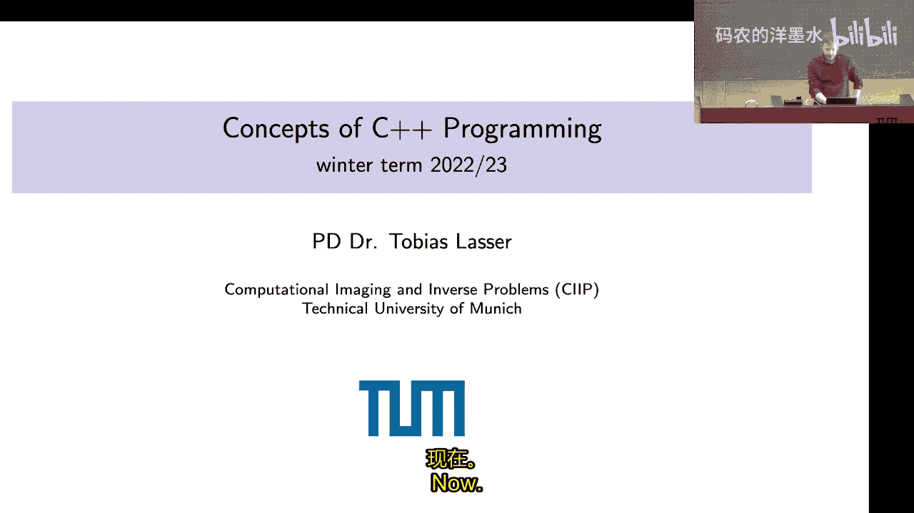

I come to our second session。And let's start this off with our feedback session today， which is。EBQR。

Please feel free to join the tweet， especially if you're listening remotely。 but of course， also。

 if you' are here in presence。But you're， of course。

 also welcome to raise your hand in presence and ask your questions regularly。I'd also like to。

Note for you that。We have support for you on Zdip。In the CPP stream。

 for the lecture and in the CPP homework stream， for the homework assignments。嗯。

In the CPP homework assignments， homeworks， basically， we talk about the homework assignments。

 And there's also a Gitla bo that announces automatically any changes that our exercise team makes to the Gitlab repositories in particular to the tasks and homework assignments。

 And if you want to join all the streams at once。 You can go to stream group and click on the C plus plus emoji。

 which will automatically sign you up。 Or if youre already signed up， sign you off。😊。

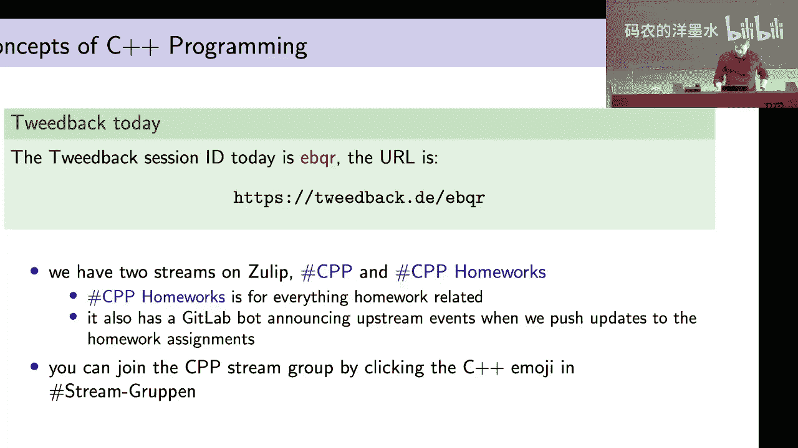

Right， another。Thing about next week。 next week， we have a public holiday on Tuesday。

So we won't have any lecture next week。It will have not take place。

Because I don't expect you to spend a public holiday here， and neither will I。嗯。

I have better things to do on public holidays。Right， however， the exercise session on November 3。

 So Thursday this week， obviously takes place as regularly。 But also next week。

 we will have an exercise session。 However， it will， since there's no new lecture content。

 it will be a special exercise session intended for questions and answers in particular， regarding。😊。

Any problems you might have to build your homework assignment code。

Any problems you might have with C make， which is what the next assignment will be about and other related issues。

So there will be boths。 There will be all of our exercise team there。

 Alessandro Yonas and David and all three of them will try to help you with any issues that you might have。

 So they will not not have any prepared content on November 3。

 but they will have an open ear for your questions and also for your request for help。And， you know。

 since build issues are usually typically specific to your computer and your specific setup with operating system。

 compiler version and so on， make sure you bring your computer if you want any help。

So that's next week， the week after that， we have a regular week again with lectured Tuesday and regular exercise session on Thursday。

 just like this week。😊。

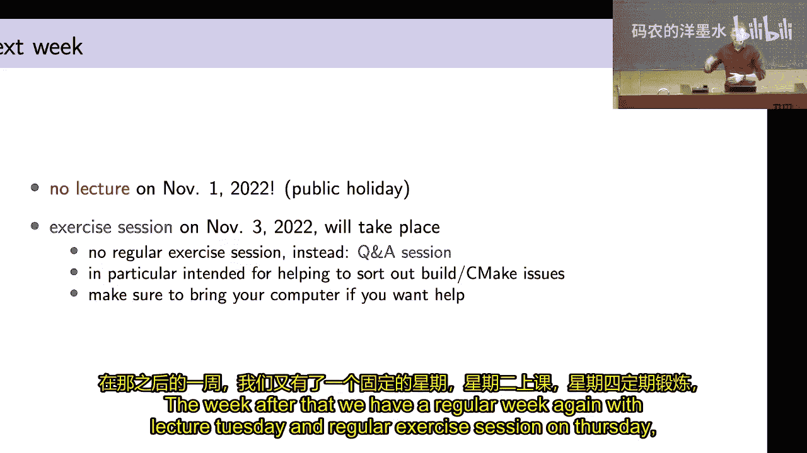

Right。What's a eat， I don't know。Right， sound seems to be working。 Great。

 I've been trapped in vim for a week。 How to get out。 Start Eex， obviously。Right。Oh yeah。

 And maybe a note， speaking of the homework assignments。

 you might have realized if you're running Windows， you're。Might be in a bit of trouble。

So definitely try to set up WSL if you're intending to stay on Windows or run a VM with Linux or a dual boot system or just get rid of Windows and replace it with Linux。

It's usually the better option for stuff like we are doing here。However， of course， if youre。

If you want to have some pain， feel free to do it with pure windows。It works， too。 I mean， it's， it。

 it's not。The compilers and windows are fine。 You can install all the compilers you want。

 You can set everything up。 It's just an extra step of。Yeah。Painfulness。Right。No， I see it。Right。

 I think the slides in the stream should be fixed。 now。 I must have accidentally moved them。

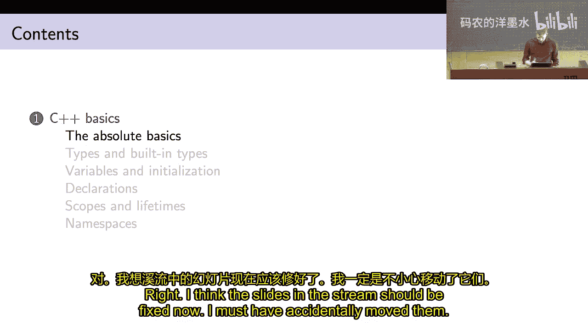

Oh， other then I moved them to the bottom for whatever reason。Sll be better now。 Thanks for the hint。

Right， let's start with the content because we have quite a few， quite a bit of content today。

 It's fairly easy content because we are talking about the C plus plus basics。

 starting from the absolute basics。Two types， two variables ins， declarations， scopes and namespaces。

So， let's hope。I'm going to get through out of this。Right， is there a pen update。

An update all about my frying pan。 There's a good chance。

 There will be an update because some of my PD students said they will come visit me at my home and help me do some cooking。

 So maybe that that will。😊，Give you an update about the pen， pen。Right。So。First off。

 before we start with the basics。What we will cover here is a subset of the basics。In principle。

Everything's rather simple。But of course， because， you know， it's。

 it's a programming language like any other。 it's， it's。However。

 there are special cases and exceptions to many of the things and specialties。

 And all of this makes it a bit more complex。And we will not be able to cover every。

Special case or exception here。Just for time reasons and not because I'm probably not aware of them because you don't encounter every single special case all the。

 all the time。So the lecture content might be。Incomplete。And even in places， I might be inaccurate。

 either knowingly， because I wanted I mad down a little to make it easier for you or maybe even other unknowingly。

 because I didn't know about it。 I'm not omniscient。

So if you want an accurate and complete reference。Then you should go to this website。

 CPPreference dot com。Which is a very awesome website because basically contains the reference to the entire programming language。

 C， plus， plus。😊，It's a reference。 So don't expect to be able to read it like a tutorial。嗯。

It's a reference。 So it's something which you look up if you need to know certain things。

 It's not a tutorial。But nevertheless， it's worth having it bookmarked。 If you do N C plus worked。

 I use it regularly。嗯。Or， in fact， what I use， I have a tool that converts the website into a doet。

 and then I have a doet viewer， which I can。Even use without an Internet connection。

 And it's a lot faster than using it in the browser。 So I recommend you to do something like that。

 too。And。Of course， these kind of talk sets exist for all kinds of other programming languages that exist for Cm。

 for Gi for everything， so。Having such a documentation browser is usually a good idea and installing all the do that you need。

Right。So， C plus plus basics。We already saw the minimalist C plus plus program。

Which consists of in main。Pur feedus。Curly braces。 And that's it。So。As you probably already noted。

 if you did the homework， your program needs to contain one such main function because it's the entry point to your program and also once the main function stops。

 your program stops。And。Of course， there's exceptions to this， which will。Get to in a bit。

 in a roundabout way。So this is the first part you have to do。 And once you've got this running。

 you're already a big step ahead。Now， as you know， in order to write down any kind of algorithm。

 you need four building blocks that every programming language in some。Fashion has to support。First。

 is the elementary processing step。Second is the sequence of steps。

Third is the conditional processing steps and fourth is a loop。

 As soon as you have these four building blocks， you can basically write any program that you can execute on a touring machine。

And， of course， that's also what basically every。Regular programming language offers you to do。So。

Speaakker output。 I presume you're referring the lecture hall。

 So I'll increase myself in the lecture hall。 if you want it in the stream as well。

 please let me know。 There is a separate slide off for that。Right。

So let's talk about the elementary processing step。That's。Declaring and initializing a variable。

Doing an arithmetic operation， stuff like that。 So here I gave you an example。

 It's declaring a variable x of type int， and it initializes it with a value 0。That's。

An example of an elementary processing step。 There's， of course， many more。

 but I'll leave it at that。Sequence of steps in C plus plus means you write several statements。

 Typically， you do this on different lines， But strictly speaking。

 there is no requirement to put it in different lines。

 The only requirement that you have is that you separate these two statement with a colon。And。

 in fact， Cpl requires you to have a colon semicolon。 sorry。

 a semicolon basically everywhere after a statement。Right。

 then we have a conditional programming step。嗯。Which is basically the if statement。

Which N C plus plus looks like this。 It's an if。Then you have parent theis。

 regular round parent thes， which contain the condition， which needs to be there。

And then you have a block， which is executed。 If the condition is true。

 then you have an else statement， which is optional。

And an optional block after the Earth statement that is executed when it false。

 So there should be no surprises here。 If you've seen Java or any C like programming language。

It's essentially the same， everywhere。And then， we have a loop。嗯。Like the vi loop， actually。

 C plasma supports several kinds of loops。 But as soon as you have a vi loop。

 all the algorithms can be written down。And the vi loop is similar to the if statement。

 You have a vile keyword。 You have a condition for the loop in regular parentheesis。

 And then in curly braces， you have the block。Or the body of the actual loop。

So let's speak about these blocks a bit。 B are marked by curly braces and C plus plus。 Again。

 they don't need to be on different lines or anything。And， in fact。

 if your statement is only one statement， you can leave those curly braces away so you can just write that singer statement here like it is in this syn text。

 or you can do it with the braces。That also works。 Obviously， if you have two statements。

 like in this example， you need the curly braces because otherwise。

 only the first statement would be interpreted as the block for Ls。

All this fancy formatting that you see here that the Kody Bras， for example。

 starts on the same line as the if statement at the end that this year is indented by four characters。

 I think， in this template。And that the curly brace here is on a new line and it is on a new line and so on。

 this is all I just for you to make it nice to read。😊，You could write this without any separation。

The important part are the curly braces and the semicolons。

 The indentation doesn't matter at all to the compiler。

 and also the new lines also don't matter whatsoever。

 So you can write horribly ugly code in one line if you want to without any spaces in between。嗯。

But yeah， that's， of course， not advised because usually also humans want to read the code and they want to read it in a nice fashion。

So what's also important about these blocks is that they mark a scope。And what a scope is。

 is something we will talk about today later on， because it matters for a variable lifetime。

 particularly for automatic storage duration and a variable lifetime。Right。For the loop。

 I already promised there are several ways of doing a loop。

 You can have the y loop that we had before。With a condition and a block that if it's more than one statement has to be enclosed in curdy braces。

 you can have a do my loop which evaluates the condition at the end of the first of。

 of the loop execution of the execution of the loop body。 And then you have the four loop。

Which looks a bit different， but essentially it's the same。 There's an initialization statement。

 There's the loop condition， and there's。A statement that's executed each time the loop body has executed。

So that's just a very shorthand notation。 And you see that you have to separate these three with semicolons。

All these three do the same thing。In this example here。The only difference。

 slight difference is not in functionality， but in meaning， because here。

 the variable A in these two examples。Also exists after the Y loop。

 So if you write any code that relies on a， you can do so。In the fall loop。

 the variable A is local to that particular fall loop。 So as soon as you exit， the fall loop。

 A no longer exists。 And if you start writing code here and refer to a， the compiler will say， hey。

 what is a， I don't know。

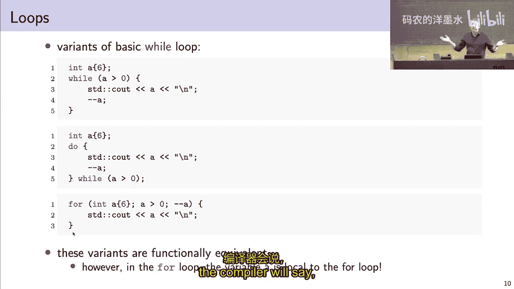

Right， and as usual it as loop control statements， which is fairly typical for all the programming languages。

嗯。There's a break statement。 If you wan to exit the loop early， there's a continuous statement。

 If you want to continue the loop without executing the rest of the。Nope。

So I'm having conflicting statements here on tweetback。

That one says I should turn down the volume in the lecture hall。 So I turned it down again。

 If you now come again with turn it up， I don't know what to do。

And you're already asking about the difference in initialization。 I will get to this。

 I'm not ignoring your question。We talk about this。Yes。Yes， there， the so this。

 the control statement here in， in the fall loop is executed。Each loop execution。Right。

So these were the absolute basics。 You know， the building blocks。Elementary processing statement。

 sequence of steps。If statement and loops。Once you have these。

 you can basically write all the algorithms that you need。 So basically。

 anything that comes after this is an elaboration on those four things。

Or add ons to make your life easier as a programmer。So let's talk about types now。嗯。Ideally。

A language has type safety。What does type safety mean。Type safety means that if you have an object。

It will have a type。And you will be only able to use that object， according to its type。Meaning。

It's used only after initialization， meaning its used only operations that are defined for that particular type。

 And it means that every operation that's executed on that type will leave the object in a valid state afterwards。

 So that's no undefined behavior。Right。That' have different types of type safety。嗯。For example。

 the aesthetic type safety。Which means a program that violates type safety will be caught by the compiler。

 and the compiler will complain about hopefully every violation of type safety。

Then there's dynamic type safety。Which will be reported at runtime。 So your program runs。

And once it encounters a type safety issue at runtime。

 it will report this and maybe stop the program or whatever。Right。So ideally。

 the language is typeafe。And it's both。Static type safe and dynamically type safe。Now。

 what's true about C plus plus is that it's neither。

It's neither statically typea nor dynamically typea。

That's one of the reasons why it's so easy to shoot yourself into the foot with C plus plus， because。

 yeah， these things aren't guaranteed。And that's why some languages。

Like Java or some of the interpreted languages are。

Safer than C plus plus because they don't allow the type of stuff that C plus plus allows。 Now。

 the question is， why does C plus plus allow this， Well， there is two， two reasons。

 One is backwards compatibility to see。So since you have this。

And it's also not statically orically typea。 That's where it's inherited from。And， of course。

C plus is aimed at performance critical code， and some of these type safety things would kill your performance。

 So that's why they're not in。And of course， if you are really， really rigid with the type safety。

 it always doesn't allow you to elegantly code some of the things that you might want to do。So， yeah。

 there's good reasons why。C plus pass is neither statically nor dynamically typea。However。

It also is a problem because that means your program can do。Stupid shit。If you don't take care。

That's why theres two words to help you。To ensure this type safety。First is the first tool。

That sounds a bit wrong。 The first tool is yourself。Not in a derogatory way。

 but meaning you are the best tool to make sure your program does good things。

So you should also try to very hard not to violate type safety。

 at least on purpose and ideally also don and do it by accident。

And then to make sure you didn't do it by accident or in purpose， that's all the tools。First。

 there's the compiler。C plus is not statically type safe。

 but the compiler will catch a lot of problems。 Not always will it be an error。

 but it will always often be a warning。And warnings are usually not useless。

Marnings point out that there is a potential issue there that you probably should fix somehow or solve in a better way。

So don't ignore compiler warnings。Then there are static analysis tools。

 which basically try to ensure static type safety。These are additional tools that you run on your program。

One of the examples is clang tidy。And then。It will help you find potential issues。

Why is this not part of the compiler？Well， because it is not part of the standard。

But people realized it's a good thing to have such tools。 And that's why when Kang was built。

Many and Kang was actually built with the intention of having many kind of applications building on the language server like Kang tidy。

 Kang format， Kang D， all the stuff。 So， so that's why this all basically goes back to Kang。 Yeah。

 we have static analysis tools， of course， ass other static analysis tools， too。

 But I think Kang tidy is the best one。 So use it。Right。And then there's dynamic analysis tools。

Like sanitizers， various sanitizers， they are less complete than the static analysis tools。

 but they also exist。And of course， this requires you to compile your program in a special way so that the analyzers are active。

 this will kill your performance， but of course， you don't do this on production code。

 you do this when you test your code。So， and as you might have seen it。

 we talked last last week about the。Continuous integration pipeline and in any serious software project。

Which doesn't include your homework。 Don't worry any serious software project should have see I stages that execute both the static analysis tools and the dynamic analysis tools。

And I gave you an example of our software library El。 And， of course。

 it contains these pipeline stages。

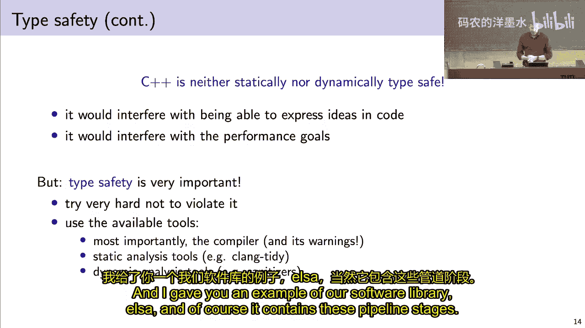

Right。C plus+ is a strongly typed language。And that also me。

That every object that you have requires a type。And now you might ask， well， what types do I have。

 That's built in types， which I will present now， like integer， floatat and these things。

 And there's a user defined types， like classes， which we will deal with。In three weeks。

 something like this。 So since next week， there's nothing the week after that。

 there should be procedure programming。 I think object or the programming will be in three or four weeks。

 something like this。Right。And essentially， what you do is you declare and define anywhere within a scope。

Which is a block。 Basically， look， here's a type of something。 And I call the variable by name。

Whatever。You can initialize the variable using these curly braces， initializer。

But initial initialization is actually a。Kind of bigger topic I wantan to talk about in a few minutes。

 So let's stick to the types for now。What types can you put here in place of this type thing。

There's stability built in types， which I will go over now。

 And there's user defined types that you yourself will be able to define。

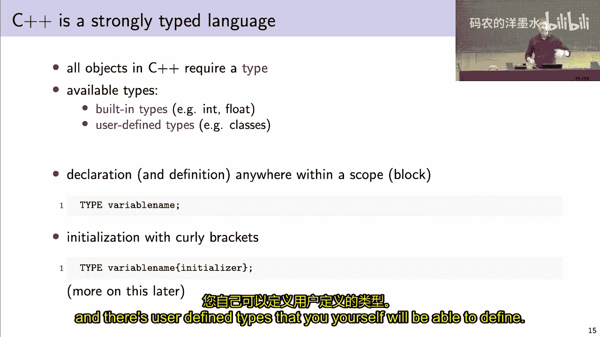

Typically， classes。So we have numbers as built in types。For example， natural numbers，1，2，3，4，5。

 and so on。These are usually these are represented using binary representation。

 and they are typically called unsigned or some variation of unsigned。That's the whole numbers，0，1。

-1，2，-2，3，-3， and so on。Which are represented using signed integers。

These are stored using the two complement representation。

And this is actually something I stumbled over。When I introduced this course。

 that was just before C plus+ 20 was out。And。I also already wrote there that the sign intes are already represented by two complement。

 and in fact。Until C plus plus 20， this was not in the standard。

 A compiler could choose what to represent signed integer with by by themselves。Of course。

 all major compilers did use the two complements。 So it was kind of a non story， but。

It was actually surprised because strictly speaking。

 you could have also been using the one complement or some other binary representation of。

It the whole numbers， which is a bit weird。 But yeah， that's， that's what it is。And of course。

 as floating point numbers， you know， these 1。756 or 3。1415 and so on。

 these are represented using the I E7，54 standard， which is basically also what every other programming language supports。

 And of course， you have all the regular operations plus minus multiplication division modulus computations。

 increment decrement comparison operators， smaller， smaller or equal， greater greater or equal。

What's maybe a bit unusual that not every programming language has that equal comparison is two equal signs。

To make sure to be able to differentiate between an assignment。

 which is one equal sign and a comparison， which is two equal sign。Scis， and then you have not equal。

 So this is the not operator and the equal。 So not equal means well， not equal。 Obviously。

 any of logical operators and and。 so double M percent for the end operation。Or the。

 the vertical bar twice as the or operation and the exclamation mark as the not operator。Right。

 theres a few questions already in feedback。 I will not answer all of them in class here。

 but as usual， I will answer them after the course。嗯。Once I'm back in my office in writing。

That's not because I want to ignore your questions。

 but because there's too many and some of them don't fit what I want to talk about right now。

Could you please give an example of F plus plus is not typeafe。We will encounter them。 Don't worry。

And， you know。The first stuff I show you， I want， I want it to be good C plus plus so that you don't learn the stupid crap in the beginning。

 We will come to the stupid stuff later on。呵。I'm glad this lecture is in English。

 so you can't say deck with anymore。😊，Little do you know， I can still say deck with。

Doesn't type safety mean that each object has a certain type？That's not type safety。嗯。There's。

 that's actually several words， and。Let me see if I get this together correctly。There's。

Sttic typing and strong typing。Sttic typing， the opposite of it is dynamic typing。

 That means static typing means each object needs to have a type， which is the case。 N C plus plus。

 dynamic typing means。The object can have whatever type， and it can change during runtime。

 which is typically for some of the interpreted languages like Javascript or something。And then。

 there is the type safety。Which ensures that whatever you do with these objects。Is safe。And。

 of course， that differs from language to language。 How this is done。Right。

 there's a lot of questions coming up that I will deal with in the course either today or in the next upcoming lesson。

 So I'm ignoring those questions for now。 Let's stick now to the natural and whole numbers because there's a table。

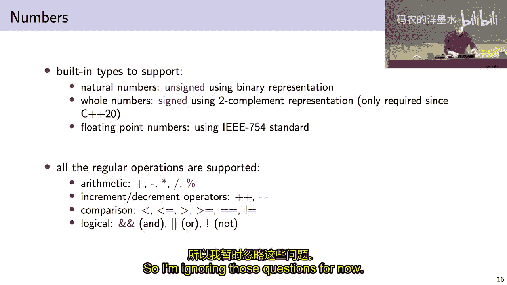

That I lift。Where did I lift this from。Either it was CPP reference or some other source or the I CPP guidelines。

 I don't remember。Anyway， it's， it's the same everywhere。 So the thing is， there's signed。

Integers and unsigned integers signed is for the natural numbers。

And unsigned is for the whole numbers。And then there's various versions of it。

 So here's a short notation of it。 Here's aliases that mean the same。 So you can say long in。

Or just long or assigned long or assigned long in。Whatever floats you about out of these。

 I'll usually refer to these things using these here。Short。

Is a short integer either signed or unsigned that's guaranteed to have at least 16 B。

Int or unsigned int are integers that are guaranteed to have， at least。16 bits by the standard。

Long end and unsigned， long end is something that's guaranteed to have 32 B and long。

 long end and unsign， long， long are guaranteed to have 64 B。 Okay， so fast so good。

This is the minimum guarantee。 What are the exercise sizes in practice on all kinds of systems。

So if you have a 302bit system。Which these days are becoming pretty rare， I think。Short will be 16 B。

 Regular in will be 32 B。Long will also be 32 B and long long will be 64 B。However。

 that's not guaranteed。 That's just typical size。Now， if you are in a 60 fobit system。

 which is these states， basically everything or almost everything that you use as a consumer。

 you will have 16 and 32 B for short and in。A long int will be 64 B unless you are on Windows。

 then it's 32 B。Don't ask me why Windows decided to do this as opposed to everybody else。

Doesn't make any sense。 and along long is typically 604 bit。No， why is it like this。 The reason is。

 obviously， And， of course， there should be columns for 16 B systems and for 8 B systems。 And。

 you know， maybe also eventually a column for 128 B systems。 Why。

 because that's what the processor supported directly。In the beginning， there were 8 bit processors。

 That's when I started using computers， then there were 16 bit processors for a while。

 and then there were 32 bit processors， which stuck around for a long time。

 and then we started using 64 bit systems。 But does it mean。

 it means what is the internal register size of the CPUs and since C plus plus and C。

 which this also applies to is a programming language that's basically down bare to the bare metal。

With the intent of performance， these types basically mirror the register sizes of the architectures。

And that's why it's such a mess。And you basically need to know your computer。

 your operating system in order to know what size you actually get。

So if this pisses you off and you to be sure， what's what。

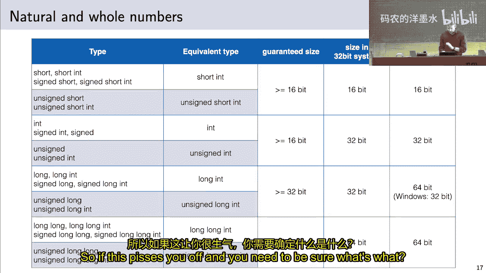

That's why we have these fixed integer types， which basically tell you， okay， I want 8 bit。 So。

 and exactly 8 bit。 So I'm going to use an int 8。Under core T or in U and 8 under core T。

 if you want uns signedigned。 And then you can do this for 16，32，64， and so on。

This is all defined in the standard header， C SDD int。And they are all defined in the namespace。

 S TD。Yeah， I know my old joke。 This is not as sexually a transmitted disease。

 This is the standard namespace。SDD。Can don't ask me why they chose this abbreviation。Anyway。So。

This is all really nice， however。These types are only there if the compiler actually supports them。

So if you use them in your program and you compile it using a compiler that doesn't support them。

 your program will not compile。So if you want to write truly。

 truly portable code that works over all kinds of platforms with different bit sizes and compilers that support some of them and some of them and don't support some of them。

You actually have to resort to See make magic， to deal with that。But on any reasonable system today。

 these types are all there。 and you can just use them。And if you want to guarantee sizes。

 then you should use them because this long here。This might be 32 or 64 bits。

 You don't know unless you check the Xite system you're executing this on。

If you choose in 32 type or in 64 type。You get exactly what you are asking for。Right。

What's the underscorecord T stand for。嗯。I don't know if it's explained anywhere。

 My interpretation of the underscoreoscor T is type。 So U in8 type。If that's correct， I don't know。

So yeah， on any recent Linux Windows M Mac system， this will work。Why does the exact science matter。

W， why does size matter？Let's consider。What numbers can you fit into a 16 bit integer。

That's unsigned。Fromm 0，2。65536。So if you a number that's bigger， like 100000。

 you can't store it in a 16 bit variable。If you have a number that。5 billion。

It won't fit into a 32 B， unsigned or signed integer。Because the maximum size of a 32 bit integer。

If it's unsigned， is 4。2 billion something and 2。1 billion something if it's assigned in teacher。So。

If you need to be sure that you can operate with certain numbers。

 you need to be sure of the size of your entitiestegers。As simple as that。

And why would you not always just choose the biggest that supported。

 Because it's potentially a waste of memory。 If you know that your integer will run from 1 to 1000。

 Why should you be using a long， long。 You're just wasting that memory。

 And it's not just wasted memory because usually long longs。

Might even take more time to execute than a regular loan， depending on your compiler and system。So。

 young。This is a language。 Keep that in mind。 C plus。

 this is a language that's optimized for performance。

If you wantna have a language that doesn't care about performance and doesn't have to care about the sizes of indigers and stuff。

Use Python or something like this。Right， a ja。Is the modulus operator the same as in Java for negative numbers。

Oh my god。 I don't know。I don't know how is the modulus operate and C plus operates for negative numbers。

 And neither do I know it for Java。 So that's something I would have to look up。

 or at least I don't know it off my head。

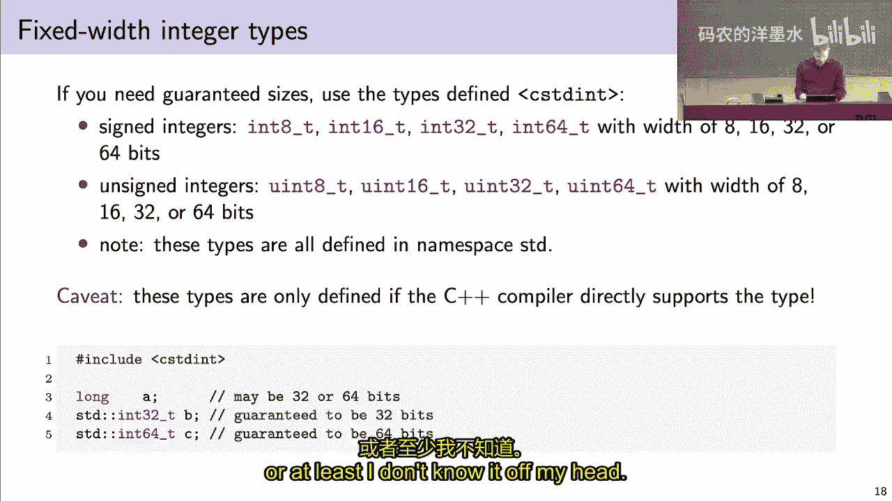

Right。Now， if you want to represent integers， integer constant， you need integer literates。

So basically， these lits are numbers that represent values of integers。Like 42，4，2。

That's a inte integer literal。You can also do octail base 8 representation if you prefix it with a 0。

Where's my mouse here， or you can do hexaadeimal base 16 representation。

 If you prefix it with a 0 x or a 0 capital x。 Both of them work。

Why would you want ocal or hexadecimal representation？ Well。

 because it works very nicely with things that are 4 or 8 bit sized。Right， you need to take care。

 obviously， on the type of integer。 So， for example。0 X， F， F， F， F， basically， that's 4。Bys of once。

 right。And depending of your。Of the size of the integer and the synness of the integer。

 this might represent the number -1。To complement， right， or 65535。

So you need to take care of it there if you're mucking around with， this type of stuff。

You can also make sure you specify the type by adding suffixes like U for unsigned or L for long or L。

 L for long， long or U L for unsigned long and so on， and on。

And if you want to make big numbers more readable， you can also add these single quotes as separators。

 they don't do anything。 They don't cost anything， but they make readability a bit better。Right。

So you asked about bull values and char。Yes， boy。Logical values。Logical values are of Tpo， B， O， O。

 L。Possible values are true and false， surprise。And the size of a Boolean variable is undefined。 Oh。

 well， the standard doesn't say anything about it。 So basically the compiler decides how big it is。

 might be 8 bit， might be 16 B， might be 32， might be 64。 you don't know。 But in the other。

 on the other hand， it doesn't matter to you unless you really， really care about memory performance。

 then。You might care， and then you might not want to use a bull because you don't know in general what size it will have。

And， of course， Booleions are often used to do some kind of condition。

 And then the condition is used， for example， in an if statement or a while loop or and so on。

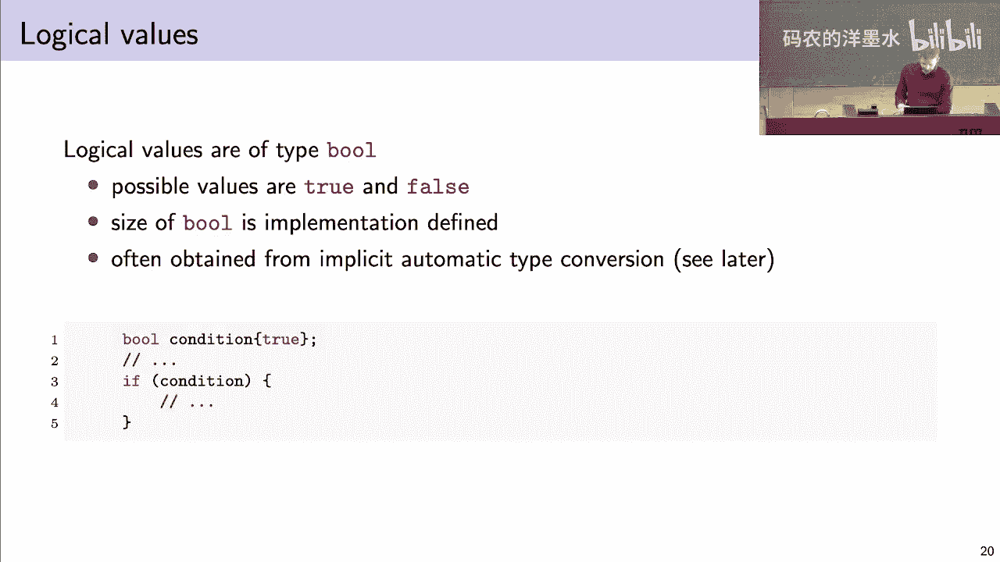

We have floating point numbers in the promised IW 7，5，4 format。

 like basically every other programming language， we have float for 32 B floats。

 We have double for 64 B floats。If you think about decimals。

 floats usually work up to 7 decimal digits around that。And that iss around 15。That's again。

 the same， basically everywhere。 And again， you care about。Because of storage。

 doubles need double the space than floats。 And， for example， if you look for performance。

And I might make a very popular example right now， deep learning， training and deep learning。

You might a that training with floats or even half floats。

It's a lot quicker than training with doubles。Why， well。

 because you require only a half or a quarter of the memory。

 And that means you can do more things in parallel。And that's why it matters。 And by the way。

 C plus plus， the standard does not support half floats。

So if you have anything that wants to use half floats， it's not part of the standard。 You need to。

Yeah。Need to be aware of that。 What does exist in the standard is a long double thing。

 which is an extended precision floating point number。That doesn't have a fixed size。 Typically。

 it's more than 64 B。嗯。Sometimes it's up to 128 B on the traditional engine architectures or M D architectures。

 X 86 and X6 X 64。It's typically 80 B because that is what the processor have as in their。Registers。

80 bit registers。 And that means approximately 19 decimal digits。

 But if you are working on intel systems or MD systems with those 80 B floating points。

They don't necessarily。Follow the IP E standard completely。 There are some exceptions。

Which typically， you don't have to care about。 But sometimes these are edge cases that you were。

Encounter。Right， floating point values are special because they have a certain special number of special values。

They have infinity or minus infinity。 So， for example。When can this happen， for example。

 when you divide by something that's very close to zero？And you can have another number is。

 if you do divide by 0。um。Or you can also have two representations for 0。0。0 and-0。0。

 They are two different bit patterns， but they have the same value。

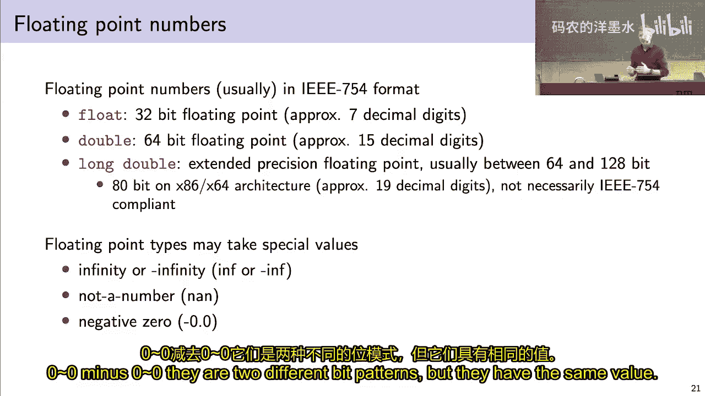

And you need to take care of that。Right， floating point litals exist just like integer litals。

 They are using the decimal dot regardless of your locale settings。 So also in Germany。

 C code uses a dot。Or C plus plus code uses a dot to separate the regular number and the decimal part。

 You can use the scientific notation with E to the power of whatever or minus to the power of whatever。

And by default， these litals are of type W。If you wanna make sure they are of type float。

 you add a suffix like F or capital F。 If you wanna make sure they are of type long， long W。

 you add an L or minus L。And also here， you can add single quotes to make things more readable。

How is in defined in the language， I don't think it's defined at all。

 And its memory science is exactly what the floating point numbers take。

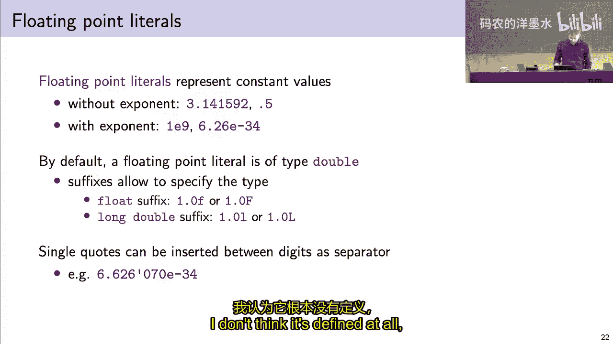

What's the difference between negative and 0。And negative 0 and 0。 Well， it's the same value。

 obviously。What's it's use， it's not there on purpose。 It's there because of the IW 7。

54 floating point representation。 That's just two ways of representing 0 there。And the thing is。This。

Might happen。And this is why you need to never， basically never use equals equals to compare floating point numbers。

Which language supports half loads。 Well， if you， if you think of Kuta as a language， then yeah。

 it supports half loads。Oh， this is a good question。How would you represent a currency。

Because float and double are not accurate， so。That's not entirely true。

 Float and double are very accurate because what they represent are accurate values。 The thing is。

Float and doubles or long doubles or whatever。 All All the floating point numbers cannot represent exactly all the real numbers。

And in particular， this means if you。Have an amount of money。 A certain amount of money。

It might happen。That this is not representable exactly as a float or as a double。And this is。

 of course， true for anything that uses real numbers and tries to store it as float or double。 But。

 of course， it matters a lot with money because you don't want to lose money， right。

So if you wanna do an exact representation for currency or any other number。

 don't use floating points use， for example。Fixed precision。It's not called fixed point numbers。

This fixed precision or use some combination of long， basically arbitrary length integers for。

The the whole holy。Money part， So like euros for the sense or so you can use fractions。

 rationalness or whatever。 I mean， there are several options how to do this。

But if you wan to be totally accurate， then yes， don't use floats or doubles for anything where the value is really important。

If you don't compare floats with the equality operator， how do we compare them。

 We compare them with smaller and equal or smaller， equal。Bigger than equal。 That's what we do。

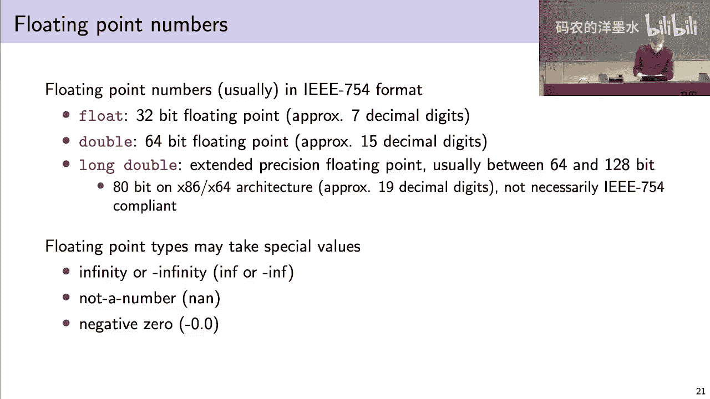

Right。We had the floating point literates。 Oh， yeah。 now we come to characters and strings。

 That's a sore topic with C plus plus。 It's a really mess。Why， well， because of legacy， C。

And also because the standard designers of C plus plus were。Maybe not the most clever in the few。

Standard iterations。So what do we have for characters， For characters， we have type cha。

Which has a guaranteed size of 8 B。But you don't know if it's a sign cha or an unsigned cha。

 So you don't know how many characters you can actually represent exactly。

 So what you should do if you use a char， you should restrict yourself。To the Eci 7 bit alphabet。

 meaning English alphabetic characters， noummlas， digits， and a few of the punctuation characters。

If you want to represent more characters， you can use Char 16 type and Char 32 type to represent UTF 16 and UTF 32。

 And for some reason， they took until C+ was 20 to support UTF 8。Which is kind of。

The most popular option。Char A type。 And then there's an abortion that they introduced many years ago that's called W Char type。

 which is， yeah， just forget about it。 it it was a stupid idea。Right。That's it for Charles。

Not very nice。It gets better for strings because basically， how strings are solved。

 They are solved with the standard library type， SD string。So basically， see plus plus。

 as a language does not have a built in type for strings。

It uses a user defined type that's defined by the standard library。

 So it's almost as good as a built in type。 But， in fact。

 it's a class that's defined in part of the standard library。 It's part of a standard and everything。

 So， so it's guaranteed to be there。 But strictly speaking， it's not a built in type。

That's why it's in the namespace SDD， and it's called string。

 And we will talk about the details of string later。

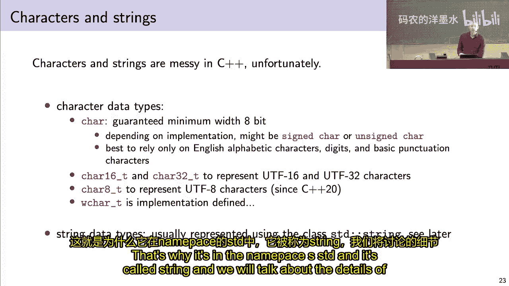

Right， there's also character lits like this integert floating point lits。

 They're usually put into these single quotation marks like here。

And you can also have escape sequences， because if you wantan to represent a single quotation mark。

You can't。Unless you put a back slash in front of it， because back slash is the escape character。

 Of course， a back slash now can't be represented。 So a back slash back slash represents the back slash character。

 and there are stuff like new line， which is a certain ASi code。 It's a back slash n。😊。

And then you can also do unicode。By doing a prefix back slash U and then the Unicode I D。By default。

 these type of litals are all of type cha。 You know。

 the thing that doesn't have a well defined size and a well defined synness。So additionally。

 there's the prefixes。 Now， at this time， it's prefixed not a suffix because U is already reserved for inte litals。

 So here you have U 8 for U TF 8 literal U small U for U TF 16 and capital U for U TF 32。And。

 of course， UTF8 only exists C plus was 20 for whatever reason。

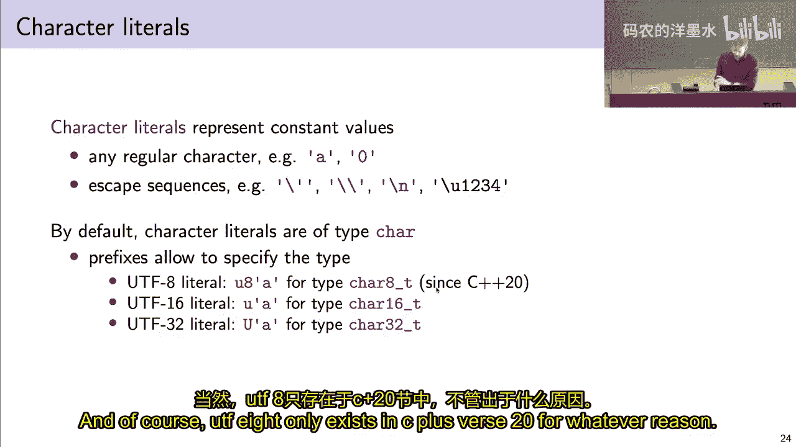

Right。Now。There's the type void， which is a bit weird because essentially it's。

The type that is not a type。 So this type doesn't have any values。

 You can't have any objects of that type。And its basic use is for indicating that a function doesn't return any value。

 so。This year doesn't work。 You can't do a void object。

 The compiler won't accept this because void cannot take any values。

 but you can specify the return type of a function to be void in order to indicate that there's no return type。

Right， why do we need characters， Char type now that we have strings in C plus plus。Well。

 you don't always want to use strings。 Strings are implemented to represent character sequences。

 So there are certain optimizations in the library。And basically。

 a string with one character takes a lot more memory than a single character itself。

 So if you wanna take care of your memory， you wanna use。呃。Character types。

What's the difference between U and 8 type and cha。U and8 type is guaranteed to be exactly 8 B。

 While char could be 8 B or more。 And you don't know if it's unsigned or signed。

But on a certain compiler operating system combination， your cha and U and8 type might be the same。

 but they are not guaranteed to be the same。 In fact， I would say in most cases。

 they will not be the same。Are there string litals。Yes， kind of。 We will talk about them a bit later。

Is there any other use for you use for void a side of declaring functions， not really。

And what your colleague answers for avoid pointers， that's evil。 Don't do that。You can do it。 It's。

 it's allowed in the language， but it's something we don't use here in modern C Plus， plus。

 It's an evil C art from the last century。We don't want to use that。

That's what mean int 8 type and cha 8 type are exactly the same in terms of memory representation。

 maybe。In terms of meaning no。1 is an integer。 One is a UTF character。

When something is implementation defined。Does the compiler take the decision or does the decision depend on the architecture。

嗯。Both kind of， sometimes it depends on the architecture。

 But the ultimate choice is with the compiler。Is using fixed size type almost always the best practice。

Depens。In， in principle， probably yes。But sometimes you know that you don't have to care。

 So then you probably don't use fixed types。 But yeah， it's a good practice to， to get into。

Aren't void pointers used for generic pointer type。 No， they even don't use them。No。

 pointers are even。 forgetge about them。Right。So let's talk about。 and I mean it seriously。

 Pointers are evil。 They are one of the main sources of why C code and C plus plus code fail。

Why programs have security issues， why they crash。There's replacements for pointers in modern C。

 plus plus。Everything you can do with pointers， you can do with modern C plus in a better and more safe way。

 And that's what I'm going to teach you here。 So forget about pointers。😊，Their ancient history。

You will， in 99。9% of all programming cases， you will never need them anymore。

And I'm really serious about this。 The main source of errors in C， and C plus code are pointers。

Get rid of them。There's reasons。 There's a good reason why， for example。

 Java doesn't support pointers。Right。So， no， point I love is's not allowed in here。Right。

 so variables in initialization。 I promise to talk about this。But， first off。

 before you use a variable， you have to define it。Or these declare it。 But for variables。

 declaration and definition are。Almost always the same。

So what you do is you can also define several variables at once。 Where's my mouse here like this。

 You can declare two integers， A and B。Why am I not using a fixed size integer here。

Because it's shorter。 And for this snippet here， it doesn't matter。Or af float。

 And the recommendation here is， by the way， to not。

Declare several variables of the same type using the common notation like this here。

Because once you add in its anization， things might become a little bit unreadable。

 and there might be surprising results。嗯。So yeah， and typically， typically。

 what you should do is have one variable declaration per line。

And you can add an initializer like this。 We've seen this already， with the curly braces。Now。

 as some of you have asked already。

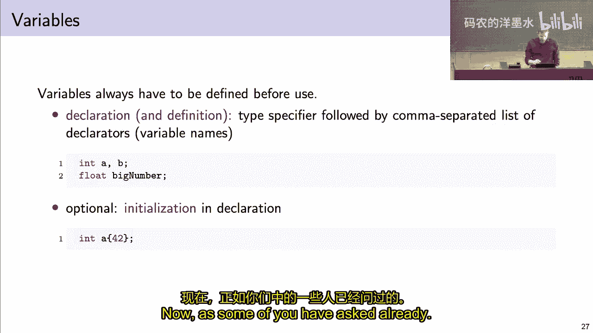

嗯。Why do we initialize using the curly braces， Isn't there also initialization using the equal sign。

 the assignment， basically or the regular braces， Yes， there is。Sorry， I didn't。

I'm not sure what's happening here。My。Let's try this again。

So I don't know what's up with the microphone。Let's see if retaing it helped。Anyway。

So let's try it like this。 Does it help。No。So， let's try this again。O。Yeah。

 so why are there so many kinds of initialization。Well， first off， this is taken over from C。

 This is legacy。 and this is was newly introduced with C plus plus 11。 why。

 because one of them is the unsafe version。That's the see things here。

 And one of them is the safe version。And it's not just a safe version。

 It also allows a few more things when once you deal with user defined types。

 So it's a good practice to just get used to use these curly braces for any sization。😊。

Just get used to it。 It's the better way of doing it。 Why is one safe and the other unsafe。

 It's about implicit conversions。So。The unsafe versions allow you to do implicit conversions that might sometimes surprise you while the safe version does not。

We'll make some examples for this。And unfortunately， another relic of C and also， of course。

 an issue because of performance。嗯。Inititalization is unfortunately optional。

 You can leave variables uninitialized。 And， of course。

 that means once you start using them before they have been initialized， you get undefined behavior。

Why is this bad？ What does undefined behavior mean。Okay， so I have one option， actually。

 let me let me。You know， traditional troubleshooting。 Let's try if the receiver is a problem。

 So use a different receiver。 It still turns up。 It might be that the actual microphone is the issue。

 And then I have this disgusting piece of thing here that I can try。Yeah， I prefer my own microphone。

 you know， for hygiene reasons。Anyway， why is undefined behavior bad。

Because it means whatever happens is undefined。Right。

And when your program is executing and you expect a certain behavior or a certain output。

That's not what you want。 What can undefined behavior give you， undefined behavior could be like。

You get a different result from what you expect。Your program might crash。

Your program might have might try to write over a memory that belongs to another program。

 And if your operating system isn't nice， it might allow it。Ths like this。And， for example。

 if you use uninitialized variables。Yeah， the content of that variable could be something。Unexpected。

So yeah， unfortunately， this is something that C plus plus hasn't enforced also in its modern version。

 So inization is still optional。 So let's see why the safe initialization matters。

 Where's my mouse's pointer here。 So here you have a safe initialization。

 You initialize a double with a literal of type double。😊。

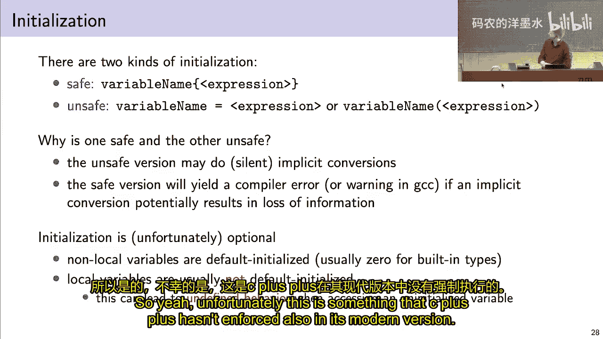

Everything's fine。Unitialize af floatat。Using the unsafe version of in ferization with an integer。

This might be a problem。Because floats。Can't represent every integer accurately。For 42。

 it's not a problem， but for bigger integers， it is a problem。 So here， an unsafe。

 implicit conversion takes place。And if you have a nice compiler。

 it will warn you about this unsafe conversion。Here's another thing。 He' is an unsigned integer。

Which I'm assigning a double value。 So what happens here is implicitly， this value。

 double value is converted to int。 So basically， the decimal part is cut off。And it's converted。

 This might be what you wanted。But this might also be not what you wanted。

 And since it's hiding in this innocent syntax， like up here。

 you might not realize what's actually happening。If you do it with a regular parentheesis。

 the same thing can happen。 You can take an unsigned， assign it a float value。

 and it will again truncate your floating point value。Implicly， without warning。

And if you use the safe initialization， the same thing doesn't work because an unsigned can't represent a double value and an unsigned can't represent a load value either。

So if you do want to do this。You can make explicit cast to make sure， yes。

 I want to cut off the thing。 You can call a round function， for example。

 or you can do an explicit static cast， which we'll talk about later。😊，So， yeah。

 that's why you should get used to using the safe initialization with the curly braces because it's just the better option。

And， of course， whatever you put in the initializerr can be complex。 It could be longer numbers。

 It could be expressions， where you compute， something and so on and so on。Right。So。

 and as you're saying， C is basically。The Achilles healed of C plus plus because， of course。

 C plus plus is backwards compatible。And。But it's also its strength。

 If C plus+ weren't backwest compatible， you could go towards something like rust。

But then you lose all the code base that already exists。So， it's。No wind situation。You do one thing。

 then one aspect is cool， but the other is not。 And you do the other thing。

 Then it's the other way around。So， yeah， and of course。

 thepl took the approach of staying backwards compatible with sea。 But nevertheless， it means that。

When you program。A new thing。 you don't need to be backwards compatible。

 So you write it using the modern C plus techniques so that you have。Good code。

So there's too many questions。 I need to skip some of them again。

 I'll answer them later in the office。Right， so declarations， let's talk briefly about declarations。

 Anything that you want to use， a function， a variable。

 anything has to be declared before you use it。 why so that the compiler knows what it is。

So for objects， for references， for functions， you need to do a declaration。And a declaration。Well。

 the actual syntax is really cumbersome。 So I condensed it。

 This is the inaccurate and not complete part of the lecture here。

 So you can have a prefix like static of virtual。 You have the base type。

 which could be a user defined type like S TD vector double or a constant or something。 It's a name。

Or some additional decorator stuff like this。Or a suffix and an optional optional initializer a function body。

Right。Let's forget about this。 This is just for completeness。 Let's look at particular examples。

 first， there can be a cuts qualifier， which is kind of important。

 You usually put it before the type。 It's also allowed after the type。 But I think in my eyes。

 that makes it less readable。 and it's also a lot less popular to do so。

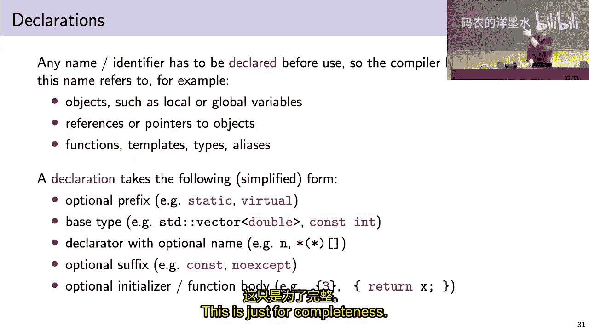

And a constant object is obviously considered constant， so you can't change it。

So if you declare a constant integer I and try to change it afterwards。

 the compiler will tell you no。

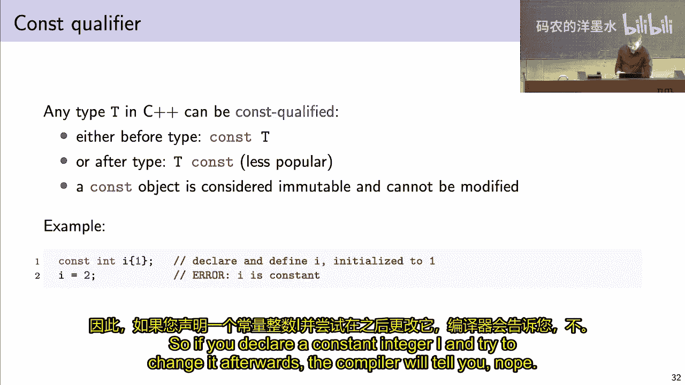

So let's look some examples of declarations。 So here this declares and defines a variable I of type int with no in its utilizationization。

This year， declares a variable。Called count。It initializes it with a one。 But the type。

 and that's maybe new that you might not have seen before。 This is， the type is auto。

Autto is a keyword that says， deduce the type automatically from the initializer。And now it become。

 it matters what the initializer is initializer here is an integer literal。

And you might remember that an inte literal by default has a type of int unless you specify like a suffix like U or U L in order to get an unsigned long in or something like this。

Here's a constant floating point， with an initializer。Here's a type from the standard library。

 a vector of strings。Called people， which is also initialized using the curly braces and several entries for this vector of type string。

 And here you see it， this is kind of。The string lital that you can do。 So。

 so the character lit were single quotes。 If you do double quotes， you get a string lital。

And C plus plus， and also。One another reason to actually use the curly braces here。

This kind of initialization here， this kind of list initialization only works with the curly braces。

 If you try to do an assignment here。Or the regular braces， the unsafe inization techniques。

 neither of them will work in this case。 So another reason to get used to just use the curly braces everywhere。

Because then you can be consistent。And here。There is an example of a very declaration that is not a definition because it has a modifier external。

 which means。It only declares there is a variable called error number， which is of type integer。

But it's actually defined somewhere else， probably in another library。

But for the purposes of this program， the compiler will know， okay， it's an integer。

 So I know what to do with it。 What operations are supported on it。 It's called error number。

 but it's defined somewhere else else。And we can。Continue。Usingstructs。

Which is basically a structure like a class。 We will get into more details about this later on。

 not today。Here is a function。Return type integer function name day argument is a variable called Pve of type date。

 and the function body does something。Here's a function。That returns a float。

 It's called square root， and it accepts a float argument。 So as you see。

 the parameter doesn't have to be named， especially if you don't define the function body afterwards。

 it doesn't really have to be named anyway。You can declare。

User as a structure without defining what the structure actually is。 This is for a declaration。

 You just tell the compiler。 Oh， user is some kind of structure。

And as long as the compiler doesn't need the size of the structure， you're fine。And finally。

 you can do an alias。Of， for example， the standard library type， S TD complex of type W。And call it。

Comleplex。Right。It's just an alias。 So it's just another name。

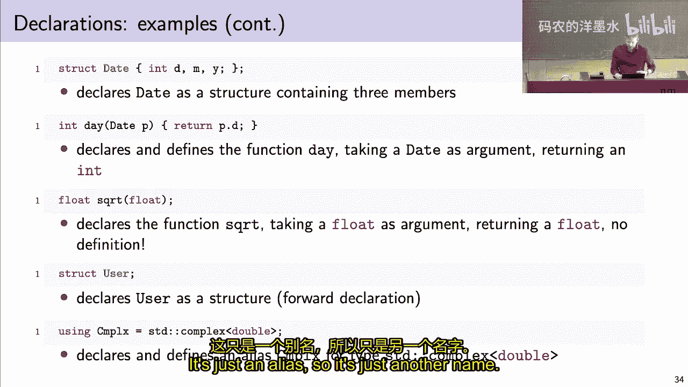

What are names in C plus plus， there are a sequence of letters and digits。

 The first character has to be a letter。And And's course is actually also considered as a letter in this case。

 and。Starting with an underscoreco。On global names is reserved for other language。

So don't start your variable names with an underscore score， basically。Also， there's， of course。

 some keywords that are reserved， like inflowat， all the bined types and some control statements like if L switch。

 auto or literals like true or false for Boolean air reserved keywords， don't use them for names。

Names N C pluspas and also N C are case sensitive。 So if you write them as capital or lower letters matters。

And ideally， you use some。Consistent naming style， like Cheil cave。嗯。

So that your variable namings is consistent。 and ideally。

 you use some tools to enforce that naming consistency and also the formatting of your code。

 where the curly braces are， where the new lines are， how much indentation you use。

 And you can all do this using clang format and clang format excepts a style file。

 And you can use any of the Ma style files like example， for example。

 from Google or Microsoft or Facebook or whatever big company or you can create your own。

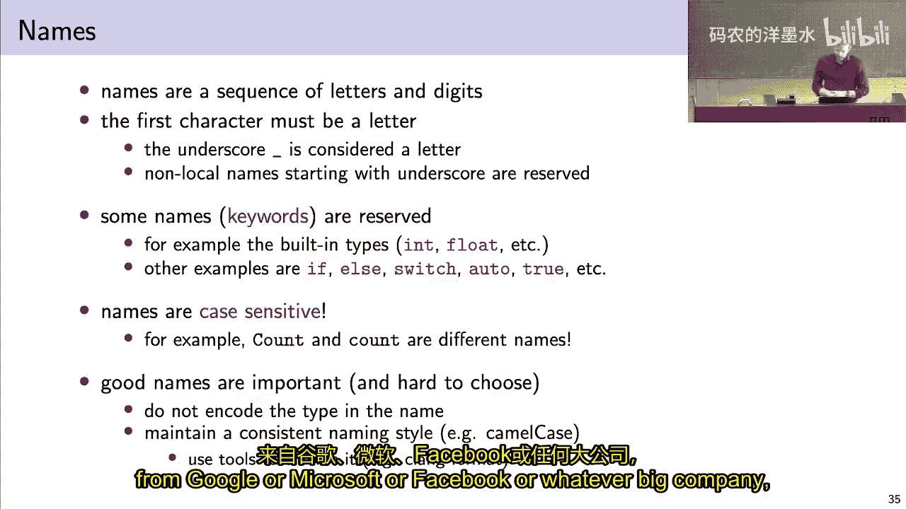

Right。Type aliases。 We've seen this already。 You can introduce an alias for an existing type by the。

Statement using。And， of course， typically， you don't do this for stupid stuff like this might end。

 but you do it for。Things where the thing on the right hand side is something more complex。

 And you wanna have a simple name to use it for。This is basically useful， mostly for templates。

 which we will see later on in class。You might see some older version of this using statement。嗯。

That's called type def。 And as you see， the order is different。 So first。

 you have the type you want to create an alias for and then you have the name of the alias。

I find this to be somewhat unintuitive。 But again， this is a relic of C。

The modern C plus thing here is using。In which scope does a using declaration apply in this scope that it's defined。

 And actually， as you receive， we will talk about scopes right now。

 So perfect transition to the topic。Varis starting with an underscore are only reserved for the language in the global context。

 So if you have class members or variables or functions。

 you can use underscoreco as the first letter of those。But again。

 it's usually not recommended to do so。Oh， oh， oh， this is a nice question。

 How do you describe the difference between constant constant expression。

We will spent two entire lectures talking about this later in the course。

 So I will not answer this right now。But cons， in a sense。

 on a variable means you can't change its value。 Con expression is something else。

 which we will talk about in more detail。Right， so let's talk about scopes。

A scope is marked by Kellyly Bras， we've seen this already today。

If you do a declaration inside a scope， it introduces that name into that scope from this point on words。

 not before， but from this point onwards。And， of course。

 you can only use that declared name in that particular scope。 As soon as you exit the scope。

 it's gone。There are several type of scopes。 The most common one is the local scope。

 which is a block marked by curly braces。There's the class scope。

 which is basically the scope inside a class declaration。

 which we will look at when we talk about object oriented programming。There's a namespace Co。

 which is the scope inside a certain namespace， which if I hurry up。

 I will be able to talk about today。There's a statement， scope。Which applies to four， while。

 if and switch statements。 And you've seen this in the follow up already。

 in the follow up we initialized in this previous example。

 We initialized the variable A with a value 6 and so on。This was the statement scope。

 The variable A was only valid inside the statement code， meaning inside the for loop plus its body。

 and then outside its gone。And then there's a global scope。

 which is basically anything that's not in any of the other scopes。

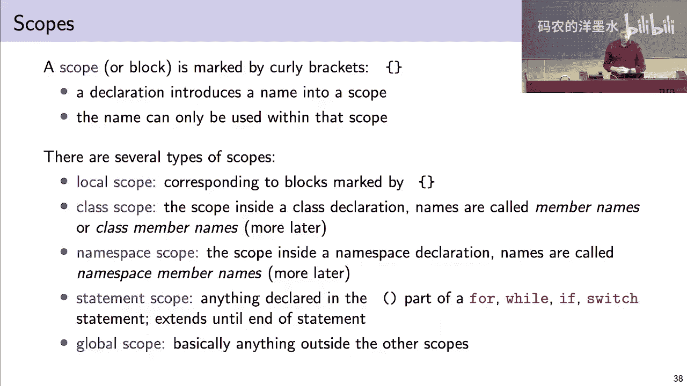

Right， let's give some examples。Here。This is a global variable because it's not inside any other scope。

This here is a function。And the parameter Y is local to that function。

 So as soon as this function ends， which is inside this block here。Why iss gone。

This is a new variable X inside this local scope。Which actually hides the global X because it's the more recent one。

 So if I sign。1 to x， I'm assigning it to this local x and not to the global one。

 Then I can introduce a new scope by opening up some random curly braces。

 Then I can declare another x， which is now the x for this local scope， and it will hide the outer X。

 So if I assign x 2 to x， it will assign to this x and not to this one and not to this one。

So this name hiding in different scopes is can be a bit of an issue。So。Be there。So here。

 if you do another assignment to X， it will refer to the first x in this local scope。

Why we refer to this local Y。 And here's a scope resolution operator colon colon that allows you to access the global variable。

However， the scope resolution operator only works for the global scope。

 You can't go in this scope here and try to refer to this X。 It doesn't work。It's not possible。

Some more nasty examples。 So again， we have a global variable X。And we have a function F。

 no parameters， no return type。With a function body， where。We declare a new variable X。

That obviously hides that X。 But you might think that the initialalization equals x unsafe initialization。

 by the way。嗯。But it's a nasty example。 You might expect that this X refers to the global variable because it's the initializer of the local X。

 nope。As soon as you declare the X here。Even in an initialization statement。

 X will now refer to this X。 So basically， what you're doing here is really weird。

 You're initializing this local variable with its own value。

 And because it wasn't it's uninitialized by default， youre initializing it with the same value。

 it was uninitialized to。 So basically， whatever value you will have here is undefined。 Or well。

 it will be a certain value， but you don't know which one it will be。Yes。Yes。EWell。

 different names would be good， of course。 But in this case， remember。

 there's the scope resolution operator。

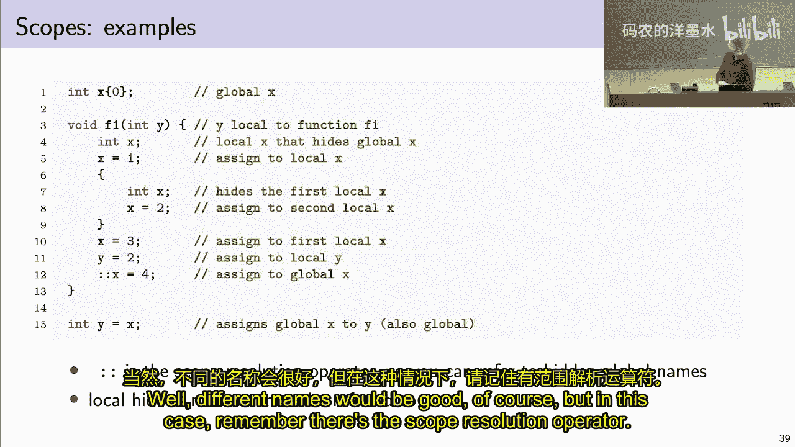

So you could use that here to refer to the global X if you explicitly want that。 But， of course。

 this is bad practice， hiding a global variable with a local variable。

 and then using the global variable after all is， is bad practice。Why is this an nasty function。 Oh。

 yeah， here。 We introduce a local variable Y that initialize。

Now it's a global X because there's no other X。 But then afterwards， I introduce a local X。

 which hides the global X。 So if I do the same assignment again as here。It looks the same。

 but it now refers to a different x， namely the local X。Also an R business。

 So take care of your variable names。And， of course。

 what you can't do if you already declare a parameter X that is local to this function body。

 you can't declare another parameter X。Right， and then F 5 is actually not a nasty example。 It's。

 it's a okay example because here you use the， the statement scope of the four loop to declare a loop variable I。

And you do another for loop that also uses the loop variable I。 This is a range for loop。

 We will talk about this in a bit。But this is fine because the eye is local to that force statement and the force statement ends at the block end of the block of the forest statement。

 So using it again is fine here。😊。

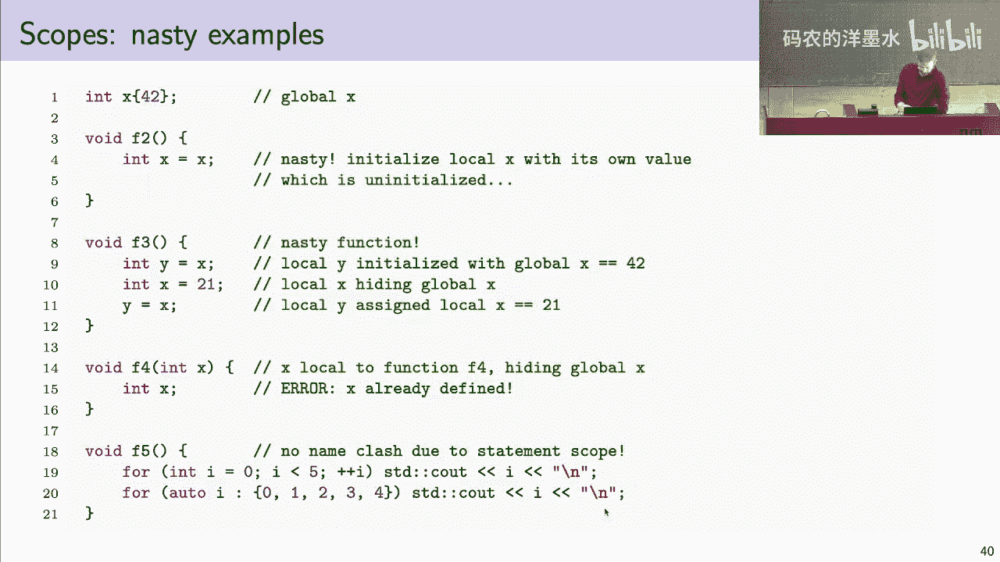

Right。Lifetimes。For humans， it's easy when you are born， your life starts。 when you die。

 your life ends。Similar for the object， but not quite。 They are not really born。

 They are constructed。And they are deed。And basically， between construction and destruction。

 you call that thing the lifetime of the object。Now， obviously。

 not every type has a constructor or a deor。 For example， the built in types don't。

Because the end of classes， only classes have constructors and deors。But in terms of language。

 you consider can consider these built in types to also have constructors。And， of course， if you use。

An object that was already deed。That leads to undefined behavior， which again， means。

Anything could happen。 program crashed。Memory leak or nothing at all， depending on what you're doing。

And in addition to the lifetime， you have a storage duration。

So the lifetime is basically when the object is ready to use and when it stops。

 it's no longer ready to use。The storage duration is when there is actual memory allocated for the object。

And once the memory is gone。That's a storage duration。And of course。

You can imagine that the storage duration has to be the same or bigger than the actual lifetime。

Because without storage， there can't be any object。 So a storage duration is the outer wrapper。

 Life might be the same size or smaller。Now， the lifetime of an object is governed by its construct and deor。

The storage duration is covered。

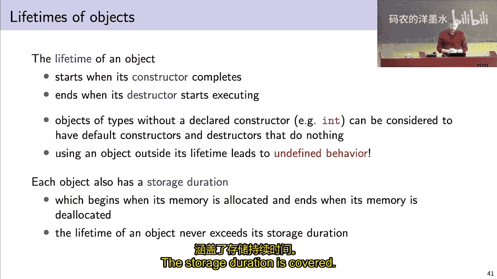

Yeah， depending on how you declare your variables。So， for example。

 you can have automatic storage duration， which is basically any local variable that is somewhere inside a scope。

Anything that's inside a scope。Willll start It storage duration with that scope。

 and it will end when the scope stops。And basically。

 all local variables that we've seen so far are automatic storage duration。

 And one interesting tibit is that all these local variables are stored on this stack。😊，Now。

 think about recursive functions。That call itself again and again and again。

 and that have local variables。So each time you do a recursive call。

Space is allocated on the stack for the local variables， automatically。

And the more often you call this recursively， the more space is allocated。And as you should know。

 a stack has limited size。 So eventually you will get a stack overflow because you overflow the stack capacity。

So that's why recursion is problematic。And you need to make sure that you don't have too much recursion depths。

 or you maybe want to re convert your recursive algorithms to an iterative one。Now， from this aside。

 there's orthothe storage duration， which is basically global storage that starts when the program executes。

And lift until the end of the program。 And this is true for all the global variables and all variables that are marked with a keyword static。

At the beginning。And finally， there's dynamic storage duration where you， as a programmer。

 manage the storage duration， you say when it should start and you say explicitly when it should stop。

😊，This is done using new and delete。And you can fuck up majorly here。

If you forget to use new before you're using the object， boom will probably be a crash。

If you forget the deloc， you get a memory leak。 If you delocate and use the object after de allocationlocation by accident。

Unfined behavior， probably a crash or something else。 So actually。

This is what we will deal with in the chapter of resource management。

Be careful when doing this or actually don't do this at all。Yes。Yes， so the question is。

 when can you do static variables？ I will actually have an example there。 You can do it。

 and you should do it actually in the scope where you wanna have it。

 You just change the storage duration with a static， for example。

 to have a local variable in a function that is persistent between function calls。😊。

What's that another question。Kind of。 So the question was。

 is new and delete equivalent to malllo and free and C。They have the same purpose。

 They are not equivalent。And as I said earlier， forget about pointers。

 Forge about you heard about new antite elite。 We don't need them。We use other techniques。

 modern techniques， and we will get to this in the resource management chapter。

And there's threat local storage。That's sometimes quite useful， because basically。

 whenever a threat starts， it memory gets allocated and gets gear allocated when the thread stops。

 And the keyword for this is thread local。 So here's examples。

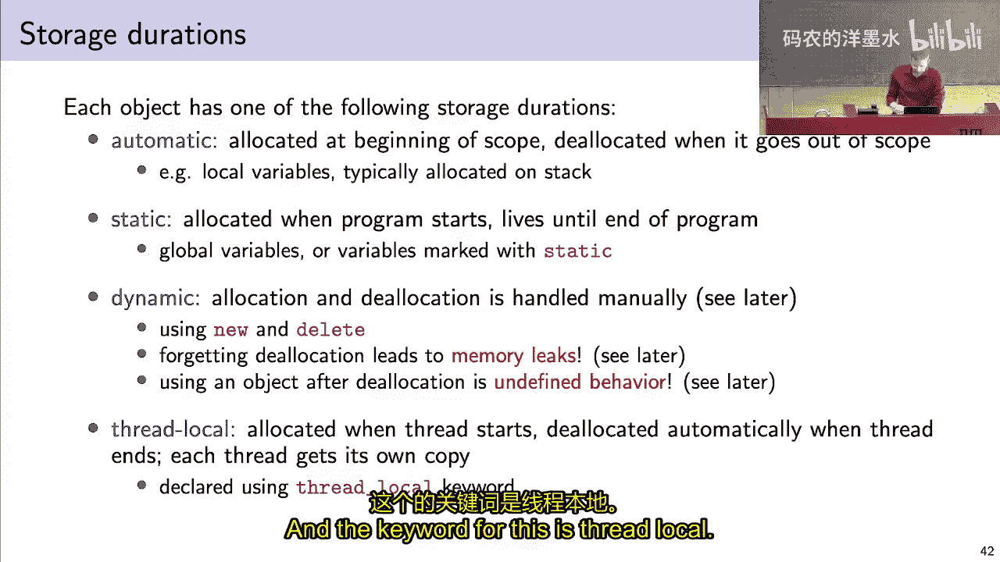

This is a regular。Global variable。 So it has static storage duration。

 It starts when the program starts and it ends， when the program ends。

Here I have another global variable that I explicitly marked aesthetic static。

So the static here is superfluous， strictly speaking。

 because it's already clear that it's a global variable。

 But sometimes you might not be sure if it's really in global scope or not。

 So you might want to add the static keyword to make sure， oh， yes， this is a static。

This would be a thread local variable。 And these here， here you see a function。

 This is a local variable to， to the function。 This is automatic storage。 And here I can have。😊。

A local variable to the function that have static storage duration。

 So the y isn't known outside the function。 You can't access it。But if you call the function F again。

 it will still refer to the same piece of memory and， of course， keep its value。

 So this is how we can do persistent storage basically across function chs， if you need it。But yeah。

 static variables。 So let's put it like this as a guideline， Don't use global variables。

And if you really need to have a behavior like a global variable and you can't do it any。

 any in in any other way， use static variables inside a scope like this function or a class member function or something like this。

So， yeah， if you don't understand the purpose of static variables。Don't worry。Most of the cases。

 you will never need them。Do you also teach us how to use threats in C plus plus， Yes。

 that's in the parallel programming chapter。Can't do everything at once， sorry。

Are we gonna see big O notation， yes。If you don't know what big O notation is。

 with it algorithms and data structures。There certain guy doing this last term and or the next term。

Right， let's briefly， in the end， we still have time。 Yeah，4 minutes， awesome。

Let me briefly talk about namespaces。What they are and how to use them。呃。

Sometimes we have large projects。Because you are using them。Like a big library。

Like pytorch or Tensorflow or stuff like this。 sometimes your own stuff is always large。

And then what you might happen is that。Your name's clash。

But because there's only so many names you can think of and you don't want to have names that are this long。

 names might clash。 And that's what namespaces are for， because basically。

 these allow you to group things into logical units and help avoid these clashes。And， for example。

 if you wan to use variable names like this A here， where's my mouse。 Come on。Here。

 if you wan to use this a， which is a stupid name， by the way。

 you should use something more descriptive。 But if you pack it into a name space。

 it's less likely to clash with any other stupid variable called a。

And then you can qualify the namespace， My name， colon， colon。

 a to refer to this particular a in that namespace。 So here's an example。

We are putting the function full and bar into the namespace， a。And then I have a namespace P。

 which also has a function fo。These would originally usually clash without namespaces。

 but with namespaces， I can refer to which 1 I wna call。By using the full qualify。

 fully qualified name， if I just call Fo without any qualification， the compiler will say。

 I don't know any who that's in no namespace。And you can nest name spaces as deep as you want。

 So you can nest a name space。A B in a namespace， A。

 you can also write it directly like nested namespace A B， yeah。And， of course， also。

 what's important Naspaces are open。 So if you close the namespace here。

 you can still add stuff to it by just opening it again。 It's not exclusive。Right， typically。

 when you use namespaces， it means your code is big and complex。And there might be many braces。

 for many。Class scopes， functions， scopes， other scopes that you are using。

 And it might not always be clear that this。Happy curly bracelet here。Actually。

 belongs to the name space bracelet that might be 1000 lines above it。

 So that's why it's sometimes nice to have this comment here And namespace A for readability。

 The compiler doesn't need it。 It's superfluous。 It's just for readability for you to make sure that you're associating this namespace curly brace。

😊，And of course。You don't have to indent stuff in the namespace， in fact。

There's a lot of arguments to not use Inddent for name spaces because otherwise your columns will go go too far。

But in this case， here I made used in Indian just to make sure。

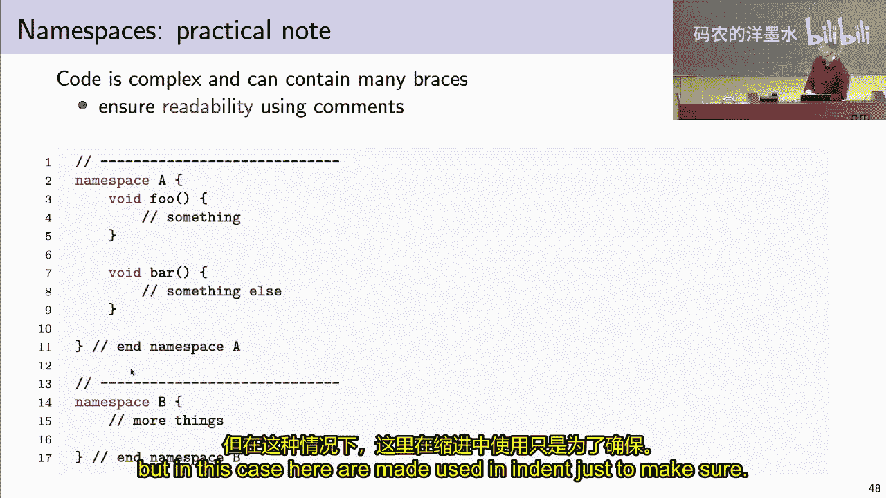

It's clear。Right。Before I get to the last few questions。

 fully qualified names are good for readability because then you always know which entity in which namespace you're really referring to。

But sometimes， especially in an inner loop where it's clear what you're referring to。

 It might be verossity that's really unnecessary。That's why we have more using statements。Basically。

 you can import a symbol into your name into your local namespace into the current scope。

 So if you have the symbol A in namespace X， by using X A， you say， okay， in the current scope。

 I'm now using a without the fully qualified name and refer to the same thing。

 or you can even use an entire namespace， which imports all symbols from that namespace into the current scope。

This can be a bit dangerous because， of course， you don't know what's everything that's in that name space。

 And you might get some surprises。But in general， it's fine。

 And then you can do do it like this in order to not have to use fully qualified names。

What's the difference between a namespace in a glass and a glass。A namespace is a logical grouping。

 without any。Other impact， A class。Is a user defined type。That， also kinda。

Works like a namespace a little bit。 It's also a logical grouping， but there's more。 It's a type。

 Its usually fine type。 It will have constructors。 It will have its own operators。

 You can overload functions for this， and so on。嗯。Yeah。So theyre not quite the same。

 but you can use them for the same purpose。 Let's put it like this。Right。

There's still a lot of questions on feedback going on， which I won't answer now anymore。

 but I will answer them later on when I'm back in my office。Thanks， everyone。

And see you in two weeks。

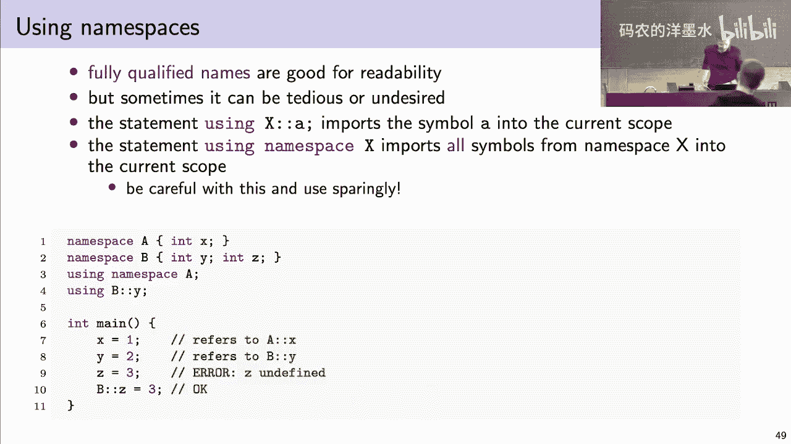