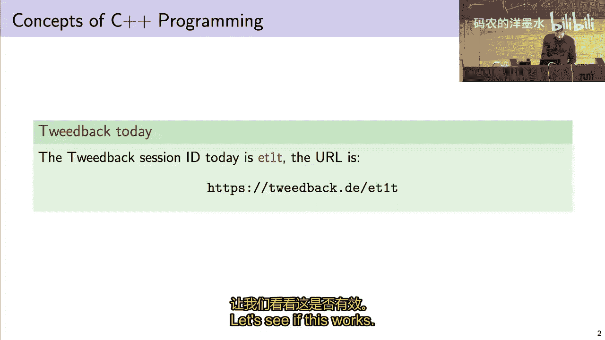
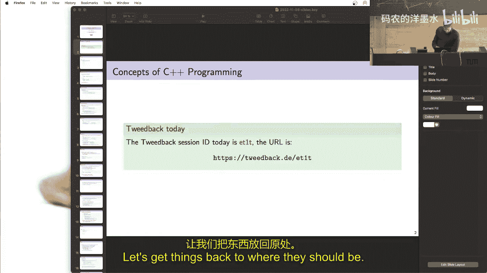
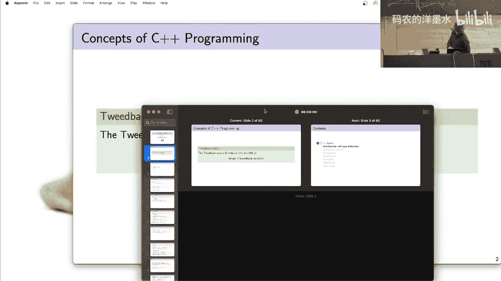
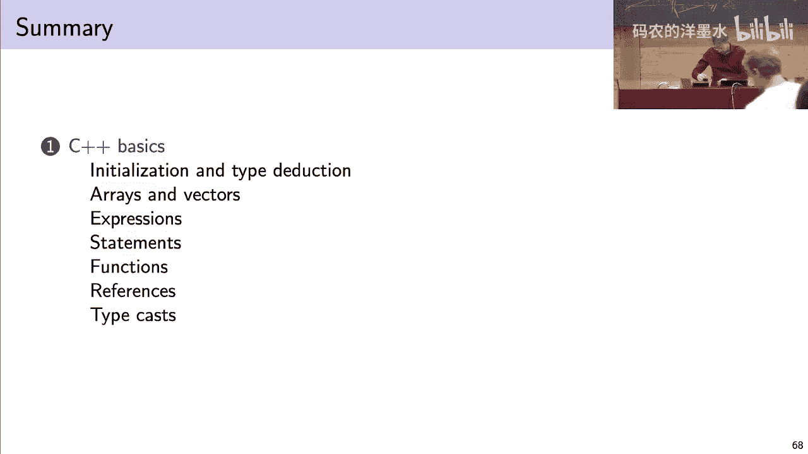

# 【全集】慕尼黑工业大学 IN2377 C++编程概念 中英字幕 1080P p03 Lecture 3 - 逻辑运算符与关系运算符 -BV1b8mgB8EDQ_p3-

Test science quite right。Don no my test and right。So hello everyone and welcome to the C++ course。

Glad you're all here。Both。Here in person and are the remote。See， this is a bit interesting。 Okay。

 so should work。So first things first today。Our feedback session is E T 1 T。

 Some of you obviously have found it already。Please make sure you have it open if you want to ask any questions。

During this lecture， and of course， as usual， I will answer。All of your questions afterwards as well。

Right， before we start， I actually wan to start with。A poll in feedback activist。Let me see。Actually。

 I need to。How can I do this without disturbing this stream。Let's see if this works。

So， here's a point。That I wanted to ask you。How about the homework for you。

 Have you set up everything。Yet， like the Git repository， the CI pipelines。

 having a recent C plus+ compiler with C plus 20 support， CMake， an I D E or an editor， how to build。

 how to debug your code。 Have you set this up。And I gave you some answer possibilities from like。

 yeahep， everything's fine and perfect。 Homeworks are complete C I pipeline passes。😊。

And some graduations between， yeah。Stuff works。 or its just part of the stuff works。

 just so I get an idea at which stage you are。And if you're not planning on doing the homeworks or if you haven't done anything yet。

 please also take the appropriate options just to have some idea of what's going on with you。Right。

So I think this also works for the stream， yes。Very good。

So while you cast the awards today is a regular lecture。 again。

 last week was a bit of an exception due to the public holiday。

And we will have one more of these exceptions at the beginning of December because there's gonna be the DS academic course。

 which means we can't do any teaching on that particular day。

 and we are probably gonna take the chance to take a week off once more。

And give you some opportunity to sort out the homework and ask any kind of questions that you might have。

But that's at the beginning of December。 For now， we will have this week。

 next week and week after that， we will have regular sessions because we have a lot of content still to cover。

 And today， we are gonna continue with the basics of C plus plus。

So I'm going close the poll in a few seconds。 So you haven't voted yet。 please cast your vote。

And I will stop the pilot in。3 to one。Right， so you should also see the results now。

 which is pretty good。 So most of you or at least most of you that are actually attending this and bother to vote。

嗯。Are doing fine on the homeworks。But just go it。Great， that's exactly as intended。

And for the ones of you。We still have issues with Cmic， for example， please make sure。You ask us。

 for example， on Zullip。With your questions， with your issues， as soon as possible。

 because starting this week， the homework will just assume that all this stuff works， right。

 because we will。Move towards actual C plus plus content and not just build system， Git pipeline， Cm。

 and so on。And for those who didn't take the time yet or have no idea what I'm talking about。

I would suggest， take the time。Do it because that's actually the most important part of this course。

Way more important than me standing here one and a half hours every week， talking to you。

 actually doing things is what gives you the practice， what gives you the learning。

And that's the only way how to learn it properly。So yeah。

 let's get things back to where they should be。

あ。No。

It's here。And this for screen。Yeah。Lets see everything fine in the stream。 Yes， looks good。

Could I please turn up the volume in the horn， okay。

I have the impression that I'm echoing very much today。If I should turn it up any further。

 please let me know。Is this stream broken because from my perspective， it seems to be streaming fine。

Let's restart the stream。That looks better。Sorry about that。 no idea why that stopped。

But I think that's probably not a problem on my side。Very good。 So let's get to it。

Where are my slides， yeah。Today， we are going to talk again about the basics of C plus plus。

 a bit of the more。呃。Advanced things compared to the last time we had this lecture。

So let's dive straight in。Dive straight in inization。 We've talked about this already。

 So let's just recapititalulate briefly that there are two kinds of initialization。

One of them is a safe one using the curly braces， and one of them is the unsafe one with the assignment operator or the regular braces。

 And， of course， what you should prefer is using the safe initialization using the curly braces。No。

Some subtleties， which I didn't talk about yet。 The curdy brace in its utilization is actually of type SDD initializer list。

With a template argument of T vers， the type of whatever is contained in that list。

That's an implementation detail that for regular initializations like these。

 you don't need to care about。But for user defined types where you will have constructors that take different types of arguments。

 this will might lead to surprises。 So I brought you an example here。 Let's see wheres my mouse。

Where's it here。Right， so here is an SDD vector。 That's a standard library type that is basically a dynamically sized array。

It's supposed to store variables of type integer。And I'm miniizing it with the curly braces。

 and a 99。So what happens now？This curdy braces 99 thing is a list with a single element。😊。

Which is 99。And that is being used to initialize this vector。 So after the statement。

 V1 will be a vector with exactly one element that contains the number 99。

If you do the same initialization with parentheesis， with regular ones。Regular braces。嗯。

You might be surprised because that doesn't give you a list with one element that is 99。

 but rather what it gives you is a vector of 99 elements。

 and all of them are default initialized to 0。Why is this happening。

 Because we have different constructors。One of them takes an initialr list。 That's the first example。

 And the second example， which is， which takes an integer and has a special meaning。

 And there you see， there can be confusion。And about construct overloads and things we will talk later in more detail。

 but just be， be advised that this curly brace in its utilization。

Needs to be taken care of when you do your user defined types。

And you can also produce errors where you say， for example， here， you have a vector like up here。

 But instead of integers， we takes a string。 again。

 the type from the standard library and we initialize it with a string aiteral of value hello。

Backs perfectly。If you try the same thing with regular braces。This actually doesn't work。

 This gives you a compiler error because SDD string。Well。

 no constructor of vector actually accepts a literal， a string literal。And the compiler would say。

 yeah， there's no matching constructor。So for the user defined types。

 you should be aware of what's happening there。Right。And initial as list is obviously， a list。

Like the name implies， so I can also use it like one。So for example， what you haven't seen yet。

 but what is possible you can definestruct， which are essentially just an alias for a class。

And this is a very simple class that only contains。An integer。 and a string。

And you can initialize these kind of aggregate data types using the initializer list。

 just as you would expect them。It to work。 And you can also use it for。

standardandard library types or your own user defined types。 like here， SD complex， or again。

 S TD vector example， this time is nothing is ambiguous because a list of three elements。

Is obviously not a regular constructor。Of STD vector。But， of course， you still have to pay attention。

 So， for example， here， we use the brace constructor of complex to initialize the complex number with zero real part and one imaginary part。

Here use see empty curly braces， which gives you the default value of 0，0。And here。

 where you might think that the empty regular braces might also give you the default constructor， no。

What this actually is。This is a function definition。Of a function called。

 that's3 that returns a complex number and takes no arguments。

Yet another reason why you should always prefer in utilizationization using the curly braces so that this。

Unexpect thing doesn't happen。Right， and you can have some fun here as well。 This is， again。

 curly braces on the initializerr list with two values，10 and 3。3。😊。

This is the curly Bra version where there's a constructor of vector that takes a number of elements to e to initialize to a certain value。

 which is 3。3。So again， the guidance here is pretty clear。 use curly braces whenever you can。

If you do empty curly braces， you initialize with a default value。For integral types。

 So the built in types that have some relation to integers that is。

0ero or whatever is a suitable representation of0 for the type。

If you do user defined types like classes orstructs， that depends on。

The actual type and the constructor you define for it。Right。

So one of the big issues with initializes is that you can forget。Doing them。

Or you might even intentionally omit them。So initialization is optional and C plus plus。

 so you don't have to do it。But， of course， if you forget it， you can get undefined behavior。

Why is it optional， why wasn't it made mandatory， where sometimes you don't want to have to initialize because it would affect your performance。

 let's say you have some user defined object that's very complex to initialize。And， you know。

 you're going to initialize it later using some input that you're going to get from something else。

 So initializing it twice would be stupid。The only exception is that objects with static storage duration or global variables or static variables。

 they are default initialized by the compiler。All other objects are not。So basically。

 if you have a global variable like this integer A here。

 it's going be default initialized and the default initial utilizationization of an integer is 0。

Whereas this local variable x here。It's not gonna be initial life。 And if you use its value。

You're gonna get。Whatever and why。What will actually happen is that the compiler will allocate some memory for this locally variable X。

 But if you don't initialize it， it won't write a value in there。

 So whatever is in that memory location。Will be the value that's there。And， of course。

 what's in the memory location depends on what your computer was executing previously that was using that particular memory location。

So that's very bad。Astruct。 astruct。 astruct， yes。I'm not going to answer all of the question directly because some of them are too detailed that I don't want to spend the time right here in class。

 but be aware that I will answer every question afterwards once I'm back in my office using the keyboard。

嗯。There have a question about this truck initialization here。This one here。

And there was a question if it support， if we support naming the variables， Nope。

 C plus+ doesn't support this。What aesthetic storage to duration。Somebody didn't pay attention。

Stthetic storage duration is what global variables have， and static variables have。

 namely a storage duration that end begins with the start of the program and ends with the end of the program。

 It's one of the storage categories。And it is。Relevant for。

Need to find a different solution for my Oscarcar。 I'm constantly losing it。Here it is。

What do you use for global variables or static variables。So one advice piece of advice here。

 especially regarding initialization and forgetting about it。Use compiler warnings。

 activate all warnings。 So in， in the Unix compilers， that's minus W all。

If you insist on using Windows， which some of you are doing， for example， for Viual Studio。

 it's a backlash slash W all。Activate them。And make sure。That you pay attention。

 Don't just ignore the warnings。 They are there for a reason。Right。

 so one cool thing about initialization is if you initialize something。

 the compiler will know what the type of the initializer is。 So you don't have to specify the type。😊。

Of your object that you're initializing。 So what you can do is you can replace the type with a keyword auto。

So it can do something like this where you have an obvious in with an integer literatureer。Remember。

 from two weeks ago， that's an integer lit。So the compiler can automatically deduce that A should be of type in。

And in this case here， this would be a character lit。 So the type here should be a cha。

So if you do any thirdtization， you can omit the type here and write auto instead to let the compiler automatically deduce the type。

Now， of course。For these simple types here， this is actually。Not so good。It's actually a bit stupid。

Because it's just as much to type。 And for reading it。It might even take longer to understand。

 why are you using auto here， Why don't you just write int or char。So in these situations。

 I wouldn't advise it。 I just put them here because they are very simple examples。

Where it's very useful is。Then you have more complicated types， for example。

 when we will talk about unique pointers， which is related to memory management。

 which we will get to in a few weeks。There' is this SDD make Unior that allocates and initializes a unique pointer。

And we called it U1。 And then you would have to write unique pointer to in U1 S TD， make unique int。

whichch is fairly lengthy。And since you know what make unique will return anyway。

 it's pretty clear it's gonna be a unique pointer。 You can just write auto here and have a way shorter statement that's a lot easier to understand。

And the same goes for iterators。 So if you have a vector， for example。

 V here and you get an iterator via the begin function。You have to write the type of the iterator。

 which you get by taking the FD vector double and then getting to the type def that's inside this user defined type。

 that's called iterator。That's。Annoying to write and also annoying to read， whereas auto。

Equals V W dot begin is a lot easier。 And the thing is， for these things。For this iterator。

 you don't care about the actual type。 This is already。An alias for the actual type。

And you don't care as long as it works。 as long as it's an iterator。 that's fine。

 So writing auto here is a lot more readable， and。And short。And the same here for the unique pointer。

 you already know this is gonna be a unique pointer because your calling make unique。

And there's several other。Situations where you can use order to great effect。Right。

There's quite a few questions， which I expected。 So let me answer them。

 How does the compiler know that this year is an integer literal。 Well this is an integer literal。

 And by default， this is a signed integer。If you want it to be an unsigned integer。

 you should remember there was a way of making an integer literal and unsigned lital by appending a U。

To it， that was two weeks ago。So it's up to your responsibility to provide the right kind of literal and to annotate the literal。

 if necessary。So the compiler can reduce the correct type。Or in these simple cases。

 you could just be explicit and avoid any ambiguities by just specifying the type that you want。

How much overhead does auto add to the code， None， The compiler reduces it at compile time。

And the compiler already knows the type of the lit。 so it's actually in no effort whatsoever。

And most definitely， there's no runtime penalty。Jesus。um。Why do we not always use auto then。

You could。But as I said， in some cases， it doesn't make reading the program easier。 I would say。

 argue in these two cases， it makes it harder In these two cases， it makes it easier。

 So it's up to you to balance what you want。 If you w to use autoer everywhere。Be my guest。You can。

As long as you're initializing your variables， because if you don't provide an initializer。

 then of course， order doesn't work。Does auto to also recognize user defined types， yes。Obviously。

 iterator here or unique pointer is a user defined type。 They are in the standard library。

 but it's a user defined type。 So， yes， it works for that。 and is especially intended for that。

Why are we not using。HaThat's a nice That's a nice question。

 Why are we not using the curdy brace inization here for the iterator I2。Because I'm inconsistent。

Yes， you could。 and probably should。You prefer using Uan over auto。

Let's see how the C plus+ compiler likes Ubon。嗯 I got装。

Why do we use ST TD in the names the namespace， S TD everywhere when we could be using the using statement using namespace ST TD。

Well， as I told you， when we talked about namespaces。

Usually want to avoid pulling entire namespaces into your name space just to avoid pollution and potential name clashes and so on。

 So that's why I'm usually very explicit of specifying SDD colon， colon。It's a good habit to have。

 but it's not required。 You could do it if you want it， but I don't like it。 So I'm not doing it。

What is meant by an iterator。I'm not。 I will not elaborate on that because we will cover this later。

So if you don't know yet， be patient， you will get to it。

You will even have to write your own iterators in the homeworks。Right。

 if you are in doubt what auto actually produces for you。

 here's a snippet that you can use from the library boost。 You might have heard about it。

 It's a collection of libraries for C plus， plus， a huge one。

Which provides everything in the kitchen sink， basically。

And one of the libraries it does provide is the type index library。 So you install boost。

 you use the type index library。 And you see here， I'm actually using a namespace import statement。

And yeah， and then you can use this type I D with CVR pretty name thing in order to actually print the type of what you produced here。

 So， for example， here， I'm doing an auto with a initializer list here。

 I'm doing an auto with a make unique。 And you will see that what's output is exactly what you expect。

 SD initializer list of int for a。And a unique pointer of int。

 And the only thing you might not expect here is the default， delete second template argument。

But this is a default argument that you don't have to specify explicitly。

 So if you end doubt about such stuff， go to Ven box。 It has boost installed already。

 so you don't need to do it locally and post this little snippet in here。And put in， of course。

 your type that you want to see。 and you will know what the compiler did for you。

If you're ever unsure。Why do we have a double colon here in boost type index Because this is a nested namespace。

 the outer name space is boost， the inner namespace is type index。

So I'm importing that nested namespace type index here so that I don't have to write。Boost column。

 column， type index， column， column， type I D with CVR。

 Then this line would be even longer than it already is。

Do the curly braces or the regular braces call the constructor of a stroke or a class， yes。

We will get to this when we talk about classes and use the defined data types， but not today。

Because today， we're gonna spend a bit more on the basics。 So first。

 let's talk a little bit about arrays and vectors because you're gonna need them everywhere more or less。

 So first， arrays。It's a user defined type from the standard library that's called ST TD array。

And it's intended for fixed size arrays， where， you know。The size of the ray at compile time。

You also have to specify it at compile time as the second template argument of this class。

 The first one is the type。 So what。And array of what it should be。 T is the type。

It's guaranteed that the。Nun teas that you have will be contiguous in memory one after the other。And。

You can get the size。 We have the member function size。 You can initialize it using the。

Default in initialization or list in utilizationization with the curly braces。

 There's access to the elements using operator with the brackets。Which is not bound checked。

 and you can use the member function a to get bounce checked access。And， of course。

 there's iterators which allow you to iterate over all the elements。So。AndLet's make an example。

So what you need to do is you need to include the array header。

Which defines the standard library class， S TD array。 And then you can use it like this。

Can say this is a array that's 10 big of integers that's default initialized。 So no initialization。

 basically。嗯。Ohor not no initialization， but default initialization for all members。

Here there's another array of float， three of them。

 and their list initialized all three of them directly。And then you can do a full loop， for example。

 to access。All the members of a using the opera bracket operator and the index and the index is the fall loop index。

 which you iterate until the size of a。 And as usual in C， type languages。

 the array numbering is starting from 0。Until size  -1。

 that's why there's a real smaller than and not a smaller or equals。This doesn't do bounce checking。

 And in four loops like this， where you already checked the bounds in the for loop。Condition。

Of course， you don't need additional balance checking unless you mess up your index calculations here。

But for other excesses， you can use bounce checked accesses like here。

 And you will see if you run this， I access the 11th element of a 10 sized array。

 Then you get a runtime error out of range。And it will even tell you， look。

 you try to access the 11th element out of 10。So。You got stupid。Right。

 and then there's also this handy range follow loop， which I'll talk about in a moment。

 which allows you to iterate over the entire contents of that particular container。

 which is an array。And you can output all the elements of the array like this。

Using namespace is not importing a library。 It's importing the namespace。 We talked about this。

We want't use pointers。Bloody damn， correct， yes。You won't。I'll skip all the namespace questions。

 I'll answer them later on。 I don't want to talk about namespaces。 Now we did so two weeks ago。

The advantage of using the add function over the operator。Is that one of them is not bounce checked。

Meaning there's no check。 So if you provide a wrong index that's out of bound。

 you will access memory that is not belonging to the array， which is either a runtime error。

 undefined behavior or a crash。So by default， you should prefer the bounce checked access。 but。

 of course， bounce checking comes with a performance performance penalty because every time the index has to be checked if it's within the bound of the array。

 So this is two comparisons that if you do this in an， in a loop that is performance critical。

 you don't want this。 then， of course， you use the brackets operator。So， yes， obviously。

 access with this non balance checked operator is faster than using the a statement。 But then again。

 it's two comparisons。 This will only matter if you have a really performance critical inner loop for。

😊，So for。Default access that you do in a regular program you should always prefer at。

Why do we get a runtime arrow for out of bound。Well， the size of the thing is known at compile time。

 but the index that you use here。 I mean， in this particular sample， example。

 it's also known as compile time。 but usually you have some variable that relies on some input。

 and that is only a runtime。 So that's why there's a run time。Check。

And sorry for ignoring some of the questions。 I really can't answer everything that you're doing right in here because otherwise。

 I won't get through anything。Right， and there is a last question that I'm answering right now in the slides。

 There's also sea style arrays。That look， very。Similar to what you do in Java。They're evil。

 Don't use them。 Forget about them。 They don't exist。Really， forget about them。 I'm serious。

 You can do everything that C style arrays can do with S TD array only it's better， more safe。

 And there's no additional overhead at all。 So you don't lose anything。 In fact， you gain security。😊。

Because EC style arrays are the single main source together with pointers for why computer programs suck。

Why they keep crashing， why they are buffer overflow security issues and so on。

 It's the old sea style arrays and pointers。 So， please， they are completely obsolete。

 You don't need them anymore。 There's no reason to use them。 Just forget about them。 In fact。

 once you've seen this。 For about you've even seen the syntax。

Here is how you should be doing arrays in C plus plus。And no。

 you don't need C style arrays ap pointers for buffers when doing soet programming。

Because you can use arrays for soet programming。ItsThe same thing。

It's all so line continues in memory。 There's no problem。

And what you're writing here with C pointers and then calling Re V and whatever。呃。🤢，That's Z code。

 If we are doing modern C pluspa here， please forget about all C。 Nobody wants to see this anymore。

 It's obsolete。So why should you use SDD array over a C style array。

 Because it's better in every single aspect， And there's no performance penalty。

What if you need an dynamic arrays well。That's another class in the standard library。

 is's called STD Ve。That's a dynamically sized array where the size doesn't have to be known at compile time and which can change its size。

During runtime。So he can resize it if you， if you attended the gut lecture last some time。

 and you remember the U array class。 that's exactly what SDD vector does。

 And it has a similar resize strategy so that you get。

Proper amorized cost for realizingizing the array， yeah。

It's also guaranteed to be contiguous in memory。 But if you resize it。

 it might happen that it's in a different memory location than before。

 because the the library had to allocate。New memory。 And copy it over。

It's the same interface as SDD array。 And there's some additional functions like pushback or clear or resize。

 because obviously， now it's a dynamic array as opposed to。Fixed size， array。And use it。

Looks very much similar to the SDD array， except there's no the pushback function。

 which means add an element at the end and resize the array properly。

You can clear the array to empty it。 You can resize it manually。 and of course， you can use。

Bunce checked or non balance checked access with the bracket operator or the ad function。

Nobody wants to see it anymore。 Yes， nobody wants to see it anymore。

Why are all the internal identifiers of the standard library。

Like these examples that we saw in the error， in the runtime error message here。

Why do they have double under course。Because that's a convention。

Of that particular standard library that I'm using。If you use another standard library。

 they might use a different naming convention。Doesn't matter。 It's not standardized。

 It's up to the library implementer， how it looks like。Right。So。What you've seen already。

Is an example of a range for loop。 So let's briefly introduce what that is。

So if you have any form of container， like an initializer list， an array， a vector。

Or some other form of container， of which there are many in the standard library。

 and you can also define your own user defined containers。

 The only thing is you have to do is you have to provide iterators， which we will practice in the。

 in one of the homework assignments。And then you can use the range follow loop。

 which has the following format。And you have an init statement， semico， arrange declaration。

 regular colon and arrange expression。 So this looks a bit weird。

 So let's look at an example instead。 So here we have a vector with five elements。

We' are doing a regular formal for loop to add even more elements。

And here now we have a range for loop， which iterates over the container a。

And how it does get something to be a container if it supports iterator interface。

 meaning it has the begin and end functions， which well get into a more detail later on。So。

 but this vector definitely has this。 So you can now say， okay， for all elements。

 which Ill take by auto。Because I don't need to know the type。 Of course。

 the container knows its's internal type， it's integer here， but it could also put in here。

 I'm using a reference， which I will explain in a bit today。

 what that means and a con so that I can't change the element once I'm iterating over it because in this case。

 I only want to output it and that's it。And you see。

 you will output the element of the container with this follow loop。

Many other programming languages also have this kind of for loop。

 and C plus plus finally gained it in C plus plus 11。

What you can also do is you can do initialize lists。 They themselves are containers again。

 and so you can use them in a range folder。 So anything that supports an iterator interface can be used here。

When should you use arrays， When should you use vectors。Well， if you know at compile time。

 what size your array should have， then you use SDD array。 if you don't， you use SDD vector。Wow。

 how do dynamically sized arrays not cause crashes。If they're implemented properly。

 they don't cause the crash if。They do their own memory management。 Don't worry。

Well talk about references in a bit。 Don't worry。 So don't worry about this M% character here。

 And also the constant this。 We talk about this。I not comment on it now。That's a good question。嗯。

Why does the P make you write a whole sentence just to bring a single character on the console。

Why do they refuse to build in some simple default function for printing like print in Python or S out or soda or whatever in in Java。

It's C， plus， plus。And actually， C plus plus 20 added something like this with ST TD format。

So actually， it's， it's there now。And I last question。

 why do arrays and vectors throw exceptions during out of bound checks instead of returning optional like in rust。

That's a matter of taste。So。Let's put it like this。Out of bounds。

 except excesses shouldn't happen at all， ever。So。They shouldn't be。Kind of， you know。

 handling the interface。By making the interface return options by default。

Because they are an exception。 And so throwing an exception when this kind of exceptional of situations happens。

It's one way of looking at things。 Of course， if you have a new language like rust。

 where optional nodes are kind of baked into the language as opposed to having an SD optional in N C plus plus。

Might be a nicer choice， but again， it's a question of taste。

Is at really slower than operator with the brackets。 Yes， because it's doing bounce checking。

Of course， if you're using the operator like here， no， where， where do we have our operator example。

Hello。嗯。Here we have an operator example。 Of course。

 we are somehow doing our own bounce checking in the fall loop。

 but it's still more efficient to only do this once here。As opposed to also in every single access。

So it's just a question of and you do it。Right。So let's go on。 expressions。 What are expressions。

 There is a sequence of operators and opera。Operator， like， for example， plus。

 and then opera like two variables， A and B or two numbers。That produce a result。

And usually if you evaluate such an expression， you get a result like 2 plus3 is 5 and5 as a result。

 and sometimes you have a side effect， like if you do an SDDC out and print to print a form， well。

 obviously the printing is kind of a side effect of evaluating this particular expression here。Right。

 one of my favorite topics。Expressions have two properties that are completely independent。

 One of them is the type， obviously， because everything in Cpl has a type。Or you know what types are？

And what's new today is a value category。And these two are completely independent。

 They don't relate to each other。For the value category。There is actually 1，2，3，4，5。

 but we'll restrict ourselves to。2 vague definitions。Namely L values and R values。In short。

 any values is anything that can stand on the left hand side of an assignment。

Earth our values are something that can be on the right hand side of an assignment。

Put it a bit more different。 this is a very vague explanation to put it a bit more differently。

 It's also you can say that L values refer to an identity of an object。 So， for example。

 if you have a variable A， you know， there's a certain storage that belongs to this variable that has a certain lifetime in the scope and so on。

And so it's an identity of a particular object in memory。Our values。I'm all of the actual value。

Like 42， That's a value。And。This is kind of the。General intuition here。There's a very， the standard。

 of course， there has a very precise definition， which is long and awkward and hard to remember。

 So for now， L values and R values are sufficient。 We will talk about the value categories a bit later when we talk about resource management。

For now， this is suffices。Right， so we said expressions consist of operators and opera。

 So let's talk about operators。 operatorss typically have a certain number of opera。

 There's urary operators， or they have one opera like negation or address of or de referferencing。😊。

There's binary operators like equality， multiplication， addition。

 subtraction and all these arithmetic operators。 And there's a single channel operator and C plus plus。

 which is this kind of condensed if statement， where you say basically， if this condition is true。

 use this， otherwise use this。The interesting thing in C plus is that these operators。

 they all exist for the built in types。And you can overload them。

 meaning redefine them for your user defined types。Which is pretty cool， because that means。

If you do， for example， use a defined type for big integers。

You can make it behave like bit in integers by overloading all the traditional operators that operate on integers。

So I can use it。Like a built in type， even though it's not built in。

But we will get to this operator overloading when we talk about user defined types。No。

 so we have operators。We have other operators of these operators。And。Yeah。

 these are these weird definitions that have to be there somehow， so either。What can an operant be。

 There can be different expressions。 So an expression was an operator with opera。And， of course。

 each opera can be another expression again。Or it can be a so calledled primary expression。

 which is kind of the， the root of， of the recursion here。 And these are either litals。

 variable names。And a few other exceptional things that we will again get to later， like lambmbda。

 fold expressions and these things。 But in general， lits and variable names。

So what kind of operators do we have。the usual ones， unary plus and minus。

 addition to subtractction multiplication， division， modular comp computation。

 and these bitwise operations for not and or X， or and left shift and right shift。

We also have logic operators to have the logical knot within with the exclamation mark。

 We have the logical and and the logical orb which are。

 And this is something you should be aware of the single ampers and the single。Pippe symbol。

Are the bitvis operators where the logical operators are two of them。

It this is ant logical and and logical or。 This is something you have to get used to。 But then again。

 a lot of other languages do this as well。What's important to note for these two is that。

They are short circuiting。What does this mean。For example， if you have a statement。

Condition 1 and condition 2。 If condition 1 is false。

You already know that it doesn't matter how condition 2 evaluates because the anti ex and expression will be false。

So that's short circuiting。 If the first expression already is false， the second one isn't evaluated。

 And yeah， that's what short circuiting is。 And for the or statement， it's the same。

 The first one evaluates two false。And to true， then the second one doesn't need to be evaluated because then the R statement will be true。

And the usual comparison operators， you've already seen that comparison is equals equals to distinguish it from the assignment。

Not equals is， obviously then not equal and the others。Assignment operators has quite a few。

that's a standard assignment operator。regular assignment here。

 And then there's all these compound assignments。Which， basically。

Allow you to shorten some of the expressions。 So if you wan to say a equals a plus B。

 you can also write a plus equals B。It's shorter。And the advantage is。 So instead of doing。

A equals a operator B。 You can do this one here。 This means that you evaluate the A in this statement。

 you evaluate it twice。And in this statement， you have evaluatedd only once。

So this might be advantageous to you。Or not。 So you can care about it or not。What's special about。

Assignment operators is that they return a reference to the object itself。

Meaning you can chain them like this。And you can also do stuff like this where you do an assignment here to a variable and immediately use that as a condition for an if statement。

It's not a particularly good practice because sometimes you might have intended to actually have a comparison here。

 But then， yeah， it's not happening too often that you really need this。

Is there a standard library function to evaluate expressions。Like if I in Python。No， that cannot be。

Because expressions。Are compiled in C plus plus。What would。

 what would you like to evaluate at runtime it's that only works for， for interpreted languages。

What is the unary plus。Well， it's a plus。I can have a one。I can put a minus in front， Then it's a -1。

 but I can also put a plus in front that is still a one。Not always very useful。

 but sometimes you do need it。 And， of course， you can overload it for your user defined types and do fancy stuff with that if you want to。

Can we train operators。No， and generally， not。Aside from the assignment operators。

 where we just had the example that you do can chain them。

So what are you doing here in this assignment， by the way。Is you're assigning the value。

 you're assigning 42 to C。You're assigning the value of this C to B。

 and you're assigning the value of the B to A。 You're not producing references here。

This is all by value。Right， let's go on。 there's more operators。

 There's the increment and decreement operators。 There's two forms of them。 One of them is a prefix。

 One of them is a posttx。You will notice that in the name C plus plus。

 we obviously have a post fixed increment。 and you might remember that I made a joke。

 or I think I hope I made the joke at the beginning that C plus plus is actually the less efficient version that plus plus C would be the more efficient version。

Why， because the post fix increment creates a copy of the object first。

Then increments the actual value and then returns the unchanged copies。 So basically。

The a plus plus evaluates to the old value of a。 if you use it。In an expression。

But kind of increases the value by one of a afterwards。Whereas here。

 plus plus a doesn't create a copy。 It just increases the value straight away。So， that's also why。嗯。

If you're。Not sure which version of increment to use。Use the prefix。

Only use the postts if you actually need it， because the prefix is always more efficient。

Then there's a standard conditionitional operator。Where basically， you evaluate a。

To and convert it to bull。 And then either you use B as the value of this expression or C as the value of this expression。

 So it can do stuff like， oh， yeah， if one is bigger than 2， assign either 21 or 42。

Or you can even do stuff like if n is equal to M， either assign 21 to M or N。嗯。

What doesn't work is if you mix， for example， types here and use this using safe initialization。

 then it will complain， oh， you're trying to do a narrowing converse conversion because 5。

0 can't be stored in an integer。It's a double。There's a narrowing conversion or what also doesn't work。

 This5 here is obviously in R value。 So something that cannot be assigned to。

So you can't have it as a result of something that is being assigned to。Right， there's， of course。

 if you have multiple operators in one statement， there's a question of theres the precedence and where S activityivity。

So basically， the precedent tells you which of the operators is evaluated first and the ones with higher up precedents are evaluated first。

And then if you have equal precedence， then basically， the associivity。Specify the evaluation order。

Otherwise， the evaluation order is unspecified， and you shouldn't rely on it。

So let's make some examples of this， because I think this is easier to understand。 So here。

 this is fairly easy， right。I actually don't know the English expression for this in， in German。

 it's puned for。So basically multiplication or division before additional subtraction。

 So that's easy。 That's the same in， in， in C plus plus。But， of course， you can have stuff like this。

 So which what is coming out here， Do you do this subtraction first or this one。This is where the。

Order of the president's matters。 This is actually evaluated。 This one is first evaluated。

 and then this one is evaluated。 So it's 42。Here， it gets even。More F。

Because what actually happens is that subtraction here is evaluated first because it binds highest。

That's the highest precedence， then the bit shift happens。

 and then the logical bit operation happens because this is the precedent。嗯。And， of course。

 you can do stupid stuff like this， which looks nice。😊。

But actually doesn't do what he expected it to do， because what happens is。According to precedes。

 this one is evaluated first。 So if X is bigger。Is equal or bigger than 0。

 or if 0 is smaller or equal than x， This is evaluated first。 This gives you a true or a false。Now。

 what's evaluated next is this true of false that came out of the first comparison as compared to 99。

And true and false implicitly convert to one or 0。 And， of course，1 and 0。

 Both of them are smaller or equal than 99 all the time。So， in fact。

This if statement doesn't check if x lies between 0 and 99。 It's just you could have written。

 if true， it's the same thing。Right， and then you can do fancy stuff like this where you do。

I don't know。 You wanna have the size of long。If it's four。

Then you should use two or otherwise4 and add this to two。 No， this is not what's happening。

Because the tany operator and the comparison operator have the lowest precedentnce。

 So what's evaluated first is two plus size of long， and then the result of that is compared to four。

 and then you choose either two or four。 though this is not what you probably wanted。

So in order to avoid this， theres two options。You can memorize this precedent table。

 which goes over three slides。Or。You can just use parent thesesis to make it clear where you want the presidents to be。

So use parenthesesis liberally， rather use more than too little。

And roughly have in mind how the president's table looks like。 You don't know。

 need to know it by heart。So for example， the scope resolution。

Bins highest asset activities from left to right， increments， function calls， subscripts。

The second highest。 And you have the， the prefix increment， deccrement， unary operators and。

 and whatnot。You don't necessarily need to know all of this because most of it is， as you expect。

And if there's any doubt， in your mind， write extra parentss to make it clear。

And then you don't need to care that， for example， the bitwise shift operators bind tighter than the comparison operators。

Or that attorney operator is one of the lowest binding together with the assignments that the assignments are the lowest binding ones It' pretty clear because what you want to write is something equals。

And then whatever comes here should be evaluated first before it's assigned。 Of course。

 those have to be lowest。And actually， what is the lowest precede here is the comma operator。Yeah。So。

 yeah， if in doubt， be aware that there is a precedent and that some of the operations have higher precedents than others。

But， mostly。Use parenthesesis to make things clear， because if you doubt it。

Whoever else reads the code probably will also doubt it and will have to check。So， yeah。

My father became a doctor。 He wrote a parent thesis。Nice。What's the three way comparison。So。

Let's briefly talk about this。So you see theres the comparison operators。

 smaller than smaller than equal， equals， not equal and so on。

What C plus 20 introduced is the threeway comparison operator。To make it easier。

Or the so calledled spaceship operator， because the sign approximates a spaceship somehow。嗯。

So what do you have to do if you write your user defined type。

You have to override if you change the logic in your user defined types。

 You have to override all these six operators here， smaller， greater， smaller。

 equal or greater than not equal equal。 You have to overwride all these6。

So you have six overloads to write。 That's a pain in the as。

 especially since typically what you want to do is you want to change the logic of one of these。

 and then the others are basically just the logical continuation of them。So what。

What the spaceship operator does or the threeway comparison， it allows you to overload all6 at once。

So it's a bit more。啊。Convenient to provide comparison operations for build user defined types。

 But we will get to this。What is meant by accessivity from left to right or left right to left。Well。

 if you have equal precedence。Then you either go from left to right if the associivity is left to right or from right to left。

 So depending on what you do， in most of the cases's left to right。

 because that's how we typically read from left to right， at least in the western cultures。

 But some of these operators， like the assignment， have an sensitivityivity from right to left。

 but it's also just natural for the assignments， you want it to come from the right， right。

 and not from the left。Statements。Gota be a bit quicker here。 So there's declaration statements。

 We've seen them already where you declare variables followed by semicos as expression statements。

 where you do any expressions。 And now we know what expressions are。😊，Followed by Semi Colon。

Could be an an operator with opera or a function call or whatever。

And a compound statement is if you create a scope， a block， and put statements in there。Right。

 and there's the if statement。Which is just， as you expected it to work。

 The only addition that happened in C plus  for 17 is that you allow to add an init statement。

 which is optional。So let's make an example。 You could， for example。

 initialize a variable value in the in its statement and then compare it。

In your condition and then either do something or something else。

This is just a shorthand for this particular thing where you declare value outside of the if statement and then check it。

But the difference here is that this value only。Has its scope inside the if statement and the edit branch。

And it will be not polluting kind of theco。So what you would have to do here in order to not pollute the scope is to create an extra block to simulate this。

 So this is just。Bit of a shorthand notation。 You don't have to use it。Oh， yeah， and one other thing。

This is true for basically every programming language。

 So it shouldn't surprise you very because here。The else is associated with the closest if that doesn't already happen an it。

 So， for example， if you try to do something like this where。

You try to imply by indentation that the A here should belong to the outer。 if。 No。

 that's not what's gonna happen the inner if。Will associate to the next edit here。

 So if you wanna make sure that it associates to the outer one。

 you have to create explicit blocks with the curdy braces。Then there's a switch statement。

 It's the same thing optional in its statement condition。 And then you do switch。

 So you can do stuff like this。 If you have multiple values that you want to compare something against to。

 you do it like this。 You have to have a break in every case statement。

 If you don't want to continue execution here， there's a default label。

 which is a catch all for everything。And。What you might want to do， it might look like an arrow here。

But sometimes you want to have this fall through behavior that both 21 and 42 whoops。

Do the same thing here。 and then you break。 But if you have a clever compiler， which these days。

 all the compilers are， the compiler will say， you forgot a break statement here。

 probably not what you wanted。 So if you want to annotate。

 you can do this by annotating it via this specific annotation in double brackets。Fall through。

Because then you can tell the compiler， oh， yeah， this is intentional。 and not just the compiler。

 also the reader， because， you know， how is the reader supposed to know that 21 and 42 are supposed to be handled the same way if you have a switch statement like this。

 So a forceful statement like this。 is not required， but it's good practice。And we have y loops。

 which you should know。 We have the same thing as do y loops。

 The main difference is that the do y loopbe is executed at least once。

 and then the condition is checked whereas the y loop might never be executed because the condition is checked first。

Right， the for loop， which we've already seen plenty of times。 There's an ended statement。

 the condition and the iteration expression。And in terms of evaluation order。

 the in statement comes first， then the loop condition is evaluated。 If it's true。

 the body is executed， then the iteration expression is executed。 and then。Things start again。

 The loop condition is evaluated。 The body is executed。

 iteration expression is e evaluated and so on。 So it's pretty natural。

 So here you initialize I with 0， zero is compared to 10。 This is true。 Lo body executed。

 I increment by one。😊，Loop condition is checked。 loop body executed and so on， and so on。

Some of my favorite programming errors that I like to do。😊，Its integral overflows。For example。

 you think you're exceptionally cute that you， oh， yeah， I only need an 8 bit integer。

But I let the loop variable run until 256。And 2，56 is just one too big for an 8 bit integer。

 So this is， in fact， an infinite loop。 because as you increment an 8 B integer unsign integer。

What will happen is that once you reach 2，55， it will flip back to 0。

 So it will endlessly cycle between 0 and 2，55。 So this is an endless loop。

And my favorite programming era is this one here。You count down。From 42 to 0， for example。

 and do a decrement in each step。And for some reason， you're the idiot that I am so often。

 you do this with an unsigned variable。And what happens， of course， is unsigned reaches 0。

The last statement executes。Then after the loop body，0 is decremented。

 So0 will roll over back to the biggest positive value of the unsigned。 in this case， it should be。呃。

4 billion， something，4。2 billion or whatever。And then you also have an infinite loop。And， of course。

I know this error。But I do it all the time。 Why， Because obviously， I don't put unsigned here。

 but I usually get an index from a library function。And unfortunately。

 a lot of libraries use unsigned variables as indices。 And I don't notice。 And then I'm wonder。

 why is my program not terminating， There must be an infinite loop somewhere Like， oh， yeah。

 you fucked up this again。So yeah， please be aware of this。There's again。

 a few questions that I will answer later on。嗯。Once I'm back in my office because time is running and I w to get to a few more things。

Name D functions。So， we had。In its utilizationization and type deduction today。

 we had a brief exc for array and vectors， expression statements。 So we have most of the things。

What we didn't talk about yet is how to define functions， how to pass parameters。

 And this is what we will do now with functions and references。And as a closing。

 we will talk a little bit about typecasts。So， functions。Functions are。

NC plus plus what functions are basically in every other programming language。

 you have a certain function body。That you execute by calling a function。

 and you can provide parameters to that function。Right， and how do you define a function。

 You give it a name， a return type， a parameter list in parentheesis。 It could be empty if you want。

 And then you specify a block with curly braces and the body is in there as statements。嗯。

Calling a function is stating the name。Putting parentheesis and the argument list。 Ament list。

 of course， can be empty。So， examples。If you don't want to have a return type。

 we use the special keyword void。Which basically says， there's nothing。

If you have a non return nonvo return type， like int， for example。

 the function must contain a return statement because the return statement basically says， okay。

 this is the return value you return it from this function。 If it's missing， the compiler will say。

 you missed it。Unless you're writing the main function and this is something you've realized already in the very first session。

 the main function。Returns an integer。But it doesn't have to contain a return statement as an exception。

Because if you omit it， the compiler will add an implicit return0 statement for you。Right。

Arguments are path by value。So for example， if you want to pass the value of an integer。

 you do it like this in V。And then in V is basically a local variable V for that function body。

 And you can use it assigned to it， return it， do whatever you want。 But it's passed by value。

 So basically， it's a copy of the value you pass in。 And if you call， for example，que。

With V and V is 8 here。The value of V will not change after the function call of square。

 because that V is hiding that V when this is executed and it's its own copy。

If you want to pass it by reference so that you can modify a parameter。 you can do this。

 We will talk about this in a moment。And this distinction between calling by value and calling by reference is something that's。

Very important in C plus plus， especially if you do user defined types。

Because user defined types are usually big。Or at least bigger than let's say， an integer。

And if you pass them by value， you create a copy。And unnecessary copies hurt your performance。

And why are we using C plus， after all， we are not using because it's so convenient。

 We would be using Python or something else。 Otherwise， We're using it for the performance。

 So we need to take care。So this is not Java。 Not everything is a reference by default。

 It's passed by value。 And if you want references， you have to do it explicitly。

If you don't give an argument a name。That's fine。 The compiler will accepted。But you will， of course。

 not be able to use that variable because it doesn't have a name。 so you can't refer to it。However。

 if you prove， if you say there is an argument， you still have to provide it when calling it。

 even though the function can't use it。So if you think， isn't this weird。Yeah， it is。

But what you can use this for。Is。I mean， if you define the function like this， it's stupid。

But what you could do is you could do a declaration of the function without the function body in a head of eye。

And there， you don't have to necessarily specify the name of the variable because it doesn't matter。

 except for documentation purposes。Should we only use in type in four loops。Up to you。

 use whatever type you w to use in your for loop。The only thing you've seen is where you should be careful is。

 if you do。EStuff like this。Then you might get unexpected infinite loops。But otherwise。

 use whatever type you're fancy。There is no， no general statement for this。Vid main O。 Okay。

 so for the main。I think the compiler will also allow you to specify void。Might result in a warning。

 I'm not sure， but the default should be in because every program has to return a value。So yeah。

 you should be using in main in general。Question about prefix and postfix increment。Of course。

 if the compiler sees that when you use a post the less efficient postfix increment and it sees you're not actually using the copied value。

 it might optimize away the copying so that the postfi increment in that particular instance would be as fast as the prefix increment。

 But that depends on your compiler and the code you wrote。

 So if you wan to be sure that you get the fast version， use prefix。Right， argument passing。

We already had this。 We already had this as well， default arguments。Right。

 so what you can do in C plus is you can provide default arguments。4 function parameters。

So if you have several parameters， you have to do this from the back。

So the last parameter can be have a default value。 the one before that can have a default value。

 but the front ones。You can't。Put a default value on the first one and not on the second one。

 So you have to basically proceed from the back。And what does this allow you to do in terms of notation。

 youd specified by specifying an equal sign here。And here， So C has a default value of 3。

 B has a default value of 2， and A doesn't have a default value。 So we go from back to front。

 So this is fine。And then what you can do is you can call the function F is just one argument because the other two have default values。

 The default values being 2 and 3。 So the result here is 6。If you specify two arguments。

 the first two arguments get the values from the parameters you specify。And the third one。Will be。

Using the default value。 So you get 5。 And if you specify all three。

 none of the default values is used。And why would you want to do this。Well， in some cases。

 you have parameters that are rarely set and have default values， sensible default values。

 So you don't want to write the same function several times。 So you do default parameters like this。

And in this case， that is the actual notation。 You can only do default values with assignment。

 There is no。Curly Bra's version of this。 So you have to do it like this。

And if you' are referring to these threeate， yes， I'm not doing curly brace and itization here because I'm inconsistent。

And what you cannot do is you cannot mix and match default values。 So default values have to come。

From the back。And if you specify non default values， that have to come from the front。

 You can't leave out any。 So if you wan to， for example， say。

 I w to use the default value of B and specify values for A and C。That doesn't work。Right。Last topic。

 but next to last topic， but an important one。References。No。What are references。References are。

effectively an alias to an existing object。And there's two types of references。

 One of them is the L value reference。Which is specified using a single amcent。

And there's an R value reference with double m percent。

And the declarator that comes here can be basically any。Object， except for another reference。

 So in most of the cases， it's just the name of another variable。

References are somewhat special in C plus plus， because you can't reference something。

That has no type。 So void references don't work。 References。 once you set them。

 you can't change them anymore， so you can't change a reference to point to some other objects。

 to be an alias to another object。 So it's immutable always。And， of course。

 the reference themselves are just an alias。 So they themselves don't necessarily occupy any memory。

They might， depending on the compiler， but they don't have to。 So our reference is not an object。

You can't。Do a reference to a reference。Because if a reference doesn't have isn't an object。

 how would you re reference something that doesn't exist essentially。And， of course。

 what you also can't do is you can't do an array of references。

Because how would you store them if they don't have any storage？In in the rate。

So how do references look like。It sounds more scary than it actually is。

So let's say I have a variable I， and I'm declaring a reference J that refers to I。 So basically。

 instead of using I， I can now use J。And modify the same variable， namely I， if I modify J。

And I can do。嗯。Right， and what's happening here is something that you shouldn't do because it's bad practice。

 I just put it here to illustrate the reference symbol is part of the Decator。

 as illustrated here on this slide。So， the K here。It's actually another reference。

 It's just an integer。Which is initialized with the value of I。

So J is an alias to I because it's a reference and K is not。

 So that's why you should never mix references and regular declarations in the same line。

 because it gets confusing。You can choose where you put the white space so you can have a reference to I。

Where the empathon is right next to the M， the name of the reference， or you can do it like this。

 where the empathon is right next to the type。Both of them are allowed。 and， in fact。

 you can even have white spaces everywhere so you can have a white space before the am and after。

But that's usually not done。What we use in this course， Because I like it。Its。This version。

And you will see a lot of the code that you find out there that is C plus plus also。Does it this way。

Why， because。If I read this， if， if you compare these two here。

I see this is a reference to an integer， and I call it n。This is very reminiscent to hear。

 This is an integer， and I call it I。Whereas here， I see an integer。Oh， it's a reference。

 and it's called them。So for my natural reading order， this is a bit unnatural。

Even though in terms of language。This is more correct。

 because the ampers binds to the Declarator and not to the type。

But in terms of reading comprehension， I prefer this one。 But， of course。

 in order to make sure that you don't misinterpret a line like this， of course。

 especially if you move the ampersent to the in， you might be。呃。Seduced to say that， oh。

 the case are a reference。Which it won't be because the reference actually binds to the Declarator。

 So that's why。I prefer to have it here to read it easier。

 But why I also never do several identifierifies in one line， always only one。

 especially if references are involved。Right。One other。

Pity of references is that they have to be initialized。 So， you know。

 other variables don't have to be initialized necessarily。

 Refers always have to be initialized because they are immutable。 and if you don't initialize。

But if theyre mutably， you can't change them anymore。 So if there's not initialization， yeah。

It doesn't work。And， of course， you need to alias a valid object。Like an object of。

 of type T or a function of type T or an object that is convertible to type T。But， of course。

 there is C plus plus。 So there are exceptions。So for function parameters。

You can't initialize them in the function parameter statement， obviously。

 because you're only calling them later on。 So that's an exception here。

Function return type declarations。 You can also not initialize things obviously。

 but this is rather obvious。 So it's not really。Big exception here。Class member declarations。

 which we will see later on and also external modified variables don't have to be initialized。

But let's see a few examples。Variable I， variable J， both of type N。 Now。

 I declare a reference R that is an alias for I。So now I can refer to I using the name R。

 So if I change R， also the value of I changes， obviously。And if I change R again。

The value of I changes。 And don't misunderstand this。The reference itself is immutable。

 R will always point to the memory location of I。 You cannot change it anymore after initialization。

So an assignment like this is not changing the reference。

It's copying the value of J to the thing that R is referring to。And， of course。

 if you change I directly also the value of R， if you evaluate it， like here changes。

So it's really just an alias that you can never change again。No。

Passing by reference is very interesting for function cards。

 If you don't want to have the pass by value。Semantic。 So here， for example。We pass the value。

As an integer reference， we modify the value。And once you call the function with this argument。

 it's a reference to this particular I。 So adding 42 will modify this I。

 And if you call the function twice， it， we will add 42 twice。So if you want to have changes。Persist。

Through function calls， you do a reference called by a reference argument。What you can also do。

If you can return a reference from a function like this。And this can be used。EAs an alias。

 So essentially calling the function F in this case。

Gifts you an alias for whatever you're returning here。 And in this case， I have two global variables。

 Global 1， global 0。And I'm just returning one or the other。 And that way。

 I can assign to a function call， which may look weird at the first glance。

 But what's happening is you call food 0。0ero says you're returning global 0。And essentially。

 you're returning a reference to this global 0。And to this reference， you are assigning a value。

So this is cool。 I mean， this example is a bit contrived。

 And since global variabless are evil anyway， you're not gonna do it like this。 But for example。

 where this happens often if you do your own user defined type and。

Wanna return a reference to some internal variable of your type so that the user can change it directly。

No。When do I need aliases in code。Real life example。Let's use the other slide， right here。Calling。

Functions this a parameter pass by reference。 That's the prime example for references。

 And that's the most you will use references for。Having。References， otherwise。Just to have an alias。

Doesn't happen that often in regular code without calling functions like this。嗯。

And references are by default， something that don't occupy memory。 They are an alias。

 Some compilers might decide that they implement internally via pointer。

But they also a mighty side not to。 So they don't necessarily occupy memories。 Sometimes they do。

 but they don't necessarily。呃。Are required to occupy memory。

 So don't count on references occupying memory。That's a compiler， internal detail。Of course。

 you can't do a reference。To something。That's not an object。

So we will see a few some of your questions。 I will answer them right now。诶。

Jesus here asking so many questions。 important question taps are spaces， spaces， obviously。

Or having your editor convert tap to spaces。Why do I need a function to return an alias？ Well。

 as I said， the prime example here is not what I put into the slides。

 This is not the prime example You don't do this， typically。What you do is。Is you return。

 for example， a reference to an internal state variable of your user defined type。

Because you don't want to explicitly hand it out， but you want to be able， for example。

 to modify some part of your object。By the user directly。

Then is it faster to return a reference versus a copy。For the returning。That's not easily answered。

 We will have a few slides in one of the upcoming sessions。

 where it is easily answered is for parameters。So。If you have an integer like this。

Passing it by value means you're copying an integer。 That's not very bad because an integer is small。

 usually fits a register in your computer so that's fast。Doing a pass by reference。Internally。

 usually triggers creation of something like a pointer。

So an a point is usually the same size as an integer， so it costs the same。But as soon as youre。

Object that you're passing is not a bit in type， but something bigger like an SD vector or an array or whatever you use a defined type you do。

 that's bigger than an integer。 Then pass by reference will be quicker because you're not copying the object。

 And if your object is occupying gigabytes of memory， then， of course， it's definitely quicker。

 But we will get to some guidelines of when to use what later on when we talk about resource management。

Right。A earlier references。Aveli references are special。And if you scratching your head now。

 why are they even there。It's not very apparent why they are here from these examples， I know。

But we will get to this when we talk about memory management and resource management。

 because there they come in very handy。 But that's in in a later chapter。

 So I will not say too much about these。 So our value references are basically references that bind to values So you can't do this。

But you can bind to a temporary value。And， for example。

 this would also be a temporary value because it's an expression。

Formed out of an opera operator with two opera。 And the result of the expression can be referred to。

 So this is kind of an alias to a temporary。 An our value reference is an alias to a temporary object。

And this way， you also extend the lifetime of the temporary object。

 because as long as the reference to it exists， the compiler needs to keep that value somewhere。

But for all practical purposes， you're probably not gonna do this in actual code unless in very specific scenarios。

What's interesting， though， is that there's overload resolution。Which we talk about again。

 talk about in more detail later。 But for today， what you can do is you can define a function4 three times once for a integer reference。

 once for a constant integer reference and once for an integer R value reference。

This is allowed in Cpl， you can overload functions like this with different parameters and having a reference or a constant reference or a value reference counts as different parameters。

 even if the underlying type is in each time。in each case， the same。So， and now you can， for example。

 this is a very nice exam question， by the way， to provide something like this and then ask you which。

Version of who is called here。So， I。Is an integer。So， this will call。

The teacher passed by reference version of fo。Jy。It's a constant integer。

So it will call the cons in reference version of who。And applying it to a temporary value， ait。

We'll call the R value referencing here。 And this is actually where really。

This reference L value and R value reference distinction comes into play because now you can have a version of who that deals with temporary variables。

 whereas the other versions of who deal with actual variables that have a lifetime time and that are just that are referred to via ASs。

Why does this matter for resource management and for performance， which we will get to later on。

As you've seen already in just this example， you can have references to constant objects。

But the reference itself is already immutable， so you can't make a con reference。

 but you can have a reference referred to a cons type。

 And that means you can also not change the value of using that aD S。 So， for example。

 if you have a con reference， that's aliaS in I。While you can still change I itself。

 you no longer can change the value of I using J。And now to the important part。

 references aliases to something。And what you can do and what will happen at some point when you write code。

 for example， something like this， you have a function that returns a reference。

 you have a local variable I， and you're returning the reference to that local eye。 However。

 the storage duration and lifetime of I ends as the function call ends。😊，But the result。

 the reference。Is returned to the caller context。Even though the variable I no longer exists。

 And this is something we call a dangling reference。

 So an alias to something that is no longer there。And you can guess what that is。

 that is undefined behavior。 Typically， that's a crash。Or a sec fault or something like this。

 So this is something you need to pay attention to。If you're dealing with references。

 especially if you are returning references from functions like this。

 this is the prime example how it can happen。You need to pay attention。 And again。

Compilrs will warn you about it。 so make sure to use all warnings and heat all the compiler warnings so that you don't get into the situation。

Very much。I have a last slide。Actually。Three more slides。 I quickly go through those type casts。

 That's a topic that didn't fit anywhere。So I'm always dealing with it like a step childild。

Let's briefly talk about it。 So sometimes you wanna。

Change the type of an expression from one thing to another。And that's what we do with a static cast。

Operator here。Because that takes an expression and casts it into a new type。

If that is a valid operation。Right。So just to give an example， for example。

 if you have a function that takes two integers， some and another version that takes two doubles。

 So an overload of the same function。 And now you call it。This an integer and a double。

The compiler won't know which one to pick。Was saying， I don't know。But no， now it can make it clear。

 You can say， oh， I take the intertegenn， convert it to double。

And the second argument is already a double。 So the compiler knows， yeah， I call the double version。

 So here static cast is fine。Because to tell the compiler， oh， yeah。

 please convert this integer to a double。 This is a valid conversion。

And I make it very explicit via the staticcast。 And if you're wondering why this is so long and annoying to type。

 that's intentional。Because there's all other casts， like the C style casts。Don't use them。As。

 as usual， don't use the C legacy stuff。There's also some other cast like concast and reinterpret cast that were added in C plus plus。

 theyre also evil。 They are also only there for very， very few specific use cases， but in principle。

 you never need them and you never should use them。

 The only other cast that you should be using aside from static cast is the dynamic cast that is used to navigate polymorphic class hierarchies。

 But then again， this is a topic we will talk about later。So。That's it。 Sorry for going over time。

 I will answer all the remaining questions once I'm back in my office。 Thank you very much。

