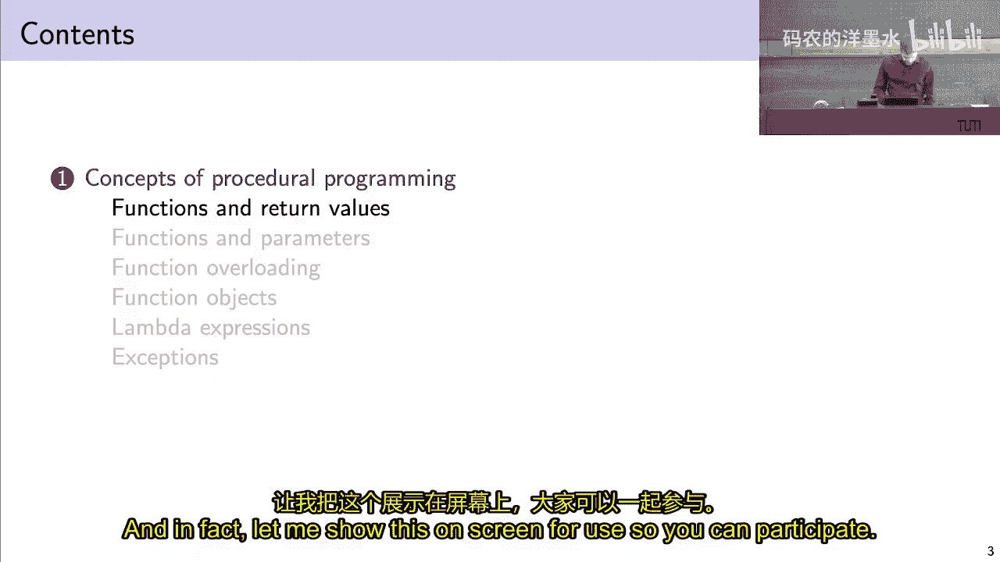
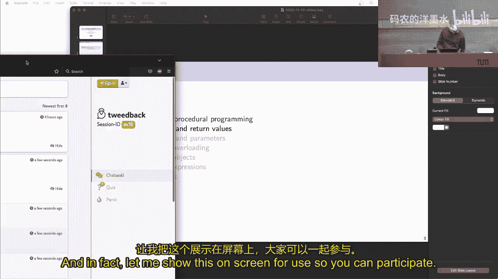
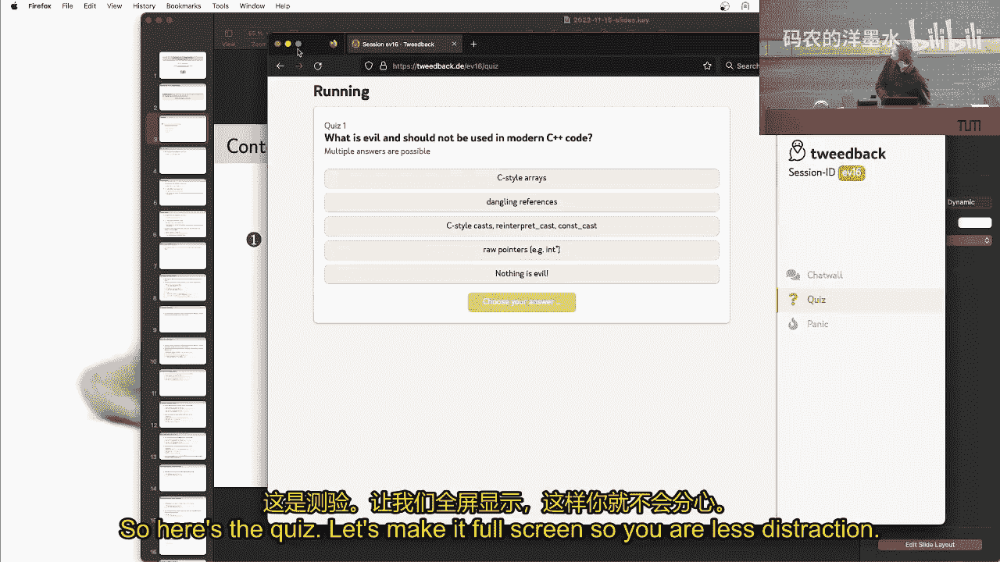
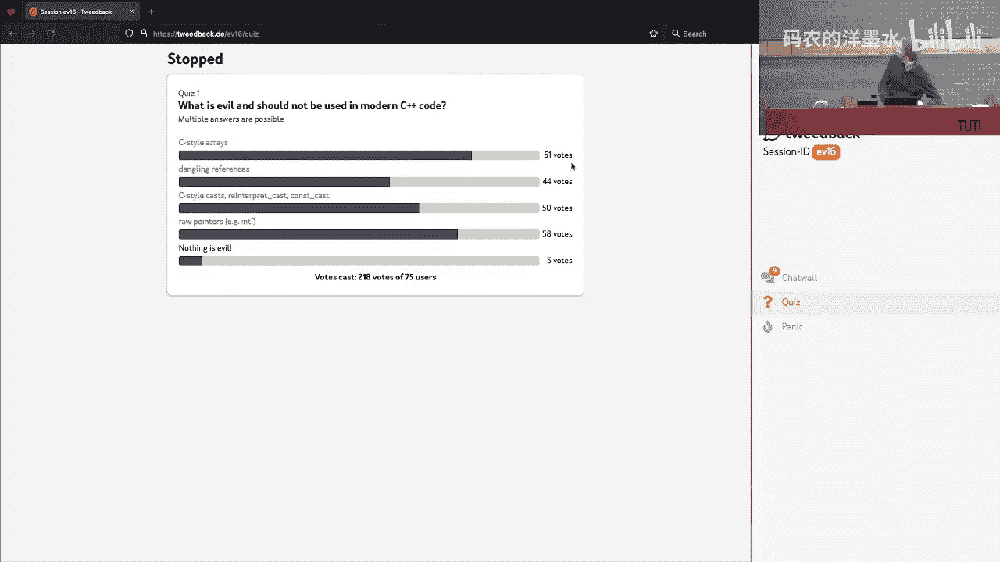
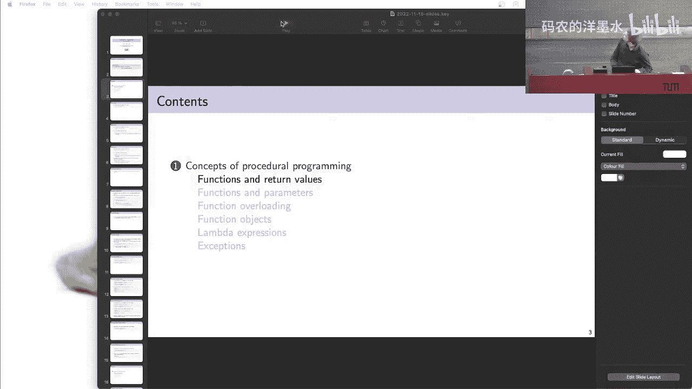
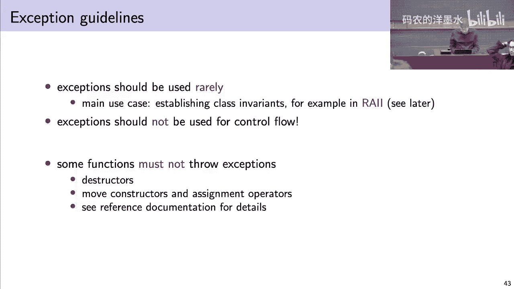

# 【全集】慕尼黑工业大学 IN2377 C++编程概念 中英字幕 1080P p04 Lecture 4 - 函数示例 -BV1b8mgB8EDQ_p4-

Test and right。Right， so hello， everyone。Let's see how this works。Right。

 welcome to the C plus bus course once again。Both here in the auditorium and also remote。

 the stream is hopefully working。And if not， please let me know。via feedback。 And， in fact。

 today's feedback session， I D is E V1，6。So if you have any questions or any issues。

 please post there。So we are going finally move beyond the basics chapter today。

We're going to start with a chapter on procedural programming。And in particular。

 we will talk about functions， return values， function parameters， function overloading。

Function object。Lambda expressions， and finally， exceptions。Right。Let's see。Sound volume is low。Okay。

 let's try this again。Very good。 And I actually want to start this off with a little reminder of our last week's session。

😊，So I'm starting a quiz on feedback。And in fact， let me show this on screen for you so you can participate。

嗯。So here's the quiz。 Let's make it full screen。 so you have less distractions。

What is evil and should not be used in modern C plus plus code。There's seat arrays。

Dangling references， C style cast，3 interpret cast， conscast， and raw pointers。Or nothing is evil。

 Everything's fair game。Please cast your vote now while I'll figure out what's wrong with the volume。

Testing， testing volume of the stream。Right， so hopefully I found the correct sound setting now。

Because here from my streaming setup site， I can't increase the volume any further。Very good。

 So I see quite a few of already have cast your votes。

But there's more of you here and more of you online。So please take the chance to answer。

 Think about it。 What is evil and should not be used in modern C plus plus code。

I'll give you 10 more seconds。Very well。So I'll stop the point。

Last chance to ask you about a few more seconds。And your last chance has gone。

If feedback bag actually works。嗯。嗯。So here are the results。Okay。

 feedback is having some lag issues right now。But so there were five of you who said。

 nothing is evil。Which I don't agree with。 Obviously， it's a bit of a subjective opinion there。

 but I would advise you to revise your opinion if you wna write noise modern code。 And， of course。

 everything of these things here is evil。You shouldn't use C style arrays。

 There's no more need for them。 Use SDD array or SDD vector。Don't do dangling references。

 They result in undefined behavior。Don't use C style casts。 Don't use reinterpre cast。

 Don't use concast。There's better replacements。Like thatticov。And row pointers。

 there is no need for them。 We don't need them anymore。 That's C style programming。

 We don't want and need this here anymore in modern C plus code。

So I see most of you have realized that C style arrays and pointers are bad。

 but if few of you need to understand that also dangling references C style cast。 and I， in fact。

 I could have。Made the list even longer of things that are evil and shouldn't be used anymore in modern C plus plus code。

 But let's stick to this for now。 We will get more examples as we go along。So how do I get my。

Sllides back hold on。need firework back on this screen。And fine。

Here， right。So procedural programming， That's today's topic。嗯。Right。And aren't you funny today。

 What's the tweetback session I D today in a question on tweetback。Very good， excellent。Right。

So let's get right into it。 Some of the things we've already talked about。 So， for example。

 return types， we've already seen this in the basics chapter。 Let's just talk about it a bit more。

So for example， you already know how to do a function with a specific return type。 for example。

 this function full has a return type of int。Pretty clear。What you haven't seen yet。

At least not in this course here is that he can also do trailing return types。

 meaning instead of writing the return type in front of the function declaration。You write auto。

And then。After the parameter list， after the regular parent thesis， you do a arrow symbol。

 and then you specify the return type。This is。Modern C plus plus feature。嗯。

I don't know what to change to my voice。 I'm talking regular loudly。 and I think all my settings。

On the receiver and on the thing here are。I can't really change anything anymore。

 Everything is at max。So turn up your volume epath if you're streaming。Hopefully， that works for you。

Anyway， trailing return types，5， would you want them。But。Pertyal， there's no reason to use them。

 And although there's no reason to not use them。Very gets interesting。Is， for example。

 when you have templated code like this piece of code here。As aation that sums up two arguments。

Which are templated with different types。 And you might not know what type is the result of that sum。

And here is where you actually need a trailing return type， because basically， you can only declare。

That return type， once you know what the types of the arguments are。 So basically。

 what the sum function does here， it is summing up the two arguments， X and y。

And since the types here are generic， you can use the sum expression of these two parameters。

 Take the decal types or the declaration type of it and use that as a return type of the function。

It's rare that you really need this。 This is a bit of a contrived example。 obviously， And yes。

 we will talk more about templates and all of this stuff later on。

 So this is just a kind of an outlook where this could be useful。 but in general。

 you don't need trailing return types。 You might like the style。 Feel free to use it。😊，嗯。

That's nothing。Against doing it like this。 It's， of course， just a bit。

Different from what most people are used to。 Most people are， of course。

 used to the classical C style syntax where you have the return type before the function name。

But this works just as well。Now， what do we do。嗯。When we want to return multiple values。

 because this return type that we just looked at， that's for one return type 1。

But if we want to return multiple values， well， you're out of luck。

There is no mechanism in C++ to return。Multiple return types。However。

There's workarounds that are relatively elegant。One of them is in the standard library in the form of SDD pair and SDD Ter。

Not sure if you talked about them yet。 I think I mentioned them。At least once。Anyway。

 what you can do basically is you can return a pair and a pair does exactly what you think it does。

 It makes a pair of an integer and an SDD string， for example， here。

 puts them together into one type and SD pair is part of the standard library so it can use it anywhere。

 And if you have more than two， you can use a topple which can take an arbitrary amount of parameters。

 for example， two integers and a float。 And then you can return that as one value。

And you do this via SDD make pair to create it or SD TD make tu tuple to create such a tuple。

That's the standard library part。 That's not very elegant because essentially。

 you're wrapping multiple return types into a new class， one that's provided by the standard library。

 But nevertheless， that's what you're doing。 in order to make it usable。

 theres a language feature of C plus plus that got introduced in。D plus plus 14。17。I don't remember。

嗯。But relatively late。 And these are the so called structured bindings。

 So if you have a function food that returns a pair， you can automatically distangle the pair。😊。

Back into two separate variables， using this。呃。Bret syntex here。

 which are called structured bindings。For a pair， you would obviously have two parts in there for a triple or a three tableple like this one here。

 you would have three。And it does exactly what he would expect it to do。And， in fact， this is even。

More kind of。General way to kind of initialize multiple entities at once in one statement。

Pair and Tur， like in the previous example， are the prime example。

 but you can use it also for a lot of other things， like in the standard library。

 which we will get to next week。 there's， for example， associative containers like hash maps。

Where you have keys and values。 So this is a hash map with keys and values。 So keys。

 a string value is an integer。And if you query an element of this map。

 what you get is a pair of key and value。 And obviously。

 you can do the structured binding here to disenttangle key and value directly。嗯。

So we can use them directly。Because if you would get the pair separately。

 you would have to use pair dot first to access the first value of the pair and pair dot second to access the second value of the pair。

 which is less intuitive than if you can give it names like key and value immediately using the structured bindings。

Structured bindings are even more general。You can also use them forstruct。

So if you have astruct that contains two values， A and B。You can， basically。Extract。

The two values using structured binding， you can do the same for an array， not for vector。

 because for this to work， it needs to have a fixed size at compile time that only works for STD arrays。

But you can also basically assign all the values of an array to separate variables in one statement。

And， of course， you can add reference qualifiers like here。嗯。

Or the con if you want to so that you can't change the things。But for example， here。

 we are basically alienliasing with a reference the two variables of the structure M S。

 which contains A and B。And for example， if I change the value of a now。Then this user reference。

 it's an alias to M S dot A。 So obviously it， it changes its value。 if I change U。

Then the original value changes as well， because I'm just accessing it via an alias。Right。

 and if you want to。And you have your own user defined type， your ownstruct。

 your own class that has a bit more。嗯。Functionality。

 than just an aggregate structure like this particularstruct。

 You can also provide your own interface。In order to enable structured binding for your data type。

To do that， basically， you have to provide an API like S TD Wu。It's a bit cumbersome to do that。

 but it's eminently possible。 I'm skipping the details here because it's a bit。Yeah。Unnecessary。

 intense。 It's not hard。 It's just， you just need to for implement this API。

Can we use auto in function arguments。We get to that。Theres。A generic yes。嗯。

But it's a bit more tricky。 and we need templates in order to explain that。

 And that will come when we talk about templates。Can't we just declare int fo。

 I presume you're referring to。This particular example with the trailing return type。 Yes。

 these two here are completely equivalent。You can choose which one you want。

 It's very rare that you actually need the trailing return type， like here。So it's a matter of taste。

 for most cases。No。What's the difference between pair and tuple。 Well， a pair is a pair。

 or it wraps two elements。 A tuple wraps an arbitrary amount of elements or anything from 0 to。

1 billion。The difference is， why do you need pair if you have tuple， Obviously。

 pear is somewhat superfluous。 Tple handles the paircase as well。

It's just that the pair interface is a bit more specific。

 a pair is guaranteed to have two elements so you can access the two elements via dot first and dot second for a topple。

 it has an arbitrary amount of element。 so you have a get zero get one get two in order to access the zeros。

 the first or the second element of the top So basically the pair is just a convenience if you know that it's just two and to have more a more expressive interface。

But otherwise， there's no difference。Aside from the number of elements I can store。

When is a pair useful overt， Yeah， when you know， it's just two。

 and you want to have a nicer interface。Why do we need the mpers after auto in slide 6。Right。

You don't necessarily need the Ment。So if you leave away the m percent， what you get is a copy。

So each key and value that comes out of the map will be copied into the variabless key and value。

For the value， it doesn't matter。 It's an integer。For the key， it's an SD string。

 and a string might be arbitrarily long。 So a copy is wasteful。In this。

 for this particular type of loop。 So what you would like to do is you want to take a reference。

Which doesn't involve a copy。And in order to make sure， because now it's a reference。

 meaning that key and value are actually aliases to the pair that's returned by the hash map。

 If you want to make sure that it can't be changed， then you add the constant front。So basically。

 you get a read only reference or alias for。That particular pair that is already disentangled via structured binding。

That's why I do the con reference here。You could do without the content and the reference。

 but then you would create copies and that is typically less efficient。

 especially if you have something like an STD string involved like for this key here。

Where is a colon。Why is there a colon because that's a syntax for。That's my mouth。

Because that's the syntax for a range for loop， which we handled last week。

 That's a particular type of loop that's defined on any itable。

Data type like these standard library containers。 And what it does。

 it takes this container iterates over all elements and assigns each element from the container or from the iterator range to the left hand thing to the left hand side of the colon。

 And in this case， view structured bindings with a constant reference to disenttangle the pair that the map is storing。

What's the difference between an array and a tablet。Well。

 and an array is an array that's guaranteed to be contiguous in memory。It has STD array has。

 of course， a fixed size。Tapu stores several elements。 It also has a fixed size。

 but it has no guarantee that it's stored in contiguous memory。 It could be stored， however。

So that's the main difference here。 Tple is biological grouping。

 whereas array is really an array where you store things one after another in memory。Right。

So we had this already。What's next。欧阳。So。Multiple return types。 we handle this via pairs or tapppers。

And C plus， plus， but that is， of course， annoying because you have to write。 Oh。

 I'm returning a tableple with blah， blah bla， blah， blah。

 and then I have to do a make tuple to create it。😊，That's a lot of typing。So， what it can do。

If you can write auto as a return type。And then count on the compiler to deduce the actual type from the return statement。

 because， you know， every function that has a return type has to have a return statement。

 at least one。And。The compiler sees it， knows it， and then hopefully can deduce the return type of that function。

嗯。From the return statement。 And if that works， you're allowed to use auto as a return type。

That's cool in this example， because it saves you a lot of typing。

 And as long as you see the function body。😊，It should be just as descriptive。Ass the other version。

Of course， now， if you do a split into headers and source files where in the header。

 there's only the function declaration。Then this is a problem， because then。

That's just auto and the compiler can't do。 So basically。

 this only works properly if you have the function body right there with the declaration。No。

There's a question on the syntax of。Ststructd binding， which I'll answer later on。On my keyboard。

 because that， that's not a good way to answer。嗯。Why don't we use auto all the time。What。

Because you need the function body。Right there， because otherwise， it doesn't make any sense。Right。

 let's talk about parameters。We already saw how we can pass parameters to functions by value。

By just stating the type in a name。 And then what happens is when you call the function。

 a copy is made of that particular parameter and the function can change it or use it。 However。

 it pleases。 And as soon as the function is over， all the changes to this copy thing are gone because the copy is removed。

You can also do it by reference where you add an m percent to this。 So when you call the function。

A reference to the parameter is made， and that is passed into the function there you can use it。

 And that， of course， means it's an alias。And you can write to the reference。

 and if you changed the contents of the referred variable， then， of course。

 this reflects back to the calling context。If you don't want this。

 but you want to avoid the copy that happens in the binary value passing。

 you do a constant reference。Because basically， what this does， it still creates a reference。

 or it doesn't create a copy， just a reference， just an alias。

 but it's a constant reference so that the function cannot change the value of the parameter inside its body。

 And that way， of course， also， no changes propagate to the collar。

How do you choose which of these to use？Well， there's a very handy graphic that I've taken from the Cplpa core guidelines。

This is， in fact， a website you should take a look at。Repeatedly。Again and again。

Because it's written by very， very clever people， people a lot clever， more clever than me。

 like Herb Sautter and beyond a strawstr。And some other C plus bus gurus。

That give you guidelines on how to do certain things in C plus in a good way。

And here is the recommendation for。How to do parameter passing。So if you have an out parameter。

 basically something that comes out of a function。What you should do is return it。

Be the return value， obviously， right， that's kind of not surprising。If you have an in out parameter。

 So basically something that comes into the function is modified and then should be passed back。

What you typically do is pass by reference。Because there， it makes sense。

If you have a pure in parameter。You do it by value， or by constant。

And the distinction between these two， basically。Depends on if the data type that you're passing on is cheap or impossible to copy or not。

And with this moving， don't ask， we will get to what moving the means。And so on。 But basically。

 the distinction here is really out parameters via return type in parameters。 if they are small。

 by value， otherwise by constant reference。 And only if you really。

 really need an in and out parameter， do you pass it by reference。So， examples。Like here。These are。

In parameters that we are just using and not modifying and passing back。 So， for example。

 an SDD string is typically something bigger， So it's not cheap to copy。

 So we do this by a constant reference。Or。We can do it by value， but that means the string is copied。

 And if the string is a few megabyte or gigabytes big， well， then youre copying that amount of bytes。

So you need to know what you're doing there。Here， for the integer。You don't care。

 It's a small integer that's easily copied， so there's no point。And here。Yeah。

 passing an integer by constant reference is most likely overkill。Because， well。

 an integer is obviously not difficult to copy and creating a reference out of an integer takes at least the same amount of memory。

 if not more。嗯。Right。Does B' throatstr have a frying pan。I presume so。I do now， too。Thanks to you。

So yeah， here a second question is， what's the difference between F3 and F 4。Functionally， none。

But you have to consider that an integer。Is typically 32 or 64 bit。

 and a reference for reference passing to a function is probably the same size of a pointer at that architecture。

 which these days is typically 64 bit。So it's not necessarily cheaper。And yeah。I don't know。

Up to you in the end， it's not a huge overhead。 It's not as obvious as with a string here。

 which might be really potentially as big as， as as possible。Yeah。You need to decide for yourself。

 These are just guidelines。 They are not， They are not hard and fast rules。

If you have in and out parameters， where you do that by reference。Although。

That's not an encouraged way of doing things， because typically speaking。

 what you expect as a human reading， your function signature。

 something comes in in the parameter lift。 And if it comes out， it should be a return value。But。

 sometimes。That's the easiest and most elegant way of doing it。

And out parameter are obviously return types。 If you have one， then you do a single return type。

 Otherwise you do a pair or a tablet。What's the story behind this mythical frying pen。I let you know。

 at some point。Cause I still do plan to actually use it。This year， even。Right。

So so much for function return values and function parameters， of course。

There's a lot you can talk about this more， But I think that's enough。 for now。

 I wanna go to a few more interesting topics， namely overloads。

 function objects and alumni expressions。So。Overloading is。

Something that's relatively specific to C plus plus， Of course， other languages have it， too。

 but it's not that typical。And。What we can do here， for example。

 is we can have multiple functions of the same name that take different parameters。

And they overloaded each other。So what does this mean， You now have two functions called F。

1 accepts an integer，1 accepts a double。And the compiler basically decides when you call the function F。

 It checks the arguments and decides which one of these it should call。And， of course。

 if the compiler can't decide which one to pick， it will say， oh yeah。Sorry， can't do it。

 Compr error。So what are the overload resolution criteria。Well， so basically。

 they are tried in order if there's an exactec match。Like， it matches exactly the。

 the function signature。 Then， of course， that one is picked。

And the only trivial conversion that happens here is， for example， from a type to the type con type。

The next promotions are tried。 So， for example， a bull is automatically promoted to an integer。

 and integer is promoted。No， it's not promoted。 A child is promoted to an integer or flow to double。

Right。Then， conversions are considered。Like。Potenti loss conversions from in to double。

 from W to int， into unsigned in。Which the compiler might also warn about because they might lose information。

If you define your own conversions， which well talk about in two weeks。Those are applied， next。

And finally， if there's still no match。The ellipsis operator is basically tried for matching。

Which is template， very template topic， which we'll talk about in a few weeks。Right。So。

What we can do is， for example， define several print functions。Why would we want to do this。

A stupid example here。 But let's say， of course， you're printing an integer。

 you print it differently than a double。Why you would like a separate print function for long versus int。

 I don't know。 It's just for this example here。And printing characters， of course。

 is different than printing numbers。 So maybe that makes sense。So yeah。

 let's have a function F that takes a chart， C， an integer I， a short S and a float F。

 and let's call print with these four parameters。 So if we invoke it with a char。

 obviously print cha will be called because that's an exact match。Then if you have print I。

 we have an exactec match for the integer version。If you print a short， that's no exact match。

But a short can be promoted into an integer， and then the integer version is called。

And the same is true for the float。 We have a double version of print。

 So the float is promoted to a double， and then the double version is called。And， of course。

 we can provide literal like a character literal that would call the character version。

An integer literal， which calls the integer lital， of course，0。Well， by default。

 it's an integer literal。So it's calling the intetro version。

 And if you now specify a long literal using the suffix L， you remember from two or three weeks ago。

That's what it's called。So in out is used for modifying objects yet as a parameter that goes in and that goes out again。

 that， of course， implies that it's being modified。I don't understand slide 11。

 very what is slide 11。Oh yeah。 you don't have to fully understand it yet。

 We haven't touched on all the concepts yet that you need to understand it。So don't feel bad。

 Go back to it once we've talked about resource management， which should be coming up in。

3 or four weeks， just before Christmas。Come back to the slide， and see。

See if you understand it better， because， of course， we are still missing a few things。

 But that's the thing。 I can't cover everything at once。 I have to decide what to show。

Do you have some tips on how we should read the CPP core guidelines。No， you'll read them。I mean。

 they are another book， so。Their guidelines。 So there are collection that are grouped by different topics。

 So you probably don't want to read it like a book from front to back because that's going to kill your mind。

But maybe you can have a certain issue。 and then you can look into there。

 I there something about this， Maybe you come via it by come there by googling it。

 So it's good to have it bookmarked。 Let's put it like this。 And you will probably want to read it。

More often， the more you understand of C plus plus。 So maybe now is not the best time to start yet。

Can we return STD array and STD vector， Obviously， yes， there are types。You can return any time。

What is integral promotion， Ineg promotion is promoting a smaller integer to a bigger one。

 like short to in or in to long。It's not our conversion。It's just a promotion for。

The purpose of deciding which overload to select。Like here。More examples。嗯。Why。

Well I think the most important one is to show now I have a function with two arguments。P。

 so taking something to the power of something else。And I have a version with integers， with doubles。

 double and complex， complex and integers， complex， complex。And basically。

 as long as you mix and match something that the compiler can decide like two integers， two floats。

 which get from 2 ws， I'm sorry。doubleub and a complex， complex and integer， complex complex。

 These are all clear cases where the compiler knows what to do。

 But as soon as you mix and match something that doesn't have an equivalent here。

 like double and int。There doesn't exist A doubleub in inversion。 and， of course。

 now the compiler doesn't know。Should it convert the double parameter to int so that it could select the intetro version。

Maybe， but there's either the option to convert the integer to a double to use the double version or even to convert the integer to complex or the double to complex and so on and so on。

So the compiler will see there's multiple options。 All of them are as good as the other。

 So it will say， no， that's an ambiguous call。I can't resolve that。

Another thing that you might notice here is that the return type。Changes。And that is allowed。

 It doesn't influence the overload resolution。 And this is the next slide。

 The return types are not considered in the overload resolution。 And this is actually a good feature。

 even though sometimes it might piss you off。 because in general， what this means， if you do。

 for example。If you have two square root functions，1 afloat，1 a double version。Again。

 stupid example why would you do this。 But anyway， assuming you have it。

And you would initialize a float with this career root of a double。

Or you would initialize an auto variable with a square root of a double。 So， of course。

 this auto will be a double。Because the automatically deduced return type of the double function is double。

But if the return time would participate in overload resolution。

 this one here might not call the double version， but the float。And here， yeah。

 it's probably pretty clear would call the double version。 So this is why it's good。

That the return type doesn't participate in overload resolution。It's just there。

 And you can change it between the overloads， if you want it。If we define a reference。

 can we change the address it is pointing to。 No， a reference is not a pointer。

 The name should give it away。 A reference is an alias。And it's immutable， if you remember last week。

 So no， it cannot be changed。And that's a good thing。Because point does that evil。Right。So。

 function objects。We've talked about returning values， parameters。

 how to overload functions with different parameter disk。

 The return type doesn't participate in overloading。 Now， let's talk about function objects。No。

The title is。AKin of a contradiction because actually， functions are not objects in C plus plus。

You can't pass them as parameters。They don't have any state。 They don't occupy any memory。

 except for their body， which is stored somewhere in the code segment， obviously。However。

 what you can do。If you can have a function object。And what this means。Is。That， that type。提。

Is an object itself。Like a user defined class， for example。And it defines the operator。

 the calling operator， the operator with the parentthsis。Now， what does this mean。

 you have an object。That you treat it like an object， you declare it。Yeah， you define it。

 you initialize it， you do stuff with it。 And since it contains the calling operator。

You can use it like a function， meaning you can take the object and call it。 And what this will do。

 it will invoke this calling operator and do whatever you defined in this calling operator。

And that's why we can talk about function objects， even though regular functions are not objects in C plus plus。

 because you can define objects that。ItCan be called like functions。

 Another name for these things are functors。To me， thats synonymous use whatever you prefer。

What does this mean， Let's make a。Yet another stupid example。Because it has to fit the slide。

 So here， let's say we have astruct called adder。No， this is not the animal。 It's， its。

 it's a thing that adds。 Let's say it stores a value that's initialized to one。

And it has this conning operator。Taking an integer parameter。

 returning an integer as its return value。 And what it does。

 it takes the parameter and adds it to the value that is stored in the errorer。Bao。

Very useful cl structure。But anyway， it serves its purpose here illustrating that this is a function object。

 because now。We have a structure that implements the calling operator。

 and that means we can instantiate an object of the structure like this。 my adder here。

And this is now a function object because you can use it like a function。So first。

 we can set the value to something if you want to。 and then we can call our calling operator with the parameter1。

And since the value was set to5 and we add one， the return of this statement is 6。

 which we are ignoring we are not using it here。Or four， you get then obviously a 9。

 you change the value and you get an8 and so on and so on。So， yeah。😊，This is a function object。

And you can define。Your own function objects as you please， your own structures， your own classes。

 whatever。那。That's also a user defined type in the standard library that's called SDD function。

But it does， It wraps。Anything that's callable。So it can wrap a regular function。

Can wrap a function object。And it can wrap other things that are callable， like lambda expressions。

And what it does。But it's defined in the functional header。

 I don't know why the header is called functional in my eyes。 It should have been called function。

 but whatever。嗯。And what it does， it takes that calibable target as an argument， stores it。

 copies it。 And once you invoke the function via this SDD function wrapper， obviously。

 it calls the function object。So how can it look like。Like， let's say you have a function here。

That adds3 to its argument and returns the value。 So again， another really useful function here。

And you can have an FDD function。That is initialized with this。Function。So now adder。

 the variable adder， is an object that contains this callable。

 and you can invoke it like a regular function like here to use it to initialize another integer。

 for example。You notice that we don't specify the signature of the function that we store here。

And the reason this works is that since C plus plus 17， this。嗯。Autmatic deduction happens。

 So you don't need to specify it。 But if you want to specify it as a template argument。

 you would specify oh return type int with a parameter of int。

 And that's kind of the function signature of this ad funk。 so that it works。No。This is a raper。

 What does rapper mean， well。This is a phone。This is my hand。 And if I put it in my hand。

 I'm wrapping the phone in my hand， right， yeah。Programmatically speaking。

 a wrapper is something that stores it and provides some additional functionality around it。

So SDDD function is a wrapper for anything that's callable。

 It's stores that callable somehow internally inside itself。

And provides some additional functionality。 So that's a wrapper。Since it's storing the callable。

There is an overhead in using SD function because first， you have to store it。

 You need memory for this， and you also need to access it。

 And once you actually call the function like here。

There's an indirection because it goes to the operator。

 the calling operator of the SDD function first， And that forwards it to the actual collibable。

 So there's an indirection there that can。That costs performance because there's one interaction。

 It's not a direct function call， but there's interactiondirect via function。

 And then it's calling the actual callable。So there's a slide overhead that you should be aware of。

 So if you're using performance critical code， SD function， even though it's very con convenient。

 might not be your choice。Right， let's do another example。

Just to show that STD function can really store just about anything that's callable。

 He has a regular function。Print number。And here's astruct called print number。

 which is a really bad style because it's the same name with a different case。

And you shouldn't do this。 I'm just doing this because it's a stupid example。

 which provides a calling operator。That that's the same thing。

 So there's no difference really here between these two。And， of course。

 what it can do is you can store the first one in an SDD function and call it。

Using this SDD function wrapper， you can store the second one in the SDD function。And call it。

And what you can also do is now some'm a bit more fancy stuff。 let's say。

You want to fix the parameter to a certain value。So that you can call the STD function without a parameter。

 and this you can do。By using another SDD function。

 you have to specify the signature now because now you have no parameter， no return type。

And you call SD bind， which essentially takes a callable。

And binds a certain value to its first parameter。Like this weird number，31337。

 I don't know why I put that there， right？ It's totally stupid number。嗯。

And then you can invoke that function。Let's know parameters。So， kind of like。A default argument。

 except that you wrap it。Around the original carlib。

So a functional makes a copy of what it is wrapping。 That's the overhead。 Yes。

 that's the memory overhead。 And there's also the invocation overhead。

 because instead of invoking your caller directly， you first invoke the calling operator of the function。

 and then the callable。 The overhead is small。But if you're calling something a billion times。

 it will add up。So don't do that in your inner loops。Can you overload the operator。

The calling operator in your own classes。 Yes， you can here there。呃。And yes。

 you can provide several calling operators that are differentiated by the number of arguments。

 so you can have a calling operator that has no argument。Sorry， here。 here is the argument list。

 a calling operator that has no one argument that has no argument that has two arguments。 So， yes。

 you can overload the recording operator as much as you want。Of course。

 you can also achieve a similar effect using default parameters as well。What is the use of a factor。

Well。You can hand， since you can't hand around functions in C plus plus because they are not an object。

 You can have an object。That you can hand around and then later on invoke。If that's useful to you。

dependss on you。It's nice to have。In some cases。Will be discuss perfect forwarding， yes， later。

When we talk about our value references and moving and stuff like that。

We can also overload other operators。 Yes， which well also talk about later。

 You're all very eager and curious。Some patients， youll get to it。Yes。

 STTD function is a wrapper that you can hand around。 That's exactly the point of SDDD function。

 Otherwise you wouldn't need it。Right。So。Let's talk about the most interesting topic today。

 Lada expressions。And， of course， this comes after function objects， because in the end。

 what a lambda expression is， is also something that's callable。So， in fact。

 a Lada expression is a function object that is anonymous。So it's something。

 an object that you can store somewhere and that you can then call。

They are also part of the language。 So are they actually an expression。 And if you remember。

 we talked about expressions。Last week， two weeks ago。You know。

 the things that are formed of operators with operas and so on and Lada expressions are also considered expressions。

 And basically， you can use them anywhere where expressions are expected。Or used。

One of the traditional examples that I've shown。When Lada expressions were introduced。

 is this one here。 you have a standard library algorithm。

A fine routine that basically looks over something that's iterable。

 like a container that goes from beginning to end。 So it's。Something that you can iterate over。

 And then basically， it checks each element of that container and checks if a certain condition is fulfilled。

And the condition that is checked is provided via a function object。And， of course。

 what you could do now is you could write a function somewhere out outside and refer to this function。

Or you can store it in an SDD function parts that SDD function as an argument or what you can do now。

 you can specify the function right here Where youre invoking this find if using this particular lambda expression syntax。

 which is these square brackets。Open and closed。 Then a parameter lift like a regular function。

 can be empty， and then a function body like a regular function。

 Except this is now the body to the Lada expression。 And this can， of course。

 contain whatever you want it to contain。And this thing can be used in any place。

 or of an expression。Right， so there's some terminology。 The Lada expression itself is an expression。

And。Writing down this Lada expression creates a function object。

 So the compiler will create a function object for you。You don't see that function object。

 It's just the compiler internally doing this。And that object is called a closure。

And disclosure is an object。 and， of course， this object can contain stuff like copies or references of so-called captured variables。

 which we'll get to in a moment。 But this is not really important because you don't see that closure object explicitly anytime。

 but the compiler internally does it。 and it's useful to have it in mind how the compiler does it to understand how Lada does work。

What's the memory footprint of a lambda expression。Perty for， nothing。Except。

If the Lambda is storing something like using captured variables， then， of course。

 you need storage to space for those captured variables。嗯。And also， of course， it depends。

On how you use it， if you store the Lada in an SDD function。

 which you can do and which we will see in a moment。 we will get to it。嗯。Of course。

 you need space to start， like for every other calllibbu。

What's the difference between a Lada expression and FDD function。Both can be passeded as arguments。

 yes。Both are cols。 both are function objects。The difference is that the Lada expression。

 as you can see here。You can define it right there。For the SDD function。

 you need to define your fun somewhere else like a function or astruct containing the calling operator。

 Then you create a function or SDD function object， initialize it with that， and then you pass it。

Here that you can specify right there in line because it's an actual expression。

So you're asking a lot of questions that I'm just going to get into the next few slides。

 So I'm not gonna answer them explicitly。So some patients， you're， you're very， very eager today。

So let's talk about Lambda syntax。So if we have these square brackets。 They have to be there。

It can be empty， or it can contain a list of captures。 and we will talk about。The captures in a bit。

 So hold their horses。Then we have a parameter list， like a regular function in regular brackets。

 And what we see here now is a trailing return type。And now。

 you know one of the reasons why the trading return type was introduced。

 because that was the only way to make a workable Lada syntax。And basically。

 to be consistent with regular functions。Other the regular functions now support the trading return type。

And then， of course， in these curdy braces， there's the actual body of the Lada expression。

 which is executed when it's called。The trailing return type is actually optional。

And if it's not there。It's treated like if you do auto for a regular function。

 then the compiler tries to deduce the return type from the return statement in the body。

The captureist can be empty。 The parameter list can be empty， and the body can be empty。

 and you can drop the return type。 So basically， this year is a validted Lada expression that does nothing at all。

And， in fact。If the parameter lift is empty， you can also emit it， omit it。

 So the actual shortest Lada expression that you can write down is the square brackets。

 They have to be there and the body， which also has to be there。 And both of them can be empty。

 so you can have this four letter。L the expression that does nothing useful。

Let's make some examples to see the difference between regular functions and Lada expressions。

So let's say we have a vector of numbers that's initialized somehow。

And we want to remove all multiples of three。There's a handy standard library algorithm。

 Remove if that goes over a container。 So from begin to end of this container numbers here。

And invokes a function to check if the element should be removed。 So if the function returns true。

 the element will be removed。 if it returns false， the element will not be removed。And traditionally。

 in old C plus plus， what you do is you define this function somewhere else because you can't define functions within functions。

 right， So you have to define it somewhere else is multiple of three。

And then you just check if the remainder of division by 3 is0 or not and return true ofs。

And then you pass that name of the function as an argument to SD remove it。That works perfectly fine。

It's a bit cumbersome。Because。This function here has to be defined outside of F。

You have to find a reasonable name for it that doesn't clash with any other names that you have in your name space。

 And it's probably something you only want to use inside F， but you're still。

Have to put it out there。So it works。 But if you look at the same example here， you can write this。

Well， actually， it would have fit into one line， but I made it two lines。

 You can immediately write this function down using the Lada expression。

You don't have to give it a name。 You don't have to define it outside your function F。

You don't even have to specify the return type here because it's reduce deduced from the return statement。

And this is way more short。Compact and。Better understandable formulation， obviously。So， in fact。

What he can argue， Lambdas， strictly speaking。Don't。Change the language or what the language can do。

Because everything you can do with a lambda expression， you can do with a regular function object。

So using SDD function or or。Other classes at。Implement the calling operator。

But they provide a lot of convenience， and they make for a lot more readable code。And I'm not sure。

 I don't think that's an example that you only can do with Islam Lada expressions。

 but let me assure you。They are。One of the biggest things that C plus plus introduced in C plus plus 11 and has refined on。

In C plus plus 14，17 and 20。The body of the Lada can be as big as you want。 So it could be 20 lines。

 It could be 100 lines。But， obviously。You don't do that if you do stuff like this。

 because then you kind of。Ked the purpose of Lada expressions， right。

 If this would be a really complicated Lamda， then probably。

Using the traditional approach of writing a separate function that does very complicated thing is more readable after all。

 But again， the decision of where you draw the line is， of course yours。But yeah。

 the Lada expressions are most handy for these kind of simple functions。

 where it's really a chore to define extra functions and then refer to them。

Theres no overhead for Lada functions， compared to regular functions。And of course。

 it might look a bit unfamiliar if you've never seen them compared to a regular function。

 especially if you're a C， someone who's familiar with C， then the Ladas， of course。

 are a bit weird at the beginning。But you can rest assured。 I mean， it looks like a function。

 The only difference here is this square brackets at the start。 The rest is the same。 essentially。

 with a trading return type， if you want it。Now， another cool thing about the lambdas is that you can store them very easily。

😊，For example， you can declare a variable of type auto。And store the lambda。 And then later on。

 you can invoke that Lada。Using the parameters that it needs。You can also do this using STD function。

And it's the same， essentially。And， internally。They are probably also pretty much the same。

 Maybe this one here is slightly less memory。I actually don't know if there's anything。

Guaranteed about that。 But essentially， these two are really equivalent。If you want to。

 you can also specify the signature like we did before for SD functions with inch return type and two in arguments to。

 to do it like this。有。Yes， a return statement has to be。 well， no， let's put it like this。

 If you want the a lambda to return something。Then there needs to be a return statement。

 If your Lada doesn't return anything like this empty Lada here or this one， then obviously。

 there's no return statement and the compiler will assume the return type is void。 So， yes。

 you don't have to have a return statement。But then again， lambmbdas are typically used。For。

Easy things to be returned。Can we have a normal function definition inside another function， no。

That's why this is multiple of three here has to be outside F in C and N C plus plus。

 you can't do functions within functions， if you could。Then the use case of lambdas would be a lot。

Smaller。Oh， interesting question。Why。Can we actually。Do with this。Because you remember。

 I said at the beginning today。That a regular function is not an object。

So how can you pass something like an object that is not an object。嗯。But first。

 it depends on exactly how the argument list of remove if is declared。So， probably there's。

I'm talking out of my S here because I it didn't check beforehand。

 but probably there's at least one or two overloads for remove if， depending on what type of。

Callable if here。But in the end， the thing is， what you can do is you can pass the address of this function。

 This is what's happening here。 The address of this function is passed in here。

 And if the type of the argument here is compatible to that。

 then that is how you can pass basically the address of a function， even though it's not an object。

So functions are a bit special here。Even though there's no object， you can pass them along like this。

Isn't a stored lambda just a function。Kind of。As you see。It's bit like a function。You can invoke it。

Like a regular function， the difference is so that this is now really a variable that has the appropriate storage。

So if， if you're in a local context， this would be a automatic storage。 and， of course。

 it's automatically。Removed once it goes out of scope and so on。So yeah， it's similar to a function。

 but it's not exactly like a function。And the thing is。

You can use LCD function to wrap a Lada or other callable objects。 But for Las， you don't have to。

 you can also use just auto。 That also works。Tempd Ladas。 We will talk about templated Ladas， when。

We talk about templates， which will be in a bit。What's the point of SDD functions if we can also pass functions。

 Well， we can't store functions。 We can pass them as function arguments， but we can't store them。

 And that's what SDDD function is used for to store functions。Oh， that's a good one。

 Wouldn't the return type of a lambda always be the same a lambda， No。

 the return type of a lambda is whatever the type is of the return statement。

And that depends on what code you write obviously。And now， yeah， obviously， this Lada here。

 This is a lambda expression on the right hand side of the equal sign。 And on the left hand side。

 I have a variable called Lada And Lada is an object。 It's a variable。😊，It not a front。Okay。

 and the question is， what does this lambda return。So， V is an integer。

The remainder operation of an integer by an integer。

Is another integer that integer is compared with 0。So， in fact。

 what you have here is a Boolean expression。 So the entire type of this entire thing here is Boolean。

 So the return type of this lambda is bull。And now， it's not an array。Why would it be an array。

 This function here， This Lada or this function is multiple of three is invoked for every element of the container by the remove if statement。

 then remove， if thus the traveral of the container for you。

 There's no need to traverse the container in the Lada。

So let's move on because what is coming will answer some of your questions that are coming up now。

Right。So the interesting part is。A lambda。Doesn't have。A type， really。

Which is weird because obviously， everything in C plus has a type。 And strictly speaking。

 the lambda does have a type， but it's not defined。 So you cannot refer to it。And， in fact。

 what can happen。Is the following。You have。A function that returns。Auto。

 so the return type is deduced from the return statement。Here we have two return statements。

 one in an if branch， one in an edit branch， and it's covered by some stupid Boolean variable。

 and they are returning the exact same Lada。So you would think this is okay because both return statement would produce the same Lada。

And they should be of the same type。But the thing is， no， that's not how it works。

 Every Lada gets its own type。The type is something you cannot refer to。

 The compiler has it internally。And as soon as you do another Lada， even if it looks the same。

 it's a different type。 And now you have a return statement with type 1。

 A return statement with type 2， and the compiler will say， I don't know which one to use。

 I'm not compiling this function。Right， so what happens internally is for each Lada。

The compiler creates a unique closure class。That has a constructor that deals with a captureist。 And。

 yes， we will come to the capture list。 Some patients， please don't keep asking the same question。

We get to that。And the calling operator， which， of course， implements。Calling the body of the lambda。

You could do this yourself。You don't need the compiler for this。

 You could write a class that does exactly。What the compiler does。But， it's very convenient。

And it saves a lot of writing of code coming up as names for the closure class and so on and so on。

 You could do this yourself， but you don't have to。 And blumna really make this a lot easier。 And。

 in fact， even though it seems kind of just some syn tactic sugar that doesn't really do anything for the language it turned out to be a huge game changer4 C plus plus。

Is the lambda in the first example。On slide 28。Of type SD function。 No。

 that's what I just answered in this slide。 Each Lada expression has its own type。

 and you cannot refer to it。In slide 29， the return types should be integer for both cases。 No， no。

 no， no， no， no， no， no， no， no， you're messing up two things here so。

The return type of the Lada expression。Is integer。 Yes， because 42 is an integer liter。

The return type of the myF function is auto， and the compiler will deduce it from the return statement in both cases。

 we are returning a Lada expression。They look to be the same， but internally。

 they are different types。 And that's why this example doesn't comply。Okay。

 I'll answer some of these questions later on they， they just keep re repeating themselves。Right。

 so what you could do， obviously， to make this example work is you can introduce various memos。

 You can introduce another line before the if statement where you store the lambda。

 this particular lambda in a variable。Either as an SDTD function or as auto。

And then return the same variable in both statements， then both。Return statement would return。

The same variable。 And， of course， that variable will have the same type。 And then it would compile。

 Yes， but that's not the purpose of this example。 Of course。

 nobody would ever write a code like this。 It's just to illustrate that Lambdas have their own unique type。

No。Finally， we will get to， oh， sorry， for first return types。So。

The typical way of defining the return type of a lambda is， you don't。

And the compiler deduces it from the return type。 So if there's no return statement。

 the return type is obviously void。 If there is a return statement， it's reduced。

 deduced from the return statement。 So here it would be integer。In this one here。

 there's two return statements。 They are inconsistent。1 is integer，1 is double。

So the compiler would say， okay， I can't deal with this。 Sorry， compile  error。Or。

You specified explicitly using the trail return type syntax。And then the compiler will be fine here。

 and it will implicitly convert the double to an integer because now it knows， okay。

 the return type should be an integer。So most lambdas that you will see will not have an explicit return type。

 Some of them will。Some of them won't。I would actually say， most of them probably won't。Now。

 and finally， we get to Lambda captures。So。Many you create alumni expression。

 The compiler internally generates a class。That contained the constructor and the calling operator。

And that class can store state if you wanted to。 And that's what these captures are about。

So you have a lambda expression somewhere in a certain scope。And this scope will contain variables。

And what you might want to do is you might want to capture the value of those variables inside the Lada so that it can use the values inside the Lada。

You can do the same as reference instead of copying it U。Create a reference。

 So an alias to the variables outside of the Lada。And to store these。

They are basically data members of the closure class that is implicitly generated by the compiler。Z。

Understanding how this works is good to understand how Ladas work。

 if you're not sure about what classes are yet and how to do member variables and member references and so on。

 And constructors don't worry， will'll get to this。In two weeks。

Then maybe you will understand this better。No。As I said， these captures can be done by copy。

 so it can copy the value of variables inside your scope， or you can do it by reference。

 So you create aliases to those variables。And the thing is。

 once you've captured something from the surrounding context， you can use it。As if it would exist。

 as if， as if these variables or references would。Be inside the Lambda body。

 because they ever captured。So let's make some examples。Here's a function F。

 It contains the local variable I。Now， I define ada。That captures I by copy。And now what I can do。

Basically， when this compiler reads this Lada here。

 it will create a class that has a data member called I。

 and that will be initialized with the value of the I。In the surrounding context。

 And that means when the lambda executes。It will know what I is， because by default。

If you don't do this， it will say， oh， what is I， I don't know what I is。

 because basically the state of the surrounding context， it doesn't exist in the Lambda。

 So you have to explicitlyedly pull it in via a capture like this。

And if you do a capture by copy and try to change the copy， the compiler will complain and say， a。

 you copied this。 you can't change it。 You can' just read it。

So if you want to change things from the context that you have。

 you capture it by reference using the reference symbol and then the name of the variable。

 and then you can change it as you want。 And of course。

 those changes once they happen will propagate to the calling context。Because it's by reference。

So if you now call Lada 3。The value of I will change by one。 So it will instead of being0。

 it will now output1。That's what Lada captures are for。Of course， you need to be there。

When you do capture by reference。Heres a function G that has a local variable J。

We capture a reference to it inside this Lada expression。

And then we return this Lada expression to the collar of G。But as soon as G returns。

 variable J doesn't exist any longer because it has automatic storage duration。

 So as soon as the function G is over， J is gone。But the Lada expression was returned。

 and it has a reference to this j that no longer exists。

 This is another perfect example of a dangling reference。

That will cause undefined behavior if you then actually call that particular alumna。

So you need to be careful if you do capture by reference。As always， when you do references。Right。

And just to illustrate that。Difference between capture by copy and capture by reference。

 I have a Lada now that takes the captured value。Or the captured variable adds 42 to it and returns that。

 So in the beginning， I set to 42。 So when this lambda is created， it captures the value。

 the current value of I at that point by copy。 So the internal I of this Lada 1 will be 42。

Lambda 2 captures it by reference。 So it's an alias to the variable I。

 So if I now change the value of I to 0。And call Lada 1。

The result will be the captured value that was copied at that point of time。 It was 42 plus 42。

 So you get 84 as a result。If you invoke the second lambda， it's a reference。

 So it refers to an alias to the variable I I has changed in value  to 0。

 So what you get here now is the value of 42。Using return types syntax， best practice。

I presume you are。Referring to this particular example here。It depends， I would say。

For these simple examples， not specifying the return type is probably better。 Well。

 for these two examples， the third one is invalid anyway。 for these simple examples。

 not specifying the explicit return type is easier because it's。Right there。

 you don't need to write it down Additionallyly。 That just creates noise for the eye。

In cases like this， where it's not clear， you have to specify it。So it's again， you need to know。

What do you want to do。Why don't we pass a reference in the parameter list of the Lana。

That's a really good question。So。What you could do here。In this Lada3 example for example。

 you could change。This from being a capture to being a parameter。Reference parameter。That works。

However， of course， that means you now need to provide that parameter when you call the Lada。

And that might not be possible。Especially。If you do stuff like this， then， of course。

 the Lambda will be returned outside of the calling context that J is accessible。 And， of course。

 you have the problem of having a tagling reference here。But the thing is。

 you might want to call the Lada in a context where that particular variable isn't even available。

So that's why a capture is different。 In some cases， it's similar。

 like in these simple examples in the function F， it doesn't matter。

 It would be the same effectively。 But if you pass the Lada outside of the context where it was created。

 then the capture becomes really useful。Assuming you don't fuck up this dangling references。

 like in the example of G here。The I here is captured by value in these two examples。

So the compiler will not allow you。To modify it。Why， well。

 it's different from function parameters where if you pass it by value， you could modify it。

 And then the result is just discarded for Las， it's different。That's just how it is。

How do you define a function that takes a lambda as an argument。Think the easiest is。

To take as a type S TD function。There's other ways of doing it。 But that's， I think。

 the most elegant and easy one。Right， now the last question was。

What about these capture lists that only contain an equal sign or an mpersent？ Well。

 these are two default captures that allow you to capture all variables in the surrounding scope by copy with the equal sign or by reference with the mpers sent。

So basically， you capture everything in the context。So that it can refer to it inside the Lada body。

You can also capture everything and then change exceptions。 So capture everything by reference。

 except I， which is captured by value and by copy。Or capture everything by copy， except I。

 which is captured by reference。And what you can't do is you can't capture everything by reference and then say。

 oh， I want to capture I by reference because it's stupid。 So the compiler rejects it and the same。

 if you do copy， copy things。Devo captures are。ADiffic topic。

Because you don't always see as clearly as here what's part of the context。

 If it's a simple function like this F， it's pretty clear。 Oh， there's only two variables。

 So everything that's gonna be captured by reference or by a copy is be is just these two variables。

 Some context are less clear。 And if you capture everything， you might have unwanted side effects。

 right。Particularly if you do it by reference。You might hide some variables here or refer to them that you might not want to some general advises to not use default captures at all。

 Be explicit about what you capture because then everybody reading your code will be sure， oh yeah。

 you intended to capture this。 It was clear that you wanted to use this。 No。

 this was not a bug that you accidentally modifying something。Right。

I'll answer the remaining questions once I'm back in my office in writing because I have a few more minutes for exceptions。

 And that's also。Topic that I like exceptionally well。Because。How do we do arrow handling。

It's a shitty topic。 Nobody wants to do it， But in order to have good software， you have to do it。

So how do you treat error conditions？不。The easiest way of treating error conditions is to say， oh。

 there's an error。 O， terminate the program。Were done。That's a mistake。Might work for you。

 depending on what kind of program you do。 But let's say you're implementing a library that somebody else is using。

And maybe somebody else has a different idea of how errors should be handled。 But your library says。

 oh， there's a mistake。 entireti program is over。You have no influence on this。

 So maybe that's not the best choice。What you can do is， for example。

 have functions that can create errors， return an error value。

And then the caller can check oh verse an error and then decide what to do about it。

That can work pretty well， of course。That also。Mean you have to。Have a useful  error value。

 So if you have a function like this， get an integer and return an integer。

What would be thearrow value，42-1。7，3。100 million。Who knows。That's the thing。 You can't。

 In these cases， it's really hard to decide an error value。 Of course。

 you might want to return a pair or a table or something。Where one of them is an error marker。

 What's an error or not。 But then， of course， you need to check that error marker。

Which he might forget to check。And， in fact， this is， for example， what's practice in C。

Is to return a legal value somehow and leave the program in an aero state。

 And in see that's basically set done by setting the global variable called error no。Arrow number。So。

 for example， if you do something stupid like the square root of -1， which is undefined。

 you get some value back from the square root function。 It's meaningless。

And it sets the Erno variable to some particular value。That you can then query。But， of course。

 that means everywhere， this could happen。 you need to check。 you need to have an if statement。

 If error no not equals 0， do something。 So these if  error no statements should be everywhere。

 errorss can happen。 And， of course， people will forget doing this。

 And if you do any concurrent programming， you will have a global variable that's being written to and referred to by several threats。

 which is causing issues。 So that kind of sucks too。A variant of the first option is。

If something is wrong， you don't exit the program， but you call an arrow handler。

Something that you can set。To a certain。Function object， for example。But， of course， the question is。

 okay， that delegates the problem， and it's well defined what happens if there's a problem or an  error。

But of course， how would thearrow handler know。How to actually handle the arrow。

Besides terminating the program。Because thearrow handlenda could be called from anywhere。

And the thing is， with all these arrow things。 There's multiple ways of dealing with them。

 There's even more that I didn't list here。 All of them kind of suck。In one way or another。

And there's C plus plus solution and solution is explicitly in quotation marks because it's also a very flawed solution。

 It also sucks， yeah。But that's what Cpl decided on。So， basically。What they do is exceptions。

 And the idea is， basically。You try to handle the error。Not right where it occurs。

 but also not in a global error function。But somewhere in between。

 because usually where the error happens， let's say you try to allocate memory and there was no more memory left。

 So we get an out of memory situation。The function that allocated the memory usually has no idea what to do now。

 Well， it can't do its drop。 So probably the caller has to decide what to do about it。

 Let's say you wanted to allocate 1 MB of memory to store something。And the caller can now decide。

 well， it didn't work。 Can I do with less， for example。Could be an option to to do or it could say。

 well， I absolutely need this megabytes。 so if it's not available， I'll just terminate the program。

And that's basically the idea。TheWhere the exception。

 where the error occurs an exception is thrown and the exception is basically passed along the call stack。

 So the list of calls upwards and upwards and upwards until somebody is found who says， okay。

I can deal with this。That's the idea。So what how this works is basically you have this throw expression that throws an exception。

 Basically， you throw it out there。 and you see if somebody will catch it。And。

Catching it is done by using a try and catch block。 So basically。

 you have a try block where you call something that might cause an exception。

 And then you have one or several catch blocks。That try to handle the exception。

You don't have to handle it。In fact， you can just decide to ignore particular exceptions because you don't know how to deal with and hope that somebody else higher up the calling stack would know how to deal with it。

But of course， if nobody says so。I don't know what to do with it。In the end。

 the program is terminated if nobody is found who should deal with this exception。And of course。

 if you have an exception while you're handling an exception， that's also kind of like， okay。

 game over， program over。So the funny thing is you can throw anything in C plus plus。

 so any type can be thrown as an exception object。And what happens if you do a throw， then basically。

The call stack is unwound and basically it's checked if there's a catch block somewhere。

And if it's not， then the program is terminated。There are some classes by the standard Library based on the STD exception and some derived classes like invalid argument or out of range and others。

呃。They are fairly handy because what they contain is an explanatory string of what happened。And。This。

 you can carry this string。Of course， when you're handing the exceptional。

 at least show it to the user like， oh， yeah， something happened。 This is what happened。

So you might want to use those derived from them if you want your own。Exception classes。Right。

 and for example， you can throw a logic error with a explanatory string of what is the meaning of life。

 right， And then obviously， your call know what to do with it。So when the exception is thrown。

 stack unwinding happens。 So basically。What does stack unwinding mean， So you call a function。

You create a stack frame， you call another function， create another stack frame， and basically。

In each of these stack frames， you will have the local variables that are initialized。

 The constructors are called the lifetime starts and all the stuff。

 And the cool thing about the exceptions in C plus+ is when you unwind the stacks or go back。😊。

In these stack frames， each stack frame is deed properly。

 So there is clean up that happens automatically that you don't need to take care of。

 So if you look at C style error handling with check error number， do something about it。

 you would have to remember in each。Arrow check to uninitialize or deconstruct your already initialized variables。

 C plus does this automatically for you。 However， this comes at a cost。

The stack unwinding has a slide runtime overhead。 So if you are in real time scenarios。

People typically try to avoid exceptions and their handling because they might introduce extra overhead。

There are some very optimized implementations of exception ending these days。 So in most cases。

 it's no longer necessary to disable exceptions。But if youre really。

 really bare to the metal in real time， you might want to disable them。

So and how does this typically look like， you try something that's risky， like calling F with 42。

 And then you see if you can catch a certain type in order to handle it。 So， for example。

 if the F function through an integer， you would handle it in this catch block。

 if it's through an something like an SDD exception or a derived class。

 it would handle it in this block。Right。To mark that some functions do not throw exceptions。

You can mark them as no except。That's。Thing before the semicolon。

That is valuable for you as a programmer because， you know， okay。

 this function is not going to throw an exception。 So I don't need to deal with exceptions。

 And the compiler， of course， will also say， oh， if you're not throwing exception。

 I don't need to do the runtime overhead for stack unwinding。 So cool。😊，However。

What you can do if you want to is you can declare a function。

 no except and then throw an exception in it anyway。

The compiler will not be able to check this completely。For adherence to the no， except。

And a typically example is， for example， you use， you have a function that has an ST TD vector inside。

And the SDD vector， of course， has to allocate memory for its contents。

 and that memory allocation could fail because there's no more memory available。

 That throws an exception。 And though even you don't explicitly throw an exception and said your function is no except。

 it could throw anyway。 And if this happens， your program will terminate。😊。

So be careful with the no accept keyboard。So， final slide for today。

Exceptions are just what the name says。 There are exceptions。

 You shouldn't use them for regular control flow， like if statements are so。

The main use case is to establish class invaris， which we talk about in the resource acquisition is initialization topic in three or four weeks。

嗯。And some functions are not allowed to throw exceptions like theses。

 move construct as assignment operators。Theyre not allowed to throw exceptions。

 so you need to take a bit care。Right。So error handling is a difficult topic。 No。

 I don't know of any language that has a good。Way of dealing with errors。See， plus， plus。

Makes sense on the face of it。 It has drawbacks。 It's not perfect。But then again。

 you've seen plenty of C plus plus already。 And it's pretty clear that C plus is very far from perfect。

 So yeah。What can you do。That's it for today。 Thank you very much。

 I'll answer all your questions later and again and see you next week。😊。

