# 【全集】慕尼黑工业大学 IN2377 C++编程概念 中英字幕 1080P p05 Lecture 5 - 容器示例 -BV1b8mgB8EDQ_p5-

On knock my test。So hello， everyone。This feels a bit loud。

So hello everyone and welcome to the concepts of C++ course。

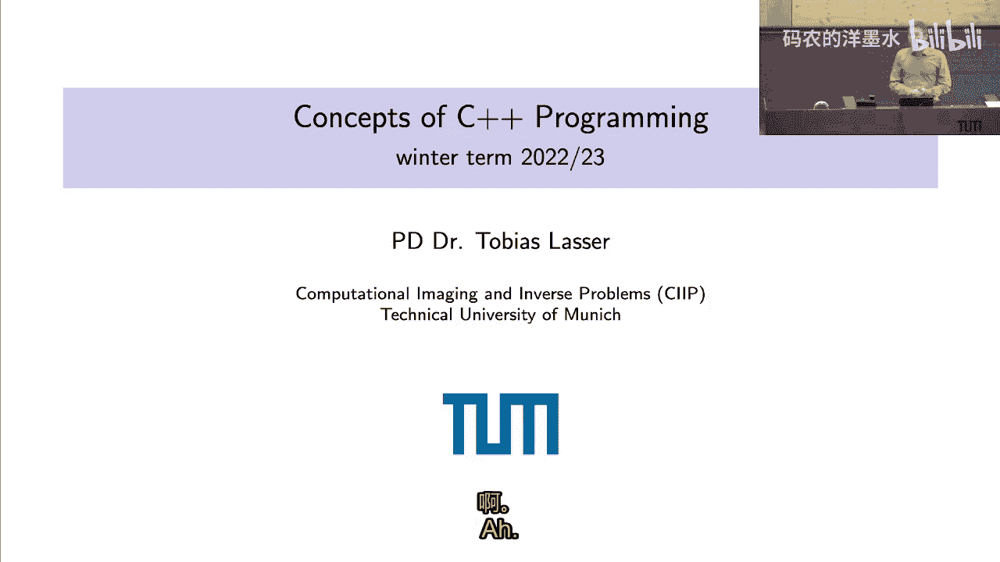

We have another session today。And let me start it off with the tweetback I D， which is E 1， V 8。

Today， and I see some of you already found it， which is cool。And as usual， I'm of course。

 also posting it in Zoodip so you can know it in advance or if you're coming late and miss this slide。

There's also a bit of a schedule update for next week。

 because next week is the DS academiccade course。On Thursday， that means we have no exercise session。

And we decided to also do no lecture next week because the lecture without an exercise session is a bit stupid。

So basically， next week， you have some time off， of this course。

The homework that's going to start this week on Thursday， homework number 5。

Will have an according longer deadline of two weeks for you to complete。Right。So yeah。

 next week is an easy week， at least in terms of the C plus+ course。Maybe。You can spend the time。

Doing a nice job on the homework， number 5。would be cool。

 And then we will resume our regular schedule， you know， every。Tuesday， lecture。

 Thursday exercise in the week of December 6。And we'll continue this until the end of the term。Right。

I think that's the only other scheduled interruption we have for this term。 Let me just see。

If that is correct。Oh， yeah， there's Christmas。 Christmas will， of course。

 also be a bit of an interruption， but otherwise。😊。

Everything will then be on the regular weekly schedule。Right， so today。

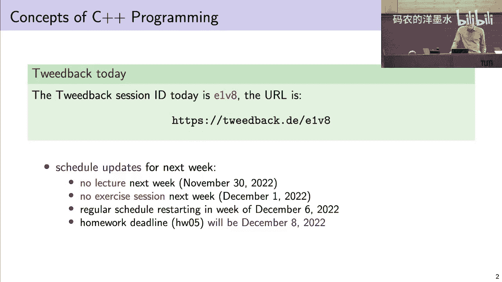

They're going to talk about the standard library。That's part of C++。

You've seen some part of the standard library already。And examples in some of the homeworks。

Some of the things you talked about， it's already been there。 So today。

 I want to take the chance to introduce it a bit more formally。It's a collection of classes。

And I know we haven't explicitly talked about user defined data types， namely classes yet。

 that comes。In two weeks。Some types， some functions， and everything is in this namespace ST TD。

 which stands for standard and not something else。The interesting part here of the C plus plus standard Library is that it's also implemented in C plus plus。

So， it's kind of。Really， a self hosting language。 It can implement its own standard library。

 It can implement its own compiler。Which is， of course， pretty useful。

The standard library is part of the standard， as the name kind of gives it away。嗯。But what it does。

 it defines the interfaces， So the signature of the functions， the class declarations， and so on。

 and contracts which are not explicitly modeled in the language， but rather in the design document。

That the implementation have to deliver。Which is mostly complexity guarantees and stuff like that。

 so that certain efficient efficiency guarantees are made。

The implementation itself is not part of the standard。 So only the interface。

 what it should do and what kind of guarantees it should give。So。

That's why there's multiple implementations of the C plus Standard Library。 One of them is Li S TD。

 C plus plus， I think that's probably one of the oldest by GCC。They are slipy plus plus。

 which is used by clang。And all the LVM the derived projects。And then， of course。

 Visual Studio has its own standard library implementation。And as you might have noticed already。

 particular as you come to newer and newer standards like C plus plus 20。

The implementation level of the standard varies。W。嗯。

While the compilers are usually pretty quick to take up new standard stuff。

 the standard library is usually slower。呃。I can。 I don't know the reasons for this， but I can guess。

First， the standard library is less sexy than the compilers， right。And second。

 it's also sometimes a lot more complex。Because while the compiler has to deal with the C plus standard and the language and compile it and do stuff and give errors or produce an executable。

The standard library has to implement everything from scratch。For example。Time zone management， los。

All the。File system stuff in future network stuff that's upcoming in one one of the future standards。

And these are not trivial topics。While meeting all the guarantees at the standard has set down。

 So you will notice。That the standard support for their newest stuff is a bit spotty。And actually。

 funnily enough， Microsoft is currently at the forefront in terms of standard library support。

Which is a complete reversal of fates For decades， The Viual Studio compiler was horrible。

 and its standard library was even more horrible。 So it's just in the last few years that things have changed for the better。

Right， pen update， not yet。But soon。I had a crash course on making。Re eye last weekend， so。

It's coming。It's coming。Appreciation post for the course staff putting in so much effort。

 replying to ourqueries， even on weekends。I think that's what I told them not to do because。

 you know， they are working， work life balance。They shouldn't work on weekends。

 but if they do quos to them， but yeah。Don't expect it。

What does it mean the implementation is not part of the standard。

 Well like the compiler itself is not part of the standard， but only the language specification。

 only the library specification is part of the standard。 and how you implement it。

 how you do it is up to the implementer。 And that's why。

You also know that's why in the continuous integration pipeline for your homework。

 we test two compilers。Ideally， we would test even more。

Because the compilers have different implementations of the same thing。

 The standard libraries have different implementations。

 And in order to make sure that your stuff works across several compilers， you have to test it。Right。

 so the functionality of the standard library is divided into sub librariesr。

 You've seen them already。Some of the sub librariesr have a single header。

 Some of them have several headers， and with plus plus 20 modules。This header thing should。

Transform to the modules， at some point。Which is plan for C plus 23。Which should be coming next year。

And。Unfortunately， or luckily， the C standard library is part of the C plus standard library as well。

Well not the complete one， but parts of it。 that's for backward compatibility。And， I mean。

 that's one of the strengths of C plus that it can compile really old C code as well。

 And that's why you need to C standard Iory。So let me give you a very brief overview of what it contains。

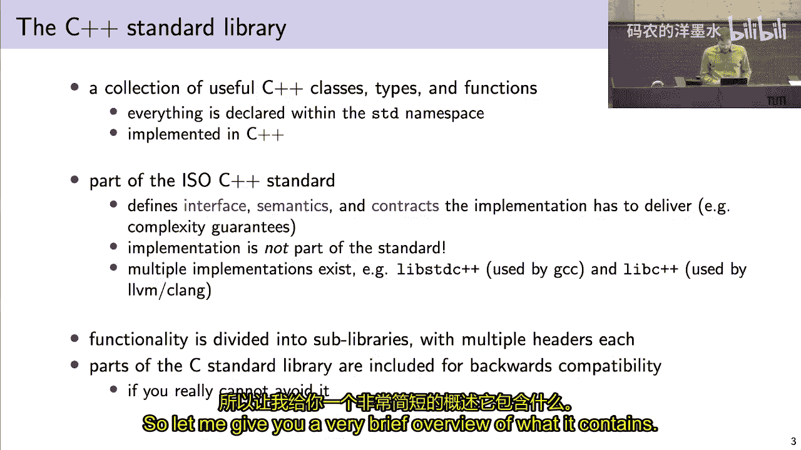

So there's utilities for memory management， which is we will talk about in the resource management chapter a bit more in detail。

Errror handling with exceptions， which we briefly touched upon last time。Timing。Optionional notess。

 variances， pairs， couples。 So various things， type traits。C for the time。

 we will cover everything of this a little bit。stringings， containers， algorithms， iterators。

 some numerical functions from math， complex numbers， random number generation。

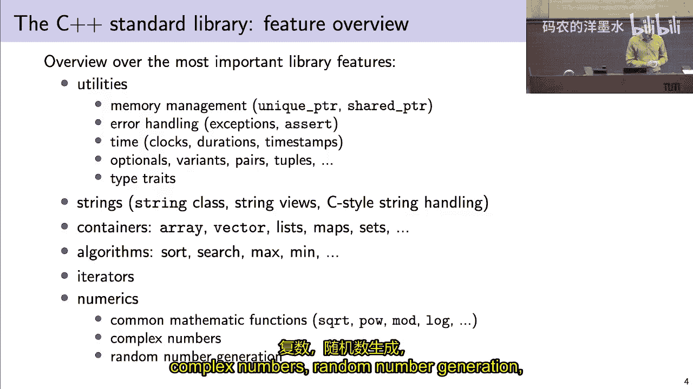

There's input output functionality。 The streams， string streams， file streams。

 There's a formatting library。 There's a file system library。Interestingly enough。

 the latter too were libraries that have been developed separate from the Z plasma standard。

By various people。The file system library was in boost。

 The formatting library was its own lip format library。

And it got taken over into the standard in C plus 17 for the file system and C plus 20 for the formatting library。

 This is something that has happened a few times now。

 especially in the new standards that cool libraries that have been around for a while and that people grew grew to love and use。

Have been taking over into the standards with some modifications and so on。

But that's a really cool move， because that means there is already a reference implementation。

And uptake in the compiler should be pretty fast。Emphasis on shoot， because， for example。

 the formatting library has been around lip format for quite a while。And for example。

 Kang has only started to partially support it this year in Kang15。And GCC， I think。

 wasn't that much faster as G 12 points something。嗯。Even though the library was already done。

So it took more than two years。For it to arrive。 And then even then， it's not complete yet。

That threading， which we will talk about and co routines， Mus， M force， and so on atomic operations。

 which we'll talk about in the parallel programming chapter a bit more。

And there's quite a few things we don't talk about in the course here。

 but it's useful to know there's regular expressions， there's various localization functions。

 calendar and time zones I already mentioned them， and so on and so on。It's pretty big。

 And in if you compare the size of the language and the size of the standard library。

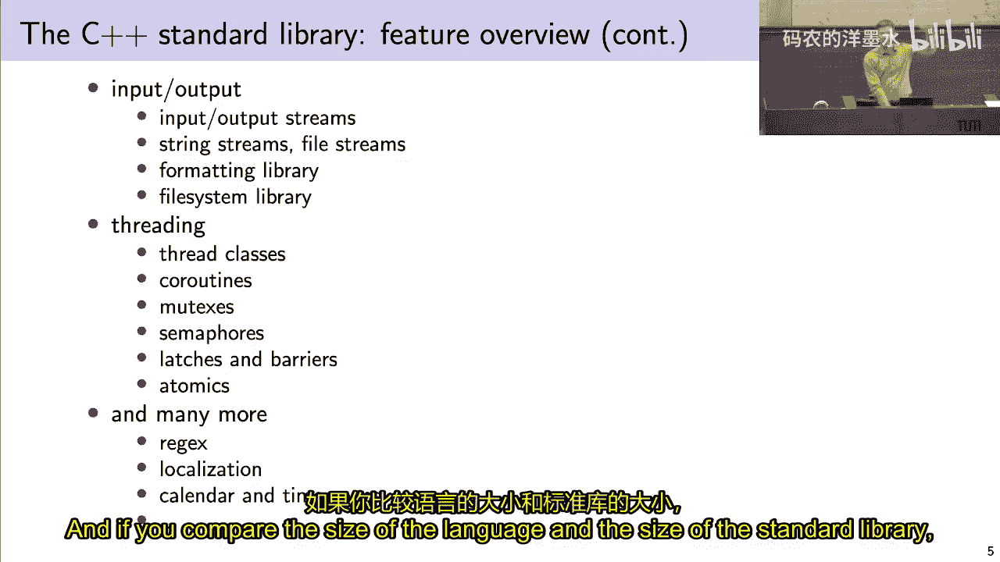

It's pretty clear what is the bigger part。So。I don't want to give you an overview of everything。

 Rather， I'm。Picking and choosing the most important parts to illustrate。What types are there。

 That's the first chapter used for library types。We talk about strings because you need strings basically all the time。

 And then more about the concepts that the library supports， containers， iterators。

 algorithms and streams。Because hes a very specific concepts that have been introduced。F early。

 I think the first。The first ideas for for this came around in the early 90s。So， they were。

Kind of at the time， very recent and modern concepts。

And you will find them in a lot of other languages that came after again and again。 And， of course。

 with modifications to improve it and so on and so on。So， optional。

It's one of the useful library types that was unfortunately introduced very late。

 I think it was C plus 17， that included optional。So it has been missing for a long while， but。

Your young people， for you， it's just there。嗯。What is the SDD optional。

 It encapsulates a value that might be there or might not be there。So it's an optional result。

 Obviously， in the optional header， it's a template that accepts a parameter that denotes the type of the thing。

That should be there。 So， for example， SD option of int might contain an integer。

Its ideal as a return type。You remember when we talked about error handling， that some functions。

Have a very good return type。 But sometimes there are error situations where something might happen or just regular situations where it might not produce a valid result。

 And an optional is basically perfect for this。 It might contain nothing。

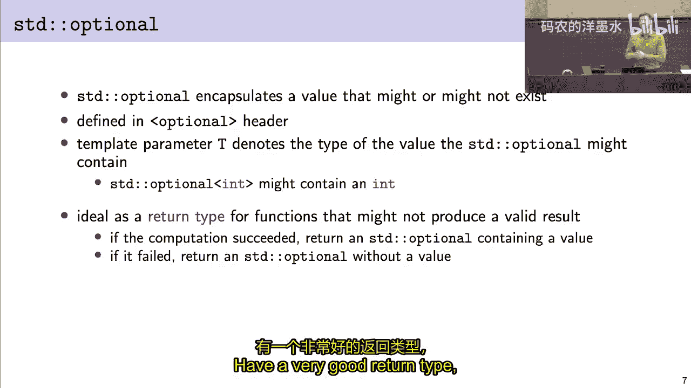

Kind of the error or invalid case， Or it contains exactly what you want to have。

 And then it's wrapped in this optional with very little overhead。Right。

So the optional itself is an object。Because it's a class， a templated class， you instantiate it。

 so it's an object。And even though。It overrides the dereencing operators。

 So the star and the arrow operator so that you can。Treat it kind of like a pointer。嗯。

In terms of interface， it's an object itself， It's not a pointer。And internally。

 you will see that basically any implementation of SDD optional will have a member of that type that is's wrapping plus a booleion that indicates if whatever is in that member variable is a valid value or not。

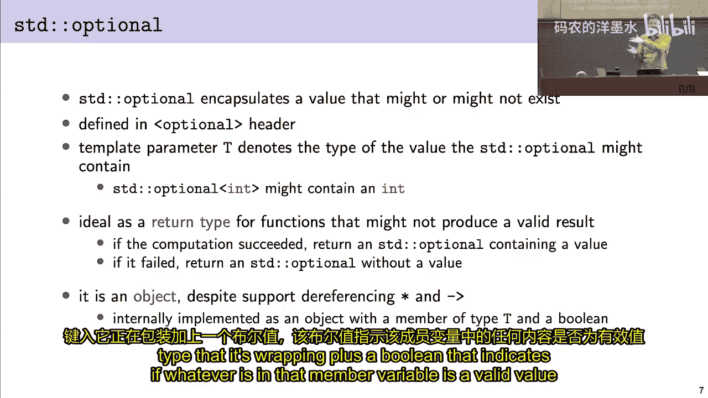

So let's have a look at an example because as usual examples are more。Descriptive than all the blah。

 blah beforehand。That's my mouse， I need to find a better solution for this here。

Becauseuse I need to talk away from you。In order to， to mark what anyway。

 So if we have a function card might fail， that takes some argument and returns an optional string。

So what might happen， it returns nothing， No string at all。That's what the optional allows you。

 or it returns a string。 And then， of course。It's whatever type of string。

And that some stupid function that， you know， differentiates based on the argument， if it's a 0。

You get。String0。If you get a one， you get a string one， and you see here。That's multiple。

Lays of creating this optional。 You can do it explicitly。

 create an optional with a constructor taking a string as an argument so that that thing then is returned。

By the function。Here， we take a shortcut。We take the string。

 and we rely on the compiler to implicitly convert that string。To the return type。

 which is an optional of type string。 And thankfully。

 optional supports this conversion via a constructor。😊，We will talk about this in two weeks。

 how this actually works。嗯。And basically， you can do the short notation like this。

 And you don't actually need to care about the optional， except for in the return type。

You can also call make optional， which is the helper function in the standard library that creates an optional for you of that certain type。

With that value。If you want it like this， sure， why not？ I mean， I think the most elegant version is。

 of course， this one here。Because it's the shortest and easiest to read。

 and the compiler takes care of the conversion from string to optional for you。 And， of course。

 the other case here is the one that's relevant because if you want to return nothing in the optional。

 that's how you do it。 you return a nu opt。 So an optional that is nu。Essentially。

 or you can alternatively just return。The empty curly braces。Which， again。

 will be converted to an optional with the appropriate constructor by the compiler implicitly。

Could you explain how to read the C plus reference。It's an acquired taste。 Yes。

 it's not a nice book that you can read， and it's not made for readability。 It's made for reference。

 So yes。I can also tell you that I usually end up looking at the examples。Right。

 and read some of the text。 and some of it is really， really hard to understand。

But there's other resources。 There are the C plus core guidelines that I mentioned already last time and that you should look up again and again because they also cover some of the stuff。

And there's quite a few other references。 I think it made a literature list like fluent CPP or Mona CPP。

 and， of course， tech overflow for any kind of questions you might add。

Why do I need to return something that might not exist。Well， let's say。

Let's make a different example from this one。 your function returns an integer。But in some situation。

 for example， depending on the argument。There is no valid integer。 You can return。So how would you。

Do this。 You could return a pair of an integer and a boan， and the boolean would indicate。

If the integer， you return to the valid value or not。Oh yeah。 But look。

 we have something explicit for that。 It's called SD TD optionalional。 That's exactly。

 it's a pair of a booleion and the actual value。Noll opt is the same thing as none in Python。Oh dear。

 I don't think so。 I think none in Python is a bit more。SDD No opt is just a library type。

That converts to an FTD option。 that's empty。So I don't think so。 But then again。

 I'm not that familiar with Pyson to be able to say that what none exactly does。

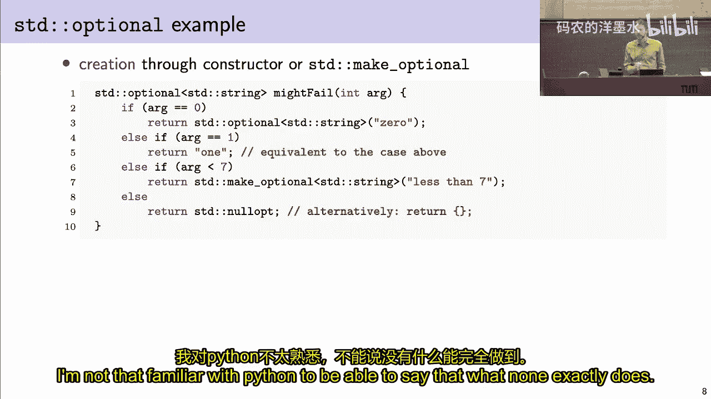

Right， so if you have an option。 So we have this function might fail。

 And now we want to use the value。 So if we call it might fail。With the argument of three。

 for example， so it will return less than 7。And you can access its value using the function dot value。

 right， Then you can call it with the value 8。Oh， and then， of course， with a value 8。

 what happens is this case here。 So it returns another optional。And， of course， for that。

 it doesn't make sense to access the value。 and you get a bad optional access exception。And。

 of course， if you didn't do a try and catch block somewhere to catch this， your program will。

Termininate。Because of an unco exception。What it can also do is you can use the， the。

 the kind of de referencing syntax。 So you can do the star might fail to get the value instead of calling the function dot value。

You can also access member functions using the arrow notation。

Like if it this were kind of a pointer pointing to an object that has member functions。

 So that works。 and of course。If you access one of the member functions on a nu opt， yeah。You。

Like always， if you use pointer style things， this is undefined behavior。

 this might crash your program。This might give garbage results whatnot。So， of course。

 the question is， how do I know that I get an exception on undefined behavior。 Well， of course。

 you can check if your optional has a value using the has value function。

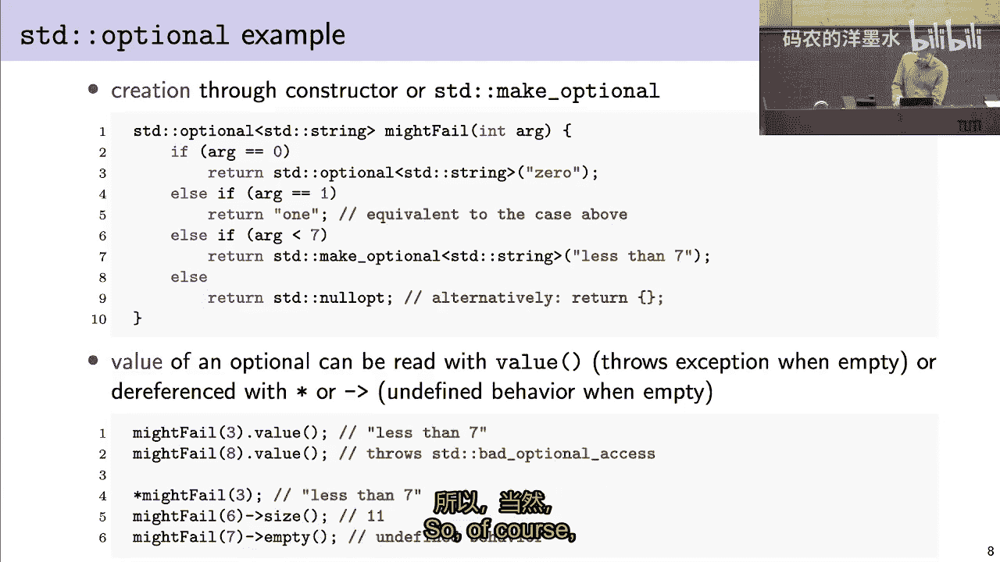

Or you can implicitly convert it to Boolean by using it in an if condition， for example。

 So you get the optional。You check if it contains something and if it does。

 then you access the member functions， for example。What you can also do is you can call the value or。

Function， which says， if it has a value， return the value。 If it doesn't have a value。

 return this particular default value。 And， of course， if you have a default value， that's perfect。

And if you， for some reason， want to reuse an optional， you can also reset it。

 and then it's empty again。Why don't we just throw an exception in case of an invalid value instead of the optionaler。

Well， because an exception， as we talked about last time， is kind of an error situation。

Your optional thing is providing something for a more regular situation， like， okay。

Square root of negative numbers is not defined。So depending on your code。

 that might be a rare occurrence of an error or something that happens frequently。

 if it happens frequently， usually using exception handling is not the way of doing things。

 but rather returning an optional。That you can dereference or access its value to， if not。

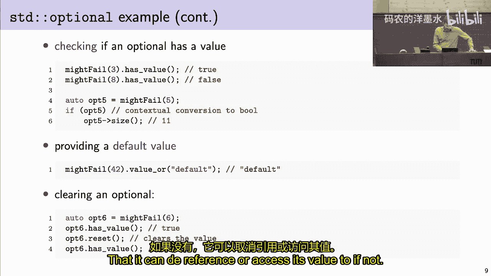

Right。Parris， we've already seen pairs last time when we talk。Two weeks ago。

 I don't remember exactly when we talked about structured binding。It's in the utility header。

 It can store two types of objects。And you can create it using make pair and the access to the two elements is via the first and second properties。

 These are not member functions， these are properties。 So if you have a pair here。

 you do a pair dot first and you get the first value pair dot second to get the second one。

You can even use。Comparison operations。That are defined leographically。

If you want that for some reason。Taple is the same thing， but for two or more。But actually。

 for zero or more objects， obviously nobody uses it for zero。It's defined in the topple header。

It's essentially the same as a pair。If you use it for two elements with a slightly different interface。

 So instead of first and second， what you get is a function called get。

That where you specify the number of the element you want to have，0，1，2， and so forth。And that。

 of course， makes it clear that it supports an arbitrary amount of elements。And like for pairs。

 you can also use structured bindings for tuples。But we've seen this already。

 so I'm going over this pretty fast now。How to prepare for the exam。嗯。

The age old question that comes every single term。And I'll give you the H old standard answer。

 attend the lecture， attend the exercises， do the homeworks， read additional materials。

 do your own projects， learn programming by doing。And then you will be fine。

Has we less overhead than creating a new optional。I don't think so， well。Maybe， I mean。

 creating a new optional district speaking memory allocation。

 probably it's an automatic variable on the stack。 So it's not that expensive。I don't know。

 I would probably not care that much about the overhead in that case， but more about logic。

 Why would you want to reuse an optional if you return it from a function。But yeah， up， up to you。

And exactly， if you do exception handling， you do stack unwinding until you find a try and catch block with the optional。

You have a regular control path。So typically， that is preferred in situations that happen more often。

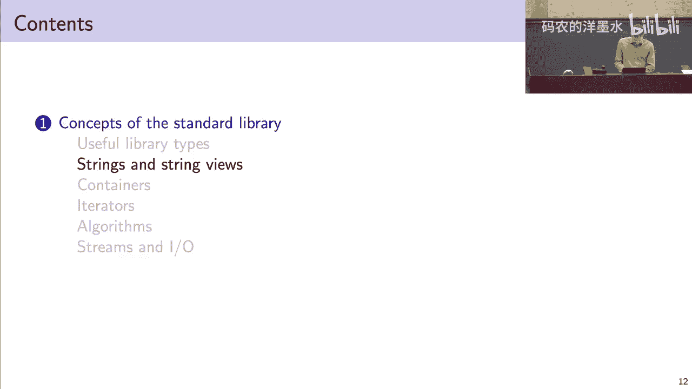

Right， oh， that's an interesting one。 So let me go back why。Is get。

Why does it have a template parameter。When specifying the number of the element you want to do instead of doing it as a parameter。

Well the thing is， this is implemented as a veric template。 So it's compile time programming。And。

That means if you wan to do it at compile time， this excess here to have no overhead ex essentially。

 you need to specify it as a template parameter。What are variety templates。Well get to it。

Have some faith。 But yeah， this is because the tut is implemented in a compile time manner。

To have it as efficient as possible。

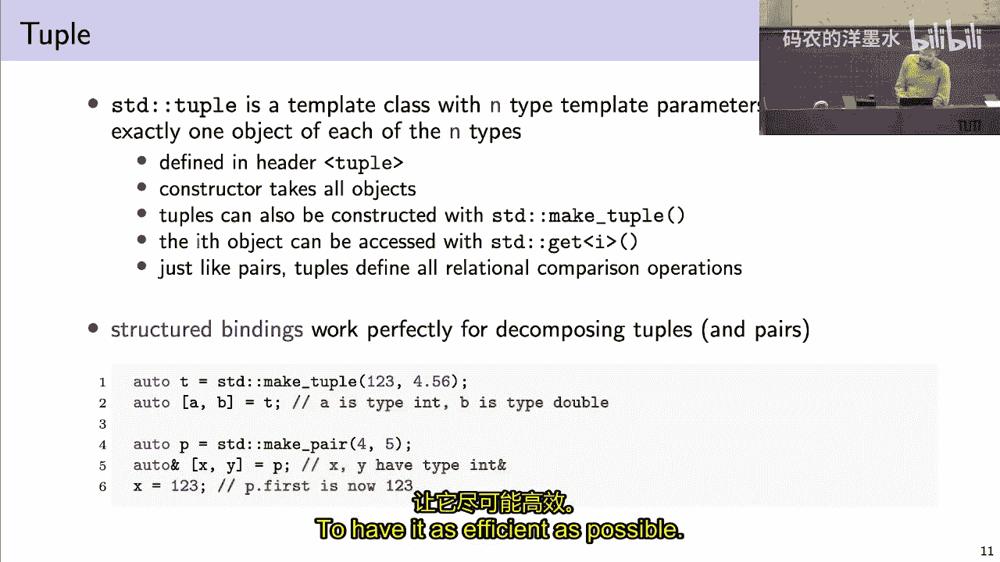

Stringths。So as I mentioned， already， strings are a bit of a sore topic in C plus plus N C。

Because there's no explicit string support。not a very good， explicit string support。

How C plus+ solved this problem， and I put this solving in quotation marks is by defining its own string type in the standard library。

 which encapsulates strings， which are character sequences， It manages its own memory。

 which is done using the resource acquisitionist inization technique。

 which we will talk about in three weeks。It's guaranteed to be contiguous in memory。

 So if you have a character sequence， it's guaranteed to be。Well， and one continuous chunk of memory。

The string， and that has to be said in a C style language。 it actually knows its own length。

 You don't have to scan for the entire string like in C to detect the zero termination character and then know the length of the string。

 No， it knows it in advance。And there's a lot of member functions。

 operators and so on for string manipulation that you might need。

 If you need to interface with C code， there's a way to get a C style cha pointer from the string。

But， as you know。See if evil。So， don't。If you can avoid it， forget about the old style C code。

 do modern C plus plus code。And what will become relevant when we talk about compile time programming。

 since C plus West 20， you can also use a string in constant expression situations。But don' worry。

 we'll talk about this in more detail later。It's obviously defined as a string header。

 It's actually an alias for S T T basic string。Why， I don't know。

Probably there's a good reason for it。 There's specializations for all the character types， like UTF。

And， of course， if you have your own custom character type。

 you can also specialize the standard library string class for your character type。If you want to。

And， of course， the usual。Don't use chart pointers there from last century in C， use ST TD string。

Instead。There is no drawback， magical。Except that it's better and more safe。

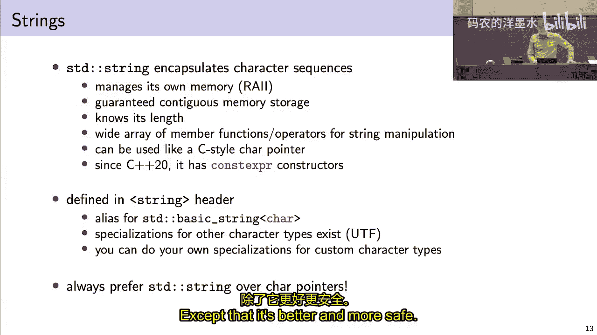

Right， so the default constructor， that constructor with no argument。

 gives you an empty string that has length 0。

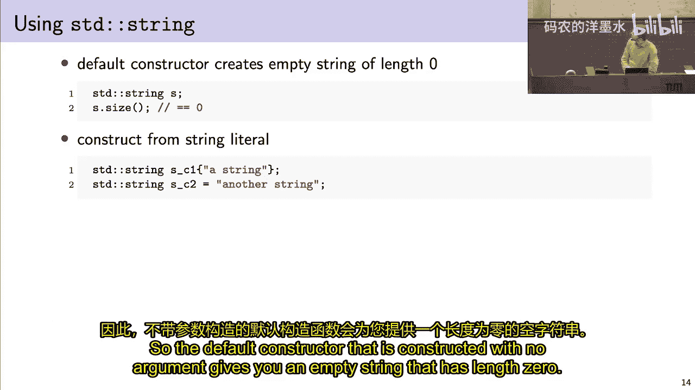

Where's my mouse here length 0， you can construct it from a string literal using the regular curdy braces。

 You can do the。Kind of unsafe inization as well。 here。 It actually doesn't matter which one you use。

 but I would still recommend you to get into the habit of using the modern C plus plus inization with the curly braces。

You can access single characters like an array with the ad or the operator with the brackets。

 and the same as I've already talked about for vector， a is bounce checked。

 The bracket operator is not bounce checked。Both of them return a reference so you can use it to assign stuff to it like this。

 if you want to。And then。Change hell over to headed X yard or whatever。

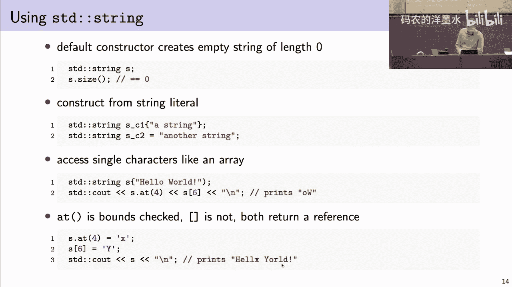

You can iterate over a string because in the end of string is a container。

And that means you can iterate over it， for example， using the range fall loop。

 I think we've seen this already。 So basically you iterate over all the characters of the string。

 store them in an auto reference C。 So this will be of type Charr， because that's the standard。

Type of SD string， unless you specify another one。You do it a refer as a reference here as a non con reference。

 so you can actually change the value like increment it here。 And then instead of hello world。

 if you increment each letter， you get this。Whatever thing here。

You can also do it explicitly using the iterators， get begin to get the starting iterator of the string。

 check it until you reach the end， increment the iterator and dereference the iterator and then use the result to increment it。

And you get even weirder string。Right， you can also compare strings lexxiographically。 So。

 for example， if you define these Uuntu release names as variables of type SD string， you can。

 for example， see that Uun to 20。It's leicographically bigger than U to 18。Both of them。

 the long term relief。And for 18 and 5， this doesn't。

Apply。Anyway， there's a lot more you can inquire about the size or the length。

 You can check if it's empty。 You can append stuff to it。

 You can also use the operator plus equals to append stuff to a string。

 You can concatenate strings with a plus operator。 You can find characters in the string。

You can create substrs out of a string。Which， and that is important to know。Sub string。

 the method creates a new string。That is the sub string。 It creates a copy， It allocates memory。

 It creates a copy。 So it's not the most efficient version to look at parts of a bigger string。

If you want to do that， for read only access， the string view is the preferred option。

 and I believe in one of the homework you already had some contact with a string view。

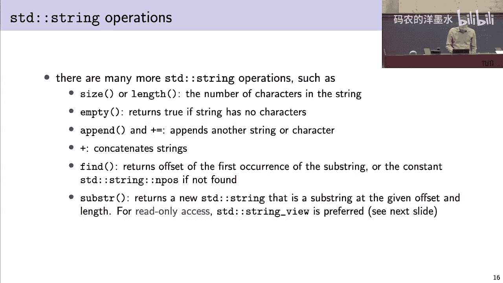

Why the why Uuntu， Well， obviously， if you choose， you release names in a cool way。

Then you ensure that the newer releases are leicographically bigger than the previous releases。

 But if you check， for example， Uun 2 18 is not lexicographically bigger than Ubu2 5。

If that's good or not， I don't know， whatever。Why does the code print I FM MPP things。

 Because what I do is I have a Hannover string here。

And then I'm iterating over each character of that string， and I'm incrementing it。

 So if I increment an H， I get an I。 If I increment an E， I get an F。 If I increment a white space。

 I get an exclamation mark。😊，And if I anchorement the exclamation mark， I get double quotes。

And if I do that again， I get that string。 This is just simple ASi math。

This here is not unpacking operator。 This is a dereferencing operator。

Where we basically access the content of the iterator， we will talk about this again and again。

Have we talked about this de referencing already a bit。 Yes， and we will talk more about it， too。

 when we talk about memory management and pointers。Its the dereenced result of an iterator。

 a character or a string。So。You don't necessarily know。 But， of course， in this particular case。

 the string consists of characters。 So the de referenced iterator will be a character。

 If you want to know explicitly what the iterator type is， instead of auto， you can write。Oh my god。

SDD string。Double colon。Something， something iterator。 and then a double colon， and then。

There's a type def， which is probably chart type or something like this that tells you what exactly。

The type will be。But that's the thing。With these iterators， you typically don't care。

 You only care that you can inter increment it and then output it。And that's about it。

But if you want to know， you can check。

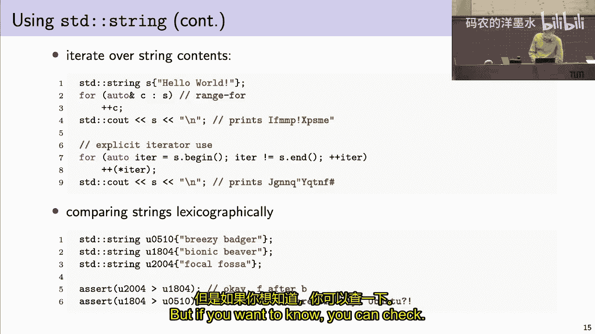

Right。So， sub strings。Are expensive because they create new strings。

So that's why string view came into the game。C plus plus 17， I think。嗯。For example。

 if you pass large text files like a Json file or an X M L file or stuff like this。

That's stupid because you need sub strings all the time。And creating new strings in memory for。

 for the substrs is stupid because in the end， you're just passing some stuff。

 So you only need read access。 And that's why string view was developed。

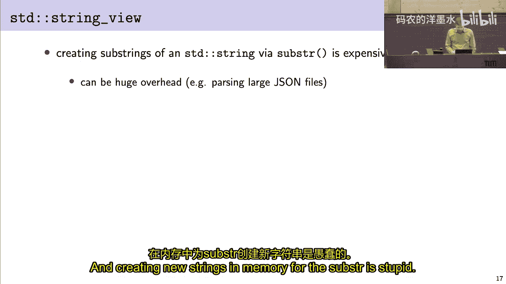

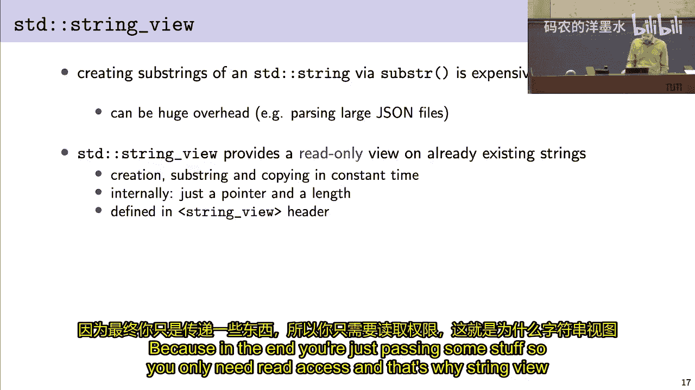

Which is essentially just a read only wrapper。On existing strings。 So what you need for this to work。

 you need a string in memory that already has the memory。

 And then the string view is just a view to the existing string of some part of that string。

The good thing is that creating a string view。Doing a sub string from a string view and copying string views is。

O of one。 So it costs only constant time。And internally。

 this is implemented using a pointer to the beginning of the string view and a length that tells you how long the view is。

But that's internally because， of course， you know， don't use pointers。Right。

 we have higher level concepts like the string view for this。How do we create string views， Well。

 typically we created from S TD string。 Or for some reason， you have a child pointer with a length。

Which you shouldn't， because you are doing modern C plus pass， you can also do it from that。

Or you can create it from a string literal。嗯。Which is a string， right？

So what do you have to be there， like for every view type that is just a view on something else。

 If that something else goes out of scope or is delocd or is removed or something。

 then the view is invalid because it points to something that no longer exists。

It'sThe same as for dangling references。 You have an alias to something as， as long as it is。

 it's fine。 But as soon as it。Its gone。The reference angles， and the same happens to string views。

The interface of SD string that is read only。All those interface functions exist for the string view as well。

And you can， most particularly， create more substrs。You can create sub strings in all of one。

 which of course， creates another string view of the already existing string。

 And for passing text files， this is perfect。😊。

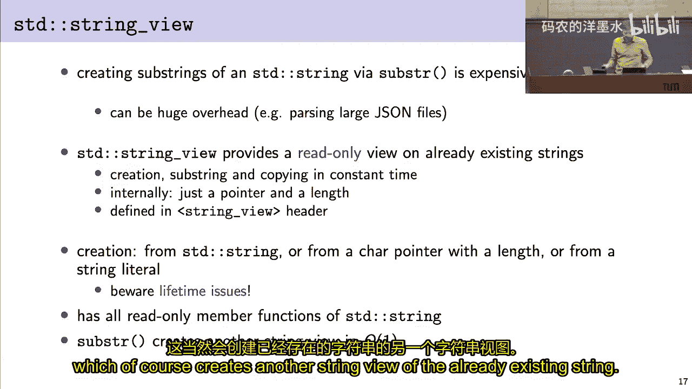

So here， if you have interesting garbage string like this one here。

You can create a sub string directly from the string， but that copies。All the elements。

So position 24 lengths 11， That's a sub string that I created， but it creates a new string。

 It copies the elements， and it's expensive。Now， I can create a string of view from the string。

 which costs all of one。And then I can create a sub string from that string view。

 which also costs O of one。 It's one more line of code because you first have to create the string view because only the sub string method of the string view is O of one。

 But once you have it， you can do all kinds of stuff like， for example。

 removing prefixes or removing suffixes。And so on all the stuff that you need for passinging。

 basically， and all of this goes in all of one。So， it's fast。Oh， yeah。 And then there's， for example。

If you have functions that take strings as an argument， this is passed by value， obviously。

So a copy is made for the string A， and a copy is made for the string B。

 even though you only compare them。Of course， what you could be doing now is you could do a constant reference to strings that would avoid a copy。

Or。What's usually preferred is to do a string view to make it explicit that。 yes。

 I just want a view on an existing string。And do the same thing。

 Then this is all of one doesnn't create a copy， doesnn't create anything。 And if you compare this。

 for example， with two string lits。This has two allocations at run time。

Whereas this has no allocation at one time at all。So if you take strings as arguments。

And only to read only the operations on them， use a string view。That's a general recommendation。

 If you do write operations and so on， then of course， you have to use strings。

So we can convert a string to a string view。Yes。We do this。It's， it's not really a conversion。

 You just create a view of an existing string。 It's not a conversion。

 The every existing string stays the existing string。 Nothing changes about it。

 You just create a view into it。And what was the second part。

But we can't convert a string view to a string， you can。

Because you can initialize a new string with a string view， obviously。

 And then you create a new string with its own memory， and you copy it over。

I needed to make explicit conversions from string view to SD string in Home 4。Yes。

 the key part is a string view is a view on something that owns the memory。So， if you need。

Something that has own the memory。嗯。You need to convert to a string and vicey ver。

 you might convert in the other way。 But if it's something that specific to homework  for， of course。

 ask it in the。Exerci session。Can a string be implicitly cast into a string view， no。

Because that would be evil。Why would it be ever if something is implicitly casted into a view and then that you create a dependency on the original object。

 And if that goes out of scope。

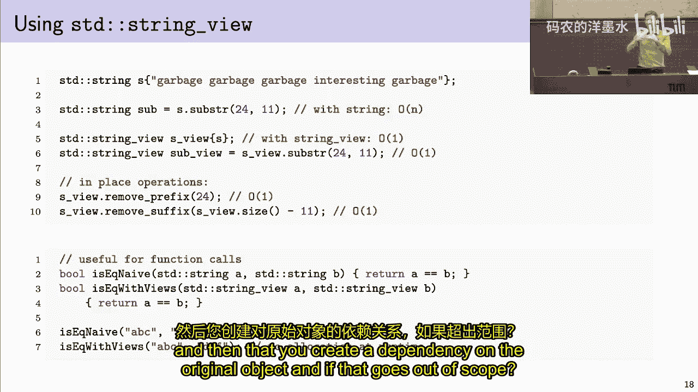

You implicitly generated string view would be gone。

 and you wouldn't notice because it was implicitly created。So you have to do it explicitly。

 and you have to know what you're doing。Passing by reference doesn't create copies， too。 Yes。

 that's what I said。 What is the advantage of using a string view。 Well， you make it clear。

That you're taking a string view， that you're doing read only operations。Of course。

 taking a constant reference to a string。All it implies the same。

But the preferred version here is really to do a string view。

How a string the operations done in O of one， Well because they refer to existing memory。

 It's essentially just a pointer to the start plus a length to know how long it is。Right。

I'm too slow， so I need to speed up a little bit。Let's talk about containers。

 We already seeing containers like SD vector， SD array， SD string just now。

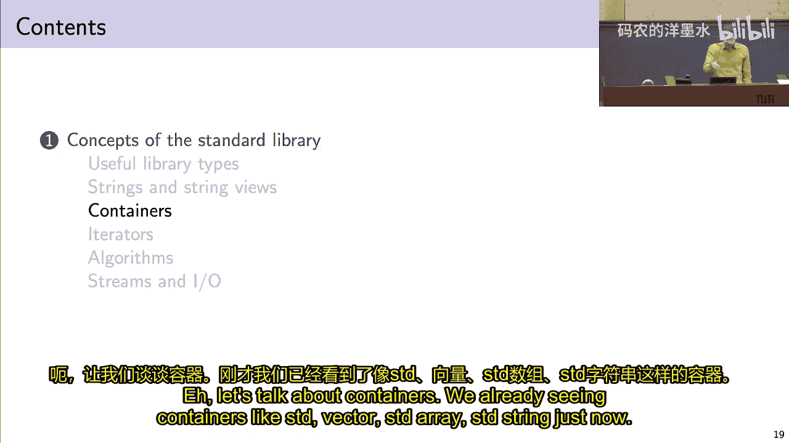

So let's talk about them in general。 A container is something， an object。

That stores a collection of other objects in the case of string characters， in the case of a vector。

 but have elements。And so on and so on。They manage the storage space。

Because the container contains the elements， so it manages its own storage。 They're generic。

 so they take their type as a template parameters so they work for any type。

Also your user defined types。You can access the members directly。

 you can access them through iterators， we talk about its rates and a bit more。

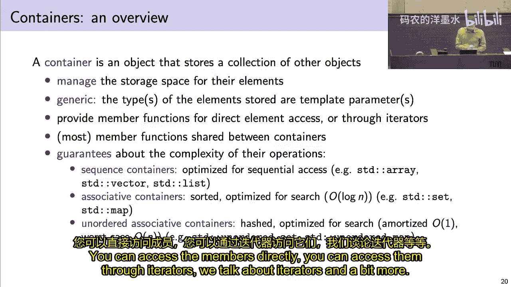

And the idea with the containers in the Cpl standard library was that。

The interface for most of the containers looks similar so that if you switch from one container type to another。

 the interface doesn't change completely， but rather that it stays the same as much as possible。

And depending on the container， there are some guarantees of the operations。

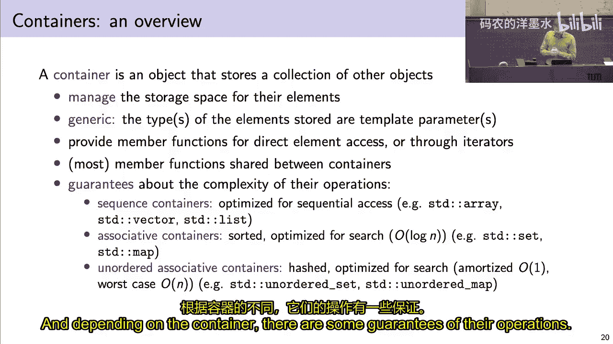

So for example， if you need sequential access， the sequence containers are optimized。

 if you need associative containers， search is optimized。

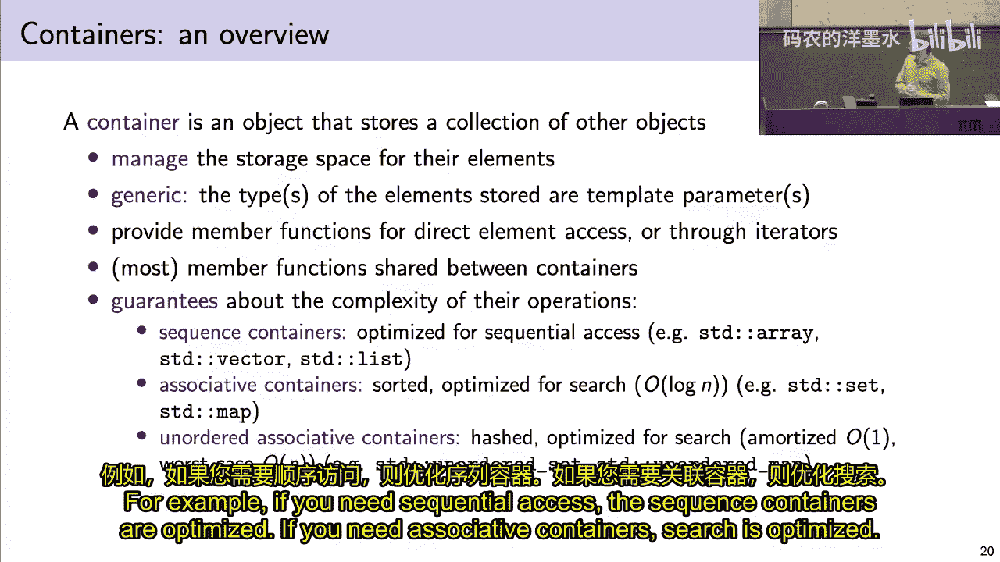

And we'll talk about a few examples of these。 And， of course。

 as's also unored as the as theciative containers。Which are optimized for search as well。

 And you see the difference here， one of them。Is basically trees like A VL trees or red black trees。

 So searches an O log N， and they aresorted。 So they are。Search trees。

Unordered associatedciative containers are typically hash tables in some form of hashing and have the amortized cost of O of1 in averse case of O of n。

 So this is all stuff。 you know from the algorithms and data structures lecture。

 And these are exactly the types that are implemented in。

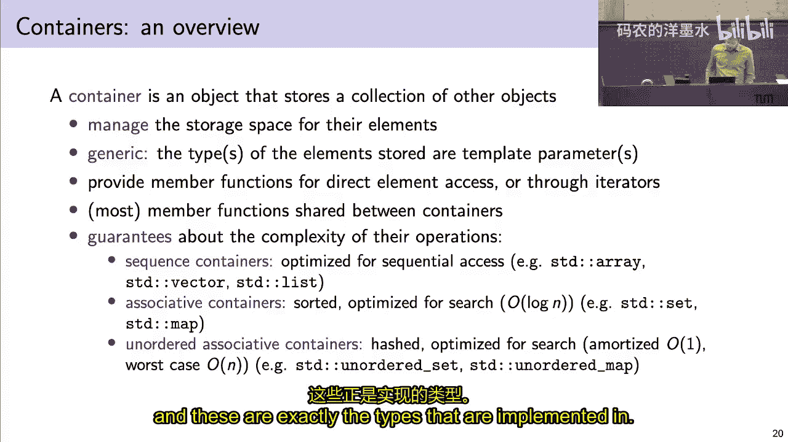

The Senate library。So vector is kind of the U array from algorithms and data structures。

 that's a dynamical array。That can grow and shrink。

 It's guaranteed to be stored continuously in memory。

 You can insert and remove stuff at any position that you want。

And what usually happens in terms of size， it prelocateates a certain number of size。

 If you don't tell it to do otherwise。 And then if you grow it at some point。

 it will double its size， copypy the elements over。 And if you grow past that。

 it will double again and so on。 And if you remove stuff， it will also shrink automatically again。

Using a very clever strategy that you learned in the algorithms and data structures， of course。

And C plus plus 20， also SD vector gain conflict expression support。 but we'll talk about this later。

Time complexity for random access is obviously O of one because stuff is contiguously in memory。

 And if you use the the bracket operator or the add function， you access the element in O of one。

If you insert or remove stuff at the beginning or at the end， No， sorry， at the end， only at the end。

 not at the beginning， it's usually O of one unless you need to relocate， then it's O of n。

 but you can amorize this to O of one。And， of course， if you insert or remove anywhere else。

 it requires。Reallocating or shifting all the elements。 And that's O of n。

 like you would expect it to。

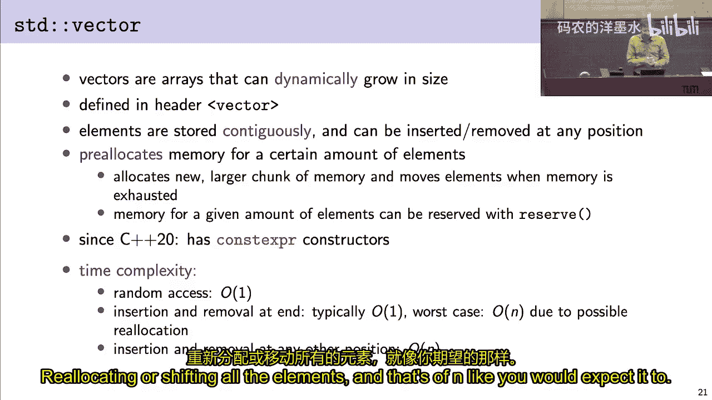

And we've seen already， quite a few。Use cases of the vector in previous things。

 So I skip over this pretty quickly。What's maybe new is you can instead of doing pushback or popback or at access or the brackets operator。

 you can also do an explicit insert， why。Well， because it's a container and all the other containers support it。

 So the vector also supports insert。 you can iterate over it。 You can erase elements using iterators。

 and， of course， you can clear clear it so that it's empty。

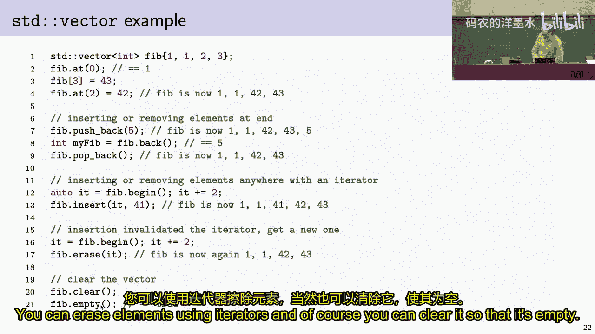

Right， oh yeah。 One thing that we already talked about in Zlip for some， for one of you。

Let's say you have something that is expensive to copy like this structure here that contains a string that might be very big。

And you want to create a vector of these。Structures。Now。

 what you might be tempted to do is to create an expensive to copy object and push it back into the vector。

 because that's。What do you typically do。This is not ideal because what happens you create the object here。

And the pushback creates a copy of the object in order to put it into the vector。 because remember。

 all the standard containers in Cpl manage their own memory。😊。

So what he could do is he could move it。Into the container so that it's not copied。What is moving。

 you ask。Have some patience， we will talk about this later。

Or you could be clever and call in place instead of push。Because what implies does。

 it takes the constructor arguments of the structure and directly constructs that element where it belongs。

 namely at the back of the vector。And you cool can do the same with other positions as well。

 you can also do in place at a certain iterator position， if you want to。So this saves you a copy。

 and if you see the in place， that's the difference between a pushback and an in placeback or an insert and an in place。

 is that in place directly constructs that element in the memory of the container。

 whereas pushback takes whatever you get and copies it over。

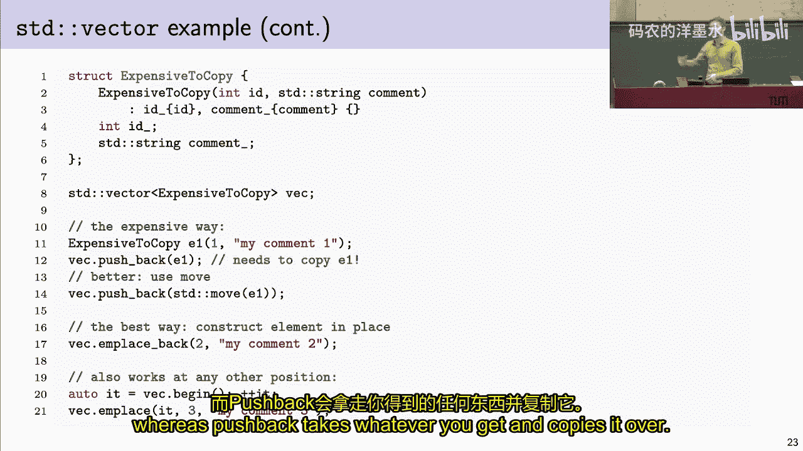

And， of course。A vector automatically grows and shrinks according to its growth and shrink strategy。

 which is pretty good。But if you already know that you're going to store a certain number of vectors like。

But is it 1 million here。Then you can tell the vector。

 reserve space for 1 million elements so that you don't need to relocate all the time while you're growing。

And so if you now execute this follow with a pushback。

There will be no reallocations whatsoever because it happened once。At the beginning。

And just to make clear the difference。 So there's a capacity。

 how much space the vector currently has allocated and the size。

 which is the number of elements that are currently stored。 And at the beginning， of course。

 the size is now 1 million。But there's nothing stored， so the size is 0。And， of course。

 if you decide， oh， I reserve too much， or I know that my vector will no longer grow。

 you can also shrink it。To the exact amount of element it's currently storing。

 And that is what shrink to fit does。 So if you take care of your memory。

 this might be useful to you。What's the difference between。Move return value optimization。

 name return value optimizations。 Have some patience。 We'll talk about this later， not today。

Is it ensured that vectors don't fragment the Ram。嗯。Vects are ensured to be contiguous。

 So if you relocate a vector， it will very re allocatelocate a new space and memory。

 copy everything over and will release the old one。 And， of course， if you do this open often。😊。

And your memory management in the operating system sucks。

 You might fragment your memories doing that， yes。Oh， can you replace a string view in a container。

No。W。Because a string view is a string view。 It's a view that't manage its own memory。

 That doesn't make any sense。Oh， it's an array list in Java。

 I don't know what an array list in Java is。 Who uses Java anyway。I presume so。 I don't know。

 whatever。Why does reserve directly allocate the memory well， Because that's what it's there for。

 Of course， you could allocate dynamically until the limit。

 but that's less efficient because it will relocate several times if you have a big number。

Can you write custom allocators， Yes， you can。 We'll be writing it here in this course， probably not。

 because custom allocators， youll need them very， very rarely。And if you do them。

 you should definitely know what you're doing because otherwise the potential to fuck up is so awesomely great。

 So yeah， we will not cover this in an introductory course to C plus+。 sorry about that。

So there's a lot more questions， which I will skip and answer later because it would take too long to answer them now。

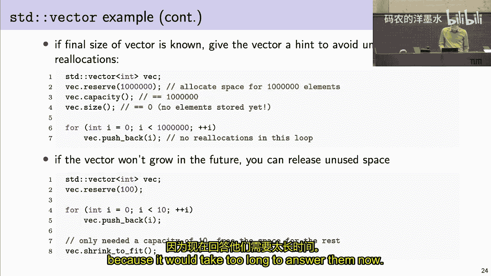

Right。Other containers， ST TD array， we've learned it already。

 It's the sixth size equivalent to S TD vector。 So no reallocations。

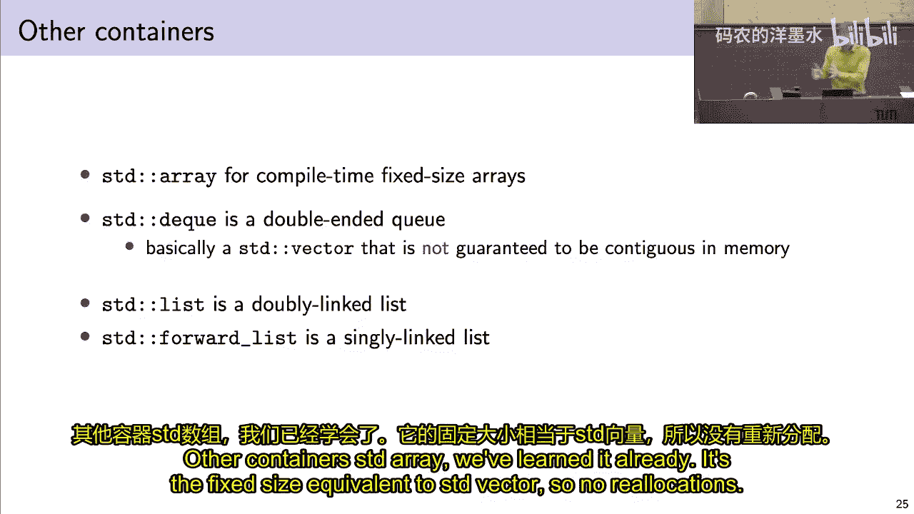

No shrinking， no growing， fixed size， and the size has to be known as compile time。Other than that。

 the interface is basically the same。There's a double ended queue that's called D， E Q， D Q， D， E Q。

 however， you pronounce it。EIt's basically an S TD vector that is no longer guaranteed to be contiguous in memory。

So， this can be。This is something when it grows， It will not copy over everything。

 It will just allocate some more memory， which might be somewhere else and some more memory。

 which might be somewhere else and some more memory。😊，So it's not guaranteed to be contiguous。

So you don't have the copying overhead if you grow or shrink。嗯。

But you're no longer guaranteed to be contiguous in memory， which， of course。

 usually is horrible for cash efficiency。But sometimes it's exactly what you need。

If you want linked lists， there's STD list for a doubly linked list。

 and there's SD forward list for a single linked list with a similar interface to STD vector。

 And obviously， since it's a linked list， it will no longer provide direct access to the elements by index。

 So the opera bracket operator and the a function are no longer there。But insert， push back。

 in place， in place back， erase， and so on all this exists。

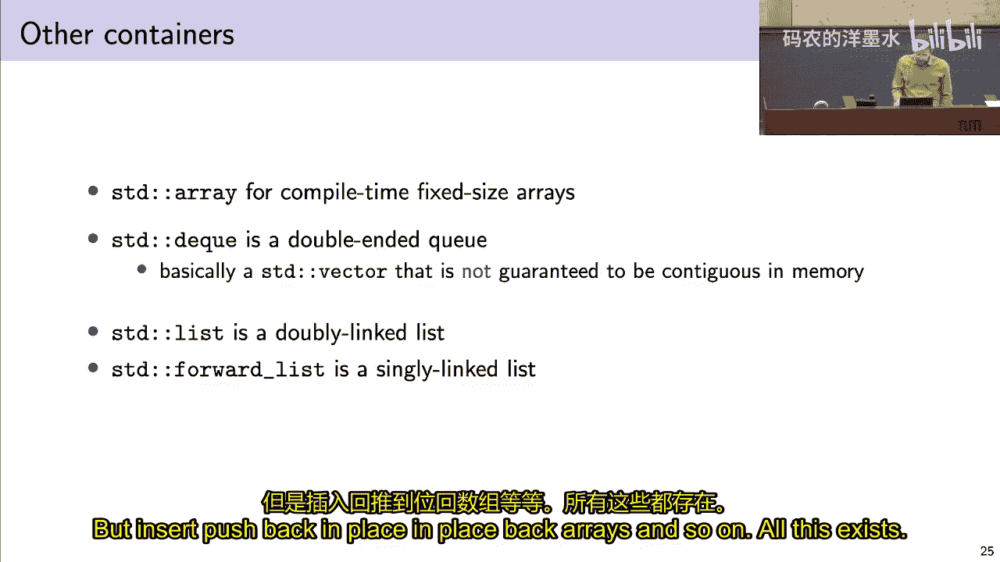

What's really interesting is that there's other container adapters。

 They are not containers themselves， but they provide an additional interface on top of other containers。

😊，And these are the typical abstract data types， you know， from algorithm and data structures。

 there's a queue that provides a typical Q interface， you know。Back and front。

And you can use whatever container to implement the queue。

 and basically the standard library leaves you the option to decide。What。

The underlying container should be or you just take the default and are happy with it。

 So that's a queue the same with a stack。 You know。

 where you have top and pop and push and this stuff。It's again。

 wrapping one of the sequence containers so it can use an array or a vector or a DQ or a list or a forward list。

To implement this and basically stack and queue， provide you the interface and well use one of the other containers to actually do the operations。

And handily enough， there's also a priority queue。Which， you know， priority Q。

 also standard data abstract data structure from。From algorithms and data structures。

 typically it's done using some kind of heap。And， essentially。This is what's happening here。

 The priority queue provides interface for a priority queue。

 and it uses whatever sequence container with random access。 So， for example。

 the vector or D Q to actually implement it。So if you use a vector。

 this could be a binary heap that you implement via an array， for example。

How the thing does it internally， You don't have to know that。

 But there are certain performance guarantees that it will offer for you。

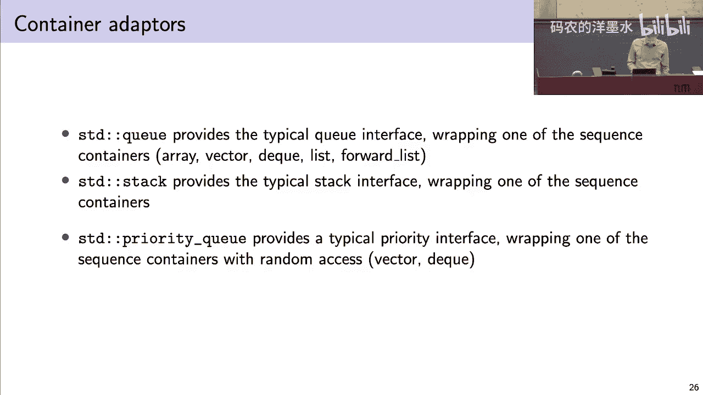

Right。Let's get to the more interesting containers， although I have to say。

These are already pretty interesting， even though they are just container adapters。

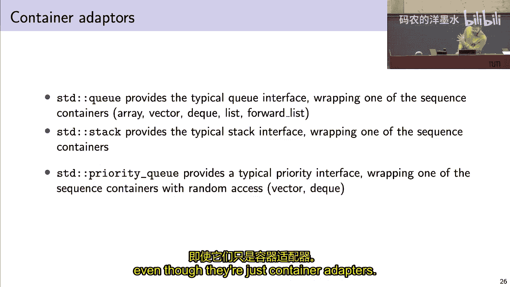

。There's unaued maps。So what we looked at before were sequence containers。

Array vector doubleend Q forward list list。Now we' are looking at the associative containers。

Which basically have a key and a value more or us。And the unaued map is the first one。

 It's an unored， so not sorted map of key value pairs。 The keys are required to be unique。

And you have two template parameters， one for the key， one for the value T。

It is implemented of a hash table。You don't know exactly how and what hash function is used and what kind of collision detection mechanism is used and so on。

嗯。But the thing is it's unordered because obviously you can't read out elements in a sorted order from a hash table that's not possible。

Interestingly enough， what you can do， you can customize your an audit map。

By providing your own hash function and your own comparison functions。Typically。

 you don't need to do that。 You only do that if you have a very good reason for doing so。

 So typically， you just use an unored map， for example， with strings as keys and doubles as values。

 And then you can insert a name and number that looks suspiciously like a grade and look I failed horribly with a 5。

0。

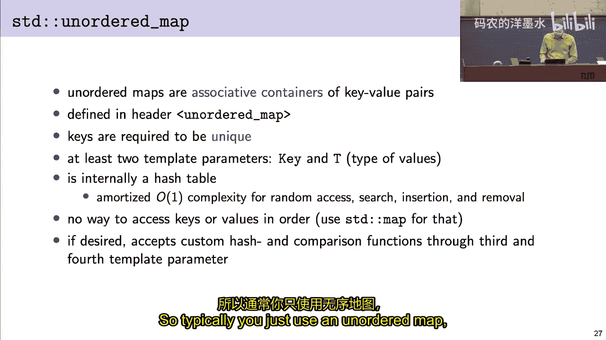

And then you can use the bracket operator to access。The key， the value via the key。

 So you specify the key in the brackets， and then you get the value， or you can assign a value。嗯。

You can use the standard container operations， like find。Same syntax and semantics as in the string。

 as in vector。 So all the containers provide the same interface， essentially。And you find it。

 you get a particular iterator。 You check if the iterator you got was the end， if it was。

 when nothing was found， if it's not， then you can access。It's actually a pair that you get。

 You know， the STD pair thing that we talked about previously。

 and you can access via first and second， the key and the value。Right。

 and here you have the de referencing syntax because that's common for iterators。

 They're used like pointers。 So the de referencing directly is with a star operator or to access members you do with thearrow operator like this here。

And， of course， you can also test if a certain key is in the map using the count function。

 which gives you the number of elements。 And， of course， since the key is very supposed to be unique。

 There's either 0 or one。 There is the result。Or since C+ 20。

 you can just ask contains which gives you a bull through a false。

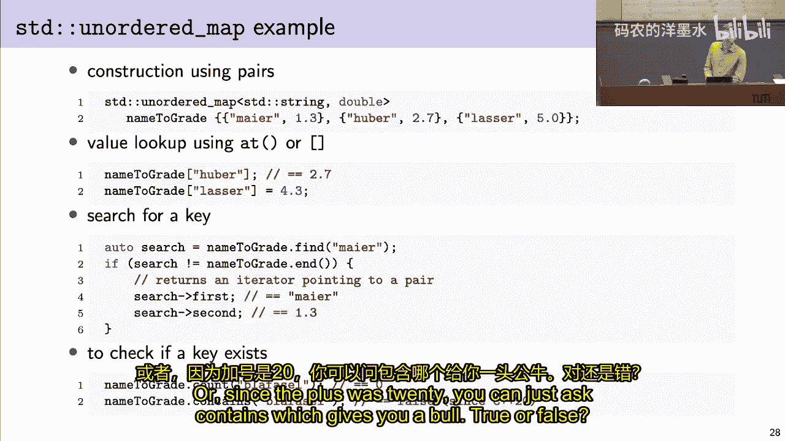

You can update existing members by doing the bracketnotation。 or if this is a new student。

 you can also insert a new one using this。 You don't have to do an explicit insert like here you can。

like this， you can explicitly create a pair and insert the pair。

You can implicitly create the pair using the curly braces。

 and this only works using the curly braces and insert it。

 Or if you want to avoid the copy that happens， you can do an in place like we learned。

 So this is the same for all the containers， really。

And you can also remove elements by searching it first and then calling eras on that particular iterator。

 or you can remove all。 All elements was clear。 Again， the syntax， as you see。

 even though the containers are completely different in terms of function and guarantees and concepts。

 they support the same interface。 and you will see this is true for all the other ones too。Oops。

How did Lasa get a 0。7 bonus in slide 28， I don't know， because I cheat。

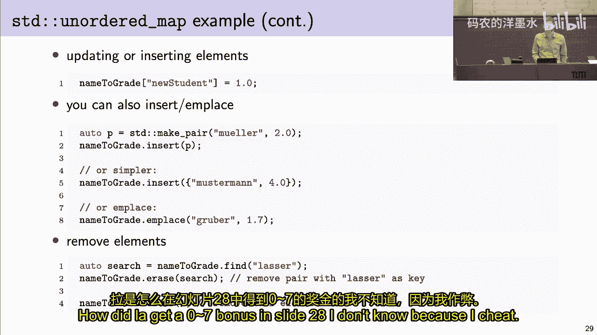

But it was still failed， right， So it was still。

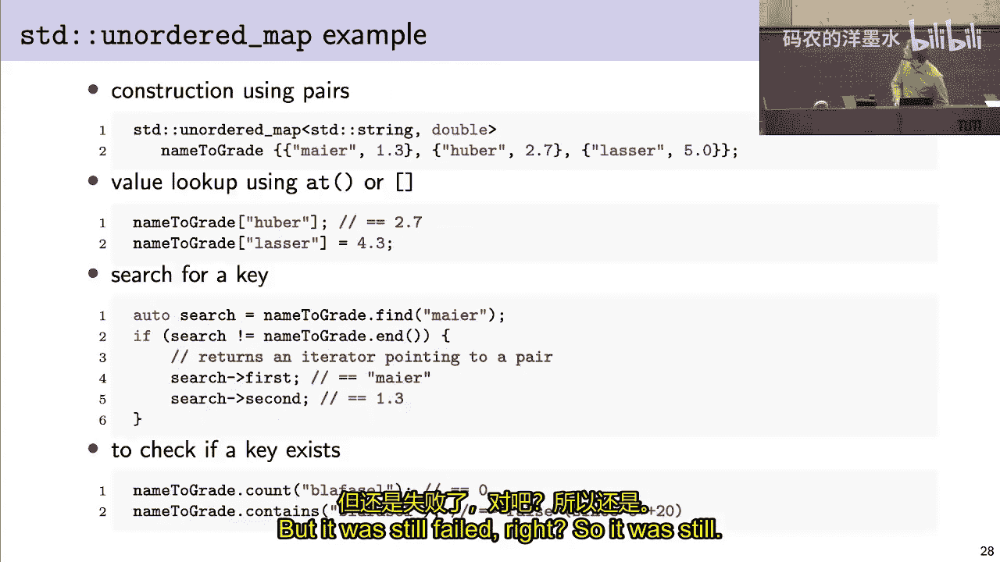

4。3， instead of a 5。0z zone。Yeah。If you want to find the last element in a map。

Well talk about iterate in a bit。 So I'll defer that question。

How does unored map deal with hash collisions。You don't care。

 You only know the complexity guarantee that the amortized cost is O of one。

 and the worst case performance is O n。How the。Library chooses to implement collision dealing with hash collisions。

 It's up to the library。Why can't we write hash functions for primitive types。Not sure。 I understand。

A question， Maybe it will become clear later on if I read it again。 Anyway， let's move on。

 This was an unaued map。 Now， we have a map。

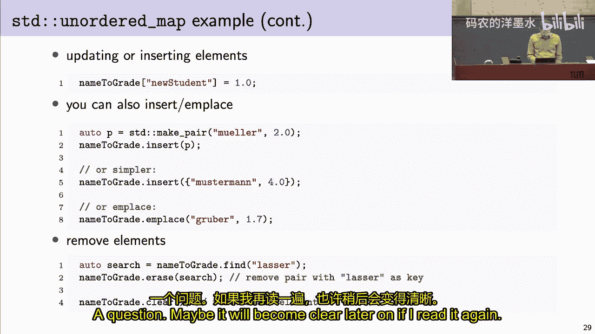

Which is basically the sorted equivalent。 And that means in terms of data structure。

 it's usually an A V A VL tree or a red black tree。 Think in both in all the big implementations。

 it's actually a red black tree。You get complexity guarantees of O log N for basically all the important operations。

Which is cool because there's no worst case of O of N， like in hehing。

 So now you have a definite O log N complexity guarantee for basically everything。

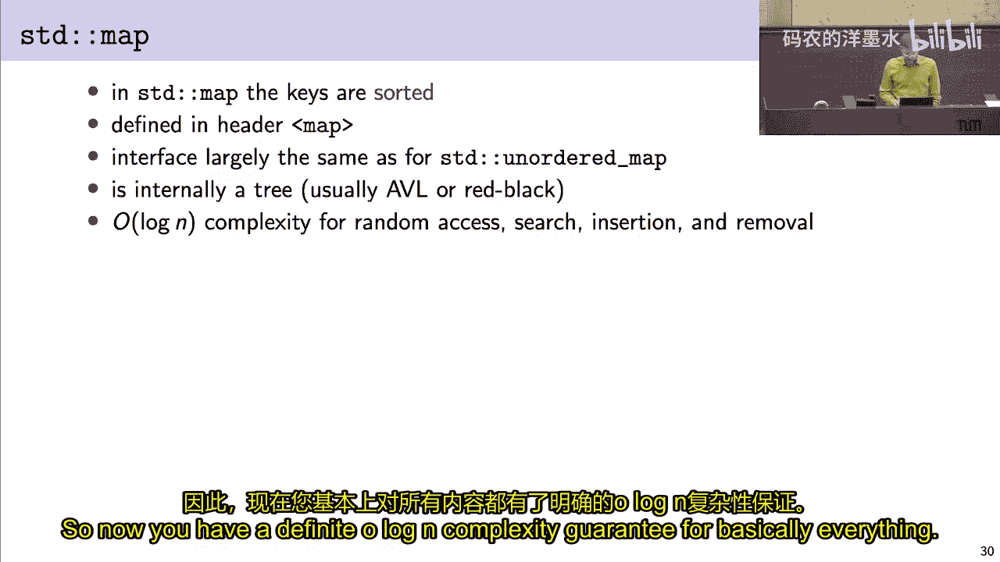

And since it's sorted， it also allows you to do。Rangequeries。 So， for example， you can。

Find the first。Element that's greater than a certain key。

And get the entire range2 to go from there using upper bound or the first element that's not lower using lower bound。

And then basically， you get an iterator that points to， to all the stuff。

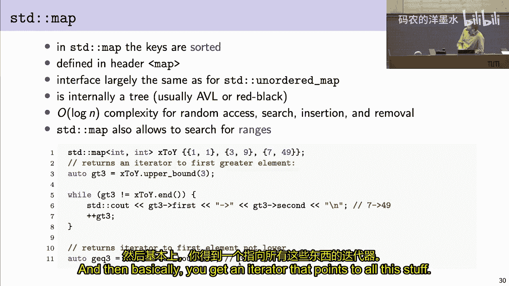

There's an ordered set。which is another associative container。

 but it doesn't contain key value pairs， it just contains keys because it's a set。

 it just stores keys， the keys are required to be unique like previously it's a hash table with o of1 and a first case of O of n obviously。

And what's important here， it's a set so you can't。

 or you shouldn't change the elements because if you do your container might become corrupt。

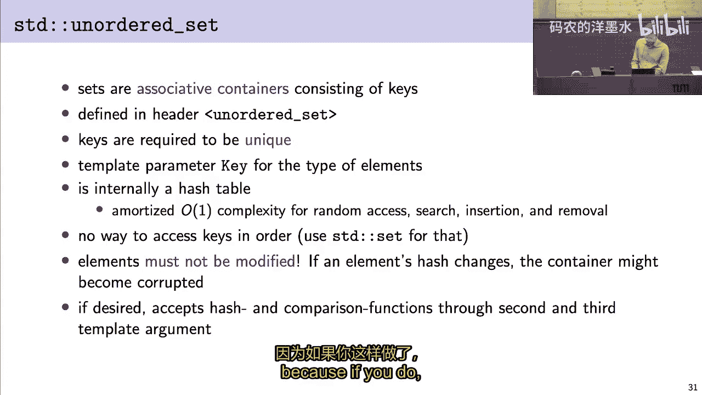

So， for example， if you want to store your store your shopping list of milk， bread and butter。

 you could use an anor set and then find if milk is there or iterate over the elements of the container。

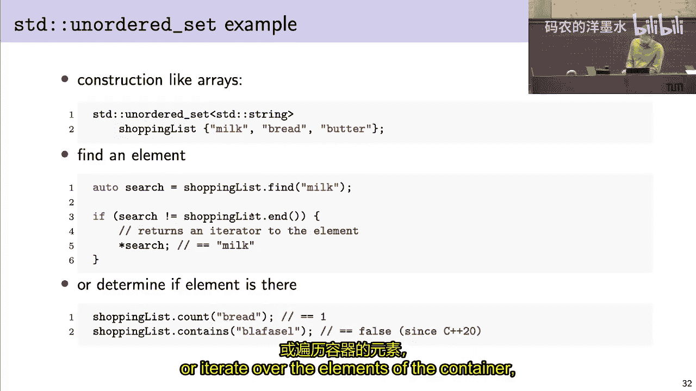

I'll check if Brett is here and so on and so on。You can insert elements。 You can in them。 You can。呃。

 yeah。

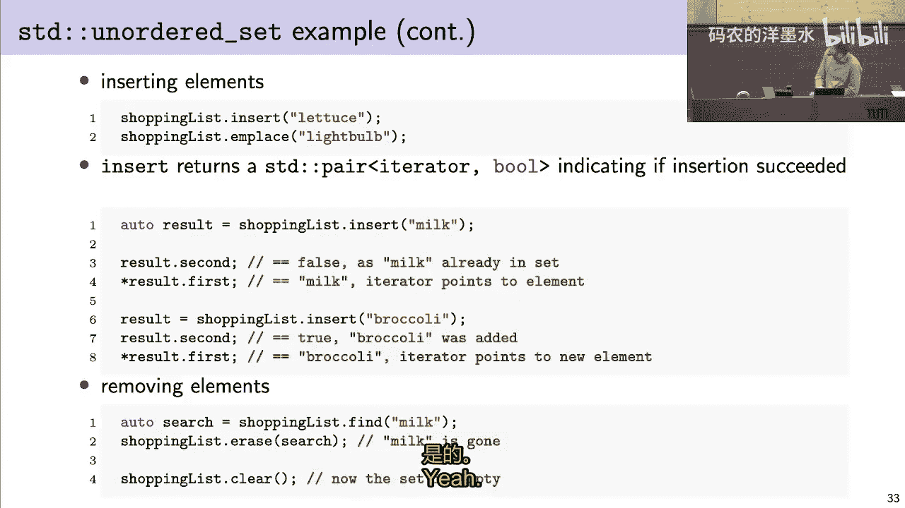

Remove elements using arrays。 So this is same as for other， all the other containers。Set。

It's the same idea。 So you're just storing the keys again。 But now in a sorted way， again。

 using search trees。You can also do range queries here and so on and so forth。So basically。

 you decide what you need。An associative container with trust keys or with key value pairs。

 you decide if they should be sorted or not， and then you pick anau map or set or anor set or a map。

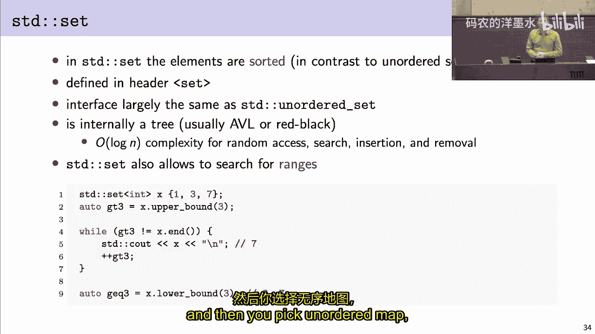

Right。

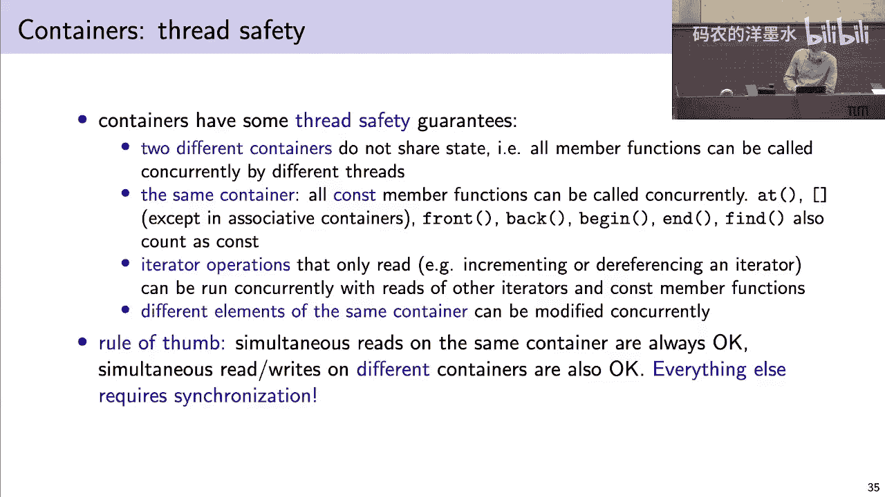

Did I make a typo in slide 27。Unored maps are associative containers of key value pairs。Yes。

 that are not ordered。 So yeah， there's that's， that's down here。

There's no way to access keys or values in order。So， no， no typo。

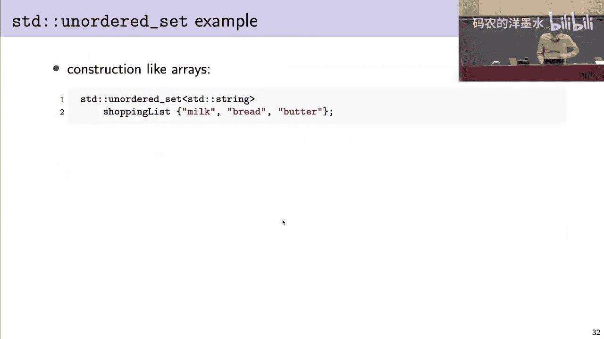

Threat safety， We haven't talked about parallel programming and it will come later in the class because we can't talk about everything at the same time。

 but in general， if you have containers and you have several threats here are some guarantees that the standard Library guarantees to you。

If you have two different containers， they don't share state， even if theyre of the same type。

 So we can use。 I mean， that's kind of as expected， really。If you have the same container。

You can use all the constant member functions， basically those that don't modify the container。

All the time。Even from multiple threats， because they don't change the states。

The only exception is the， the。Brackt operator of Associative containers。Right。

Because there might be some rehashing going on。 iterators that do read only access work concurrently。

And strictly speaking， if you have different elements of the same container and you're referring them via different ways。

 you can also change them in parallel。 But if the rule of thumb， anything that does reads is fine。

 like every time in parallel programming。If you do simultaneous reads and rides on different containers。

 you' are fine。 But as soon as you do simultaneous rides to the same container， you need to really。

 really pay attention。And we will learn。嗯。We will learn how to deal with that in our parallel programming chapter。

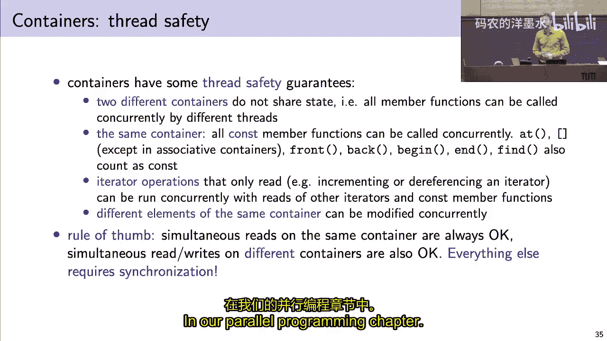

Iterators。 so there were a few questions about them。 So let's talk about them briefly。

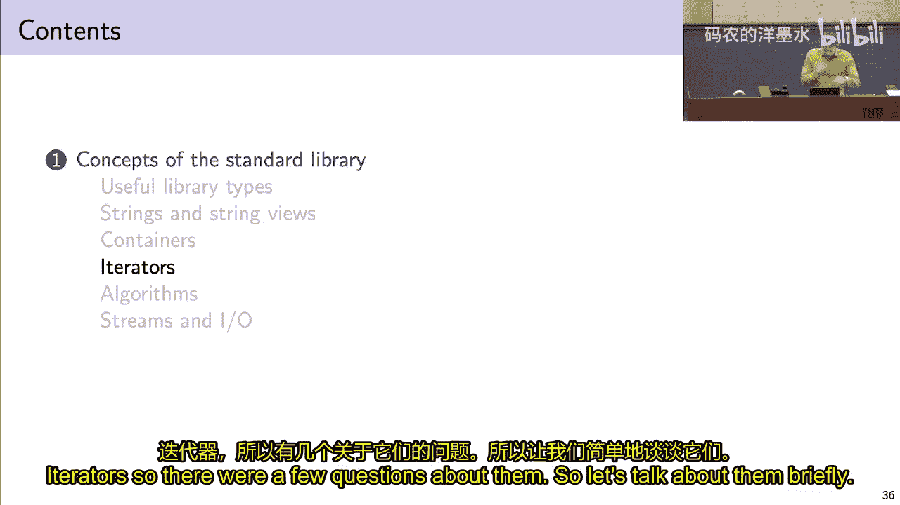

The problem that we face with a standard library is that we have a lot of containers。

 and they are all different containers。 STD arrays， a fixed size array that's contiguous in memory。

 STD map。Is an ordered associative container that's basically。呃。A search tree。

 and what you want to provide is a way to access the elements of these containers。In the same way。

 for all of these different types of containers。So what you need is some kind of interface。

 essentially， to provide this kind of access。 And since the+ doesn't really offer interfaces explicitly。

 you need to find a workaround。And the workaround is basically。

That we have defined these iterators as an abstract concept。Which are essentially an interface。

And it's a pointer like interface。 So that's why。The logic is similar to pointers。

 You dereference them。 You increment them to go to the next element。

 you decrement them to go to the previous element and so on。 And the thing is。

 you don't need to know how exactly that iterator looks like as long as your container tells you。Oh。

 if you call begin， I'm giving you an iterator that's suitable for my container。

If youd call begin for another container， it will give you a different iterator。

 but it will work the same way。So using the same interface you can have。Standardized access。

For all container types。That's different since the containers different in terms of what kind of access they support。

 for example， in STD array or SD vector， you can have random access to your elements in all of one for a list you can't for an associative container you can。

 so it depends on what you do。So that's why there's different iterator types to support the different capabilities。

Also， you need to be careful if you change the container。For example， by writing into it。

All existing iterators are no longer valid and can no longer be used。Or should no longer be used。

 The compiler will not prevent you from using them。 but if you keep using them， you will get garbage。

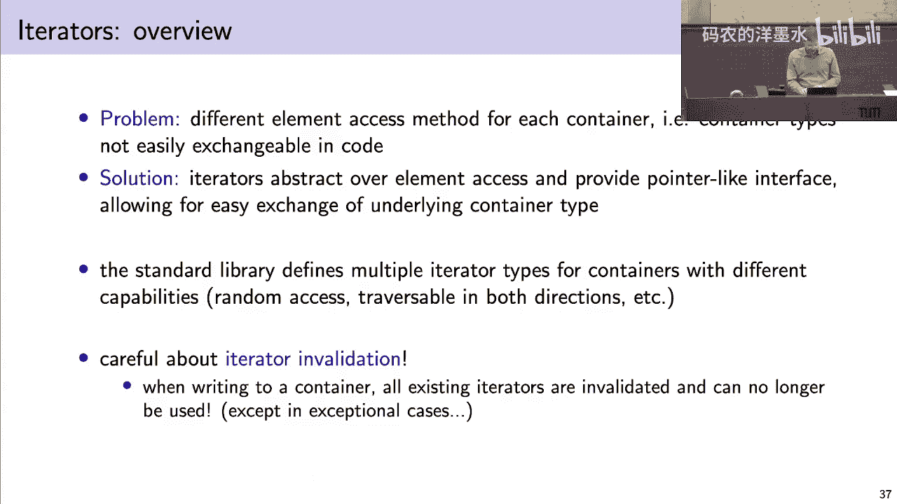

So the main interface for iters is begin and end。This works for any container。

 The begin iterator points to the first element。That's as expected。

 what's maybe a bit unexpected is that the end iterator doesn't point to the last element。

 but rather， it points to one element beyond the last element。So the end iterator is actually。

Not an element of the container。 It's a sentinel。 It's like a sentinel， right。

So it's not an element of the container， and you can't。

 You shouldn't dereence it because it's just a sentinel。 It's not an actual container element。

So dereferencing the end iterator will yield undefined behavior。 could be a crash。

 could be some other weird stuff。

Right， and the main interface of the iterator is to dereence it。Like you see here。

So we get the start of the container。 We de reference it with the star operator。

 and we get the first element of the container。 Since our container is a vector containing 1，2，3，4。

 the strings， you get one。 We you dereence it。The other default way is to increment the iterator。

And if usual， you should prefer the pre order the about prefix increment rather than the post fixed in increment。

That moves the iterator one further into the container。 and then you can deerference the next thing。

 which in this case would be2。And that works the same for all the iterators， basically。

And if you wanna check if you're at the end， that's exactly what the end sententinel is for。

 So it can do a vi loop or a for loop or whatever loop of you prefer。

You compare your iterator against the N Sinel。 And as long as you haven't reached it， you can still。

Go through the element that the iterator is currently referring to。

 And if you reach the end of the container for the last time， you increment it。

 and then the iterator will switch to the sentinel。To mark， now it's at the end。

 and then the comparison here will fail。What you also can do if you've already seen this to make an automatic loop over a container。

 providing an iterator interface with begin and end。

 you can put your container here to the right of a colon。And to the left。

 you do a declaration of an element type of the container， usually with auto。

 And then you can iterate over the entire content of the container without having to deal with iterators explicitly。

Now， you can do also the loop explicitly like this for loop。 You get the beginning iterator。

 You check your iterator against the end。 You increment it in each step of the loop。

And what you now can do is you can do modifications of your container like inserting or erasing。Now。

 you should recall。Any change of the container invalidates iterators。 So what you do here。

Insert gives you a new iterator， which you need to assign to your previous iterator。

So that you can keep using that iterator to go over your container。 and the same is true for arrays。

If you call eras， the new iterator will point to the next element。Right。

Now， what kind of iters are there， The simplest ones are input and output iters。They basically。

Provide the dereferencing operator to access the value of the iter of the element that's pointed to at the moment。

 you can increment it， and it can only。Meat。Stuff， the output iterator can only write stuff。

 as the name says。They are single pass iterators， so you can decrement them so it can only go forward。

You can only compare equality。Because there is no notion of being bigger or smaller。

And you can only increment them by one in one step。

So yeah， if you put input and output iterator together， you get a forward iterator。

Which basically goes forward through data and can read and write。

Then you have a further generalization， the bidirectional iterator that now also allows you to go backwards。

 via have the decrement operation。And you can basically go back and forward as much as you want。

Then there's a random access iterator。Which also allows random access。

Becauseuse now we can randomly access any element that is being iterated over。

 And that finally also allows comparison operators with smaller or greater and equal。

 Then you can also increment a decrement by a certain amount， just instead of just one。

And essentially， contiguous iter is another extension of the random access iterator that's guaranteed to be stored in memory contiguously。

There is a little。Over。For iters， because essentially， you're creating。The equivalent of a pointer。

To your current element and your， the increment is switching to the next element。 there are some。

 of course， some。Administrative overhead connected。

 depending on the container type that you use for an LCD vector， incrementing an iterator is just。

An increment operator to the index。For a list， an increment might be dereferencing the next element that's being pointed to by the next point of the current element and so on and so on。

 So there is some overhead， of course， hidden in these iterators。

 and it depends on the container type， what type of overhead there is。But， of course。

 for each container type， it's optimized so that it's the best it can be。

And you don't need to care how it's actually done。

There's an outlook to Rangs library in C plus 20。 That's another example of a library that was developed by someone else outside of the C standard。

 and that got taken over into the C standard。And it's a really。

 really cool library because what it allows you to do is some kind of functional style programming。😊。

Like this， you have a container。Containing some numbers。

And then you create a view on it that filters the container， according to a certain Lada function。

 And then you transform the result of this filter。For example， by multiplying everything by2。

And yeah， this is。Pretty shorthand notation。 Of course。

 you could do this without the ranges library with some explicit functions and and so on。

 But this is very nice programming style that the Rs library supports。

And as everything in C 20 support in the current compilers is still boty， unfortunately。

So what is the range。Arranges anything that you can iterate over。 so basically。

Any container is arranged， but are there anything that provides a begin and end Sinel。

Is arrange range。A view is something that you apply to one of the ranges and that usually performs some operation。

The view doesn't own the data。 We already know that We had this with string view， as well。

The time complexity is constant to manage the views。 Of course。

 what the view does is not complex not constant in most of the cases。

 And you can compose views using the pipe symbol。Which is， of course。

 the bitwise or operator that has been overloaded for these few classes。

The views are lazily evaluated， and there's a lot of default views。

If the standard libraries finally implement everything that's in the standard。

It's pretty cool。 Let's give me an ex give you an example， for example。This is very stupid。

 Check if a number is prime or not。Not that efficient， but it works。And what you can do， for example。

 if you want to know the first 20 prime numbers starting at 1 million。Well， you create。

1 million numbers。You， you create numbers starting at 1 million， sorry。You failed at the result。

According to the is prime function。And you take the first 20 out of those results。

So now you probably say， isn't this horribly inefficient， No， because this is all lazy evaluated。

 So basically， the last one decides how much of this range starting from 1 million is actually sampled。

And yes， of course。 it will check all the numbers from 1 million onwards to check if it's a number。

 And after it has 20 of them， it will stop。 and then you get。All are the numbers。And of course。

 what we're doing here， the view itself gives you a range。

 and you can iterate over that range with a range for a loop。

 So you can write pretty nice and tidy code using that。The range of library is cool。

 but it's very new。 There's very little documentation on it。 So the actual the C plus plus reference。

😊，And this is even more horrible than the usual reference。

The only good explanation of the range of library that I found is the C plus peny book of Rina。 Oh。

 was it Rina。All I done for mine。Mr。 G， okay。And， yes， the pipe operator here。 it's actually。

 it's the bitvis or operator。That you remember from all the operators being introduced in C plus。

 you can override it for your user defined data types。 And， of course。

 these views here are user defined data types by the standard library。 And the idea is that it。

Logically resembles the pipe operator in shells， right。

 so that you pass on the results to the next one。Of course。

 that's not the original intention of the bitvisice or operator。

 but that's how it has been overridden。 And this is a perfect example of how it can override operators in a useful fashion for your data types。

Right，15 minutes left。I talk too much。哎 you说。Arithms， so we have。few useful types。 We have strings。

 We have containers， iterators over the containers。

 We have a very brief look at the range of library， Very small。Now let's talk a bit about algorithms。

 which are also a very cool concept of the C Standard library。And they came pretty early， yes。

But it does。It uses iterators。So you see how all the concepts of the standard library works together。

 iterate us up basically the base。And it allows to define common operations like sorting， searching。

 manipulating， doing reduced operations and so on。And。Yeah。

 the ranges are described by iterators with begin and end， typically。And there's。Funny enough。

 they are a bit spread。 So most of them are in algorithms。

 Some of them arenumeric because they are more numeric algorithms。

Some of them are in memory because they refer to memory management。And actually。

 I don't remember which algorithms are in the C standard library。Not sure what's in there。

 I will only show you a few examples of the algorithm library because there's way too many to cover。

 So if you need to do perform a certain operation。On。A range or a container。

Have a look at the standard library it defines。Basically， any algorithm that's useful。Funnily enough。

 there's a bit of overlap with a range of library that we just talked about because it also has views that perform operations。

 And in some of the cases。And actually， all of the cases I'm showing here today。

There's a duplicate in the range of library。 So there's a thought algorithm from the old C plus plus standard template library。

And there is a new sort of the range of library。You would hope， of course。That they share code。

But I actually don't know。 I would have to check actual implementations of the C Plaster standard library if they share implementations or not。

He would hope so， at least。Anyway， what a sort does， it sorts in as sendingending order surprise。

How do you call it， You specify a range by using an iterator on first and last。

 the iterator has to be a random access iterator， because otherwise。

 the sorting algorithm doesn't work。 You have to be able to swap elements and elements have to be move assignable and move constructible。

 Again， this is something you talk about。In two or three weeks。It's not a stable sort。

 so it doesn't guarantee the order of equal elements and surprise it needs analog log n comparisons because what will it be most likely。

A variant of quick sort。That's probably。Has limited recursion depth and then switches over to Heap sort。

No， hold on。No， the default should be a quick sort that switches to insertion sort for the small chunks that are recursed on。

 And if the recursion depth grows too big。It should switch to a hybrid heap sort insert certain sort variant。

 I think that's what most of the libraries do。Did I fucked it up。

 I should have lookeded it up earlier。 Sorry about that。But yeah， it's easy。 You have a container。

 You call begin and end and then apply sort， and you get a sorted container。

If you don't want to sort ascending。You can specify your own comparison operator。That， for example。

 does a descending sort or whatever kind of thought you would like。

 And the easiest way of doing this is by providing a Lada expression that does your comparison。 So。

 for example， if you want to sort it in a descending order， you provide a comparison operator that。

Well。Comps if it's greater than or not。Instead of the default operator。

 which is comparing if it's smaller than or not。The Lada function should have a signature like this。

 It takes a constant reference to the first type and to the second type and returns a bull。 So。

 for example， here， in this case， since you're doing an unsigned vector， you do unsigned， left hand。

 un side， right inside side。Yeah， it could be a constant reference as well about copy about value works here as well。

For this smaller data type。

Right。Sometimes sword is not the best because it's not stable。And also of course。

 it tries to sort everything。So if you want a stable sort， you call a stable sort。

I don't remember what stable so it should be。I it a merge thought。

 Maybe it's a merge thought I I have to look it up。 Sorry， I， I don't remember。

You can partially sort a range if you don't need to sort everything using partially sort。

 and you can also check if something is already sorted or not。

By is sorted or is sorted until a certain element。And the thing is。

These are the standard library developers。They've been around for a few decades。

 They know how to do sorting。And probably they know to do sorting better than you and me。

So don't do your own sort algorithm unless you do the algorithm and the data structures， homeworks。

Rely on the pro professionals。To， to do sorting and this kind of algorithms。Searching。

Another standard operation， right， So their search operation for sorted and unsorted ranges and of course。

 searching in sorted ranges is faster because of binary search， right。嗯。

If you don't have a sortded range， well then， of course， there's。Find operations for unsed range。

 which are less efficient， obviously。But you need to decide for yourself if sorting is worth it or not。

Right， in general， these search operations return an iterator that refer to the result。

 And if you didn't find the element。Unsuccessful operations are indicated by returning the end iterator。

 So， you know。The thing that's one beyond。The end of the range。

That's the idea。And we already saw some of these， I think， find。

 if already turned up when we talked about Lada expressions that find， if not。

 there's a general find operation desk search。嗯。I don't remember exactly what the difference between find and search was。

 and I can't reconstruct it from my own writing。 So check the reference。You can count。Elements。

 you can count。The number of elements that match a certain criteria that you specify via Lada。

And so on and so on。 There's a lot of search functions。Just to give you an idea how they look like。

 heres a container。 He has a fine operation that goes from beginning to end of the container and tries to find the number7。

And， of course， what you get is an iterator as a result。

And what you can do is you can compute the difference from the beginning of the container to your result iterator using STD distance function。

And that will give you the index 0，1，2，3， because that's where the7 turns up for the first time。

And for example， if you search for a number that doesn't exist。

 you get the end sentinel of the iterator。

Find if was the example where you can specify a Lada to have a condition。

 So find the first value in the container that satisfies this condition， which is。

If you divide it by two， it has the rest of one。嗯。Or some other。

conditiondition that he can specify it。

Right。Searching on sorted ranges。The complexity is better。Log n， instead of O of n。Again。

 you can comp supply a custom comparison function。And， of course。

 it depends of what kind of iterator you have。 If you have a random access iterator， which you need。

 if you want to do binary research， because， you know， you。Inter effect， your。

Compute halves of your input array。 And for that， you need random access。

If you only have a forward iterator， because you're doing calling the binary search on a list。

A linked list。 Well， then you're out of luck。 It will still do the search， But， of course。

 the complexity will be over end because you have to go through the entire list。Binary research。

Checks if there's one occurrence of a certain element， which is a bit weird。

If you actually want to find the elements， you have to use lower bound or upper bound or equal range。

 yeah。

So here's a few examples。 Bi research tells you if three exists in this sortded container， which。

 of course it does。

呃。And。The lower bound will tell you what is the first element that's bigger or equal than the search value。

 So， for example， if you search for the first element that's bigger or equal than 3， it's， of course。

 the three itself。 If you search for the first element that's bigger or equal than 0。

 it's the first element， the one。At index 0。And the same is for upper bound。

 which gives you the first element that's actually bigger than the search value。

 So if you search for three， it will give you the four or the index of the four。

An equal range gives you two iters。One iterated to the beginning。

Of the range where there is the value that you're looking for and one to the end of the range。

 So if you're searching for three in this， it will give you the index from this three to the index of this three。

 So you find all the threes。That are between two iters。 And， of course。

 you can use structured bindings to automatically dereence the pair that you get from the equal range operation。

You can also do perutations。I skip over those。 You can do the Yota function to create numbers from a certain。

Point to another point。

And I skip over this。 that's more stuff you can， for example。

 do merges of sorted ranges or in place merges to implement merge sort。

They' set in operations like intersection union difference。 You can do heaps with makehe， pushy。

 pop heep， and so on。 you can sample elements。And rotate， arrange， shuffle。

 arrange to randomly reorder and so on and so on。 So， that's quite a lot。 And I didn't touch on。

 on a lot here。

So the last thing I want to talk about。Its。Streams。

Which is basically the main concept of C plus plus or the main old concept of C plus plus to do input and output。

So， basically。Everything is considered as a stream。 You know。

 like an output stream is something very sense stuff， too。 And then it。

Writes it to whatever you're streaming to， a file a network socket or something。

And the same is true for an input string。Did I put this correctly， So output is for putting stuff。

 out input is for getting data， right， from the keyboard， from a network connection or what not。

Input and output stream is， of course， something that can do both。

And there's the default console input and console output。

 which is basically the standard console output and input that you've probably used already in some of your homeworks。

All these stream share certain functionality， like if they are good， if they failed。

 or if they are bad， if the end of file has reached。

 and basically the bull conversion operator checks if there's any error condition going on。

So this is something where you might be surprised because streams typically don't throw exceptions。

 They actually work via these。Faith states。Which is a bit weird because that's different from most of the rest of the Cto standard library。

But then again， this was a design decision that they did and。As you've seen already。

 these bit shift operators have been overloaded for input streams。

And for output streams in the opposite direction。 So this is， again。

 another case where an original operator from C was。

Modified in meaning for a user defined type by overriding those operators and providing input and output。

You can do explicit input and output with get and read and also and write for the input and for the output。

And。Yeah。

You can do string， string streams， so you can。Create a stream from a string。

And write to it and read from it， which is sometimes useful。 You can create streams from files。

Which is。The most popular use case， I guess you can create streams from network sockets and so on。

 But that is not part of the standard library。 So it's not here。Or at least not yet。

One thing with the streams， they're pretty nice。 and there's formatting manipulators and so on that I'm not touching upon here。

 So they're pretty cool thing。 However， they have a very big drawback。 They are terribly slow。😊。

嗯。Streams use virtual functions， which we talk about。Two weeks， I hope。

Which are not terribly efficient because I have some performance overhead。

 Streams automatically respect the system's located settings。

Which， again， makes them a bit slow。And， for example， if you parse。

Anything that's not character based or string based， It's really， really slow。

It's an elegant interface。 It's really nice。😊，But， it's not that fast。And， of course。

 why do you use C plus， plus， not because it's so elegant and nice， but because it's fast， right。

 So that kind of。

Is that cross purpose？So fucking finally， into plus 20， they adopted a proper。

Input and output using the another external library。 It was called Li format。

Or it is still called lip format， it got adopted into the C++ Sp standard。

 now it's called SDD format。And you see where the inspiration of this came from。 It came from Python。

And the thing is， it's basically the fastest input and output library that there is fuuzzy plus plus。

 And now it's in part of the standard。And I think Kang 15 finally implements it。

 And I think GCC C 12 also has most of it implemented， Vi a studio has all of it implemented。Right。

 and then you can do kind of Python style I O like this。And now if you ask， oh。

 why don't you use the C print F。Looks similar to this， right？Don't。Print F is horribly unsafe。

Whereas this one here might look unsafe， but actually is perfectly safe。😊，And it's fast。

 It's even faster than print F， or at least as fast as print F。 So if you have a choice。

Use the SD TD format library。

Very good。 That's it。 I covered quite a lot of ground。 You will see。 if you wna use them yourself。

 all these standard library things， you will need to look at the reference a little bit。

 but at least so that you know what is there and what you can use。

 what you don't need to reinvent the view for。 Hopefully， have a bit of an overview。 now。

 Thank you very much。 And see you in two weeks。😊。

