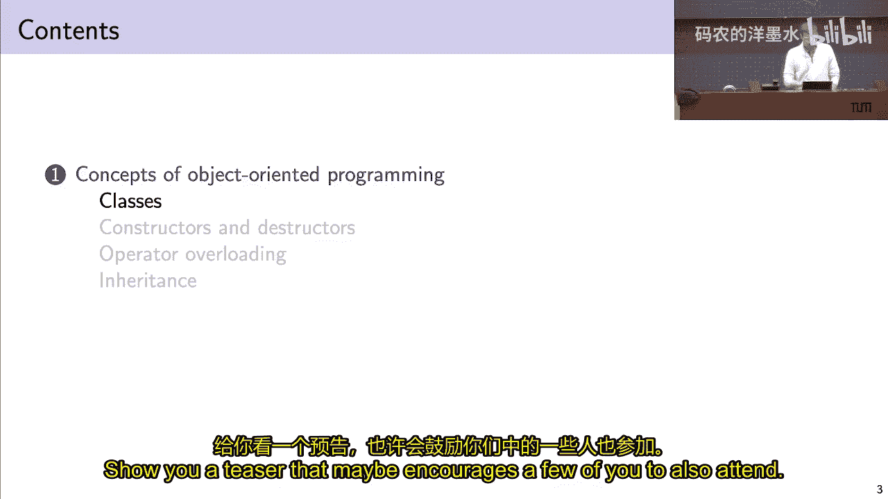
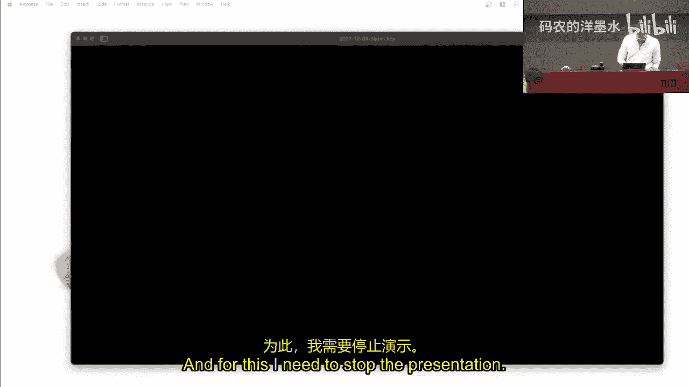
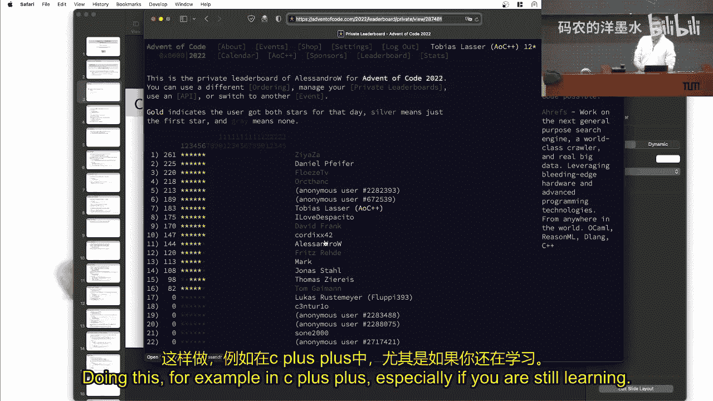
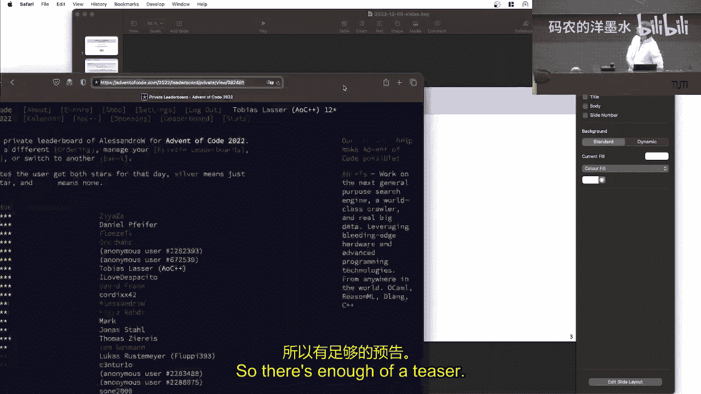
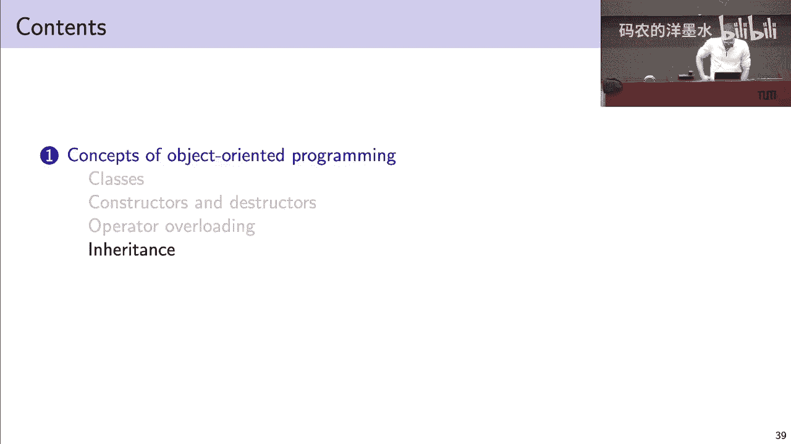

# 【全集】慕尼黑工业大学 IN2377 C++编程概念 中英字幕 1080P p06 Lecture 6 - 访问控制 -BV1b8mgB8EDQ_p6-

Testing again。OhSo let's get this show started。 Hello， everyone。Welcome back to the C plus course。

We had a little break last week because of the DS S academics。 But we are back in business today。

And with this week， and we will stay in business until the end of the lecture period。So today。

 our beginning。If you've read Moodle， you already know。

 our beginning is a bit quiet because yesterday， the course evaluation period started。

So as you may know， already from the previous terms， the Fshaft MP E is evaluating all the courses。

By the school， by the department， by the faculty， whatever。 it's definitely evaluating this course。

And the evaluation takes place online。 everybody of you should have received a link。

If you're signed up into online for this course。Using this link。

 you can fill out the cost evaluation forms。And the forms will be active starting yesterday until December 23 at one minute before midnight。

Right。嗯。We are asked to give you 15 minutes during the lecture。To fill out the online evaluation。

I'm giving this to you basically now。 That's why the actual lecture will only start at 2，30 today。

 So in roughly 12 minutes。And the reason， of course， for this is that previously。

I don't remember how long ago these evaluation forms were actually paper that got distributed to you and that you filled out in present。

And then it's switched to online。 but still we are asked to give you 15 minutes to fill this out。

So the longer I talk， the less minutes it will be。 but just to be sure。

 I told you at the beginning that we like feedback all the time at the beginning。

 not just with this official course evaluation， but also otherwise。

We always try to incorporate your feedback。And yeah， so rest assured。

 we will take your feedback in the official course evaluation seriously。

 It will also go to the department to the study commission will be evaluated。 and yeah。So yeah。

 please take the time。 I'll shut up for now， and we will start with the lecture at 2，30。So。It's 2，30。

And I thank you for taking the time to fill out the cost evaluation。 If you haven't done so。

 if you haven't finished yet。The online forms will be available until December 23 at midnight。

 just before midnight in the evening。So you still have plenty of chance to do that。 And rest assured。

 your feedback will。Come to us。 We will read it， and we will take it to heart。

And consider that this is a relatively new course。 your feedback is really， really welcome。

We'd like to make everything better that we can improve。

So if a lot of you have already seen the tweetback session today Z F is C， C， Y。

How to pronounce today。And actually， I want it before we actually start with。

Where is the window here before we actually start with concepts of object oriented programming。

 So finally， we will talk about user defined types。

I just wanted to show you a teaser that maybe encourages a few of you to also attend。 And for this。

 I need to stop the presentation。

And go here。 So maybe you've seen this already from。On Zlip， this is the advent of Code website。

 And this is our private leader board for the C plus plus course。

 The code to join this leader board is on Zullip。😊，Feel free to participate。

These are programming assignments that you get every day， like an advent calendar。

 It's the advent of code。 And for each assignment， you get some gold stars。

 if you finish both of them。And it's a very， very good practice。 I'm doing it every。 As you can see。

 I'm not the one doing it。😊，The fastest and the earliest。

 because the assignments are released every day at 6 o'clock in the morning。 And some of you。

 as you can see， are very active in doing this very early。😊。

The first few assignments are pretty simple。They're not hard。 It's a bit of text passinging。

 some easy algorithms。 But as time will go on， I've done it in the last year， for example， as well。

 the difficulty of the assignments will go up。I find it to be a very， very enjoyable。

Way of doing at advanced calendar。It's practice。You can try out a few things。 For example。

 David Frank， one of the tutors of the course， is trying to do everything in C plus+ with the range of library。

I'm personally happy。 I find the time to do it at all。

 So I just do it in whatever C plus plus that goes quickest for me。😊，I don't know。 But you。 And。

 of course， there's a chance to release your code。 discuss it with your。With your friends。

 with your classmates。And we have this nice leaderboard here， where you can see。

That some other people are also doing things。Right， so advent of code。It's the U， so。

Feel free to go there。 Feel free to participate。 There's no race to the top of the leader board。

 It's just a fun activity。😊，And it's good practice。Doing this， for example， N C plus plus。

 especially if you are still learning。

So there's enough of a teaser。

Let's get to the actual topic。Right， now I don't have a window here。Stupid。Let's try this again。

Where you you need to go here and you go there。So。We've talked a lot about very things already。

 about types。About syntax。Stuff like functions， overloads， Lada expressions。All kinds of stuff。

 exceptions。Standard library stuff。 And what has turned up again and again is the concept of a user defined type。

But we haven't really talked about this yet。 I mean， you know， it's gonna be classes andstructs。

But this is what we are gonna take this week。 and also next week。

 well take the time to talk about all the specifics， What are classes。

 What about constructors and destructors， which are very important in C plus+ What about operator overloading。

 which is one of the very fun activities you can do in C plus plus and the standard inheritance stuff。

 That's on the menu today， I hope I get through everything， if not， well continue next week。

 And next week we will do the rest of this chapter maybe talk about polymorphy virtual functions and some other stuff related to user defined types。

😊，Right， so。The key to user defined types N C plus plus， aside from aliases and and。

 and stuff like that， are classes。And。Since you're here， I presume you're not in the first term。

 you already did some Java programming in， in your first term。

 So you probably know already what object oriented programming is about。

 So I'm not gonna talk about that， that it's used for data abstraction encapsulation and。La， la， I。

 I'll just skip over all this。 Classes are fairly easy。 You have a class keyword。

 You have a name of the class， and then you have a body with the curly braces， as usual。

 and whatever is inside the body will be class members。😊，Now。

 the interesting part is there's two class keywords， class andstruct。Now。😔。

Before you scratch your head， why is there， too？ Well， the answer is obviously。

 backwards compatibilitystruct was already in sea。So in order to add some stuff。Class was added， but。

 in fact， it turns out that they are basically equivalent。 The only difference。

 And we'll get to that are excess modifiers， default access modifiers。Otherwise。

 they are completely identical。Name。Any name。And then as members， you can have variables。

Which you usually call data members。 You can have functions。

And you usually call member functions if they have functions inside classes。And， of course。

 you can have types。Like aliases。And what you can also have。

 And that's a bit of a novelty compared to functions and other stuff in C plus。

 You can nest user defined types so you can have a user defined type inside a user defined type。

That's a bit weird because， for example， you can't nest functions。But you can four types。

And what's also a bit weird。 But again， is for historic reach reasons。

 is that you have to have a semico here。Cause， you know， usually when you do blocks。

An if statement with a control block or a function body or a name space or whatever。

 There's never a semicolon behind the curly brace， well。Here is。

So let's talk about the members because they are the important part。 Obviously， data members first。

 So they are just variable declarations as you do them regularly。 but inside the class。

 they need to have a name that's not the same as the class name。 We will see in a moment why。

And if you want to， you can initialize them。 And， of course， as usual。

 in initializing variables is recommended。So if you can't， do it。Right， what else is there， okay。

Whatever type you use there must be a complete type。

So we can't do forward declarations as a class member。

 Why would we like to do forward declarations Well。

 usually to prevent to break cycles of self reference， self referencing cycles。But。Usually。

 you don't get the idea as a class member anyway。 So this is kind of。Ovi。

 but the main reason why the type has to be complete is the compiler needs to know how much space it needs to allocate for this data member。

 if a class is instantiated。There's also some restrictions compared to regular variables。

 It can't external variables and allowed it as class members。

 but you are can have static class members。 Why would you want to have that？ Well。

 because static variables are effectively global variables。

And a static variable inside a class means that this variable will be the same for every instance of that class。

 So if you need to share state between all objects of your type。That's the way to do it。

 using the static keyword。And here you see an example。嗯。He has astruct。

 I could also have done a class。 The keyword is the same。

 It's just a difference on the visibility of the members， default visibility of the members。

 But we'll talk about that in a moment。Declare a variable。 Iize it。 Decare a variable。 Iize it。

 Decare a variable。 Don't initialize。Not great， but fine。

 What also works is have a static variable that will be shared between all instances of this user defined type。

 foo。Now， what we've already seen。Plenty of times is how do you access class members。

 It's via the dot operator。 So let's say we have this class here。 R， there's two variables。

 I and a constant float F。And then you can instantiate the bar as you would any using any other type。

 and then you can use the dot operator to refer to the members of this type。Yeah。

 this is fairly natural。If for some reason， you have a pointer。But remember。

 pointers in general are evils or you probably shouldn't have it。 But if you do。嗯。

We can refer to members by dereferencing the pointer first。 So basically， this is the pointer。Well。

 actually， let's start from the beginning。 So we have。An instance of type R C。Now。

 we take the address of this instance to get a pointer。 and a pointer is marked by a star。

We haven't talked about this， and we will probably not talk about this anymore because it's really unnecessary。

 You don't need this type of pointer。 But this is just to illustrate。

 So if you have a pointer for some reason。Whatever reason， maybe backwards。

 compatible code or something。You can first dereence the pointer to get the object it's referring to and then use the dot notation to get access to its member。

Or another notation is to take the point here。And the arrow operator。

 that's what I call it or the minus greater thing to directly refer to the variables。

 So you can use both。 They are equivalent Theyre the same。And， yeah。Now， let's briefly。

Take a step back。What should be familiar to you is even though I've discouraged you from using raw pointers。

 and I will keep doing so。Because they are totally unnecessary。 They're unsafe。 They're evil。

 We don't need them。This notation and this one you've already seen。This is， for example。

 dereencing an iterator。 You've seen this already。Here to refer to the the object contained in an optional。

So this is these de referferencing operator and the member access。

 These are things that are kind of standard in C and in C plus plus。 Well。

 C plus plus actually not C。 So they are used in quite a lot of places。

Even though there no point us involved， just because。

The semantics of it is in most programmer' minds。Oh pointers， get them out of there。 I， I switch。

 thats light away in a moment。嗯。Can we do object oriented programming in C。Yes， you can。

It's not necessarily nice。But if you really want to， you can。Overloading of operators。

 well talk about this in a few slides。 So I'll defer the question。Right。

Other members can be functions。So。Data members， function members， What are function members。 Well。

 there are functions that are declared inside the class。Other functions can be static。

Why would you want to do that。1， if you want to have a function that works。

Even without having an instance of the class。That's probably not that many use cases for it。

 but in some cases， there are。So， for example。Or let's put it like this in most of the use cases where you would do a static member function。

So that you can call the function without having an instance of the class。

You probably should have done a function inside a namespace instead。

But there's a few valid reasons why you would like to have that。Right。

 there's other qualifiers for these member functions。 We will talk about them in a bit。

 But just to make sure if you have a non static member functions。

 you can qualify it using con and you can do a ref qualifier。

 Both of these we will talk about in a bit。You can also have virtual functions。

 That's another modifier to a member functions， which we talk about next week。

And there are some special member functions。Should well also talk about later， Yeah， constructors。

 teethors， overloaded operators and so on。But in general。

 they are just functions like void foo is are non static member functions。

 void Cfoo has a constant modifier。So it's another member function， but it has a constant mod。

 We'll talk about this in a moment。Here has a static member function。Which is just that。

 So you can call it without having an instance of foolo。 And how do you call it， Well。

 we talk about that in a moment as well。This is our constructor。 This is a deor。 Again。

 we'll talk about this in a moment， so hold your horses。

And here is an example of an overloaded operator， namely the comparison of equality comparison operator。

 And， of course， you can overload other operators， too。See later。没有。With all of this out of the way。

Let's get started with the details。 So first， how do you define member functions。

 The declaration needs to be inside the class definition or the class declaration， Obviously。

 otherwise， it wouldn't be a member functions。 but where you put the body。Is up to you。

You can do it inside the class。 This is a so- calledled in line member function definition。 So。

 for example， if you look at this one here， F 1 has its body right there in the class declaration。

 I just didn't show it。 I put it in comments because the slide is otherwise too small。

These functions here， fu2， fu con fu static。 They are not defined inside the class。

 They are defined somewhere else。That's what we call out of line definition of the member functions。

If you do an out of line definition， you need to repeat the entire function signature。

 So the return type， the function name， the arguments， in this case， there are no arguments。 And。

 of course， you need to add the qualifier that this is a member function of class4。

This is how you do it。And if there's a con modifier or any other modifier。

 you need to edit it here as well。 Otherwise， the compiler will think this is a different member function of Fo。

 and it will complain that the member function wasn't declared inside the class declaration of Fo。

Depending on the size and complexity of your class。You do in line definitions。

 out of line definitions。 It's up to you。 It's a matter of taste。But in most cases。

 what we do in practice is that the class declaration itself and any small inline definitions that you might have。

Are put in head of files。Dot H or dot H， P P， and all the out of line definitions are put in source files。

So they are not parsed all the time when you include the include file。

 So one of the reasons to not put all the function definitions in the class declaration is。

That not every time your class declaration is included from other parts of your program。

 the entire code has to be parsed。Of course， theres other reasons， like hiding your code。

 if you're writing a commercial program， you don't want to provide the actual code。

 but just the interface。 then obviously， you just provide the header and a precompiled binary for the out of line definitions。

And， of course， since C++ 20 and modules， we can do the same even better with modules。

 But there it's the principle is the same。 You have the module declarations which contain the declarations of classes and member functions and so on。

 And you can have a module implementation file， which contains the sources。😊，But here， of course。

 this modules， it's no longer。A concern。That you have to compile everything all the time。

 if you put it into the header file。Rough guideline， whether to do functions in line or not。

 if you're doing a one page program or a few page program like this advent of code things。

You probably don't want several files。 Just put it all in one。

If you write something bigger with several files， probably you want to have out of line definitions of your functions。

 except if they are like one or two liners。And then you might wanna put them in line。

Can we have several implementations of a member function using namespaces， no。嗯。

There's one declaration。Of the member functions inside the class。And then there can， Well。

 let's take fu2。 And then there can be exactly one out of line definition for that function。

 You can't do several。That wouldn't make sense that would， if you actually。

 if you put two out of line definitions， the compiler or the linker， depending on where you put them。

 will complain。 Oh， there's a duplicate implementation needs to be unique。

If I have a lot of out of line definitions and code size is getting huge。

 Can we split the definitions into multiple source files， Yes， as much as you want。

Why should avoid method be con。Well， we'll talk about Ks in a moment。

 but Ks basically means that the state of the。Object of the class isn't changed。

And why wouldn't avoid method not。Be constant。There's a lot of c letters， yes。Okay。

 so the inline keyword， okay。Let's talk about this briefly。

 There is an inline keyword with which you can annotate functions in C plus plus。

I haven't talked about it， because it's。These days， it's。Superfl， smallest。And what it says。

 it tells the compiler， please， whenever you call this particular function。

Don't do an actual function call， you know， with the stack frame， pushing the parameters。

 Storing the return address， and then doing an actual function call to the address， Do a thing。

 go back， restore the stack frame， lala。But instead。

 take the code from this function and insert it right there instead of the function call so that there is no function call overhead。

This is a performance measure。That's what an function with a keyword in line means。 However。

 it's a guideline to the compiler。 The compiler doesn't have to do that。 It's just like， oh。

 this function is probably performances critical。 So maybe try to inline it。这是是。

Different inlining thing， but yet not。This here is also。An in line function。

 So you don't even need to annotate it with in line。 And the compiler will， in fact。

 also try to basically instead of doing an extra function call to put just put the code there。

 But then again， this is now a member function。 So sometimes this doesn't work。

 So the compiler can't do it。So yeah， these are two different meanings of in line。

 But why is the performance in line basically superfluous。

Because all the compilers today are so good in optimizing your code。

 They will do this regardless of if you annotate your function with in line or not。

 wherever it's possible。So。Today， you can basically forget about the inline keyword。

 It's really not necessary anymore。That's why I'm also not talking about it。Right。

How do you access data members in member functions？ So， obviously。

 if you're in a class and you have a member functions。

 you might also want to access the data members of that class or of the object of the class that you're。

Using， and the thing is。Since you're inside the class context。

 you can just use the variables as they are， as if there were local variables。

You can also refer to them via the， this pointer。So what is the this pointer。So you have a class。

 which is essentially kind of the type。The template， once you instantiate the class。

 you get an object。Of that type。You can instantiate again when you would get a second object and so on。

 And each object basically knows， okay， I'm somewhere in memory。Here's the start。

Of where I am in memory。And this here is the start you can refer to as this。This is a pointer。

And yes， this is a pointer。 There's no around this here。

 This is an actual pointer pointing to the start of the memory location where the class stuff for where the。

Me， the data members of this object of the class are stored。

So you can use this explicit this pointer to refer to your member variables。But you don't have to。

 You can just use the member variables as they are。Some people re prefer this， this notation。

 for whatever reason， I think it's just clats the code and makes it unnecessarily unreadable。嗯。Maybe。

So the argument I've heard of people who use this all the time for data members is。

That they come from different languages that require this。 fine， I'll accept that。

 C plus plus doesn't require it， so we can stop doing that。

And the other reason was to make sure that， yes， this is actually。A local。

 this is actually a class variable and not some local variable that I can just refer to。

But if there's any confusion about what is a local variable to your member function versus what is a class variable or an object variable。

Then your design probably sucks and you should change it if that's not very obvious from the start。

So prefer using just the name of the data member。And yeah， there are some things。

 So that this pointer in a non constant function is a regular pointer to type C。

 if you have a con function。The pointer is con C， so you can't use this pointer to change anything which is just consistent。

 obviously。What can we use instead of this， nothing。Just drop this is this and just use I like here。

 like in this return statement， it's an implicit member access， and it works。 It's easier。 It's less。

Less to， to， to write， easier to read， yeah。Oh， this is a good one。

Why do I want to create my own data type and menu play them with member functions？

 Could you give a practical example。Yes。😊，It's one of my favorite examples。

 You will hear it again and again。So， for example。In my research， I'm dealing with image processing。

Medical images。Other images， whatever。And these images。Well。

 they have to be stored somehow in memory。 You probably want some convenience functions of what displaying them。

 writing them， reading them。But most importantly， for my part。

 is we want to do stuff with these images。 We want to process them。 And what， how do we do this。

 typically with linear algebra， And we interpret the image as a vector。

And we apply operators to this vector that are represented by matrices。

We do arithmetic operations with them。 We add images， we computer derivatives， and so on。So。

 of course， what's very handy is to define a new data type。Image。Or vector or whatever， or both。

And give them operations so that you can use the image like a built in data type， like an integer。

If I do my vector class properly。I can use the plus operator， the multiplication operator。

 I can have some automatic conversions going on。 I can have implicit memory management and so on and so on。

 So there's plenty of reasons why you would want your own data types。

Does it make sense to use this to capture the same object into its own Lada expression。Potentially。

 yeah。And yes， there's also name naming conventions to make it clear that something is a member variable of our class。

I'm not a fan of them because it should be obvious。 What's a member variable and whatnot。Right。

Nested types already set this。 So if you have a user defined type。

 you can have another user defined nested inside so you can have a class B inside of a class A。

And you can then use the regular scing， as you would do with namespaces to refer to the nest type。No。

 excess control。 That's important。 So every member。Have access control， data member， member function。

 and so on。嗯。Public members can be accessed by anyone。

Protected members can only be accessed by the class itself。 So， for example， class methods。

Member functions of the class can access protected elements。 And if you do an inherited class。

 a subclass， they can also access protected members of the base class。

Private members are really private， and they are only visible to the class itself。

 Even if you inherit from this， the subclass will not be able to access private members。

In most cases， what you need is public。For your interface。

 for people to actually interact with your data type。And private。

 if you want to hide implementation details from whoever is using the class or deriving from the class。

Protected。Very， rarely。Required。But， it's there。And now。

 now we can see what's the difference between a class and astruct。 They are the same。

 except for the default access modifier。With a class， the first。Data member will， by default。

 be private。With astruct， the first member will be by default public。So how does this work。

 This is a class。So the first member that you。Declare， in this case。

 it's a data member will be by default， private。 So a here is private。

Then you can make things public， and everything that follows will be publicly accessible。

 B can be accessed by everyone。 Get A can be accessed by everyone。Now。

 you can make everything protected。 Everything after this like the C will be accessible to the class itself and to its subclasses。

Whereas this one here is public again， and you can switch back and forth between public。

 private protected as often as you want。嗯。And you see， basically。

 if you wanna have public stuff at the top。Which is usually reasonable because the public stuff is that which will interest people who use your data type that should be at the top。

 So you could be usingstructs。Because they have a default。Acccess of public。Just to give you an idea。

 though， there is a kind of convention that is not rooted in the language， but more in kind of。

Actual practice over the years。Is that classes。Typically， are something。

That have a lot of logic and stuff inside and do a lot of things whereas trucks are typically used for something that just。

It's very lightweight。 For example， just wrapping two data members， maybe a convenient function。

 and that's it。That's kind of the。Convention。But it's a very weak convention。

 I don't think it's written down anywhere。 It's just how people sometimes use it。

I don't necessarily ascribe to this convention。So if you see class orstruct。

 consider them the same just with a difference in default access modifier class members are by default private。

 So what you often see is class full。 And then immediately the public line。All you do extractstruct。

 And then you don't need to do that。Right， one of the questions is asking about friends。

 This is my next slide。You can have friends of classes。 Why would you need friends。Well。

 in case you need to access protected or private variables of the class by stuff that's outside of the class。

So how do you do， friends。This is the programming language。

 So we' are not talking about real life here or some weird social media stuff。

 So what you do is you do a function declaration inside the class。

 and you put the keyword friend in front of it。So the funny thing is， then you do this， you have。

A function declaration inside the class with the friend keyword。

But that declares a function that's actually outside the class。

It just tells the compiler that this particular function that has to be declared somewhere outside the class。

 as well。I a friend of this class。You can also do。A function definition。

 including the body inside the class。 And even though everything of that function is inside the class。

 it's a non member function because of that trim keyword。

 So it's like a function that was defined outside。😊，And you can make other other classes， friends。

Of this class。 And you just put friend。Whatever the class name is。Friendship is non transititive。

 So if。Class A says class B is a friend。Not auto， it's not automatic that A is also a friend of B。

 So this is not automatically given as only in the direction that you explicitly declare it。

And friends cannot be inherited。 So if you have a class， A and a subclass B， A has friends。

 then B will not inherit those friends。 You need to redelar friends all the time。

Where you declare the friends in a public or a private section doesn't matter。You can do it anywhere。

So， example。This is class 8。As a data member a。Has a class B that is declared as a friend。

 And here is class B。Then we have a function fo， which is a non- member function。

 even though it's declared inside the class， because it's declared as a friend。

 and then we have another function bar， which is even defined inside the class。 but it again。

 a non- member function because it's a friend。And， well， as you can see， for example。

 bar can access the private data member A， because it is a class。

 the default access modifier is private。 It can access a， even though it's private。

 because bar is a friend。Same with B， B was declared as a friend of A。

 So a member function of B can access private data members of a。C doesn't have any friends。

That's me here， right。I don't have any friends， either。So my private stuff is private， hopefully。

Right， so this class here tries to access a private data member of a。

But A didn't declare C as a friend。 So this will actually give you an error because the compiler will say。

 oh， yeah， no。Doesn't work。And you remember this declaration here。

 Here's the definition of the function with the body。

 And you don't need to repeat the friend keyword that only needs to be in the class declaration。

 And here you can again， access a private member of a because this function was declared as a threat。

Why do we need， Why do we need friend functions。If your design is good。

 you probably don't need them ever。Sometimes you do need them。Even if you have a good design。

Is friendship symmetric， No， it's not only goes one way。Which is kinda natural， right， I mean。

 I can be friend of someone and that someone might not like me at all。

Why do I need to define a function with friend keyword in class if it won't be a method of the class。

 Well， so you can have a friend。 That's the only way you can declare friends。Okay。

 there's a lot of questions。 I will answer them later on the keyboard。

What's my opinion on friend classes， Is there a better alternative in writing tests that access private members。

I think my answer to this is。Tests shouldn't access private members。Because private。

Because what you probably should be testing。Is the interface of your class and how it actually does its job doesn't matter or shouldn't matter for the test。

If you do need to expose stuff。Then， yes， friends might be necessary。But then again。

 I think this is probably。A design failure。Because if you need。

 if you have such complex stuff private that you need to test it explicitly。

 it probably shouldn't be private stuff inside a class， but it should be its own type。

And that one with its own public interface that then is used by the other class and that you can test properly using the public interface。

 That's my opinion。 I'm， I am not familiar with reflections in Java。 So I don't know。About that。

 But I can look it up and give you some feedback later。And laughed。Last but not least。

 a friend function has no this point。 I know， obviously not。

 because a friend function is a non member function。It's not part of any object。 So obviously。

 there is no this pointer。Right， I mentioned incomplete types earlier。

 So let's talk about this briefly。 What you can do is you can tell the compiler。 Oh， look。

 there's a user defined type。 that's called。My type or whatever。

And you can do this without adding any details to the compiler。 So the compiler will say， okay。

 there's a user defined type that is called name。But I don't know any details about it yet。

This is a so called incomplete type because it's not complete， obviously。And in some cases。

 you can use them。 So， for example， with references。

 you can already declare a reference to an incomplete type。And。You could， but， of course。

 you are not doing that because pointers are evil。 You could declare a pointer to an incomplete type。

 why。Well， the compiler doesn't need to know anything about the details of the type in order to declare a reference or a pointer。

Of course， as soon as you want to start using the reference and the pointer or the pointer to actually do stuff with that type。

 like calling a member function。 then， of course， it doesn't work anymore because with an incomplete type。

 We don't even know what the members are and the compiler can't do that。 Why do we use this。 Well。

 most of the case， it's to break circular dependencies between classes。

 If you have one class that refers to another。 And that that refers to this one。

 you have a circular dependency and you can break it。

 We have this far declaration of an incomplete type。And the other thing that it's being used for。

Is to reduce compilation times。By only introducing the full type that takes a while to compile when it's really necessary。

This is used a lot in the standard library headers。 But， of course。

 as soon as C plus plus 20 modules are actually usable in practice。

This reason goes out of the window because module you is take care of that。

 And you no longer need to worry about this。Example of a former declaration。

 I think we've seen this already in one of the earlier lectures。

 So here I'm declare declaring two classes，1， A and a class is an expensive header。

As incomplete types。 And that means B can already use a reference to this incomplete type and a reference to a as well。

And then， I can。Define what a actually does。 And， for example， the expensive header。

 I'm not even declaring it here in this header file， but I'm doing this somewhere。else。

 which is not included by other five。Can you explain why forward declarations can reduce compilation times。

 yes。Because the only thing that will be in the header is this statement of the incomplete type。

 Everything else will be in another file， like food dot CP， P， P。And， of course， there's only works。

If you only need the incomplete type。 So for this example。

 it works because class B only needs a reference to the class from the expensive header。

So it's fine if it's。Defined in a different header function that's only included in the food dot TP file。

 but not in the food dot H file。 So whoever is using your food dot H file will not always compile。

The fo class declaration of this expensive class。Right， and the circle that you're breaking here。

Is that a needs a B in order to compile， and B needs an A in order to compile。And， of course。

 you can't do both。One comes in front of the other。 So to break this dependency。

 you put class A first here so that the compiler knows there is a type called a。

And now I can do references to that type or point us to that type。 And B will compile。

 And then I can do A。 And there， of course， B already was declared。 so I can use B here as well。

That's how you break the circular dependency。Next topic。Con's correctness。And holy shit。

 I'm only at slide 16， and it's。More than half the time gone。哇。Okay。

 so you can qualify member functions as con。And you can have the same member functions。

 Member functions。 So the same name， same parameter， same return type with const and without const。

 They are two different functions。 They overload on each other。And why do you have them， Well。

 con member functions can't change the state of the object。So， a typical example of。

How you would do this。I hate the principle， but I know that Java does it all the time。

 It has get and set functions。 For example， you have a private member。

 and you declare a public interface by using get and set。In this simple way， this is， I think。

 just a design failure。Because if it's a variable that you want to access publicly， then what。

 what the heck make the variable public， and that's it。

Easier except to instead of writing these accessor functions。 However， of course。

 if you need to guard this variable because you need to enforce certain constraints or invariance。

 then this becomes interesting。 Of course， we don't do this in the simple example here。

But just to get the idea， if we don't modify the variable， we can declare the function as constant。

If we do modify it， of course， we can't declare it as cons because otherwise。

 the modification would be illegal。Now， why would we want to do this because of the so called cons correctness。

So let's see。 we have a function fool here that takes a noncon reference and a cons reference。

So what this means。The noncon reference。Can be changed。But this one here cannot be changed。

And now the reason becomes clear， right， for the noncon A， you can call a con function。

You could change。The non constant to a， but you're not。For the constant A。

 you can also call the constant function because it's a constant object。

 It won't change the state if you call a constant function。Calling set。

 which is a noncon function on the noncons A is fine， but calling a set function。

 which is non con on the cons variable doesn't work。

And that's why you want con correctness so that it can take cons references or cons variables as parameters to your functions。

And then call the functions that are。呃，allowable。So the cons are the noncon versions。

You can circumvent cons if you really， really want to。Using mutable member variables。

 the only reason you should be doing this is， for example， if you have some private cache。

Also that you do need to modify， even though the public state of the member didn't change。

So the interesting part is that you can overload con and noncon function so you can have the function get a。

Both as a noncon version and as a con version。And then just for fun。

 I do I get B that is cont and I get C that is non const。

And now I'm declaring two variables of this class， fo and constfo。 So Cfo。And now， if you look at it。

 if I call it get a。Actually， let。 so if I call get a on this fool。Which one will it use。

Well use a non cons version because this is a non con fool。If I call get a on the con version。

 it will use the cont version。If I call it get B on F， it's fine。If called get B on seafo。

 It's auto fine because it's a constant function。 If I call get C on seafo。

 this will fail because it's a noncon function。So yeah。And， of course， oh， yeah。 I， I did。

 I didn't even see that。 So in the get B， I'm doing something funny。 I'm calling get A。😊，But。

 of course， I'm doing this fun。From a con function。 So it will always call the con A。

 So this will always return to， even if I call get B from a non con fo。

This takes I'm getting used to， but otherwise， it's pretty easy to understand。

Does it make sense to qualify a non member function as constant， no。

Because the only reason to qualify a member function as conscious is because it doesn't change the state of the object。

 Obviously， if you have a non member function， there is no object。So what would be cost。Now。

 we come to a fun topic， ref qualifiers。You will probably not need them。ever文。I don't think。

 I think I had one occasion in my life so far where I needed them。But if you see this ever。

 you will know these are ref qualifiers。 and you can remember what this is about。

 So what you can do is you can overload a function with ref qualifiers to have the 1 m percent and the 2 m percent here。

And what this will do is。Interesting， we will talk a bit more about this when we talk about resource management and copying and moving and our value references and so on a bit more。

 But just to give you an idea， if I have a regular instance of B。And I call fool。 It will youth。

The regular。Rough qualified version of the function， If I call it on a temporary object。

 So here I'm creating a temporary of type bar。 And on that temporary， I'm calling the function full。

Then the R value qua R value reference qualified version of who will be called。As I said， there's。

In my life， so far， there has been one use case for this， exactly one。嗯。In your life。

 there might be 0。 There might be 10。But it's a rare thing that you will need it。

It's just here for completeness so you that you're not like that you're suddenly seeing a function like this and like。

 what the heck to B S didn't talk about it。 What a noop。嗯。所以啊。If you use。

 if you do overloads like this， all the overloads need to be ref qualified。

 So they have to have this ref qualifier。 So you have can have exactly two functions like this。

 and one needs to have 1 m% and the other one needs to have two。

 If you don't do the ref qualification at all， forget about it and be fine。

 Just remember if you ever encounter it。 Google ref quaifier and you will know what this is for。No。

Athetic class members。 we talked about this earlier。 Now is the later that I promised earlier。嗯。Yeah。

 static class members behave basically like static namespace elements。

And that's why also said that static member functions。Typically， are better than。S。

Static functions in a namespace。In most cases， it's not on。But essentially， this is a function。

 a member function that is part of the class。But it's independent of all the class objects。

So might trust as well user namespace instead。Ethe member variables are more interesting。

Because this allows you to have a shared state between objects of the same class。

 sometimes as a school。And。If you call static member functions。嗯。Without a class object。

 then obviously， you can't refer to any of the class member， very regular class members。

 because there is no class object， but that should go without saying。

Additional thing like for other static variables outside of classes。

 you need to define them elsewhere。 So you declare them inside the class declaration。

 but you need to define them outside of the class。Because memory needs to be allocated for this global variable aesthetic static storage duration。

 And you need to do this explicitly。The good thing is， if you have a static member variable。

 you can access it from regular member functions as well。😊。

And you don't need to qualify it explicitly。 You can， but you don't have to。

So why would you want to do this， For example， heres a bit of a not so contrived example。

 representing a date。So， you have。It's a bad version of a date。 It's not a good version of date。

 right， but just to illustrate the point of a static variable， let's say you have day。

 month year as integers， which is not a good idea， but。Whatever。And then we have a default date。

 which is aesthetic static data member。Of this class date。 And so， basically。Since we have default。

Arguments for our set date functions。We are falling back to this default date member in case one of the parts wasn't specified。

And this is the use case， although why we would have aesthetic member functions。

Because we want to set the default to something。And that's the best use case of aesthetic member functions to set。

Or read out or do whatever the static member variables。And then you see。

 you need to declare or define the static member variable outside of the class。

 So this definition needs to be somewhere in your code。And then you can use it。

 And you see the static member function is called without a class object。

 just like a namespace function。And。Both calls to set date will， of course， use the default date。

 which was changed here。 So it no， it will be different。Why is in't bad for a date。嗯。Think about it。

 What is a date， For example， a month。Is depending on how you represented either a string January。

 February， March， or it's a number1 for January 12 for December。 But it's not an arbitrary integer。

13， for example， is an illegal value for a month。 While 13 is legal for a date， but 32 is not。

And 30 might be an illegal value for a day， too， if you're， for example， in February。So。Typically。

 you wanna use something else for date。What's the underlying difference between a constant static member variable and a con member initialized。

Why would you bring defis into this， Deffis our preprocessor stuff。 We don't need that。

So a conthe member variable is kind of pointless。This could be a non static constant just the same。

 I don't see a point in that unless there are very specific circumstances。So yeah。

 I would just do a regular con member。Right。Unbelievable how much I talk in the first thing。

So I have to move a little bit more quicker。 I think I will keep the inheritance for next time。

 since we have another。Session on， on this object oriented programming。

So let's talk about constructs in these structuress briefly。

 We will talk about constructs in these structuress more when we talk about resource management。

 So this is the short tour。As soon as you create an instance of a class， an object。

It's hopefully gonna be initialized。And the initialization is done by the constructor。

And the same way when the objective is destroyed， for example。

 when the lifetime ends by going out of scope， the deor is called。

These are two special member functions。A constructor。Is by default。

 a member function that has no return type。The name of the class。 So if your class is called a。

Then the contractor has to be named a。They have no qualifiers， no cons qualifier， no ref qualifier。

You can have arguments。 and， in fact， you can overload constructors。

 You can have a constructive with no argument。 You can have a constructive with one argument with two。

You can have as many as you like。😊，And the con constructor that has no argument is called the default constructor。

Which is the one that's gonna be invoked whenever you create。

An instance of your object without any parameters。The instructors also are special member functions。

 Its name is a tilde character， and then the class name。There's also no return type。

 There are no quaifiers， and there are definitely no arguments。 You can't overload constructors。

What about the con expression modifier。We'll get to that when we talk about compile time programming。

 Let's forget about it。 For now。 we'll， we'll get to it。 Don't worry。So， yeah。

 constructors are special member functions。 And as such。

 they have a bit of a special syntax and a special semantic。 So first。

 they can have an initializer list， which is always executed first。

 And then you have the regular function body， which is always executed second。😊，Now。

 the initializerer list， I'll show you the syntax in a moment。

 is intended for initializing member variables。And this is done before the body is executed。Now。

 what's interesting is。That he can。Iitialize your that you can specify and initialize the list。

 your member variables in any order。But what the compiler will actually do it will initialize the member。

Member variables by the order that they were declared in。

 So the recommendation is to always do it in that same order， just to not confuse yourself。

 because the compiler will do it anyway like that。 even if youre listed in a different order。

If you don't have a member initialized in the initializer list。

 it will get its default in its utilizationization。And if you have a content member variable。

 you can only initialize it in the initializer list， not in the function body。

 or you can also initialize it directly in the class declaration。

And the other other important thing is in the initial line。 the list。

 you can delegate to another constructor。 It's already told you that you can have several constructors with different arguments。

 regular overloads。And what you might do， for example。

 you might have a constructive without arguments。Which delegates the work to the other construct with arguments。

 but using some default values。And in order to avoid writing the same code twice。

 you just call the other constructor。So， let's look at an example。Heres a class A。

Which has a default constructor。A， no return type， no quaifier， no arguments。

 just a function called the same as a class name and a body that does whatever。Class B。

Doesn't have an explicit constructor。But。😡，The compiler will create one for you。And what did we do。

It will default， initialize a。Which is a builtin type。 It doesn't have a default initialization。

 So nothing will happen， and it will default initialize capital A， which has a default constructor。

 so。as soon as we create an object of type B， the default constructor that's generated by the compiler will execute the default constructor of a and print out hello。

Then here's a more complicated example。 Now he has a class fool with several member variables defined in the same line。

 which is ugly。 but I did this。 So it fits the slide。Don't do it in your code。

Here's a default constructor。And this is the initialalization list。

 It follows after a colon directly after the end of the argument list of the constructor and then follows the function body。

And what I'm doing here， a already has an explicit initialization。B does not。

 So I'm initializing it here。 And then C。 And， in fact。

 the initialr list is the only way I can initialize C because C is a con。 So in the function body。

 I can no longer change it。And now I can do explicit installationization of A。

 B and C with particular values。 So this is an overload of the constructor。

 And here's another overload that just takes one argument of type float。

 and it delegates to the default constructor。So it executes this one here。

And then it executes a function body， which multiplies B by a certain factor F for whatever reason。

Why do we need the initialized list。To be neat。One thing。

 because that's where you should put initialization to for readable and well understandable for both you and the compiler。

And because it's the only way you can initialize constant variables of your class。

You can't initialize them in the function body of the constructor。We can overload constructors Here。

 You see an example，3 overloads for the construct。 and it can do even more as many as you want。

Can we prevent someone from using their default construct， yes。We'll get to this in two weeks。

 But as a outlook， you can declare the default construct。 And instead of defining it。

 you can say equals delete。Then the compiler will not。Gener a default constructor。 And in fact。

 when you try to invoke it， the compiler will say， no。

 you deleted it so you can't default construct object。So how do you call these constructors。

You don't。Not， at least， not explicitly。But you do it by。Do initialization。

 So if you create a variable of your class type and provide arguments in parenthesesis or in using the safe initialization with the curly braces。

 that's when the constructor gets invoked and the same overload resolution happens here as happens for regular function calls。

 essentially。There's a few differences between initialization。 So the default initialization。

 if you don't do anything。That caused the default constructor。

There's a so called value in itsization。Which also cost the default constructor。And this one here。呃。

This might be。A function declaration。This might be a call to the default constructor。

It's called the most vexing parts。 If you wan to know understand what's happening here。

 Google most vexing parts。 and you will see a big article about it。

This is one of the reasons why you should always use uniform inerilization with the code braces because there。

 it can't happen。You can have direct initial utilizationization。

 which calls a constructor with these three arguments or whatever using the regular braces。

 That's the so- calledled lift in utilizationization， which you do with the curly braces。

 But essentially， it's the same。 If you have the same constructor for this class。

You do copy andization。Which we'll talk about in two weeks in more detail。

And if you really want to know all the details about this， that's the reference。Right。

 but in general， the same that we talked about already applies， Use curly braces whenever you can。

And you should be fine。Special cases。 We have a few。It's C plus plus。 obviously。

 we have special cases。 So if you have a constructor with exactly one argument。

They are used for conversions， both implicit and explicit ones。So let's。

 before you read the rest of the text， let's look at this example。 This is a class fool。

 which has a constructor that takes one integer。Then I have a function that prints a fool。Now。

 what I can do is I can invoke print fool with an integer。 Now what happens。The compile is。 Oh。

 this is an int。But the function print fool actually expects a fool。

 but the class fool has a constructor that takes an int。

 So it will automatically create an instance of object fool with that integer as the constructor argument and then take the temporary object of type fo and pass it to the print Fo function。

 This is the so calledled implicit conversion via the converting constructor with one argument。😊。

If you don't want this， because this might be really surprising to you， you think， oh， yeah。

 I declare printfu as a function that takes an integer。 and I'm calling it and everything works。

 And then you're like， oh， why is it invoking a function of fo。A class full somewhere。

So if you want to avoid this， you can declare a one variable constructor as explicit。

So that this implicit conversion no longer happens。 So power is the same as fo。

Except that it has the keyword explicit in front of this one argument constructor。

 And now if you try to do this， it no longer works。Because now the compiler as well， I have an int。

I could maybe convert it whoops， to a bar using this constructor， but it's an explicit constructor。

 So no， I can't do an implicit conversion。Of course， you can still do。

Explit conversions using static cast。 And then it's fine。 That's why the keyword explicit says， oh。

 you can still use it。 But if you want to use it， be explicit about it。So， yeah， guideline for you。

 You don't need to understand this fully guideline。

 If you do have one argument constructor put the keyword explicit in front。 you will be fine。

Copy constructors。Copy constructors are a certain type of constructor。 They are constructors。

 or they have the class name， and they are distinguished by the argument。

 And the argument is a single argument of type reference to the class type or reference to a con C。

These are called copy constructors。 They are implicitly invoked whenever you do stuff like this。So。

 for example， if you declare a variable fool。And then another fool that he initialize。

With another fool。This is will invoke the copy constructor。

And some function calls and stuff will also invoke a copy constructor。

 But this is a topic we talk about in great detail in two weeks。 So I'm skipping over this now。

 for now。De structuress， as I said， these are special member functions。呃。

That will be called whenever the variables of that type go out of scope。 So， for example。

 if you have a bar in this scope and the scope ends， the destructor of the B will be called。

 when the scope ends。 and when this scope ends， the destructor of a will be called。Right。

 the order in which the instructors are called is set by the order of the constructors that are called。

 and it's exactly their reverse order。And yeah。Don't ever call the construct a de explicitly。

 you could， but you shouldn't， because if you call it twice on the same object。

 undefined behavior could crash， could do whatever。

Could suddenly shoot rainbows out of your computer。 Who knows。

The constructor is a regular function that you can do any shegans in， if you want to。But。Typically。

 it's being used to clean up。And you should not be really using them for anything else。No。

Last topic of today is operator overloading。 This is。The fun part of C plus+。

Because what you can do for any class， you can basically overload almost all of the operators。

 So if you want to write。An integer class。That takes arbitrary size integers。

 as opposed to the building integers which have a fixed size of 32，64s， whatever bits。

You can write your class and you can overload all the operators for that class so that you can use your user defined in exactly in the same way as a built in in。

😊，And this is nice。Right， in general， what you have to do is inside the class。

 declare a member function that is called operator and then。Whatever the operative symbol is。

You can have arguments and of course， a return type。You can also do this as a non member function。

Which overloaded operators are chosen works。 We are the same overload resolution that we already had。

And important， And this is where you can have fun or maybe you shouldn't have fun。 You can。

 for example， what you can do。 So you can declare your class integer。

 overload the plus operator to actually do a minus。

 overload the minus operator to actually do a plus。😊。

You can do whatever inside the overloaded operators， right。It doesn't have to make sense。

The compiler will not enforce it。 So if you wanna。Piss of your users， the users of your class。

 feel free to do so。You can all more。Overload almost all operators。

This includes the assignment operator。Whi is sometimes useful what。It includes the call operator。

 which we've already seen。For function object。The dereencing operator。

 which we've seen for optional or iterators。 That's how they do the work。 By overloading the。

 the de referencing operator， you can overload the address of operator。

Which can create really weird situations if you do that。You can even overload the comma operator。

 And I think this is the nastiest operator ever you can overload because sometimes you're not even aware that instead of the regular comma。

 which is just， you know， do stuff one after the other。

 you might implement different behavior for that。 And that can be really surprising to your user。

What you cannot overload is the scope resolution operator， member access。

 member pointer access and theinerary operator， Everything else you can overload。

That doesn't mean you should overload it。The comma operator。

Think about it if you really wanna do that。 And the address of operators is the same because they have such ingrained behavior in programmers that if you overload it。

Might have surprises。 So， for example， here。I'm defining my own type int with a capital eye instead of a small eye。

 which is just a regular int。But， I'm doing some fun。Overloads， well， actually。

 they are not really fun because they do the expected stuff。 so I can overload the unary operators。😊。

I can overload the binary operators。 One thing you need to take care of。 You can overload the。And。

 and or logical operation。Operators。But they lose their special behavior。 So the short circuit thing。

As soon as you overload those operators no longer happens， you know。

 when you have the or statement and the first term already evaluates the true。

 the second one isn't evaluated for the overloaded operators， This is no longer true。And。

You can over load the equality operators， They're smaller or equal than whatever operators。

 You do it all in the same way。 You can do it as a member function like this。

 Then the first argument is obviously the object of the class itself。

 The second one is the second opera。 Or if you do it outside of a class， then。

At least one of the arguments has to be of the type of the class。

 You can't overload operators for the built in types。

You can only overload them for user defined types。 So you can have one user defined type here。

 built in type here or the other way around， But you can't have two built in types here。

 Then the compiler would say， no， no， no， no， I'm using my own operator for that。

You can overload increment and decrement operators。

How do you specify whether you use prefix or suffix。Increment。

 well you do this by specifying an argument int。 And let me see if you specify an int argument。

 it's a post fixed operator。 If you don't specify it， it's a prefix operator。

You can overload assignment。And we will see。A very nice example in a few weeks where we do that。

You can change the behavior of assignment to not mean assignment。But， of course。

You probably shouldn't do that unless you want surprises for your users。

So why would you override assignment well。Because you need special behavior。Oh。

 that's conversions operators。 So these are a new type of operator that don't really exist otherwise。

 for classes。They are called operator， and then you specify a type。What you should do。

As you don't have to declare a return type because it's implicit。

 you should usually declare them as constant。You should also use explicit。 And for example。

 what you can do is you can overload the operator that converts to bull so that you can use your object in an if statement or something like this。

 So here's an example。Here in the。The user defined int class。

 I'm defining an conversion operator to a regular int so that it automatically converts to a regular int and。

 and so on。And then you can， for example。A sign and a regular build in integer。

 you're a variable of type of your。Use a defined inte。

 And that's fine because that conversion operator will be called。

And if you declare this operator as explicit。Similar to the conversion constructor。

These implicit conversions like here or like here won't happen。

 Only explicit ones will be allowed like this。No。Last two slides for today。

What you might be thinking about is， now， I'm overloading these operators。For my user defined types。

 how can I use them practically without having to specify that。Operator all the time。

 So the good thing is there's this thing called argument dependent look up。Which basically checks。

The name spaces and the classes。Of the arguments first to find appropriate operators。 So。

 for example， if you have a class X。With an overloaded operator plus that are all hidden in namespace a。

Now， you might think that you will have to do it like this。

 that you have to specify a X for two variables， X and Y， and then explicitly invoke the a。

And the plus operator from the namespace A， of course， you can do that， but it's ugly。You can also。

Invoke the operator plus without the a。It's easier。 But， of course。

 what you want to do is write X plus y。And the compiler is clever enough to check， oh。

 X and y are of type X， which is in the namespace。 A， is there a overloaded operator here。 Yes。

 I'm gonna use that。So this is not necessary。 This works。 And， of course。

 this is the only way it makes sense because otherwise overloading operators wouldn't be convenient。

Right。Since I'm over time already， this is where I stop for today We talk about inheritance next week。

 Thank you very much。 Have a happy Niolaola Day today。😊。

