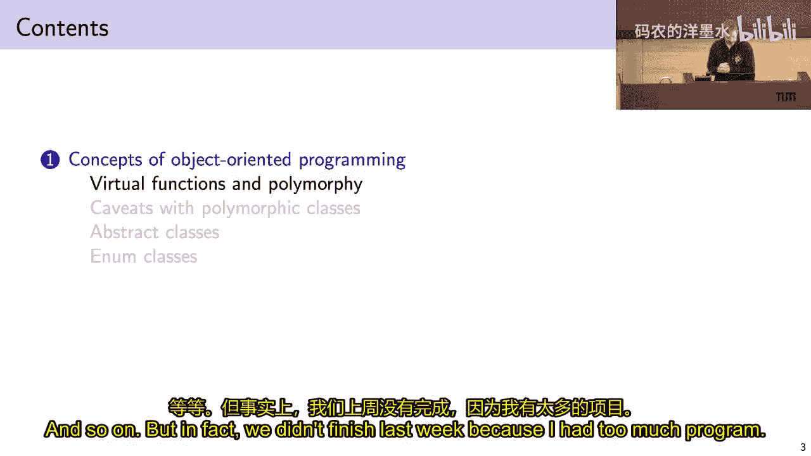
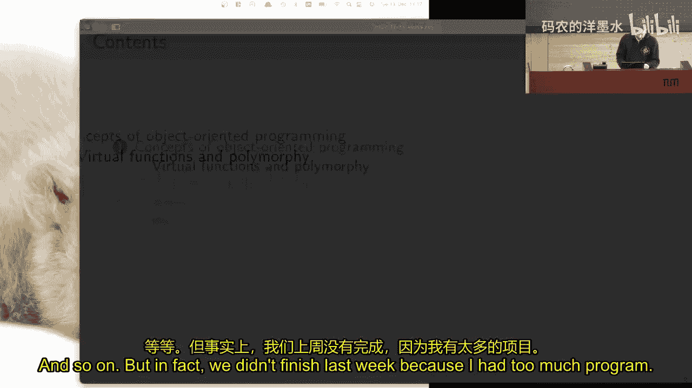
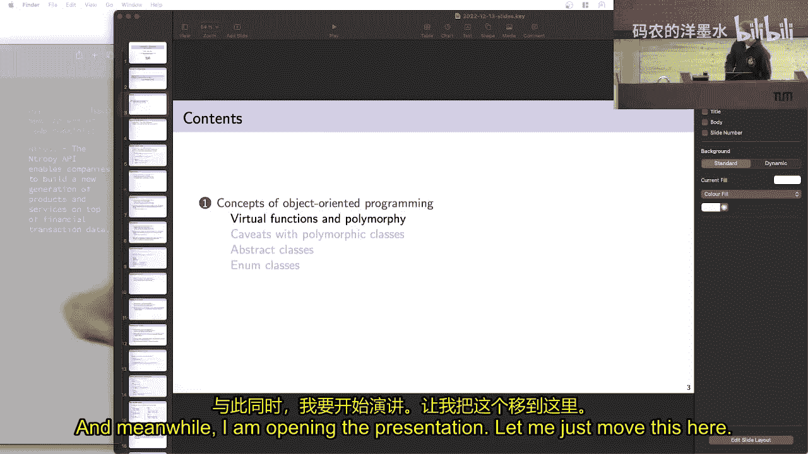
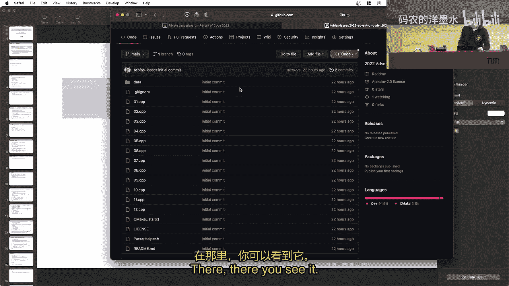
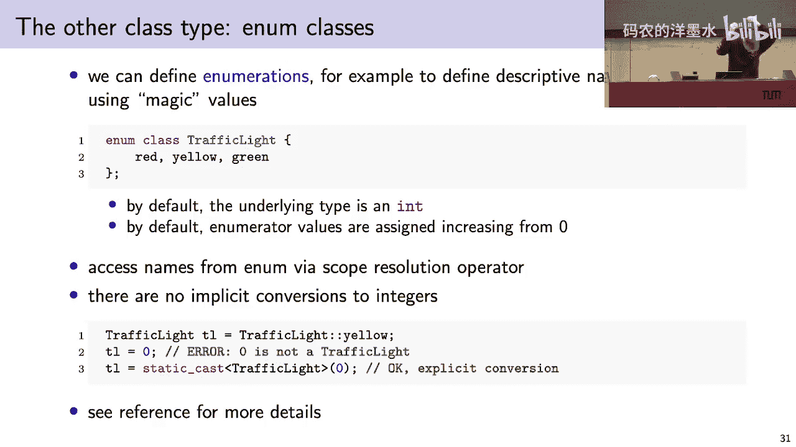

# 【全集】慕尼黑工业大学 IN2377 C++编程概念 中英字幕 1080P p07 Lecture 7 - 协变返回类型示例 -BV1b8mgB8EDQ_p7-

So let's test this again。 Test， test。So welcome， everyone。 Let's get the show on the road。

 Welcome again to the concept of C plus+ programming。😊，And today。

 we' are again gonna talk about object oriented programming。We have a feedback I D。As usual。

 it's that K G Y。And I hope I posted the link in Tlip， as well。But， in fact。

So this was the original program for today， as I envisioned it last week。

 So we were gonna talk about visual functions， polymorphphy。And so on。 But in fact。

 we didn't finish last week because I had too much program。

So let me just get to the correct presentation。嗯。Where is my mouse。

 Why everything on the wrong screen。And meanwhile， I am opening the presentation。

 let me just move this here。

You might remember that I talked about advent of Code last week。And as you can see。

 a few more of you have joined doing it。It's quite cool。I like it。😊，And okay， why is it okay。

So here you see a few more have been joining the efforts， which is cool。 and I and I really。

 really appreciate it。😊，And what I also changed since last week is I put my stuff。

 my solutions up on Github。As you can see， I haven't done today's problem yet。 No time so far。

But I'll be doing it sometime later this evening or maybe tonight。 Let's see when I can manage。

But yeah， you can now also click my name here in the in the leaderboard。

 the leaderboard I D you can find in Zulip。 And then you can see here my code from my solutions。

 I think yesterday， I checked all of them in。嗯。Right， yeah。So， yeah， if you wan to look。

 how I solve these things。There， there you see it。

嗯。Don't expect too much。 It's。I'm solving these on borrow time because my days are pretty full。

 So I'm not， I don't really have time to spend。To make really， really beautiful solutions。

 But nevertheless， they work。 and I'm not cheating in any fashion。Right， so let's talk about the。

 We had this already。 We had this。We we stuck。 We were stuck here。So， last week。

We talked about object oriented programming， about user defined types。Why。let's try this again。

Let's move you here。Start。Go there。Lose screen， please。 Yes， now it works。嗯。

So we talked about classes， that's the way how you do user defined types and C plus plus。

 we talked about con constructors and de structuress。We did a little bit about operator overloading。

 and I talked too much in order to talk about inheritance。 So that's what we will start with today。

What is inheritance， Well， I hope that you're familiar with the concept from your previous courses。

 So I will just cover the spots that are specific to C plus plus。So， you can derive。

Any of the user defined types be it astruct or a class from one or several base classes。

So multiple inheritance is a thing， N C plus， plus。And， of course。

 the base classes themselves can be derived from another base class so you can have a class or inheritance hierarchy。

In terms of syntax， it's fairly simple。 And I think。Vly uni I think travel does it the same way。

 right， if I remember correctly。It's been a long time since I did any Java。嗯。Right， anyway。

 you do a colon and you specify a list of base classes。

 essentially when you define your class or yourstruct。What I will not cover here。In particular。

 I mean， I mentioned it， like I just did。 and I'll mention a few more things。

Over this session and maybe in the next one。But I won't explicitly talk about multiple inheritants。

Because most of what you have to talk about with multiple inheritance。

 when you inherit from multiple base classes， it's the problems that you get when you do so。And。

 you know， like the diamond problem and virtual inheritance and other stuff。 And this is。

 this is a bit annoying。 And in most of the cases， it's unnecessary。And。So， in general。

The advisers don't do it。And if you need it， you will know when you need it。And then。

It's probably a good design decision。 And if you do it。

 then those particular problems that you get with multiple inheritance usually don't turn up。So。

 but yeah， in most other cases， it's a design failure。So that's why I're not talking about this。

Right， so this base list of base classes is a comma separated list where you specify the base classes。

 you can additionally， aside from the base class， or actually， you have to specify。嗯。

Or you should specify inheritance modifier in terms of what kind of access do you want to have to the base class。

 private， protected or public。Public is the one that he use most。If you don't specify anything。

 a class as always as defaults to private， abstract defaults to public。

The virtual inheritance that you can specify here is only for multiple inheritants。

 You can forget about it in most of the cases。 and yeah。And， of course。

 if you're deriving from something， you have to specify what you're deriving from。 Otherwise。

 this is invalid syntax。So in the simple cases。Wheres my mouse。Yeah， in the simple cases。

 you have a baseit class， right， simple class。You derive from it using the public modify。

 We'll talk about it in a second。And yeah， that's your derived class。

 And you can derive from the same base class。 Again， it's a new derived class。

And you can derive even from the base class and the derive class multiple times。 And you see。

 I added some modifiers here virtual for the base class， private for the derived class。

 I'm not go into any details on this。Right， and before I forget。I don't have my thread bag open。

That's bat。There it is。Let's see。 Does the stream work。Oh yeah， it does。Okay。

 it must have been a message from earlier。Right， why is it not suggested。

To make inheritance in general， Inheritance in general is good。

 What is typically a bit problematic is multiple inheritants。嗯。

Then you inherit from multiple base classes， like in this particular derived two examples that I'm just showing you。

In some cases， this is fine。 In a lot of cases， it causes issues。

 and these issues are typically unnecessary because a different design without multiple inheritance is usually better。

Usually that means there are exceptions。 And if therere， you have these exceptions。 And， of course。

 feel free to use it。 I'm just not gonna。Talk more about multiple inheritance here。He used pointers。

 Get him。I think you're referring to one of my advent of code solutions where I indeed used pointers。

I use nonowning pointers， which is something we will talk about。Next week， I guess no。If you're here。

嗯。Sometimes， pointers are O。The key word here， though， is that they are nonowning pointers。

 meaning the pointer is not managing the memory。 It's just an way of accessing that memory。

 Nothing more。 management is taking place， taking place somewhere else。Right。

 so now you have to arrive classes。What happens with constructors。

Constructors obviously work well together with inheritance。

And the base classes are initialized in order from left to right。Yeah。And， yeah。That's basically。

Not much to say about it。 It works exactly as expected。嗯。So， let's look at an example。

Here's a base class。 I think it's easier to look at the example rather than the text。

 So here's a base class。 you have a class member A。 It has a constructor， a default constructor。

 that default initializes that data member。 And just to make sure so that we see which of these constructors is called we make it output that。

 yes， the default constructor was called。Then we have another constructor that initializes using an integer。

And sets's a value of a to that integer。 And we output that。 yes。

 it was a constructed with an integer and。Brief reminder。

 if you wanna avoid implicit conversions from integers to your class base， in this case。

 you write explicit， the keyword in there to avoid those implicit conversions and only have the ones that you explicitly want。

Right， now we derive from the space class。I'm dropping an excess modifier here because it's astruct。

 So it will by default， be public。 So that's fine。 It says another data member。

 There's a default construct that initializes the data member and outputs， oh， yeah。

Derived base class constructor was called。 Then I add another one with two integer arguments。 Oh。

 and here you see something。 This is so calledled delegated constructor。 But this time。

 we are delegating to the base class， not to another constructor of the same class that we've seen already last week。

 Now I can delegate to the base class constructor that takes one integer argument。 So this one here。

And I'm initializing the other data element directly。And， of course， I'm outputting that。 Yes。

 this was the constructor。 So if we do now a derived class with a default constructor and a derived class。

With two integer arguments， then we will obviously call the default constructor for the first one and that。

2 argument，1 for the second one。And what happens is that before the body of the derived default construct is executed。

The body of the default constructor of the base class is executed。 So basically。

 you can think of the base class like a data member。That you have。That will be default。

 initialized automatically。This is what's happening here。Now， for the second constructor。

 where we delegate to a specific constructor of the base class。That delegation works。

 And that specific construct is called， and then。The rest of the derived constructors executed。周洋。

It works pretty much， as you expected to。The only surprises you can sometimes have is if you didn't define a default constructor。

 but you defined other constructors and then in the derived class。

 you are not directly delegating to those other constructors。

Because then the compiler will try to call the default constructor， but it's not there。

You didn't write one。 And since you provided other constructs。

The compileable doesn't a generate one for you。That's the main issue you can have。

 The rest is fairly intuitive。And for the instructors， it's basically the same。So。

 in the opposite order。In which the constructors were called， the deors will be called automatically。

And yeah。Theres。No surprises here， really。The order in which the deors are called is deterministic。

 It depends exactly on the order of the construction， and it will be done in reverse。

So just to make sure you can watch this in an example again， base class。Second base class。

 derived class， oh。Multiple inheritance。Just to illustrate the point here， as I said。

 I'm gonna talk about it here and there， but not in any detail。But that's no surprise， really。

 in that the。And in each of the deors， we print that。 yes， this destructive was executed。

 And then we create a derived class object。 The default constructors are called。

 But since we didn't specify any。Nothing's happening here。

 but the deor is called as soon as main goes out of scope。

Which does when the program terminates and then basically， the derived constructor is called first。

Then the base  one class，1 and then the base 0 class， because we were constructed from left to right。

 So obviously， destruction goes from right to left。

Are there going to be polymorphism exercises in the exam。I guess so。I'm not sparing you， sorry。

I don't get the explicit keyword used in constructors。So。If you're a constructor。

 let's go back to the example where we had it。呃 here。

That's a constructor that takes an indiature argument。So if you have any function， for example。

 that takes an integer argument。No， actually。 sorry。

 If you have any function that takes a base argument。And you call it with an integer。

The compiler will automatically use the non explicit version of the constructor to create a base class element and call that function with it。

 That might be surprising to you。 It might be exactly what you want， but it might also be surprising。

 And in order to avoid those surprises。 That's why you put the explicit keyword。

 because then these implicit conversions don't happen。 Then you have to explicitly say， oh， yes。

 I wanted to construct a base class with this integer as an argument for its constructor。 And then。😊。

It will call the appropriate function。 I gave an example last week for， for this。

In the example on slide 45， y is base base called first。

 This is when we instantiate the derived 0 with a default constructor。

That meaning we will call the default constructor of the derived class。

But what's you didn't write it explicitly here。 But what the compile of your insert for you is that the base class。

Default constructor is called first because the base class is effectively a part of the derived class that will be default initialized as well。

 And then what you specified will be executed。That's that default behavior。Right， so as usual。

 I'll probably not answer all of your questions right here。

 I will answer them later on using the keyboard。 So the destructs we already had。 Okay。

 let's talk about。The name look up。 This is something we already talked about for namespaces。

And it's the same in inheritance， basically。嗯。If you have a derived class。

Let's look at the example here。Coor， where are you here。Class A has a function A。

Class B is derived from a。Ozza has a function A。 And what happens here is the usual。

The one that's in the inner context over hides the other one。 So this a hides the other a。

So if you now instantiate B and call A， it will call。The a of the class B， because， well， obviously。

 you have an object of type B。 And that's what a does for type B。

So even though inherited and you also inherited that member function， that member function is hidden。

Due to your re declarationlaration of it in the derived class。Now。

 if you explicitly want to call the A A， you can do that by using this bit weird notation by explicitly referring to。

 oh， yeah， I want the a version of a。But then， of course。This is a horrible design。 Don't do it。Now。

 what came already up as a question is， what does this public protected and private mean when you put it in front of the base class。

So public means what you usually expect。Namely， that anything that's public in the base class will be public in the derived class。

 and what's protected in the base class will be protected in the derived class。

I'm not mentioning private parts of the base class because those stay private。

 They are not inherited。Then， protect it。嗯。Basically takes public and protected based class members。

 This is actually something I have to read because I never， ever use protected as a。Access specifier。

 But basically， that means public and protected stuff that you can access from the base class will be accessible。

Byu the derived class。嗯。But only by the derivedive class。

 it will not be public in the derivedive class。And private。

Means that basically anything you inherit will only be accessible to the derived class itself and nobody else。

So basically， private inheritance means。Your inheritance is more or less an implementation detail that the user of your derived class doesn't see because nothing from the base class is propagated to the user。

And that's。Basically， the two main modes public。 That's kind of the default one that you expect from regular inheritance and object oriented programming。

 You inherit the public and protected interface of the base class， and it stays public or protected。

And the other way is doing private inheritance where basically that you inheriting from some base class。

Is a detail that you hide from your user。Both of these are valid options。

 I think the public one happens by far the most。 The private one is rare， but does happen。

 And I've actually never seen。Any reasonable code example， So meaning。

 not just a contrived example for a purpose of showing it where protected was used。

So public inheritance is basically， why is that the most thing。

 Because that's basically the subtyping。 There is a relationship。

 So your derived class is also like a base class member。A base class object， because that's。

 of course， what you want to do an object during the program。

 You have a base class you derive from it and you want to be able to treat the derived class exactly like the base class。

In cases where you only provide an interface to the base class。

One of the things you need to be aware of。 And that's different in Java and in other languages。

 is that。In order to access。Out of this properly， you will need references or pointers。But here。

 then it works if you have a reference or a pointer to a base class object。

 But the actual object that's referred to is a derived object， everything will be fine。Right， so。

 yeah， private inheritance。It's rare， but it is used and protected inheritance。

 I've actually never seen a good example of it。So yeah， that was the conclusion of last time。

So let's switch to what I want to talk about today。So， let's。way。各为。where's my other one。Come here。

Now we come to the interesting part。嗯。If I could see what I'm doing。That would be nice。

Let's try this again。Here is my screen。Okay， weird。 Okay， let's try it like this。Because currently。

 I don't see any content on the screen here。Why ever the heck not。嗯。Weird。Really weird。

Where did my windows go， O， now， no more windows are vanishing。Okay， why are you here now。Okay。

 something is a bit weird， no。Nothing quit application and started it again， can't handle。

Where are you。Sorry about that。 No idea what's happening。Let's try this again。So。Okay， there you go。

Right。So what I want to talk about now， we've talked about classes， constructs， key instructors。

 Opera overloading， how it can inherit from classes。 and of course， one of the main。

Use cases of inheritance is with virtual functions and polymorphphy。So let's talk about this。

First off， you need to be aware that inheritance by default。

 And like in the example we've just seen a few slides ago， is non polymorphic。

So there's no automatic polymermorphism happening。You might ask yourself why。Well， the answer is。

 C Ppa was written for efficiency and polymorphphy comes at a cost in terms of memory and run time。

So that's why the default is not。 No polymermorph。And that means members in derived classes。

 If you have them with the same name， they will hide the members in the base class。

 just like in the example we just saw。And just to reiterate it。

 here's a base class with a function fo。 He has a derived class that inherits from base and also defines a function fo。

😊，So now we in instantiate a derived class D。And we create a reference to a base class that we initialize with a derived class。

 So we have one object in memory that derived class。😊，We refer to it via D。

 and we create a reference to it that also refers to the same object。But the reference is of type。

 base class。And now， if you call Fu on these two。Varis， B and D。

 B being a reference to the base class。 D being the actual instantiateated object。

 They both point to the same object。But what happens is。

The one that access via the derived class D calls the derived full function。

 The one that he access via the base class excesses calls the base class version of who。😊。

This is non polymorphic behavior。 And that's the standard。 You need to be aware of this。

If you want to have polymorphic behavior， you need to。Make sure it happens。

 And you do this via virtual functions。So if you have any non static member function。

You can mark as virtual。And then， this function。Willll have dynamic dispatch。

 which in turn allows volume of he。And that means if you do the same thing。

 like in the previous example。嗯。But put a virtual in front of it。

 Then the full function will override the base class's full function。

 and it will not hide it any longer。And that means。Now， the correct full version will be called。

 regardless of how you actually access that object of the derived class。

And as soon as you have one virtual function。In a class， the entire class will be polymorphic。

 However， you need to mark every function that you want to be virtual as virtual。

 It's not that you in put the virtual key at once， and then everything else will be virtual。 Too。 No。

 you will have to explicitly pick and choose。Anything that's non virtualrt。

Will still act non in a nonpomorphic way。Now， what's a bit。

Annoying is that you have to do this virtual thing in the base class。And in the derived class。

 you don't do it again。And you actually shouldn't do it again。Instead。

 you should market using the keyword override。Unfortunately， this keyword override is optional。

But you shouldn't treat it as optional。 You should treat it as mandatory。And， of course， now。

 if you call an overwrittenden virtual function through a reference or a pointer。

Then the correct implementation will be invoked。So let's go back to our previous example。

We have a bait class with a function fool。 But now this function is marked as virtual。

So now this class here is polymorphic。 And if you derive from it。

 you can override that function fool with a new one。

And now the behavior is what he would expect it to be。Let's instantiate a base class object B。

 a derived object D， and refer。To both B and D via references to the base class。

 So here is a base class reference。To B， this is a base class reference to D。

And now let's call the function fool on all of these。So D is an object of derived type。

This will obviously call the full function from the derived class。 So that is as expected。Then。

The derived reference。So this is a base class reference that points to the derived object。

If you call it fool via this， it also calls a derived fool as expected。If you want to call。

 for some reason， the base version of who well， then you can do this。By explicitly specifying it。

 and in both cases， it works。But if you call full via a base reference to a base object。

 then obviously， the base function is called。So this is polymorphfi F it should work。Okay。

 that's a new1。 I use Hannah， Montana， Linuxox。I don't think that exists。And if it does。uds to you。

Right。哦。I'm wondering why all all the questions that I already answered turned up。

 I'm in the wrong browser。So， yeah， some of your questions again， I will answer them afterwards。So。

 and， of course， very important。If this is not a reference。But a copy。

 So if you drop the reference specifier here。Then you create a copy。Off well， yeah， in this。

 this case， sorry， if here you drop the reference specifier。Then you create a copy of D。

 That is only a base class object。Then no polymermorph will happen。

Then DR is no longer a reference to an object of type D， but then it's a copy of D。 but that was。

Made in of type of the base class。 So if you do that， if you drop the reference specifyifier。

 there's no more polymorphism。 polylymorphism in C plus plus only works with references and pointers。

And and you know by now that， of course， the default should be references and point us only if we really。

 really need them。Right， so。A function overrdes， a virtual based class function。

These are the details。 So if the name matches， if the parameter list matches。

 if the qualifier matches and the re return type is the same or covariant。 C later， right， the usual。

If any of these conditions is not met。Then no overriding is happening， but instead。

 hiding is happening。And this is。Sometimes surprising， sometimes a mistake， sometimes intentional。

 But the idea， if you use the override specifier， the compiler knows that， oh， yes。

 you wanted to override this virtual function from the base class。 And if then。

 if this doesn't properly work， the compiler will know， hey。

 you made a mistake here probably you want to fix it。And， of course， any overriding function。

In the derived classes is automatically virtual。 so you don't have to。

Decllarare this virtual for one thing。 And you can override it again in another derived class from your derived class。

 So you can do this as often as you want。So yeah， just to make sure that you learn the importance of the override keyboardword。

 Unfortunately， it's optional due to backs compatibility。 It was only introduced in C plus plus 11。

 I think， but you shouldn't read this as optional。 So base class。😊，Has two virtual functions，1 fo。

1 bar， both have no return type。Foo has an inte argument。 Bar has no argument。 Now。

 in the derived class。I declare a function fool with no return type， but a float argument。

 instead of an。Inage argument。This is not an override because it's not the same function。Right。

 so since you， but you specified overrdes So the compiler will say， hey。

 there is nothing to override in that maybe you meant。Int， instead of float。

If you didn't specify override， the compiler would just accepted and say， okay。

 you wanted to declare a different function fool with a float argument。

 and it has nothing to do with a full function that has an in argument。Maybe that was your intention。

But in most cases， it wasn't。And the same you see it here。

 This is also an arrow because the bar function does take no arguments， no return type， fine。

But here to have a constant modifier， whereas here， it doesn't。

And this cons modifier already is sufficient to have this as two different functions。

 And if you specify override the compiler will complain again。If you don't use override。

 let's make an example。Metro function bar and based class。Virtual function4 in base class。

1 is private， One is public。Now in the derived class， we define both。A bar function。Which is fine。

 It has exactly the same declaration。 So it's actually overriding it。😊，And this one here。

It's different because it has an inter argument that the base class 1 doesn't have。

 So this actually hides the base class function。 It doesn't override it。

So let's see what happens if we do stuff。D ri class D， wave class reference to D。

 if we call D dot fo。That's an arrow。Because D， the only function food that D has is the one with an integer argument。

If you call B dot foo， it invokes the bath class foolo。

Because that's the only one that doesn't take an interest argument。

 So there's no volume ofism happening。 There's hiding happening。

 which is probably not what you wanted。 So specify the override here， like in the previous example。

 and the compiler will help you catch mistakes like this。欧阳。Let's make some more examples。

Str a that has full bar and bus。All virtual struck B derives from a has full and bar as overrides。

And struck C that derives from B， so。3 layers in the hierarchy。Which only overrides fo。Now。

 let's instantiate an object of type C。Let's create an A reference to that C object。

And call a few functions。So CR R calling fo will call the C version of F because it's overriding the other two。

Calling Barr。Invokes the bar from the B class because it's overriding the original one and calling bus。

They called the original one because it wasn't overwritten。Now。

 if you try the same thing with an object of type B and a reference of type A to that object of type B。

It will do the expected thing。 Foo calls the overwritten fo method。

 bar calls the overwritten bar method and bath。呃。Calls the base class version。Now。

 that's as expected， the only real message you need here in the base class。

 markio function is virtual in any derived class， mark your overridden functions with override。

And if you want to do polymorphphy in color code。Use references or pointers。 Otherwise。

 no polymorphphy for you。Right， let's give us some of the gritty details。Covariant return types。

They are also a source of accation， as you will see later in the course。But the idea of them is nice。

So if you have a virtual function that you override in the derived class。

 you can have so called covariant return types。What does it mean。It needs to be。

 the return type needs to be either a reference or a pointer。But， of course， pointers are evil。

 right。嗯。And basically， what you can do， let's say in the base class。

 you're returning a reference to the base class。In the derived class。

 you want to return a reference to the derived class。

And that works because that is exactly what a covariant return type is。

 It allows you to change the return type。 if the return type is。

Derived from the previous return type。Con qualification needs to be the same。 You can't change it。

And yeah， so let's look at an example。Let's say the base class has a function that returns a reference to itself。

嗯。To reference to the same type。Or a pointer to the same type。 Oh， see， here's a pointer。嗯。

Deriveve class。Can override the function fool。Right， marked with override to。

Declare our intention to override it。 and I changed the type of the reference we to the derived class。

So this is what works。 And this is working due to the covariant return types。 That's what it's got。

Now， what you cannot do is you can't suddenly go from a base class to something completely else like an integer or a completely different type that's not related to your inheritance or hierarchy。

 That doesn't work。Doesn't matter if it's a pointer here or reference here。

 changing the type completely doesn't work because it's a non covariant return type。

Do you prefer to ban fool fighters or barfighters， neither。Neither。 I'm sorry。

I'm in a different music direction。 And actually， today， I'm wearing one of the band names。

Does the compiler give a warning if you don't write overrite。Good question。It should。

But I don't know if the default settings。Give you a warning on not。Hanna Montana， Linuxox exists。

 It's a fork from Uuntu。 Okay， learn something new today。 Thank you。😊。

Can you give a use case for polymermorphism。嗯。Well。

 there is the standard examples like you wanna draw shapes on the screen。

So you define a base class shape， and then you have triangles， letters。Buttons。

 whatever you w to draw on the screen。And your window manager or your display manager or something。

Basically， accepts various shapes。But deals with them all with the same interface， for example。

 with the draw function。 And， of course， each shape itself knows how to draw itself。

 The base class doesn't。But you can have now an array or a list or something of all the shape objects on the screen。

 and the manager only needs to call draw on each object to draw the one。 And thanks to polymorphism。

 the correct draw routine will be called， even though you only have a reference or a pointer to the base class type。

That's one of the use cases of polymorphism。Be aver examples。That's not too many anymore。

 at least in C plus plus， because a lot of these situations you can do this generic programming。

Compile time programming and these things。 And， of course。

You're using C because you want performance and polymorphy comes with a slight performance overhead。

Yeah。Let me think if I can think of a better use case for polymermorphism。 But there are a few。

 And if you need it， it's really， really beautiful。But you don't need it everywhere。

Can you provide default implementations for virtual functions。嗯。No。

 or what do you mean by default implementation， Of course。

 you can provide an implementation for your virtual function， the base class。

And you can call it in the overridden function。In the derived class。

If that's the defaulting implementation for you， sure。And yeah。

 override doesn't happen except when the function is virtual。Okay。

 no I'm not gonna look at more Linux distributions today。 I already learned one， thanks。

What is the band on my sweater， or you probably can't read it。 It's machine hat。It's a very old band。

 I listened to it when I was in school。And I've still listen to it。Is covariance used in practice。

 yes。Looks like it can lead to confusions， not so much because for covariance。

 the only thing that can change is that you can return。A derived type in a derived class。

 And that's usually exactly what you expect。 For example， in factory type functions。

Will you also offer a rust course， most probably not because I have no idea about rust。

I have to learn it， first。And。As I may have already said。Earlier， I think I did。 One of the reasons。

I'm still using C plus pass， after more than 20 years。

Is because there's really no alternative to it yet。Rust is trying to be。嗯。But let's just say。

 try to do GP programming and rests。You're pretty much fucked。嗯， yeah。

So it doesn't cover everything yet。If it ever will， I'm probably seriously consider switching。

Because as you've seen， Cpl has a lot of wars and ugly pieces due to its backwards compatibility。

But I have to say， actually， some of the most interesting languages I've seen recently were really old ones。

😊，Cause thanks to one of my PhD students， I'm doing a seminar history of programming languages this term。

 And， for example， what we covered， we did prologue。few weeks ago， think last week we did AL。

And what S did we do。Oh yeah， this was was pretty nice。

These old programming languages are pretty cool。For example， they was。Very simple。 I think。

 like maybe 15 line of code， prologue example。That's all creates also do solutions for you。

On an empty grit， try doing that in any other language in 15 lines。 Probably doesn't work。收养。

Plenty of things to learn。Right。Okay， back to topic。

 if you don't want your functions to be overridden， you can mark them as finer。And if you do that。

 you can't override them anymore。You can also mark a class as final。

To prohibit inheritance from this class。有。So let's talk a little bit about the problems and caveats with polymorphic classes。

So we've already seen that if you don't use virtual and override consistently。

 you might get surprises if you mess up the signature of the function。

Let's look at a few other issues。嗯。If you use virtual functions in the constructor or deor。

They won't act as virtual functions。So， for example。Let's look at this one。

 The basic class constructor calls the virtual function fool。Now， what you might expect。

 when you instantiate the derived class that overrides this function fool。Of course。

 the default constructor of the derived class calls the default constructor of the base class。

 and that calls F。 So you might hope since F is a virtual function that it would invoke the derived version of who。

 But no， during construction， virtual functions are just like regular functions。

 So it will call the base class version of who。😊，This is something you need to be aware of virtual functions only start working after the constructor。

And as you can guess， that's all the problems with a deor。What he can do。

And what you have to do is you have to handle polymorphic classes via references or pointers。

This references， this problem doesn't turn up。But this pointers， this can' turn up。Because obviously。

 with pointers， somebody manages the memory of that class。 and at some point。

 that memory needs to be freed。And what you can do。

Is you can have a polymorphic object of a derived class handled via base class pointer。

 And once you destroy that base class pointer。The deor will be called。

And now you hopefully begin to see the problem already。

 because the deor that will be invoked is the deor of the base class since you're calling it via a base class pointer。

So what you have to do is you have to make the instructor in the base class virtual。 Otherwise。

 you get undefined behavior。 And as you've hopefully learned by now， undefined behavior is horrible。

Just this morning， I answered a few of your colleagues about problems in their homework assignments。

Undefined behavior meant that when it compiled with GCC， the program worked。

 when it compiled with clang， it crashed。And you're like， what the fuck。And the answer is， well。

 there was undefined behavior。 In one case， nothing happened。 You were lucky。 In the other case。

 for example， you wrote to an illegal memory location and the program crashed。Or something else it。

 Or you got a segmentation for it。And this only turns up if you do this on different machines。

 different compilers。Different circumstances， you might even be calling the same program on your machine twice and get a different behavior between two calls。

That is really why undefined behavior is so bad。 So， what you have to do。

 if you have a instructor in the base class， you have to market virtue。

Or the alternative is make it protected so that the derived classes and the interfaces via the derived classes can't access it。

And then， it can be non virtualrt。But that， of course。

 also means you cannot delete objects of this type anymore。

 And this is usually not what you intend to do。 So the better option is make it public and virtual。

 So here， virtual destructor that does nothing perfectly fine。

 And that's what you should be doing in any base class that uses polymorphe。By default。

And a good compiler will obsorn you if you don't do this。

Because now what you can do is you can have a derived class。Evil pointers here。

 but only via pointers， you get this actual issue。 So I need to have them here。 You create a new。

Derived class using the new keyver on the heap。 you store the pointer to it in a base class pointer。

Everything's fine so far， right， now you delete the memory in order to free it because you don't want to have a memory leak。

 right。And this is fine。 Now you invoke the destructive Yeah base class pointer。

 but it's fine because the deor is virtual。And， of course， in general。

 don't do this because this is shit and has so many issues attached with it。

 We will talk more about this next week。Another very interesting problem is。What I already mentioned。

 if you have inheritance， you have to handle it via references or pointers。 Otherwise。

 you get surprises。 and this surprise has a name， even it's called slicing。

And even if you do it via references or pointers， you can still get surprises。

I agree that the following example is a bit contrived。

But it might happen in a context where it's not that obvious。Class A。

 class B inheriting from a member X， member Y。Instance。Of B。

Inst of a that you copy a sign with an object of type B。What happens。

Is you create a copy of B and assign it to an object of type A。 Obviously。

 an object of type A doesn't have a Y， which was only introduced in the derived class。

 So what happens here。Well， the part of B that belongs to A will be copied。 Anything else is lost。

But this shouldn't be no surprise to you。 This is a simple example。

 and you should expect exactly that。Because you're creating a copy。

 if you were taking a reference here。Then， of course。

 a reference to the B class object would contain everything because it's just a reference to the actual object and nothing else。

Here， you create a copy of type A， and AHF doesn't contain all the information。Now。

 let's make a nafttier example。Same classes， A and B。Let's create two Bs， B1， B2。

Let's create a reference to a。That we initialize to B 2。 fine。

 So A R is now pointing to an object of type B。Ex the B2。And now what I'm doing。If I'm assigning。

B1 to A R。This， you might have expected to work as you expect。

 But what's actually happening is the following。AR。Refers to object B2。With its own X and y。

And P1 has its own X and Y as well。 So they have two objects， B1 and P2。Now。

 what you do here is you assign B1。To the thing that has the contents of B2 via the reference。

To class A。 So what you will get， you will get the X of P1， but the B。

 the y of P2 will be kept because the assignment happened via a base class reference。And here。

 even having a reference is not enough。So we'll get a mixed state of these objects。

 And this code actually looks very。Innocent， right， it looks like nothing bad is happening。

 No point of magic， no evil things happening， no sea style back backwards compatibility。But。Problem。

Granted， this won't happen often very often to you。But it can。So what's the solution to this problem。

The solution is to disallow copying in any。Inheritance hierarchy。How do you do that。

By deleting the copy， constructor and the assignment operator。And then， of course， you're like， okay。

 I'm getting rid of this problem by disallowing copying。But what the heck。

 I still need copying because I actually do want to copy。So I'm eliminating one problem。

 but I'm eliminating all one of the operations that I really need。And in order to support that。

We will do the cloneable pattern。In one of the following sessions in January， I think。So yeah。

 and this is， again， one of the reasons spyus is sometimes really。Aggravating。

Because stuff like this happens。 and you basically need to work around the language in a complicated manner。

 And you will see the cloneable pattern is anything but simple and easy。嗯。

And you need to remember all this crap all the time in order to not make these mistakes。所以啊。You know。

 I'm passionate about Cpl。 I like it。 I've been doing it for many years。

 but some of the things like this it's shit。And other languages， of course。

 have seen that it was bad N C plus and have done it better。 right？ I mean， for Java， this problem。

Actually， I don't know。 Does Tra have this problem。

Probably not because everything there's a reference， right， There's no actual copying going on。这样。

Anyway。也许有。No。What you might want to do at some point。

 if you are an inheritance hierarchy with multiple classes and derived classes。

 you will have references or pointer。A pointers。To one of the types in the hierarchy。

 And you might wantan to change。Your type to the one that it actually is。

Or at least to one that it also is。And this you can do via the so calledled dynamic cast。

 This is a nice cast that you can do。 It's not， not one of the evil ones。And yeah。

The typical use case of this is doing downcasts。So， let's say。Yeah。

 you have a pointer to a base class object and you actually wanna see if it's really the type that you expect it to be in the。

 in the hierarchy。The problem of the dynamic cast is in order of for it to work。

There needs to be the so called runtime type information， which means。

The compiler needs to store in memory for each object。

 What type it actually is so that this dynamic cast actually works。So this is memory overhead。 and。

 of course， doing the cast is all the performance overhead。

 So if you want to avoid anything like this， you can't or shouldn't use dynamic cast。

But if you do use it， you will get some overhead。It's not horrible， but it's there。

So let's see an example。Class A with a virtual instructor。 You know， that's something we should do。

Having a virtual instructor。And in this case， I'm even making it abstract。

 I'm not sure why I'm making it abstract here。嗯。We talk about abstract functions in a bit。Here。

 I have a derived class with a function fo。 I have a derived class with a function bar。And let's say。

 I get。Pointer to a to the base class in a function bus。And I wanna know。

Which object did I actually get， Is it really an object of type A， or is it actually of type B or C。

 And this， I can check with the dynamic cast， I can try to cast it to a type B or type C。

 And if the cast was successful， the if statement here evaluates true， and you can then。😊。

You then have a pointer to a B object on which you can actually invoke the full function because it's only known for type B or the bar function。

 which is only known for type C。Doing it like this is， of course， horrible。

 What you should have been doing is having virtual functions so that the correct function is automatically invoked without proper names。

But this is just to illustrate how these dynamic casts work。

Flying sounds like a nightmare to de back。 Yes， and a horrible exam question， yes。

Thanks for the idea。Bant to create objects using new， never， ever。We will talk about it next week。

 But the easy answer is never。What's the difference between initialization using new。

 It's not initialization。 That's he allocation。 And forget about it。 We'll talk about it next time。

 Okay， I just had to make the example in order to illustrate。呃， yeah。

Most of the dynamic paths can be eliminated by using virtual functions properly。 Some of them。

 you can't。 And that's why it's there。It's a valid design choice， in some cases。

Are you a coffee or tea drinker。He's 100% a coffee drinker。 wrong。 I'm a pure tea drinker。

 I never drink coffee， ever。No I T。Tea and water。 That's about the only things that I drink。

Am I a catman or a dog man， I'm both。Where are you using Cpl， actually。嗯。In our research。

If you wanna have a look， look at our as a library， it's on our home link linked on our homep page。

And， yes， we are doing medical image processing。And。We need Python libraries for it。 Well。

 we are using Python libraries。 and， in fact， we are developing a Python library or a library that can be used via Python。

 and we are doing that in C plus plus。Ppsiiocola， none of them。Right。Okay， oh。

 this is this is now an interesting question。Let's see。 I still have time good。

That's one of the favorite interview questions that you might get when you interview for a job that requires C plus plus。

And I remember。Oh my god， that was long ago。15 years ago， I think so when I was doing my PhD。

And some fellow PhD student who was already a bit farther than me and older and was almost finishing with his PhD and already interviewing for a job in industry。

Came back from a drop interview and told me， oh man。

 They asked me how virtual functions in C plus plus I implemented。 I had no idea。 and I was like。

What you're doing a PhD in computer science。 How can you not know。

And then I started asking around in the chair who knew。 and more than half of the people didn't know。

 even though all of them were programming in C plus plus。It was like。Holy hell。 That is horrible， so。

That's why I'm explaining to， you now。How does how do virtual functions work。They come at a cost。

At a runtime cost and at a storage cost。So because somehow you need to implement this mechanism。

 right。The C plasma standard doesn't say how to do it。 So the standard doesn't。

But most of the compilers that I know about。 So all the big ones basically do it using the so called V tables。

Let's skip to the image。So what happens。Let's first look at the code snippet。 We have a base class。

 with two virtual functions， F and bar。 We have a derived class from the base class。

 which actually overrdes fo， but nothing else。So what happens。Each class that has a virtual function。

We'll get a so called V table。And the V table， where's my pointer here。

 The V table will basically have an array。It'sThe table。 it's actually an array。

 So it should be called V array。 But anyway， it's called V table。 And basically。

 all the virtual functions here will have an entry。

And what will happen is that the entry for the full function。Points。

To where the full function of the base class is actually stored where the code is stored so that when you call the full function。

 you do it via this entry here。The bar function。Calls the base class power function。

The derived class， which overrdes the full function from the base class。

 will have its own full implementation because that's override。Where。

 the power function is still the one from the base class。

So the V table from for the derived class will have the same entries， the same virtual functions。

And it will point towards the correct version。Of the method that you have overridden or not。

So what happens now if you have a derived object。In your memory， for example， in the stack。

 because it's a local variable here。Then the derived type will have a V table pointer to the V table of the derived class。

So now， if you refer to the derived class D via a base class pointer。And invoke the full function。

 What will happen。The compiler will check， okay。This is the actual derived object。Here we are。

Its V table is stored in memory here。And I want to call the full function。

 which is the very first function in the V table entry。

 So I look at the first entry here and call whatevers linked here。😊，And you see。

 even though we refer to it via a base class reference。

 thanks to the V table and the pointer to the V table， we call the correct method。

If you refer to the base class。It has its own V table pointer that points to its V table。

And then you will also call the correct things。And， of course， for this to work。

 the compiler has to know that the function4 is the first entry in the V table for this entire inherance inheritance hierarchy and that the function bar is the second entry and that any other functions you add also has the same I D over all classes that are in that inheritance hierarchy。

😊，That's how it works。I skip the text here because that's essentially what I just said。

And now we can understand how it works。But you also understand， hopefully， that there's overhead。

Because what happens is you have to have this V table in memory for every type that has a virtual function。

That is a bit of memory overhead。For every object， you not only need to store the contents of the object。

 which in this case is nothing because they don't store anything。

 but you also have to store a pointer。 So each object of a polymorphic type has an additional pointer automatically stored with it。

That refers to one of the V tables。That's the memory overhead。It's not horrible。 It's fine。

 It's a bit of memory， but there's not that many times。 So the V tables will not be that many。

And having an additional point of per object。In most cases， it's not that bad。However。

 what's really bad。If you call foo on a polymorphic class。

Or any virtual function on a polymorphic class。You first have to go to the V table pointer。

 dereference the memory location。 look into the table， get the index of the table。

 and then call the function。As opposed to directly jumping to the code of the function。

 there's a double indirection via the V table pointer and the V table itself。This costs runtime。

This can cause cash misses。And this can make your code slow。

 So if you have an inner loop that is called a billion times or a million times or more。

That was' the wrong order， a million times or a billion times or more。This can get expensive quick。

 So if you have something performance critical， don't use virtual functions in there。

Because it costs。Two ins。That might lead to cash misses。And if you do that a few million times。

 you will definitely notice。And remember， you're doing C plus plus。Because you want to be fast。

 right。If you don't care about being fast， you might just as well use Python or any other more convenient language。

The memory cost is there。But I think in most of the cases。

 you probably don't care that much memory these days is not that limited anymore。

Who would win1 C plus plus size C compiler or 100 C sized C plus plus compilers。I have to say。

 I don't understand the question。 What is the C plus plus size C compiler。But anyway。

 both Kang and GCC and M S Microsoft Viual Studio compiler。

 all of them have both C and C plus support。 so you can， yeah。Check on your own。

So if you're a cat person， an dog person， are you also a furry person。No。

If you really want to do something like polymorphism， it's there a performant alternative。So。

 let's put it like this。This cost。It's small。Right。

 it only adds up if you do millions of calls or more。So， in most of the cases。It's fine， right。

 It really only matters if you have。Really， really performance critical code。 And if you do。

 and you need virtue the functionality of polymorphism。There is a solution。

 It's called compile time polymorphism。 And we will deal with it in a few weeks。 So， yes。

 there is a perform alternative that doesn't have any overhead at all。

Except overhead for you to program it because it's a lot more complicated。

 But we'll talk about it in a few weeks in January。

Will the compilers optimize virtual functions that aren't overridden anywhere。I would hope so， yeah。

Why is the method called not decided during compile time。呃。I mean， in this simple program， yes。

 the compiler can deduce it without using V tables。

 But if you have anything that is more complicated。That won't work。And your example in page 20。

 I will answer that question afterwards。 You don't need to ask it five times。

I don't want to answer it now in class， sorry。Where is the V table stored。嗯。I don't know。

 probably in the code segment， maybe in the data segment， maybe somewhere else。

 it's up to the compiler。 You don't know。 You can't control it。 The compiler does it for you。

somebody is confused over。This year。 So if we have it derived。Object， an object of type derived。

And we are referring to it。V reference。To the base class。This is something that works。

 and with virtual functions， it works properly。That's just how it works。 A reference。

It's just an alias。And since we have a polymorphic type， this works as you expected it to。

 and supports polymorphous。What would be a really performance， critical application。

Let me give you two examples。1。Is training of deep neural networks。

You might have heard that training deep neural networks。

You do that typically with a lot of data that it can take days or weeks。Is that performance critical。

Well， maybe you don't care that your training takes weeks。 But I can tell you。

 if you're developing something like doing research or just， you know。

 plain developing some solution or application。 and it takes weeks for one training run to run。

 And then you test it。 And then it doesn't work。 And then you have to do it again。That's shit。 So。

 yeah， their performance matters a lot。 And you can guess what are all the deep learning frameworks written in。

It's not rust。 It's not Python。 C， plus， plus。There's Python interfaces。 Obviously， yes。

 everybody uses deep learning via Python， right， But the actually underlying libraries aren C plus plus。

What's another really performance， critical application。Let's， let me give you an example。

 One of my PhD students was run over on his bike by a car on the weekend。He's fine。 Don't worry。

But what happens， of course， is you get an ambulance。 You're driven to the hospital。

And they want to check。Do you have broken bones， Do you have internal bleeding。

Maybe you have a stroke patient。 You want to see if there's where the stroke area and the head is。

 So what do you do。You put them in the X rate C。 you do a scan。 This extra scan takes a second。

And then you look at the images to see if there's bones broken or if there's internal bleeding。

 And that's exactly what happened to my PhD student on Saturday。In the shock room of。

 of the M of the hospital， he got a CT T tag。 and then the doctor looked at it and everything was fine。

 thankfully。So。Why is this performance critical。Because the step from。

Having a one second rotation of the X ray tube around you and getting the images in between。

There is a heavy computational step where you have to compute from the 2D X ray images。

 A 3D image volume so that you can actually see the body。That part。

 that is something we are doing research on， that reconstruction part。

 that those algorithms and those algorithms still。There's lots of data。

And with matrices that have a size of several exabyte。Yes， exabyte。

 We are not storing those matrices。 No， we are doing ray tracing on GPus and multiple GPus in order to make this fast。

 And Why do we care about fast， Well， the patient might be dying in between while you're computing。

Right， so if your computation takes a week。The patient might be dead already。

 and you don't need the result anymore。 Is that critical enough。So， yeah。

 for all the medical image processing。Typically， you do the processing because a patient is in danger。

Is not feeling well or is really im mortal danger。 So the results need to be there as fast as possible。

 And if your algorithm takes hours to compute。 and yes。

 we have algorithms that take hours or days to compute the better ones that do。

Awesome reconstruction from very limited amount of data to reduce the radiation dose， for example。

 of x rays is。It's critical。We need as much performance on the hardware side that we can get。 And。

 of course， we also take all the performance that we can get on the software side。And all the。

 the device manufacturers are， of course， spending a lot。Of effort on making this fast and reliable。

And you can guess what they' are using。 They're using C plus plus， or assmbbller straight away。

7 up a prideite。 Neither Miranda of Fa， either I'm not drinking any soft drinks。Right。Okay。

 what else we have though， This was the cost of virtual functions。 Oh yeah。

There's two more things I want to talk about。 One is abstract classes and one is in classes。受。😡。

If you have a virtual function， you can make it a pure virtual function。And pure is， of course。

 a good thing No whatever。 It's just the word by adding equals 0 behind it。

And any class that has at least one pure virtual function is an abstract class。

 What does this mean an abstract class is special because you cannot instantiate them。

You can use them as a base class。To derive other classes from them。And， of course。

You can take references to the base class， even if it has abstract methods。

So the only thing you're really doing if you're preventing。

Instances of the base class by adding an abstract function。Oh， yeah。 And， of course。

 if you try to call such a pure virtual function in a construct a de， this is undefined behavior。

So how does it look like， You could have a base class that defines a virtual function fool。

 but you make it pure。Basically， yes。Doesn't exist。 That means now the base class is abstract。

And you can derive from it。 It's fine。 And， in fact， now you have to override that abstract function。

 that pure virtual function in order to make the derived class not abstract so that you can actually instantiate objects of type derived。

😊，So if you now try to instantiate a base class object。

 this won't work because the base class is abstract and you can't instantiate it。

For the derived class， it works。 You can use a base class reference as before。

 and you can use it to invoke the function fool because of polymorphphy and overriding and so on。

 everything works exactly as expected。So why do you do that。Well。

 if you wan to make sure that nobody actually uses your base class。

 because the base class typically is an interface for a certain family of types。

 and the actual types will be the derived classes。So that's why you wantan to do that。Oh。

 now it's getting interesting blonds or brunettes。Everything。What's your favorite tea type， black。

Ovi， right。 No， it's actually not related to my music choice。 I actually do like black tea。

 And it's the only type of tea I drink regularly。Do you also have a T advent calendar。

 I was thinking about it， but no， I actually made a gift to someone else of a T advent calendar。

And she lets me drink tea with her。 So yeah。Right。Now， this is fairly clear。

 You do pure virtual functions to make a class abstract so that you cant instantiate it and that basically。

 you do this for base classes and you don't do this for derived classes where you have to override those pure virtual functions in order to be able to instantiate them now。

There is something that's a bit mind boggling。But， it does work。

You can do an out of line definition of a pure virtual function。 So a function that you marked as 0。

 which。Intuitively means there is nothing there。You can actually provide an implementation。

You still can't instantiate the base class because it's abstract。

 But what you can do now is you can call that base class full function from the derived classes。

So if you want to make a function a base class abstract。You have to make a function pure virtual。

 but you can still have it。And use it。In the derived classes， for example。

 if you have shared code between the derived classes。

 you can put it here and then invoke it from all the other derived classes。To me。

 this seems a bit weird。Because。Marking something as0， as pure virtual， as abstract。Well。

 that doesn't sound like it has an implementation， but it is allowed。

 but only as an out of line definition。 So it can't do an in line definition of a pure virtual function。

Can you define inheritance and abstract classes in headophils， yes。

Im not sure what these mighties mean here。Okay， slide 20， very slight 20。 Oh， yeah， good question。

Why， and this was basically a bit early to introduce this。 Why was the de in this example。

Peure venture。EBecause I can。I don't remember why I made it Puvecher here。Doesn't really matter。 But。

 of course， this means that a is' abstract and you can't instantiate a。 But for this example。

 this is pointless。 So yeah， could have skipped it。Oh yeah， so。One thing is。

And that is actually a good part， good timing for your of your question。

You can mark the deor as pure virtual。 You've seen this already。 And， of course。

 if you have no other suitable function to market as pure virtual， Well。

 the deor is one that you should do because in any inheritance or hierarchy。

 your deor should be there and virtual already。 So you might just as well mark as pure virtue。

And then you have an abstract class， and you don't need to declare any other function as pure virtual。

The funny thing is。If you do this for a distract， you have to provide an out of line definition。

 So you have to provide So strictly speaking， this example code example here。

Shouldn't compile because I didn't provide an out of line definition。 But then again。

 I didn't provide an out of line definition of food and bar either。

 So this example doesn't work as it is anyway。Right， where are we here。So yeah， you have to provide。

It's weird， because it's empty。But you have to provide this。And， of course， abstract。

Base classes can't be。Incentiateated。But you can use pointers to the base class。 For example。

 this unique pointer。We will talk about the unique point of next week。 Hol your horses。嗯。

To refer to it。But yeah， this is yeah。Something we already mentioned。

How do the overheads of inheritance and composition compare。

Inheritance itself doesn't have any overhead。Composition。It depends on what you do。

 But in they don't really have overheads。 It's virtual functions and polymorphe that has overheads。

Hidden overhead， of course， the code that you write is not an overhead， but explicit cost。Right。

Which car brand is your favorite。Difficult question。 It used to B BMW。

 It no longer is I think my current favourite brand is lotus in Porsche。Right。

 one more section for today。 And I think I'm in time， yeah。Inim classes。

So there's another user defined type that is called， also called class。

 but it's totally different because it's called enum class。 It's an enumeration。

 And strictly speaking， it doesn't belong in the chapter about object oriented programming。

 But the thing is。😊，I had no clue there to otherwise put it。

 And there's at least the class keyword is similar， right。 So what we can do is we can define。

Descriptive names， like for traffic light， yet yellow green。Instead of numbers 0，1，2， and， of course。

 the red， yellow green is a bit more descriptive。Internally， this converts to integers。

And by default， the first one will be 0。 The next 1，1，2， and so on and so on。

You have to use the scope resolution operator to refer to the names。

 and there are no implicit conversions to integers。So you can use it like this。 For example。

 type traffic light。 This is now a user defined type。 It's an inim class。

And you can refer to the yellow value， for example， by typing traffic light， column， colon， yellow。

You can't assign integers to a traffic light， to an inim class。But you can do explicit conversions。

 And remember。The compiler defines it for you。 What values are actually what？

 So the 0 in this case would be red。So， yeah。It's not necessarily the best way of using inim classes。

 They are there。To support using text instead of numbers and the text， of course。

 with the intention that it means more to the reader， to the coder compared to numbers。

I'm taking the cheap day out here and saying， see reference for more details。

 Inim classes are fairly simple。Most of the use cases are exactly。Except for the。

like the declaration here and line 1， where you use it。

 line 2 and 3 are just stupid examples that you shouldn't do。And that's about it。

 What you have to say about Inum classes。 You can say more。 For example。

 there's Inum without the keyword class。That is a C relic that is due to backs compatibility is supported in C。

 plus， plus。But as usual， the advisers don't use C style stuff in C plus plus。

 There's a reason C plus plus introduced an inum class as opposed to the C inum。Because the in class。

It's safer。It's a bit more cumbersome sometimes， but in general。

 it's safer because it doesn't allow implicit conversions。The seatyle thing does。

And there's a few other disadvantages of the C style version。 So if you need stuff like this。

 use anum classes。They are pretty good。Can in members have the same value。Good question。

 I presume you can make it so。Because you can tell the compiler explicitly what values to assign here if you want to。

So you can probably also duplicate one， but I would presume that the compiler at least warns you about it。

Which beer is your favorite。八。I du't know。 I drink it so rarely。Frying pen story， not yet。

But I will tell it about， about it at some point。 Oh， this one is a nice one。Last question for today。

 Since you like machine head， you don't seem to be so old。 Do you know how old machine head is。

Think the first songs were in 92。93，1992。And I was。A teenager at that time。嗯。So， yeah， obviously。

I don't feel so old。But I'm definitely over 40。 So， yeah。Depends on if you call this old or not。

 from my perspective， it's not old， but I presume from your perspective， you're probably half my age。

 Yeah， I'm probably old。Thanks， everyone。 See you next week for resource management。😊。

