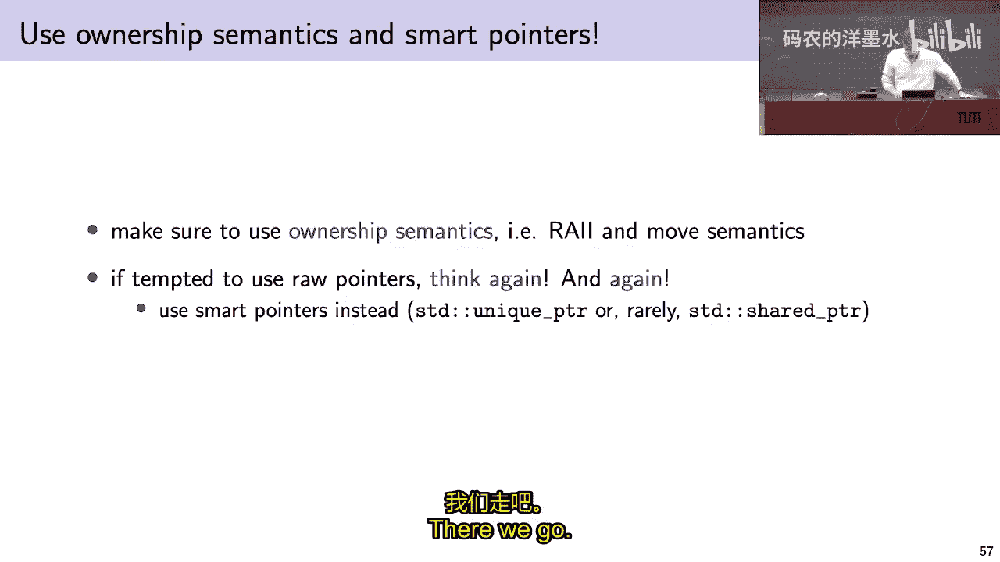
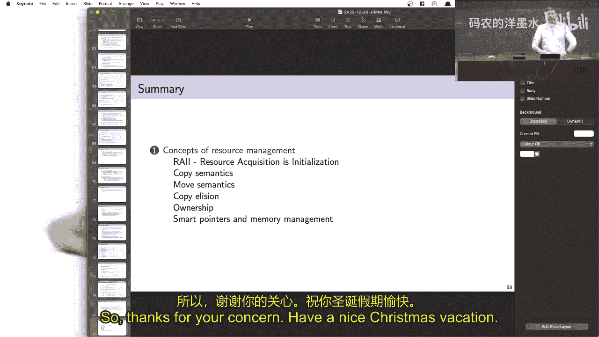

# 【全集】慕尼黑工业大学 IN2377 C++编程概念 中英字幕 1080P p08 Lecture 8 - 实现自定义移动操作 -BV1b8mgB8EDQ_p8-

。Test and my right。T。Test。Test again。So welcome， everyone。Let's see if this works now。

Welcome to the C+ West courserus。We are in our last week of the year and the last lecture of the year。

 the term isn't quite over yet。We will have a few more lectures in January。

 and I think one of them in February。Today， our feedback session I D is set Q set K， Q T。

And some of you have already found it， as I've seen。嗯。Right。There should be extreme stream live now。

Yeah。And that means we are ready to start。Very good。 So today we open a new chapter。Test。Test。Okay。

 I hope the stream still has audio。Let's try this again。Okay。

 there seem to be some weird noises in the back。As soon as I have the microphone on。

Whi it's a bit unfortunate。 I hope it doesn't get too annoying。Right。So， new chapter。

We are done with the object oriented programming for now what we are talking about today is resource management。

Which is one of the。Difficult topics of Cpl。Not necessarily difficult in terms of how we solve it。

 You will see it's fairly easy。There no magic behind this。But。It's a bit of an， yeah， annoyance。

And of course， some other programming language is subject better。Right。

The main concept of Cpl for resource management is this R AI I， or resource acquisition is imization。

So the idea is here。That if you have a resource。Some piece of memory that we allocated。

 a file that we opened， a network soet， a database connection。

Whatever resource that we need to manage， that we bind the lifetime of that resource to the lifetime of an object。

So that basically both of them。Are treated simultaneously。And that means while the object is alive。

 the resource is alive， and when the object gets destroyed， the resource is released。

Or cleaned up or whatever is necessary for that type of resource。And， of course， now the idea is。

 if you tie this。You want to do it in a way？That。The objects that you tie the resource to have automatic storage duration so that the compiler manages the lifetime of the object。

 and since the objects manages the lifetime of the resource。

The resource is taken care of automatically。Right， so the last time I this issue with the audio by switch transponders。

Unfortunately， the transers are here。That's just a fancy piece of paper saying。

 if there is something， we should note it on and。Tell them。Right。Anyway， back to resources。T in。

Resource to the lifetime of an object and using the automatic storage duration of the compiler to manage that。

 the lifetime of the object。So what we do is essentially the follow if you have a resource。

If you have a resource， youre encapsulateulated it in the class。

And that class will have the only responsibility of managing that resource。

And that means the constructor takes care of initializing the resource。

And establishing in all invariiums that are necessary。

And the de is the counterpart that takes care for releasing and cleaning up the resource。

Since resources typically can't be copied。 So if you have a piece of memory。

 that's the piece of memory。 of course you can create a new piece of memory you copy the contents。

 but that piece of memory in itself can't be copied or that particular network connection or whatever resource you have。

 copying typically't doesn't make sense。 So in most of these cases。

 we disallow copying how to do that。 You talk about it at the moment。And the move operations。Usually。

 are implemented。Because if you have a resource， you may want to pass it to someone else。

 and that is what we call moving。And we talk about this as well in more detail today。Right。

 so these resource classes or RII classes。E reset should be used only with automatic storage duration。

 meaning。They。Should be local variables or anything where the lifetime is managed by the compiler automatically。

Because if you don't， you're back。To the O C problem that resources have to be managed manually。

 And if you forget to manage them properly。All hair breaks loose。Typically， example。offer you。R I I。

Thing， I mean， again， this is a code snippet that fits a slide。

 It's not necessarily the most useful one。But let's say you want to do something like this。

 You want to write a message that is stored in a string。And this function here takes care of it。

So what do you do in order to be threat safe， So if you have multiple threats going on and this message right message might be called for multiple threats in parallel。

You first acquire a mutex， which is a static variable。

 obviously so it's shared between the function callss。Then we lock the mut text， using a lock card。

Mutes and log arts are something you talk about。In the chapter about parallel programming。

 So don't worry too much about that。Then we open the find message text。

Whyever you would want to write it there。Check if it's open， if not。We give the user some feedback。

 via an exception。That we weren't able to open the file。 We write the message out。And that's it。

So what you see is。Some threat safety， active threat safety measures。 via mutts。

What you see is opening a file via the standard library and the output file stream stuff。

 some bit of error handling attached to that and writing the message out。But you don't see。Yes。

All the if statements that capture error conditions， like what happens。

If the lock acquiring the lock of the mutex phase。Well， nothing else happens， so it's fine。

What happens if opening the five fails and you throw an arrow？

Shouldn't we release the mut text first？Or once we wrote the message， shouldn't we close file。

 release a mut text。No。Because。What we have here are our I I I classes。

 So the lock will release itself as soon as it goes out of。

As soon as the object log goes out of scope， which happens。

When you throw an exception like here or if the。File opening things throws an exception directly。

 or if the writing throws an exception， the lock will be released automatically since it's an R AII class and same for the file as soon as the file goes out of scope。

 it will be closed and everything will be disposed of properly。

And that means you don't need to cover  error conditions。And clean up inarrow conditions。

And that's why exceptions and R AII work so nicely together。

And you have a fairly short piece of coat。Other languages are slightly differently， obviously。

But this is kind of the quintEssential example of how C plus plus does it。

Exceptions for errors RII for managing resources。If you write exact same thing in C。

Or an equivalent language。To see or see style， C， plus， plus， obviously， this will take at least。

That the code。Oh， I see。 There's a lot of comments。 Are there strange noises， yes。

I have no idea where they're coming from， except they from either my。

Tren whatever whatever that's called in English the send thing of my microphone or the reception thing here in the auditorium。

I can't do anything about that。 Sorry， and no， I'm not a DJ in。What is the ice bear for。

 I presume you are referring to my background。 It's just a cute ice bear。No penguins here。

 no Java beans。 just an iceberg， no particular meaning except for being cute。

What is your opinion on 4，2，0。Being a car guy， that's a car for me。And crappy engine。

 but otherwise fine。But I presume that it's not a car。 If I remember correctly， I Googled this once。

 I think this was something that is not legal。So。Homework。Homework， Yes。

 we are listening to your feedback about the current homework。

 and there will be something happening later today or tomorrow。So hold your horses。

 We will do something。Why was the homework about the topic of today's lecture， Well。

 that is what you would call anaffu fuck up， a mess up an error。

How do we know what classes are A R A I I classes， Well， if they did with resources and typically。

You take as a resource。F of the reservoirs。Memories， resource。I shut myself off。

 It stops for a moment。And for the homework， listen to the course。 And later today。

 you will get a message by our exercise people。 They are at work。

And we'll get back to you as soon as possible。 Don't worry。Right。So that's a central idea。Of RAI。

So I need to keep the finger on the switch of the audio。 Then it stops for a while。

 and then it comes back。 Okay， let's， let's try this。Yeah。So I don't know if it is my shoe so is or。

The sender on the cable。I know there's a weak spot in the cable somewhere here。Yeah。Okay。

 so if I move， maybe if I move my hat， then。Less contact with clothing， maybe。Okay， let's see。Anyway。

 what we need to talk about now when managing resources is how。Do we deal with copying？

Or not deal with copy。And what's the alternative， if we can't or don't want to copy， which is moving。

 And then we talk about ownership。 And then we talk about smart pointers。

 which is obviously what some of you are looking for。

Let's call some staff guys to handle the problem。What stuff？Yeah， yeah。

 you're thinking that we as an elite university would have staff here that actually handled technical issues。

Yeah。Nice try。Right。Anyway。Let's get back on track。 Copy of semantics。

When we have a class and construct it from a same type of object。 or if we assign it another object。

 that is what we call copying。Or copy of semantics。 So the meaning of copy。For building types。

 we don't care about this because it just works as expected。 But for the user they defined types。

 specifically the ones that manage resources that they clean up。嗯。This is very relevant。So yeah。

 menu construct or assign。Something it's going to be copied。And what you have to consider。

 if you do copies， you have to consider it might be expensive。You might not want it。

You know what's probably humorous。Or I I think it's probably not the case。

 But if the stream people wouldn't hear this weird stuff。 And they would just see me shop at。

A random interval trying to do something to the microphone。嗯。anyway。

 maybe you remember the example of slicing。From last time。

And that's where an example where I already told you that ideally， we disallow copying。

And how do we look this we do it with。Constructor。And the copy constructor is a certain type of constructor。

Which is distinguished by having， I mean， we already had this。

 basically a con reference to the same class type。How does the copy constructor。

Happen if you do an initialalization using assignment。 That is what we call copy initialalization。

 If you do direct initialalization with the preferred uniform initialalization with the curly braces。

When we pass an argument to a function by value。Or when we do a return statement and return something by value。

Except if theres a move constructor， then a move actually happens。So let's see how this looks like。

Here's a class with a data member。We have an explicit。Constructive with one argument。 remember。

 explicit was to disallow implicit conversions to this type。From integer to this type A。

And now we have here a copy constructor which is a con reference to the class。And what it does， well。

 it copies over the value from the argument。And that's it。This is， of course。

 a very simple class or the company constructs also very simple。Just to make sure where is called。

 This invokes the regular。Explit constructor here。Here， we do a copy。

Direct initialization using the copy constructor。 And here we do。

Another initialization using the copy constructor。 They look different， but they are the same。

 And even though this might look like an assignment， it's not。 It's really a constructor。

The copy constructor。That's， of course， also the copy assignment， which is the assignment operator。

 which， as you know， is one of the operators that we can override。Overload， excuse me。

Like every assignment operator， it should return a reference to the class itself。

 and it takes like the copy constructor a reference to the same type。

Nows a second version of how you can do a copy constructor。Using。The class argument by value。

This can be used for the copy and swap idiom， which I'll talk about later。 But for now。

 focus on the first version， which is a regular copy assignment。The regular overload resolution。

Select the copy assignment， hopefully， and well return a reference to this in order to allow chaining。

So expanding on our example from before， I now add an copy assignment。Operative。

 which takes a constant reference to the same object type， returns a reference to this。And。我。

Since it's not a constructor， you have to do it in the body and in the body。

 you do the actual copying。So if we con do a new main function， We initialize an object of type A。

 We initialize another one using the copy constructor。

This is not an assignment because this is an inization。

 but this is a regular assignment and this called the copy assignment operator。No。

You might think this is a bit annoying。Because do I have to do this every time。

 even for this kind of simple class。 And the answer is， thankfully， no。

Because what the compiler will do for you is it will implicitly declare。A copy constructor。

 if there have no user defined copy constructor。No noise if I turn it off。

 but then you don't hear me either。What happens？If there's no user defined copy constructors。

 the compiler declares one for you。It will be public。But this is just a declaration for now。

The declaration might be defined as deleted， and this is an option for constructors of certain functions。

You can mark。No L at all anymore， okay。You can mark explicitly if you want to a constructor as deleted or any other function。

 really。And the compiler will do that for you。If your class basically has anything that cannot be copy constructed。

Like a data member， base class。Yeah。Other stuff。The important stuff here is kind of hidden below。

 if you define a move constructor or a move assignment operator， which we will talk about later。

The compiler will also say， okay， and then I'm not doing a copy constructor for you because if you do move operations。

 you probably didn't want copying。Same is truth for the copy assignment。

Pyla will implicitly declare one for you。It will be public， and it might be defined or not。

 And if it's defined， it might be declared as deleted if， again。

Your members or your base classes can't be copy assigned。

 or if move or move assignment have been defined。If it's declared and not deleted。

 then the compiler will define or the define a copy constructor and a copy assignment for you。

Only if it's really used， so a that can generate unnecessary code。And。Fuck fakeake。

And when it's actually defined， the compiler will do exactly as expected， it will。

Do an ember element member wise， copy operation。So let's have a look at our previous example。 again。

 I removed。The explicit copy， constructor and copy assignment。And I changed a tiny detail。

 I made the integer variable constant。So， in both cases。

Since I didn't provide a copy constructor or a copy assignment。

 the compiler would declare them for us。So what will happen。

 I will initialize an object using the explicit constructor here。 Ill do a copy inization。

 which calls a copy constructor， which is fine because the compiler declared one for me。😊。

And it also defined one for me because there's nothing prohibiting an automatically defined copy constructor in the roots。

The copy assignment， however， fails。Why？Well， the compiler declares the copy assignment for us。

 but it defines it as deleted。Because one of the data members cannot be assigned to。Why。

 because it's const。So obviously you can't assign to it， and that means a compiler cannot。

Create an automatic copy assignment operator。 So basically。

 the compiler is quite clever and it's doing as you would hope it does。So in most cases。

 you don't need to do the copy operations on your own。

Because the compiler will take care of it for you。So when do we actually need these custom copy operations。

Not that often， on the occasion。And。Either。The class。Shouldn't be copy up。

U then the compile level already。Tell you， O。I want auto generate one。

But the exception and that's why in this chapter is， of course， if you're managing resources。

If you're managing resources， you need to make sure that the copy operation does the correct thing。

Guidelines how to do this。Is if you do the copy constructor， you should also do the copy assignment。

 If you do the copy assignment， you should do the copy constructor or you do neither of them。

So either both or none。Copy assignment should contain a safeguard against assigning。Yesse。

Because if you assign， assign yourself， a equals a， for example。

 and you don't guard against this stupid stuff might。So how could this look like？

So let's see one of you advised me to blow into the socket of anyone。哎，等一下。

I think it's actually maybe the cable here。But I don't have another one。And。Not here， either。Oh。

 actually， let me see here。So let's see if this solves the problems。

Because some idiot left this microphone on on the same channel as。Okay。Interference。

Do I dare click your I Igo link。嗯。I don't know。I do it。Okay， okay。Right。So， yeah。

 the problem was that some。Previous lecturer left the microphone here on the table， and it was on。

 And now my microphone was using the same。Frequency， and that caused interference。

So it wasn't the cable。 It wasn't my clothing。 It wasn't my shoes， yeah。Okay。

Here's a class where you would need actually need custom copy operations。 Why。

 because the class is managing a resource in this case。

An inte array that's managed via a unique pointer。This is a smart pointer。

 and we'll talk about it later today。 So don't worry about it。Obviously， this is yet。

 again another stupid example that you shouldn't do。

 because what you should really be doing here is to use an S TD vector of integer。

Because that already does what we needed to here。 But for the sake of teaching。

 we make the stupid example here。 So if we store the number of elements we want to store in capacity。

 we have a unique pointer that manages the memory。Now， it on initialization with the we。

 we pass the size of the integer array that we want to have。 We store the capacity in our variable。

 and we create a new unique pointer using make unique。

And this make something function in the standard library you've already seen， make pure， make tu。

 make unique。 It's， it's a standard notation。Right。And this is what you store in the memory variable。

Now， there's custom copy operations。 That's first， the copy constructor。

Which first delegates to the standard constructor and then copies over the content of the memory。

 So the regular constructor allocates new memory for the copy。😊，And then copies over the content。

Using the standard library function， SD copy。So you see why we need a copy operation here。

Because otherwise， the default copy operation would just try to copy this unique pointer。

 which obviously doesn't work because it's an R A I class。 and it dis allowss copying。

 So that's why we need to provide extra copy logic in this copy constructor。

 It's simple logic in this case， but we need to provide it so that it works correctly。

 And the same is true for copy assignment。Where first， we got against self assignment。

 So we check the this pointer and check if it's the same address as the other object。 And if yes。

 we directly return or this pointer or the dereference this pointer to get the reference to self and do nothing。

 Otherwise， we check if the capacities are different。If yes， we start the new capacity。

 We allocate new memory。We don't need to free the old memory because the unique pointer already takes care of that。

And once we assign something new to it， the old memory will be automatically released。

 So you don't need to do anything。 That's a nice thing about R AI I。

 And we copy over the memory contents。 And you see if the capacity didn't change。

 we don't even need to reallocate memory and we can reuse the old memory that we already have because when we call the copy assignment。

 the object is already alive and has。Due to the constructors that keep the invariant that。

We already have our resource initialized and ready to use。

 We don't need to do this here unless the capacity changes， then we need to relocate。So yeah。

 this is a stupid。Simple but typical example of how copy operations look like if you're managing a resource。

Of course， the other option is。For examples like this， to disallow copying。If you don't want to copy。

 for example， memory。Right， now we come to a very important rule。 The so- calledled rule of three。

And， you know， C plus+ is complex。 It has a lot of stuff to consider。A lot of special cases。

 a lot of exceptions。 But the rule of three gives you a guideline on how you design your classes。

 So if you have a class that either requires a instructor。Or a copy construct or a copy assignment。

 You should do all three of them。王威。If you have a distractor。

 that means you need to do something on cleanup。If you need to do this and clean up。

At the end of the lifetime of your object。You also need to do this。 Then you do a copy assignment。

Because the copy assignment essentially requires a cleanup of the previously held resources。

And if you have a copy constructor， that means。Constructing from a copy requires certain logic。

 That means also the copy assignment requires a certain logic。And if you have either of those。

 probably you need a de dealing with that logic， too。

And since the implicitly defined versions by the compiler are typically incorrect for these kind of classes。

嗯。Yeah， you should define all three of them。So easy。 If you're managing a resource， do a distract。

 do copy assignment， do copy constructor。And if you do any of one of， any one of those three。

 do all three。Eas as that。No。Move semantics。copypying it， sometimes。Expensive。

Because you have to copy， right。嗯。And。You might not want to spend the cost of the copying because it's too expensive or you might not want to do it at all because you're saying w。

What I have here。Let's say this phone， I can't copy it。 I can't create。

A similar phone with the same content and so on。 But strictly speaking， that thing， I can't copy it。

 I can't create an exact duplicate of it。And that's true for most of the resources。 So， in fact。

 what you probably want to do is you wanna。Disable copying for these resource managing classes。

 however。You might still want to pass along your resource to somebody else。

 Like I could hand you this phone。In person， and say， here， it's yours now。

We want to be able to handle resource managing objects like this， to pass it along to someone else。

 And this is basically what move semantics do。😊，嗯。They kind of move one object from one owner to another。

How does it do it？What。Assuming the thing is managing resources。

The original object manages the resources。 And if you pass it on， we don't exactly。

Pass the entire object on。But we create a new object that steals the resource from the old one。😊。

So the managed resource here has just stolen， put into the new object。 And that's it。

 And this is what we call moving。The previous object that had its resource stolen。

 is then basically empty。And the kind of questionable formulation in the standard is that it will be in a valid but indeterminate state。

There's a lot of discussion about what that exactly means。嗯。In most cases。

 it means that if you access the object again after it was moved from， your program doesn't crash。

But it doesn't necessarily do anything useful， either。And， of course， one of the reasons to do this。

 not just to kind of enable the kind of semantics of passing something along。

 passing ownership of something along。It also improves performance because this passing along。

 particularly for things you no longer need here， but you want to explicitly pass on。

Remove the need for copying。In instance， copying is expensive。And moving is not。 That's a great gain。

For performance。And the very， very cool thing is you don't really have to do anything for to do this。

 except for your user defined types to implement semantics if you want to。😊。

Everything else will be taken care of automatically by the compiler。Right。

So moving works the same as copying。 You have a move constructor。 You have a move assignment。

 The only difference really is that now you don't have a cont reference。

 but you have an R value reference。 You know， the thing with a two mpers sense without a cont because obviously。

 we are stealing from this object。 so it will be modified， so it can't be const。And typically。

 we also ask the move constructor to be no except so that it can't throw exceptions or it shouldn't throw exceptions。

嗯。Yeah。Because move constructors never should throw exceptions。Again。

 how do you select the move constructed by overload resolution。And。

To encourage the overload resolution to use the move contractoror。

 there's a function that's called SDD move。In the utility header。

That basically converts whatever you have to an R value reference so that the move constructor is selected by overload resolution。

Example。I won't show you an implementation of the move constructor yet。

 I'll do this in a bit just so that you see how it looks like。Default constructor， no arguments。

Copy constructiveive with a con reference。Move constructor with an R value reference without con and marked as no exception。

How can we invoke those？ This invokes the。Defa constructor。This invokes a copy constructor。

 as we had it already。And now， by adding the SD move。To the initialization here。

 this invokes a move constructor。 So we move from a1 into a 3 in the move constructor。

So how do we invoke the move constructor exactly as we've seen by doing SDD move indirect or copying itization。

When we pass arguments to a function， we add SDD move。And implicitly。

 it happens when we return from a function。So if you return anything from a function and that anything has move operations。

 the compiler will automatically move it y， because obviously the function is over。

So whatever you're returning doesn't need to be alive in the function anymore。

 you can pass it on to the call。 And that is， of course。

 more efficiently done by moving instead of copying。 However， if your type doesn't support moving。

 the compiler will do a copy， or， of course， there's also return value optimization。

 a name return value optimization。Which in some cases， eliminates both copying and moving。

 But we'll talk about this later。Same thing for the assignment。

It's an assignment operator within an our value reference。 also no except。Which is optional。

 but you should do it。And essentially， we do the same for the assignment as we did for the constructor。

So if you want to see the thing in its full glory， we have the default constructor， copy constructor。

 move constructor， con reference has this a value reference and the same for the assignment operators。

 This is copy assignment with a con reference， and this is。

Move assignment with an our value reference。And try have to expand on the example from before again。

De file constructor， copy constructor， move constructor。Move assignment copy assignment， Sorry。

 and move assignment by adding S city D move。Now， this is something I'll skip over a bit more quickly because it's the same as for the copy constructor。

 If you don't do a move constructor， the compile of will declare one for you。

If there is no copy constructors， no copy assignment， no move assignment， no deor。

If you do any of these yourself， the compiler will not do a move operation for you because it would say。

 that's too hard for me。And， of course， it will mark as deleted if any of the members of base classes can't be moved。

 Sam for the assignment。And if it's implicitly defined， it will do a member wise move。So。

Let's go back to our previous example of a simple data structure。 A with a cons variable V。

An explicit initializing constructor， that we call。And now we do a move construction。

Of another object of this type， which is fine。Because the compiler will automatically generate one for you because there's nothing here that hinders a move construct。

For the move assignment， that doesn't work because it's a constant variable and you can't assign those。

So。Why do we need those。Well， because if you want to hand on something like， you know。

 my stupid mobile example， If you want to hand it on， you need move operations。

And that means basically any class that manages resources， R AII should have move operations。

And that means move constructor and assignment。And， of course， if you， if you do one of them。

 you should do both of them。As in every assignment operator， you should check for self assignment。

And any move operations， of course， the idea is to steal the resource。 Of course。

 you can do what you want in the move construct or move assignment。 But in terms of the semantics。

 you should steal the representation and not allocate new resources。How does this look like。

Our previous example of a class managing memory via a unique pointer。

We already had the copy operations there。Now， let's look， this is the same regular constructor。

 Let's look at the move constructor。So it's an a value reference constructor with no except We initialize the capacity。

Because it doesn't make sense to steal an integer。 You can't really steal an integer。 So you just。

Initially， do a copy inization here。 But then you steer the other's memory representation by moving it over into it your own memory。

And you leave the other object in a valid but indeterminate state， for example。

 by setting its capacity to 0。And hope that any member functions of this class check if the capacity is 0 and then hopefully fail gracefully。

And the assignment operator is the same。 Our value reference， no except。Check for self assignment。

 If yes， do nothing。 Otherwise， we copy over the capacity。 You could do SDDD move here。

 but moving an integer is kind of pointless。 doesn't change anything。But here we are moving again。

 the memory set the capacity to 0 and return。So， this is how。EMove operation could look like。

Who needs smart pointers if you have smart programmers。If only all programmers were that smart。

And that's including myself。What's the difference between a normal constructor and a copy constructor。

But a novel constructor is a constructor that has different arguments than a constant reference to the class type。

And you can do whatever you want in that constructor in the copy constructor， you should copy。

That objects content to your class。And， of course， if you're not managing a resource。

 you probably shouldn't write one。 but if you do。Think of the that example in the previous one。Okay。

 let's skip this one because。Do this。Which iPhone do you have， The black one。

And it's not a current one。Its accessing an object in an indeterminate state， undefined behavior。

That's the thing the standard doesn't really say。 It says it should be accessible， but。

It doesn't create an exception or not V， we don't know。 That's's arguable。We got the STD moves。 Okay。

 I like that nice。Let's do a bit of。Talm， right。If anybody understood the Ta。Feel free to laugh。

What does it mean to move from a1 to a3， I have to go to this slide。Did we have an a3 somewhere？ Oh。

 yeah here。What does it mean， It means that we steal whatever a 3 has and move it into a 2。

 That means after this operation， a 3 is kind of。Mmp T， whatever that means。 Obviously。

 this class doesn't contain anything so nothing happens。

Why do we need an R value reference for the move construct。

 Because that's how move construction works by using R value references instead of L value reference。

 That's how you need to distinguish copying from moving。er。

Our value references were introduced for that purpose。They didn't exist before C plus plus 11。

 when moving was introduced and moving works via our value references。

If you see SD move somewhere in the code。That it always invokes nothing else but move assignment or move constructor。

 Hopefully， yes， if your program is correct， yes， that's how it should work。Men views， okay。

 this is a good one。嗯。For the others， I'll have to skip answering to later。

 When we use a copy constructor， we will have two objects。The original and the copy。Perfectly fine。

 Then we as a move constructor。 We have two objects， one that's being moved from。

 And that representation is being moved to the new object。😊，So the thing is。

 the old object isn't gone。 It's still there。 just its content is gone。And typically。

 you do this in situations where you don't care about this old object anymore。

 because it's gonna be destroyed when you return from a function or because you'll never use it anymore in the code。

 So that's why we do it。Your question of， why don't we delete that object completely。

 How would you delete a local variable？ The compiler does it。 You can't。So you cannot。

 You can just make sure that after you moved from an object， you don't use it anymore。But that's。

The norm， if you have a move from an object， you only do it。 You don't do that for fun。

 You only do it if you don't need it anymore。So it's not really a question。

When we we need move constructive assignment in real life， whenever you manage a resource。

 like memory。Database handled files， sockcuts， whatever。Of course， if you don't do that。

 you won't need to touch them ever。So let's go back to our example that we had here。

 Why am I saying that SDD vector is better than the unique pointer to an array。

 Because SDDD vector already implements all this。 We don't need to rewrite the code from the standard library。

 That's just not good standard library does it better than us。 hundred percent。Right， new point。

 rule of5。 So previously， we had a rule of three。 If you did Deor， copy constructor。

 or copy assignment， do all three。 rule of  five， expands the rule of three to include the two move operations。

 So deor， copy assignment， copy constructor， move assignment， move constructor。

And the rule of  five says， if you need any of those。Do all five。If you don't want copying。

Mark them as delete。The good thing about the rule of 5 is if you don't do move operation。

 Nothing breaks。 in the worst case， you have slightly less performant code。

If you disagree the rule of three， you probably。Havelf code that doesn't work properly because you're not managing your resources properly。

And to make things even easier， because 3 or 5 is quite a lot to remember， there's a third rule。

 the rule of 0。If you don't deal with resources， forget about all these five functions。

If you don't deal with managing resources， you don't need a custom deor。

 You don't need copy operations。 You don't need move operations， none。

Don't be tempted to do them if you're not managing resources or dealing with ownership。

Don't do any of them。 Rule of 0， simplest case possible。And if you do。Then， you need all five。

But then you， your class should be doing nothing else。Just manage that resource。

 Anything else should be done by some other class or function of whatever the class should then focus only on managing the resource。

Those are ruless。The rule of three is one that makes your program correct。

 because dealing with setup up and clean up for copying and destruction is imp important。

The rule of five adding the move operations is for performance reasons。

 only doesn't change the functionality of your program。

 And the rule of 0 is basically a good design principle。Right。Now。

 let's see if the comment that I'm waiting on is coming。Not coming。Okay， anyway。

You should remember last time when we talked about polymorphic classes and polymorphic functions。

 because there， the recommendation was always have a virtual deor so that destruction in class hierarch and polymorphic class hierarchies works properly。

Now， how does this go together with the rule of 0 or the rule of5。

 Because polymorphic based classes typically don't manage resources。

They are polymorphic based classes。 So theres something else。However， that wasn't basically。

A guideline。Because in most cases， if you have a polymorphic class hierarchy。You should disallow。

 copy and move completely。Because slicing， slicing last week example， if you don't remember it。

 look it up。 It's an important， bad example。And what do you then typically do。It's the following。

You declare the deor of your base class。Virtuate。And you market as default because it doesn't do anything special。

And then you declare all the other four operations from the five。But you mark them as delete。

 So what the compiler can do for you， you can also do explicitly。And you can mark them as delete。

 So whenever somebody else tries to do a copy or a move of your base class or any of the derived classes。

The compiler will say， no， these operations were explicitly deleted。 Don't do it。

This prevents slicing， and this makes sure that your program works correctly。

 So for virtual based classes， these five lines should be your default。

That's annoying that you have to do it， that you have to remember it。

 that you have to do it every single time you do this。But that's just how it is。 It's C plus+。

 after all。嗯。However， that means you cannot copy your polymorphic classes。

And sometimes you want to do exactly that。So what we do then。Is something that we don't call copying。

 but to distinguish it from copying， we call it cloning。Which is essentially a copy。

 but we are different means。Because， unfortunately， the copy。

Operations of Cpls don't work with polymorphphy。So those have to be deleted。

 And then we have to implement copying on our own。 And how we do this is usually via so called clone operation。

 So here you see default constructor， virtual default。Destructor。Deleted， copy， move。Opers。Now。

 we do have virtual clone。Thing。EMem function。What it does， it creates。A copy。Offf the current。

Type A。And returns it as a unique pointer。They talk about unique pointness。 Don't worry。

It's coming later today。And then in the derived classes。

 we override that virtual clone function to return a B object instead。And then， if we invoke。Clone。

On a base class， pointer。Or even on a regular pointer， it doesn't matter because it's virtual， right。

It will create the appropriate copy。So regardless of if you call it with a B class pointer or with an a class pointer due to the virtual function dispatch。

 the correct clone thing will be called。 and you will get a unique pointer to a。

 which will contain the correct type of object namely that of type B。 And if you want to。

 you can use dynamic cast to cast it to the type B。So this is about polymorphic cloning。Yeah。

 looks like。And basically， whenever you do a polymorphic class hierarchy， this is what you should do。

If you need copies， if you don't need copies， then， of course。

 you can skip doing the clone and just delete all the copy and move operations and be happy。Oh。

 come on。 It's not high pair。 It's high power。What is a custom deor。It's any deor。

 regardless of if you market virtual。Or P virtual。Or default or delete it。 It's always a custom de。

If you cannot delete the source objects after moving， wouldn't be a lot of garbage objects in memory。

We're not Java。 Were C plus plus So whatever we moved from will go out of scope。

And once it's out of scope， it's。Gone automatically， no garbage collection necessary。

 And it's nasty stuff like this。Right。I promise to talk。 Oh， yeah。 The last line。

 we will use a curiously recursive template pattern in a few weeks after Christmas。

To do polymorphic cloning properly， because one of the things you will note here。

 the unique point that you get back is to the base class， even in the derived class。

 that means every time you w to use that clone as a B class。Because it has， for example。

 new functions， not like in this example， but maybe in another one。嗯。And that's annoying。

So we need to find a work around how we can do a unique pointer。To the class B here。

 instead of to the class A。Now， everybody who listened well last week should say， oh。

 but covari return types。Yes， but covarient return types only work with references and raw pointers。

 They don't work with smart pointers。Yet another deficiency of C plus plus， unfortunately。

But we can do a work around using template and compile time programming magic。😊，It's ugly as fuck。

 but it's cool。 and it works。And you will see it in a few weeks when I show it to you。Now。

 a brief interlude， I talked earlier that there is an option for the copy assignment operator to not do it with a constant reference。

But with by value and do a copy on swap assignment operator， What does it mean。

 It means you declare only the copy assignment operator using a pass by value instead of a con reference。

And this serves as both copy and move assignment。Because both L and R value references will bind to this pass by value。

And the idea is that you do a swap between the two objects。

This is convenient because you only have to define one function instead of two。 but in most cases。

 it's less efficient than if you do both functions properly。

 just to give you an idea how it looks like， this is the previous class we already had in two examples。

嗯。And here we have the regular copy constructor as before。 But now the。Copy assignment。

 which also doubles as the move assignment here。Ifs done via pass by value。

 So what happens when you call this assignment operator。

The call already creates a copy using the copy constructor。

So we already have a copy in the argument by not using a reference here。We get a copy by calling it。

And we use this copy。And swap our representation with that of the copy。

We don't care that the copy then has our old content because the copy will be destroyed right after the function finishes。

So this is a lot easier。 You don't have to define two functions， and the content is a lot simpler。

Because the copy constructor takes care of the work， however。This is less efficient。For example。

 move would only steal the representation if you did a real move assignment。

 This one here will definitely create a copy。 So it kind of makes move pointless because the point of move was to be more efficient。

😊，And the other thing that you have to think about here is what happens。To the old。

 our old content from the original class that we swapped into the copy other。

Once a function call ends， this is a local variable。

All parameters are local variables to the function。 So when the function ends。

The local variables get distracted， so the deor of other will take care of freeing our old stuff from the previous representation of a。

So it's quite clever。 This copy and swap idiom。But it's only clever in that it saves you some lines of code。

 but it doesn't make it efficient。So。In most cases， you can ignore this。

 I just wanted to have it set。Chava doesn't have such problems。 Yes， but Java is slow always。So yeah。

 that's the thing。 You pay for the performance you get with C plus。 you pay in complexity。

 you pay in having to pay attention to all these tiny details that can。

Help you shoot yourself into the foot。Now， in the last 20 minutes。

Let me deal with copy and ownership， and smart pointers。So let's dive in value categories。

 You remember that we were talking about L values in R values。

 L values is generally something that can stand on the left of an assignment。

 and our values are basically the other things on the right of the assignment。

 This is unfortunately not specific enough。 So what C plus actually has are。R my mouse。X values。

 PR values， L values， R values， and G， L values。 So that's five value categories。They have。

They're a bit clunky。As always， let's see plasmamus after all。But in general。

 you can identify them like this。 If you have something that has an identity。

 like it has a variable name， then it's in this column。So it's generally called a G L value。

 which stands for generalized L value。If it has no identity。

 it falls into this column where there's nothing up here。

And the thing down there is called PR R value， a pure R value。And now we have the distinguish。

 the distinction between things that cannot move and things that can move。So objects。

 which can be moved。And objects which cannot be moved。

 So if you have something that has identity and cannot be moved， that is what actually an L value is。

If you have something that can move。But has no identity。 It's what we call a PR value。

 a pure R value。If you have something that has an identity and can move， we call it an x value。

 because it's。Somehow in between， I don't think X stands for anything here。 if I remember correctly。

And then this an category that can move。 We call it in R value in this category that has an identity。

 we call a generalized L value。Yeah呀。It's just how it is。 I can't change it。 I'm sorry。Yeah。

Thankfully， in most cases， you don't need to care about the exact value category of something。

But sometimes it's good to know about it。 And that's why I'm talking about it。 Now。

 the interesting thing is， you've seen this function SD move。Which。

Seems to imply that this function actually doesth something， namely moving。But， in fact。

 it doesn't do anything。 The only thing it does is a cast。

From whatever the argument is to an x value expression。

To something that has both identity and can move。So S D move is basically nothing。

 It's just syntactic sugar。And the real thing that happens is that it guides the compiler overrode resolution from copying。

To moving。So if the object that you're invoking this on has move operations。

 it will use the move operations。That's the only thing。

 This SDD move is just a marker for a compiler。Please try to move this instead of actually doing a copy。

And if it can， it will do so。No。Let's talk about copy illusion。Under certain circumstances。

 the compilers。Have to。 and note D have to。 This is not optional。Under certain circumstances。

 copy or move operations have to be omitted。What are these circumstances。

The first one is a return statement in a function where the upper of the return statement is a pure R value of the same class type as the return type。

Therell be a function like this。There will be no copy。 There will be no move， because basically。

 whatever is being constructed right there will be passed on directly to the color。

That's required by the standard。 So， in fact， if you call it the function F。

 you will only ever see the default constructor of T being called。

 but never a copy or move operation because the compiler have to。Omit it in this circumstance。

This is， of course， an optimization。What this means。

That if you rely on the copy constructor or the move constructor being called on a function return statement。

You might be in for a big surprise。So don't rely on it because a compiler will。not do it。In these。

 in case， such like this。 And also， if you have an initialization of an object。

 whatever you would like to do something like this， I don't know。

 But if you have something like this where the initializer is a PR value because you're calling the function and then create a new and then again。

 create a new thing for whatever reason。Yeah， although， no copy or move operation will be。Invoked。

These opt， optimizations are required。And that means if your copy of move assignment or constructs have side effects。

 those side effects will not happen。 So in other words， if you do copy and move or deors。

EDon't have side effects there。There's more optimization such such， that's as the sorry， the N RVO。

 the named return value optimization， which allows the compiler to also omit copy or moving when returning something that is named。

 but this is only。And。Permission for the compiler to do so， but not an obligation。

So you can't rely on this， but in general。Don't have side effects。 Sorry。

 in your copy or move operations and in your。Destructor。So， example。Simple class A again， that has。

A construction message。And a copy construction message。

 And now we pass it out from a function called the function。

And the interesting part here is it will never be copied。Because of this return value optimization。

So it will only print out constructed because， well， it is constructed here。

 but it will be directly constructed into this A here。Co it compile of。Java bed， CP P， less bed。

 Ru love。I don't know about that。 I mean， it's in the end， of course， a question of taste。

 You might love Java。 You might love C plus plus， You might love rust。

 You might love neither of them and use whatever tool is the best one for the job。

 which is actually what you should be doing。Or you might be doing as I am。

 you might have a lot of experience in one of them and not so much experience in the others。

 And just you use the tool that you know， Where the ones that might be better。Yeah。What can you say。

 Why is Java slower。Several reasons， most of them are design decisions like running on top of a virtual machine。

 Of course， yes， there's just in time compilers for jas， but they are just in time compilers。

 not regular compilers so they can optimize less。There's garbage collection， which costs performance。

 Everything is a reference。 Its cost performance and some other decisions that Java has that are intrinsically slower。

Of course， if you spend effort。You can probably make your Java program close to as fast as C plus plus。

 And of course， you can write horrible C plus plus code， which is slower than Java code， so。

Let's say the performance ceiling of the plus plus is higher than the one of Java。

If you actually reach that ceiling is another question， and that's up to the。Programmer。

The more I learn about Cpl， the more I appreciate the love of my life， see。😊，I don't know。

C is simple。 Yes， but if you're trying to do anything useful with it， it gets ugly fast。So yeah。

 I prefer C plus plus a lot。But， of course， as languages that are a lot nicer and prettier than C plus plus。

Advent of Code taskask 16 part 2 was faster in Java with the same algorithm。Maybe for your coat。

 But if you implement both with the same care and the same level of。

Knowledge let's C plus plus 1 will be faster。Of course， the difference might not be huge。

And in the end， most of it is up to what algorithm you're using。And。How youre implementing it。

 Not so much what tool you are using in this case。And I still haven't done avent of code 16 and 17 or not done two days because I have no time。

 Where's it going。Right。So if we have an R value reference。Will we still have to call SDD move。 No。

 if you already have an hour value reference， it's fine。But in some cases。

 an our value references will be treated like an L value reference。

 We will get to some of these examples。 So you still might have to call SD move。

2 engineers recently told me that using the auto keyword is bad practice， what。

Do I have your blessing to call them names？ No， you don't call people names。Right。Ownership。

 am I done， Yeah， I'm done here。 So ownership， let's talk about this。

So the idea now we talked about in the beginning about our AII resource acquisition is initialization。

 you initialize your resource in the construct， you destroy it in the de and your class will only manage the resource and do nothing else。

Move operations。Add to R A I， I， allowow you to。Do ownership semantics。

 And this is now really what I mean by passing along the object。

 So if this phone were the object that you want to pass along。

Moving it to someone else will be passing on the ownership of it。And that's the idea。 Use R AI I。

 use ownership semantics whenever you manage a resource in C plus plus。 And if you do that。

 stuff will be pretty。If you don't do it。Definitely not be pretty。So。Take that recommendation， and。

Do it。Now that now that we've talked about R AI copying， moving， ownership， semantics。

 now we can talk finally about smart pointers and memory management。So。Memory management。

 if you know any C or old style， not modern C， plus plus code。

 you know that there's raw pointers And C， there's mallock and free in order to allocate memory and free it。

😊，And C， plus plus， there is new and delete in order to manage memory。

Why is there two different mechanisms in CNNC plus plus where new and know how to deal with constructors and deors and polymorphic class hierarchies and so on。

 That's why a new keyword was necessary for this。 But both of them are essentially obsolete， why。

 because this is explicit resource management。By calling it。

Maoc or new by freeing it with free and delete。 And if you forget or fuck up any of these。

 you will have a memory leak。 We will have a crash。All undesirable things or undefined behavior。

 which might be a crash or might be some weird behavior or whatnot。

 I think plenty of you have occurred。 undefined behavior already。 most of you noticed that， oh。

 my tests on my computer all work。 But as soon as I committed to the C I， it doesn't work。 Surpri。

 it was undefined behavior running it on a different machine means different results。So， yeah。

 in order to avoid that， we use R AI I and ownership semantics。

And how do we do this for memory management while were using smart pointers。

There's two smart pointers。Essential， one is the unique pointer。 The other one is a shared pointer。

 Let's talk about the unique pointer。 First， It's a smart pointer that implements exactly R AI I and ownership semantics。

4 pointers。So this replaces 99% of all raw pointers。Done deal。 That's why you never。

 basically never need row pointers。And the unique pointer is initialized。Through the constructor。

 the memory is allocated。 when the unique pointer goes out of scope。

 the memory is deleted in the deor， R A I I。Move semantics and ownership。

 semantics through move semantics means copying of this memory of this unique point is not allowed。

 but you can move it， meaning you can pass the memory along to someone else。Otherwise。

 the unique pointer overloads the de referencing operations and every other thing that you would like a pointer to have。

So it handles like a raw pointer， but it doesn't have the drawbacks of a raw pointer。

The only thing you still need to take care is that a unique pointer may be empty。

 meaning pointing to nothing。 and then nothing is an null pointer。 So null PTR， that's the keyword。

 and't C plus plus。And that's something you need to check for， because， of course。

 if you dereence a pointer， a unique pointer that points to nothing that is still undefined behavior。

 So that you still need to check。It's defined in the memory include。

 It's a templated class so you can use it for any type。And。第一。

Message is use a unique point of type instead of a raw pointer type star。Right。

 this is no longer necessary。Yeses， it's a bit longer to type， yes。But it's so much better。

It solves basically all the issues that you have is raw pointers in C and old style C， plus， plus。

 all gone。Like this。So。How do you use them， You create them using the help a function make unique。

 You don't have to use， make unique。 You can use one of the explicit recon constructors of unique pointer。

 but make unique has the advantage that is exception and threadsa。

 So get into the practice of using it And the arguments that you pass along here will be passed along to the constructors of that type。

 You can dereence it using the star operator like a usual pointer。 you can use subscripting。

 It's it's an array。 You can do member access using the arrow thing。

 You can use it like raw pointers。😊，Death was no overhead， none whatsoever。It'sThe same。

 just safer and better to use。 It converts to bull implicitly。

 So if you do an if statement to check for the unit pointer。

 it will check if it contains anything or not。😊，Works exactly the same like raw pointers。

 And if for some reason， you need access to the raw pointer because essentially the unique point is just a wrapper for a raw pointer that takes care that freeing and allocating and deletion is happening。

In the construct and these， you can call it get。To get the raw pointer。

 if you've for some reason need， for example， to interface with C code。And the function release。

Releases ownership。And gives you the pointer。 And basically says， okay。

 I no longer take care of this。 This is yours now。 Deal with it on your own。

But this should rarely be used。Most of cases， you don't need that。So how does it work。

 Let's say if you have some class A。Then you can create a unique pointer。Like this。😊。

And in order to make it short， you use auto here because otherwise。

 you would have to write SDDD unique pointer to class a。Which is a bit lengthy。

 So you use auto here because it's clear you're creating a unique pointer。 Then you can use it。

To reference a member using thearrow operator， you can call the function bar。

 which takes a cons reference to an object of type A。

 So what you do is your de reference your unique pointer to get that con reference。

To get the content of what the unique pointer is pointing to。

And what you can also do is you can pass the unique pointer along by value。

What does by passing a unique point of by value mean。

Because didn't I say you can't copy a unique pointer。 Yes。

 so what you have to do is you have to move it。Into the function to say， okay。

 I'm relinquishing this unique pointer here。 You have it。 functionction 4。 It's yours now。

And that's exactly what happens If you have such an argument。

 the function4 will take over ownership of that unique pointer。 And whenever it terminates。

 whenever it goes out of scope， that unique pointer will release its resources。

 So if you try to use a pointer after this call。Weird stuff might happen。Because after this move。

 the a pointer is in a valid but indeterminate state， whatever that means。But in general。

 you don't only do that if you never use a pointer again。

 because why would you be doing that otherwise， right， it would be stupid。

You can also do unique point of two arrays， as we've seen already using the array notation here is a template argument。

You can make unique it， as usual， you can access it like a regular array。

 you can return it and everything works as expected。Except， of course， in this case。

 instead of a unique pointer to some array， you would be using an STT vector。

That already does the same and better。Now， there's a shared pointer。What's the difference。

 A unique pointer is unique， meaning that only it manages that memory part of memory。 It's unique。

 That's the only point of managing it。 A shared pointer allows sharing。😊，The memory resource。

 So you can have the memory source here， and you can have one shared point another and another and another all pointing to the same object。

😊，For this to work。Of course， the shared pointer needs to be more clever。So what it does internally。

 it does reference counting。 So whenever you create a shared pointer。To。

Something it will increase its own reference count to， for that particular memory。

 And if you create another one， it will increase the reference count。

 and it will only release the object and destroy it once the reference count is at 0。😊。

What this means， it's convenient to use because now you can have several pointers that you can create here。

 create there。 You can copy them， if you want。But， it creates overhead。

Because reference counting have to happen。So it takes an extra memory。

 not a lot because you just need a counter and this counter needs to be updated。

 So if you care about this。ALi bit of overhead。You don't want to use a TraPoer。And， of course。

 you often use Sha pointers like in structures。That point to children and maybe parents and so on。

 And if you get a cycle。Where shared pointers point to each other。 Then， of course。

 the reference count will never be 0， and the memory will never be freed。

 That's when you need the weak pointer， which is basically a nonowning pointer to a shared pointer object。

How does it look like Well here could be a node。Note class that has children。

 and the children are stored in a vector of shared pointers， to other node。

And then you can add a child by passing in a shared pointer to a node。 You can remove a child。

 and so on。And it works just as expected。 Like for unique pointers。

 there's a make shared thing that you can and should use。 And yeah。So， guidelines for pointers。

Unique pointers are for ownership。So whenever you want to manage something uniquely。

 you use a unique pointer。Often， you do this for polymorphic objects。

You also do it to get a handle that you can pass along to someone else via S T move。

To an otherwise immovable object。Or if you do this。

 use a unique point as a function parameter or return type。

 you indicate that you want to transfer the ownership。Because otherwise， it's not impossible。

And unique pointers should always be passed by value in 99。9 of% of the cases。Raw pointers。

We present resources。Memory resources。So they should almost always be encapsulated。In an RAII class。

And， of course， unique pointer does exactly that。 So why write your own。

 use unique pointer in the standard library。Sometimes very， very rarely。

 you do want to have a raw pointer。As a function parameter or return type or something like this。

But when you do this。You should always make sure that the raw pointer is not owning。

So that the resource is managed by someone like a unique pointer。

 And if you pass a raw pointer somewhere。Make sure it's nonowning。 And that's， for example。

 where the guideline standard library， the thing that comes with the C plus plus core guidelines。

Sug an explicit type called non owning pointer， which is a wrapper for a raw pointer。

 just like unique pointer， but one that doesn't manage its memory。And the name makes it explicit。So。

But then a lot of these cases can be handled with SDD optional that which is actually not later。

 We already talked about this。And。Yeah。References。References， we have them already。

 They are always a way to refer to an object than alias。 So they give you temporary access。

 but they don't assume ownership。So we can pass out the reference。From a smart point， if you want to。

Because you can dereference it， and then。That is a reference to the location。

Some other types also care about ownership， like an STD vector。 an SD vector owns its elements。

 It's managing them。So that's why when you put stuff into a vector。

Especially stuff that's a bit bigger than standard data types。 You should be using。Move。

Because that's more efficient than copying it over。Right。If an object is not copyable。

Because you deleted the copy operations， Of course， you can relax things a little bit。

 but in general。And I'm slightly over time。 Please allow me two more minutes。um。

If you see function signatures like this， they have meaning。

Const reference means you want' read access to that parameter without assuming ownership。

 This is implicit。Noncons reference means read and write access。But not assuming ownership。

Doing it by value。Means we're working on a copy of this。

 So our copy is created when you call it this function， and we probably work on it somehow。

And if you pass an hour value reference in， what you mean is I am going to assume ownership of this a inside this function。

 You can also call it consume A。So whenever you see any of these four types of parameters。

 you know what's gonna happen。Cont reference， read access， no ownership。Reference， read。

 write access， no ownership。By value is a copy， and an a value reference means I'm assuming ownership。

And， of course， that means such a consume a function can essentially only be invoked using the SDD move command to make it explicit that ownership is being passed on。

😊，No。One or two more minutes。Here you finally see some pointers， raw pointers。

But you don't need them。 I'm just showing you why there， even。 For example。

 have our raw pointer to an integer。Use it。 Oh， fuck， you forgot to allocate memory。

 undefined behavior。 your program probably crashed。Allocating new memory with a new operator using I。

 And then oops， you forgot to free it。 Memory leak。 And maybe you've encountered one of the browsers。

 You had them open for a few hours or a few days。 And all your memory is now suddenly full。😊。

That's why。呃。Or your oversellers。You delete your pointer twice。

Cause doing it twice is better than once， right？ No， it's not。 actually。

 the second delete's undefined behavior might crash your program。It might do weird stuff。

 You don't know。 And， of course， it's never that obvious。

 The one delete might be hidden in an if statement dealing with an error condition。

 and the other one might be hidden in a different if statement。

 And both are executed for some reason that you didn't foresee and bam they crash。Hard to find。

Not checking for an N pointer。 Of course， this also applies to unique pointers。

Smart pointers don't protect you from this。 So this can still happen。And， of course。

 if you do unchecked memory access， excesses， especially with pointer arithmetic。Ylow。

You're in for the game。Yeah， and you should expect undefined behavior。Meaning crashes or whatnot。So。

 yeah， to summarize。Don't use for pointers。 Use smart pointers。

 Be in the modern age beyond the 21st century， We have the tools。 Use ownership， semantics。

 meaning R A I I and move operations to manage resources。

And if you ever attempted to use Ra pointers， think again。Think again and again。

You smart point us instead。And the only， only case you should ever。Consider using a raw pointer。

Outside， some very deeply hidden library class。Where you implement your own memory management。

Which you probably shouldn't do because the standard library does it better than you。

Use non owning pointers。That are managed by smart pointos or some other R AI classes。Very well。

Sorry for being over the time。 But today， we had some issues with the microphone， as you recall。

And I also wanted to answer two more questions。Tomorrow。

 there's a lecture by a professor called Kago Laa， the Christmas lecture。

 tomorrow at 12 in the I building。 that is indeed my sister， my older sister。 she's a math professor。

 and she's doing some cool stuff in quantum mechanics。 So if you wna listen to her。😊，Tomorrow。

 M I has are three。And Alessand is fine。 He got hit by a car on Saturday， but he's fine。

 A just caught Covid in the hospital and。He was treated。So thanks for your concern。

 Have a nice Christmas vacation。😊。

