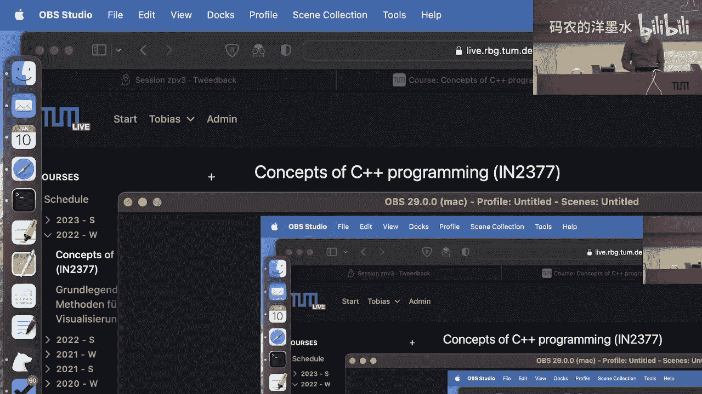
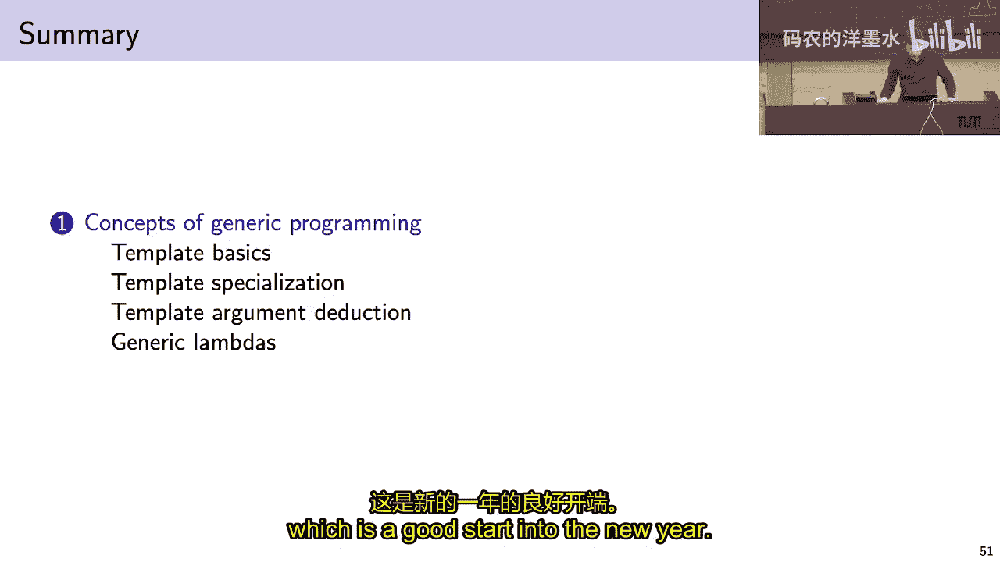

# 【全集】慕尼黑工业大学 IN2377 C++编程概念 中英字幕 1080P p10 Lecture 10 - 立即函数示例 -BV1b8mgB8EDQ_p10-

Test， that's try right。Test， test。So， welcome， everyone。

To the C++ course concepts of C++ programming， We a new year 2023。

 I hope you had some nice holidays in the past two weeks。😊，And。

That you had a good start into the new year。I hope that the stream is working。At least from my side。

 it seems to be doing so。And I'm not gonna DJ this time because I already checked there's no other microphone active right now。

 So hopefully， no audio interference， yeah。So， let's see。If you're asking for turning up the volume。

 could you please specify whether you mean in the auditorium。Or remotely。Right。

 so today we are going to continue our。Topics about the C plus。

 we're going to get to the really interesting topics now。

Not that the previous ones haven't been interesting， but。They're the ones that are。Dear to my heart。

 because they are a bit special。 Farsy plus， plus。As some of you already have seen。

 the feedback session I D today is Z PV3。Here's the link。 You can also find it on Zullip。As usual。

 and today， we will talk about template programming or well， generic programming。

So we'll introduce what templates are。 We've been using them for quite a while already。And now。

 well properly introduce them。Do a few things about specialization。

 argument deduction and generic gldas。 There's a bit more to come next week。

 but that's too much for today when we talk about varietyatic templates。

But this will come next week together with some of the compile time programming。

 which is where gets really interesting。😊，Turning up things for the live stream。

 Not sure I can do that。So I try turning things up a bit。But I'm at the maximum here。In my streaming。

 O， B， S streaming thing。And I'm at the maximum of what I can do here at the。Think。So。

I'm afraid that's about it。 What I can do。Right， so templates。 ifve been using them already。

Quite a bit because the standard library basically is templated everywhere。Now， let's see。

What is generic programming， So typically， when we develop code。Like。Doing a container。

Storing things in a hash table。Performing some certain kind of algorithm。

 it's very often generic code that doesn't particularly care what specific type you're inputting as your input。

Here's some examples from the standard Library， the swap function。

Doesn't really care what types you swap。It's just swapping things。Regardless of type and the vector。

 of course it needs to know what the type is。But it's gonna store basically， everything。And。

 of course， many others。 So these are all generic classes or functions。And， of course。

 we want to have this functionality available for all types that are suitable。

So how do we avoid rewriting the code for this type， for this type， for this type， this is。

What the templates do， they avoid code application for different types by writing the same code again and again。

And， of course， you also want to write templated code like the standard library that doesn't know about your new user defined types。

 your classes， yourstructs the ones that you are developing later on。

And you can still use them with a templated code。Right。So what is a template。

It's a family of classes。Functions。Type aliases or variables。 So basically。

 these four things can be templated， classes orstructs。Functions。Type aliases， so using statements。

 and surprisingly， other variables can be templated。Yeah。What does a template do Well。

 it has parameters， template parameters， and these come in three flavors。And， of course。

 the parameters specify what type you're gonna use in the template。

And this can be either a regular type template parameter。 That's what you will be using in like 90。

8% of the times。Then there's a non type template parameters， which are。Yeah， not types。

 but basically literals。 And then there's the template template parameters。They are a bit stupid。

 but they are there。 So we will cover them briefly。 But in most of the cases。

 you will never need those。Right。Once you have a template with its parameters， if you want to use it。

 you need to specify those parameters like for a function， which has parameters。 Well。

 then you have to call it with those parameters。 So， of course， if you use a template。

 you have to provide them。😊，And what happens then the parameters that you specify will be substituted in the ones that the template has。

And what happens then， is called a specialization。So whenever you specify template arguments。

 the compiler will create a specialization of the template for those parameters。

What's interesting to know is that the templates are a compile time construct。So。

Everything happens at compile time that you do with templates， or maybe not。

 So there's a few distinctions there。 But in general， everything is compile time。

 It's not a runtime construct。So if we'll talk about this in a bit more detail。 But basically。

 once you use them。The template specialization that is created gets instantiateated。

 so code gets generated。And will be compiled for that specialization。

 But we'll talk about this in more detail because it has quite an impact on how you structure libraries。

But first off， a simple example， how templates look like。So first， that's a keyword template。

To specify now follows a template。Then we have the parameters of the template in these brackets。

And these sharp brackets。And in this case， we have a very simple template parameter。

 just one of them。 And it's a so called type template parameter， which says class T。 So T is some。

Tpe。And what follows is basically， a regular class definition。For example。

 where you use that T as a type。 And later on， when you use it in your code， for example， here。

 you instantiate this vector using an integer。Then T gets replaced by int。

 and then you have a function pushback that uses a R value reference to an integer。And， of course。

 all the other stuff that I did list here。Interestingly， enough。

 you can also use incomplete types like this forward declaration of your user defined type A。

And you can use that as a template parameter。And it will replace T。Just like int。

 it will happen with a。 Of course， as soon as you need to use some details of class A。

 the compiler will start complaining。 But if you do this piece of code， this will work fine so far。

So as a generic syntax， we have this template keyword， the parameter list in these brackets。

 and then whatever declaration that follows， which can be class astruct， can also be a union。

 but unions are something we don't talk about because there's a better replacement。

 It's a C style relic。 So if you wan to use something like that using SDD variant instead。

It can be a nested member class or enumeration type。 can be a function or member function。

You can do data members， static data members at namespaceco or data members at class Co。

And you can do type aliases。 So these are all valid things that you can template。 And。

 as I said already， the parameters can be type template parameters。

 non type template parameters and template template parameters。

So before we talk about the three types of template parameters in a bit more detail。

 Let me check your questions。 There is one。 Will there be updates to your advent of code repository。

Nope。As you've， if you've watched it， you will see that I ran out of time at some point near Christmas。

Of course， although the problems got harder。So it was a vicious cycle。

 I had less and less time available due to various。Obligations。And the problems got harder。

 So basically， at some point， I said， okay， I can't do it anymore。

I had a slight kind of hope that in the Christmas break。

 I would have some time to catch up and finish everything。嗯。Unfortunately， I got sick for two weeks。

 So that was out of the question。So yeah， but I was， I'm healthy again， of course。

 just in time for work to start yesterday。 So obviously， everything was fine。

You might still hear my voice being a bit scratchy， and I hope I can。

Hold out for the entirety of the lecture。Will there be updates about your frying pan， yes。

I'm actually learning a few things about cooking now。And can't take too long。

 I can do regular boiled eggs already。So at some point， I will be able to do re I。 And then I will。

 of course， take an。Or if say proof， picture proof and show it to you。Right， so template parameters。

 First one and most common one is the type template parameter。Which is a placeholder for a type。

 the name says there's two ways you can write this。1 is use a type name。

And then the name of the type， or you say class。 And then the name of the type。

 Both of these are the same。They are not different。 It's just two different words。Logically speaking。

 type name is better because type name refers。one。To the name of a type， right。

 whereas class insinuates。That this is actually a class。

But as you've seen already in the previous example。嗯。

The arguments that you specify can be non class types。Like the built in types， integer。

 stuff like that。 So class is somewhat misleading。 so my。Personal preferences to use type name。

 but you can use both classes， of course， shorter。 and in many cases， still， it's still fine。

Use whatever you want。And then it works like this， for example。You can have。2 class parameters。

 You don't have to specify the name of it。So it's just a template with two parameters。

And it doesn't do anything。And， of course， if it doesn't do anything， you don't need names。

 but of course， if you don't specify names， you also can't use the class parameter。

 So if you don't specify names as's kind of a bit pointless。

 except in forward declarations like this。Otherwise。

 you typically provide names for each of the parameters。 You can use type name here or class。

 whatever you want。And then you use that T like you would any other type in your code。

 So you see it's a return type。 It's a parameter type， and you do stuff with it。

And this should answer your question， Wheres this class， Wheres this type name。Right。

 non type template parameters。Are placeholders for values。 So they are not about types。

 They are about values。嗯。Again， you can omit the name。

And you have to specify the type of the non type template parameter。

 which sounds a bit weird at first。 But you're specifying a value。 and， of course。

 each value has to have a type。 Theres a C plus plus。 So you have to specify the type name。

And that's basically how you do it。Type。And then the name of how you call it。

 So how can this look like， For example， if you have an array class。

 you want typically for fixed size array， you typically want two parameters。 One。

 the actual type that the array stores。Which is a generic type template parameter。

And a non type template parameter， which tells you what is the fixed size。Of course。

 you could specify the size at runtime， and then you would have to do like SD vector does do runtime allocations and D allocations and so on。

But。We're about efficiency。 So if you have a fixed size array， you wanna do it at compile time。

 And this you can do via a non typed template parameter。 So here。You see an evil C array。Which。

 in this case is。Fine。Why， because you're hiding it。In a nice class， this。Cool functionality。

 where there's not much in this case。 But， of course， if you would do this。

 you would provide a full set of functionality。And。As opposed to a sea style array。

This class here knows the size of the ray due to the non type template parameter。And， of course。

 you can do stuff like this。 Then if， if you have an array access。

 you can overload the operator for the array access， do some bounce checking。Right， which is。

 of course。Nice， if you can't afford that in terms of run time and then do the array based access。

Right， and then finally， there's a template template parameter， which， as the name implies。

 is not a type， not a non type， but rather， it's a template as a template parameter。

I've actually never seen this in practice。Or maybe or not actively recognise it in practice。

 Let's predict this。 I'm sure it's somewhere in the standard library or somewhere else。But yeah。

 you specify a template that takes a template。Which， again， has its parameters。As a parameter。So。

 yeah， what you could do， for example， you could have a class that has an internal array。

And you're gonna pass what kind of array you're gonna do there in as a template parameter。

Which itself has， of course， two parameters。 And here， you specify them。

 and you have to pass them in。I don't know。 It's a bit weird， so。Yeah。It's there。Right。

 def template arguments。So now we have three types of template arguments。

 You can have arbitrarily many of those。And like for function parameters。

 you can have default default values for template parameters as well。And it works just the same。

 So you have the template parameter。 You write equals something， and the default has to be。

 I don't know why this is。Type set S。Oh， yeah， because it's。synyntax highlighting here failed。

 sorry about that。 So anyway， you specify the default type or value or template。

 depending on the parameter that you have。 So， for example， you could specify a type。

Template parameter and specify a default value here。

 and you can specify a non type template parameter and specify a default value here。 And as usual。

 for default values， in C plus plus， you have to make sure that starting from the right。

 you have default values， without any exception。 And then once you stop with the default values。

 all the rest has to be nondeult values。So。Why are default template arguments nice， Well。

 because you can still have generic code。But you can use it like non generic code。Meaning。

You could use this buffer class here without specifying the template parameters at all。

 And then the defaults would be used。And sometimes， this is quite handy。Right。

So now that we have templates with parameters of different types， maybe defaults， How do we use them。

 well。We use the template name of the thing that we templated， the class， the function， whatever。

 specify the parameters again in the bracketed list here。And， of course。

 the template name has to be the name of an actual template， and the parameter list has to match。

The list of template arguments。That the template has。And then， if you do that。

The compiler takes the code of the template that you have to provide。Previously。

And it creates a specialization for that particular set of parameters。Of course。

 the arguments needs to match the parameters。 They need to be the same。Amount。

 and they need to make sense。 And if you have default values， well， of course。

 then you can reduce the number。And interestingly enough。

 sometimes you don't have to specify the template parameters because they can be automatically deduced。

 This is something we'll talk about near the end of today。But for now。ignoregnore that option。

 If you wan to use a template， you have to specify the parameters。Here's an examples。

A class fool that does nothing。Like in many examples， but we have several template parameters。

 a type template parameter here， a type template parameter as a second one with a default and a third type parameter with another default。

So you see here I use class。I don't even know why， probably because I copied it from somewhere and that person used class。

 but strictly speaking personally， I prefer using type name instead of class， but theyre the same。

 so it doesn't matter。Right。Now， we are using this template class4。

Here we are instantiating for an integer。 So the first parameter T 1 will be an integer。

 The second and the third parameter will use the defaults， So int and double。Here I'm doing it again。

With an incomplete type A that was forward declared here。Here I'm doing it again for a pointer to a。

F the type。41。 And again， the defaults for second and third parameter。

I can specify the first one and the second one。 So it will use a instead of the default for the second one。

 but it will use the default for the third one。 And， of course， I can specify all three。

 Then it will ignore all the defaults。If you use non type template parameters， obviously。

 you have to specify values for that type。These values have to be constant expressions that may or may not be converted。

Some implicit conversions may take place， but in general， they have to be。Constant expressions。

 which is literals。Or similar things。 And actually。

 constant expression is something we will talk about in the next two weeks quite intensively。

 so I won't talk a lot more about this now。But let's take this example here。

 We have a non type template parameter that uses the type unsigned and a literal of that type called n。

 and you can instantiate it using。An unsigned lital， which is this here，42 U。

Which is an unsigned literal。Here you specify an integer lital。

 which automatically gets converted to an unsign by the compiler， which is fine in this case。

If you need some more。嗯。Tricky conversion say will probably not take place automatically。

 So you have to do it properly。And yeah， what you can also do。

If you can do non type template parameters of reference or pointer type。Again。

 that's something you will see very rarely。But if you do so。Yeah， some things can't be done。 like。

 for example， you can't refer to a string lit or a sub objectject or something like this。Right。

 let me finish， finish the next slide， and then I'll answer your questions。Of course。

 we have the third type of template parameter， the template template parameters， so。Yeah。

 let's see how that looks like。 Let's say we have a template in my array with a type template parameter and a non type 1。

Then we have a class food that takes a template template parameter。That looks like and right。

 basically。And then what we can do is we can specify the my array as the template parameter for who。

 And then it will be using。That class， my array and it。

 my array will be instantiated using int and 42 as the template parameters。Since。😊，Surprise。

 SD array has the same kind of signature， template signature。You can also use SDD array instead。Now。

 to your questions， will we ever get to know the structure and type of questions for the exam。

 It would be extremely helpful， thanks。The structure is easy。Title page。Second page， there would be。

Assignment 1。Then there will be a question， probably but an A in front question something and then there will be a box where I can write the answer。

So that's fairly simple。 And this will repeat for several assignments over several pages。

Type of questions。There will be a few questions where you will have to tick boxes。

There will be a few where you might have to write a sentence。As an answer。

 So we ask you something we expect you to answer。嗯。There might even be。

Some small assignments where you have to write a little bit of code。 a few lines on paper。 Yes。

 I know paper programming sucks， but yeah。That's what it is。 So yeah， there you go。

Answered your question， Probably totally exactly like you wanted it to be answered。系。Okay。

How do you enforce ownership on a type in a container whilst it not sacrificing too much performance。

What。For example， a vector of unique pointers would be inefficient。

As all the unique pointers initialize an object on the heap， and we would get a lot of。Cash misses。

 Cash is not cash as in money， but anyway。um。So I， I don't understand why we would like to do this。

 So a vector already stores its members on the heap。 So there's no need to store unique pointers。

 So basically what you would get is a vector of unique pointer stored on the heap。

 which on by themselves point to something that stored on the heap that is is indeed。Not efficient。

 and a vector by default takes ownership of the object it stores。

So I don't quite understand the question。 I think you're not。If I'm re understand or。

 let's put a like this。 If I understand your question correctly。

 you don't understand that SDD vector already takes ownership of anything at stores。

problemblem solved。Okay， what exactly do you mean by template arguments for type template parameters must name a type。

Well。Oh， yeah。 it's the sentence here。 So we have a type template parameter。

When you instantiate the template， the argument that is specify here。Must be a type。

You can't use a literal here。Because it's a type template parameter。 If you w to use a literal。

 you need to use a non type template parameter。And。Yeah， it must be a type， not something else。

Because what you wanna have， this T 1 in the template gets replaced and you use it in place of a type。

 So obviously， you have to instantiate with some kind of type like integer or your class or whatever。

Can you upload some old exams for us as exercise material， maybe。

I'm sure I talked about this already。嗯。But， I say it again。

Once I know how this year's exam will look like， I will compare it with the old ones。

 if it's sufficiently different， maybe I'll upload the old ones for you。But then， of course。

 if I deem them to be sufficiently different， the old ones will not be of much value to you。

So what can I say。Let's see。Right。Didnt we have this before。Okay， anyway。More， oh， right。 So now。

As I said earlier， you can template different things。Most of the time。

 you will template classes like this， My array， which we've already seen in parts。

 So we've already seen the storage， the non type template parameter specifying the fixed size of the array。

 the type of the array。An index operator， a con version of the index operator。And so on。

 and so on and so on。 This is a typical class template。No， you can also template functions。So。

 for example， here， I'm attempting to。Redo the swap function from the standard library by specifying a template before the function declaration。

With an argument list of one type template parameter。

Then I'm gonna use for the two arguments of the function。And then。I can implement the function。

As you would expect it to be done。And then。We can use it。

As you would expect it to and as you would expect to， you would have to provide the type。

That you require for your type template parameter when instantiating the function。No。In this case。

 it also works without providing the type。At a template parameter。Why。

Because there's automatic template argument deduction。 and in this case， it works。If you were not。

There's other cases where it doesn't work， But that's where we have deduction guides to solve the problem。

 But we'll talk about this in a bit。You can also template aliases。So， for example， if you have。

Some class， templated class in a nest name space。 You could use an alias。That is， itself templated。

To refer to that handle class。While keeping one of the template parameters and， for example。

 doing a void pointer for， for the second type。 and， of course， void pointers are extremely evil。

So I'm having a bit of fun here with you by doing this example。Of course。

 you could also have two template parameters and pass along both of template parameters of the handle。

 But in this case， I chose to do only one。And use a very specific one for the second。

You can template variables。So， for example， this global variable pi。Can be templated。

With the type parameter， T。Which basically allows you to have pie as a float as a double or a long long double or whatever you want。

And here I'm， of course， specifying an initializer that has the highest accuracy so that it works for all of them。

Or you can then， for example， have a templated function area that uses this templated pi。

In order to get。The pi of that accuracy with which you actually compute the area。And that function。

And then when you call the function， you specify your template parameter that you want。 And yeah。

It's gonna use the templated。Variable here。 This works for global or static variables。

 plus for member variables。You can template class members。And， of course。

 class members themselves can be aliases。Functions， variables and so on。 It's。

 it's just the same thing， basically， just inside of classes。No， let's come to the interesting part。

We have the template definition， very specified template， the lists the argument list。

 Then you do the class， the function variables， whatever。And then， on the other hand。

You're trying to use the template。So the interesting part is the template itself。Its not a type。

It's not an object or anything else， in fact。Something that has a template keyword in front of it is actually basically nothing。

There is no code that's gonna be generated when you compile a template definition。 In fact。

 nothing will happen， except for the compiler remembering， oh， there's a template definition。

 but I'm not gonna do anything else。And of course， some basic syntax checking will be done if the semicolons are there and the braces are properly matched in Pariss and so on。

Now， in order for something to actually happen。You have to instantiate the template。

And only then with the compiler say， okay， now you want an instantiation of this template for a certain type。

What I'm gonna look at the template code。Substitute the type in there。

Compile the code and use that instance of the compile code。To actually do things。Why is this weird。

In most of the cases， you don't notice。That this happens。But what you were。

Sometimes encounter is that you write templated code。

You're not actually using it yet in the rest of your program。 And you think， oh， everything is fine。

 It compiles， it works。 Everything is fine and shiny。 Then suddenly。

 you start using the code by calling a function of your templated class， for example。😊，And suddenly。

 you get compile errors like， what。It's the same code。 I didn't change anything there。

 Why do you get a compile error， Well， Because the compiler will only create the code when the template is instantiated。

 And that means some of the error messages that your code produces will be delayed until you actually use your template。

And this can be surprising， especially at the start when you if you're not familiar with C++ and template programming。

So if you develop templated code， my recommendation is。Immediately， write code that uses。

The templated code that you're writing。Because then it will already be translated and compiled and used。

 and all the compiler errors will turn up immediately。 And， of course。

 this happens automatically if you happen to do test driven development where you write your test cases as you write the code。

Because then obviously， you will call your code constantly。So another reason。

 yet another reason to do test driven development。Right。How do you get template insensiation。

 There's two ways。 One is the explicit  one，1 is the implicit one。Explicit。It's， as the name says。

 an insiation that you request explicitly of the compiler。 do it here now。

And the implicit ones are the ones where you start using the template and the compile is。 Okay。

 now I need to create the instantiation。So。How do you do explicit instantsiation。Well。

 by writing template and then。Class astruct for you class templates the name and the argument list。

 And of course， you now need to specify certain argument list here in order to force that particular instance of the template to be generated。

You can do the same for function templates using the return type argument list。

 parameter list and so on。This has to follow the one definition rule， obviously。Because。Name and。

 and location and everything needs to be unique， as usual。And。Obviously， in order for you to do this。

 the template definition needs to be visible。 And if you instantate a class like this。

 it will generate all its members， including member functions and so on。Right there。

How does this look like。Let's say we have a templated class A that does some stupid stuff。

You have a templated function that does some stupid stuff。 And here's explicit insiation of both。

Templates tracked a for a certain parameter， which is int in this case。

 but you could specify anything else。And the same。For the bus function。

 which we instantiate for float。Note that you have to specify everything here。And of course。

 it needs to match with your signature of the function。So why would you want to do this。Well。

 as I said， templated code is nothing。 It's not compiled， even， not even compiled。呃。

When it goes through the compiler， it only starts getting compiled。When you instantiate。And。

 of course， typically， this instantiation happens basically implicitly。

Which is what we look at in a moment。But if you want it explicitly。

 because you want to fourth co generation。This is how you do it。

One of the main reasons you would you are doing it like this， which is a bit cumbersome。

Is because you might want to make your code templated code available。At a library。

For people to link against。Then you have to do this。And， of course， what you would。Note here。

Is that you are only creating an instance for a certain parameter or set of parameters。

So anything else you don't create by an explicit iniation won't be there in the library。Which sucks。

So what's nicer is doing implicit instantsiation， because then the compiler will implicitly generate the instances when you need them。

 because you are using code that。Using the template。Of course。

 this only happens if the insiation hasn't happened already。

 So if you already have an instantsiation， it won't be instantiated again。

 So the one definition rule won't be violated。And if you have a cl template， and this is。

An efficient part， but also one that can surprise you。

 only the parts of the class template that actually used will be instantiated， not everything。Here。

 with explicit template iniation， everything will be instantiateated with the implicit one。

 only what you need。 So if you have 10 functions in your class template and you use only two of them and they work。

😊，And at some point， you start deciding calling the third one。

You might still get compile errors because the compiler actually haven't looked at all of your 10 functions yet since you didn't instantiate them yet。

So how does this work， Well， how you would expect it to， You provide the template and you use it。

So what happens here this line is that the class。It's instantiated for the type in。

 but nothing else is done。No code is generated for the member functions， for example。

Once you start using the member functions like Fo， then the actual member function will be instantiated。

 code will be generated and so on。And this is why you don't get an  error here。

 even though the function bar has no definition。Doesn't matter because you're not using it。

What's even more interesting， if you do pointers or references to templated types。

 this doesn't give you an instantiation。Because in order to have a reference or a pointer。

 the compiler doesn't need to know the full type。 And only when you need the full type。

 it will generate an instance for you。So looking at both of these。

 implicit instantiation is nice because it。Basically works seamlessly。

You can use your template for any suitable type， which is kind of the point of generic programming。

 right， No unnecessary code is generated。 only the one that you need。But， of course。

 that means you need to provide the code， the implementations of your templated code。

To everybody who's using it。Because。If you don't provide it， then， of course。

 you can't use it because instance will only be generated once you start using it。 So in a sense。

 that means that if you do templated code， it has to be in a header file and that header file has to be passed along to every user。

And that， of course， means that every user of your template will have to compile the code of your template。

Which doesn't sound too bad。 But if your templates are huge， like the ones in the standard library。

That compile time will add up。And piss your users off。And， of course。

 it will also drive sales of new hardware， which is faster， faster SSD， faster processor。

 more memory， la la。So away， it's also good。For the economy of computers。Right， explicit insiation。

 on the other hand。Allows you to compile templated code into a library。

And you can have all the definitions of the templated functions， and so on。In a sauce fine。

And only the template declaration in the head of file。

 So you don't need to pass along your code to your users。

Which has the advantage that it's faster to compile。

 It has the advantage that you don't need to have your code visible to everyone。 It might suck。

 You might be ashamed of it。嗯。The disadvantages， of course。It's strictly speaking。

 no longer generic programming， because only the code for those explicit instances will be there。

 And as soon as you say， oh， I want to use your template for a different type that you didn't foresee yet。

Then the compiler would say， what。I only have these instances here。

 I don't have the actual code for the templates because you hit that away into a source file and gave me only the compiled output。

So， no dice。So， yeah。Explicit insiation is cool。Because that allows you to do libraries without having to ship the entire source code with it。

On the other hand， it kind of kills the purpose of generic programming。所以。

That's the plus first for you。Nothing is pretty。Why didn't you do the instantiation in the previous example。

 I， I did in some。But I didn't focus on it。Oh， while we are talking about the exam。

 how important are the specifics of some rules in C plus plus to you。For example。

 is it important to know in which cases exactly the compiler defines an implicitly declared copy constructor as deleted。

For life and for the exam。Well， for life， the answer is easy。嗯。That's Google。

And if you do it often enough， you will remember by heart。For the exam。I don't know。 I mean。

 some of the things you need to know， you need to prepare for the exam。 I try to not ask this。

Boring stuff， that you usually look up。嗯。But then again。

 what I think of as boring and which I would look up。

 will probably differ from what you consider as boring and would look up， so。I don't know。E'd go。

 by the rule。Ling。To what I do in the classes。Either hear or on the recordings or look at least through the slides。

 Then you have an idea of what I consider as important。Do the exercises， the homework assignments。

And。What you use there， what you need there is probably what you will need in the exam。Oh。

 now there's an interesting question。 Open source library from Github。 And， okay。

 this is something I can't answer in the class。 That would take too long。Right。Oh， yeah。

 What also is important about templates， Each instantiation creates code。

So if you wrote your templated code。It's generic。 It's short， It's sweet。It's cool。😊。

As soon as you use it for different types， for different arguments。

 for each of these argument combinations， a compiler will generate code。

That's separate from each other， for each type。Which is cool because then it can't interfere and everything's fine。

 And it works nicely。 However， that means。😊，If you use your template with 10000 different type combinations。

You will have 10000 different instanttensiations of that code。

Which will add up in size of your code and your binary。 And， of course。

 each of them has to be compiled。 So the computationil times go up。 So if you ask yourself。

 why does something take minutes or longer to compile， even though the code isn't that big。

Templates are the answer。Right， let's briefly talk about in line and out of line definition。

So here you see a templated class。Where there's a function， a constructor， A。

 a templated function convert。And what you can do is， you can specify。The coat right here。

 instead of the semico， you would have curly braces。 And inside。

 you have the coat of the constructor。Or the function。

This is what you would do call an in line definition。 However， in general， for templated code。

 we prefer out of line definitions， like for almost all。Things。

Because it increases the readability of the code。And obviously， for regular non templated code。

 what we would do is we would have the declaration in the header file and the code in the source file。

Of course， for templates， this doesn't really work unless you use explicit iniation。

 which kills the point of generic programming。 So in most cases， for template programming。

You have the class declaration。At the top。 And then。In the same header file， you also have the code。

 the out of line definitions for the templated code here。Why are you doing this？

Because it makes the interface of the class more readable for the user。😊，If you ignore that。

 if you want to ignore that， you can， of course， also do in line definitions here。Have shorter code。

But probably less readable interfaces。 So it's a matter of taed。 This is a preference from my side。

 but also from a lot of other C plus programme。Point of even 10 extra points in the exam。

 I'll think about that one。Right。now come some interesting tis， so。呃。Right， so。

Here we have a class that is templated。And we have some members。Now， the interesting part is。B。

 for example， is an nest type of a and a is templated。 So strictly speaking。

Wouldn't we have to specify the template argument here。Or here， or here， Or basically any type。

 any time we refer to a member of a templated thing。Strictly speaking， yes， however。

 the class name itself。The name of class members and the name of nested classes can be used。

Without specifying the extra template。 So instead of saying a template parameter B。

 in order to refer to this nested class B， you can just use B like here。Or instead of just using。

 instead of using a with a template parameter， you can just use a。

This works while you are in the class scope of that particular template。

Which is good because it makes sense。 Everybody understands what's happening here。

And it's a lot shorter than if you would have to specify the template parameter everywhere。Now。

 there it gets a bit weird。It's the following。Let's say。You have a type alias。In a certain class。

Now you have a templated class。Where you want to use a template parameter。

And you w to use that alias from that template parameter。

To define something else in your template class。East case， Another as， okay。Now， the thing is。

 you're using the template parameter T。And you're specifying the member type alias here。

 So the thing is， the compiler won't know that what you're referring to here is an actual。

Name of a type。So what you have to do in this case。

 you have to specify the keyword type name to tell the compiler what follows here is a type。

 because why the template is being compiled。 T is a generic type， It's not instantiated yet。

 And you have no， and the compiler has no idea。 is this a type。 It this a literal。

 I this a function call or whatever。So this is sometimes a bit surprising。So， the actual rule is。

If you're using。Names that are members of templates。

 and they are not considered to be types by default。And I know I can read this 100 times。

 I understand it every single time。 if I take a minute。But I'm gonna forget。

 So I don't know about you， but I'm gonna forget about this。 And basically。

 what happens if I write code like this， I will always forget about this type name。

 get a weird compiler error message。 and like， probably I need a type name。 Try it。 works fine。

Just so youre aware in situationss like this， you will probably need a type name keyboard。Now。

 even weirder。Is， let's say you have a templated class with a templated function。

And you're invoking this templated function from this templated class。No。You would expect。

Then you invoke it。On an instance of that class， that the type。Prameter T is already clear。

So if you say a convert， and then you specify that parameter here。It should be clear that， yes。

 you're calling a templated function。For some aine reason。

 somebody explained it to me once I forgot it immediately again afterwards。 In these instances。

 you have to specify。That this is a templated function by invoking the template keyword。

It's a bit of a weird syntax。 And basically， my usual rule here is， well， I write templated code。

 I use it as a would without the template keyword。 I get a weird compiler message。 I'm like。

 maybe I have to specify the template keyword， try it out and works。邵养。This is a bit weird。

But in the essence， you don't need to really remember。When these things are exactly required。

 because a compiler will tell you if they're required。 and then you're just specified。Right。

 last one last tidbit。 Sometimes you're using our value references to your。Template argument。

Or just sing regular references。 And what you can of do， of course。

 is when you instantiate your template， you can put。

And our value reference or regular reference in as the type。So what would happen here。

We put in R value reference as T， and then we use T R Ref as an R value reference of T。

 So you would have4 m percent here if you just do replacement。

This doesn't actually happen because for mpers are not valid in C plus plus。

 So what happens is so calledled reference collapsing。So， basically。If you have an R value reference。

It collapses to an R value reference。 If you have more than two R value references。

And any anything else gives you an L value reference。

Ha somebody is paying attention so that a template thing won't be a part of a question in the exam。

Yes。😊，You know why， Because I can't remember myself when it's required or not。 So， yes。

 I won't be asking an exam question about this。 You're paying attention。 I'm glad， awesome。😊。

And by extension， I'll give you a hint。This probably also won't be there。

Does the order of template types matter， Slide 28 lasts three lines。Yeses。

So here's an out of line definition of a templated class， which contains a templated function。

So what happens first is the templated class template。

Then the template for the function and then the function definition itself。 So， yes， the automate。Oh。

 okay， why would I do something like this here。If you could， you know。

 instead of doing the interaction via T and then replacing T by a， I could use a colon。

 colon member type edit here。 And then I wouldn't have to worry about the type name thing at all。

Of course， you could do that。But， typically。What。What you want to do in this kind of code is that you want to provide this class B。

For types T that contain this member type alias， but different ones。And， of course。

 each me type alias N would be something else。So that you have this kind of generic code。

But of causing in this。Typical example that fits in half a slide。It doesnn't make much sense。

 I agree。Yourre paying attention is the nicest thing anybody ever said to me。

I'm both glad and horrified。Glad because it's， of course， nice to， to have this。 But otherwise。

 I would hope that somebody maybe your mother， your friend， your partner。😊。

Already has that something nicer to you。Right。O。Business， as usual。

 I'm talking ages like an hour on the very first part。

 And I have to hurry through the rest a little bit。呃。Right， so template specialization。

So sometimes we want to have generic code。And we get it。 via templates。But in some cases， we know。

That there is a better implementation for a certain type。So let's say you write a generic。

Search routine on containers。Cool。But you know that for a certain type of containers。

 like sorted ones。You can use binary research with， which is a lot more efficient than linear search。

So what you can do now。 And this is what template specialization allows you。

 You can have the generic template code。And you can write a specialization for certain。

Template parameters， which basically replaces。The template that is otherwise used for the generic types。

And what you can do is basically， you can specify certain template arguments。

And do a specialization for those。 And you can do this for all the parameters。

 which is called a full specialization， or just for some of them。

 which is called a partial specialization。So let's look at examples。 I think that's easiest。

 So here's。Generic container with a template parameter。And you might want to do， for whatever reason。

Do a specific implementation for longs。I don't know why it's a big example， but of course。

 there's plenty of cases very it makes actual sense to do so， not necessarily for longs。

 but for some other type。So what you would do here is you have your regular generic implementation。

 you do this as usual。Then you do after you did this， you specify a template with an empty brackets。

 So normal parameters。And then after the name of the class。

 you specify the actual types that you're gonna be using in this specific implementation。

This is called a full specialization， because all the template parameters are。Specialized。

And then if you instantiate that container for float， you will use the generic or for anything else。

 But if you use long， it will use that specific implementation。

You can do do the same for partial specialization。 So if you have more than one template argument。

And you wanna specialize only for one or several of them， but not all of them。 you can do so， too。

But you can only do that for class templates。You can't do this for function templates。

 but then for function templates， you don't care。 You can do overloads on function templates。

 So it's fine。How does this partial specialization look like？Well。Here's a search algorithm， find。

That takes two template parameters， C and T。Where C is obviously from the naming here。

 the type of container we are searching on， and T is the type of the value that we are looking for。

And like in the previous example that are man manage。Mentioned。嗯。

This would probably be a linear search。And now we can do the search algorithm。

As a partial specialization。Note that this has to be a class。 I can't do this on。Functions directly。

 So I'm wrapping this in a class。 basically。 I drop one of the template parameters。

And in the search algorithm， I'm specifying that。 yes， I'm gonna use an SDD vector。And hopefully。

 its sorted because otherwise sub binary research wouldn't work。 And， of course。

 you still need to specify the open template parameter T as the second one。

So this is a partial specialization。This is actually fairly simple。

But sometimes getting the syntax right might be a bit tricky， but usually the compiler will help you。

And yes， of course， you can specialize any part。Of your template parameters。 only it's， it's。

The first one here by accident， but you can also specify the other ones。Right。Now， an important part。

 which I haven't mentioned yet。But there are questions。Oh， interesting one。Slide 37。

 is there some way we could enforce C to be a container of elements of type T。Excellent point。

Because。Obviously， what he could do。If you could misuse this template。And do a container。Of time。

Apples。And search。For our type。Pierce。And unless you have a class hierarchy where apples and peas are related。

 then these are two different types。 And， of course， this wouldn't make sense。

And you might want to constrain your container。To actually have elements of type T so that it makes sense。

There are several answers， how we can do this。If you don't want to be fully generic。Like this。

You could。Specify the container。Which is probably some templated class。And then， of course。

 use the template argument from that。To refer to the T。You could use type traits。

Should we talk about in two weeks， I think。That's an option。 You could use concepts。

Which is a C plus West 20 thing， which we'll talk about in three weeks， I think three or four weeks。

That was another way。Brain。Start working。No， that that's basically it。So， yes。😊，There's options。

They're a bit more complicated。 So I'm not covering them here yet。

 but type traits and concepts we will talk about later on， because that's exactly。

What's missing so far with the template programming。

Why not just do overloading instead of partial specialization。 So， yes， obviously， in this case。

You would probably skip。The class wrapper and two direct overloads of the fine function。So yeah。

But sometimes you really want to do this for classes。This is， again。

 just a stupid example that is a bit contrived。Right。No。If template。

We can instantiate them either explicitly or implicitly。 And， of course， if we instantiate them。

 all the template arguments need to be there。Otherwise， the compile will complete。The cool thing is。

完。The not so cool thing is by default， you would have to specify all the template parameters explicitly。

😊，But the cool thing is， in some cases， the compiler can deduce the template parameters from the context。

😊，So as in our previous example， if we have a swap function， which is templated。

We can invoke it without specifying the actual type。Of A And B here。So somehow。

 we are getting a template instantiation out of this web call。Because the compiler sees， oh。

 there's two arguments。They're supposed to be of type reference to T。And then the compiler can say。

 the two arguments I have here， they are integers， both of them。

 So probably T is supposed to be an integer。 So what I do here for you is I create an instance of the swapb function for the type T。

And I'm gonna use it。So， the compiler is clever。And doesn't require you to specify。

The template promise all the time。 And this is very handy because a lot of functions of the standard library。

 for example， are templated and having to specify all the templates arguments all the time is。

Really boring。So how does this work？Well， I already mentioned it here for function calls。

 The compiler tries to do， to use the type of the arguments。And see basically。

 if it can create a match。For the template parameters there。If the types are ambiguous。

Then the automatic deduction will fail。The actual rules are。Complex， well， not necessarily complex。

 but really long and graious。But， in general。It works like you would expect it to。

So if you have a max function like this， it takes the template parameter T and two arguments of type cons reference to T。

And you call it this two different types， in and long。The compiler would say， well， this is an in。

 This isnt long。 This is supposed to be the same。 So I don't know what to do here。

If I call it with two integers， it's fine because then T obviously has to be an integer。

 if I explicitly invoke the integer specialization。😊，And then call it with an inter along。 It's fine。

 Or if I do the same with long and call it with In。

 It's also fine because there I'm telling the compiler what I want。

 And then it does what what you want。😊，Here， it will automatically deduce it。

 and here it will try to deduce it， but fail because it's inconsistent。

This is how it works for function templates。For class templates。The construct takes the role。So。

 of course， class templates get instantiated once you create an actual object of the class template。

And what happens if you create an actual object， you call it the constructor。So， for example。

 the class S TD complex from the standard library is a templated class because it takes the float type like float。

 double， long， double， and so on as a template argument。But since you're invoking a constructor。

When you create an instance of a class， the compiler checks the constructor arguments。

To see if it can deduce the type of the class template。And for example。

 here it works because we have。Two doubles as an argument to the constructor so the compil will deduce that complex should be of type double。

Same here。And here it won't work because you have an integer and a double so the compiler won't know what to do。

This could create interesting things。But in fact， this works as you would expect it to， because。

If you。Could interpret this as a copy。Then that is deduced over anything else。So why is this good？

 Well， let's say here's an SDD vector。Where we don't specify the type of the template parameter。

But instead， we infer it from our initial in initialize a list constructor。

 which contains one integer。So it already knows， yes， this vector is gonna be of integer。

Here for this one， were initializing it with V1。 So it's the copy constructor。

Then it will deduce as the same type。Of this type that we specify to copy from。And not。

As a vector of a vector of in， which might be what youd think it would be with a regular deduction。

So yeah， that's the only rule you have basically have to remember with the deduction。

 It has to be consistent with the constructors。 And if there is a chance that it is a copy constructed。

 that one is preferred。Yes。Yeah。So the question was。

 if this also works with smooth constructives and yes， it does。So， no， this is all cool and shiny。

 and it works in many cases， but in some cases， it doesn't。So， what we can do。

And we can also provide deduction guides to aid the compiler in deducing the type of the template arguments。

Or if the regular deduction is faulty。That the compiler does by default。So what we could do。

 for example， here。For some reason， I decide。Decide to roll roll my own。Wheres my mouse here。

For some reason， I decide to roll my own pair class because I don't like the standard library pair class。

 right。So I specify two template arguments for the pair。I have first and second。

 like the standard library type。And I provide a constructor which takes two arguments of these two types to initialize both elements。

What I'm doing here is now I'm instantiating this pair without specifying the template parameters。

And without a deduction guide here， this wouldn't work。

You can feel free to try it with your compiler with mine。 It doesn't work。 The compiler will say， oh。

 I was unable to deduce the two types of。The temporary parameters。 And by the way， here。

 I'm using the string lital S suffix， which you have to import first using the SDD string lit。Right。

What you can do now is you can basically say， okay， look， here's a template with two parameters。

 that's called my pair。There's a constructor from my pair that takes two arguments。That are。

Of type T 1 and T 2。 And I want to deduce this as a my pairair。

Where T1 and T2 are the first and the second template argument。

For Bety cl were helping their compiler。In decing the template argument types。

And this works by specifying the template parameter list。And the template keyword， the class。And。

 of course， then。In this case， it's a constructor。 So you mimic the constructor call with two arguments or this one argument or with five arguments。

 depending on your constructor。 And then we tell the compiler what to deduce it as。

And this is really handy。The standard library uses this all over the place。

 And this is why most of the standard library things can be used without specifying template arguments。

So， for example， here， what happens if you initialize a vector。

Using iterators from a different container， you don't need to specify the type of the container because it will deduce it from the iterators。

And this is something the compiler definitely cannot do on its own。 You have a standard。 Yeah。

 you have a class， templated class。You create iterators。With begin and end from this class。

 which are completely different type。And now， the compiler。Well。

 it will never be able to reduce this automatically。 So we have to help it。 And the standard library。

 for example， does it this way。So， the class vector。It's templated with a type name。In this case。

 we call it already iterated to make clear of what this。Deduction guide is meant for。

And if we initialize a vector with a two argument constructed that takes it， iterator as a thing。

It should be deduced as a vector。And here you see the traits that I already promised。

 which we look at in further detail next week and the week afterwards。Basically。

 we have a helper class iterator traits that when we instantated using this iterator argument。

And called value type， it gets us the type of the container。

Of the thing that the container stores that's being iterated over。

We have to specify a type name here。By the rules that basically anything like this that's templated requires a type name statement here。

 And basically， yes， now this works without specifying the thing。So， vector。

This two argument constructor。Willll be deduced as a vector of this certain type。

 And what the iterator traits actually do is fairly simple。

 but we'll talk about this in a bit more detail in one or two weeks。Now。

 these inter these deduction guides are a bit。Aurane， but， in fact， they're actually not that hard。

What's interesting， they were introduced in C plus plus 17。 They didn't exist before。 So if you look。

 if you Google C plus plus code， in many cases， you will see。Iniations which half。

The template parameter explicitly there， even though they could be left out。

 but that's old code from C plus plus 14 or earlier。

 only C plus plus 1720 and newer code has the deduction guides for the standard library and even supported in the as the language construct。

 So that's fairly new and not a lot of code is using it yet。Right。Now， the cooler thing is。

Since we have all these deduction guidelines and guides that we can also manually formulate。

 what also got introduced。I。哦。Aended and made more useful is the auto type。

So this got introduced in C plus plus 11 and basically it got clarified in all the recent standard things。

And the idea basically， is， if you wanna know what auto deduces S， well。

 it's the same thing as happens in template argument deduction。So， this we already had。

One thing to note And this， we are also already had auto doesn't require any modifiers。

But you should specify them anyway。 So if you have a con or a pointer or a reference and wanna use auto。

 make sure。To specify them so that the code is actually what you expect it to be。And for references。

Really， really， make sure。That ought all。Let you specify auto with a reference。Because otherwise。

 you probably will get a copy like if you do it here。 So， yes。

 you're returning a reference to a here。 But if you just do this。

 you will get a copy of a as you invoke full whereas here， you will really get a reference。

 So be a bit careful if you do auto。Are template used so much in industry。 Yes。

 templates are used in basically all the plus code。Why do we use templates when we can use auto。

Because if you don't have templates， then auto isn't much worth for you。Auto doesn't replace。

At least this type of auto doesn't replace templates。 However， we are getting to something where。

You're kind of correct。we youll see in a moment。 and I'll come back to your questions in a moment。So。

Now we've templated classes， functions， variables。And aliases。What about Ladas。Well。

 lambdas can also be generic。And this， we do by specifying auto for one of its arguments。So。Here。

 instead of。Specifying explicit type for the parameter of the Lada。 I can just specify auto。

 and then it will accept basically any type。And then we can do this。What the compiler will do is。

 you know， for a Lada， it will create a closure type and this closure type will get a templated calling operator like this。

That's why this works fornda so nicely。If you have several auto arguments for your Lada。

This will generate several template parameters in that calling operator。

 and you can mix and match as much as you want with regular types and auto and so on and so on。

C plus plus 20 introduced templated lambmbdas。 Now， you might scratch your head and say， well。

 if I already have generic lambdas， which were incidentally introduced in。Shit。

I think it was C plus was 17。 Maybe it was 14， but I think it was 17。

 C plus was 20 in introduced templated Lanus。 Now， you should scratch your hand and say， why。

 if you already have generic las like this， Why would we need templated lanus。Which have a fairly。

Expected syntax。 So after the capture list， you specify the template parameters。

 and then you can use the template arguments in the rest of the Lada。Why。对。🤢。

The answer is in the last slide， because several auto arguments will translate to several template parameters。

So if you ever want to link template parameters like here。

So that both arguments are of the same type， but generic。

 the only way of doing it is with this templated Lanus。So。嗯。For example， here。

 you could write a generic lambda for any container， but， in fact， it will accept anything。

 not just their container。If you wanna do a templated Lada for any STTD vector。

 you can do it like this。And this only works with templated Lanus because you can't specify auto as a template argument。

Now， coming back to your questions。C plus plus 20 also added something for functions。

 namely that you can now use auto。In function parameters。

This automatically will generate a function template。

With template parameter for each auto parameter that you have。So strictly speaking。

 since you plus 20， you don't need templates anymore。You can use auto， instead。

But like for generic Glameth。Every auto keyword parameter will create its own template types。

 So if you wanna link types， you still will need。Templates， after all。Also。

 there's a question of if this is good practice， because if you read this interface。

But your function， F1 takes。Anything。But probably it doesn't。

 Probably it only works for a subset of all types。So。

Maybe this is not the best idea of writing code unless your function really， really takes everything。

This is called an unconstrained auto。 There's also constrained version of this。

 And this relates to the concept that I alluded to earlier today。嗯。

So what you can do is you can constrain this auto to a certain concept。And what is the concept。

 It basically allows you to define like。Well， this algorithm works for numbers。For integer numbers。

 for float numbers or generic numbers of a certain type of class。

And these can be done using concepts。Which we will see in a few weeks。And these are also the answer。

 how you can make sure that template parameters or these auto parameters fulfill certain constraints。

So that the code that you're writing actually makes sense。So in the end。

 templates and auto are not exactly the same as you're asking， they're very， very related。

 So basically， auto translates each autokiword translates into a template parameter。

So you can do a bit more。Explicit things with the actual template parameter than auto。 But yes。

 they are related。 They're very similar， but they're not exactly the same。

So now I was worried that I wouldn't finish on time， but in fact， I'm finishing on time for once。

 which is a good start into the new year。 So I' see you next week when we talk about compile time programming。

 Thank you very much。😊。

