# 【全集】慕尼黑工业大学 IN2377 C++编程概念 中英字幕 1080P p11 Lecture 11 - 类型特征、vector容器和表达式 -BV1b8mgB8EDQ_p11-

Test once more。Okay， this seems to work。So let's get started。So there we go。

Welcome everyone to a concept of C plus plus programming。We are in our。

I hope most exciting lecture of the term today。And we will see if you will agree afterwards。

So this is a third to last lecture。 So we have two more。

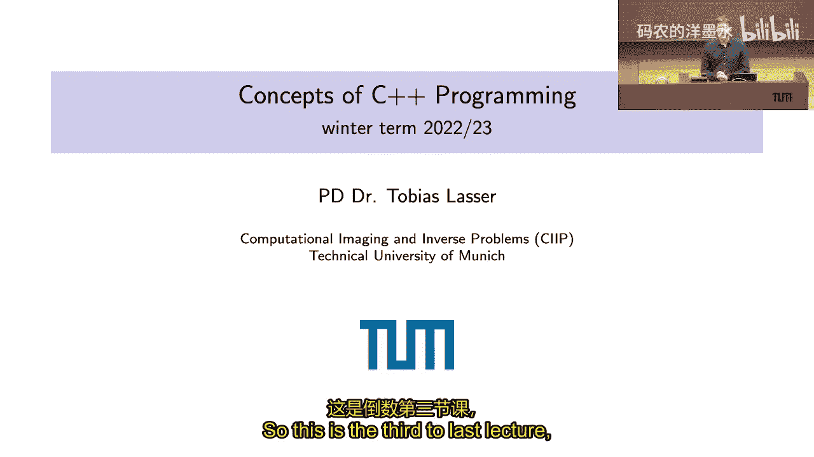

Before we start， that feedback session。 I D today is Z E8 P。And。Well。

 you will find the user link also on Zlip。As usual and in the slides And here。On the protection。So。

 enough today。Today， what we're going to talk about is compile time programming。

 The interesting part， namely， what can you do with it。 That's really cool and practical and useful。

😊，The first and biggest part today is expression templates。

 and then we'll be talking about the curiously recursive template pattern as well。

And polymorphic cloning， as promised。Right。So this is the last part of the compile time programming chapter。

 We have two more sessions next week and the week after that。

 just to give you an idea one will be about parallel programming and what C++ offers to support that。

And the last session will be about C plus West 20 concepts。

 as well as an outlook on the upcoming standard， C+ West 23。Right， so arguably。

 today is the most exciting lecture。Oh， any you wanna hear。The story about the frying pan。

Psum you already know that， right， The story hasn't ended yet。So， yeah。Hopefully。

 I'll be able to tell it to you by the end of this term。I'll be starting with this again。No。

 this is turned off。 I， I checked that double checked。So。

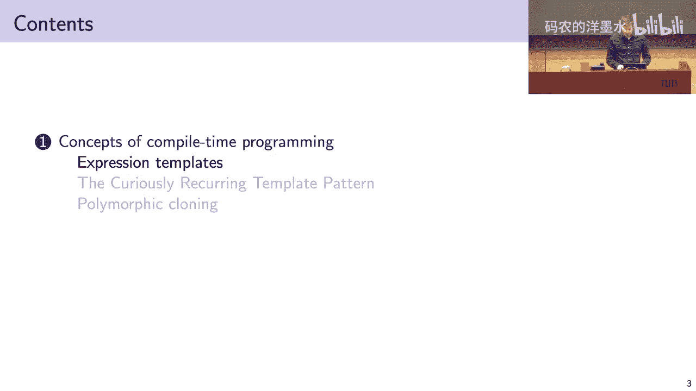

Let's get started with expression templates。 Let's give a motivation for why we would want to do this。

One of the main motivators is numericallin algebra。So what is this。

 Linda algebra is the stuff you can know where you have vectors。In n dimensional space， for example。

 in matrices， mapping vectors to other vectors， these matrices， for example。

 could represent operations like transforming an image。Vctor could be an image。And what we do。

 for example， in medical image processing in our research and my research group is。Yeah。

 it's exactly that。 We store images as vectors。We do operations on them like the Four rate transform。

 like the ra transform or the x rate transform or various other transforms。And basically。

 this allows us to process， for example， X ray images。

2D X images into a 3D computer tomography image volume。So yeah。

 this is done using numerical in algebra。 Obviously， this is used in a lot more things。

 So image processing， yes， signal processing in general and whatever。

 deep learning uses numerical in algebra。😊，Plenty of other things like finance， math。

 frequency trading， all this stuff。 basically everything that's interesting uses in algebra somehow。

And， of course， in algebra， the computer is numerical in algebra。So typically， boring example is。

Let's have two vectors， X and Y。Add them together。And scale them with two constants， C 1 and C 2。

And then look at the result， which is another vector that we call that。

That's a typical numerical in the algebra operation。

 combined to vectors using scalar multiples of them。Right， so what you should be doing。Is。

Use the library。Right， don't reinvent the wheel。Use a library that does this for a living。

 and does this well。So yeah， that's a standard solution using existing library。 like， for example。

 the eigen Library， which is also， for example， what's just used in Ten of law and pytorch。

 if you are familiar with that。So this is a very， very good numerical in algebra library for C plus plus There's also boost U B because Boos。

 of course， has a library for everything。😊，There have many others。Most notably one， there is。

Technical specification for linear algebra。 That's part of the standardization efforts。

This has been an ongoing story for many years。 We had hopes that it would be N C plus plus 20 before C plus plus 20 came out。

 We had hopes that it would be N C plus plus 23。Before C plus was 23 had its feature freeze。

 Unfortunately， the feature phrase said， oh， yeah， No linearina algebra and C+ was 23。So， yeah。

Maybe C plus was 26。Who else。Right， but there's plenty very good libraries that do this already。

 just not part of the standard yet。Is an image a vector or a matrix that depends on your perspective。

 You can represent it using a matrix， A 2D image。 You can also linearize it， read it out。

In a linear fashion， and then you get a vector。All typical treatments in image processing are as a vector because then can deal with 2D images with 3D images。

 with 4D images or。Whatever dimensionality you desire。

You just need a descriptor that explains you how the vector is to be interpreted as an image。

But that's how it's done， typically。Right。Now， of course， the standard solution is user library。

And use whatever they do。 But if you w to understand what the libraries do like Eigen。um。

Or if you want to do it yourself， for whatever reason。That's where expression templates come in。

So before we talk about expression templates， let's see。 how would we have done it in C。

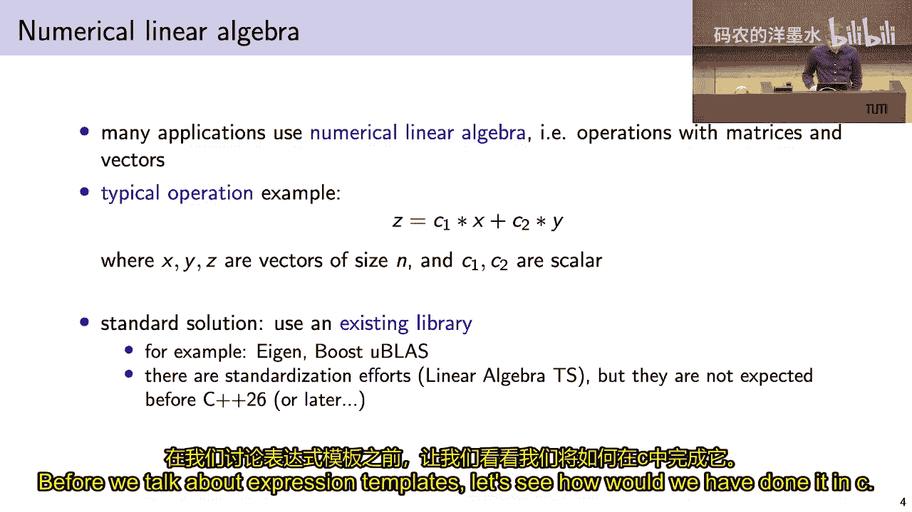

So we have this operation example， two vectors。Multiplied with a scalar。Summed up。

And store the result。 So and see what you would do， you。

 your vector would probably some kind of array。X， Y， and Z。And。Just turn the stone a little。And yeah。

 you would index this with a loop variable， for example， a four loop from 0 to n。

 So you would have to know the sizes of the vector explicitly。

 but then you would loop over them and then basically multiply the scalar to the x component at the y component times the other scalar。

To get the result for that。Easest pie， right。And see， plus， plus。We would probably be using。A class。

 vector。That stores a vector。And supports all kinds of operations on the vector。

 We would define overloaded operators plus and multiplication and division and subtraction。

 and so on and so on。To support。Nmerul in algebra operations。 right。

 what we need here is an addition that takes two vectors for the multiplication。

 We need a scalar times a vector。 And then we could write the original expression， basically。

 as it is in the formula。 You see， there's no difference。Progress。Yes。Maybe。So on the concept side。

 this is better than C。 because now the vector will know its own size。

 You don't have to carry that around separately like you have in C code。嗯。

You can write the code like a math formula。 So basically。

 if you have the formula on paper and the formula in the code， they will look almost identical。

 Or in this case， they will be identical。So what's not too like。Well， the problem is。

 the C implementation sucks。Why， why are we doing C plus plus。

 Why are we not doing a higher level language or a more convenient language， like， let's say。

 Python or Julia or something。Because of performance， right？

 So we're using C plus because of performance， not because it's the most awesome language ever。😊，No。

 it has words and whatever。 But we are using it to get the performance we want to have。Right， and。

That's a plus plus version of this。Is many times slower than the C version。What the fuck。Hopefully。

 you ask yourself， what fuck。Ideally， you already know why。But let me tell you why。

 if you don't know。So what happens when the compiler。

Translates this thing is exactly what you would expect here。 So for this multiplication operator。

Well， obviously， the overloaded multiplication operator is caught。Twice。Here has a multiplication。

 Here' has a multiplication。 Here's an addition that takes two vectors。

 So that is called once a multiplication， if evaluated。What happens。

Is that this operator gives you a vector。And this vector has to be stored somewhere。

 So memory will be allocate。Same here。 again， memory will be allocated and that that memory will be added together in the plus operator。

 And then the result， which is a another vector， will be stored in Z。

So what if effectively will happen is something like this。

 The compiler will create temporaries for each of the intermediate results。

 So for the first scalar multiplication， for the second scalar multiplication。And for the addition。

And then， of course， that's， that's one slide。Benefit here。 Yeah。

 we are modern C plus plus so we can actually move the result from set 3 into Z。

 So there's no additional copy involved。So。If you compare this to the C version where you take the existing memory。

 the existing scalrs and the result directly in that。That's no。Yeah， overhead。You just multiply。

 multiply add， and that's it。 And you do this for each component。

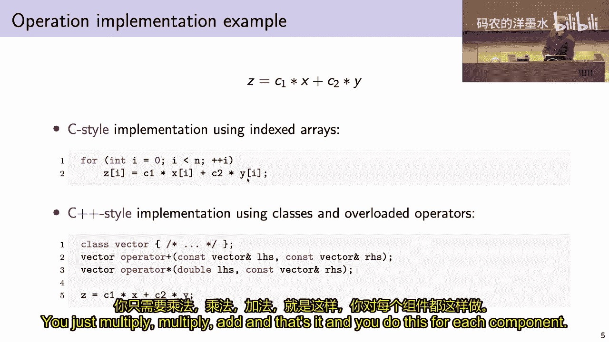

Here。Do a multiplication， stored in a new result， Do a multiplication， Start in a new result。

 Take the two new results， add them together， Start in a new result。 Okay， this one is moved in。

 so it's not that bad。But yeah， that's overhead。Computational overhead， C plus plus is slower than C。

Oh， my god。And not to forget， since often we are talking about。

Images like 3D or 4D images that take up a lot of memory。

 So a high resolution microscopy video sequence might take up a few hundred gig of memory。😊。

And I don't know about you。 but most of my computers don't have hundreds of gigytes of memory。嗯。So。

 yeah， each of these temporaries requires additional memory on top of the act for computational effort。

So what the heck。Y C plus， plus， still cool。Why didn't we move said one and said 2。不。We are。

 We are computing the sum of them， and the result is gonna be moved into set。

 There's nothing else you can move here。Most of your computers don't have hundreds of gigabys Ram。

 What kind of computers do you have。A few expensive ones。

And big ones and loud ones that you don't want to have next to you。Because， you know。

 we do this medical image computing。 We have lots of data。 We need to crunch it a lot。 So yeah。

 we have some big computers with hundreds of gigabytes of Ram， yes。Or even terabytes。 Oh my god。

Right， so anyway， the solution to this。Thing here is expression templates。

 So how can you get C plus plus code to be as fast as the C style implementation or even faster。

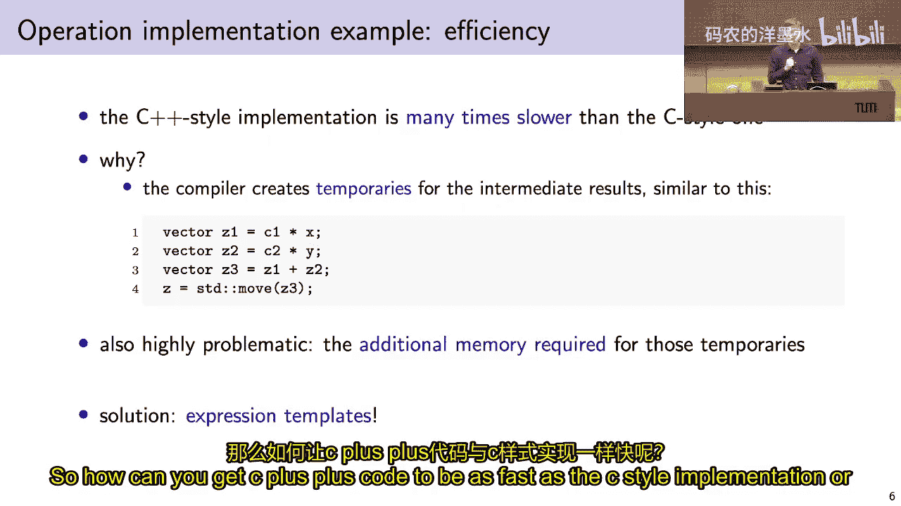

While still having the nice coat。Of C plus plus， which reads like a math formula on paper。

So can we have both this of this together。Plus， maybe some extra performance。 And yes。

 the answer is using compile time programming， using this expression templates that I'm gonna show you you how to do。

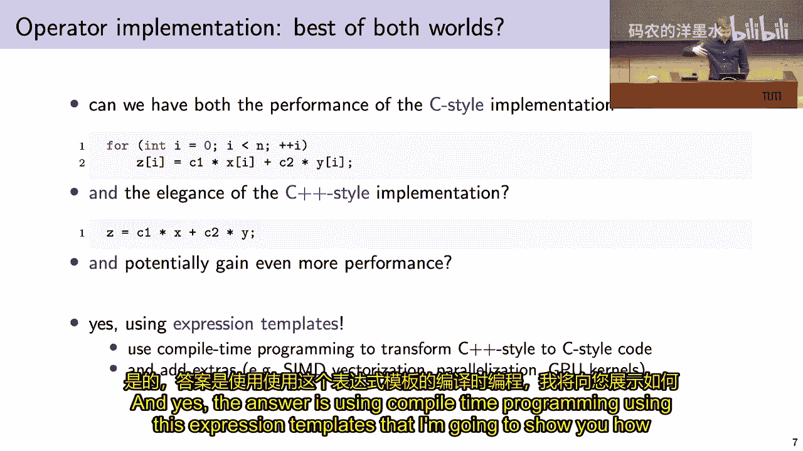

So the idea is that we want to， as the user。To use this。

While having the same or better performance than this code。And what we do basically。

 is we use compile time programming to have the compiler transform this。Into this。Seamlessly for you。

And， of course， now you can know that the compiler is doing some tricky stuff for you。

 You can add even more tricky stuff like S IM D vectorization， like parallelization。

 like GPU kernels， whatever you want， you can add there。😊。

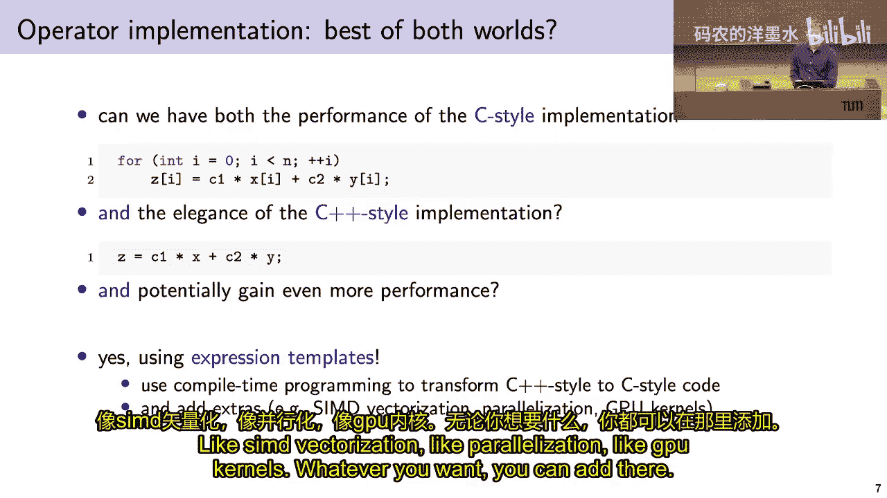

And the code to actually use it will still look as simple and innocent as the math formula。On paper。

Okay， so how does this work， Well， obviously， compile time programming， templates， type trades。

 all the stuff that we discussed in the previous sessions。 Now it comes together。

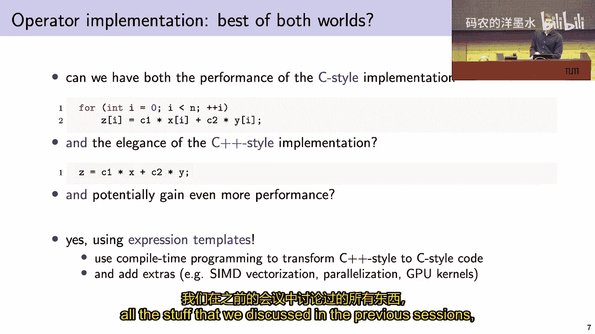

So what's the general idea。The problem is these intermediate steps。

 So when the compiler calls these overloaded operators， the result is always a temporary。

 and we don't want these temporarys。 They any fashion。 they take up memory。 and yeah， so。Easy answer。

 We don't。So instead of evaluating each of these intermediate steps。We build a tree。You know。

 like the trees outside there。 No， obviously， they are computer science trees。 You know。

 where the root is on top and they grow downwards， not the like the trees outside。

 which grow upwards。Yeah， stupid chokeide。Basically。

 all these arithmetic expressions should be familiar with this can be modeled as a binary tree。

For example， you have a plus operation， two opera， which are the leaves of the tree。

 And then if you have nested expression like the one。

 we were looking at you have another operation as a leaf， basically instead of a leaf and yeah。

And the idea is， once you have this tree， you build this tree at compile time so that there's no runtime overhead。

And the evolution of the arithmetic expression happens。Only。Then you actually want the result。 And。

 of course， that typically happens in the assignment operator。

 and you want to store the result somewhere。So basically， what we do in compile time programming。

 if we build a tree。And we evaluate it。When requested。That way， we don't have any runtime overhead。

 and we can easily achieve the same performance as a C code or even better。If we add some specials。

 like S IMD vectorization。Poliization。Or GPU program。

Am I afraid that somebody might try to steal my frying pan， no。

How can a volume be faster than vectorization。What。How， how do you get to this point。

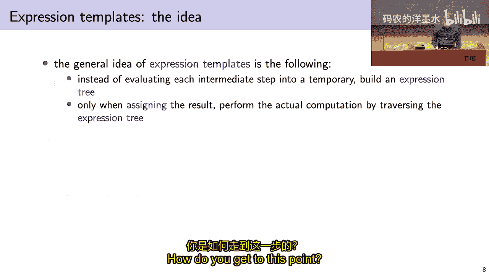

I'm claiming that vectorization will be faster than a plane for loop。 But， of course， as compilers。

That automatically vectorize fall loops like this。 So maybe you don't even gain anything。

 But this statement here with a traditional C plus plus implementation like。

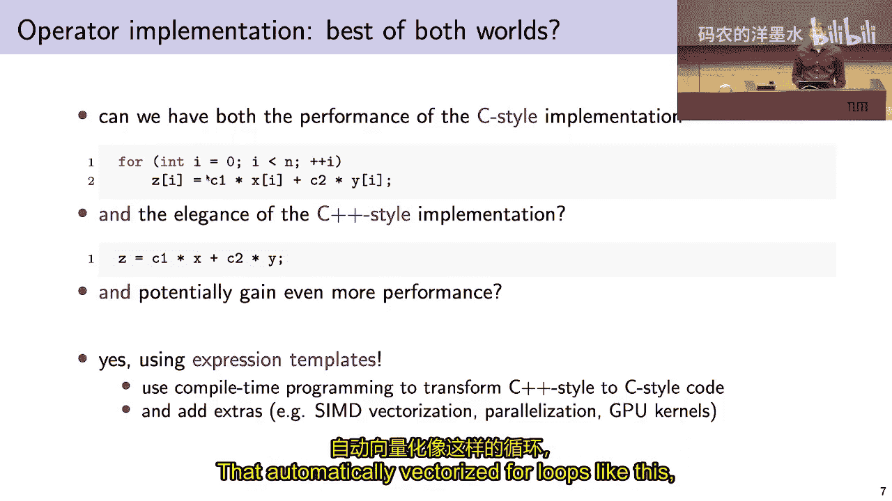

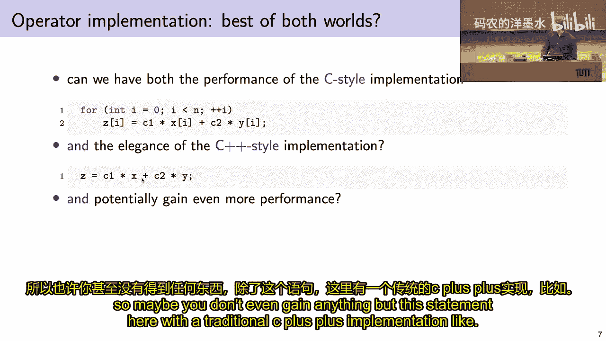

Like this classical。

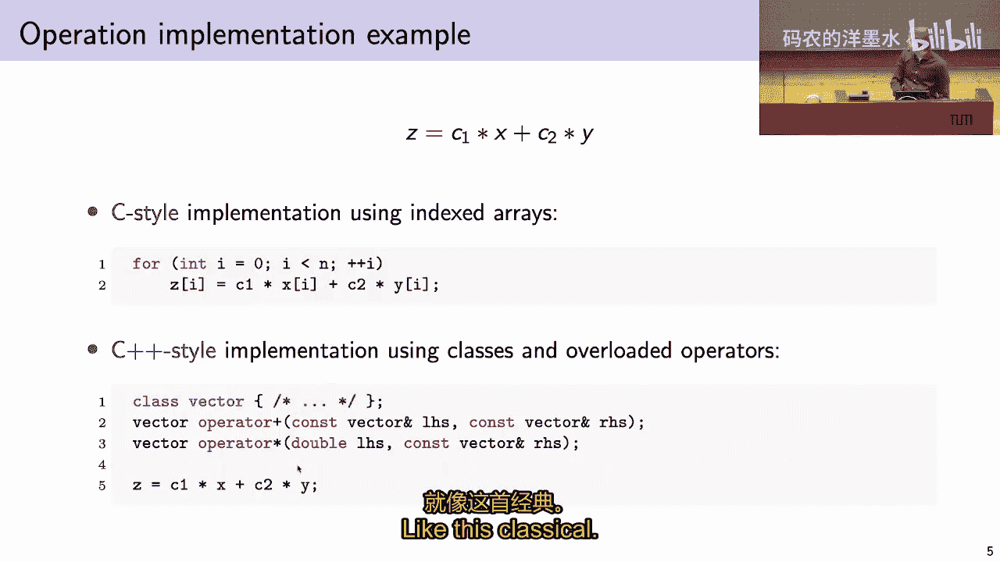

Overloading operators， creating temporaryaries that is many times lower than this plane for loop。

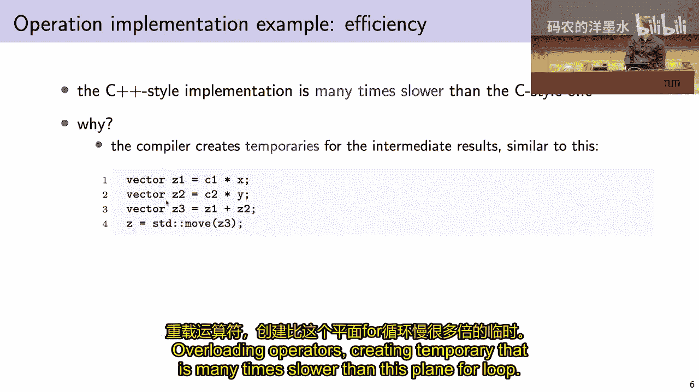

That's the key part here。 And， of course。Using expression templates。

 we want to go from here to there using compile time programming so that you don't see it and using it。

And you can now add vectorization， parallellyization。

 GP PU Curs and everything on top of that to make it even faster than the C solution。

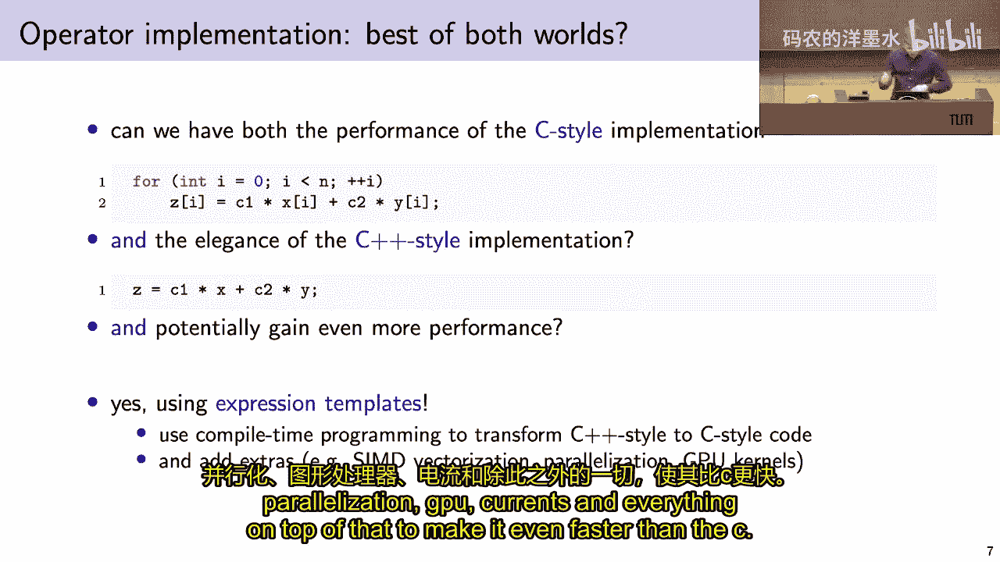

And yes， you can add some more fancy stuff that， for example。

If you do these intermediate steps and store them in an expression tree， obviously。

Depending on the operation you do， you might not even have to evaluate everything。In the statement。

 but just the port。But that is not what I'm gonna show you today。 That's a bit even more advanced。

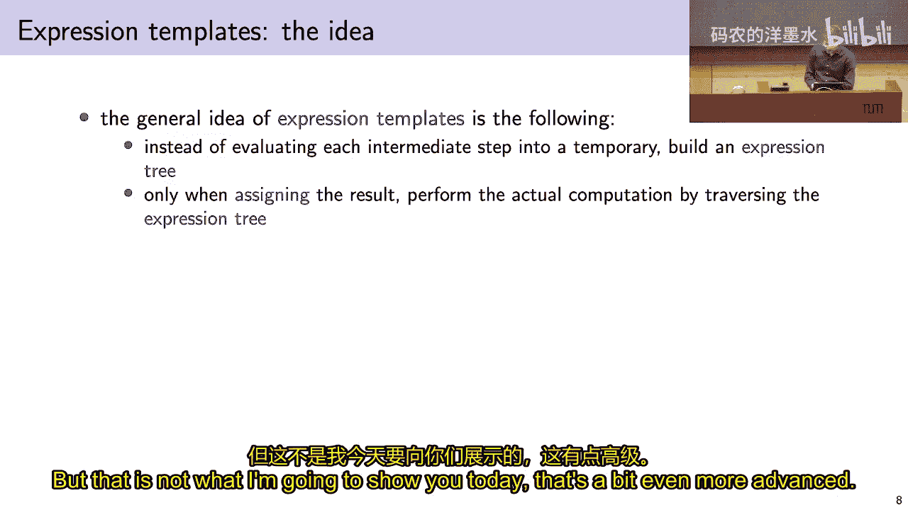

Right， so。There's quite a few ways of doing this。 I'm gonna show you one。

That is very efficient using compile time programming， obviously， because that was my goal overall。

You can do this already in C plus plus 98。 So in non modern C plus plus， which is how eigen does it。

If you wantna see。How far USC plus plus kits have advanced。Go to the Agng Library， Aing。

tooksfamily dot org。Check out the source code。And dive in and see how much you understand of it。

If you understand everything。You're passing this course with flying colourters。

You've achieved Guru's status seriously。 I， I read eigencode and I'm like， what the fuck。

And I've been reading it since。It ex started existing， which was back in 2000。7， something like this。

So yeah， I is a very， very impressive library。 but reading the code is。Ugly as shit。

So the good thing is， we are no longer stuck with C plus plus 98。 We have modern C plus plus now。

 And what I'm gonna show you is gonna rely on C plus plus 17。😊，In the C plus 17。

 I can fit the expression template explanation inside a few slides so that I can neatly show it to you。

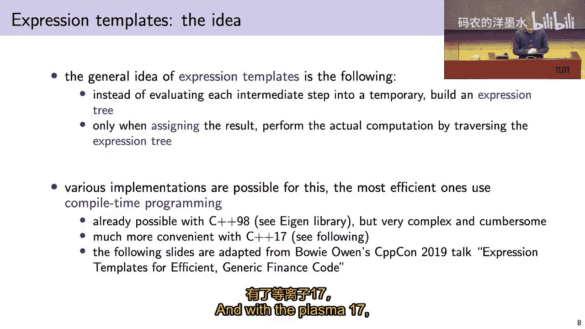

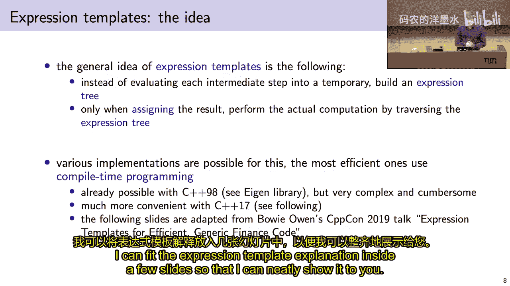

And since I'm cool， but not that cool， this is obviously not my own idea。

 but somebody else had this idea。 And in this case， it was power On。This。

 the slides and what I'm showing you is inspired from his talk from 2019 about expression templates。

 His application was finance code because he was doing high frequency trading。

 So I had a need for really fast code。 I'm doing medical image processing。

 So I also have need for fast code。

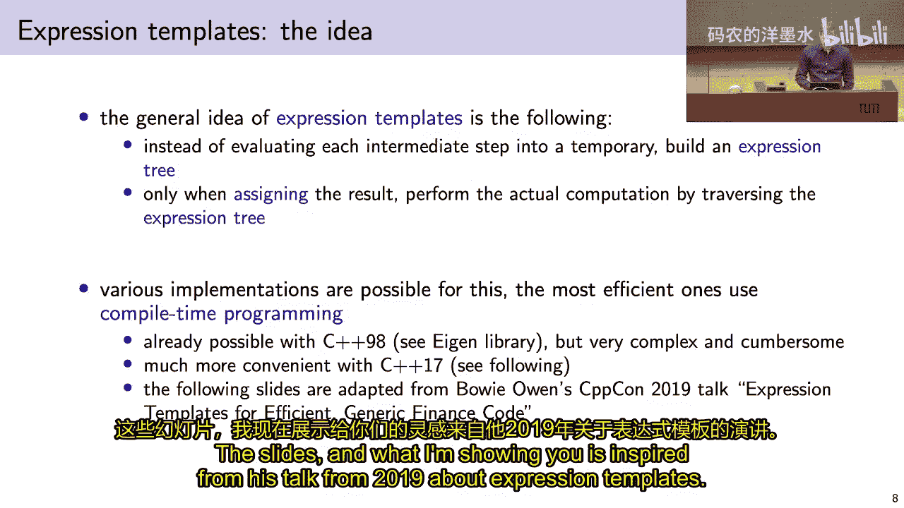

The Agen Library was created by Gegennaad and。What's the other name， Something with J。But no， not a。

With two French PhD students。When or at least they were PhD student when they created it。

And I don't know where they've moved to since。But I know quite a few people who have contributed to eigen。

Among them， one of them， one of my master's students。

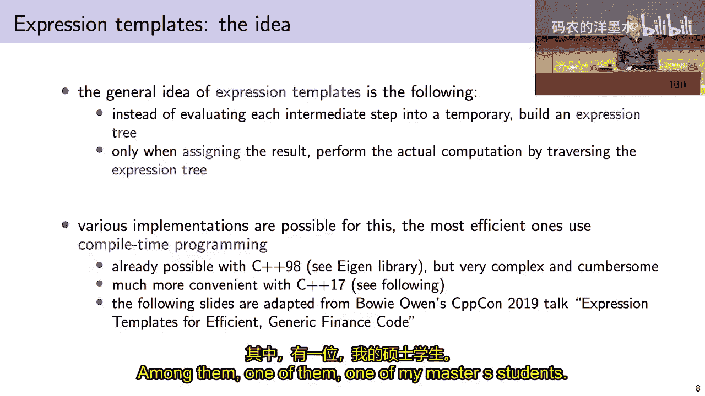

Right。So。Let's go back to actually doing things like building the tree at compile time and evaluating it。

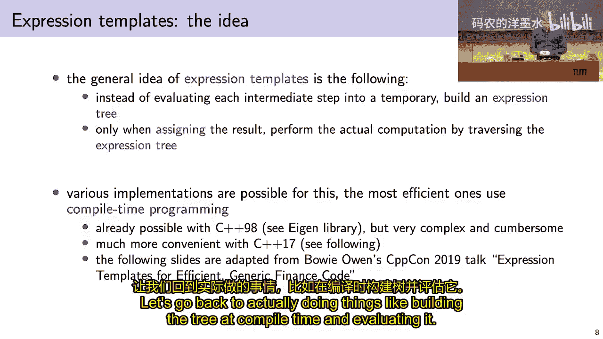

Which will， of course， happen at runtime。So how do we do this？ The answer is templates。

Because what we do know。If we create a templated class that we call expression for short exp。

That takes an opera an operation。Mulipplication， addition， subtraction and so on。

 and an arbitrary amount of opera， which we realize via are variety templates。Okay。No。

Our overloaded operators plus and star for multiplication。 Now， don't return a vector。

 which would create a temporary and cause all the performance overhead。But instead。

 they're returning the directly， the expression。Which basically just wraps the arguments left and。

 right inside side。Plus， the actual operation， like addition here。

Inside a lightweight compile time structure。And， of course， we have to somehow define what at and。

Mule for， for multiplication actually R。 But we'll get to that in a moment。

So the main difference now is our operator， overloaded operators return expression objects。

That are templated。 and the template arguments are the operation itself。Plus。The opera。

hich in our case， we have。Binary operators。 So we have two arguments。 But yeah。

 these expressions are formulated in a gene an arbitrary amount of opera。Right。

 now the idea is these expression things here will be the leaves in our tree that we' are building up at compile time。

How does this work。

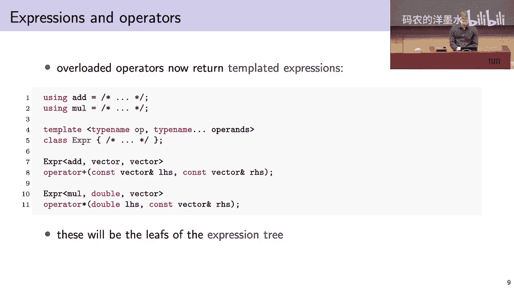

Well， look what happens when you call the overloaded operators now。Z1 is a scalar。

 A double x is a vector。 So if we call the overloaded scalar multiplication operator。

 what we get is an expression。This operator may。Double as the first operant and a vector as the second operant。

 The second scale of multiplication is the same。 And now， if we add those two together。

 what we get is an expression。That。Is an addition as an operation。

 and the opera is another expression。The one that we just created before。

 and the second opera is the same as another expression that we created just before。This way。We get。

A tree。That's generated by the compiler by calling these overloaded operators。

That return those templated expressions。Now， the idea is， once we assign。

The final expression that we interested in。Towards an actual vector。

We overload the assignment operator。Such that it will parse the expression tree。

That is that3 and generate and compute the actual result that we would like to have。And， of course。

 this is not how you would write code like this。 This is just for illustrative purposes for you to understand what's happening。

 What you would be writing is everything at once like this in one statement。And of course。

 since you don't want to write。This expression theory， explicitly， you would say auto。

That's three equals， whatever。But I don't choose auto here because I still want to make sure that you know what hides behind the auto。

And， of course， you see that， I mean， the actual operators don't do anything。

 They just store what you w to do。And once you have the tree that the compiler generates for use through nest templates。

Not sure what this noise here is。Maybe I should turn off。All the things。

Let me see if I was turned off the microphone for the remote stream。 No， I don't think so。Right。And。

 of course， now in the assignment， we do the actual work of computing the result。

This is a very common technique that's called lazy evaluation。 So basically。

 you build up the entire expression that you want to compute and you only evaluate it at the end。

 And this basically allows us。To do all this compileum optimization of the runtime。

How are X and Y initialized Well that's up to you。Some vectors。Yes， and of course， this could。

Since I am declaring。嗯。This is probably a construct and not the assignment operator， right， but。

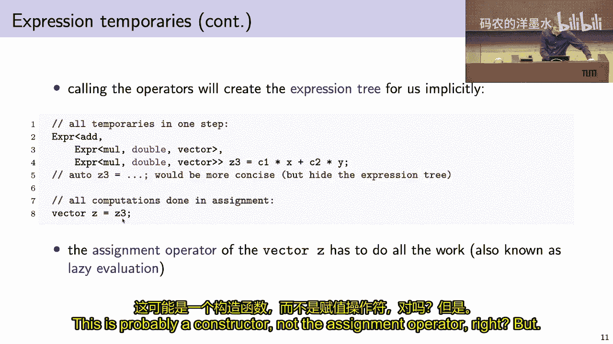

Doesn't matter。You can have constructed the text and expression or and the assignment operator。

 So you probably want both。

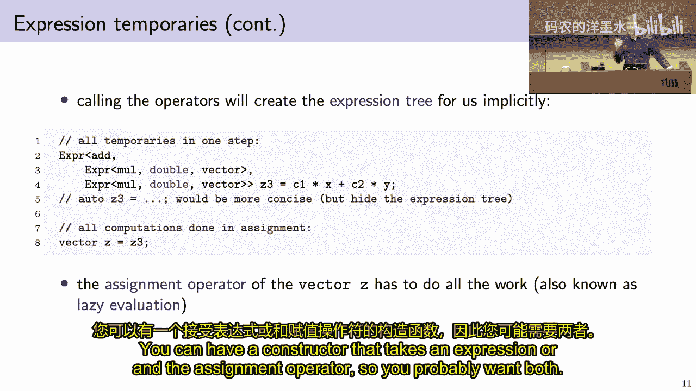

Right， so regular code would still look like you would like it， too。

But the right inside is now actually an expression tree that is evaluated at compile time。

And the assignment operator or the constructor that we have here will do the lazy evaluation。

The interesting part now， of course， if you expect to write code with auto。Like replacing the vector。

With auto here。This will be a bit unintuitive because now you won't get a vector。

But the type of the expression here on the right hand side is this ex tree of expressions。

So this auto will be in this case。Evaluate to this expression thing here like that。

So that's kind of one of the drawbacks of the template expression template that usage of auto。

It has to be considered。 And you have to be a bit careful。So， okay， now we know the general concept。

The overloaded operators for our vector class create expressions instead of temporaries。

 and the expressions just store the operation in the opera of nothing else。 They don't do anything。

 really。And then the constructor， or in the。Assignment operator， we do the actual computation。

 So another question is， how does this work， How do the expression templated class actually look like。

 How do the overloaded operators look like， and how do we do this so that it works and is fast。

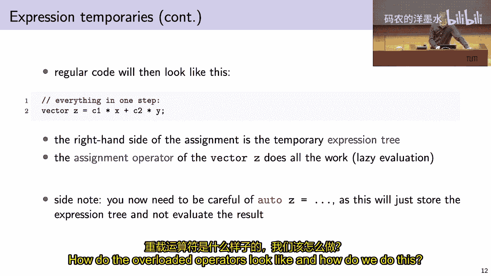

Right， so let's look about， talk about the implementation。First off。

 let's look at the expression class。The expression class only needs to store the operation and the opera。

 So that's exactly what it's doing。It will store the operation， which is their template。

ETempd argument。And let's call it callable， because this operation will later on be called when you actually evaluate the expression。

And we store the opera in a tael because we have an arbitrary amount of it。 So a tapple is a perfect。

Solution for this。And， of course， we will use references here because we don't want to copy the opera。

 we just want to store。A reference to them。So in a sense， this。

 these are the two data members that the expression will have。

 And what we will add here is a constructor that takes exactly those arguments， the operation。

 the opera and stores them。In the two member variables。

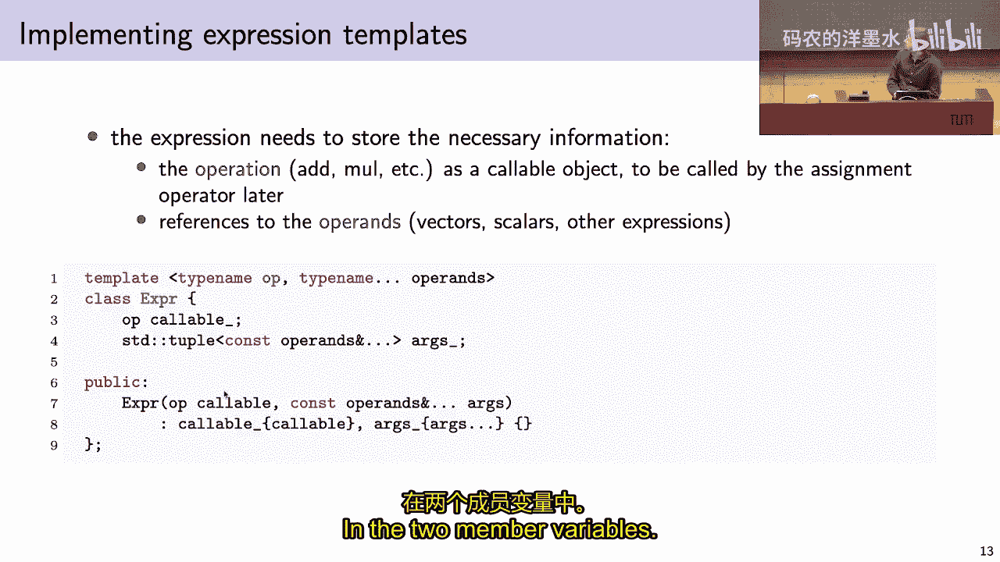

That's it。Now， how do the overloaded operators look like。What。They could look like this。

 They could look also look slightly different。 But one way of putting them is。Tempating it。

 So you don't have to write it multiple times for different types of arguments。 So now。

 both left and side and right inside side are templated arguments。And we return。Ato。

 because we don't want to be explicit here， Rather we want the compiler to deduce the return type。

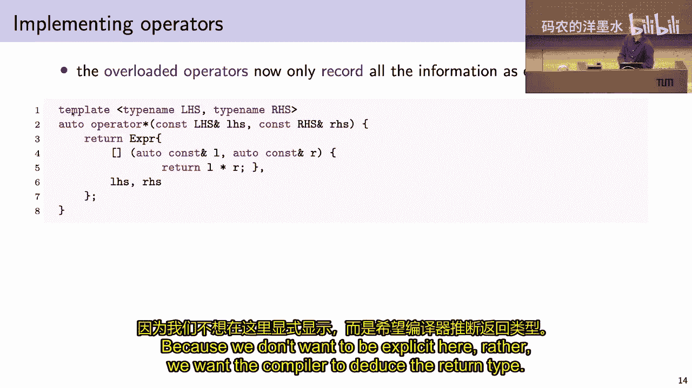

And， in fact， what we do is we， we return such an expression where we use a constructor that we just defined here。

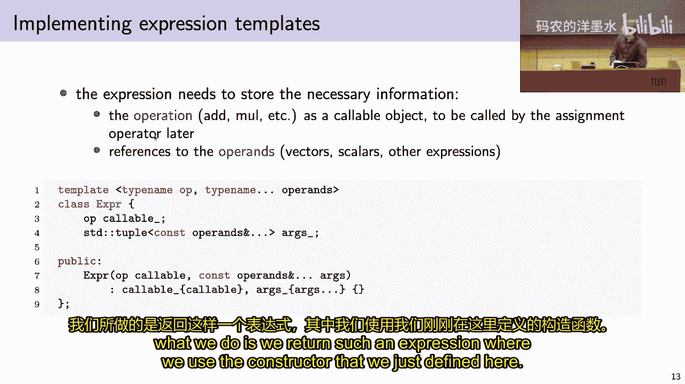

Now， let's skip over this for a moment here。 So this is the operator， the actual operation。

 plus the left hand side and the right hand side。And these are already con references so we can just pass them in to the expression constructor。

 which takes them as a con reference and then stores it as a con reference in a tablet。

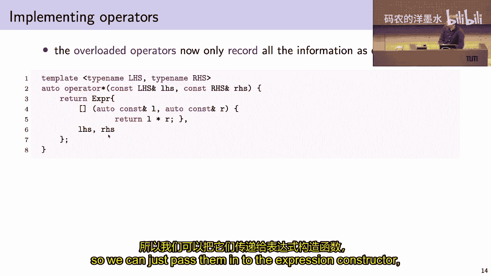

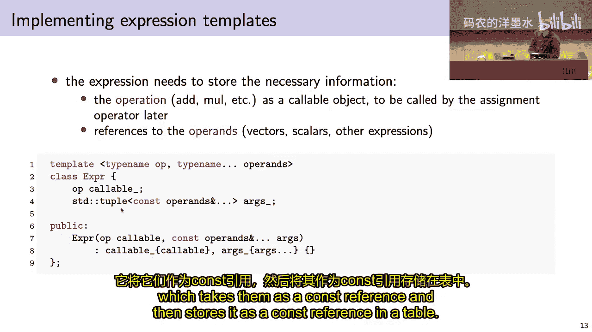

Now， let's look at the operation itself。 This store this as a lambda。

Which takes a constant reference to。An arbitrary argument and comes reference to an arbitrary other argument and returns the multiplication because we are overloading the multiplication operator。

Now， your first reaction， at least my first reaction upon seeing this code was like。A。

Isn't this a cyclical code， Are't you calling the same operator again with this。Well。

 if you do it wrong， then yes。 But the idea， of course。

 here is that this is the operation that you will call for each element。Of your expression vector。So。

All your。What you're handling here are vectors， right？ So how to do operations and vectors。

 You do them element by element。 So this is the instruction of how to process。

Do element wise processing。 And we store this in a Lada。

 and that Lada will be storedd in this expression。

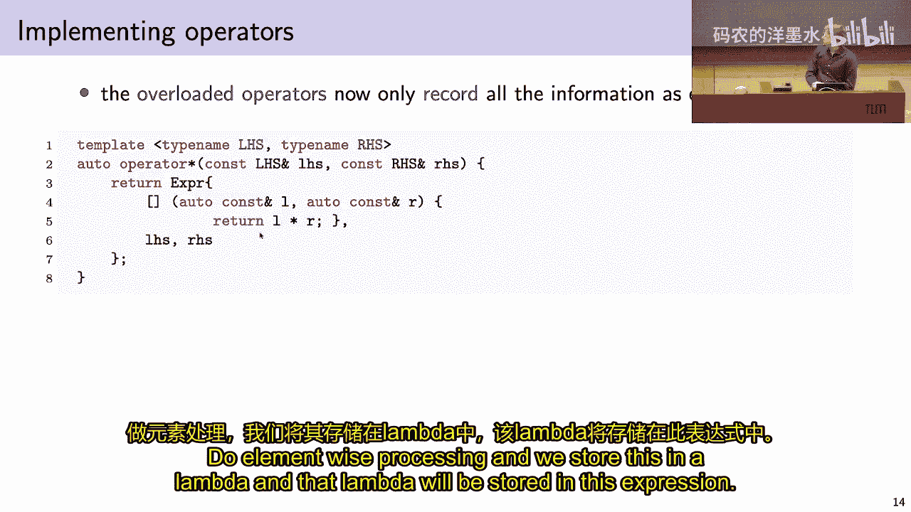

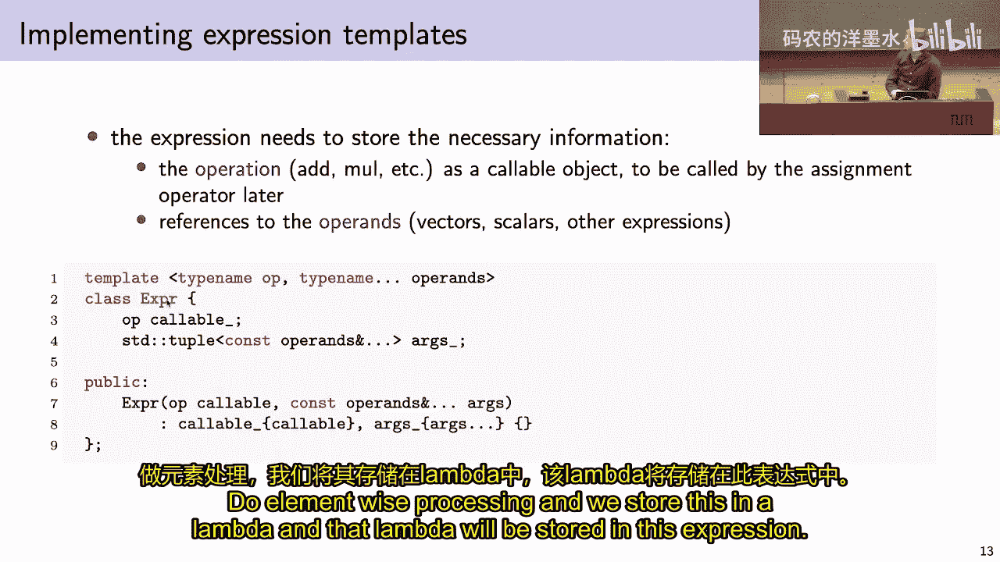

So we are delegating the multiplication of vectors。Was scaleals and vectors， and so on。

To the element wise level。So。In the part expression that we were looking at in our example。

 C1 times x left inside side would be a double for the scalar and right inside side would be a vector for x。

 and the callable operation， which is the generic lambda。

Will be called element files by the assignment operator or the constructor。

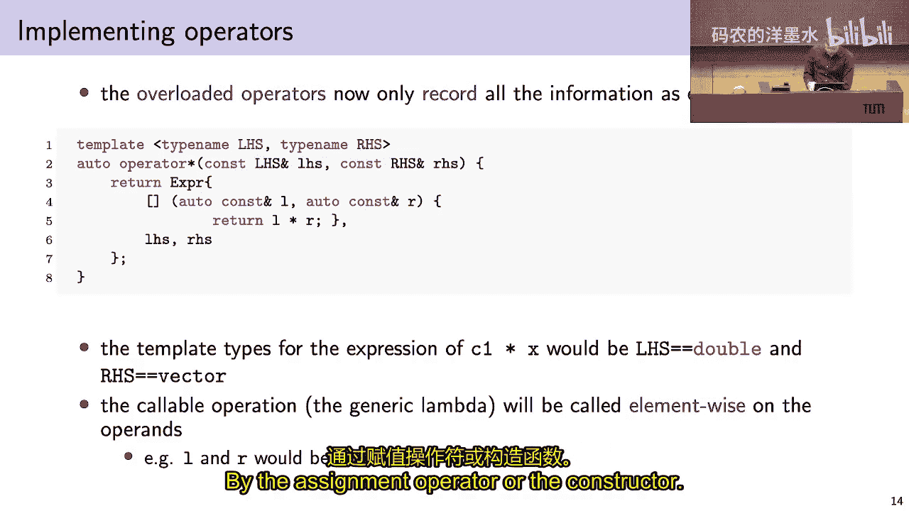

No。How would the evaluation take place。Well， as I promised in the assignment operator or in the appropriate constructor of the vector class。

 it will be doing it element wise。 And， of course， in this simple example。

 I'm not showing you how to do。

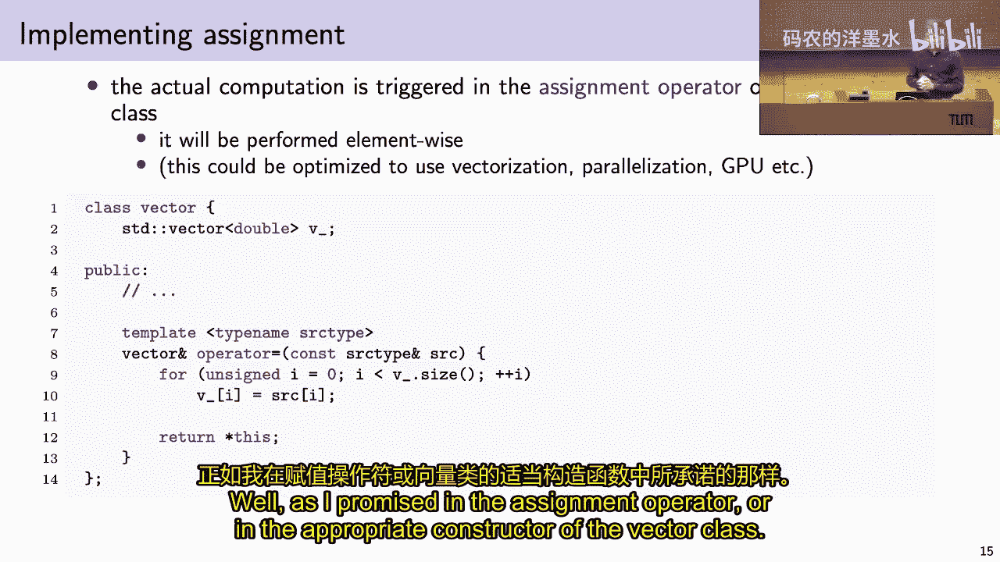

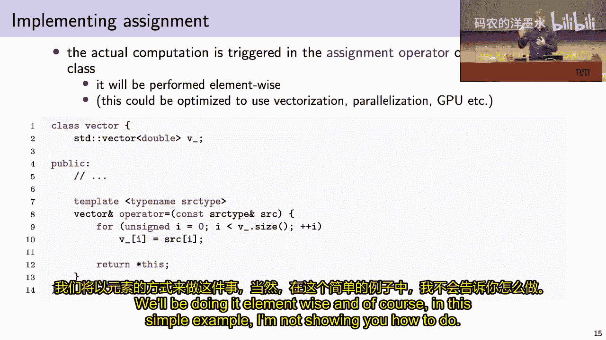

Vactctorization， parallelization， GPU kernels， and so on for this。

 But this is a place where you would be putting them。Right。So what we do here is we template。

The assignment operator or the constructor。For whatever comes as an argument， because， of course。

 we don't want to write down， or we can't even write down the general version of the expression to because it might look different。

 And it has then a different template structure。 So we just take a template argument， a general one。

 so we can put whatever in there。And then what we do is reiterate。With a full loop。

 like in the C code from the start。And what we do is basically， we say， okay， my vector。

Which I'm for simplicity， I'm just throwing in an SD vector。 Of course。

 you wouldn't be doing this in practice， but。This is just。An example， simple example here。

You know the size of yourself， obviously， and then basically in each element of your vector。

 you are storing the appropriate element of whatever you're getting in。So you see。

 I've delegated the actual computation again。Because the actual computation will happen in this of。

 So I will have to overload the bracket operator。To actually give me the result that I desire。 So。

 in fact， I've lied to you because this assignment operator doesn't do anything itself except assigning。

 The actual computation will take place in the overloaded operator of that argument source。

What am I passing in as a source， Well， it will be some kind of expression。

 So I have to overload the bracket operator of the expression。Right。

So now we go back to our expression code。

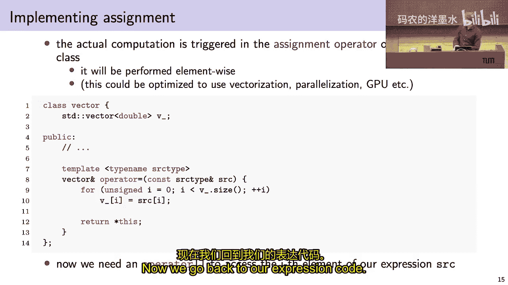

You know， the templated thing that takes the operator that we are implement implementing。

The arguments， the opera stores them。 We already had a constructor here that we used in the overloaded operators for the vector。

 And now we implement a new。indexdex operator， index excess operator。like this。

Return type is deeduced by the compiler。Argu is an index。And what we do。And yeah， I know this is not。

That's simple。Essentially， what we are doing。If we are now， what。

Let's ignore everything first and look， just look at this line here。Essentially。

 we are invoking our callable。You know， that's the lambda we got from the overloaded operator。

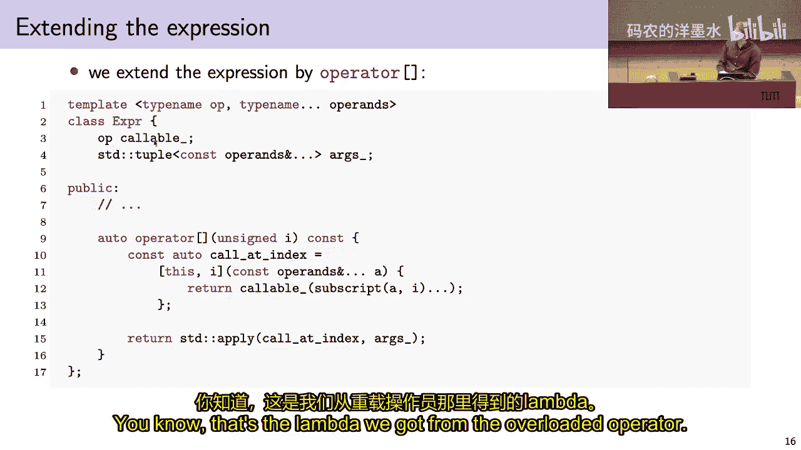

This one here。 So we are invoking this。It takes left and right and multiplies it together。

 And this was supposed to be an element wise multiplication。

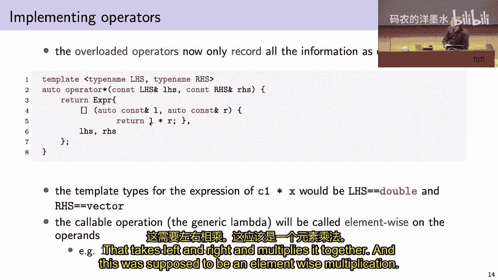

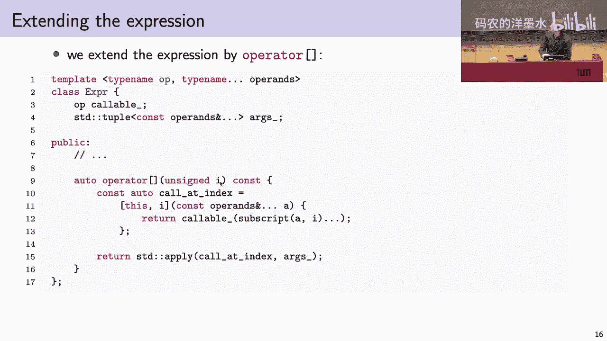

And， of course， what we do here in the， in the bracket operator， we are called element by element。

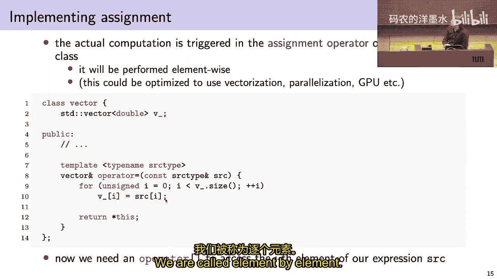

So， yes， we get the index。We call the carliber。Add that index for both our opera。No。

If only it were that easy。 So we have to do some indirects here。First。What we need basically。

 ideally， why don't we just call callable。offff our。呃。As。With index I。What。The problem is。

 our arguments。而。So what kind of opera do we have in our expression tree。

We can have expressions themselves。 The expressions have an overloaded subscript operator like this。

 So this would work。If you have a leaf in the expression tree。

 most of the operator operate will probably be vectors。

 Those vectors obviously also have indexed excess。 So this works， too。 But as you've seen in some。

 we have scalar multiplication。And as Kaar， a double or real float or something。

 they don't have indexed access。 So we need a workaround。 and the workaround is basically。

 instead of directly calling the callable on as， there should be as， not a。嗯。

We are doing an indirect via this generic lambda here。 and this lambda calls the callable。

But have another indirect call to a subscript function that takes the argument a。

And tries to do a subscript at index I。And of course。

 we do this for all the opera with Vaadic templates。 So basically。

 we get lambda with a veryadic argument， and we pass this on to the subscript function and the callable。

And in order to call this lambda。There's a parameter pack。You know， our arcs。

 we have to use the ST TD apply function。Which basically does exactly that thing。

 It calls that function。 In this case， it's a lamb double。This function a， in this case。

 it's this particular Lada here。Using that parameter pack。

And the only purpose of what this kind of indirection is to call the callible instead of with it directly。

 the， the， the subscript operator with a subscript function。 and the subscript function is simple。

It's a compile time function with a con expression， if。Which checks if the argument that you get。

 the templated argument， the templated operant。If it's a vector or an expression。

 So it has a subscript operator， then we call the I subscript。 If it's not， then it's probably a kar。

Let we just return it， as it is。And， of course， this year is a type trait that we have to define properly。

Now， let's go back。And see what we are doing here。The first off， we have the expression。

That trust stores。The operation that we want to do， and the operate。There's expression。Gets returned。

By the overloaded operators here only the example for the multiplication for the addition and or the other operators。

 it would be the same。Right。In the evaluation of the expression tree。We just loop over。

The final expression that we get。And excess。It element by element via the subscript operator and store the result in our vector。

Now， the actual work is happening。 Then we call the callable。That is stored in our expression。

Using the arguments that we stored。And the cool thing is。

 we don't even need to do explicit tree traversal here because the compiler will do it fast with the nester templates and the veratic templates。

 everything will happen automatically。😊，And the coolest thing is， this will happen at compile time。

 There is no runtime overhead for this。Except for the actual for loop and the actual computations。

 which will be invoked via this call that index Lada expression。

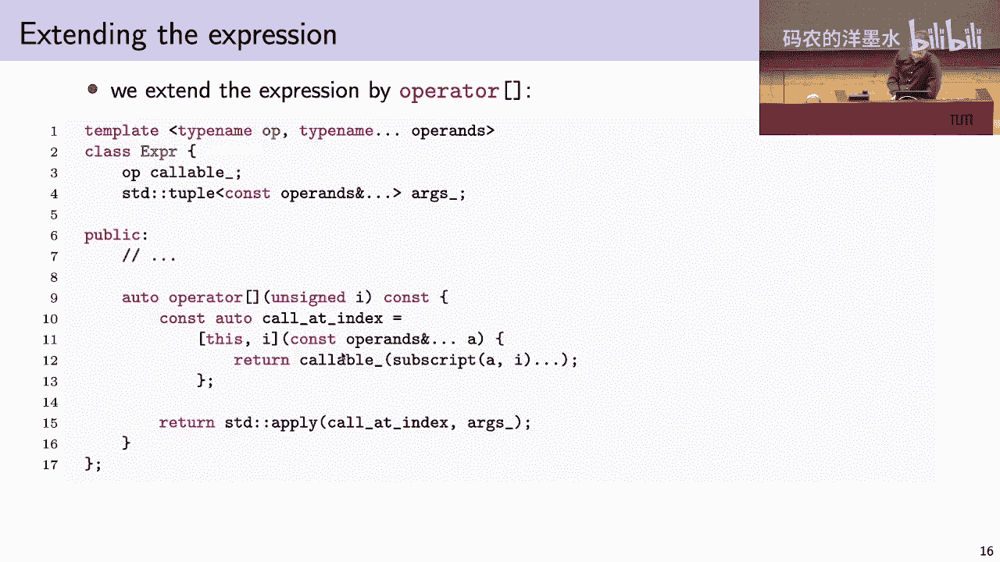

Right。So we have the subscript operation to deal with expressions of vectors that have subscripts and scals。

 which do not have subscripts。And we do this via type trade， one that we define ourselves。

 For example， it could be called is vector or expression。

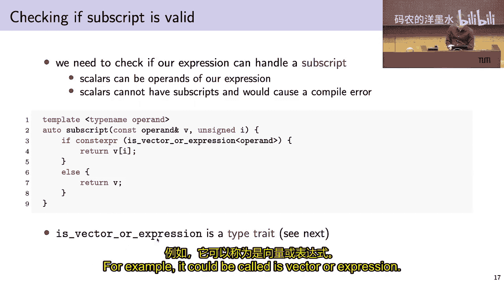

And how do we do this， Well I like you do type traits in general， which weve already know。 So。

 for example， you say I have a templatedstruct called is vector。

 and I'm deriving from the standard library type， false type。

Which is exactly there for you to do easy type traits。Then we specialize it for a vector。

And then in that case， we derive from true type。 So， yes， this type trade will apply for a vector。

 So is vector is a type trait that checks if your type is a vector。Let we do the same for expression。

Default is the false type。 Otherwise， if it's special， we specialize it for the actual expression。

 and then it's the true type。 and then we combine both of them with an or operation by using a constant expression bull that is templated if a template argument a vector or expression by invoking is vector。

😊，They call operation here， which is， of course， defined by the false type in the true type in the standard library。

And oring it together with the same for is expression。

Now we have a shiny new type trait that checks if whatever type we have is a vector or an expression。

This is how you can do your own。Type trades easily by relying on the standard library。

And templates and concept expressions。No， of course。嗯。

We wan to make sure that our overloaded operators。嗯。

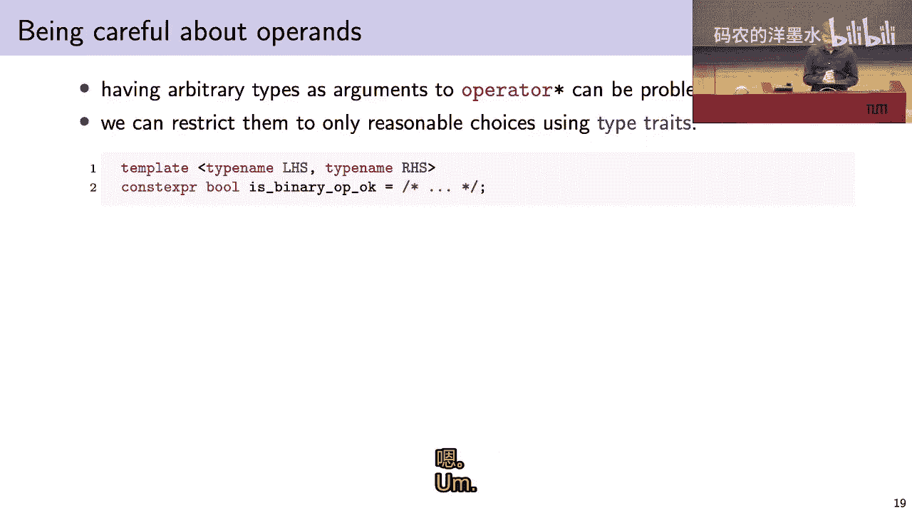

Let's have a look at our overloaded operators， again。Here they are。

Our overloaded operators take any template argument。安你。So any multiplication you do from now on。

Would be doing your expression template stuff。 That's a little bit too much， right。

 We only want it to happen for our vectors and expressions， and so on。

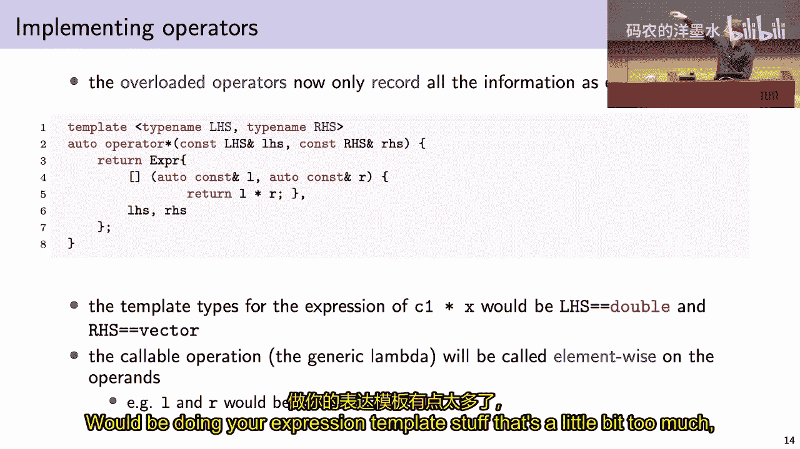

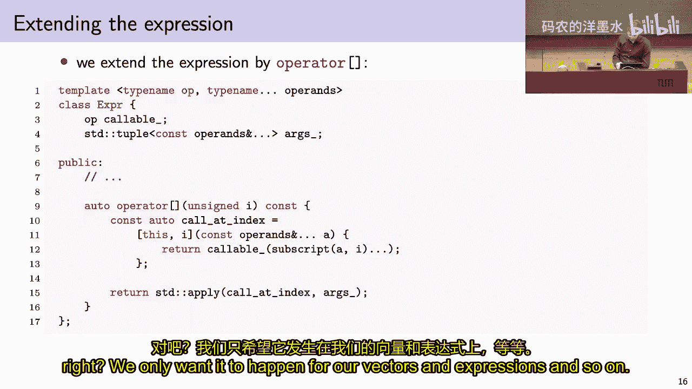

So， basically。We need to restrict our。Operators to those expressions where we actually want the expression templates to be used。

 And we can do this again， via type traits。

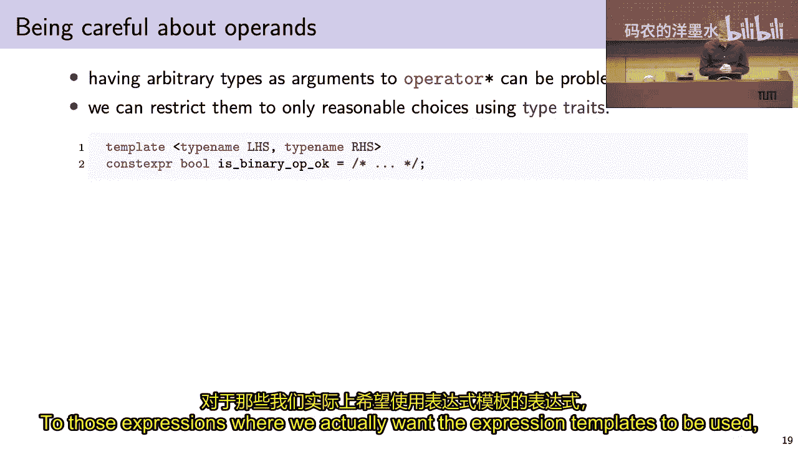

For example， we can define a type trade that says， oh， yeah， such a binary operation is okay。

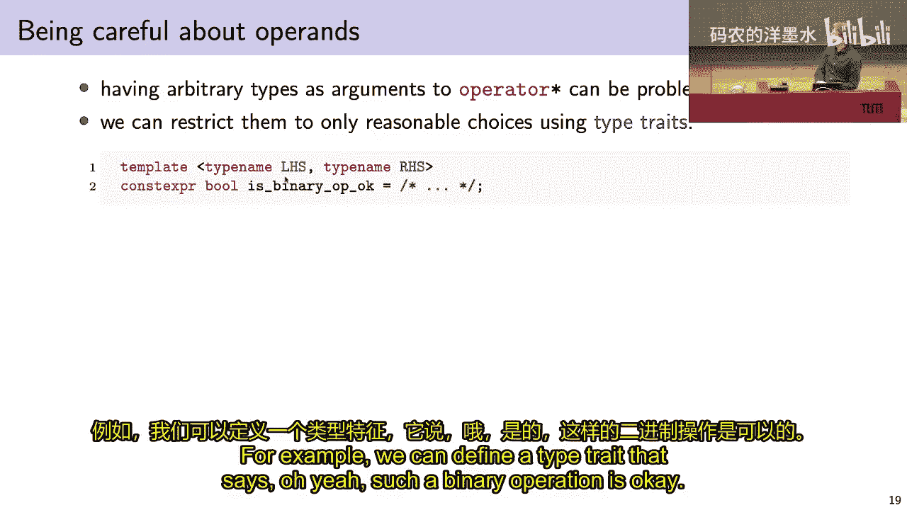

And then we use spin air substitution failure is not an error。

 Youll remember from last week an SDDD enable if to check if left hand side and right hand side。

Are a supported binary operation for which we wanna do this expression template magic。And otherwise。

It's a substitution failure， and won't be chosen。So that not everything is suddenly handled as an expression template。

Then you call the multiplication operator。 Of course， R N C plus plus 20。

And almost all compilers supporting it almost properly。 you could also use concepts。

 And then it's a bit more。

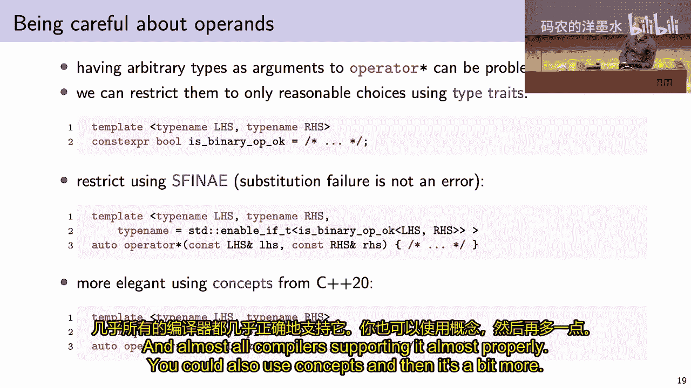

Elegent， then you can use a requirement statement， require statement to check if the type trade is fulfilled or not。

 But in the end， they work the same。 This is just more elegant and more powerful because you can do more with it。

But we will talk about C++ concepts in two weeks in our last session。

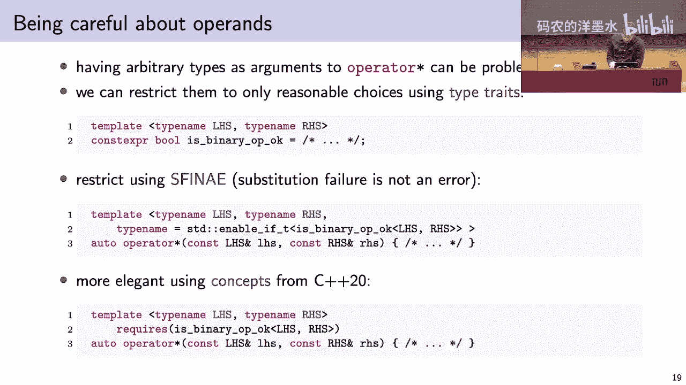

Because now we need to define this type trade somehow。So。Because could， for example， use。

The standard library is arithmetic type trade。To define our own is arithmetic thing。

Or we could be using the standard library thing directly。

 And then we can define binary up okay type trade as a constant expression pool that checks if the left hand side is a vector or expression and the right hand side is。

 or the left hand side of an expression and the right hand side is an arithmetic expression。

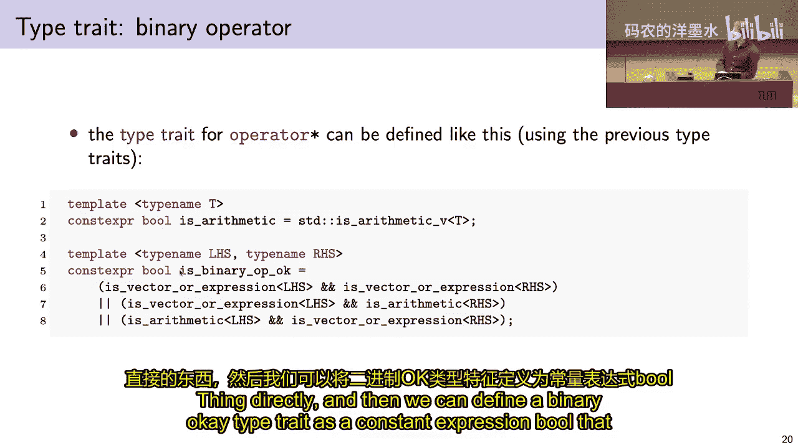

Or left inside is arithmetic， and the right inside is vector expression。

That's one simple way of doing it。And now， what can we do。We can write code like this。

That looks nice。 And see， plus， plus like and looks like the formula on paper。 But internally。

 will convert everything。😊，To exactly that fall loop。

That the seat implementation that I showed in the beginning had。You explicitly iterate over the rate。

 There are no temporaries。 There's no extra memory required。

And if you now spend a little bit more effort and implement。

Vecterization or parallelization in this overloaded operator or overloaded constructor of your vector。

 Your code will be even faster than the C equivalent。

 or you can even transparently do GPU programming by invoking GPU kernels there。So。

With these expression templates。We have Le algebra that he can use in a modern way。

And it's freaking fast， too。The only drawback you have。Is。

You have to do this expression template thing。And。If you w to do it yourself。

 you should be understanding what you're doing。 So you might have to go over the slides of human times。

Or， of course， you use a library that already does this for you and just be a happy camper。

 And know that behind the scenes， this expression template compile time stuff is going on。

And makes your code really fast。Right， so one of your comments is， I really like this language。

 I have to say， yes， this is one of the moments where I really say。😊，C plus plus is awesome。

Of course。The reason that it needs to be awesome is。Kind of shit。嗯。Because。

This could be fast without having to do all this magic with templates and compile and programming。

 but it's not。So it's cool that you can do this。 And I really like thepl for it。 but， of course。😊。

Some other languages do it a lot easier。You're completely lost。Yeah， sorry about that。嗯。

Try hearing my explanations again。 If my explanation suck， I gave you the。

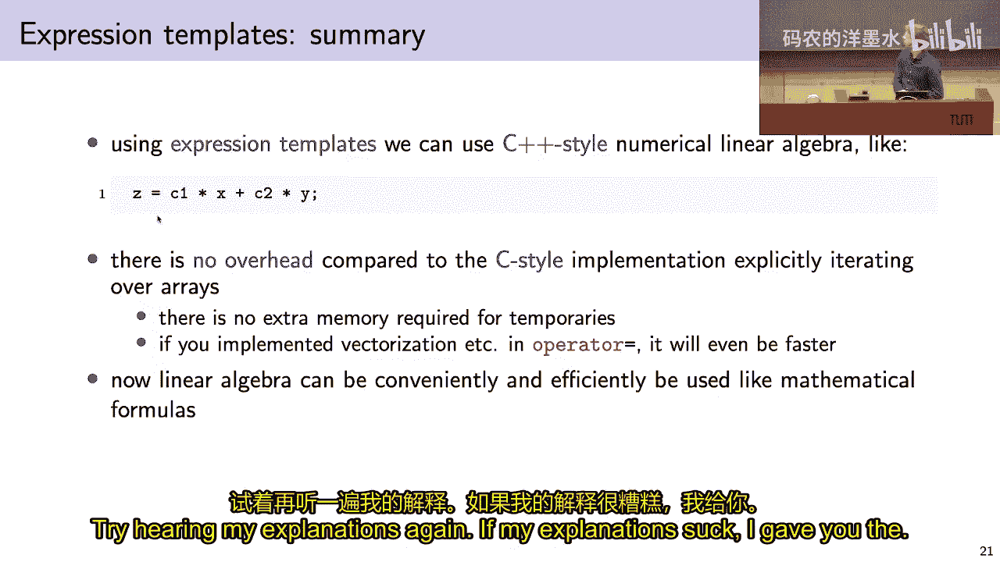

You can Google。Or is it。

But we own CPP con 2019。 you will see the talk。 You will see his slides。

 Maybe he explains it better than I do。If not， have look at code that actually does this expression template stuff。

 So you can， for example， put all this code of the slides into a file and run it and test it。

 it works。

You might have to add a few things like a constructor， and so on。Or， I mean。

 what it can do is you can look at the eigen library。嗯。Or what you could also do。

 And this is of a blatant self advertisement。 You can look at our library that does our in problem solving for us。

 which until very recently had expression templates implemented for both CPUU and GP Co。

 GPU code transparently。And recently got rid of it because we are doing a big rework of the back end。

 so。We needed to clean， make our code a bit simpler before we do the big changes。

 But if you look in our committeeitory with the expression templates there， in fact， basically。

What we had in Eza is what I showed you in the slides， more or less。

And if you wanna know how these expression templates got into El。

That was a master thesis of one of your colleagues a few years ago。Your arch spirit bricked。

I'm sorry。I always wonder how to get started Read code of large projects。

 This is an appropriate question for this slide。I don't know where to start。

 and everything seems so overwhelming。Well。I don't think theres。

Generic way of doing this or a best way。 What works for me is。

To do a task with this project that I'm interested in。

And check what's happening if I do exactly that。Follow it down to where the code is going。

Read the code。 maybe skip over a few things that I don't understand immediately。

And then go bottom up again and then go down and do this as often as necessary until I understand what's going on。

That's my approach。 I don't know if that works for you， yeah。Top down first。

 bottom up next and do this top down， bottom up as often as necessary。And it might be necessary。

 quite a few times。Can we do all of this in any other language， such as Java etc cea。Yes。

 lazy evaluation basically works in any language that's decent。Which includes Java。

Im doing this at a compile time。 There's no overhead。Doesn't work in too many languages。

 I guess not sure if you can do it in Java since Java copied。Almost everything modern C plus added。

 I presume in some version of modern Java， it's probably possible。 I have no idea how but yeah。

So yeah， you can do it in other languages， too。Oh， question。 I wonder。

 do we really need to know these topics if we don't develop a library。If you're just a developer。

 well， if you're just a developer， what are you developing。I mean， if you're developing websites。

That have some HML code and a bit of ja。 Yeah， you probably don't need this。If you have。

Developer shop at one of the companies that does backend development。For example。

 for medical image processing， or if you wan to work at some of the parts of Google or Microsoft that do this stuff。

 Basically， yes， obviously， you need to know these techniques。And， but yeah。

 it depends on what you actually wanna do。But let's put it like this。 if at a job interview。 and。

 you know， for the big companies， you probably have to do several of those like 8 or maybe even 10。

 I heard of one who had to do 20 interviews， totally crazy。

And you can explain how expression templates work And C plus plus。 And this job is about C plus plus。

 The recruiter is probably like， oh， yeah， you're awesome。 or like。

 I didn't understand this myself either Co。 So yeah。

 it's definitely favourable if you can do it like this。 if you N don't。

 if you necessarily need to do expression templates on your own。😊，Probably not。Right。

 there's only so many libraries where you need to do this。

 And there's probably only so many jobs where you actually have to do this。

 But if you understand these techniques， how these work， then you can do other things。

That are similar。And， of course， that is a qualification many people look for。What is El about。

 El is about。Tmographic reconstruction。So we do image reconstruction for X ray CT。

 for face contrast CT， for dark field CT， for light field microscopy。 So to solve inverse problems。

 the generic library to do this type of stuff。And we have plenty of student projects master thes the Spula thesis involving that library。

And， yes， it's written in C plus with a Python interface。 So if you wanna apply for any of these。

You should know C plus。And yes，20 interviews is just a disgrace。

 But so many companies of the big companies that can afford to do this。 They interview you so often。

What makes C plusster so special。Well， it's fast。Has a big ecosystem， big history。Yes。

 they are better languages。But， probably not。Once where you can do all the stuff as efficiently。

 and you have such a large code base and such a good tooling and library is available。But yeah。

 at some point， C plus plus will be obsolete。 Yes， obviously。Right。

Are you using the Cpl API of M L frameworks in or in your projects。I was using it in some occasions。

 but most of the cases， we are using the Python interface。

How long should a source file be maximum in number of lines W that depends on the source file。

Anything from one to a million lines， whatever。I mean， depends on your editor。

 If your editor can handle long files and it's fine。 If not， you probably should split it up。

Are you giving a lecture next term， Yes， well， no， actually， no。

 I'm doing a seminar and a practical course and not a lecture。And yes。

 this course will only be held in the next winter term， not in the summer term。

I was expecting to do gut again， but I'm not。Last minute surprise that I'm not doing it。

 So I'm actually happy about that because now I can focus on topics that I care about。And I'm doing。

Not that I don't care about algorithms and data structure。 That's a cool basic topic。

But my research and other things。 And now I can do teaching about my research。 So basically。

 I'm doing a seminar on computational methods for X-ray computer tomography。

And I'm doing a practical course on applied optimization methods for inverse problems。Yes。

 this is a bit specialized。But I like it very much。

Right。So。I promised you two more examples of compile time programming， template metal programming。

 all this stuff。So， I first show you。E very generic pattern。The curiously recurs。

 recurring template pattern， C RTP。And wherever we use it for polymorphic cloning。

 So these two examples are linked。Can you tell us who will be holding gut next term， Professor Tue。

Can you offer me a master thesis in the next winter term。Maybe。So the thing is。

I have plenty of master projects off the top of my head， probably 10，2030。

The only limit that I have is that my day has 24 hours。

 and I can't supervise too many master students at once。So， yeah。

 if you wanna have a master see this next window term。

Maybe you should poke me about this a bit early to make sure。

You're one of the ones I actually supervise because， as I said， my capacity is limited。

Because my day is limited and also my energy is limited。Right， so curiously recursive template。

 curiously recurring template pattern， CR TP。

So you remember Pori Mufi from one of the earlier chapters， you know， virtual functions and all this。

And obviously， you， if you were in a job interview right now。

 you would be perfectly capable of explaining how virtual functions work and how they are implemented in standard compilers。

V tables， right。And since you understand how it works。

You also know there's a cost for virtual functions because you have the indirect to the V table and another indirect to do the actual function call。

So that's a runtime cost， both in terms of memory。And in terms of actual runtime。

So if you wanna do something similar as dynamic poly muphy。Without the runtime cost。C plus has。

Solution。What trick。 Let's call let's rather call it a trick。For you， that allow。

 allows you to achieve something similar， not exactly the same。

But something similar without the runtime cost。 And that is called static polymorphphy。

 And this is done using the CRTP， which is a very particular pattern。

Which I'm gonna show you to you now。So。The basic idea is pretty simple。

You do a base class that is templated。WithThe template parameter T。

And the derived class will derive from the base class with itself as the template parameter。

This is a bit of a head scratcher。 If you see it for the first time or the second time or the third time。

 at some point， it becomes natural。 I can assure you took me a while， but for me。

 it now looks natural。And， of course， this is why you have this name curiously recurring template pattern because you have a template argument in a base class that you derive from。

And put yourself as a template argument。Why are you doing this。What。

Because now the base class has the derived class as a template argument。

And that means at compile time， the base class will know what the type of the derived class is。

This is weird， I know。But， it's pretty cool。Because what we can do now。In the base class。For example。

 we have a function called do something。It can take the this pointer。 You know。

 the pointer that refers to the current object instance of this class。Cast it。To。The type T。

 which is the derived class。And then use it like the derived class。

So this is similar to a virtual function。Because what does a virtual function do。

 you call it on a reference to the base class， and it will automatically select the function that the actual object of the type that the actual object is about。

Here， you don't have the interactiondirect via V table。

 and the compiler doesn't strictly do it for you， but you do it via the compiler by doing an explicit cast。

To the derived type。 And then， you know， the type of the， this object is derived。

 and then you can use any of the derived actions here。This is kind of like polymorphphy。

 but done in a static manner without dynamic dispatch。Via templates。At compile time。Right。

So the idea is pretty simple。

嗯。It's a bit tricky to use。And if you don't take care， you can have very weird  errors。In your coat。

One of the weird things is that， well， there are no virtual functions because we are not doing virtual functions because they have overhead。

So， what we do。It， but means we can't override functions。So what we do if we do this。

 do something here。We just hide things from the base class。 And， of course， in the base class。

 we were doing the clever thing。😊。

In the derived class。We really can't。 So that doesn't work like this。 So you have to do。

Some workarounds to make this work as you would expect it to。So， in general。Well， it's cool。

 And at the beginning， once you understand it， you might be tempted to use it everywhere。

 like I was back then。The advisers really only use it。 They're really necessary。It's， for example。

 used in the eigen library。 This is how。Expression templates work in the aigen library。

 And that's why the aigen library is so freaking hard to understand。 also for me， also today， still。

And， of course， theres some special use cases like polymorphic clone birds， really， really useful。😊。

Now， how do you do static polymorph properly， Let's say you have a class amount。

That represents some sort of currency。 And you get the value。Like this。

By casting the this pointer to your template type。 So this is obviously the base class and then calling get value。

On the cast at this pointer， of course， that requires you now。

To have derivatives from this amount like this here， like a constant 42。

Which has a get value function that returns 42。And now， if you call get value on a base class。

Reference to a constant 42， which you can have。Get value。 We know。

The type of the derived class via the CR TP。C to this point of this and call the correct get value thing。

And， of course， you can have another derivative of this amount based class。

 like having an actual variable that has a value and returns this value in the get value function and so on and on。

And then， using it。Here you see the drawback of using it。 So the general code here。

 you define a constant。 You call a print function that accepts an I amount argument。

You define a variable。 You call the print function that accepts a derived an amount， based class。

 basically reference。So this works。 This looks basically exactly the same。

 like dynamic polymermorphphy would。What doesn't look the same is the actual print function。

 in the regular print function with dynamic polymorphphy。

 you would just be accepting a reference to the base class。 And that's it。 Here。

 we have to do a template。Because。The argument， template argument of amount has to be specified。

And that is a free template parameter that gets deduced once you actually call print for one of the derived classes。

So that's the drawback that you have。 All the functions that。

Should support the static polymorphphy have to be templated。And you remember。

 the templates have some drawbacks。Right， you either define them in you head a file only there。

So you get implicit instantiations， and then you have to include the header file everywhere and your compile times go up。

Or you specialize it。Explicitly in your source file。

But then you only have those specializations to work with。 And if you forgot one。

 you can't use it there。So yeah， this has some drawbacks for the readability of the code here。

 for the readability of the code here， which is not that bad， but still。

And it has the drop of templates。 And trust me， there are people that say， oh。

 you wan to do C plus pass。 don't use templates。 They're too ugly for me。

They are there。 They are even companies that have have as a guide。 I don't use templates。 Of course。

 it's a bit stupid because it's a major feature of C plus plus， but yeah。Right。Oh。

 Holy you should ask a lot of questions。Oh， if you supervise my bachelor thesis。

 I will show you how to cook scrambled eggs with your frying pan。

I already have an instructor for cooking， thanks。And I know already how to do scrambled X。

 It's just that I didn't actually do it yet。But， I'm close。

How high is the chance to make a master thesis in your chair If we just did this lecture from you and got an average grade。

To be honest， I don't really care that much about the grade。 I care about the ability to program。

And if you have anything to support that your ability to program a school。

 like some Github repository。 Oh， you know， there was this advent of code thing， for example。

 in December。 And you have a Github rip over where you can show me that you solved quite a few of these。

I would be impressed by your abilities， right。And I would look at your code。

 maybe not impressed by abilities because your code might be ugly or maybe it's really nice。 So。

 yeah， I I care about your ability to actually code and C plus plus。 So the great。😊。

It's just a vague indicator of that， right。Thus Ruft have templated expressions。I don't know。

Probably。Oh my god。 How is this compared to Chavez implements， whatever。This seems like。

Interface stuff。 So I don't think it's really comparable。But then again， I'm no Java expert。

Why is this not the default implementation for the C plus virtual keyword， Well。

 I just gave you some drawbacks。That's why。Unfortunately， in the seminar。

 you use Python and Nazi plus plus。So use the correct tool for the drop。

Not everything should be solved by C plus plus。 Everything could be solved by C plus plus。

 but some things are definitely nicer。In Python and having Python call C plus plus libraries。

Especially if you want to visualize stuff and， of course， we want to visualize stuff in the seminar。

What abilities do we need to get accepted to your seminar next semester。Interests， motivation。

 may be some mathematical knowledge。I will put some stuff on the website in the upcoming days。

 That's all the preliminary meeting on February 6。 So if you wanna know a bit more。

I'll let you know there。Right。Obviously， this works without any function cards。

But you in templates everywhere where you want to use that kind of code。

Concepts make it a bit easier to use， but still。It's not as nice to use as a regular dynamic dispatch。

So where we use it for is polymorphic cloning。 So let me remind you of the problem of polymorphic cloning。

So we we are talking about polymorphic class hierarchies and how we need to take care of slicing。

And thatlicing can be a real， real issue。In particular， copying is an issue。So what we do， typically。

In derived classes， we define a virtual instructor guideline number one。

And in polymorphic class hierarchies， then we are also supposed to delete。

 copy operations and move operations because they don't really make sense in that context。

But then again， sometimes you need such operations。 So let's say we have an abstract based class。

Which has a virtual method。 That's abstract。We have our virtual instructoror， as required。

We derive from the abstract class， implement a concrete do stuff thing with the override keyword。

And now we have a function F that accepts the base class reference。And， of course。

 gets past one of the concrete derivatives of the base class。And now， you want to create。

Why did I put a reference there。Oh yeah， yeah。 You basically wanna create a copy。

A copy of whatever was passed in。But you can't， because you only got。The base class reference。 And。

 of course， the base class is abstract and。The base class doesn't know how to copy the actual derived class that is hidden in。

 in this base class reference， so。Yeah。That's a problem。

And that's basically where polymorphic cloning comes in。 I promised you this a few sessions ago。

 So here it is。

Constructors don't work in this situation。So what we do instead is we define a clone function。

That is virtual。 and that delegates doing the actual copy。To the base class。 And， of course。

 since it's a virtual function， it will delegate it to the proper base class。

 which will know how to create a copy of itself。So what we do is we add。 So it's the same。

Abstract class and concrete class， as before。But。We will now introduce a clone operation。

 That's a virtual function that's abstract in the base class because can't copy the clone the base class。

That returns a pointer。Oh， even。A pointer。To the base class。Now。

 we override this clone function in the concrete class or in any other derivatives of the base class。

And we use covert and return types。So return a pointer to the actual concrete class。

 And here we know how to do it。 We know that now clone is called on an object of type concrete。

 So we invoke the concrete construct copy constructor using this。And then we can have oops。

 then we can have a call like this。 So now we invoke a dot clone。

This will be a virtual function dispatch， so it will be called on the appropriate type。

Of the derived class。 and it will return a pointer to the derived class。

 which we store in a pointer to the base class。Okay， that is polymorphic cloning。Now。

 the alarm belt should be ring ringing in your head， because。Raw pointer。 Ra pointer。

Naked new keyword。Who's gonna manage the memory， Who's gonna take care of deleting it。

These are all the issues， we。Why we are。Avoiding raw pointers。 That's why we have smart pointers。

 Why am I not using smart pointers here， Isn't that what I preach to you for， I don't know how long。

During this term， well， obviously， yeah， let's trust you smart pointers。

But that's the reason I showed you the pointer version first。

So let's do this with smart pointers same thing， okay。

So we have a clone operation that's abstract or pure virtual in the abstract based class。

 And now we return a unique pointer to abstract。That's how it should be。 Now。

 it's clear that the unique pointer， if you pass it out of the clone function。

 it's owned by whoever you pass it to。 and then it will take care of freeing the memory and R AI I。

 and everything is so shiny and nice。😊，And then， of course， instead of doing a new call。

 you do a make unique call。For the concrete， and return it。But， there's a butt。

Since this is C plus plus， it has its warts。 And one of the warts here is you can't use covariant return types for。

Use the defined types and unique pointer， even though it is a pointer from the standard library isn't a raw pointer。

 and covervariant return types only work for raw pointers。Fuck。😡。

So you can only return a unique pointer to abstract。If there's a problem。Yes， and no。

Everything works like this。 Memory management is taken care of。 Clning functionality is there。

 It works。 But in the case that in your function F， you don't want to get an abstract pointer。

Or unique pointer to an abstract in this case。 But rather a unique pointer to the concrete class。

 you need to do some。

Uli is fucking。And that's kind of unnecessary。 Why aren't there cover and return types for smart pointers。

De it。So， yeah， C plus doesn't support this。And there's nothing in the standard committee that is aiming at supporting this。

 either。So， solution。Curiously， recurring template pattern， because with this。

 we can solve this problem。

So， basically。We solved one of the drawbacks of C plus+ using some other C plus plus features。

Which is， yeah。So how can we do this。So one of the first steps is the following。

Instead of directly doing the clone or having an app app pure virtual clone function in the base class。

We have an implementation of clone。And that delegates the actual cloning process。

To a clone imp function that is private and pure vir。And now you see the difference。 Basically。

 this is。The cloning function。That returns a raw pointer。Where we can use covariant return types。

Whereas the knife interfacefaith clone function is the one that returns a unique pointer。

To the base class。So， now what we do。In the derived class， we override obviously。

 the clone input tool。Do the ugly thing with the row pointer。And we provide。

Another clone function that returns a unique pointer to concrete。And， of course。

 this is not a virtual function。 So this is actually hiding the clone function from the base class。

But this is O in this case， because if you invoke clone from the base class。

 you will get a unique pointer to the base class， which is fine because that's what you wanted to have。

😊，But if you for reason， for whatever reason， invoke it。On a derived class， you will get a pointer。

 a smart pointer of the con correct type。Due to this little indirect via a virtual。

Private clone input function。Now， you should be raising your finger and saying， hey。

 but there's no curiously recursive template pattern here。Yes， there is not。

Because while this now works， the problem is。Every derived class now has to the implement the clone function and the clone imp function。

 And if you forget one of these or both of these， the cloning won't work。

And that sucks。Right。So the solution to not have to implement this every single time is CR TP。

 because CRTP can also be used to inject functions into classes。 So how does this work？

 And this is another cool use of C plus+ templates。😊。

Where you could say， well， you know， it's really cool that you can do this and that you can do this as a cool workaround for problems。

 But， of course， in the first place， you shouldn't have the problems to work around in the， yeah。

But yeah， we have them。So the idea is we introduce a class cloneable。That has a virtual deor。

As usual， has a virtual clone input function。Using covervarit return types and a clone function that is public that returns a unique pointer to the cloneable。

So。As before。You can do the same for Shad pointer。 You just need to make sure that you do S D enable shared from this。

 But you know about this already because you did the homeworkback， right。

So now what we do is we define another class。Called clonene inherit。

This inherits from a templated argument。Bace。And that's the C， T P。You think。

A template bit derived class。 So what it does now， it implements a clone function that returns a unique pointer to the derived class。

By calling cloneone emperor。And now， in order to make this work properly。

 you have to create a unique pointer with a static has to derive to of this clone input pointer that you get。

Coneple if， yeah， again， with a few cves， basically we create a new derived object。 Yeah， the CTP。

And for this， we have to steady cast our this pointer to the derived。 Yeah。

 and then we return a clone inherit pointer to that， which later on is cast to derived again。So yeah。

 this is a bit。Ugly。

But then again， you write this once。And now what we do when we actually derive from some base class。

We do it the following way。Now， a concrete class would derive from this clone inherit thing。

 the CTP class。Where we provide ourselves as the first template argument to do CRTP and the second template argument is the cloneable base class that we defined beforehand。

Now， the cool thing is， concrete will have the clone functionality through this C T P working properly。

 and you no longer need to define it in every derived class。 The drawback is， you need to do this。😊。

Ugly。Inheritance here with template arguments and so on。Which you can fuck up， obviously， or forget。

 or yeah。 And， of course， the other drawback is that concrete now is actually inheriting from clone inherit。

 which inherits from cloneable。So concrete is not a direct descendant of cloneable。

 but an indirect descendant over two levels。But yeah， this allows， you know。

To use the clone functionality， as you would like it。 And it works exactly as expected。

 because if you call the clone function。On an object， that is an actual concrete class。

You will receive。With the autoto。Something that is a unique pointer to concrete。

 And here you see the name mangling。 This is the output of cllang and Lipsy plus plus the output of GCC and STDD Liy plus plus looks a bit different。

But you see， this is an actual unique pointer too concrete。So basically。

 you can have your cake clone functionality with kind of。呃。Cover end return types and smart pointers。

 both together。But in order to have it， nice requires a bit of rook。It's good that you can do this。

 So basically， you use the C T P to inject functionality into derived classes， which is nice。😊。

But then again， if the language didn't suck at the first place and would provide covert and return types for smart pointers。

 it wouldn't be necessary。I can't imagine the homework for this chapter。Let's see about it。

 I actually have no idea how the homework looks like。To ask， but covervi and return type。

 somebody didn't pay attention in one of the last sessions。

 I explained it doing object oriented programming。But， basically。

Cvi end return types mean if you override a virtual function from a base class。

And the base class function returns a pointer or reference to the base class in the derived class。

 you can return an pointer or reference to the derived class。

 So you can change the return type as long as you stay in the class hierarchy。

I will use so many row pointers in the exams。 You will never recover from grading my solutions。

I hide doubt that because I have a very easy option for grading things that I don't like。0。No。

 but yeah， you're right。 Correcting exams， always。It kills my mood。Even if you do well， it's just。

Yeah。Ugly thing you have to do。How do you find chat GT。哼。Feel free to use it。

I wouldn't trust my life on it。So I don't know。 It depends what you ask it。 I mean。

 from the example queries that I saw， I mean， I try to use it a few times every time it says。

I don't know what the message was， but basically queue is full。 Does can't work for anything else。嗯。

The thing is for， for the standard stuff， it works really well。

Some of the people showed mequeries for SVD or some other standard math concepts。Or other concepts。

 something that is popular。 And there were a lot of thing has been crawled basically by chat GBT crawled and and quotation marks for that。

 it works cool。If you go to anything specialized。That's breaking down。

So Id actually be curious what it says about expression templates or the curiously recursive template pattern。

嗯。For CTP， it's probably good because theres some good Wiikkipedia articles about it。

 But for expression templates， I don't think there are。 So maybe the answer sucks。 Maybe it doesn't。

 The bad thing is， it will have many good answers。So we will start trusting it。

 And then if you query it about something it doesn't really know about。 Well， no in quotation marks。

You get a bullshit answer， and you might not notice that it's bullshit。So， I don't know。

I prefer having trusted sources。 Let's put it like this。 But it's definitely convenient。

And it's cool。 It's， it's definitely cool。 No question about that。

Right。That's it for con concepts of compile time programming。

 I gave you a few examples where it's used， and。I hope you like them， as I do。

And that's the end of today。 I'm finishing early for once。 So yeah， go me。

Have a nice week and see you next week for parallel program。 Thank you very much。😊。

