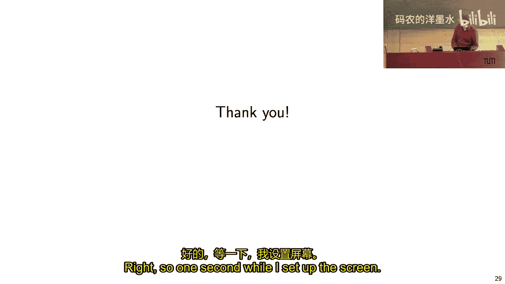
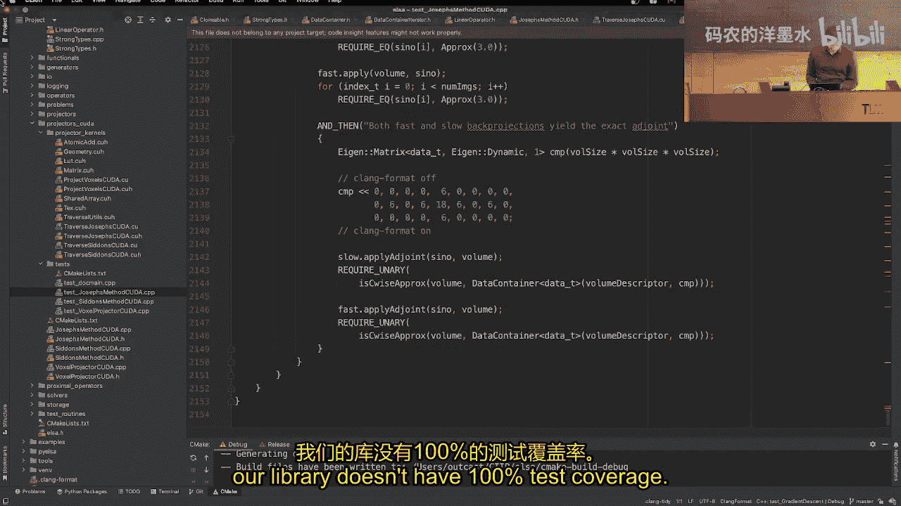
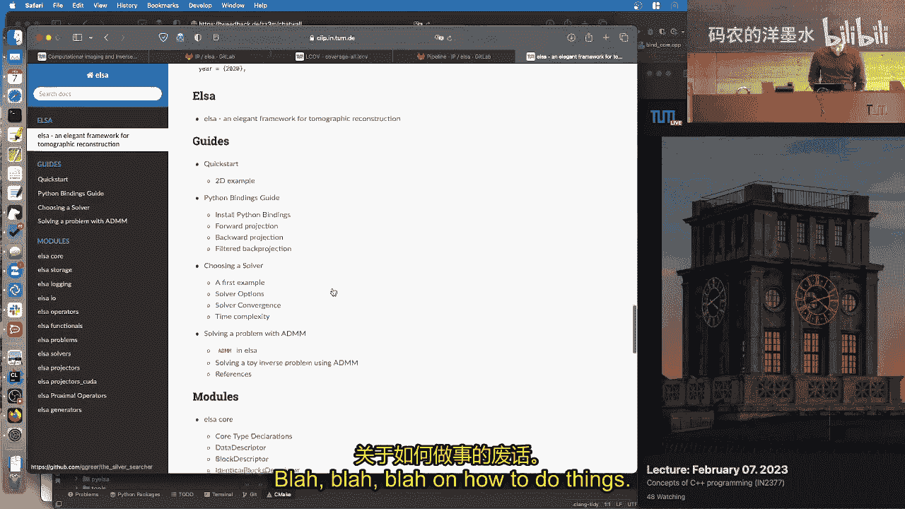
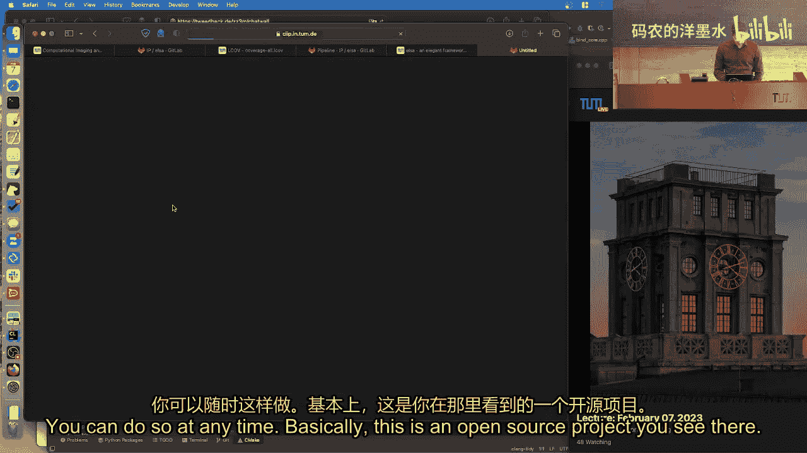
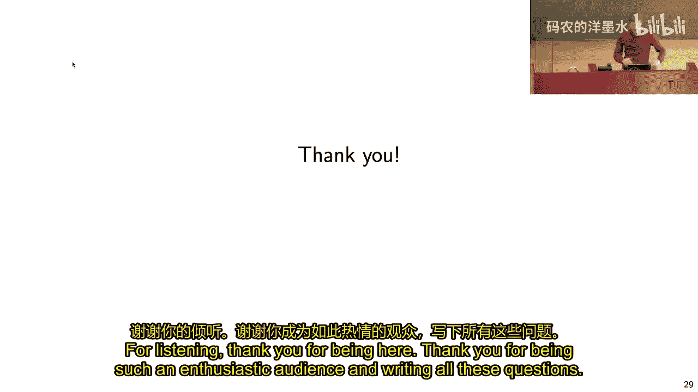

# 【全集】慕尼黑工业大学 IN2377 C++编程概念 中英字幕 1080P p12 Lecture 12 - 共享互斥锁 -BV1b8mgB8EDQ_p12-

Test and spread right。Right， welcome everyone。To the very last lecture in the concepts of C plus+ programming course。

Me see， everything seems to be set up。 Audio is also propagating to the stream。

At least according what my computer says。So let's get started。So first off， as usual。

 our feedback session today is that Z 3M。And as you might know， there is an exam still coming。

 So first off， this is today's the last lecture。Then on Thursday。

 we will have the last exercise session， which doesn't have any kind of new content anymore。

 It's just as special that David and Jonas will offer。 I have no idea yet what they will do。But。

Maybe it will be nice if you attended it or not。What's definitely gonna be there is the exam on February 23。

嗯。It's unfortunately a bit late at 1730 to 1900。whichhich means， yeah。

 we'll have to stay here quite late to sort everything out。

 especially with the people who ride longer。There's also quite a lot of use。

 So we are in five auditoriums in the machine vision in the。

Math and informatics building in the interims， one building， not this one， the other interims。

And in one of their。Auditoriums in the chemistry department。

The distribution of who is gonna be in which auditorium will be posted probably on February 17。

Because that's when we will。Finalize the placement。

So one thing that probably doesn't apply to you or。Here or watching this。 But maybe it does。 So I。

 I w to have it set。嗯。If you register for the exam， but don't plan on being there。

Because of whatever reason。Please unre should still be possible and unre until February 17。

 because if we've somehow managed to fit into four auditoriums instead of five。

I will actually be able to to have the people to do the exam supervision because if it's 5。 I don't。

So I need to go begging in the rest of the department for somebody who helped me with the exam supervision。

Right。So。嗯。And， of course， the one auditorium we would drop would be the chemistry thing。

Which I also have no idea where it is。 I would have to go there and check out。 So， So yeah。

 in case you register for the exam， but definitely don't plan on attending， please unreg。

 So the number of participants goes down and maybe we'll be able to kick one of the auditoriums。

Right。Please be reminded that those materials are allowed。 You have1 and a half hours。

 There will be paper in front of you， and you should bring pens as usual。 And yeah， that's about it。

Can you please provide an exact description of the way to the chemistry department auditorium。

 We will， in case we actually have to use it。Right， really be offering。 Oh， okay。I don't know。

 So this is a question about what courses I' be offering in the next window term。

 I most certainly offer this course here again。But that's probably not very interesting to you here since you're in this course in terms of what other courses I will offer。

 I have no idea what the window term will bring yet。 So unfortunately。

 I can't say anything about that。What I can say， and I think I already have said it last week and also in an announcement to Moodle are the courses that I'm going to do next term。

 one of them is a seminar on computational methods and Xac T。

 and one of them is a practical course on applied optimization methods in invest problems。

Theyre on the website of my group。 They aret online。

 The preliminary meeting happened yesterday for both of the courses。 If you want to sign up。

 sign up the other matching system and also sign up in the registration form。

 which is in the confluence Viki of my working group。Right。So， as for the plan today。

There's three parts。The first part is talking as promised about C plus plus 20 concepts。

The second part will be about talking。Standard versions and upcoming standards。

 most notability plus was 23。And the third part， depending on time available。

 you requested it last week。 And I hope I can obli to you at least a little bit。

 show you some things。In the library open source C plus plus library that my research group has been developing show you some things that we've talked about here。

 how it looks like in practice。Why are the homeworks in Java or in your data structure lecture， well。

Because that's part of the standard curriculum of informatics and informatics has decided the beginner's language for you is Java。

So everything is in Java。Right， so C plus+ concepts。

 they are a bit awkward because I call this course concept of C plus+ programming。

And it's a bit of an overload of the concept term。But nevertheless， yeah， different type of concept。

 so。That's why I'm calling this heading C plus plus 20 concepts to make clear it's。That concept。

So what do we do with these concepts， The idea is。Basically， what SD enable if does。Do it better。

So if you have template parameters。That meet requirements， for example。

 your type should provide certain operations in order for your template to actually work。

 And you want the compiler to give you reasonable  error messages instead of the garbage crap that you usually get with templates。

 That's what concepts are for。They are to specify requirements for the tableid parameters in a very explicit fashion。

You can overload functions with them。 You can specialize cl templates。And they're over a pretty cool。

And maybe not。Well， I think， I think in the end， they will be game changing。

Once they finally propagate into active views。Because。As usual， it's been a while。

 It's taking a while that compilers really， really support concepts。 But by now。

 I think GCC12 and Clang 15 support them fully。Also in the standard library。

 so you can use them with recent compilers。You can do function templates， cloud templates。

 and generic member functions。呃。And， of course， you might remember the keyword auto that popped up here and there。

 you can also use concepts in place of auto。So it's about specifying requirements。 Of course。

 there need to be requirements themselves there。 So concepts。

And there are predefined concepts in the standard library so that you can use them and make use of them。

 And you can also。Define your own concepts， as you please。Concepts are a fairly new thing in Cplpl。

 even though it's now。3 years since C plus past 20。

There isn't that much awesome documentation about them。

That's why I based this particular chapter on Rina Gm's book， C plus 20。 It's a very nice book。

 You can look at it online， I think。It might be。I'm not sure if it's free or not。 I don't remember。

But it's a pretty good book。 And yeah， I use it quite a lot。

So lots of questions I've been popping in while I talked。 Will there be another homework this week。

 no。Concepts of C plus program is polymorphic。No， no， no， no， no， we are。

 we' are not doing polymorphphy。It's more like overloaded。But's the name of the book again。

 C plus plus 20。What was。The important C plus plus feature with a pan， Alessandra told us to ask you。

 but you never told us and just make jokes about your cooking behavior。Okay。So。The to clear this up。

 basically。Last year， I did the algorithms and data structures class。

 which is visited by a lot of students。 think 1600， something were registered。And， of course。

 when you talk about algorithms， you。That talking about what are algorithms first。

 What's the definition of an algorithm。 And， for example， and examples， what algorithms are not。

 And I made an example of。Scrammbling X。That a recipe for scrambled X is not an algorithm。

And for some stupid reason， I， I said that I didn't have a pan in my kitchen。 In fact。

 I didn't even have a kitchen at that point。For various reasons。

 let's just say I had some major changes in my life。

And then the students of that course gave me a present， a pen。The next week。And， of course。

They kept asking me。Use it， use it。 Do do scramble eggs in the pan。And， of course。

 I had to tell them， well， I don't cook。Never learned to cook。 And I'm not doing it。 And of course。

 I planned to at least do scrambled eggs until the end of the term， but I didn't manage。

I managed to put some egg into the pan， make a photo and so on。

 But I didn't actually make scrambled eggs。 For reasons， you know， if you make scrambled eggs。

 you need some ingredients， you need some other kitchen utilities， which I didn't have。 And yeah。

So now people keep on asking what's up with the pen。 So the pen isn in use now。Because again。

 my life has changed quite a lot。It was。Not used to make scrambled eggs yet。 but actually on Sunday。

 we made Kaaierman in it。 So it's。Kinda clothes all the X involved and stuff。

I failed to do a photograph as proof， unfortunately。8点。This is what the patent story is about。

 And I always planned last term。 and also this term to actually do scrambled eggs myself finally and do some photographic evidence of me doing this。

😊，嗯。Not yet。 unfortunately， but the pen is in use， and I'm learning to cook finally at this。嗯嗯。

Great age。But yeah， it's improving。 Thanks to you。Right。

Major changes in your life are not always positive。 I can assure you of that。

And ending up with no kitchen and no pan and no other things。 Well。

 you can't imagine that was probably not a positive change。Anyway。Let's get back to concepts。

 to the overloaded term concepts。To， to specify。Template requirements。 So let's see how this works。

 It actually works by introducing a keyword that's called requires。Surprise。Well actually。

 it's really a surprise because if you follow the story of how concepts developed in C plus plus 20。

Yeah， there were quite a few syntax versions flying around。 Finally， they settled on this one。

Which I think is pretty neat because it's a bit verbose， but it tells you clearly what。What's what。

 right？ So you have a template with a type name T， and it requires that the predicatet S T T integral with type T is fulfilled。

So， in other words。T should be an integral type。 And then， of course。

 it makes sense to define something like a function， global common divis GCD。Of course。

 since it's C plus plus， you have 10 different ways of doing things。 So theres another version you。

 how you can do it。 You can do the requirements clause after the parameter lift。

Like the trailing return type。 now you have a trailing requirements clause。

And you can do it directly in the template parameter。 Finally。

 you can replace a useless type name thing here directly by the concept。

 which is called a constrained template parameter。Which is actually quite beautiful。 I have to say。

 this is。The most concise。And clear in my eyes。And there is a fourth version， where you can。

Do a so called abbreviated function template。 So basically a function。That is not actually。

 that is a template， but where you don't say the template keyword。 But instead you say auto。

 this is something we've seen already with a generic auto before。

 but now we can constrain the auto to be of a certain concept。 So it's concept auto， concept auto。

These are the four versions。That are supported。I don't know。

 You can make up your own mind which ones you prefer。I think this one is very neat。

And strictly speaking。Oviates both of these。 But， yes， there are cases where the other two are。

Maybe more natural or easier to say。 yeah。 And there's this concept auto versions or the abbreviavated function template。

 which is also fairly neat， but。As you might remember from the last time。

 we talked about something similar。It's not exactly equivalent to the three versions above here because here。

 both arguments have to be of type T。 whereas here。

 both arguments could be of different types as long as they are fulfilled the concept S T the anti。

What about concepts of scrambleled eggs。 Let's not go there。Typically， I do boiled eggs。

That's Kra it X。You could put a picture of your frying pan as proof on the exam。嗯。

Let me think about an assignment that involves a frying pan。Let's see。Right， so。

These are the four versions。 All of them kind of have the reasons why they are there。It's a bit。

Annoying to have several of these versions。 But nevertheless。

 I would say each and any of these is a lot better than this SDD enable if thing that we dealt with two weeks ago。

So， yeah， basically， this requires。Allows you to constrain template parameters。

 which was the original intention。 And also allows you to constrain a function declaration， which。

 of course。Yeah， makes sense。But as can you do， oh yeah， of course。

 it requires clause needs to have a predicate afterward and that predicate needs to be compile time because concepts are a compile time thing。

And what can you use as a predicate， You can use a concept from standard library。

 the predefined ones。 I'll show you a few。You can use already named concepts and cont or dis chunkt。

 No， I don't think that's English worth。 Yeah， you can。Combine them with and and orura， basically。

Or you can add a requires expression。嗯。Which is。A bit weird。

 but kind of makes sense when you see examples later on。Oh， that's a good question。

 So let's go back to the previous slide。Calling GCD 4。With int and double would work。 No。

 that wouldn't work because double is not an integral。

 but it would work with calling it with int and long。Whereas for the other ones。

 that would be ambiguous。But yeah， good idea。So。You can use concepts also as return types。

 You haven't used this in the previous example， but you can do so。And then you use this you know。

 auto concept auto syntax to do so。So in GCD1， you could do STD integral auto like this as a return type instead of just auto。

 or you can do in the the fourth version， also STD integral auto。So basically， the idea is。

 anywhere you have auto， you can also place concept auto to constrain what types you want to have there。

And to answer， finally answer your question， what do you think about almost， almost always auto。

I don't know。 It's certainly an option。You can do that。 Personal， I don't prefer it。In some places。

 it's really nice。In some places， I think it's。Too generic for to document what you want your code to actually to achieve。

Right。Let's give some actual working example。 that kind of makes sense。So first off。

 if you wantan to use predefined concepts from the standard library。

 you have to include the header concepts。And then what we I want to do is I want to introduce a type that's not copyable。

 The type doesn't do anything useful。 So it's just so it's short and fits on the slide。

 So I'm deleting the copy constructor。That means this type is not copyable。Now。

 I'm defining a vector。My own vector， for some reason， Well， obviously。

 for to illustrate this example。 And I require that in the pushback function。

That you should know from the standard vector。That it requires the type T that the container is about is copyable。

hich， of course， makes sense， right， Because you need to copy it into the container because the container will own the。

Type the object of that type。And now， if you look at it， you can， for example。

 instantiate my vector for integers and everything works as you would expect to。

 because integers are obviously copyable。So yes， these concepts do not only work for user defined types。

 They work for built in types as well。However， if you now do a vector of these not copyablestruct。

 which of course， is not copyable as the name suggests。

Then doing a pushback will fail because the compiler will say， well。

 this function pushback requires that your type is copyable， and it's not。

So that gives you a fairly readable error message about what's wrong with your code。

And as you can see here here， the trailing requires syntax as actually necessary because， you know。

 can annotate functions。Differently from how you would annotate the vector class。

 So here you could have no requirements on type T in general。

 but only some functions require a certain concept。

 So this is what the second version of the require concept statements。Allows you to do。

And this is fairly handy。Here's another example where a skip includes because otherwise。

 I wouldn't fit the slides。 So， for example， what you can do， you can do varietytic templates。

You know， the thing with the triple dots in the template argument。

And you can directly do an SDD integral here。 triple dot A。

 So you're accepting an arbitrary amount of integral。And then， for example。

 define the function all that basically does an end operation for all the arguments and returns the boolean value that comes out of this operation。

So if all the things are nonze， we true。 otherwise you return false。

Then you do the same for any the or operation。 and you then can define a nu operation that does a knot of the or result。

And then you can test how this works。 And then you can call these basically with whatever。

Integral type。 It doesn't matter which。嗯。And yeah， and the output will， of course。

 be the one that you expect。How does this code work without any constructor for my vector。

 Why would you need a constructor here。The compiler will generate one for you because there's nothing in there that's。

That you have to construct， of course， as soon as you fill my vector with some stuff。

The compiler will， at some point complain about their not being a constructor， but like this。

 this works。Can you also negate requires， yes。We will get two examples of this。Right。

 here's another example of using concepts。 for example， to overload function templates。

So here we have a function template that is overloaded on different iterator types。

 And you might remember this from the standard library we have iterated for the containers。

And the iterative have different types， which。In previously。

 pluspa versions couldn't be expressed in the language。So， for a detererator。bidirectional iterator。

 which can go forward and backward or random access edge iterator where can， you know。

 access randomly。 Now we can express this in terms of concepts。

And we can use those concepts to overload， for example， the advanced function。

Which exists in the standard library where you can advance iterators by a certain amount。

 And here this year is just to illustrate which one will be called depending on what you do。 So。

 for example， if you get an iterator from a forward list。

Which is obviously a list that can only be traversed in the forward manner。

 So it's a singly linked list。You will get a forward iterator。

 and then the overload for the forward iterator will be called。

Then if you do a regular doubly link list， you will get a bidirectional iterator as expected。

 And if you do a vector and array， basically， you， of course， will'll get a random access iterator。

So yeah， this is。How concepts work here。 And， of course， now iterators are a lot nicer than before。

 because now it can encode what they can do， their capabilities in the language itself。

You can also specialize your templates based on concepts。

 so you can make a generic template on any type name T， and you can specialize it on。

The concept S TD regular， for example， What is regular， I'll explain in a second， But basically。

 you put a concept here that is more constrained than nothing。

So you have a specialization of the template。And depending on what you instantiate the template with。

 the generic version will be used or the specialized version。What does regular mean， Well。

 let's first explain semi regular semi regular in standard library speak means that the type is copyable。

 movable， swappable and default， constructable。Basically。

 all the things that you probably want a vector element to have。Regular means semire and in addition。

 equality comparable。So regular encodes all these features， basically。And that's what happens。

Int obviously， is a regular type。 You can copy it， move it， swap it， compareare it， and so on and on。

 So you will get a regular vector here。Whereas if you do a vector of int references。

This is not movable， for example， or copyable because references well they aren't。 So， yeah。

 this will use the generic version of your vector here。

What happens if two of these concepts in the advanced overload contain the same time？ Well， as usual。

 if you do specialization of overloads that are ambiguous， a compiler will complain about ambiguity。

So what else can you do， You can， of course， use more than one concept at a time。So for example。

 here。You can have a find function。That is， of course。

 inspired from the find function from the standard library， which takes an iterator and a value type。

 and， of course， what we want。 Well， I mean， the name kind of gives it away to the user。

 but the compiler couldn't check it before。 But now you can say， well。

 Eer should be an input iterator。And the iterator。The， the type。

 the value type that the iterator iterates over。So the value type of the iterator should be comparable to the actual value type that you're using here。

So basically， if you do a find of some value here， this value should be comparable to whatever the it iterating over。

So yeah， and you see you， you can compound these conjunct or what's the word combine these concepts by using the an operator。

 And， of course， you can also use the or operator or something like this。And， of course。

 you can do some mix。 So， for example， you can encode that this should be an input iterator directly instead of the type name。

 And then， of course， the second concept here。Cannot be expressed directly via the syntax。

 which also explains why the required syntax has to be there。

That has to be in a required statement because you need both types for this statement here to work。

And you can mix and match， according to your pleasure。

You can also overload abbreviated function templates。 You know， the general auto version。

 the concept auto version， you can overload them。And you can also overload them with a non auto or concept version。

 And depending on what you put in。That version will be chosen。 This is a double。

Where neither long or integral applies， or the generic version will be called。

This is an integral row。But not a long integral by default。 it's a regular integral。

 So the SD integral will be called。 This is a long。Which is， of course， odd an integral。

 But the more specific one is an actual long here。 So the long version is called。 So yeah。

 standard overloads basically work as you expect them to。Now， what kind of concepts are there。

There are quite a few in the standard library。 There's actually quite a lot。And finally。

 they are also implemented in recent compilers。8。Don't want to show you all of them。

 because in the end。When you need them， you will look them up and use them。 Otherwise。

 you don't really need to remember all of them。 But for example。

 you can have same as to enforce equality of two types。

Deerived from that a certain time should be derived from a certain class。

 convertible to assignable from swappable。The integral things that we just talked about are a floating point。

 destructible， constructible， copy construct， move constructable， comparable。 blah。

 blah and all all these things。 So basically， all the standard things you can think of they are there。

 You don't need to em them yourself。 They're already in the standard library。However。

 if anything in the standard library doesn't fit your use case。

 or if you just want to reinvent the view， you can do so。You can define your own concept。

 And the syntax for this is fairly simple。 There's a new keyword concept。

 It requires a template statement。As expected， and then you say whatever the name of the concept should be equals to a constrained expression。

 and， of course， the interesting part is， how does such a constrained expression look like。

And while that is either a logical combination， you know。

 using and and or and not in these things of other concepts or compile time prediccateates like type traits that we already have in the standard library or a so- calledled requires expression。

 which we look at in some examples。そう。Logical combination of concepts or compile time prediccateates looks like this。

 So， for example， to introduce。A concept called integral with a capital I to not clash with the standard library integral thing that already exists。

 We are using the type trade from previously plus versions that at compile time detects if T is integral or not。

So basically， we are relying on the already existing type traits to define a new concept， oops。

Then we define another concept， building on this by。

Doing an ant of the integralgra and the isign type trade。And then we do unsigned， for example。

 by having integral and not signed integral。 So here we can negate。

conceptcepts or predicates as well。 obviously。 And of course。

 this is basically exactly what the standard library does in integral signed integral and unsigned integral in the library types。

 right。Now， these requires expressions are a tiny bit more complicated。

But they're also fairly easy to understand。 So， for example。

 if you want to introduce a concept edible。With the type T。You say that requires clause。

And then you specify a parameter list。So， basically。

Specifying parameters what you need to write in here。So it looks suspiciously like a function call。

 right， So a parameter list， a body and then some statements here。 Well， it's not a function call。

 really。 But what happens is the parameter list introduces names of certain types。

 And what you can do now is you can write down expressions with these names。😊。

And this here means a plus B。 It doesn't compute actually compute A plus B。 But what it says， oh。

 if you have。A of type T and B of type T。 You should be able to write a plus B。

 which means operator plus should be defined。For台t。With another operant of type T。The is it。

Whatever you don't care， you just care that they are edible。

And this is what this concept expresses via this requires expression。

This is a so called simple requirement because that's just one。But of course， you can do more。

For example， you can do a type requirement。Which is the same as before require statement。

 In this case， I don't need a parameter list so I can drop it。And what I want to say， for example。

 that T should have a member called value type， and it should be a type。Or， for example。

 that I can instantiate the class other with the type T。And that is the type requirement for type T。

That it supports basically value type by the nest member， and that other can be instantiated with T。

So these are type requirements and as you can see， you can have more than one requirement by just。

 you know， semicolon， do another statement and so on。You're not instantiating anything here。

 It's really just a requirement checking。Does he fulfill this or not。And yeah， let's continue this。

 You can do compound statements。Which strictly speaking。

 this is already a compound requirement because it consists of two type requirements。So。

 but here you see a different example。 Here you see， for example， equal equal concept。

Where you specify two parameters of the same type。And you want to be able to execute the operator equals equals for these two opera。

And the result of this should be convertible to bull。

Converible 2 is a standard library concept that already exists。And this trailing return type syntax。

 well。It's exactly about the return type。 And basically this as well。 First。

 these two elements should be comparable via operator equals equals。

And the result should be convertible to bull。So if you compare this to the simple edible requirement。

 we didn't care about the return type here。 Now， if you do care about the return type。

 you can do it like this。And， of course， the same for not equal， right。

And you can also nest requirements。 So for example， by an unsign integral， you can。

Write it like you already did， or you can do it like this。

 have a concept logical and with a required statement where you take a parameter T and where you ask。

 basically， oh。It requires not to be a sign integral。 so it can have a nest that requires statement。

Which， for this example。It seems stupid。So that's why I'm giving you。Better example。Basically。

 how does a random access iterator look like in the standard library， Well。

 it probably looks like this。It's a concept， random access iterator。

That should be a bidirectional iterator。So that's a concept that already has to be defined。

 obviously。It should be derived from。The iterator concept。Which is， again。

Kind of standard library thing。And it should have the random access iterate attack。Okay， now。

 of course， you need to check exactly what the derived from concept does。

 It's a standard library concept and what this E concept and and the tag here mean。But obviously。

 well， you can't imagine what it means， right。There should be a total ordering on I for random access to work。

There should be a sentinel。For this type。Which is， if you remember how iterators work。

 there's a sentinel the end。That should be there for a random access iterator to work。

 And there' are some additional stuff， which you put into a requires clause。

And here you need three parameters。A regular version of I。

 a coned version of I and a so called itta difference type， which is， of course。

 a type trait building on this iterator here。And what you care about here is kind of you see all these extra operations that a random access iterator supports over a bidirectional iterator。

 So adding an。Either with V an assignment or V an operator plus。

Doing this the same in the other round， subtracting and or doing an indexed access via the bracket operator。

 So all these should be supported。 And we care about the return type。

 And it should basically be the same return type as I， in this case， it should be a reference。

 because it's an assignment。 This here should be just a regular I。

 in a reference again because it's assignment。 And here。

We use another type trade to specify what the result of this thing should be。

So here you see a more complex type。呃。Not everything has to be clear for you because in order to really understand what each of these means。

 you， of course， have to look up the standard library concepts that that are used here。

 but just to gain an impression of how such a self definedfined concept could look like and what you could care about because now we can specify。

 well， I want to do a template templated class for myself。

 But this template argument needs to support a few things。 And for example， if I want it to support。

An indexed excess like this that returns a certain type。Then， yes。This is how we can specify it now。

And， of course， this is a lot more powerful than what SDDD enable if allows。

And it's a lot more readable。A lot more readable。 And of course， now the compiler。

 if anything happens， will be able to give you a reasonable error message。 So， for example。

 if you try to sort an SDD list。😊，The compiler will tell you， hey， idiots。

 I expected a random access ittable container and SDD list isn't。Right。Right。

 it's the name of this course because of this topic。Nope， actually。

 I introduced this course before concepts got introduced into the standard。 Just briefly before。

 I knew already that concepts would be there， but yeah。

I didn't have a better idea of what to call it。Right。This kind of concludes the course content。

In terms of content， this doesn't conclude today's lecture because I promised you to give you a bit of an outlook on future。

 Well， previous and future Cpl standards。I did talk about previous standards already a little bit。

 so I'll keep it short， but I want to talk a bit more about C plus plus 23 because obviously now it's 2023。

 So we expect a new standard this year。So in terms of history。

The very first Io standard for C plus plus came up in 1998 when the language was already more than 15 years old。

 So it took quite a while for it to be standardized。But finally， it was。 Then five years later。

 there was a very minor revision that clarified a few bucks， basically in the first standard。

 And that is what is called C plus plus in general。

What is called modern C++ basically starts in C+ plus 11。 as you can see。

 there were eight years between these two standard revisions， so it took a lot longer than expected。

Buty plus+ 11 was really major， major， major。As you have seen， I think I mentioned quite a few times。

 Oh， yeah， this is C plus plus 11。 This is C plus plus whatever。嗯。Right。

 as C plus plus 14 was basically a bug fix release。 And as you can see。

 they settled on a three year ca。 I think I mentioned this already previously that they saw this eight year gap。

呃。Which was really bad because people were waiting for it to come。

Some things were already in the standard。 Some things weren。 There were some。Development versions。嗯。

And in the N C plus plus 11 was so major that it took a long while for the compilers to catch up。

 Actually， most compilers only supported C plus plus 11 fully，1 C plus plus 14 was around already。😊。

And basically， they wanted to。Well。Give a more expectable。

Standard process by having the three acades。 And as you see， they stuck to it for over 10 years now。

 because C plus plus 17， there was C plus plus 20。 And now C plus plus 23 will come out this year。

 It's basically written in stone and。But they do no longer。

 as previously as they don't decide on the features they want to include。

 and they finally release the standard when the features are done。They basically say， okay。

 we have three years of time。 Whatever is done in those three years， we will put it in。

 Whatever is not done， we'll have to wait for a later standard version。Which is， okay。Right。

 it gives you an expectable。呃Schedule。And just to make clear， So C plus plus 11 was really major。

 C plus plus 14 was fairly minor。 It was basically buck fixes to a lot of what C plus plus 11 did。

 C plus plus 17 was a bit medium。So there were a few new things， but also a lot of bug fixes。

 multi plus 1 was fairly major。So we can already guess that C plus plus 23 is not gonna be major。

Just from the history。So to give you an idea of how it worked for C plus+ 20。

 I can't give you the idea for C plus+ 23 yet because it's not finalized。But basically。

 what happened。嗯。They did a feature freeze in July 2019。 Basically， they said， okay。

 this is what gets into the new standard。 And everything we do after that is only。

Writing things up properly， making sure everything is consistent fixing some minor bucks。

And then putting it into the standardization pipeline。

So the finalization of the standard was in February 2020。 So basically half a year later。

Then half a year later， the standard was approved， and then they just made the cutoff in December of 2020 to actually have it published by the IO。

And it looks like the schedule is fairly similar this， this time for C plus West 23。

 the feature freeze was last year。I don't remember the months， but it's a few months ago already。

The finalization hasn't happened yet because， of course， it's early February。 So hopefully。

 it's gonna happen in February。 And then on a similar schedule。

 you should have the C plus plus 23 standard out by the end of this year。

C++ 20 was a major revision with a few big features like this concept。

 What I just showed you corouts， which I didn't talk about because they suck and will only become usable with C++ 23 ranges。

 which I didn't really talk about too much here， unfortunately。

 but which I think you had the chance to use in homeworks。Moddus。Which again。

 I haven't really demonstrated here because it's not supported by any compiler yet。

Fully supported yet。 And， of course， there was a lot of small things。Right。

 and here I already said it's， I think I've harped about this enough。

 but basically due to modules which change everything from the compiler infrastructure to build systems。

 to meet up build systems。Through the entire tool chain， but。It's expected to take quite a long time。

Even after 23， to really fully propagate everywhere。

The other stuff of C plus plus 20 is basically available now。

Visual Studio from Microsoft is actually at the forefront。Which is cool。Unfortunately。

 that's a con commercial compiler， which is not so good。嗯。GCC is very good。

 Kang is lagging a little bit behind currently， but also catching up。

And the only thing that's really， really still a bit of an annoyance is the standard library because both the standard library from GCC and the one from Kang。

Still doesn't support everything yet， three years after the standard。It is a bit annoying。

 but it will improve。 And I think this year we'll probably get to full standard compliance of every compile。

 every major compiler。Will next lectures homeworks be in Cpl 23 then。No。Think about it。

 C plus plus 23 will be released at a standard by the end of the year。

 The term will start in October。 So the standard won't be released then yet。 And most importantly。

 the compilers will not support C plus+ 23 fully yet at that point。Of course。

 development version of Kang and GCC already support parts of C++ 23， the feature freeze happened。

So they're， of course already busy at work to support it。

But what we will probably do and hopefully be able to do is to fully switch it to C plus West 20。

 using everything of C plus with 20。Was Windows 98 written in C plus plus 98。 No。

 I'm pretty sure that Windows 98 was written in C。What steaming pile of garbage， yes。Windowsow N T。

 the successor of Windows 98， that was partly written in C plus plus。 And what you have today。

 Windows 10，11， whatever is current。It's also mostly written in C plus， plus。

I have no idea which version of C plus plus， but knowing Microsoft is probably an older version。

C plus was the return of C plus， C plus 11 was the return of C plus from the dead， yes。

Without C plus 11， I think C plus would be that today。

Do you have a mailing list informing us about the newest features in C plus versions， No， I don't。

 but there's plenty of the people in the standards committee。 You know。

 the people who directly do this stuff who have。So I'll refer you to those。Do you mean by modules。

 those export module things from the beginning of the lecture。 Yes。

 replacing the dam include mechanism。 That's what the modules are about。Oh。

 other languages like Python gets updates yearly。 Y is C plus plus getting updates only every three years。

I'm not that familiar with the situation of Python。

But C plus plus is a very broad language where many。

 many people are involved in the committee and the standards committee from various companies。嗯。

And it's just slower。I don't know。 And I have to say， frankly， myself。

 I'm happy it's on a three as because learning new things and sometimes major new things every single year。

😊，Gets a bit aggravating。Right， will we also have a module package manager。

 Not as part of the standard， Nope。But maybe we will have 10 different versions from 7 different distributors。

 And， of course， there already are package managers aply。 There's one for Microsoft， V S P P K G。

There's Koan。 there's。What is the other one called。D， oh theck can I forget the name。I forgot， sorry。

And there's a few around already。And modules won't really change that much about it。Right。

 future C plus+ standard。 So I already talked about C plus+ 23。It's right inside basically。

 but will finally come is library support for co routine。 So basically， next year。

 it will finally be worth talking about co routines。Because there will be library support for them。

So， it's actually。Not feeling like killing yourself and you writing co routine。 So which is good。

The standard library will finally support modules with C plus plus 20 modules。

 So what you will be able to do instead of all these。

Dam include where you need to remember where which file。

 which include file contained which part of the standard library。 Well， now we can do import SD。

 That's it。So， that's。Pretty major。 and it's a bit aggravating。

 It took three years for it to get there。So last summer term， this slide contained two more things。

 two major。Things， unfortunately， by now， it's clear。The， they won't make it。

So there wasn't executors。Which is basically， a general。Scheme of specifying。How。

 where and when to run something that's callable， you know， anything that supports the call operator。

Didn't make it。 And， of course， since executives didn't make it， that also means the network library。

Didn't make it either。 So C plus+ remains a language that doesn't support network communications out of the box。

Of course， there's boosts and various libraries and booths that he can do for this。 But it's a big。

Disappointment， because that was supposed to be the major feature of C plus was 23。

And they didn't make it。 They were too slow。So yeah。untunate。However。

 there's actually quite a few things in C plus plus 23， the actual list I went over it。

2 hours ago today is very long。 Most of the features are very small。 Most of them。

 you won't notice whatsoever at all。 But there is a few that， in my opinion， are very neat。 So。

 for example， one of them。And this is really。1 I really， really like。 It's minor。 It's really。

 really minor。 But finally， there's a suffix for SD size T。😊，Why is this important for me。Well。

 you know， you often write four loops over containers。And containers， by default， for example。

 S D vector。Gives you an S TD size T。Which in most cases， is an unsigned。And not a signed integer。So。

 either you do。Unsigned as you loop variable， which is longer to write than in。

 So it's a bit annoying。 And then you still might get a compiler warning about that。

 it doesn't match exactly what size T is。And if you do an int。

 you get a sign conversion warning by your compiler。

 And now you can finally do an auto loop variable equals 0。 and then the suffix。Which is T， I think。

 if I remember correctly。To get you the correct type for SD size T immediately in the literature so you can use auto and not fucking care if it's assigned or unsigned integer and get all these damn compiler warnings。

 So this is a huge quality of life improvement for people like me。

But all the huge quality of light life improvement is SDD print。

So you might remember that we talked about the SD format library。

Which allows you to basically use Python syntax。for print。Except， you couldn't print。

You could format strings。But he couldn't directly output them like you can in Python。And finally。

 we have an SDD print that can。Do what Python could do for years already。And it's typey safefe。

 It's compile time。 It's fucking fast。And that means never。

 ever will you use print F from the C library again， ever。

 because S TD print is strictly superior in everything。Which is also， it's a minor thing actually。

 that they edit。 Well， actually， it's not that minor。 If you。

 if you look about the implementation details they had to solve for this to be in a generic enough fashion to supporting locales and Uniicode and all this crap。

It wasn't that minor， but for the user， it's a huge。Improvement， because I don't know about you， but。

 for example， I'm happy about SDD format and C plus was  trend0， but in all my programs。

 I still used a lip format library。😊，Which is basically what was adopted as SD format。

 But lip format contained a print function。And STD formatma didn't。

 But now there is a print function and everybody can be happy。

What's also quite major for people like me who deal with multi dimension and array all the time。

The subscript operator now can be multiple dimensional。

 so it can have multiple dimensions in the subscript operator and the subscript operator that's a language extension supports multiple dimensions。

And there's also a class， a library class called MD span Multi dimensional span。

 which basically is a multiple dimensional array for you。As always， in the last。

C plus plus versions there some constant expression relaxation so we can use even more things in constant expression code。

So it's easier to write compile time code。There's an if contable。

Which does exactly what you expected to。 So there's if con expression now theres and if constable。

The range of library。Got expanded quite a lot。And what's also really cool is finally。

 there's fixed with floating point types。 And， for example。

 also the half floats that are so popular in deep learning finally made it into the language standard on also the B float 16。

 which is basically used everywhere in deep learning these days。

 So now it's in in the library in in the language， which is cool。 And there's a stack trace library。

😊，There's an S too much stack trace library。Which is nice if you do stack traces， obviously。

And a lot more。I get a sexfold in the homework。 Any tips。 Yes。

 look for undefined behavior in your code because that's why sexfolds happen。

We want newsletters from me。No， I'm busy enough already。 I don't have time to write newsletters。

 Sorry about that。If you get homeless， again， we can provide you a kitchen。

 I wasn't exactly homeless。 I just。Lost everything else。Our SD source files pre compileiled。

HThat's a good question so。How is this gonna be implemented。

I'm pretty sure that's up to the compiler。 And you will have to check the actual compilers to。

See how they do this。Could you write a code with 10 fingers， no。I do maybe 5，6 or so。

can't probably ride with 10 fingers。But then again， the bottleneck is not in my fingers。

 The bottleneck is here。 So it's perfectly fine。Right， further standard revision， So。Of course。

 now that C plus 23 is basically finalized and coming out this year。 later this year。 Of course。

 there's plans for future versions。 And a lot of these plans have been sticking around for many years already。

😊，So， one of them is contracts。Which is basically an extension of concepts more or less to define preconditions。

 postcons and assertions for functions and classes and methods。To basically document。

Things that you currently can't document in code even more。

Compile term reflection is another major feature that was hoped to be in C+ 20。

Then didn't make it into C plus was 23。 And I think from the way things are going。

 probably won't make it in C plus was 26， either。嗯。

The idea was basically that you could get meta information on types， aliases， members， objects。

 and so on， and then。Could， for example， write something like metater classes and so on。

 It's pretty cool。 There are some drafts on this hopping around。

 which allow you to really cool cool things。😊，But unfortunately， I also don't expect it anytime soon。

Because it's such a major change of the language。And。

Pattern matching also has been around for a few years in various versions as a draft to include into the standard。

 the idea is to have an inspect keyword， which basically works like a switch statement。

On Tuple variant or polymorphic type so that he can avoid these ugly visitor patterns or dynamic cast that you sometimes have to do。

 And， of course， that other languages support for a long time already。

 I think this had a good chance of coming in C plus 26。

So let's see if I'll have to eat my birds in a few years。And， of course。

 I already mentioned that executors in the network library didn't make it into C+ plus 23。

 but the assumption is that we'll make it into C++ 26。No。

What can you do about these things Well you can read in the Internet。

 People from the Standard Committee post about what they discuss。 You can look up all the。

What are they called these， these documents that specify features for the standard things。

 You can look at the revisions they go through。And， of course， if you wna try out the things。

 that's the compiler Explorer， Gobol dot org or Van box。

 which always have various versions of GCC of Kang。

Where you can try out even the experimental features that might not be supported in the main line compilers。

 And you can do those， do this very easily。And， of course。If you're hooked on C plus， plus。

 for some reason， because you think maybe you think it's cool or maybe you think it's relevant for your later job。

You can do a student project using C++。And， of course。Advertisement here。

 you can look at our projects most notably， the at the library。

 which I'll show you some examples in a few minutes。And， of course。

 there's other research groups here。At computer science that use the plus heavily。 for example。

 the database Fox from Professor Eyman's chair。They do some really awesome stuff。

 every time I watch what they are doing， I'm in awe of them。😊，So yeah， there's a few groups around。

And as always， when learning。To program when learning to program in a complex language， like C， plus。

 plus。嗯。You need to practice。Doing this course is a start。

Doing the exercises was one thing during the exam。Well。

 it will somehow prove that you successfully took part in the course。

 But if you really wanna be a good C plus plus programmer。Or even just a good developer。

 You need to practice， practice， practice， do mistakes， learn from them。Analyze what you did wrong。

 What you could do better next time， and。Go on。 learning never stops。 And also for myself。

 I know that when I do have time to program， I learn something new every time I do so。

I always wonder why compiler Explorer hasn't were L like got bold。There was a story about this。

 I remember reading about it， but I forgot about it。But I'm pretty sure you can Google it。Careful。

 you may get a massive lot of students looking for Cpl the projects。😊，Yeah， that's kinda intended。

And then， of course， I want to pick the best ones of you， right。

 because I can't supervise floods of students， but only a handful。Right， oh， yeah。

 And the Senate question。What style of questions can we expect in the exam。

There will be a few multiple choice questions。 Yes， there will be some coding。 Yes。

 a few lines on paper。Will there be any open ended questions， yes。What percentage I don't know。

 We haven't created the exam yet， so I can't answer this。Do you brush your teeth in bed sometime。

What。I may not be getting the question。 I usually brush my teeth before going to bed。

 I don't know about you。 but yeah， I don't like being a the dentist。Right。

 so you get some idea of what is about and how it looks like。

 I will show you the code now for a few more minutes。 But otherwise， the lecture is concluded。

 So if you want to stick around to see a few code examples from our research group。 fine。 Otherwise。

 thank you for attending。 And good luck in the exam。😊，Right， so one second while I set up the screen。

呃各位。So let's see if this is readable。 No， this is probably not readable。How do I。

How do I increase the font size。How about control plus nope。呃，不不不。Got damn it。Okay， let me put this。

Or for a moment。Shift at point， okay。Okay。So I think this should become readable now。And， of course。

 now I can't see what I'm looking at。Except if I okay， hold on。I usually hate mirroring。

 but I think for this， I need mirroring。Mrror for this。So where's my thing。 Okay。

 so this looks better。 Can you see my mouse， yeah。So， first off。So as you see， as you can see。

 I'm using C line as an I DE。嗯。And here you see， basically， the root folder of our El library。

 What is El about。It's a library for tomographic reconstruction。嗯。Meaning， if you， for example。

 do an Xray C T of yourself to get an image of your lung or your brain。

The algorithms you need to create a 3D picture out of this is what you can do with Elza。

If you want to do neutron tomography or proton tomography or light field microscopy。

 all these things work with Elza and basically the American algorithms in order to do this in problem solving is what this toolbox is for。

The kind of data we deal with here is usually very huge。

Multiple gigabytes in actual data matrices that are in the size of a few betterta and exabytes。

 So performance is key。 And， of course， that's why this is written in C plus plus。And I already see。

 we are no longer at version 0。5。 We should update this anyway。

 So what you can see here is our C magnetli file。And as you can see。It's fucking huge。Why。Well。

 because we pull in a lot of libraries like Kuda。Eigen。

 Eigen is a library that I already talked about， thrust from Kuda。嗯。Yeah， what else Eiggon is here。

SPD log doc test。 you might be familiar with doc test。

 And there's a lot of options that we have to consider。

 depending on what kind of gooda version is supported。

 what kind of version the graphics card supports and la la la。All this is done in Cm。

 and this is a huge headache。Yeah， what can I say。And we use， for example， CPM。

 which I think you also used in the homework setup to pull in。Dooc test for unit testing。

Then you see a few more things。 What we also use is clangform。

To enforce a coding style views clang tidy to enforce， well， some static checking。

We have fairly extensive gitla pipeline， which you can see here。

 All these filess are are open source invisible。 So if you wanna look at them in detail， yeah。

 you can do so on， at your own leisureger。The U is on our website。And呀。

So there's a lot of things to set up。嗯。The actual library here is in the El folder。

 as you can see here。 And let's look at a few examples of files。 Let's get rid of these here。嗯。

Oh yeah， here， for example。Behal。Expression predicates。

 because we used to support expression templates。Recently， we tossed them out for some reasons。

But what you can see here is typical。Yeah。Typical type traits that we talked about a few weeks ago in the lecture and that you also did in the exercises。

 And basically， well， here you also see the expression class with the callable and the opera with the baric templates。

We see inheritance from false type and true type， with specializations。And yeah。

 this might all seem a bit familiar to you because basically。

 the expression templates were copied directly out of the El library。And just for the information。

 they were implemented by a master student some years ago。Right。What else did I want to show you。

 I wanted to show you， for example。A cloneable class。You might remember talking about Clonable。

 right。So here is a cloneable class that supports a clone function for a virtual inheritance hierarchy。

A polymorphic hierarchy。That returns a unique pointer of the derived class via this， which a。

Pure virtual function， clone impor。I did some other things with the comparison operators。

 which are basically are the same thing。And this is the cloneable pattern that is used here。

 not in its entirety。 You might remember that the big cloneable pattern I showed you had two template arguments。

But I don't like that version， because。It no longer makes classes that are derived from another class directly derived from。

 but derived via this cloneable thing， which I didn't like。 So that's why I did it like this。

Here are some strong types。For example， what we have to do is we have to deal with geometry。And。

 of course， you know that in geometry， you can specify angles in radiance or in degrees。

 So what we did here， actually， David did this。 He doesn't have an auto tech here。 so I should。

Tell them to add this， add strong times for degrees in radiance。 to make sure what。Kind of angles。

 we do accept in。The different classes that do， yeah。Anngless。What else do I wan to show you。

 Maybe I wan to show you our central class for storing data。 It's called data container。

It's a huge class。Of a few hundred lines。Because basically。

 it supports storing any type of n dimensional data，1 D，2 d，4D，1000 D。嗯。

It's a templated class over the data type。 So basically， whatever。

The container will store could be a half float， a float or integers。 doesn't matter。Here。

 you see some aliases for。for example， for iterators or constant iterators。So， yes。

 we support iterators on those。 So for example， here， you see our。

Itterator that was written by David。And maybe you see see some similarity from the iterator homework。

And you， we do some stuff like not having a default constructor because it doesn't make any sense having an explicit copy constructor。

supportingupporting various other constructs。And then there's， yeah。

Few things that we probably can improve and that we are working on improving。 But， for example。

 we have here。The， the indexed element access。 And， for example。

 the addition of C plus plus 23 to have multi dimensional。Ind operations will be a huge boon to us。

 because what we need to do。Yeah， we need to s support two index operations， one with a single index。

 which is already linearized。And one， which we do basically via N D coordinate where we have a separate type for the N D coordinate。

 And this will no longer be necessary。 This can be done It just a single。

Index operator C C plus West 23。Oh， here you see some enable if magic。Which。

Once we start using concepts will go away。 The only reason we are not using C plus plus  trend0 concepts yet is because we support Kuda。

And supporting Kuda means our library needs to be able to compile by the NviDR Kuda compiler， NVCC。

And N V Ka compiler doesn't even support C plus plus 17 yet fully。

 even though it claims it supports it fully， but it doesn't。 There's a ton of bugs in there。

And it's a disgra for a company like Nvi to provides software like this。And never mind。

 C was plenty not supported。So yeah， fuck Nvidia once more。Yeah。

 and then we have some math operations。 you like getting norms， dot products， various reductions。

 FFT inverse FFT。Converting to complex operators， overloaded operators。

To combine data containers with other data containers， of scrs。Comparison。Get slices。

 iterator access， begin， C， begin and see and。And oh yeah。

 we also have a format routine to pretty print things into a stream。And the rest is， basically。

And here you， for example， you see a variant storing our data handler。

 which basically decides if the data lifts on the GPU or CPU memory and so on。

 whereas the descriptor here。Describes what kind of data is a 2D data， it 40 data。

 What size does it have。 That's all in the descriptor here， which is stored via a unique pointer。

What's also maybe a bit interesting is the linear operator class。It's basically modeling an operator。

 mapping one signal to another。It's a cloneable。Uing using the CRTP pattern， right。

And we have some default de structures。Copy constructor， copy assignment。

 We don't have move here because it doesn't make any sense here。And for example。

 operations like apply。So remember， I talked about having matrices the size of several exabytes。

Applying these matrices to a vector is exactly what this apply method does。 And， of course。

 to do this properly， we need to support。Graphics cards。 And， for example， this。

This year is one of the。Projectctor types。That does exactly this。 And then here you see the ka code。

 the ka kernels that does the actual。Extral work。 And yeah， this is ugly code， because it's ka。What。

 what the fuck can't change it。Right， what is this interesting。 Oh， yeah， you can。

Build expression trees with these li operators。 Unfortunately。

 they are not compile them expression trees。 they are not laly evaluated， but you can do the trees。

Yeah， and this is supported via these operators here。Yeah。Here's， for example， an SDD optional。

 which we use to store a scalar or not。And yeah， this is not my proudest achievement here。

 but it does work。Then， for example， we have。Some numerical code the death reduction。Like。

 for example， reducing a vector to a number。 For example， the zero pseudo norm。And you see here。

 this is some mixed code that supports both CPU and GPU at once。

 That's why it looks a little bit ugly。It's using thrust from Nvidia。 And unfortunately， that means。

 yeah， we need to compile everything with the Nvidia compiler。It's a Thor boot。

What we also support and which my I D E can't figure out how to use。

 as you can see by the red squgles here， is the Pi B library to support Python bindings because nobody wants to actually write code in C plus plus using this library。

You w to use it from Python where it's convenient to do some quick modifications。

 loading pictures from hard disk or the network。And then called the heavy duty algorithms in this library to do the work and then display it nicely again。

 So this is what the Python binding are for。And basically here。

 you see how the Python bindings are created。嗯。So yeah， here。

 all the classes basically we have in our library are added。To the Python bindings。Now。

 you might wonder， isn't this a huge pain in the S。

 Because every change in the interface you do on the C plus side。

 you have to propagate to this5 minings， yes。And we had a cool mechanism there that we actually removed last year。

 The cool mechanism was that we had lip clang。😊，You know。

 the thing that kind of underlies the cllan compiler pars our library code。

And generate python bindings automatically。 So basically。

We had a parser parsing our own library and spitting out exactly this C plus plus code to generate the Python bindings。

😊，This worked。But this was a huge pain in the as because lip clang keeps changing quite quickly。

 You know， Kang is on a twice a year major release roadmap。 So basically every six months。

 you get a new lip clang version that breaks things because what we are using are is basically not a stable interface。

 but unstable one。And at some point， we got fed up with it constantly breaking。 And then basically。

 we let it generate all the interface once more。And then basically。

 now we are back to manually adding things here。By hand， well， as you see。

 we are not exactly doing this by hand， there are some ugly des here。 you know。

 using the preprocesor， the thing that I hate。 But for this is actually really useful because now we can。

Do things a little bit more elegantly。And you here see some。Fun comment by David。

 who wrote this because he was trying to also add the square root。

Function that we support on various types， like， you know， index types， floats， doubles。

 complex of floats and doubles。 and for some reason， this doesn't work。

It's apparently a back in pi behind the 11。So yeah， this is one thing you have to get used to。

 There's bugs in the compilers。 There's bugs in the standard library。

 Theres bugs in the libraries that you use， and you need to work around them。Constantly。And。

 of course， even if it gets fixed in a new version。For example， of a compiler。

 you don't necessarily means you need can remove all the workarounds because the users that are gonna use your library。

 for example， they might still be using the old version and they say。

 fuck you if you tell them and start the new one。So， yeah。

 you have to have some backwards compatibility。 And that is really a pain。Anyway。

 what else do I want to show you。嗯。Right， Oh， yeah。

 Maybe what I want to show you other is that each of these modules that we have。

 like these projectors， each of them have tests。In this case， for example， these。

 these tests are fairly extensive。 So， for example， to test this single class。

 Joseph's methodthod Kuda。Has 2154 lines of code testing。The functionality of this thing。

And despite having tests for everything。 And in some cases， like really， really extensive tests。

 our library doesn't have 100% test coverage。

So I can maybe show you。So here's our web page C IP that I enter toD。

Here you see our open source source software。 And here we can go to Aza。

And you will see here that our code coverage for the tests is currently at 82。9% only。

Which is a bit embarrassing。 I would like to have 100%。But if you look at the coverage report。Yeah。

 some of our modules are not quite there yet。 And if you wonder why the line coverage is pretty good。

 but the function coverage is bad， it's because basically everything we have in our library is templated。

And were not testing every single template specialization and instantiation properly yet。

We test quite a lot of our lines， in some cases， basically everything。But， we don't。

Consistently test for instantiations with float， with double， with complex float。

 with complex double and all this stuff。So yeah， still work to be done。But for example， this here is。

The pipeline that runs every single time， you commit something。Let's pick this one here， for example。

See， there's a few things。 A tests， clk formatment is applied。 clk ti， Cm format。

 Seem Li comment formatting。 Then there's several bid stages with clang the scooa， the pipelines。

 there's install stages and tests with different compilers， clang versions， sca versions。

 And if you're wondering where are the GCC tests。They commented out because for some fucking reason。

 Jesus Z doesn't work currently for us on our continuous integration environment。We have sanitizers。

 currently only one undefined behavior sanitizers。 We have the test coverage。

 which generates this nice little report。And we have a stage docs which deploys our documentation to our web server where we can then find the documentation。

 for example， some guides and some blah， blah， blah on how to do things and。

第二。Right。If you want to contribute。You can do so at any time。 Basically。

 this is an open source project。 You see there is。

Some contributors here already。嗯。And you see in recent times。

 my number of commits was shit because I didn't have time to do anything useful。

What else do you wan to say， alright， and what we collect。Are issues which outline student projects。

They attacked the student projects。 So if you check our issues。

 you can see some of the things we want to do， which lend themselves to student projects。

This is a selection。 There's a lot more， but we don't take the time to write down everything as a student project。

But yeah， just so you have an idea what kind of things you might be looking at here。Right。

Let me see if there were。Any questions。Oh， they fuck， okay。

Maybe I should have looked there sometime in between Bs before when creating the exam， okay。

Thank you for the lectures。 Thank you as well。Should I learn for analysis or C plus plus。I'm torren。

 And that is this， I think， is more important。Overall。C plus plus is， of course， my baby。 So yeah。

I will miss this wallpaper。 Oh yeah， sorry， I need to stop mirroring here。诶。To get you。

 you won't paper back here， di。If ads are currently used in production， yes。

 we are using it for all our research projects， Well， not for all， but for a lot of them。

I don't know if anybody else is using it， but we and our partners are using it。

Since when is this library developed， Oh， that's a good question。So。

There are several versions of this library。 major versions。 The first one started in 2012。

When we started projects working on this reconstruction business。There were a few rewrites。

 The latest one I did was in 2019。A complete rewrite of everything。 And since then。

 it has been open source。 And basically， what you see there is the rewrite that I did in 2019。

Would you upgrade it to the next Cpl standard， Yes， immediately。

 if they weren the N VDR coa compiler。Which hinders us from doing so。

What are the road maps to upgrade it。 Well， there are a few pain points like SDD Na lift。

 which we want to throw out and use concepts。 Instead， we wanna use modules， obviously。

And a few other things of C plus plus 20。 but yeah， as it is， as is a C plus plus 17 library。

 because that's what Nvi supports and nothing else。Are those kr codes written from scratch？ Yes。

 we've written everything from scratch。嗯。Need any graphics card。To you。

 at least the prices have gone down a bit。From left year。

If we write a function in C plus and want to use it in a Python project， what would be。

 would be the way to do it， Use pi by and 11。I think that's the simplest and best version。To do it。

Did he ever use Conan， yes。Can you recommend a better dependency manager。Not really。VC VSP K G， the。

 the Microsoft version is pretty good， too。Even works on non Microsoft systems。

What we settled on since basically， we only use header only libraries， except for Kuda。

 which you have。Buthich doesn't work with any package manager。 Kudda is just a nightmare。

We settled on CPM。But yes， packages are a huge pain in C plus plus。 you're not getting around this。

Very steep learning part of this library。We had some deep learning part。

 some some explicit deep learning that' built on。Intel1 D N N library and， and Vita Co D N N。

We tossed it out because in the end， we decided that people like Google or Facebook do a better shop than we do。

So we are interfacing the deep learning library via Python currently。What we are working on， however。

 is interfacing them。Directly with the storage， we have the C plus plus interface。

 but that is work in progress。If you have two K lines of tests。

 when do you start your test to test your tests to make sure they are not faulty。Good question。

I have no answer。Do you accept contributions to A。 Yes， it's there a get started guide。 Yes。

 are there contribution guidelines， yes。Check out the website。You will miss Ro。 I'm sorry about that。

 but I think you can keep Ro。 just Miss Beof。Are you writing each test yourself？ Yes。

 we are not using a test generator。How to write tests and how to write good tests。I have no answer。

 We just write tests。 They are not necessarily good。132 GB of project storage。

One of the reasons we have this is all the artifacts from the con from the CI stages。

 The actual code is just a few kilobys。Who's your Liing Metabitta。

 I'm not answering that I don't have any favourites from my employees。

Could you summarize how to start to write a library from scratch。Well。I don't know。 Toough do it。

 You're gonna do it wrong。And then， you do it again。Basically， either you， you start we， we。

Refactoring until it's where you want it to be。 or you redo it from scratch again。 So in our case。

 we started once， kept it for a few years， refactored a lot of times。

But then we saw that there were a few design decisions that bit us in the asset that basically required a complete rewrite。

 So I did that。That I noticed that the rewrite I did was crap。 So I rewro it again。

And now we are at the stage of refactoring。 There are still a few design decisions we have walked back on。

 But instead of doing a rewrite this time， because the library was so big already。

 we decided on refactoring。And， of course， this refactoring is a bit more painful if the library is big。

And that's why we removed some of the features like expression templates just recently because it enables other re factors to be easier。

 And then we can re editit again at a later point。Is this Python part a separate repository， yes。

Are youre communicating between two projects。 Yes， kind of because the same people are working on those projects。

Why am I more afraid of this exam than all of previous exams。You don't need to be。

I'm not gonna ask you about stuff we do in research。

 I'm gonna ask you about course content and the course content is， I think， fairly simpler。

 So there's no reason to be buried。 Look at the course。 look at the lectures， look at the exercises。

 and it will be totally fine。Very good。 Let me briefly open up。One more thing。

shouldnn't have closed it， sorry it took takes a second to load。Because what I wna say again。

To you is thank you。For listening。 Thank you for being here。

 Thank you for being such an enthusiastic audience and writing all these questions。😊。

Thanks for being here。