# 【全集】慕尼黑工业大学 IN2377 C++编程概念 中英字幕 1080P p13 Lecture 13 - C++20 -BV1b8mgB8EDQ_p13-

Test， test。Test。So welcome， everyone to the concept of C plus programming course。

 Sorry for the delay。 I apparently lost check of time。

I thought I would be easily in time here and set up。But apparently， I wasn't。Sorry about that。So。

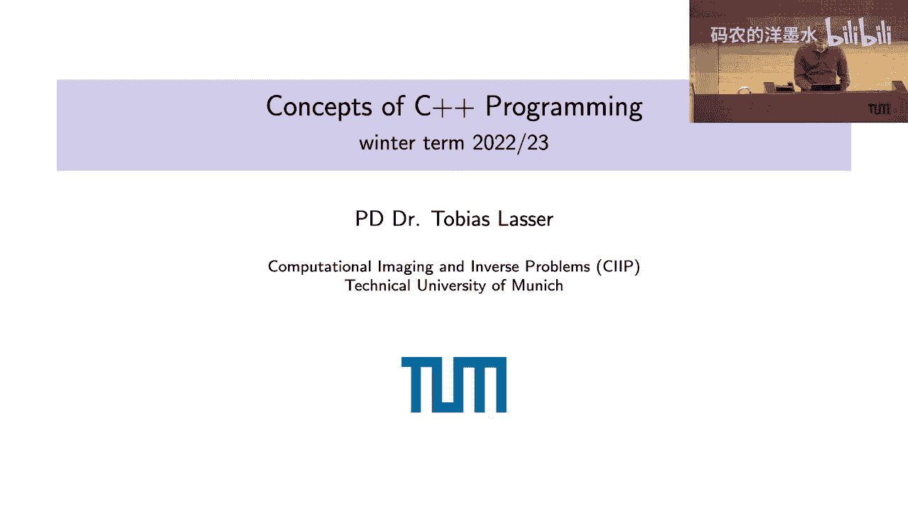

Okay， first off。Our tweet session today is set E Q E。And I see that some of you already found。That。

And there's already been quite a few things。 Some of them I have answered already in writing。

 So I will not。Address them here。But Holyly shit comparing me with Yu uncan。

What the heck is a compliment or an insult。I'll take it as a compliment。 So no， I'm not Uan Kth。

He's a bit younger than me。Quite a bit， actually。Right。So before we start with today's topics。

 which is parallel programming and N C plus plus。

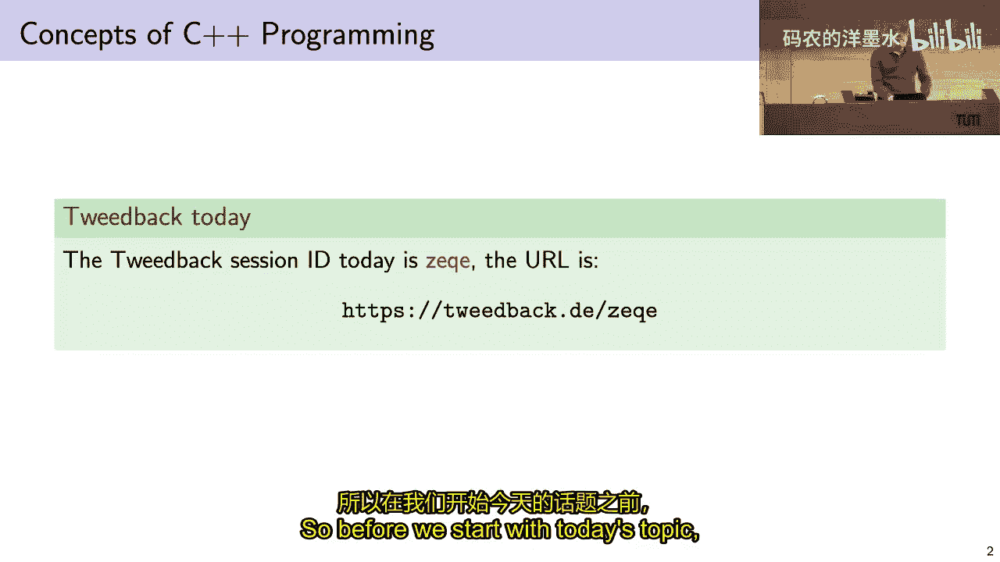

Let me say a few words towards the rest of the lecture period and the rest of the term。So。

This is the next to last session。Today， we will have one more next week。嗯。On the topic of concepts。

So thats C plus fast concepts， which are basically。

Better and more powerful version of the FD enabled everything we had last week and the week before that。

And that will be it in terms of lecture content。In terms of exercises。

 we will have one more regular exercise this week。On Thursday， as usual。

 and we will have one last exercise session the week after。 So on Thursday， February the 9。

 I think it should be。When we have。Basically。Something like a global Q And A session。

I'm not sure what David and Leas are planning。 I think both of them want to do that。

So watch out for any announcement， But there will be another exercise session next week as well。

 but there will be no more new content in terms of exercises。Right， and then， of course。

 on February 23， there's an exam。It's the only exam， there's no repeat exam。What's the time。

 I don't remember the time。Let me check February 23，1730。So rather late in the day。Got， that sucks。

Anyway， February 23， no material allowed。 P of you are registered。 over 500 in fact。

 So we will split over  five auditoriums。 The split will be announced a week or two in advance of the exam。

 but everything is here in gshing， so。Plan being and guishing in one of the bigger auditoriums here。

Right。Theres no repeat exam。 And in case you fail the exam or you don't do the exam。

Please know that I will offer this course again。In the winter term。Next year。Actually， this year。

 but basically in the next winter term， I will not offer in the summer term。

 I switched to a winter scheduled for this class。So yeah， so much for the administrative stuff。

 I think I can now move on to that topic。Do you think carbon can succeed。It can。 Yes。

 it's not very likely to， though。And as far as I remember， carbon was from Google。

 so watched for it to be killed in two or three years。嗯。Yeah。But that's。

 that's just my cynicism speaking。Right。And here's a good point。C plus plus co routines。

As you can see， this is not a topic of today。 But， in fact。

 it's one of the mechanism that C plus+ supports parallel or concurrent programming。

The reason I've not edited here。Is。In its current state， it's kind of crap。嗯。

Standard library support is missing。 and not in terms of standard libraries haven't implemented the standard yet。

 which， of course， they haven't fully yet。 But in terms of it's not even in the standard yet。

 So some things to actually really usefully use co routines。

Without having to write horribly boring code， horribly and a lot of boring code。

 it's not just not there yet。So I've actively decided to not talk about Co routines。

Because currently， they suck。In my eyes。They work。 Of course， they do what they intended to do。

But they're not particularly usable yet。Right。But if you need them， feel free to use them。 Of course。

 I just didn't judge it ready yet for public consumption in a lecture， like such as this。So。

What is multi threading。I hope you know that already。It's when you process things。In parallel。

In multiple threads。 Ha， what an awesome explanation。 No seriously。

 I expect you to know this already。 I won， don't want to spend a lot of time and also not terribly qualified to explain this。

The real problem is， if you do parallel processing in your program is that of simultaneous memory access。

Particularly if you do right accesses， because if you simultaneously access the same memory。

 it twice。The result is， as so often， undefined。Reading from it is not that much of a problem。

 but right accesses R。Or read， write， write， read， write， write excesses。

 And that's what we typically call a conflict。 And that's basically what most of the Mal's reading is about。

 How can you manage these kind of conflicts。So one of them is synchronization using mute access or atomic operations。

 These are both things that C plus+ finally supports。Properly。From the language。And， of course。

 as usual， all the bad things that can happen un synchronized access。 and you get data races。

 when you get deadlocks， trying to lock Mu accesses or something like this and all the other issues that can arise when you do parallel programming。

Well， they lead to undefined behavior according to the C plasma standard。 So basically。

 anything weird happens， as usual， it's undefined behavior。Right， so。

The thing about parallel programming and C plus is that C plus。Well， until C plus was 11。

 it basically didn't support paralleleller programming at all。At least not actively。

 you could do parallel programming， but。They basically。

 you have to do everything on your own or rely on libraries from the operating system。

 third party libraries and so on to do anything practical。Then support got tacked on。

 And you will see it is mostly tacked on。 There is no real language level support。

 Most of it is in standard library。Except for coroouts。

 which is the one thing I won't talk about today because it's still kind of in its very first stages。

 And I think it will be C plus plus 23 when it's finally ratified and released and supported by the compilers。

That you will。Reasonably， start using Co routines。Right， so in the end。

 what I'm going to talk about today is the few parts。Of C， plus， plus。Or you can do nice。

 multi threading with。So it's mostly about synchronization。 So mutices， atomic operations。

 Ill talk about condition variables。And a bit of an outlook for other things。 But otherwise。

 there's actually not that much to talk about And C plus and parallel programming。 It's just。

Not a terribly awesome match。 Other programming languages are better at doing parallel programming。

Of course， what you can do and what I'm not mentioning here。

 because it's not actually part of the standard。 Some things like open MP P。

Which are easy pragmas that you insert into some fall loops or in some blocks that you want to execute in parallel。

They work in C。 They work just as well and C plus plus。

 so you can use that if you want to have some easy parallelization。

You can use other libraries that support parallelization， like the threat building blocks from into。

Which I think these days is actually open source。 It wasn't back in the day。嗯。So yeah， S options。

 but most of them reduced to using third party libraries。

But some stuff now is also supported in the C plus plus standard library and was added gradually from C plus plus 11。

 C plus plus 14， C plus plus 17， some of the things I'm gonna show today are from C plus plus 20。

 And as I already mentioned， some stuff will be added in C plus plus 23 that make things better。

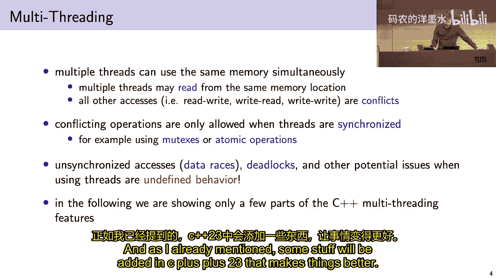

But from a basic concept， what you need for threading is threats and threats are supported since C plus plus 11 in the threat library in the thread header。

 And it's obviously called SD threat。And it's already a big jump because that means you can in an in platform independent way。

 regardless if you're using Linux or Windows or Mac OS or some other operating system。

 you can spawn threats。By creating an Eity threat。What do you have to provide when you do an SD thread。

 Well， you have to provide an executable。Well， no， not an executive， but callable。A function object。

 you know， a class implementing the calling operator an actual function。

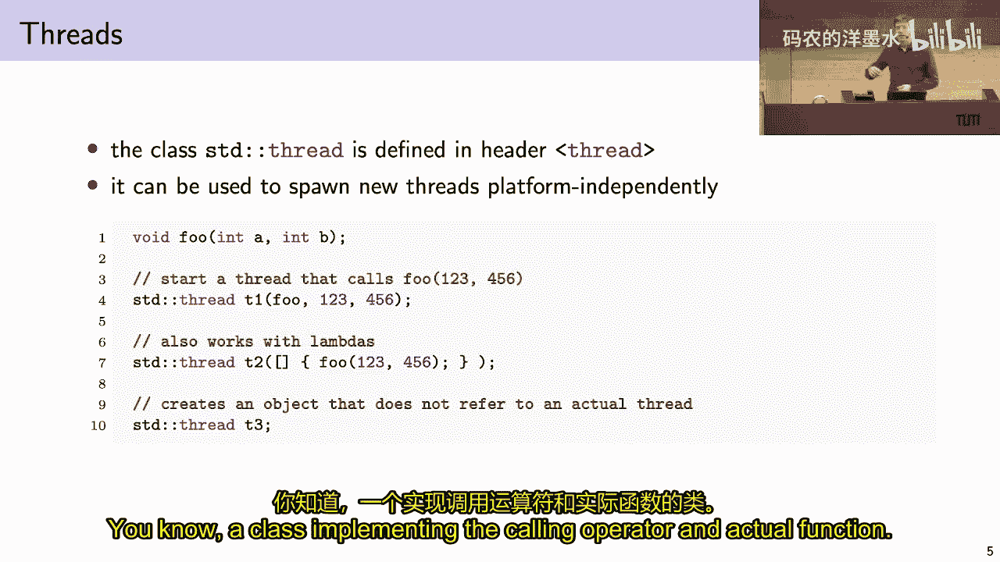

Or a Lada expression or whatever you want。 So here's an example。 Here's an actual function。

 You're starting a threat by instantiating an STD thread。

 giving it the function object as the first parameter and any other parameters that that function object might need as。

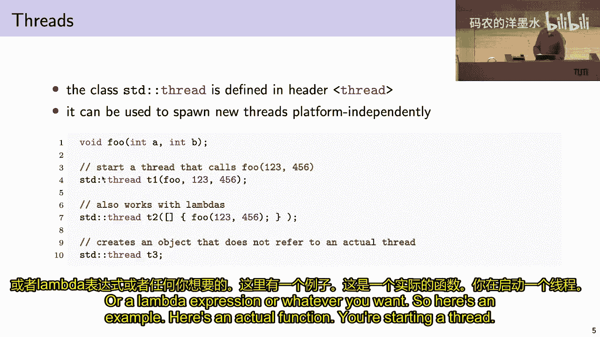

Further parameters。 And， of course， these will be forwarded。To that callable。Be a perfect for。

Which since last week， you should have some vague idea about what perfect forwarding is。

You can do call a Lada expression more or less directly and have it run in a separate thread。 And。

 of course， you can also。Do a threat that doesn't actually do anything。 So it's kind of useless。

So these threats were added in C plus plus 11， And they were already a big step forward。 I mean。

 it's。From a user perspective， it's basically nothing。 It's just a threat object。

But this already solves a big problem that you can。

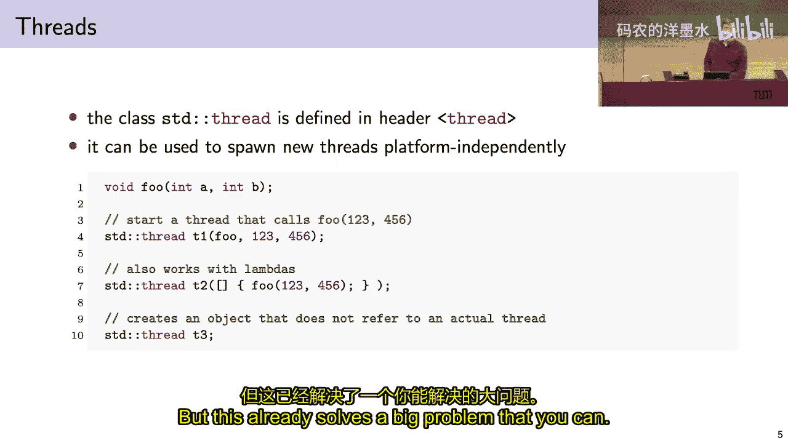

Spawn threats in a platform， independent men because， of course。

 every operating system has a different way of doing this。So at least well。

 one step ahead C plus plus， yay。

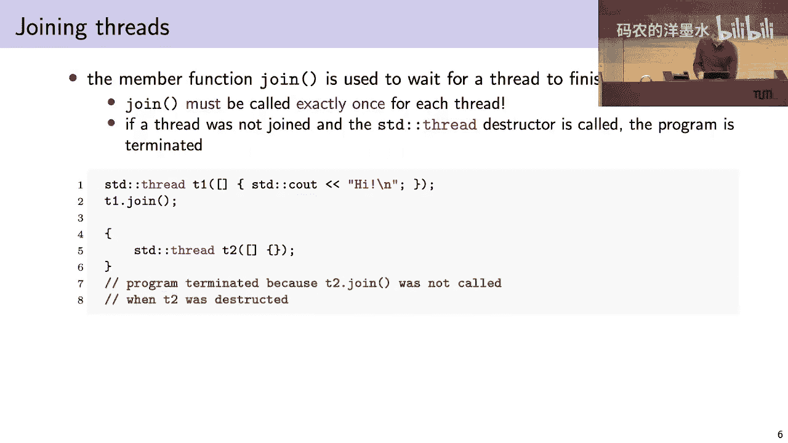

So these threats start executing as soon as you inuate them。

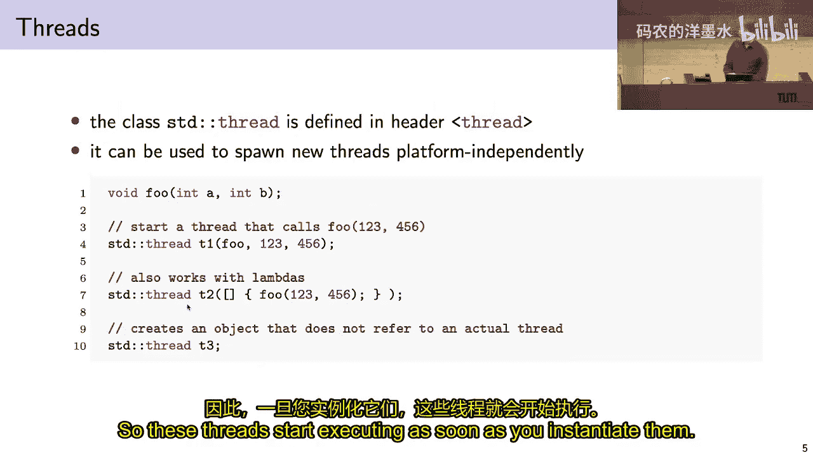

What you need to do on them if you need to call it the member function join。Which will。

Wait until the call function object that the threat was started with finishes。

It was a bit of a weird logic to do this。 But basically， what you have to do is you start a threat。

 And at some point in your program before you end it， you have to call the join method。

 because if you do not。The threat will finish executing。

 And instead of just silently finishing and not doing anything。

 what will happen is that the program will be terminated if the join method wasn't called。

So if you do， for example， this， this is fine。 T1 starts this thread。 you call join。

 which essentially waits until execution is finished and then cleans up the thread。Buthich is fine。

Now， we do the same here with a second threat， T 2， but we don't call a join。

 What will happen is your program will crash。And it would say， oh。

 it was terminated because joint wasn't correct。And I think at least one of you already had this issue in。

 in Zullip and posted about it。This is the reason why you have to call join。

 You have to call it exactly once。 And if you don't call it。

And the threat deor is called automatically by going out of scope， like here。

You would crash your program。Right， so。Car joint。Then what you can also do is you can call the detached function of the threat to just have it execute until its end。

And the threat will then， basically。Do whatever it wants on its own。

 And it's no longer basically linked to that thread object here。But of course。

 it means you can also no longer call join to join the stream of threats from your main thread and the other threads again。

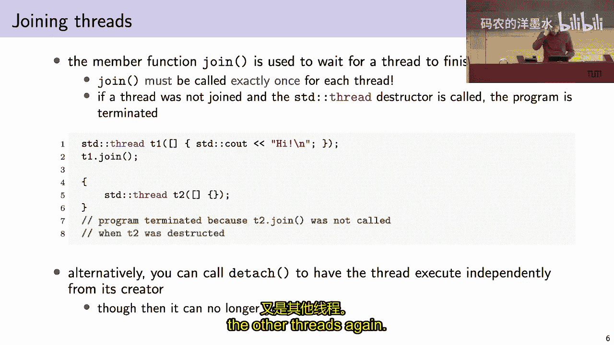

So yeah， this was kind of suboptimal。 And it took until C plus was 20 to fix this because what you should have。

 of course， is， you know， R A I I resource acquisition is inization。

 that concept that I was preaching about a few sessions ago。They should also apply to the threat。

So C plus added a new thread。Which is called J threat， adjoining threat。Which automatically joins。

When the deor is called。 That's how it should have been the say from the start。

But it took9 years to fix it。Don't ask me why。I've one of the comments I've read about this。 Well。

 Jay thread is a threat that should have been without the stupid。Anyway， so yeah。

 this is the thread how it should work。 But， of course。

 you need C plus plus 20 for it and you need a C plus West 20 cable compiler。

Who standard library actually implements this。 But then again。

 most of the standard compilers do this because it was trivial to implement this。Right。

If you still want to explicitly join or det， you can still do this also with a new Cha threat。

 And actually， the Cha thread supports a bit more。 So apparently。

 it needed more justification to be voted in the standard。What it does， it supports cooperative。

Interruption。I'll show you an example in one or two slides。Right， so threats are。

Rerapport classes that manage resources。 in this case， an operating system threat。So。

 like a unique pointer。Their owning object。And that means they are not copyable。

Because that wouldn't make any sense， but you can move them。And， of course。

 if you move one threat to another， you steal the representation and all the resources managed from that threat and story another threat。

 And， of course， that means。You can no longer join the old thread because it doesn't have any representation anymore。

 You can only join the new thread。But， of course。

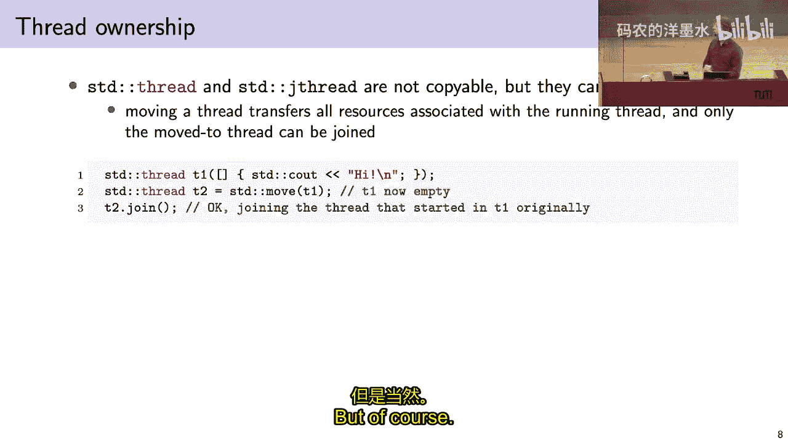

Since every reasonable person will use the C plus plus 20 J threat。

 you don't have to explicitly called joint anyway。 So the construct。

 deor will take care of that for you。

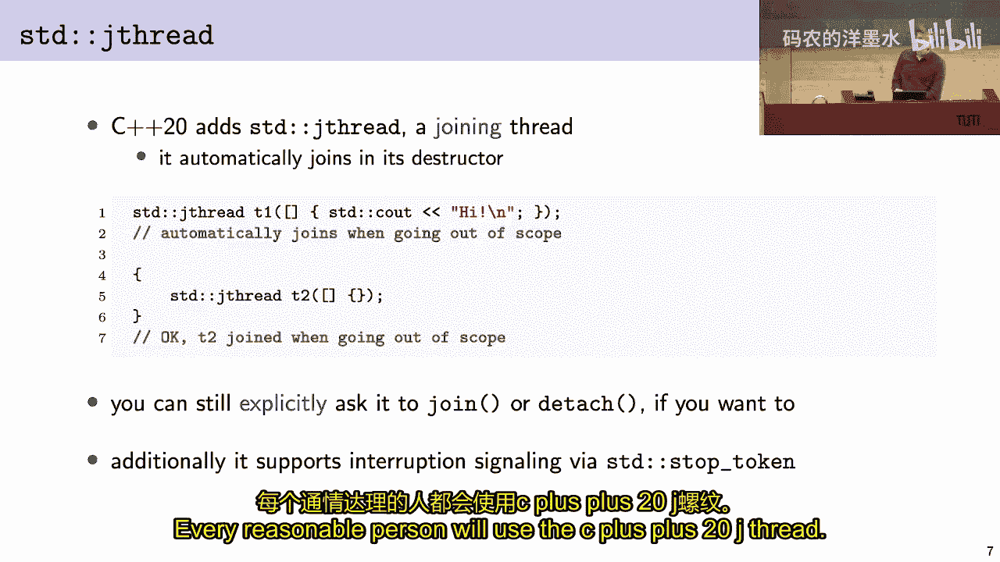

An interesting part。Well， not really that interesting， but a side note is that， of course。

 you can use threats in containers。And， of course， the container will own the threat and the threat object the the threat object and the threat object itself will own the resources。

 So everything's fine。 just like you can do a vector of unique pointers。

And it works exactly in the way you would expect it to。

 You can just put stuff into a container that are threats。

And you can iterate over those containers and do stuff to the threads。

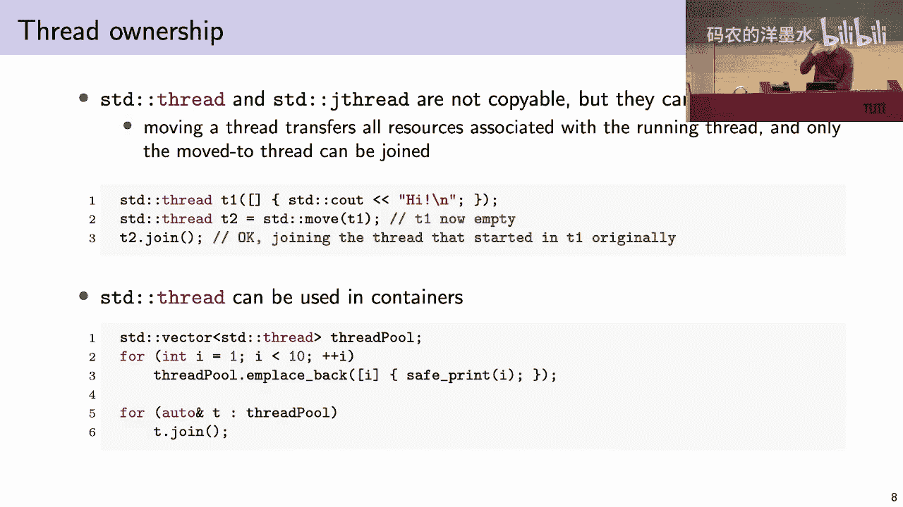

There's some other interesting functionality。 There's an SDD， this threat object。Or actually， well。

 static object， more or less。That you can invoke in order to do， for example。嗯。

Sleep4 in order to suspend execution of your threat for a certain amount of time。

 And this is also where user defined lits are used。 so you can actually use statements like 0。

2 S to specify an amount of seconds。 You will see this in the next example。

 You can also say sleep until a certain time point。

 You can call yield to let the operating system to schedule other threats in the process。 or you can。

 if for some reason， you need an I D of your threat， you can get that。 via this call， although the I。

 of course， will be operating system specific。 So you can't really predict it。

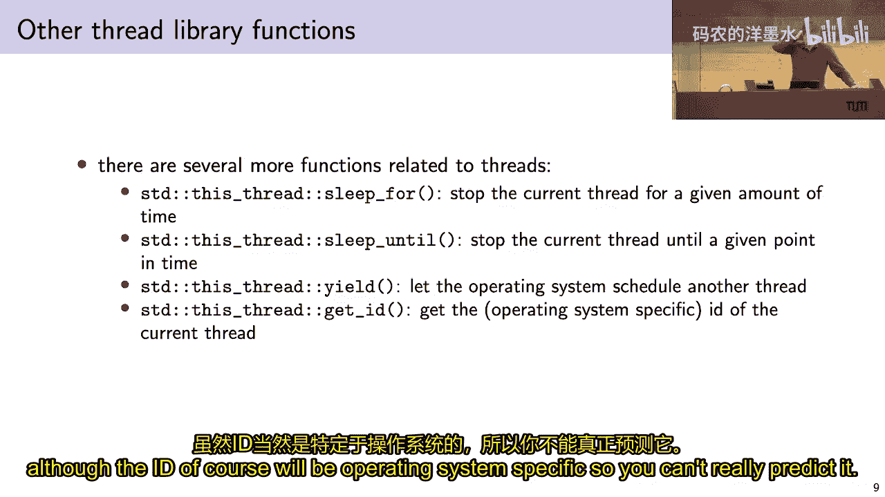

But at least you can use it to distinguish threats of your process。So as I mentioned earlier。

 the J thread， the C plus plus 20 thread that is not stupid， allows cooperative interruption。

And before I talk about this in。In a boring slide， let me just show you an example。So。

Let's start here。 So I'm instantiating a J threat that I call interruptible。

I'm initializing it with a lambda function。That as a parameter takes a so called stop token from the standard library。

This is used to implement this cooperative interruption。And if the name says。

 cooperative interruption。Relies on the cooperation of the threat to achieve interruption。So， okay。

 this thread is doing something。 ignore that for now。

 what we do in the main thread of the main function is we call request stop on that interruptible threat。

 This thread has started running doing something。 And now we call request stop in order to request a stop from the threat。

And， well， yeah， here you see， for example， calling the sleep fall function of the static object this rat。

And we are calling it with a one f litro。This is one of the user defined lits that you've seen in some of the few examples in the lecture before。

 and you've also seen in the exercises in order to use it， you need to use the namespace SD lits。

 and， of course， you need to include。They correct include files。 which if I remember correctly。

 it litals。嗯。This allows you to specify a time in， for example， seconds。Right， so the actual threat。

 what does it do， It has a counter。In the numberda function， it's executing。

 and it has an endless of vile loop。 So an infinite loop。It will call sleep4。0。2 seconds。

Every iteration of the vi loop， it will check if the stop token requested a stop。

 So this is how the cooperative interruption is done。

 The stop token is something that the threat will kind of manage。 And if you。

Request a stop like this year， the stop token will say， oh， yes， a stop was requested。And， of course。

 now you can decide what do you do with this request for a stop。And in this case。

 we just exit the function and the threat execution stops。And otherwise， we just， you know。

Output some info increment calendar so that we see that something is happening。

And you will see that after the request stop。The threat should stop outputting interruptible things。

 And then finally， the main threat interrupted at。Meth should print。

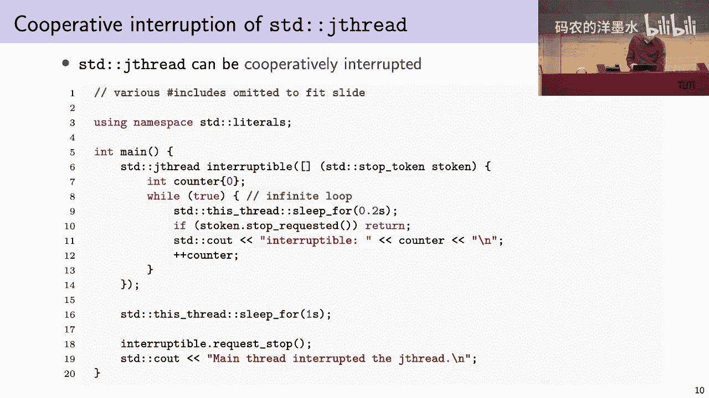

So yeah， this is the most basic。Parallel programming you can do in C plus plus。

 you can instantiate threats with callable objects。 Most likely。

 this will be lambdas or some kind of functions or function objects。Off topic。

 I had an interview and they asked me why O O P is used。

What is its advantage for code of autonomous systems and so on。

How should we answer this question in interview， I don't know。I don't ask questions like this。 I I。

 I， maybe afterwards， I will think about a good answer to this， but right now。

You won't get one from me。Do you prefer to say Linux or new Linux。啊。嗯。I prefer to say Linux。

Burn me at the steak， if you like。Ins that question about whether we'll get a practice exam here。

 In that answer about。You will most likely not get one。Do have a bunch。

 a budget for a bunch of highly experienced rust developers to create some libraries for computer vision tasks。

no。Why would I want rust developers for this？ Why would I do computer vision？

 I'm doing medical image processing， not computer vision。

I do have a budget for medical image processing。But we do our medical image processing in C plus pass。

 sorry about that。Why would I use C plus plus if multi threading isn't great in C plus plus。Well。

Many things aren't great in C plus plus。But， some are。And the same goes for other languages。

 No language is perfect。 No language gives you everything because otherwise。

 it would be the language everybody would be using。And let me just say this。

 Most of the actually popular and usable languages suck at parallel programming。Most of them。

The ones that are really good at it are most of the niche languages or not most， but many。

 many of languages that are niche languages。But yeah，Mty threading isn't a lot better， either。

It's not really natural。 It's not。 I mean， there are some， some attempts。

 and I'm actually short selling C plus a little bit。 There are some。Didn't I， No， I。

 I don't think I included that in the slides。 There are some， for example。

There's great options in doing， you know， there's these when we did the standard library stuff。

 So there's a lot of containers， there's operations on the containers like reduce or accumulate or other transform operations。

 And， of course， these should be easy to parallelise。 And， in fact， since C plus 17， there are。😊。

Parallel container operations or execution policies for container operations。

They are very restricted so far。 There are no good implementations in the actual compiler so far。

But finally， if， let's say， if ranges。And parallel container operations and parallel range operations are finally there。

 C plus support for parallel programming will be pretty good。Until then。

 we'll have to wait and make do with what we have。So yeah， the question is not。

 why would I use C plus plus if feature X isn't great， The question is more like。

 what else would you be using。Most of the languages aren't doing in great at parallel programming because parallel programming is hard。

It's not easy。And if you look at it。If you look at performance， critical code。At。Games， for example。

Most of the game engines are not that great at parallel programming。 Some are， some aren't。

If you look at the compute intensive programs， like some。

 some graphics programs or consumer programs， a lot of them suck。

In terms of performance and doing parallel processing， why， because it's hard， why。

 Because the tools don't support it very well， Why， because it's hard， yeah。But then again。

 feel free to choose anything else and C P plus。C plus plus is。

The the one of the reasons C plus plus is that popular is because it's that popular and because it has such a great code base because it has backwards compatibility to see because its performance is really great。

But， of course， you need to know what you're doing and not everything is easy land。It's not jascript。

 It's not。It's not rest。It's not Java， either。It's not carbon。 It's not go， whatever， insert。

 whatever it is what it is。 And the thing is， what it does offer。

Is more than good enough to be the language of choice in any basically any performance related application scenario today。

That might change in a few years。 But so far， that's been the case for the last decades。

 and it's likely that it will remain so。But yeah， that doesn't mean that C plasma is perfect。

 And I think by now， you should have gotten the impression that。C plus is very far from perfect。

So STD threat are software threats。Well， yes， they are created by software。

 Can I somehow create hardware threats。嗯。What is the hardware threat do。

 do you mean you want to unravel my shirt and pull threads out of it。So no， no you can， you can't。

 but also C Pos functions can't do that。 If what you mean is。

 will the software threads that you spawn in your application map to actual hardware threading facilities。

 So if you have， let's say an eight core processor will these threats map to different course。 Yes。

 but that's the operating systems drop。 and not your programs or the standard libraries drop。

 Well tell the operating system。 Look here， the threads schedule it on whatever core you deem suitable。

The operating system will do that for you。So you don't need to care about that。And yes。

 if you create SD threats， they will run in parallel on your。Processor providing it has。

 it has parallel resources available， and the operating system will schedule them for you。

Should we always use perfect forwarding SD forward when we call a function inside a function。 Well。

 if you are forwarding arguments to a function， then， yes。

 you should be using perfect forwarding because that's what it for to forward arguments。

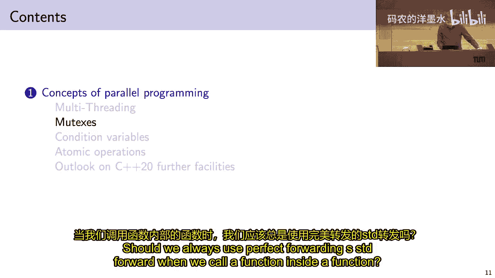

Doesn't the obligation to call join for each threat contradict our A I I。 Yes， it does in my eyes。

And not just my eyes and many eyes。 That's why finally N C plus West 20。J thread got introduced。 Yes。

 you can still join at J threadread if you want， and you can detach it just like the regular thread but will。

Join in its de S RII intent。 What you shit。 How many。P questions have you writtenna。

 I need to skip them。 I I didn't notice how much。Your freedom。

 How do two threats communicate to each other。We are shared memory。

 How do they synchronize access to shared memory， We will talk about this right now。

Using sleeps in code is that a good practice。喂。That depends。嗯。If you are waiting for something， yes。

 and calling sleep is a good option because that will also pass back control to the operating system allows it to schedule other threats to execute and so on and so on。

Right。What libraries oh do you recommend for Guis and Cplpa。Don't use C plus plus for。

It's I think the best answer if you I have to stick to C plus plus， actually， Q T is pretty okay。

It's kind of ugly because Q T was designed for old C plus plus， not for modern C plus plus。

 and basically built around the old limitations by doing its own stuff with a preprocessor。

 which sucks。

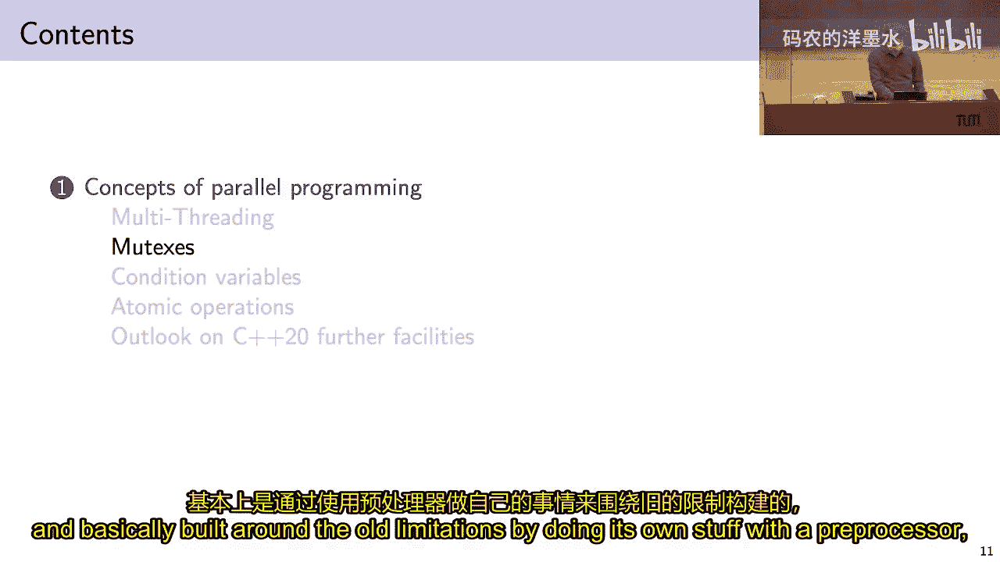

But they've modernized this to a big extent。 And it's pretty okay。 It's always really bloated， and。

Yeah。I don't know what to recommend otherwise。 but really， if you're doing chques。

 you something else。Lency plus plus。I think you're not a Python fan。 Well， actually。

 I am for the use cases where Python is cool。 Python is cool。 no question about that。 And。

 for example， I would rather write a Gui in Python than N C plus plus。Right， okay。

 so let's assume now we have multiple threats and we want to communicate or work on the same data with these threats。

And that means we need to have read and write excesses that happen in parallel。

 And that means we need to synchronize them。 And one way of synchronizing them are mutices。

What our mutics is。 It's a mutual exclusion concept。That is a universal concept。

 And there's this C plus standard standard library implementation of it in the headers。

 Muex and shared Muts。Actually， there' are three types of muttes， and I will present them to you now。

And that's also our A I I wrap us for the music， which I will present later。

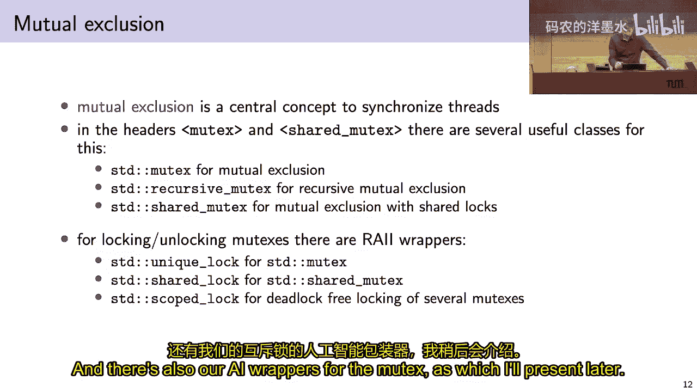

So let's start with the most basic one。 That's SDD Muex。 It's a mutual ex。It wasn't me。

It's a mutual exclusive synchronization primitive。哎。No idea what's happening。Okay， let's try again。嗯。

Is it me， is it some other interference again。唉。Okay。So how do you use this mutex。

 You call lock to lock it that basically says， okay。Now。

 I want exclusive access to the resource that the Muex is。Synchronizing。

And that means it will block all other threats。That want to access the resource， as well。

And it will remain block locked until you call unblock。And then。

Other threats can lock the muts again。 So the idea is。That me keep still。See if it's me moving。

 that's issue here。So the microphone is making noise in case you are not hearing that。Online。Right。

 so the idea here is。Very， very simple。The mutics itself doesn't do anything。

 It doesn't prevent anybody from accessing anything。 It's just there。And be essentially。

 if you call lock on the mutex， it will say， oh， I'm already locked。 So if you want to lock me。

 you need to wait for whoever else lock me to unlock me first。

So the lock call willva until the mutex becomes available and then will lock the resource until you call unlock from it again。

 So basically， it will， it allows you to lock it。From one threat。

 And then if you call doc from another thread， it will wait until it becomes available By itself。

 it doesn't do anything。It doesn't block actual right excesses or anything。

 It's really just an object。That you have to use in order to profit from it。

 If one single thread doesn't use the same mutex to access a shared memory location。

Synchronization breaks down。Though this is just a helper object。Yeah。And， of course。

 if you don't want lock to wait， you can do a try lock to see if。Mutex is currently lockable。 If yes。

 it will return true。 If not， it will return false。

 And you can do something else while you wait to get the mutex。

 if you have something reasonable to do， which might just be。You know。

Do some maintenance work or whatever。And the good thing about。The lock。

 unlock and tri log calls are that you can call them from multiple threads so you can use one mu text。

To synchronize several threats， But the synchronization is not automatic， you have to manually do it。

 You have to remember to call the lock of the muttex before you do anything critical that needs to be synchronized。

 And you need to remember to call the un， because otherwise， all the other locks will fail。

But in principle， it looks like this。 You have a mut text somewhere。

You can have as many muttices as you want。 So you can have， for example。

 one dedicated to this print function。And then when you call this print function。

 it will first try to lock the mutex， and it will wait until it gets the lock。

 Then it will do the print， and then you unlock it。

So that means you can call the print function from however many threats in parallel as you want。

And the output will be synchronized， meaning that。It won't be garbage garbage because if you try to call this without a mut text from several threats at once。

 try it。 do try it on your own。 You will see you would get。Go it stuff。Threats move。

Try to print in parallel to each other。 The output of the console is a thing you need to synchronize when you're writing to it。

 So that's how you can do it。Lock behaved like sleep。 Yes。

 if it's waiting for the lock become come to become available， it will do something like sleep。

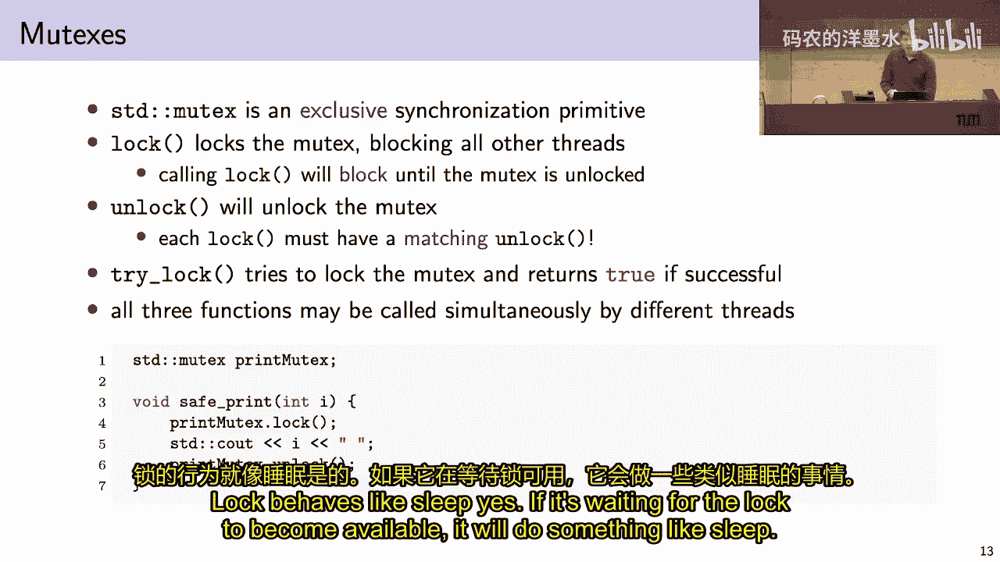

Right。That's the simplest type of mut text。 And that's basically how you use it。

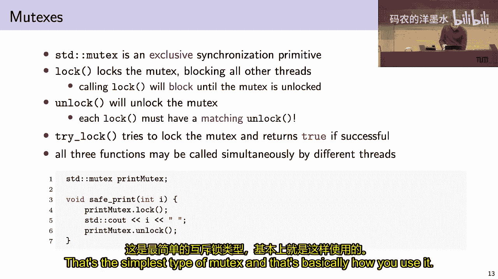

There's also recursive mutices， which is a standard muttex that you can look again from the same threat。

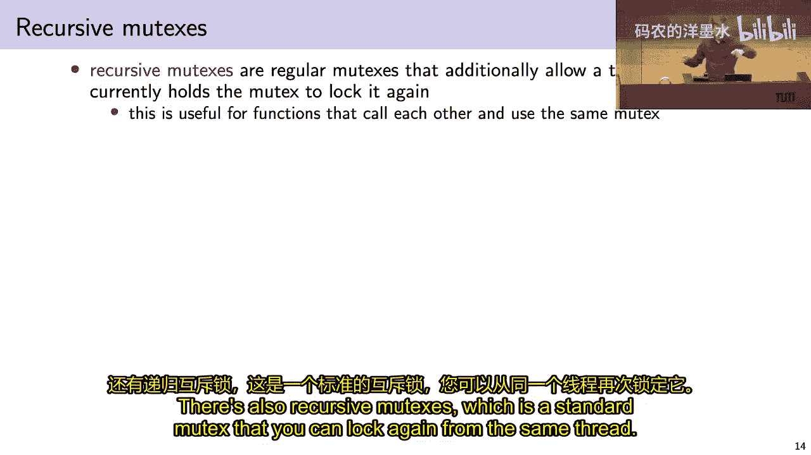

Why would you want to do that， Well， maybe you have recursive function calls。And you wouldn't know。

If somebody else locked the muts or if you locked the muts already in a previous call in the recursive chain of calling。

 So what this type of mutts allows is from the same thread， it allows multiple locks。

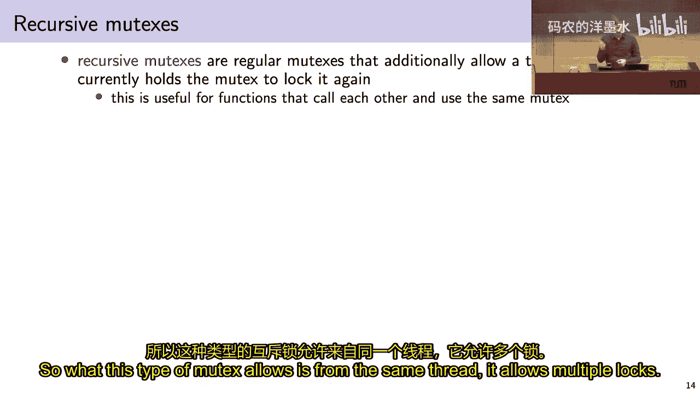

But， of course， you have to unlock it the same amount of times。So， for example。

Let's say we have a recursive muttex here。We can have a function fool that locks it。

 output something and unlocks it。 We can have a function power that does the same。

 but in between also calls fo。This is essentially a recursive call for the mutex because now it's locked when you call bar。

It will call food。 and it well try to lock it again。 A standard mus would say， oh。

 I'm already locked。So you have to wait until I'm unlocked。 But， of course。

 it will never unlock because there is no unlock all。Before the second block call。

 So you will have an infinite loop here。If you use the recursive mus。

 it's fine because this is the same thread that executed the first lock。It calls fool。

 and it will allow a second lock from that same threat， for example。

 as identified by the I D of the threat。Then you can output things。 You can undo the first block。

 and then you undo the second block， undo the second block and then undo the first block。

 and everythings fine。

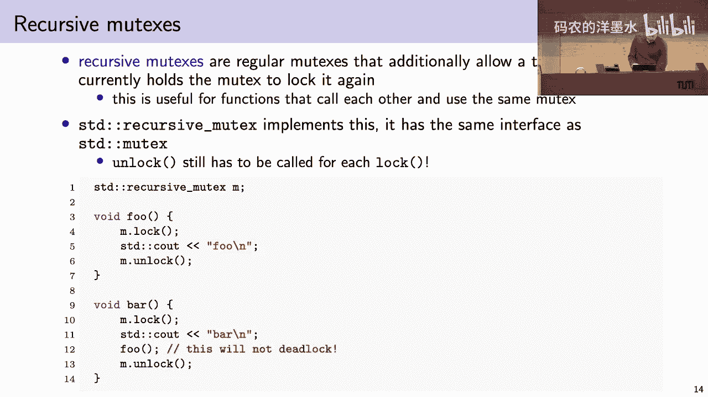

Right。There's a third type of muttex， which is a so called shared muttex， which basically。

It's also intended to manage one resource， but to provide two different types of access。

 One is the exclusive access， like a standard mutex with a regular lock and unlock。

 So that's the same。 What's new that it offers an additional access。 Well， an additional type。完了。

Yeah， let's say access， we have the shared lock。So this is basically a lock that can be shared。

 So multiple threads can have a shared lock。And why would you do this Well。

 Because read accesses are usually not problematic， but right accesses are。 So for a right access。

 you want an exclusive lock for read accesses， a shared lock is sufficient。Now。

 you should be asking yourself， do I even need a new text for read accesses。No。

 for pure read excesses， you don't。 But if you're mixing reads and writes。

 you want the reads to finish before you start writing。

So you will only get an exclusive lock if all the shared locks have also been released and。

 of course， exclusive locks as well。So this is what a shared muttics is for。 Some threats will write。

 and they will do the regular exclusive lock。 Some threats might just read。

 and they will acquire a shared lock to make sure that nobody's reading while a write is in progress。

Right， and this is basically the shared mutex function。

That has lock and unlock for exclusive lock and shared lock and shared unlock for shared locks。

 And of course， theres trilock and trilock shared。

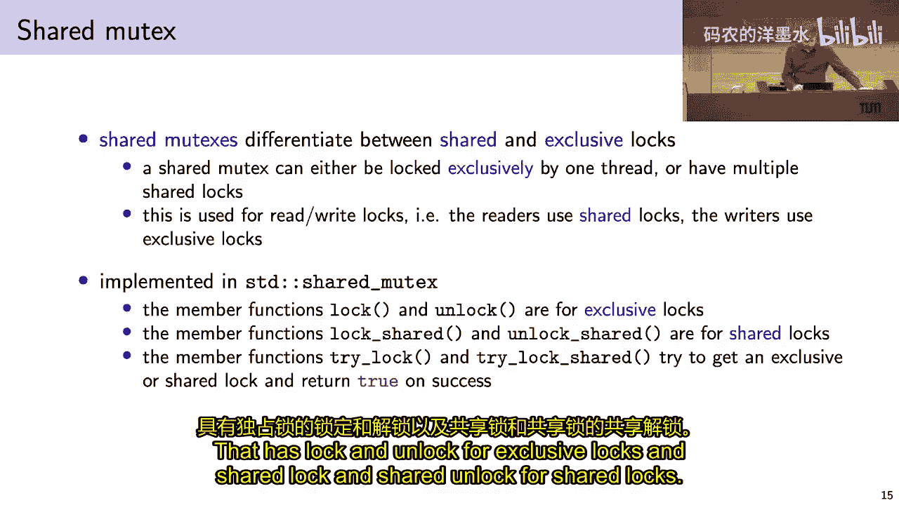

So， as an example。We could have。Shared muttes， a shared mutix like this。

We could have a vector of J threats because of course。

 the J threats are cooler than the regular threads。In a thread pool。 And then we can add。

 for example。嗯。A few functions that do read excesses to the thing that we want to synchronize。

 which is this global variable value。This is what's being synchronized with。

 This is a read access because we are just outputting its value。So。

We call the shared log functionality of the shared mutex here。So， the lock shared will。

Wait until any exclusive log is released， but it won't care if other shared logs are active because it's fine。

And then， we'll unlock。Then we can add writers where we actually change the value。

 So our global variable， where we do right accesses。And， of course， for this。

 we need an exclusive lock， and this will wait until all the other exclusive locks are unlocked and all the shared locks are unlocked so that basically。

 this right access is really happening on its own。😊，周样。This is how the shared Mu Brook。 And。

 of course， the safe print。

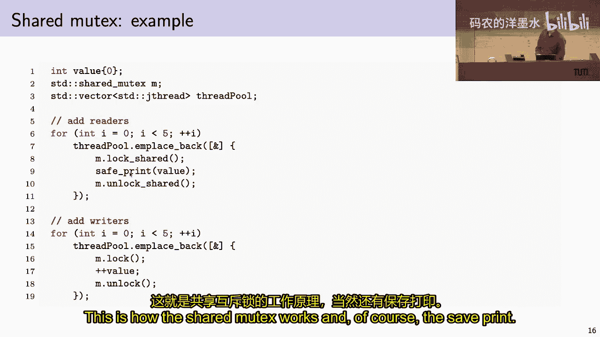

It's the safe print method we had here。Oops head here。

 which uses a different mu textex to ensure synchronization。On the standard output console。

Because that is a right access。 It's a read access to the value when we call it。

 but it's a right access to the console out。

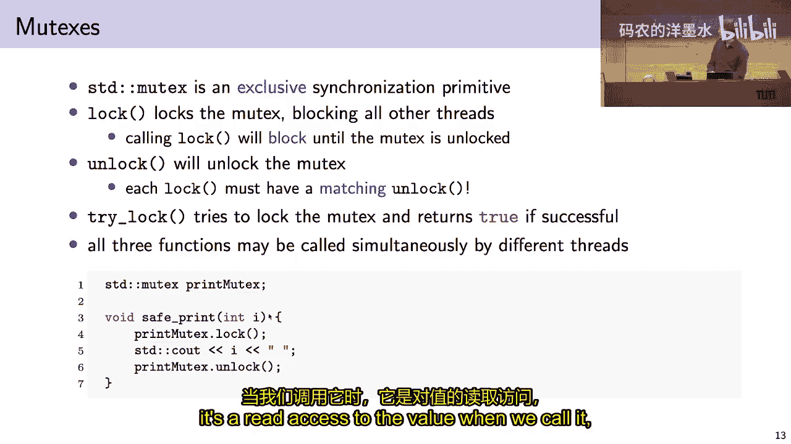

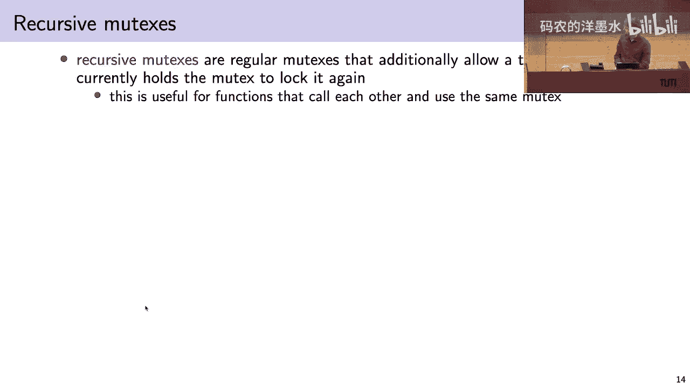

So yeah， you can have as many muics as you want。 and you want， of course。

 one each for each resource that you want or have to synchronize for。So， if a threat calls。

Lock on a SDD Mu text twice。 Will， it will remain stuck， yes。That's。

Why they have a recursor from your text。一屁。Should we use recursive mus all the time instead of SDD Mutics。

I don't know if there's a I presume there's some slight bit of performance overhead。

 So maybe the answer is no。The other drawback is， if you use a recursive mutex。

 you indicate that theres some recursion going on in your code。

 And if there isn't you're confusing the reader of your code。

 So maybe not the best idea to use it as default。How can we send a signal for lock unlock from some part of the code to another part between different source files。

Well， this is what you will use。Global variables for， for example， or a singleton。Or a shared class。

So yeah， you will have to arrange access to that new text from those different parts of code。

They have different ways。 static variables， global variables， singletons。

Or maybe a shared object that you pass around that contains a new text。呃， yeah。

We execute code after lock and before unlock。 Yeah， that's the idea of a mutex you。

Lock them your text。In order to get exclusive access。 Well。

 here here exclusive version to get exclusive access。

 Then you do stuff to the resource that you synchronize for， and then you unlock again。

So the thing is， the mutics itself doesn't do anything。 It's really just a mechanism for you to say。

 okay， I wna have exclusive access now。 and you need to have this lock everywhere before you do stuff。

 So it's up to you to make sure it works。If you in a new thread here。

 it will start executing straight away， yes。What if you spawn more threats than virtual CPUs are available。

 That's not your problem。 That's operating system problem。 It will start， you know。

 scheduling execution of the threats in its whatever policy it has。So yeah。

 it's quite possible that some of your threats won't be executed all the time。

G they' gonna be pushed out by other threats。Should we use even use SDD threat by itself。

 or is it better to use SDD Async。Good question。 No easy answer。 I don't have one right now。

But FDI think is definitely an option。 Yes， I'm not talking about it here today， unfortunately。

I should add it， properly。Right， so one of the things that should。

You should see as negative here is well， first， you have to think of， oh。

 is this an access to anything that needs to be synchronized。So， yeah。

 I should maybe play some mutts there。 That's a decision you need to make。

 The language doesn't help you with this。The other thing is， once you decide you need a mutex。

 you need to make sure that you call lock and unlock because if you forget one of these。

 you either have undefined behavior by non synchronized access from several threats。

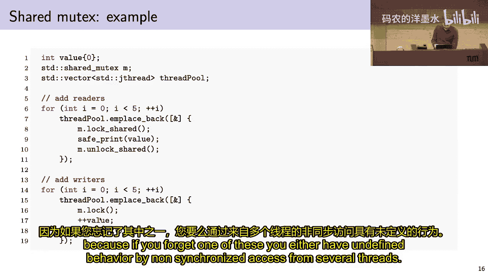

Or。You don't do the unlock。 And then every other thread will not get a lock anymore。So。

What do we have for this。R AI I， right？ That's why there are R A I I rappers in the standard library。

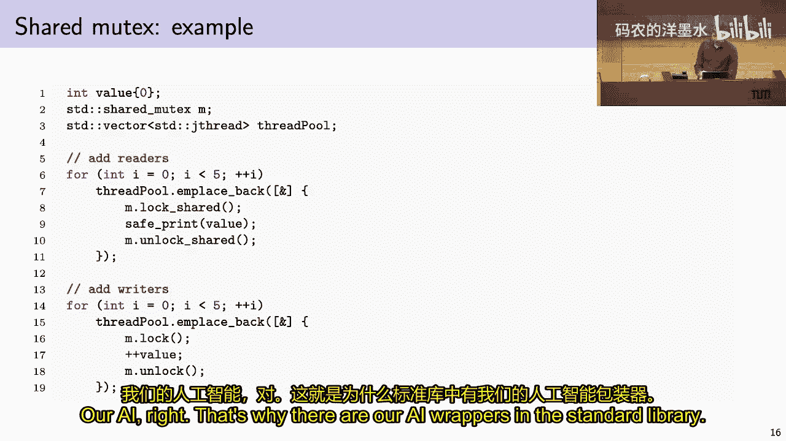

And yeah。To make sure lock and unlock are actually called。And， of course。

You have to avoid that locks。So， let's say。You have two threats。 Each of them has a mutex。

That threat is trying to log this muex。 and that threat is trying to lock that mutex。

 while they have locked it already themselves。 You will have a deadlock。 and deadlock means。Yeah。

 your code won't do anything。Right， there's some other stuff you need to consider。

 Lock and unlock are obviously non con methods because they have to do stuff to the content of the muts。

So if you're using Mutics as in member functions of your class and the Mutics is a class member。hich。

It's probably gonna be the case if you're using class member functions。

That mutex needs to be made mutable。But that's O， because what mutable means is that this is a member variable that may be changed even in constant functions。

And the idea of mutable is that you only use it。For members that are basically not part of the state of the class。

Or at least not part of the public state of the class。And for Mutics， this is fine。

So if you do use mute access members， you probably have to make them mutable for the con functions。

And， of course。If a member function calls another member function and both of them lock the same mut text。

 you have the situation that you will create a dead log。

 So you have to use recursive muttic for this。

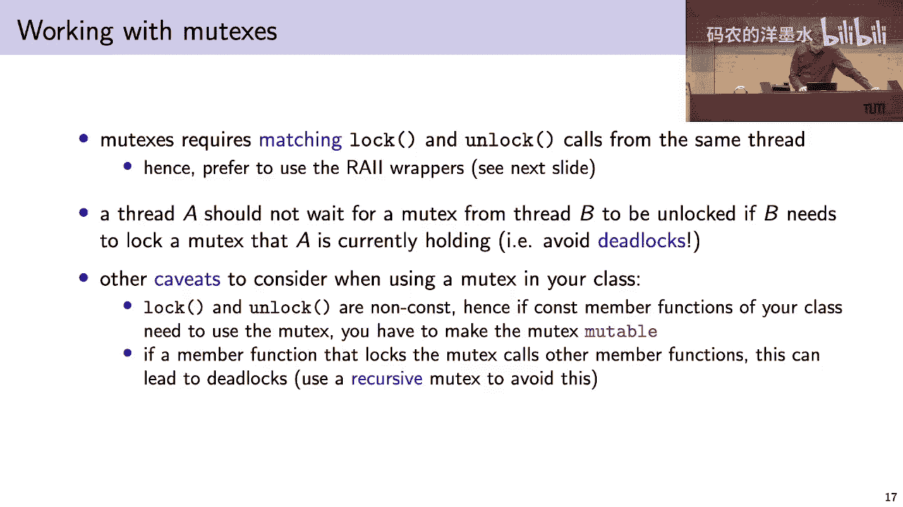

Right， now for the R A I I wrappers， we have three rappers。One is the unique lock。That reps。

Around the lock and unlock cores of whatever muttex。So， instead of。

Having a mutex calling lock and unlock manually， what you do is you have the mutex。

You create a unique look。To that muex， which will automatically call lock。

In its constructor and it's its deep structure。 So when the unique lock goes out of scope。

 it will call undoc。So， this is。How you should be using Mu Tes。With a unique lock。 and， of course。

 like a unique pointer， unique lock is an owning thing。 so you can' copy it。

 but you can move it to transform a true transfer ownership。

 if for whatever reason this is necessary。

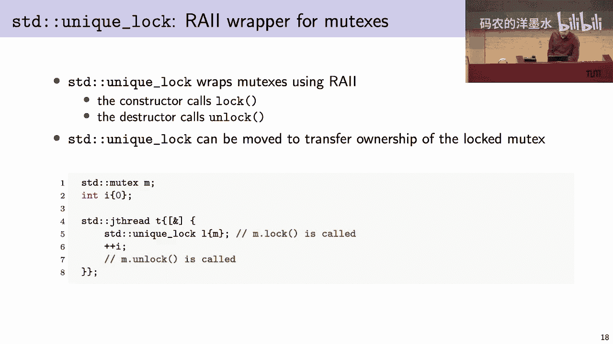

Second type of R A I I wrapper is shared lock， which obviously is used for shared mututtxes and the shared lock shared and unlock shared。

It's used in the same way。And the third R A I I wrapper is to avoid deadlocks。

 when you use multiple muxes。

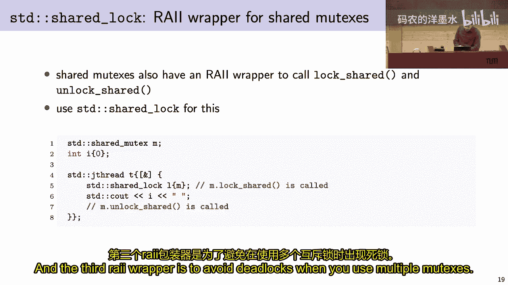

Because if you have multiple mus that different threads try to access all at once。

 the order in which you lock it needs to be the same across every thread。

 Otherwise you will deadlock if this thread locks that mutex first and the other thread locks that mutex first。

It will deadlock when they try to lock the other ones。So in order to assure that this doesn't happen。

 you need to make sure that every threat is locking several risk mutics that always in the same order。

 And for this， we have the scope block， which ensures this consistent order。

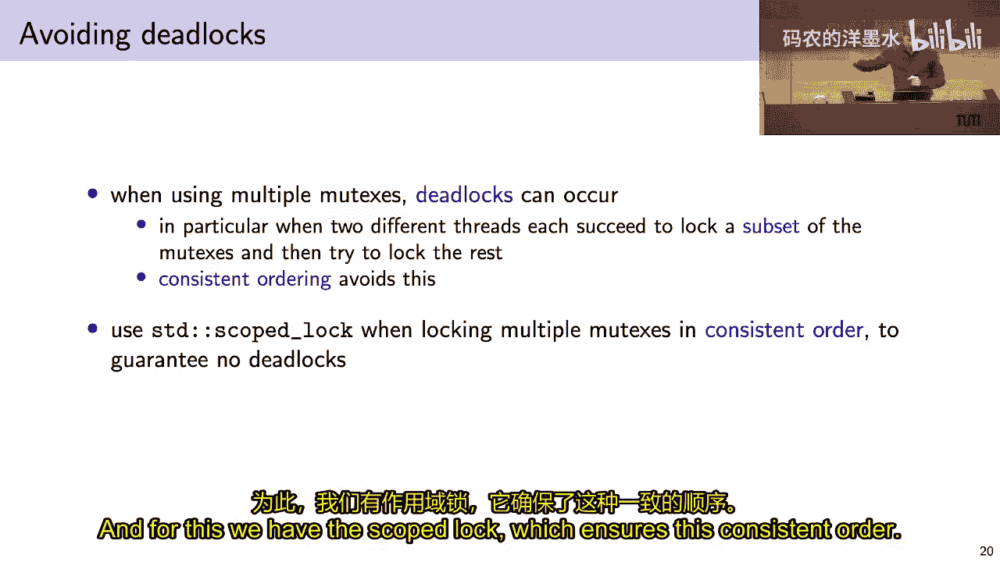

So how does it type。Let's assume for some reason， we have three muixes and1 M2 and3 and two threads that try to lock all three for whatever reason。

 Well， because we have three resources to be synchronized， right。

This one creates a unique lock with M1， M2 and M3， And this one creates one with M3 M2 M1。

So M1 and M3 will be locked， probably in parallel。One of them will catch M2。

 but the other one will wait on M1 because it already has been locked。 Why this one will wait on M3。

 because it already has been locked。 And since nobody will unlock until all the locks are acquired。

 this is a dead lock， most likely。So in order to avoid this。

 you use a scope block to acquire multiple mutusees。

 So whenever you want to lock multiple muttices at once。

 you should be using a scope block because that will ensure a consistent ordering of locking the muttices and make sure that you don't have a deadlock。

 So this one here， even if you change the order of the arguments that you provide for this scope lock doesn't matter the scope block itself will enforce that all the muttices are locked in the same order and thus no dead lock can occur。

Taps where the spaces， spaces， clearly。How expensive are muttes。Good question。

Muttices have some cost。 Obviously， these locks need to be managed internally somehow。So， yes。

They have an impact。But then the question is， since you need synchronization。

 is there something that's better。And the only thing that could be better。I's atomics。

Anatomic operations are typically。At ta faster or a lot faster。

 if those atomic operations are actually supported in hardware， which some of the processes do。

So muts might not be the most efficient ones， but they are very simple ones。

In what language is C plus written， C plus+。It can sell first， so。

You can write a C plus+ compiler and C plus。And I think。This is what Kang does。

If I'm not entirely mistaken， I think GCC is boots strapping itself in C， probably。Actually。

 let's check。不吃。嗯。Yeah， that's that's goes too far about as far as I know Kang is building itself。

And G C C can also build itself。 But I think it's doing that we see。

What does it mean to have four cores， but8 threats， Well。

 it means that one core supports execution of two threats。 Usually。

 there are some limits of what things it can execute in parallel。

But if you know about CPUU architecture， you know that some operations have to be pipeline and maybe。

Have to wait for memory excesses and and so on so we can reuse the same execution units you have for that core to support several threats at once。

It's not as good as having two real core with their own resources。 But it's， in many cases。

 it's better than having。Just one thread in one core。

So it's an easy way of hiding some of the inefficiencies or necessary design compromises in one core by having it support several threats。

How can we start a threat on the GPU yeah。Not like this。Unfortunately。

GPU programming is its all own pool of crap。And seriously， it is shit。 GO programming is still。Uly。

 as fuck。And one of the main reasons it still is advice because Nvidia ignores every。

Everything except its own stuff。 And， of course， Nvidia is the。Currently。

 the biggest company doing GP computing， unfortunately。And they。

 they are killing and trying to actively sabotage basically every standardization effort to do GPU programming。

Right， but if you had standardization on GPU programming， you would be using something like Cy S Y。

 C， L or something like this on top of an open standard， like open C。

 L to support transparent GPU programming。 Of course。

 what Nvidia wants you to do is it wants you to use its proprietary coa。And。Such a nuisance。

 because other the Nvi compilers are so shit。How can a company be that big and have such crappy software。

coota used for GPO program。 Yes， unfortunately， because。And video graphics cards。Are among the best。

 unfortunately。 And if you w to get the best out of the best graphic card。

 you have to use kuda because everything else isn't properly supported on it。Catch 22。That's。

 for example， why I was hoping that。That the intertel GP。Would be really awesome。 But so far。

 theyre like。Dkewar。MD GPUs are pretty good， actually。In terms of hardware， theyre not quite there。

 unfortunately。However， since， the underdog， they actually spent quite some effort on standardization and easy software interaction and so on。

 So M D really is the good guy currently， of course if。The book will change at some point。

 Maybe also that practice will try and change。But yeah GPO programming is really， it's just horrible。

It's just horrible about。Not a pleasure to do。C plus plus used in embedded software， yes。

What about Apple G Uus， That's the next nuisance。 Apple was part of Open C L， and then it got out。

 and then it did its own thing， fuck。So instead of， you know， having one。

 one thing that all the manufacturers could agree on， everybody is doing their own thing。Sos。

 the Apple GPs are awesome。 I mean， the GPU in this one here is really cool。 It's it's。😊。

Deapub without a fan。And the GP is awesome。 And you can't use it unless you use the Apple Tookit to program it。

 it's， it's a nuance。Really。

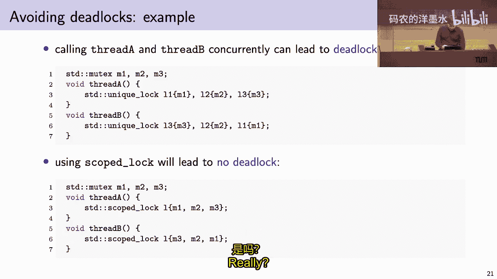

Anyway。I w to talk about a bit more， except Rt about Nvidia and Apple， so。

Let's stick with C plus plus condition variables。They're a bit of a weird thing。

I haven't encountered an actual use case for them yet。 But then again。

 I don't do graphical use interfaces in C plus plus， which I guess is probably one of the。

Main use cases for this。So what can you do with condition variables。

But theyre also for threating colonization， obviously。

But they are not doing this in a lock and unlock fashion likemticix is， but more or less like。

Waiting on a condition。And once it becomes true， it stops waiting and does some stuff。

It actually relies on mutes to work。 And it's a bit weird in how it works with this。And basically。

 the two options you have with a condition variable is waiting。And notifying them。 And， of course。

 one thread will wait。 Another thread will notify the condition variable。

 And once the notification happens， the other thread will do work。So it's kind of a bit of like。

 like passing a message。Between threats。Right。There's some weird stuff that's going on。Namely。

 that a threat is waiting。 It needs to hold the muts。Why you have to actively do this yourself。

 That's a design decision I don't understand。 But I presume some people that are more clever than me decided that and thought it was good。

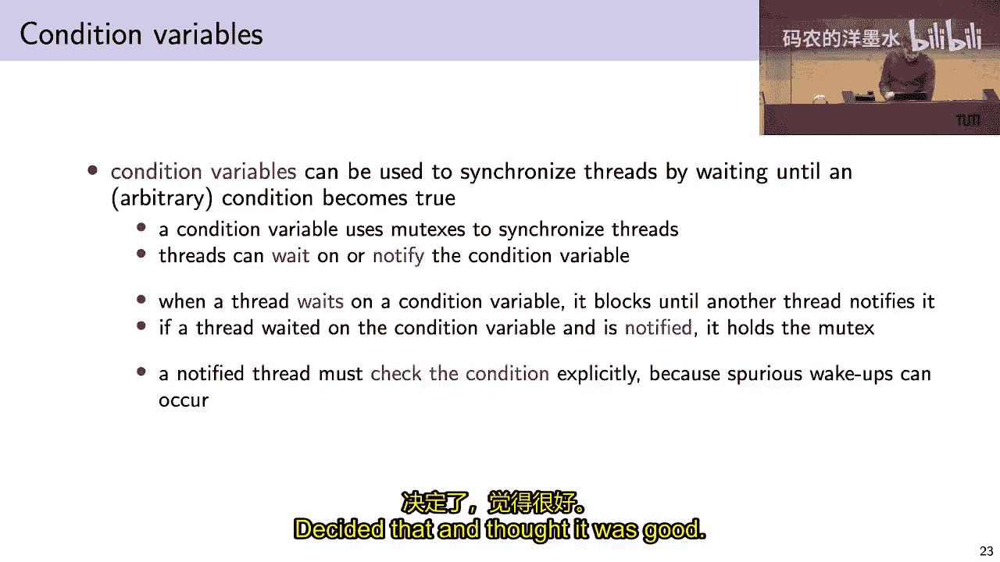

So yeah。Actually。Let's look at an example。Yeah， there are some methods。 So the weight obviously。

 is there。 the notify functions there。 There's two notify functions。 notify one waitinging thread。

 whether it's notify all waitinging threads。 So if there' are several weighting threads。

 you can notify all of them or just one of them。

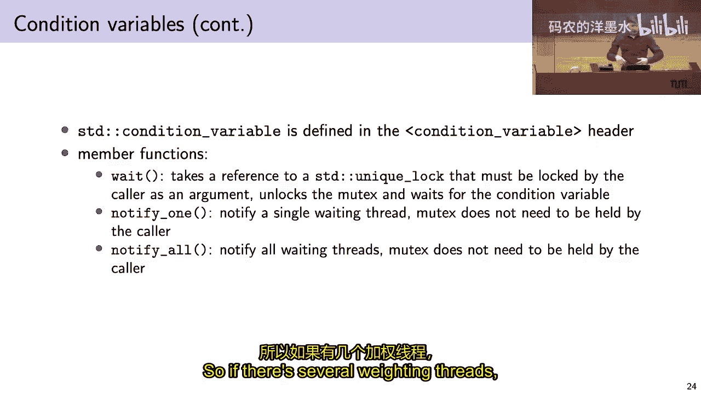

And of course， the idea is that you have something like a verka queue。

Where you insert tasks and you have worker threats that are executing the task。

 and they are notified once a new task comes up。

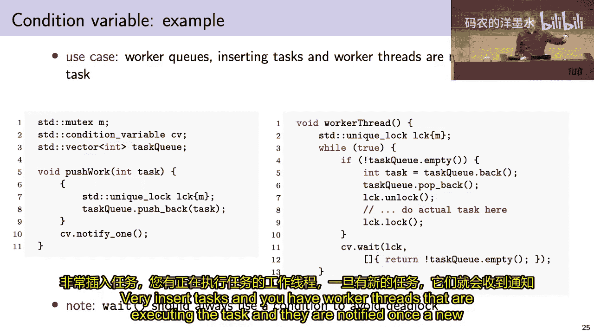

So it could look like this。 What you need。It's a mutex。 So kind of a minimum working example。

You have a mutex。 You have a condition variable。 They are both from the standard library。

 and you have have a task queue。That stores task by some I D。And then， you can create work。

Adding a task by pushing such an integer into the task queue。Of course。

 the task queue is something you might be accessing from several threats and pushing something into the task queue is the right access。

 So you need a lock for this。And， of course， we do this with a unique lock to our Mut M here。

We push the task， and then we're fine。 Wed create an explicit scope here so that the unique lock is released in released immediately after the pushback。

 And then we call the condition variable and tell it， look。

 we have a notification for you because a task was just pushed。So in the VerA thread。

 it might look like this。It would acquire a unique lock to the Mut， first。

Because it will do some operations on the task queue。

 So we need the same mut textex as here to synchronize access to the task queue。 Of course。

 the empty check。 So we do an infinite loop as so often in these kind of things。

We check if the queue is not empty， which is a read access。

 So this strictly doesn't have to be synchronized yet。

The right access will happen here once we remove the top task in the queue。Now。

 once we access our queue， we can unlock our mutex。

To release access and enable other threats to push more work。

Or to enable other workers to get more work from the queue。Do the actual task here。

 depending on the ID that's in the queue。 So you do whatever you have to do there。

And then you call the lock function again because then you iterate and do the check again and so on。

And before you iterate。In order to not and have an endless loop of checking the task again and again again again。

 so basically do hot weighting。You do it via the condition variable where you say， okay。

 now I finished my task。How about I wait until I get notified that another task was added。

And I do this via a weight on the lock that has to be locked。

For some design decision and what you should be adding is， and you， you can add， this is optional。

 but you should always add it。Is a condition that checks if you really should wake up now from the weight。

And what we do here is we check if the task queue is empty or not。

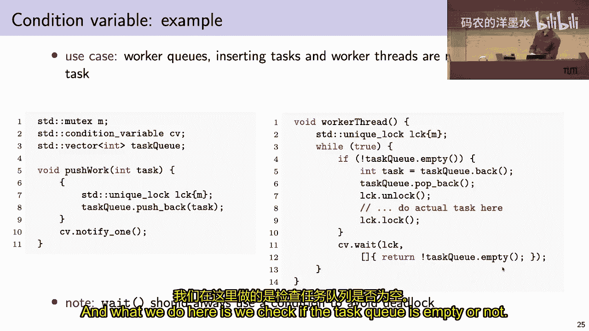

Because what can happen with these condition variables， the weight function can wake up。

 even though no notification was bounded。 So you wna remain in the weight。

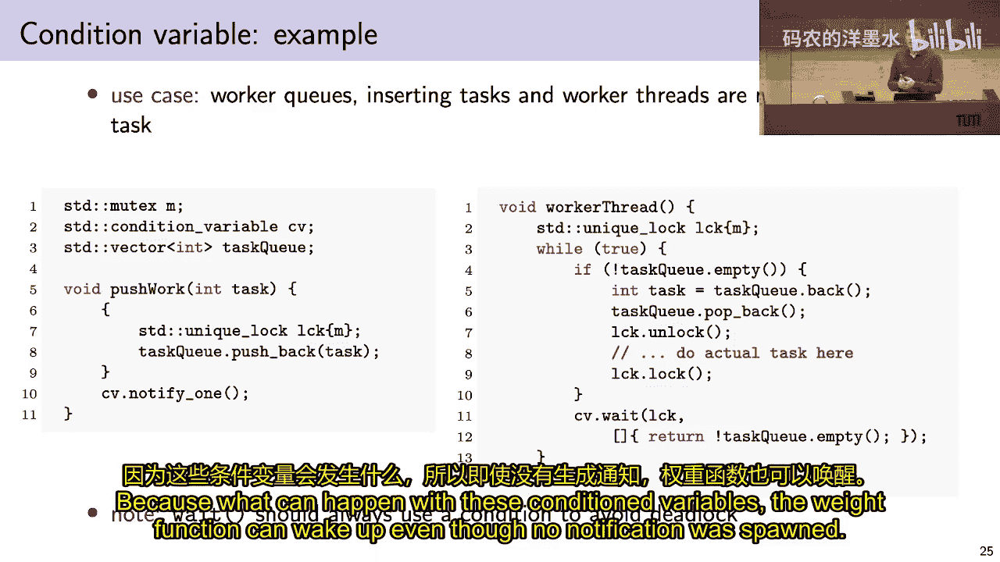

Until the task queue really is not empty anymore。 And then you will go back。

To the infinite loop here and then actually do your task。

So this is a pretty good example of how these condition variables are supposed to be used。Right。

 and if you have this kind of thing， then they're， of course， very handy。A very efficient tool。

But then， again。I typically don't have tasks like this。

 so I've never used a condition variable yet in practical code。Aren't you a big fan of the laptop。

Yes， I like laptops。 I've had many laptops in my life so far。And yes。

 the 1 I currently have is 1 I'm very， very happy with。Except for a few things， like， for example。

 it not support its GPU being really cool， but not being supported by any reasonable programming interface。

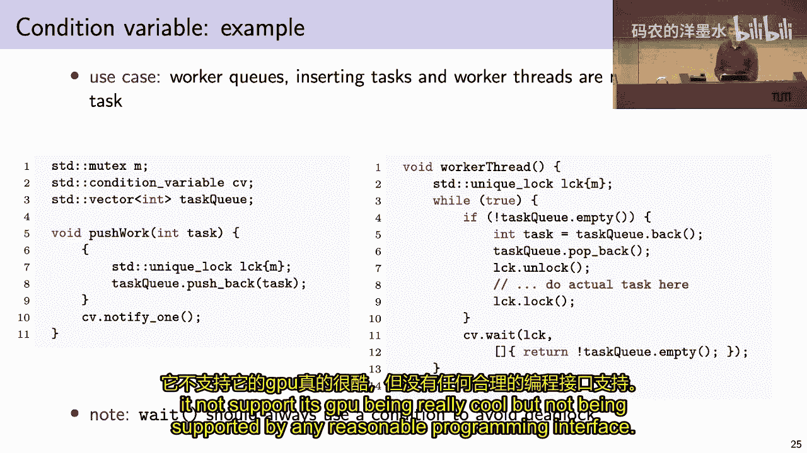

That's not matter。And metal is not reasonable because it's proprietary to Apple。

You have one more lecture left to present us news about your frying pan。I'm preparing。

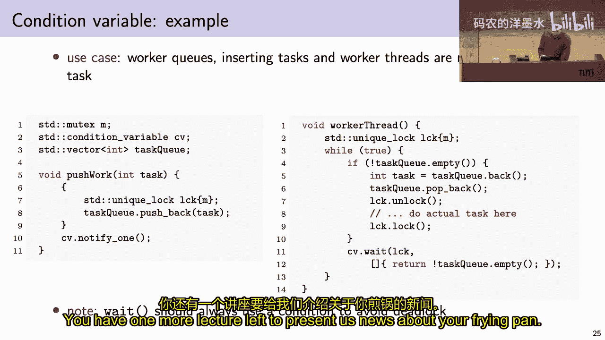

I've already transferred the frying pan to where I can actually do a scrambled eggs with it。什么呀。

Incoming， I， I did boil it eggs this morning， by the way。So， I'm progressing。Right。Atomic operations。

As I mentioned， this is one other way of synchronizing accesses。And。Typically。

 these atomic operations are more efficient than muttexes。

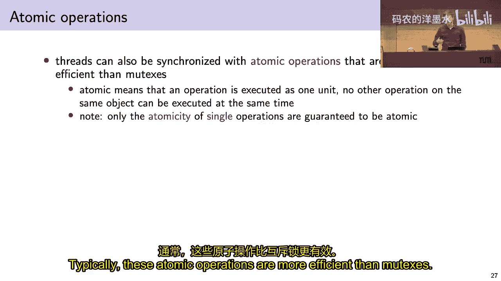

But they are a bit more limited。 Mutices can synchronize whatever you want them to synchronize because。

 well， you decide。

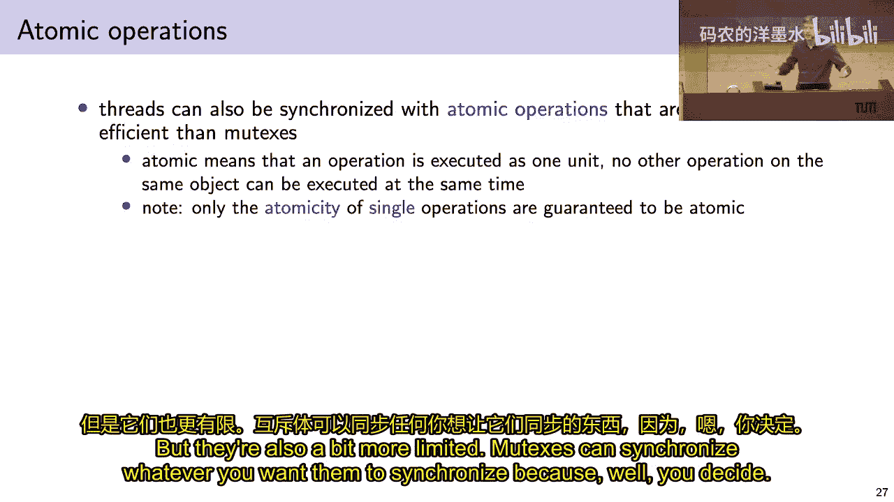

It's just a marker that you use to synchronize between threats。It doesn't actually。

 the mus itself doesn't do anything other than you using it as a signal。The atomic operations。

 they are more active。 Basically， they ensure that whatever is wrapped in an atomic operation happens in an atomic manner。

 meaning that no other threat can do anything while the atomic operations takes place。

So it's a lot more limited in scope。That's why it's more efficient。

 And it can be a lot more efficient if those atomic operations are supported in hardware。

 and on some processor architectures， they are。And if the compiler are able to。

 compilers are able to use those， then you get very good efficiency。Right， of course。

 atomic operations only mean that single atomic operation is synchronized。

 So if you have a sequence of atomic operations in order to synchronize those， you need a muts again。

 So Mutics is a lot more flexible。 Atomic operations are only for one operation。😊。

Let's say we have some atomic ad function。Which。Allows us to add the value of I to the value of P。

Then we could call the atomic ad function。On this a here， which is a shared memory。

Between these two threads。And the thing is， the atomic ad will make sure that the ad operation of 101 to 10 and 2 to 10。

Or to the actual value of a will always be synchronized。

 So in whatever order you call them in whatever order they are executed。

 the end result will always be 13 because both operations will execute fully on their own。

 They won't be mixed。 They won't be any intermediate state or anything。

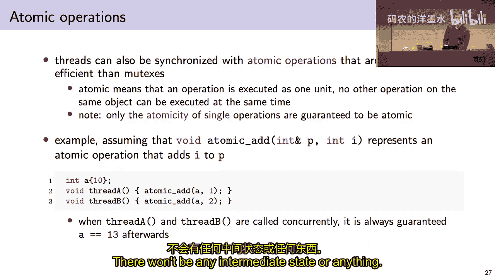

Their support for these atomic operations in C plus plus， it's provided in the library。

 that's called Atomic。And what it does， it allows you to wrap any type T with STD atomic。However。

The actual interface that atomic provides is very， very limited。Essentially。

 in order to get the value of what you store， you have to call the load function。

In order to store something， you have to call it the store function。

There is an additional function called exchange， where you can swap two values。In an atomic manner。

And there's compare exchange operations， which yeah， you might need。 And if you do。

 please check the reference。 I don't want to get into details here。If T is an integral time。

 There's additional operations。 There's an fetch ad， which basically。Gets the old argument value。

 returns it and then add what you want to add。 And there's for something for a subtraction for logical and logical or and logical X。

 or。 and the same for the operator plus equal minus equal and for and or and X。

 or and increment and decrement operators all there。So as you see， atomic operations。

Are a bit limited compared to what the actual type might provide。 And in sense。

 you have to do loads and stores or。Various operations that are supported。

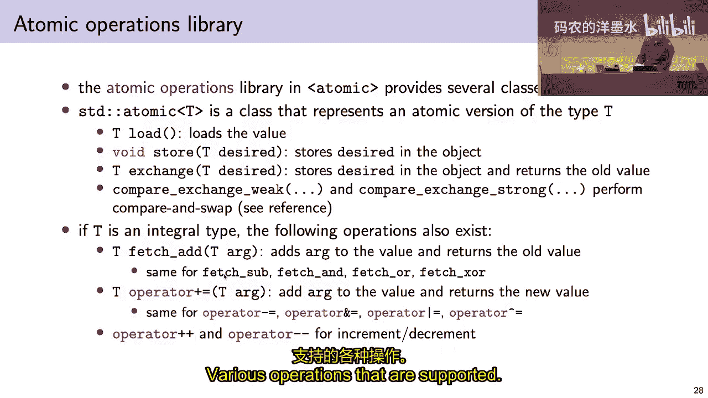

So， the good thing is。If you have one atomic object， then the modifications are ordered。

They are totally ordered in the so calledled modification order。 and that means。

This is a consistent order that's consistent between threats。And， but this， of course。

 only holds for one atomic object。 If you have several atomic objects between themselves。

 you don't know。But just to make sure for， here's an example for you to understand what this means。

 we have an atomic integer here that's initialised with0。

 and we have a worker thread that's alternatingly increments it by one and then decreements it by one。

So what should happen is that I gets incremented to one。And then decrement it to 0。And the thing is。

 this modification order is constant， regardless how often。

That ver threat is called for multiple threats。And what will be true。

If you load the value of this atomic eye。That value will always be 0 or1。

 It will never happen that the -1 is executed before the plus1。

 So it will never go to -1 or to plus 2 because suddenly two plus one operations are executed first。

 So that's the cool thing about。Atomics。Atomics are again， fairly recent addition。 There's also some。

Modifications that have been added as spark fixes and extensions。 So， for example。

 one of the things atomic won't work well are references。

 because what will happen if you do an atomic of a reference， it won't be。

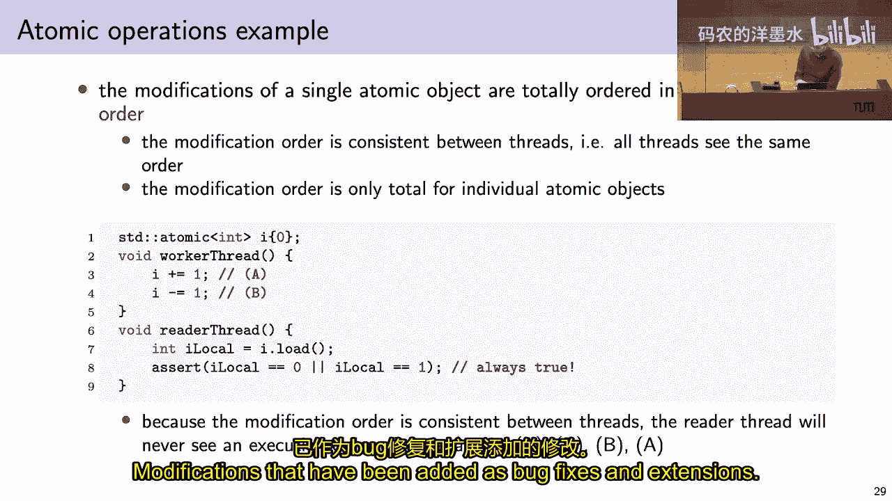

And reference， it will be。 It will take a copy of。The value of the reference is referring to。

 So if you really want an atomic reference， you have to do atomic underscore ref。

 which is a class that is new and was introduced in C plus 20。And well。

 you will see if you run this code， you will see that basically， if you increment。

 you're not really reference。And your atomic reference that the not really reference basically did its own thing because it operates on a copy。

 like the atomic reference actually refers to the。

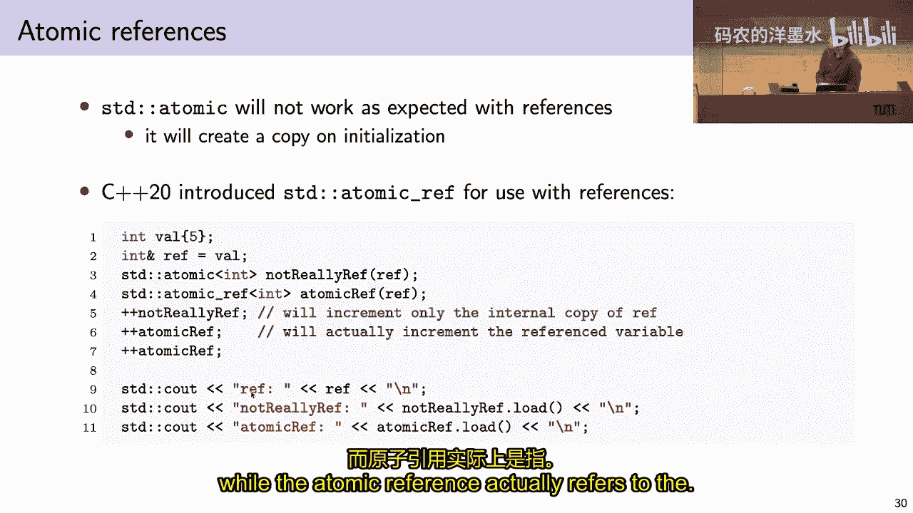

Orig reference。Shardpointer itself has some guarantees for parallel programming。 Maininly。

 it will guarantee that the internal reference counting is threatsa because it's implemented using atomic operations。

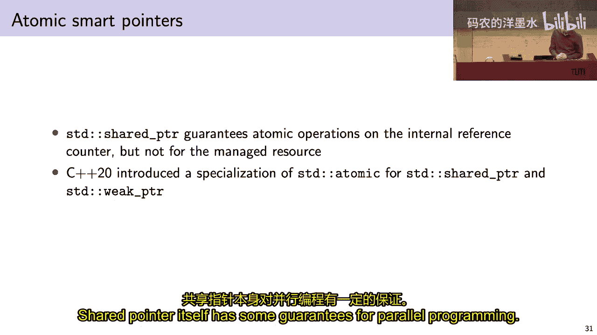

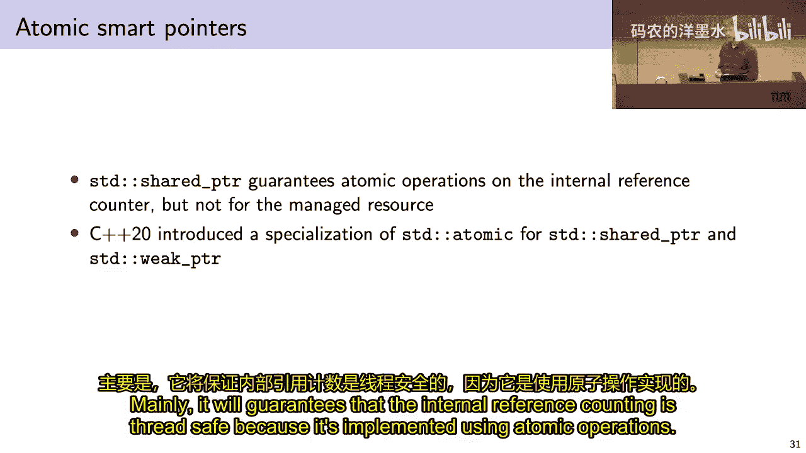

However， the action managed resource。Is not guaranteed to be synchronized。 if you wan to do that。

You can do。SDD atomic of Shad pointer starting in C plus plus 20。

 And you can do the same for weak pointer。 So it can wrap SDD atomic around Shad pointers。

Fancy plus plus 20。And， finally。You can have an atomic Booleion。嗯。Which actually。Excuse me。

 It's a separate class called atomic flag。But， of course， you can。Rrap a booleion and SD atomic。

 and it will behave as every other atomic。 But there's a special atomic flag class。

 which is essentially an atomic of a booleion。But it has a guarantee to be lock free， So to be very。

 very efficient。It has a separate interface because， of course， it's only a boolean。

 So you w to set it to true or false and you want to test if it's true or false。

 So there's the test to check for the current value Test and set to set it to true and clear to set it to false。

 And additionally， there's also a weight function that waits until。

Either true or false is achieved in the value There's a notify function。 So actually。

 this atomic flag is very similar to a condition variable。But simpler。

 since you don't need to have a separate mutex and you don't need to care about the mut as well。

So an atomic flag is actually a pretty cool thing。I hope you didn't make the boiled eggs in your frying pan。

 No， I used the put。And if they act for hard boil。8 minutes。Oh， this is a good suggestion。

 For the last lecture， you wanna see some codes from our projects。

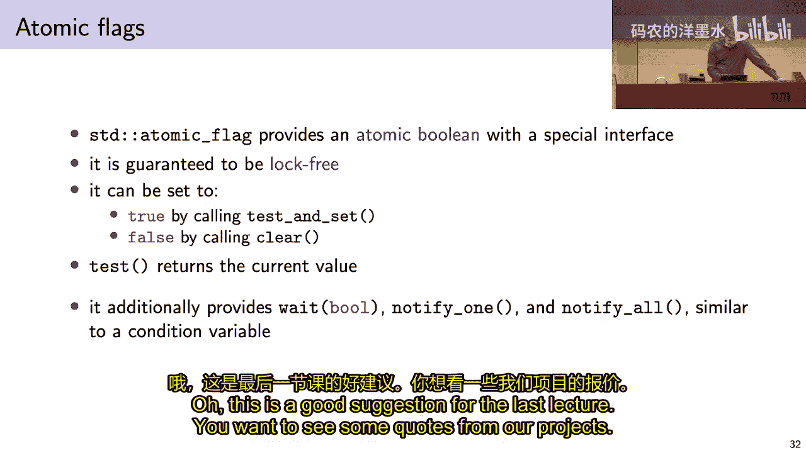

I see if I incorporate this。 Yeah， that's a good idea to show you some examples。

Why is themic again working properly， I don't know。I didn't do anything。Right。嗯。

So what I want to do at the end of this lecture。I've already raned enough about various things。

So let's have an outlook on additional stuff that was added in C plus plus 20， because， in fact。

 C plus plus 20 was a fairly big update， as we've seen in many instances already over the course。And。

One of the things we didn't touch upon yet， the C plus was 20 added。

 a lot of things for parallel programming。

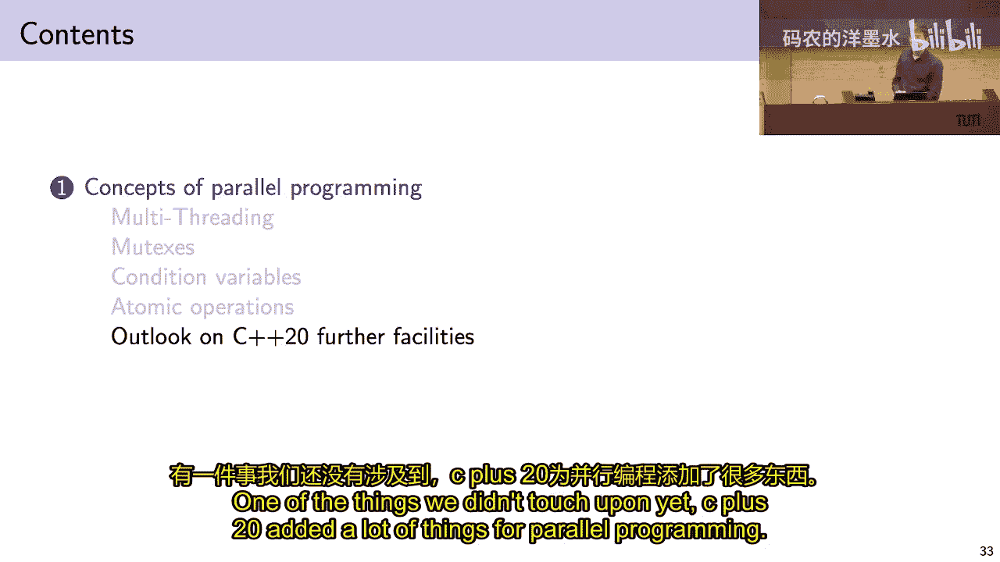

The biggest thing， arguably， were the cold routines。But alcohol cow routines， well。

 they have function that can suspend and resume the execution while keeping their state。

So let's say you have a generator function。That generates numbers for you。In the simplest case。

 this would be one then 2 then3， then4 then5。And， of course， what you could do。

Is you could have a class that has a current counter value。And you would request the next one。

 and then the counter would increase， and you would return the new value。

Co routines especially basically a simple function， not a class。That。Would increase its own counter。

And basically say， oh， I've increased it now so I can stop executing and just return the result and wait until I should resume again。

So， it doesn't。In theory， do anything that he couldn't do before。It' just doing。

This in a more nice fashion。 And this is actually a language extension。

 So there's new keywords of the language。 There's new functionality。This is all there。 It works。

However， in order to work， you need to write a lot of boilerplate code yourself because they forgot to put some part into the standard library or。

 well， maybe they didn't forget， but they didn't manage to put it there。And in the end。

 it's only C plus 23 that will really make co routines useful。In practice。

 So that's why I haven't talked about them， even though they are a big feature of C plus plus 20。

 But currently in my eyes， they are borderline unusable。

But if you have something that maps itself really， really vertical routines， you can， of course。

 use them now already。There's counting SeF4 for shared resources。I have to admit。

 I didn't really look into them， and I didn't quite understand why you can't shouldn't use a muttex instead。

So I didn't talk about them here。sameme goes for laches and barriers。

 which are again used for coordinating threats。Which we already have a tool for。

 We have condition variables。 We have the atomic flag。

 So here's another method of doing this with stches and barriers。 What we've seen。

In the J thread is that theres support for cooperative interruption。

You can expand this via explicit stop tokens， passing them to threats and so on。 But essentially。

 this works exactly like I showed you with the J thread example。

And there's actually also synchronized output。 We are oing stream。If you have several output streams。

 you can synchronize them。No。嗯。One of the reasons I didn't talk about these。 I mean， for some。

 it's clear coal routines in my eyes aren't usable yet。In C plus plus 20。

 they will be in C plus plus 23， The others， discounting samophos， Leuce barriers。

 cooperative interruption。 These are features that seem nice on the surface。

 I didn't go into details of them because although there's barely any material available for them。😊。

Most of the standard libraries don't implement them yet。

And there's no real literature on them either。 So that's another reason why I skipped。I'm here。

Because， yeah， I， I have nothing to explain on them yet， really。Right， what I didn't mention is。

 and that I'm a bit angry。 I've apparently forgot is that there's other parallel algorithms for the standard library。

 So there's execution par policies for some of these algorithms in the standard library that got added in C plus for 17 and 20。

hich allow parallel program without you living any lifting any finger。嗯，8点。This is ongoing process。

 and this is actually， I would say， the area where Cpl is developing the most parallel programming。

 because that is one of the weakest areas of C plus and many other programming languages， too。

And if you look at it， it's， of course， all the the hot topic。 If you look at it。

 the single core performance。Didn't go up in for a long while。

It has been going up in the last two to three years。

 due to various efforts and various companies spurring each other on。But in most of the cases。

 you're paying a lot of power for it。And， of course， power is precious in mobile devices。

 You are limited by the battery。 Youre limited by the heat that you can expel。嗯。

So power is not something you can always increase。That means the only way。

And the most reasonable way to get more performance is to go wide， to go to several cores。

 to several threats。All the all the recent processors are going to a policy of performance course and efficiency course。

 They're in here， for example， they're in the most modern input processors。

And that means you will have more and more core available。

 So back in the days when I started programming， there was， of course， no multi core processors。

 When they came out， there were two core， one very limited， one general one。

Then it increased to two general ones。 some point there four。 and it was standard for a long time。

Then it increased to 8。Or6 or 8， which I think is currently more。The standard now these days。

 and it's increasing。 There are standard processors in small computers that have 12 core，16 cores。

32 cores。One of our bigger computers has 2，56 cores。And， of course。

 the supercomputers have even more。 But， you know， the number of course per processor is steadily increasing。

 and that's the most。The most of the performance is coming from。 So the support。

In programming languages， for this is crucial to actually make use of that hardware。

In an easy manner。And the support in C plus+ is coming slowly， but steadily。

 other programming languages。So also changing。Yeah。It's going ahead。 It's， it's slowly improving。

 But as's always in in the past decade， is there's always been the hardware that's there first and the software that's lagging behind。

So痒。When do you think Cpl will be usable。

That depends on your definition of usable。 I would say it was usable back in 19901980s already。

It's usable now。 It was usable 10 years ago。 It will be usable in 10 years in the future。

Will it be better， Probably yes。Will it be even more complex than it already is， yes。Will it at some。

Point fall on its own head。 Probably yes。 Will there be a successor that will be better， easier。

Faster。没笔。Maybe the success is already there， like rust or carbon。

 Maybe it just needs to gain popularity in order to really challenge C plus plus。We don't know。

I Cpl used to write operating systems， yes。As far as I recall。

 the current windowss is written in C plus plus。Parts of。Mys are written N C plus plus。

Linux is famously， not written in C plus plus。Yeah。To use parallel programming in your projects。 Yes。

 because as I told you。How do we get our performance。For medical imaging。Well。

 because we have GP Uus with thousands of course， because we have processor with hundreds of course。

 That's where we get the performance from。 So， yes， we do。Right。So as a summary of today。

 I showed you a little bit of osteo plasma supports。For parallel programming。

 there's a lot I left out。So you can also check this out yourself if you want。And of course。

 next time I will talk about concepts， a bit of an outlook on C++ 23。

 and I will probably integrate a few examples of our code where we use some of the concepts that we've talked about。

Right， that's it for today。 Thank you very much。 and see you next week。😊。

