# 【全集】昆士兰大学 面向程序员的深度学习 中英字幕 1080P p06 Lecture 6 - CNN的进阶应用 -BV1HwrxBGEJJ_p6-

Okay， so welcome back to。not welcome back to We to lesson6， first time we've been in lesson6。

 welcomee back to practical League deep Learn for Cos。😊，We just started looking at。Tapular data。

Last time。And for those of you who've forgotten， what we did was we。

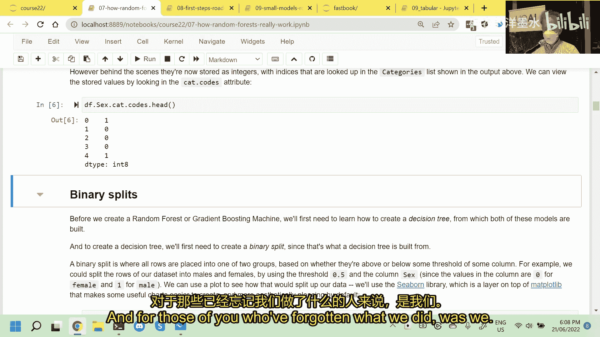

We were're looking at the Titanic data。

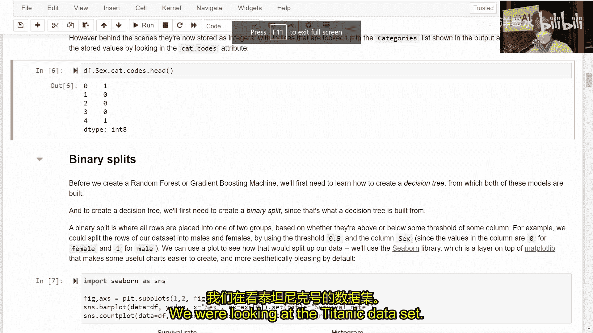

And we were looking at。Creating binary splits。By looking at。

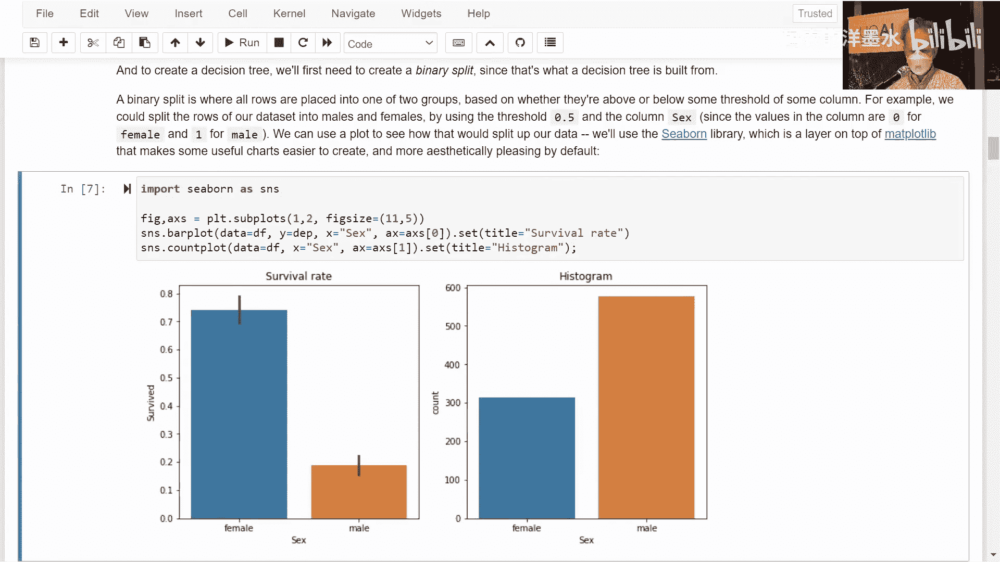

Cateorical variables or binary variables， like sex。嗯。And。

Continuous variables like the log of the fare that they paid。And。Using those。You know。

 we also kind of came up with a score。Which was basically how。How good a job did that splet do of。

 of gripping the。Survival characteristics into two groups， you know。

 all of nearly all of one of whom survived， and nearly all of whom the other didn't survive。

 so they had like small standard deviation in each group。嗯。

And so then we created the world's simplest little Ui to allow us to fiddle around and try to find a good。

Binary split， And we did。We did come up with a very good binaries split。Which was。On on six。

 and actually， we created this at all。AnAutomated version。And so this is。

 I think the first time we can point up quite the first time is said， no is。This is yet another time。

 I should say that we have successfully created a actual。Machine learning algorithm from scratch。

 This one is about the world's simplest one。 It's1 R creating the single rule。

 which does a good job of splitdding your data set into two parts which differ as much as possible。

On the dependent variable。One R is probably not going to cut it for a lot of things， though。

 it's surprisingly effective， buts so maybe we could go a step further。😊。

And the other step further we could go is we could create like a two hour。

 What if we took each of those。Groups， males and females in the Titanic data set。

And split each of those into two other groups。 So split the males into two groups and split the females into two groups。

So。To do that。We can repeat the exact same piece of code we just did。But let's remove。Um。

 sex from it。And then split the data set into males and females。

And ran the same piece of code that we just did before， but just for the males。

And so this is going to be like a one hour rule for how do we predict which males survive the Titanic。

And let's have a look，3，8，3，7，38，3，8，3，8。 Okay， so it's age were they greater than less than six。

Turns out to be for the males， the biggest predictor of whether they were going to survive。

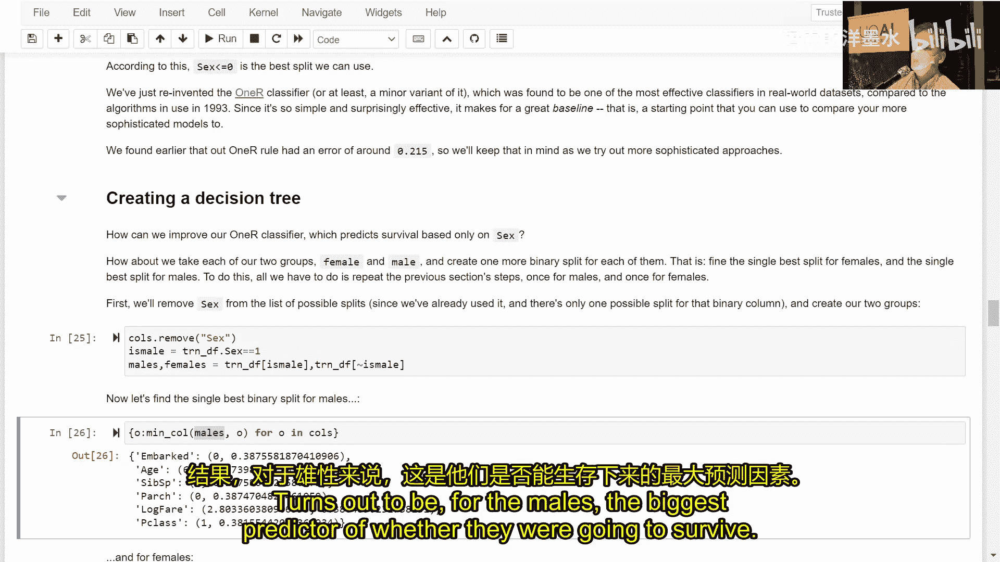

That's shipwreck。And we can do the same thing females， so for females。😊，呃。Here we go。

 no great supplies， P class。So whether they were in。First class or not。

Was the biggest predictor for females of whether they would survive the shipwreck。所。

That has now given us。A decision tree。It is a series of binary splitlitz。

Which will gradually split up our data more and more， such that at in the end in these。

 in the leaf nodes， as we call them。We will hopefully get as you know， much。

Stroron a prediction is possible about survival。So we could just repeat this step each of the four groups we've now created。

 males。😊，Kids and older than6， females， first class and everybody else。And we could do it again。

And then would'd have egg groupss。We could do that manually with another couple of lines of code。😊。

Or we can just use decision tree classifier， which is a class which does exactly that for us。😊。

So there's no magic in here， it's just doing what we've just described。😊。

And decision tree classifier。Comes from a library called Psychit Learn。

psychic Learn is a fantastic library that focuses on kind of。😊，Classical。

No deep learning ish machine learning methods。Like decision traits。

So we can so to create the exact same decision tree。

 we can say please create a decision tree traffic classifier with at most four leaf notes。

And one very nice thing it has。😊，Is it can draw the tree for us。

So here's a tiny little draw tree function。U。And。You can see here it's going to， first of all。

 split on sex。 Now， it looks a bit weird to say sex is less than or equal to 。5。

 But remember what our binary characteristics are coded as 01。So that's just how we， you know。

 easy way to say males just as females。嗯。And then here we've got for the females。

What class are they in and for the males， what age are they？

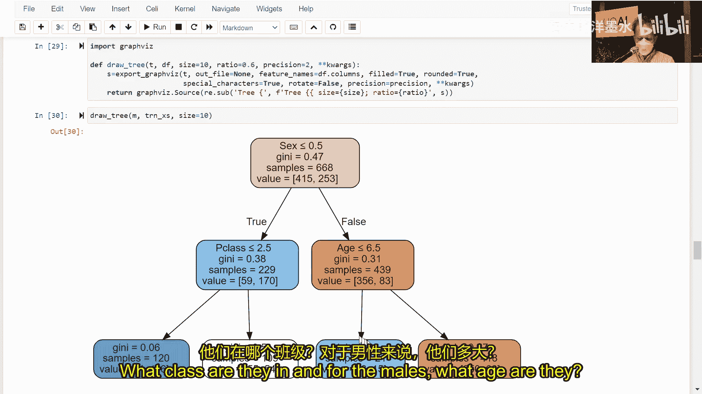

And here's our four leaf notes。 So for the females。In first class。A hundred and 16 of them survived。

 and four of them didn't。So very good idea to be a well to do。Woman on the Titanic。On the other hand。

Males。Adults。68 survived，350 died。So a very bad idea to be。A male adult of the Titanic。

So you can see you can kind of get a quick summary。😊，Of what's going on。 And。

 and one of the reasons people tend to like decision trees。

 particularly for exploratory data analysis， is it does't allow us to。Get a quick picture。

Of what are the key driving variables in this data set and how much do they kind of。

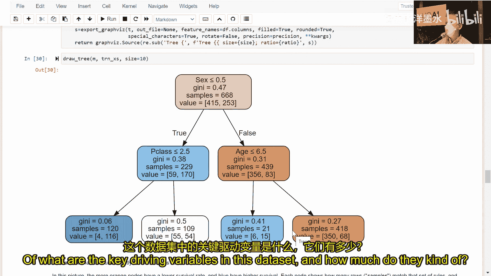

Predict what was happening in the data。Okay， so it's around the same splits as us。嗯。

And it's got one additional piece of information we haven't seen before。

 it's this something called Ginny。😊，Jinny is just another way of measuring。

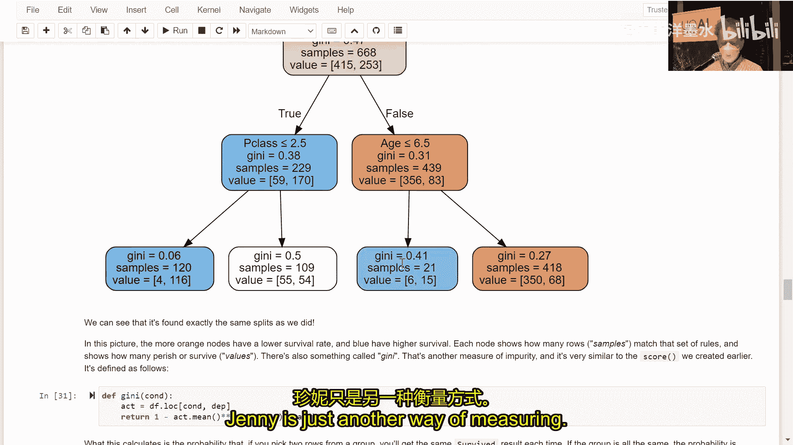

How good a split is。And I've。Put the code to calculate any here。Here's how you can think of Jenny。

How likely is it that if you go into that sample。And grab one item。

And then go in again and grab another item。 How likely is it that you're going to grab the same item each time。

And so。If。That if the entire leaf node is just people who survived or just people who didn't survive。

 the probability would be one。 You get the same time， same every time。If it was an exactly equal mix。

 the probability would be 0。5。So that's why we just。Yeah。

 that's where this formula comes from in the binary case。And you can you can see it here， right。

 This group here is pretty much 5050。 so Jennie' is 。5。

Where else this group here is nearly 100% in one class， so Jenny is nearly zero， added it backwards。

 it's one minus。

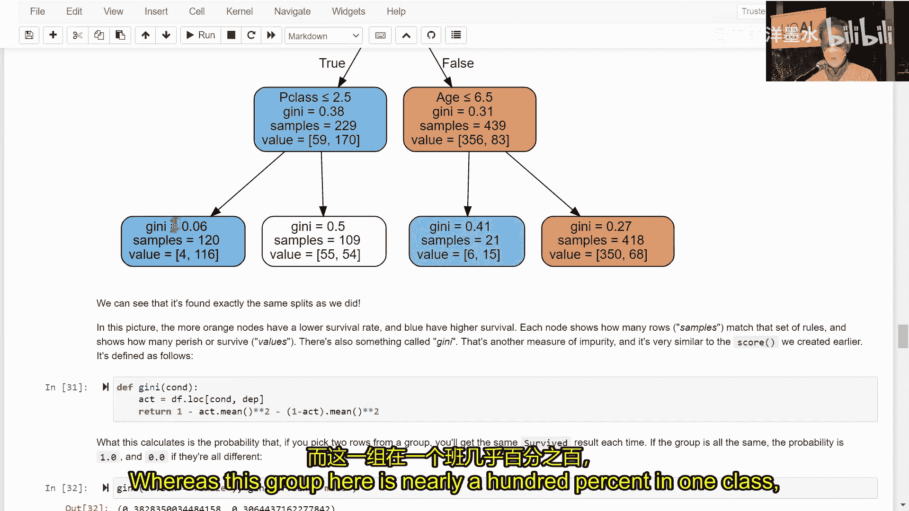

And I think I've written it backwards here as well， so I've better fix that。So this decision tree is。

 you know， we would expect it to be all accurate so we can calculate it's be an absolute error。

And for the one R， so just doing males versus females。嗯。What was our score。Here we go。407。

Should we have do we have an accuracy score somewhere here， 0。336？That was for log fair， and for sex。

It was。215。 Okay， so 。215。 So that was for the one hour version for the decision tree with four leaf nodes。

224， so it's actually a little worse。RightAnd I think this just reflects the fact that this is such a small data set。

😊，UAnd the one are。Version was so good。 We haven't really improved it that much。

not enough to really see it。Amongst the randomness of such a small validation set。

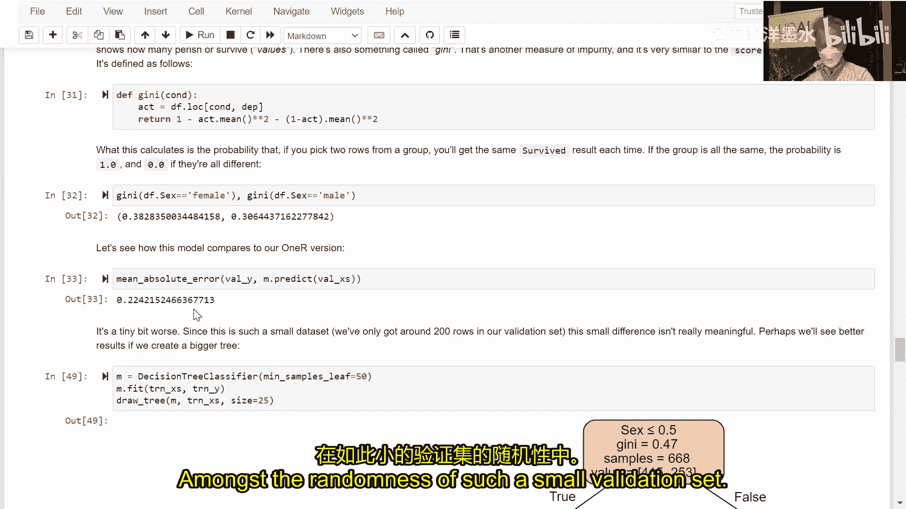

We could go further。😊，To 50 a minimum of 50 samples per leaf node。

 So that means that in each of these， see how says samples。

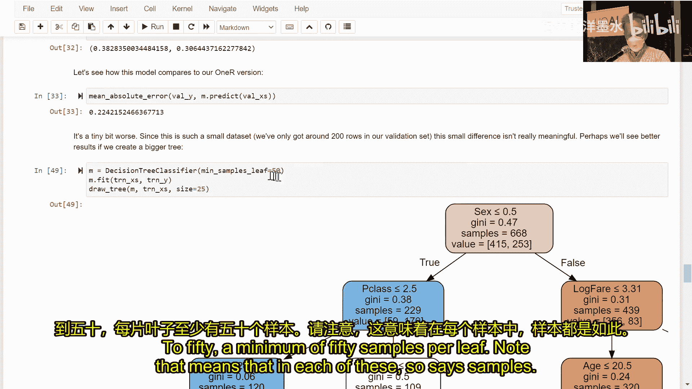

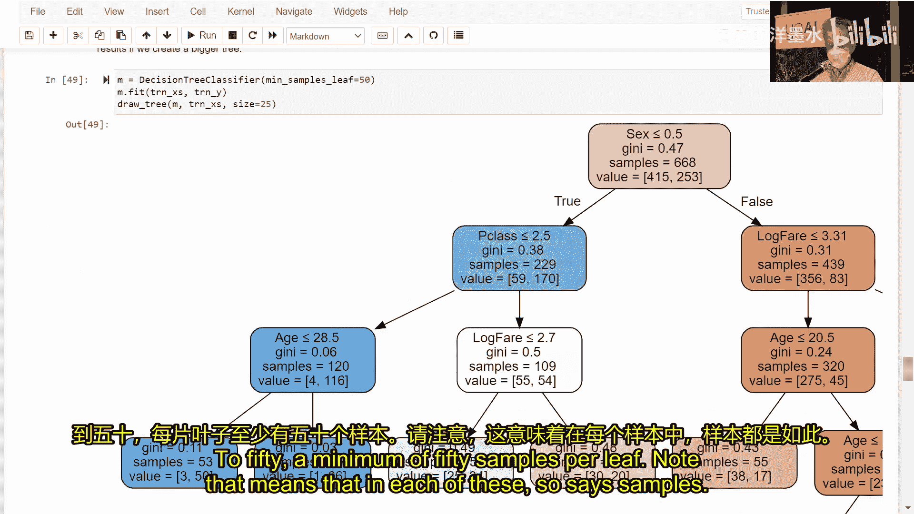

Which in this case， is passengers on the Titanic。 There's at least there's 67 people that。

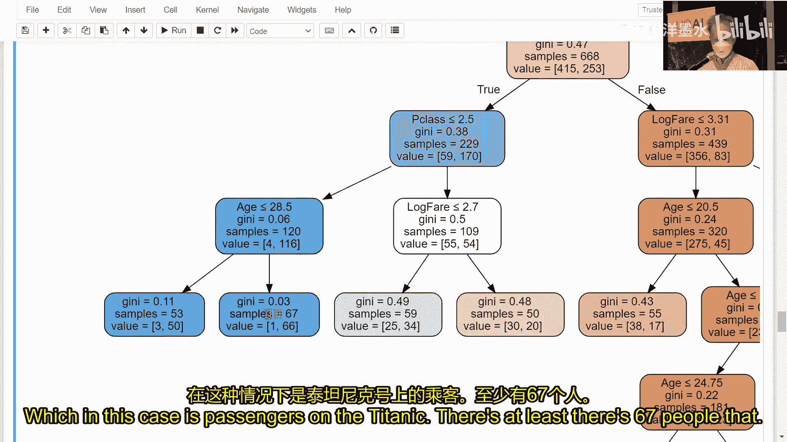

Where。Female first class。Less than 28。

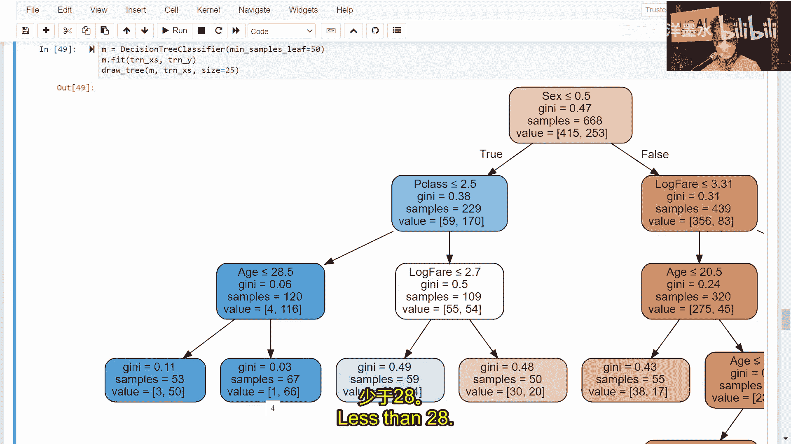

That's how you define that。 So this decision tree keeps building。

 keeps splitting and until it gets to a point where there's going to be less than 50 at which point it stop splitting that that leaf。

 So you can see they're all got at least 50 samples。

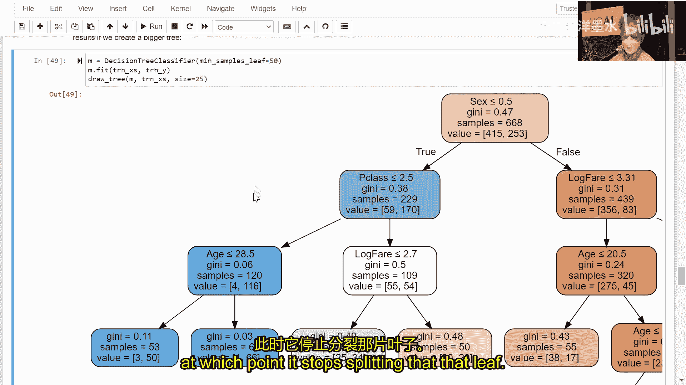

And so here's the decision tree that builds， as you can see。

 it doesn't have to be like constant depth， right， So this group here。

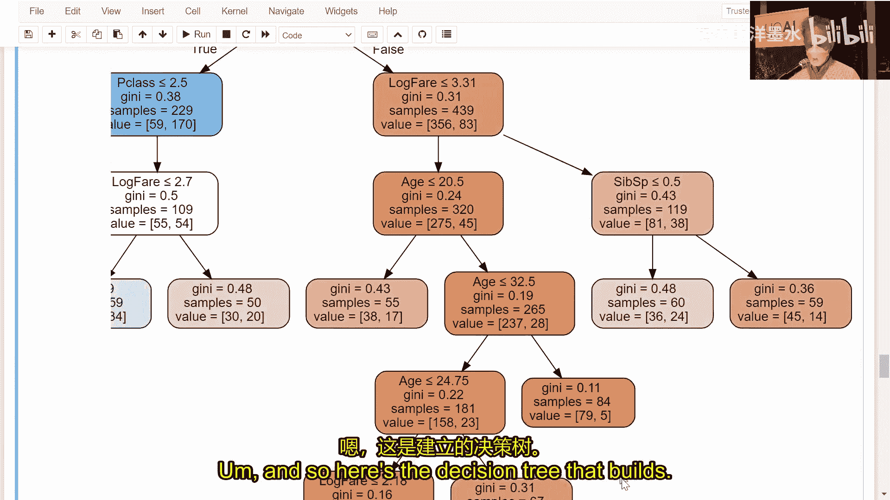

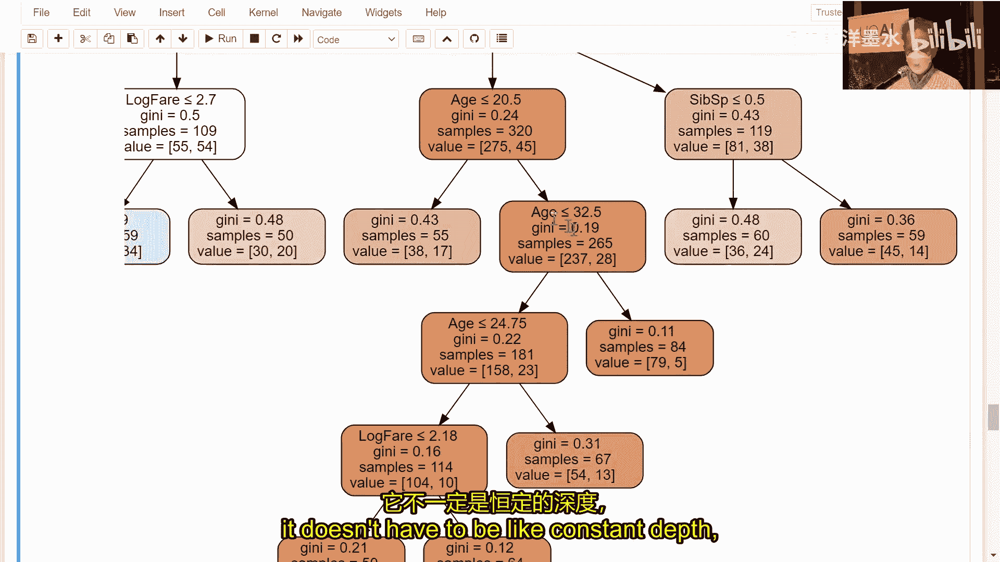

Which is males。Who had cheaper fares。And who were older than 20。

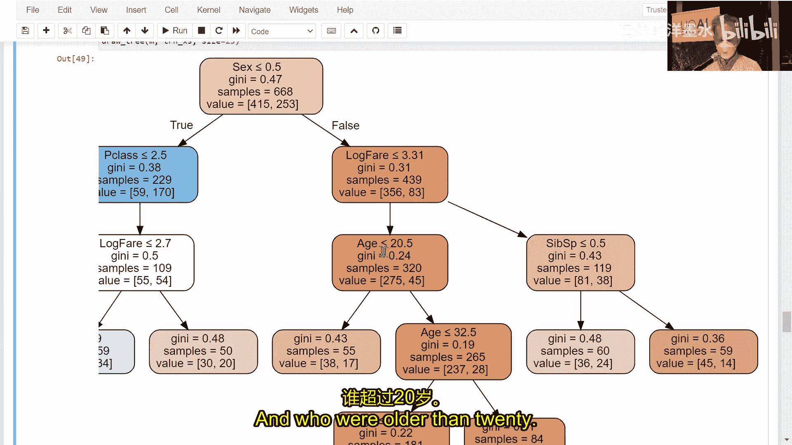

But younger than 32。

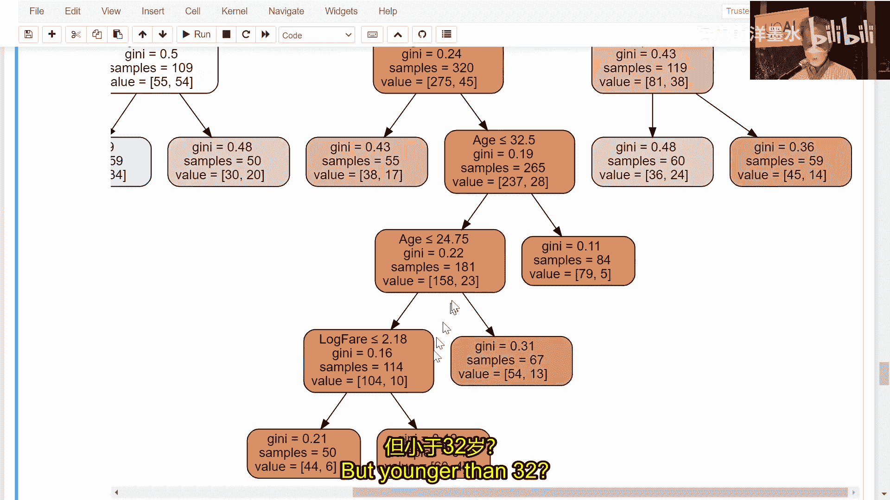

Actually， younger than 24。And， actually。Super cheap fares and so forth right so it keeps going down until we get to that group so。

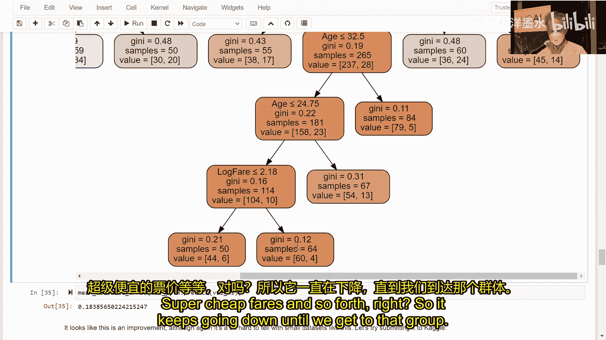

Let's try that decision tree。 That decision tree has an absolute error of 0。183。So not surprisingly。

 you know， once we get there， it's starting to look like it's a little bit better。😊。

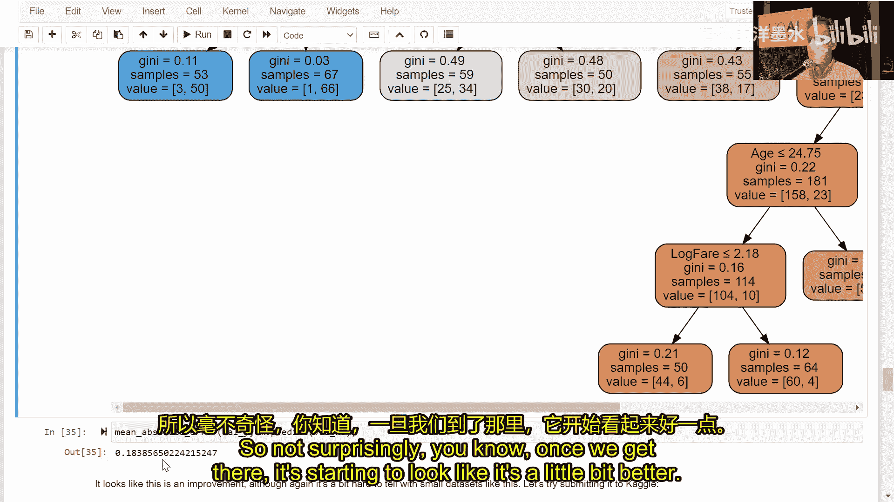

So， there's a model， and。This is a kle competition。 So therefore。

 we should submit it to the leaderboard。And， you know， one of the， you know， biggest mistakes I see。

Not just beginners， but every level of practitioner make on kggle is not to submit to the leaderboard。

Spend months making some perfect thing， right， but you're actually going to see how you're going and you should try and submit something to the leader board every day。

嗯。So， you know， regardless of how rubbish it is because。😊，You want to improve every day。

So you want to keep iterating so to submit something to the leader board。

 you generally have to provide a CSv file。😊，嗯。And so we're going to create the CSV file。嗯。

And we're going to apply the category codes to get the category for each one in our test set。

We're going to set the survive column to our predictions。

And then we're going to send that off to a CSV。And so， yeah， so I submitted that。😊。

And I got a score a little bit worse than most of our linear models and neural nets。But not terrible。

 you know， it was it's just doing an okay job。Now， one interesting thing for the decision tree is there was a lot less pre processing to do。

 Did you notice that we didn't have to create any dummy variables for for our categories。Um， and。

Like you certainly can create dummy variables， but you often don't have to。 So for example， you know。

 for， for for class， you know it's it's one， two or three， you can just split on one， two or three。

 you know。

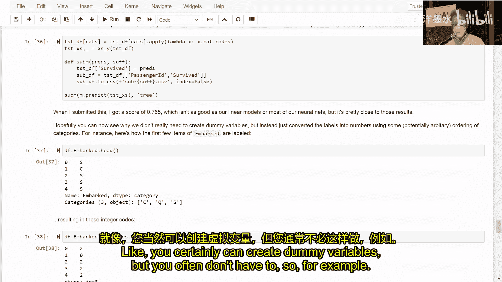

Even Phil like。What was that thing like the the embarkation city code。

 Like we just convert them kind of abitarily to numbers 1，2 and 3。

 and you can split on those numbers。 So with random forests， or not random forest。

 not decision trees。 Yeah， you can generally get away with。Not doing stuff like。Dummy variables？

In fact， even taking the log of there。😊，We only did that to make our graph look better。

 But if you think about it。Splitting on log far less than 2。7。

It's exactly the same as split on fare is less than8 to the 2。7。

 you know or whatever blog base we use， I can't remember so。

All that a decision tree cares about is the ordering of the data。

 And this is another reason that decision tree based approaches are fantastic。😊。

Because they don't care at all about outliers， you know， long tail distributions。

Categgoical variables， whatever you can throw it all in。And it'll do a perfectly fine job。So。

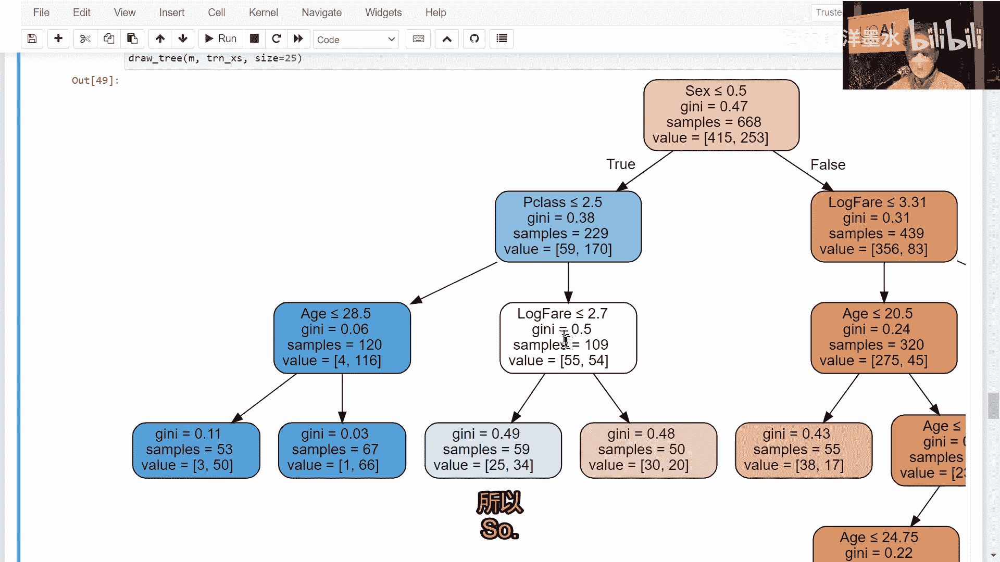

For tabular data。I would always start。By using a decision tree based approach。嗯。

And kind of creates and baselines and so forth， because it's really hard to mess it up。嗯。

And that's important。So， yes。 So here， for example， is embarked。 right。

 It It was coded originally as。The first letter of the city they embarked in。

But we turned it into a categorical variable。 And so pandas for us creates this， this vab。

 this list of all of the possible values。And if you look at the codes attribute。

 you can see it's that S is the 0，1，2。 So S has become 2。 C has become 0。

And so forth All So that's how we're converting the categories to strings into numbers that we can sort and group by。

U， so yeah， so if we wanted to split C into one group and Q& S and the other， we can just do， okay。

 less than a record 1。0。5。😊，Now， of course， if we wanted to split C and S into one group and Q into the other。

 we would need two binary splits， first C。On one side in Q& S on the other。

 and then Q& S into Q versus S， and then the Q and S leaf nodes could get similar。Predictions。

 so like you do have like sometimes it can take a little bit more。Messing around， but。

Most of the time， I find categorical variables work fine as numeric。

And decision tree based approaches。 And as I say here。

 I tend to use dummy variables only if there's like less than four levels。

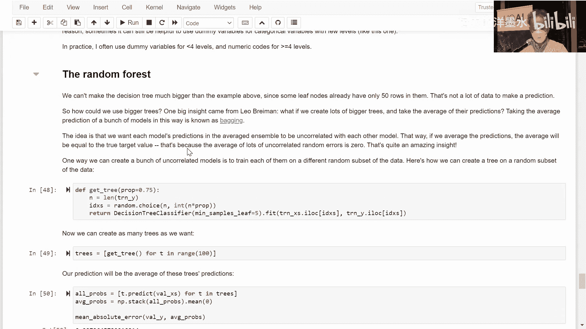

Now， what if we wanted to make this more accurate？

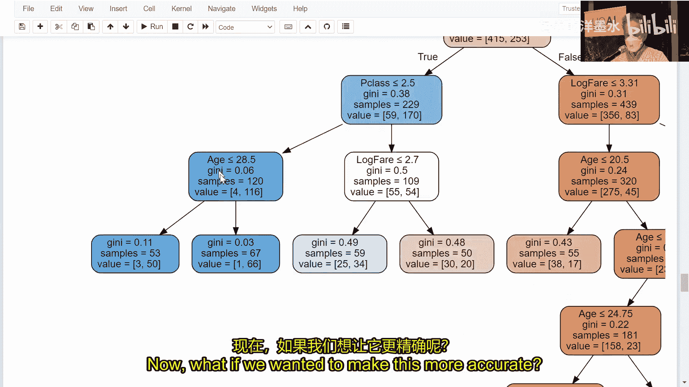

Could we。Grow the tree further。I mean， we could。But。

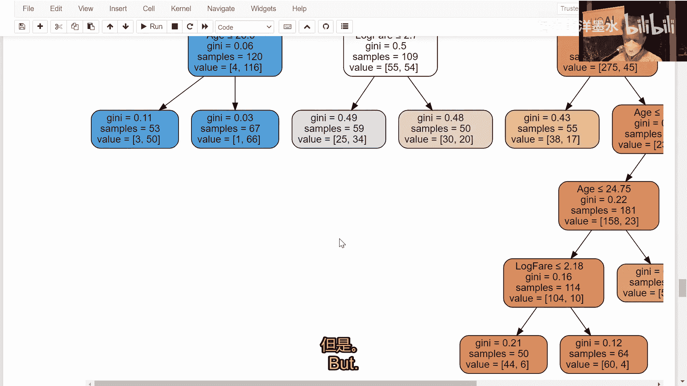

You know， there's only 50 samples in these las， right， It's， it's not really。You know。

 if I keep splitting it， the leaf nodes are going to have so little data that that's not really going to make very useful predictions。

Now， there are limitations to how accurate a decision tree can be。

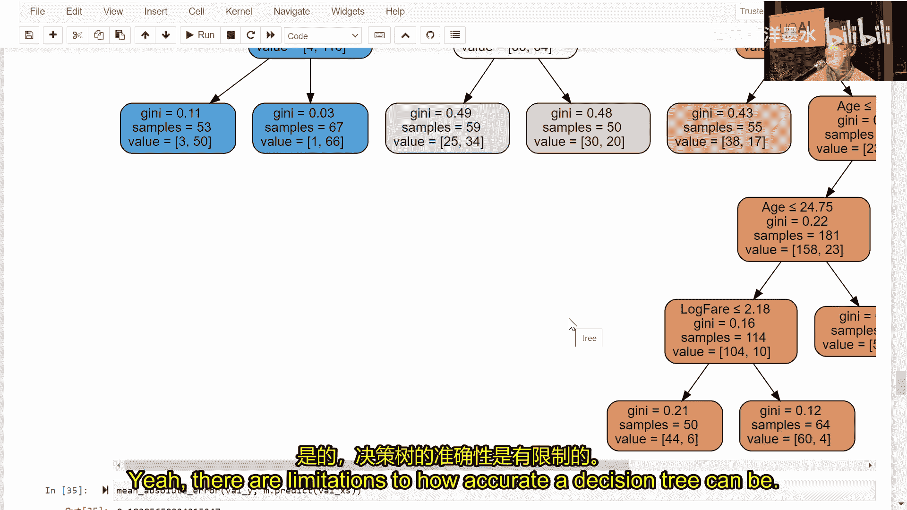

嗯。So what can we do？We can do something that's actually very。I mean。

 I find it amazing and fascinating。Comes from a guy called Leo Breman。

And Leo Bman came up with this idea。Called baggging。 And here's a basic idea of bagging。

Let's say we've got a model。😡，That's not very good。Because let's say it's a decision tree。

 It's really small。 We've hardly used any data for it。 right， it's not very good。 So it's got error。

 It's got errors on predictions。It's not a systematically biased error。

 It's not always predicting too high or always predicting too low。 I mean， decision trees， you know。

 on average， will predict the average， right？But it has errors。

So what I could do is I could build another decision tree。In some slightly different way。

 that would have different splits。 and it would also be not a great model， but。

Predics the correct thing on average， it's not completely hopeless and again， you know。

 some of the errors are a bit too high and some are a bit too low。I could keep doing this。

 I I could creep building lots and lots of slightly different decision trees。Um。

 I'm going to end up with say a0 different。Mar。All of which are unbiased。

All of which are better than nothing， and all of which have some errors a bit high， some bit low。

 whatever。So what would happen if I averaged their predictions？

Assuming that the models are not correlated with each other。

Then you're going to end up with errors on either side of the correct prediction。

 some are a bit high， some are a bit low， there'll be this kind of distribution of errors。

and the average of those errors will be。😊，0ero。And so that means the average of the predictions of these multiple uncorrelated models。

 each of which is unbiased will be。They correct prediction。Ca they have an error of 0。

 And this is a mind blowing insight。It says that， if we can generate。A whole bunch of uncorrelated。

Unbiased。Models。We can average them and get something better than any of the individual models。

 because the average of the error will be0。So all we need。😊，Is a way to generate。Lots of models。Well。

 we already have a great way to build models， which is to create a decision tree。

How do we create lots of them？How to create lots of unbiased but different models。Well。

Let's just grab a different subset of the data each time。 Let's just grab at random half the rows。

And build a decision tree。 and then grab another half of the rows and build a decision tree。

grabrab another half the rows and build a decision tree。

 Each of those decision trees is going to be not great。 It's only using half the data。😊。

But it will be unbiased。 It will be predicting the average On average。

 It will certainly be better than nothing because it's using， you know。

 some real data to try and create a real decision tree。

 The They won't be correlated with each other because they're each random subsets。

So that meets all of our criteria。For baging。When you do this。

 you create something called a random forest。So let's create one。And four lines of code。so。

Here is a function to create a decision tree。 So let's say what， this is just the proportion of data。

 So let's say we put 75% of the data in each time， or we could change it to 50%， whatever。U。

So this is the number of samples in this subset， I call it n。And so， let's at random， choose。

N times C proportion we requested。From the sample and build a decision tree from that。

And so now that's 100 times。Get a tree。And stick them all in a list， using a list comprehension。

And now。Let's grab the predictions for each one of those trees。

And then let's stack all those predictions up together and take their me。😊。

And that is a random forest。And what do we get，1，2，3，4，5，6，7，8， that' seven lines of code。

Radom forests a very。Simple， this is a slight simplification。

 There's one other difference that random forests do。😊，Which is when they build the decision tree。

 they also randomly select a subset of columns。And they select a different random subset of columns each time they do a split。

And so the idea is you kind of want it to be as random as possible， but also somewhat useful。

So we can do that by creating a random forest classifier。😊，So how many trees do we want？

How many samples per leaf？And then fit does what we just did。And his main absolute era， rich。Again。

 it's like not as good as our decision tree， but it's still pretty good。 And again。

 it's such a small data set。 It's hard to tell if that means anything。

And so we can submit that to Cas。 So earlier on， I created a little function to submit to Call。

 So now I just create some predictions， and I submit to Call。And yeah。

 looks like it gave nearly identical results to a single tree。Now， to one of my favorite things。

About random forests。 And I should say in most real well data sets of reasonable size。

 random forests basically always give you much better results than decision trees。

 This is just a small data set。Show you what to do。One of my favorite things about。Radom forests。

 as we can do something quite cool with it。 What we can do is we can look at the。

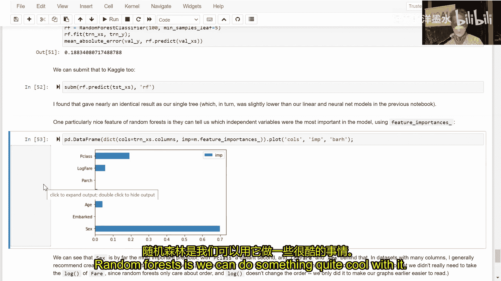

Underlying decision trees they create。 So if've never 100 decision trees。

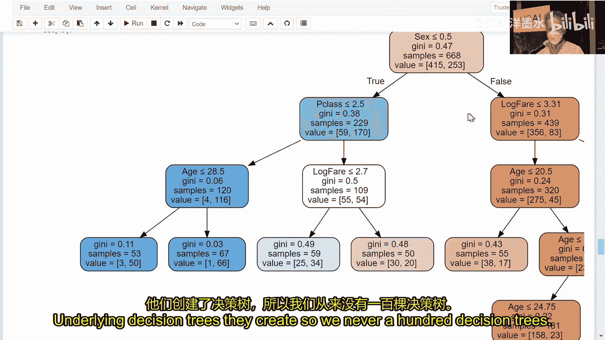

And we can see what columns。Did it find a split on。And so it'd say， he， okay， well。

 the first thing gets sp on was sex。And it improved the geninie from。47。2。

 now just take the weighted average of 0。38 and 。31 weighted by the samples。

So that's probably going to be don't about 0。33。So I'd say， okay， it's like 0。

14 improvement in Jeninny thanks to sex。And we can do that again， okay， well within P class。

 you know， how much did that improve Jeninny again。

 we keep weight it by the number of samples as well， log far， how much did that improve Jeninny。

 and we can keep track。

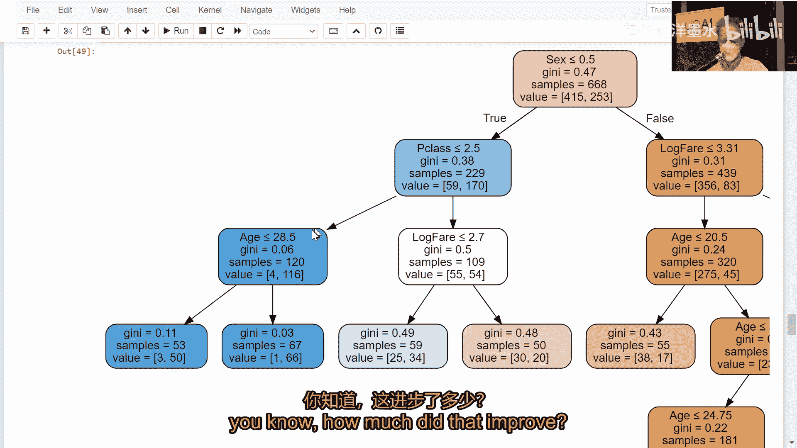

For each column。Of。How much in total did they improve the Gini in this decision tree？

And then do that for every decision tree。

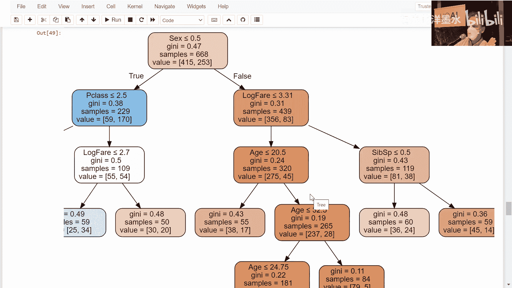

And then add them up to a column。And that gives you something called a feature importance plot。

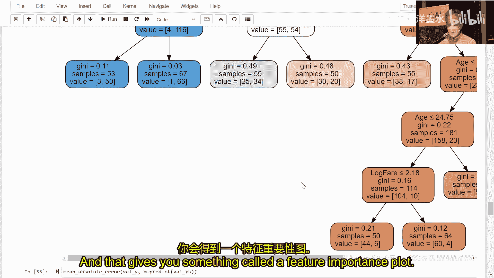

And here it is。And a feature importance plot tells you how important is each feature。

How often did the trees pick it and how much did it improve the jinny when it did。

And so we can see from the feature importance plot that sex。Was the most important？And。

Class was the second most important， and everything else was a long way back。

And this is another reason， by the way， why our random forest isn't really particularly helpful because。

It's just such an easy split to do， right， basically， all that matters is。嗯。

You know what class you're in。Whether you're male or female。And these feature importance plots。

 remember。Because they're built on random forests。And random forests don't care about really the distribution of your data。

 and they can handle categorical variables and stuff like that。

 That means that you can basically any tabular data set you have。 You can just。Pluck this right away。

And random forests， you know， for most data sets， only take a few seconds to train。You know。

 really at most of。A minute or two。 And so if you've got a big data set and， you know。

 hundreds of columns。Do this first。And find the。30 columns that might matter。It's such a helpful。

Thing to do。 So I've done that， for example， I did some work in credit scoring。

 So we're trying to find out which。Things would predict who's going to default on a loan。

And I was given something like 7000。Colums。From the database。

I put it straight into a random forest and found， I think there was about 30 columns that seemed。

Kind of interesting， I did that。Like two hours after I started the job。And I went to the。

He of marketing and the head of risk。 And I told them here's the Holins。

 I think that we should focus on。And they were like。Oh my God。

 we just finished a two year consulting project with one of the big consultants。

Pat the millions of dollars。And they came up with a subset of these。😊，对。嗯。

There are other things that you can do with random forests along this path。

 I' will touch on them briefly。And specifically。I'm gonna look at。Chapter 8。Of the book。

W whichch goes into this in a lot more detail and particularly interestingly。

 chapter 8 of the book uses a much bigger and more interesting data set。

 which is auction prices of heavy industrial equipment。

 I mean it's less interesting historically but more interestingly numerically。

And so some of the things I did there on this data set。😊，um。So this isnt from the data。

 this is from of the psychic learn documentation。 they looked at how as you increase the number of estimators。

 so the number of trees。How much does thee。Accuracy improve。

 So either did the same thing on our data set。 So I actually just。Added up to 40。

 more and more and more trees。And you can see that basically， as。

 as predicted by that kind of an initial bit of。Hand wavy theory。

 I gave you that you would expect the more trees。The lower the error。

 because the more things you're averaging。 and that's exactly what we find。

 The accuracy improves as we have more trees。John， what's up。Victor is po。

 you might have just answered his question actually as he typed it。

 but he's he's asking on the same theme the number of trees in a random forest does increasing the number of trees always translate to a better error。

 Yes， it does。 always。 I mean， tiny bumps， right， but yeah。Once you smooth it out。But嗯。

Decreasing returns。And。If you end up productionizing a random forest， then， of course。

 every one of these trees， you have to。Yet I'll go through for at inference time。

So it's not that there's no cost。Having said that。Ziping through a binary tree is the kind of thing you can。

Really。Doo fast。 In fact， it's， it's quite easy to let literally。Spit out C plus plus code。

With a bunch of if statements， and compile it。And get。Strainrangely fast performance。嗯。

I don't often use more than 100 trees。This is a roll of thumb。Is that the only onendron？Okay。

So then there's another interesting feature of random forests， which is， remember how in our example。

 we trained with 75% of the data。On H tree。So that means for each tree。

 there was 25% of the data we didn't train on。Now， this actually means if you don't have much data。

 in some situations， you can get away with not having a validation set。

And the reason why is because for each tree， we can pick the 25% of rows that weren't in that tree。

And see how accurate。That tree was on those rows。And we can average for each row their accuracy on all of the trees in which they were not part of the training。

And that is quote the out of bag era。Or O， O， B error。 And this is built in also to S K learn。

 you can ask for an O， O， B。Prediction。嗯。John。I mean just before we move on。

Zacia has a question about bagging， so we know that bagging is powerful as an ensemble approach to machine learning。

 would it be advisable to try out bagging then first when approaching a particular say tabular task？

Before deep learning， so that's the first part of the question。

And the second part is could we create a bagging model which includes fast AI deep learning models？

Yes， absolutely。 So to be clear， you know bagging is kind of like。A meta method is not a。Prediction。

 it's not a method of modeling itself。 It's just a method of。Combining other models。嗯。

So random forests， in particular， as a particular approach to aing。Um， is a， is you know。

 I would probably always start personally a tabular project with a random forest because they're nearly impossible to mess up and they give good insight and they give a good base case。

But yeah， your question then about can you bag other models is a very interesting one。

 And the answer is， you absolutely can。And。People very rarely do。But we will。We will， quite soon。

Maybe even today。

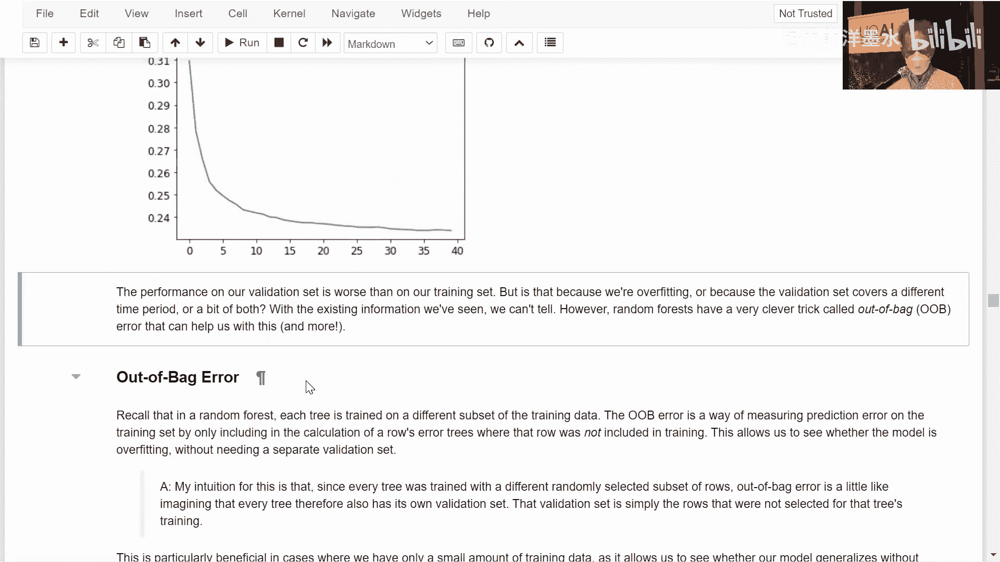

So I， you know， you might be getting the impression。 I'm a bit of a fan of random forests。

 And before I was con before， you know， people thought of me as。The deep learning guy。

 people thought of me as the random forests guy。 I used to go on about random forests all the time。

 And one of the reasons I'm so enthused about them isn't just that they're very accurate or that they require know that they're very hard to mess up and require very little processing preproces。

 but they give you a lot of quick and easy insight。And specifically， these are the five things。😊。

Which I think that we are interested in and all of which are things at random For us are good at。

 They will tell us， how confident are we in our predictions。On some particular row， So when somebody。

 you know， when we're giving a loan to somebody， we don't necessarily just want to know。

How likely are they to repay。 But I'd also like to know how confident are we that we know。

Because if we're， if we're like， well。We think they'll repay， but we're not confident of that。

 We would probably want to give them less of a loan。

And another thing that's very important is when we're then making a prediction， so again。

 for example， for credit。Let's say you rejected that person's loan。Why。😡。

And a random forest will tell us。What is the reason that we made a prediction and you'll see why all these things。

Which columns are the strongest predictors you've already seen that one， right。

 That's a feature importance plot。Which columns are effectively redundant with each other， I。e。

 they're basically highly correlated with each other。嗯。

And then one of the most important ones as you vary a column。 How does it vary the predictions？ So。

 for example， in your。Credit model。 How does your prediction of。risk vary as you vary。

 Well something that probably the regulator would want to know might be some， you know。

 some protected。Variable like， you know， race or some socideographic characteristics that you're not allowed to use in your model so they might check things like that。

嗯。For the first thing， how confident are we in our predictions using a particular row of data。

 There's a really simple thing we can do， which is。

 remember how when we calculated our predictions manually。

 we stacked up the predictions together and took their mean。Well。

 what if you took their standard deviation instead。

So if you stack up your predictions and take their standard deviation。

And if that standard deviation is high， that means all of them。

 all of the trees are predicting something different。

And that suggests that we don't really know what we're doing。

 And so that would happen if different subsets of the data end up giving completely different trees for this。

Particular row。So there's like a really simple thing you can do。😊，To get a sense of your prediction。

 confidence。Okay， feature importance we've already discussed。嗯。After I do feature importance。

 you know， what like I said when I had the what 7000 or so columns， I got rid of like orbit 30。

 that doesn't tend to improve the predictions of your random forest very much if at all。

 but it certainly helps like。You know， kind of logistically thinking about cleaning up the data。

 you can focus on cleaninging those 30 columns， stuff like that。

 so I tend to remove the low importance variables。I'm going to skip over this bit about removing redundant features because it's a little bit outside what we're talking about。

 but definitely check it out in the book。Something called a dendogram？

But what I do want to mention is， is the partial dependence。 This is the thing， which says。

What is the relationship between a。Column and the dependent variable。

And so this is something called a partial dependence plot。 Now。

 this one's actually not specific to random forests。

A partial dependence plot is something you can do for basically any machine learning model。

Let's first of all， look at one and then talk about how we make it。😊，So in this data set。

 we're looking at the relationship， we're looking at the sale price at auction of heavy industrial equipment like bulldozers。

 this is specifically the Blue books for bulldozers Calal competition。

And a partial dependence plot between the year that the baldozza or whatever was made。

And the price that was sold for， this is actually the log price。Is that it goes up？

More recent bullordozers， more recently made bullordozers are more expensive。

And as you go back back to older and older builder bulldozs。

They're less and less expensive to a point。 And maybe these ones are some。

Old classic photos as you pay a bit extra for。你好。You might think that you could easily create this plot by simply looking at your data at each year and taking the average sale price。

But that doesn't really work very well。I mean， it kind of does， but it kind of doesn't。

 Let me give an example。 It turns out that one of the biggest predictors of sale price for industrial equipment is whether it has air conditioning。

Um， and so air conditioning is， you know， it's an expensive thing to add and it makes the equipment more expensive to buy。

😊，And most things didn't have air conditioning back in the 60s and 70s， and most of them do now。

So if you plot the relationship between year made and price。

You're actually going to be seeing a whole bunch of。When， you know， how popular was air conditioning？

Right， so you get this this cross correlation going on。 But we just want to know， no。

s what's just the impact of the year it was made all else being equal。所。

There's actually a really easy way to do that。 which as we take our data set。

We take the and we leave it exactly as it is that just is the training data set。

 but we take every single row and for the year made column， we set it to 1950。😊。

And so then we predict for every row， what would the sale price of that have been if it was made in 1950。

And then we repeat it for 1951， and they repeat it for 1952 and so forth。

 and then we plot the averages。And that does exactly what I just said。 Remember。

 I said the special words all else being equal。This is setting everything else equal。

 It's the everything else is the data as it actually occurred。And we're only varying year mode。

And that's what a partial dependence plot is。That works just as well， for deep learning。

Or gradient boosting trees or logistic aions， or whatever。It's a really。Cool thing you can do。

And you can do more than one column at a time， you know， you can do two way。Partial dependence， plus。

For example。Another one， Okay， so then another one I mentioned was。😊。

Can you describe why a particular prediction was made。 So how did you decide for this particular row。

To predict this particular value。And this is actually pretty easy to do。

 There's a thing called tree interpreter， but we could。

 you could easily create this in about half a dozen lines of code。 All we do。😊，As we're saying， okay。

 this customers come in， they've asked for a loan， we've put in all of their data through the random forest。

 it's about out of prediction。We can actually have a look and say， okay。

 well that in tree number one。What's the path that went down through the tree to get to the leaf note。

And we can say， oh， well， first of all， it looked at sex， and then it looked at postcode。

 and then it looked at income。 And so we can see。Exactly in tree number one。

 which variables were used and what was the。Change in gene for each one。

And then we can do the same entry2， se3 3， to3 4。 Does this sound familiar？

It's basically the same as our feature importance plot， right。

 but it's just for this one row of data。😊。

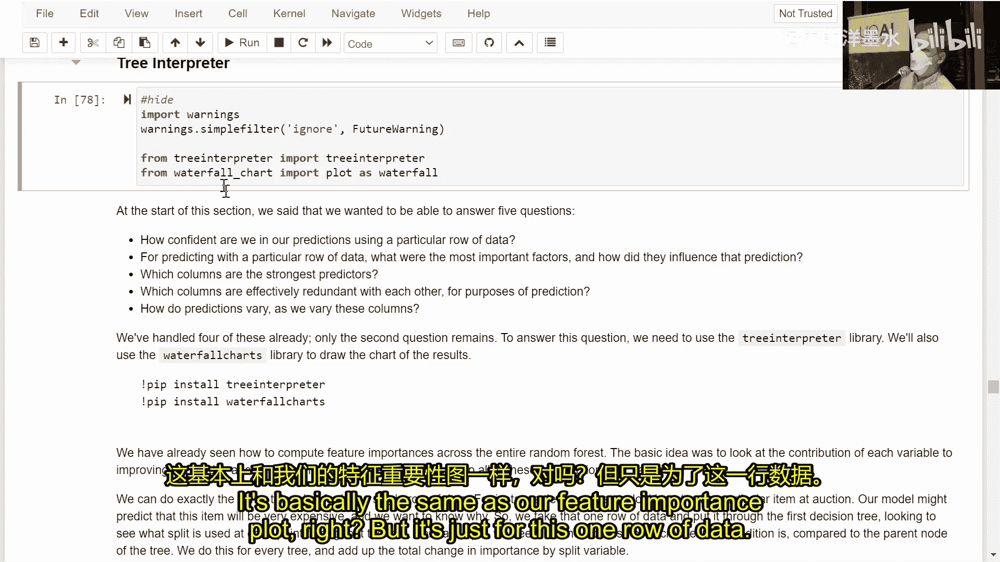

And so that will tell you basically the feature importances for that one particular prediction。

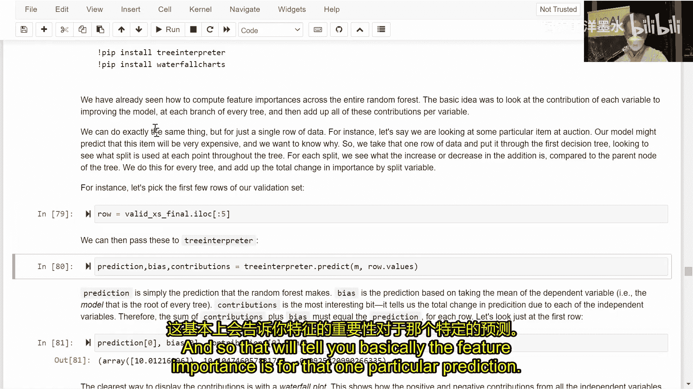

And so then we can plot them。Like this。 So， for example， this is an example of。

An auction price prediction。And according to this plot。It also， he predicted that the net would be。呃。

Oh， this is just a change from so I don't actually know what the price is。

 but this is how much each one impacted the price。Year made。

 I guess this must have been an older attractor。 It caused a prediction of the price to go down。

But then it must have been a larger machine， the product size caused it to go up。

Capler sister made it go up。 Model I made it go up。And so forth， right。

 so you can see the red says that's made this made our prediction go down。

 Green made our prediction go up。And so overall， you can see。

Which things had the biggest impact on the prediction and what was the direction。

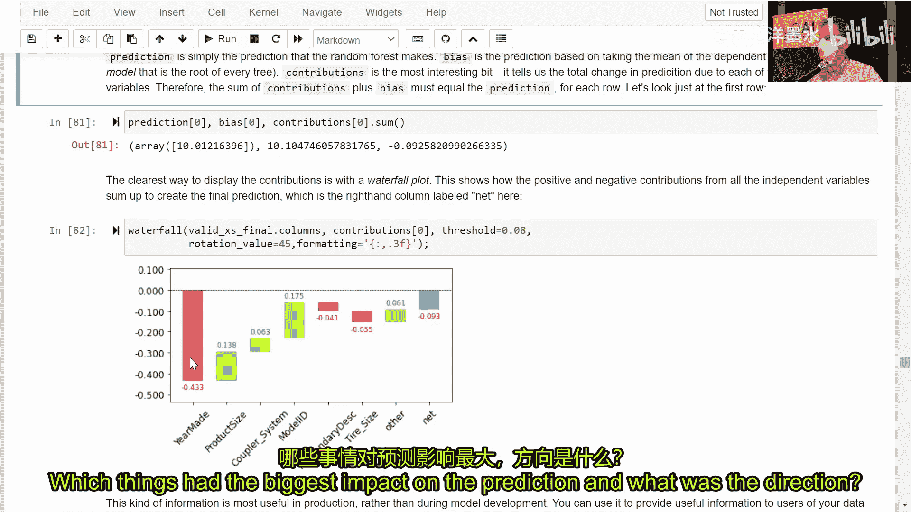

For each one。So it's basically a feature importance plot， but just for a single row。

 for a single row。Any questions？Chen。Yeah， there are a couple that have that have sort of queued up。

 This isn't this is a good spot to to jump to them。So first of all。

 Andrew is asking jumping back to the OOB era， would you ever exclude a tree from a forest if it had a bad out of bag error？

Like if you if had， I guess if you had a particularly bad。Tree in your ensemble， like might you just。

Would you delete a tree that was not doing its thing not playing its part， No， you wouldn't。

If you startleting trees， then you are no longer。Having a unbiased prediction of the dependent variable。

You are biasing it by making a choice。 So even the bad ones。

Will be improving the quality of the overall average。All right， thank you。

 Zakia followed up with the question about bagging and we're just sort of going， you know。

 layers and layers here。🤢，You know， we could go on and create ensembles of bagged models。 And。

 you know， is it reasonable to assume that they would。 So that's not gonna make much difference。

 right， if they're all like。You could take your 100 trees， split them into groups of 10。

 create 10 bagged ensembles， and then average those。

 But the average of an average is the same as the average。You could like。

 have a wider range of other kinds of models。 You could have like neural nets trained on different subsets as well。

 But again， it's just the average of an average， willll still give you the average。Right。

 so there's not a lot of。Value in， in kind of structuring the ensemble。 You just I mean， some。

 some ensembles you can structure， but， but not bagging。 Baging is the simplest one。

 It's the 1 I mainly use。 There are more sophisticated approaches， but this one。It's nice and easy。

All right， and there's one that is a bit specific and it's referencing content you haven't covered but we're here now and it's on explainability。

 so feature importance of random forest models sometimes has different results when you compare it to other explainability techniques like Sha SHAPP or Lyme and we haven't covered these in the course。

 but Amir is just curious if you've got any thoughts on which is more accurate or reliable random forest feature importance or other techniques。

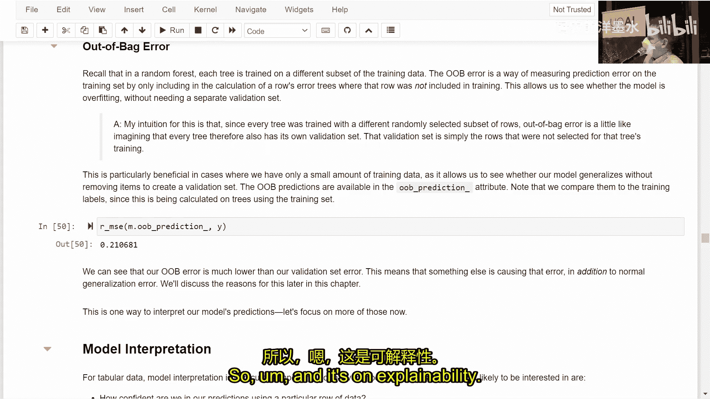

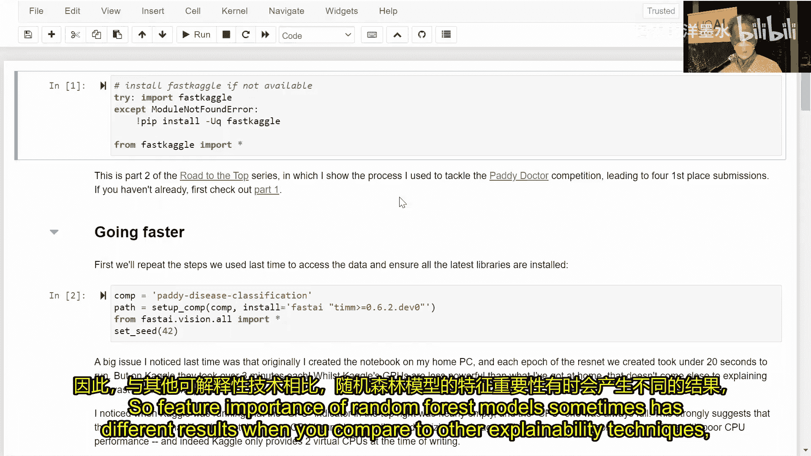

嗯。I， would。Lean towards。More immediately， trusting random forest feature importances over other techniques on the whole。

On the basis that it's very hard to mess up a random forest。嗯。So。Yeah， I feel like pretty confident。

That a random forest feature importance is going to。

Be pretty reasonable as long as this is the kind of data which a random forest is likely to be pretty good at。

You know， doing， you know， if this's like a computer vision model， random forest sun。

Particularly good at that。 And so one of the things that Bman talked about a lot was explainability。

 And he's got a great essay called the two Culs of Statistics in which he talks about。

 I guess what we' nowadays call kind of like data scientists。

 machine learning folks versus classic statisticians。😊，And he， he， he was， you know。

 definitely a data scientist while before the。The net label existed。 And he pointed out， yeah。

 you know， first and foremost。You need a model that's accurate。That is to make good predictions。

A model that makes bad predictions will also be bad for making explanations because it doesn't actually know what's going on。

Um， so if， you know， if you， if you've got a date date learning model that's far more accurate than your random forest then it。

You know， explainability methods from the deep learning model world。

Probably be more useful because it's explaining a modelddle that's actually correct。All right。

 let's take a。10 minute break and we'll come back at five past7。Welcome back。

 One person pointed out I noticed I got the chapter wrong， it's chapter 9， not chapter8 in the book。

 I guess I can't read。嗯。Somebody asked during the break about overfitting。Can you overfit？

I ran him forest。Basically， no， not really。Adding more trees， well。Make it more accurate。嗯。

It kind of asympttes， so you can't make it infinitely accurate by using infinite trees。

 but certainly， you know， adding more trees won't make it worse。嗯。If you don't have enough trees。

And you。Let the trees grow very deep。 That could overfit。

So you just have to make sure you have enough trees。嗯。Radick told me about experiment he did during。

Radock Toby drew the break about an experiment he did。

 which is something I've done something similar， which is adding lots and lots of randomly generated columns to a data set and try to break the random forest。

And if you try it， it basically doesn't work。 It's like it's really hard。

To confuse a random forest by giving out lots of。Meaningless data。

 it does an amazingly good job of picking out。The useful stuff， as I said， you know I had。

30 useful columns out of 7000 and it found them。Perfectly well。And often， you know。

 when you find those 30 columns。You know， you could go of， you know。

 I was doing consulting at the time and go back to the client and say like。

 tell me more about these columns and they'd say like， oh， well， that one there。

 we've actually got a better version of that。 Now， there's a new system。 You know。

 we should grab that。 And oh， this column， actually。

 that was because of this thing that happened last year， but we don't do it anymore or， you know。

 like you can really have this kind of discussion about the stuff you've zoomed into。You know。

 there are other things that you have to think about with lots of kinds of models like particularly regression models。

 things like interactions， you don't have to worry about that with random forests like because you split on one column and then split on another column。

You got interactions for free。As well。嗯。Normalization， and you don't have to worry about。

 You don't have to have normally distributed。Columns。So， yeah， definitely worth a try。 Now。

 something I。Haven't gone into。Um。Is gradient boosting。But if you go to Ex。 AI。

You'll see that my friend Ternce and I have a three part series about gradient boosting。

Including pictures of golf made by Terreence。But to explain。

 gradient boosting is a lot like random forests。But rather than。Training。

A mode of training fitting a tree again and again and again on different random subsets of the data。

Instead， what we do is we fit very， very， very small trees to hardly ever any splititz。

And we then say， okay， well， what's the error。 So， you know。

 so imagine the simplest tree would be our one hour raw tree of of。Male versus female， say。

And then you， you take what's called the residual。 That's the difference between the prediction and the actual。

Its the error。And then you create another tree， which attempts to predict that。Very smoke free。

And then you create another very small tree， which tries to predict the error from that。😊。

And so forth。 Each one is predicting the residual from all the previous ones。

 And so then to calculate a prediction。Rather than taking the average of all the trees。

 you take the sum of all the trees， because each one has predicted the difference between the actual。

And all of the previous trees。And that's quite boosting。😊，Versus bagging。

 So boosting and bagging are two kind of meta ensembling techniques。

And when bagging is applied to trees， it's called a random forest。

 And when boosting is applied to trees， it's called a gradient boosting machine or gradient boosted decision tree。

嗯。Graian boosting is。Generally speaking， more accurate than random forests。

But you can absolutely overfe it。And so therefore， it's not necessarily my first go to thing。

Having said that， there are ways to avoid overfitting。 but yeah， it's just， it's it's not。嗯。

It's you know because it's breakable it's not my first choice， but yeah。

 check out our stuff here if you're interested and you know there is stuff which largely automates the process there's lots of hyperparameters you have to select people generally just you know try every combination of hyperparameters and in the end you' generally should be able to get a more accurate gradient boosting model than random forest。

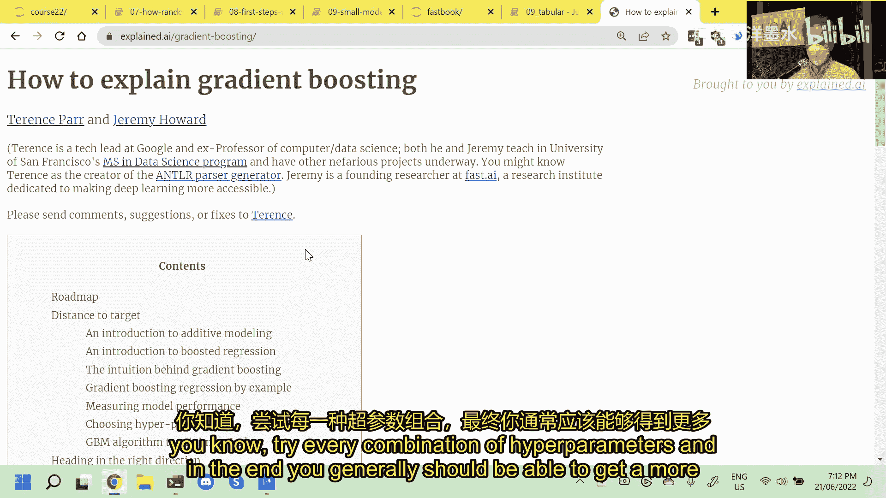

嗯。But not necessarily by much。Okay。So that was the。cale notebook。An。Random forests。

How random furs really work？嗯。所。What we've been doing is having this daily。Walk through。

Where me and I don't know how many 20 or 30 folks get together on a Zoom call and chat about。

You know， getting through the course and。Setting up machines and stuff like that。And。You know。

 we've been trying to kind of practice what， you know， things along the way。

And so a couple of weeks ago。I wanted to show， like。

What does it look like to pick a ca competition and a s？Do the normal sensible。

And of mechanical steps that you would do for any computer vision model。And so the。

Competition I picked was Patty disease classification。Which is about recognizing diseases。

 race diseases and race patdties。And yeah， I spent， I don't know， a couple of hours or three。

 I can't remember a few hours。Trying together something。And。

I found that I was number one in the leaderboard。And I thought， oh， that's。That's interesting。

 like because you never quite have a sense of。How well these things work。And then I thought， well。

 there's all these other things we should be doing as well。 and I tried。Three more things。

And each time I tried another thing， I got further ahead at the top of the leaderboard。

So I thought it'd be cool to take you through。😊，The process， I'm going to do it reasonably quickly。

 because。The walkthroughs are all available。For you to see the entire thing in， you know。

 seven hours of detail or however long， we probably with six to seven hours of conversations。

But I want to kind of take you through the basic。Process。That I went through。嗯。

So since I've been starting to do more stuff on kle， you know， I realize there's some。

Kind of menial steps I have to do each time， particularly because I like to run stuff on my own machine and then kind of upload it to Kagle。

So to make my life easier， I credit a little。😊，Modjo record fast kttle。

Which you'll see in my notebooks and now on， which you can download from PEt or Conda。U。

And as you'll see， it makes some things a bit easier， for example。

 downloading the data for the Paty disease classification。If you just run setup comp。

And pass in the name of the competition。If you are on kggle， it will return a path to。That。

Competition data that's already on kggle if you are not on kle and you haven't downloaded it。

 it will download and unzip the data for you if you're not on kggle and you havet downloaded un zipip the data it will return the path to the one that you've already downloaded。

Also， if you are on Kaal， you can ask it to make sure that。Pip。

 things are installed that might not be up to date otherwise。

So this basically one line of code now gets us all set up and ready to go。So， this path。

So I ran this particular one on my own machine， so it's downloaded and unzipped。The data。

I've also got links to the。6 walk through so far， these are the videos。A。Yes， and here's my。

Result after these。4 attempts， thus a few fiddling around at the start。嗯。So the overall approach is。

 well， and this is not just a kle competition， right。

 The reason I like looking at caal competitions is。You can't hide from the truth。

In a car competition， you know， when you're working on some work project or something。

 you might be able to convince yourself and everybody around you that you've done a fantastic job of。

😊，Not overfitting and that your models' better than what anybody else could have made and whatever else。

 but。The brutal assessment of the private leader board。Well， tell you the truth。

Is your model actually predicting things correctly？And is it overfit？嗯。

Until you've been through that process， you know， you're never going to know。

 And a lot of people don't go through that process because at some level， they don't want to know。嗯。

But it's okay， you know， nobody need。 You don't have to put your own name there。嗯。

I always did right from the very first one， I wanted， you know， if I was going to screw up really。

 I wanted to have the pressure on myself of people seeing me in last place， but you know， it's fine。

 you could do it audit honestlyly。😊，And you'll actually find。As you improve。

 you also have so much self confidence， you know and。

The stuff we do in a k competition is indeed a subset of the things we need to do in real life。But。😡。

It's an important subset， you know， building a model that actually predicts things correctly and doesn't overfit。

Is important and furthermore。😊，Structuring your code and analysis in such a way that you can keep improving over a three month period without gradually getting into more and more of a tangled。

 mess impossible to understand code and。Having no idea what untitled copy 13 was and why it was better than 25。

 right， This is all stuff you want to be practising， ideally。Well away from customers or whatever。

 you know， before you've kind of figured things out。😊，嗯。So the things I talk about here about。

Doing things well in this ca competition。嗯。Should work， you know， in other settings as well。

And so these are the two focuses that I recommend。Get a really good validation set together。

 We've talked about that before， right， And in a kal competition， that's like。

 it's very rare to PC people do well in a caal competition who don't have a good validation set。😊。

Sometimes that's easy。 And this competition， actually， it is easy because the。

The test seems to be a random example。 but most of the time， it's not， actually， I would say。

And then how quickly can you it？How quickly can you try things and find out what worked。

 So obviously you need a good validation set， otherwise it's impossible to iterate。

And so quickly iterating means not saying， what is the biggest。You know。

 open AI takess four months on 100 TPUs model that I can train。

It's what can I do that's got to train in a minute or so？And will quickly give me a sense of like。

 well， I could try this， I could try that， what thing's going to work。And then try。You know。

 80 things。It also doesn't mean that saying like， oh， I heard this is amazing you。

Baesian hyperparameter tuning approach。 I'm going to spend three months implementing that。

Because that's going to like give you one thing。But actually do well。😊。

In in these competitions or in machine learning in general。

 you actually have to do everything reasonably well。

And doinging just one thing really well will still put you somewhere about last place。

So I actually saw that a couple of years ago， Aussie guy who's。Very， very distinguished。

 Ma learning practitioner。呃。Actually， put together a team。

 entered a Ca competition and literally came in last place。

Ca they spent the entire three months trying to build this amazing new。Fancy。

Thing and never actually， never actually iterated。If you iterate。

 I guarantee you won't be in last place。

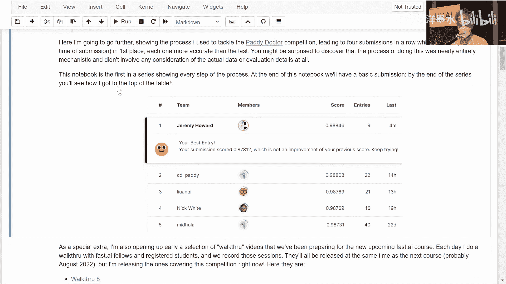

哎。ok， so。Here's how we can grab our data with fast kagle， and it gives us tells us what path it's in。

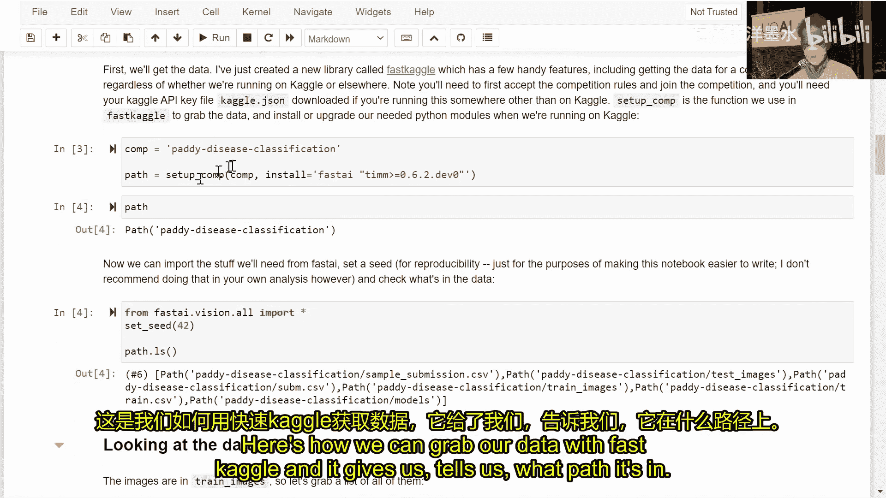

Um。And then I set my random seed， and I only do this because I'm creating a note to share。You know。

 when I share a notebook， I like to be able to say， as you can see， this is 0。83， blah， blah， blah。

 right and know that when you see it'll be 0。83 as well。But when I'm doing stuff otherwise。

 I would never set a random seed。 I want to be able to run things multiple times and see how much it changes each time。

 because that'll give me a sense of like。The modifications I'm making。

 changing it because they're improving it， making it worse， or is it just random variation。

 So if you or if you always set a random seed。That's a bad idea because you won't be able to see the random variation。

 So this is just here for presenting a notebook。Okay， so the data they've given us， as usual。

 they've got a sample submission， they've got some test set images。

They've got some trading set images。A CSV file about the trading set。

And then these other two you can ignore because I created them。😊，So， let's grab a path。

To train images。 And so do you remember。Get image files。

 So that gets us a list of the file names of all the images here， recursively。

So we could just grab the first one。😊，And take a look。 so it's 480。By 6，40。

Now we've got to be careful。 This is a pillow image。

 Python imaging library image in the imaging world， they generally say columns by rows。😊。

In the array slash tensor world， we always say rows by columns。

 So if you ask pieytorrch what the size of this is， it'll say 6，40 by 480。

And I guarantee at some point this is going to bite you。So try to recognize it now。Okay。

 so they're kind of taller than they are， at least this one is taller than it is wide。嗯。

So I would actually like to know they all this size because it's really helpful if they all are all the same size or at least similar。

Believe it or not， the amount of time it takes to decode a JPEG is actually quite significant。

And so figuring out what size these things are is actually going to be pretty slow。😊。

But my fast core library has a parallel sub moduleule。

 which can basically do anything that you can do in Python。 It can do it in parallel。

 So in this case， we wanted to create a pillow image and get its size。

So if we create a function that does that and pass it to parallel。

 passing in the function and the list of files。It does it in parallel and that actually runs pretty fast。

And so here is the answer。I don't know how this happened， 10。

403 images are indeed 480 by 640 and four of them aren't。😊。

So basically what this says to me is that we should pre process them or， you know。

 at some point process them so that they're probably all for 80 by 640 or all basically the kind of same size。

 well pretend they're all this size。But we can't。Not do some initial resizing other ways this is going to screw things up。

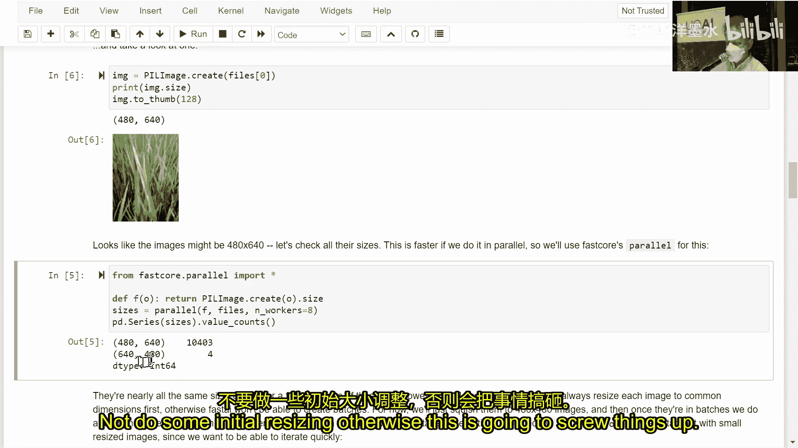

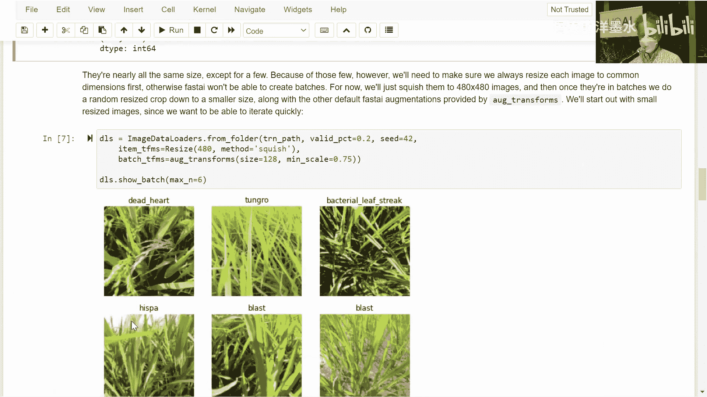

嗯。So like that probably the easiest way to do things。

 the most common way to do things is to either squish or crop every image to be square。

So squishing is when you just。In this case， squish the aspect ratio down。嗯。

As opposed to cropping randomly a section out。 So if we call resize squish， it will squish it down。

 And so this is 480 by 480 squared。 So this is what it's going to do to all of the images first。

On the CPU。That allows them to be all batched together into a single mini batch。

 everything in a mini batch has to be the same shape， otherwise the GPU won't like it。

And then that many batches put through data augmentation。And it will。Grab a。

Random subset of the image and make it a 128 by 128 pixel。

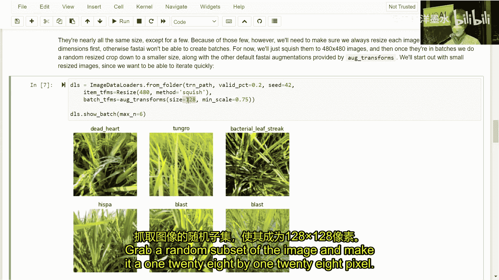

And here's what that looks like。 Here's our data。So show batchch works for pretty much everything。

 not just in the fast AI library， but even for things like fast audio。

 which are kind of community based things， you should be to use show batchch on anything and see。

Or here or whatever what your data looks like。I don't know anything about race disease。😊。

But apparently these are various rare diseases， and this is what they look like。

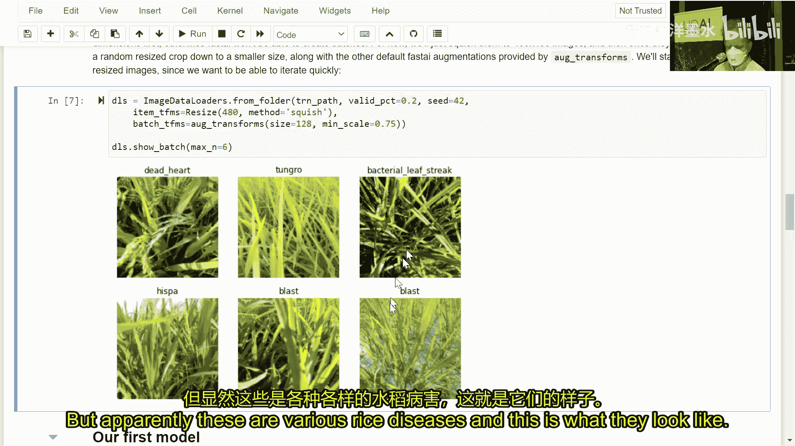

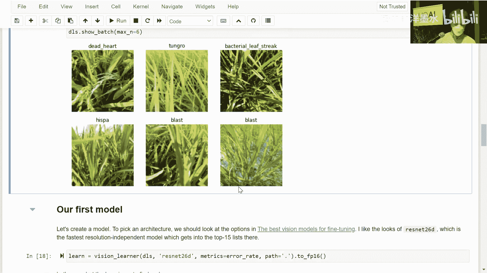

So I jump into creating models much more quickly than most people because I find you know models are a great way to understand my data as we've seen before。

 so I basically build a model as soon as I can。😊，嗯。

And I want to create a model that's going to let me iterate quickly。

 So that means that I'm going to need a model that can train quickly。So。

Thomas Capppel and I recently。Did this big project。The best vision models to fine shing。

Where we looked at nearly 100 different。Architectures。From from Ross Whiteman's Tim Library。

 Ptorrch image Model library。And looked at。Which ones could we fine tune。

 Which ones had the best transfer learning results。And we tried two different data sets。

 very different data sets， one is the pets data set that we've seen before。

 so trying to predict what breed of pet is from 37 different breeds。

And the other was a satellite imagery data set called Planet。So very。

 very different data sets in terms of what they contain and also very different sizes。

The planet one's a lot smaller， The pets one's a lot bigger。

 And so the main things we measured were how much memory did it use。

How accurate was it and how long did it take to fit。And then I created this score。

 which which combines the fit time and error rate together。And so this is a really useful cable。😊。

For picking。A model。And now， in this case， I want to pick something。That's really fast。

And there's one clear winner on speed， which is Resnet 206。

And so its accuracy was 6% versus the best was like 4。1%。 So okay， it's not amazingly accurate。

 but it's still pretty good。 and it's going to be really fast。So that's why I picked Resnet 206。

A lot of people think that。😊，When they do deep learning。

 they're got to spend all of their time learning about exactly how a Re 2060 is made and。

Convolutions and resonant blocks and transformers and blah， blah， blah。

 We will cover all that stuff in part 2 and a little bit of it next week， but。

It almost never matters。It'ss just a function right And what matters is the inputs to it and the outputs to it。

And how fast it is and how accurate it is。So let's create a learner which with a reate 2060 from our data loaders。

And。Let's run Ella find， so El find。We'll put through one mini batch at a time。Starting at a very。

 very， very low learning rate and gradually increase the learning rate and track the loss。

And initially the loss won't improve because the learning rate is so small。

 it doesn't really do anything， and at some point the learning rate' iss high enough that the loss will start coming down and then at some other point the learning rate is so high that it's going to start jumping past the answer and it's got to get get worse。

And so somewhere around here is a learning rate we'd want to pick。嗯。

We've got a couple of different ways of making suggestions。😊。

I generally ignore them because the suggestions are specifically designed to be conservative。

 They're a bit lower than perhaps certain optimal in order to make sure we don't recommend something that totally screws up。

 But I kind of like to say， like， well， how far right can I go and still see it like clearly。

 really improving quickly？ And so Id trick somewhere around。01。For this。So I can now。

Finde and tune our model with a learning rate 0。01。3 epochs。 So look。

 the whole thing took a minute it。 That's what we want。 right。

 We want to be able to iterate rapidly just a minute or so。 So that's enough time for me to go and。

 you know， grab a glass of water or。😊，Do some reading like not going to get too distracted。And。

What do we do before we submit？Nothing， we submit as soon as we can。Okay。

 let's get our submission in。 So we've got a model， let's get it in。😊。

So we read in our CSV file of the sample submission。And so the CSB file， basically。

 it looks like we're ought to have to have a list of the image file names。😊，In order。And then。

 a column of labels。嗯。So we can gra all the image files in the test image。Like so。

 and we can sort them。😊，And so now we want is what we want is a data loader。😊，Which。

Is exactly like the data loader we use to train the model。Except pointing at the test set。

 we want to use exactly the same transformations。So there's actually a Dls do test dealL method。

 which does that， and you just pass in。The new set of items。 So the test set fails。

So this is a data loader which we can use。For an hour。Test set。A test data loader。

Has a key difference to a normal data loader， which is that it does not have any labels。

So that's a K distinction。So we can get the predictions for our learner passing in。That data load。

And in the case of a classification problem， you can also ask for them to be decoded。

 decoded means rather than just get returned。 the probability of every。Rice disease， wherever plus。

 it'll tell you what is the index of the most probable。Rice disease。 That's what decoed means。

So that'll return of probabilities， targets， which obviously will be empty because it's a test set so throw them away and those decoded indexes。

 which look like this， numbers from not to9 because there's 10 possible rare diseases。

The cattleal submission does not expect numbers not 9。 It expects to see。

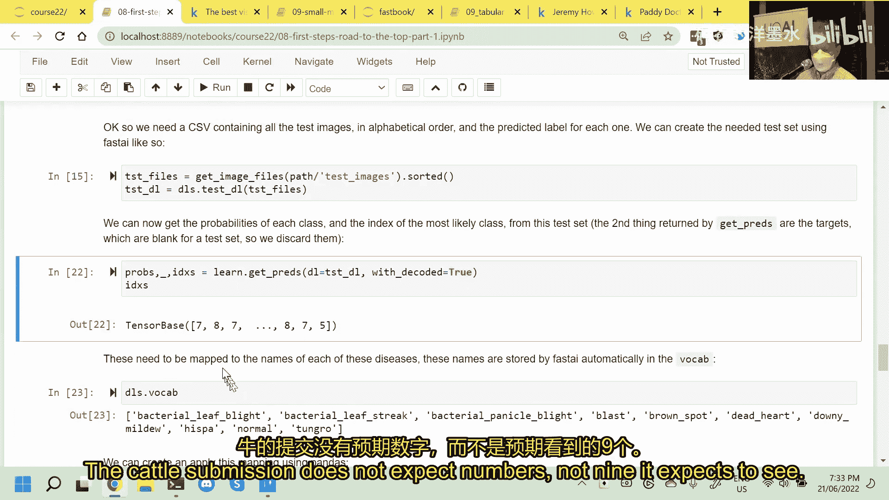

Strings like these。

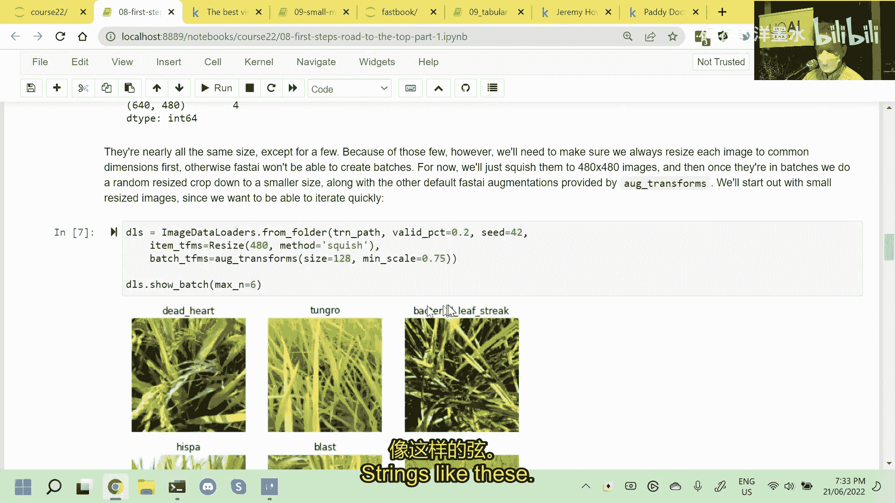

So what do those numbers from0aught to nine represent？We can look up our vocab。To get a list。

So that's zero， that's one， et cetera， that's 9。so嗯。

I realized later this is a slightly inefficient way to do it。

 but it does the job I need to be able to map these to strings。so。If I enumerate the vocab。

 that gives me pairs of numbers zero， bacterial leaf blight， one， bacterial leaf streak， etc。

I could then create a dictionary out of that。And then I can use pandas。

To look up each thing in a dictionary， they call that map。If you're a Cans user。

 you've probably seen map used before being past a function。Which is really， really slow。

 but if you pass map Add， it's actually really， really fast to do it this way if you can。😊。

So here's our。Predictions。So we've got our。😊，Submission， sample， submission file， SS。

 So if we replace this column label with our predictions。Like say。Then we can turn that into a CV。

And remember， this means this means run a bash command or shell command。 Head is the first few rows。

 And let's just take a look。 That looks reasonable。So we can now submit that to Cagggel now。😊。

Ederating rapidly means everything needs to be。Fast and easy。Things that are slow and hard。

 don't just take up your time， but they take up your mental energy。

 So even submitting to cattle needs needs to be fast， so。I'd put it into a cell。

So I can just run this cell。嗯。API。competitions admit。This CSV file given it a description。

 So just run the cell and it submits to Ca。And as you can see， it says， here we go。

 successfully submitted。So that's admission。Was terrible。Top 80% also known as bottomom 20%。

Which is not too surprising， right， I mean， it's it's one minute of training time。😊，嗯。

But it's something that we can start with。 And that would be like。

However long it takes to get to this point that you put in us submission。Now you've really started。

 right， because then tomorrow。😊，You can try to。Make a slightly better one。

So I like to share my notebooks。 And so even sharing the notebook I've automated。

 So part of fast caggle is you can use this thing called P notebook。😊，And that sends it off to Cale。

To create。A notebook on kggle。There it is。And there's my score。As you can see。

 it's exactly the same thing。嗯。Why would you。Create public notebooks on Ke。Well。It's the same。

Brutality of feedback。That you get for entering a competition。But this time， rather than finding out。

In no uncertain terms whether you can predict things accurately。This time。

 you can find out no no uncertain terms， whether you can communicate things in a way that people find interesting and useful。

And if you get zero votes。😊，You know， so be it， right， That's something to， to know。 And then。

 you know， ideally， go and ask some friends like。What do you think I could do to improve？

 And if they say， oh， nothing， it's fantastic。 you can tell， no， that's not true。

I didn't get me votes。 I'll try again。 This isn't good。 How do I make it better， you know。

 and you can try and improve。Because。If you can create models that predict things well。

And you can communicate your results in a way that is clear and compelling。

You're a pretty good data scientist。 You know， like they， they're two pretty important things。

 And so here's a great way to。Test yourself out on those things and improve。 Yes， John。Yes， Jeremy。

 we have a sort of， I think a timely question here from Zacia about your iterative approach。

And they're asking do you create different kggle notebooks for each model that you try so one kggle book for the first one。

 then separate notebooks subsequently or do you do append to the bottom of a single but what's your strategy that's a great question。

And I know Zackki is going through the。😊，The Daily walkthroughs， but isn't quite caught up yet。

 so I will say keep it up because in the six hours of going through this。

 you'll see me create all the notebooks。嗯。But。If I go to the actual directory I used。

You can see them。 So basically， yeah， I started with。You know what you just saw。

Bit messier without the prose。 But that same basic thing， I then duplicated it。

To create the next one。Which is here。 And because I duplicated it， you know， this stuff。

 which I still need it's still there， right， And so I run it。 And I don't always know what I'm doing。

 you know， And so at first if I don't really know I' doing next， but I duplicate it。

 it will be called， you know， first steps in the road to the top part one dash copy 1， you know。

 and that's okay。😊，And as as soon as I can。I'll try to rename that。Once I know what I'm doing。

 you know？Or if it doesn't seem to go anywhere， I'll rename it into something like， you know。

Experiment， blah， blah， blah， and I put some notes at the bottom。

 and I might put it into a failed folder or something。 but yeah， it's like。It's a very low tech。

Approach that I find works really well， which is just duplicating notebooks and editing them and naming them carefully and putting them in order。

嗯。And， you know， put the file name in when you submit as well。And then of course。

 also if you've got things in get。😊，You know， you can have a link link to the get commit so you'll know exactly what it is。

 generally speaking for me， you know， my notebooks will only have one submission in and then I'll move on and create a new notebook so I don't really worry about versioning so much。

U， but you can do that as well if that helps you。Yeah， so that's basically what I do and and。

I've worked with a lot of people who use much more sophisticated and complex processes and tools and stuff。

 but。None of them seem to be able to stay as well organized as I am。

 I think they kind of get a bit lost in their tools sometimes and。File systems and file names。

 I think are。Theyre good。Great， thanks。 So away from that kind of。Deev process， more towards the。

The specifics of， you know finding the best model and all that sort of stuff。

 we've got a couple of questions that are in the same space， which is。

You know we've got some people here talking about autoML frameworks。

 which you might want to you know touch on for people who haven't heard of those if you've got any particular autoML frameworks you think worth recommending or just more generally how do you go trying different models。

 random forests gradient boosting neural network just so in that space if you can comment for sure。

I use autoware mail less than anybody I know， I would guess。嗯。Which is to say never。

hyperparmeter optimization。😊，Never。嗯。And the reason why is， I like being highly intentional。

 You know， I like to think more like a scientist。And have hypotheses， and test them carefully。

And come out with conclusions， which then I implement。 You know， So， for example。

And this best vision model to fine tuning。I didn't try a huge。Grieds search of every possible。Model。

 every possible learning rate， every possible pre processing approach， blah， blah， bh， right。

 Instead， step one was to find out。Well， which things matter， right， so。For example。

 does whether we squish or crop。Make a difference。 You know。

 are some models better with squash and some models better with crop。And so we just chested that。

For and again， not for every possible architecture。

 but for one or two versions of each of the main families， that took 20 minutes。And the answer was。

 no， in every single case。The same thing was better。

 so we don't need to do a grid search over that anymore， you know？

Or another classic one is like learning rates， most people。

Do a kind of grid search over learning rates or they'll train  a thousand0 models， you know。

 with different learning rates。But this fantastic researcher named Leslie Smith invented the Learning Gr Finder a few years ago。

We implemented it。I think within days， of at first。Coming out as a technical report。

 And that's what I've used ever since。Because it works。Well， and runs in a minute or so。嗯。Yeah。

 I mean， then like。Neural net versus GBM versus random forests， I mean that's。

That shouldn't be too much of a question on the whole， like they have pretty clear。

Places that they go like。If I'm doing computer vision。

 I'm obviously going to use a computer vision deep learning model and which one I would use。

 well if I'm transfer learning， which hopefully is always I would look up。The two tables here。

 this is by table for pets， which is which are the best at fine tuing to very similar things to what they were pre trained on。

And then the same thing for planet。Is which ones are best for fine cheating for two data sets that are very different to what they're trained on？

And as it happens in both cases， they're very similar。In particular。

 conf next is right up towards the top in both cases。So I just like to have these rules with thumb。😊。

And yeah， my role of thumb vular is。Random forest is going to be the fastest。

 easiest way to get a pretty good result， GBMs。Probably going give me a slightly better result。

 if I need it。And can be bothered fussing around。嗯。GBM， I would probably， yeah， actually。

 I probably would run a hyperparameter。Swipe。Ca it is fitdly and， and it's fast。 So you may as well。

嗯。So， yeah， so no。 So， you know， we were able to。Make a slightly better submission。

 slightly better model。 and so。I had a couple of thoughts about this。 The first thing was。That thing。

 trained。In a minute。On my home computer。 And then when I uploaded it to Kaor。

 it took about four minutes per epoch， which was horrifying。And Kaal's GPUs are not amazing。

 but they're not that bad。 So I knew something was up。

And what was up is I realized that they only have two。Virtual CPUus， which nowadays is tiny。 Like。

 you know， you generally what is a rule of thumb about 8 physical CPUus per GPU。嗯。

And so it's spending all of its time just reading the damn data。Now， the data was 6，40 by 480。

 and we were ending up with only 1，28 pixel sized bits for speed。

 So there's no point doing that every epoch。So， step 1 was to make my。Cagle iteration faster。

 as well。And so very simple thing to do。😊，Raceize the images。

So fast AI has a function called resize images。 and you say， okay。

 take all the train images and stick them in。The destination。Making them this size。Repressively。

And it will recreate the same folder structure over here。

And so that's why I call this the training path。Because this is now my training data。😊。

And so when I then。Trained on that。On Kale， it went down to four times faster。

With no loss of accuracy。 So that was kind of step one was to actually get my first。Iteration。

 working。嗯。Now， still。A meant it's a long time and on Kagggle。

 you can actually see there little graph showing how much the CPU is being used。

 how much the GPU is being used on your own home machine。

 can there are tools free GP you know free tools to do the same thing so that the GPU was still hardly being used So still CPU was being driven pretty hard。

I wanted to use a better model anyway to move up the leaderboard。😊，So， I moved from a。嗯。

Oh by the way， this graph is very useful， so this is。This is speed versus error rate。By family。

And so we're about to be looking at these。Conv next muddles。

So we're going to be looking at this one come next tiny。😊，嗯。Here it is context stunning。

 So we were looking at Res 2060， which took this long on this data set。

But this one here is nearly the best。 It's third best。But is still very fast。

And so it's the best overall score。 So let's use this， particularly because， you know。

 we're still spending all of our time waiting for the CPU anyway。

So it turned out that when I switched my architecture to conn。It basically ran just as fast。

 Aunt Kegggel。So we can then。Trying that。嗯。Let me switch to the Cagle version because my outputs are missing for some reason。

So， yeah， so I started out by running the Renet 2060 on the resed images and got。Similar error right。

 but I ran a few more epochs。Got 12% cent error rate。And so then I do exactly the same thing。

 But with convn small。And 4。5% error rate。So don't think that different architectures are best。

Tiny little differences this is。Over twice as good。嗯。And。

A lot of folks you talk to will never have heard of this Con next， because it's very new。

And I've noticed a lot of people tend not to。Keep up to date with new things。

 They kind of learn something at university， and then they stop， stop learning。

 So if somebody's dual just using resnets all the time。You know。

 you can tell them we've we've actually， we've moved on。You know。

 renets are still probably the fastest。But。For the bes of speed and performance。You know。Not so much。

 come next， you know， again， you want these rules of thumb， right？If you're not sure what to do。

This gone next。 Okay， and then like most things， there's different sizes。 There's a tinydy。

 there's a small， there's a base。 There's a large， there's an extra large。 And， you know， it's just。

 well， let's look at the picture。嗯。This is it here。Right。Large takes longer， but lower error。

Tiny takes less time， but higher error， right， so。You pick。

About your speed versus accuracy trade off for you。 for us， small is great。嗯。And so yeah。

 now we've got a 4。5% error。 that's that's terrific。Now let's get a rate on kgel。

 this is taking about a minute per epoch on my computer it is probably taking about 20 seconds per epoch。

 so not too bad So you know one thing we could try is instead of using squish。😊。

As our pre processingces， let's tra crop。 So that will randomly crop out an area。

 And that's the default。 If I remove the method squash， that will crop。

So you see how I've tried to get everything into a single function。 right this single function。

 I can tell it。 Let's go and find the definition。What architecture do I want to train。

 How do I want to transform the items， How do I want to transform the batches and how many epochs do I want to do。

That's basically it right So this time I want to use the same architecture comp next。

 I want to resize without cropping and then use the same data augmentation。And okay。

 error rate about the same。So not particularly， it's a tiny bit worse。

 but not enough to be interesting。嗯。Instead of cropping， we can pad。 Now。

 padding is interesting Do you see how these are all square。Right， but they've got black borders。

So padding is interesting because it's the only way of pre processing images which doesn't distort them and doesn't lose anything。

 If you crop， you lose things。 If you squish， you distort things。This does neither。 Now， of course。

 the downside is that there's pixels that are literally pointless。 They contain zeros。

So every way of getting this working。😊，Has its compromises。

 But this approach of resizing where we pad with zeroes。Is not used enough。

 and it can actually often work quite well。In this case， it was about as good as our。Best so far。

But no， not huge differences yet。😊，What else could we do？Well。What we could do is。嗯。

See these pictures。This is all the same picture。But it's gone through our data augmentation。

 so sometimes it's a bit darker， sometimes it's flipped horizontally。

 sometimes it's slightly rotated， sometimes it's slightly walked。

 sometimes it's zooming into a slightly different section， but this is all the same picture。嗯。

Maybe our model would like some of these versions better than others。

So what we can do is we can pass all of these。😊，To our model。Get predictions for all of them。And。

Take the effort。Right so it's our own kind of like little mini bagging approach。

 And this is called test time augmentation。FasI is very unusual in making that available in a single method。

😊，You just pass T TA， and it will pass multiple augmented versions of the image。And average them。

For you。And so this is the same model as before， which had a 4。5%。 So if instead。

 if we get our T T A predictions。And then get the error right。Wait， why does this say 4。8。

 Last time I did this， it was way better。Well， that's messing things up， isn't it？呃。

So when I did this originally on my home computer， it went from like 4。5 to 3。9。So， possibly I。

Got a very bad luck it's time， So this is the first time I've actually ever seen TTA give a worst result。

😊。

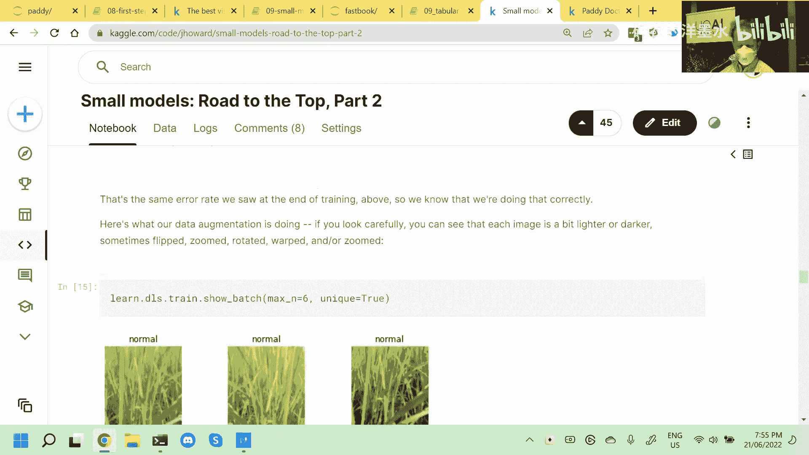

So that's very weird。I wonder if it's。

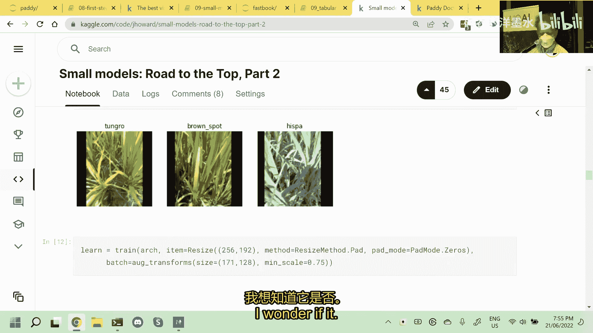

If I should do something other than the crop padding。 All right。

 I'd have to check that out and I'll try and come back to you and find out。Why in this case？

This one was worse。嗯。Anyway， take my word for it every other time I've tried it， TTA has been better。

😊，So then， you know， now that we've got a pretty good way of resizing， we've got TTA。

 we've got a good training process。Let's just make bigger images。

And something that's really interesting， and a lot of people don't realize is your images don't have to be square。

They just all have to be the same size。And given that nearly all of our images are 640 by 480。

 we can just pick， you know， that aspect ratio。So for example， 256 by 192。

 and we'll resize everything。To the same aspect ratio rectangular。

And that should work even better still。 So if we do that， we' do 12 epochs。Okay。

 now I errorerate down to 2。2%。And then we'll do TTA。Okay。

 this time you cant see it actually improving down to under 2%。😊，So that's pretty cool， right。

 we've got our error rate at the start of this notebook we were at。😊，12l%。

And by the time we've got through。Add little experiments。We're down to under 2 per cent。

and nothing about this is in any way specific to。😊，Rice or this competition。 you know。

 it's like this is a very。Mechanistic。It all standardized。Approach。Which you can use for。

Certainly any kind of this type of computer vision competition。

 you have computer vision data set almost， but you know。

 it look very similar for a collaborative filtering model， a tabular model， NLP model， whatever。😊。

So of course， again， I want to submit as soon as I can。

 so just copy and past the exact same steps I took last time， basically for creating a submission。

So as I said last time we did it using pandas， but there's actually an easier way。

 So the step where here I've got the numbers from lotston 9。😊，Which is like which。

 which rice disease is it？So here's a cute idea。We can take our vocab。And make it an array。

 So that's going to be a list of 10 things。And then we can index into that vocab with our indices。

Which is kind of weird。 This is a list of 10 things。This is a list of， I don't know，4 or 5000 things。

 So this will give me 4 or 5000 results， which is。Each vocab item for that thing。

 This is another way of doing the same mapping。 And I would spend time。

Playing with his coat to understand what it does， because it's the kind of like。Very fast。 what。

 you know， not just in terms of writing， but this， this。The this would。Optimize， you know。

 on on the CPU very， very well。 this is the kind of coding you want to get used to。

It's kind of indexing。Anyway， so then we can submit it just like last time。And when I did that。

I got in the top 25%。And that's， that's where you want to be， right， Like generally speaking。

 I find in Ke competitions， the top 25%。Is like。You're kind of like， solid， competent。Level。

 you know， look not to say like， it's not easy。You got to know what you're doing。

But if you get the top 25%， and I think you can really feel like， yeah， this is， this is a。You know。

 very。Reasonable attempt in so thats。 I think this is a very reasonable attempt。Okay。

 before we wrap up， John， any last questions？Yeah， there's there's two。

 I think that would be good if we could touch on quickly before you wrap up one from Victor asking about TTA when I use TTA during my training process。

 do I need to do something special during inference or is this something you use only during valid day Okay so just to explain。

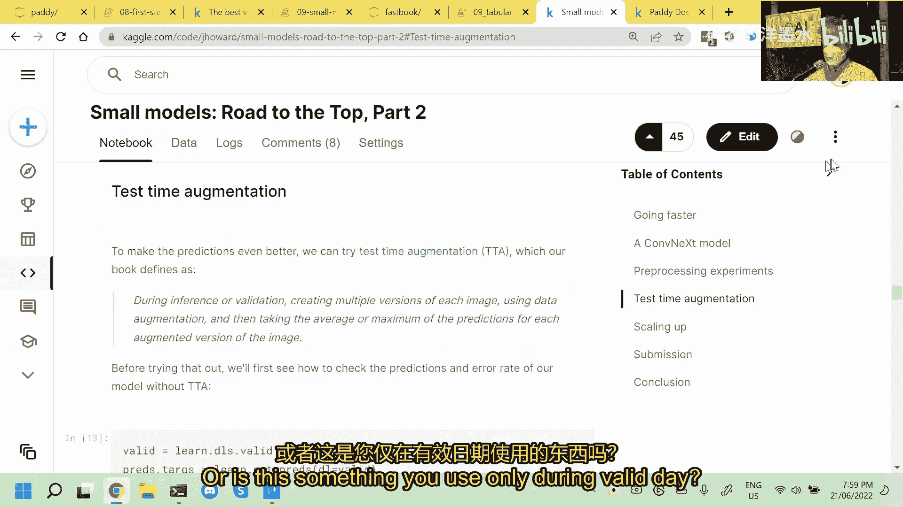

TTA means test time augmentation， so specifically it means inference。

 so I think you mean augmentation during training。

So yeah， so during training。You basically always do augmentation。

 which means you're varying each image slightly。So that the model never seems the same image exactly the same twice。

 and so I can't memorize it。

嗯。On fast AI， and as I say， I don't think anybody else does this as far as I know， if you call TTA。

 it will use the exact same augmentation approach on whatever data set you pass it。

And average out the prediction。 But， but like multiple times on the same image and we'll average them out。

 So you don't have to do anything different。 But if you didn't have any data augmentation in training。

 you can't use T TA。 It uses the same by default， the same data augmentation user training。Great。

 thank you。 And the other one is about how。You know， when you first started this example。

 you squared the models and the images rather and you talked about squashing versus cropping versus you know。

 clipping and scaling and so on， but then you went on to say that these models can actually take rectangular input right so there's a question that's kind of probing it at that you know。

 if the。If the models can take rectangular inputs， why would you ever even care as long as they're all the same size？

I find most of the time。Data sets tend to have a wide variety of input， sizes and aspect ratios。So。

You know， if there's just as many tall， skinny ones as wide。Short ones。You know。

 it doesn't make sense to create a rectangle because some of them you're going to really destroy them。

 So a square is the kind of。Best compromise in some ways。点啦。Better things we can do。Which。

We don't have any。Off the shelf library support for yet。

 And I don't think I don't know that anybody else has even published about this。

 but we've experimented with kind of trying to。Battch things that are similar aspect ratios together and use the kind of median rectangle for those。

 and have had some good results with that， but honestly。909。

999% of people given a wide variety of aspect ratios， chuck everything into a square。I follow up。

 this is my own interest。 Have you ever looked at。So the issue with padding， as you say。

 is that you're putting black pixels there。

Those are not Nns， those are black pixels， that's right。

 there's zero and so there's something problematic。To me conceptually about that。

You know when you when you see， for example， four to three aspect ratio footage presented for broadcast on 16 to9。

 you get the kind of the blurred stretch kind of stuff No we've played with that a lot。

 I used to be really into it actually and faste I still by default uses a reflection padding which means if this is I don't know it so this is a 20 pixel wide thing it takes the 20 pixels deck to it and flips it over and sticks it here and it looks pretty good you know another one is copy which simply takes the outside pixel and it's a bit more like TV you know。

You know， much to my cha。It turns out none of them really help if anything， they make it worse。😊，Um。

 because in the end。The computer wants to know， no， this is the end of the image。

 There's nothing else here。 And if you reflect it， for example。

Then you're kind of creating weird spikes that didn't exist。 and the computers got to be like， oh。

 I wonder what that spike is。 So yeah， it's a great question。

 And I obviously spent like a couple of years assuming that we should be doing things that look more image like。

 but actually the computer likes things to be presented to it in as straightforward a way as possible。

😊。

All right， thanks everybody and hope to see some of you in the walkthroughs and other ways see you next time。

😊。