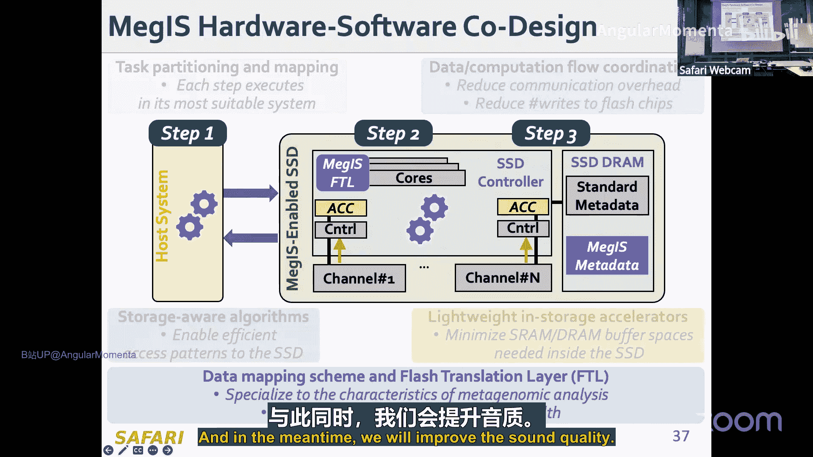
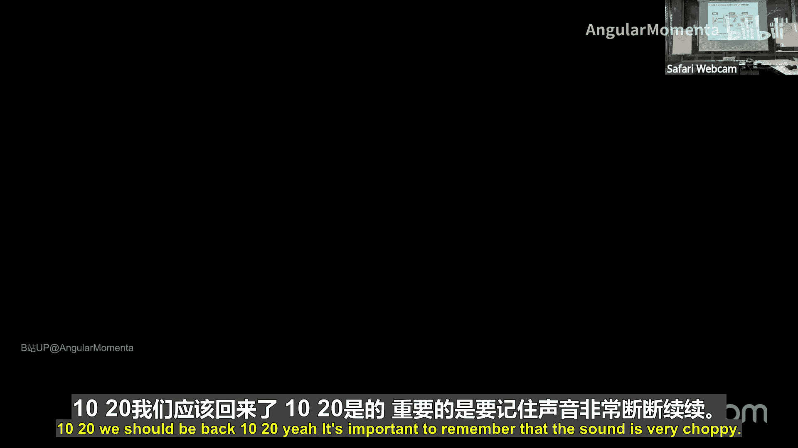
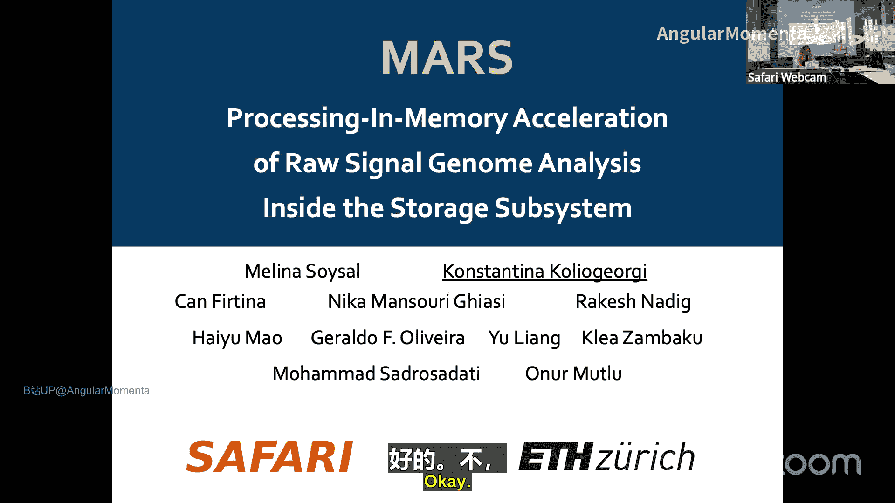
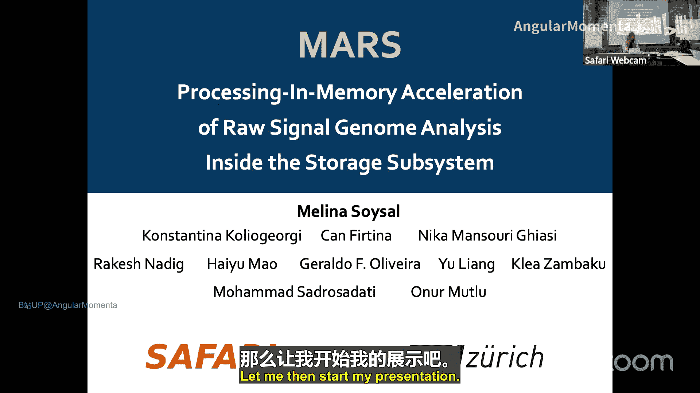
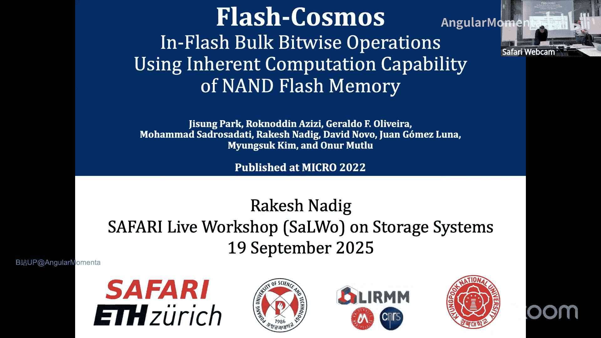
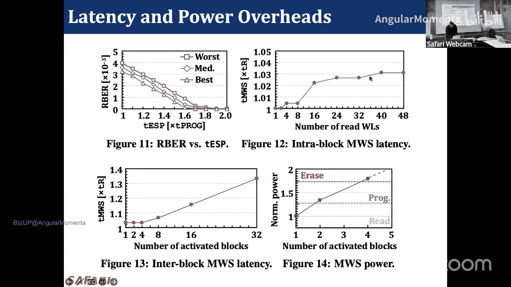
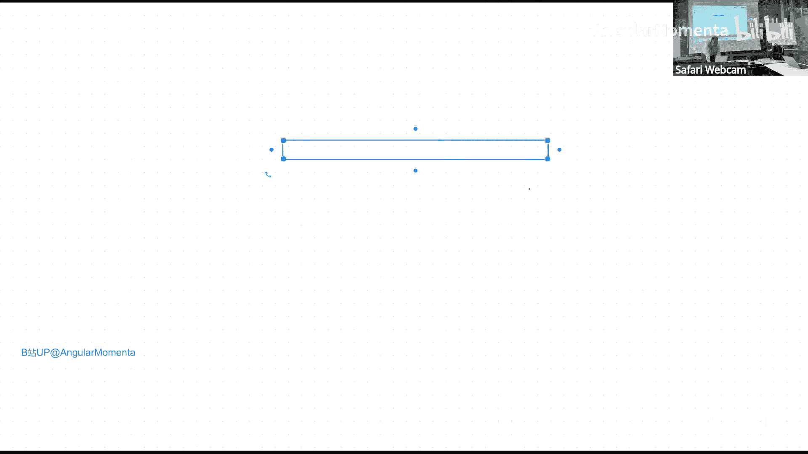
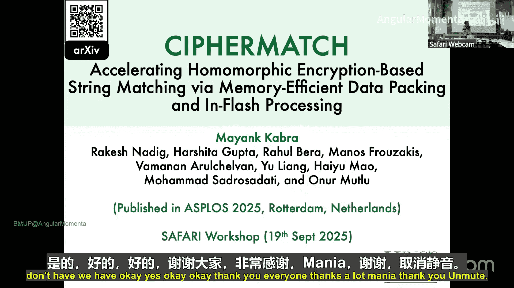
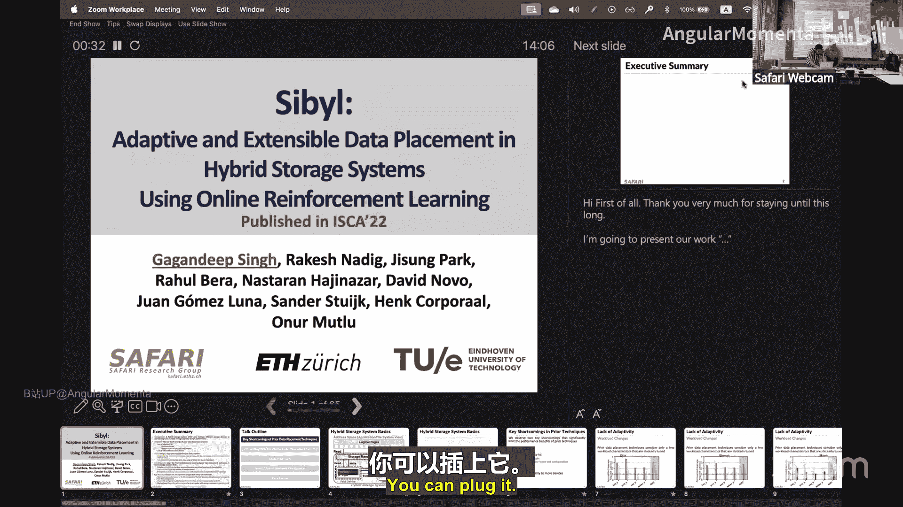
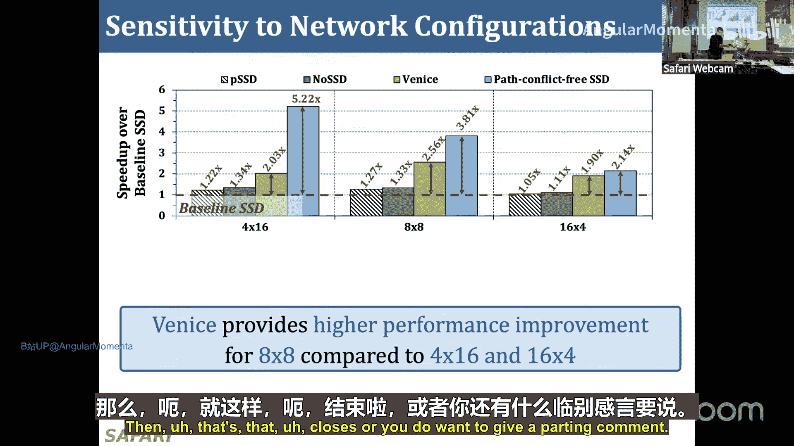

# 【苏黎世联邦理工学院】2025年首次SAFARI直播研讨会 ｜ 1st SAFARI Live Workshop (SaLWo) 2025 p01 01 首届存储系统现场研讨会（SaLWo） -BV1RYquBGEDu_p1-

By the way， I really like it。

Wait， are we， Yes， no。Did didn't you see we are going now like the progress。Probably， it's bothing。

 And then okay， now we。Okay。No。Yeah。咁我没有试上。OhYeah。So good morning everyone welcome to another edition of Salgo today we're going to discuss several exciting works in the line of story century computing The first talk Andreas is going to discuss about his work Christ our recent publication in Isca 2025 Andraas is the first year PhD student the Sofari Research Group at TT Zuric Adv Professor Mulu his research interests lie in computer architecture focusing on DRA Harvard So Codesign and Ri Meory before joining Safari。

 Androas received his master's degree from the National Technical University of Athens。

Working on system level optimizations for DNA inference and energy efficient LLM survey。So。

 thanks for the introduction。 Thank you so much。 So hi everybody， Im Andreas。

And today I'm going to be presenting our work R， a high performance and energy efficient retrieval system within storage processing。

 which was presented this year in ESSca。Yes。So let's start with an executive summary。Wait。

Re the problem is that retrieval augment generation or rag pipelines incur data movement overheads between the host and the storage system。

And at the same time， existing install processing or ISP solutions only accelerate the nearest neighbor surge stage of RA and is reduce significant area and power overheads。

Our goal in this work is to alleviate the IU of data movement over of RA by accelerating both nearest neighbor search and document retrieval without modifications to the storage system。

To this end， Rice introduces a lightweight scheme that links embedding to the documents。

An ISP tailored data placement algorithm entered approximate nearest neighbor search or ANNS engine that uses the existing computational resources within the storage system。

Our key results are that rice improves throughput and energy efficiency by 15 times and 55 times over the CPU respectively。

And it reduces the IO data movement properties of RA to under 0。

2% of the total run time of the rank pipeline。In addition。

 it outperforms an existing state of the art， ISP based A and an S accelerator by up to 2。5 times。

So this is an outline of my talk， and I'm going to start with a bit of background。

This is what the typical LLM inference pipeline looks like。

A query is received by the inference system， and then it is fed through a large language model which usually runs on a GPU to create a response。

However， large language models can only generate responses from data that they have seen in their training sets。

And they require expensive retraining to memorize new data。

This is a problem because it limits their effectiveness in real time and domain specific applications。

So to solve this issue， researchers have proposed retrieval augmented generation or rank。

ARq combines the next generation capabilities of large language models with information retrieval techniques from document databases。

Rq identifies the most relevant documents to a user query to generate a high quality response by combining the information from the relevant document chart。

To achieve this，RG first uses an embedding model to generate embeddings for both the query and the document database。

Embbedtics are multidimensional vectors representing the information contained in the query and in the documents。

Unfortunately， they can be quite large reaching up to 8，000 dimensions。As a result。

 the document database has to be stored the store subsystem and usually in flash memory。

 the next step is to then identify relevant documents using a process called nearest Nple search。

nearest neighbor search involves calculating the distances between the query and the database embeddings and identifying those with the smallest distance to the query embedding。

To generate the response， RAG then combines the documents that correspond to these embes with the query。

Fitting them to the LLM to generate a response。The problem however。

 here is that nearest Ni search creates significant data movement between the CPU that actually does the calculations and the solar system that holds the embedding vectors。

 and also that the large embeddings which have thousands of dimensions lead to expensive distance calculations。

So to try to alleviate these overheads， researchers have proposed multiple approaches and one family of such approaches is quantization。

 for example， integer quantization， binary quantization or product quantization that reduce both the bit of data as well as the total dimensions of the vectors and another big family of approaches is in storage processing which employs the computational resources within the solar system。

 and takes advantage of the large internal bandwidth of the SSDs。In our motivation section。

 we analyze both of these approaches。First， we perform a latency breakdown of all the stages in the RA pipeline when using binary quantization。

 so as you can see from this figure， data loading comprises almost 70% of the total latency of RA and dominates the total runtime for launch data sets。

We vast the use that quantization on its own is not enough to alleviate the data movement overheads of the rock pipeline。

Second， we explain why existing install storage nearest neighbor search accelerators。

Are not suitable for accelerating ragged pipelines。Specifically。

 existing designs mainly accelerate the search process。

Whi only comprises a small part of the total latency。

 but they do not provide support for accelerating the retrieval of documents from the storage system in addition。

 they introduce significant modificationifications to the design of the SSD and they incur prohibitive power and dairy overhead。

 which further hinders their adoption。So our goal in this work is to fundamentally alleviate the IO datata movement bottlenecks of RA through an ISP design that does not require modifications in order to perform computations inside the solar system。

To this end， we propose R， which stands for Retrieval system with installage processing。

The key idea of rise is to leverage both in storage and in flash processing。

To exploit the computational parallelisms of flash storage and conserve precious flash channel bandwidth。

When the rise is deployed， the whole system of loads are to the storage by sending the queryium beddings and then receiving relevant document chunks from the storage system。

To achieve this， ariseIS employs three key mechanisms。

The first is an efficient ISP tailored implementation of the inverted file algorithm。

The second is a low cost embedding to document linkage mechanism and the third is an ANNS engine that uses existing computational resources within the SSDs。

However， this is not straightforward as the design of the storage system creates unique limitations。

For example， the embedded core of the solar system have limited performance and functionality。

 for example， they lack floating point arithmetic support。Second。

 the computation inside the flashships is limited to simple bidwises and bid counting operations。

And third， the oil correction limits ISP performance due to date movement overheads between the flash shifts and the embedded processor。

Despite these challenges， we base RIS's design on the existing design of the SSD。

 which is comprised of multiple processors， a small amount of D。

 and then multiple flash channels with multiple flash chips each。

That are then composed of multiple flash dies， each flash die contains multiple planes and pages。

 a page buffer for each plane and peripheral circuitry。

 which all contain logic that can be used for computation。In modern system。

 the flash pages stores data and they also contain a small amount of reserve space。

 which is called the out of band region and which is used for error correction purposes。

So let's now move to the database layout of our proposed design。

Rice's database layout creates separate regions for stor embeddings and documents。

 antitic storage embeddings using enhanced SOC programming to provide robust ISP operations。

It also stop documents in TLC in order to provide high storage density。

Both embeddings and doments are stored continuouslytiguously to avoid address translation overheads。

 which usually occurs in the embeddedbedding processor of the SSD。And finally。

 it links embeddings to documents via the out of band region of found。Flash pages。

And this again reduces the overheadts of address translation because once an embedding is selected in the search process。

 the relevant document chunk can be directly retrieved without the need to perform address translation。

So while this database layout can be used to facilitate exact nearest neighbor search。

 R goes a step further and also provides support for approximate nearest neighborigh search。

 which provides higher performance。Specifically， R employs the inverted file algorithm or IVF with binary quantization to accelerate nearest neighbor search。

IVF first organizes embedding into clusters and then the search process occurs in two steps。First。

 we perform a coarse grain search to identify the nearest clusters through our query embedding。

 and in a second step we perform a fine grain search within the identified clusters to find the nearest embeddings。

The inverted file algorithm provides high performance and accuracy even with binary quantization。

And it also features characteristics， which are actually streaming access patterns that make it suitable to the storage system。

As a result， we choose to design an in storage A and an S engine that provides support and accelerates the inverted file algorithm。

So both for the course and the fine green stages of IVF。

The A and N S engine first copies the query beddings to the page buffer inside the flash dies。

And then moves the document embeddededs to the page buffer。At this point。

 it calculates the distances using logic in the page buffer and the peripheral circuitry。

Anding then transfers the distances back to the SSDs rate0。At this point。

 the embedded processor of the SSD performs Quick Selectlect to identify the nearest clusters or the nearest embeddings and then performs reraking and quick sort to further refine the search results。

After the search process is completed， the A andN S engine moves the identified document chunks to the SSD D and finally transfers them to the host to complete the RA retrieval stage and continue the LLM generation process。

To further improve our design， we propose three additional optimizations which are distance filtering that quickly filters out embeddings with large distances without transferring them to the embedded processor so in this case when the distance of an embedding to the query embedding exceeds a predefined threshold code it is immediately dropped and we don't do any further computations using this vector。

The second optimization is multiplying input broadcasting or NPIBC for not social。

 which parallel transfers the aquarium bedding to multiple planes at the same time。

 and the last optimization is pipelining， which overlaps flash page read with distance computations for another page。

I will now move on to the evaluation section of Rice。So for our evaluation。

 we use multiple baseline lines， we have CPU reel， which is a CPU based ra retrieval system running IVF。

 and then we have no IO， which is the same CPUU based system。

 but this time without taking the IO over into no account。We also compare rise to Wey search。

 which is a state of the art ISP based approximate nearest neighbor search accelerator。

We evaluate our performance on both exact nearest Na search。

 which is a brute force approach as we call BF and also using the inverted file algorithm or IVF。

And we evaluate throughput， which we measure in queries per second or Q， energy efficiency。

 which we measure in queries per second per watt， and we also perform an evaluation of the end to end retrieval performance when using both of these approaches。

We evaluate rights on many different data sets and on two SSD configurations， SSDC。

 which is a cost oriented SSD design and SSDP， which is a performance oriented SSD design。

So let's start with the performance evaluation。For the performance evaluation。

 we compared the throughput of noIO and RIS on SSDC and SSDP。In the Hawaii axis， we plot throughput。

 which is normalized that of CPUU realL， and we evaluate performance on both brute force and IVF across different ranges of recall values。

So we can see that R outperforms no IO due to the massive parallelism of the SSD。

 and also that our performance improvements over the no AO baseline actually increased at higher recall values。

 so it goes from 2。3 at 0。9 recall at 10 to 3。3 times at 0。98 for recall at 10。

We perform a similar experiment for energy efficiency。

 and this time the Y axis represents queries per second per watt。

 which we normalize again to the same metric for the CPU system。Anyway。

 again draw a similar conclusion， which is that improvements in energy efficiency increase at higher recall values。

From 28。6 times to 46 times almost。In the paper， we evaluate these on multiple different data sets and we observe that the patterns are largely the same and also that the performance benefits increase with larger data sets again due to the massive parallelism of the SSD。

So let's now move on to the evaluating end to end performance。

We repeat the latency breakdown experiment from the motivation section。

 this time also performing document usually with Rice。As can be seen from the plot。

 the one's almost 70%。Of latency stemming from data set loading and search is now combined to a single installed retrieval step that comprises just 0。

15% of the total latency and we does conclude that rice eliminates the data movement overheads from the rack pipeline。

In the paper， we also perform a sensitivity study which quantifies the speedups provided by our optimizations on top of our basic design。

 which we call a note in this study。In the X axis， we suit different target recall values for recall 10 in the Hawaii axis we measure queries per second。

 again， normalizedize to the throughput of the real CPU system baseline。

And the different lines correspond to different configurations。

 each adding a different layer of optimization on top of the previous ones。

We perform this experiment both for the cost oriented and the performance oriented SSDs。

And we see that on average， distance filtering provides a five times throughput increase across all configurations。

 on average。Pipelining provides an additional 1。4 time speed up on top of that and multi plane input broadcasting improves performance on SSDP by 26% on average on top of pipeing。

So if we combine all of these optimizations together。

 they offer a combined performance improvement of almost 13 times over the basic baseline。

For my final evaluation slide for today， we have a comparison to endy search。

 which is a state of the art approximate nearest neighbor search accelerator design。

For this comparison， we normalize the throughput of rise to that of ND search。

 running AsianSW and disk A&N， which are two graph based approximate nearest neighbor search algorithms。

And we evaluate both rice and the search on the shift 1B and deep 1b data sets。

Rice improves performance by 2。5 times and 1。8 times over ND search when running when ND search runs with H andSW and 1。

05 times and 1。36 times over ND search when ND search is running with this KNN。

We attribute the performance benefits and the performance improvements of rise。

To the fact that IVF features streaming access patterns that exploit the internal bandwidth of the solar system much better than the more irregular graph access patterns of these algorithms。

Our paper is available on archive and there you can find more details about the implementation。

So let me re up my talk again。The problem we attempted to solve is the drug retrieval is currently bottlenecked by IO data transfer overheads between the host and the storage system。

And to solve this issue， we propose R， which is the first system for Ra retrieval that leverages install storage processing using the existing computational resources within the storage system。

Our key results are that rise outperform CPUU search by 15 times on average。

It improves energy efficiency by 55 times on average。

 and it reduces documentary retrieval latency to a negligible under 0。2% of the total rug pipeline。

Finally， it performs an existing state of the art accelerator and the search by up to 2。5 times。

So this was my talk and thank you for your attention。Did you have any questions。Yes。thanks。

 Andra has a great talk。 So I have two questions。 And the first one is a high level question。

So this work that the background of this word talking about like larger model right Well the applications of ANS are like the hotest topic right now is about rug because that's where the big workloads exist but it's more general it can be extended this was a traditional workload even the past Yeah so it can be I mean you provide any you know search algorithm or focusing on this type of the searching algorithm。

Or you mean rights specifically yeah yeah so because we wanted to exploit the high sequential bandwidth of the SSDs。

 we settled on IVF， which again demonstrates these patterns。However。

 there are other works that do the more graph based than。

 but even in this case we show that rise with binary quantization and IDF can achieve reasonable large it' very good to actually if we combine it with a lightweight recording stem so we fetch actually more embedding than we need to in the fetch step of the process and then we refine our search by performing a more detailed comparison of a few elements this wasn't in the presentation by the way。

 using a higher precision so in embeddings in that case。

 not binary quantization and the second question is what type of data movement。

 data movement it's eliminate by this work because I still saw some data movement between the flash and SSD。

Yeah， you mean between the storage and the host， right， yeah， yeah so。

Usual if you wanted to perform search on the CPU for each embedding。

 you would have to fetch it from storage and move it to the CPU。

And then after the search is completed， you would fetch the documents that correspond to these embes。

So in this case we performed the entire search set inside the storage system and finally once the search is resolved inside the storage。

 only then we transferred just the document chunks which would have to be transferred there another way because you need to get them to the GPU to perform inference yeah I mean let's slide。

啊啲。Like in the beginning， probably， yeah， yeah。 next slide。To give to the yeah。

Maybe's architecture parts。OkayThat's it turn。Here。Yeah， yeah， yes， yeah。So， here the。

The document chart means the final result。Yeah， it's just the pure documents containing the relevant text to the user query。

Okay， yeah， yeah。So I have one issue。 Yeah， one question about this figure。

 So part of rice has been implemented the flash sheet as the right。 Yes， it is some computation。嗯。

So it's actually like very limited， the modification rice is essentially a firmware design。

There is actually like we don't need to perform a lot of modifications， that's really supported。

I don't think it's plug and play like to a modernist SDD， but if we really wanted to do this。

 it would be very， very straightforward because all the hardware needed to perform these operations is already in the solar system。

 we just need to orchestrate the operations a bit differently in different order。

But it should be very crazy。So towards' the exact operation， we are doing the flagships。Okay。

 that's a good question， so let me go to this slide。Here。

So here we have both aquarium bedding and the documented bes in the page bathroom there there is X logic。

which will compute a bit basically a bitwise extra between the two these two vectors and then the peripheral logic contains the fail bit counter。

 now the fell bit counter is usually used to see if there was an error within the page to then do read retry。

 but in our case we can actually use it to compute the Euclidean distance or the Manhattan distance for one bit element to the same distance actually。

Which。Really like produces our distance score。 So the logic that happens inside the flashships is the。

The distance calculation and also the optimization that does the distance filtering that compares the distance that is produced to a threshold and then drops the vector altogether if it exceeds a predefined threshold so yeah that part was my question how do we do the compress because one of the main reason that you are getting improvement is that we are reducing a lot of data in the flash Yes and that's why actually when you were in the sensitivity study right sorry in the sensitivity study exactly when you were reducing the recall yes。

 basically we don't we are reducing more data recall enables us to more aggressively filter rather than batteries？

So there is less traffic going to the SSD controller。

 which is weak in terms of computing performance。And we generate less load。Essentially to the。

And that's。 So how do we do the comparison inside plus for that， Don't we need to change。

The logic is already there to calculate the basically the。How many errors are in the during the read。

 so instead of computing a number of bits， we just add the distance threshold there。

 we replace that value。In the peripheral logic of the。So basically。

 we repurpose we all the existing components that are there forcc。

 especially and this also because we do the。Enhanced SLC program mode。

 that's what allows us to remove these elements。And report present them for our goal。

So my next question is that so we are using this IVF。

 which is cluster based approach to make sure that we can parallellyze our search across all flash dos。

 right？I assume you are also using the multi plan operations。InIn the dark right。So。

So how can we make sure so in the beginning everything looks good。

 but maybe after some time that you might need to change the position of the pages because of internal SSD operations so how can we make sure that we can keep using this cluster race approach as we go to the future？

That's a tricky question like updates are a bit difficult because we have discontinu conity and if we try to do where level for example。

 it might get a bit scary in that case， but I think we can just move like one cluster somewhere else。

And just change the mapping in the out of band area。To somewhere else and how big is those clusters。

 each cluster， how big is it？嗯。In the the A algorithm。

 mean I mean it's configurable and also it depends on our target recall so more clusters is probably better。

So I understand that you're searching you try to be regular as much as possible to you know to get good parallels。

 but when you want to basically retrieve retrieve the documents that you want that the search can be actually a bit random right not that it's not a search but when you access flashes to retrieve documents those can be random access right Yes do we have any support or any idea in this paper to how we can you know provide better parallels also for document rets So because we have this。

A recording step， I think that's another idea actually here。

 which will take some time to compute we could potentially overlap this because we will fetch 10 times the amount of data vectors that were eventually going to select。

Prefedge a large amount of dedotment chunks that correspond to these embeddings and then by the time the rest step is completed。

Maybe we will actually have prefeched everything and we are ready to transfer these out to the host system。

So while the refining but basically when you want to overlap。

 you need to make sure that your your channels are free So when your business is searching the inside the flash sheet that you're saying that that's going to take some time so channels are free in the meantime and I can use so after we have done all the transferring out to the SSD then we're going to do quick select and some sorting to perform the disc scoring so while this is happening in the SSD controller the flash channels are underutil okay and so can use that we can do user to prefetch。

And my next question is that， how large is that？Because when you want to pre。

 you need to have a large enough data， you know， so so shouldn't be too hard because the embeddings like the document chunks are like kilobyte size Okay。

 and in order evaluation， we fetch like the。10 100 the band and bands， Okay。

 so it's in the line of 100 megabytes maybe megabytes， yes。It shouldn't be a problem。Yeah。

 sounds great。In regular applications， the other base are huge right Yeah。

 so in your evaluation you're only using one SD and Yes， okay。

 what will happen if you need multiple SSDs or multiple devices to store Yeah I think that there is a way to distribute this so you can still distribute the clusters to different SSDs and the like the only difference here is that you need to exit the SSD。

To basically identify the nearest cluster in the first step。

So this would be going to the CPU to find the nearest cluster and then again in the end。

To perform the quick quick select or quick shot， but actually a lot of the benefit。

Whi comes from the distance filtering optimization still happens in the SSDs because we are dropping a lot of unnecessary vectors very quickly inside the storage systems on mudla at the same time。

Without in any penalties from transfer data out， so I've argued that it's probably very good the probably scale very well。

In this book you describe just the idea of we doing gainS computation。

 are there other ways if there are why specifically do we choose IPSS I so there are other ways like there are many other works there are also works that were presented in the same conference on this paper。

And they take a different approach， which is to use graph based algorithms， usually H andSW。

 highly navigable small world。I guess right。And these essentially。

 they constructed layers of a graph。And then a each step， you it's a hierarchy of graphs。

 so the cluster node of the graph together。And then they traverse the graph from the top layer to the bottom layer and refinefin there is also the same time that's another way to do and there is also locally sensitive has as a different approach。

 but we have evaluated。LS age。As well and this didn't give us the accuracy that we were looking for。

 so we dropped it， it doesn't perform well when you have vectors with veryulars dimensions and also we selected the IF over the other approaches。

Because it really enabled us to exploit the high sequential bandwidth of the SSD because didn't towards Yeah。

 so here you would get like every every。Let's say every flash page inside。

 you would just strengthen them one by one， and this would be the entire thing would be a cluster。

 but you can very quickly strengthen them。Andreez。So you can hear me right。

 So how aggressive of a dimensionality reduction did you do to apply LSH？I'll have to look into that。

 I don't remember it off the top of my head。Yeah。Okay。And also about distance filtering。

 So let's say I'm aiming for094 recall across data sets， all of them。 So how。

 how how do my thresholds。Differ。Like across data sets。Does it wildly differ。It's actually no。

 from what I remember the paper， it doesn't differ a lot and we actually have pretty much fixed thresholds across multiple data sets going a bit conservatively。

Because even going conservatively， it still provides a very big performance improvement。I see。

 So you don't you you don't have a fine tuning overhead or something。 No， no， no， I see。Also， lastly。

 maybe you mentioned it， but。Do you， do you deal with optimizing the initial vector database layout。

 like optimizing it in the sense that putting some。

Similar embeddings close by in the storage IVF does this for us because it organizes them into clusters and the classes contain embeddings that are roughly similar to each other Okay okay thanks。

can barely see because you're right behind the device。 I it。

 So I just want to like can you just explain how exactly used for the embedding region and the document region at the same time in flash like how is the data layout。

So these are completely separated from each other， they're not stored in the same area and the way to link these two together is that inside the out of band area of the embeddings。

Which are stored in SCD and thus enhanced dec programming， in thus are reliable。

 we store the physical address。Of the document area that so this embedding corresponds that。都文ち。

So on this embedding region， you need to carefully perform those modification in PCCC and those check。

 right， Yes， yes which is an E enhanced S Yes， and that's how you get into。 Yes， yes。

 but there are other works that kind of show that you can have both of these things at the same time。

 You can have a part S part T。Okay。And the second pre question is how large do you need。

 how large of a space do you need in your data to actually result some of the intermediate data for your processing？

So let's think about thisedience。Like the embetics can be up to 8000 dimensions。

 we reduce it down to a single bit because we do binary quantization， so 8 kilo bits。1 kiloB。

And we usually fetch。Like I would say probably a few thousands of embedded。

So that would be in the megabytes。So is it actually same as how the number of pages you can access in parallel because that's what you're going to read one second time right and store it in the。

 but a lot of these are going to be dropped pipeline such a way that you don't use more D space right Now what I mean is that you will not transfer all the embeddings out to the you will drop most of it。

嗯。Oh。Yeah， would this does acquire any changes in the class or it a higher。

Can you read the question this might not。Sorry yeah yeah。

 so the question is if doing this will require any changes to the file system。

So I think we designed R in order to just we just upload the retvival process to the SSD。

 but we still wanted the SSD to be able to operate in a normal mode as a regular solar system。

But we cannot do both of these things at the same time。

 so in this case what happens is that we flush out when we turn over to rice mode。

 we flash the FTL metadata from the SS D and we go into full rise bringing into relevant metadata about the clusters about。

Id。But the problem is that if somebody wants to use a regular solar system。

 they cannot do it at the same time because they have been flushed。

 so it's either one or the other at any given moment。Yeah。可以。Any questions。She。That was quite And。

 Thanks for your questions。いね。I need a very short manager just in questions。S。没。嗯。Soだ。嗯。Yeah。I think。

When you good studying。ItOr maybe you can introduce。What' I do you？

I'm trying to find a view but maybe I will say something Okay， so for the next like Niika。

 she's going to discuss about I think several works right Yes summary of our works in this Yeah yeah so。

Nico is a fifth six year PhD student， I have known Nco since 2017 and she was brilliant back then。

 she's asleep， she's even more brilliant。Because I' written in my bio。

Thats you know how creative I can be right。ははは。😊，So yeah。

 and I think she's going to be also on job markets later so okay。等下去睡。Yeah， stay yours， Ni and Fred。

Sure thank you so much。Okay so I'm going to this is a very brief talk and it's just an overview of our several works in this direction and I hope that since the stage for Conant's talk which will talk about who we talk about code of there is works in more detail so storage century systems genomics and metagenomics。

So genomics and metagenomics are very critical for applications such as uncovering and treating diseases。

Developing personalized medicine。Detecting pathogens in an environment and also rapid surveillance of disease outbreaks。

All of these applications and many more rely on understanding and analyzing the genomic information that is encoded in the DNA。

So by comparing the genetic information of a sample's DNA to other samples or to refresh genomes。

 and based on the similarities and differences we find。

 you can make medical or biological conclusions that can guide all these applications。

And the information that is encoded in DNA gets translated to digital data that we can analyze using these high throughput sequencers。

But the point is that this sequencing technologies cannot read the whole DNA end to end and instead they。

Extract the smaller fragments of the original DNA known as reads。

 so therefore genomic applications require us to map these reads back to the refresh genome and at the locations that these things match perform operation called alignment that find the exact similarities or differences between the reads and the differencess。

And that is done by your computationally expensive approximate stream matching operations。

So based on these points that I mentioned， genomic and metomic applications。

 typically require performing expensive computation on large amounts of data。

so then therefore suffer from computation and that movement overhead so what is metagenomicomyally now so metagenomics is the study of genome sequences of organisms that are in to shared the environment。

 for example in human blood or gut， soil ocean etc。

 and it overcomes the limitation of traditional genomics for cases where we cannot separate these organisms to analyze them individually。

And therefore， metagenomics on its own also has led to a lot of new advances in medicine and various biological domains。

But then since we don't know what are the species that are in the sample。

 metagens typically requires performing， sorry， some task to figure out what is actually in the sample to begin with。

So let me show you here this organism DNA。So we have here preparation of input me typicallyp at the first stage。

 which we extract some shorter sub sequences， which are called kized sequences of length carry。

And the second step is to find what are the species that are present in the sample by looking at these cameras in a database that contains information on many species and these databases actually can be very large。

 exceed more than 100 terabytes in emergenc casess and even grown。At the past pace。

 so after figuring out what are the species that are in the sample。

 there is also optional on instead of finding their relative relative abundance。

So the problem we have with genomics and metaomics today is that we have these specialized very high throughput devices to generate this data。

But then relying on general preference systems to analyze it would be extremely slow because of computation and data movement challenges that we talked about。

So because of the importance and the impact that these fields can have on many areas。

 there's been a lot of effort also in industry to devise or to accelerate these things with the specialized hardware。

 and also in general， in both academia and industry。

 there are a lot of efforts for making this faster via efficient heuristics。

 accelerators or some filters。While these things help actually a lot with computation over here。

 the state not that start overhead from the storage system whose impact actually on anded performance becomes even more pronounced than under bottleck alligators。

So today I want to very briefly just make a case for storage centric systems for genomics and metagenomics by summarizing our past and ongoing efforts in this direction。

 so first I will talk about very briefly about Gentor which is storage centric design for genomics。

 then about Midius which is a storage centric design for metagenomics。

Then I will just mention our efforts on some more emerging areas in genomic science genomics by talking about gradients and also mentioning Mars。

 which Conant I will talk about more and finally before I conclude I will also talk about efficient analysis on compressed genomic data which is a very important。

So let me start by just very briefly mentioning Gentor so the key idea of it is to filter reads that do not require all that expensive computation just directly inside the SST and send the reads that do not require expensive computation outside and then examples of such types of reads that do not require expensive computation reads that exactly match so if you remember we talked about approximate stream matching so these would not require that expensive computation。

And the red stacks do not have any matching locations。

 meaning there is no location in the difference to go and perform expensive approximate stream matching on that。

So of course there are also challenges to do this because reraing workloads can have very different behavior based on the features of input set。

 meaning which sequencing technology they' are generated or from which species are' coming from and at all of that the fact that we have limited hardware resources in the storage systems to perform from computation。

So by addressing these challenges， our roadgen store is the first storage processing system designed for genomics that allivvis computation and data movement overhead。

 and be sure that to to instead of the software and hardware approaches。

 it provides significant speed of and energy benefits at low cost。Of course。

 there are a lot more results and implementation details or of design details in the paper。

 so can take it there。before you move on， yes， we should share your slides to theoom。 Oh my That's。

 it was actually good， but we wanted to。Oh you could see something at least， okay， yeah， yeah yeah。

 is。嗯。什么。Oh。有。She。Oh。嗯。嗯。と。Yeah， it's okay now。And know little。

I saw the screens here and lots the slides so I did not ask mention sure I would stop。Okay。

And we go to， ladies， we see it。It非常。Okay so that is the insert processing system for me。

Okay so these are steps traditional little highlighted the pipeline of metagenomic analysis tools and as we discussed it requires accessing very large databases。

 so we recommend keep the study of performance of metagenomic analysis tools the various state of your exploring system and we convert through an idea collaboration with。

This systems component diploma and plus diploma disease， we still we more bio。

And little really high than performance overhead it。And in fact。

 we observed that this dollar has largely 2 in other documents。这。你实。Actually。老诶。Is。ほ。

When think that it is possible to呃。but that is accuracy loss which is not tolerable for many accuracy critical applications and another potential solution might seem to be keeping all data required by metaomic analysis completely and always in main memory。

 but such a solution is inefficient costly scalable and also unsustainable and that is was the two reasons。

 one is that these databases which are already large growth in size very rapidly for example。

 double every few months and a second point is that different analysis require I think different databases so it is not sustainable to keep all databases that all data that would be required but all possible analysis in main memory at all times。

So motivated by all these points， our goal in this work has been to improve metagenomic analysis performance by reducing that movement overhead from the storage system in a cost effective manner and with high accuracy。

So like in storage processing， which basically processes data directly inside the assistD can be promising solution。

 we have this challenge that no metagenomic analysis can actually run inside the SSD due to SSD limitations。

 such as z agency of nano flash chips， limited Dm capacity inside the SSD and limited bandwidth of that internal Dm。

So our work， Maggiegi， is the first in storage system for N metagenomic analysis with the idea of cooperative in storage processing for metagenomic analysis。

Which is enabled by an efficient hardware software cool design between the storage system and the post system。

Yes。So to effectively leverage and sorry orchestrate the capabilities of both systems。

 we perform hardware softwarepolia in five different directions。

 The first one is to partition test and math in the hardware that they take most advantage of。

And the second step is to perform some data and computational flow orchestration so that we don't incur large at movement overhead between the steps of the application and also we don't incur large amounts of rights to the SSD。

The third point is storage aware algorithmic optimizations。

 fourth is lightweight in storage accelerators， and finally is data mapping scheme and flash translation layer that are specialized to the features of metagenomic analysis。

So we have a lot of results in the paper， but I want to just focus on one result to show that what this historic centered paradigm can provide for this class of really data intensive applications。

And thats is making's impact on system cost efficiency。So consider two systems。

 one is a cost optimized system with low bandwidth SSD and 64 gigy de。

Another one is a performance optimize SSD the hyperD and one terabyte of the so in this figure we are now showing。

Impact of baselines here performance optimized an accuracy optimized Meomic analysis tool and note that maybe reaches a same of accuracy as the accuracy optimized baseline。

So these baselines are running on the cost optimized system and performance optimized system。

 and we compare them to MI is running on the cost optimized system。

And the observed that make performs the baselines even when running on a much less positive system。

 so that shows that what we can actually gain in。And larger skill adoption of these critical applications。

There are as I said a lot more results in the paper and of course a lot more details about your design。

 so please check the paper if you're interested。And now I just briefly mention our efforts in some emerging areas that are playing critical roles in genomic climatetomics。

So first one is about large scale genome graphs instead of encoding large genomic sequences in linear ways gen graphs。

Represent them in formsgraph box。And these graph representations are more powerful and official representations of genomic data because first they have greater expressive power because of their topology and encoded methodadata。

And second， the more compact representations of massive and population scale databases。

Because in a lot of cases actually it will be very beneficial to analyze genomic information of the whole population to see how specific disease is evolving and many other use cases。

 so therefore these graphic representations are becoming more and more critical。

So our work Greens is the first storage processing system for large scale genograms and the point is that it first makes these complex gengraph analysis workflows more storage friendly through our specialized execution flow and scheduling。

And second， we further improve performance， energy efficiency and cost effectiveness by our in storage and in flash processing design。

 and we show that Regs provides large performance and energy reduction compared to hardware software solutions at digital low cost。

Second emerging direction is this raw signal genome analysis so typically many sequencers generate these raw signals that through a process called base calling they turn into this DNA characters that we analyzed but in some use cases it would be very beneficial to directly analyze these raw signals so what are the benefits of raw signal analysis and what are the details of the design I don't go through because Constantina will be explaining a recent paper in a lot more detail just after。

So and finally， I wanted to talk about efficient analysis on compressed genomic data。

So after a development of high throughput and low cost sequencing。

The volume of genomic data that we've been generating has been increasing at the very fast pace。

And as we discussed， there's been a lot of efforts up and coming also on acceleratingating genome sequence analysis。

But another key effort that has been done is actually to store this genome sequence data in highly compressed format。

So the problem that we're looking into in this work is the data preparation buttonite。

 where genomic signals data is stored in compressed form， which is a typical scenario， in fact。

 and needs to be decompressed and formatted first before an accelerator can even start operating much。

So let me show you the impact of this bottlene with a simple timeline this timeline is not drawn to scale because in other words we would not be able to see all parts of it in each。

 but this simple partner will show the part。So first is that it a baseline case that we have that of preparation and analysis happening in a pipeline view different batches of data。

In the second case， we see accelerated analysis because as I said many thanks to all this efforts。

 analysis can be accelerated significantly。And the third case is an idealized case where data preparation can happen with the same or even higher throughput1 analysis。

 so we see here but comparing the first and the third case that accelerating analysis can actually potentially provide very large benefits。

But a large part of that benefit gets amortized due to that preparation buttonneck。

So our work stageage is an algorithm architecture co design for highly compressed storage and high performance access of large scale genomic data。

And it is enabled by carefully exploiting features and properties of genomic data in a synergistic way to design both the hardware and the algorithm such that we have high compression ratios。

 which is comparable to state of their genomic specific comparisons。

 which is larger than general compression techniques。

And second is that it enables fast decompression using only lightweight hardware and efficient streaming accesses and that is important because it enables us to integrate stage genomic systems even in resource constraint environments what are they examples could be portable systems which are raising rising in importance in genomics and the second one is near data processing systems such as in storage systems that I've been talking about or in memory processing systems。

And we show that by integrating with the genome analysis systems。

 SAage can improve the average and performance and energy efficiency will genome sequence analysis accelerators significantly。

So basically， enablers us to unleash the benefit that actually disasters just can't provide。Okay。

 so there are a lot more again in the paper， so we'll invite to check。So in summary。

 storage centering systems for genomics and metagenomics can lead to a lot of benefits in improving performance。

Energy efficiency， cost effectiveness， and while I didn't talk about it。

 they also help us improve robustness such as security and privacy。

And we hope that all these efforts would lead to making accurate metagenomic analysis more accessible for this wider adoption。

That so。There also some other没电。我自己。Thanks，Questions Ver Niika。嗯。I have one。

Yes thanks Nico for the presentation。 So I was wondering， do you see genome graph construction？

Also handled in storage anytime soon。So right now it is not。

 but it's a really time consuming step and it I think is a very important problem to look into。嗯。

It is relatively done less frequently compared to analysis state because you would construct some things and then perform analysis with for a while。

 but still be the rate that these databases are getting updated it's becoming a more and more important problem。

 so I think while as far as I'm there is no more currently I think it's a very important problem to look into。

Do you see any future for it and storage， though。Yes， definitely because with my personal experience。

 just generating large enough databases to perform our analysis for grains。

 we had a lot of problems meaning。It would run for several days in a system with 1。

5 terabytes and then crash after one week so。It's a。Already， I think is's a very important。

is that what your question is about the importance of it or whether the mechanism would be enabled in storage？

No， no， like I agree that it's a very important problem。

 but I was wondering if you see any potential benefits of in storage processing or that problem。Like。

 you mentioned the size。But from the competition side， as well。So computation， yeah。

 so it requires performing alignments and everything。

 but I think that at least a storage centric system would be beneficial but maybe not all the steps of it would be executed inside the storage。

 but a system in which closely collorates with the storage system to do it。

Because I agree that probably not all parts of it in end can be done just within the storage device。

I see you。Thank you。No。So Niko， you didn't talk about improving privacy and robustness。

 but if you can provide some quick insight， you know how these techniques can provide better privacy and also robustness。

So。It moves the data simply into less。Like into fewer places。

 so by keeping the data inside the storage system be exposed into fewer areas to heritage privacy and robustness but another point is that specifically within context of genomics some might rely on cloud environments to do some computation which exposes again another set of issues because then you have this shared environment。

 whereas if you are able to perform computation as we saw。

 for example as opposed to relying on terabyte scaling memory or in the future probably needing to scale it even more and more。

 you could rely on a system like your laptop then medical center can keep its data local and not share it Yeah I think that makes sense for privacy but for robustness。

 I think one part of being robust is also being redable and by doing computation inside the story。

it's not easy to do a lot of system level support that we usually have in order to solve errors。

 you know， because when we read data from storage there are some reliability techniques inside the storage。

 but there are also some techniques you at the OS level to fix errors。

So basically now I'm seeing kind of a trade off here， you know。

 because we cannot do all these complex techniques to improve reliability。

 so how do you think about it？Yeah， actually。Yeah， so as you said。

 there are two sides with one side I mean leads to some improvements because of like exposing it less to other places。

 but the other side is that it also has less opportunity to get fixed in other places。

 is and to see the exact trade off of which I think is a more let's say nuanced manner。Oh。

So one is that some of these designs can be able to integrate with other techniques that help with improving reliability。

 let's say some great type of structures， so that is one because like these data or as we showing each of these works。

 they can be partitioned efficiently to leverage multiple assist either for higher parallelism or better reliability。

 but I believe that。Designing these storage systems such that it enables them to integrate with other reliability enhancing techniques throughout the system would be interesting。

 meaning or。To see that how we can integrate some parts of those techniques inside the SSSD。

 right or so that third dimension also would be， how would they be needed if the data doesn't also move outside。

 Yeah， right， So those three things。I think these are very exciting future direction。 Yes， yes。

 definitely， Yeah， yeah， thanks for bringing it up。

So I question that could we use sage if we were wanted that I not going to be compressed。

 but also in quickly for privacy or。Not directly， I think that it can be combined。

With other techniques， but it cannot immediately be used on。

At that time I think that looking at combining them would also be important。Let me see， actually。

Yeah， I think that combining them would be definitely possible。Yes。Yes。咋了整个。

So I know a general question， basically like as you as we see that you need some modifications in your SSD。

So what do you think like the is the current SSDs are actually the host side is actually if you just modify S host site can handle it the existing stuff or you need to modify those protocols also so that to make it like much more efficient。

So in the designs I presented here， the only change we needed was to introduce some extra commands。

For example， let me give you the most extreme case which would be for the case of meist which was a lot of back and forth between these systems。

 so we added some commands first of all to mention that we are starting the storage processing mode because of loading the metada the metadata etc。

 but also at the end of each step we would send a notification between them so that was what was needed for our designs but having said that I believe that it would also look interesting to look more deeply into how the interfaces should change more broadly to enable smoother integration of these storage centric systems for broader applications there are some what's going on but I think there is definitely an important area。

Okay。Yeah， so you mentioned that the data size increases exponentially made over like 100 terabtes。

So if one ID storage system cannot hold out this data。

 You may need model or clusters to handle this process。 So we have the communication between。

 you know， some single node system becomes the new body name。Yeah good question。

 so in that design the data is really nicely meaning dis jointintly。Partitionable。

Because we rely on from this presorted databases。So， that。

You know that for this range of data we just rely on this SSD。

 so if you're preparing your data in the noization specific slide。Yeah。Yeah， so step one。

 where you perform some preparation or your data how you would exactly know in advance which partition you need to go to。

To perform analysis so yeah， this problem would not arise and in some baselines。

Tos that would be the problem， actually， but because we change the algorithm significantly to fit within this computation paradigm。

 that problem was away。Any other questions？Okay so we'd like to thanks that Nico first for your great talk。

 we'd like to improve the sound quality so we suggest that we can have early break for 30 minutes and in the meantime we will improve the sound quality so let's be back at 1020。

So what is it weird。No I可。Perfect， thank you。So。is。

0。こ。O。Can you， can you hear me？Yes， let's see。Os。对。What is not connected， the microphone。

 Can you hear me now， good。So let's take the other one you me。I can't even hear myself I like。呢个送呢啲讲。

唔个晒。对。あ。I didn't hear you。但讲我。那卡还知道吗。G， can you mute。Yes。嗯。嗯。Okay， and then。

She。Yes。Okay，SoIt's not。我是到头。So they share the entire screen。

Yes yes， it's too big for some reason。Can this good。Chense of lot。Babook。Oh。我咩。

I it because we changed the。我嗯。This not this is not the one we want。😔，嗯听下。嗯。Maybe that was they you。

Yeah， I don't know what it sounds like it's not。😔，哎。Okay。Okay， thanks a don't care。Thank you。Okay。

 welcome back。 Now we're going to continue with。You cannot hear me。Is someone。Someone is snownoing。

But it worked before， we didn't change anything。Everyone should be mute， I guess and yeah， it。不方律。

还上就认。Maybe this one is。theThis is fine。Can we pay this again。Can you hear us now？No。is。No。

 but when we talk。This is changing like the mic here。 Yes， I。Ster。Yes， can you hear me now？

You can hear。O。对。Perfect。Okay， we back everyone， now we're going to continue with the Sovo workshop today for the next talk。

 Constantina is going to discuss her work named Mars。

Constantina received her PhD degree in Eical and Comp engineering in 2023 at National Technical University of Athens。

 she is currently a postdoc at Sofari Research lab at Di isR。

 her research interests lie in the field of computer systems and architecture。

 heterogeneous computing and hardware acceleration。

Her research has focused on hardware software code design。

 efficient high level synthesis optimization and design space exploration。

 targeting mainly general analysis applications Thank you so much Constantina and stage yours Thanks a lot Muhammad。

For the introduction， I hope everyone can hear me。So I'm going to continue down the line that Nika started before and present to you our one of our latest works that couples genomics within in storage processing。

 and'm going to present Mars， which is the first processing in storage system that performs acceleration ofro signal genome analysis。

Using personal member techniques。Oh。好。Okay， I guess。

The introduction has been made so this is a brief outline of my talk today first i'm going to go through some background information in genomics then I'm going to talk you through the motivation and goal of this work then i'm going to present the key mechanism and architecture of Mars and finally we will move on to evaluating the system and then doing some conclusions。

But first， let's start with an executive summary of this work。

So we're going to talk about the raw signal genome analysis which is a fast evolving field in genomics raw signal genome analysis is currently struggling to keep up with increasing realtime requirements of genome computationplication as well as the high throughput generation of data from sequencing technologies therefore there is a huge need for accelerating raw signal genome analysis when we do that however。

 we notice that IO data movement becomes now the most prominent and dominant overhead。

The goal therefore， is to design a high performance energy efficient system for rosino genome analysis that addresses both the IO data movement as well as the computational overheads。

😊，Bottleneck， sorry， so the key idea in this work is to design an installed processing system for a signal genome analysis that addresses the data movement but also exploits the parallelization capabilities within the SSD to accelerate the computational bottlenecks。

So we achieved that through Mars， which is the first storage processing system for roynl genome analysis。

 it is a result of a codesign between targeted software modifications and some dedicated hybrid components that accelerate the steps of rol genome analysis by leveraging processing in memory within the storage。

We have very much encouraging results， say March manage to improve performance and reduce energy consumption over state of the artwork that are implemented either in software or hardware。

So now let's start with some brief maybe refreshment on some genome synch analysis facts。

So genome sequence analysis focuses on the study of genome in order to understand the genetic variation of species and evolution。

 and studying the genome has led to some groundbreaking advances and the aal of some very interesting applications such as doing evolutionary biology。

 outbreak tracing， as well as personalized medicine。So these applications。

 general application usually starts with two steps， I think part of it was also covered by NA。

 so we have the sequencing and the mapping steps。During sequencing。

 we have some dedicated devices which are code sequencers and they receive this input some DNA sample。

And through some processing， they managed to generate from it some small DNA fragments。

These are usually initially raw signals。Then we have the mapping step in this mapping step。

 we want to align those small signals generated by the sequencing machines to a reference genome of an organism。

During this mapping， what we get is potential positions on the reference genome where these small fragments of DNA belong to the goal is usually to reconstruct the genome。

Now， typically after the sequencing is done， we have a step that's called base calling。

Base calling transforms the raw signals that are generated by the sequencers into DNA basis。

 these ACGTs that you all must have heard of。This however， is done through deep neural networks。

 which makes it a very much computationally costly as well as energy hungry procedure。

 the advantage of course is that it creates it reduces the noise and it generates very accurate input data to continue with a downstream analysis。

Due to the computational， however， overheads that these have。

 there is a novel approach that has been targeted lately。

 and this is using and mapping raw signals immediately to the reference in them without using the base calling at all。

This way we manage to have some efficient analysis with better scalability and even portability and we have the added advantage of working with raw signals that contain richer information than bases and can potentially even open the road to have some more meaningful analysis。

So this work focuses on raw signal genome analysis。

 which is this novel approach that directly works on raw electric signals it manages to exploit the high throughput generation of data from modern sequestastic technologies and can even enable and keep up with the realtime requirements of genome implicationss Now let's take a high level overview of raw signal genome analysis in order to understand further down the presentation exactly what we accelerated and how implement it in storage。

So we have two main steps for raw signal genome analysis re mappinging。First of all。

 we have the indexing part， this happens offline。For the reference genome。

 usually it stored as basis， we have to convert it to the domain of raw signals and we segment it into small events which are small segments of the original DNA。

And store it through a hasing function， a has table that allows us to do some very fast lookups of mapping positions later on。

The second part that is happening online is the mapping。

 so during mapping we have the raw signals that are coming for a sequencer。

And we need to look the map into the genome to find the map positions and be able to reconstruct it。

So let's take a deeper look into the mapping step to understand exactly what is happening initially we have a raw signal。

 this is a query sequence。The first step within the mapping is the event detection during the event detection。

 we segment the original signal into events， which is like discrete signals and discrete parts of the original sequence。

Next we move on to the sitting step， for the sitting step。

 we compress multiple of these events into has values through the hasing function that we have chosen。

And then we do some queries to the HaS table that has been generated in the previous indexing step offline。

So this query returns potential matches and potential locations and positions in the reference genome where these events might map。

The output of this querying mechanism， which are these matches are their input into the chain step。

 which is based on some sorting dynamic programming based operations that have the goal of group together the matches that can form contiguous and colon parts of the genome and then form a good estimation of the final alignment。

So now we are ready to move on with her motivation。

So we have mentioned so far that sequencing throughput of modern sequencers is growing rapidly and is expected to grow even further and it is to the point that it can generate like 100000 signal sampless per second therefore our signal genome analysis struggles to keep up with this pace of generating data furthermore it's even harder to keep up with real time requirements of execution。

Therefore， we need to look into accelerating raw signal genome analysis。In order to do that。

 we should identify and start their application to find the key bottlenecks。

So here we are presenting a breakdown of the rosulttum analysis pipeline for rhythm mapping by using five different data sets from D1 to D5。

 these are different species， it goes from smallest to the largest one。

And what we can see through this breakdown is that the chain and the seeing part are consistently always dominating the runtime。

 but also we can see that depending on the data set。

 event detection and input output overheads might also have an important impact on the overall runtime。

So then we're going to do a further model analysis to identify what is the role of the data movement overheads when we actually accelerate the computational bottlenecks。

So for that purpose， here we perform a model where we have accelerated these most computational intensive parts of sitting and chain by leveraging state of the art accelerators that exist right now。

And we can see that the more aggressive our acceleration is and the more effective the accelerator is。

It looks like the IO data movement becomes actually a dominant contributor to the overall execution time。

So therefore， Iiodata movement from the SSD becomes a dominant overhead。Therefore。

 this makes us realize that in order to have an efficient overall acceleration of this pipeline。

 we're going to have to address both aspects and therefore design a high performance and energy efficient system for ro genome analysis that addresses both Iiota movement as well as the computational lowers。

We therefore proposed Mars and we go on to present exactly our key mechanism and architecture。

So Mars is the first installed processing system for rust genome analysis the key idea is to create an installed processing system that addresses the Iiodata movement overheads。

 but also exploit and leverage the acceleration capabilities within the SSD to be able to minimize the execution time of the bottlenecks of the computational bottlenecks of the workflow。

Mars is implemented and designed through a co design approach between targeted software modifications as well as a dedicated hardware components within the storage system。

The scope of the targeted software modifications is to optimize re genome analysis for efficient execution within the stoids。

 and it basically tailorors the steps of RSGA to the SSD parallelization capabilities in architecture。

For the dedicated hardware components， we're leveraging processing in memory techniques within the SSD to accelerate these computational overheads。

 and we're going to leverage both processing using memory as well as processing near memory by using the SSD internal Dorem。

😊，Now let's take a deeper look into the software modifications that we propose。

 the scope of these modifications is to reduce the computational workload as well as try to diminish the intermediate storage requirements when executing the end end workload。

So we propose two different types of soft modifications。

 the first one is adding filtery techniques in order to discard any candidates and seed hits that are unlikely to result in valid mappings later on。

So we have two different types of filters integrated within the pipeline。

 the first one is frequency filters and then the second one is based vote based filtering。Next。

 we also introduce some arithmeical version techniques。

 the goal of this is to convert the floating point。

Values and operations to fixed qua representations through this optimization we achieved to reduce the memory footprint。

 but also the computational cost of performing computations with loading point numbers。

Now a major contribution of our work is that it iss the first time that we actually apply these techniques to Rosigm genome analysis。

 and therefore we have to tackle the challenge of preserving the accuracy in the presence of Ros signalm noise。

In order to do that， we make sure to carefully place all the filtering techniques within the pipeline。

 so we have to identify the correct positions within the workflow that best serve the purpose of retaining the accuracy and of course fine tune any filter parameters to maximize the accuracy。

In order to make sure that this is a valid answerception。

 we established that we actually do not hear the accuracy by conducting analysis。

Our ground truth in this case is a typical pipeline that first performs base calling on the reads。

 the base calling is done using Dorado base color and then using this base called reads we perform the read mapping through the minimum to a alignr。

Again， we use the five datas that we also used before。From smaller to largest one。

 and as a comparison point， we're going to compare variants of the Mars workflow with the state of the art signal genome analysis pipeline。

 which is RohaS2。For our variants， we're going to first apply our filtering techniques to our SGA typical workflow。

 and then we're going to apply both our filtering and arithmetic techniques。

So this is a table that shows the result of the accuracy。

 we have the following observations first of all we can see that Mars variants improve the recall and F score overall has two it shows that our filtering techniques are indeed effective in eliminated all ambiguous and redundant attempteded matches and allows the pipeline to focus and work on more informative regions that are more likely to end up with a correct alignment。

😊，We can also see by comparing our two variant that when applying the fixed point arithmetic。

 we only have some minimal accuracy loss and we achieve that but making by making sure that we perform the conversion at an earlier point in the。

And the workflow and ensure fixed arithmetic has not significant impact on our results。

So now that we have established that our new workflow with the So modifications is accurate。

 now let's move on to have an overview of the architecture and the system。

So we have now an in storageage processinging system for RTA。

 we have two modes of operation first we have the conventional mode in this case the SSD performs standard SS storage operations。

During the accelerator mode， the SSD executes the fuller RTA pipeline without having any host intervention。

You can see here an overview of our architecture now we're going to see one by one of the components。

So first， we're going to focus on the components of Mars that are implemented within SSD controller。

First， we have the Mars control unit， which is implemented as a you stateing that orchestrates or pipeline and execution。

 the control and data flow。Next， we have the shorterter and merger unit。

The sorter unit performs parallel sorting of sequences using some dedicated logic while the merger unit combines sorted subsequences into log sorted one。

These two units are implemented using the Per near D paradigm by operating on data that come from the internal SSD D。

And we implement one pair per fast controller。Now let's move on to the components that are implemented within the SSD internal D。

First， we have the arithmetic unit， this is dedicated to performing all arithmetic and logical operations that happen across all steps for RSGA。

😊，It also implements Pering near Dham Paraiging， and it is based on a design of state of the art folkcr architecture that leverages the Dm Sa proximity to achieve low latency parallel arimetic operations。

Here we implement one arithmetic unit per two subs。Next let's go to the querying unit。

 this is implemented again within the internal DRm of the SSSD this is a dedicated unit that performs sufficient inme high stable lookups for the sitting part of our workflow this is done using processing using DM it is based on the Pluto architecture that leverages DM reivation for massively parallel has stable lookup operations in this case we have one querying unit per sa。

So once we've seen all our individual computing units let's take a look of how we implement the entire workflow first we need to break down our workflow into fine grain tasks that actually are compatible with all the factional units we have so far established so basically we have to break them down into arithmetic querying and sorting operations。

Once we do that， we then implement Mars as a pipeline of this task。

 so this is a predefin and fixed pipeline。Where each task must be mapped to the dedicated compute unit。

 for example， whenever we encounter multiplications we have to map in arithmetic unit when we have some sorting we have to do it with a sorting unit。

啊。Now the Marsh control unit manage to encoded this pipeline into a finite state machine。

 it defines a fixed execution sequence， however， it doesn't always have the exactly same execution sequence in the sense that some steps might not be required depending on our input data。

 so the data dynamically trigger the tasks are going to be executed。

Now that we've shown a high level overview of our architecture。

 let's go to see a step by step explanation of how data and control flows within our architecture。

So first，arrow row input signals which have been stored in last memory are transferred to the assist internal Dorem to perform the event detection step on the arithmetic unit。

Next we go on to the seed part of the forflow， Siding has multiple steps within it。

 so first we're going to leverage therithmetic unit in order to create the has values and also perform the filtering。

Now the next part within the sitting is the Hatable querying again。

 this happens in the internal detail， but now we have to leverage our querying unit。

By using the person using duom technique。Then we have to move on to the chaining part。

 the chaining initially needs to be done with the sorter and mergery unit。

 but first we're going to create some batchs of sequences to send them in batches to the SSD controller。

 therefore this happens initially in the arithmetic unit once the batches have been created we then send these unsorted sequences to the sorter andmery units。

Once the sorted imnt unit operate on the sequences。

 we return back to the D distorted sequences for the remaining part of the training。

 which is based on dynamic programming techniques and is done on the Athmetic unit。

So more details on this mechanism of the individual components as well as the system integration can be found in our paper。

 so you're welcome to check it out online and come back to us with questions if you have。

So now we can move on to the evaluation section。So to evaluate our design we compare it against four systems and perform both performance and energy analysis the first system is a conventional pipeline that performs base calling and read mapping the base calling is happening with GPU based base color that's called Orrado and the readm is done with minimum two alignr on CPUU。

Next we have a hardware based an NVM based hardware accelerated pipeline plan for base calling and read mapping。

 which is1。And next， we move on to comparing our design with state of the art CPU based RCA pipeline。

 which is Roha2。And then of course， we also want to evaluate only the software modifications to the RA workflow that we perform。

 so we also have a variant of Mars that's called Mars CPU it's executed on the CPU and only has a filtering and。

De quantization。Now， let's see the experimental setup。So when we for all the CPU based pipelines。

 we execute them on a site of the art server that has two AMD CPUs with 64 physical core while terabyop VDR4D。

 and whenever we have to execute something on the GPU， we use an NVDRTX a6000 CPUU。

Regarding our SSD configurations， we have an SSD with eight channels with each one having eight flash chips and PCI for interface。

 and it' is equipped with  four gigabytes of DR4D。for the accelerators that we create and all the simulators we use。

 we use the synopse design compiler for the accelerators。

 and we use MCM simulator to simulate and emulate all less the internal operations and lastly Act7 for simulating and creating all functionality within the the internal SSD DR。

Now let's take a look at our results， we can see here that Mars manages to outperform all other baseline across all other datas。

It is very interesting to notice that it manages to outperform GenPP。

 which adopts pressing memory acceleration outside the storage。

 so we conclude that the fundamental reason that this happens is that Mars manages to actually solve that a movement overheadhe that GenenPipP does not manage to tackle。

And also we can see that even our version and variant that all includes software modifications manages to provide the speed up of 1。

7 times over the state of the art CPU based pipeline for Rosiceno genomeeno analysis。

 showing that even our software modifications are effective in reducing the computational workload。

We have a similar encouraging results for our energy evaluation。

 we can see that Mars manages to reduce energy consumption over all other baselines across all data sets and we can identify that the reason for this energy reduction is that we reduce both execution time as well as diminish the Iiodata movement overheads。

So let's now conclude this description of Mars， so Mars is the first and third brushing system for end to end raw signal genome analysis that's enabled through software improvements as well as the hardware system that is implemented inside the storage system。

And Mars manages to preserve high accuracy that is on par with base calling based pipelines and even manages to improve the F1 score over state of the RTA pipeline。

It manages to improve performance over state of the art software based base calling with mapping pipelines。

 hard accelerated base calling with mapping pipelines。

 as well as software based state of the art RSDA pipelines。

 similarly it achieves impressive results in reducing the energy consumption of respective pipelines。

So this concludes the presentation， thank you very much for listening and paying attention。

 so I'm happy to take any questions。是。叫声么打。Or Constantino can repeat the question。

To accurate funny to this。Thes fully action。Would there still be benefits from the whole senior medicine。

Sure， so the question is that if base calling achieves perfect accuracy。

 royn genome analysis would still be meaningful。So the answer is yes。

 because what R SDDA does is mainly address right now。

 the computational overheadhead of base calling。So we don't want to replace base calling because it doesn't perform good in terms of accuracy。

 I think the accuracy achievement， let's say of base calling is good but we're trying to look at a lot of ways to diminish the computational workload and because it really relies on the deeping techniques which is very energy consuming and time consuming at the same time we can set that raw signal genome analysis allows us to work with raw signals that might indeed include some more rich information that we can then harp on and create new pipelines that can extract more results。

But I don't think that it can necessarily replace it completely。Thank you， Nco。Liions。Sure， you can。

Well I very close you can to speak here， I see that like it is heavily using the SSD internal DRAs for processing using DRAM and both processing near DM。

Instead of like just typical like logic accelerators and I wonder you designed this because basically using thes are free or was there another like reason why you chose to use processing using near D technologies？

Yes。So thank you for your question， so we have not included this in the presentation but you can find it in the paper that we actually did an ablation study where we have created different ways of performing these computations in different parts within the SSD or potentially even we have explored architectures like smart SSD to implement these logic units and we saw that this configuration actually gives us the best trade of between energy and performance。

Thank you for your quiz。K， of course。I know I'm in soon。Yes。So if we in the future。😊，你自己。😊，Okay。

 so if in the future we develop new heuristics to handle raw signal analysis。

 given that it's an emerging field， can you elaborate what parts of Mars can be still reused？

Meaning if you have， let's say， so we have several tools right now right， for example。

 one of them being Rahash and Raj 2， so if you have Raj 3 in the future or any other tool。

 any other pipeline， which have new heuristics。What parts of Mars do you envision still would be useful as？

To perform like key primitives。Meaning how much of the design is based on a specific pipeline versus overall general draw signal analysis。

Okay， thanks Nika so I think that。Most of the operationss that marchs right now accelerates and implements。

We potentially remain especially the parts that perform for example the seeding or the chaining。

 I don't think these are expected to change， but as the pipeline evolve we could be able to add more steps or explore different filtering techniques so I think that parts of Mars pipeline can definitely be repurposed and integrated in similar pipelines for sure and then potentially expand。

Thank you， N。But I just have a question。Can you hear me， Okay， please。So， I have a dinner。

And little question translation。In the application， it's a。The probably。Is this so？Yeah。Oh。

But this doesn't is muted。Okay， I muted it。S。Yes。7。Thanks。Hello。We close enough。

So basically in this applications when you do the sorting step and how do you need to basically store that data back again so that you can perform the next steps where do you basically store that data and maybe a broader question is how like frequently there are updates so you have to change your data basically so I don't remember the exact number of how frequent this is but I know I cannot be heard I shall hear you No I'm unmuted yeah yeah exactly and so in most cases at least in this scenario the sequences are long are not long enough that they don't fit so basically we transfer them once and we managed to sort them and and then transfer them back to the internal D once however there are some minority of cases which I think would even be less than 5%。

That it's not like the buffers are not enough， so in that case we indeed have to store some intermediatem data in the internal D and then do some back and forth until we manage to sort the entire thing。

But this has been accounted for and we still overall have better execution times。

Only once we write the fl， the results， yes。Thank you。Sure， yeah， so my question is yeah。Okay。

 thank you to data from the storage system？You need to speak in this。Thanks。对。so can you hear me now？

😊，Okay， so do we still need to access the data within the storage system and。

So my question is the power of accessing the data within storage may be dominating the overall system to understandmic not entirely。

 so we do access our row signals and the has table it's stored in the fl and we read it from there and then we only once right back to it。

Yeah， so， I mean， so we need to access。 and we have some near storage processing rate。 So。

 but we still need to access the data and read the data。

 move the read the data to the near memory processing unit。Is that true。

But right now we're doing the processing in memory， targeting the SSD internal Dorm。

So we don't have to take them outside the storage and move them to an external memory this is what you're asking yeah so it's all inside the storage。

So everything is close by right now Okay， so we do not have the access to the storage we just you know just everything happens within the storage we don't have to transfer outside at all okay except for like the initial writing of data which happens either way right Yeah okay thank you。

Okay， then。Thank you very much for your questions。And I guess we can move on。

 so the schedule has been changed， so do we move on with the next presentation now？Okay。Put。

of course。W。Let me then。

Starttop my presentation。そ。Oh。So it's flashask we genuinely give like a five minute break if needed。

 Do you need a break？なほ。回去。Okay， so then let's I download the slides。Oh no，さでぞ。So Mohammad。

 do you need this to introduce， thanks。Thank you。

Okay。

Oh。

啊。I see the slide， but yeah， there are a lot of things over there。Could you getょ。嗯。

And there's also this nut here and anything there。Turn off polyloia。对对呵。😊，How much was the tradition。

So everything is okay now。Greatect。Okay， so we move on to the next talk， Rash Schneik。

 he's a fourth year PhD student in the So research group， it is Rick。addvised by Professor Moru。

 his main research areas are heterogeneous memory and story systems near data processing and machine learning in computer architecture before joining Safari Raakesh work as a Se staff engineer at Samsung semiconductorduct Research Labs in Bangalore。

 India， Rash has obtained a master's degree in Econ Comp Engine from the University of California at I。

Thanks a lot Rakesh for giving this talk Stay yours Thanks Moma。Yeah。我想啊。Okay， so yeah。

 thanks for the。Opportunity to present this work。 So I'll be presenting our。

One of the first works in the direction of in flash processing and this work is called flash Cosmos in Flash bulk pitvis operations via inherent computation capability of N flash memory and this work was published at microcro 2022。

So。I jump to the executive summary so bulk bitwiseyice operations like bitweyice and or are widely used in many important data intensive applications like databases。

 cryptography image processing。The problem that we try to solve in this work is that we looked at the performance and energy efficiency of how these operations are being performed in traditional systems。

And the data movement bottleneck between the storage and the compute units。

It remains the key bottleneck to perform these computations。

 we also looked at in storage processing techniques which where we perform computations within the storage device and we still see the same problem。

If we look at in flash processinging works like there are prior works which propose bitwiseice operations。

 bulk bitWice operations， and these works have a problem of are limited by the serial data sensing。

 which means that they have to read each and every opera to perform these computations。

The second or or even more critical problem is that these techniques。

 these prior IP techniques are limited by low reliability because they cannot leverage these。

Error mitigation techniques in SSDs are in non flashlash memory like ECC and data randomization so these are some of the problems that we try to solve in this work and our goal is to was to improve performance energy efficiency and reliability of bulk bitwise operations so we propose flash cosmos which is flash computation with one shot multiop sensing and in this work we propose two key contributions so the first one is called multiwline sensing which enables multiop bulk bitwise operations with a single sensing operation so unlike the prior work we don't have to read the opera in a serial manner。

Now， we also in order to improve the reliability， we also propose enhanced SLC mode programming。

 which increases the voltage margin between the states in the SLC cell。

 and this also provides higher reliability for in flash computation。

Now some key results from this work， so we evaluate flash Cosmos on 160 real 3D9 flash chips and we also perform a system level evaluation using state of the art SSD simulator MQM so flash cosmoOS improves the performance and energy efficiency of by 3。

5 times and 3。3 times over the state of the art IFP technique and it also provides high reliability during computation。

So。This is the outline of my talk I'll start with some motivation and this work can also provide some background for non flashlash memory and going forward in flash processing works。

 so I'll start with motivation so bulk bitwiseice operations are seen widely in many critical applications like databases。

 cryptography set operations genome analysis and so on。As I mentioned。

 data movement remains a key bottleneck between the computer units and the storage where typically all these large data sets are stored and this significantly affects the performance and energy efficiency of these operations。

Now let's look at how these traditional systems are some of the upcoming systems are performing these computations。

 so we first look at conventional systems where all the computation is performed in the host of the instead of where the data reside so here we look at a very high level overview of the memory hierarchy we have the host processor the main memory and the storage and large amounts of data read from the storage to the host to perform the computation and then written back to the storage。

So now the main bottleneck here is that the external LO bandwidth of the sprayage device or SSDs。

 which are typically around 8 gigabytes per second if you consider PCA Gen4。

 this is quite limited and you can't move large amounts of data in parallel。

So this is the main bottleneck with traditional systems if all the data sets are stored in the SSDs。

Now there are near data processinging techniques for bulk pitwise operations at different levels of the memory hierarchy。

 we have at cache level， we have compute cache ambit for the DRAM base main memory， NVM。

 we have pin2 bowl， and we have biscuit and para for in flash。

Now our focus is mainly on these two areas because these data sets are quite large and they don't fit into the main memory。

So we looked at in storage processing and in storage processinging is typically a computation paradigm where you perform computations inside the SSD using the the embedded course or you can add an FPG within the SSD to perform these computations this certainly reduces data movement compared to outside storage processing by because it only transfers the result out of the SSD but there is to the bottleneck that well see now so again looking at the traditional view of the memory hierarchy you we also show what is inside the SSD in this figure so again large amounts of data being read from the N flashlash chips to in storage computation unit which is the SSD controller or or FPGA or embedded course and the computation is performed in these units now。

The then you transfer the result， which is much smaller and let's say much reduced outside the SSD the bottleneck in this paradigm is the the flash channels which are which have low bandwidth and。

In in a work that we present later in the workshop。

 we also show that there are things like path conflicts which affect the flash channel。

 so we are limited by the bandwidth of the flash channels in this case。So。

 so then we move the computation more closer to the data， which is。Basically。

 where we want to perform computations in the flash chips。 So this is。In in flash processinging。

 what we do is or in the prior works， what they do is basically they read the data in a serial manner。

Here the computation is already being performed in the flash chips and you move the data across the memory hierarchy and the data sensing is the key bottleneck so we look at what data sensing bottleneck is in the next slides so。

In the state of that IFP technique which is para， they perform bulk bitwise operations by controlling the latching circuit of the page buffer。

 so the latching circuit typically has multiple transistors and latches and you control the transistors to at different points to get the bulk bitwise operations perform。

So if we look at a like a slightly magnified view of the flashship。

 you have the page buffer and you have multiple bird lines where the operations are stored。

 so you have。The operate and to perform these computations you need to basically read the data serially to the page buffer and the computations are and you end up getting the result of a bit wise and in this case so。

If you have to perform let's say a bitwise end operation on0 of 100 word lines。

 then you need to do everything serial， so that is a very costly operation because each data sensing operation or read operation is very expensive and it's in the order of microseconds。

So serial data sensing is bottleneck in the infl processing techniques。 Now。

 the second problem that we looked at is the reliability issues in IP because we cannot leverage the the。

traraditional mitigation techniques to handle errors in SSDs which is the data randomization and the ECC that that is being used so these components are in the in the flash controller and we need to move a large amount of data through the flash channels to the flash controller and basically the scrambler and the ECC engine to perform randomization and we cannot afford this because then the whole purpose of performing reducing data movement is is not achieved so basically what we do is。

In in these prior techniques， they basically depend on the applications to be error torant and so if there are errors in the flash pages or in the opera when you are performing data sensing。

 they tend to get accumulated in the result and basically can also get compounded。

 so the whole idea of doing computations near the data means that in this prior work the applications are to be highly erroral。

So our goal is to address the bottleneck of state of that IFP techniques which is serial sensing of operas and make IFP more reliable by providing accurate computation results。

 so our proposal is flash cosmos which enables computation on multiple operas using a single sensing operation which means that we perform one shot sensing of all the operas and we get the result in the page buffer and it also provides high reliability during in flash computation。

So we'll see how this is done， but before that I'll provide some background and please stop me if you have any questions at any point。

So some basics on9 flash memory and so a flash cell is flash cell stores data by adjusting the amount of charge in the cell。

 so if you have a very charge with very low a cell with very low charge then it basically is an array state is in the array state and it stores the value of 1。

If is if it has high charge level， then it is a programmed cell and it stores the value0。Now。

 if you activate the cell， the array cell operates as a resistor and the program cell operates as an open switch。

Now。If you take multiple such cells and then serially connect them then it forms a n string and you can see a typical land string here。

 the size of this n string depends on number of cells that you connect serially and this basically forms the number of pages in a block which you will see later so when you are reading a particular cells the other cells are considered non targetart cells and they all operate as resist resistors regardless of the stored data。

Now the cell which we want to read， either operates as a resistor or an open switch depending on the charge level in the cell。

So during the read operation the bit line current flows through the N string and if the cell operates as a resistor then it flows through the N string and the send amplifier detects the bit line current and it considers the read as or the operation a value1 and if the cell let's say in the zero stores a0 and it operates as an open switch then the bitline current is block and it reads a zero if the bit current cannot flow。

Now。So if you take multiple such bit lines and lay them out next to each other。

 we basically form a block and the cells in the same level across different bit lines are connected to each other to form a word line so。

Basically， this provides high bit level parallelism if you access a single wordline you can control a large number of flash cells。

And if you look at multiple such blocks， which share the bit。

So what you can see is there is some analogy that you can kind of make out。

 so what you can see is if you see the cells connected within a block。

 it is similar to how cells are connected or transistors are connected in and logic where all the transistors are in series。

And if you look at cells connected in different blocks。

 then you see the then you can kind of make parallels with digital or logic where the transistors are in parallel。

Now， using this insight what we did with flash cosmosis。

 we basically proposed something called multi world line sensing。

 which enables bulk bitwiseice operations with a single sensing operation we also。

So we will first look at intra block mWS which is the and logic that I just showed so in with intrab mWS what we do is we simultaneously activate multiple word lines into the same block。

And this results in a bit by and of the stored data and the wordlines。

 So here you see a simple block with four word lines and let's。

Let's say you want to read or perform computations on the data in two operas。

 the other two word liness are basically considered as non target cells and they operate as resistors。

So depending on the data stored in these cells in the target cells。

When you perform the read by activating multiple word lines， you basically。

Depending on the state of the cell， if the cells both cells are zero in a bit in the9 string then the current won't flow and the result is zero if you see if you have both cells which store one or operate as resistors。

 then the current flows through the9 string and it gets the values is detector as one which means that this is similar to the the and operation that you of two operate。

So this is about intra blocklock MWS。So if this can be extended to multiple word lines within a block。

 we show that in the paper that we can do up to 48 word lines in the block。So。Again。

 if one of the cells in the ninth string is an open switch， then we basically detect the value as0。

So intra blocklock enables bitwise and of multiple pages in the same block via single sensing operation。

Now we look at inter blocklock mws so here again we simultaneously activate multiple word lines in different blocks。

 so here you can see two blocks and one word line that is shown in each block so if you perform。

The lead operation and the bit line current flows through these9 strings because they are connected in parallel。

 even if you have one cell that is let's say in the resisted state。

 the current will still flow through the bit through the N string and it is detected by the S amplifier。

So if there is a0 and a 1， it still detects as a 1。So this is similar to the R logic。

So only if there are two cells which basically have a zero value。

 the the current the sense amplifier detects the value as 0。

So this is equivalent into to the bitwiseyice or logic and you can also in the paper we show that this can be extended to four blocks in parallel or four different blocks so we can read multiple word lines across four different blocks。

So bitwiseys Interblock MWS shows that we can perform bitwiseys or of multiple pages in different blocks with a single sensing operation。

We also support other bitwise operations in in this work。

 so for bitwiseice not we have the traditional N flash memory already support something called the inverse read operation where you can read the。

The inverse part inverse form of the data， and this is already supported for copyback operations。

We also support bitweice N and R and you can combine inverseread with bitweice N and R to achieve this。

And bitwise XR， which Andrea also mentioned we have XR gates in between latches and we can leverage that to support these operations。

啊。So we have seen how we perform bitwise operations using a single sensing operation。

Now we look at how we increase improve the reliability of these operations。

So in traditional SLC programming we have a sufficiently large gap between the voltage states。

 so we have the array state， if you take the voltage distribution of a wordline。

 you have some cells in the array state， some in the program state。

So the voltage margin is quite big， but the in our work we also show that without using randomization。

 we anyway can't use ECC because that's far away from the flashships without using randomization we still see a lot of errors if we have higher retention times and if the cell has aged。

So basically what we do is it's still highly error prone so what we do is we increase the voltage margin between the era and the program states and with a wider voltage margin we see that it improves the reliability and also gives zero error bits in our operations so we further increase the voltage margin by modifying the ISPP programming technique to add further steps in in that programming sequence and we also make the voltage the program state much thinner compared to the traditional Celsius mode programming so with the wider margin you even if the cells some of the cells start leaking and then moves towards the left the voltage。

Shifts， you basically still have a large headroom to kind of play with in terms of error free reads。

Now， so this is basically our technique to perform。To improve the reliability。

 but as you can see this is only in the SlC mode and we need to come up with good techniques for making MLlC and PlC more reliable also。

So this technique can actually improve the reliability of prior in flash processinging techniques as well if they are using SlC mode for performing these computations。

So we support new flash commands to enable a flash cosmos。

 so there are three commands that we support， one is the MWS command。

 then we also support the ESP command for performing the programming and then there is an XR command。

So the MS command can be used for inter and interblock MS。

It also we provide some flags to also set the inverse read operation and we can also accumulate the results across multiple MWS operations。

The ISCM flag that you can see here it provides different flags to turn off turn on or off four features。

 which is inverse read。Sensing Latch initialization， cache latch initialization。

 and you can also move data across these latches。诶。So if you look at the MWS operation。

 what we do is we provide the address。And so this this address basically has different blocks and the page bitmap。

So the page bitmap is to specify which word lines in the page are in the block have to be。

Sensed or activated and we also provide four such address lotss for interblock mWS command so you can perform our operations across four blocks。

Now the ESP command works like a regular program command that is used in traditional or commodity NFlash SSDs。

And we also provide the XR command， which is used for the bity XR operation between the sensing and the cache latches。

Now let's look at a very simple example of how we can perform bitice operations in using flash cosmos。

 so here you can see this。Logic equation， which has multiple R operations and operations。

So what we do is we store these operas in different blocks， so a is stored in block 1。

 P is in block2 and C and D are stored in block  three and block 4。Now。

 if we look at the first part of the。Of this equation。

 which where we take this this c1 plus c3 and d1 plus D2 plus d4。

What we do is we first store the inverse of these operations in these blocks because we want to perform more bitTice and operations instead of BTISR operations so what we do is we first enable the inverse read operation we also initialize both these stches。

 the sening and the cache latch and we basically perform an MWS operation by providing the block and the page withm。

So then for performing the first part of the the logic equation。

 what we do is after we perform this C and D， we don't want to or。Now。

 so this this result is already there。 So we don't want to re initialitialize these stches where the data is already present。

 So we basically set the。The inverse read as zero because we operate directly on the actual data。

 then we also。Disable the initialization of these slatches。So。So by disabling these latches。

 the are a result of these two MWS commands are accumulated in sensing and cash latches。

So that's a simple。Operal example of how we can perform this。

Or how we can realize any equation in our bit operation set of bitwiseice operations using flash cosmos。

嗯。So if I can move on to the evaluation， but if you have any questions， I'll be happy to take that。

Okay， i'll move to the evaluation then so in terms of evaluation。

 we first have a two step evaluation process where we first look at how flash cosmoosis。

Fairs in a real scenario， so we look at 160 real 3D9 flash chips。

And so we validate the feasibility performance and reliability of flash cosmos。

 we use real 3D N flash chips， we tested around more than 3。

5 million word lines and under worst case operating conditions where we looked at one year retention time at 10000 p cycles we looked at worst case data patterns and。

Basically， the result looks like this， so we can perform entry and interblock MWS operations without any changes to the commodity and flashships。

And both these operations can activate multiple wordlines in case of Interblock MWS。

 we can do 48 wordlines and in case of intrablock， we can do up to four wordlines because beyond four we see that the power budget of the SST is or it goes beyond the power budget。

And the MWS operations can be done with a small increase in sensing latency。

 which is less than 10% of the read latency。And ESP significantly improves the reliability of these results。

 and we see that see zero B errors in our tested flash cells。

Now we look at system wide evaluation and we use some real world applications to perform these operations。

So we use MQM to model the performance of flash cosmos and the baselines。

And V3 workloads bitmap indice is basically kind of a data structure that you use in databases。

 it performs bitwiseice and of up to  thousand0 opera。

Image segmentation is a image processing kernel which performs bitwe and of three operas。

 but these operas are quite large in size。KakeL star listing is basically looking at subgraphs within a graph data structure and it performs bityice R of up to 332 operas。

Now， the baselines that we look at are outside storage processinging， which is。

How it host performs these computations in storage processinging and Parait。

 which is the state of art in flash processinging mechanism。Now。

 in terms of performance and energy efficiency， we show the speed up over OSP in for performance。

And we see that compared to para bit， we achieve around 3。

5 times improvement in performance on average。In terms of energy efficiency， we see。

 again normalized to OSP， we see the improvement up to 3。3 times over para。

And these improvements can only increase if we perform simultaneous sensing of more opera。

So this is the link to the paper， I encourage everyone to。

Read this and let us know if you have any comments or feedback。So in summary。

 flash cosmos is the first work to enable multiop bulkbedwise operations with a single sensing operation and with high reliability。

 it improves performance by 3。5 times over para and 3。3 energy efficiency by 3。3 times over para。

And it comes with low cost and requires no changes to the flash salaries。So that。

My talk of flashlash cosmos I'll be happy to take questions， Thank you for your patience。

So I have a question， which is a bit naive。So。As you know these threshold voltages can shift and flush in regular usage right and if we also consider the technological scaling this can really get like。

Problematic to always like read the data in a reliable way and once we also throw in some competition into this analog process。

 how does it affect the reliability overall and do you think that we should take extra countermeasures going forward to enable this in a reliable way？

II'll show some characterization， and probably。We can discuss more on this。😔，嗯。So。

So what we have shown here is SLC more program。Question is perfectly valid， that with。

Technology node growing smaller and then more disturbances happening。

With if you take denser flash technologies like MlC or TlC， this technique is。

is kind of not going to scale up so much it works well for slC mode because we are we can we already have a large gap and we further increase the gap between the global stage states。

诶。If you take just the SC mode， we still see that even with let's say。

 more disturbances and if you take technology node considerations also。

 we still see that the beta rate is quite low with our technique because the gap is so large。

But if you。Kind of use the same technique for MLlC or TLC， it doesn't really scale up so much。

So if I remember the terminology， I guess。If I remember it to was for MLC cells that you had something like read retry in normal usage。

 right？To make it more reliable。甜蜜。Reserve to those methods to make flash chsmos virtual reliable in MC as well so re reretry is a is a common technique even for SlC。

 So if there are errors in the flash flash cells， then we perform re retry with different voltages to to correct the data with the assistance of ECC engine。

 but in our case we cannot do that because。The thing is we just by changing the voltage levels。

 if we can we can， let's say reduce the number of error bits。

But if we don't use the ECC then it becomes a problem so with MLC and TLC we use red retrieveri always with ECC as the correction engine。

 but if we can find a ideal voltage level just by read retrieveri with these techniques also it it going to be it's going to make it better。

But yeah， as I said， if you go to denser technologies， then you need Ecc for that。

So my simple answer is like it can work。For to some extent， but beyond that you need Ecc4。

Correcting the data。So， we need to。So when we just read data， we can easily use ECC。

 but if we like in F G's case， if we do computation。And then read the result of the conversation。

So then how this is yours。I guess we will need some other thing we cannot really use CCcc at this point because then when we decodeote the data then we don't have the the same parity bits that we added for the the opera。

Because of our because of the computation so we really can't use use Ecc at this point and that's something that we need to explore how we can。

Kind of leverage in the future。So interestingly， there's a work that is coming up in micro where they try to perform。

Single error detection and correction within flashships。But that's， again an active research area。

Okay， thanks。without performing any conservation， if you just use the enhanced SlC more then how good is it if it has compared to these？

嗯。Can you please repeat the question？Yeah， can I can use me So when we just want to read。

 but if we are using enhanced SLC over here， then how good is the performance of enhanced SLC as compared to ECC。

 Like can we not use ECC at all because enhanced SLC is very good。In in the workloads that we used。

 we did not see any errors Okay， maybe I have I also have a。I have the results from the paper。Yeah。

 so I here you can see the。The RBR， when we kind of use TSP and basically there are are。

I the CEO after form。So this is I think in terms of timing。嗯。Yeah， so。

I don mean this figure is quite confusing， but in any case in our experiments we did not see any errors in using the PEP or the ESP programming technique。

😊，喂。Yeah， I have one follow up questions regarding ESP。So yeah。

 basically for enhanced SSD programming， we need to spend longer time for doing that programming and probably we are also consuming more right energy。

 right？And。So that can affect some， I guess energy consumption， but more importantly。

I assume it can also affect the reliability of flagship because now you for that program arrayse。

 you're spending more energy and that affect the endurance of the flash。So。I mean， we are not。

 I think for the race operation we are still not。In our work。

 at least we have not shown that we use a longer array operation or something like that。

So as you say， the power consumption is definitely higher with ESP。In terms of reliability。Again。

 we are。ItIt's something that we have not explored in our work。

 whether increasing the threshold voltage to a higher level。

Can actually cause lower reliability something that we are not looked at。Okay， yeah。

 I agree also when we do programming or also when we do read， we need to apply VPAs to other cells。

And so now that we are doing programming for a longer time， so I assume that， you know that。

Which programming effect can we actually more。Important here， right。

 because we are spending more time。We are applying VPAs for a longer time to other cells and that could affect the reliability of other pages no。

 yes， the redisturbance effect is going to be no， no not read disturburance I'm talking about actually write disturb disturbance now。

So because so essentially when you apply that's a weak programming you know issue that you need to apply VPAAS to other cells that's the case for read and also for programming right Yeah you're right so when we apply VPA to to the rest of the wordline then we see some because the V pass is quite higher compared to the threshold voltage we see some weak programming effect as you say。

诶。So your question was on endurance again。Not really， I mean， it can also affect the endurance。

 but it can affect the reliability of those pages。所谓率。When you want to read them for computation。

 you know， basically。You know the。So you use ESB to have these you know the wider margins。

 but when because of that weak programming effect， that could affect the you know that margin as so that you might actually see more errors you know after some time because of the weak programming effect。

So one thing I have to say here is that if you take this the normal SlC mode versus the ESP mode and the weak programming effect caused by the VPAAS。

So with the EP mode， we are even moving closer to the V pass voltage compared to let's say。

 an SlC mode。So the difference between the voltages in the ESP and the VPA is much lower compared to ESP compared to SlC mode。

 so the effect of big programming will not be as high as let's say to compared to the regular SlC mode programming。

So the reliability should be much better than let's say the traditional S would because of the weak programming effect。

So yeah I agree， but there are two things here， so I agree that the difference between the voltage are higher when you have ESP programming and that we pass。

But that's a good thing， but also from the negative point。

 we are doing programming for a longer time， so we have these two effects which that they are that's a trade of we should see。

嗯。So that's another that's the longer latency of the programming。

Is something that we have not looked at， whether that has any reliability impact or not。

Traditionally， the， I mean， the as far as I know longer or slower programming techniques are more number of steps。

Can only increase the reliability because it makes the the states or the lobes much narrower compared to the traditional license or traditional programming techniques now for that page that you're programming I agree。

I'm talking about neighboring pages， you know that because you're applying VPA。

And now you're applying V for a longer time。So basically。

 I'm saying that here we have kind of trade off。That from the positive point。

 the difference between VPAS and the programming voltage is much higher， so the problem of。

 as you said， the program interference might be lower。

 but then from the downside you are applying VPAS for a longer time。

 so which can affect the reliability of neighboring cells essentially。

So this I think is something that we have not explored at and this effect has to be understood more because the more your program the more time you're programming if it has any effects on the neighboring word lines or even yeah so we need to explore that Thank you。

So just to answer Prim's question， I'm kind of realizing that this is a factor of or a function of the traditional programming timing。

So if you are actually doing more if the ESP is。Let's say more slower are the time of taken for ESP is higher than the traditional programming board。

Then the RBR is much lower。So if we kind of if the TSP is much smaller， let's say as same as T prog。

 but with higher states， then we see more errors the in the cell。

But there is a limit to which you can ship that voltage model Yes。

 so because then you have power constraints and。Exactly。

 are there any other limiting factors apart from these two？So。

As far as I know the re latency in SLC should not matter。

 but I guess the power constraints are there and reliability is something that we have not。

Fully explored in terms of other。Secondary effects of these programming techniques yeah。不안게 안。

So I can probably repeat the question， so Priam ask whether。If we have any other。

 let's say concerns because of doing high or programming using ESP for longer and also the voltage threshold voltage is increased so that was the question and the answer is that we have we have to explore the secondary effects of this programming technique。

 but at this point the power is higher and time program latency is higher。嗯。Yeah。就不来执行。Yeah。😊。

me hear me。Yes， okay， so I so I want to ask like some questions on the read side basically how we are doing the Mws operation So when you say that we are actually restricted by only four talks that we can actually do and you say that there is a power constraints can you elaborate a bit more like what will happen if you go higher like is it something that SSD does not allow you to do or you will induce some other effects。

 what will happen actually so。Yeah。So you don' I mean the simple answer is that we have a power budget for the SST and if we go beyond let's say the this ist again an empirical analysis that has been done using real flashships so what。

If we go beyond， let's say for word lines across different blockss。

 then it could have considerations in terms of。Trmal thermal and part considerations that it in it increases the overall part consumption of the SD and also the heat that is generated because of。

Because of reading simultaneously reading more word can be higher。And beyond that， I mean。

 we have not explored much in this work on how what could be the effects of。

They're going beyond four world lines。嗯。Yeah， but again。

 there are techniques that SSDs use to throttle。Pa increases are part spikes and thermal spikes。

As we have discussed。Yeah， I think we can， we need to see how like what is the maximum that we can go with this？

Okay， and second question is。Basically it like if we just want to let's say replicate this thing in our in our commercial SSDs is it directly available that we can perform an MWS command and it's like we need to of course have some sort of system but do we need to do some modifications to the peripheral circuitry to get this to enable this sort of operations like MWS operation or is it available in commercial SSD that we can exploit No you're right so we need to change the peripheral circuitry to perform simultaneous activation of multiple guideliness。

So that's something which is not there in the commodity assists。

So there is the reads happen in a sequential manner so the command。

Transmission happens from the flash controller to the flash chip in a sequence。

So we need to see how we can send more commands from the flash controller to the flash chips。

Or like we we propose we can use the MWS command and then。

Indiiccate how many we liness have to be activated simultaneously。Yes。

 but this there is a evaluation methodology which says that it's evaluated on real system so this is I when we say real system it's on an FPG board with real flashships so the commodity flashships don't require any changes。

But we need to change the peripheral circuitry。And in terms of the cell array。

 we don't have any changes。So apart from cell the outside circuitry， we can change to do this okay。

Okay， and maybe one last question I will ask so at the application level。

 when you have this set set of operations and you perform bulk operations。

 you got the result in your latches。 Then after that。

 like can we do something So to perform next set of operations。

 do we need to write back the results to the nonflash basically。嗯。

So that's something that we have been exploring right so if we have to since these latches are limited like we have three latches that are provided for performing PLC programming or we have two latches in for MLlC。

There is no reason why we can we can't add more latches， but it also increases the area over。Let me飞。

If we can kind of move around the data intelligentitently within these stches and then perform as many operations as possible。

 that's the best approach。But at some point， we need to have some data in these stches。

To perform the next set of operations， so we have to write the result back to the wordline or to the page。

Which actually increases the power consumption， reduces the lifetime and so on。So it's again。

 how we manage the data。In these latches and try to reduce the。Right。是。At。

So I have one more question but it is more from the application point of view。

 So I know little about Ns Nf structure at this point and if I want to use IFP then how good do I need to know the data layout in order to make sure that my I can use my application So the three examples that you have workloads that you have tested out for each of them。

 the data layout was completely different or there is some sort of similarity that you we can use to build a higher layer of abstraction which someone can use。

To program it。So in all the three workloads the data layout is quite similar in terms of how we and that is not driven from the application but from the structure the structure and from the operation that we support so we need have if we areV more and operations then I need to have data in the same block if we need to perform our operations then we need to lay across the blocks。

So in this work， we actually support some interfaces at the system level which。Ideally， we should。

 if you use those interfaces， it should write the data to the flash pages at the start in the format that have that we need for the NWS operations。

啊，拜拜。Again， E， this is only something that we are kind of scratching at surface right now because we are not fully supporting。

All kinds of data updates and so on， so if the application updates the data then we have to move it to a new location and we also need to support those the con that we need for MWS operations there。

So。So this is something which we are actively in looking at also like how to lay out the data。

 how to provide more system support to further applications to easily。

Manage data that's that's a very we are very limited way in this work， but we need to do more。Yeah。

 thank you。Okay， okay， thanks a lot。Yes。

Okay， great。嗯。So I think now we have a lunch break and。It's like a little 15。of course， yeah。

 let's be back at 1 p。m and we will start with May Yang's presentation。

correctrrect great， thank you。他没。We be walk to go， right。I can。Only senior people might have key。

 but I think。ですよ大。播放拉。Or。没确。😀はは。😊，No， just take can you us。

4岁。对。嗯。自啊。So are we有 on。你。Okay， welcome back。I hope everyone has had。Nice launch。So， for the。

First talk in the afternoon， we have Mayak。He's going to discuss about his exciting works match。

But before that， let me introduce you Mayannk very briefly。

 Mayan Cabra is the first year PhD student in Safari research group。

 his research interests are in advancing privacy， enhancing technologies。

And he's currently focusing on one of these technologies， which means homomorphic encryption。

He's interested in developing novel， novel algorithmic techniques and hardware software design approaches to accelerate homoic encryption using upcoming paradigms like memory and historic centric computing。

And to make it practical for real world applications， so thanks a lot Mayan and stay yours thank you。

嗯。嗯。Okay， hello， everyone。So let's get started with the presentations so the paper title is Cypher matchch Ac homomorphic encryption based string matching via memory efficient data backing which is an algorithm design and in flash pressing。

 which is a hardware software code design。So。This is the talk outline and we'll briefly go into first about a bit more background on what exactly why exactly homomorphic encryption and then we move on with the executive summary。

😊，So there are two types of string matching as we are focusing on string matching there are two types of string matching which are used in applications one is exact string matching and one is approximate string matching in this work we are currently restricting our scope for exact string matching and we'll get to know more about it。

So exact string matching is used in many security critical applications such as databases。

 for example， searching a query in a sensitive database， for example。

 financial databases or in bioinformatics， for example， identifying similarities in DNA sequences。😊。

Now let's take a look at how exact string matching is actually done so let's assume you have a user user has a query and there is a server and in the server we have our database which is true now in this database we will send the query will perform the string matching and well get to know the result where exactly we have a match and then based on that match we will send back the result the result can be anything it can be a either a match like whether you have a yes or no match can send back the document itself there can be many things however。

 if these whole computations that performed on plain text they can it can lead to data leakage because any attacker now can see what you are performing on computations and they can see basically what's going on and what is your actual data is。

Now it requires secure exact string matching。😡，Now let's take a look at into deeper look into what types of secure string matching guide so there are three types of secure string matching one is private private information retrieval sorry for that typo and then another is symmetric searchable encryption and third is homomorphic encryption now in these settings we have a client and a server now let's take a look at very briefly what is one by one in private information retrieval the client has a query the server has a database but the thing is the server has the database in a plain text format。

Now the goal of this specific， let's say paradigm， it just to make the client query not to be seen by anyone。

 they don't care about the database it is publicly known but the query of the client should not be known and that's why we send an encrypted query。

 we get back the result。So there is a upside of this that this technique is very performance efficient because you just have only one encrypted component that is query the database is still still in plaintex whereas you have unenrypted database that is a downside if you have an important data its not a good technique to use now let's look into other parts symmetric searchable encryption now in this we have the query on the client side and the database is now encrypted onto the server which is good。

You send the encrypted query， you get back the result。

Now the upside is that we have encrypted query and encrypted database but the downside is that this techniques leak some search pattern why because this technique uses a deterministic encryption which I'm not going into detail but what does that mean is that if you send some query encrypted query the next time the server can figure out that okay this is the same query that has been received and that's why this technique is a bit slower than the private information retrieval。

😊，But still you can find out because this uses a very simple symmetric key encryption or deterministic encryption now we have the third side which is homomorphic encryption again query and encrypted database you send the encrypted query get the result now in this scenarios there are no leakage no leakage in the sense that you cannot leak any thought of search patterns because every time you send a query this is going to be having some extra let's say randomization so that the same query is different every time when you encrypt it but it has its own overhead it it is very high it has very high complexity。

Now this is this is the whole background on secure string matching works and in this whole work we are actually focusing on homomorphic encryption so let's take a look at secure exact string matching now with same example now we will have an encrypted query you will have encrypted query with some parameters these are homomorphic encryption parameters and instead of deterministic parameters which was just s the secret key here you have two parameters to play with similarly the server will have the encrypted database which will again be with two parameters you will perform homomorphic operations where you allow so homomorphic operations it allows users to compute on encrypted data without decrypting it so you can perform any homomorphic or any operations homomorphically so that you can basically compute your values and then can send back the result。

😊，Now， in all our scenarios we will assume that this left side is the client side which is our user and this right side is server。

 the client is trusted basically whatever the queries it is sending it is encrypted and client is not leaking any of the security parameters like say secret key some other noise parameters or encryption parameters whereas the server is semi-on what does semi-onest means that server is curious but honest which means that server is actually can see what is going on it can play around with the client text Cyphertext values but it is honest is that it needs to follow the protocol。

 what is actually we have derived the algorithm that we have written it cannot deviate from that algorithm otherwise it can return a very garbled result which doesn't make sense。

 so algorithmic wise it needs to follow that but it is curious and it can get to know what exactly is going on and can he retrieve something from the ciphertex you will always try and the goal of homomorphic encryption is not to leak anything from that cipher textext。

😊，So let's look at the approaches to this I based spring matching， there are two approaches。

One is in homomorphic encryption you can compute it using boolean operations other are using arithmetic operations Boolean operations basically what you do is just like conventional you have exorant and operation to calculate a string matching here you have homomorphic exorant and operations whereas on the arithmetic side you have you used you need to use some arithmetic operations and you use homomorphic multiplication and addition operations。

Now let's see the tradeoffs between these two approaches Boolean approach has very high memory footprint why because they need to operate on individual bits of the data so individual bits will be encrypted and each like the data the data set will be so huge because each bit encryption is going to be much larger and you have a large data so it has high memory footprint whereas on the other side arithmetic approaches they supports some sort of data packing techniques that you can take multiple bits and then encrypted which is let's say in the same size you can take larger set of bits and do encrypted which is lower memory footprint as compared to the Boolean approaches。

Now， the next is that Boolean approaches has high computation cost。

Why because you have large number of et operations that you need to perform because you have large number of encrypted data so you will have you need to perform lot of homomorphic operations even though if those homomorphic operations are less a little less complicated as compared to complex as compared to arithmetic approach。

 but you need to perform a lot of them。😊，On the other side you can you have lower cost because you perform small number ofG operation or less number of etG operation now the upside of this Boolean approaches you have flexibility in terms of query sizes now this is there are more details about this in the paper but I'm just going to briefly tell you that Boolean approaches can perform any length any database string string matching because you can support flexible query sizes just because you have unlimited number of computations that you can perform on the other side they support limited query sizes because after some point in the computations after that you have to stop you cannot perform computations because after that you cannot decrypt back the results that's downside of that arithmetic approach back。

😊，Now overall we see the some good sides of arithmetic approach can we make it more better so that we can do something with arithmetic approach and can have a better algorithm with it so that's why we'll focus more on arithmetic approach and there is a more detailed analysis on this tradeoff and you can check out our paper。

😊，So there are prior works in both the approaches arithmetic approach and Boolean approach will focus on arithmetic approach now。

Let's see the arithmetic approach。So assume you have a database。

 you will take multiple chunks of database， you will make a vector of that database I' am using very simple terminology。

 assume that you chunk down the database and you take multiple vectors of that that vectors can be encrypted and it will have contains some random values that you cannot basically reverse back what is the plain text if the if the decryptor unit does not have the correct parameters to decrypted。

Now the trade let uss see the trade option if you have one bit in the vector。

 that bit is going to convert into a larger size， for example， a 32 bits and 32 bit number。😊。

If you have 1024 elements in the vector that will go into 2048 element vector。

 these are some of the things that homomorphic encryptions come with when you perform homomorphic encryption you need to pay this cost because the data size will go bigger。

😊，Now， if you see if a conventional database size is 128 bytes。

 the encrypted database will be 8 kilobytes which is 64 times increase and one of the I'm talking about one of the techniques there are different different parameters。

 different tradeoffs， other techniques use something else， one of the techniques use that。😊。

Now once they encrypted they perform homomorphic multiplication and addition to get the result。

 so assume you have this encrypted database you have your encrypted query which client sense you basically perform some homomorphic operations in them。

😊，Which constitutes some mixture of homomorphic multiplication and addition and you get back the encrypted result。

Now based on that encrypted result you will perform further operations to figure out。

 let's say your string match and then you will send back the results so these are these are the very basic background on what goes on this homomorphic string matching what are different techniques and how can you do this and in our case we'll focus on exact string matching and arithmetic approaches for now let's go into now the executive summary of the paper now with the background defined secure exact string matching using homomorphic encryption it lacks scalability due to performance bottlenecks in two areas first is that they use complex homomorphic multiplication and I will come back to this why it is like a bit complex by analyzing some prior works because it has very high computation cost as compared to a conventional multiplication or other homomorphic operations and there is a data movement bottleneck why because you have encrypted database it gets bigger with homomorphic encryption so it needs and it is stored in SSDs the solid stage drives in the let's say server so you need to pay this data move。

Now our goal is to develop an algorithm hardware code design so that we can provide scalable。

 parallelizzable and efficient ety base secure exact string matching。😊。

So the key idea of this paper is to use only homomorphic addition。

 so you eliminate homomorphic multiplication so that you don't have to pay that high cost。

That is the algorithm contribution and then we perform in flash processing which I guess we all are been discussing since morning by exploiting the operational principles of non flashlash memory so that we can accelerate the secure exact string machine。

😊，With this， we propose Cyphermatch， a new algorithm hardware code design where that significantly improves the performance by using only homomorphic addition which reduces high computation cost。

 optimize data packing scheme so that you can reduce the memory footprint and also designing a new in flash processing technique processing architecture so that you can reduce data movement。

😊，Some of the key results that Cypher match algorithm running on a CPU is 42。9 times faster and 39。

4 times energy savings than the best state of the existing algorithms basically。😊。

This is on CPU when we further enhancepher Cyphermatch with IFP technique。

 we further get a speed up of 136。9 times and get an energy savings of 256。

4 times over this Cyphermat software。😊，So this is the whole executive summary now I will briefly move on into problem statement and our goal。

😊，So we were focusing on arithmetic approaches。So we analyze one of the arithmetic approach which was which is faster。

 there are some other problems， but at computational time it is faster。😊。

The total execution time to perform the secure string matching we observed that 98% of the total time is spent on homomorphic multiplication this is because homomorphic multiplication is around 100 times slower than homomorphic addition in a CPU system people have done a studies on GP system basic system always homomorphic multiplication is worse than homomorphic addition because of the algorithm bias homomorphic multiplication is much more complicated to perform。

😊，Now this gives us our key problem one that homomorphic multiplication limits the scalability of these string IB string matching algorithm。

😊，Now， second， as databases are large and they are stored in SSDs。

 phmorphic encryption will further increase this the database size。😊。

Now you need to fetch back the data to perform some computations at different processing paradigm let's see them in compute centric system you have to fetch the data from your storage to your CPU or a GP system to perform computations and you have lot of constraints between constraints here that you are limited by the storage Io bandwidth or the memory bandwidth。

There are other techniques like memory centric systems where they perform computations in main memory where you utilize the bulk like the parallelism in the main memory。

 but you are still limited by the data transfer from this Io。😊。

Now there is this external Iio bandwidth of this storage system is the main bottleline for this memory intensive system and why memory intensive because you have databases and they are now homomorphically encrypted there is third set where storage centric system which we all are talking about now and you send the data from non-flash ships to this in storage compute units but still you have to take out the data and then move it there to this in storage compute units now the limited internal bandwidth of this flashship is now the new become new bottleneck。

Now this is something that we have to basically solve now data movement is a major bottleneck for different processing paradigms and for reading large encrypted databases which are stored in essence。

So， there are prior works which reduce which reduces the data movement basically in flash processinging because that means that you can perform computations inside the flash chips itself。

 this show that that makes sense because that's where the data resides。

 you can exploit the parallelism and then you can exploit the operational principles of nonf memory to perform computations。

Now this looks like a goal that okay we should do our computations there and we need to change our algorithm so with that our goal is to develop an in flash pressing based algorithm。

😊，A hard algorithm hardware code design system that can perform scalable。

 parallellyzable and efficient secure exact string matching。

 and it requires both the contribution from algorithm side and the hardware side。😊。

So let's move on to our key observation and our key idea what we observe and why we can enable this very easily。

😊，Assume that you have a database just you can assume in any settings let's assume you have a database this is a conventional way if you have a query you have a database if you negate the query and send it if you perform additions on this database what you will see the wherever the match has happened you will see the output as string of all ones because the query is negated if it's exact same match all additions the addition will make all ones and you will see a string of ones if the query matches。

😊，Now this in conventional database， we need to perform only addition to get a string match。

 this is what exact string matching。😊，This observation can be extended to perform secure exact string matching with only using homomorphic edition instead of addition homomorphic edition so let's see we have a encrypted query encrypted database you have a query you negate it you encrypted now this encrypted query is sent to there and perform homomorphic edition you will see an encrypted ones and if you find encrypted ones that's where the query matches now this is the key idea this brings us to a key idea one that you can use only homomorphic addition to perform secure exact string matching so exact is the keyword that we are performing exact string matching。

Then another observation is that when now we are using only homomorphic addition。

 it is very highly paralyzable why because homomorphic addition inherently means that you are performing polynomial addition。

 what does polynomial addition means that it is element wise addition if you have element wise addition then you can then it is highly paralyzable you can parallellyze it across SD basically。

😊，Now， that means that we can exploit the inherent parallelism of non flash memory。

It improves the performance of secure string matching and reduces the data movement and thats our basically second key area that we use in flash processinging to reduce the data movement and accelerate this algorithm that we have we will propose now for secure exact string matching。

😊，With this， we propose Cyphermatch， an algorithm hardware code design that improves the performance of EGway secure exact string matching by reducing the memory footprint first that we optimize the data backing scheme prior works which we observe that they have 64 times increase in memory footprint will minimize that will eliminate the costly homomorphic multiplication by designing the secure string matching algorithm using only homomorphic addition and we reduce the data movement also by leveraging the massive bit level andarrow level parallelism of N flash by designing in flash processing architecture。

😊，Now let's go so till now we have seen an in flash processinging architecture last talk was for bitwise operations。

 we need to take a step further and now introduce addition operations and we will see that in the hardware but before that let's go into the high level overview of how the Cymat system actually looks like from both algorithm hardware codesing part。

So assume you have a client server interface， you have the client client will have its database。

 client will encrypt efficiently pack this database so that you reduce the memory footprint after homomorphic encryption and then you upload it to the server。

 the server where the encrypted database is stored。😊，Now you have your query。

 the client will have your query， client will also efficiently pack the query so that it does not have very high memory footprint of the query itself and then send this encrypted query。

😊，We perform homomorphic addition operation which performs secure exact string matching now this is the whole algorithm part where we can perform the basically we can get back the matches and then to accelerate this we need to make perform string matching inside the storage system or maybe inside the or inside the Nflush chips itself and that's where we accelerate the secure exact string matching。

😊，So let's see this all steps， all the steps can be divided into three key steps first is to design a memory efficient data backing scheme。

 second to have a secure exact spring matching algorithm and third to use in flash processing。

Now let's de delve deeper into the Cy matchch algorithm now as we know Cypher matchch algorithm consists of the first two kicker key steps basically and let's look at them one by one where we have to efficiently pack the queryarian database。

😊，So again in the same scenario we assume a query and a database let's take the database first what we do is we take multiple chunks of data instead of like as we as I just discussed pre discussed previous work previous works we taking only one bit and packing it into the vector now we take multiple bits and pack it into the vector。

We encrypt it using some encryption parameters A1 even。

 and then we encrypt it to make an encrypted database basically。

So we encode the database into by packing multiple bits into the single vector。

 which we call plain text plain text vector。😊，Now here we have 16 bits which are packed in 1024 elements。

It becomes 32 bits with 2048 elements these numbers are specifics to only one scheme there are different numbers which I am not going into detail but with this we can at least for one homomorphic encryption set of parameters the increase in encrypted database sizes only four times from 2 kilobytes for example the query to 8 kilobte whereas prior works were there which were doing 64 times so we reduce the database encrypted database size。

Now we have a query。Now we first ne the query。We replicate the query across this multiple slots in the vector。

 We have same rep replicated query across the the plain text vector。

 we encrypt it with a different set of parameters E to any2。

 Now this is important to note these parameters should be different otherwise。So for example。

 this is the first query that I'm encrypting the second query should have different parameters。

 otherwise you will actually be able to come in the same searchable encryption thing where you will have the same ciphertex coming out of same plane same query which is not desirable you need to have different ciphertex come out of even same query so that no one can even get anything from that ciphertext。

😊，So， we encode the query by negating and replicating it into this plain text vector and now we have these two things encrypted database and encrypted negd query。

😊，So let's look at now the string matching algorithm， yes。😊，对。

So if you pack 16 bits for both the database and the query， Yes， then what happens if the。

 if the query is kind of。Not aligned with the database。

So this is so to answer this with the initial results， for example。

 we will have first in the query chunks that will be defined， for example， you can have。

Let's say 16 bit query if you have a 30 but2 bit query。

 what you will do is you will break the query and have it into two slots of the vector。😊。

Now you will match those now these two slots will be able to match with your encrypted database if you have an arbitrary number of queries this is possible to do it but at the runtime you cannot dynamically switch between what type of query length you are doing for example I will be fixed with the database how I have encrypted a database and you can only have let's say length 7 length eight type of queries only like that you need to reenrypt the database so that you can support all other sort of que sizes like let's say some other sort of query sizes also。

Yes。Sorry， yes， the query can be of the same size， but if what if it's the offset is not aligned。

What do you mean by of your。The query that you are trying to， I mean， in the database， the。

The string will be， let's say， starting at the fifth offset in the 16 bit。呃。Yeah chunk that you are。

Using for encryption， right， and it will kind of overflow to the next chunk。 But when you are。

Kind of packing with 16 Bs。 Does it still is still able to。Compared。Both of them。是。

So you will be able to compare right because we are having them in the plain text vector in the repeated format。

 so you will be able to basically compare it with the all the possible that let's say the databases that you will have right？

😊，No， I guess the my， my point is like your if the query and the database should start at the same offset or at the same chunk。

TheSo yes， if your database query is starting from here， the database is also starting from here。

 that's two years。 but what if it doesn't align at the same offset。

So but that's why we have replicating it right so that you can match if there is any other match that somewhere else happen that you will get to know right it's also at 16 bit granularity right that's yes。

 it has to be 16 with grannuularity。😊，ok。If you need to change the length basically of the query。

 you need to have a different so you need to reenrypt the database with a different set of let's say granular。

😊，Okay。Yes， thanks。This the same limitation to the。可拜。

So prior works actually try to look at we try to we make a case study here that exact spring matching is actually important。

Prior works actually look at even a broader feature they try to look at approximate string matching。

And approximate string matching needs to calculate you need to calculate let's say some sort of hamm distance euclidean distance and that's why they require all you having homomorphic homomorphic multiplication operations basically whereas they also propose that you can use this for exact string matching but that is not optimized for exact string matching so that's why we propose homomorphic addition only to look at this as far as as far as knowledge from us like the exact string matching was not explored by homomorphic addition only there are broader scope they need to perform approximate string matching and that is basically。

Yep， okay。Any other questions？Or maybe we can go in the end， okay？

So we have this query and we have this encrypted database and encrypted query now we look at exact secure exact string matching as we just discussed the key ideas to perform homomorphic addition we do addition which is element wise addition across all sorts and that's what basically we do we need to perform elementwise addition we get the result now this result。

😊，It we decrypt if now that。sing is if we decrypt it we find that some index we find that okay there was a match the encryption the decryption make it 1111 but you cannot decrypt it in the server because server is your semion or malicious thing so what you need to do we need to find a match on this encrypted result。

😊，Now for that what we do is we generate a match value on the client side which is encryption of all 111 ones we encrypt it with that specific parameters now these parameters are important they are actually made with database and a query and then we make the encrypted match value with that parameter。

😊，Now， once we do that， we can actually compare these batch values that the same value will actually exist。

😊，Now with this now you will say that we will have actually the same value how is this true now if we see that it depends on a1 and a2 now a1 is actually for database which we are not changing a2 is for query with the next query we will have a3 there next query we have a folder and similarly E3 and E for there so this value is always going to change。

And then we compare it and basically generate the result。

 which can be yes or no or let's say the final index that we sent back to the client。

So to summarize we have efficiently packed database using the memory efficient data backing scheme。

 negd and replicated query， and they same with interpreted match value。

 and then we perform string matching using only homomorphic addition options。

This is the whole algorithm side now we have known now we know that we can specify the case of exact string matching with only homomorphic addition and with homomorphic addition how do we accelerate it that's what we will see with Cymatch hardware where we perform this secure exact string matching inside SSD using IFP。

😊，Now let's look a bit more detail into SSDs I think people know about it but I will briefly walk you through it SSDs have non flash based SSDs have an SSD controller connected to a flashships and an internal data there are the flashship hierarchies is like this you have multiple dies and inside multiple dies you have multiple multiple planes also and then you will save multiple bit lines basically you will have multiple word liness multiple bit liness and it's like a 2D error for you now in this 2D error I think we discussed this already that we contain a wordlines and wordlines and bit liness in a block and you have multiple such blocks basically and that we have an cell status1 and program cell data zero which is basically we have discussed already and then there is a latching circuitry Now this part I think we briefly discussed but now we need to dive deeper into the laching circuitry contains a sensing latch and three data latches for example we are considering a three data lat system that can。

😊，4our data latches also or five data laches also has so different SS we can have。

 but let's take a look at three data lates。The prior works use this latching circuitry because this latching circuitry is some site of some sort of analog latches you can control the transistors in this analog latches so that you can perform bitwise operations now prior work I think flash cosmos compared with only does bitwise operation and flash cosmos also does bit bitwise operations but we need to extend it to support addition elementwise add。

😊，So the goal is homomorphic addition can be parallellyzed and we can exploit the area level and bit level parallelism。

 so let's take a broader picture into the SSD how the SSD will look like。😊。

You will have the non flashlash memory， which will contain the encrypted data you need to generate the final index or the result。

Now let's look at them one by one for this one， we need to perform element wise addition we discussed and that's where we propose our IFP architecture。

So with this picture we have in our mind， we use bit serial addition because propagation across bit lines is actually very difficult and there is no circuitry which exists so that's why we use bit serial addition to exploit the bitwise parallelism basically and to avoid carry propagation。

So let's look at this， now how we will lay out the data and how we will perform operate。

So first you have this encrypted database， encrypted database where values like bits。😊。

You will lay out this data vertically so you will take the values and vertically lay out layout in this vertical function in this one bit let's see what we perform in one bit we need to perform on sequence of operations。

😊，Now this is the Latin circuitry， one sensing la and three data la lets。

A bit broader picture into the bit Latin circuit also it looks like this。😊。

So I'm not going into detail， but what we have is it's connected with the N string and you have sensing latch and data latch。

 which is some kind of a latching circuit an analog circuit。😊。

is this is taken from a prior work which already exists and what we do is we play around with the transistor values so that we can basically control the bitvis operation。

😊，Now let's see how can we perform bit and between two data A and B。

 let's say we are stored in non plus。😊，First， we load the data， data a comes into sensing large。

 we transfer it to data large， there is a circuitry which can transfer it to the data large。

Now we load the second data B into the sensinglash now both of them has data A data B basically。😊。

So let's see the operations if assumed the data lat has all value zero and we now now need to control M7 and M8 transistor。

 which you can see here in the red。First， we precharge the bit。Bit line is one we enable it。

 we enable the M transistor if the data lat value is0 this transitionor will turn off because this contains a zero value there is no discharging path that will be there so whatever the values will be there because it is one this is going to this is basically going to pull this down everything and make it basically zero。

So if you have inputs a as0， any output B will be pulled down to0。Similarly， if you have data as a1。

 what will happen is you will precharge the bit line the bit line will actually get discharge from here and it will go to0 now with the0 it will retain the value which means that you will get the actual Dvalue now that's basically a bitvis and operation that we got。

😊，Similarly， we can do bit wise， yes。So I didn't quite yet if these latches are your addition or are they already there So this latch is already there in one of the prior works that we have used they propose these they propose these transistors for a specifically different thing that they try to control the thresholding voltages of the ran flash but we try to utilize it for this let's say digital operations that we can perform but they do not exist in the baseline flash design is that correct so according。

So this part I cannot answer because。Maybe it exists。

 this is one of the prior patents that we have seen that they have this design so that this transistor may exist in some of the models。

对。嗯定。Yeah。没有时吃的是。Okay。So that's a very good point， so then I'll ask another question。

Does the existence of these latches open up new opportunities for。Like privacy oriented attacks。

 like do you also need to secure these lashes？Somehow。Other than the encryption that you're lean。So。

 this can give you some so this can cause a problem with data integrity that if these are not reliable that they will change the output of the results right that will not give you a bit by Z or not but inherently the privacy basically when you have encrypted query or encrypted database。

They will still be in an encrypted form or either in a garble form。

 so you cannot still figure out the database or the query from there。

So the data confidentiality is still their data integrity get lost， which is true。

 which homomorphic encryption from the first go does not solve that even if you have any bit flips also in the system the data is lost basically for you。

分 the。你。Y。Okay， thank you。MoularYes。So this part is actually。So as we are only doing addition。

 the modular operation is basically in your control。

 you can delay the modular operations till the end so that your client does that。

Because these are modular a is basically commutative across your operations so you can basically delay till your final result sure that it does not overflow。

What do you mean it doesn't overflow Yeah， that's true。 that's true。 I agree you need to。

 you need to be in the those limits and。It has a high chance that this does soflow。一。

But when go through you can subtract it because the are going to be near the yes， unmute。No。

 I think yeah， so for modular additions， you can always subtract it because your coefficients are near to the mods。

 So there is no reason。 I mean， you can always delay that approach。

 but it's like offloading some computation to the client。

 whereas if it is possible to subtract over here。 you can just do that。 And yeah。

 the client doesn't have to do anything。I I， I think they've kind of fair enough。

 but I do think that it should like incur some overhead like still No， yeah。

 it will definitely incur some overhead。 But if you don't want to， there's also the， yeah。

 I'm unmuted。There is also the possibility of it depends on the word size that you are using for your coefficient。

 So if you are using larger word size of 64 bit if you because you want to use a larger cipher text。

 then offloading that modular computation will be very heavy because you would be accumulating a lot of data That's So it's better to to make the approach more scalable。

 I feel that we can just subtracted at every point That's。 But this part is a very good point。

 this part is actually not there in the paper and we have not studied after how many operations that we have overflow different bit it actually goes So this is a good point I Did you look at the different word sizes or was it fixed for the we assume for the fixed word size of size and assume parameters to be7。

These are working on R systems， so there is no guarantee that even the value is raw value is small。

 you could probably have higher small values inside the 32 bit war。

And if you consider that this is an R system， every word。

 I mean every limb should have different modular values， no。

 but we will have to keep on accumulating every 32 bitlim。

So the accumulation can be in thousands of bits， depending on how many limbs you have over here。

 the limb count will be very less because the polynomial degree is very small。

 maybe it's only only one but yeah the RNS I can I think RNs is orthogonal to the accumulation over here。

O给拿下。So I think like Priam is saying that which I guess we should explore this point I think both of you are saying actually correct part and I I agree that this part is not there in the paper and we should actually explore that after how much is there a budget that how many additions we can perform so I agree with。

O。Yeah， there is also one question on YouTube。真的嗯，谁的。Yeah， I mean Rash ask them to elaborate more。こ的。

let me read a question。So the question is， how does the bitY only latching？Limit。

Reshape SSD controller and F system design tradeoffs。

Like I think the question is about when you want to do this do this use latching those circuitiatry for doing it both bitwise operations。

 how does that change the trade dogss for designing the storage general， but for normal operations？

The I think the the answer is like， we don't。So these are already there also。

The Latin the Latin circuit and every like this whole circuit is present so this doesn't need to modify the only modifications on the SSD side is that how do we control these transistors and that part is actually modifications to which commands you want to send how will your SSD controller look like those sort of modifications we need to propose to control these things。

Okay，You are un。He。No question regarding the accumulation thing。 So after each at the end。

 when you delay the modular modular part to the client。 So at each stage。

 your data is being accumulated。 So the computation that you have to perform at for each element will also keep on increasing。

 right。So the thing is that when in this case， you are sending a query and the query has to perform only one homomorphic edition with a database right Yes if youve just tried across your query across all cyber text。

 you will basically be done with the case can become if you have coupled queries multiple queries that you want to get say。

 let's say evaluate and then perform matches multiple matches then it becomes pretty we don't evaluate。

Okay。Okay。Let's move on。So we can perform these similarly bitwiseyice operations。

 other operations or operations we saw that bitwiseys XorR is also available among the data latticetches。

Now， we have these primary units like XR and or and the data transfer between the data edgees。

 we need to utilize them so that we can perform a bitwise addition。😊。

Now I will briefly go over how the bitwise addition is done， not in detail one by one。

 but maybe it will be easy to visualize again going back to this bit line。

 how does it look like it needs to perform a sequence of operations this was a latching circuit we send the query from the SSD controller to this latches the lat is basically perform a sequence of steps to calculate the sum and the carry bits and it has takes six steps for you which involves data transfers ex and operations and then you will generate the sum and then you will accumulate this bit and send it the accumulated bit to the SSD controller now you have actually found out so you have done homomorphic addition here and also basically you have done where exactly your match is found because you will also send the encrypted 111 values also and similarly you will reduce your result because if you just send all the result back you don't solve the problem right because you need to send whatever the result is same as size as the database so you need to send everything out but this result solve so that's why we reduce the result further so。

If sign only the accumulated bit with that accumulated bit。

 you can basically get to know whether it's a match or or not and then you can generate that index basically。

😊，So basically we have done homomorphic addition and we can generate the final index and this final index generation is something we do in the SSD controller course and we have reduced the data movement by performing a major chunk into the N flashlash only send the accumulated result or the reduced result back out to the SSD controller。

😊，So this was all about Cyphermat software and hardware that's how we accelerated let's go into a bit quickly on how evaluation results look like we implement first a real system our algorithm using we evaluate our software based Cyphermatch implementation by modifying the Microsoft C library on this specific system and the baselines are that we implement an arithmetic approach state of the arithmetic approach which is the fastest using sealL and we implement a Boolean approach which is one of the other comparison point using state of the art Boolean approach which is they use PFH scheme basically TF rush library and the workloads that we swept across is various query sizes for encrypted database and various encrypted database sizes for a query for thousand queries and this involves like circularly shifted queries for you like you will have all possible sort of combinations that you can match in the query queue exist you will circularly rotate。

To for all possible queries here， you can find all possible match cases basically。

Now we set the Board approach to be the baseline as y equal to1 for the speed up analysis so this is speed up for different query sizes。

 the database encrypted database sizes 1 to 208 Gb we kept it 1 to 208Gb so that we can analyze the data transfer from your storage system to DRAm because it needs to frequently update basically fetch the data。

So arithmetic approaches which are prior approaches。

 they already show a speed up which is by order of a magnitude as compared to Boolean technique and we can refer back again from the background that why because are these have lesser memory footprint and they are much faster。

😊，Our approach， Cyphermat software provides further 42。

9 times speed up because we eliminate homemorphing multiplication also in prior approaches and only use addition。

😊，We also see that Cyphermat's software speed up increases with query sizes and that's also because we eliminate the homomorphic multiplication and it's becoming now scalable because homomorphic additions are much easier to perform。

😊，Now this was one of the results there is an energy results also which are there in the paper you can check that out next evaluation methodology is now we have Cypherm software which is now state of the art that is better as compared to priorwork on CPU how can we even further improve it and for that we implement an IFP based Cymat implementation by modeling the characteristics of N flashlash memory so we model each of the components of these bitwise operations and we designed a model in which we will perform homomorphic addition operations basically。

😊，And the baselines that we compared it with Cyphermatch conventional computer centric system with same configurations。

 a memory centric system where we use a SD unit and a storage centric system where we still need to move the data from your storage system and flash but till your internal SSDDm and this is another comparison at how exactly storage centric system if we utilize not the IFP but ISP operation how it will go and again for the same set of yes。

啊呢个该。手机。Sorry。So is it noisy？It was not going。Oh， sorry。Is it iss it Chinaa？Okay， thank you so much。

Okay。Okay， so now I will present the speed of for different query sizes again。

 but now this will be for our simulation based methodology。

 we observe that all these three approaches the memory centric， storage centric and our approach。

 they outperform the software approach because and fundamentally they reduce the data movement。😊。

The next ciphermat IFP which is our proposal， it outperforms Cyphermatch software by 136。

9 times so sorryromat software CPU implementation and it also outperformed other near data processingsing approaches which is memory centric and storage centric one of the fundamental factors you have reduced the data movement the second fact is because you have massive bit level error level parallelism that you are utilizing in your Nf。

The third thing is which is interesting to observe is that cipher match ifFP speed up actually decreases with the query sizes now there is a reason why this happens there is a decrement because。

😊，The flash read operations are very costly that you want to perform now if you have， for example。

 different que sizes now if you take all circularly shifted queries， if you have 16 queries。

 you have 16 variants of those queries you need to fetch always from nonf the same data basically again and again for the same queries if you have 256 then it it will be 256 times whereas in other cases Cyphermat like crossing using memory you just load the data ones from non flash to your DRA the Ds reads are much faster than non flash read so that's why we see a decline in this speedup but this is much faster still faster than as compared to other approaches but of course for some cases like 256 where we see Cyphermat PM actually outperform Cypher match IFP because you the number of reads redundant reads basically increases。

😊，There is an energy consumption for this same same set of baselines all three near data processinging system provide large energy savings over Cyphermat software and Cyphermat IFP provides 256。

4 times energy savings over Cyphermat software and by largely reducing the data movement in this case we will see that the data the energy consumption is less as compared to any of the approaches because we reduce the data movement which is one of the dominating portion the portion which consumes your energy consumption basically。

😊，So there are more details in the paper， like more detailed observations from our evaluations。

 some more results， the comparison with Boolean approaches， end to end system design。

 how can we enable Cyphermatch and commodity SSDs like host changes and the controller changes SSD controllert changes。

 overhead analysis of the Cypher matchch hardware basically if we assume that we have some sort of modification in the Nflush by adding those two transistors and storage overhead basically we need to come perform our operations as we are just discussing in enhanced SLC programming mode because that's how it will work efficiently or reliably basically。

And finally， like how we perform Bwise operations in much more detail。And for that。

 we invite you to check out full paper。So to summarize。

 we propose Cyphermatch a new algorithm hardware code design that significantly improves the performance of secure exact string matching algorithm with two key ideas first is by packing multiple bits of database and also eumminating the homomorphic multiplication it reduces the memory footprint and provides scalable approach。

 second using in flash processing to accelerate secure exact string matching。

 it reduces data movement and leverage the bit level parallelism or a level parallelism and we outperform the prior state of the art in both software and hardware approaches。

So that's all about the paper。And thank you， are there any questions？

I actually have one more question， like if you're doing only one homomorphic addition。

 like why are we using PF like schemes because there are like more lightweight that does not use any polynomal orsometic schemes。

So that's so that's one of the things in the starting that I said that if we use symmetric schemes。

 one of the problems with those symmetric schemes is you will actually leak the search pattern because the query is actually going to be so if you send the exact same query with a deterministic encryption you will have the exact same encryption so now the server can actually keep a track and get to know that same query has send up to send back the same result so remove to remove this part that's why we use ety type schemes where BF is actually good for us because we have to perform exact inteigent not approximate and it also provides us with the two encryption parameters one is secret K1 is the noise which will provide some more randomness for every queries。

Okay。嗯。There's a question on YouTube。 So the person who asked before Anchika shes she elaborated on her question。

 so。It goes like this。 Does the presence of these bitways latching circuits in non flash memory enable new opportunities to design specialized security latches or mechanisms that enhance data protection。

 authentication or tamer resistance directly within the hardware。

You can integrate these security features at the circuit level within the existing architectures。

Okay， that's a。Interesting， let's say comment。I so first thing is that for those latches first of one of the things is that we need to make them reliable if we can make them reliable。

These can be used to perform some sort of arithmetic operations with those arithmetic operations if we can make our data to be secure。

This is good。But if we cannot make like there are it needs to study from an algorithm perspective if the if the data can be made safer or let's say more private with using these arithmetic approaches。

 for example， what one of the way I can think is that you have raw data and you want to send it out let's say some do something and you want to accelerate encryption operation can you accelerate encryption operation using this data latches。

Maybe that's possible， I'm not saying no， but I'm not saying yes also confidently it needs to be studied properly。

Yes， okay。I think you need。Thanks。Yeah yeah， so， so maybe I missed something so my question is。

Is it possible to increase the number of clients？To the server， because for now， the server。

 the database in server has been encrypt。 and if the client try to， you know have some。

Stream matching with the server， it also need to encrypt its data。

But if we have more than one client。All of them are request to use the same encryption， right？

Is that very dangerous？Thank you thank you so if so for example this whole whole analysis whole paper is about single client system and a single server system and one of the things it works is because their secret key actually share is generated by your one client if you have a organization type of system where you have an organization having their encrypted database and employees wants to perform string matching let's say string matching they can use string matching concepts fundamentally like homomorphic edition but they need to go with some other sort of encryption which uses some other set of parameters。

😊，Or homomorphic encryption， which uses some other sort of parameters and the encryption part will change。

 but fundamentally the homomorphic addition part will still remain the same。😊，Yes。

But yeah it requires some more analysis in depth， if any other client can have something from the other client can get something。

 some other information and there is a separate domain for it which is using homomorphic encryption and multiparty computations。

 which is a separate part that uses。Sorry， if we have multi key homomorphic encryption and separate things。

 maybe that's a good thing if we want to elaborate it further with those sort of questions first with those sort of protocols。

Yes， either。Yeah， so it's a very relevant question， actually。

 I see why Cypher match is secure intuitively。But I was going to ask if you can prove that it's secure in a like formal verification method。

 for example， So this is one of the one of the things that we are actually looking at right now。

 there is something that we are actually deeply analyzing it。

There are ways to formally verify it the fact is if I just give very brief what we have done till now this like what we have done that if if we analyze the cipher match and the al protocol itself and we got to know that so the threat model actually assumes that we are actually assuming that client the server can actually get to know if there is a match or or not so this is open so you'll get to know yes or no。

 but another thing that we need to solve or let's say verify is that if the ciphert which are visible to the outside person will they leak anything back to the will provide any details about the query or the database now for this part what we figure out is that we analyze that once we solve the equations that comes out which I'm not going into detail。

😊，We come at the equations that there will be n equations and n plus1 variables。😊，Now。

 what does that mean is that you will have depth infinite number of solutions that are possible to this state because it needs to be the other way around n variables and n plus one equation then you can get an exact solution。

😊，So this is something that we have figured out， but it is still not out there in the public version of the paper。

 but we will soon add this whole analysis with a formally verifying which is called indistinguishable Cho plain text attack IND CPPAA and we do that and formally verify this part yet。

😊，Okay， thank you。Okay， you are unmuted。 Yeah， Okay， I have one last question。 It's a very。

 so it's a small one， so。😊，All of this is when your database fits inside a single SSD Yes Now。

 if there are multiple SS like Niika mentioned，100 ts of data at that time。

 we will require multiple assists。 Now I consider that all the data all theex that are going to be present in each SSD will be disjoined So you can perform parallel query on all of them。

 but did you perform any such we don't get analysis this analysis if I just give a very like what is coming from my this current mind is that you need to basically make your system also because there are some changes in your control those all needs to be controlled from a higher level。

 let's say kind of a system or a highvisor which is So you need some modification also from that at the host site So this part is also still we have。

O。Okay， thank you everyone， thanks amania。P are mute。哎个看O。

。Hello， can you hear me？

So Gagan， you're audible on the Zoom， but we need to adjust speakers in the room。Awesome， yeah， sure。

 Ill share my screaming up。Maybe you can connect this one。 now， Sure， yes。嗯你感觉。是的。

。YeahGga， meanwhile， can you share your screen。Just just sign up， starting to do that。嗯。

You you see the screen now？Yes。没，啊。Just let me know whenever I can get started。

I can't really hear anyone， so can I get started or。Yeah， hey， moment。So， I'm going to。Hey my， hey。

 go gun。So以。Okay， that's me。Yeah。I had your introduction page open， but just closed。嗯。Okay。Okay。

 great。So。For the next talk， we have invited Gagan。诶。

So thanks a lot Gagan for accepting to be in this workshop and presenting your work。

 I'm going to introduce you briefly， but feel free to also talk about yourself more with you in your StartRT so Gagan is a senior researcher in AMD's research and advanced development group in Switzerland working on application acceleration design and space exploration performance model and is also leading research on healthcare and life sciences prior to joining AMD he was a postdoc researcher at Israel in the Saar research group。

And he's passionate about computer architecture， AI and bioinformatics。So thanks a lot。

 Cogan and feel free to start when you are ready。Thanks。

 Momouth for the introduction and I'm happy to be here today I'll present my work。

 which is from my PhD actually。Which was violation is government for any two。

And this work is still state of the art， it's called civil。

 which is an adaptive and extensivetensible data placement in hybrid storage system。

 this work was done in collaboration with the great researchers from Safari group from ETS Zurich and also from DUI and Tobin。

So I will jump right in。First I'm going to start with an executive summary hybrid storage system use multiple storage devices to provide high and scalable storage capacity at high performance。

 and we observe two key shortcomings in prior data placement techniques first is the lack of adaptability to workload changes and changes in device types and configurations and second they also lack extensibility to more devices。

And our goal in this work is to design a data placement technique that provides both adaptive ability by continuously learning and adapting to the application and underlying characteristics and also easy extensibility to incorporate a wide range of hybrid storage configurations。

To this end， we propose civil civil is an online reinforcement learning based data placement in hybrid story systems that provides both adaptivity and extensibility。

 and on top of that also provides the ease of design and implementation that requires only a small computation overhead。

And in our results we extensively evaluate SBL on real system using a wide range of workloads。

 we show that SL outperforms prior state of the a data placement policies by 21 person in a dual hybrid storage system and also up to 48 person in a trihy system and SBL was able to achieve 80% of the performance of an a policy that has a complete knowledge of future access patternss while incurring a very modest storage overhead of only 124。

4 kilobytes， and the code is open source on our Github repository so I would recommend you to have a look。

This is the outline of the talk and first I'm going to start by discussing some of the key shortcomings and then we'll go into more details。

So let's look at some of the basics of a hybrid storage system over here。

 we have a typical hybrid storage system， which is consisting of a fast yet small storage device and a slow yet large storage device。

And if you look at the address space to a user， it is divided into a number of logical pages。

 example 4 kilobytes， which are assigned to an application。

 and so for a user it comes across the storage storage are at the same level。

Theres a storage management layer in the OS which orchestrates the host input output request across heterogeneous devices and the storage management layer also manage the data migration between the storage devices in a hybrid storage system。

 so if you would like to evict something which is usually。

Move infrequently access data data from the fast storage to the slow storage。

 or when the fast storage is full， then we would do some sort of eviction。

When data currently stored in the slow storage is moved to the fast storage device it' called promotion and promotion is usually performed when a page in the slow storage is accessed really frequently a lot of number of times。

And if you want to desired policy to be effective， to effectively utilize the low latency。

 that's what we ideally want that this policy should effectively utilize the low latency characteristic of fast device while making effective views of the small capacity and should also provide extensibility when we go for like more devices and therefore the performance of a hybrid storage system highly depends on the ability of the storage management layer。

To effectively manage these diverse devices and workloads and their characteristics。

And so what we did we looked into the prior state of the art policies at that time and we observed that there are two key shortcomings in the prior data placement techniques that significantly limit their performance improvement first was the lack of adaptability to both workload changes but also the changes in the device types and configurations because that has their own unique characteristics and second there was also a lack of extensibility to more devices because when we go for large systems we would have not just one or two story devices we will have more。

So we wanted to take a closer look at each of these shortcomings。

 so first we had a look at the lack of adaptivity for workload changes。

So if you look at these prior policies， they only consider a limited number of workload characteristics。

 so designers statically tune the parameters values for all the considered workload at design time based on some empirical analysis and designer experience and expect that those statically fixed values to be equally effective for wide range of dynamic workload demands and also for newer workloads and we know the workloads are changing really rapidly right now。

 especially in the era of AI。So over here we have we show the average request latency on the ODY axis for different policies。

 so here we have CDE policy which was state of the heuristic based policy。

 then we have an policy called RNN HSS policy which was a supervisal learning policy and then we compare it with an impractical oracle which is a dream which we would like to achieve but it's not possible in terms of the hardware cost and to implement actually in the system。

 but this articleacle has the full knowledge of the future input output access patent so this one is the golden standard for us。

And we observe the and here the lower the request latency。

 the better and we observe that all the baseline provide reasonable performance under specific workloads for example。

 CDE performs really good for R and NSS HSS performs really well for this HM workload while for users zero we see CDE performs better and then so none of the policies are good for all。

 but they're good in certain case cases。And we observed like on average。

 a performance loss of these policies by up to 41% compared to an oracle。

So we conclude that considering a limited number of workload characteristics or at design time could lead to a significant performance gap。

 so we have a lot of performance which is left on the table。

And then if you look at the other aspect of lack of adaptability。

 which has changes in device types and configurations， that's also one of the problems because。

A lot of these policies that don't really consider the underlying device characteristics。

 for example， changes in the level of asymmetry in the readride garbage collections。

 these aspects often are kind of not fully consider in these policies so we have in this figure again we show three policies and in addition we have another another policy which is an extreme case when everything is placed in the slow storage only because we have a lot of capacity so we'll place everything there。

And here we observe that the performance of some of the workloads is even worse than slow only policy then that places everything in the slow storage compared to other policies which are out there。

 so it means we don't even need any sort of policy。

 we just simply go with the easiest or the naive way of just placing everything in the slow only storage。

Well， if we go for another a different hybrid storage system configuration。

 we we see it might be that the slow one is not the best and slow one is producing really bad results。

 So in this case， it makes sense that we have some sort of。Policy。

 which is managing this data placement。 So therefore we conclude that the high diversity in device characteristics makes it very difficult for a system architect to design a generic data placement technique that is suitable for all hybrid storage system configurations。

And now if we look at the lack of extensibility， which is one of the second key shortcomings of most of the prior techniques。

That these techniques are really rigid that require significant effort to accommodate more than two devices so if you look at the state of the art policies。

 many of them are just designed for two story devices or at most three。

 but the moment we go for more it requires really there's nothing which is there we have to manually somehow come up with something on the fly。

And if we extend these policies like for example， here， we show like a try hybrid storage system。

 then we would have to design a completely new data policy to exploit the new device characteristics to handle the eviction。

 the promotion of the new storage， and we would have to update the heuristics。

 or we have to retrain the machine learning model somehow to take into account this new extra story we added。

Therefore， system architects need to put in significant effort into extending the prior data placement techniques。

To accommodate more than two devices。 And， of course。

 this waste precious design time and human resources。So therefore， in this work。

 our goal was to come up with a design a new completely data placement mechanism that can provide adaptivity by continuously learning and adapting to the application and also the underlying device characteristics and also it should be easily extensible to incorporate a wide range of hybrid storage configurations so that it's more future proof as well。

And therefore， to this end， we came across repropo civil。

 which formulates data placement in a hybrid storage system as a reinforcement learning problem。

And if we would like first， we would have to go into the formulation and understand what exactly we mean by a reinforcement learning and how we can formulate data placement as a reinforcement learning problem。

 so let's look at it like what is reinforcement learning in the first place。So in an aal system。

 there are two key components， the agent and the environment。

The agent observes the state of the environment in every step。

 it could be any sort of features which you provide of the the important features of the environment to the agent and based on that feature the state the environment。

 the agent will take an action and then it receives some sort of reward for that action so that the agent knows how good about it is。

小放。讲点信。So in case if the agent is doing if the agent is doing badge。

 you can give it like a negative reward so that agent knows where to guide its search for the next state in action。

So the agent's goal is to find a policy where agents action in a given state leads to maximum reward。

 so that's what agent is trying to do here。And so if we would like to formulate data placement and as a a problem。

 so how would we do that so in this case Sbil is the data placement agent in our case。

 which is handling different actions。While the hybrid storage system acts as the environment。

 so Sbil observes different characteristics from the hybrid storage system， for example。

 the workload features， system features for every storage request and use it and it will use it as a state information to take a data placement action。

And for every data placement action， civil receives a numerical reward that evaluates the effectiveness of the data placement decision。

So that's how we formulate in a nutshell how the data placement has anarrow problem。

 so now we will concretely define the state action and the reward for civil。

So let's talk about the state first for the state， we don't want to use too many features because we would like to have this data placement policy still to be run be possible to run at run time。

 not really a compile time or design time。So we use limited number of features after performing proper feature selection to reduce。

 of course to reduce the implementation overhead and we observe that the also we observe that the Rural performance is more sensitive to the reward than to the state information and there are some even extreme cases where we have seen the reward is all you need so that even if you provide a good reward。

 your agent will perform really good。So in our case we provide a six dimensional vector of state features and some of the examples are like size of the incoming request。

 the type of request， the capacity， the frequency of the current page which have been how many time it has been excess we provide more details in the paper about that and we also quantize the straight representation into bin so that we reduce the story overhead so rather than using a higher precision we go for lower precision representation for the state vector。

And then if we talk about the reward， so reward is defining the objective of S so what S should try to perform So based on your metric which you are interested in。

 there could be different features or different objectives you would like to achieve could be performance in terms of throughput latency or it could be energy consumption or power。

 whatever you're interested in in our case， we formulated the reward as a function of request latency because that that was our goal in this work。

And this this is really an interesting way to do that because it encapsulates three different aspects。

 So it's able to take into account the internal state of the device by latency。

 you can tell whether what are the readrite latencies if there's some sort of garbage collection that is happening So the latency will be higher the queuing delay so it encapsulates all these things into one function then you can also use latency for throughput as well。

 so the lower the latency you can achieve like higher throughput and also evictions。

 evictions are like we were discussing before the evictions happens in the background when you would like to move page from from one like faster story device to the slower ones。

 So that part also is kind of encapsulated。 So it's kind of like the internal state that's encapsulating the request latency。

 we provide more details in the paper of like how we formula reward and how it's important for for reinforcement learning。

So let's go in the action。 so for action we define as a as a selection of a storage device to replace the current pages。

 so it could be if you have two devices or we say either fast or slow， if you have three devices。

 you can have another action， so it could be fast medium and slow。

So this action is easily extensible to any number of storage devices you just simply mention how many devices are there where that becomes your action。

 so it makes really easy to come up with a new policy whenever you have an extra story device added to your system。

And so S is able to learn proactively to evict or promote a page based on the action。

 so whenever you add a new device so it will handle automatically everything so you as a designer you don't really have to think about again to come up with a different heuristic for eviction promotion。

 etc。Okay， let's go into the overview and a bit of design of civil how we do that so make things more concrete in terms of all the different parts we just discussed。

So first we discuss the execution model for SEL， so we implement SL and the host OS where for every storage request SL uses an Ral decision thread to make a data placement decision。

 so there is a thread running which will decide where the data should be placed。

While SBL uses another thread， which we call as the Ral trading thread。

 which is running in the background and it keeps collecting information about SL's state action and reward which it uses to train a data placement policy。

 so the training thread is running separately than the decision thread。

And periodically we update the way of from the training thread to the decision thread so we don't really keep on doing it like every now and then。

 but it happens periodically and like I was mentioning these two threads are implemented and running a incrementalously that really avoids that the training in our road training thread interrupts any sort of delays while the data placement thread is trying to make a decision for the incoming request though and that's kind of like how to say a parameter which we choose based on our evaluation when when the weight should be updated。

So now if we go into the implementation of each of these thread。

 that's how the complete overview looks like， so first let's focus on thearrow decision thread。

Where Sbil decides the data placement of the current storage request while collecting the information about its decisions。

So hard it work so for every new story request to the hybrid story system。

 Sbil will use the state information to make a data placement action so the information like I was mentioning before in terms of the size of request type of requests etc。

 so it will observe those features。Whi will go into the inference network that predicts the expected benefit of each action for a given state。

 so I will try to predict what is the best action for this specific state we should take。

And civil policy will select the action with the highest expected benefit。

 or you can say the expected reward。Or it could even be a random action if we would like to do some sort of exploration of the hybridory system。

 so in case in that's also a hyperparameter which we use in reinforcement learning that we would like to do some sort of exploration in the beginning or every now and then to understand the environment so it could be a random action just to see just to test water in a way that like what sort of reward we'll get if we take a completely separate action just for learning purposes。

And while making these data placement decisions， Sbil collects information about the stale action and reward。

 and it puts into an experience buffer， which is used for the other thread。

 which is the R training thread。So once we go into the overallural training thread。

 how it executes it， whatever the data we were collecting in the experience buffer。

 it will fetch that data to update another network， which we call as the training network。

 which is like I was mentioning， it will be running asynchronously。

And this training this model will be trained， is increasinglyly picking up all the experiences which are in the buffer and it will make sure that you're having the updated weights so that in this case。

 SL is continuously learning from the past experiences and their impact on the overall system。

So once the training thread has updated the weights。

 then we have a parameter in terms of transferring the weights from our old training thread to the our old decision thread。

 this enables us to have a parallel execution of two threads。

 we simply duplicate the neural network so both the networks are the same in training network and also in the inference network so that we can easily just copy the weights and they don't really interfere anyway with the training and the inference steps。

 and we like I was mentioning， we periodically update those weights。

So if we focus away on the network itself， it's a neural network。

 but if we don't really go deep as it could be really prohibitive due to long time and it requires for training and for conversions and we observe that we don't really need a really deep network in this case we can even go for a two layered network that's what we do here we have we found that only a simple feed forward network with only two hidden waves provide good performance for Ss data placement tasks。

 so we don't really have to go deeper in any way。So if you look the network takes the observation vector。

 which is coming from this experience buffer and this observation vector is again in the way of how we have these states encapsulated。

 so it's size of the request type of request these kind of features which we use as an input and also the reward what you get。

And then the network takes these observation vector as the input and produces a probability distribution of Q values。

As the as the upper ambition of that it kind of updates is the decision making on whether what sort of state action should the network do whenever we are going through the data placement decisions。

So yeah， that's how the implementation looks like we have more details in the paper let's talk a bit about the evaluation of S and the key results。

So we perform real system evaluation for both of two different cases。

 so we have dual hybrid and also tri hybrid systems。

Over here we show the evaluation system that consist of multiple different devices。

We implemented everything on the actual system and we were using an MD to run everything on the OS side。

 we didn't really offload anything on the GPU side which could be another optimization for the future work that could be performed。

 but in our case the model was not that big and also since the decisions were happening on the storage side we observed we don't really need such an offloading mechanism to the GPU side as well。

So if we talk about the different configuration which we tested。

 so we had mainly two different configuration， the first was the configuration we call cost oriented hybrid storage system configuration where we had a high end SSD from。

Well it was an obtaintane and then an low end hard disk drive so this low end was really slower compared to the high end。

 but the amount of storage was a lot so you could easily fit a lot of data there。

Then the other configuration we had was the performance oriented hybrid storage system。

 where the difference between the latency of the high end and the middle end， we call it middle end。

 not that much so。Both of them have really similar latencies in this case。

 so primarily we focus on these two configuration， but when we also have a try hybrid system。

 we combine all the three story devices。 So we had a system called high end middle end and low end。

 so we perform extensibility analysis on that。And in terms of the workloads。

 we had 8 different workloads， which were coming from MSR， Cambridge and Fbank Suites。

And at that time， we evaluated four state of the art data placement baselines and compare the results with the SL。

 so we have these two CDE and H which were heuristic based policies， then we have Archist and RNN HS。

 which were learning based MO based approaches。So here we have show the performance results for the cost oriented hybrid storage configuration。

In terms of average request latencies and these are for MSR Cambridge workloads for all the different workloads and policies。

 so the lower the better， so at the end we also have Oracle policy which is the best policy which is hard to achieve in reality。

 but that one Oracle has the complete knowledge of future access patents。

And if we compare Sbil to the other policies， we observe that SL consistently outperforms all the baseline for all the workloads in this case。

 which was pretty impressive。And once we go for the performance oriented hybridory configuration。

 where the difference between the two devices as latency is not that huge。

Here we observe SIL provides 21。6 person performance improvement by dynamically adopting his data placement policy and not just stick to one policy for every workload。

But in this case， we observed that SL provide like slightly lower performance than two baseline for only two workloads we observed that such workloads were really intensive so there were many random requests and also had a lower random request in terms of both excess patterns and also they had the request size were different therefore we have a discussion about this in the paper that in such workload probably would require more frequent retraining so we update the weight frequently so we can have better data placement policy in S but overall we saw really good results。

And then we saw on average， if you do a comparison。

 we achieve 80% performance of an oracle policy that has complete knowledge of the future access button。

 which is amazing， I would say。Because in other cases， it's really hard to achieve that。

We also evaluated mixing two or more workloads at the same time， so in the previous case。

 we were just running one workload at a time， but it could be that you have a story system storage system where you have multiple tenants and each of them is trying to have run different workloads so on the story side you will have different requests that are coming from different workloads so it will kind of lead to scenario which is unpredictable execution so and then the unpredictable it's also like kind of like distributed workloads and of course it tests the ability of civil further to dynamically adapt its decision making policy So here again we shall average request latency for mixed workloads we mentioned a mix so we are mixing the previous workloads from MSR Cambridge with the file benchmark suite。

And then you see we have sbil two different settings we use。

 there is a s with default hyper parameters。hi is in pink and then we have another one。

 which is called SebelOt， where we optimize the hyperparmeter as well for these mixed workloads。

And we observed that with using the default settings， we still provide 27。9% higher performance。

than baseline policies， but if we optimize the hyper parameters a bit more。

 then SL Op is able to perform even better so it can provide 7。

2% higher average pros than civil default settings so we concluded that SL can effectively adapt its data placement policy to highly dynamic workloads and also hyperparameter tuning is pretty important we provide a lot of insights into that as well in our paper and we have more exible discussion on that。

Then we also extend the S for more devices， so in this case。

 like I was mentioning we extensibility is really important as well going forward to make sure that your policy is future proof。

So to do that what we had to change in civil so compared to one we had only two devices to go to tried device system。

 we had to add a new action and then we added the remaining capacity of the new device as a state feature so that the agent is aware of how the environment looks like so these two actions were enough for us to just extend civil rather than coming up with the new heuristics for eviction or for promotion so we just had to do that and we left it to civil to automatically figure out a new policy the best policy can。

And so here we show the performance results for a state of state of the ahuristic based policy。

 and we only found one actually， there were no many and we understand why because it's not easy to make these policies。

 You always have to handle all the different cases and there could be even co case which you need to handle。

And this policy is an extension of the CDE policy， which we mentioned before。

 which actually required a lot of significant implementation overhead to handle all the data placement cases。

And also this policy kind of sets a threshold of when the data should be moved around。

 so that was also another parameter which you play around with which makes it a bit like static design time decision and it's not the great way to do things。

And if we compare that to SL for a trihybrid system。

 we observe that SL outperforms the state of the art data placement policy by 48。

2 person in a real trihybrid system， and it SL reduces the system's architect burden by providing ease of extensibility。

 so it's really easy to easily extend this further to even four or five different devices。

And of course we just didn't build applied RL and tried to come up with the best policy。

 we also tried to provide a bit of explainability analysis so here I wanted to give a bit of flavor of what sort of explainability we did so here you we wanted to understand further and explain why SL was doing the decision it was doing and I believe it's explainability is one of the important aspects whenever you're working anything with the AI models or anything with the reinforce for learning so what we did we extracted the SLs action for different workloads under high end and middle end storage and then for high end low end storage so these two configurations and we analyzed the page placements for each workloads so figure here shows that Ss preference for fastS storage on the Y axis over the slow storage so it is the ratio of fast placements divided by fast plus slope placements。

And on the Y axis， we have different workloads。So if the value is if a bar is higher。

 it means it has more preference to place data in the faster story than the slower storage。

So we made many different observations the first observation we made for high end and low end configuration where everything is in dark blue。

 we see that the Sbil had a lot of preference to place everything in the high end storage or the faster storage because it was pretty interesting to see that because civil learns that despite the eviction penalty that we will have because there is not enough space in the fast storage。

 the benefit of surveying more request from the fast storage is still better and while taking into account the eviction penalty on the other hand when we go for high end and middle end which is the light blue。

Configuration here， the latency difference between the two devices a bit smaller compared to the other configuration。

And here we see like Sys placing more only performance critical pages in the faster story。

 so we see in some cases the preference to place in the faster story is almost negligible because it understand that you still get a lot of benefits by placing it in the mid end device rather than trying to handle the eviction penalty。

So yeah that was one of the observations we did， we also provided more observation， for example。

 in the light blue configuration of high end。Sbil really shows really less preference for putting pages from one or approach two。

Because these we dig down， we try to understand what sort of characteristics are there for these workloads and we observe that these workloads are really cold and sequential。

 thus they're less suitable for fast devices because they will cause a lot of evictions。

And therefore S was able to learn that and SL shows that there's more preference to place those pages in fast storage device rather than putting into the middle storage device。

 so it was really interesting inside which we see and we provided even more insights and therefore we observed that the explainability aspect was really there as well and the SL was making really some decision which an expert designer who defining a data placement policy would do that。

And to understand more explainability and analyses， I would really recommend to read the paper。

So we also discuss a bit about the S overhead， so all of the performance benefits we discussed they come at a modest cost of 124。

4 kilobys of the total storage cost which is in terms of the experience buffer。

 the inference and the training network and also we have a 40 bit metadata overhead per page for the state features which we were discussing in terms of the size of the the request。

 the capacity of the the storage device so these kind of features we provide for the state representation to the。

Disabled to make an action， so that's also an overhead。

If we look at the inference latency it was 10 nanoseconds for SL to make a decision which is not really high compared to any high end storage device we have while the training latency for the network is two microseconds so this network is running in the background to train it's training the weights and trying to observe and making sure that we are following the best the most accurate description of the environment so C can make good decisions on the fly so if we observe all these overheads and we see that the overhead is not that huge。

 so it's a small area overhead the inference latency is not really high as well and also it satisfy the prediction latency。

For making a data placement decision because we have been away from the processes so we have the storage side so we can still we can handle these 10 nanoseconds。

We have many more exciting results in the paper， including a throughput comparison where we provide comparison of throughput and compare it to all the baseline policies and how we like I was mentioning before the reward we have indirectly captures the throughput。

 then we also talk about evaluation of completely new ones in workloads where we don't even do the training。

 and how SL can effectively adapt the policy on highly dynamic workloads。

We also evaluate different features， we talk about the importance of doing feature selection for the state representation and Cizer autonomously decides which features are important to maximize the performance so in the end。

After doing proper feature selection， we choose we keep only those features we don't really have to keep all the features to reduce the overhead。

Then we have many more results in terms of hyperparameter values as well。

 hyperparameter tuning is pretty important in reinforcement learning to kind of stabilize different aspects of training and learning as well。

We also provide the sensitivity to fast storage capacity。

 so we show like how the if a storage capacity changes how we can dynamically adapt S policies to available storage size as well。

So yeah， so we have many more results in the paper， I would really recommend to have a look。

 we have the code which has been open source。And yeah， if any questions。

 please feel free to reach me。 So now I will conclude my doc。And opened the stage for some questions。

So in this work， we introduce SL， which is the first reinforcement learning based data placement policy for hybrid storage systems。

That provides adaptability， easily extensibility and also ease of design and implementation。

We evaluated SL thoroughly on real systems using many different workloads。

 we showed civil improved performance by 21。6 person compared to the best prior data placement policies in a dual hybrid storage system configuration。

When we go for a tri hybrid storage configuration， S outperformed state of the data placement policy by 48。

2% ensures extensibility as well， and all these benefits of SL are coming at a really modest overhead of 124。

4 kilobytes and we observe that it's able to achieve 80% of the performance of an aacle policy。

And again， I would recommend to have a look at the core。

 everything is open source and yeah I'll be happy to take any questions thank you。I have a question。

Can I go here。没没问题，这就现在没有可空的对。No。Thanks a lot， Robin。All。We have some people。

 they have some questions that they would ask and thank you。所以这。I like again。No like。

It's been catching Okay hi again so in the one of the slides you mentioned that there are two threads decision and inference and training threads and the model weights are being copied after some thousand I think experiences so as some of the model is trained so when this data when the weight copying is being done is the inference thread on pause and the requests are stalled are queued up。

Yeah， exactly。 So when the threads are when the weights are being copied， right like you。

 it cannot really make any decisions at that time。 So it's kind of like the request must be cured。

So then did you see any tangible performance impact due to this stalling on like you could have made。

 there is there is some oracle threshold which is a little bit higher or quite a bit higher。

 but because of the stalling you are executing performance drop。Yeah。

 so that was kind of like a hyperpar as well， I would say for us a parameter in a way that we were trying different configurations we were trying to do like okay we we copy the weights。

 we can copy out1 thousand0 experiences or 2000 or 500 so there were like different things we tried out and based on the analysis all the extensive workloads we had we went with this thousand as the parameter we chose。

 but of course it could be that there could be more effective way to do that maybe we can even have a third network because the overhead is not that high which is while we are copying it can still be running in the background so there are many different ways so yeah theres a room to improve that。

So would it have been possible to just switch the two threads and have have copying being done at the backhand like switching the inference thread to training and switching the training thread to inference and this then transferring or copying the weights from the previous training model to the current training model just switching the two threads are you saying like the training thread will do the inference Yeah so it will be it will be constantly switching between the two as soon as it is ready so this way there is less stalling and there is copying goes into becomes a backhand task instead of putting it on the front end？

Yeah， could be it could be。 I haven't looked into like what maybe there's overhead of freezing the network and trying to do the inference and now could could be it could be possible。

 yeah。Okay，'s an interesting way to look at。Thank you。ThankThank you for your dog。

Just wanted to ask you about the applicability of this technique to other systems。那我冇这个。

New technology is coming up like XX。Other interconnection fabrics which can pull up a lot of memory and storage。

 so what is your thought on that？I think it's a really good question so I think for these newer kind of system it would be really exciting to try out this kind of approach and I think this one is the right way to go as well because I don't think like for every new system we want to build something from scratch I think it's interesting direction to try out if it can easily adapt or what sort of changes we need to perform to take into account the features for kind of like if we have shared memory aspect of things or。

If there are like some unique characteristics which we can exploit and we can add that feature into Sbel so it maybe can provide even better performance。

 it's it's an interesting feature the direction to try out for sure。Okay看始。Thanks very much。

Any other questions？I guess no， then thanks a lot， Cogan for being with us and your great talk。

I'm so happy to be here。I at least got with me thank you。😊，So I guess now we have。

Named 30 minute coffee break。Let's be back at 325。Perfect。

你得咩啊你想数什过分。怎。Okay。Can you hear me。Microphone。helello。Best。Test， test。Yeah。Okay。It looks like。す个。

那 the last上来。你。放哦。You tend it from favor。嗯没上班。お不。I'm on not on mute。自己。And just mean we can right。

別緒ですの。あ。めま。Like。Yeah。我。Okay。我不会。之后还给你可。Do this。こ我で。This is。But no， it's not。Okay。那怎么上这个。Okay。

He's something你 just在。Thank。Okay。你说。嗯。Yes。对。嗯。谢。Yeah。不。Okay。嗯。carts。Shouldll we start？咪讲。No。嗯。Okay。

 so。We just saw Gagan presenting data placement and how we optimize data placement using reinforcement learning。

Hybrids storage systems。This work again， we have been looking at this direction for a while and we have tried to address other tasks that are critical in hybrid storage systems like data migration also and how we can't。

Basically optimize them in isolation and we need to coordinate these two tasks and how we can use multi agent reinforcement learning for this。

 So this work is called harmonia enhancing data placement and migration and hybrid storage systems using。

Multi agentent reinforcement learning。So I'll start with an executive summary。

As you all saw from the previous talk hybrid storage systems。

Use multiple heterogeneous storage devices to provide scalable storage capacity at high performance。

The performance of this system highly depends on the effectiveness of the data placement policy and the migration policy。

Now we identify two key shortcomings of prior HS data management techniques。

 so prior techniques focus on improving only the data placement policy or the migration policy。

 but they do not optimize both。And if we try to naively combine them。

 then it doesn't actually provide good performance。

 in fact it provides super performance due to lack of coordination between the two policies。

So our goal is to design a holistic data management technique that optimizes both data placement and migration policies and achieve coordination when they make decisions。

So we propose harmonia， which performs combined optimization of both the policies。

 achieves coordination， provides adaptivity to workload changes and device characteristics。

And also can be easily extended to multiple。Configurations and storage devices。Now。

 in terms of key results， we evaluate harmonia also on a real system using 17 data intensive workloads。

 we see that it provides 32% and 33% in performance improvement compared to the prior best performing prior approach on two configurations that on a real system。

When we extend these configurations to have more devices。

 we see the performance actually improves and we see up to 42% average improvement in performance。

And again， all these performance benefits come at a very low inference latency and training latency and also the storage over it are very negligible。

Now I'll provide some background I think this we have already seen from the prior work。So there is a。

Cnal layer or management layer in the operating system。

 which exposes a unified virtual addresser space to the applications to read or write data and it orchestrates where the data goes if there are multiple devices storage devices with heterogeneous characteristics so there is a high end device which is。

Quite small， but has very high performance。Theres a midend device and a low end device which are basically having large capacities now the data migration component is also very critical because it has to you can place the data once in these devices but over the period of time you need to add more you need to place more data and you need to the data that you have placed before and you also need to bring data from pre fetch data from a slow device that was placed long back which is being accessed more and more so the data migration policy is also very critical for the performance of hSis。

So the effectiveness of these two policies is very critical for the performance of the HSS management layer。

So。Two key shortcomings in prior techniques are basically three key shortcomings that significantly limit the performance are that prior techniques don't optimize both policies together。

The placement and migration policies。And if we naively try to combine these policies。

 then it provides suboptimal performance because they these two policies can make conflicting decisions and we need to and this results in a lower performance and some of these policies use heuristic techniques which are basically fix policies with thresholds that don't really scale to multiple devices or configurations so we also see the lack of extensibility in prior works。

So some empirical data so。In terms of lack of holistic data management where prior approaches are not optimizing both the policies together and they use heuristic approaches for one of the policies。

 so for example we just sawible which is a RL based data placement policy。

 but it basically uses a heuristic approach for data eviction which actually significantly add or adds a significant latency overhead head the to the IO latency。

We also show so we show the average request latency of multiple policies here， CD， KSVM， RN HSS。

 these are some policies that KSVM and RNHSS use supervised learning approach or C uses RL CD is a heuristic data placement approach。

Now we show the performance on two different configurations across a wide range of workloads。

 and we see that we still see 50% performance gap between the Oracle approach。

 which has knowledge of future access patterns and the best performing prior approach。

 which is civil。In the cost optimized， it is even more exacerbated with the performance gap being 59% on average。

Now， this is because one of the policies that these techniques propose is a heuristic approach and it doesn't really adapt to the workload or the changes in HSS configurations。

Now we try to address this problem by naiveic or combining the best of both worlds and try to see whether it actually improves the performance。

 but again we need to what we do with combining these things is basically a naive combination。

So what we observe with combining these best of the both world is when we say combine plus case we have Cd plus our civil plus RNn hses and we also look at CD which is a heuristic technique and。

Propose an RL based migration policy。And we also show sbil So when we see the performance of these。

Baselines or are the na combinations。 We see that it actually performs。

Worse than the standalone approach which is civil so this means that it basically these two policies are making decisions which are conflicting with each other and they don't coordinate and make decisions which are which improve the performance so the conflict the lack of coordination is basically the reason for why these Nive combinations are not working。

Then there is extensibility as we also saw before， when whenever you have heuristic approaches。

 if you add one more device or change the configuration altogether。

 the policies have to be redesigned because they are threshold based policies which don't really work well when you add more change the configuration。

Now， our goal was to。Co optimize both data placement and data migration policy policies and achieve coordination between the two policies because we don't want we can combine and then deploy the technique。

 but it has to work well so coordination is important。

And easy extensibility of to incorporate wide range of configurations。So our proposal is harmonia。

 which does all of these things using multi agentent reinforcement learning。So again。

 I'll go a bit fast on the background on and how we formulate this problem。

 so in a typical laal environment you have an agent and an environment the agent observes the environment via the state features。

It performs an action which changes the environment and then the reward it gets a reward from the environment for the action that it performed and the reward basically pros the agent in the right direction。

Hopefully。Now in our case we have the data placement agent and the data migration agent and the environment which is the hybrid storage system in both cases we observe the state from from the HSS。

 the two agents observe the state features they perform actions in an asynchronous manner and then they get two rewards now so we have an immediate reward for the placement agent because the impact of the placement agent is seen immediately where you place a page in one of the devices。

You can observe the latency of that placement right away and then you can give a reward。

 but in case of migration agent the the problem is that if you。Move data across devices。

Unless the placement agent or the future requests are placed in after the migration you can't really see the impact of the migrations right away so that's why we give a delayed reward for the migration agent now again in terms of state features we want to have a limited number of state features primarily to reduce the implementation overhead and also as the previous speaker mentioned RL agents are more sensitive to reward。

We have a seven dimensional vector of state features。

 some of them belong to the application characteristics， some from the HSS。Environment。

 and we also have some migration related features which are critical to make or basically our conflicting decisions。

Again， we also do this state representation quantization of the state representation because we want to reduce the storage overhead now in terms of reward the objective of the agents are defined by its reward so we again look at performance as an objective so our reward is basically a function of the latency so in case of placement agent we look at the latency of the current request which was placed at that time step as the reward for the placement agent now for the migration agent what we look at is we can perform migrations of let's say X pages。

You can define the count of or you can define your own value for the x。

 but then after performing these migrations you need to see the impact of these migrations for future placement or future IO request handling so what we look at is like。

We look at the placements of future。Severaleveral future requests and then use those latencies as a reward for the migration agent we also so the function the migration agent reward is a function of the future placement latencies after the migrations are performed。

And we also provide a penalty for the migration agent to avoid ping pong migrations。

 which means that if you place a page in one device and immediately migrate it。

 then we want to avoid that。So in terms of the why we choose latency again。

 it captures the what is going on inside these storage devices in terms of asymmetry between the readr latencies。

 garbage collection， queuing and so on。So in terms of action。

 the data placement agent is basically performing。Deciding which storage device to place the data。

The migration agent is looking at。All the pages that are present in the hybrid storage system across all these devices and selecting which pages have to be migrated and where what is the target destination of these pages。

Now， these actions are easily extensible to more number of devices because you just need a single node in the neural network that we use for harmonia。

So I'll give a brief overview of the design， so we have the IQu coming from the application。

 there is a data placement agent which again has multiple threads primarily to reduce the overhead of training and training on the on the action of the data placement so or the placement of the IIQu data。

 so we have a training thread and an inference thread。

And the data placement agent decides where the IO request data has to go into whether it's the fast device or the slow device now over a period of time you have pages stored in multiple of these devices so what we do is we have a data migration agent which is completely running in the background which looks at all the data that is previously placed we have some optimizations here to avoid ping pong migrations and so on which I will not go into but I'll refer you to the paper for that。

What it so what the data migration agent looks at is basically。

Deciding where which pages have to be migrated， these are called candidate pages。

And where they where they have to be migrated to now this data migration puts agent puts all these candidate pages into a migration queue。

And there is a migration thread running in the background which basically looks at the bandwidth utilizationization of these storage devices and whenever the bandwidth is quite low。

 it basically performs these migrations。Now， there are several cases that I am not going into where you may not have the bandwidth right away and it can delay the migrations。

 so we have some other ways to handle these scenarios。

So but the key idea is that it looks at bandwidth the system idal times and the bandwidth utilization and performs these migrations。

 the reason why we do look for these parameters is because again。

 we don't want to add more overheads into the IO request。

Now we also achieve coordination between the agents。

The way we do that is through the reward structure that I just mentioned where the migration agent looks at the placement latencies of the data placement agent and then decides provides a reward to the migration agent。

Now the R agent design is kind of similar to what we saw in SL。

 but our R engine is the neural networks that we use here are。

Much smaller compared to what we what we saw in Sbil so we have a single hidden layer and and an input layer and an output output layer so。

Again， we kind of make the execution asynchronous so the training happens in the background and we update the way periodically。

Now that's about the design of harmmonia， I'll go into a bit of evaluation。

 but if you have any questions I can take it right now。Yes， so the migration happened。

 so you said that there was a like delayed under the design there was a delayed。100。

In the real system， you don't know。When will the actual migration happens because you don't know the information about that those sendQ。

 right？So thats so we continuously look for the bandwidth utilization of these devices。

 but if if in a very high intensity workload， we don't actually get the time to migrate these devices。

We have some optimizations like we at the look at all the reads that are happening and see if any of these reads are in the migration queue。

And then queue them up as low priority rights to the devices so I mean this is something that we cannot really avoid because if there are if the IO intensity is very high and the placements are happening at a fast rate。

 we have to delay the migrations。真即上为噶。There is no like a golden rule that can fix everything in this kind of an environment。

So we again look at two different or actually in this case， we look at four different configurations。

Three different configurations， sorry we look at die hybrid tri hybrid and quad hybrid storage system。

We have two configurations for our evaluation， mostly like the performance optimized configuration and the cost optimized configuration。

We have eight baselines now two data placement to migration and externalnet techniques。

 we also interestingly look at a single agent for both placement and migration to see whether why do we need two agents can we can't we do it with a single agent but again there we see that learning one objective or learning one task doesn't necessarily reflect on the other task because the learnings cannot be transferred if the tasks are different。

Now we also look at 17 data intensive workloads from some of the newer workloads compared to what we saw in SL。

 like given ML perf storage where we look at image classification ResNe 50 and then cosmology parameter prediction and cosmo flow and so on。

 so these are all standard benchmarks that are available from available open source。Now。

 in terms of performance evaluation， we see that compared to SL。

 we achieved 32% performance improvement on average。

And it also bridges the gap between civilbel and Oracle by 64%。Now后呃把那。

Cost optimized HSS configuration， we see that the performance also is quite similar。

Purely because we have the migration also optimized and there is coordination。

So in terms of extensibility analysis， we have like a three device configuration where you have a high end SSory。

 middle end SSD and low and HD and four device configuration， so we also had add one more。

So in these two configurations we see more benefits coming because prior approaches are still not able to scale because they have some heuristic policy somewhere in them and they can't really scale up to these kind of configurations again in terms of extensibility it's quite simple。

 we add a new action to the agent which means that you need to add a new node in the output layer of the neural network。

 we add the remaining capacity of the new device as the state feature for each agent。Now， yeah。

 we we'll see more benefits if we have more devices in the HSS。

There is also the factor of device lifetimes， which we have to consider because now we are giving。

Letting the Rl do the migration of the data or even the placement。

 So how does it impact the lifetimes so we see that。So if you compare harmonia。

 which is in green here and we show the right amplification on the y axis。

 which means that if the right amplification is more than one。

 then it means that whatever the number of rights that the application performed。

 we are writing more than that in the SSD。So if you see the green bar。

 then it actually is higher than some of the other policies like this was RN and HHSS。

And in both the cases， so the right amplification is slightly higher。But the key takeaways from this。

Is that in read intensive workloads where there are no updates from the application so if the application sends an update then the data placement agent can place the data wherever it wants but if in the read intensive workloads workload you don't actually get the updates so the data has to be prefetched or evicted from these devices by the by the agent so we observe that in read intensive workloads the right amplification is higher because the RL is learning that you need to prefetch more from the slower device the pages and then put it in the in the faster device so when there are reads going into the faster device the latency will be much lower in the right intensive workloads we see that the right amplification is much lower and this is because it knows that the application is going to send some updates and you don't have to。

Prefetch the data or et the data。We also see benefits in terms of multiprod workloads again these are workloads where these are cases where we have eight threats running in parallel and we we are pushing a request into the agent。

And we also see some benefits in terms of tail latencies。

 So this is a very complicated figure to pass。 But if you look at the。

The fast only policy where you have the all the requests going to the fast device and you see harmonia which is in green。

 then youll see that it's more closer to the or the tail latencies much lower than other policies which are。

Basically performing。Migrations in the critical path， which means that there are。

Moving data when there is an IO request going on。So in terms of tail latency。

 we see benefits because it looks we perform migrations when there are idle times。

 we monitor the bandwidth of these devices and perform these migrations。So we get benefits there。

In terms of over analysis， we have our total storage cost increased slightly compared to SL because we have two agents。

 but our agents are much more lightweight compared to what we saw in S。

We have some metadata overhead to track the application characteristicss that's around 32 bits per page。

Inference latency is quite low， we evaluated this on a real system around 2，40 nanoseconds。

Training latency is also quite low， but running in the background。

So we have a lot more analysis in the paper， we show the throughput evaluation evaluation on unseen workloads where you train the hyperparameters on a different set of workloads but evaluate on another set of workloads。

We also show the impact of uncoordinated agents， performance sensitivity to migration Q size and the number of requests considered in the migration agents reward。

 convergence of the policies， how fast these policies are able to converge。

And we also prepare a synthetic workload to see how harmononic can adapt to workload changes and we see really good performance there。

We we evaluate harmonia and baselines on persistent memory based digest also， which is。

Where the latencies are quite are very critical， so we also see benefits there。

And we provide a detailed overhead analysis。This is the link to the paper。

 so in conclusion this is the first work to。Use multi agent reinforcement learning to optimize data management and hybrid storage systems。

 we see performance benefits or prior best performing prior approach。

We also when it's also an extensible technique， which means that when you add more devices。

 we see better performance。And low inference latency and storage overheads。And this is。

The end of my presentation for Harmonia， any questions on this？Thanks a lot Rakish。

 I have one question。So basically I want to repeat the question you ask for Gargan。So， yeah。

 how would harmonia。Extended basically， you know for considering the nowadays general technologies。

so诶。So we have in the paper we have also discussed this at length。

 whether we look at tiered memory systems or tiered storage systems， we look at CxL。Systems where。

If you have a memory pool， you still need to perform data placement and migration。

And we can actually deploy these kind of lightweight neural networks there in。

In those kind of systems in the CxL controller， for example。In case of peerered system。

 what we propose is like。The placement can be very simple because you only need to place at the highest here。

But migration becomes more critical， so RL can benefit from be can be useful in those kind of scenarios。

But again， it depends on the substrates or the devices that we are using there if we have very low latency requirements。

 I guess these kind of techniques don't really they have a higher overhead。

And we cannot really afford them， but。We can actually use other RL techniques to still make still make it adaptable and。

Useful。Yeah， that sounds good to also。I think partly the fact that we can do complex operations for。

understandingstand where to migrate and where to place。Is the fact that。

Basically the DC axis I mean all access is actually is long enough you know you have enough slack that you can write if you want to implement this similar idea for faster memory devices yeah。

First my question is that is it possible and if yes， how can we basically adopt it？

So in our evaluation， we also show that on a persistent memory based HSS。As I said。

 the technique can change because the if you have more faster devices like DRAM or an NVM。

 then the latencies that we are looking at is in the order of nanoseconds。And these。

 the inference latency for this technique is is in， let's say， 200 or 300 nanoseds。

 which is much higher。So we need to look at， let's say， a table based RL approach。

or other kind of techniques that are more lightweightated。

 we can still benefit from the adaptability of reinforcement learning。

 but the technique has to change， but the fundamental idea will still be the same。Inic。你好。CBS3。

Thank见。一个。有re not。嗯，是。Yeah good okay， so the question was whether harmonia can be implemented for compute enabled systems。

Sttored systems。Yeah， it can actually we are since we are looking at data sets which go beyond the capacity of a single disk and we have。

More devices， we need more devices to store the data， I think。诶。

The challenge would be to kind of manage the policies like data migration and data placement because for compute we need the data to be in certain locations and spatial locality and temporal locality matters there so we need to add more objectives or more features and kind of look at the reward structures more carefully to for those kind of systems we need where we don't want the data to be placed everywhere and that kind of causes problems for the compute system so it can be beneficial but again we need to look at how we can manage these or configure the RL better。

🤧。Any other questions？Anything on YouTube。I haven't chicken。O啊。

Then I think we can move on to the next document。ok。Okay。

So this is the last talk of today's workshop， so this work is called Venice Improving solid state drive parallelism at low cost。

We our conflict free Accesses and this work was published at ICO 2023 and this is a work where we look at how we can change the SSD architecture。

And and how we can solve the problem of accessing shared resources so momma there is also here who is called the primary lead of this work。

 so I'll quickly give some motivation for this work so this we have already seen the。

The design of an SSD， you have a SSD controller which are。

Embbedded course on the device which perform many functionalities like interacting with the host。

Performing flash translation responsibilities， address mapping， doing garbage collection。

 we leveling。There are a bunch of tiny cores called flash controllers。

Which basically are responsible for sending the commands to the flash chips and and reading the data and so on there's also a D that you all know of by now that which actually stores the。

Recently accessed data part of the mapping table。And so on。

 and these flash chips that are storing the data are connected to the flash controller using shared channels。

嬲。The problem that we look at in this work is called path conflict。

So some multiple flash memory chips are connected to the SSV controller using shared channels。

IO request that attempt to simultaneously access the flash chips。

 use a single path which causes path conflict。Paath conflicts cause I requests to be transferred serially on the shared channel and this limits SSD parallelism and reduces performance。

Now we look at a case where this path conflict is seen， so if you have a single channel where。

Four chips are connected and if two requests arrive at the same time。

 then they both basically cannot be accessed or processed in parallel these are read requests by the way。

So this we call it as path conflict， so the way we do this is。We take one of the requests。

 prioritize that and serialize these operations so the every read request has three steps。

 so there is a command transfer step which happens serially for the two requests。

There is a read operation which can be done in parallel。

 but again this depends on the command transfer and the data transfer has to be done completely in serial。

Now yeah， all these three two parts of the reed operation are served cereal。Now。

 if we have two different channels。And the read requests are arriving at different for two different channels。

 then these can be served in parallel。And in that case， you see that the command transfer。

 the read operation and the data transfer are done completely in parallel。

And this also saves a lot of cycles。Now we can't always expect the RE request to always arrive in parallel into different flashships across channels。

This again is an attribute of the workload so if we have path conflicts we see that it increases the average IO intensityancy by 57% in our experiments on our performance optimized SSD and it can actually go up to 1。

6 times for high I intensity workloads。Now we looked at how prior approaches can solve this problem are solving this problem basically。

 so this is the baseline assist configuration which。

Again has a shared channel and multiple flashships connected to it。

 we have something called the packetized SSD which increases the bandwidth of every channel。

This can only help so far as reducing the latency of the data transfer and the command transfer。

 but it still doesn't actually solve the path conflict problem completely。

There is still a serial crossing happening in this configuration。

So they don't provide part diversity to flashships， these kind of shared channel configurations。

Now there is something called the packetetized network SSG， which actually introduces。

More parts to each flashship so you can see there is a horizontal channel and a vertical channel。

 so every flashship is connected by two parts。And there is also a network on SD which introduces a network of flash chips。

Which is are connected through links。But the problem with these。

Techniques is that they don't effectively utilize the part diversity and they incur large area and cost overheads。

So our goal in this work was to fundamentally address the path conflict problem in SSDs by increasing the number of parts to each flashship。

At a very low cost。And we wanted to effectively utilize the part diversity that we enable for communication between the controller and the flash chips。

So we introduce Venice。which which has a low cost interconnection network of flash chips in the SSD。

 conflict free path reservation for each IO request and a non minimal fully adaptive routing algorithm for path identification。

So we'll go over each one of these contributions， so let's start with the low cost interconnection network。

So in Weness， we introduce an interconnection network of flash chips。

 so where we call each of these as flash nodes， the green boxes。

 and these flash nodes are connected through bidirectional links。

To their neighboring flash nodes and each flash node is having a flash chip。

 which is the commodity flashship and a router chip placed next to it。

And they interact with each other using the regular IObu that is present so these the router chip is what actually connects the different flash nodes in the network。

And these are call links。So Venice provides this increased part diversity at a very low cost because we are not modifying the flashship unlike prior works。

 which actually introduces a lot of overhead in terms of hiring buffers and inside the flash chip and also connecting these links。

So we don't modify the flash chips in Ven。Now we look at the conflict free path reservation for each。

嗯。So for me to picture in my mind in a more clear way， the green boxes here， is it like a package？

Like， do we have like or。So how how should I picture it in my mind like there's a board over there。

And you have。What like chips？And is blue thing a chip or is green thing well it's a chip okay so you can visualize it like this this is one this box is basically the flash chips that are present in the in an SSD these are the boxes that that you can see here and a small router chip that is placed next to it。

So you will for every instead of every flashship that you see in a commodity SSD you have like a small router chip and a flashship that are placed next to each other Okay so but they are not in the same package like the green box necessarily no theyre not in the same package。

So the communication between the router and the flashship is also off chip communication， yes。Okay。

Yes， I want to add something yeah basically flash node is a kind of logical abstraction of what we are talking about there is no。

 I guess physical no physical entity called flash node。Okay case so。So when we access data。

 we access the flagship through the routeship， yes。So it should increase latency， I guess， right？

Yeah， I mean the the thing is the so sorry I'm wrong when I say yes the flashship has its own iop pins right So what we are so that path is also connected to the flash controller。

 so the flash controller still has the the。Okay。Let me recollect what what we did in Venice so this iobu is still I guess we need to go through the router chip so there will be some overhead。

😊，If I'm not long moment， no no， you're right， but I want to add that basically。

So the transfer is actually pipeline。So。For example， you want to。

We want to send the right request and that right request is like for example。

8 kilobyte or 16 kilobyte， but our basically channel which is actually 8 B。

So we are pipeing the transfer， so in the end that extra step would affect only for the first eight weeks。

 you know， in the end it's not going to affect the the total。Transfer latency。

And I guess by Ed Rauters， you already。Have a better bandwidth anyway right I mean that that part we're going to get to that right。

Okay， okay， Thank you。 So yeah， that that is the part where we kind of leverage the。Part diversity。

 and we have a better bandwidth compared to the shared channels。 You had a question yes I mean。

undament yeah， so the previous work that we saw basically had the router chip also present inside the flashship。

And they used a very simple routing policy which basically looked at Xy routing where it can only go horizontally and vertically。

So that's a very simple loading policy compared to what we propose in Vens。

But the main limitation is that all of these things are all the the router chip and a lot of buffers are being added to the flashship。

Okay， so Ill move on to。The next part so now well look at how we reserve a path for conflict free IO transfer。

 so we use a small scout packet to reserve a conflict free path for each IO request so whenever an IO request comes to the flash controller。

And let's say the target node for this I request is F8。

So what this flash controller does is it sends a small scout packet that goes through the network。

At wheneverever it teaches the router of each。Nor it basically registers the router creates a entry for this packet where it right it basically registers the packet ID。

 the entry port where it came from exit port and the valid bit。

Now it continues to traverse through the network。Finds a path to the destination node and the router in this destination node。

It registers or it create it。Resserves the path through the entry and the exit ports of all these nodes。

And then sends back the the Scott packet back to the flash controller to indicate that the path is resolved。

So this is。For a single I request now。The scout packet that we use is a very small data packet that has a header fl and a tail fl。

And we basically。Yeah we have some fields for date destination flashship ID。

 the source controller flash flash controller ID and some unused bits。

 so here in the first bit of this flat we basically indicate whether it's header or tail。

And the second bit we indicate whether it's a we are canceling the path reservation or we are reservlving the path and this cancellation is basically used when we are。

In scenarios like live lock and deadlock where we the scout packet can traverse through the network without finding a good path into the destination room。

I'm not go into the details of this， but you can find more details in the paper for how we handle that。

So we look at again， if there is a。pathth reserve for F8 and then we need to access F9 which is which is an IO request which is the destination mode for another IO request then what we do is we find the neighboring nearest neighboring flash controller to send a scout packet for that IO request so it goes like this。

Comes back and reserves apart。So now once the path is resolved。

 the data transfer can happen without any conflict。

So path reservation eliminates path conflicts by enabling conflict free a transfer the overhead of the path reservation is negligible because of the small size of the scope packet so as you can as you saw the scope packet is quite small。

Now the third contribution， yes， yes， please。So when we reserve a path for how long do we reserve it。

 till the I transfer is completed。And what is a typical。

Hey a load of that I offer 16 kilobytes or  four kilobytes。

Depending on the page size that the application requests。屋奇。

So it's pretty much instant the ideas like you reserve， you get the data and then you move okay。Okay。

 thanks。So the third contribution is we look at a non minimal routing algorithm for path identification。

So this case where we don't actually get have a minimal path to access the flash chips。

So here is a scenario where you have these。Ongoing IO requests。

 which have path reservations here you have three requests which have reserved these parts in orange。

 red and green。These are the reserved minimal parts now we have a target node which is F2。

And we need to find the best way to kind of reach this destination node because all these three flash controllers are busy now。

And the only one available is F3， so what we do is we find a non minimal path to reach this。

Compared to let's say waiting for in the queue for all one of these flash controllers to free up and then get the minimal part so we take this。

Longer route。And。And reserve this path。 So this is a non minimal path。

 as you can see it kind of goes through the idle links that are available in the network and。

And reserves a path。So this。Is we are trying to effectively utilize the id links in the interconnection network instead of。

 as I said， waiting for。One of the controllers to become free and then use those nearest parts to the flash node。

So。So there are more scenarios that we look at in the paper。

 we handle the deadlock and livelock scenarios。We provide the overhead for exercising this non minimal path。

 we also show how these prior architectures try to mitigate this path conflict problem。

And more details on the non minimum adaptive routing policy。嗯。Before I jump to a evaluation。好我。

So FH is receiving the data， but it is also forwarding the other data from journey。Go。Yeah。Okay。

 yeah， so over here F8 is receiving the data。 the F8 node is receiving the data from its source。

 and it is also acting as the interconnect between the link between in the for the blue path。

 So when it is receiving the data will it will the data directly go to the internal flashship or will the routing it will for the routing chip will receive it and then it will send it to the flashship internally path reservation。

 we are only looking at the router chip Okay over there only route routing chip will be active but for the red one。

 it will directly go to the flashship。Yes， it it is transferring the data to the flash。

 but since the router chip has other links that it can also leverage。Okay。

 it basically allows the part to go through this flash。

So it is only using one of the forward links that are available for this flash node to used for data transfer。

 but the other links can be used for the Sc packet and the the data transfer for this set and how weak is so does the routing chip also have its own SRM or something have a very small buffer in the in the routing chip unlike the prior work which actually uses 16 kilobyte buffers or multiple such buffers。

So we don't actually have a large buffer flash screen。Okay。Yeah， thank you。走到啊。

Noble flash device F 0 and at4 will have the same accuracy。 but for this。

 I guess the left parts have a faster agencyency compared to the right。

You mean F0 will have a faster latency compared to。F 8。4 guessYeah， okay。 Yeah。

 it should have a much faster latency。 Yeah， then because is it more sensitive to take a placement。

Or late， can we like try automatically the basement。This particular。Yeah， this。

 yeah I can answer again。Yeah。Yeah yeah， that's also a good point that we I mean the path length is not actually the key bottleneck that you can you can basically pipeline these tar transfers because iOs are still limited in the flashships you have only eight bits。

But the to answer it in another way， I think we can we need to look at the the data placement policies for these kind of interconnection networks。

Which we haven't really explored much in this paper because。The FTL policy has to be looked into。

 So I'm not confused。 like are you saying that。If thisた you canあば。Unex。So。诶。

The overhead is not so high， as Moma said that the first set of transfers will basically have a higher latency。

 but over a period of time it gets amortized。But if we are。

 let's say we can also look at scenarios like where you have more data in these nodes。

I mean that's that actually can be helpful， but then it also means that your flash controllers are also yeah I mean that I don't want to go into those details but anyway if you place more of more into these things you only have a limited capacity to kind of layout place the data right so you ultimately have to move to other flash chips anyway but I don't know if you want to add something Yeah I'm going to add a bit so I agree with okay in terms of performance。

I don't really think that's really important because。As I said。

 like when you're transring let's say 8 kilobyte of data you have 8000 you know chunks of like packets or we call it fleets actually so we have 8000 fleets and only for the first fleet you need to spend a bit more time and you per cycle you're going to receive it you know so overall you're not going to see actually much change but maybe in terms of power consumption。

 you know we might consider we want to you know place them more closely because。

When you go over all these links you are consuming more power essentially right so that might be something that we can think about it。

I have a I， I have one more thing so。Every flash every flashship inside each flash node is directly connected to the flash controller right Yes so then when you are transferring the data horizontally that is for blue path。

 let's say from F3 to F 18 will you be going through routing chip of each node or will it be directly through the connection。

No， I don go through the routing router chip of each one。

 So can it be that you can leverage that connection when you are going horizontally and only when you want to go up and down。

 you can use the routing chip So make modern rates make it faster。

 So the the direct connections with the flash controller are only some select signals that we we are using for the flash chip。

 but the iio system connected through the route chip， right。O。ok，我 like yeah。

I also have follow yes please。So。Just like hypothetically will it make sense to put more flash controllers in this design like this is like a mesh network of flash knobs right so let's say at every edge of this like on the top on the right side on the bottom we have flash controllers everywhere so that we can access to the flashnob you want at most that like two hops or something like that would that makes sense how expensive is putting extra flash controllers。

It makes sense。It can actually make it much better This is similar to like adding more flash channels and increasing the parallelism in the SSD but the cost as you mentioned will be much higher You need to have this。

These flash controllers are again tiny cores right so you need to have more cores in the SSD that can increase the power consumption。

Go beyond the power budget， you need to have dedicated signals of the transmission wires connected to the flash nodes。

So it basically means that you need to have your area and power budgets are much higher。

But consumption is much higher。But what if I have like a big chip？

With like multiple flash controllers in it。Does make hands no， I don't think so。

 it should be the same。然后这。Yeah， that's。Yeah。えこれざけ。I think你 할 question。Actually。

 I think I can ask my question at the end， it's not very related to these details so if you come out here。

Bnic。谢谢分迎。I just want to like discuss in the same way， like instead of that。

 can we just thinking can we is it possible to add some intelligence to the flashship itself so that they can communicate with each other？

Better。isnn't that what the route like flash controller is controlling the flash chips like where the data how the data should get out and from there but if the chips can communicate with themselves among themselves they can maybe have some better decision better routing to get out the data so this is more this is or actually going towards like a wireless network where you have different nodes connected in in the。

Out there and they have to communicate with the neighboring nodes and so on， right？Yeah。

 I guess it's it's possible the only thing is。In this kind of a system where you have。Constraints。

 whether those scenarios are realistic or maybe can we deploy those kind of techniques here？

I'm not very sure because you need to have more intelligence in each flagship。And again。

 if you are not。Constrained by any of these constraints like power and area， then for sure。

It can kind of。Singing up with its neighboring nodes， transfer data by itself。

But again there has to be some arbitration because there is this big box sitting on the left which has to know what is going on right so it has to keep like broadcasting signals to the flash nodes get get to know the status。

JustJust like maybe we can even think of how sm robotics work where they have a controller and then small small units where they don't have very minimal intelligence and then can communicate also maybe something can work here also from and this is something that we were exploring with in in our other work where we wanted to。

Or actually in this work， we were trying to see whether for garbage collection can we。

Move the data without always going to the flash controller like you have to transfer data from let's say F3 to f2 or f3 to F4。

Can we really do that without sending commands from the flash controller？But I mean。

 these are entirely possible， but again， it depends on the constraints。Yeah。I yeah。

Any more questions？O啊。When move want the evaluation， we use Mqim to evaluate this。

Our work and also the prior works， we have two configurations。

 the performance optimized configuration and cost optimized configuration。

 which are based on modeled on real SSDs from Samsung。And 19 data intensive workloads from different。

Benchmark suite and all the prior approaches that that we discussed in the motivation with a path conflict free SST that it's an ideal scenario where there are no path conflicts。

Now in terms of performance analysis， we see on a performance optimized assist where the access latency is very small。

Youll see that compared to the it's normalized to the baseline here。So the speed up is。

Let's say around 2。7 times the baseline SSD and 1。9 times the。

The prior best performing prior approach。And it also its performance is within 45% of the path Con free As。

In cost optimize SSD， you see that the performance slightly reduces。

Because the access latencies are much slower and here you see that it's around 1。

5 times the best performing prior approach。And compared to a path conflict free SSD。

 its performance is within 25%。So it provides significant performance improvements。

This is a more critical result that we want to see。

 which is how many path conflicts to be observed across all these。Baselines and the anness。

So here we see as high as。35% of the requests observed path conflicts in many of these workloads for the prior approaches。

 but in case of Venice we see 99。98% of the I requests don't experience path conflicts。

So with path reservation and effective utilization of the path diversity。

 we don't we mitigate the path conflict。Now， even here。

 I think this number should not be we should not see the 0。02% of the path conflicts because。

What we have added in this number is basically the flash controllers being busy。

All the flash controllers available in the SSD being busy， so it's not a realistic。

Let's say value which is indicating whether there are any part conflicts， yes please。

So these are very impressive results。And tells me something like maybe we have more hardware than we actually need in that design。

So， if。If that 。2 per like。The fact that all the flash controllers are busy is only giving me like 02% of 0。

02% of overhead here， maybe I can reduce the number of flash controllers， right？嗯。嗯。Yeah， I mean。

 you could say so I mean it depends on the intensity of the workloads also like yeah some of these but these are plausible workloads benchmarkx。

 right？Yes。You could say that， I mean， if you have a network where there are， let's say。

Fewer flash controllers， but more flashships。Our policy can perform better in those scenarios but I。

Deev should be like determined by the number of flash controllers。Yes。

 so if you reduce the number of controllers， you'll be reducing your balance。

But do we utilize the full bandwidth。Not all the time， I mean we try to utilize as much as possible。

 but in case of random workloads you don't always， you always have some some of the resources available。

But I mean。We are not targeting those scenarios， but when there are very high intensity workloads you。

End up using everything。But that's actually one of the reasons why this work makes sense。Because。

So the available internal bandwidth we have inside the SSD could work when your application has good regular pattern access that you know。

But once you have more random exercisees， you know， you're going to have more conflicts。

And then you cannot benefit from the channel bandwidth essentially。

 so with this kind of interconnection network， the utilization of that internal bandwidth can be hybrid。

Yes， you know， but we are not exceeding the total bandwidth， the total bandwidth is still the same。

 but we are utilizing that bit。Yeah， that makes sense。Does this also show anything about this like？

How many of these links between flash nodes are like a fraction of them are utilized at the given time。

 for example， when you reserve the paths。啊。I guess I'm maybe I can just like keep going and then。

tellell you like what I think So in in in in the router， its， it's more like。

I wouldn't say complicated， but it's like a fully functional rather with like for the 2D mesh network over there right So would we get some similar performance improvements with a simpler route like maybe some of the links are not enabled at all and it's still okay because maybe there are some other paths that we can still reserve。

So one thing that we， I mean， I can answer it in one way that the I mean in terms of power consumption。

These links are not consuming the same power as the regular channel which is which has to be active。

 so the static power is not so high。So。In case you want to turn it off and basically look at what parts are being accessed more frequently and kind of。

Turn on of some of these links。I think that's something which we can explore I try to do some experiments to figure out。

Which how many links are present in are available in the flash network in the network？

I don't have the results， but I need to go back and look at it。

My main concern was not the power consumption， but the cost of the silicon itself， basically。Yeah。

 yeah。 I got。Yeah， at this point， I think we have kind of not。Yeah。

 I think basically what Gira is going is saying is that so now we consider that we have four links per each route。

But he can he's thinking of okay， maybe we can have a pool of in total we can have the pool for three links。

 you know， and then we can reconfigure to which link we want to have。

 you know based on the utilization is that what you're thinking of so that that can be oneies or maybe like nobody goes up。

But some of them go down or something like that。 I don't know。 Like， I mean。

 that's exactly like some different topology basically。Yeah， so we can if we want to do that。

 we should try to look into some more reconfigurable topologies actually you know。I mean。

 this work has a lot of deadlock and livestock issue， but we fixed it， so it's。😊。

So if you can configure online or away。might fit。No， but you don't yeah， I mean。

 of course you should have a guarantee or when you want to becomecon you cannot。

Re confi at on the fly， that's fine grain。 Of course。 Yeah， yeah， you're right。So。

 so let let me give an example。 Let's not consider it like re configurable， but maybe like。

I have like small sets of nodes with ring topology。

And then these these small sets of nodes are connected to each other with a meshed topology。

 for example， so I don't implement all the links in the hardware to begin given it like it's it's like。

Just just to make the chip much smaller， maybe put it inside a flash chip pack。

Well shouldn't so here like we have a very simple route in algorithm and that works。

 but in that case， sort the routing would be difficult。

Could be yeah no actually I would just asking say that the routing approach that we have taken here should work in those toppologies also where we are basically looking at idle idle links whenever we traverse a node and trying to find the the best path to reach the destination so if we have fewer links that are connected to the next node then we should still。

😊，As long as nothing is available for that particular node we should still be able to find a path I don no no no that's actually a very exact response and also I liked what you are suggesting actually we can look into it because one of the main overhead here is。

Is actually the number of router leaks。You know， because yeah。

 the the router die areaea that we synthesize using tools synopses is actually very， very small。

 but then when we want to。Put that in a chip， you know， you need to consider the audioad distance。

 you know between all these is， I remember Nikco and Ivy work together a lot to you know to find the area of that chip。

mSo and actually our router chip is not that as small， even though the router die is very small。

 the router chip is not as small。So if we can reduce the number of links， that can actually。

Significantly reduce the cost。Area costs， but of course we should see if it comes with at the price of performance or not。

 but yeah， that's something which we can check。Yeah， sure。Thanks， alo。Thanks yeah。好。

So we also get some energy benefits from this design because we don't。

Always wait for the path to become free or the flash controller to become free。We immediately。

Find a different path and then process the request so the waiting time of these I requests are reduced and we see benefits in terms of energy consumption。

So it's around 46% better than the。Prior approach。Tale latency has we see benefits there also you can see Ven is here compared to path conflict free assistD。

Yeah， we see around 32% reduction on one of the workloads。And 22%， again， this is primarily because。

If you have longer waiting times in the queues， then you have higher tail latencies。

And that be reduced by our the path reservation and non minimal rooughting policy。

So we also show performance on mixed workloads where we。

Combine multiple workloads and then generate mixes。

This is primarily to indicate that there if we are having more intense workloads， how how does。

M is behave。And we see benefits there also， So the。

The performance likely reduces compared to let's say standalone workloads。

 but we see still higher benefits。诶。没有。So we also show the sensitivity to different network configurations。

Here there are some interesting results here which。

We found it interesting when we were working on this back then。

 so in case of four cross 16 we don't see much benefits。

Or the gap between the best performing prior approach and Venice is not so high。

Compared to 8 cross 8 and this is because we are limited by the flash controllers in this case。

Because most on most occasions， the flash controller is quite busy。

So does that notation mean that you have four flash controllers and yes 16 nodes flash controllers and each 16 chips connected to each flash controller。

 Okay， 16 nodes connected to each flash controller。

8 cross8 sorry I had to explain that8 cross8 is when eight flash controllers and eight nodes connected to each one。

16 cross4 16 controllers and4 connected to each。So you see the in case of8 cross 8。

 we this is kind of a sweet spot in this experiment。In case of 16 cross 4。

 we still see the gap is not so great because。The baselines are also behaving better in this case because we have more flash channels and that parallelism is already available。

So our baselines are becoming better in case of 16 cross  four。So。Yeah。

 that's about the sensitivity to different configurations。

 as we mentioned in terms of power consumption， we have 0。

24 millitt per 4kB transfer for each router and we have one per flash node and the area of the routership is around 8% of the flashship area。

In terms of link， we have for every link that we through which we transfer the 4KB page with the par average par is around 1。

08 millitt。Which is much less compared to the shared bus power consumption。And the area is around 0。

04 times the flash channel area。So。Yeah， we provide more details on this in the paper。

 this is the link to the archive version。So。Any questions or I'll move to the conclusion。Okay。

 so Venice is a technique which mitigates path conflicts by efficiently utilizing the path diversity of NSSD interconnection network improves performance。

Over the best performing prior approach reduces energyer consumption and it's a very low cost technique and requests no changes to the。

Commodity flashships。So that's pretty much what。Is there a very high level overview of Venice。

 any questions？Yesnic。Could you come啊 okay。So my question relates a little bit to my previous question for harmonia。

 So if we were to design a network for。In SSD computation， or like in flash computation。

 how would we need to rethink Venice's design。 So I'm thinking also a little bit in the lines of。

Let's say the network we had in the case of Teser Act right so that's one of the possibilities but I'm wondering have you put thoughts into how the network should look like for computation enabled flashships？

So。To answer that， we haven't。Given much thought into like how we can change the network topology for in flash processinging。

But。If we look at the topology that has been proposed in this work。

 I think that can still benefit for in flash processinging techniques because if we have to move a lot of data across the flash nodes for computation。

Then this technique can give a lot of benefit。Compared to let's say moving the data to the flash controller。

 for example， one of the recent works called Aries flashlash performs multiplication by moving that data to the flash controller。

Now， we can。Alleviate those kind of transfers by moving the data within the 2 d network and then。

Copy the data to some other flashship where the computation is happening。

And that is a very simple example to show the benefit。嗯。Again， in， in terms of。

There can be scenarios where you have garbage collection and other scenarios coming along with computation that can also be benefited with this kind of topology。

But thats also this is also something that we are targeting for another submission soon。

 so we need to look at so we haven't looked at the topologies different topologies but。

This can certainly benefit in flash processing。Bick。Yeah。questionI have a small question。

Could you go back to， I don't remember which post， Could you go back to a little bit。Yes， yes。

 this one。So it just it just。stuckucking my mind this question。

So these results are normalized to the baseline in， right for all configurations within themselves。

 I guess。So if you look at the absolute values。Should I expect those blue bars to be equal to each other？

Oh， because it's like pass conflict free。Not really。应。一个是做这能够来去做的事。

But the number of controllers are different so。Yeah， the total number of flashships are the same。

But again， the。嗯。嗯。一分单位后来。Yeah， yeah， maybe we should， I'll check this。嗯。

That's actually a good point that。Should we have expected the same？Value for all of them。Yeah。

 what we had done is to dedicate。One channel for each flashship so for the ideal case。

 but yeah we should。Yeah， that's， that's what I also now remember。 Yeah。

 so all of them they have before。Flash chips for past conflict the E flash has one channel。

So 64 controllers， in essence， I see。Okay， I think that should be equal， but I'll check this。Yeah。

 okay， yeah。And one more small question iss not really important actually， but I'm just curious。

 so all these like conflicts should depend on how the data is laid out across chips， right？

Did you put some extra effort to randomizing this data by locating your data across these chips？Yes。

 so what we did was we explored different page allocation policies。

So there are different allocation policies in terms of how you place the data across different channels。

 planes， chips， dies， so there are many techniques that are already supported in the Mium。

And we looked at the all these policies and took the one where prior approaches are performing the the better actually okay so we took the best case of all the prior of the prior approaches and then。

Evaluated on that。So， thanks。Yeah， you heard a question。So年。Or I think it's good okay。

 do you have a question， Jo， Yeah， you said that like it's one component for channel shouldn't that be like。

But compared to the baseline SSB， shouldn't it be like 16 times eight times short？What do you mean。

 No， no， because。You don't have that that much conflict， right。

 you don't have 64 requests on the fly。But in order to make sure that we don't have any path conflict we we we should have considered that that's why we consider 64 channels。

 but for sure， not not all of them are utilizedized。

So sure then I think like this is where like 4 16 thats the point where the links are underutilized。

Yeah， yeah。 There are links under it Yeah， Of course， That's true to。20度。哦。In case of four cross 16。

I'm not sure because you' are saying the the links near the flash controller are underutilized。

Is that what you're telling in four cross 16 I mean so sorry you have a mesh。And。

You have a match and you're talking about can just prune some myp。bo同意。But maybe if， if the SD。

 I don't know what a real SSD configuration is， but the less。

The number of controllers and the more chips you have per controllers。

Probably they would have a better chance to prune our weight。So in， so in that sensitive dis in。也就是。

Mmhm。Yeah， in the sensitivity section of the paper we discussed about opposite because so when we have less number of controllers。

in one sense， this can help you to get better performance and in some other way it actually affects your opportunity so that's why the sweetest spot is coming eight by eight。

But now I'm trying to remember for those thats so the point was like if your flash controllers are。

Busy all the time。Then you don't see much much benefit because even。

Venice has to wait for the for sending the scout packet but。The flash controllers are available。

 and let's say three of these。Parts are already occupied。

 You can still take the the remaining path and then find a good。

But conflict free part for the I request。So the as Moma said。

 the benefit is you can also get some benefit， but depends on whether the flash controllers are available or not。

Okay。Yeah。Okay， then that's。At close are you do want to give a。我点讲。

Okay， so yeah， let's first thank the speaker。Thanks a lot to Raish and thanks a lot to everyone that today they gave talk。

 I think we had several excellent talks。 We have learned a lot of。Good things。

Some of these works were familiar to us， but today also we had very quite fruitful discussion on all these works。

So thanks a lot also to Giai he。Basically organized soable。

And I don't know when's going to be the next edition， but stay tuned and we will inform you。

Do you want to add anything，So maybe I can ask。Okay， I just unm it myself。😊，So yeah。

 thanks a lot for attending and making this a lively event I really enjoyed organizing it and probably in the next edition I will not be organizing because I'm leaving soon and I'm started my own group in CISPA and hiring students so in case you know。

 good students please refer them to me yeah that's all。😊，Okay， thank you。

