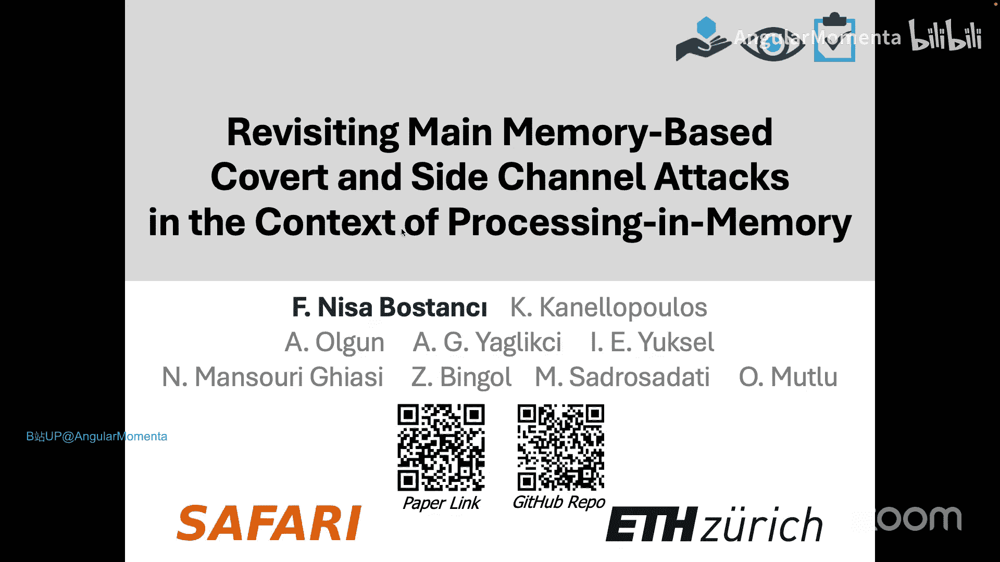
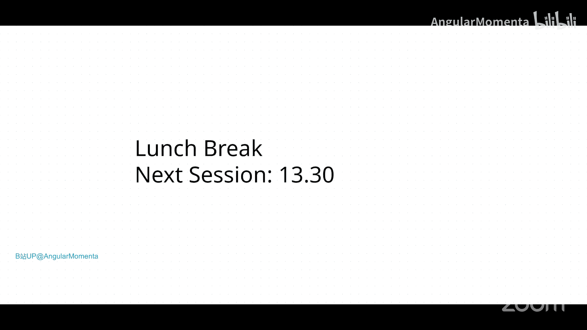
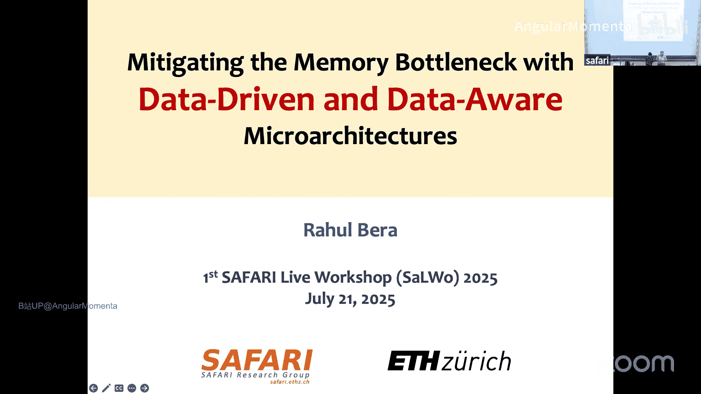
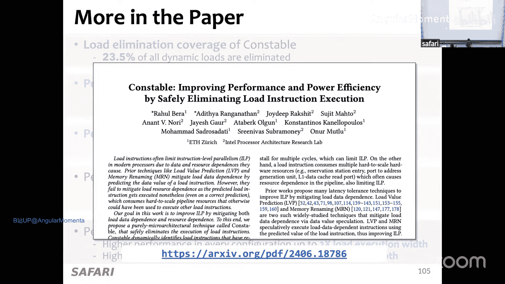
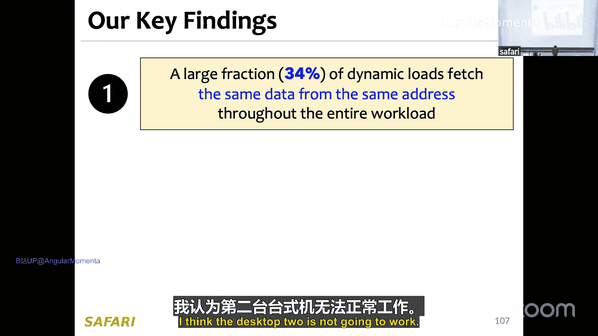
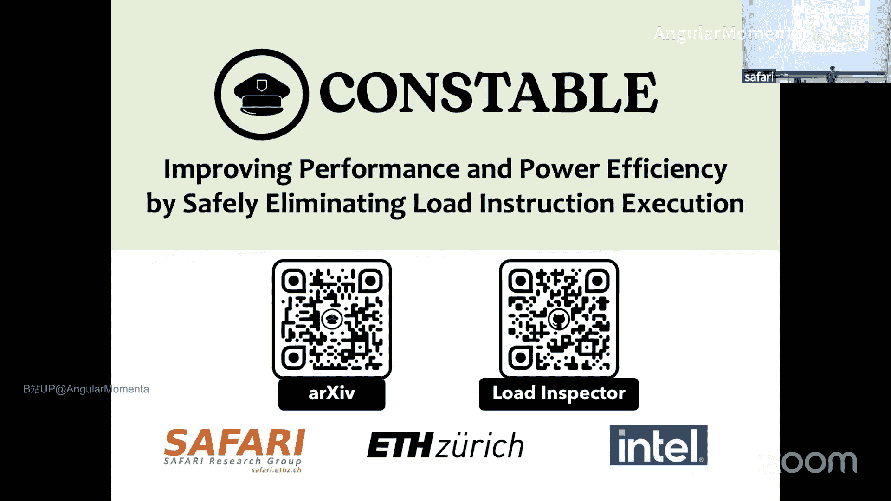
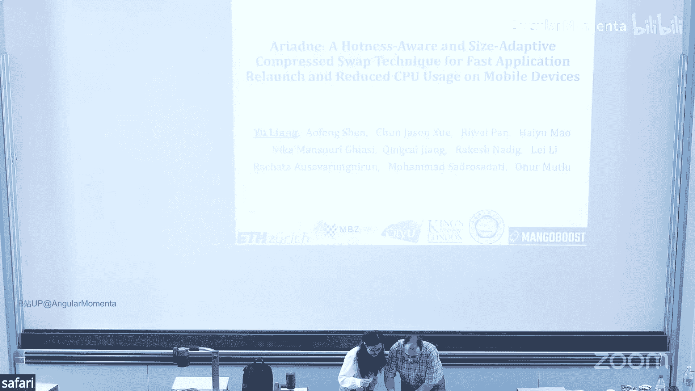
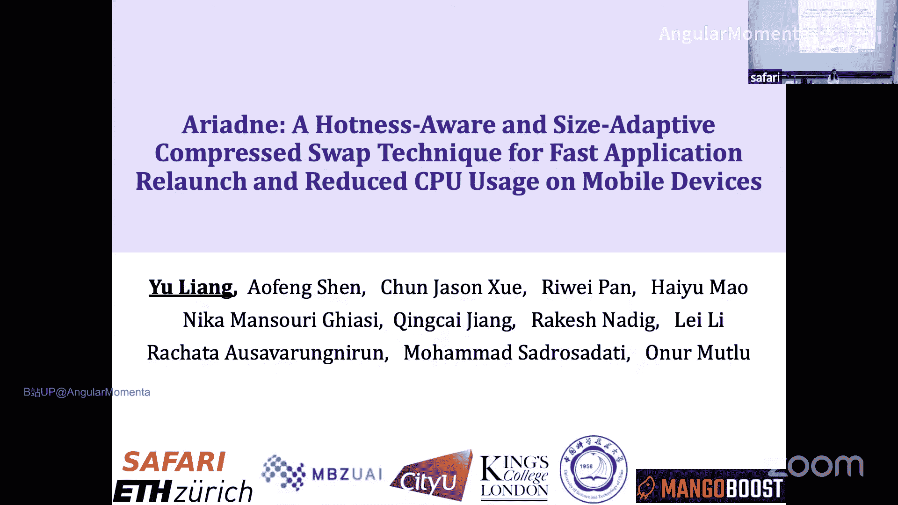
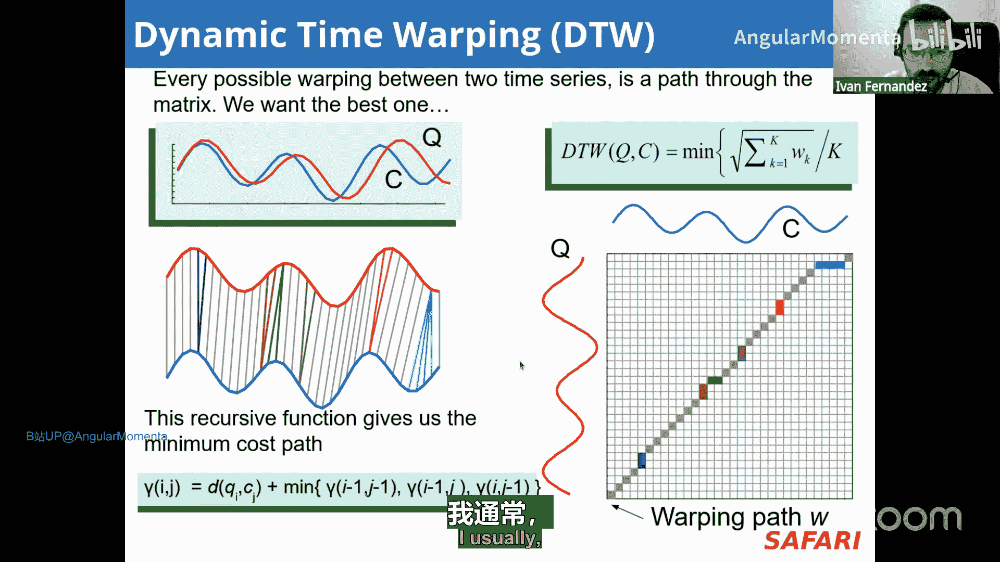
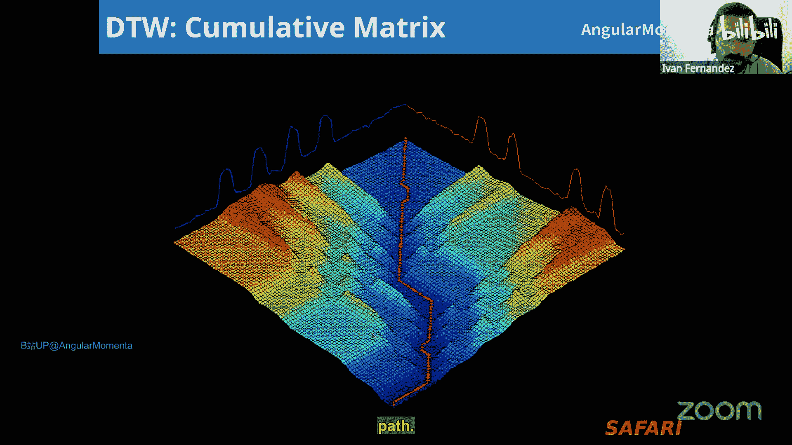

# 【苏黎世联邦理工学院】2025年首次SAFARI直播研讨会 ｜ 1st SAFARI Live Workshop (SaLWo) 2025 p02 02 数据为中心与节能计算：首届SAFARI在线研讨会 (SaLWo) 2025 (第三天) -BV1RYquBGEDu_p2-

你做没有地做。Perfect。Okay， great。Okay so hello everyone and welcome to the third day of a Safari live workshop today we will focus on datacentric and energy efficient computing we have a long line of presenters scheduled for today but now we're going to start with Geraldo Geraldo has finished his PhD in April 2025 but he's still working and doing cutting G research with Safari。

His current broader research interests are computer architecture systems and applications with a special focus on memory technologies and emerging obligations。

So Geraldo please go ahead， thank you for the introduction welcome everyone for this safari live seminar。

 we are going to talk about PIM stuff and I'm going to give a brief introduction of on the subject focusing on a version of my PhD thesis。

😊，Which is called new tools programming models as support for pro memory architectures。😊，So。

course innovation I'm a PhD I was a PhD， I studied at ESafa research group where I graduated in April and I do research on several topics on computer architecture。

 including computer systems and pro memory。😊，So my pointer is a bit slow okay okay so the overall topic that you are going to cover today or the overall problem that you are trying to solve today is that data movement bottleneck is a problem in computer cent architectures。

 so data movement bottlenecks can create a problem in current systems for a myriad of different reasons for example。

 maybe your application does not have enough data locality to make use of the cache hierarchies in your processor or maybe your main memory cannot provide enough memory bandwidth to keep the processing elements fully occupied or maybe the latency to go back to main memory and to the processor is too high and the processor cannot hide that latency for some application。

We did some next studies together with Google to show this effect of data movement bottlenecks in current systems。

 so in terms of energy for example， we saw that consumer workloads like Google Chbe for example。

 or video video compression that is used for you to borrow Google Mis accounted for around 62。

7% of the total system energy caused by data movement bottlenecks and it's not only those systems if you look at accelerators targeting machine learning models we can see that depending on the model。

😊，Some of the energy of those accelerators is also dominated by moving data around。

 so more than 90% for large machine learning models。😊。

So even though processor cent architectures have evolved over the years to try to to mitigate these data movement bottleneck issues for modern applications with techniques such as a graphic hydro prefeures or deeper and deeper cache hierarchies such architectures does not fundamentally address the data movement bottleneck problem and you're still seeing such issues showcase in modern applications as we talk today。

 so one fundamental way of alleviating alleviating such data movement bottleneck issues is to do a paradigm sheet for what we call processor cent architectures to more memory cent architectures where we move data to where we move computation to near where data resigns and one classic example of memory cent architectures is process memory。

😊，So compared to processor centry architectures， pro memory architectures have access to a bandwidth。

 a shorter average memory access time and abundant parallel array paralleluralism。😊。

So we safari class5 pro memory architectures in two different realms first pro and near memory architectures are those as where we add logic to the same die or nearby the memory array arrays themselves so here you can think about those architectures are similar to what you think about as current processors so you have logic and you have memory those are manufacturer separately but then you integrate them together in the same package and then the closer that you integrate the computation to the memory arrays more of the benefits of process memory that particular logic is going to benefit from。

😊，So the second way of doing processing memory is what we call processing using memory architectures。

 which here we are going to use the analog operating principles of the memory itself themselves to perform computation here this is a bit different from what are used to develop as systems because now you're not going to develop logic and memory separate。

 you're not going to think up about them as two different things you're going to suggest we're only going to have memory and we're going to operate this memory in different ways and by doing so we can implement operations such as majority of three and based on those we can compose more complex operations as additions of traction multiplication and so on and so forth。

😊，A brief overview of those architectures processing near memory architectures have been proposed in the literature for many。

 many years， so since the 70s we have works proposing processing near memory architectures didn we have a revival of them in the 90s and then later on in the late 2010s but now recently we have commercially available processing inmem architectures hitting the and the market for example。

 that is this French startup upMm that implements this neard bank processing nearmem architectures for general prop computing this is like not updated anymore because a was bought recently by Qcomm and is unclear if you can still buy upMm dims or not but so far those architectures are already in the market people have access to them other architectures or other memory companies such as Samsung or Alibaba or Alibaba is not。

😊，Sorry， S Hyex and micron， they have their own pro and memory solutions as well。

 mostly targeting neural network models。So I'm going to give a brief background on Dur so I can introduce processing using memory architectures so this is the third day of the Safaar Live seminar probably very familiar what I'm going to talk next so I'm going to try to move relatively quickly so I don't bother you so Dur chip is organizes a hierarchy of component the top of this hierarchy you have what's called D mat a D mat is constitute of D cells organizes that to the array where horizontal lines of D cells is connected through word lines and vertical vertical collections of du cells connects through a bit line so bit line shares a local sensiplifier and wordline shares a local road decoder the next level of the hierarchy you have what's called a D sub array which is a collection of the D mats a D subareet shares a global road decoder and a global wordline that spans across those many D mats and a global sense。

😊，Re firere。Which is used to move data from the local splifier down to the IO interface and eventually to the memory channel。

😊，So prior works has shown that we can use this organization and the way that DRM operates to perform different operations。

 for example， row colon shows that we can do in D row copy without involvement of the CPU to copy one source row inside the D chip to a destinational row the way that this works is by issuing back to-back activation to the D chip so in the first activation we we open one set of D row of D cells in a given D row here in example the search row which is going to allow the D chip to copy this data to the low cost splifier then we issue another activation to the destination row which connects those D cells to the low cost splifier and since the local splifier have lettch amplified the data from the search row this data is going to be copy to the cells from the destinational row that has been just activated。

😊，So by doing Dra row copy operations like this， Ro clone showed that we can reduce the latency of a 4 kilobyte row copy from 10046 nanoseconds using the MA engines to 9 nanoseconds and to definitely reduce the energy of such operation from 3。

6 microds to 0。04 nanogs and this happens because we are not moving any data outside the memory chip itself。

 we are just operating the D chip in a slightly different way。😊。

Ambbit shows that we can use similar approach to implement in a majority of three operations here we are going to activate three roles at the same time and when activating those three rows at the same time that U cells in those three。

😊，Rose simultaneously perturbates the local bit and since the circuitry of the lo and splifier is basically a differential circuitry。

 this is going to pull the voltage level to the majority of three or the majority of the voltage levels store in the three activated du dur rows。

 so in this example here the majority of blue， yellow and blue is going to be blue and the data is stored back to the duem cells themselves。

 the output data。😊，Similar to Oone， Ibit sure that we can implement this majority of three operations in Dr chips and significantly reduce the energy consumption of such operations from 137 nano per kilobys to as low as 3。

2 nanods per kilobytes。😊，So other prior works also from Safari has shown that we can further extend operations to implement more complex operations so now we can do inD row copy operations and we can do majority of three as well as Embit and I mention here by Embit also shows how we can do not and by having majority and node operations we have a functional complete set of operations so in theory we can implement any other complex operations as needed by composing majority of three and not operations and this is exactly what we do in this work called inD which you propose a three step framework that translates the required operations for example additional subtract into sets of in row copies a majority of three or node operations that can be executed inside the du chip itself so I'm going to illustrate how we can do that by implementing inD additional operation so let's say that you have a rip carry here that sum AB and carry in。

😊，And the first step of the S Dr framework is to translate this and or node version of this rip carrier into a circuit implementation that only has majority and node operations over there and this steps is required so that because the main operation that we are doing in Dr is majority of three and node operations so after this translation is done what the framework does is traverse these majority node graph that represents a rip carrier node by node issuing triple activations to the dur tube so here in the example first to activate the first we issue triple activations to represent the first majority gate which takes us input AB and carry in it produces us outputs that carry out value and here in this example we have A and B storing one and carrying in。

😊，zero and the majority of this is going to be one store in the carryout room。

Then we move to each one of those majority gates one at a time and in the end we have in the carry out row as a full of zero ones and in the sum row full of zeros and since initially we have A andmb is starting one and one one plus one is two and then what we have here basically is。

😊，1 and zero， which represents the two as well， the output of the addition。

What I did mention here is that this process is basically a bit serial process so you issue these three activations bit by bits as many bits as you have inside your data world so for a 32 bit addition for example you would repeat this process 32 times so basically by operating du chips like this。

 we are transforming the du chip into a very wide bit0 SD engine。

 so very wide because we have as many opera as we have D columns inside the du subareet bit serial because we operating each bit individually at a time and SD because we have single structure mood per data model here where you are doing the same operation the same majority to operation over as many data bits store in the D columns of the Dur subbore。

😊，So PriOs has shown that we can use such approach for implement operations in many modern applications。

 for example， as transmitpin shows that we can use such approach to implement and accelerate neural network transformers。

😊，And also other works especially for our group have shown that commodity of the shelf D chips are capable of implementing such book betwiice operations by violating the du timing parameters and not going to get into details over here because they follow up talk from isma is going to give more details on those operations but basically in summary our work has shown that by we canimply activate up to 48 different roles in two neighbor subs perform not operations up to up to 32 output operations and implement 16 inputs and then or and all operations by violating du timing parameters and this is our experimental setup up that we have in Safari ismailel going to talk more about all of this。

😊，So this is just to conclude in conclusion， using memory have this capability of implementing a majority of three of endD rocopy operations inside the U chip and those operations are already capable of at some extent inly unmodified du chips as they are today so it's very promising approach to accelerate applications that suffer from data movement bottleronx at very low area costs。

😊，So okay， even though those processing memory architectures。

 both processing near memory and processing used memory architectures alleviate data movement boardnecks compared to processor center key approaches。

 adopting such processing memory systems in mainstream architectures is still quite complicated due to a lack of。

 for example， workload characterization methodologies and benchmark suites。

 targeting process memory architectures， executinging paradigms that can map applications effectively into the processing harder。

 compiler supporting programming frameworks， targeting process memory architectures and adaptive data where runtime mechanisms that can use the properties of data to accelerate p execution。

😊，So in summary the problem that we are trying to solve here is that the lack of tools programming and system support for process memory architectures limits their adoption in current and future systems and this is exactly what I tried to solve doing my PhDT where we propose solutions to each one of those problems we believe that we can effectively explore the here in parallelism of process memory architectures and facilitate their adoption through the end2 end hardware software support including identifying workloads identifying character data moving bottlenecks。

 providing programming and system support for end2 end process memory architectures and enabling dataware optimization for efficient processing use memory execution and finally designing programming frameworks to aid pro memory programability so if you achieve that we can enable large improvements in system performance and energy efficiency for future across memory systems and to this end we make four main contributions the first one is done move the second one is mini the third one is prote。

😊，fourth one is D， which I'm going to provide some information on in the follow up slides starting with how we can identify and characterize data movement bottlenecks using the Du framework。

😊，So there there are many tools and approaches out there that can aid one to try to identify data movement bottlenecks in a target application running in a processor center approach so there are two examples here the roofline model identify if application is memory bound or compute bound and simple metrics as highle less e per instructions can give you an indication that your application has high memory intensity however。

 we saw in our walk that those methods are not comprehensively enough in first identifying a variety of different data movement bottleneck that your application might suffer from and correlate such data movement bottlenecks with the most suitable data movement mitigation mechanism either cache hierarchies prefes or processing near memory solutions therefore a goal in this walk is to develop a methodology that can basically identify different search of data movement bottleneing applications。

And compare computer memory and cap architectures in terms of alleviating search data movement bottleneck。

So to this end， we proposed the data movement methodology。

 which takes as input application source code and is input data sets and in the first step provides application profiling to identify functions in these applications that potentially suffers from data movement Bne and dominates the execution time of that application and then using a new simulator that we call that move SIim。

 generates a memory traces that are used in steps two which provides abased cluster to identify the spatial and temporal locality of the particular memory trace for the identified function and also scalability analysis that collects metrics that identify characteristics of the hardware running that application such as arithme intensity and based on the information from all of those three steps we classifying the application into six different classes of data movement Bneex and correlates each class with different data movement mitigation。

😊，Approaches so give a little bit of background on each one of those steps the go of the first step is basically to identify functions in applications that potentially suffer from data movement bottlenecks to do that we use a profiling tool call intel V tune to identify functions that have a high memory bound metric this step is completely optional so if the user array have a function in mind that he or she wants to。

😊，Profio this step can be eliminated and goes straight into that function。

 so we apply this first step to more than 245 different applications from different domains including graph processing。

 different neural network physics， high performance computing genomics and many others and the output of this analysis basically a selection of 144 different functions for more than 77。

000 application functions that we divide into two main sets 44 functions that we are going to use to train or step 2 and step3 or methodologyology and 100 functions that we are going to use to validate the data that the model that we came up with after the training process。

😊，Then we move to step two， the locality based cluster where here we use caming clustery to classify the spatial and temporal locality of these different application functions so here basically what we have are applications that have low locality in orange and applications that have high locality in blue and intuitively the closer that the applications is to the bottom part of discharge chart the most likely is application function to take advantage of deep cache hierarchies of aggressive higher professors because applications have low spatial and temporal locality。

😊，Then will move to the next step， the memory boneck classification。

 which goes to identify a specific source of data movement boneck in the hardware running the application to do that we use the move Sm simulator which integrates the CPU simulator called Zse and our memory simulator reulator and in the walk itself we analyze three system configurations but in this talk I'm going to highlight only two the first configuration is regular processor view of the system which have deep cache hierarchy and access to of chip and the second configuration is of a processing near memory system that adds general proposed logic nearby the logic layer of a traditional memory chip itself。

😊，And doing this built analysis， we also vary several system parameters such as the core counts in the system。

 as well as the type of core that we have， either or for the core in order core for both holes and pin cores。

😊，So based on this analysis we classified this application into six different class of data movement bottlenecks。

 some of them are more obvious， so applications for example that suffer from du bandwidth for latency bounds。

 and some of them are not obvious， for example applications that suffer from cash contention and cash trashing as we increase the number of core and trendss in the system。

😊，So the Mo benchmarkch suite is available online， including our applications and simulator。

 so the benchmark suite and the Mo simulator is available online and has been used for many groups to try to study a different aspect of cross near memory architectures。

😊，So I don't know if you have any question related to the move。If not。

 I'm going to move to the next contribution which is how we can provide programming and system support for end to end processing using memory architectures。

 using Nim Dham。So the main problem that we are trying to solve over here is that processing using Dr systems suffers from three of inefffficiencies coming from the large and rigid excess vity of Dr chip themselves。

 first they suffer fromD underauilization， second they suffer from limited computer support only being able to implement in D mapping operations and third they suffer from a challenge programming model due to a lack of compilers for using D systems。

😊，So basically， the problem that we are trying to solve here is that by excess dur at theularity causes those three of inefficiencies and our goal is to design a flexible processing dur system that overcome those three limitations。

😊，So to the end we propose meme D which key idea is to use Dra fine G access tube for pro using du operations so when accessing a du row inside a dur chip then all of the mes inside a dura sub arrayt are activated even though only portions of the data inside those du mats might be read from followup root access from a du column access this generates issues for regular du chips since you are wasting energy doing those coar grain row activation。

😊，So prior works not very related to pro memory and later on today we are going to have a talk detailing these more details。

 proposed to use fine grain du access to reduce this energy waste by segmenting the global worldline and allowing one to access individual du mats doing aD row access。

😊，So this basically allows you to only activate the portions of the DurM row that have the data that's going to be accessed by a DurM read access as in the followup request。

 which can improve system performance and again， Autobe is going to talk of about sector Dr that implements this idea later on today in the seminar。

😊，But here you are going to use this idea of fan grained du for processing using dur execution。

 so which provides us three main benefits， so the first benefit is that it improves S utilization because you're going to only issue triple activations which explain in the background to the D mats that have data that you are going that you want to operate on top of on top of and this also provides another benefit that for the unused portions of the D mats in the Dur subet that you are not going to activate we can issue other types of processing using memory operations hence using this D subet now not only as a SD substraterate but substrate that implements moodot instructions over moodpo data at the same time so you can have moodot independent instructions operating in different portions of the D du subet each one instructions in the different D mats。

😊，Second， we can implement in D more complex operations such as inDM reduction by using the internal carecon already available inside the D subaret that allow us to move data across different D mats inside the D subaret and third that is this nice feature of the D mats that they usually have as many DM columns as CD lanes in modern vector ISAs。

 so inside the D mat we have around 512 different DM columns and this is on par for example。

 AVX 512 instructions so we can use basically the infrastructure that is already available for identifying vector instructions for processor for vector ISA instructions down to or using DM operations。

😊，So based on this key idea， we op Mim Dm which is a hydro software code design process using du system that enables fine grain process du computation at low cost and low programming efforts。

 so Mim D is composed of both hardware and software components which I'm going to briefly introduce next so on the hydro side we propose some modifications to the du subaret to allow allow us to access different du mats in a D du subaret with some isolationulation resististors raw deco ledtch and a met selector we also implement some low cost interconnects that allow us to move data across neighboring du mats inside a single du subaret which is going to be used for implementing the in D reduction operation。

😊，You also implement in the memory controller control unit。

 which is responsible for scheduling an orchestras execution of multiple using the operations transparently from the user。

 so these control unit is basically has a scheduler scoreboards and several processing engines that identify which instructions are currently running on the D substrate and keep ordering for such instruction streams。

😊，So on the software side we propose three LVM compiler passes that are responsible for code identification called scheduling and data mapping and code generation。

 so in the code identification part we use LVM's auto vectorization engine to identify in loops of applications code that can be vectorized then the vectorized instructions are used as input for the code scheduling and data mapping pass which is responsible to identify which instructions can be executed needs to be executed at the same neural mats because they have data depend between them or which instructions can be executed concurrently over different neural mats because they have data dependencies and then this basically this path andnotates the instruction stream which some metadata that's going to be used by the hydrolta onto identify such data depend and data dependency between instructions。

😊，And then they find a path responsible for core generation for the process using the MII operations。

So in the paper， we have many more system support that you add for MIDam。

 including instruction set architecture， execution and data mapping， data coherence。

 address translation， data location and alignment， and metadata translation。😊。

So we evaluate MImDam using the GN5 simulator using 12 workload for four main benchmark suites and some application mixes as well。

 we evaluate both single applications and also would program our workload。😊。

So in terms of energy efficiency compared to GPU， CPU， and Mi dum。

 we see that Mi dum significantly improves energy efficiency by basically fully leveraging the symptomuralism inside the durm substrates。

😊，We also compare miorm to other processing memory solutions like Drizzen and phone room。

 in terms of performance per area， we see that mimeorm significantly improve on top of such architectures。

😊，We have many more results in your work， but we invite to check our paper for there。

 is there a question？😊，I have one question about the segmented wordline。

So will this impact TS for regular DRAM operations？Because。

NoSo of additional parasitics in the pot so it should impact your rest。

For you mean for just if you segment the wordline no so Terrece is mostly dominated by the bit line capacitance load right but we are not changing the bit line right just the wordline and so basically it does because what the only thing that you are adding to the critical path is that isolation transistor but again that's not the critical path of theterrece of the timing anyway right is this how long the bit line is that would impact more the opening of a row is not impacted significantly because。

The the time that that takes to open the row is dominated by charging of bit liness is thischarging but yeah that's the the primary timing for the the tourist rest thanks。

I believe that in the paper we have some analysis actually on how much to rest is impacted by the isolation transition degree Coef。

😊，There is a number in my mind that is like 0。011%， I don't know if that's that's the proper number。

 but yeah there's that number in the paper。But thank you for the question。

 Any other question related me duham？Okay， if not， I'm going to move to how we can enable data via optimization for efficient processing using image execution with Proteus。

😊，So again， apparently I really like to identify three problems in anything。

 so a CO+ using D system suffers from three main issues caused by naively using a bit zero execution model。

 so first they suffer from a rigid and deter presentation leading to super performance in thepress of narrow values second they suffer from oriented execution with low latent tolerance failing to reduce the latetency of a single processing using du operation and third they suffer from scalability challenge for high precision using du operation。

 especially for quadratic scaling bit zero algorithms。😊。

So I'm going to illustrate a little bit more each one of those three issues started with the origin and static data presentation so it's well known that applications store values in what's called narrow values so very narrow values are data elements inside your application which is smalldynamic range that is stored in a large data format so for example let's say that you have an integer a here that stores the number four so 100 but minimum number of bits that you have to represent a number in C for example is8 bits right so all of the five most most significant bits of such data world here is going to be all zeros while only the three less significant bits are going to have is going to store the dynamic range of the data format itself。

😊，And this happens for several applications and if you want to do process including the operations on top of those applications in a bit zero manner。

 those most significant bits in the operation that I have call in consequential bits are not going to contribute to the output dynamic range。

 so I'm going to basically compute the first three bits。

 so in the example here I'm going to add four way two which is six and the output is also stored only in the last three most least significant bits。

 but since we are operating in a bit zero manner， we are going to still keep inactivating the rows containing the five most significant bits which is going to generate increase in latency energy efficiency for such narrow value execution。

😊，So we did some analysis for real road applications to try to quantify what is the minimum required bit precision in real applications to see if these narrow values actually were observed in the field and here Y axis we have the required bit precision defined as the minimum number of bits required to represent input operate and we have in the plot several distribution blocks which shows the bit precision distribution and where the riskers extend to the smaller bit precision and to the largest bit precision and what we see from those 12 applications that those applications display significant variation in terms of the amount of narrow values that they have and the bit precision can be reduced on average from 32 bits to from 20 bits but we see that actually if you look at the date itself。

 it can even be further reduced by as low as two to three bits for some applications。😊。

So so the main first idea for us to reduce or to improve the performance for our Bs0 pro using Dur engine is to identify dynamically those narrow values when you're issuing triple activation to the DurM chip itself and base this identification you can escape those inquisequential bits which allow us to save reduced latency and reduce energy consumption for such operation itself。

😊，So then we move to the second problem that weput oriented as the with low la tolerance and the main issue here is that since we need to operate each bit at the same time any operate with data wave of more than one is going to suffer from what we call interb dependence so for example here let's say that we have this additional operation again and now you're operating over two bits so you want to add two plus two and there result what day before。

😊，So when we issue the activations we see that first we operate on bit zeros of the operation。

 then the carrier is generated and then it can be propagated through bit1 and then we operate serial over the bits1 of the input data word basically this inner beta depending serialize the computation because all of the bits of the data word is stored inside a single du subbo。

😊，The key idea to break this intermediate beta dependence is basically to scatter the bits across different du subs。

 because as we can see here in this graph， even though we still have this interb dependence from the carrier that is generated from one bits to another。

 we have several other majority gates that are independent of each other。

 if we solve this beta dependence first。😊，So basically the key idea here is to scatter the different bits of a data world across different div of bars and leverage Sa level parallelism to operate beat independent operations concurrently doing the process during execution。

😊，So for example， what this allowed us to do as well is to use some fast interabbot Interconnet network proposed by PriW to copy intermediate data generated in one duurm subbot to another duurham subboray。

😡，So let's see how this reduce the latency， so first again we operate the majority gates for bit zero in our du additional operation here in Sabore zero。

 then you generate and propagates the care generated from bit0 to bit1 and once this care propagation in generation is solved。

 we can compute all of the other majority gates from B1 and bit0。

 at the same time in two different du Saarre hence saving execution cycles。😊。

Third how to solve this capabilityalability challenge for high precision computation so the main issue here is that bits zero operation scale scales linearly or quadraically depend on the type of the operation with the bit precision of the operation and once you are in a high bit precision for example3 2064 bits is very hard to to hide the latency of using zero instructions so our approach here to try to solve this issue is to use alternative data representation format for high precision using the operations in particular you're going to use the learned binary error representation data representation which is a position position of data representation format which represents one bit using one data world with two bits that can take any value from minus-10 and1 so in this example here we represents the value3 with four bit 010 and minus-1。

😊，And the property that this alternative data presentation format provides is that first it limits the care propagation to at most two places and second its latest becomes late independence in regards of the bid procedure because again。

 this is a redundant data presentation format。😊，So basically using those three main ideas。

 so the first one being narrow areas for process using the operation。

 the second one is using severality of parallelism to break the interbit the is doing the operation and using redundant data representation format for high precision computation where weose proteus。

 which is a data where harder on time framework， the dynamic can transparently from the user chooses the inter implementation bit precision and data format based on the input data for processing using the execution so prote is composed of three main components。

 a parallelism of air microprogramm library， a dynamic bit precision engine and then microprogramm select units。

😊，So first the parallelismware microprogramm library is a collection of hand to optimize implementation of different processing using the operations which each one with different tradeoffs in terms of performance and bit precision second the dynamic bit precision engine aims to identify dynamically the dynamic range of evicted cache lines belonging to target using the operation and it also stores inside some table inside the memory controller。

 what are the largest data values identified in each one of the memory address that are going to be later on used for processing using theic emission。

😊，And then finally， the microprogram selection unit uses that identifying data format to calculate what is the required bit precision for the target operation and also probes the parallelism a microprogram barrier to identify based on that target precision。

 what is the most appropriate microprogram or sequence of inD rules for that particular bit precision that leads to either the best performance or the best energy efficiency for the target operation。

😊，So we have many more details in our paper but I'm going to move to the evaluation。

 so again we use 12 workload for a four benchmark suite and here we compare to me metric CPU normalized performance per area and energy reduction so in terms of performance compared to the GPU CPU CD Pros only with dynamic bit precision engine enable Protes entry design significantlyly improves performance per area by mostly which performance mostly comes from this dynamic identificationification of narrow values inside the application。

😊，We observed similar results in terms of energy analysis in terms of energy compared to the CPU GPU CD Pros only with the dynamic precision engine enable Pros entry2 and design significantly improve energy efficiency again compared to those three main systems again mostly coming from this reduced precision execution。

😊，So again， there is many more details in the paper， which are invited to check online。

Is there any question related to produce？Okay， if not， let's move to the last contribution。

 which is DA， which is designed is a framework for processinging ememory programmability。😊。

So basically the problem that you're trying to solve here is that there is a programming programming pro barrier when you're trying to program general purpose processing you in the memory systems。

 which requires the programmer to manually splits the input data across different computing engines in the site in the pro memory chip。

 transfer input data from memory to the processing memory chips。

 manually handling caching inside the pro memory scratchpad memory。

 and also transfer the output data from pin chips to main memory。😊。

So I'm going to give an overview of how this looks in terms of code and this is how you program general Pro processing nearme system such as the upM system so the programmer needs to write code to first align the data to the boundaries of a D bank collect collect input parameters distribute those parameters across the different du banks launch the computation collect results and manage the scratchpad memory inside the Ping chips and finally orchestrate the computation to move data from the scratchpad memory to the processing engines and and write it bank but in the end the user only wants to do a very simple operation most of the time even though it has to do all of these bookkeeping coding for something very simple such as a vector additional operation so basically the problem that you are trying to solve here is that programme such general Pro processing nearme systems leads to nontri efforts since the programmer needs to have knowledge of the lightha。

😊，And many generate code for fine grain data movement inside that processinging your memory chip。😊。

And our goal is to ease the programmability of such systems by allowing the programmer to write efficient pin code without any logic logic of the hardware resources on the underlying system。

😊，To this end， the proposed D， which has the main idea of using intuitive data parallel programming interface for print programmability。

 So DA automatically distributes and gather input data and gather output data in those memory management and parallel works across the different pin core using three component framework the first components is a data parallel pattern APIs。

 The second one is data flow programming interface and the third one is a dynamic based compilation。

 So first the data parallel pattern API is a collection of predefined functions that implement high level data parallel pattern primitives so this idea of using parallel pattern primitive and also skeletto based programming are quite common abstractions for parallel architectures for example。

 GPUs or mood threaded systems and those parallel patterns are， for example。

 fees as parallel map reduce future window or grouping primitives So we use those five。😊。

Data parallelet primitives to expose an interface for the user and the user can combine those primitives to describe more complex data transformations over the input data itself。

😊，Then D is a data flow programming interface to the user， which defines a pipeline。

 which is a collection of data and transformations that's going to be applied on top of the input data。

 so the pipeline has several stages where each stage represents a different data parallel API and data flows sequentially across each one of the stages inside the pipeline。

😊，Finally， the app has a dynamic template based comp which dynamicallyally translate each one of those stages in the pipeline to the binary of the target application。

 to do that we use a templating engine that use a basic code templates to generate code and on top of that the back end we implement several optimization transformations to improve performance for degene code。

 one of the main transformations is allowing the CPU and the pin core concurrently is a on top of a given computation。

😊，嗯。So I'm going to give an example of how programmer。

 for example can use this data to implement a simple vector do product operation so the first step is to identify which data parallel patterns is required for the target operation in this case here is required a map and a reduced operation and then the programmer uses the C+ API for the data parallel for the data flow programming interface to instantiate each one of those different maps the stages for the map and the reduce operation and note here that in the data code the programmer does not there is no information regarding to the Hader so there is no manually moving data code to move data across the pin cords or either to launch a distribute code distribute data across the pin cord itself and then in the third step the based completion extracts the required information from the data flow programming interface to。

😊，Populate the code template from the upme texture。

 generate the binary as a the data and copy output data to be processed for the follow up stage one at a time。

So we evaluate DA using a real maping system with six workloads from the print benchmark suite。

 so in terms of performance we see that for some applications DA can significantly improve performance because of its con parallel execution of ho and ping in a given application and in terms of programmer complexity we see that DA significantly reduces lines of code compared to hand optimize up generated code since it abstract and way harder components。

😊，So compared to prior frameworks for promer programmability in particular CPM。

 DA have a higher abstraction level and supports more parallel patterns and also enables for further optimizations as collaborative host and execution。

 so you conclude that DA improves on the state of theR frameworks for proymer programmability。😊。

So this basically concludes my four contributions， is there any question related to DA？

So basically what we try to solve here in this work or in this cases is system integration challenges for pro memory architectures。

 where we propose solutions to identify and characterize the movement bottle next using the move。

 we provide programming and system support for entry and processing using memory equation with theam。

 we enable data optimization for efficient using memory equation with Pros and we design programming frameworkbook to aid pin program abilities with DA。

 even though this covers several of the issues that we earlier for Ping adoption。

 there is still several research questions that needs to be addressed and actually some of them are going to be discussed here in the seminar today。

 for example， how we can address a security ability challenge of P architectures。

 how we can design and define Vi memory space for hosting P。

 how we can design lightweight coherent solutions for pro memory architectures and how we can assess P benefits for emerging memory technologies。

So basically this is still a great time to do research on pro memory architecture。

 there are a lot of nice problems that needs to be solved for in the future and this basically concludes my talk I be glad to take any questions。

😊，你得送饭。Thank you very much。So thanks a lot， Geraldo and now according to our schedule。

 we have a coffee break and we will be back at 1030 with Mily。Okay。Okay。Yes。So let's get us started。

 I'm Muhammad， a senior researcher and lecturer in softwarefari research group。

It's my pleasure to introduce you smileile， S is a PhD student， second year in So Research Group。

His current broader research interests are in computer architecture。

 processing memory and hardware security， focusing on understanding enhancing and exploiting fundamental computation capabilities of modern D architectures。

 so stays and we are looking forward to。Thanks a lot， Mo。Can you， yes， I can。

 I guess you can hear me， yes。So hello everyone， today I'm going to talk about。

A topic of vehicle understanding Comp capabilities of shelf DM chips。

 this total will consist of two papers。First one is。The next one。Let me go。

Yep functionally complete bulloleing logic and real DM chips experimental characterization and analysis this paper published in HPC 2024 and the next paper will be about。

Again， Comp capabilities of theem， which is published in ESN， so let's start with this one。

So our motivation was processing using Neam can elevate performance and energy bottlenecks caused by the frequent datata movement between main memory and computing it。

And prior work showed that existing DM chips can perform three input maturity and three input and then neural operation in existing real DM chips。

However， this proof of concept demonstrations of the shaft the chips do not provide functionally complete operations such as N or nor。

Not operation and then all operation with more than two inputs。In this study。

 we conduct an experimental characterization on 256 DDR force chips from two major manufacturers。

And we observe that off the shelf， D RamM chips can perform knot and two for8 and 16 input antenna and or and no operations with very high reliability。

And second， data pattern and temperature only slightly affect the reliability of these operations。😊。

So here's the plan of my tool calledta with a brief background。

So as you already know from General those talk， today's computing systems are processor centering and all data is processed in processor at a great system cost。

 in order to perform a competition we need to move the data between computing units and main memory and prior work show that more than 60% of total energy spend on this data moment。

And processing in memory is a promising paradigm to elevate such problems and there are two main approaches first processing near memory。

 p which the logic is added near memory or the。Logic layer of 3D stack memory and the second one is processing using memory。

 which choose analog operation principles of memory cells to perform computation。

And let me give you a brief background on DM organization as well。

 so DM is consist of multiple DM chips， DM model。And insideside the D chip if we have multiple DM banks。

 inside the D banks， we have multiple subs and send sempplifiers within a sub we have two dimensionary of DM cells and each row of DM cell called DM row and they are connected through a word line and a column of DM cells are connected to send splifiers via a bitlight。

To achieve high density DM chips， open Bi architecture is widely adapted in modern DM modules。

In this architecture， each subways with liner connected to two rows of sense amplifiers。

 Mon abo and Mon belowlow， the sub， and this results in neighboring subways to share a common sense amplifier。

During an activation， which is a major genome operation that they'll talk about real soon。

 another bit line in a neighboring sub is also involved to serve as the reference of the sand splifier。

 which is bit line bar in this example。After a successful activation。

 the bit line and bit time bar have a complementary value as the sense amplifier consists of two back to back inverters。

And let's take a look at major data operations。The memory controller first needs to activate a row to access a data in the D。

 which will the DRA fetch the ropes content into Sunsampifiers。

Then column accesses are serviced from the sense amplifiers upon a read or write request。And finally。

 Subre or generally bank needs to be precharged to get ready for the next row activation to access the data from another row。

So our goal in this study to understand the capability of off thesha DM chips beyond just storing data and rigorously characterize reliability of this capability。

And in this study， we experiment to demonstrate that of the shaft DM chips can simultaneously activateate up to 48 rows in two neighboring subways。

Can perform not operation with up to or to2 output appearance and can perform up to 16 input and and or a neural operation。

And let's look at how we characterize real D ramp chips。

So we use an FPJ based DDR4 testing infrastructure developed from DM vendor that enables us to have a fine grain control over DM command。

 timings and temperature。And we tested 256 DDR for chips from two major manufacturers covering different idities and revisions。

 basically different architectures。In this study， we focus on two neighboring subways here den that test sub X and sub Y。

 which share common components and sifiers。We performform our experiment using this command sequence activate row A。

 pre chargege activate row B。And be careful we provide row A and row B and timing parameters between each command in this comment sequence。

And呃。Varge row A and row B are in the neighboring subways。So let's move on to our first analysis。

 multiple row activation in real DM chips。So our key observation is activating two rows in cos accession can simultaneously activate multiple rows in neighboring subways。

 so here's the same pictureial example where subways and subway Y are neighbors subways。Where。

 when we。Respect the timing parameters between each command。

Between each command in this command sequence， we will activate only a single row at a time。However。

 if we grade to violate these timings， we observe that we can activate many many roles in these two neighboring suburbs。

So this is because of the higher echo decoder circuitry that we try to uncover in the next paper。

So to rigorousrously characterize and understand which and how many rows are simultaneously activated with C Pro A and row B addresses to cover all rows in these two neighboring subways。

And。These are our key results First off the shelf DM chips have two distinct sets of activation patterns in neighboring subs when two rows or two rows are activated with violated timings First。

 exactly the same number of rows are activated to each sub。

We observe that we can activate up to 16 rows in both subways a total of 32 rows。

And twice as many rows in one subs are activated compared to its neighbor subway。

 we observe that we can activate up to 16 rows in one sub while activating up to 32 rows in its neighboring subway。

 a total of 48 degreeM rows。And our key takeaway is of the Shafterran chips can simultaneously activate up to four k rows in two neighboring separates。

And there are much more results and hypothesis in our paper。

 please check out if you would like to get more details。So now let's move on to our second analysis。

 the nu operation。So in this snap operation we will use this multiplepl of activation neighboring suburbs Yes I have a question。

So regarding these roles that we can keep them activated simultaneously。

So how long they can they kept activated？So because we violate some timings and then because probably because of some decoder circuit3。

 we can activate。Several roles， yes， but how long we can keep them activated as long as we want as long as we want yes。

Until we send in a prege comment， so what we do here is that let me go back。

So here we violate the timings right so the the really the real thing that why we violated is that so we activate row a and then we issue pre chargege and again violate and activate row B so the first this。

The law delay is because of we want to activate them very quickly simultaneously as simultaneously and we need this precharge command to trick DM So basically DM thinks that so DM has a finite state machine you can think of like that DM thinks that。

It's got a let's say precharge command already so it can activate another row so it's in a state that I'm activating a row。

 but internally we are activating many more roles so until in order to close the rows or D think that in order to close a row。

 we need to issue a percharge command。So it's in this state， so in order to close the ruless。

 we need to issue the pre charge command which will close the bank。Okay， yeah， I understand that。

Maybe a follow off question。Probably is actually my misunderstanding about， you know。

 how these things work。 But the deco decoder circuitry， I thought that。

The output of that decoder is not stable yet， and that's why we can activate several roles together。

But at some point， the outs is you know， well get stable in the steady state。

 And then we might have only one activation。 So what we observe is that our hypothesis is that so you don't need to violate this。

 let's say the first activate the precharge。 you can even in order to activate multiple roles。

 you need to only violate prechar to activate Robbi， which is a second one。 Yeah so。

What we do here is that。You activate a role。I will show you later。

 maybe over there it will be more clear but。Shortly。

 so we use that there are some intermediate signals that follows a pad and activates a vertline。

 but there are many more intermediate signals that are not necessary DM is using that like hier hierarchically because it wants to activate very quickly so we are leveraging those unnecessary intermediate activations intermediate signals。

 so basically there are some node that are asserted but they are not connected to the final output。

So and then when we violate this， there are more intermediate signals， and when you follow the pad。

 you will activate another row。I think this will be clear in the second part of the presentation yeah。

 but I got what you mean sounds good thank you yeah， thanks any more questions。No， O。So for not。

 Oppress， the key ID is here。Assume that here we have two neighboring subways and for this just sake of this example。

 we have two cells。They're connected to， they share a common sense splifier here。

 SRC source DSC destination and SRC has a value of a stores a value of a。

So here the key idea is really to use the knot gate and the sense amplifier we want to connect the rows in neighboring subways through in net not gate so how we do that by simultaneously is activating both of them in theory if you activate source what will happen is that it will share its charge to its bit line essentially after you wait for tis it will become voltage value of a since you have the sense amplifier as a knot gate and the bit line bar will have the negated value。

 the purple one as negd a so if you can somehow。Ativate destination without， let's say。

 disabling the sense amplifier or precharging the bit liness， you can store the destination。

 the negated value of a in the destination。Because of you already have the value in the bit line bar。

So I will explain a bit more detail on how we do in real DM chips。

 So here a bit more detail we have again， source and destination。

Assume that Bar essentially have a voltage value of ground。

 you can think of logic zero and bit liness are percharged， percharged means there at VDD over2。

So we issue activate command， what happens is that it will connect the source to bit line。

And then when we weight a nominal timing parameter。It will drive the bit time to ground， and。

Sensorifier will drive the Pi line bar to VDD。And then if we violate the timing percharge the activation destination。

 what will happen is that。We will connect your destination to Bitcoin。

And then since we violate the timing， we interrupt the DM to complete this percharge process。

 the sense sifier is still enabled。And then also destinations bit is still at VDD。

So as a result of weighting a nominal timing impairment of TRS or less。

 you will get the negative value of source， which is VDD written to destination。I hope it's clear。

So again， similarly， we sweep the ro addresses to cover all subways in all two， let's say。

 neighboring subways。And we also sweep DM chip temperature to 50 degrees Celsius to 95 degrees Celsius as a side note。

 after a DM nominal timing impairmentra nominal temperature for DM is up to 85。

 so we would like to also understand what will happen if we go a bit the extreme to 95。

So to evaluate reliability of nu operation， a technique we introduce a metric called success rate for a DM cell。

 which is the percentage's of trials， where the correct output of a test operation is stored in the cell。

 so assume that we have this nu operation and we tested four times and half of them for this cell is incorrect results and half of them produce correct results and success rate for this cell is 50%。

So we tested the total of 10，000 trials， I don't know how many millions of DM cells from to more than 200 DM chips。

And this analysis provides us two key takeaway lessons first of the shelf the Ram chips can perform this nut operation and can use this nut operation with up to 32 destination rows and second temperature has a small effect on the reliability of nut operation。

So let's take a look at our first results and the X axis， we have the number of destination rows。

And the Y axis， we have the success rate distribution across testciorum cells。And here。

 what we observe is that there is at least one DM cell。

 actually much more DM cells that can perform the not operation with 100% success rate。

 meaning every time we test in out of 10，000 trials， we observe the correct results。

 there is no single incorrect results in those cells。

And we conclude that of the shaft the Ram chips can perform that operation with up to 32 destination notess。

So maybe one side note here is that as you can see from left to right。

 when we increase the number of destination roads， thes reliability reduce this。

So the hypothesis is that now sun splifier needs to dry 3 to2 cells at once instead of just one at most right so actually it's not just 32。

in order to drive this 32 negated value to 32 cells。

 you need to activate 16 year olds in the upper sub。

 so in total of 48 DM cells so but senseempifier for this real DM chip is designed to drive just only one。

Cell so we believe that this sense splifier is not for those we observed low reliability。

 sense sense splifiers are not designed and they're weaker。To drive this 48 cells at once。

So the next one is impact of temperature。So we use as nation cells that can perform on operation with more than 90% of success rate at 50 degrees Celsius because to maintain the reasonable experiment time。

And here are the results in the x axis again， we have the number of destinationals and the Y axis。

 we have the success rates and each colored box for each x labels represents a different temperature from left to right。

 temperature increases 50 degrees Celsius 95 degrees Celsius。

There is only I guess one notable changes in 32 destination rows。

 and we observed that when you increase the temperature from 50 degree Celsius to 95 degrees Celsius。

 there's only 0。2% of variation in average success rates。

And we conclude that temperature has a small effect on the reliability of nu operation。

So now this is， let's move on to our last analysis， and or anor operations。And in this analysis。

 we will use both two observations that we have。So the key idea is。

We manipulate the bit voltage to express a wide variety of functions using multiple drug activation neighboring submarines。

So assume that we have， again， two neighboring subways and they have。

 each of them have two cells A and top sub cells store A and B。

 and the lower sub bottom subway stores X and Y。Now， if we activate these four cells simultaneously。

Bit line at the bottom sub becomes the function of voltages in x and y。

 basically the average of x and y， and the top subways bit line becomes the functional of voltages in A and B。

 and with the let's say good simplification， they become the average of。

They activated cells voltage value。And s splifier will compare the voltage at the bottom bit line to the voltage at the top bit line to figure out which one is higher。

So let me show you the basic intuition to perform two input and then operation using the key idea。

So for this example， we have two subs， reference sub and top， and the compute sub bottom。

And in the reference sub cells， we have two cells in each。We store VDD and VDD over two。

 so as a side note again， VDD over2 can be done in real DM chips using a technical fracD Ram from prior work。

And in the compute subway， we have x and Y。And assume that we issue this multiple of activation sequence activate。

 per charge and activate with greatly violated timings and when we issue this command sequence we activate these four cells into two neighboring subways。

 those are our assumptions。😊，So what really happens is that。Assuming。

 let's say there is no bit line capacance to make things very simple。 The bit line。

 when we activate these four cells。 What happens is that in the reference bit line。

The reference bit time becomes the average of Vdd and VdD over two。

 while the compute subase bit time becomes the average of x and y。

And after discharge sharing sense amplifier to amplify the difference。

 it will compare the top bit lines voltage to bottom bit lines voltage。😊。

So now let me go through the third table of let's say， two input and and end operation。

So in the first row of third table x and y are ground and logically there are zero。

 what happens is that the compute subway bit time becomes ground while the reference subway becomes3 over four。

 the average of VTd and V over2 right。So。After the charge sharing standsemp to compare the voltagees on the bit lines。

 since 3v over4 is higher than ground， the cells in the reference sub stores one while the compute sub cells will store zero。

So four x is0 and y is one case。The average voltage on the compute sub becomes VD over2。

 and this is still lower than 3V over4， right？The compute sub as a result of this compute sub。

Clls will still store zero and reference subs still store one and for one on0 it's the same again we have V did over two。

 which is lower than  three we did over four and the result is exactly the same as before。However。

 when we go to the last let's say， row of the truth table where x and Y are both one。

 what happens is that the average bittime becomes VDD now。

So now sense5 will compare it and since the compute subase bit line has higher voltage than reference subase bit line。

 compute sub cells will store one while the reference sub will store zero。But you take a closer look。

 that's actually the end operation in compute subway cells while an end operation for the。

Reference sub cells。Any question for this one？I'm sure it's but。Yeah。Okay。

 so the main input case where we want to， for example do four bit，6 bit，8 bit。

 it's really the adjust you manipulate voltage in the reference bit nine。

 so we particularly select VDD and VD over two to perform two input and operation here in order for example。

 in order to do four input and operation， what you need to do is that you will have3 VDD and VDD over two。

This is because we want to distinguish。Between all one and the others。😡，So for more details。

 you can check the paper for， for example， two bits or and neural operations and actually how we generalize it to many inputs。

And again， the characterization method which is the same。

 we sweep the row A and row B addresses to cover all rows in two neighboring subways。

And we have two3 key tech A。Lessons from this analysis first of the shelf the chips can perform two for 8 and 16 input antenna or an no operations。

And。They can perform it with very high reliability。

And data pattern slightly affect the reliability of ends NAP or and neural operations。

So heres our first results in the x axis we have the number of input opera。

 basically the leftmost is two input operations and the rightmost is 16 input operations and the y axis we have the success rate distribution again and the hue。

 the each colored pack will represent a different operation。

So as we can see here that of the shaft neurorum chips can perform two for8 and 160 input and then or an neuro operationsions。

 and they can perform dis operationspressions with a very high， more than 94% success rate。😊。

And one maybe thing that I would like to explain here is that there are two interesting things you go as you increase the input of brands。

 you get higher success rate。This is because what we observe is that for each operation， the H cases。

 all zeros and all ones are the deal breakers actually， where you get almost a random result。

But so for two input it's just you have four input patterns right all zeros， all ones， one0 and zero。

 so it's the occurrences let's say one over four for all ones。

 but when you go to 16 input you have22 to 16。Input patterns and having all one in the input patterns is just one over2 to to 16。

 very low， let's say。APossibility， that's why we observe higher success rates when we just go with the all random data patterns。

Yes。So if you open a larger number of rows， would you not have a problem with driving the results back to the larger number of rows？

So the question is there a counterbalance effect here？Yes， I am。

So you're saying that when you use larger， let's say rows to perform this input or appearance now sand splifier needs to drive the 32 values right Yes yes。

 normally that should be the case I agree but here the sand splifier actually first needs to distinguish the results right and。

The issue what we see is that so when you go to the extreme this。Interestingly。

 we still get very good results。 So this is one result one reason is that we use。

So first we do the not operation and we have let's say a very bad cells right so in order to do this you need to use the specific end to end data pattern end to end activation pattern 16 year row opening in the both sides so interestingly the when you have the symmetry send splifier can somehow deal with that better than the having let's say end to2 and activation pattern。

So that's why we also use n to ans so you can use n2 n to realize the 16 to 32 s like 16 input as well right so it's just let's say adding more redundancy but I guess that the most important point here is that whether sand amplifier can determine the difference between let's say the voltage differences between the bit lines After that when you wait long enough So we also test it's not in the paper。

 but we also test that if you wait a bit longer， not just 36 oconds， but 45， for example。

 you get a better result that makes sense so you have more time to drive the you have more time to drive。

 but we didn't rigorous analysis here。That's a good question， thank you。Yes。好。嗯。他童杯。

The operation results can become the outer side of summary。え。啊。So I can repeat it actually。Mohammed的。

Putting a lot of effort。 That's why I'm waiting。Yes。

 how do you deal with the fact that after not operation， Basically， the result is on the other side。

 For example， if you want to calculate not B and a， Yes。

 so the questions is actually from the previous operation， the not operation how so。Let mephrase it。

 maybe too。Audience， so you have the A value in one arean。

When you do not operation now the negd a value is there in another sub。

 how are you going to move the data from there？Thats that's one of the issues actually so there are you can deal with that with modifying theM chips。

 for example if you enable LiA where you can actually move the data between subs you have you can just perform this operation another way of doing is that you can just write like say double twice so when you write one sub you need to write another sub as well so that you will have the negd value in the same value at this。

At the subway。I think this is one of the issues that you can， let's say。

 one of the issues when you use real D chips。But I believe with just redundancy in if you want to use real ear chips。

 I'm not suggesting that， but maybe with just little modification tool using， for example。

 Lisa could solve this problem and enable you to perform everything in data。Okay， thank you。

 but it's a good question， yes。One more thing that I can add is that now you you're using the half of the rows because subre uses half of the rows right there so half of the rows are connected to other sub half of the rows。

 so when you do this operation you're just working on half of the rows。But the。

 the other half are connected at our others are very right。 You can actually not in one shot。

 but in two shot， you can just do both operations as well。 But those things So may those things。

Are a bit complicated for let's say the system right。

 for example you can just use SdM out of the box right now because it just uses the same sub。

 but now you need to modify things， you need to orchestrate your data。

 you need to put your data in a way that you can work on it。

 but yeah those are the issues for I believe the system integration to part and leveraging this FDM for as substrate。

Yes。Any more questions？Yeah， thanks， those are really great points。And yeah。

 now the next is impact of data pattern。So in the x axis again， x and y x are the same。

 the only thing changes is that the h， the h shows the data pattern， all ones and zeros and random。

 all ones and zeros means that you in a row， you just write all ones or zeros and random you just randomly initialize the rows Why we do this。

To understand bit to bit interference， if you have all ones and all zeros， it's just。

A bit perfect when you look at that。 But if it's random， they can interfere each other more。

 right that's our hypothesis。At least so but we observed it for just no operation the average success rate it's just there's less than 2% of variation in across all tested number of inputto brands and this trend is consistent across all tested operations and or unknown。

And we conclude that data patterns slightly affects the reliability of an or and neural operations。

So there are a lot more things in the papers， detailed hypos and key ideas to perform nuts and many input antenna or an or operations。

And how the reliability of fit fiveizer operations are affected by the location of activated throws。

 I believe this is a bit interesting， the temperature for anN or and oroppression， the D pit rate。

 chip density and di vision， and we discussed the limitations zone of the shelf D ramp chips。

And the paper is available on archive and also available on GitHub。

And let me conclude for just this talk this part of the talk so we experiment demonstrated of the shaft D chips can perform functionally complete operations up to 16 input ends N or and neuro operations and we characterize the success rate of these operations with many DM chips and we highlight two key results first of the shaft DM chips can perform not and248 and 16 input or and N or and neuro operations with very high success rates and data pattern and temperature。

 very slightly affect reliability of such operations。

 so conclude that we believe this empirical results demonstrate the promising potential of using DM as a computation substrate。

So that concludes this part of my talk， do you have any questions， yes？Thanks okay。

 maybe I missed it， but I didn't get why for a smaller number of opera you get a lower success rate。

 was the reasoning that is because you have less redundancy。

So you're asking that when you go when you increase the number of input appearance。

 you get higher success rate， what's the reason for it。Let me explain once more。

So the issue is that we check the we initialize the data of it random and just we check the results right and also the the we traversed all hopefully all the。

Input space so the real issues that you can check the paper we have a more detailed analysis over there。

 the real issue is that for end and end then you have all ones in the input patterns。

Because somehow sense amplifier cannot distinguish between all ones， for example。

 when you have all ones， you have 16 VDD in one side and 15。5 VDD on the other side。

So for sensetiifier， the margin is pretty low。It's not just 0。5 and you， let's say。

 not simplify things。So that's why Sun fires strike goods。In those when you have all ones。

 so if you use just two inputs you have just four out four input patterns right all ones is just one of them so occurrence if all ones is one over four。

 but if you go 16 input the occurrence is one over two to the over 16。So that's why you get higher。

Let's say success rates， so there are some methods to increase this success rates in the next paper that I will talk。

actually also can be applied for the HCDM the functional complete logic paper that we discussed Okay so like this explanation holds for all the experiments because like all the experiments you showed you get a better success rate if you increase the number of options that's the case and my other question was so now we can perform let's say and and not and so on but I was wondering for example if you want to perform a comparison of course you can do the end and then you have to check if all bits are one but I was wondering can you do that still in D without modifying the circuit3 or do you still have to move the data to the CPU perform the comparison and bring it back like an equality comparison let's say you want to compare two rows is that possible in current of theD So you were asking that can you compare two values using this let's say real D chips not just directly because first thing is that you cannot understand if it's equal or not。

ま。The second thing is that you can only understand， so sense amplifier only understand what is hi。

So if you have the result in one side， so assume that you have A and B somehow。

 you put your data in a way that you can compare them， that's also another issue。

It's just understand if a is higher than B。So youll get that you won't get the exact comparison。

 you get you just get just A and B a if it's a greater than B。

 and another issue is that it won't work for just binary operations because。

So we do it bit serially right。 So when you go a bit serially， the bit in， now the it's not binary。

 it's just the voltage value you have， for example， you have1，0， which is 2 and you have01。

 which is one。 So if you put them in a bit serial way。

 DM cannot understand what is which is higher because for DMs perspective both are the same thing。

 you have just VD do over two in one side， VD do over two in another side。 So you need to do some。

Thing different over there。 But yeah， that that's a bit challenging and a bit limited applicability because you just。

 you need to do a lot of things to just compare just two things Thanks， yes。

So you made a statement that said the sense amplifier just performs a comparison between voltages。

Would that mean that if you have， let's say V by4， let's say V D by 5 on one end of the sun splifier and VDD by4 on the on the other side of the sun splifier？

It will still pull the side with ready by4 to one， yes。Okay。

 so then this means that you can easily enable comparison operations， right？So first。

 if theyre too close in real DM chips， as we also observe， you can get just random values。

And which is also quater in your right so when you have very close to let's say if your terminals are very close you will get just random mes that's one of the issues and the second is。

 as I said just you can just get the result of if a is bigger than B。

That's just the comparison that you would get if they're distinguishable。

 the voltage levels are distinguishable。Okay， thanks， yeah。Okay。What time is it。 Okay。

 I have 20 minutes。So I'm gonna bit speed around。Not that， not just not that much， but a bit。

So the second paper is simultaneous mineral activation of shelf DM chips。

 experimental characterization and analysis here I'll skip some parts really and focus on some parts that I believe a bit important like row decoder circuitry and multiple multiplero copy I'll explain a bit in so the motivation is still the same processing using DM is a promising program to evaluate data bottlenecks and。

😊，Upon that point of the shelf D chips can perform3 input major1 in D copy operations。

Our goal is here in this to analyze and understand the computational capability beyond that of prior works and the robustness of such capability under various operation conditions。

 pretty similar to previous one。And for this one， we test 120 DDR fortunes from two major manufacturers。

 and we observe that we can actually perform not just majority of three。What majority to5。

7 and 9 operations and copypi1 D Ram row to up to 31 different rows at once。

And the second is one of the important findings， I believe。

 is storing multiple redundant copies of major input or brands， which we call input replication。

 drastically increases the robustness of these operations for majority three。

 we observe that you can achieve 30% higher average sex rates。And the third， operating conditions。

 we test that temperature， voltage， data pattern and timings affect robustness of Indian operations by up to 12%。

So andとと called。To be open source our infrastructure and its art。😊，So in this study。

 we leverage simultaneous mineral activation the same sub in one sub and we observe that we can perform majority of x。

 where x is higher than three， and we using this multiple direct activation。

 we can increase robustness of majority of x operations and copy one rows content to multiple rows。

So the key observation for multiple row activation is the same。

 you activate two rows in quick succession to simultaneously activate many rows。

So in this study we try to reverse engineer what's going on over there。

 so we try to reverse engineer the row decoder circuitry that one specific D to pass。

 but it's just a hypothetical way of doing it。We believe that simultaneous mineral activation is possible due to higher DM row decoder design。

 so this is your typical DM sub and what happens is that when upon an activation you send in row address right what happens is that row address comes the row decoder and row decoder decocodes it and assert a specific verb line。

So， and。In our， let's say， on reverse engineering efforts。

We hypothesize that there is in one specific D Ram chip， there is five stage of decoders。

 and this is hierarchical。So there are multiple so these step。

 these stages are connected to each other in a way of a tree。

 I will represent those approach in a second， so what happens is that you serve the robot there some parts of the robot rec to each stage and you let's say decode them in parallel to let's say efficient and do it in fast。

So we can visualize this highccicchoder circuitry as a tree so you can think of that there's a master verd line at first and each let's say depth of the trees。

 the stages basically and since we do it in parallel。

 you can think of that they are connected to each other so there are let's say one root let's say nodes and the leaves are the ver lines basically。

And these are， let's say， the nodes are the decoder outputs。

So let me give you an example when what happens when we activate a role in this visualization。

You issue and activate to A。 So essentially， you would like to activate word line A。

So what happens is that we DM decodes theA address and inserts the corresponding signals。

 for example， stage one is the third node and the stage two is the second node and the stage five。

 which is multiplied a lot of times in the let's say， visual space， it's just one。

So and then DM follows a certain not pads from root to leaf。

 you can think of that there are end end gates between each end of the outputs to。

The next decoder's input， so it's it resembles。Let's say， asserted notes Pat。And as a result of that。

 US sort ofline。So and then when you precharge it， you deer everything。

And then what happens when you try to activate mineral， So back to back activate commands。

 it violated timings asserts many more signals。So it's the same as so assume that we activate row A and then we violate the timing so what happens is that first we keep since we interrupt the preto command。

 you keep the previously asserted signals active so therian thinks that theyre deactivated but since you violated now they're still active and then you're allowed to issue any other activation command which is activated row B now you issue activate row B this。

R decoder circuit decocode row B as well and assert many corresponding signals to let's say activate ver line B right now you have more paths。

Now you follow the newly asserted notes pad， and as a result of this， you activate multiple drops。

I hope it's clear。So this is how we， let's say。Visualize it in a logical way。

So in a physical way the。We hypothesize that there's a five stage of decoder， two to four。

 two to four， two to four，2 to4 and one to two。And。We actually have well， let's say， a。

 we had an actual A3 paper that we write。So we had a CSV and then we tried to reverse engineer one by one each bit。

 what's going on， what's going on， and we asserted signals over there to reverse engineer and follow the pad。

😊，After that and we try to let's say though that was very low level right like decoders and gates and it was very hard to explain things and then move me move to this。

Let's say three view is utilization。I believe you have a question on Yes I have so this makes things quite clear now do we have latch at each you know steps of this recorder what is do we have latches latches？

I believe so because otherwise otherwise we couldn't how are you going to store the data， right？

That so actually in each output， we believe there's a latch and we also visualize it in the paper。

 but I didn't put it here for the high level abstraction。

 but yeah you need you have latches to let's say keep the value right because you assert the verb line and。

We believe that like just to keep the word line open， you need to， let's say， keep these node assert。

All the time until you issue precharge， in order to do that， you just have latches。

But they could have something else I don't know。Thank you， yeah。Yes。

Do these hierarchical decotas also exist at the submar level？like at the sub line level。Yeah。

 you mean。So you have the global road decoder？So actually in the paper that's a bit more clear。

 so we believe that there's a global draw of decoder that decodes to subs。And then inside the subway。

 you still have a row decoder， which is let's say not that it gets some parts of the let's say row addresses。

 so here you can think of that this route is actually the subway enable signal or subway the bit that in the row addresses that enables the sub。

So something like that， I see。Yeah。And this also explains that why you can activate two subs and innovate that right so you just change raw addresses。

 but still the lower parts of each subs are affected right so that you activate many more rows。

So that's how it happens in our assumption。But we don't know。 we didn't， let's say。

 image the raw decoder inside the DM and try to reverse engine。

 It's just brute force reverse engineering， I will say。And Ya。

 he added did a lot of reverse engineering for this one， So there are a lot more discussions on。

How we do this and why we do this and why this happens。

And why we stop at 32 basically maybe I can give you that so we for that specific chips we observed we can activate up to 32 rows So the real result was that actually we had just five stage decoder it's just two two to the power of five which is 32 if you had more stages you would activate more rows。

😊，If it's just two activation comment。Yeah， that's that's it so there were， as I said。

 there there are more things that beyond uncovered like measured of eggs。

 the robustes of how we increase it， but I'm just going to give the key insight for multiple multiple row copy operation and show one results for the sake of time。

So the key idea for multiple row copy is that I believe it's straightforwards you simultaneously activate many rows to copy one rows content to multiple destination rows。

So for Oaklo， which is proposed in 2013 N showed in Comp UM in 2019 that it is possible in real UM chips that what happens over there is that you activate source。

It shall fetch the content to send splifier right， and then you activate destination。

And as a result of this， similar to not operation， but in same sub。

 you copy the data from source to destination for multiro copy。

 the only difference is that you have now multiple destinations。So you activate source again。

 now fetched into sensor amifier。And then。You activate the destinations again as a result of this。

 now you copy source to multiple destinations。And so this is the robustness of Montecopy in the Y axis we have the success rate and the xx we have the number of destination routes。

From left to right number of destination of increases。

 these are all numbers because so we activate 2，4 a，16 and 32 roomss normally and simultaneously。

 so since you have already activated source， you have， let's say minus1。

 let's say number of simultaneouslyult activated throws minus one destinationals。

So we observe that it's interestingly， it's very robust the average of。

The success rate average is more than 99。98%。Across all tested the number of destination roomss。

 even with  to one roomss。And we conclude that of the shaft diagrams can copy1 rows content to up to 3 to1 rows with a very high success rate。

So the papers， the extended version is available in archive。And the work is open source and Act。

 got every badges in the Act， and you can download our code from Gitthub and start testing your D chips right away。

And that was this paper and also concludes my talk。

And I'm happy to answer your questions if you haven any。Any other questions？I have one more question。

On question， yes。嗯。With the the commodity of the shell of the shell the chips， you cannot get。

 let's say， 100% reliability and let's say assuming that we。

Have the correct hypotheses for the road decoder， which is hierarchical in nature。

 do you have any directions on how we could redesign the real road decoder to get。

 let's say better accuracy。Given that you provide， let's say two addresses。

 the two addresses that you want to。I think the success rate is more dependent。

 so I think dependent on the everything that we touched here like row decoder design。

 the sense amplifier， the process variation that you have and the bit line let's say。

The capacance along your bit line is。So if you all like to get 100% first we need to understand where error comes。

If it's coming from the specific columns every time， whether it's coming from。Let's say。Not specific。

 but just randomly if it's randomly you can think of that maybe the road decoder circuitry since we are not。

 let's say fine rain over there it's just in the DM Man what you can get is the 1。

5 nanosecond interval so you can just go with that 1。5 nanoiseseds34。

5 you don't have a lot of choice over there， for example， if we had 1。8 nanoseconds。

 maybe everything was perfect that you don't need to change anything。

But to be able to claim or hypothesize those things。

 I believe we need to test more rigorously to understand where those errors are coming from。Okay。

 yeah， I think what you said about。Trying to image the euro decoder would be one way to first。

yeah you need to also do it in let's say live right so you need to should act but you need to also observe I'm not sure if it's possible yeah that's probably not possible so you can do it offline you can do it imaging offline because you need to let's say cut the chip in a way that to image that。

If you cut it， I'm not sure if it for be alive。All right， thanks， thanks， yeah。Okay。

 any more questions？Okay， thanks a about this Mike。For your excellent talk。

 and I think we can move on to Nia's talk。 Thank you very much。Okay。

 the next slide will be given by Nia， Nia is a third year PhD student in S research group at ITI Zuric under the supervision of Professor Mo。

 she is interested in security， reliability and safety。

 robustness of memory systems and designing effective and efficient solutions to address robustness issues。

So stage yours， feel free to start anyway you。Thanks a lot， Walmed。Okay。

 so in this part of the workshop， we will talk about we will revisit system security in the context of processing in memory。

Let's start with a brief stuff introduction I'm Nia。

 I'm a PhD student in software research group and I'm broadly interested in memory system security and also in processing in memory architectures which I will talk about in this talk so I will present one of our recent works calledRevisiting main memory based covered and Cyon attacks in the context of Pro in memorymory and this work was presented in the AsN last month so it's pretty new。

😊，And yeah so let's get started with the brief executive summary。

 so processing in memory architectures LV data Mo Poneck by bringing computation closer to where data resides and these architectures and techniques are being adopted in real products because of their large performance and energy benefits。

 however no prior work analysis and evaluate the security of pre architectures against timing site and coverage on attacks。

😊，In this work we make the key observation that PM architectures create opportunities for critical main memory- based timing attacks due to two main reasons。

 the first one is that these architectures and techniques provide direct main memory access to user space applications which is a key building block for high throughput main memory- based timing attacks and second defenses against these attacks are either highly costly or they are inelicable to P architectures and we introduced impact which is a set of high throughput in memory processingbased timing attacks that leverage direct and past main memory accesses enabled by PM architectures impact provides high leakage throughput by first eliminating expansive cache bypassing steps used in main many main memory based timing attacks and leveraging the intrinsic parallel of PIM operations in this work we have three case studies。

 we first build two high throughput coverage channel attacks leveraging different P architectures and then we demonstrate as site channelnel attacks that leak private information of concurren and victim applications。

With low error rate。And lastly we talk about and we discuss and evaluate four different countermeasures against impact and eventually conclude that mitigating impact incur highper overheads and this highlights the need for low cost mitigations against impact for robust future systems I is artifact validate and open source and you can access all our data and source code from this link。

😊，And this is the outline of my talk， I will move on with the motivation and the problem。

 so if we talked about the data moon bottleneck， let me recap again today's computing systems are processorcentric。

 which means that all data is processed in the processor at a great system cost。

 this is because when we want to do a computation we first need to fetch the data from the main memory and then do the computation and after that we need to send the results back to the main memory。

😊，And this leads to spending more than 60% of the total system energy on data movement。

Processing in memory architectures alleviate data movement bottlenecks by moving computation closer to where data reside。

 and such architectures can be implemented by first adding logic near the memory arrays in what is called processing near memory。

 or by using the analog operating principles of the memory cells to perform computation in what is called processing using memory。

😊，Some of pre architectureures are already implemented in real products today and some of which are shown in the slide as examples and many more are expected to be adopted in the near future because of the large performance and energy benefits therefore it is very important to invest security aspects of such techniques and implement countermeasures to avoid potential widespread security vulnerabilities that their deployment can cause however no prior work analyze and evaluate the security of emerging premarketects against timing covered and site channelnel attacks in this work we will focus on main memory based timing channel attacks where an attacker exploits the shared main memory structures to leak data or create covered communication channels between two attacker processes a prime example of this is D Rob buffer visa attacks and I will explain the attack with an example in the slide here we have a DR bank with multiple D ros all connected to one raw buffer which acts as an inDM cache to access。

The data in one of these D rows， we first need to open the DM row。

 which copies the content of the row to the raw buffer and then perform read and write operations from this row buffer and the memory controller starts the next axises to the same row with lower latency because the content is already in the raw buffer。

However， if you want to access another data， another row in the CRM bank。

 the memory controller first needs to close this row and then open the new target draw。

 which brings the data to the raw buffer and this takes some time so an access to any other row that is not open already is served with higher latency and these two different latency values。

 create two distinct states which are observable from the user space applications。

 so an attacker can exploit these different states of flow latency or high latency based on the raw buffer state to create covered channels to send messages in between two processes by encoding each bit of the message with high or low latency or an attacker can exploit this again to spy on other victims that are concurrently running in the same system using the same main memory in what is called crossCO tag for example。

And in this work we make the key observation that PM architectures create opportunities for critical main memory race timing attacks due to two main reasons First these architectures provide direct access to main memory which is a key building block for high throughput main memory race timing attacks and second defenses against these attacks either incur highper overheadheads or they are not applicable to PM architectures let's now talk about the first reason。

😊，Here we have a system with a core and a main memory and we have our attacker。

 the attacker wants to leak information and it does so by timing a memory access to do so it first needs it first sends a request to the main memory reads data stored in address A。

And gets the data back and by timing this sequence， the attacker can leak information of one bit。

 for example， based on raw buffer state and to leak even more information。

 the attacker needs to repeat this process and access main memory a lot of times and then measure these access latencies and this is why high throughput attacks require reliable and pass access to main memory such that it takes less time to do these operations。

😊，And in compute centric architectures this is difficult because we have our deep cache hierarchies between the core and the main memory。

 these deep cache hierarchies filter memory accesses such that the attacker accesses are served from the cache hierarchy because they exhibit highly locality and they don't access the main memory itself and therefore the attacker cannot observe the robot for state and these deep cache hierarchies also incur additional latencies。

 even if the memory request goes to the main memory。

 it does so after a lookup in the cache which incur additional latency by doing so。

And this is why attackers manipulate the caches tax as main memory with a higher probability。

 so they either use eviction sets， which basically creates many accesses to the many memory requests such that it evicts one target cache line from the caches。

 and then the next accesses to that cache line goes to the main memory。

 or by using specialized instructions like cash flash instructions in for example。

 C flash instructions。And after these steps， the attacker can access the main memory and observe the Rob of states。

 but this comes at the cost of a higher access latency because of the extract memory request that it needs to generate。

😊，When we look at the PyM architectures， this is different because these architectures provide user space applications with past and reliable di access first let's look at the processing using DM so processing using DM techniques operate on bulk data that is stored in the DM and do the computation inside the DM such that they fundamentally bypass caches completely。

😊，And when we look at the processing near DM cases。

 the compute units that are implemented near the memory。

 they are very lightweight and they are very simple computational units and they usually have small caches or even no caches are implemented due to thermal dissipation limitations。

 such that an attacker can execute they're called in these compute units and have direct access to main memory。

😊，Let's look at why this is important by looking at the impact of di memory access on leakage throughput。

Here we are simulating a system with increasing L sizes and these sizes corresponding to real systems that is written over there。

 and as we go to larger L sizes， the eviction latency increases because it's more costly to access the caches and evict something from the caches。

😊，And on the Y axis we have this throughput in terms of megabits per second and we evaluate two different attacks。

 the first one is called the baseline attack， which is the state of the arop bufferer base cover channel attack with cache eviction sets。

 basically creating a lot of memory requests， EIT1 target cache line。😊。

And the second attack is called dynamic memory access attack， which is the same attack。

 but this time it bypasses the cash hierarchy completely without paying the extra latency cost。

And this is the tripleput results of the baseline attack and as you can see as we go to larger LC sizes。

 this throughput reduces a lot because of the higher cost of eviction and this is a throughput of the direct memory access attack and it is significantly higher than the baseline attack due to not paying the cost of cash eviction and second the throughput is consistent across increasing LC sizes。

 because this attack bypasses cache is completely regardless of the LLC size so we conclude that direct memory access attack maintains its high leakage throughput regardless of the LLC size in contrast to the baseline attack。

😊，And now let's move on to the other reason defenses against these attacks either incur highper overheads or they are not applicable to p architectures again we have our system with an attacker and the defense team here has two options so a defense can first fundamentally eliminate the timing channel for example。

 by using closed draw policy such that Rob offers state is not observable or it does not leak any information because it will be always closed or having constant time memory meaning that all requests will have the same latency but it will be the case latency and as we show in the paper this incurs highper overheads because of the increased memory access latencies and these defenses all have very highper overheads。

And the second option as a defense is to restrict the use of the timing channel， for example。

 by restricting the cache flash instructions such that the attacker cannot reliably access main memory whenever it wants to。

 or by detecting attacks based on cache statistics and taking mitigative actions after that point and the key idea of this method is basically the attacker would have a high cache mis rate because it would target the main memory in most of its memory request and then this requires missing in the caches and after that the defense can understand there's an attack going on and can either stop it or take other mitigative actions。

And when we look at the P architectures， these are not applicable because P architectures provide direct access to main memory by either bypassing the caches completely or basically allowing the attacker to execute code in near memory compute units that have direct access and this is why these defenses that restrict use of the timing channel with cache management methods are inapplicable to P architectures。

 and this brings us to impact。Impact we introduced impact which is a set of high throughput in memory processingbased timing attacks that leverage direct and fastma memorym accesses enabled by Pm architectures impactact provides highly leakput by first illuminating extensive cache bypassing steps and second leveraging intrinsic parallelism of PM operations in this work we have three case studies two of them are covered channel attacks based on different p architectures processing near memory and processing using memory and lastly we have a site channel attack a genomic privacy attack based on processing near memorym architectures before moving on to the case studies I want to first talk about are evaluation methodology so we evaluate these systems using simulations and these are the architectures that we assume as baseline for processing near memory and processing using memory these architectures are basically coming from seminal works that are very important so it's very important to assess our vulnerabilities however they are not right now widely available for our。

Use。And we use these system configurations to simulate a modern system that supports these architectures and we compare our attack specifically the cover channel attack compared and we compare to the state of the art Rob buffer based cover channel attacks。

 and all of these are open source and available in this link。😊，Okay。

 now let's talk about the firstcover channel based on processing near memorym architectures in this case study we assume P enabled instructions based processing near memorym architecture which introduces compute units called PCUs on the host site and on the memory site and a management unit manages these PCs and decide where to execute an operation based on its locality characteristics here we have a PM instruction which does addition。

 it adds y to the data stored in the address X and the management unit decides if this operation benefits from the cache key。

 it decides to execute it on the host site and if it benefits from radio staency。

 this instruction will be executed on the memory site。Yeah。

 so our attack key mechanism offs attack instructions to a memory site PCU to eliminate expensive cash bypas steps。

😊，And let's look at an overview of the attack here we have our DRA with a lot of DM banks and each of these DM banks correspond to one PCU and we have our sender and receiver processes in the system and attack these attack processes。

 the center and receiver prepare for the attack by first colocating their data in the same sort of DM banks as shown in this example。

 this requires no sharing of real data so they don't share in real data they just allocate pages in different D rows that are located inside the same set of DM banks。

And before as a start of the attack， the receiver first inizes the raw buffer states by executing a sort of P instructions each corresponding to one PCU that corresponds to one DM bank and this results in bringing the receiver's data to the raw buffers and after at this point the sender wants to send us message and the send s this message into Ambit batches and here is the number of banks that will be used in the attack。

 and then the send transmits Mbits at once by mapping each of these bits to one PCU that corresponds one DM bank and based on the value that is assigned to each PCU。

 the sender can execute a PIM instruction for example。

 to send the logic1 value which results in bringing the send data to the raw buffer。

And if the bit assigned to a PC is zero， it executes a all operation。

 which results in no change in the corresponding DM bank。

 such that we change the row buffer states where we want to send the logic one value。

 and if we want to send the logic zero value， the row buffer state stay stays the same。

And to receive this message to decode this message the receiver executes the same instruction sequence as the intization。

 but this time it measures the access latency or execution latency of these P instructions so in this example for bank zero the receiver measures a higher latency for this operation because the Rob buffer state has changed and the Sanders data is in Rob buffer and then the receiver needs to bring this data to the Rob buffer again to do the operation and this results in a a higher latency and in the last bank the send is transmitting zero value and the receiver measures all over latency and after this point the receiver can decode the message completely。

And we validate this proof of concept attack by sending a 16 bit message using 16 D banks here on the x axis。

 we have the bits of the message that we want to transmit and on the y axis we have the latency measured by the receiver in terms of cycles so these are the latnt results and as you can see the latency values corresponding to logic zero values are much lower than the latencies we observed for the logic 1 values that corresponds to row buffer conflicts and looking at this at the end of this proof of concept values。

 we conclude that the receiver can successfully determine the transmitted bit values by detecting the row buffer conflicts using PIM operations。

And next we look at the communications throughput by using one standard and1 receiver process using 16 D banks across increasing LLC sizes。

 and we conclude that this attack type provides a high communication throughput of 8。

2 megabits per second by eliminating expsive cash by business steps。

 and I will put this number into context after we talk about the second covered channel by comparing it to the state of the art attacks。

If there are no questions， I will go to the next， yes， please。There's one question。Okay。

 so I'm not super aware of this hardware like the security war， but I was wondering。

 so how did it work？For the previous protocol did you have to do you come up with a protocol and then design an attack based on it or that protocol of the sender and the receiver is already used in practice？

So。So yeah， basically my question is if this protocol of the sender and receiver is splitting the message into M batches and sending is a protocol that is being used already in practice or if you come up with this protocol so a similar attack is done with Roboff conflicts prior to this work that has the same like benefits with parallelzization using like different DM banks it's not exactly like this in the prior called drama they multiply the send and receiver pairs in each DM bank to send separate DM bits sorry not D separate bits of the message inside these like DM banks。

This is slightly different and it is basically adapted to work in P architectures and what we show in this work is that even though the underlying timing channel existed before we are showing that P architectures amplify its effect。

 so basically making them more critical in terms of like communication throughput。

 which I will compare it against the prior work in a second thanks。可以。

If there are no other questions I will continue with the next Co channel okay so now let's talk about our second case study which is a covered channel based on processing using memory architectures and in this part we assume a person using memory architecture that provides user space applications with draw clone which enables block data copy and initialization operations let's remember how DRAM operates to understand the baseline better here we have our DM bank with multiple D rows again and one of them is called source or SC and if you want to access the data stored in the straw we first need to the memory controller first needs to activate or open the straw bringing its content to draw buffer and after that if you want to access another D row the memory controller first needs to close or precharge the straw writing the content back to the cells and then perform the other activation to another row called destination in this case or DSD which brings this data to the raw buffer so this is the baseline operation of DRAM。

Trirywork show that by violating the sequence by removing the precharge in between we can copy the content of one row to another row in the same DRAM bank this is how it works so the first activation copies the content of the source row to the Rob buffer and by removing the precharge and issuing the activation after the first activation DM copies or like writes the content of source to the destination cells and this effectively copies the source row's content to the destination row inside the D module。

And we assume a system that supports two copy operations that exploit parallellism。

 the first one copiess ranges across all banks， here we have a copy operation from range A to range B。

 and the core translates this into multiple operations each corresponding to one DM bank that copies range A to range B corresponding to in those DM banks and in the second copy operation。

 we assume we can selectively copy with a mask operation meaning that we can send a bit vector as mask and then the core then translates this copy operation into multiple。

 again， copy operation， but this time it selects switch DRA banks will execute this copy operation。

And this is the baseline system that we use and let's look at the attack overview so here again we have our DM with multiple DM banks and inside these DM banks we have receiver roles to receiver rows that the receiver can do all call operation and we have two send rows that the send can also do copy operations with and again they do not share any actual data or they do not colcate in the same DRAM rows。

And the receiver starts to attack by first initializing the Rob buffer states with multiple row clone operations and brings this data to drop offers in all of these DM banks that will be used in the attack and the sender wants to send this message and the sender transmit this message by using the message as the bit vector for the mask copy operation。

 what it does is basically it uses each bit to determine if Ro clone operation will be executed in one of the selected DM banks and here for example for bank0。

 this results in copying the sand source to the destination。

 Sanders destination all bringing the data Sanders data to the raw buffer and in the other DM banks。

 the bit is zero such that it results in having no change in the Rob buffer states。

And the receiver after this point receives the message by sending separate drug loan operations again。

 and for example in Bank0， the receiver this time measures a higher latency for its drug loan operation because its data is not in the raw buffer and then。

For the other， this is like a basic Rob off conflict and in the other banks。

 the receiver measures a lower latency because the data is still in the Rob offer。😊。

And we validate this proof of concept by again sending 16 bit messages using 16 D banks and this plot is very similar to the one I showed you before on the X axis we have the message bits and on the Yx we have the latency measured by the receiver and we can see that the receiver measure a higher latency that corresponds to ro of a conflict when the sender is transmitting a logic1 value。

We conclude that the receiver successfully determines the transmitted bit values by detecting the raw buffer conflicts using raw clone operations。

And we evaluate the communication throughput by using one standard and receiver process using 16 D banks across increasing LlaI sizes。

 and we conclude that impact with using memory architectures it provides a high communication throughput of 14。

8 megabits per second by also exploiting intrinsic parallelism or processing using memory architectures or operations。

And now let's look at the comparison against other covered channel attacks。 So here again me yes。

 please。I had a question about the timinging attack。嗯。

Would one way to solve this be always perform a precharge after doing a work loan？Yes。

 so for row clone based attack it would solve a problem because we would precharge it after each roll clone operation such that the row buffer state will always be like empty or it will always be like a row buffer myth and then it is difficult to observe the latency difference right is there any benefit to keeping the row buffer open after row clone though so after you copy the sources of content or like the content and you want to copy if you have other memory request that wants to access that row having it open would would be beneficial because we would have lower access latency but we did not really looked into like applications exhibiting that behavior it's like a design choice in a sense but it's one option that the systems can use to have the benefit of having。

Ro buffer hits after copy operations Okay I see so the the main thing you rely on here is to make sure that the row buffer is open so that you sense a lower latency when you request when you send requests to the same bank yes thanks。

Okay。Okay then let's continue so here we will see the cover channels input comparison against state of the art attacks and again we are simulating a system with increasing LC sizes and you can see the L slices on the x axis and on the y axis we have the leak input in terms of megabits per second and we evaluate different types of attacks first we have drama based attacks which is the state of the artrop buffer conflict based attack here we have two different types of the same attack one with cache flash instructions and one with eviction sets。

And next we have an attack， the same robot for a conflictbased attack。

 but this time it uses DMA engines to directly access the main memory and bypass the caches and lastly we have the impact attacks that we just talked about so these are the throughputs。

 leakage outputputs of the impact attacks as you can see they are consistent across LLC sizes and next we have the drama based attacks leakage outputputs and as you can see as we go to larger LLC sizes。

 their throughput reduces a lot because of the eviction or cache access latencies increasing and next we have the leakage outputput of the DMA engine based attack which again has a consistent leakage outputput across increasing LLC sizes because it bypasses the caches。

 but it is also much lower compared to the impact or for example drama C flash attack and this is basically due to the OS related overheads。

Such that the DMA engine has more overheads that dominates the overall latency of the attack。

And bolings the throughput significantly， and again。

 we conclude that impact based attacks achieve high leak outputput across all alay sizes and they also outperform all state of the art main memory based attacks across all alay sizes。

And next we compare impact attacks to each other by comparing the latency of the standardran receiver routines and this is the standard routines latency in terms of cycles and as you can see when we have impact UM or like roll clone based impact。

 the standard latency is really lower than the other attack case。

 this is because we exploit the parallelilism by using copy operations that translate into many other operations that correspond to different banks and when we look at the receiver routines they are roughly the same because the receiver needs to pull each DM bank to determine the bit values one by one。

We conclude that impact PUMs standard routine takes less time and this translates into higher throughput。

 and this is because of the parallelilism of PUM operations。

OkayLastly we have our genomic privacy attack based on processing near memory which I will just talk about the highlights in the interest of time here we target a very important application called DNA read mapping which is a fundamental task in genomics here we have our DNA and younc machine machines gives us DNA fragments by analyzing this DNA and after this point the read mapping tool creates a full genome or tries to create a full genome taking these fragments and trying to sort sort them in order using a reference genome and this task is used in many applications like biological research forensics drug development or personalized medicine and as you can imagine this application read mapping is very privacy sensitive because the data that we deal with is extremely privacy sensitive and you don't want to leak any information on your DNA so it would be really bad to attack it。

And let's look into the read mapping with more detail。

 basically you can think of this as a string matching problem。

 we have our fragments and then we are trying to order it to have a full genome and priorwork use hash table based methods to do so and。

😊，These hash tables are huge， this is why they are distributed a theM banks such that we have more pes and priorwork also show that this task can be accelerated with processing near memory architectures。

And this creates an opportunity for us to create an impact attack and I will spare the details。

 but you can find them in the paper， but we conclude that an attacker can successfully characteristics of the DNA sample with low error rate by leveraging PM operations and you can check our paper if you are more interested in more of that Okay so this concludes the case studies that I will talk about and finally we can talk about how to mitigate impact。

😊，So in the paper we looked into existing mitigations to Rob over for conflictbased attacks such as bank levelvel partitioning。

 close draw policy， constant time memory and we show that they are very restrictive and they are also highly costly because of the additional overheads coming from increasing increased memory access latencies and so on so we looked at a more local solution and propose adaptive constant time DRA in short act which key idea is to only employ constant time memory when there is a high interference in a DM bank so what it does is it comes to the rowover for conflicts within a part of the execution time and then compares it to a threshold and then decides to enforce constant access latency in the next time window and by doing so we can reduce the channel capacity but this does not fundamentally mitigate impact completely because in the。

F latency parts of the execution， you would still be able to leak some information and have your attack。

 but at a reduced rate。And after evaluating this， we also saw that reducing the channel capacity to be comparable to the state of the art attacks。

 still in this is a very highper overhead， and this again shows that mitigating impact incur highper overhead and more research is needed to find low cost solutions for future robust systems。

Okay so we have more details and analysis in the paper。

 starting with the genomics ci channelnel attack with more operational details and more analysis about the throughput and the accuracy of the attack。

 we have mitigations for impacts discussing and evaluating four countermeasures with more detail again。

 and we have discussions on other potential pinbase attack vectors or applicability of impact to complex P architectures and future DM devices and restricting access to premoations and many more are available in the paper。

Impact is open source as an architect related and you can check our Giha report and play with it and have fun with more attacks and let me conclude my talk so in this work we have a key observation that p architectures create opportunities for critical main memory based timing attacks due to two main reasons First that these architectures provide direct access to main memory which is a key volume block for high throughput main memory- based timing attacks and defenses against these attacks are highly costly or they're not applicable to pre architectures and we introduce impact which is a set of high throughput in memory processing based timing attacks that leverage direct and fast main memory accesses enabled by P architectures impact provides high leakage throughput by eliminating expsive cache bypassing steps used in many main memory-based timing attacks and leveraging the intrinsic perarlism of pre operations。

😊，We talked about three case studies， we demonstrated two coverage channel attacks leveraging different pre architectures。

 and they all achieve high throughput communication。

 and we showcase a site channelnel attack that leak private information of concurrently random victim applications with low error rate and lastly we talked about four different country measuresa against impact eventually concluded that mitigateigating impact incur high performance overheads。

And this concludes my talk， and I would be happy to take any questions。Thanks a lot， Ni。

 any other questions from the audience？ok。Then。Thank you so much for your excellent talk and I think we can conclude。

The morning session of the workshop。I think we have lunch break until 130， right？

And then we will get back Thank you so much， Thank you。😊。

嗯。被须着。Is it working？Checking， yes， this is one。Should be here you。Because I can see。

 I can hear the thing， Yeah okay。This thing is fine。No。给。Maybe要认。

嗯嗯。我度是你饭啊。That's。Yes。I have one hour。です。Yes，我 do。Then after Middle Eastern。😔，So。我不起。See。嗯嗯。😊。

I should see before， but now I can。Maybe we can again。sha咗 o cream。Do we share the whole scheme。

是。Stity。Is it up now？Is it in。Yes。你啲先转。一切。If you're saying in it should be coming yeah。Okay。

 welcome back everyone， it's my pleasure to introduce you Rahul。

Rahud is a senior PhD student working with Professor Muhu at So Research Group in Ehiuric。

His research interest lies in high performance micro architecture and memory system design with a focus on autonoinous learning based techniques previously he had contributed in various capacities to Intel processor or architecture。

 research lab and AMMD。So the Holy stay yours， feel free to start thanks mamouth。Okay。

 everybody can hear me， I guess it's coming there okay。

And I hope you are alive after the lunch break， and I hope I'm not going to bore you to the death。

Okay， so today my talk is going to be titled on Mitigating the memoryory bottlettleneck with data driven and dataware micro architectureitecture。

 so hopefully this is also going to be very much close to my thesis title eventually so yeah that's something that maybe it's a dry run of my thesis defense follows。

😊，Okay so that's me I'm a senior Ph in Safari， I have a Safari research group working with Professor No Mulow and previously as Mohammad mentioned。

 I was also working in mental labs and MD if you want to learn more about my research that's a website that you can follow so my primary research interest lies in high performance microarchitecture memory subsystem design and today I'm going to discuss more about data driven and data aware micro architectureitecture design now you might be thinking what exactly is these two termss so data driven data where so let me break it down a bit more so as we know that today's computing is heavily bottleneck by data so from large scale accommodation systems to emerging applications like genome sequence we mapping you know many cases data is often the performance and energy bottleneck found in these workloads but then as the architecture stands today。

 they are very terrible at exploiting this vast amount of data and metada that available to us to make autonomous and adaptive decisions in some sense。

😊，We think of it in this way that the architectures are taking human design driven decision like we as a human designer of what we ask them to do as opposed to taking data driven decisions at the same time these architectures are very terrible at understanding and exploiting characteristics of and semantics of the application data so in a sense that these architectures are component that are taking component of decisions as opposed to taking dataware decisions。

😊，So the goal of my research session and some of the works that I'm going to discuss over here。

 the goal of these works， the overarching goal is that to design and develop intelligent architectures that can learn from vast amount of system data as well as metadata to make autonomous data driven decisions。

 as well as they can exploit application data， characteristicss as well as semantics to make dataware decisions。

😊，And towards that we have made some key contributions I'm going to talk briefly about three workss in today's discussion Pia which is a reinforceable learning based data Prefecure。

 Herms which is a perceptron based of load predictor and constable which is a safe dynamic load elimination technique so if the time permits I'm going to go in detail with all of these three workss and then I would be happy to take questions if you have any。

😊，Okay， so some reason animation is broken clearly， but let's start with Pthia the first work。😊。

Okay so Page essentially it's a data prefeing work and as you know what a data prefeture is just a primer the data prefishing is a speculative technique that predicts what memory addresses the program might be demanding next and prefeting the data before the program demand so that when the program demands it you would already find this data into faster on cash his and then we started analyzing all prefets we start asking this question why these prefes do not perform well when they don't perform well so it apparently stands out there are three key reasons why they don't perform well first they use one sort of program context information to learn what patterns that they are trying to find inside the program addresses and if you use one context information for prediction that significantly limits what you can predict。

😊，The second observation that we had is that these prefes often lack inherent you know system awareness。

 for example， what is the memory bandwidth usage， what is the energy consumed by the system。

 what is the cache pollution faced by the system and the third observation that we also saw that these prefes have significantly lack in silicon customizability what do we mean by in silicon customizability means that let's say once you design a prefecure that design gets etched into the processor and and then you typically end up having the same algorithm getting repeatedly used without even having any benefit of customizing inside the silicon。

😊，So in this work we try to address all of these three key problems and then we came up with PthA which is a I'm going to discuss more about PthA。

 which is a reinforcement learning based hardware prefeing solution that can autonomously prefits using multiple program context information as well as system level feedback I'm going to give example what these two feedback essentially means and then most importantly it can also be customized in silicon to use different program context information or prefeting objectives on the fly to make better prefiing decisions as we go。

😊，Okay so before going into more into PI itself so let me give you a brief rundown of what reinforcement learning itself is so reinforcement learning it's an algorithmic approach to learn to take the best action in a given situation to max and numerical reward so every reinforcement learning system essentially comprised of two entities the agent and agent inside an environment the agent senses the environment which gets information as a part of state sensing that state agent takes an action and for every action agent gets reward from the environment that essentially justifies whether the action is good or not right now the agent internally stores or one form of reinforce reinforcement learning the agent internally shows something what we call a Q value for every state action pair。

😊，You can think of Q value as a numerical reward that gives you an expected return for taking an action in a given state so basically for you know you can if visualize in this way that higher the Q value the more reward that you can expect if you go for that action for that given state and given a state a greedy agent would select the action that provides the highest Q value hence maximizing the long termm expected return as it goes so as it as we found out that this visualization of reinforcement learning can be very much applicable for prefessing use case so in this case the prefecure itself acts as a reinforcement learning agent which situated inside the processor and memory subsystem so the prefecor can actually senses many information from the processor and memory subsystem for example you features of memory request to that address let's say。

😊，What program counterin its going generating the memory address。

 what is the memory address location it's going to many other information that we can figure out which all of these would be used as a state information using the state information the prefici is going to take some prefiing action which can be as simple as that oh Im accessing your program is accessing address a。

😊，From what offset from this address you are going to issue the prefi question so that's the action right and for every action the prefe would also receive a numerical reward that essentially justifies how good your action was if you get a positive reward then you know that okay that prefe was let's say good and if you get a negative reward or let's say something else then you know how to tune itself to become good。

😊，So that's a whole overview of how we formula P as a reinforcement learning agent。Now。

 let me give you a brief rundown of what individual these three pillars are。

 what is the state information， what is the action， what is the reward for Pythium。😊，So as it stands。

 the state information can be any decade dimensional vector of features and each individual feature is essentially encapsulating the program control flow information。

 for example， let's say what program counter like what instruction the load instruction what is the PC of the load instruction or maybe what is the branch PC of that you have encountered maybe the last three pieces that you have encountered so essentially you can construct some sort of information that gives you what path of execution the program is following and then you are trying to make a prediction that what is going to prefetch next right so that's the control flow examples and then you can also think of some data flow examples for example。

 let's say what is the cache and address that you that's triggering this prefit instruction the prefitch event or maybe what is the physical page address that this demand is going to so that you are triggering a prefitch prequest the delta between two cacheline access is meaning it's not just the address itself but let's say the sequence。

😊，So what is the gap between these two successive accesses right and then you can think of many other chain you know information like last four deltas last8 deltas or maybe any any combination of these two right so that's what your feature is so whatever that feature you can throw at it it can learn from the substrate the P substrate can learn from it。

😊，Okay， so that's what the state is what is the action as I said the action would be as simple as if you if your program is accessing a demand request to address a。

 then it would what would be the off you know。😊，Offset from that address that you are going to issue the prefitage to so you would be issuing the prefiage to cache line a plus0。

Okay now if you if you I mean you can quickly calculate by yourself。

 if you have a machine that has 4 kilobte of page，64 by of cashline。

 then you can come up with you know127 actions in the range of-63 to plus 63 you can do the calculation but not this that zero offset is also a valid action for Pthia's case so zero offset essentially means that Pia actively tries not to prefe anything so that's you know and I'm going to show some examples it's a why that might be the case let's say if you if if if the bandwidth consumption is high then Pthia can actively trade off prefeing something prefeing not prefeing anything rather than prefeing something inaccurate so that's when it might be coming handy。

😊，Yes， I have a question Yes， Can you clarify again。

 maybe I think I have missed it regarding these opera and lower limits that to ensure prefitch do not cross physical page boundary。

 Yeah okay so so that's a good question actually so why do we want to stay inside the physical page boundary right so so the two reasons broad reasons why so first reason is that if if we are designing a prefich are at not in the L1 cache level but then L2 or LLC level like anything that is beyond L1 then the designers typically tend to stay inside the physical address space。

To generate the pre request， why， because if you generate the pre address in the virtual address space then you need to translate it。

😊，Before you can access the main memory or any other cache levels you need to translate the virtual address to the physical address which the translation subsystem probably is accessed beside the L1 cache so that's why the designer actively choose for going for physical address based prefiing rather than the virtual address prefiing so that's why we want to stay inside the physical page boundary the other problem can arise that if you if we still go cross page in the physical address space that's still possible then it might be it might introduce site channels for security violations right so you might be accessing a physical address that does not belong to your process and that might that might not be a direct security thread but intelligent folks can use this as a side channel so that's why we tend to limit the prefeing inside the physical page boundary and if if。

Theyre getting limited， then this is what the calculation looks like。😊，That makes sense。Okay。

 I mean that's a good question but then but this also gives me a segue to say that okay if you want to go for cross space prefiitching and are there are let's say prefes inside our community that goes cross space prefiing also then you essentially need to have a broader set of actions to P here and broader set of actions also means not only just the storage over it that you need。

 but also it means let's say more exploration that you need to do for the state action space。

 which might actually lay then the training time， but something that we can easily accommodate it also in the current infrastructure。

😊，Okay okay then the the last piece of the puzzle is the reward which is the most critical piece of let's say reinforcement learning agent so it essentially defines the objective for Pthium and what do we mean by objective it essentially encapsulate two key matrix first what is the let's say the usefulness of the pre decrease that you generated like was it accurate was it not accurate was it timely was it going off out of page like anything and everything that you can think of that justifies the usefulness of the preface。

😊，Can be used as a reward and then the second thing that it encapsuleulates is a system level feedback like for example you are generating a preface request under what memory bandwidth usage situation what is the cache pollution。

 what is the energy so in theory Pythia can be used for any system level feedback information into account but then for the sake of today's presentation and the sake of the paper also we considered the memory bandwidth usage as a prominent system level feedback information that we incorporated but as you as I said like it can be extended to have some other feedback also in that same that's a reward structure。

😊，So how do we define the reward structures so we have seven distinct reward levels so these are the reward levels for example。

 let's say accurate and timely then accurate but late and then loss of coverage and then you have some rewards for the inaccurate pre as well as no pre so each individual reward levels is essentially some numerical value that we set a design time but then they are no way to be fixed also in the runtime so you can actually configure these reward levels at runtime using configuration simple configuration registers and in the paper we have demonstrated that if you set these values in a different level you are actually sending different objectives to Pthia and it would get automatically tuned based on that so for example let me give you one example so let's say if I'm putting more reward for let's say inaccurate in the low bandwidth situation as compared to the high bandwidth situation so what essentially what。

😊，Telling Pthia is that if the bandwidth usage is high。

 then it's better to go conservative and not generate any inaccurate prefaceage rather than generating something inaccurate But then the other case that if the bandwidth consumption is low。

 then you can probably trade off you know inaccuracy for a bit of more coverage So you can go greedy So essentially if you if you play around with these two levels like what would you do when your bandwidth is low and how would you trade off betweenaccurate and the no preage。

 you can actually see two different design points for Pthia Okay so in the paper we have lots of know these analysis。

 which I'm not going to go into detail。 but I hope you get the yes。I think。Thanks， so in PTtia。

 did you kind of observe that the RL agents learning is more sensitive to the state features or is it more sensitive to the reward？

Okay， yeah， so I in our experience it was more sensitive to the reward so you can quickly give a different let's say objective to Pythia and that impacts your performance even much more than what the features are。

😊，So that's our experience but if we design， let's say Pia like system for some other use cases。

 that might not be the case。Regardless， reward is going to be one of the cornerstone how exactly we are tuning the agent。

 yes thanks。O。AnyAny other question？No。Okay， so then let's yes。嗯。贵ish。Okay。

Maybe it's on the technical side a bit， but like。If a pre is useful this you might learn down the line。

 you might not learn it immediately， how do you make sure that this goes back into the reward function at some point？

Okay so so the question that you ask is the following that whether the prefit is useful or not this information comes in a delayed fashion so how exactly you accurately assigned that the decisions that you have made in the past is actually correct right that's a good question yeah so so to address this issue what we did is essentially we have something called evaluation queue so evaluation queue means that whatever prefit decisions that Pthia is generating we are actually putting into this queue and this is a simple P4q right so you put something in the back and then then it goes and retire like you know gets popped out from the beginning right from the front now what happens is that while the residency while during the residency of an entry inside this queue we essentially keep on checking whether there is a demand request that's already arriving for this prefet request if that's the case then we know that okay this is know the pre。

😊，requestquest that sees a demand so that means you know that this is an accurate preface right and then once it hits in that entry you also know that okay under what feature you have actually made that decision what was the action that you have taken so that entry think of it in this way that okay what state what action generated this prefi candidate and now youve seen that this pre candidate is getting used so that means you know that okay this state and this action was correct。

😊，And you can also like in the paper， we have mentioned that you can also have this evaluation queue even more intelligence saying that。

 okay， I am also populating when this prefched line got filled into the cache。😊。

And when the demand actually is arriving so if the demand arrives after the prefetch filled then you know that the prefich is not only accurate but also timely because it was fetched into the cache and then the demand arrived but something other can also happen that okay you have the demand arrived but then the prefich is not filled so that means you know that it's an accurate prefi but it's probably untimely so you can put the reward accordingly and the reward would be given to that state and that action itself so that basically you know let's say puts the blame or the reward to that specific state action pair that we have taken but at the same logic that if you have not seen any demand arriving to that request before the request gets dropped from the queue then we are considering that this request is not used so that means it's probably you know inaccurate。

😊，So that's that's the logic that we have can we make it better for sure we can make it better but eventually this evaluation。

 if it is mimicking what the privilegege would have seen inside the cache。

 then you are essentially doing or giving the correct feedback。😊。

Does it make sense yeah so this is how we essentially we handle the delayed reward thing yes。😊。

Any other questions？These are good questions。O。If not let's let's quickly look into the evaluation So this is we kind of evaluate for multico systems right on the x axis you have different number of cores y axis you have the human speed up higher is a better and these are the performance number that we can get from multiple let's say prior pres in the architect in the literature and this is what Pthia behaves so as you can see that enables a different para optimal front right so depend irrespective of whether you are seeing single core or multico as as big as 12 core we are seeing a decent performance improvement across the board so that's the first observation now the second observation is that if you evaluate p across multiple Dram bandwidth configuration so this is an only single core but then we are scaling different maybe bandwidth right so this is how the performance of prior works behaves and as you can see that the more you go on the know left side of the x axis the less。

😊，Band that you are extracting and as you can see that even prior works theyre producing much more performance when you have ample memory bandwidth。

 but then if you limit the memory bandwidth then it starts underperforming and even it underperforms but then the baseline baseline is the red one bar so you should not go below that that's the whole point of having prefiing I mean at least you should not be harming performance and is and all of these bandwidth configurations are not like taken out of the head these are like poor core main memory bandwidth found in actual commercial processes right so you can expect the processes to behave like this when you have full load full all the courses of busy on these processes right and this is what with your behaves so as you can see like again it's kind of a different paraopmal front if you have ample bandwidth that also gives performance when if it moderate but it gives benefit but then it shines when you go even more conservative systems。

heavily manned with constraint and then it performs much better than the prior works okay so so yeah so that's essentially the key takeover is that I want you to have there are lots of many other implementation details the overhead how exactly we can make sure that these entire reinforcement learning structures can walk and what sort of computational complexity or area over it that we're looking at and know if you're interested definitely check out the Github repository it's everything is open source and you know you can straight out by yourself there is a teasel modeling also of this prefes just to give you an understanding of how let's say area intensive let's say circuit intensive this structure can be and there are more talk lectures if you're interested just putting all the links over here and yeah so that's essentially what PTI is from let's say pre fetching side but then that gives。

Some sort of seway to go into applications of RL in multiple other systems right so you can think of reinforcement learning as a very primitive way of or let's say very methodical way of learning dynamically to make take actions in actual systems right so one example can be let's say intelligent data placement and prefeing when you have desegregated memory so nowadays we have let's say unified memory protocols memory access protocols like CxL so you have lots of memory compute memory nodes attached to the CxL protocol and then lots of compute nodes also can access many of such memory right so in that cases how exactly you would justify let's say incoming data where exactly you want to place it you want to place it in the local node you want to place it in the remote node which remote node that you want to place it when you want to preface it from the remote node to the local node before the access many use cases you can think of it in the reinforcement learning。

😊，the system design。As well as you can think of adaptive routing in the interconnect and not just you know thinking of reinforcement learning as a mechanism to deploy online。

 but you can also use reinforcement learning offline to reduceuce multiple stops for you like for example。

 automated design space exploration for high performance interconnect topology design so you can literally use this tool to automatically come up with the topology that reduces let's say given matrix that you are throwing it of so all of this you can you know think of as a way to formulate reinforcement learning and it can be useful in those cases。

😊，Okay， so that kind of you know closes the pthia part of the lecture。

 if do we have any other question， if not， then I would quickly go to the other part。😊。

Okay so the question is can we do better Pia is good it does you know at that time it was I mean there are prior works sorry there are after works that have also improved upon Pthia but the question that we always ask on asking work can we do better right so that brings me to the again the animation is broken that brings me to the second part of the lecture which is Hermes so in this book what we actually saw is that。

😊，It's good that you have a very decent hardware prefe deploy and and that hardware Prefecure is saving lots of memory request from going to the Off chip that's what the hardware professorfe should do makes sense。

 but then what what we saw is that 50% of the off request that was going to the main memory would still go to the main memory even after you have very sophisticated pre like it here。

😊，So what it essentially says that half of your road memory request are successfully prefeched but then half are still there so what to do with this half right so these hals are actually causing problem for the processor itself right now if you look into that half and break it down what we saw is that 70% of that half so it's like 70% of the 3 is like 35% right so 35% of all these loads they are actually causing instruction like blocking the instruction retirement。

😊，Offf out of order processor， which actually。Creates a problem so if they are blocking the instruction retirement that means your performance is dropped right so what can we do for these candidates so what we saw is that if you look into the load requests that are still going to offchi even after you have a sophisticated revision what we saw is that onship cash access latency is not something that you can neglect okay in fact 40% of the stalls caused by these offship loads can be eliminated if you can simply remove the onship cash access latency out of the critical path。

So what am I showing over here so the thing that I want to show you is the following so in the traditional way you would access L1 cache l2 cache LLC and and then you would go to main memory right now the thing is that if you can predict。

😊，That this thing is going to miss the entirety of the cache hierarchy you can technically access Dm much earlier and if you do this what exactly you are doing you are trying to parallellyze this latency and you're saying that okay I'm taking this onship cash access latency from the critical path so that that means your cash lookup can happen in parallel with the Dm and eventually if you are correct then you would already be seeing the request at the D so you would return it much earlier so that's what the whole observation that we had in the paper now the thing is that you the caches are getting bigger and so you would expect this L1 L2 andLC latency to be also going bigger across the nation so this is one figure that I have from 2007 which was showing the trend in bigger capacity on the left side and the bigger hit latency on the right side。

And the same trend also stays in today's time， I mean this is a fun fact that I keep on saying for whenever I present this work。

 so we actually started when using this golden Cove as a configuration when we started evaluating this work that was back into 2021 by the time I presented this work in micro that were Ratorcove came up from Intels perspective that already you know increased the L2 cache and anlo plotting L2 cache over here。

😊，And then by now we have another generation which again increase the L2 Ca size and every generation of L2 gas has increased its one cycle latency increase also you might be thinking okay maybe one cycle is not that big of a difference but that actually comes into the critical pathway so any cycle savings is going to give you performance benefit so all that I'm trying to make you understand is that this problem is going to get exacerbated in the future so what can we do about it。

😊，The idea is that okay we can improve the performance if we just simply take out these on chip cache access latency out of the critical path。

 so let them grow， let them go for the legitimate reason。

 but at the same time you also predict and then do some speculative access So that's what Herie says it essentially predicts which load requests are going to go off chip and for those predicted request。

 it would start fetching the data directly from the main memory while also concurrently accessing the cache hiarchy okay so that's what the key idea is So let me just give you a pictorial overview and I hope that this is going to solidify the idea in your mindset So this is a traditional view of the cache hierarchy inside the code and then this is what the access looks like So the code generate some memory request from here it looks into L1 data cache that's the latency L2 cache that's a latency that LLc that's a latency and then it eventually arrives at the memory controller memory controller sends it to the off memory of chip Dm and then that's memory access latency at some point in this timeline。

😊，Ltency all limit of the ROV would be hit。 So that means rest of this。

Time the process would be stored so you cannot actually process anything。

 You cannot commit any instructions from the Riorder buffer and that's the performance botling。

 Now what Herm is does， it essentially employs a perceptron based load of cheap load predictor。

 which we named as pop it inside the code Okay so what pet does is the following。

 So once the code generate a memory request it simply consoles pet that okay。

 tell me whether it's likely to go off chip or not。

 a pet says that you know what is's probably going to go off chip。 So then what happens。

 you simply wait for the translation to finish because core is generating remember this core is generating address in the virtual address space right So you don't have a physical address yet。

To start accessing the D so you need that address translation address translation typically happens beside the L1 cash lookup so you wait for that to happen once you know whats the address the physical address is going to be for this memory request。

😊，You issue a direct memory request to the memory controller and the memory controller escape you know starts getting the data from the D。

😊，Now if your prediction is correct that request that's actually looking up the cache hierarchy would eventually look up all the caches and arrive at the memory controller at this part it's just simply going to wait which is that oh you know what a request for that address is already going on from the DM so you just simply wait over here once we get back the data from the D which happens at this point you would just simply return back the data to the code。

😊，So what you did， you essentially said you parallelze this main memory access time with the L1 and L2 sorry with L2 and LLC lookup latency。

 and that essentially gives you the stall cycle saving which gives you the performance benefit。😊。

Okay， hopefully this is clear and if we have any question， then I can take it now。😊，Okay。

 so if not then yeah and and then just to close this feedback loop once the data goes back to the core。

 then you know that okay whether your prediction was correct or wrong， if the prediction is correct。

 you're going to train it one way or the other that's the whole idea now now you can quickly visualize that the entirety of the proposal relies on how accurately you can predict why because。

😊，Just to give you a perspective。Finding what which load requests are going to go to the offship is like finding a needle in a haystack。

😮，So even when let's say decent estimates and all the simulations that we did。😊。

You would see 5% of the all the load requests that your processor is generating would eventually go to the minimum。

 so 5% means one in 20， which one in that 20 you need to accurately identify and then you can get any benefit from this。

Otherwise what would happen so let's say this is not supposed to go to Off chip and then you actually made a prediction that to go off chip what would happen you were just simply accessing D right you are accessing DM even though you should not have access so that increases not only the waste is the bandwidth but also it increases the energy consumption because D access to the cost right so so thats that's a problem so you need to find that needle in the haystack very accurately to make this work。

😊，So for that we have some sort of let's say postceptron based offset load prediction and that you know ties up to this machine learning driven architecture like how exactly we can use it So what we do we have a multi feature has poceptron model in this case So multifi has perceptron just let me very simplifyimplified So what we do we have let's say every individual feature has its own feature wait table okay so how we make the prediction。

 so let me give a rundown So once you once the core generates a request here right so the memory request gets generated you extract some feature from this memory request what are the features so I'm giving you one example feature here like PC plus the cacheline offset that is going to you can think of many other feature and in the paper we have lots of other features explained。

😊，So you extract these features， you hash down this feature value and then use that hash value to look up the weight table so the weight table is giving you some sort of weight value so weight values are5 bit sign integers that can go from minus 16 to plus 50 okay so minus-16 means you think of it in this way minus-16 means it has a negative correlation to offset chip so that means you have whenever you see this feature coming up again you have very well sure that it's not going to go off chip plus 15 on the other hand means that you have a very positive correlation that means whenever you have seen this feature you very well know that it's going to go off okay so these are like a biased correlation but if you have feature where weight values to be on the zero side so that means there is a good chance that it would with that same feature you have seen let's say 50% of them going off chip 50% of them are not going off to so that's why you ended up in the middle so any feature that is biased in the0。

😊，Zone you know that they are not correlating if the features or the average value of the features on the other extreme men。

 then you know that that feature actually conveys some meaning for this prediction Okay so in this case let's say you know you have some feature value one feature is saying minus-4 another feature is saying 12 another feature is saying minus5 as of it okay what you do you just simply sum of all the weights you get three as this case and then you pass it through the activation function activation function is as simple as let's say whether or is it higher than some predefined threshold if it is yes。

 then you predict okay it's going to go off。😊，Yes。How do you determine this Yeah that's a good question So so in this case what we have the threshold is we did study on the say test traces right we said that okay these are the test traces I'm going to see and given what threshold value。

 how exactly their accuracy you the coverage is changing and we have this analysis in the paper so if you change the threshold value you would see that at some point your accuracy would drop。

 but then your coverage would all change like everything you would keep on saying that okay go of chip it go of chip so that means your coverage means whatever would actually go of chip you predicted to go of chip that's fine。

 but then you would also start predicting multiple other things that won't go of chip to be of chip so there would be a sweet spot on where if you said this threshold value。

😊，That would give you the inflection point that okay you have good accuracy。

 you have good coverage also， but what you're alluding to and if you're alluding to this thing that okay this is like a very like a strict thing I mean you did some analysis on some fixed set of phrases how exactly it's going to correlate for all unseen traces you are absolutely occurring in that sense so we can actually you know go for adaptive threshold value also so there are you know techniques in the maybe we can figure out other techniques to change this threshold as we go along the you know training right so yeah。

😊，That's a good question， yes。I think you partly answered my question with the follow up that dimension。

 but。So in this book， you。Use this offline。 you don't do online modification of these thresholds。

BasedSo right now we sorry go ahead so based on the workload that you see do you online and modify the thresholds or no no no no no so right now this threshold the activation threshold is something that we set it at the design time and then it kept it fixed so the weights on the other hand is is dynamically learned right so they are changing。

But then the threshold is something that we are not changing， it's set a design time。Well。

 in that case， you don't need to modify the threshold for different workloads， right？

You the weights are trying to fit against。The prediction that the perceptron is making。

That's you're saying that threshold would also likely change from workload to workload I'm saying that you don't need to because the weights are being modified。

And runtime based on the workloads， let's say access pattern。 Yes， the weights changing Yes， yes。

 so then you don't need to modify the threshold right， the threshold can be some arbitrary value。

Or is there something that is this something that you explore for example Yeah so so so so what we did is the following right so we we we set this threshold based on some test workloads that we have and this test workloads are not part of the the full set of workloads that we are evaluating just to be sure that okay we are not overtrain or overfitting for those workloads right but then。

Pretty sure the more workloads that you are going to see， the more you are going to。

See the changes in the threshold right so maybe the threshold would be going on the bit on the positive side。

 bit on the negative side。And that also does not you know。

 alleviate this fact that maybe for specific workloads。

 you can also tune the facial in a specific way right So for that workload。

 if you set the threshold much negative， it would start quickly predicting that okay。

 these are going off to this So the time to make the correct prediction can be better exactly exactly exactly so so。

This threshold works well for the workloads that we have seen， but is this the best that you can do。

 probably not？So you can extract more out of it Yeah， then another question is。You likely train。

 I mean， I'm guessing that this is done for the region of interest of some specific workloads the the estimation of the thresholds and the weights。

 at least the ones that you start with， yes。What happens when you go outside regions of interest or when you're transitioning from workload one to workload two？

呃。Because。That really decides how quickly you transition and make start making correct predictions when you transition to the second workload。

 right。Yeah so okay so so so let me summarize this question so the question actually is about how quickly you can learn from this right so there would be some sort of let's say warm up。

😊，Initially the percepts are probably going to make random decisions right and that's true that's what some would happen for sure so initially where all the weights would be initialized to zero and then you would start in and i'm get to show like how exactly you would change the weights but then initially you would make wrong decisions and then it would saturate at some point。

When exactly it would saturated on how long does it take to saturate。😮，Question。

 I would say it's a bit hard to put it into a perspective。 So what what I can say is the following。

 So we have analyzed other prediction mechanisms to do this sort of prediction okay。

So those competing prediction mechanisms are also evaluated in the same methodology that you have this many warm of instructions and this many simulation instructions so those prediction algorithms are also warming up for that specific amount right so。

😊，And once the warmer finished and then we are simulating we saw that this prediction is better right so one way to visualize this question can be that how small we can make this warmer to still see a benefit for coming from perceptron so we have done this study in Pythia。

😊，Like like Pia is a reinforcement learning agent and there is a legitimate concern that okay it may actually take time to spit out something meaningful as an action we have not done this study I guess over here。

 but we can do it like the infrastructure is open so so you can literally reduce and keep reducing the warm of phase as low as let's say two instructions warm up you cannot make it zero because of the sulator would break down but you can make it one let's say so one meaning like it's instantaneous and then you keep on comparing against all prior works and then then say that okay if all of them are also instantaneously starting to make a prediction and heries is also starting instantaneously what's the benefit right so hopefully that can actually give some sort of understanding that how quickly her is can saturated that makes sense that's a good question yes。

😊，Okay， any other question。If not， then I'll just quickly show like this is the prediction part okay now that now comes the training part like what happens in the training and just note this that training is happening online。

 it's not that something that we train this network offline and then deploy it online now so this is this prediction is happening online and then training would like the back let's not back pro but the training would also happen online so let me just give you one example like how the training happens So let's take this example as a consideration so you did this prediction and then you predicted that it would go off chip now eventually you realize that okay it's not going off chip because it was hitting on the cache then what do you do you know that okay the activation shouldn't have happened so that means some of the way should be lower than the threshold you got it higher than the threshold that's why you predicted the other direction but it should be lower So what you do that means the cumulative way should be lower than the threshold that's what I said So what you do in this case。

😊，Can someone guess what you would do？This is a random guess。In this case， what would happen？对。

Exactly， so what you do you just simply you know reinex all these weight table saying you know。

 we use this feature for the prediction。😊，You red all the weight table。

 you just simply dec the weight。😊，So documentmenting the weight essentially you mean that okay。

 I want to go in that that direction so you would。😊，Change the way to go into the rat so in a。

Stochastic gradient decent language， you would actually identify okay what is the error and then you would propagate that errors some you know gradient to those weights in this case we don't have any gradients or whatsoever it's just that simple increment and deccrement operation just to keep the infrastructure or the logic easy。

😊，But you can make more complex let's say， weight update algorithm also to make the changes。

 but I hope this this is you know understandable。Okay so with that let's let's let's see some sort of evaluation so this is what Hermemus compares on top of Pythia as a prefecture right so what you are seeing here is that know Hermemus as a speculative technique it's not maybe as competitive aspithia by itself right so but the good part is that you are getting almost half of Pythia's performance benefit with only one fifth of its area over it so that means you are getting more bang for the book with the you know the additional area that you are adding on top of the existing complex architecture okay but then the good part is that if you have Pthia on top of sorry Her is on top of Pythia that additionally brings performance benefit now all of this nuances we need to put into a perspective and I'm going to show you some experiments over here so this is what the bandwidth graphs looks like so on the X axis is again you have different bandwidth and the more you go on。

😊，left side on the x axis you have less bandwidth and the y axis you have the speed up okay so the higher is better you should not go below one the more as I say like the more traces that we want we would throw at Pthia you would also see that there are negative outliers but the more important part that I want to highlight over here and then that's something that you know you should also be looking at there is an inflection point over here so what that inflection point means it means that if you have ample bandwidth。

😊，aggressive speculation technique like Pia is really good so it would extract high performance that that's what over here is but then the more you make it conservative right so there the more it becomes conservative then let's even a small speculative technique is also fine because that speculation which is giving you benefit would actually start killing you when you don't have the headroom to you know breathe。

😊，Now if you have both of these and this is what I mentioned that in the bandwidth constant environment you know ho is might actually be even like by itself is even better than Pia now the obvious question is if you add both of these together what happens obviously that in goes you know changes the para optimaltimal front of the Pthia that makes sense。

 but if you quickly see this that。😊，Is this following the best curve that your your orange bar and the blue bar is probably not so it's not actually following let's say the best of both world so something that that you can think of let's say multiple different types of speculations are going on how exactly you are going to coordinate。

😡，That might also be a challenge by itself， it can。But is this the best？

You can think be the judge of yourself。Okay and we did lots of other studies I'm not going to go too much into detail you know overhead analysis。

 more performance numbers the you can just you know find it the paper and then yeah so this is what the summary is。

😊，As I said like offset prediction is one a different sort of speculation than just the load address prediction employed by prefes and we showed that it can either be applied by itself or it can be combined with techniques to provide additional performance benefit and you per is the predict that we design there's decent in the high accuracy decent good coverage as well as low storage overhead it considerations performance benefit on top of aggressive baseline system as well as high performance for bandwidth and yeah but then if you look into the accuracy and the coverage numbers these are not something that。

😊，You can think of not to be improved upon obviously you can improve upon on the top of this。

 if you're interested definitely check out the paper and then artifact you would have you know all the workload traces。

 all sorts of pres that we implemented all sorts of option predictors that we implemented out of the box and if you want to make you know predict by yourself。

😊，You easily do it so there are base classes and then you just all you have to do is simply extend the class implement your train function predict function you would be good to go and and you would see you know matrix like this out of the box like how many of them are true positive false positive false negative what would be a precision of it for the recall of it obviously this one example not all of them are this good of a position and this good of recall but if you can improve upon that's you know something that you can take a look at。

😊，Okay， so yeah so that's there are more lectured talks over there and lots of other things that you can also think of in using ofship prediction like you know you can paraitize request that are going to you know going through the memory hierarchy like in the cache queuees as well as on chip network roing all of these you can paradise if you know that these are going to go off chip better instruction shoulduling maybe other ideas on performance and fairness systems and also and then if you take a look at a broader view of the memory hierarchy so it's not exactly inside the memory systems that we know of but if you look into the broader view of the hierarchy so like this is what the triangle is so you would start with the register then cache main memory let's say you know deaggregated systems like Cx and memory network attached memory SSD hard disk so many levels of memory hierarchy that you can think of。

😊，Now， if you start looking at the broader view。You can quickly start asking this question that。

 okay， where exactly your data reside。😊，And can you predict it much beforehand， and if you can。

 technically， you can actually reduce the latency。If you can predict it accurately。

Okay so with that said， this is the end of second part of this。

 I probably have some more time to quickly go through the third part if we have any question for the second part I can take it now。

😊，Any question？Yes。Oh。嗯。So I had two questions the first one is for PT I mean I saw you model it she right which is like a harder description language so does that mean that work is also synthesizable because I'm wondering how feasible it is to synthesize such error based models I assume just I mean I don't know what kind of harder structures you add or how complex it is to add I mean I assume you do it in the paper but it wasn't discuss in the presentation so do you think it's feasible to to syn synthesize it on real chips。

Yeah， so Pias feasibility of synthesizing in the real chip。 is that the first question。 Yeah。

 so I think， I think we we need to put it into a perspective， right。

 So Pthia by itself is not a small structure。 So in in the paper。

 we have shown its 25 and a half kiloB of storage， which is。

Let's say almost on the size of L1 data cacheite so it's not cheap。

 but then Pthia is also situated beside L2 cache which is even bigger right so let's say2 MBl2 So if you put it into this perspective probably PI is let's say the storage over is not that big and regarding the feasibility or the implementation So when we did this chsel implementation。

 we were more interested into two aspects。 So first of all。

 whether it can be clocked into the expected frequency or not that's one thing because you know you put more complex logic let's say floating point multiplications into the the hardware that you need for let's say Pthia but then。

😊，If it takes a lot more you know cycles to make that prediction。

 then by the time it actually makes the prefet prediction your opportunity over。

 let's say so we were more interested in that aspect one thing and the second thing is we also have some sort of let's say area analysis。

😊，Coming from the design compiler like how big of the area that that you're looking at for P our analysis showed that you know it's it's it's let's say doable right but then again I would say take it with a pinch of salt because this is like a very let's say high level modeling not essentially integrate it to the actual hardware so if we want to integrate to the actual open source let's say processor。

I truly believe that it would be， but we need to go more detail in than what we have as a Jesussel code right now Okay so basically it's like a model sorry right is's not already integrated to the let's say with35 or something just okay okay this makes sense the other question was so you show P plus her like the performance benefits they can give but I assume when you compute the overhead you only compute the overhead for her So I was wondering hows the overhead when they are combined do they add up or can you reuse some structures。

I assume they are the right I mean， right the our evaluation we have not done anything to let's say。

Explicit coordination between these two so its in our evaluation is just simply having two techniques added on top of each other right so both of them are active at the same time right so so in that sense the over that I'm suggesting over here in Hermes it's purely coming from Hermes it's not you know coming from Phi itself but but yeah I mean you can probably do other coordination and that co probably add additional over and on top but hopefully that over it is also going to give you know benefits right of equal proportion。

😊，Thanks， for any。おと。And yes， yes。Are there any issues with coherence in this？

Are there issues and coherence in this， that's a good question， yes。So the view that we had the。

Let's say the evaluation that we did is for a single socket system for where the coerence is managed in the LLC level right So in that case it's。

😊，便利。Easy to implement。There is no coherency issues。

Included and and we have had this analysis in the paper also so what do we mean by this so you are not going to even if your speculative request is fetching the data from the D。

 it's not going to pull it into the cache hierarchy unless somebody is actually pulling it from the cache hierarchy so the request would actually stay in the memory controller。

And the demand request which is flowing from the cache hierarchy need to arrive at the memory controller to get the data。

😊，Otherwise， the data is not going to fade back to the casual。 so。

 but the fact that your demand request。Arrived at the memory controller means that the coherence protocol ensured that the data is not present in any on the on chip cash hiery that includes not only the private cash but also private cash of some other course as well as the shared case right so in this simplistic view or the let's say nominal view of the system of a single socket system where your coherence is managed at the LLC level。

😊，It's not like having sorry Hermes in this aspect is not going to have any issues from coherency aspect。

But how exactly it would work for multi socket system where your let's say coernce is managed at the Dm level。

 let's say。😊，That's something that we can explore more in the future。

And I'm pretty sure that there are options to be explored on this direction， yes。O。😊，Okay。

 so that brings me to the last part but then i'm also out of time。

 so maybe I'll quickly go through a bit and then you know we can go through more in detail probably later is it fine if I take let's say 10 minutes。

Okay， thanks， thanks， Lenny， momentma， is it fine if I do okay？Okay。

 so so now let's let's go to the third aspect of the work that we are talking about enough with the data driven part。

 let's go to the data aware part。 Okay， so data aware part， we are going to discuss on constable。

 which is a safe and dynamic load elimination technique。 So let me give you some。😊，Reagon。

So a lot of instructions as we all know that they are the key limit of the instruction level parallelism because of two reasons。

 data dependence， meaning a load is stalling other data dependent instructions from executing because unless you have the data。

 you cannot execute the dependence。😊，And then there are there is a second form of dependence which we call the resource dependence。

 meaning the load instructions stalling other load instructions for execution content sorry resource contention for example。

 let's say addressation unit or maybe load code they are contending with each other okay now in the literature we have lots of techniques that addresses load resource load data dependence and then most prominent ones are value prediction as well as memory renaming which essentially says at all I'm going to mitigate that load data dependence by speculatively executing a load instruction so that you can you know like break this dependency between the load instruction and its depend ones right you can speculatively executing the dependent instructions even without executing the load right even before executing the load but then they do not mitigate the resource dependence why because these predictive load instructions they still need to be executed to verify the speculation so that's a whole form of speculation。

😊，You need to verify this and just because they are getting executed for verification means that they are also taking resources which otherwise could have been used for some other instructions。

😊，Makes sense。 So now life would have been much easier or much better if we can simply break data dependency without even executing certain load instructions and that's the whole hypothesis we started off with and the question is that okay I mean how can we even do this so you are breaking the spec data dependency using some sort of speculation but then youre also not verifying what exactly is going on So let's start with by some identifying some load instructions that are let's say repeatedly generating the same things again and again so that's what we are trying to target here So load instructions that are repeatedly getting the same data value from the same load address throughout the workload okay so in some essence both the operations of these instructions the address generation and the data fetch operations both are producing identical results across all dynamic instances So they are the prime candidate for breaking their data dependency without even executing them why because theyre getting execute in this。

😊，Sa way 얘기 again。So we call these loads global stable and and we started analyzing workloads to see what fraction of loads are actually like this and we found out that a good fraction like 34。

2 meaning almost one in every three load instructions are go global stable meaning they're getting executed in the same way again and again throughout the workload then the question is。

😊，Why do they these loads are even there you might be asking that or maybe you know you compile it with not with full optimizations compiler can actually you know get rid of many of these loads that's not the case we have done analysis in the paper like why do these loads even exist in well optimized workloads and。

AIncreasing architectural registers is also not going to solve this issue from the get go and as well as we have lots of deeper characterization study。

 I'm not going to go into detail， but there is a paper which you can go through。😊，Okay。

 now I said like okay， a significant fraction of the loads are global stable。

 then the question is that do they limit ILP even when you have speculative techniques like value prediction。

 memory naming on all of these things。😊，The question is yes。

 so the answer is yes so let me just you know visualize here。

 So in this whole pie chart I'm showing all the execution cycle where at least one load port load port is a execution resource。

😊，One load put is utilized in an aggressive out of order processor that already has memory renaming and value particularly implemented so these are like very aggressive speculative processes right high performance process and all of these cycles is somewhere at least one load put is utilized now if you break down this utilization cycles and you try to understand okay who is utilizing that port。

😊，We saw that almost one fourth of those cycles， it was a global stable load that took that port while another nonglobal stable load is waiting for that sample。

 so think of it in this way that you and your friend both wants to go to the same and stand in the same queue。

 but then you actually went to the queue and your friend is waiting for he turned to be there。

Even though you have a ticket for you don't have to go to the queue so this is what is happening so somebody actually took the port even though they are getting executed in the same way。

 while someone else who needs that port for this execution is simply waiting。😡。

Can we do something for this， the answer is yes if if if you get rid of these global stable loads from taking that port。

 that means you can actually free that port for someone else to take so that's the advantage what sort of performance benefit that you would get if you ideally eliminate such loads you would get 9。

1% performance benefit just to put into a perspective if you value that same amount of load you would get 4。

3% and these numbers might look very small but consider that these numbers are coming from a very aggressive out of other processor and like the simulation is happening in a industry get simulator so these numbers are high。

😊，Okay， and I'm going to put even in that aspect that。

So what what the first takeaway is that if you ideally eliminate both the data fetching as the data dependence as well as resource source dependence of these loads。

 you would get double the performance headroom then just simply if you predict the value of this load okay so that's the first takeaway the second takeaway is that if you have like you might be asking okay maybe this 9。

1 is not that big of a headroom if you have double the load execution capability of that same processor and double load execution capability comes at a very high cost of implementation like you need double the load execution port double the queues everything and that comes with bend area as well as power over it。

😊，That also gives you 8。8% performance， so what essentially you're looking at you if you ideally eliminate all of the instructions that do not need those quotes。

😊，That actually gives you almost the same benefit or even the higher benefit than double execution capability so that's the benefit that we are looking at。

 Okay， now the thing is that these execution resources are not easy to scale， as I said。

 like this is what the。Over a generation like over over 1414 years of Intel person micro architectureit and then this is what the trend in the load execution port is and this is what the trend in the other resources is like this is what we buffer size increase this is what the total execution port also increase so what you can clearly see that load execution resources are not scaling in the same way that other execution resources are going on right so。

😊，Why because they have inherent area limitations， they have power limitations so the whole idea that we are trying to visualize here that okay。

 since these resources are not that easy to scale， can we mimic that benefit by some other way？😊。

So that's a whole point of the goal of this paper that okay let's improve the instruction level parallelism but not only reducing mitigating the data dependence but also the resource dependence and that's what the constable is is essentially a purely microal technique that can do both by some micro understanding so let me just give you the brief overview of the key insight and then then I'm going to skip through the implementation details so this is what let's say the dynamic instruction stream is right and then the highlighted instructions are essentially the same instruction appearing two times right let's think of in like you have a loop and executing two instructions now yeah as I say like the two successive dynamic instances of the same static load instruction let's call them LD1 and L2 now if the source register of this instruction is not modified between these two instances then you know for sure that L2 is going to see the same address as LD1 which means that the address generation of LD2 can bekipped。

😊，If you can guarantee that no store or snoop store meaning the store from the same code。

 snoop meaning stored from some other code。Has appeared to the address that is tossed by this load instruction。

 the first one。😮，If that is the case， then you know for sure that the L2 is going to see the same data as L1。

 so it means the L2's data fetching can also be eliminated。😊。

If you can guarantee these two conditions， you know for sure that LD2， the execution of LD2。

 meaning the address reation and the data fetch， both of them can be escaped。😊。

And that's what essentially constable does these are the key steps i'm again i'm not going to go into too much detail so constable essentially first dynamically identifies load instructions that have a history of fetching the same data from the same address and once it identifies then it starts monitoring its source address and the the the location the address location so it would say that okay as long as my source register is not getting touched by someone else as well as as long as my address is not getting。

😊，Sttorward up upon or let's snoop up on then I can safely eliminate the execution of this load instruction Okay so that's the whole idea。

 There is more information in the paper and I'm not going to go much into detail if we're interested definitely go check out and these are the methodology that we use for evaluating this work it was like it was evaluated with 90 workloads and then compare against multiple comparison points as well as configurations with ST and without ST and you can easily understand that these sort of resource contention would be even higher in simultaneous multithreading enabled systems because then two threads are literally competing for the same resource inside the code so thats we have also shown over there So this is what the performance number looks like So if is the state of the load value predictor and constable is what we are proposing as we can see that constable by itself is providing performance benefit on top of the value predictor but if you add constable on top。

😊，Of the value predictor then that gives you additional performance benefit right this is the no SMT system Well let's say resources are congested。

 but not that heavily congested as SMT now if you move into SMT system then you would start seeing the more benefit from elimination way So by itself constable actually performs much higher than let's say the value predictor like if you look into these okay so if you look into these numbers for the no SMT system。

 which was 5。1% and 4。7% and if you go into the SMT。

 then you can see that value predict probably stays almost on the same wallpar。

 but then constable gives you more benefit because why because you are reducing congestion in a congestive system now if you add both of them together that adds additional benefit。

Okay now obviously if you eliminate execution of instructions。

 then that would also you know give you resource efficiency so in this case we are showing you know the L1 data cache access reduction as well as reservation station allocation reduction both of these eventually transitions to reduction in the dynamic power that I'm just you know quickly going through this in this case so So yeah so the key takeaway that I want you to have is that。

😊，By eliminating instructions you are not only improving performance and even in very heavily congested situations。

 but also you are getting power benefit because you are not executing instructions in those cases okay and there are lots of more details of the evaluation itself like how like how heavy handed solution it is in terms of the area over it as well as the power over it by this mechanism itself is causing there are lots of other information in the paper which I will be you know happy to point you to the paper。

😊，Okay， so I think I have question yes， yes I have so how fundamental is to have these loads that they are loading from the same address and with the same value。

I mean， are they because of， I don't know， not well optimized code or？

Or if somehow you cannot avoid it yeah yeah， that's that's a good question， maybe I can。嗯。

ok。Let me come out of this。😔。

Maybe I can quickly。Show one example and that's actually a good example like thing to discuss and I'm glad that this question came up okay。

Do we see it in the。Just give me one sec。将你。S the速度。

Do we sit in the zooms fine Okay so so let me let me give you one quick example like example how fundamental of this thing and it's actually valid to understand this part。

Okay。Okay， let me try one more。

She。Sre。Is it fun okay so I'm just going to give one simple example to just motivate that this may be more fundamental than what we kind of believe it to be right so think of this as a code example so this is coming from a spec workload called Lila and this is you can see like this is a random variable it's a single time random variable is R and then then you have a get an Rng function al right code like this so you have S you get the Rng if here it's not initialized and you are going to initialize otherwise it's not you just simply done like the same thing right so that's a global score variable and this is a function to access that variable and this is what the compile code looks like if you compile it with full optimization03 using Gcc the latest version of Gcc that we can get a hands on at that time。

😊，And I want to focus on this like seemingly harmless if statement right so what this each statementment does it essentially loads the value from the memory and then it tests whether this value is0 or not right Now the thing is that the way that we write the code we are going to initiate it only onces when the you know this entire simulator starts similar to means like whether this workload starts once you get the R variable fixed that R variable gets fixed for the forever throughout the entireco of the workload right now the very fact that we have this statement inside the code gives us this sort of load instructions that load is by virtue of our programming track is it's a global load we are not going to change now the question is can compiler change or optimize this code Now think of it yourself So what compiler needs to do to optimize this instruction it needs a register right it needs a register to load this only once and keep it in that register for。

😊，But then since this this is a global score variable。

 so it means if you are assigning a register there。

 either you are losing the register throughout the workload or you need to be very much careful to save this register and then restore the register when you are going to use that value。

😊，So what compiler does instead it simply has a like IP relative or the PC relative load and it would just simply loads that value and this sort of code is not actually present only in one workload you would see like any sort of simulator workloads that you would see in the wild like you know game simulators processor simulators you would have lots of variables like this you have configuration variables and every point of time you are just checking the configuration or this is。

😊，Intel leads actually map to some global scale variable loads。😊。

Every time you are going to access that load is going to give you these sort of load instructions and theres a load extension load stay stable so these are fundamental in that sense so the way that you can actually eliminate this sort of load is you would have technically multiple architectural registers that can afford to have these loads converted to a register。

😊，Reuse but then would you go for those many registers for that's not the case So that's that's to I mean the in the paper we have multiple other examples also I'm not going that much into detail。

 but then you can go through other examples and then you know see and we made the case that okay why this is one example and then then this other examples also why that that's the case and it is going to stay over there。

Okay， so hopefully that answers question sounds good。 Thank you。 Yeah。

 I think there is also a way to maybe change the paradigm。Possibly yes。

 so to maybe avoid it so we can read but yes， yes， yes。

 So then there has been some works in the literature like how to fake registers right So those sort of you know techniques can be useful in this case。

 but this what we did in this study is just to show to the community that first of all。

 these sort of loads are。😊，Abundantly there in in even of the shelf binary and you are executing these loads without even knowing that's one thing。

 the second thing is that even if we increase architectural registers and many people would actually immediately believe that okay maybe you are seeing this load because you are running on exit6 exit6 has 16 architectural registers maybe this thing is not going to be present in you know arm sort of ISA or maybe risk five sort of ISA which already has multiple architectural register that's also not the case we have done the study that if you increase the architectural ISA from 16 you know registers to 302 registers recomple the binary with full optimization you would still have this loads and these loads as the fraction goes of all the loads。

 they don't bulge。😊，You would see reduction， but that reduction is not significant so you would still have these sort of problems and that's something that you know we probably need from a article you know compiler perspective we can also take a different dig。

😊，This is one different take from myroyial perspective that we can do something。Yeah， thank you。

 Thank you so much。 But it's a good question。Okay， so I'll just quickly finish and then while I'll give it to Leny and take too much of time。

😊，Very a sick。 So I was。Finish over here， so I'll just quickly。Summarise。Sing one sec， share。😔。

Dext stop， I think the desktop two is not going to work， is it working， maybe it would go back again。

Did you do oh plan， yes， okay， the system is now the system is behaving predictly at least。😊。

We can predict， I guess。Okay so so yeah so this is what the key findings are so we just made you know the case that okay large fact of dynamic loads are global several。

 essentially it means that they are fetching the same data from the same address repeatedly and we showed that these loads cause resource dependence which is a fundamental form different form of dependence than just the data dependence and we also made a case that if you eliminate these loads like meaning mitigating both the data as well as resource dependence。

 you would have double the headroom then just simply eliminating their data dependence okay and that's what constable is you have we have performance benefit improve resource efficiency reduces dynamic power as well as it also lowers the storage over it and that's what constable is and unfortunately we have not open source the implementation of this paper but you can get something out of the paper by yourself so there is a tool that we have open source so this tool is called load inspector。

😊，You see constable inspection so what this tool does is you can literally use this tool to study global stable loads in your binary is that you are executing natively day by day in your daily life in X36 binary okay so you can actually identify like how many of these global stable loads are there what you can do what sort of you know addressing that they are using all sorts of information and you can also study the effects that what we also did in this case like how exactly if you increase architectureural register set。

😊，How exactly those per you know loads changes at compile time itself Okay， so yeah， with that said。

 that's what constable is and if I have any question from the audience。

I can take it now or I can just give it to Lenny。Any burning questions？Okay。

 thanks everyone for listening and thanks Yes and talk。 Thank you。 Thanks a lot。😊，Yes。

Okay。For the next talk， we have Dr。 Yu Leang， what we call her Lenny in our group。

Lenny is a postdoc in the Safari Research Group at ETSD working on the supervision of Professor Muchlo。

Her broader research interests including the design and optimization of mobile operating systems and architectures。

 with a focus on enabling fast application launch and responsiveness。

 reducing energy consumption and extending device lifetime。So Lenny。

 thank you so much and stay yours。 Thanks a to Moham。Is that available？一次他。啊 on啊的住。

Oh not to share it okay wait me。😔。

嗯。

You can see I began to see thank you。这没必。Yes。可以。什么。😔，That's should taken。好。Yes。Oh， maybe here。

I don't want to yes。嗯嗯。Just close。No。Bs。OK嗯O是嗯。Yeah， so on Zoom， things are okay。 okay。

 and you can see changes and we can see you things are。 Okay， thank you so much。Let me try it。Okay。

ok。嗯。So we know that the previous talks today mainly focus on the P based of the hardware based solution to reduce the data movement and the power consumption。

 So now I will introduce a software based solution to address this challenges。

 So my talk will only cover one paper When HPC paper this year are ready hardness wire and size adaptive compressed swap technique for mobile devices。

So before starting my talk here's me， I'm a postal researcher in the fur group and I will be a tenured research scientist in Whis group at Inre Paris。

I am interested in hardware and software co design， especially for mobile devices。

 So if you are interested in this direction and if you want to be a PhD or most the students。

 you can contact me。So now I will begin with some background information。

 as you may know that available memory on mobile devices is usually scarce because both memory demands of individual mobile application and the number of concurrently running application increase。

 however， the DRAM capacity cannot be increased accordingly due to the constrain power budget for mobile devices。

According to this way in 2022， we can see that you can see the memory usage information from this figure and if include free D and the swap space used the accesses as the smartphone status it start with reboot and then we keep continue use multiple applications so we observe that if we use4 gigbitte memory capacity the free D will be degraded quickly and the system will start to use the swap space。

Even we use 12 gigte memory capacity， the same thing happen after we launching few applications。

So we confirm that the available memory is usually insufficient on mobile devices to support multiple applications running concurrently。

So what if the memory is insufficient actually the system know。

 most system usually swap data from D to the flash space swap space， however。

 this swap out data could reduce the flash memory lifetime and if the system want to read this data。

 they need to swap in them and thus prolonged red latency。

So the modern mobile system usually adopt the RamM instead of swap scheme with the Z RamM scheme。

 the system compresses data and stores it in a specific area in D name as ZP。

 so if the system want to read this compress the data， they need to decompress them first。

Since we don't need to swap out data to the flash based swap space so this solution can increase the flash memory lifetime。

And the Ram usually use LRU based eviction policy and default compression agreements LZ。

 but most for mobile system usually also support LZ4 compression algorithm。

So now we know that the RamM increases flash memory lifetime and reduces rate latency since the comparison latency is shorter than that data swapb latency。

So now we have this background knowledge， we'll move to the executive summary of this work。

The problem is that we found that they Ram still preluunce application relaunch latency and with CPU usage because it does not differentiate data hardness levels and leverage different compression trunk size and data locality so we really care about the application relaunch laency because this is quite important to the user experience imagine that you use the smartphone you usually switch between different applications right so when you launch an application from the background that means the relaunch so relaunch license is quite important and CPU usage also important for the user。

嗯。So the goal is to the goal of this work is to design a new compressed swap scheme for mobile devices that can reduce application relaunch latency and CPU usage。

To achieve this goal， we profile mobile workloads and uncovers three key insights。

 First we show that the hard data is similar between two consecutive relaunes Second we found that a small sets compression as fast while large size compression provides a better compression ratio and finally we found that the locality in data access during application launch。

Based on these insights， we propose our already to leverage different compression trunk sites based on the data harnessness level and also perform pre decompression based on the data locality。

And we evaluate our solution on a real smartphone， Google Pixel 7 with Android 14。

 the results show that compared to the them， a can reduce both application relaunch latency and CPU usage of compression and decom。

So now I will move to the problem and motivation。As I mentioned before the application relaunch license is quite important。

 so we evaluate we evaluated in three cases， first non swap that means we dis the swap space so that system raise all application data from the DM during a relaunch。

The second case is the Ram in this case， most application data is read from theP after being decompressed。

With Spe， the system reads most of data from flash based swap space。So based on these results。

 we found the X afterperforms the traditional swaps game。

 but still increase relach let they compare to non swap。

And another key key metrics that impact the user experience as a CPU usage。

 so we evaluate the CPU's usage of memory reclaim in three cases when we use they Ram this swap or nons。

Since we evaluate this data based on a real smartphone so we can only evaluate the CPU usage for a dedicated thread。

 so for the nons we collect the CPU usage of writing file backed page to the flash memory because we dis swap space for those anonymous pages。

 those program execution base data， so we only evaluate the file file related pages。

 and for the Z Ram， we also collect CPU usage for the compressing data and for swap。

 we evaluate the writing this swapped data to the flash memory。So for the swap case。

 we can see the CPU usage quite small， this is because when we're writing back some pages。

 the CPU is usually yelled to the other processes。So based on these results。

 we can see that CRM has significant CPU usage due to the compression and the de compression operations。

So that's a two key problem for this paper。Now we need to figure out what is the root reason for this problem so that we exam。

 we profile the zero procedure and we try to find what kind of data will be compressed first so we examined the fraction of heart warm and cold data in each part of compressed data and as you can see that we sort all compressed data in the order of compress and then divided into 10 equal parts as showing x axis that means the data in part zero as the first to be compressed and that in part none is the last。

So to to minimize the compression operations， the cool data should be compressed earlier， right。

 So the optimal case that all blue for part 0 and one。 However。

 you can see there's still lots of heart and warm data in the in this two parts， right。

 So that mean and this this change happen for all the evaluated application。

 So here's a takeaway that the the Ram does not differentiate between the data harnessness level causing a frequent compression and decompression。

嗯。So our goal of this paper is to design a new compressed swap scheme for mobile devices that reduces application re latency and CPU usage。

Doing so requires reducing both frequency and latency of compression and decompression。嗯。

So we will move to our insights to achieve our goal， We trying to profile the mobile work clothes。

 and we found some new insights。As I mentioned before that we should keep the code data。

 we should separate hard and cold data and first to compress those code data right so that we can reduce the compression and decompression frequency。

However， the challenge is that how to identify this hard and cold data with low overhead。

So to address this challenge， we examine the data reuse between two consecutive relaunches of each application we check the hard data similarity。

 which means the percentage of identical hard data between two consecutive relaunches。

 and we also check the reuse data means the percentage of hard data from the first relaunch that is used in the later relaunch and execution。

Based on these results， we can see 70% data used in the first launch will be reused in the next launch。

That means we can use the previous relaunch to predict the hard data for the next relaunch， right。

And the fundamental reason behind this insight is that when we relaunch the same application could trigger the same activities。

So we got our insight one， the hard data that is used during application relaunch is usually similar between two consecutive relaunches。

And based on this insight， we have a rough idea。 We can identify the hard data based on only on the most recent rela to reduce the harnessness and overhead。

So now based on the first insight， we have the we can identify the heart and cold data with a low overhead now so that we can reduce the frequency of compression and decompression now we still need to reduce the compression decompression latency right according to to recall our goal so we examined compression performance with different compression trunk size we evaluate the compression latency compressionency decompression latency and compression ratio。

And X access represents the compression trunk size we evaluate both LJ and LD4 since they are both of them supported by the modern mobile devices。

So our results show that large size compression provides a high higher compression ratio actually this is quite intuitive insight。

 but we consider another one if we consider the compression latency you can see here we found that for those small size compression provides short compression and decompression latency。

Actually， this says because the small size compression align with the data structure of the mobile work clothes because we also profile this on other work clothes such as self driving cover clothes。

 we get totally different results。So。So now we get our inside too for the mobile work clothes。

 The small size compression is much faster than large size， but has lower compression ratio。

 So we got this tradeoff for our mobile work clothes。

 We need to think about how to leverage this how to leverage this tradeoff to get all the benefit and avoid the penalty。

 right， So now do you still remember that we has already classified hard data and code data in the previous insight。

 right， So there's a rough idea We can use small size compression for the hard data for low latency and use large size compression。

On the code data for high compression ratio， because high data usually use frequently。

 We can reduce the decompression laency。 We can improve the performance， right。

 and the code data is barely to be used again so we can use it to save the memory usage。So。Now。

 until now we can reduce the frequency of compression and decompression and we can reduce both compression and decompression latency however。

 we predict the high data and code data based on the previous relaunch。

 so we cannot 100 percent that we are correctly classify them right so there's still some chance that we need to decompress hard data so we still need to improve the decompression laency further。

 so we profile the data locality in zipipu。The we show the probability of accessing multiple consecutive pages in the pool for each evaluated application based on these results。

 you can see the probability of accessing two consecutive pages together is quite high right so。

We got this insight 3。 There's a data use locality in zipu when decompress data during application relaun。

 So based on this insight， we can pre decompress the next compress data to hide the decompression licenseency during the application rela。

So that's all three insights。 Do you have any questions regarding the problem motivation of the insights。

Okay， if no， I will move to our solution。So based on these three key insights。

 we propose are already a harness wire and size adaptive compressed s scheme。

The key idea is to reduce the frequency and latency of compression and decompression by leveraging different compression trunks based on the data harnessness level and performing pre decompression based on the data locality。

So the Ar includes three key techniques。 It quickly identifies the harnessness of data based on the last re。

And it uses different compression trunk size based on the data harnessness。

 that means it use small compression for those hard and warm data leading to faster decompression because of this data usually used frequently and it use large compression for cold data so that we can save we can get higher compression ratio and save the memory capacity。

Finally， it use pre decompress a pre decompression to further improve the rate latency。

Here's the overview of Ari， as you can see that we have three places to store the data， D。

 Zipu and flash based swap space。When the data in the main memory in D。

 it will be reorganized according to the application and data hardness。

And when the main memory is insufficient， some code data， some background applications。

 code data will be compressed first and started in the Zipu with different compression chances。

And when the zipP is inefficient， the data will be swapped out to the flash based the swap space。

For the common case， the data will be read in D because we have done the data separation。

 We priorize to keep hard data and warm data in the D。 So and in some rare case， they will be。

Decompressed， they will be swap in and decompressed from the flash space。

 So we still need pre decompression for that data so we can get better performance。

So that's the overview of our solution。 Do you have any question about this design or our previous。

Our previous insights。Okay， if no， I will move to evaluation part。

So here's the evaluation methodology。 We use a real smartphone。

 Google Pixel 7 with Android 14 to evaluate our solution。But we evaluate baseline。

 which is state of Art the rhM it usually use LRU list data organization。

That organization cannot classify or identify hard and cold data well， and it also adopt。

Page size compression and no precom。 This is because if you do not do the hard and cold data separation。

 you use a large compression。 or if you use pre compression， you will introduce huge overhead。

So that's why the current system usually do not do that。And。

You can find our open source code on our GiHub。So now I will introduce I will present two key insight two key results。

 one is the application relaunch latency， another one is CPU usage as both of them are quite important to the user experience。

So we evaluate relaunch latency in three cases， the Ram nons and Arria with different configuration there are so many configurations I will not display more details here because as you can see all this configuration with all this configuration Arria can reduce the application relaunch latency compared with the state art theM actually this is because Arriani maintain those hard data in the D and they also use maybe some data will be compressed in the deu but they use small size decompression so you can。

Fas to compress them so you can get really good performance for the relaunch。

I will also show the CPU usage now I will check， I will explain this configuration。

 actually all this highlight configuration for Aria has common common case as a common case for Ar that means the hard data as in the main memory。

For actually， for those hidden configuration， we evaluate the extreme case。

 If you misclassify all this hard data。Then you will get those performance， so in the common case。

 we can see aria reduces CPU usage of compression and decompression。Over the state of art。

So there are still more in our paper， for example， the design details of a and a implementation。

 evaluation results methodology details and more evaluation results。

 including the compression decompression latency， compression ratio and high data prediction。

 accuracy and coverage。We also evaluate。We also have a sensitivity study with different parameters。

 You can check it in our paper， and we evaluate the overhead in terms of computation and memory space。

 Both of them are quite small。And you can check our extended version on the archive。

So now I do you have any questions about the evaluation part。

Maybe most students has the architecture background。Yeah， so now I will conclude the paper。

That Arria leverages different compression trunk size based on the hardness the data harnessness level and performs pre decompress based on the data locality and our evaluation results on a real smartphone。

 Google Pixel 7 with enjoy 14 show that Ar reduce both application relaun latency and CPU usage compared to the state for art they ran。

So that's all I have。 I'd happy to take any questions。 Yeah， please。嗯。Thanks for the presentation。

 Lenny。My question was。Let's say you have an application where each of the two consecutive application relaunes。

 they share， let's say， 70% hot data similarity so I was wondering what if you extended the history？

And for instance， first rela to secondary rela， they share 70% data similarity， hot data similarity。

First rela to third rela。 Now， you have 49% of data similarity and so on。

 It reduces relative to first re launch as you increase the number of。Relaunes， so I was wondering。

 but if you extended the scope from one relaunch。To let's say three real launches。

 you have less hot data similarity and basically do your small chunk size compression。

Large chunk size compression according to that history length。Do you like explore that Actually。

 there's one paper Do the similar things they profile 10 applications。

 they profile 10 consecutive consecutive application launch and they can get more accuracy but they have huge overhead because you need to store lots of data so we aim to achieve lightweight methodology to predict our hard data so that's why we choose this methodology Yeah okay thanks。

Thanks， yeah。高通。那就こ。我。Yes， yes， we need to modify the Os and we modify the memory management file all these schemes。

We， we usually do the experiments on the real smartphone。

 So we need to revise the O S and flush them into the real smartphone and evaluated yeah。I告。

Okay， thanks a lotinny for your excellent talk。And I think we have a coffee break until 4 pm。

And then， we will back。Thank you。

对。Evenvan啊一问。Hello， can you hear me？ Yes， we can hear you。 Could you please share in the meantime。

 Sure， I will prepare my slides。 Give me a second， yeah。Okay， hopefully you can see the slides。

 right。😔，Yes， looks good。Perfect。Ivo can you please also turn on your camera Oh sure I forgot to do so。

Can you see me？ I guess yes， right， yes。Nice。How do you think？ Very good。

 very good and excited to be here。 How about you。😊，Okay。Okay， welcome back to the。

 I guess the last session of the workshop。So for the first talk in the last session。

 we're going to have we will have Yvo Fer noneandez。

Ivovan received his bachelor degree in Comp and engineering and master' degree in mechatnics engineering and his PhD degree from University of Malaga。

 Spain。In 2017 2018 and 2023。During his PhD， he had stayed for 10 months at the Safari Research Group led by Professor Mou。

As an affiliated researcher and has co authored top many new papers。In 2022。

 Ivan joined Barsonna Supercompeting Center where he is involved in several international projects such as the European Processor Initiative。

His current research interests include processing memory near data processing。

 risk five and high performance computing applied to time series analysis and bioinformatics applications。

Ivonne， thanks a lot for being here and feel free to start whenever you're ready， thank you。

Sounds good。 So hello， everyone。 and thank you， Mohamd for， for the nice intro。 And also， thank you。

 Safari for inviting me， because I think this is a very good opportunity to present not matcha together。

😊，So as you can imagine they are very closely related projects。 and they are defing a letter。 So。

 yes， this is a very good opportunity。 And I will talk for a while about times analysis and trying to perform this times analysis closer to。

 to where the data is。 So， yes， I hope you get something interesting from here and feel free to interrupt me whenever you want。

😊，So I had prepared a slide here about me， but well Muhammad already introduced me so I won't at much over here。

 basically these two works that I would present today I was leading them with while I was in Safari。

 so this is the only thing that I just wanted to mention here。Nice。

 so here you can see the outline of the presentation。 will start with some background。

 common background， let's say， to the two works I will present and then some motivation after that will present NAA。

 which is about performing the tiny seasonal closer to the data which processing near memory。

Then I will present MatA， which is about performing time series analysis where the data is by using processing using memory。

 and finally， I will close my presentation with with some conclusions。Okay。

 so let's move to the background and motivation。 and I would like to start with the the first question。

 which is what is attack series。So At series is a collection of observations that are made sequentially in time。

And in contrast to the p numeric representation， time series enable visual inspections and intuitions。

 So for example， if I show you this set of p numeric values。

 probably you don't understand anything from them。 but if we represent this data。

 we can see how they belong do an electrocardiogram and we can infer follow information about the patient or or something relevant that can be useful for for further diagnosis。

Now the question is， what is time series analysis？T series analysis is basically a set of methods that are that allows us to infer borrow information from the time series data。

What time series analysis does is to usually slice these time series into subequs where the moif discovery focuses on the similar subequs and the discd discovery focuses on anomalous subequences。

Here you can see a real world example of time series analysis following the electrocardiogram approach that I showed in the previous slide and basically what we have here is an input time series which is the actual electrocardiogram in red over here and then below we have what is the output of our algorithm and what basically tells us this output is that for those regions of the time series。

 which are different or yes very different to the rest of the time series。

 we have highd values for them and the area which means that they are like anomalies and for those that are very similar to the rest ones like this parts over here。

 we get low values of distance which means that there is nothing let's say out of the expected behavior over there。

So the question now is why these time analysis matter if I didn't convince you so far？Well。

 because science analysis has many applications like climate change， medicine， economics。

 signal processing。Even astronomy and many more actually there are other tiny series analysis applications that for example。

 there are many types of data that are not through time series and can be briefly transformed into tiny series like for example。

 DNA actually there are many recent works that are exploit time analysis for filtering DNA and this kind of things also speech textures。

 architect text， historical handwriting and even things like you would never think about like shapes so as you can imagine these fact greatly expands the applicability of the time series analysis。

Nice， so so far we have observed that time space analysis is widely applicable。

 so if we accelerate it， we can provide benefits in many fields。Based on that。

 the common goal of NATSA and NATSA is to characterize the state of the artine series analysis algorithms in community architectures。

 and then based on the bottlenecks that we find propose software and hardware solutions to improve the performance and energy efficiency of these time time series analysis computation。

Nice， so at this point， I will give you a very brief introduction to two time analysis methods because。

 of course， there are many other that I will not cover。

 but this is the ones that we are basing the work that I'm presenting today。First of all。

 let me introduce you the matrix profile， the matrix profile is a state of their set of algorithms and open source tools that are intended for both motiveif similarities and discord anomaize discovery。

These tools are very easy to use because you only need to provide the subsequent length。

 and it doesn't matter the nature of the data。 You don't need to tweak any other parameters。

 So from the user point of view is， is very simple。

And here is a high level representation on how these set of tools works。

 So let's spend a little bit of time on this and try to understand this basically let's say we have an input time series like this one and we want to understand whether there is any ans or very repetitive pattern within it。

 So what we will do is to slice it into different subs。

 as you can see here and its sequence has the index where it starts an M which is the length of the window of the sub which is usually the same for all the subequs。

Based on this， we build a matrix that looks like this and each cell of these matrix represents the distance between two given subequs of the time series so we have all the subs over here and all the subequs over here。

 so in the end we are comparing every subequence to the rest of possible subequs of the time series。

As you can imagine these metrics can be huge for long time series。

 so what we actually do is to store the profile and the profile index。

 the profile contains for each row of this distance matrix。

 what is the minimum value that we found this means that for every possible subsequentence of the time series。

 we will know which one is the other sub that is closer in terms of similarity to this to the first one。

We also store the index to know where these let's call it closest neighbor it is and that's it。

 and we we work with this extract and we infer from here if we have very high values where that there is an anomaly or things like that this is what I was showing at the beginning as the output of the algorithm。

Nice， so let me give you more concrete examples of how these motifs on this course thing work so here you can see a synthetic mo or similarity example where we have an input time series which has three very repetitive three very similar subequences over here and as you can imagine for the parts that we have random values the distance values are quite high while for the for the surrounding area of the subequs that are very similar to the other ones the distance value decreases dramatically and this is how we take those similarities。

In contrast we have the anomalies or the Disc discovery where we have here another input time series which is quite regular overall。

 but it has a very different sub over here based on that our algorithm will provide us low values for the areas that are very similar to the rest ones and high values for the area that is very different to the rest one。

The question now is， how do we calculate the distance？

So there are two main approaches or I will focus in two approaches for the metrics profile。

 The first one is the Euclidean distance and the second one is the dynamic time warping。

For the case of the O distance， what we are doing is to perform point to point comparison。

 so if we take the eighth point of the first subsequent。

 we could compare it only to the eighth point of the second subsequent。Because of that。

 subsequentequs need to be in sync because if not， you will map points that belong to other areas and it's very unlikely that you will get a meaningful result or you will be able to detect an anomaly or things like that。

The good thing is that this method has linear computational complexity。But yes。

 the the the let's say the requirement is that they need to be in sync。 On the other hand。

 we have the dynamic time warping where what we do is point to point in plural comparison。

 This means that we take one point from one subsequent and compare to many points of the other one trying to find which is the the closest one。

Because of that， this allows us to analyze subsequently that that don't need to be， let's say。

 in sync。 They don't need to be like so well mapped。

But this comes at the cost of having quadtic computational complexity。If we don't apply， of course。

 any optimizations on these kind things。Now， so let's take a look about both metal methods。

 The first one， as I told was the Ean distance。 And in this case。

 what we can do to calculate the similarity between two subequences。

 we can use the set normalized Ean distance， which is defined with this formula。 And in this formula。

 what we have is M， which is the length of the subequences。 then Q。

 which is the dot product between them， we have again and over here。

 And also we have the means and the standard deviations of those and sequences。

 The good thing is that those。static， let's say， can be calculated in linear time。 And in the end。

 in practice， they take anlig portion of the whole computation。On the other hand。

 we have the dynamic time warping and in this case。

 what we want to find is what is the lowest cost warping between two times series sub sequences because when we perform this point to pull comparisons we can take many different combinations of points right So in the end what we want to understand is what is the lowest cost warping and then decide if those sequences are similar enough to whatever we are evaluating So in the end what we do is to build a matrix which looks like this。

 and this is different from the matrix profile， this is another let's say that one is to handle the different distances and this one is to find what is the lowest cost warping path and this matrix is built using this recurive function that you can see over here that depends on three surrounding cells and in the end this is a dynamic programming algorithm。

it should be very familiar to many of us because it。

 it's it in other domains with basically changing the the cost function， right， And as I said。

 we want to minimizemise our find。 What is the minimum one path over here。I usually， or I like to。

 to show this 3D representation of these DL matrix， where we can see clearly。

Or we can understand better how this is going on， what is going on here。

 because in the end we can take whatever path over the metrics。

 but in the end what that we are interested in is the one which has the lowest cost and this this is accumulating the cost over the path the last course that we get will tell us how similar are those subs in their best working path。

Just to finalize with the dynamic type warping， I will very quickly show you well。

 how is the algorithm。So there is a version of the dynamic en warping which is called the subsequent a and warping and in this version it is possible to align subs of different length。

 So let's say that you have quite a long times is reference and you have small queries that you want to understand if they are part of note from that reference So the kernel of these detail without any as I said before without any aur and optimizations is very simple because vertical what you need to do is to initialize the matrix with zeros and then initialize the first row。

And then it the cell by cell going through the rows and the columns。

 basically calculating the absolute difference between the query and the reference and taking into consideration the minimum of the surrounding cells。

As I said before， what you return is the minimum of the last draw of the warping matrix and this will give you the distance and you will understand how similar are the subs that we are analyzing。

Good， so to finalize with this part， I would like to share with you a couple of takeaways。

 So the the distance is able to handle long sequence pairs because of of its complexity。

 like millions of elements at the cost of being based in complex automaticrimetic because we will probably need to deal with floating point for sure。

 and it is restricted to in sync data。 On the other hand， we have the dynamic time warping。

 which is restricted for subsence pairs because of its quadratic computational complexity like several thousands of elements。

 but it is based on simple algorithm。 it doesn't involve like the square root and this kind of things。

 and it is able to handle not sync data。Nice， so now that we have a little bit of background on time series analysis。

 I would like to share with you what is the motivation to the workshop I will present later。

 And here we will talk about improving the performance and finding the time series analysis bottlenecks。

So when I started my thesis， the mid profile was starting to be the state of the algorithm。

 and the meta profile team was basically focusing on improving the well the algorithm from the actually from the algorithm point of view。

 not about not caring about the performance so much。 and by that time。

 we had in our department we had interson 5， this was in 2019， This was， of course。

 it was ded sometime later。 and we thought that this was a very good let's say。

 platform to perform the characterization because apart from having a decent amount of course。

 By that time。It also combines the DDR for memory with what they call the MCD Ram。

 which is basically somewhat some type of HM memory in the same architecture。

 So we wanted to play with these two memory technologies and understand what were the tradeoff there。

So first of all， what we did was to explore the parallelization。 and there is nothing fancy here。

 I just wanted to， to make you understand that these algorithms are highly parallelsable because they don't have dependencies when between the comparison that you are performing。

 So we basically implemented a privatization based parallelvation of screen。

 which was the matrix profile implementation by that time。And yes。

 there is nothing fancy here just to understand that it there are no dependencies。 We also。

 of course， try to optimizeim this as much as possible and add its own techniques to。

 to make able to， to exploit the A V X 50 12 instruction that they on files have。

So what we did what we also did was to exploit the two memory technologies。

 So what we did was as follows。 remember that this was the matrix profile and one thing that you have to keep in mind is that we usually compute the me profile in a diagonal manner because in this way we are able to to perform do pro utilizationization。

 So if we only move one step both subequs， we can reduce the do pro from the previous distance and just adding a couple of multiplications。

 and this is a way of reducing dramatically the。😊，The computation that is required， apart from that。

 what we did was to distribute the data。 So the last used data。

 which surprisingly is the input sign series because it is read just once is in the DDR4 and the final vectors also while we put in the HBM what are the the most used data structure。

 basically the thread private variables and the privatized vectors of the profile。

So we all with all of these， we got the results and what I want you to see here is that when we use the DDR for only which are these two bars。

 the performance of today after a certain amount of threads and actually we can no further than that this but if we exploit also the HVM memory。

 we can also further improved performance up to five times。

We also took a look to the memory bank with and we noticed that for most of the time the DDR memory was being saturated and when using HVN。

 we were able to to reach a higher memory band with u。 so in the end in a DDR4 platform。

 the met profile was completely bottlenecked。So I just want you to sell a couple of takeaways here。

 So the screenboard algorithm， which is intended to compute them with this profile。

Had several par par opportunities that could be exploited in this kind of architecture。

 but it is memory bound in commodity platforms that are based on， on theDR4。

 I just want to remind you that by that time， the HBM memory was not so common。 And yes。

 this was approved that the let's say the commodity DDR4 memories were not able to provide the bandwidth that is required for。

 for this kind of algorithms。So with this motivation， I will move to NAA。

 And unless there is any questions so far， I will get some water mean。But if not， I will move to NAA。

So here you can see the paper， the paper was accepted I ICCD 2020。 And yes， you can find it。

 And if you are curious about anything， just take a look you will find more information there。

 So I will try to to give you here an overview of what we did in this work。Okay。

 so here is the executive summary。The problem is that Chinese series analysis is bottlenecked by data movement in and in conventionalional hardware platforms。

 so the goal of NASA is to enable high performance and energy efficient Chinese series analysis for a wide range of applications。

And to do so， we contribute with the first near data processing accelerator for times series analysis。

 which is based on nuclear distance and the met profiling algorithm。So overall。

 NAtS evaluation shows us that it provides up to more than 14 times higher performance and consumes up to more than 27 times less energy than a DDR form platform with8 out of order cores。

 and it also performs a general purpose HBM processing air memory platform that has 64 order ch by more than six times while consuming more than 10 times less energy。

Okay， so let's go to the motivation。 The motivation essentially is what I already told you。

 So by the time of this work screen was the state of the LC CBmetric profile。

 and when we characterize it in the same file， we notice that the performance increases dramatically with the HBN and it is what we're using the DR for。

We also built the roofline model to understand what is the aritic intensity of these algorithms。

 And we found that it is very low。 and actually， it was hitting the。

 the memory roof in this platform， even with the HVM bandwidth。 and it was very。

 very far from the con theoretical computing peak that it could provide。So overall。

 screen is heavily water by data movement。Based on that。

 NASA's goal is to enable high performance and energy efficient time size analysis for a wide of applications by actually minimizing the overheads of these data movement and to this we propose NATSA。

 which is the first near data processing administratorator for time size analysis that exploits the 3D stack HBM memories and also specialized processing logic。

Now， let me give you an overview of NaA。 NaTA is designed to fully exploit the memory bandwidth width of an HN cube and to employ the required amount of competing resources to provide a balanced solution。

To also NASA consists of multiple processing units or PUs。

 and each P includes energy efficient rotting point units and Biwiseice operators。

Those Ps are designed to compute batches of diagonals of the distance matrix。

 following a vectororized approach。So here you can see how NAA is intended to be integrated in a system。

 We have an HVM memory cube over here and NAA with it its different Ps is connected directly to it within with a silicon interposer。

So internally NAA NAA P consists of four hardware components。

 we have a dot product unit that is in charge of computing the dot product the first element of the diagon that we are computing。

 we have a distance compute unit that essentially implements the equivalent formula that we saw in the background。

Then we have a dot Pro update unit because as I told you。

 and if you compute the metricspro in diagonals， you are able to reuse the dot product of the previous iteration by just adding a couple of font implicationsplications and we use a unit specified for that and then we have the profile update unit that based on the distance that we have calculated we decide whether if it makes sense to update the profile and the profile index accordingly。

 Finally we have a small scratch memory per because we stored the sound of the statistics and constants that are required for the computation。

Now let me give you through the execution flow of an NA CPU from a very high level perspective。

 so re up screen is calculating another diagon scheme so we can enable the do product roization as I told you and sub overlappl。

 we save a lot of computation。So based on that， the execution flow through the hardware components the goes through the following steps。

 when we first performed the product computation of the first element of the the product unit。

Then we perform the Oan distance computation of the first element of the diagonal in the distance c unit。

Then we pro the we performed the first profile update in the profile update unit。

And we prepare the dot product for the next iteration of the diagonal in the dot product update unit。

Then the second and Uuclidean distance computation happen in the again in the distance computation unit。

 and accordingly， the profile update unit will update them if required。

 So this process keeps until the end。 And as you can see， the units are replicated。 So in a way。

 we are like well trying to to implement a vectorized approach and having several diagonals at the same time。

Something that this is呃。Required to take into consideration is the workload scheduling scheme because as you can imagine as we are working with diagonals。

 they have different length and we can end with Ps that are either most of the time。

 So to ensure this load balance among ps we use quite simple static partition scheding but the it is necessary So what we do is to assign pairs of diagonals to the pus。

 in a way the sum of the number of the cells does they need to compute the sQL。

 So this is very to understand with this figure we have two pus p0 and p1。

 So if we want them to compute the same number of cells what we do is to assign to p0 the first and the last diagonal and to p1 the second and the well and the last one less to the last diagonal to the P1 also。

If you make the math， you will see how they compute the same amount of di and in the end。

 they are the Ps are balanced and I working and they are working all the time。Nice。

 so talking about NASA's programming interface。 So the first the user is responsible for allocating the time series and also providing the subsequent length。

 which is the only parameter that it has to provide and NASap will provide the user the compute profile and profiling the vector as a result。

 So here you can see how NAA API looks like which is rather simple is just a function where we pass the parameters and NAs internally will pre to them in understand standard deviations。

 allocate the private profiles then it will calculate the static diagonal scheduling it will invoke the accelerator and finally we perform reduction to get or to provide the user the final profile and profile indexes。

With this in mind， let's move to the evaluation。 and I will introduce。

 I will talk a little bit about the hardware platforms that we consider。

 So we define several representative simulated hardware platforms for evaluation that you can see in this table。

 So we have。2 well， four general purpose platforms that are based on DDR for and HVM and also taking it into consideration out of further course and in order course just to also in the HVM part like to mimic if we are having a processing near memory。

 a general purpose processing in memory with less powerful course over here。

 And then we have an A that consists of 48 pus well， this number is coming， of course。

 from a design space explorationspiration that with it that running a1herz。

 and it has its own HVM memory cube。We also compare NAA against real hardware from that time。

 of course， that was the75 K NL on Nvidia Tesla K 40 C， and also an NviDdia E T X 1050。

In terms of simulation environments。 So we use an inhouse intervention that's in a regulatorulator。

 basically the move to simulate the general proposed hardware platforms。

Then we use Macpa to attain the area and the power for the general purpose hardware platforms。

 and we use the integration ofin Aladin and Gen 5 to attain the performance。

 the power and the area of NAA。Finally， to calculate the memory side power consumption。

 we use the micron power calculator。Nice， so moving into the results。

 we first compare the performance of NAA with respect to the general purpose hardware platforms。

 And as you can see here for different time series， which are random， they are synthetic。

 but as I told you at the beginning of the of the back of the background。

 basically the nature of the。Of the time it doesn't affect the results because the only parameter that you have is the subsequent length。

 So what we see here is that the bigger is the is the time is the higher the， the benefits。

 because cachees help a it on the general proposed platforms。And overall。

 nuts how performs the waist line by up to more than4 times。And yes， this is a conclusion from there。

 So in terms of power consumption。 I'm talking about instantaneous power consumption here。

 we compare it to the simulated and the real hardware platforms。 And as you can see here。

 NAA in the right is the one that requires the least amount of power instantaneously of that。

 if we compare it to all the preference that we consider。

One observation here is about that apart from NAA has the lowest power consumption。

 Most of the power consumption is consumed by memory compared to the power consumption that is taken from the processing units。

 which is in yellow。Okay， so now what we did was to compare NAA in terms of an a consumption。

 But in this case， taking account the execution time。 So this is like the power delay and like that。

 So and we compare it just to the simulated and react power preference。 And as you can see here。

 Naa again is the one that requires the least amount of energy for a given execution。

 And all of them are executing the same with the same parameter。

AndIt is still the one that requires the least amount of energy。Concretely。

 NAA uses the energy consumption by up to more than 27 times over the DDR4 out of every platform by up to more than1 10 times over the HBM in order and by up to more by up to 1。

7 over an Nvidia Tesla K4 t。Finally， we compared the area of NASA with respect to the simulated and real hardware platforms and as you can see in this figure。

 which is actually it is made up to scale。 So I mean the proportions are kept NATA is the one that requires the least amount of area and something that we need to take into consideration is that NATSA it was the area of NATSA was was calculated using 45 nanometer technology node。

 which was let's say the biggest one of the platforms that we analyzing and even even with let's say pessimistic technology node requires the least amount of area。

Once I we reach this point， I will share with you a couple of takeaways。 So in this work。

 we introduce NASA， the first near data processing or four time series analysis。

NatA exploits the memory bandwidth with of HVN improves energy efficient and execution time by using a special specialized low power arimetic。

 which is placed close to the HVM memory and also provides an efficient workload cabinet scheme。

But there is a keytic wave。 Well， there there are a couple one。 This is the first one。

 The area required by the floating point operator is high。And also。

 most of the energy consumption still comes from the memory device， in this case， from the HVM cube。

 So with this in mind， we will move to the second work， which is matter。

 And if you have any questions at this point。 in while I will take some water， otherwise。

 we will continue。ok。So here is the paper。 match was accepted that I triple access last year。

 this is a journal for those don't know that。 and it is completely open access。

 So you can take it very easily in case you are curious who want to know more info or something that I don't cover here。

So let's go with the executive summary。The problem is that time analysis is memory bound as we know in commodity platforms。

 but also processing our memory is limited by the size of the floating point automatic operator and this size in the end in practice limits the compute parallel that we can exploit。

So the goal of MAA is to enable high performance and energy efficiency analysis for a wide range of applications in this case。

 using the dynamic time working。As contribution， we propose mata。

 which is the first magnet resistive based accator for time season Iis。

Maar leverage is processing using memory， we then to exploit the depar in the workload and also to minimize the data movement overheads。

Much evaluations shows us that it significantly improves performance by up to more than seven times and also energy efficiency by up to more than four times over a server class CPU。

 GPU and also processing your memory platforms。Okay， so in terms of motivation。

 like motivation is common so far， the， the bottlenecks of the SDD value。

So as I told you in the background， the subsequent an time warping is the one of the most actually accurate distance calculation method for out of things of sequences。

 So what we did was to characterize the this S DTW using a mini CPUU， a GPU。

 an F and also a processing near memory platform in this case， a general purpose1， which was ame。

Here you can see the roof line models for the CPU and the GP。 So for the case of the CPU。

 we are clearly on the roof of the memory and also lame intensity。

 While la intensity is more or less same every always， but in this case。

 it is also quite low and it falls into the memory bound side of the roof line or the GPU。

 we also get low performance because of that and the and also the。That are not rated with memory。

 but still the performance is quite low。Then for the FA。

 we are also f falling into the main bound side。 And for admin。

 it is the opposite because in the case of the precision platform。

 what is limiting us is the compute power that it has as it is reaching the。And they。

 they compute proof of this platform。Based on that。

 we conclude that SDW is heavily bottleed by data movement in commodity platforms and also if we move to already available processing memory platforms that are general purpose。

 it doesn't scale very well because of the limit limited compute power that they have for this type of operations。

With this in mind。The goal of MAA is to enable high performance and energy efficient time systems analysis for a wide range of applications by minimizing the overheads of data movement and improving the compute power。

To this end， we propose matcha， which is the first and base a rate or4 seasonal analysis that exploits novelvolized memories and processing using memory。

So as I told you， Ma is based on processing using memory and what processing using memory does is to perform operations in memory by using the memory cells and eventually also the sense amplifiers。

 So the main components of the processing using memory are the crossword which is composed。

 of course， of the memory cells and the what lines and bit lines。They utter all memory cell。Which。

 in this case， we choose the magnet reciive technology because its property in its properties in terms of endurance and also in terms of latency。

And we also have the reconfer s splifier that can be optional， but in this case。

 we need it because we are doing some， let's say， more complex operations that require some assistance from these sense splifiers。

Here you can see an example of how a simple operation can be done in these types of memory。

 probably I not registered on this， but well I will try to show you a very simple example of how this works。

 so let's say we want to perform an operation in C2 in the memory so for that we have several inputs of course。

 and we have an output which will be the result of this operation。As you may know。

 the the truth table of the neural operation says that it is one only an only leave or the inputs are 0。

 and in other cases， if any of the inputs is one， the the truth table or so I mean。

 the output value will be a logical0。How can we do this with with in memory。

 So what we do is to first initiateize the output cell to logical one this means this means to put a low resistant state。

And then。What we do is to apply the the era voltage to the input cells。Like you can see over here。

 and there are two possible scenarios。 it can happen that if all the inputs are 0。

 the voltage that we are applying here won't have any effect on the output cell。

 So it won't switch from the state that we initialize it and it will remain in a low resistance state。

 which means it is a logical one。In contrast if any of the inputs has a logical one。

 so its resistance is low， the voltage that we apply over here will be able to pass and it will make our output cell to switch to logical0 to or what is called a high resistance state and as you can see here we are implementing the stable operation with all inputs are 0。

 it won't change it would remain one and otherwise it will move to 0。Now。

 let me give you an overview of Mata。So MatA is designed to perform the computation with where the data resides in this case in the memory arrays。

And to employ the required amount of computing resources to provide a balanced solution。To do so。

 MAA consists of multiple compute enabled crosswords。

 and each compute enabled crossword includes the amplifier recomp sense amplifiers that are able to perform the withwise operations。

Overall， these compute enabled crosswords calculate the SDW distances following a pipeline and away from a computational scheme。

Nice， so this figure shows you a a high level overview of match architecture。

 where we have the different memory banks， the different memory maps， the compute sava array。

 And here we have the different sava array that match is computes about。😊。

Each computeva array has several the configuration and splifier that we ask is the computation。

 as I told you before。So， yes， this is however data mapping。

 And what we have here and what we need to place in these memory cells is basically the reference elements over here。

 This is the long time series that we will compare to。

And then we have the query elements that will be over here。

 And those are short pieces of tens that will be compared to actually this difference。

Then we have the current vector， the current S vector is one of the rows。

 or better to say the current row of the DTW metrics that are that we are computing at a given moment。

Then we have three temporalized vectors that contain the cells that we require to compute the distance at like given moment and some a cells over here that we will be required to perform some minimum calculations and so on and we will use it for for those purposes。

So here you can see a closer view of the reconfiable splifier of Mata in this case。

 they are designed with the goal to perform different operations like the row copies and what we call the diagonal row copies which allow to shift also the values。

 and this is required to to move the data around the crossware。

Then it is able to perform on also addition and abstraction calculations。 And do so there is also。

 well， we we need a to have the carry and so on。It is also。

 it can also perform the absolute calculations and the minimum calculations of these are operations that basically are required to perform the channel that I show you regarding the dynamic time war。

So now let me guide you through the execution flow of matter。 So in this case。

 we follow a diagonal way from across the worldpe matrix。

 because there are inter cell dependencies in the DW algorithm because when we calculate one cell。

 we require three surrounding cells to be already calculated。

 and the usual way of tackling this is by computing away from skin， which is like this。

 So we assign to the processing elements。The values to compute in an anti diagonal manner。

 And apart from that， what we do is to pipeline query。 So while we are comparing one query。

 we start computing the next one。 So all the processing elements that we have are computing are doing some useful word work at a given moment。

In terms of what are the steps that we need to follow during this waveron computation。

 we first need to calculate the distance between the query and the reference。

 which produces a partial result one。Then we perform a minimum calculation of that involves the surrounding cells of the matrix。

 And this produces this one。 And after this， what we do is to perform the addition of this minimum ca that we have obtained and the partial this from the first step。

Once that we reach to this point， we already have the distance。

 So what we need to do now is to prepare the crossware for the next operation。

 So we need to perform a diagonal row copy to the S vector。

 We need to do another dialal copy of one of the auxiliary vectors。

 We need to do a row copy of the third auxiliary vectors。

Then we need to do a diagon row copy of the query to shift it by one position and implement the inices once we have done this。

 we go to step one and we continue until we process all the queries that a crossbar has assigned。

Okay， at this point， let me move to the evaluation and talk about the hardware platforms。

 So for this work， we define several representative hardware platforms， which are a CPUR。

There purpose architecture with a small CPU。We have a CPUI 7。

 which tries to mimic a desktop PC based on an intel 7。

 we have an a CPU sound which tries to mimic an H server with single CPUs。 We have a GPU。

 which is an Nvidia Tesla V100。 We have an FPA， which is an L U 50。

 We have a me as general purpose pre memory platform。And then we find three versions of Mata。

 We define Mats I， which has 128 compute enabled crossbar。

 And this is a very small version of Mat that as its name suggests。

 this intended to be in embedded working in embedded devices， Then we have Mat Port tower。

 which has 100024 compute enabled crosswords。 This one is slightly bigger and it's intended to be like。

 if you remember the inter compute stick。 This is something that you can plug into your laptop laptop as very small accelator。

 And then we have Mat HP， which is intended to work in HC environments and has a higher number of compute crosswords。

In terms of execution environments， we gather results from the real machines for the inter CPUs。

 for the GPU， the FDA and Fm， as we have the normal level。

Then we use our inhouse integration sets the aulator。

 then move again to simulate the R CPUU hardware platform。

And we use mappa to obtain the area and power for the sbuus embedded power platform。Then。

 and due to the lack of a cycle accurate simulator for the N Ram based accelerator。

 we implemented an inhouse simulator for the n Ram based pre memory， and particularly DW。

 based on the available timing parameters of the Ram cells that we we already knew from。

From more electronics for specific work， let's say。Okay， so moving to the evaluation first。

 I will show you some numbers about match embedded and portable。

 and we compare them to their corresponding baseline platforms。So as you can see here。

 we have the CPR， the CPI 7 and the F， and we have mat I and mat supportable in green。

 So you can see the execution time also know that this is log。

 the execution time is for matcha is the lowest for those for all the input data sets that we evaluated that in this case are coming from real data。

 and also for the energy， it happens also same but well。

 as something that you will notice is that the energy reduction for both variance very similar。

 and this is explained because in the end， the difference between the two difference of mats。

 the two versions of matcha is that we are increasing the number of compute levelval crosswords So the execution time is decreasing let's say proportionly。

 So in the end when we calculate the energy it is the reduction of the energy very very similar。

So in terms of numbers， Mat AD provides more than 30 times lower execution time than the CPUR counterpart。

 Mat support tower provides more than 10 times lower execution time than the CPI 7。

 And if we take out to the N energy。Much and it consumes more than 4545 times lessly than the CPUR and much supportable。

 consumes more than 10 times less energy than the CPU I 7。

Now let's take out to the matchA HPC version and in this case we compare it the to its corresponding baseline platforms that we fear they are the CPU shown。

 the server class CPU， the GP and amin and as we can see here。

 match which is the one in dark green is the one that provides the lowest the time and also the energy。

Overall， Maa Ma H PCC provides more than7 times lower execution time than CPU sound。

More than six times lower execution time than A GPU and more than6 times lower execution time than amin。

In terms of energy， Mat size PC consumes more than 11 less energy than the CPU sound。

 more than four times less energy than GPU and more than 2。5 times energy than the admin。

So with this， I would like to conclude with Matta with a couple of takeaways。

So first we introduce MAA， which is the first andron based a or4 times6 analysis。

 it provides some benefits like significantly higher parallel because of use of memory crosswords exploiting these column level with wise operations and also a reduction in data movement overheads by using byle processing using memory。

So the key way here is that match improves the performance and the energy consumption over the CPU。

 the GPU and the F amen for those different Mac versions that we evaluated。

So if there are no questions at point， I will go to the conclusions and we will analyze。Okay。

 so I won't repeat much in this presentation I share with you NAA matchA NaA is processing near memory accerator that is based on three tag Dm and tries to reduce the memory bound of the time analysis by placing custom floating point compute units close to the memory stack being able to exploit the bandwidth and also reducing the latency on the other hand we have matchA which is a processing using memory accelerator in this case based on nonvolatized memory cells that minimizes this data movement by performing the computation where the data is so in the memory arrays and overall MAA is the one that provides the highest performance and energy efficient solution so far better to say by the time of reading this work for a wide range of times series applications。

So yeah， just to finalize these two papers are part of my PhD thesis。

 which is title accelerated intensives and via data processing approaches and they are part of the what I call the asterisk TA family where we have F which was the characterization in the S Phi NAA。

 NAA and TA which I didn't cover in this presentation and it's about reducing the number of bits in the floating point operation for the we distance approach and trying to to improve performance and reducingary consumption。

With this。So at this point， I think this is all what I have。 So， I mean。

 thanks a lot for listening to me。 And if you have any questions， Ill be happy to try to answer them。

😊，Thanks a lot， Ynne。Are there any questions？I guess no。

Thanks a that again everyone for your excellent talk and we wish you all the best。 Thank you。

 Thank you very much。 my pleasure。 See you soon。 See you。😊，K。Thats what are you online？Yes。うあ。Yes。

 we can see you。Can you hear me。Yes， we can hear you。Okay。Is a bit。I don't know。For， you know。

How about that and there is also some echo going on， I'm not sure why but。Is this better。Yeah。

 now is better。 Yeah， okay。Okay and can you see my screen as well， yes。Okay， should should。

 when should I start， I think there's still some time until 5 PM。Yeah。I think we can start。

 I will introduce you and then I guess we can。Get this started。

Just I'm checking if we have your presentation on YouTube as well， which we are booking。Mmhmm。😊。

So for the last talk today， Attoberg is going to present about his work， Se Diran。

Atober Gg is a fourth year PhD student at ETH Zuric， his broad research interests include designing。

 secure， high performance and energy efficient memory systems。So at our。

 feel free to start whenever youre ready。All right you for the introduction moment。

 so I'll be presenting sector D， a practical energy efficient and high performance fine grain D architecture。

So I'll start with an executive summary。The MB based systems today suffer from energy wasted by coar grained data transfer and coarse grained D row activation。

 and this is typically because applications use a relatively smaller fraction of all the data that they fetch from Dam。

our goal in this work is to design a new fine grained。

 low cost and high throughput DM substrate and mitigate the problem with coarse grained DM systems。

Our design has two key ideas， so with small modifications to the memory controller in the DM chip。

 we enable data transfers that are smaller than a cache block size in a variable number of DM interface clock cycles。

And again， with small changes， we enable activating small portions of a Dm row。😊。

And these happened based on the workloads memory access pattern dynamically during run time。

The integration of sector Dm into a modern computing system provides significant energy savings and system performance improvement。

Sector Dm incurs a relatively small DM chip area overhead。

 and it performs within 11% of a high performance and high area overhead state of the art fine grain Dm architecture。

While consuming， significant thing is smaller D energy。

This is the outline for this talk I'll start with a brief background perhaps you've seen how we organize DM systems today。

 but this will be another recap of the DM system organization so a processors memory controller communicates with a set of DRM chips within a module through a memory channel and each chip contains multiple banks and they share the common chip IO interface。

Der andmbs are organized into subways that consist of a set of roadline drivers and sifiers。

Subways are partitioned in the DM mat， which are essentially collections of DM cells that are separated from each other by worldline drivers。

Indeed themselves are laid out onto a two dimensional area of road lines and bit lines within each mat。

And one row of DM cells is basically referred to as a DM row。

This is a different and a more detailed view of the previous Dem sub。

 which we will look at to understand how the row activate and the read operations work。

Probably Geraldo has walked you through these slides， but I'll help you remember。

The global wordline spans the whole subway and controls the local wordline drivers。

The local sensible ofifiers are connected to a global sensible ofifier。

 and the global sensible ofifiers are further connected to the IO interface。So to access a DM row。

 the memory controller issues that activate command to data and on receiving and activate command。

 the global and the local row decoders enable the wordline of the target row that's integrated with the red color here that connects these DM cells to their bit liness and then the silifiers amplifies the deviation and and the bit lines caused by the row activation。

And latches the data in the Dm cells， so essentially we have copied the Dm row to the sifiers。

To read this data out from the sensorofifiers， the memory controller sends a read command with a column address。

And the selected column is then transferred to outside the the inter chip over the global sense ofifiers in the IO interface。

So that was inside a single sub， now we look at data transfers at the granularity of a DM module。

Each chip receives1 byte of data from its data interface data signals。

And 64 bytes make up what we call a cache block， this is the typical granularity of data transfer in modern systems。

A DM chip receives multiple bytes of the cache block and a data transfer burst。

The birth length for this transfer is8 because each chip receives eight bytes。

So a chip receives one byte in HDM interface clock cycle， which is also referred to as a beat。

So in the first bit， each chip receives its corresponding bite。In the second beat。

 the next eight bytes and so on until we transfer the last eight bytes in the cache block。

And inside each chip。The bits of a burst。Are eventually split across the mats。

Now a key problem with this coarse grain DM data transfer is that it wastes energy。

 even if the processor wants to access only one word， for example。

 the second word in this cache block。The system retrieves the whole cash block of this word。

 with the hope of exploiting spatial locality。But the processor only ends up accessing like eight out of the 64 words it brings。

So on average， across many workloads， theraction of the used words are relatively low。

 like we show in this example。Course grained activation of Dm rows also cause energy waste。

 The DM chip activates all mats with every activate command to transfer all words of a cache block that are split across the mats in one data transfer burst。

But activating all mats is not required because the processor does not use all of the words it receives from the Arab and the unused words lead to activation energy waste as well。

We investigate the potential energy savings a hypothetical fine grain DM design can provide using 41 single core workloads with an evaluation methodology that I will describe later on in the slide。

The figure on the left shows you the energy benefits of enabling fine grain D access。

And the one on the right shows you that of enabling fine gradient D activation。

And the particular design of such systems we don't care at this point。

 this is like a hypothetical design。And we observe that five grain Dra can provide substantial rer and activation energy benefits。

But enabling fine grain D access and fine grain D activation has three key challenges。

 we describe them here and provide a classification of only the relatively low area overhead prior fine grain D architectures。

The first challenge is maintaining high Dm data transfer throughput。

 some fine grainined D architectures reduce Dm data transfer throughput by eight times。

 which incur prohibitive performance penalties。 The second challenge is incurring a relatively low D area overhead We find that prior that maintain Dm throughput。

 induce large area overhead。And the last challenge is to exploit fine grain data both for D access and for D activation。

We observe that no prior work overcomes all three challenges。

 and therefore our goal is to develop a new fine grain D architecture that can mitigate the energy waste of coar grain D while overcoming all three challenges of enabling fine grain D architectures。

So let's now see how sector data mitigates energy waste， by the way。

 feel free to stop me at any point to ask me questions。So sector Dm has two key design components。

First， we find that modern high performance high yield D architectures already split D rows into physically isolated small fixed size mats。

 those are the D mats that I've showed you earlier and leveraging this observation。

 the first component the sectored activation component enables fine grain D activation at low cost。

And second， we observe that the DM IO circuitry already has a way of transmitting arbitrary words or bytes of a cache block in each data transfer beat。

 so we slightly modify the transmitted byte selection criteria to enable fine grain DM data transfers at low cost using what we call variable burst length。

We will start by looking at sector activation in a bit more detail。

 So this is our example D sub from the earlier slides。

We want to enable the first two mats and not enable the last two mats in this picture， for example。

To do so， we first isolate the global worldline from local worldline drivers。

We do that by adding isolation transistors that we call sector transistors between the global worldline and the local warline drivers。

Next， we need a way of controlling the sector transistor。

 so we add a new control signal that we call sector Latch for each mat。And by doing so。

 we essentially have transformed the mes in our sub into sectors。

 each of which can be individually activated。So we'll look at the second component now。

We have eight sectors in a DM bank， each sector sends eight bits with a read command to a buffer that we called the RE PO and a relatively small simple circuitry selects eight bits from this buffer to transfer over the Dm chip's IO with each beat of the data transfer burst。

The selection process is controlled by a burst counter that gets incremented with every beat。

And to enable variable burst length data transfers。

 we simply replace the burst counter with an encoder that selects data sent by only the open or activated sectors in the D chip to the RE 50。

So。For example， if only the first and the last sectors were activated。

 that's highlight with the color orange here， the encoder selects only these two sectors data to transmit over the chip interface。

So sectored activation and variable burst length can be exposed to the memory controller with noD interface modifications and I invite you to read our paper for more details。

 but I'll be happy to discuss or answer questions about it also。

I'll now describe how a modern database computing system can effectively leverage sector D。

Effectively， integrating sector data into a system has two challenges。First。

 today's systems transfer data between components of the memory hierarchy and cache blocker and laity。

 however we must enable subcache blocker and laity data transfers for sector D to mitigate energy waste。

We use sector caches whereby we extend each cache block with one bit of metadata for each word。

Each of these bits indicate if its corresponding word in the cache block is valid。So this way。

 data can be transferred between components of the memory hierarchy at word gramularity instead of cache block gramularity。

Now because we retrieve a word with each memory access and not the whole cache block that that word belongs to。

 missing words in a cache block calls performance overheads as we induce additional memory accesses。

Our solution to the second challenge is to develop two prediction techniques。

The first one exploits the spatial locality in subsequent wall store instructions word dieres。

 and the second one is a spatial pattern predictor that we tailor for predicting useful words in a cache block。

I'll explain the first technique in a bit more detail。

So we call this technique load store queue look ahead。

 one load or store instruction typically references or accesses one word in main memory。

 and our key idea is to collect memory references from younger load store instructions in the load store queue and put the collected references in the oldest load store instruction。

And then we expect that when a load store instruction executes。

 it will retrieve all the words in its cash block that will be used by other load store instructions in the near future。

Thereby， we expect to eliminate some of the additional memory accesses from sector messes。However。

 low doy look ahead suffers from two key drawbacks。

 which in summary prevented from identifying all useful words in a cache block。

We develop sector predictor to complement a load story you look ahead and minimize sector messages。

 The key idea of sector predictor is to maintain cash block signatures that describe which words are likely to be useful based on current word use characteristics in the L1 cache that's the word use history in the L1 cache。

Then we basically reuse these signatures when a cache block misses in the L1 cache to retrieve all potential useful words from lowered levels in the memory hierarchy。

So now we'll switch gears and move on to the evaluation of sector data。I'll pause for。Three。

 four seconds to take questions。Cool。So we use a variety of simulation framework to evaluate the performance and energy efficiency of sector data。

This is the baseline system configuration that we use。

We compare sector Dm to three state of the art fine grainined D mechanisms， namely half DM。

 fine grainined activation and partial drug activation。

We simulate 41 1 to 16 core multi programgram workloads from major benchmark suites。

We investigate the activate and DM activate and DM read power improvements of sector D first。

Right power improvements closely resemble that of free power， so we exclude it from this slide。

 the X axis shows you the number of activated or red sectors and the Y axis shows power in milliwatts。

Here's the power consumption broken down to theM power， that's the light。Light shade。

 color and the the periphery power that's the darker color for activating or reading eight sectors。

 And this is the rest of the plot。We make two key observations first。

 reading or activating one sector can greatly reduce the power consumption compared to reading or activating all eight sectors。

 which is what we expected to see。And second， we observed that activate power is dominated by periphery power。

 which is marginally affected by the number of sectors activated。

 so the most power reduction power savings we expect to get from proportionally speaking。

 read power reduction。Then we look at the performance of our sector prediction techniques。

 we show different sector Dm configurations and the number of their last level cache misses averaged across 41 evaluated single core workloads。

The basic configuration here has no prediction。And there are different LSQ load stroke Q look ahead configuration as it introduces many sector misses basically。

However， we see that the low store queue look ahead mechanism with 128 entries looked ahead in the low store queue。

Combined with a sector predictor with a history table size of 512 can minimize the loss level cash misses caused by sector misses。

We now show the distribution of speed entered speedup across all tested workloads categorized according to the number of their last level cache misses。

That's high MPKI， so very memory intensive， medium MPKI， moderately memory intensive and low MPKI。

The boxes on the left， the visible boxes on the left of each subplot show the performance of baseline and the boxes on the right。

 this one， for example， and this one and this one。Those boxes show the performance of sector there。

The X axis shows the number of cores and the Y axis is parallel speed up normalized to the baseline system executing the same workload on a single core。

 so the higher a point in this plot， the better the performance for that workload。

And these are the speed ups provided for dual core homogeneous multi programgram workloadbes。

 and this is the full plot。We observed that Se D provides significant speedups for highly memory intensive workloads when core count is higher than two。

 that is for workloads that create high contention in the memory system。Second。

 sector3M provides smaller parallel speedup than baseline for non-memory intensive workloads because the higher rate of activation commands that we can send due to the power reductions that we enable cannot amortize the overheads of additional memory accesses due to sector misses。

However， we have a way of alleviating the performance degradation for those nonmemory intensive workloads our key idea is to fetch all sectors of a cash block that is disabled sector D for workloads with access patterns that do not favor sector D。

At a very high level， we measure the average number of requests in the memory controllers read and write request choose as a proxy to indicate the memory intensiveness of the workload and if the occupancy is higher than a certain threshold。

 we enable sector D。So we show the weight that speed up for heterogeneous workload mixes for three memory intensity categories using sector DM and the dynamic policy that I just described。

We observe that the dynamic policy overcomes the performance degradation and non memory intensive workloads。

We look at sector Dms energy benefits。This plot shows you the normalized system energy on y axis。

 so a smaller value here is better。And similar to the speed up results。

 Sedm provides significant energy savings for highly memory intensive works at core count greater than2。

We also compare Se Dm's performance to the three state of the art techniques for highly memory intensive 16 workload mixes shown on the X axis。

Across these mixes， sector DM provides 17% average speed up。And it greatly outperforms the。

Basic fine grain D mechanisms because it does not reduce D throughput。

It outperforms partial re activation by 10% because sector DM leverages fine grain DM for read accesses as well as right accesses。

And sector Dm performs within 11% of half TM now this is because half theM does not incur any additional memory accesses due to sector misses and half theM benefits from a higher rate of activation commands like sector DM。

We compare Ses energy savings to those prior state of the artworks as well。

Sector D outperforms all three techniques in energy savings because it enables finer grain data transfer and activation than healthcare D。

 it reduces background energy consumption by reducing workload runtime over partial of activation and fine grain de。

Finally， we estimate sector D and processor area overheads。

We find that sector DM components take up 1。7% of a DDR4 chips area。

And the sector caches and the sector predicted in the processor chip take up 1。

2% of a modern eight core processors area。We have more details in the paper such as a micro benchmarkch performance evaluation study that shows that Se greatly improves random access workload performance。

We have sensitivity studies on the effects of the number of DM channels and prefeting。

 we don't observe something surprising here with more number of channels in your system。

 you have better benefits coming from sector DM and with prefeting you can improve sector DM's performance。

We also discuss how we can support finer green sectors that's。

 for example having more than eight sectors in a Dm chip。

 and we discuss sector Dms compatibility with Dm error correcting codes。

 it's compatible with error correcting codes basically。

I invite you to read our paper for those details。Now I'll conclude my talk。In this work。

 we designed a fine grained， low cost and high thropoum substrate to mitigate the excessive energy consumption of coarse grained theem。

With small modifications to the memory controller and the DM chip。

 we enabled variable sized data transfer bursts and enabled activating smaller sized regions and DM chips。

Our results show that an effective system integration of sector DM provides significant energy savings and performance improvements at low DM chip area cost。

This work was published in ACM Tco， we have an extensive version of that journal publication on archive and sector DMs。

 all code and data we used in the paper is open source。And that brings me to the end of my talk。

 I'll be happy to take your questions。Thank you so much， Iber。I have one quick question， sure。

So can we use the sector dim to combine？嗯。十。Stop rows， you know， across different rows of the data。

You mean， like， okay， maybe I'll show you a picture and I'll ask you。To clarify。Subrs。

 meaning like the part of a row that belongs in one mat。 Yes， exactly。 yeah， yeah。

 So with sector theorem， you don't have to。Retriieve 1 B at a time。

 You can activate as many as8 sectors at once。 if you want to access the full row。

 or you can activate as few as one sector at a time。 if you want to activate access only。8，8 bys。

 let's say off a cash block。And you can activate any number of。Mats in between or sectors in between。

Yeah。So basically the row that you are accessing in each match。

These roles should can can be also not aligned， right？ now I understand， Okay。

 now I understand your question。 So basically， you're talking about。Subway level parallelism。

 Unfortunately， I don't have a good slide to pictorially depict what's going on。 Yeah。

 something similar to sub， exactly level parallellysis， but can we also in。Intro somebody。

 but I'm also talking about。 Yeah， so you， I think you could do that。 We don't do it in this paper。

 We don't evaluate it and。😊，I think the main benefits over subway level parallelism could be。

That you sustain a higher rate of activation， so。If you really have。And a very。

 very random access workload， like the ones we have today。And varied memory intensive workload。

You can sustain a higher rate of activation commands because with one activated command。

 you're not activating the whole row anymore so that takes less power and that means you can spend that power on activating maybe another mat in another subway at around the same time as this one。

Yeah， exactly。 Yeah， specifically I was thinking about some， you know， GPU workloads。I remember。

Basically， we it was。So the raw heat was quite poor， you know when we were running GPU workloads。

 but at the same time we could see relatively good heat rate if we just you know look bringing data to the row from different roles of the data。

So that's why I'm asking this Yeah yeah， I think one other way to look at the benefits of such an implementation would be that without actually。

Adding many more D banks。You。Kind of making it like that you're adding many more DM banks that can be accessed and parallel without having so disruptive changes to the DM architecture。

 let's say。E allows you to better utilize hopefully your dear and cheap area。Yeah， makes sense。

 thank you。Any other questions？No。S。Okay， they then thanks a not。

 Thanks a lot to Toberg for your excellent talk。 Thank you。 And I think that brings us to the。

 to the end of session and also the end of。Our workshop。

So thank you everyone for attending the workshop and also。Thanks a all to the presenters。

And I think we learned a lot during all these talks and discussions that we had。

 it was really informative。So thank you Al and I hope to see you in the。Next venue。

You say don't know， but yeah， let's see。Thank you， momma， goodbye， bye bye。Yes。你。

