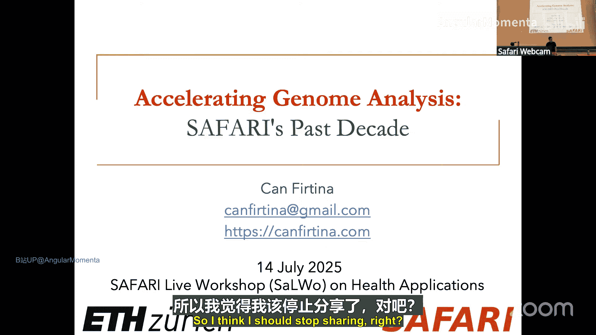
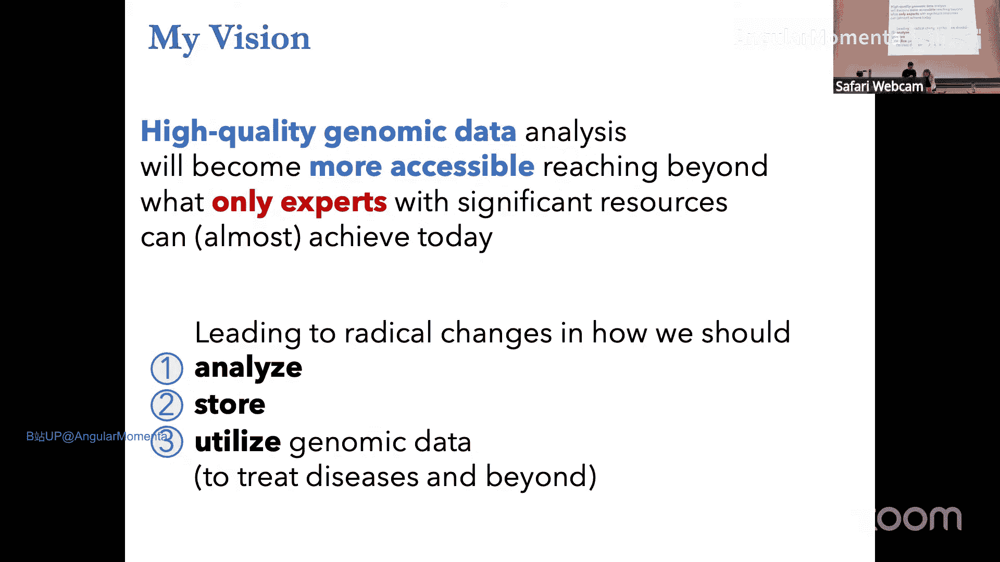
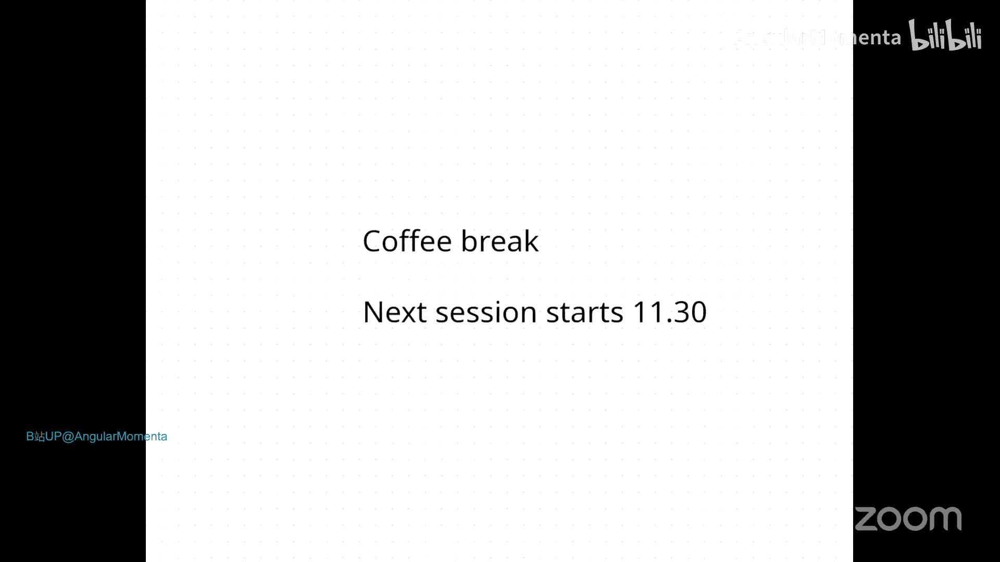
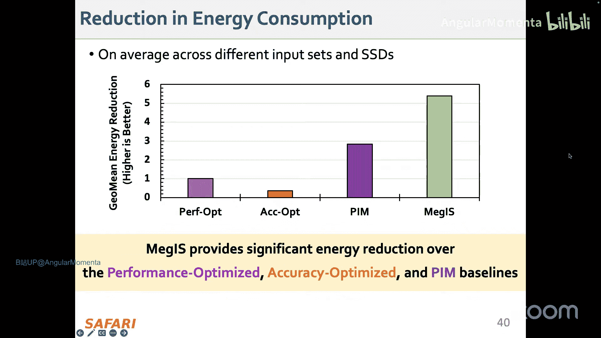
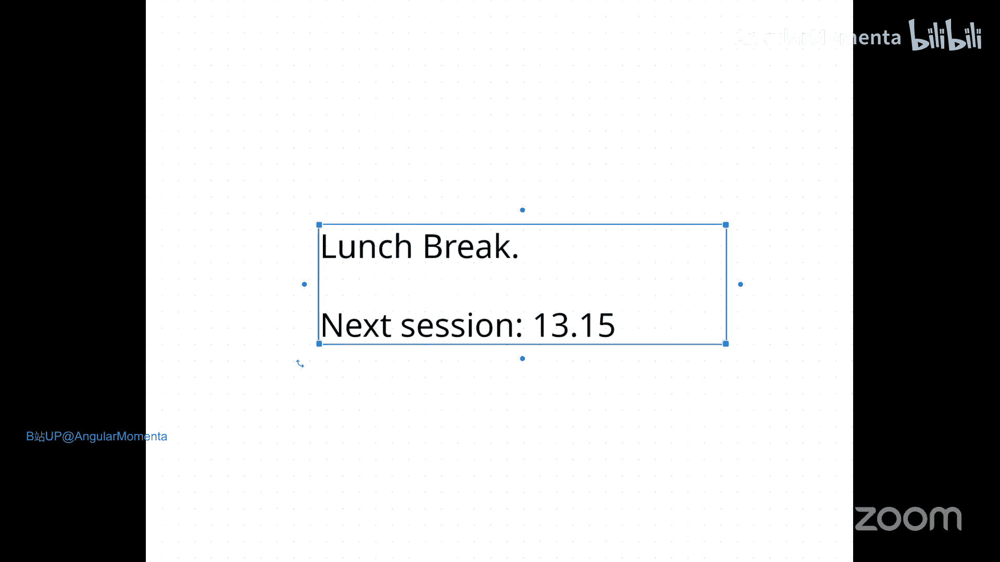
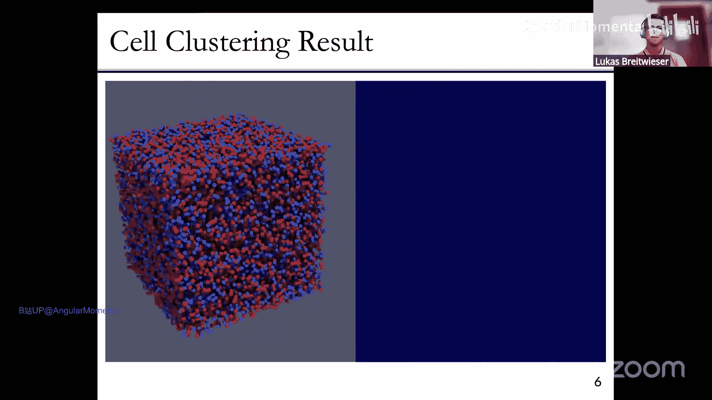
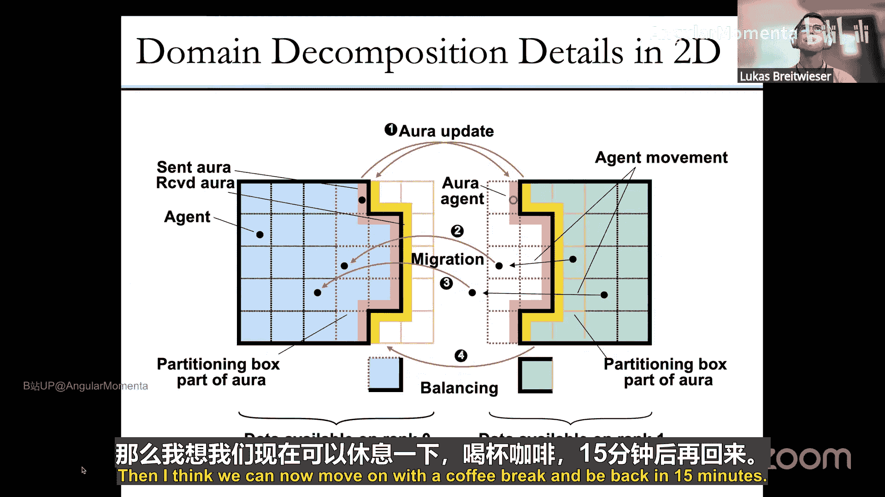
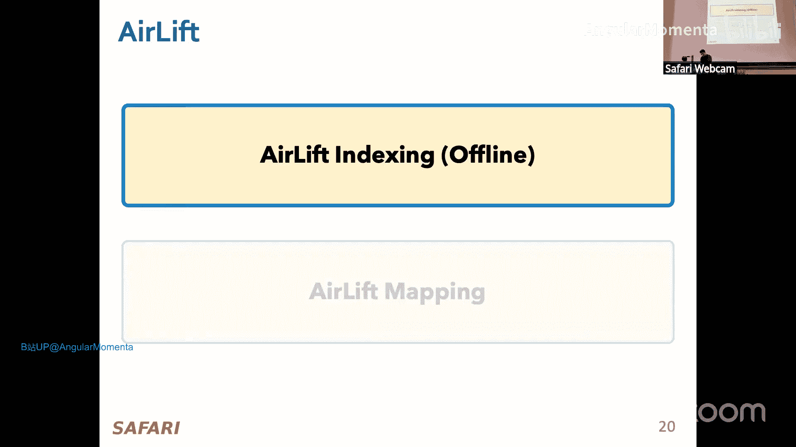

# 【苏黎世联邦理工学院】2025年首次SAFARI直播研讨会 ｜ 1st SAFARI Live Workshop (SaLWo) 2025 p03 03 健康应用：首届SAFARI线上研讨会 (SaLWo) 2025 (第二天) -BV1RYquBGEDu_p3-

嗯。Itし。Theyll we。Yes。Okay， hello， everyone。Good morning welcome to the workshop live Safari Workshop on health applications today we received our focus we're going to discuss all the challenges that come from very rapid advancements in sequencing technologies in the field of genomics and we're going to look into ways that we have to create new algorithms and architectures to actually address these challenges efficiently we have different speakers for today and we're going to start our workshop with Jan Fertina John is a senior researcher in Safari he recently finished his PhD here and he's joining Maryland University as a senior assistant professor soon。

So John， the floor， great， thank you so much for the introduction， Constantina。

And as yes Constantina said， we're going to have many talks today on health applications and I'll have two talks back to back and later on the day I'll have another talk again on one of the works that we published at Safari。

And the first talk is going to be mainly an overview of the works that were published from SafaI。

 especially in the past decade， and also I'm going to try to give you an overview and the background on genome analysis and the second part is going to focus more on basically the major works that I included in my PhD thesis。

So with that let's get started， I want to also introduce myself very quickly as Cononsstantina said I'm a senior researcher in the S research group also lecturer at PTer。

 I'm also an incoming As professorfes of Computer Science at the University of Maryland College Park。

 so I'll be joining UMD soon this fall。So my research interests lie in the intersection of at the intersection of bioinformatics and computer architecture and you can contact me through many contact points email you can find other social websites using my website and also this is the link to Blue Sky。

So basically， if want to work with me， especially in the future。

 you can use these links to contact me。And so regarding basically the health applications。

 we're going to mainly a focus on genome analysis and we really need past scalable and acute genome analysis as this is very useful for many applications。

 for example， you can uncover and treat diseases linked to genomic variations， for example。

 to identify if you are prone to a certain type of cancer。Understanding those changes。

 you can even change the alter， the content of your genome to solve fundamental challenges of life through genome editing。

 for example， if you identify that you're prone to a specific type of cancer。

 maybe you could target those regions and edit them so that you're less prone to certain types of diseases。

This is also important especially for to detect pathogens in the environment。

 especially the harmful harmful ones so that we can enable reposit values of disease outbreaks and of course there are many。

 many other applications that we're going to cover so to enable these applications what we really want to do we want to look at our genomic picture and if you remember from basic biology。

 basically the blueprint， the building blocks of our genomes are mainly this DNA。

 this is like in the as we can see in the double famous double helix structure。😊。

So if you look close at this DNA， you're going to see the pairs of molecules are binding to each other here going in binds to cyto and C and the adeneno binds to th。

 so these bindings usually are referred to as a single nucleotide bindings are referred as base pairs。

And this DNA can be packed in a very compact form， making up the chromosome structure in a single human cell。

 chromosome can contain from 50 million base pairs to 250 million base pairs and we have basically several of these chromosomes in total around 6 billion basis in a single human cell and we have triions of these cells in our human body so if you think of it we're essentially storing huge amount of data in our bodies to analyze and we want to look at this picture and really understand every single character in our entire cell because it can have a huge impact on our health for example。

 even with a single change we can have an increased cancer risk or sickle cell disease。

 colorableness or maybe there is some source code in your genome to improve the quality of your life。

😊，So the goal of all genome analysis is really generating critical insights from the entire genomeomic sequence of an organism and take some actions by understanding it Of course the data that we're analyzing is not necessarily limited to DNA or other types of biological data。

 it can be transcriptomic data by analyzing RNA or proteomic data to analyze proteins and all of these basically give you different types of resolutions basically find the answer for the biological problem that you're looking for but today we're going to mainly the focus on the DNA data and will show you the solutions that we address for certain problems related to DNA data。

😊，So as I said， there are many applications to understand the analysis of genomes provide us with many applications to understand life and also improve its quality as I said。

 for example we can potentially have two groups of individuals where in one group。

 we have essentially individuals that show a certain phenotype for example。

 certain type of cancer and the other basically group where they don't show that particular phenotype and you can basically analyze their entire genome and try to find if these groups with a certain phenotype。

 consistently have a certain variation in their genome so that you can pinpoint these variations and say that okay。

 if you have these variations， you're likely to have to show this phenotype。There are of course。

 variations that are larger than a single base pair change or a few base pair changes。

 so this can be changes of starting from 50 bases to even thousands of bases。

 and these are usually known as structural variations and if you have these huge changes。

 it can lead to again certain types of diseases or other types of phenotypes like autism or basic obesity and so on。

But essentially by understanding these changes。It gives us basically the opportunity to change our genome。

So for example， if you identify that， if you have a certain change in your genome。

 you're going to likely have to have this certain phenotype。

 so then the goal would be if you know that when you have that change。

 you're going to have that phenotype and if you want to avoid it。😊。

You can basically target that region in your genome and edit its content of course right now the genome editing is in very early phases。

 but this field is moving， meaning maybe we'll be in the future we'll be able to basically target all the cells in our entire body so that we can make the changes that we want to make basically in all the cells so that basically we're going to have the phenotype that we want to how or basically disable that particle phenotype but because of its basically promise the ability basically to program this editing functionality has been published in 202 alpha I guess or11 and we recently received a Nobel Pri award after its first publication after eight years。

😊，Of course， understanding and basically designing new proteins have huge implications。

 especially for drug discovery， and people behind for protein design。

 especially AI driven protein design， also very soon received a Nobel Prize last year。

Of course there are other applications in genome analysis， for example。

 it enables rapid surveillance of disease outbreaks。

 people are using genome analysis in the field to understand whether theres an outbreak is going on。

 and this has been tested for many viruses， for example， COVID for Ebola and so on。😊。

We're basically moving towards in the field portable analysis where you can think potentially you attach the genome analysis capability to drone and the drones basically run in agricultural fields and then give you basically some insights about your agricultural field。

 for example， to tell you what sort of basically the drug or the solution that you use in you should use in your agricultural field so that your plant grows much more efficiently or take actions if there's a pathogen growing on。

😊，You can even shop with your DNA， for example a solution or a product may know so much about you including your genome and if you are shopping it can give you insights for example to tell you that oh don't buy this product because you're allergic to it or maybe you can't think of other interesting applications to it so to summarize。

 of course there are many， many applications and so we're only basically scratching the surface here。

😊，But again， if you look back， so we've been talking about genomics， if you look back。

 we see that we need to analyze large volumes of data and this is not limited to just genomics。

 so if you look at many other important workflows， applications like LLMs or graph processing and so on。

 we need to analyze huge amounts of data to get these insights。😊。

And this large data movement is essentially leading to and energy bottleneck in the entire system。😊。

And this is mainly because the data generators that we're using today are really specialized at generating data at a very fast rate。

 these can be sensors right or these can be genomic data generators so they have no issue at generating data at a very fast rate。

 but the systems that we're trying to use today are not really specialize that analyzing each type of data that we want to basically analyze at the very fast speed。

 meaning we're using general purpose devices， general purpose machines to analyze a very specific type of data where we don't know basically maybe anything about the requirements of the analysis of this data。

😊，So this leads to basically， of course， the overhead in the system because we need to move large worms of data in the levels in the memory hierarchy。

 in many levels of memory hierarchy。😊，And this is problematic because even a single memory request can consume more than two orders of magnitude energy than just performing operation。

 so if you are necessarilyces moving data， so then you're creating basically huge data moment overhead in terms of performance and also energy。

😊，So this means we need to basically call design algorithms and architectures。😊。

To handle data really。For this， we pushing towards designing new architectures。

 new systems by thinking of basically what are the emerging devices。

 emerging technologies and how we can potentially use them to analyze the data that you're analyzing and in this case you're seeing the example of sequencing machine that generate the genomic data。

 but this can be basically any type of data that you want to analyze so that you come up with the system。

😊，Or maybe we may be limited or we may have certain requirements， for example。

 to analyze the data in a portable manner， so you have maybe your mobile device and where you are limited by the computational resources and also you have the limited batteries。

 so how do you perform the computation cheaply and also it low power。😊。

Of course then to achieve all of these really nicely。

 we need to basically look at the entire stack of computer architecture and we need to call design all of these。

😊，So if you're really interested in our efforts in accelerating genomemin analysislysis by codesigning algorithms and architectures。

 you can take a look at this paper as well and today I'll try to cover some of these in the first part of the talk。

😊，We've been working on several directions at Safari for genomemen analysis analysis takeate also to enable new directions by designing new algorithms。

 for example， we've been looking at what sort of different types of data that we can analyze and what can they basically provide us in terms of the new applications or basically the performance improvements and so on and for this we asked the question should we really analyze the individual DNA characters after translating them from。

 for example raw data which can be raw electrical signals that are generated by sequencing machines。

😊，Or can we directly analyze these raw electrical signals without doing any translation to individual DNA characters so that we perform the analysis really fast。

 but maybe these raw signals contain richer information than just individual bases where we can utilize them。

😊，So we ask all of these questions and this is a paper this is actually one of a set of the artworks right now that can achieve real time analysis of large genomes such as a human genome while we'regene these raw electrical signals in sequencing machines so this happens in runtime and this is another work that improves the performance and also the accuracy of this application so we also asked the question how can we further basically enable new applications by just simply analyzing these raw electrical signals so this is one work where we can construct reconstruct basically genomes from scratch by simply stitching electrical signals together since these electrical signals present fragments from our genome so we're simply then stitching them together to reconstruct than from scratch by purely using electrical signals。

😊，So we also can now perform identify individual changes that in the electrical signals that they may correspond to the mutations that you have in your genome without doing any translation。

 so this means maybe we can identify these mutations in real time so that we can find answers if you are prone to certain disease again in real time during data generation。

😊，So this is a very recent work where we basically integrate all of these raw signal analysis capabilities directly in storage so that we minimize the data moment overhead in terms of performance and energy usage we're also designing other types of algorithms to tackle other problems in genome analysis for example。

 this work can identify the substitutions that may lead to mutations in your genome that you may have in your genome with a single hashmat so you don't have to do costly operations you just do single very cheap hash operations and it will give you potential substitutions which is very important basically for many applications that need fast identifications of substitutions。

😊，Here in this work， we're also asking what happens if a template genome。

 which is a reference genome that we're looking at is updated。😊。

So this means if that template genome is updated， do you need to redo the computations that you did for the older template genome。

 or can we somehow utilize the older genome and then we minimize the computations that we're doing whenever this template genome is updated？

😊，So there's another follow up workrk that improves on that。

We're also utilizing AIML to basically by designing new algorithms and architectures for genome analysis here in this work we design and expectation maximization technique to identify the errors that you may have in the genomic data and to correct them and this is an accelerator that build on this that I'll describe today a little bit in more detail。

 so here in this work we're also designing a new framework that shows you basically what sort of optimizations that you can do in your large neural models for translating raw electrical signals to individual DNA characters so this means maybe there are some opportunities like quantization or basically distilling that you can really exploit for this particular genomic data。

😊，We're also asking a question like can we basically build multiple step analysis value。

 insert filters in the initial steps of the genome analysis so that you minimize the unnecessary analysis in the later steps so this is a similar work but this is basically mainly in memory design of fusing multiple steps in genome analysis directly in memory again to reduce the data moment overhead again another work to perform deep neural network operations for genomics directly using memory to devices again in memory to minimize the data moment。

😊，So of course we're designing new architectures again to achieve fast acute and efficient genome analysis there are many seminal works from our group I'll cover some of these again in detail so here in Gnam so we're design basically designing a new architecture to perform approximate syn matching very quickly with a specialized logic design and this is another work that views on that to perform the similar patients like long graphs also have we provide certain in search solutions which we're going to cover these today and again most of these are covered in this paper so if you're interested you can go and watch of course this workshop or basically read this paper to understand more basically on what we're doing in exc genome analysis。

😊，So with this， what we did so far， we quickly covered the overview of basically the or the scope of the works or the directions that we're focusing on genome analysis analysis that suffer。

😊，So in the remaining parts， I'll give basically a little bit more in depth a description of basically how we generate this gen data and will' quickly show you some of the works that were published in our group。

😊，So how do we generate a genomic data right so from scratch so T starts with a sample collection。

 meaning we can get a tissue from you or your saliva or your blood which contains your DNA right and what we can do we can essentially prepare it for data generation so preparing it for data generation is usually known as library preparation where you attach maybe certain adapters to the ends of the fragments of your DNA in your genome so that the sequence so you can notice that this is basically a DNA that needs to be attached to the sequence and that needs to be read。

😊，So this is basically what happens， these fragments are attached to the sequencing devices and depending on how these sequencing devices are designed。

 they generate some sort of raw data， they may generate electrical signals that represent these fragments in the genome。

 or they may generate images again， that may generate each character each individual character in the fragments of your genome。

😊，And then basically this raw data can be translated and then further analyzed with genomic analysis。

 and these are basically the computational steps that we're mainly interested in。😊。

Of course these computation steps can vary depending on the types of analysis and usually there's a huge pipeline where we need to analyze or several steps of analysis to get the answer that we're looking for in the genome analysis but if you look closely in this pipeline we see a significant barrier especially in terms of the performance that we need to achieve that we want to achieve so this is because there are several steps in the pipeline starting from the data generation it goes towards the other steps in genome analysis which will cover some of these data on。

😊，But the important thing to notice here is the throughput is not really balanced。

So then this leads to a bottleneck at a certain step in your pipeline。And if you think that okay。

 maybe we can just simply focus on that particular step in the pipeline and accelerate it。

 it's not again that simple because depending on the data type。

 depending on the sQsing device that particular step may also show you different signs of behaviors。

 so each basic step can also give you a different basically profiles depending on the application that you're looking for so this shows that it is really important that you know the application that you want to target so that you can do the profiling end to end to achieve the acceleration that you want to achieve。

Again， so the problem is mainly due to the general purpose missions that we're dealing with and really our goal is to minimize basically the data moment overhead because the data analysis platform far away from the data。

 so the takeaway here is we need to orchestrate algorithms and architectures to handle basically the data well。

😊，So then I'll show you some of these works very briefly that we published from Safari to show you basically what we do to minimize this data moment and one example is here's JaP where we design an inmemory accelerator for genome analysis so as I showed you earlier there are multiple steps in genome analysis。

😊，And this usually leads to two main limitations in terms of data moment。

There is a large volume of data that we want to analyze between multiple steps。😊。

And this large volume of data， we don't basically necessarily move all the data that we want to analyze towards the very last step。

 so this means there's also of waste of computation and data moment happening in between the steps because if you start with 100% of the data。

 you're not going to basically at the very you're not going to end up again。

 by using that 100% of data， but you're going to end up by using for example， 20% of it。

 this means the remaining 80% was just lost in between the steps or this least waste of data moment and computation。

😊，So I'll illustrate these issues a little better， so assume you're starting with a certain amount of data and there is some computation and basically you generate other type of data then you use that data to perform another computation and then move on and so on right so you can see here there is a large data moment in between steps but also what's happening is probably already observed you're starting with a large volume of data but some of them are getting removed are getting eliminated as you move towards the steps because you realize that they are not going to be useful in the later steps so then this these to basically unnecessary and use this data moment and also a computation。

😊，There are some works that of course notice this issue orpart of the issue where they propose to design inmem solutions for individual steps in genome analysis for example we have a MEM based inmemory processing solution。

 for translating the raw signals to individual basis。

 and also another inme solution for to perform the other steps again in genome analysis。

 so you can reduce the data moment， for these steps individually by designing an inmemory excator specifically targeting these steps。

But then really what really happens is the another issue is what really happens between these steps right so you still need to move the data between these steps and then some of them become useless later on so our goal and jump it us to basically minimizes data moment overhead and also the useless computation in the entire system so what we did we looked at basically this genome analysis pipeline and first ask the question so what happens basically if we design in memoryory accelator for separate four base calling and mapping right so you have separate accelators for each of the step and we ask question what sort of speed up that you can gain compared to baseline where you don't have an accelator。

😊，Then further we ask the question what happens if you don't have any data moment between these accelerators where you have an excccelerator for translation and another excccerator for the another stuff in general analysis。

 but you don't have any basic data want in between now so this is basically the potential speed up that you're getting。

😊，Then we ask the questions so what happens there's no data moment between accelerator accelerators。

 but also then there is no also useless seats， meaning assume in the very large step of genome analysis there is a portion of data that you end up analyzing and then you start with that portion of data directly in the very first step of genome analysis asking that question then this is the result that we got for example basically if you minimize the data moment and also minimize the useless data analysis so this is basically the rfi that you can achieve by designing an accelator that handles this useless data analysis and also the unnecessaryneceselator data moment and this is basically what with it in Jing so here you're seeing essentially two different accelerators that I showed you earlier there is one accelerator for translation then another accelerator for doing the basically one of the steps in the later steps of。

😊，Analysis， but in between there's a controller。😊，So this controller really handles the feedback between the steps so it continuously perform designs basically a pipeline approach basically continuously sense the data small chunks of data as soon as we perform the first step and then we start doing the next steps in the analysis and then without analyzing the entire data if you can somehow realize that this particular data is not going to be useful in the later steps of genome analysis。

 it can give the feedback to the earlier steps of genome analysis and say that or you don't have to continue analyzing this data because it's not going to be useful for us so this is really a feedback system where we also designing everything in memory to minimize the data moment。

😊，So then this basically eventually leads to of course。

 better performance in the entire system because you're minimizing data mode。

 but also you're minimizing the useless computations in the entire system and eventually of course。

 substantial energy efficiency。😊，So this was jump in swordfish the question essentially we ask we so in this work we targeted one of the steps in the genomemen now so this one basically the translation step and then we asked the question so we can design you know that we can design in memory solutions for one of the steps right so this can be the translation so the question is。

 so are these devices that we're using for in memory computation。😊，Are they really reliable？

And do they really show， for example， some nonideities in the devices that we're using such that they change or they give basically unreliable answers and you use these technologies。

😊，For example， if you want to do im meoral computation。

 what people usually use these memory of devices on a crossbar array structure where you may have。

 for example rearams the RMs where you use them for computation purposes especially for performing metrics vector multis and we know that by K showss law and on law you can really perform metrics vector multis using these memory of devices but the problem is what people usually do is they first train their neural models using basic general purpose devices where you have use liability and then they essentially move their models to these unreliable devices where you may get basically different answers each time you use these devices due to basic noise and the non-ideities that。

😊，You have in basically in these devices so then the question that we really ask was can we learn these nine idealities and integrate them in the model so that our model can be more robust to the nine idealities in these devices and basically in the swordfish we show that we can learn them and then integrated so that the model becomes more robust to the nine idealities that you're going to have in this device so that you achieve better accuracy by using this model。

😊，So were of course designing other different solutions for other applications in general analysis fully again in memory。

 but the main question that we're really asking， so what is really the best place to analyze the data and are analyzing in basically where it needs to be analyzed？

😊，And the one question of course that we're asking。

 maybe we can just analyze them directly in storage。

 maybe using in flashlash computing or near storage by designing near storage solutions so in Gentor this is basically one direction that we took and basically the main goal of Gentor or the main motivation in Gentor is so we have this large volume of data that are stored in the storage systems and these usually basically need to move across many levels in memory hierarchy right so it moves through main memory cache and then it goes to the computation unit that can be CPU accelerator。

😊，And of course this happened and we design accelerators because there's a huge competition overhead。

 right？😊，But then there is another overhead， which is the data moment overhead。

 so even though you minimize the time that you're spending for computation。

 you still need to move that data from storage system across many levels in the memory hierarchy。😊。

And people of course， are designing many heuristics。

 excccerators or filters to minimize the computation overhead。

 but the data moment overhead is still there because of the issues that I mentioned earlier。😊。

So the key idea in Genstore was that maybe we can do some of the analysis directly in the storage so that we minimize basically the data that we're moving to main memory to basic computation units so that we minimize this data moment overhead so maybe you can somehow filter some of these reads so that you only set the portion of these the deomic fragments to the computation units and of course there' is a limitation right so there is a limit on what you can do perhaps in such a storage system right and knowing these limitations and designing a solution according to it is important and given this what we and you also have other requirements in terms of bandwidth and so on so given all of these of course limitations what we did we designed a mechanism where we identify exact matches between a genomic fragment and the template genome that I mentioned you earlier so that we know that this。

😊，particular fragment will 100% match to that template genome so you don't really have to perform costly operations by sending it to computation units or maybe they are just too dissimilar this means they are not going to be really useful for us in the later steps of genome so we can also quickly identify those and avoid sending them to computation units。

😊，Of course， there are certain challenges to it， there's limited hardware resource in the solar system how are you going to basically utilize the resources that you have really well to basically meet the requirements that you want to meet。

😊，So by designing a Gentor， we can minimize computation overhead and also data movement overhead to achieve significant speed up and also the energy reduction。

So there's a followup work Me and Nikika will explain it today so I'm not going to go into detail about this。

 so maybe one the last work that I want to mention before I move on to the next talk is Gism here。

 we basically target a core computational approach in genome analysis which is mainly related to approximate string matching and this is very closely。

 not just because running it once， maybe it just is not relatively cost but we need to basically around this approximate string matching operations。

 many many times because we have millions or billions of these DNA fragments but we need to run approximate string matching for each of them。

So our goal basically was to accelerate this approximate matching algorithm really well and handle basically the operations of it really well so that we accelerate this operation to minimize this overhead in the entire genome analysis。

😊，So this is the first approximate simulation accelerator for genome analysis。😊。

And we basically call design altogether by constant memory bandwidth and basically computational overhead of the algorithm so that we design the hardware really well by keeping the memory bandwidth also in mind so in our excccelerator we have two main two modules one the genism do you see this is for distance calculation so to say maybe a part of app matching the other module is genism TV which stands for traceback。

 which is really basically when you identify maybe the number of changes that you have in your DNA fragment compared to template sequences the other question that you want to ask where are these changes exactly right so you't you're not necessarily interested in the number of changes but you're also interested in the exact locations and the exact differences so that you can for example。

 use them to identify if this is really im or error or something else。😊。

So the DC Genm DC is really contains really a s carry based accelerator so that we can basically minimize the data moment so that also maximize the parallellism because what we can really do is you can feed the data through mini s carrier based accelerators to identify potentially the character changes that every position by position also。

 depending on the type of the change that we want to analyze。😊。

And also the other module that trace back module is really basically takes the output。

 the final output from the genasm DC and then looks at the final output that's generating。

 so that it identifies the exact differences between a genomic fragment and also the type based sequence and this is basically a normal approach because in genazm we based our algorithm on an algorithm called PT algorithm which can really perform this approximation matching to identify the number of changes that we have between two subsequences。

 but we could not really identify where these changes are exactly。😊。

So we improved on this of algorithm and what we did basically。

 we enabled the capability also to identify where these changes are exactly。😊。

So this is basically where also the algorithm design comes into play where we don't simply basically design an indexexor for simply for BTap。

 but we also improve it so that we can use this entire module for the application that we're targeting。

😊，So of course， due to the benefits in terms of exciting this heavy operation。

 but also maximizing the parallel and minimizing the memory bandwidth that achieves substantial speed ups and also reduces the energy usage compared to the state of the artwork。

😊，So in the followup works， we don't stop there， we improve on， for example。

 gnaism by basically identifying its limitations and also maybe designing this solution。

 not just for simply specialize logic design， but maybe we can design these algorithms for CUs or GPUs。

 so that we can basically use the solutions that we're providing in Gnaism in whatever the platform that we want to use。

😊，So here in the scroo paper this is basically what we propose and also many algorithmic improvements that further improves the capabilities of genism。

 so in Sagram we further basically take further step and then say so can we utilize this genism properties for basically graph type of analysis in genome analysis of course you need to improve its capabilities because the graph connections are not necessarily as simple as basically looking at single template sequences and so this is basically what we do it in the segram work to perform graph based genome analysis again。

 so I invite you to check this paper if you basically want to learn more about our efforts in exciting genome analysis。

😊，So this basically covers the first part of my talk。So in the second part。

 so I'll move on to my second。Talks so in the second part。

 I basically will cover basically the major contributions that I introduced in my PhD thesis。

 but also during my time at Safari。And I'll discuss some future works there as well。

So I think I should stop sharing， right？

And maybe in the meantime， you can just take a five minute break if you just。And no。

Go to the toilet or something else。嗯。nice。Okay。说。I just need to share this， I guess let's see。😔，哦。

嗯可。Okay， we'll be probably back in two0 minutes。Okay， right。

And welcome everyone to the second talk of today it's me again。

 so this part will again mainly focus on some of the works that I let in safari which means basically focus on designing new algorithms on architectures for fast and efficient genome analysis。

 but as with the previous talk we'll talk a lot about analyzing DNA analyzing genomes for many reasons and I rewin a bit basically back to the initial studies that I showed you earlier in the first talk to give you a bit maybe more in- depth backgrounds on certain steps in genome analysis。

 so as you remember as you may remember， analyzing genomes can reveal key insight useful for many applications is useful for personalized medicine。

 for genome editing for detecting harmful pathogens in the environment em bindinging between。

Everything the surveillance of these outbreaks。And to enable these applications we said that we want to look at our genomic picture and understand perhaps it's every single character in the entire genome and so what I mean by genome is again to remind you again a little bit so these are basically the individual characters DNA characters in our cells this is basically what we're mainly focusing on but other basically there are other types of biological data that are so-called maybe domics data analysis so this data that we want to analyze is not initially in a human readable form because these are a bunch of biological molecules in our cells so if you want to to analyze them we use these devices called decosing devices that takes these molecules as inputs and generate some sort of raw genomic data such as electrical signals that correspond to the fragments in our genome。

So this is not still necessarily in a human readable form so what we can do。

 we can use these AI basically based translation techniques that are called base calling techniques that translate these raw electrical signals to individual DNA characters。

😊，But then there are several other problems with this type of data analysis analysis beyond needing to translate that。

So we're not necessarily basically generating a single fragment that corresponds to our entire generic picture of six billion characters in a single piece。

 rather we're generating due to basically how these sencing machines were we'regene many small fragments from our entire genome small pieces that are socalled reads so the length of these reads are usually from1 hundred to few thousand characters and these are really small compared to your entire genome languages billions of characters and even beyond you do not know where these reads are coming from in your entire genome so this is really like a giant chisaw puzzle that you're trying to solve and as in puzzle pieces we may have maybe a reference picture that you want to that we can look at or called a reference genome。

But even though basically use this s genome to identify the origin of each read that you're generating。

😊，We still need to account for certain changes that can be caused due to maybe the mutations or the errors that we may have in the data。

So because of all of these issues we are redundantly generating large volumes of data so that we can reconstruct your own genomic picture from scratch really。

 really accurately， so if you think about it， this is really a massive data science problem that involves expensive searches。

 massive data data sets of sizes of terabytes to petabytes。😊，And if you read this of this puzzle。

 maybe in a naive way， what you can do， you can take each piece each read and start from the very beginning of the first genome of maybe tri billion0 characters from maybe one coming from one parent and perform this costly approximate stig match for the entire genome。

😊，And of course， you need to do this for all the risk that you're generating。😊。

And if you do this na approach it can take years or even thousands of years to do so。

 so I guess somehow you want to really avoid taking thousands of years to get an answer for your own health of course luckily there are practical solutions to solve this puzzle and these solutions usually involve certain heuristics but the goal of these solutions is really quickly and accurately reduce the search space from the entire reference genome only on few regions so that we perform the cost of patients only on these few regions not the entire reference genome。

😊，We can do this for example， by extracting certain sub sequenceequences from the genome and also from a RE and first quickly identifying some exact matches between them and to identify these exact matches。

 people usually use certain data structures such as hash tables so that we can identify these really quickly。

😊，But really， the goal is is to be able to focus only on these regions where we have basic where we think that the reads might be originating from based on the clues that we receive from these exact measures。

 so that we perform the cost of operations only on those regions， not the entire reference genome。😊。

So the collection of these steps is usually known as read mapping is basically a fundamental step in the vast majority of genomics applications。

😊，So the common genome analysis pipeline usually includes of course generating the data。

 maybe translating it with base techniques and identifying the origins and the exact differences in the read mapping step。

😊，And the output that we're getting from the read mapping step is usually the origin of each read。

 as well as the exact differences compared to reference genome。

 which can be useful for many applications， for example。

 to reconstruct your own gen picture from scratch or to identify limitations or separatepar potential mutations from the errors so that you can link down to diseases or to identify certain unknown organisms that you have in your sample in the metagenomic step。

😊，But then when we look at this pipeline we see that this is very energy inefficient mainly for two reasons first we need to use power hungryung devices because we need to rely we usually need to rely on these computation across the and complex AI models mainly for translation purposes and of course this large volume of data that is getting translated also needs to move across many steps in genome analysis and as you may remember this is problematic because a single memory request can consume more than two orders of magnet energy that just can just performing and operation。

😊，And even when we're using GPs and initial steps of genome analysis。

 we see that basically these steps still take out of time and these numbers are based on a single person。

 it gets worse when you need to analyze hundreds or thousands of individuals at a very large scale。😊。

So all of these issues then put a limitation put a barrier on the application scope and the accuracy that we can achieve in general analysis。

 especially when we need energy efficient analysis for resourcecing devices such as drones running in agricultural fields or urgent analysis that needs to be done limited minutes。

 especially for neonatal screening， also for large scale analysis for hundreds or thousands of individuals。

😊，So the goal of my PhD work was to enable basically was to tackle these issues that enable fast energy efficient acute and scalable genome analysis by designing algorithms and architectures so for this I worked on analyzing the basically raw electrical signals in real time without translating them also designing algorithms and architectures for the integration of AI in genome analysis。

 also designing algorithms and fast and acute solutions for certain steps in genome analysis as well as designing datacentric architectures such as immem processing for fast and energy efficient analysis we also looked at of course the current state and future directions of the field in our review works so today's talk this basically this part of basically today's talk is going to cover only basically these two directions。

😊，So to tackle basically these fundamental issues in genome analysis。

 I'll show you basically I'll be focusing on how we can really analyze raw genomic data。

 this can be electrical signals without really translating them to individual basis and also I'll show you how we can improve the performance and energy efficiency of a commonly used ML technique in genome analysis to accelerate basically especially for genome graphs。

😊，So I'll start with Rohash where we show that we can analyze basic growthactive signals quickly and efficiently without being in a translation。

😊，So remember that the using base coding is。Poentialally useful because it enables us to perform really highly acute translation from noisy electrical signals to individual characters of DNA DNA basis。

 but at the same time it is very costly doing so because we need to really use costly and complex AI models on a large volume of data by using especially power hungryer devices such as GPUs。

😊，So and this can be problematic for many applications right so especially if you are in the field where you may be limited by the computational resources and also you may be limited by the battery that you may have you may be seeking for basically a better solution but beyond it' always better basically to achieve a better sc in terms of performance and the energy efficiency so we asked the question basically how can we make this pipeline cheaper and one idea was so maybe we can just remove the translation step in between so in between basically this data generation and read mappinging。

😊，But now what we have is basically we have two different languages and one of them is basically extremely noisy electrical signals。

 so the question is how do enable communication two languages how to enable basic accurate communication between two languages without an accurate translation so while for this what you can really do it can actually convert the reference genome into its series of expected raw signals by using some lookup tables。

😊，So now maybe we put all of these different types of data in a single common domain where we have the data maybe in a raw electrical signal space。

 but now the question becomes， so how do you identify similarity between very noise electrical signals because now you have increased noise in the environment rather than doing the translation？

😊，So for this， I need to show you basically the type of data or type of ethical signal that we're generating to show you basically the type of noise that we're dealing with。

😊，So assume that you want to analyze this molecule that shows maybe a fragment of that molecule and to do so you want to basically sequence that right so what you really need to know is that when sequencing this particular molecule you're going to be generating series of some raw signals and these raw signals will is really a time series data it will correspond to parts of this particle molecule。

😊，But then。When we want to sequence exactly the same molecule。

 due to the noise and other types of issues that we have in the environment。

 we're not going to be generating exactly the same series of raw signals。

 even though we're sequencing exactly the same molecule。

 so this means we cannot really exploit the exact matching strategies that I showed you earlier to enable a practical similar to search between this molecule and the reference genome。

 but theres a civil lining which is we're going to be generating similar raw electrical signals for when sequencing identical molecules。

😊，So then if you want to identify this similarity between raw electrical signals。

 one key idea maybe we can perform similar to estimation based on some vector similar to search because we can represent this time series data as an n dimensional vector。

😊，And you can do nearest neighbor search to identify the similarity。

 but the problem with this approach is it becomes too costly especially for large genomes so let me show you why so here basically we show how much time that this nearest neighbor search approach takes across various genome so here we start with a viral genome this is a very small genome it can contain thousands of characters in this genome and we go up until the human genome that contain billions of characters。

We also show basically how much time this nearest neighborval search takes。

Relative to data generation speed and the data generation speed is important because if you are basically above the data generation speed。

 this means you can consume the data， you can analyze the data while it is being generated。

 which we refer to as real time analysis。😊，But what we see as the genome size increases。

 this approach becomes slower than the data generation speed。

 this means we cannot really achieve real time analysis for very important genomes such as a human genome。

😊，And this is mainly because the search mechanism is too costly to scale well as the genome size increases。

😊，Yes， there was the question， yeah。Did you go back。所以身你开部。Like thousands of X。So。And。Thanks。

So I'm curious like if it's purely because the sequence is longer in human or are there more insights into that？

Like in terms of diversity or I don't know or the sample that。Yeah。

 so that's a good question there are multiple reasons for it。

 especially for this type of genome as the genome size increases the repetition。😊。

Also increases so this impacts also the performance。

 but also mainly the accuracy as you're going to see in the later slides because due to the repetition or due to the cost of the algorithm that we're using here。

 we need to make some basically heuristic decisions。Which impacts mainly impacts accuracy accuracy。

But essentially also impacts the performance because it's a really a trade right so you want to deal with some of these appetitions so that you can make an accurate analysis so this means。

So this nearest neighbor search approach is a KD3 type of analysis where you go over the basically to the towards the leaf often node。

 so each operation is very costly， so the question is how deep you're going to go towards that tree。

 which will maybe resolve some of these appetitions。😊。

It will come with also the cost in terms of performance， but also the accuracy， but the other impact。

 the other aspect of it is really the algorithm complexities a nonlinear is a polynomial type of complexity。

😊，Yeah， thanks。Just wait a second， I'm bringing the microphone。はい。第三个。ます？Mhm。关 you。呃他在。Yeah。

Next slide。That maybe accelerate computation to a big extent Yeah。

 this is a very good point this is actually what so it really depends on the application that you're targeting and there are solutions to it as you said if you。

 for example know。Where you want to look at right you can definitely do it。

 you can even do it chemically， you don't even have to do maybe a computational approach。

 you can just target that region in the genome you just sequence that region and then do your analysis what the reason one application for it could be is the whole genome analysis where for example。

 you don't know what you're looking for so this means maybe you need to sequence basically entire genome and do the analysis basically everywhere because any change almost any part of your genome。

ItCan be a potential， maybe a suspect for your further analysis here。

 the approach is really take the fragment and then try to map it。

To the resolution of basically the single character resolution in the entire reference genome。

 but this is a good question， so that also reminds me of my point that I showed earlier。

 you should really know the application that you're targeting if your application doesn't really require this type of analysis analysis yes you're right。

😊，But if you have more sense of analysis that you need to do this type of analysis。

And my follow up question is， is this sort of acceleration or the latetntence that takes for the human genome to be processed。

 is it due to the size of the search that we need to do？

Or is it the fact that we need more samples because by definition it is larger？

What is the bottle link here， the size of the of the refer genomeum or the number of samples that we need to search for。

 So to simplify my answer for this， you can assume that。呃， let's say。Your sample size is constant。

 let's say across different genomes。What's only changing is the genome size。If you have this setup。

 you're going to see still see has similar observations because the search space。

 as the search space increases， the overhead also increases。

But realistically we would need more samples there is we would need more samples no to yeah yeah。

 that's why I said to simplify my answer assume you have a constant sample there genome size increase cool thank you yeah。

嗯。Yeah。So this shows us a great snapshot of the challenge of doing real time analysis now。

And of course， like computational speed over the data generation speed is important and it should be above one。

 so my question is like how does this challenge change over time as well？Of course。

 you're doing like a lot of good stuff to improve competition speed。

I'm assuming there should be some research on improving data generation speed as well。

 so how do they race against each other like how how this challenge。Go further， like is。

 does it get worse better。Yeah， I guess you already have an answer。Yeah， this is a good question。😊。

What we see at this for the past few years that the data generation speed is increasing。嗯。

At the time， or a few years back， default frequency or the sample rate for the detergenation it used to be 4000 signals per second per like this very small device that you're using。

 but now it increased to 5，000。So this is a 25% increase in a few years。

 so maybe we can expect that the dataation speed will increase。😊，So this means of course。

 the computational approaches need to keep up with that。So that's why we're trying to basically be。

Much higher than the data generation speed。So that maybe you can handle not just one these devices that are generating data。

 but multiple of these using a single compute unit， right？

If the data generation speed essentially increases over time。😊。

What you're going to lose is basically one of the device that you won't able to analyze so but still you're going to be still able to analyze multiple devices because you're way the data generation recipe so this is our goal so our goal is really not to be really barely meeting a data generation speed but really variable of it so that we're going to be at ease be able to analyze a single device in real time single device in real time right so the next question becomes really scalable how many compute units that you want to throw right？

😊，Yeah， it makes sense。 Yeah， thanks。Yeah， thanks。Okay。大么王。嗯。And of course。

Now that we're talking about real time analysis and it also important dimension mention why we care about real time analysis。

 of course one benefit of this is we can reduce the latency overlapping the data generation by overlapping analysis with data generation with sequencing。

😊，So rather than basically waiting for the data generation to finish so that you start your analysis。

 what you can really do， you can overlap them together so that you reduce the latency。

But second benefit， in my opinion， is a bit more perhaps unique to this type of analysis and potentially really important。

 which is we can also reduce the sequencing time itself， the overall data generations itself。

 and also the cost of it， because we can stop sequencing every single fragment。

 early without sequencing up。😊，This means。Rather than sequencing the entire molecule。

 which is a default for many， many sequences because they don't have the capability to stop sequencing a molecule in the middle or when you just se it partially。

 but also they don't have the feedback mechanism as well right so two things are messy。😊。

But with the data， with the gen data generated that we're targeting。

 we at least have the capabilities to stop sequeing read early。

 so all the missing part could be perhaps the feedback mechanism。

 the analysis mechanism right that makes this decision。😊。

So this means you can design computational techniques that take only part of the data while it is generated generating。

 while it iss being generated and try to make the decision whether you really want to continue sequeing this particular rate or not。

 depending on the initial analysis that you did。😊，And this really， if you can make a decision early。

 and this means we can stop early and reduce the sequencing time and the cost that would have paid otherwise。

😊，So， yeah。What do mean by process。😀H。😊，It was just a short question， so I didn't want to bother。

So could you define the cost here， is it energy or competition resources， cheap area， whatever？

Whats that yes， so this is monetary costs mainly like base pairs per dollar or something exactly or let's say sample per dollar so this goes back to the sample size that we discussed earlier。

 we know that for example we need to have particular sample size right maybe you want to cover the every single base in your genome at these。

😊，30 times with different breeds that you're generating， right？So this is known as for example。

 depth coverage and it will be 3Dx in this case and to each year is certainly accuracy you can say。

 oh I want 3Dx coverage but。😊，The genomic data generators are actually consumables。

 they can only sequence so much up to certain amount of bases， right？

So this means your sample is not going to be really pure or depending on your application。

 they are not going to be coming from the region that you want it to come from， right？

So this means you're not only sequencing the molecules that you want to sequence。

 but you also sequeing the other things that you don't want to sequence and you're paying the money for it as well because devices that you're using are consumables。

 so whatever what we can achieve with withtime analysis or maybe we can really detect those unnecessary things really。

 really early。😊，So that now maybe you're going to still pay some money for these。

 but you're going to minimize the money that you're paying for them。

 but also the time because you're not going to wait for them to get sequence fully。😊，But of course。

 this can lead to energy reduction benefits and so on。Okay， so if we talk about money。

 how is the relationship here when we reduce like is it some linear relationship or it's like。

 I don't know， quadra exponential， like as the sequenced bases increase， how the cost increase。

 how does the cost increase？I would say， of course。

 I'm not a business person or like I'm not really how the costs on top of my head。

 but I would say it's usually a linear decrease。If you can， for example。

If you can so assume I think there's a simpler way of thinking。

 so assume you would have need maybe 10 consumables for your analysis without doing any real time analysis and each consumable maybe has an X amount of cost。

 but with this analysis maybe you can say I don't need 10 consumables but eight of them。

So then you're you're not spending the2 x money on these consumables。

 So this is a type of reduction that that's okay yeah， thanks， yeah。Okay。Yeah。All right。

 so given the issues related to the content analysis and also the motivation behind real time analysis。

Our goal in Rohash work is really to enable fast accurate。

And scalable real time analysis especially for a larger genome such as a human genome。

 and the key idea in Lohash is really to perform similar to estimation。

Not based on some costly vector search， but based on some quick exact matches like we were doing with hash matches in read mapping that I showed you earlier。

So this means。Instead of basically representing these time series data as an antial vector。

 you want to somehow generate a hash value from this time series data， the electrical signals。😊。

such that they can perform fast exact match between these hash values if these factorss are similar to each other。

 of course the challenge is， how can we generate the same hash value from similar enough signals when we have ear types of noise that I showed you earlier so to explain this a little bit more I'll focus on a single raw signal data that we're generating here that can be generated by only sequencing a very small fragment in the DNA。

😊，🤧。So remember that when we're sequencing these sub partss in the entire molecule。

 even when we're sequencing the same thing， we're not going to be generating the same exactly the same electrical signal。

😊，But these electrical signals are going to be close to each other in terms of the value。So。

Our idea is really to eliminate these slight differences。

And we can load this really by quantizing them。😊，And to do so what we can do， we could do。

 we could create equi with buckets across the entire range of raw signals。😊。

And assign the close by values into the same pocket value into the same quant value。

 so this approach of course eliminates， reduces the slight differences between electrical signals because we think that these slight differences are caused due to noise that we have in the environment and by doing so maybe we enable we can enable exact matches between them。

😊，But then so we don't really use basically buckets with equalbits。😊。

Because this approach would lead to unbalanced bucket loading because of the distributions of the signals that we're generating so then if you just simply take the equal bucketing approach this can lead to reduce uniqueness of the actual release that you want to generate and then it could eventually lead to poor resource utilization which is the buckets that we're generating here instead for better utilization of resources what we do we learn from the distribution that I showed you earlier so that we create buckets with money covis so this really adapts to the data that we're dealing with so that we can better quantize the data and this eventually leads to really balance bucket loading across a different bucket so that we achieve better bucket utilization they are question here Yes I have a question so you do this all in runtime so you get no no we don't do it in runtime This is an empirical。

😊，Now also this is so this distribution。So you're actually touching on a good point。

I'll try to simplify it， distribution is mainly dependent on the technology that you're using。

As long as you're using the same technology， we expect to have a similar distribution。

 but there are always bots。So we have different distributions。😊，Sample to sample。

 right across different samples。So maybe as an unpublished data， I can say。Maybe yes。

 but then how important is that distribution is another question？😊，So this is offline， you learn it。

 and then you apply it whenever you use the same technology。😊。

And by do you mean like nanonopo exactly okay exactly nanopo and there are different types of chemistries in each nanonopo depending on the chemistry but。

These are basically pretty common， so if you adapt to a particular chemistry， you know that many。

 many people will use the same chemistry as well Okay thanks。Thank you。诶。

So this has nothing to do with the species and the organism。

 so are we certain that when we change the DNA simple。

 it's going to be the same based on technology only。

So what this so this is again good so good question what this actually figure is showing。

 this is an histogram of every unique gamer， every unique。😊。

Subsequence of fixed length k that you may see from your sample right and if your camera is for example。

 six by6mer then you have four to six different possibilities right if your genome is diverse enough。

 you're going to see all of these different possibilities multiple times。

And you're going to have a similar distribution over here。But。So as it can happen。

 you can move from six me to nightmaremarre then you have four to the nine different possibilities and those of the camera that you can see and depending on the sample that you're generating。

 you may not be even able to see every single unique camera in your sample so this means or maybe it can de distribution that we're generating over there。

 but the analysis that we're doing here is we're looking at every possible k depending on length and then generating this distribution。

Of course， I know my audience。😊，Of course， so this requires really this。😊。

Adaptive quantization strategy really requires understanding and noise that we're dealing and integrating it really well to the quantization strategy which I'm not going to cover。

😊，But then the issues are not ordered there are further challenges to this type of hash based analysis。

 so now maybe we might have solved generating the same or nicely generating the same hash relief for slightly different signals for each signal instance。

But then we're not really trying to exactly match。Each single signal instance。

To I reference genome I think this was a little bit complicated or weird sentence。

 maybe I can referphse it again， so assume you have this only single signal instance。😊。

And if you were to match that to a reference genome。

 this would loose translate to matching a six character long sequence in the entire reference genome of billions of characters。

So this means you can do it， but we also talked about the repetition issue。

 this means that you're going to find many， many of these has me and it's going to be really difficult for you to identify。

 which is the correct exact match in the entire reference of maybe millions of matches。😊。

So that's why we don't really want to exactly the match only single row signal， what we want to do。

 we want to somehow increase the length that we're spanning so that we find more unique hash matches。

😊，And to do so what we do actually， and then we generate a single hash really from these longer region that we're spanning。

 but we power from exact machine， so to do this is what we can really do。

 we can quantize each raw signal。😊，And packed down with simple bitwise operations together in a single binary value。

So this preserves the order of the subs sequenceequences that we're sequeing but also still carries the benefits of a quantization so that we perform exact matches in the longer region rather than just performing its exact match in a single signal so doing all of these it leads us to achieve fast and accurate matches in the entire reference genome and the key contributional raw hashes。

 this is the first hash based search and indexing mechanism purely by using raw signals without translating them this means you can now bring all these techniques。

 all these strategies that people developed for exact mesh hash based search for base called sequencing data for transd sequencing data and you can bring these techniques hash based techniques to the raw signal domain again so they are basically this opens up many new directions that we can do。

On raw signal space by utilizing those hash base techniques。

So then going back to the results that I showed you earlier this was the result of nearest neighbor search and this is how our has mechanism compares with the previous state of the artwork so this shows we can finally achieve real time analysis for the first time for very important genomes such as a human genome but then what about。

😊，Go it。Do you have a question？Yes， but I was waiting for you to finish your sentence I'm gonna move on take curious So if you have a question Yes。

 so you have a great achievement of 19。9 x speed up so you have a lot of margin to sustain the real time analysis so my question is given that data generation speed also increases。

😊，How long do you think that this will keep the competition up with the data generation so do we have like are we okay for the next five years。

 10 years or 10 years， for example？So， we don't have。

ALaw similar to Moore's law to to give you a trend in terms of that。

 We know that the data generation speed is increasing， but。So I cannot tell you how fast it will be。

 so what I can tell you is。For a long time， maybe from 2016 to 2000， maybe 22。

 it has been more like 4，000 signals per second than from 2022 until now it's like 5，000。

So there is a trend and maybe this can give us some idea or maybe there's a barrier somewhere that will stop there right because we won't be able to further sequence faster because the sampling of that molecules will be an issue over there so I'm not sure if will data barrier so but these are the two data points that I can tell you but I hope at least given the trend that we have maybe a 20% increase over a few years hopefully this will give us enough time。

😊，That will design maybe even faster， better algorithms that actually will be much faster than the 20X by the time that the data generation speed reaches to that 20X limit and we're working on this basically already。

😊，Okay， so okay， just a follow up quickly， but I'm not expecting a like very precise answers to this anyway。

 so I guess at some point this degeneration should be bounded by the latency of the chemical reactions right so where does that sit in this plot for example。

So are you asking for theter limitation， yeah， sort of like the latent the limitation caused by the latency of chemical reactions。

嗯。诶。So I guess for this， I would have needed to give a little bit more background on how nanoport potential sequencing works。

 but at is just very high level recap is， so what's happening。

So this nanopo idea there's all signals that we're focusing on our generated a sequencing machine called nanopo sequencing and this the idea in nano4 seing and just to give background for like everyone so the idea in nano4 sequencing is really you have maybe two layers。

😊，Where you isolate the two layers with a particular membrane right and the idea is you insert an open channel open pore between these two layers and you let the DNA molecule pass through that open pore and as it passes through there are electrodes that so initially there are currents flowing this through this pores even without having any DNA molecule because we're applying a voltage so there's the voltage difference the currents are moving and the idea is really when you insert molecule it will move through this again tiny pore but the idea is as it moves。

What sort of disruption it will cause in the current flow right and this disruption is usually it usually gives us an idea of like what sort of molecules that we're sequencing。

诶。Idea wise， this has been known since 1980s and when this father was I first theoretically tested。

People saw that the DNA molecule moves really fast。但。How much we're letting them to move right now？

So I cannot give you a number now in terms of how much， how fast they were moving back in 1980s。

 but the issue was。Since it was moving really really fast。

 you could not really generate a single electrical sample reading for every character。

 every base that you have in the molecule so this means you could not really achieve single base resolution in terms of sequence it could only like lose the maybe sequence certain parts in the entire molecule so so basically just to basically maybe reccap everything to since this our sampling rate or sampling capabilities。

😊，Was a problem， people needed to slow down the speed of the DNA molecule moving through those fours and right now it is 450 bases or 400 bases per second。

 and we can slow it down， we can increase it and so on。Again。

 to give you an answer to your maybe like this is a question that I cannot really directly answer。

 but just to give you an idea， I think we need to improve our sampling capabilities because we already have the capability of moving the DNA really fast。

So if we have fast enough sensors to identify that we can easily go like orders or magnitude faster in the data generation potentially yes。

 of course there are other issues that I'm not covering today。

 but these issues are mainly sampling based and computational issues okay yeah thanks。

I have a small question， so for the larger sizes we see a huge acceleration。

 the results are really good， but for the smaller genome sizes we see it drop。

In computation speed and my question is why is that and is there a fundamental trade off that when we try to optimize for larger genome sizes。

 there is a dropport performance for smaller genome sizes or is this something specific to this algorithm？

And is this important to keep the computation fit for smaller genomes？嗯。I guess the question is。

 why is it slowing down as the genome size increases， yes， right。

 is there any other other question is for smaller genome sizes， we see a drop with Rohas。

Oh yeah oh yeah yeah this is because of the complexity of the other algorithm Okay so the complexity is over there is higher than the hash base search so then you would naturally expect a steeper decrease in the runtime as the genome size as a source base increase cool thank you。

😊，O。😊，Then I'll move on。周。We covered， and we discussed about the performance， really。

 the speed of analyzing this data， right by performing some approximate hash based search。

I'm not sure if I have more time， but I can try to cut it depending on。Okay。

So I'll try to finish maybe by like in 15 minutes， perhaps outll there okay。

So then by performing the approximate search， of course。

 we can maybe achieve faster analysis than performing sensitive analysis right but then what about accuracy accuracy right because the approximate search will be。

Intuitively less sensitive than the nearest neighbor search well not this time and this is actually we discussed a little bit actually in one of the earlier questions。

 so this mainly it because the huge cost of performing nearest neighbor search gets into the way how large a vector can be。

😊，This means it cannot really handle， for example， the repets really well。

 which eventually reduces its accuracy and so on。😊，And for many genomes。

 you can almost achieve identically acute to the basic called analysis。😊，So then the question is。

 do we need to base call for certain genomes and how can we make it even better？

So Rohash is a fully open source on Github and Rohe's impact on the field was multifoldult even yesterday I guess we saw another work that build on Rohe。

 so there are currently now many works are building on top of Rohash including some works from our group but also some other works from other research groups。

 but also we're collaborating with industry to accelerate genome analysis bioizing Rohash。So yeah。就。

接攞。Thank you。So so this is the problem that we are looking at is to do a similar research of two analog signals。

 right？And the way that we are doing it is to convert these analog signals into some quantized form。

 so there are other ways to do this like for example， I might be wrong completely here。

Like diskd Fourier transform or let's say fast Fourier transform so and we have let's say there are works that maps these algorithms into analog and memory kind of devices right like we saw some of Saial's walk is probably doing the same thing right so do you see a use of those algorithms in this case。

This is a very this is a good question all， thanks for that for fourier type transforms。😊。

What we lose is really mainly is the single- based resolution of the DNA molecule and what we usually gain is what the overall let's say the structure of the entire raw signal looks like and this can be an important information so depends it really again it goes back to my answer it really depends on the application even at the even at the translated。

For the translated reads， where you translate on to individual DNA characters。

 there are some applications that really do not need the individual based resolution。

 rather they want to somehow summarize the entire collection of raw signals so that they can estimate similarity between multiple genomes。

 for example。So given the application， I see the benefit of using FFTs for this type of analysis。

 but maybe not necessarily for singleb resolution， but this is a very good question and I would look forward to of course。

 like discussing more and see how we can do further。Yeah makes sense so like for example。

 if we want to quickly let's a discard that if this sample is coming from some specific via so bacteria like of the overall view of the sample rather than just you know per base wise information maybe exactly in those cases you those cases can okay yes makes sense。

Thanks。Okay。Did you have a question，All right， then this is this saw the Rohesh。

 so in the remaining time I'll try to cover quickly the rowem where we build on top of Rohesh and very quickly the APHM part。

 but we're going to quickly go over them。So in raw sample， as I said。

 we're really building on raw hassh， and alcohol is really pushing the boundaries of application scope of raw signals analysis by designing algorithm。

 on what I mean by this， what we do， we basically look at what happens if you don't have a template sequence。

 a reference picture， reference genome that you can look at。😊。

To identify the origin of each raw signal that you're generating。

And because the different genomes are not always available or you do not know what you're looking for。

And to do so people actually what people do is they construct。

 they can reconstruct genomes from scratch by overlapping reads to each other by stitching them together by finding overlaps between them。

 but the existing solutions really cannot find these overlapping reads， without basically。

 without any translation。And there are basically challenges to it right so you could simply say make it way we can't just simply use raw hash and then because raw hassh finds similarities between a raw signal and the reference genome which is represent that raw signal but synthetic version of it right but right now we don't really have a synthetic raw signal which is a reference genome which is less noisy rather we have we need to identify a hash matches when both signals are noisy so yeah an increased noise in the environment we don't necessarily are trying to find the single best position in the reference genome we're trying to find all possible overlapping regions between many useful overlapping pairs that is known as all versus all overlapping。

😊，So that from these overlapping regions， we can construct paths by stitching these overlapping regions together so that we can construct the assembly from these overlapping regions。

😊，So basically we address all of these challenges in rowem and this is the first mechanism that can perform all versus all overlapping from row signals。

 I'm not going to describe you the mechanism given the time limitations。

 but I rather quick to show you some two quick results so that you can see what enabled by rowem here we show we first look at basically how much time that we're taking with row sample to find overlapping regions between row signals。

And also we're looking at how much time that we take to do the same task by first translating these signals and then finding overlapping reads by using the state of the art。

 one not the state of the art tools。😊，So here and across many different genomes。Here。

 what we see is that Ro Sam will achieves speed up of around 60x，60 times。

 and essentially these are basically looking at the translation using CPUUs and also translation using GPUs。

😊，And basically， at when we use the same hardware to do the same task。

 we see that Ros Samble can achieve six times improvement because eiting the translation there is a significant room for performance improvement。

😊，But even beyond even to compare to the GPU based base calling。

 power samples can still achieve two times better improvement in terms of performance。

So this figure that you're seeing here are mainly the assembled pieces。

That we constructed by stitching these res together from the overlapping regions using Ro sample。

These are the first asses ever constructed without doing any translation。And。These assembled pieces。

 especially the one that you're seeing here， are not necessarily short。

 this is this basically is the entire basically the entire piece is the half the entire genome length。

Of a certain bacteria where the average read length is 400 times shorter than this assembled piece。

 so you can imagine 400 different reads are coming together to create this assembled piece here so of course the high level question here would be。

Basically， it is time to rating if you want to translate these individual reads separately because there's a huge redundancy between them。

 there's overlapping regions between them and then we're basically calling them redundantly。

 or should we eliminate， remove the redundancy。😊，By doing some ro analysis and do the translation on the non redundant data。

So this is basically how to assemble issues。So in the very the remaining part and maybe in the remaining eight minutes that I asked Constantina to have nice day and she kind agreed。

 I'll try to basically describe you the other research direction that I focus during my time at Safa。

😊，So here I'll show you， we'll switch gears and I'll show you how codesing and algorithms can improve the performance。

 substantially improve performance and the energy efficiency for many important workflows such as using ML techniques for graph based genomics。

But even before we know that I usually like basically general purpose things because they are useful to perform many different tasks very conveniently。

😊，Like a ci army knife and since I guess I'm giving this talk here in citizen I need to use this analogy and I have a different type of excuse when I'm saying this in other countries。

Maybe an official I'll say since I had my PhD from Switzerland。

 I need to use this analogy so for example， you can yeah maybe。😊，I need to find there， I guess。

 the maco so that I can use it。😊，Anyways， so you can use this basically for many different tick so you can use it as a screwdriver or to open your favorite buying bundle or any other beverage or to cut some small wood or maybe even the larger ones if you have the energy and the time to do so and maybe you see where I'm going so this is similar to maybe the general purpose systems that we're using today or maybe someone could say this is similar to alsogen system on a chip so what you can do you can design your favorite algorithm in almost any way that you want without potentially loosely caring about the operations that are supported here and of course the data will need to move across many levels in the memorialarch but eventually you'll get the output that you're looking from this algorithm。

😊，Unless of course， you want to redesign your algorithm or you add a bug somewhere in your algorithm。

 which is still fine， you can still redesign this very convenient and still get the output that you're looking for。

😊，So this is the beauty of the generality， but there is also a cost of it。

So you need to support operations that may be unnecessary necessary for your algorithm but maybe that are necessary for other types of workloads。

 which usually leads to inefficient data and the control flow in the entire system and which eventually leads to limited of course parallelism and bandwidth。

 which then this means using this type of systems can lead to high latency and substantial energy usage because of their general right so there's a benefit to it but there's also a cost。

😊，But then if your algorithm is huge popular like LLMs or genomics。

 you may not really care about redesigning the algorithm。

 what you really care maybe is about wasting the computation the energy for this particular workloads。

 for example， after examining the algorithm of the workload。

 you may notice that there is a nice data flow between maybe the computation so that you minimize the data moment as much as possible by maybe designing applications and basically specialized hardwares that minimizes basic data moment but also designs really efficient processing units so that you achieve much better parallelism and also the minimize data moment。

😊，But of course， the cost of it is you cannot really program everything in such an architecture due to its specialized design。

 but also of course there's a high manufacturing and engineering cost。😊，But essentially。

 but you can essentially amortize this cause if your application is hugely popular and people have been doing this right people have been designing excccelators for AI and for genomics for many。

 many years。😊，So the takeaway is the important and companies applications demand specialization。😊。

And one such application is really used graphs for genomics because this can this can be really used to avoid du on comparison and storage and also it provides some rich information on expected variations that we have in a genome and these graphA application and genomics are used in many different ways。

 for example， you can generate graphs to represent a certain family of protein so that you can align each protein so these graphs to hide that five whether they are coming from that protein to understand their functionality or learn from the errors。

 the mistakes that your circle and device will make and represent these errors。

 potential errors in a graph A structure so that you can correct them or learn from the expected variations and represent them in the graph so that you perform alignment much。

 much better accurately than quickly。😊，And the underlying structure of the graph。

 one underlying structure of such graph graphs in genomics is something called provided the markov models or phMs is is basically a pro graph structure so if you look at co there you'll see that well we have probaities assigned to each individual DNA character that we may see and also the transitions which can correspond to variations or the errors that you may see in that sequence to basically adjust this probaities really well so that you can output every single character much more accurately Of course to adjust and use these probabilities。

 people have been using certain Ml technique particularly for this genomic graph and really this is an expectation maximization technique where you have a bunch of maybe the ugly equation here but what I really want you to see here is that in some of these algorithms in some of these functions there is basically dependency there is aerative nature。

😊，Comput and later on， once you compute all of these。

 basically the data then you're going to consume them to update to certain properties in the in the training process。

 so there's a dependency as well。So I'm showing you this because I want you to see certain the data flow pattern that we cannot necessarily exploit by using a general purpose system otherwise or you could have exploit it really nicely if you could design a specialized architecture for this particular data flow pattern and because of that the using this algorithm is really costly with comm hardware。

 it can take up almost entire execution time of the entire application。😊。

So we want to achieve basically enable a pre power efficient use of underlying ML technique since it's very cost day。

 especially for genome graph so we have basically our key approach basically was to core design hardware and software together so we have a bunch of hardware and software software and hardware optimizations again I'm not going to describe each of you each of these to you but maybe very。

 very very quickly I'll try to show you maybe one hardware optimization and one software optimization so that you can see what we really basic core design here。

😊，One is so these operations that I showed you earlier the functions are really dynamic programming operations and depending on of course the DP rules。

 they may really exhibit a different data depend patterns when you're trying to fill the DP table so this is bad because this can need to frequent off chief excessses which can increase of course the data moment which can cause data movement overhead in terms of performance and energy but then when we look at the particle data structure that we're focusing on we see a very simple data dependency pattern so this means we can exploit this。

Suchuch that you can basically maybe insert a very small。

 very efficient memory unit right next to the logic units that are responsible to compute this DP operation for every cell so you don't really necessarily have to go off chip because you know you're going to access certain type of data really soon so you can store it really close by so this really shows you the benefit of storing and accessing data where really make sense so you really analyze understanding your application and then make the decision that you can basically do this。

😊，The second maybe the software type of optimization that we're doing is we noticed that these DP calculations are not necessarily dense。

 meaning we don't really have to calculate all the cells in the DP table to achieve a higher accuracy so we're really dealing with a spase maybe a filtered DP calculations and one way to basically achieve or create this parrssity is by sorting but sorting in designing sorting in hardware is really costly if you're really achieving the maximum parallelism and also maximum bandwidth that you want to have that you can have in the entire hardware so rather what we did we replace the sorting algorithm with a very simple histogrambased filtering where which is basically very efficient and very simple to design in hardware so we perhaps maybe compute more data meaning maybe this DP table is a little bit less parsee because of the。

😊，The approximation that we're making with this Instagramtogram based approach rather than doing exact sorting。

😊，But then this enables us a better parallel so that overall the execution of the entire workdo is much more efficient because of the increased parallel so this shows you basically also importance of making decisions on changing the algorithm depending on whatever you want to achieve in the hardware so we basically design all of these hardware and software optimizations in the entire hardware so that we perform this expectation optimizationimization algorithm and to and fully and this is how the entire system looks with the CPUs D and this is how our accerator sits in between them so the idea here is that you can basically offload the specialized task whenever is needed so that we can execute really cheaply and efficiently。

😊，So when we look at basically， this figure basically shows the speed up that each hardware choice makes compareds to a single traded baseline of executing single traded baseline of the particular algorithm。

😊，So you find that specialized design enables computation up two orders ofm faster。

 this is mainly because now we have a much better data flow with reduced laency and also improved parts。

😊，But also， we can achieve significant reduction in ni consumption by up to three orders of magnitude because we have much simpler hardware now with a minimize of chip memory exercisees and also the data moment。

😊，So here the results shall read the importance of basically how specialization provides significant performance and energy benefits。

 so with this we covered all the works that I wanted to cover in this talk。😊，And to broaden summary。

 yeah。哦。I have a high level question， can we go back to slide 56。Yeah。

 so I'd like to understand what kind of hardware change do we need to achieve this？

So do you need to change inside the car like you have the allo cash over there and no， what， okay？

So what is a PhMM core here？So APM core is the is the excator that I showed you earlier。

 but there's also direct memory excesses it has its own basically cache and so on so it deals with。

The data placements and the caching and so on。And this sits。

Where exactly so CPU is outside the is outside Yeah so some are different in the motherboard of of a computer for example。

 some are different on the motherboard of a computer like is it a separate chip so so of course there's a there there isn't a hard barrier on this V vision it's just near the cache。

That's nearly cash， exactly。So we need to change the processor architecture for that so potentially yes。

 so what you need to do is sort this is a part of the this algorithm is a part of the entire application right so imagine you have。

Program that you're writing right So in in that particular pace。

 you want to execute this particular task right and what the ambition is that you can。

Oload this task to accelerate and the remaining part can be can still sit on on the CPU This is I guess similar to also how open sea type of executions are being nice are you offload that particle task of course yeah to yeah。

And this means you don't necessarily perhaps change the micro architecture overall。

 so you can design the accelerator and then maybe let it sit near the CPU and near the CPU again would be I don't know。

 maybe through the PC Express or maybe through I don't know direct connection between the CPU so it can't even be like part of the SC as far as I understand exactly exactly okay so in like modern computers we have like multiple accelerators and an associateC and there are a lot of accelerators just throw in through and for like accelerated neuralness and stuff like that。

So have you looked into like what we have available in the market and if there's a potential of repurpoposedse on some of those accelerators to map this computation to their。

 you changing the hardware？I guess closes would be the ones that can perform the preparations really quickly we know that there are harder with specialized D instructions right so this type of approaches could be aurposed to use but again。

There you're making potentially generic assumption where。

You don't necessarily know or you cannot specializedize depending on the。

Data depends the pattern right yeah right so here what you can design perhaps maybe specializedize historicaltoary type of design because you know essentially what you'll need or what you'll process。

But。Again， at the advanced higher level， exciting deropations could be significant improvement in the the performance of these applications。

Yeah， maa， thanks。Okay。And I'll basically very quickly finish by broadly summarizing the overview of the past search。

 so I worked on basically designing real time and portable solutions for roboting analysis。

 also data centric and air driven genomics to transform individual reads。

 also designing acute and fast algorithms capable to analyzing large volume of genomic data and really the long-ter goal of my research is to enable the effortless integration of genome analysis driven solutions in our everyday lives and this has many。

 many applications from for example， very frequent neonatal screening to continuous monitoring of al maybe using even smartwates or again food profiling very food profiling and designing drugs very frequent and efficient then as well as the agricultural impact of it。

 of course there are many problems to get there for example， the expertise is currently required。

There's a subpar data quality and so on， but we see basically a very good featured trend in terms of the data quality so that we can get to the long-term goal that I showed you earlier so we know that the sequencing quality sequencing data quality is improving in terms of the accuracy and also the length so you can think that these pieces。

 the puzzle pieces that I showed you earlier that are getting larger giving us a much better context in the entire genome and also the cost of generating this data is decreasing maybe even at a faster rate and we can compute that and we now have these portable devices that we can carry with us。

😊，And the recent ones are also trying to eliminate the requirement of expertise to generate the sample that you need to insert in these sequencing devices so you can achieve maybe an individual can carry these devices with them。

 and they can just take a sample anywhere they are and then put in this sequencing device without requiring an expertise and get the insights from their environment。

So then my vision， the underlying vision of my research is。

 I believe the high quality genetic data analysis will become more accessible reaching beyond what only experts with significant resources can almost achieve today。

So this will lead to radical changes in how we should analyze。

 store and utilize the generic data to treat diseases and beyond。So then to realize my vision。

 I identify high level future directions where I'm not going to cover them in more detail。

 but these directions are really about designing multimodal solutions， for example。

 you can combine maybe electrical signals， the individual base of DNA or maybe the RNA or protein data or other image data to making an analysis much more accurately。

The other basically long-ter direction is how can we basically design and to add portable systems so that we can achieve we can integrate this analysis in our A data so this requires basically rethinking the hardwares that we're designing today so that we can design them and to end for a particular application so other longter direction that I want to focus on is really designing self- updatingdating AI development techniques as we grow the data。

 we know that we're going to generate more and more data especially if the individuals are going to have the capabilities to generate them。

 meaning they're going to also be adding these they're going be adding these data to public datas。

 maybe in a noiseisy way， but then we're going to have and continuous increase of this data。

 so the idea is how can we update the techniques the computational techniques that we're using today in an autonomous manner as we have new data so that they self updated themselves。

😊，So maybe an overview picture of this is really I want to work on is to democratize the data contribution of individuals to public databases。

 this also requires handling issues related to price concerns so that as we grow data。

 the techniques that we're using self updatedate themselves so that we can generate new insights that we didn't have before as we update our capabilities from these techniques so that this leads to better health and improved quality of life。

 of course achieving all of these at a very faster rate as the potential to get their much more quickly and efficiently。

 so I would like to acknowledge， of course many collaborators especially in software and also many places that I worked throughout my PhD also for the funding agencies and with this basically I conclude and I can take questions if you have any thanks。

Okay， thank you everyone， do you have questions？I have a small question。

 so what we're doing in Rojas， you have to move the data in order to compare to something that's already in memory。

 right？But what we're doing in Ro sample， you don't necessarily need to move the data so you can use the raw signal in order to group samples together and then send to compare the memory could this be done in network so can could you compute this in network while we're moving the data to a memory device。

So probably I couldn't get the last one we could this be done in network Yes due to the realtime nature of the application and because the data resides in the raw signal。

 could we do directly network without having to move the data first if this is a bolt neck of exactly so you could do this right now in Roem we cannot do this in real time so the data needs to be generated like full amount of data all the raw signals and they need to be stored。

But I see the benefit of doing it in maybe network also like especially while we're generating the data。

 but there are challenges to it so how are you going to for example。

 generate this indexing data structures as hash table dynamically as well how are you going to grow it dynamic ways you generate more data and where are you going to store it like basically there are algorithmic challenges but I'm pretty sure there are also architecture or hardware wide challenges also to achieve this so doing this three time is really open problem and good problem to focus on。

Okay， make sense。 Thank you。So I have more of an ethical question。

 do you think like going into the future， we will face an important privacy or safety risk where。

If we get a point where this。Portable sequencing devices with real time capabilities are。

More become more popular， so everybody has one in their pocket and we can all sequence。嗯。

People's genomes， like when this information becomes publicly accessible。

So the question security price related issues right Yes。

 so that's always a concern Yeah and that's why I also mentioned a little bit that if you want to enable individuals to make contributions to public databases we need to give with these privacy concerns so I can acknowledge that there is a privacy concern definitely I mean need have to address that and this is mean for for the individual's own organism right so as a human you don't really want to basically put your data publicly somewhere sitting on the data but maybe the other thing that you could do you can sequence a bacteria and maybe you don't care about the privacy of that bacteria or security so does that answer your question or maybe am I the question is more like you are not granting access to your data but somebody with the device the sequencing device can sequence it like can steal your information。

YourGomic data I see so the question is more like。If we yes。

 so this is more like we carry cameras with us and anyone can take picture of your face。

 I guess right， yes， yeah， this is a good problem to focus on that's a very good question。😊，Yeah。

 I didn't think about it before， but this is a very good question。So I have follow up。

 this is nice question。So I think that's a real concern and your what you said about privacy is also a real concern。

 I want to add a third one to ask like if you have any plans for that democratizes data collection youre basically like allowing a huge amount of people to contribute to this data set right and you're training your AI models based on that so I can easily see some peopledversarially put in some data you know that can。

Make things bad and inaccurate or train the whole algorithm in a certain way that is not the correct way so are there any like concern or like plans for that and this is not this is a very good question and not concern only for genomics site iss a concern for almost any AI model that we're using today so how can you how can how can this can be attacked in an adversarial ways so that either the training goes wrong or you get basically some concerning answers basically from the model right I think this's a very open problem for many different fields and this also applies to genomics and that's why it's very important to to overcome。

I can acknowledge that this can definitely apply to genomics also。Okay， is that any other questions？

Okay， good， then we're going to have our coffee break now。U till 1130。

And then we're back at 12 with what， no， no sorry，13 in 12 minutes for people outside。

It's definitely all know。Okay， can you hear me， I will check now。Hello hello hello。

 do you check there。Okay， hi everyone。 I'm going to talk about Mes， high performance。

 energy efficient and。Low cost metagenomic analysis in storage processing。Okay。

 so I think we went through this with Constantina and here's the link to my website if you want to learn more about my research。

So I start with a background on metagenomics， metagenomics is the study of genome sequences of diverse organism within a shared environment。

 the shared environment can be blood， gut， ocean， soil， etc。

And metagenomic overcomes the limitation in traditional genomics because it bypasses the need for analyzing these individual species in isolation。

 which is not possible in many different use cases。😊，And because of that。

 it has led to many groundbreaking advances in many different fields， such as precision medicine。

 understanding microbial diversity of an environment。

 and discovering early warning signs of communicable diseases。😊。

But since the species that are present in a metagenomic sample are not known in advance。😊。

Metagenomic analysis typically performs tasks to enable understanding of composition of the sample。😊。

So let me start by showing DNA sequences of these species。In the sample。

 so the first step is preparation of input queries in which we typically extract sub sequenceequences of length k。

 which are called cameras out of the input sequences。😊，And in the second step。

 which is presence absence identification。We look up these query cames into a large database that contains information about many different species。

And these databases actually can be very large， can exceed 100terabytes in some of the use cases。

And the growth rate of them is actually large as well。😊。

So at the end of this stage we have IDs of the species that are present in the sample so we can understand what is actually in the sample and in the third step which is abundance estimation。

😊，We can figure out what's the relative frequency of occurrence of these species。

 so this third step can be used in some metaomic analysis as well。😊。

So because metageneomic analysis requires accessing large amounts of data。

 we perform some motivational analysis to understand the impact of a U overhead。

 so to do that we perform。😊，A case study of the through protometergenomic analysis read various state of the art cost optimized or performance optimized SSD configurations。

😊，And normalize this to the throughput of an idealized scenario in which there is no I data movement。

😊，And we observed that in both cases of performance optimized and cost optimized SSs。

 audioio datata movement overhead can cause significant performance overhead in metageomic analysis。

😊，And also we do further analysis in systems in which other overheads in metagiomas such as computation or rememor analysis have been alleviated。

 and we see that in such systems， O actually becomes even more serious and takes up even larger fraction of the end to end execution time。

😊，So this IU overhead that is stemming from moving large amounts of low re use data is a very hard thing to avoid。

One might think it is possible to do some sampling techniques to shrink database sizes。

 but that can reduce accuracy for some use cases。And it might not be acceptable for various risk cases that you call high accuracy。

😊，And another possible solution might look like to be keeping all data required by metagenomic analysis completely and always in main memory。

But such solution is energy costly and unscalable and unsustainable so why is that because of two reasons first is that database sizes increase rapidly in size so they double every few months so they're already very large first of all and then their size is also growing。

😊，And the second point is that different types of metagenomic analysis might need to access different databases。

 so it's very difficult to guarantee or like to try to design systems in which all the possible databases are always in main memory go ahead please。

😊，Is it okay if I ask question course okay， so I'd like to ask your opinion on how dissegregated memory would work out for like addressing the second part。

So if you have like a huge server like and maybe we have。Abo them。

Capacity of memory and we have some dissegregated IO in between like CxL or something so would that be enough to address this concern or actually the second point is talking about that scenario so I'm assuming that we have a dissegregated memory or we have the CxL enabled memory and still keeping all the data that you would need all the possible data that you would need first of all is energy inefficient because as we discussed here you might need different data sets or databases in different types of analysis so perpetually keeping all of that in main memory would be very inefficient and also it's not a scalable solution also talking about cost because that's the second sorry the first sub bullett point which is that these databases are already large but also the size of them is are rapidly increasing。

In many different applications so why is that because consider the microbes on the surface of Earth right now we do not know more than 99。

99% of them and as we keep discovering different species and collecting more data there might we need to enrich this databases over time so it's not given the volume of data that we need to work with it's not a very energy efficient or cost efficient solution to rely on keeping all that data in main memory and actually later in the talk I will show some performance analysis of a scenario that we keep all the data already like we assume that we have large enough D to keep all the larger scale data in it and compare it to a scenario which is enabled by mes to perform some computation inside the storage system and in that configuration we assume very kind of like。

😊，Significantly smaller data and we see that we can even in these two different scenarios we can get significantly higher performance in the second scenario。

 So not only the performance is better the cost also would be more reasonable that sense So just a quick follow up than are we talking about like terys of。

😊，Data or hadabytes of data like that still or like is it like hundreds of gigabytes or。

So two points， one is that individual databases， the sizes of them can， for some use cases。

 exceed even00 of terabytes。😊，诶。And many different use cases also can have various terabyte scale databases。

 but I think the more important issue to consider is that we don't need one single database for all different use cases。

 right， it's not us to the individual size of databases that need to be considered。😊，I see， thanks。し？

Okay。So motivated by this point I go ahead Yeah in these aggregating memories。

 doesn't the privacy concern also come into question because I would suppose going out of the of a single host would demand some privacy sort of guarantees that could incur even more latency。

 is this something that，😊，Exist or yeah yeah I understand so let me just repeat your question to understand to make sure and so quickly you're saying that isn't another issue with these aggregategregated systems。

 the privacy concern right that is true but in all fairnness the concern exists even in the scenarios we are talking about so even if we do some analysis in the storage system its again can be a shared resource in the system right Okay so yeah okay so even in I think it's a orthogonal problem that can be applied to many types of genome analysis system。

😊，Thanks。And there are a lot of solutions that people are investigating for that important problem。

 and I also believe that near data processing and in storage processing particularly can help alleviate some of those concerns。

 but that requires designing specific mechanisms， having that in mind。😊，Okay。

Som motivated by these points。😊，Our goal in this work is to improve performance of metagenomic analysis by reducing the large movement over it from the storage system in a cost effective manner。

So while in storage processing can be a promising direction to achieve our goal by processing that directly inside the storage device。

None of the existing approaches can be effectively implemented as an in storage processing or ISB system because of the limitations in hardware resources in the SSD。

 such as long latency of N flash ships， limited DM capacity inside， the SSD。

 and limited DM bandwidth。😊，For that internal deal。So。

In this work addressing these challenges we proposed MagGis。

 which is the first in storage processing system for Nto end metagenomic analysis and the key idea of it is to enable some cooperative execution for metagenomic analysis。

Which is enabled by hardware software code design between the storage system and the host system。😊。

So these are the steps in make so step one what preparation of the input queries。

 the step two is to find the species that are present in the sample and step three。

 which is optional， is to find abundance to perform abundance estimation。😊，So。

I will discuss how we execute these steps， but anyway to leverage and orchestrate the capabilities of both the search system and host system to perform these steps we do hardware software co designign in five different directions first one is to do task partitioning such that each step executes in the most suitable system for it。

😊，We will discuss how these steps map to these systems in more detail and future。

The second aspect of our core design is to perform some data and computational flow coordination such that we reduce the communication overhead between these steps。

😊，And also reduce the number of rights to the flagships because of lifetime concerns。

The third aspect is to design storage of algorithms。😊。

such that we can have efficient access patterns to the SSD， as I mentioned before。

 directly using or adopting existing algorithms would not lead to efficient execution because of hardware constraints of the SSD。

 so we need to come up with new software。😊，And the fourth aspect is to design lightweight and storage accelerators that minimize the SM or D number buffer sizes that are needed in the SSD and finally is to have data mapping scheme and flash translation layer。

 which optimizes Ba mapping and。😊，The status of flow based on features of metoomic analysis。😊。

So now let's take a look at how hardware software design works for these different steps。

 we're going to start with step one。😊，So Makeus works with leographically sorted data structures to avoid expensive random accesses to the SSD。

😊，So to enable such a thing， we need to first extract cameras from the sample。

And sort dis scams because the database is already sorted offline。😊，So to perform these tasks。

 we leverage host system because of these reasons first is that these operations benefit from larger DM and more powerful computation resources that we can have in the host system。

😊，And doing so， therefore， because of that larger D。

 we incur fewer rights to ren five shapes compared to the scenario that if you wanted to execute this step in the storage system。

😊，And leveraging the whole system to perform this task can enable actually pipelining and overlapping execution of this part with the next step。

 which as we will discuss will be executed in the storage system because of the large data that it needs to access。

😊，Okay。So to execute this step efficiently in the host system。In Meus's design。

 we need to do the following first is to avoid a significant overhead due to data transfer time between this step and the next step。

😊，And second one is to minimize performance and lifetimetime overheads， even when hoststerium。

It's not large enough to hold all the query cameras。So to hold two have， let's say。

 generality in that sense。So to this end， we design an input processing scheme that extracts cameras from the sample and divides the cameras into independent partitions。

And each partition corresponds to a separate alphabetical range。

So what this enables is that it can enable sorting overlapping。😊。

The sorting that needs to perform on one partition。

With data transfer and in storage processing operations on another partition。😊。

So this basically helps hiding the。Communication overhead and operations in different steps by this efficient pipeing and because each partition is already alphabetically separate。

 it can as soon as it's ready， it can be transferred and be analyzed in the storage system for the next step。

😊，Another benefit of having these separate partitions is that in case the host system doesn't have large enough DM to keep all query cameras。

 so query cameras are typically like much smaller， but even if our D is very small and does is not able to have all of them at once we can map some of the partitions to the host D and map some of the partitions to DS SSD so that we can at least avoid frequent swaps。

😊，Between host and the system。I go ahead so in step one。

 what you do is extracting cameras and sorting number right so I didn't understand why we cannot also do that in me enabledable SSD is it too hard to put an accelerator to perform these operations in the SSD instead of like moving the data to host CPU I see that you overlap the agenciestencies and there's no like significant performance issue here but I'm more worried about like off chip data transfer energy consumption。

Basically energygy is a good concern because this approach hides the performance overhead of doing this。

 but does not hide the energy that is true。😊，There are challenges in doing stuff in the story system not only because of the cost of the sorting accelerator。

 but also when you extract cameras from the input queries so as you see there are a lot of overlapping sequences right so the volume of data explodes。

So you need not only large computation resources， but also large Dm because it's inefficient to。

Inquire that much to write student and flagships。However， which is inefficient。

 so having that larger diagram in a current SSD is inefficient my choice。

 but and also that is what we wanted to demonstrate this work that with minimum changes with current SSDs what we can enable but going into future as a more fundamental way of thinking is that how would you design your storage system if where to be designed with computation in mind then I then maybe design my storage system with all these limitations that we currently have because currently today storage systems or designed at like passive storage right in a sense。

 so yeah I think a lot more efficient designs will be enabled in that case。😊，Thanks。是。Okay。

 so now we go to step two。So in this step， Magis finds the common cameras between the query cameras that we were analyzing in step one and the database cameras that are stored in the SS。

😊，And also retrieves the species IDs of these common cames。

 basically to find what's the intersection and also what that intersection means。😊，Okay。

 so we in our design， we perform this a step in the SSD because it accesses the large database with low reuse and it involves very lightweight computation。

😊，But to execute this system efficiently in the SSD。

 we need to do the following first is that we need to ensure that our data mapping and computation flow is such that we leverage the fully internal bandwidth of the SSD efficiently。

😊，And the second point is that。😊，We should not require expensive hardware resources in the SSDs such as large bandwidth with capacity or costly logic units。

 so of course as I was discussing now with GiI it is important and interesting to see storage systems that do not necessarily follow the same constraints of commodity SSDs today。

 however regardless of resources we have enabled in our let's say storage substrate。

 it is important to not require large buffer capacity and bandwidth with good design points anyway。😊。

So that's what we want to also achieving in this step。

So relying solely in the internal DM in the SSTV is limited bandwidth to buffer all the data that we read from the N flagships with full bandwidth。

 and also to buffer the data， meaning the queries that are arriving from the host system from the previous step。

😊，And to store the intermediate results， so all of that will pressure the limited internal bandwidth of the SSD。

 so to avoid this overhead， we adopt an approach to perform computation directly on the N flashlash data streams without the need to buffer this data inside the internal D。

😊，However， this can in large buffer costs， so we leverage features of。

This metagenomic analysis is step to reduce the size of buffers and to find what's the smallest buffer size that we actually need to perform computation directly on the NF data streams without needing to have larger buffers either in SRAM or DM and by looking at how this data actually is being accessed and how it's needed。

 we minimize the buffer sizes to just be two registers to camera registers to hold the data per channel。

 so this very lightweight design actually enables looking at camera intersections against this large database with hardware with very low area cost。

😊，And then the data gets written in the internal data。

 the common cameras between the query and the database。😊。

And the next step is to retrieve the species ideas of these common cameras by looking up something we refer to here as a sketch database。

😊，Which stores games and representative games and different species and the IDs of these gamemers。😊。

So by looking up at intersecting cameras into these sketches， we can retrieve the IDs。😊。

So when the number of species that we need to store increases。

 the size of these structures can increase significantly。

 so there's been a lot of efforts to make these representations more space efficient through more compact structures。

😊，However， adopting these compact structures inside DS SSD is very challenging because they require a lot of point operations。

 which is difficult to handle inside DS SSD because of the large latency of N flashlash memory。😊。

So in our work， we design an intermediate approach which we refer to as camera sketchke streaming or KSS。

 so it is significantly smaller than the baseline of storing the cameras。

 however it is still larger than the state of the Earth compact representations。

 but if we choose this and adopt this because we find it nice intermediate approach that also leads to efficient streaming accesses inSSD which is very suitable for adoption for in processing。

😊，So it alleviates the problematic pointer tracing operations in the more compact structures。

And the design details of this algorithm and the data structures of it you can find in the paper。😊。

Again， I quickly talk about this， so this is an optional and third step that can be needed in some applications。

😊，So Maggiegie's performs this one again inside the storage system to find the abundance of the species that were found in the previous step。

 but again the details of this step and Megie's FDL are in the paper because for the sake of time I think it's。

😊，More efficient display。So now let's go talk about the evaluation a little bit。

 so we model performance， energy and power of the systems based on the latency and throughput of hardware based and software based components。

😊，And we evaluate these following baselines first is the performance optimized software。

 second one is accuracy optimized software， and third is the PM hardware aator tool which uses processing memory to further improve the performance of the performance optimized software。

😊，And we have two SSD configurations， cost optimized SST and the performance optimized SST。😊。

So that was our paper from a few years back， but now the。

Cost gap between these two is closing a little bit more。呃，收养。But anyway。

Now we can take a look at the tasks that we evaluate。

 so in our paper we evaluate finding part of the species that are present in the sample and in the other case is to do the analysis of basically to perform abundance estimation in this talk we talk about the first one。

😊，And we analyze metagenomic samples as our input with varying degrees of genetic diversity。😊。

Now let's take a look at some speed up plots。So we analyze the benefits of MGs for samples with the low medium and high genetic diversity and here I'm showing get cost optimize SS。

 we observed that compared to both performance optimized and accuracy optimized baselines。

 MGs provides significant speed up。😊，And now let's see the same here for the。Performance of SS SSD。

 which again will observe the same trend that Ps provides large benefits compared to baselines with both these storage systems。

😊，ok。Now， similarly， we evaluate MGs compared to a PI baseline and show that in systems with cost optimize and performance optimized SSDs。

 MGs provides large performance benefits。😊，And here we are seeing the energy reduction on average across different input sets and different SSs compared to these different baselines that we talked about。

 and we see that it provides Vegas provides large energy reduction over performance。

 optimized accuracy， optimize and pin baselines。😊，Yeah。

 so and what I want to highlight here is that it provides benefits while achieving the same accuracy as the accuracy optimized baseline。

😊，Which is also significantly higher accuracy compared to the performance optimized and P baseline line。

And all of these benefits are achieved at very low area cost and power。Okay。So。Now。

 I want to go back to what the result I was referring to the earlier part in my presentation。

I want to analyze two types of systems， so one is the cost optimized systems with the cost optimized SSD and 64 gigyte of Dran。

And the other one is a performance optimized system with a performance optimized SSD and one terabyte of Dran。

😊，And here we are observing that in both cost optimized and performance optimized systems。😊。

Both of these baselines have significantly lower throughput compared to megis on the cost of optimized system。

 meaning。Yeah， so this is Apple to Apple comparison your sense if they're in the centalgo system。

 but then if you compare the baselines in the more expensive system with mes in a cheaper system。

 we still see large performance benefits。😊，Yeah。呃 and。Overall， with this。

 we hope that systems like Mackeyis， meaning by leveraging the source system to analyze the data where its original resides and without needing to scale up the system as the data is。

Grow in size。We would improve the cost efficiency and also make accurate metagenomic more accessible for its wider adoption because the implications of what metagenomics can provide are huge but it for sure deals with the challenge of working with large amounts of data so yeah that's kind of the overarching vision that such type of systems hopefully will make this type of analysis more accessible and I think that John also did a nice motivation by sharing his vision by。

😊，About how these largest scale genomics and portable systems are going to play important roles in the future。

 So yeah， I hope that。Performing stuff in the storage system would be one of the avenues to enable that vision。

 like of course a lot more research is needed in many other directions as well。

So there are many more results in the paper， such as Meisss performance when running in storage processing operations on the cores that are already existing on the existing controller。

 mes performance when using the same accelerators outside the storage。

So to look at these benefits in isolation。And we also do a lot of sensitivity analysis with varying database sizes。

 memory capacities， number of SSDs， number of channels， and number of samples， etter。

And Mega's performance， of course for the abundance estimation use case， which I didn't show here。

And there's a lot more in the paper， and this is the extended version in the archive。

 which has even more。Results in it。So yeah。To conclude。

 metagenomic analysis suffers from significant storage geoatal movement overhead。😊。

AndIn this work we propose Megis， which is the first in storage processing system for N2N metagenomic analysis。

 and it leverages an orchestras processing inside and outside the storage system。😊。

It shows large performance and energy benefits while achieving high accuracy at low cost yeah that's it。

 thank you。Yes。Thank you， Nika， sure do we have more questions？Thanks Nka。

 so if you could go back to the performance slides the results。

 I just wanted to get some insights from。嗯。You know the previous one。Where you show， I think 1。

4 x then。Maybe these so yeah， yeah， this one。So with performance optimized SS， you get lower。

Improvement compared to cost optimized right I just want to。

 if you could provide some insights on why this happens。

 is it the external bandwidth which is causing this or the DM capacity。Yeah，原 got to。Yeah。

 thanks for the question。In the cost optimized SSD， the external bandwidth is very limited。

So there is larger headroom to improve performance within storage processing by avoiding the external bandwidth。

By avoiding communication through the limited external bandwidth。

 so the IO overhead in the caseB the cost optimizes assist was larger therefore large headro existed。

😊，Does that answer your question？Yes， thanks。Thanks。Any more questions？这个说。

So this problem seems really important and I guess compared to previous talk。

 if I understand correctly because I'm an outsider。

 now you're like comparing your reads to multiple reference instead of one reference in metagenomics。

 right？So I understand like you need like very large databases and you're dealing with like enormous amount of data。

So what I understand from J's presentation though， is that we keep generating new data。

 we keep increasing our databases。So my question is like how scalable do you think the solution in MeGIS is going forward。

 when we have our databases growing really aggressively？

So do we need to consider cases like our database or even like distributeds across continents in the world。

 maybe they're like shipped to like other space for some like local database over there or something like that。

 like do we need to consider those scenarios or do you think it will be feasible to fit things into like a few SSDs？

嗯。そう。What is the alternative you mentioned if you don't want to fit into few SSDs so if you cannot fit you you need to distribute it across like multiple servers right like many servers across the world for example。

I think there are many different research challenges to look into that scenario。

A lot of important things that need to be solved there for sure。

But let me just answer it for the perspective of Megis's design for now。

 the feature about Meis's dash with distorted data structures enables very simple partitioning right so data can be efficiently partition between different storage systems or between different server nodes without the need to communicate this database games across different storage systems or different distributed systems。

 so that's a good thing about this design this easy partitioning and easy way to leverage distributed systems but of course we can envision a lot of different different types of overhead will come out when we work in distributed systems or how to more efficiently store this large amounts of data which I think is an ongoing research and something to look into in the broader sense。

 meaning beyond the scope of，😊，ペ利す。So a definitely important problem。Yeah。

 that may sense a quick follow up question as well。

I guess my focus from or my takeaway from this talk was about like the。Size of the data。

 like the challenges that come with that and earlier John talked about raw signal analysis。

Are you considering any like ping of data by leveraging something micro Ro signal analysis in this work。

 or like when we do that， will the challenges be different？

Yeah that's a very good question for sure many different design decisions and like designs in general are needed to handle raw signals in this case or like enable leveraging them efficiently in this case which I would let Constantina to talk about is more when she talks about Mars because as you know we have this recent paper that tries to leverage in storage processing and resources inside the storage system to perform some analysis under raw signals so I think that finding ways to augment these designs into let's say overall storage system which is specialized for genomics would be interesting so as you know so we have different works that try to leverage in storage processing for analyzing genomics and overall I think at some point putting them all together to see how that unify the storage system。

Look like would be also interesting。Thank you， thanks。Nika， I have one more question。

If we consider this databases to be。Growing in time right so every you know now and then you have streaming data lets say that's updating the database also。

Do you still envision the the search？Soft like the software mechanism that you have。

To go in the same way， or let's say you can see different algorithms to pop up also。

Do you see like a specialization of the algorithm if you consider that the data is ever growing from the get go or the algorithm prove would stay the same you still accelerate in this the reason why I'm asking is that the observations that you are getting here might be broadly applicable to other domains also like for example financial transactions right maybe bulk of transactions get registered into SSDs and and then the algorithms that are you know mining these data。

They're going on round the clock to extract patterns。

So but in that case the key difference would be that the data is ever growing right so every second or even lower than seconds you would have more transactions adding up so do you see like the same algorithm would go in the same direction in that study what I'm saying Okay so I think your question would be how do you handle frequency updates right Yes yes so let's say like your database is growing right and' going very fast Yeah yeah that's a very good question we the way we envision it here is that you would have your updates thats come in some frequency be handled in a separate shadow not shadow like auxiliary database。

And。As soon as like with some periods and some intervals。

 you would loop in your updates into the main database。

So that's what we currently envision it happening so again similar to how the baseline algorithms would work。

 you can either decide that okay， I handle my main database analysis meanwhile and then also I look at the auxiliary thing。

😊，Separately or you just look at whatever you have at that checkpoint in time and whenever the database gets rolled in that's like a problem in the future。

 so that is what we also envision for our work but I think that it is an interesting problem which also is something I also had in mind or like by thinking about it how to more efficiently work with dynamically updatable databases in the scenarios if the rate of updates actually become so high that even within one analysis you would care what is happening so currently we put the assumption that no within one analysis you can just assume。

😊，Either like things or roting or like you look in parallel。

 but I think that is a very interesting thing。😊，Next a step。To be done for genomics。Yeah， thanks。

你什么不。Yeah。I just want to know how much was。How much of a factor was reliability in your？

Design while making your design decisions。あ。Because after point。

The accessories are bound to have some errors and you。

Need to have some error correction latency and that could also kind of add into the mix of。

Because mine。Considering memory as a substrate。I mean latency is quite low and as you showed in your motivation that the flash latency is quite high。

 so I just want to know how much what's the reliability and import a concern for you in this work。

Yeah yeah thanks for bringing that up there are different aspects to reliability in here so first is the error correction we assume that the not we assume like in our design data gets accessed after ECC so the overhead of data is already included but the other aspect for reliability would be various types of read disturbances and how the flash controller would handle that what we observe is that even if database is large enough to populate the whole capacity of the SST the time to stream through it to perform these megs operations is already much lower than the time that。

😊，It would the data would pass the threshold for leading for collective refresh operations。

 so we assume that in meus design these related management operations are performed either before or after round of lets saymetgenomic analysis in this case。

Does that answer your question that cover the aspects yes？

I still get a feeling that capacity is kind of more。A prime factor than reliability because， I mean。

 some of the。There are kind of mitigation techniques in place already。

 so which we are leveraging in megas。But is capacity a more important concern here compared to reliability or。

Your question is， is capacity more important than concern than the reliability？

I think that I'm not sure if I fully understand the question but。

I do not think that reliability in any aspect is amortized here。

Because it achieves the same degree of reliability guarantees that the baseline SST would provide because of the place that we access the data as I said the ACC and how other management tests are performed。

We do not try to hurt that reliability perspective just because of leveraging the larger capacity。

In the SSD， but is that the angle that your question is pointing to？I know。

 I just wanted to know that know if you， I mean， in your list of concerns that you had or making while choosing an in storage。

A processinging system was capacity bandwidth of higher concern and reliability Yeah yeah yeah yeah okay yeah I got your point yes yes that is true yes that was the fact and I think you bring in interesting point that what would be the design decisions if that reliability concerns where the primary factors yeah that's an interesting point which as you also mentioned other performance related factors where more primary here and to add to your point I think looking at privacy also as one of the key factors would be very interesting particularly in the context of genomics because it's a very serious issue in this domain and I think very nice things can be enabled by looking at。

Execution inside the storage system as something more private and also seeing how it can。

Add more privacy preserving capabilities to it。Thanks， yeah， sure。Any other questions？好。Okay。

 then we will go on with our lunch break and since we took up some more time than expected。

 we will begin our next session at 115。Okay。Thank you。

Hi Sand。Oh， you already shareds hello。Very nice。 right。Yes， we can see your screen Okay， great。

I need to increase your volume a little bit okay okay。Can you hear now。Yeah， we can hear。 Yes， Okay。

 great。 Is it too loud。 Okay， I can reduce it。I mean。

 it's okay for me as long as you can hear me though。Okay， let's try more Okay， keep speaking， Okay。

 can you hear me now think better。Okay。Yeah， that's very clear， we can hear you。

And we can tell we see you。 We cannot see you。I mean， my。Webcam is on right now。

 I can see myself in Zoom， but。Maybe I need to remove spotlights， okay？There a spotlight on this one。

 right？Now we can see you Okay， great。Nice。It's very nice to see you， nice to see you as well。Okay。

 what else do we need to set， I guess like January。这。Smollish like this。O。😊，That's good。

En full screen。Okay。I guess you will introduce her， right？I assume that when I speak， Z can hear me。

 right？I think so yeah。Yes， the law confirms。Great。Okay。Okay， then。Hi everyone， we are back。

And now we will continue our workshop with the next talk that is given by Zulal。

Zulal will provide a talk on the topic of accelerating Paneno analysis that me give you a small introduction and then of course you can elaborate more on your background Zal so Zulal is a senior PhD student at Bill Kent University and here research it focuses on bioforatic applications。

 computational genomics and hardware software Co design to accelerate genomics workloads。

So she has already shared your screen with us， so Z the floor is yours。

All right thanks a lot Constantino it was a very nice introduction really nice of you so hello everyone I'm Zlia Bingo I'm like Constantina mentioned I'm a PhD student from Bill Kent University and I guess like Constantina mentioned most of the things that needs to be said at the beginning as an introduction so let me start my talk I'll talk about acceleratinghilarating Pandu analysis and I'll basically mention our recent study on the performance benchmarking of the Per bottlenecks of the state of dark de Broomgra based read mappers。

So with that。Today I'll be talking about like first starting with some background information on the pangenomics。

 I'll try to delve a little bit on the background of pengenomics and with places itself in the bioinformatics analysis and then I'll try to give some motivations why we use like pangenome references in bioinformatics pipelines and then I'll talk a little bit about the different pangenome representations because these are going to be important for us in terms of data types in computational analysis and lastly I'll give a little bit of observations on our recent study for in that performance benchmarking of the B graph based read mapping tools for pangenomics。

So everything starts with personalized medicine， so in the conventional medicine generalized form of diagnosis is applied to each disease and patient。

But it was shown that even the best of the drugs can only work in 50 to 70% of the patients since every disease and every since every disease and every patient background might have different effects depending on the genetic variability of the individuals this approach can lead to having no effect or even adverse effects on the patients so as opposed to this personalized medicine aims to customize medical care considering each patient's genetic environmental and lifestyle background so as genomics plays a big role in customizing treatments for patients diversity representation of individuals is crucial for advancing personalized medicine。

But why is capturing genomic diversity so important so for example for humans diversity analysis are important to be able to understand the regions with high variances to analyze disease models such as HLA regions which are related to defense against disease mechanisms so other than humans for example bacteria are known to show high diverse division species so it's really important to study the diverse structure of theirgenomes in terms of variations in order to observe the features like pathogengeneity and Tbacterial resistance or virulence so for these reasons considering diversity analysis is already a part of routine and bacterial analysis。

So most of the genome analyses actually begin with some kind of comparison to reference genome and when we say reference genome。

 it is the representative example genome of an individual organism of a species， so for example。

 when an organism is sequenced the correct order of the reads are determined by comparing the reference genome in comparing to the reference genome you read mapping。

 or once the organisms genome is produced the mapped reads are compared with the reference to identify the synNse or complex structural variance。

But what is wrong with single reference genome so using single reference genome actually creates reference bias since it doesn't contain information about the individuals of a species。

 it cannot represent the genomic diversity and the direct effects of reference bias can be missing some alignments eventually cause it failing to report some non-reference mutations and these problems become more elevated when genomic regions with high variations such as HLA region or the species with high genomic diversity like bacteria are under study so in order to mitigate these problems to better capture the genomic diversity pengenome structures are proposed so in very broad terms a pangenome is a collection of the sequences or the genes that occur in the species or a population so I think like in the morning there was a talk Nikika talked about the not pan。

But metagenomic analysis I want to give a little bit of difference in that so when she talked about that metagenomes actually includes the collection of the genomes from different species and when we talk about10 genomes we are talking about the collection of genomes from the same species so in terms of quonotations there are some similarities there are some tools that can work on both side of the equation but in terms of like biological interpretation or bioinformatics interpretation there are some differences in between so I know that like in the audience there might be people who are unaware of that so I wanted to make that clear just a little bit。

So naturally in the scientific communities they're just shift towards utilizing pangens in many wordflows and pangenome reference can replace single reference genomes successfully。

 bringing more content to better represent the diverse within species so for example。

 pangenome references can enrich the variations invaricho and phasing to better understand the differences in the genomes or in data simulation for genomics pangens can provide more diverse alternatives so that the production of the res is closer to the real scenarios。

So that brings us to the efforts of human penduome reference so very recently human genome assembly has been declared nearly completed now that the previous gaps in the human genome has been resolved human pengenome reference studies gained so much speed so only in the recent years two pen like human pangenome consortium projects have been announced for example in the draft pain genome study we have 47 genetically diverse human genomes。

 so genetically diverse human genomes I'm sorry， so that means that in the recent future we are also expecting the speed like the speed will be higher for the pengenome studies in general。

So the end goal of all of these studies is to create the one pengenome to rule them all for representing hopefully and possibly all the diversity in humans。

Now let's look at some mapping statistics to see the effect of using pangen references and read mapping so let's see if it can mitigate the reference bias or not so we immediately see that as the number of assemblies included in the pangenome reference increases there's a gradual increase in the number of seeds produced so in here we have the pangenome size on the X axis so we see these numbers as the number of assemblies that is included in the pangenome structure and we see that especially in the。

Like from the single genome to the pangenome reference。

 there is almost three x more seats in largest pangenome reference compared to the single reference so which means that more candidate positions are considered for possible mapping solutions of the reads and we now like can confirm that there will be more let's say candidate and more like possible places the reads can find their reads can be considered in the reference so that the analysis will be more accurate possibly。

So after seeding， we also observed that the number of map reads also increase when using the pengenome references。

 so especially from the single reference to the smallest pan genome。

 there's a sudden incline which emphasizes the bias that the single reference introduces as more Res can clearly find better representation in the penduome references in the smallest penduome case and after that we see again a gradual increase。

In the map read。So the sequence data needs to be combined and represented as the penduome data structures right so in terms of this there are different representations of the pan genomes。

 the important point of representation is that the pengenome the representation methods should capture the variation from the large collections of the genomes but also it should enable efficient means of searching these genomes and in this sense there are two main challenges to begin with。

First， depend pengens are expected to have very large memory requirements， so for example， one study。

Shows that like shows that the indexes the chromosome 17 of human pangens of 54。

000 samples and the graph index takes over  two gigabytes of memory and based on this result they extrapolate their data and claim that the whole genome index could take between 80 to 90 g memory to store and in order to construct this index we will need more than 300 gigabytes of RAM and we need more like around 14 days to construct this data so another issue related to pangenome data sizes that it might actually contain unpredictable data size I will like touch upon that a little bit later and the second issue the second main issue is that the number and the variety of rearrangements are large and difficult to catch。

这是。So on the issue of unpredictable data size， the pengens can be classified as open or closed by calculating the hePS law so a closed pan genome does not change in terms of coding parts as the newly sequenced genomes are added to the data so the number of genomes to include in the pengen is finite on the other hand the open pengens grow infinitely as the new edit like as the newly added or newly sequenced genomes are introduced to the structure so these newly added genomes actually like introduce new variations to the data in open pangens。

And because of that， they grow infinitely， and to our knowledge。

 there is no study that determines whether human pangenome is open or closed because the number of genomes necessary to build the complete human pan genomeome is not clear since how much of the novel nonreference sequences are common among the individuals is still unknown。

And we again， like we see some examples of open pan genome and closed pan genome structures。

 of course， open pain genome structures are going to be more complex and are going to be more hard to handle for data analysis。

So depending on the size of the genome size of the pan genome various computational approaches can be used to define in it and the first approach to represent a pan genome is to make a collection of the linear genomes of different individuals so in the traditional terms a reference a reference genome is again a linear genome since the pen genome is fundamentally the collection of the genomes。

 a data set of the linear samples may help to like include the necessary information to exemplify each diverse element。

But linear pangens can also have some critical disadvantages that make them unpopular structural choice in penduome studies。

 so first， for example， linear pengens can create massive memory requirements in large genomes。

 especially in open pangen since some parts of the genomes are also shared across individuals linear genome collections。

Also store unnecessary data additionally， the memory requirements limit the number of genomes stored in the pen genome so linear pen genomes may not contain enough variations for the efficient diversity representation。

And lastly， these collections require extensive indexing techniques to help with computationally expensive data searches。

So as a middle ground， hybrid pengenome representations can offer some remedies to alleviate the problems of linear pangens by finding a middle ground between linear and graph approaches and generally hybrid pengenome builders start by mapping the reads to the variation graph then the best measuring path in the graph is reconstructed as the linear reference and the readTs are rempped to it in this sense hybrid approaches aimed to decrease the memory requirements but they do not put the whole pangenome into use and another disadvantage of using like a hybrid pengens is that it requires a twostep alignment procedure so this is again an extra calculation step for the panduome analysis。

Apart from a few studies like this before， graph data structures are more popular for several reasons。

 so graphs can actually highlight the differences among a group of genomes while compressing the shared features into smaller units and by this way graphs can take up less towards space in memory and identifying and annotating the nested variants such as SNPs inside inversions are easier in graphs also in terms of alternative sequences which are like alternative prototypetype sequences to the main reference they are loosely attached to the linear reference so most aligners misinterpret them as repeats but graphs can enable a more accurate outline for alternative sequences so with these properties graphs that actually tailored made for pain genomes but there are still some issues to be addressed in graphs such as。

Graphs require less space to store in the simplest form。

 but can form some scarce links between variants that eventually。

Form paths that are not naturally present in any individual in the nature。

 so these graphs needs to be cleaned or pruned before in order to be able to get rid of these spurs links。

 so graphs might actually require some extra operations such as these like such as pruning and cleaning and they also grow in size as the diversity increases because increasing diversity means introducing more edges and node to the graph but all in all at the end of the day graph data structures are more suitable for pan genomes compared to the previous attempts because they actually offer a a flexible environment to work on。

So to put things into some perspective there like here are some basic graphs like statistics of panduome constructors with Ro and pufffish so both of these tools that lie pruning steps that eventually simplify the graphs actually so despite of that we observe an increase on the number of node in millions scale when we increase the penduome size as you can see from the excesses so of course in millions also these nodes come with more edges and possibly cycles which complicate the computation even further so in order to visualize this data actually like your graph may look like this messy hairball like the one on the right even in a clean and pruned formats so this graph actually like includes only 13 strains of bacteria so。

Things can get actually even worse in more complex， let's say， species or in larger genomes。

So to deal with the complexity of these graphs， mainly two graph formats are used in genomics。

 so first variation graphs are built by constructing the graph of a single reference and then adding the variations as a new sequence alternatives to the graph and in the sense the notess actually show the context and the nodes are divided and connected according to the variation so the edges do not have a value and the second format is that the b graphs so the de graphs are built out of cameras and the edges actually correspond to some camera strings so the b graphs can also show some overlap sequences so the b graphs were actually first utilized in assembly graphs and they actually like were very efficient in that sense and in the recent years we also see the b graphs more and more in pangenome works as。

じ？So when we compare the two graph types， we see that first in variation graphs。

 the reference actually acts as a backbone so it is still biased and on the other side。

 variation graphs are not stable because it really。

 really depends the order of VCF files as variations in the graph construction phase so that like if different variants are given to the graph in different time lines then the graph may look differently。

 so also like they are easier to interpret the graph because they can show some longer strikes of DNA or like RNA if that's the case and they are more practical to analyze。

 but at the same time they again can like create some chimeric alignments because like of the sps links that we talked about。

But on the other side we see that on like diin graphs can actually scale better in terms of input size because they are constructed out of cameras。

 so after some time after we introduce more genomes into the pangenome structure we will see like less unique cames to represent so the unique cames will be represented in the genome。

 even like in the like small genome sizes， small genome numbers。

 but after some time like introducing new genomes to the graph will not increase the number of nodes as much as they do in variation graphs and they are more stable since they are built out of built out of like cameras it doesn't matter the order of like it doesn't matter which order you use in the assemblies where you construct the di graphs。

Reproducibility is again a plus for different graphs they are more difficult to interpret the downstream analysis。

 but like some。Let's say efficiencies or some advantages over the variation graphs actually like shine the debris graphs。

 so like we again see therun graphs more and more in pandulum analysis in the recent years。

So genomics is one of the like getting back to our biggest problem。

 genomics is one of the major big data sources and with the human pangenome projects and the penduome projects of other species now there's a huge amount of pangenome data production and as more samples are being sequenced rapidly and as the efforts to collect more data to improve the diversity presentation on the pangenome is growing。

 the computational methods to assess this field become more vital to meet the heement。

So towards this endeavor， there's a work from this group Safari was published by Dr。

 Do Ochlu called Segram which is a generalized sequence to graph mapping framework and it was one of the first words for this purpose so segramM targets the whole read mapping pipeline of sequence to graph mapping by for speedup by proposing an algorithm and hardware call design for both seeding and alignment steps it applies a minimizer-based seeding strategy to identify the seed hits on the graph and then adapts gasm a bit vector tool vector based tool for alignment to linear reference to graphs on regions of interest to find the optimal alignment and John actually mentioned about both of these tools in the morning talk so I won't be going into details of these。

However， SagramM is a generalized framework and does not address the fundamental necessities that pangenome data brings so given the growing data size and variety。

 we believe that the impact of execution time and space will be more pronounced in the recent feature。

 so there is a pressing need for acceleration methods tuned for mapping to pangens。So。As solutions。

 there needs to be solutions for optimizing the penduome graphs for less storage and developing efficient algorithms that eventually lead to fast and accurate sequenced penduome mapping。

So in terms of representing the pangenome， some aspects of like we mentioned before。

 some aspects of thebriroom graphs such as scaling better than variation graphs make them more appealing in terms of future research and pangens。

 so we see that the pangen graphs are becoming more commonly adopted and pangenome analysis however。

 we also observe that the performance and energy impacts of theb graph based read map are not clearly studied。

 so this overlooked understanding can lead to suboptimal designs for theb graph based tools to address the computational challenges pose by the pangenome data。

So for the rest of the talk， I'll share some observations from the state of the art CPU based。

 the Broomgraraph Penduome read mappers to hopefully give an idea how the software solutions are reflected from the hardware perspective。

And in this study， our aims are to highlight the areas of suboptimal performance。

 to detect hardware utilization efficiency and to identify workflow bottlenecks and by doing the ind depthep performance benchmarking。

 we hope to provide insights for optimizing these tools to fully realize their potential in advancing panduome research。

So we evaluate the scalability of the state of Dar the room graphbased read mappers using two different organisms。

 we choose a variation rich Eli for highly varying pangenome graphs with complex structures and we choose human chromosome 22 for graphs with comparably more sequential parts since it's more conserved we first create the single genome graphs for comparison and create three more pengenome graphs with different numbers of assemblies we choose graph liner puff liner puff liner and puff fish I'm sorry these are like a software package and metagraph read mappers as the state of dark tools and we use them in their default settings and parameters with pe biohifi reads using PEf and the move we evaluate the performance of these mappers into。

termsOf execution time， cash utilization and energy consumption。

So if you remarks on the matrix we collect i'll go very fast with that。

 so execution in execution time we focus on this because as we have more data as we have enriched pendulum structures。

 data processing time gets more problematic and we then refine our focus on cache utilizationization because special and temporal locality where hacking the reused data close together plays an important role for the whole run time and lastly energy consumption is not only important for environmental conservation but also for computing models such as edge computing where these tools can be used in tools such like pathogen detection on the field。

 so energy consumption has different angles to look at。

So we start by analyzing the scalability of the execution time with respect to the different size pan genomes in both human and Eli data sets and we see that graph liner consistently exhibits the shortest runtime across various pangens in contrast metagraph can be up to 400 times slower than graph liner in our test cases and I want to emphasizes in the default settings。

 so we also see that multi trading makes a clear difference only in graphal alignr because it makes a cut between the single thread。

And the multi threaded versions unlike the other tools and in high level。

 we also observed that in the in their codes that the parallel portions of graph liner is larger than the other ones larger than。

In puffliner and metagraph so lastly， we also observed that in largest pandulum E coli cases pufflinener actually exceeds metagraph。

 which makes sense because metagraph is highly optimized for metagenomic state sets and this can be demonstrated in increasing number of assemblies in E coli and。

Using this data value that puff linerss execution time exceeds metagraph。

 we look at the execution time breakdowns of these tools and we have three main observations first indexing dominates graph alignrs and puff puff alignrs execution and both of these tools actually use minimal perfect hash functions so this can give some ideas on the software like hardware on the execution time with the software choices and secondly in the code analysis we see that in the default settings puff liner both puff liner and metagraph have more sequential code parts and lastly alignment dominates metagraphs runtime because metagraph also includes label tracing like this is an extra feature over graph liner and puff liner。

And when we look at the cashm rates in single thread executions。

 all three tools experience more cash misses in pengenome graphs compared to single genome graph as expected as also we can see a rapid increase from the single pengen single genome graphs to the smallest pangenome graph and interesting interestingly all of these tools show no significant change in cachem rates。

 so it actually increases but the change is not that significant when we increase the pangenome size。

So they have similar trends and increasing pendulum sizes， however， when we use multi threading。

 the cache utilization changes significantly so first metagraph and puff liner have more sequential quote parts in their default settings like I mentioned before。

 so they show similar trends， even if the number of even if different number of threads are used and they also have comparable cache rates。

On the other hand， graph liners show very peculiar trend in4 threats where the cashmist rate actually decreases in equalli graph。

 but it increases in human graphs， so this is some kind of an unexpected results on graph liner's part。

 so therefore after this point we refine the focus more in G liner to collect more detailed information to understand the weak of performance spots in its workflow。

So using PEf we find out which functions take the longest time to complete per stage， so for example。

 for indexing as graph alignr does alignment graph building and the second stage that we look at is seeing and the last stage is alignment so then we compile different versions of graph alignr to attach the hook for demo move and of course one per monitored function to get in that cache statistics based on those and we observe that the indexing part which is building graph alignment building alignment graph part in graph alignr is not parallel so。

Increasing number of threats will not change the cash statistics at all。

 so we only start looking at seating and alignment at this stage。Yeah。

When we look deep into seeding's most runtime taking function。

 we see that L three cache misses are close to half of the whole axis。

 showing that the data weuse is very low， therefore the extensive data accesses to the main memory will be performed frequently。

And for alignment， we observe that al2 cash misses cash miss rates are high because of the low of data use。

 but when we compare them with the seeding cash miss rates。

 L2 cache miss rates are lower than that of seeding。

 so the expensive main memory accesses will be less performed for alignment than for seeding。

And lastly， moving on to the energy consumption as a result of these previous remarks。

 we have two main observations first if the paralyzed portion in the code is large then the then there is less energy consumed and second pendulum graphs。

Require more computational and therefore of course， more energy than single genome graphs。

 so like optimized solutions such as multitra to handle penduome data are crucial for the future of pangenome analysis。

So in this last study， our like small goal was to do in depth performance benchmarking on the state of the dark tools to give some insights for optimizing the future pendulum analysis tools and our main observations were that like there are。

Two things that are common for all of the tools which are law of data reuse and partial parallelization。

 so we need to be able to get rid of the embarrassing the parallel code portions for for all of the tools so that we can have a better future for the Panduome words and the key takeaways of this small study was that for Penduome data analysis。

 data reuse and cache oblivious algorithms are crucial for the software size for the de Bru graph readmapers and for the data and task parallelism。

 friendly techniques should be more utilized in the future。

So we presented a very short version of the study in the come this year and we will very soon submit the long version paper for the future reference for this study so I mentioned that we used the default settings and we try to keep everything everything stable in the test but in the paper we will have more in depth data more like let's say details on the data performances so like stay tuned for the long version of the study so I'd like to thank all the call for that and for the study and with that I can conclude here and answer some questions if there's any。

Thank you very much， Ral， can you can hear me， I guess yeah yeah。

 I can hear you thanks it was very interesting。So does the audience have any questions？Okay。

Then I'd like to ask a question。So you did a very thorough exploration to see the impact on different metrics of the system of the different tools that we use。

 so I was wondering on your insight an idea on how to move on to create more efficient tools to use on graphs。

 so my question would be if you think that we can optimize on the existing ones or if we should do more fundamental changes and come up with some other algorithms baby。

 maybe to do that。All right thanks for the question Constantina this is a great question and kind of the let's say root of every discussion that we have for the penduome analysis like optimizing the penduome analysis so there are like some solutions that we can go for for the software size first so for example the cache oblivious algorithms can better like。

Let's say design the cache accesses on the software side so that we will have an optimized solution on the hardware reflection as well and at the same time we also see some customized let's say hardware designs in the recent years that are like tailored for data purposes for like tool purposes right so we can also let's say make use of those as well in terms of that so there are some studies and like on our parts we are also working on that end but I think like having the intelligent mindset of combining these two like the software solutions that we can fix for and at the same time the hardware interventions or hardware choices that we can let's say utilize in order to support like the software sites can also benefit us in the。

for example like it was not on the pangenome size， but Nikika talked about meus right it was a custom designed for for the metagenomic sense and like I think like in the recent years we are moving towards that for pengens we also need those kinds of solutions in the literature let's say does that answer the question。

Yes， thank you very much U。So let me check if Cha has a question。

Hi Zlia thank you for the nice talk I guess I'll ask a bit more high level question so you showed I don't know which slide it was but you showed a slide where when you include more genomes I guess this was very equal by the mapping accuracy is converging to a certain point accuracy you mean I think the mapping accuracy yeah it was somewhere earlier okay in terms of number of map reads I guess you mean right right。

Yes， so I think slide 12。Okay， let me go。そ的。Question is。

Are there other reasons for us to include more genomes， more assemblies and the pengenome graphs。

 or basically pengenome datas？And beyond maybe the cure of mapping is because when we look at this figure。

 maybe were comments at all， maybe we need around 1500 genomes and that's pretty much for it and we don't have to include more。

 but I'm curious， are there more reasons to include more genomes basically。

This is a great question jump， thanks a lot。One of the reasons why I mentioned the open versus closed pan genomes was this so I have multiple let's say opinions about that。

 so one of them is related to being openness and closeness in pangenome structure so for the closed pan genomes of course we know the number of genomes that is added to the pangenome structure and beyond that we won't need it it's proven that we won't need any more genomes including the pan genome because newly additions to the pengenome structures will not change anything they will not introduce more variations。

But for open pain genomes， we still do not know the number that is represented in the pangenome structures to represent all the variations that is available E coli is one of that and as far as we know human data is also like that。

At least for human data， there is no study that like searches the number of genomes to be represented in the penduome structure to represent all the variations。

 so this is one point in terms of that。And another side of the issue is that for a highly variant。

Let's say populations so for example， for human data like African populations and ekenazive populations right so they are like in the literature they are known to be different they are distant from each other so it really really depends which genomes are included in the penduome structure right so if for example is if the penduome structure is built purely on one population and its not if it doesn't include any genome from the other populations then the variations will be different and then the variations will not be represented in the pain genome and then addition of different let's say population will again change the percentage of mat reads let's put it that way。

But like。The reason why we care about the scalability of the data。

 so to get back to your the fundamentals of your questions， so do we need to add more genomes？

In order to be able to represent in the pan genome structure so if we are talking about the scalability of the data we also need to in my opinion。

 care about the future and we also need to consider every other possibility that is available so if we are looking on the futuristic side of the issue if we are working towards like improving the tools for the future use。

 then we also need to consider the case that okay there might be new genomes added to the structure so that they like include more variations。

So this is basically this summary of what I have in my mind。

 but this is a question also or this is an idea also that I also have in my like。Study。

 let's say line as well， so I sometimes like ask that question to myself too。But I couldn't find da。

 let's say， a legitimate answer from the literature or that question yet。DoesYeah。

 I think it makes sense maybe going into at least these graphs can be a little bit more complex。

We try to annotate them with additional information such as their spatial information。

 maybe or even I guess we talked about epiural signals that maybe they contain other like information in terms of。

Let's say non standard base modifications right the chemical information and so on。

 maybe they will be also important maybe the next challenge will be how can I make these graphs even more complex than just maybe individual basis and。

And the question then maybe becomes like then how many genomes will we need that。

 I guess when we make it complex to you。So do you agree with observation or like what do you have any points on that exactly exactly。

 I mean when we are talking about these， let's say a study that we already had like in here。

 we've been focusing on the base level right pendulum structures。

 but there is also the possibility that like the pendulum structures can be built out of genes or maybe in the future like can be built out of proteins。

 I don't know like if there's a study based on that。

 but like like you said I totally agree in that sense。

 like you said if we have more information on the pendulum structure or on the graph structure then we will need diverse methods or alternatives in order to let's say find different solutions for the problems that they will bring。

I totally agree。Do we have more questions？嗯。Thanks， John andal。

Maybe another small question from my side， although it's not very closely related to what you have presented。

 but since you have clearly read a lot about graphs and their applications。

 I was wondering if you've seen any works。That explore。😔。

Cases where we could easily fall back on the sequence to sequence again and then maybe propose some hybrid maybe solutions。

Yeah there are there are Constantino so they are major on human genomes so not maybe not every part of the human genome but some parts of the human genome genome can be like represented in the like even in the graph as a sequential part so because there are not many variations around those parts even you use graph structures for the human genome let's say let's put it that way the graph becomes linearized so in that sense in those parts of like in order to handle those parts of the human pangenome graph again linearized solutions or hybrid solutions are used so it's going to be like a heterogeneous I guess like approach in the future depending on the data type as well or like the species that we are talking about so for bacteria for example we have many variations but。

or human data or for some other like species if the species species does not include many variations then it's going to be like even if we add more genomes to the pendulum structures it's going to be like it's going to be sequential it's going to be linearized so in that sense like you said there will be studies。

Or like there is also， there are also some studies that do linearize work on those parts of the graph or those species。

So I guess one of those could be one paper we had also reviewed together harp is it is it what you had in mind yeah yeah I was thinking of that yeah okay interesting okay。

Okay thanks a lot Jelle yeah thanks it's good to be a part of this thanks a lot。Thank you。Yes。

 Gira has also a question。So I'd like to ask a question from the architecture side。

 you did some bottlelink analysis and if I remember you observe that cachehes are not doing great。

And also， there is low data use。And still they the moment a problem。

So have you considered different prefeing techniques for that？So yeah。

 I guess like my question is in twofold， so first one。

Does your analysis include hardware professionalss enabled or disabled？

And did you also try some software level profession techniques？All right。

 this is a great question right thanks so our in our tests， our hardware prefectures are disabled。

 we didn't actually look at the hardware prefecture like issue of the catch like issue in our tests。

But it's a great idea， so the thing is like as some of the potential solutions that we are considering for this let's say pipeline for exhilarating this pipeline。

 we were thinking like depending on the data nature the portions of the execution changes so for example the reason why we have very high cash miss and sitting is that because we like in as the like operation we hit some places that we do not let's say process before。

 so it's like the nature of that operation but we were thinking of let's say up until now increasing the cash size for those places but we have to be honest。

 never considered looking into hardwarefes but that's a good idea maybe in our tests we。

need to consider the hardware perfes as well to see their effects if they can like provide some help in terms of the cash reuse and also like if potentially they do。

 maybe we need to incorporate that solution into our acceleration pipeline too。Thanks。😊。

Thank you very much， Laly。I think we're done with questions now so we can move on to our next session。

😔，Lucas is online， hi Lucas。Good afternoon everyonee。Great， it's good to see you。

Good to see you as well all。Okay， so share my screen。

 maybe you can start starting and then I in the meantime I can briefly introduce you。

So Lucas is an experienced software engineering and researcher is part of her root team at CERern。

 he also holds a doctoral degree in computer science from EA Zuric and previously a master's degree in software development and business management from Gr University of Technology。

His research interests include high performance， parallel distributed and heterogeneous computing and its applications in research。

 biology， medicine， and beyond that many topics。So Luc。

 maybe you can also elaborate more on your interest and we can go on with your presentation。

Thank you very much。 Can you see my slides just to double check。 Yes， we can see them。 awesome。

 so yeah， many thanks for the opportunity to present。

At the Safari Life workshop on health applications。

 I'm going to present the PhD work that I did as part of Safari and CEN。

Which is titled the design and Ana of an extremereme Sc High Per and modular Age based simulation platform。

 so that's quite a mouthful so let's dive right into it。

And I want to start with introducing what agent based modeling actually is。

And I want to do that with an example that models like a swarm of birds。

 as you can see in this video。And in this example， the agent would have like two attributes。

 like would represent a bird and the bird has like a position。

And a velocity and then this simplified 2D that you can see on the right here。

Birds are represented as a dot and they're initially randomly distributed in this 2D space。

And by default， these birds， as you can see here， they move straight ahead。

But Craig Reynolds in his 1987 article， it is still like three bird behaviors that describe like the dynamics and let's have a look and activate the one after the other to see what happens in the simulation。

So first， the agents or the birds， they avoids， of course， collisions with nearby flockmates。

Secondly， they align the velocity vector to their neighbors。And third。

 they also try to stay close to each other。So what we can observe like that these three simple rules that give rise to these natural swarm dynamics。

 although we didn't program them indirectly， we focused only on the individual agents and their interactions。

 and this phenomenon is called like emergent behavior and it describes that in agent- based modeling。

 the whole is greater than the sum of its parts。The second agent based characteristic is local interaction。

 as you can see from these examples， birds only interact with the local environment。

 with the immediate surrounding， they don't have information of what is going on far away。

So agentging based modeling is a very versatile approach and can be used in many different domains。

 as you can see here on this slide。What stays always the same is that a modeler first defines what an agent represents。

 and this can be very different entities based on the application that weve seen before where an agent represents a bird。

 but there could also be a cell。In biology， a person in epidemiology。

 cars in a transport simulation or traders in a financial simulation。And secondly。

 we've also seen that as a modular， I also have to define the behaviors like which define the interactions between different agents and between different agent types。

Let's have another look at a different example and dive a bit deeper this time I want to show you a simple model like from the biological domain and the goal here is to sort two types of cells which is the initial state that you can see on the left so they're randomly distributed in space。

 two types of them red and in blue and what we want to achieve in the final state is like cell clusters of the same cell type。

 meaning the same color at the very end。So in this model， like the agent is not a bird。

 but this time is like a spherical cell with a type attribute to distinguish between red and blue。

And the behaviors in this model are the following。First cells。

The secrete substance into the extracellular matrix， meaning like in the space that surrounds all。

The cells。And they move in the direction of high substance concentration。

 what is also called chemotaxis。And thirdly， they exert mechanical forces at each other when they collide with each other。

So let's take a look at how we could implement this model in sort of like pseudo code。

So the two main steps are first like the initialization of the initial condition of the simulation。

 and then in second step， like the actual simulation。

 which takes place over a certain amount of iterations or until a certain condition is met。

So for this particular module， we would need to define the two substances that correspond to the two types of agents that we have in the simulation。

 and then we would create all the different agents randomly in space with the two different types red and blue。

And then。For each iteration， we would need to simulation engine would need to update the neighbor search index in order to like query the agents that are close or the cells that are close to the current cell that we're looking at。

Then for each agent， we execute the three behaviors that we've seen before， substance secretion。

 chemotaxis， and the mechanical forces。Afterwards， we。Invoke the diffusion solve of one time step。

 and we visualize their result。So that's the high level view of how this would look like implemented in code。

And here we can see a video of the results， so here for better visibility。

 I separated the cells and the substances。Into only two different pains。

 but theyre actually at the same position， so on the left we can see the two different types of cells on the right we will see the substance concentration increasing over time when we start now this video。

So this is sped up a bit， but what we can observe is that larger and larger cell clusters form as we wanted for our final results。

 again， based on the three simple， simple rules that we implemented。

So together with our domain experts， we identified Lucas sort interrupt question would you like me to ask now or should I wait until then don you come please go ahead Okay。

 could you go back to slide five？With the code sniet so I was curious if it matters which so in this like line 11 there's for each agent right so I was curious if it matters which agent you process first like what order you process the agents at。

Yes like the best effective result or like can you do all this in like some unsorted behavior and can you like necessarily parallellyze this for example Yeah so this is well it depends so it depends on the simulation if this is very sensitive like to this because if you do it in place if you update the first agent then like the second agent already sees the updated version of its neighbor for the next time step so some simulations are not sensitive to that and allow like for this parallellyization others may be sensitive or you may not want to do that for that case we provide an option that。

Cashs the like calculates all the results first like and then commits them at the very end of theeration。

 which， of course， like requires extra memory and reduces performance。

 But if this the use case require this we we provide this kind of functionality。

 So you have both options like first， like you do this updates in place and。

Depending on the sity of the ordering。嗯。Yeah， it doesn't have an effect on the result based on the simulationsimilation or you select that you don't want。

These updates to be seen before they are committed and then you can select this transactional option。

 thank you very much。

Okay let's turn to the key problems that we addressed。

 so we identified them together with our domain experts that work in agent based simulation and we identified these two problems that many agent based simulators that they have an inflexible software design and that often they also exhibit like low performance。

And based on these two key problems， we came up with this thesis statement that an agent based simulation platform that is designed from the ground up to be high performance。

 scalable and modular。Can do two things like first。

 like significantly reduce the simulation runtime and thereby have the property to simulate larger and more complex simulations。

 faster iterative development and more extensive parameter exploration and second。

Improve the adoption of agent based stimulation。And enable thereby advances in many different domains。

So we address these thesis statement in three main contributions。So first， like we。

Develop like biodynamal， which is a modular and easily programmable feature simulation platform。😊。

Then in the second contribution， we focus on the high performance and parallel simulation engine for biodyynamo。

 and in the third one we develop， we extend even further。

 we develop a distributed simulation engine for extreme scale simulations。

Or improved hardware flexibility and interoperability。So let's start with the first one。

 the simulation platform itself， which addresses the first key problem。

 the inflexible software design， which is often caused by a specialization to a specific use case of other softwares。

So this figure here shows the abstract layers of biodynamicna so on top of a hardware like the operating system and third party libraries biodynamicynamo provides several layers。

 so the first one is lowle features where it contains features that are hidden from the user to height complexity。

 for example， like performance optimizations， visualization， GPU support。

 these are all functionalities that are not visible by for the user。On top of this。

 we have like high level features that are used。Across many agent based domains， for example。

 to generate initial agent populations to support multiscale simulations and different timescales。

 for example， to do statistical analysis of the results at the very end and many more。

And then on top of this， we have like for specific domains。

 we also provide what we call model building blocks， for example， specific definitions。

Of agents here we have like cell or like a neuron in the neuroscience domain and and others。

So we implement the following simulations to demonstrate the capabilities of this new platform。

So the first one is cell proliferation。So the second one。

 like the one we already discussed is cell clustering。 and we also have use cases in neuroscience。

You can see neurons's growing here。😔，Epidemiology to simulate the spread of infectious diseases。

And lastly， oncology， which is like a simple example of tumor growth。

So next I want to look at the implementation a bit of these five simulations and this slide shows like selected classes of the biodynamicnamo framework。

And important interfaces here， like agents， as you can imagine。

 behavior or parameter groups for simulation specific parameters。

And in order to implement these five different simulations that we've just seen before。

We added the following classes in order to implement cell proliferation。So a clustering。

And the three use cases in neuroscience， epidemiology and oncology。

So what we can see here is that additional functionality can be added easily without modifying the internals of the platform。

So next I want to look at the neuroscience use case。

 so this is simulating a specific neuron which is called the pinal cell。

 which occurs in the cerebral cortex like the outermost layer of the brain， for example。

And here we model cell body as a sphere。And the dendrites as a chain of cylinders。

And the growth is attracted by two substances on both of the sides left and right。

 which are not visualized here， but they guide the growth towards them like a guidance substance。

So we validated this simple model against real neurons， both qualitatively and quantitatively。

 we looked at the number of branching points， for example， or the length of the denritic tree。

And for both comparisons， simulation matches very well， the real situation。

 they're good in good agreement。So I talked about large scale simulation。

 here you can see the same model that we've just seen before but replicated many times here you can see around 10 million agents which correspond to approximately 5。

000 neurons for this visualization here。So now I want to continue with the second contribution。

 which is to design， the implementation and the analysis of the shared memory simulation engine for biodyynamo。

And this work addresses the second key problem， like the low performance of prior agent based simulation frameworks。

LikeL performance has the following severe implications when it comes to modeling。

 so first it limits the model size and the complexity as you can imagine。

It also increases the development time because agent based models are developed in an iterative way during which the model is more and more refined until it matches the process that you want to model。

And。Lastly， it also limits the capability to explore the parameter space。

Or it increases the related computational costs。So this figure here shows the micro architectureitect analysis for our five simulations。

 so this shows like inefficiencies in the process pipeline。

And we can make the following observation here that these five simulations are predominantly memory bound。

 so this means that data transfer between the CPU and the main memory are the major performance bottleneck for these kind of simulations。

So to address this issue， we make the following performance improvements for our parallel simulation engine。

So first we improve the memory layout to reduce data transfers。

 we do that with noAware iteration with age and sorting and balancing between CPU cores。

And by developing an optimized memoryocator allocator for this type of workload。Second。

 we try to maximize the parallellyization of the whole iteration of the whole for loop body。

 so to say by optimizing the neighbor search， which is an important operation。

And by paralyzing the addition and removal of agents and thread local results。Lastly。

 we also look at what kind of work can we avoid altogether and we focus on a very expensive operation in tissue models for example。

 where we have to calculate pairwise forces between agents。

 we've seen this in the cell clustering simulation where we had like these fears that had like mechanical forces on each other。

 but also we have them in the neuroscience model where when like dendrites collide they。

Affect the trajectory。So this table here shows that the simulations that we've selected。

 they cover a broad spectrum。Of performance relevant simulation characteristics。As we can see here。

 so they are wells suited to evaluate the performance of the final engine。

And this is the hardware that we've used for the second contribution。

 like we've used server with four CN processor up to 72 physical CPU cores up to1 teraby。

Of memory and this machine had four different pneummin nodes。

So let's begin the evaluation with a scaling analysis for the cell proliferation simulation。

 So the left plot here shows the speed up with respect to a single threaded。Execution。

And the right shows the absolute runtime in milliseconds。

 so what I'm doing now is to activate the different optimizations step by step to show you the impact on scalability and absolute performance。

And what we can see here is that bio animalmal， with all optimizations enabled scales well across large number of CPU core counts and also nu middle domains。

We also compare biodynamo with bioceian。Wwhichch is another state of the art agent based framework for tissue models specifically。

 so we implement their version of cell clustering in biodynamo and we use identicalica model parameters to compare against their performance numbers and we observe and that biodynamo is nine times more efficient than dryer work in this case bioceian。

We also analyzed the runtime in memory consumption for an increasing for different numbers of agents and we increase from 1000 agents up to 1 billion agents the simulation the left plot shows now the runtime。

P iteration and the right one shows the absolute memory consumption。

 what we can see here is that both of them increased linearly with the model size once like it fully utilizes each process or core。

So this brings me already to the third contribution。

 which is the distributed simulation engine to allow for even larger simulations。

 which we call extreme scale simulation for hardware improved hardware flexibility and interoperability。

Lucas， can I ask one question Sure go ahead， please。

 so can you go back to the breakdown of the bottlenecks？That's like， no， a couple of slides back。

 I guess。The performance improvements this this one one slide back like this one yeah。嗯。

This one shows that。The same amount of memory bound that you're seeing。

 I guess your core bound plus front end bound is also not negligible， right？

So front and bound plus core bound， if you look into let's say cell proliferation or cell clustering。

Theyre probably almost as bad as memory bound。Have you。Taking a look at why that's the case。

 like for example， even in epidemiology， it use I can see a heavy amount of front and bound happening。

Why that's the case。Yeah I would need to go back to the results like we we focused like first on like the main cause for inefficiencies。

 but yeah I think there's a lot more performance to gain like in principle like we focused on current hardware so。

呃。Like the goal was first to obtain a simulation platform for the drones as fast as possible on hybrid that available today。

But even with the optimizations that we are seeing we are still like memory transfers are still an issue。

 so this is actually part of future work to look at more forward looking future hardware like processing and memory systems that like the Safari group is doing a lot of research on to address this on a more fundamental a more fundamental level this kind of issues。

 but of course so you can like。Also address like the core boundness and the。

And the other inefficiencies that were seeing， why we're not retiring and operation。

I this is answer next time。it makes sense to look for the memory bound part because yeah I mean we would expect。

 but in my personal experience also many of these scientific workloads right so they are not or let's say HPC workloads I'm not like narrowing down to biodynamicmo but many of the HPC simulation workloads they are not necessarily heavily memory bound in a sense that we are not looking at large amounts of data but it's just a computation and the way that computations are happening that creates a problem so I'm also you know we might actually take a look at the front and bound part because why that's going to be the case right like for example epidemiology right so that's something that's definitely not showing bad speculation as a problem so your branch predictor is working fine your GoOs are retiring。

It's still showing a heavy amount of front and front and bounds like I can see over 20% when let's say 40% of the bound is coming from memory。

 but more than 20% bound is coming from front end。If we keep the speculation out。

 so what part of the front end is left is probably。

Btvs or something else that might be a good good thing to probably take a look at yeah it's a good recommendation yeah like in general like like a challenge of this kind of simulation is also like the dynamics like the the neighborhood like of the agents changes constantly。

In the epidemiology use case， that's even more so the case they of like random random movements for this particular implementation of the model。

So like trying to like what be performed in the memory optimization is like aligning the the neighborhood of an agent and closely with each other this has also like limited efficiency if you have like random movement and this neighborhood changes constantly so that's that's a challenge。

And then you have also， yeah。You're drawing a lot of random numbers to define what should happen so a lot of rules are like stochastic like for example。

 that with a certain probability if there is an infected agent around me with a certain probability I inf I become infected as well。

 so you have。Yeah。This kind of behavior as well， but yeah。

 thanks for them thanks for your insights regarding the the and for your comment regarding the front and bound part。

One more follow up maybe so in the memory bound part。I mean。

 definitely it's a memory latency or the bandwidth that's causing the problem right。

 but have you taken or have you seen this thing that。Where exactly is the latency or。So okay。

 I need formalize the question So is it memory bandwidth or the latency that's first question if it is latency。

 then what type of latency we are looking at like for example。😊。

Is it purely that the data is coming from Dm or main memory that's why it's it slow or we are looking at even nuanced concept like for example。

 you have lots of threads writing on same data reading on the same cache lines right so coherence is coming into picture so what sort of。

Effects that we are looking at maybe it's it's also something I mean if you have experience then we can share the experience Sure yeah。

 like mostly that like that you always have to go to D like when accessing the local environment so this is like。

This is the main source of。The memory bound part。I see okay so it's it's not not we are not looking at something like the data might be still hovering in the onshift caches。

 but it's just you know it's pingponing between codes because the more number of threads that you throw in this simulations right it makes sense that one thread is reading some data and another thread is writing on the same data so then you see I mean latency would still be a concern but it's just that the latency is not because it's coming from D but it's also because it's due to coherence right？

So yeah， I can't exclude that this is happening to a certain extent。

 but from the analysis I remember way back like the。

NA like also going to a different accessing date on a different numa domain。

And getting this already interconnect was a substantial performance button like which improved。

When we implemented these optimizations that target this problem。Yeah， we。

We didn't want like the goal was not to be exhaustive。

 but we just looked at we analyzed the bottomck， as you can see here and then prioritized and then。

Yeah， implemented the ones that look most promising。Very makes sense， it makes sense， yeah， thanks。

 thanks Luc yeah， thanks very much。I think I was at the third contribution if I'm not mistaken。😔。

Yeah， so like the distributed simulation engine， which Lawless addresses the。Like the remaining。

Performance problems from the second contribution， which was limited to shared memory architecture and these problems are that like model size and the complexity that they're still limited by like the capability of one machine。

Which brings me already to the second one， like this problem that there is limited hardware flexibility if you as a user want to simulate a very large model。

You need to have a。Our very powerful machine， as we've seen in the evaluation from before。

 we were we had access to machines with up to one terabyte of memory， but not everyone。

In the research labs have this kind of access so。Distributed simulation engine would allow for connecting less powerful hardware together and achieving the same in a perhaps more economic way for some research labs。

And the third point is that with the shared memory engine。

 we have limited interoperability with third party libraries that are only paralyzed with MPI only。

So in agent based stimulation often。It's often combined with other methodologies， for example。

 like we've seen in the cell clustering example， we've had a diffusion solve for substance。

In the neuroscience domain， you might want to simulate electrical activity and therefore you may be interested in combining like the agent based approach to grow these 3D structures with an electrical activity simulator like NT。

 for example。嗯。Also in visualization， we use a tool called Parafu。

Which is predominantly paralyzed with MPI and。This is then also limiting if you're operating a shared memory engine。

So with the third work， we address all of these issues and。In the distributed simulation engine。

 we split the simulation space into multiple petitions， which is called domain decomposition。

 and then we assign these different volumes to different， let's say servers or MPI ranks。

And at the intersection of the bordering regions of these different volumes。

 the agent or the servers have to exchange agent information in order to calculate the next iteration correctly。

 because as we've seen before， in order to update an agent you need the environment。

 the local environment and in a distributed version。

 part of the environment might be stored on a different service server。

So let's take a look at this domain de compositionposition like a bit simplified in the 2D space。

With only two different servers and here we overlay a partitioning grid to a partition the simulationimation space。

And we use this to part it into like the number of servers that we have in the simulation in this case too。

And every。Every server is authoritative for the agents it has in its area or in its volume in 3D。

So now let's take a bit deeper look at what is happening at this bordering region between the two ranks that I've mentioned before。

And in order to better visualize that， like which data is available on which server or which rank。

 we separate these two parts。And first， I want to look at what is happening if an agent is stored close to the border。

And in that case， we have to transfer it to the other rank and it becomes here then an aura agent。

And this process is called Aura update and in order to do that。呃。

We define aura regions and every agent in this region is then transferred to the other server as Aa。

 or it's also called Ghot region。And we also have to do it， of course。

 in the other direction as well。So the second。ase that I want to look at is what is happening if an agent is moving out of the volume or the area of and rank。

 so we have here two example agents sitting here and let's assume they're moving in the direction to the left and at some point they're leaving the authoritative region of a rank one。

And then there is two different options like either ranknkmon can determine the new destination position and who is authoritative for。

 then we can directly transfer it， or in the third case。

 we need a lookup stage first to determine who is the new owner of this kind of agent。So lastly。

In order to ensure a balanced execution between ranks。

 we need to balance also the petitioning therefore we need the ability to send and receive this little。

Areas between ranks， which we call the balancing。What we can observe here is like this。

 all these arrows in red here are data transfers between the ranks。

 and these are a significant bottleneck when it comes to the distributed execution。

And this is in order to address these。We came up with a series of performance improvements。

 so we focus on the civilization mechanism to avoid unnecessary overheads 40 agent based workloads。

And we also try to minimize to reduce data transfers using Delta encoding。

 which exploits the iterative。Nature of agent based modeling。

So here you can see at the bottom like three iterative three consecutive iterations of the cell clustering simulation and the differences between the different iterations are hardly visible。

 and it shows that deelta encoding and reference messages like could。

Improve and reduce data transfer considerably。So we evaluated our distributed engine on the Dutch national supercomputer called Snelius。

 so every node this computer has like two AMD general processors with 192 per node and these nodes are interconnected with infinni band。

Interconnect and。On this supercomputer， we executed like an extreme scale simulation where we executed。

500 billion agents using 84000 CPU core。 And this is like a result that we are really proud of。

 because it's in。Major improvement over the state of the art。

And this brings me away to the key takeaways here。Terror agent。

Is the first agent based platform that scales to 50 billion agents， it's an 84 times improvement。

 as I just mentioned over state of the art。Even without a distributed engine biodyynamo。

 we shown that biodyynamo was a thousand times faster。Then state of the art simulators。

And these results are the collective results of the optimizations that I've presented in my doctoral thesis as part of Safari。

So this concludes the three main contributions for the simulation platform。

 the shared memory simulation engine and the distributed simulation engine。At the end。

 I want to briefly show a few examples of what other researchers do with biodynamicnaag。

And it shows that。That Span is capable of simulating much more complex systems that exceeds the complexity of what I've shown you in these benchmark simulations that we used before。

I want to start like with simulation by Tobias Dusald and his colleagues。

 which looked at vascular tumor growth and the reaction， the response to drug treatments in 3D。

So the treatment， the treatments involved。Two drugs like Doxy Robsin and Trustomap and to be as too small。

 they showed that the model。Qulitly captures the effects of this therapy while comparing with preclinical data。

And they also demonstrated that this model scales to a tumor of 400 cubic millimeters with roughly 100 million agents。

And they stated that the performance characteristics of bad animal was essential in order to。

Do this perform these large scale studies。The second simulation I want to talk about is work from Nikcolo Conio and。

His colleagues and they looked at radiation induced lung fibrosis after radiation treatment。

So at the moment in the clinics。The models of when lung tissue degrades like they are based on femenological models which are based on experience and limited data。

And the goal of Nikcolo was to build a mechanistic model that also includes patient specific。

Aspects in order。To plan treatments and assess the risk for developing la fibrosis。

And this work was published in Nature and named a top 10 Breakthrough in 2024 by Physics World。

So this work。Is by Jean de Monti and looks at retinal self organization so。

The cells on the retina in the eye， they have a specific pattern。

And this pattern is very essential for the function to see and。

Sean investigated like three mechanisms that could potentially be responsible for this arising of these patterns during the early development。

And they reported that one of this mechanism like cell migration yields the most regular mosaics and therefore provides insights into which processes are likely。

Involved in， in the early development。We've seen already like a neuroscience simulation before。

Here I want to highlight work by Umar Abu Bakka and Roman Bauer。

 so they look at again at the cereral cortex and the cerebral cortex has different different layers。

Where it's also the question of how do these layers form during development。

 which processes are relevant， and then how do these neurons interconnect and they also use our tool like biodynamo。

By that number for that。And I put links there if you want to read more。Like briefly。

 I just want to mention more work like there's also more cancer models and treatment by other teams。

 also drug pharmacodynamics。And lastly wound healing and I also lastly want to mention that we've seen now like a lot of models in biology and medicine。

 but our tool can also simulate models which are not happening in 3D space or in Euclidean space。

 it just picked now two quick examples， so in collaboration with the University of Geneva we are looking at accelerating in R based model that simulate the spread of HIV in Manabi。

So the main disadvantage of this R based model is its runtime。

 which takes around eight hours for one simulation run。

And our reimplementation in biodyynamo shows very promising preliminary results where we simulate the same in just a couple of minutes。

 and this of course opens up a lot of possibilities to explore the parameter space。

 which they previously weren't able to do。Performance also has an impact on the。Accuracy of a model。

 so Ahmad Isam at the statistics Netherlands looked at country scale。

COVID simulations and the hospitalizations in the Netherlands。

And previously due to limitations in the computation limitations。

 they approximated one agent as 100 person， so this is the resolution 1200 where you can see。

That there is significant error range。 so now with this additional performance that paradigm provides。

 you can increase the resolution of simulating one agent as one person。

And therefore we significantly reduce the error range and then this opens the opportunity to include like individual based like micro datata based on the wealth of statistics airlines information and this then helps to predict hospitalizations on a subnational level that was not possible with the。

Carse grain model that they had before。Yeah， so this brings me already to the conclusion。

 there are more models， but I keep it as here， I think I'm running out of time。As well。

We addressed two key issues in agent based modeling。

 like the inflexible software design and the low performance of other software agent based software tools。

And we did that by designing a platform from the ground up to be like high performance scalable and modular。

And by doing so， we enable larger and more complex simulation。

Faster iterative development and more extensive parameter exploration。And secondly。

 we improve adoption in various fields。So here a quick overview of the main publications from my thesis。

And also， the other works that I've involved in。During that time。There's a lot of future work。

 exciting opportunities to further improve the platform， for example。

 to increase the library of model building blocks to make it even easier to adopt the platform。

Helping to make it accessible to a widerer community， for example。

 by allowing for different programming languages in addition to C++。

Then helping to make it bit reproducible， which would aid in debugging dynamic simulations。

 so at the moment it's of course like statistical reproducible but not bit reproducible。And。

Many more， like adding more options for differential equation solve。

 like for specific cases where a simple approach does not converge very well and would need a lot of iterations。

And on the performance side， we've already had the discussion before that there's more opportunities to improve performance also to extend。

The hardware acceleration part and lastly to be a bit more forward looking also on the hardware side。

 how we address how could we make use of processing and memory systems for this kind of workload？

So yeah， we've been very happy that this work was also recognized at the principlesncip and Practic of Power programming Conference。

And I also want to thank。A lot of individuals and organizations that supported this work over the years without this would have not been possible to develop。

And yeah and with that I brings me to the end of the presentation。

 thank you very much for your attention and yeah looking forward to your questions thank you very much。

Thank you very much， Lucas， I hope you maybe heard the applause。Thank you very much。😊。

Do we have any questions？Maybe I have one quick question so so Lucas I mean these are you know absolutely you know good good contributions right so I have one question based on the experience that you got on the multi you know almost half a trillion agent simulation right so。

Are there similarities of this multi agent simulations？Depending on what type of let's say。

 specific use cases that you're simulating。Different use cases that you already showed to us right like you know epidemiology and other use cases also like the cell diffusion modelss and everything。

 so do you see any like from software paradigm itself do you see any unifying way of visualizing these software the reason why I'm asking this is that if there is a unified view or at least a genetic view of these software。

 then can we exploit that？To create customized hardware for specific this purpose。

I'm not sure if I got question like visual the visualization you mean like no not the visualization so so I'm saying like from thinking of this data flow right so is there any unified view of。

😊，Looking at this data flow irrespective of which specific application that you are looking at。

 like for example， if I ask you that let's say the the way that you model epidemiology or the way that you model cell diffusion so are there similarities between these two。

 the way that you are writing the algorithm。😊，So can we exploit that similarity if there is a similarity。

 can we exploit that similarity to even come up with a specific specialized hardware for these things？

😊，That's good question I think like the main similarities are。

The local interaction that you have these environments that like are responsible like for for the next update。

 so if you have the information of the current agent and all the neighbors around it。

This is sufficient for。For the next update。为什。Like one aspect that is also relevant， I think is。

Like usability a bit like when it comes to like hardware acceleration so。

These domain experts like they're often familiar with like art based like Python workflows then the question。

 if we go the route of like specialized hardware， like how easy would it be to。

For them to express then these rules。So perhaps this would then also require like。

Compiler based solution or like a domain specific language。嗯。

We've done in the past also some experimentation with acceleration on an FPGA。

 where we offload specific workload like specific operations to FPGA hardware。Which had。

Like limited success in a way。So the speedup was not as what we expected。It's also then difficult。嗯。

For various behaviors that like use like third party tools like how this would then。嗯。

Be lower than on hardware。Yeah， I think like these are the challenges that I would see。

For this approach。This is answer in a way or no no makes sense it makes sense I the problems that you specified right like most importantly how exactly that these domain experts can even even if we come up with a hardware then how exactly they can program the hardware is obviously a concern right and then if if if that does not happen then but but in a very high level the way that I'm seeing this that every individual。

Let's say agent can be mapped to individual processing element and you can add support to every individual processing element basic operations that that you are seeing across the domains right and then theyre essentially communicating and computing so it's a communication and computation you know paradigm right so yeah I mean that's the reason why why I'm asking like is there a feasibility or。

Or how do you visualize that if somebody wants to come up with a specialized hardware for these is the time is there yet or probably you know for multiple reasons we should not be looking for that much speculation but I think your answer definitely makes sense on along that line yeah so I would I guess next steps that would like bring more operations like to the GPU perhaps or like the diffusion over for example is a good good example is used by many models with different parameters so the the logic doesn't have to be。

Adjust it。And this component could be hidden， like the implementation could be hidden behind the common interface and if it's running on a CPU or GPU or specialized hardware would be visible to the user so this would be a good candidate when it comes to the specific behaviors of the individual agents。

 then we run into the issues that I think briefly briefly mentioned before。

But I think maybe ways to look into more detail。Thanks， Luc。Thanks very much。

So I hi Lucas I so I have some I have two questions actually， so the first one is。

It was either in first or second part of your contributions there was a step that you were sorting the agents。

And。I can't stop thinking of like a case where let's talk about like flockoff birds， for example。

 like two pigeons are just walking on the ground and there's a piece of bread and like whichever you like these two pigeons are like in the same distance to this bread。

 let's say and whichever you process first it will eat the bread for example right so guess like a simple example of like a race condition here and the distort sorting。

Should like affect the results in that case， by the way， it can happen like。嗯。Anyway， yeah。

 so I was thinking like if this kind of sorting creates some bias towards some sort of end results。

Like。Is it creating a problem on like capturing and all possible outcomes of simulation？

Yeah so you're right， like it affects the result， but like the domain experts that we worked with like for the simulations that I've shown。

We didn't we didn't see。That this was a concern。 So as I mentioned。

 like we have multiple ways of what we call execution context in order to to adjust。

How the platform behaves。 So if this is a in your example， like you could。Random。

More or less inverting this or turning off these optimizations and have a randomized order， but bit。

Of course， affects performance or。You go for this transactional way of doing things very first。

You update all the agents where no one sees the update of the other and yeah。

 but you then need some synchronization mechanism if there's a shared resource， let's say。

The thing that they're eating in your example。Yeah， but more or less。

 we provide like various different tools to a modeler and then it's up to them。

How much optimization they can， they can turn on or。What is yeah。

AndIt really depends on the use case， I would say。I see。

 so the point is like biodyynam already provides all these options and。Yes。

 except of the field should choose okay yeah yeah so these the dimension options like they're all available of course we also evaluate the performance of the performance degradation or improvement of those when you turn them on or off。

No。Okay。So I have another question， especially for the third part。

I'm not sure if it's redundant with Ra one of Raul's questions because I couldn't follow all of them so please excuse me if that's the case so you had these two ranks and you had the orura update in between which takes which requires a lot of data moment and of course you optimize it and you make it much more efficient by like serializing and like deuplicating data and stuff like that but there's still some data movement back and forth across ranks right yeah I was curious if it makes sense to。

Okay， the first question is， when this or update happens。

 do we just like stall the simulation in these ranks。

 like do they sit idle until this or update happens？

Yeah it's part of every iteration before the iteration starts。

 you like make sure that the aura is available and then every rank， as soon as the step is cleared。

 every rank then starts updating the model based on the rules they go。Okay， so yeah。

 it's actually all of these like migration and oral update to happen in every iteration。

 let's say at the beginning。Okay， so my question would be like would it make sense to just do some prediction about the state of thisal agents after the update？

So while the update is happening， maybe we can run another。Or maybe like a few iterations。

And then if the update result。Turns out to be different than we can roll by So do you think this kind of optimization makes sense or is it like yeah。

GI行不行。That's a good question like I think the problem is that on the prediction。

Like gives' a lot like like flow important numbers like but there's always a difference so the prediction would。

It's very unlikely to get it right I think。嗯。Would be difficult that this whole like procedure would be less。

Less costly。嗯。Thenhan waiting for。What did to do the update before but。This would be a。

Thing for future work， I think， like something that's also good to improve is still like the。

 like the balancing between。The workloads between the individual ranks because it's also。

Like a costly operation of。Ajustesting the partitioning grid like sending all the agents that are contained in the area to the new rank。

So often done performance improvement。Is。Less than the all the work required。

 so like balancing this out is challenging。嗯。Yeah， I see， yeah， I can see the challenge now， thanks。

I don't have any other questions are there more Christmas。So thank you everyone for the discussion。

 thank you Lucas very much for a great talk。Then I think we can now move on with a coffee break。

And be back in 15 minutes so。3，20。To continue with our next session。Thank you。Yes。

好意。保全。Dids it wrong？嗯。I think I can present myself。What。Sorry。I have a slide， so I don' I don't know。

 I don't know It know。Am I wearing this right yes？But， okay， then。诶。I think it's time。嗯是。好。

Do you wear this here， I guess it's fine。谢谢很。嗯。嗯哎。It's definitely one online。Over there。Okay。

Is there， this is the bio。嗯。Okay，我是。 sorry。O。And welcome everyone to the last session I guess of today's workshop so we have two more slides to cover we're going to start with the Mars work。

 Constantina is going to present this work and it's my pleasure to introduce her Constantina she's a postal researcher in the software research group at ETH Zic。

 he received her PhD in Etical and Comp engineering in the National Tech University of Athens。

 her research in lab in the field of Comp systems and architecture Egen Comp and hardware exploration and her research has focused on hardware software Co design。

 efficient highleve synthesis optimization and design space exploration targeting many engine analysis applications that she was involved in many interesting works doing her PhD。

And also during her time also here in Sufa， so very definitely looking forward to hearing more about Mars。

Thanks a lot， John for the introduction， I think you can hear me right？Okay。

 so in this first part of the session， we're going to discuss Mars。

 which is the first system that is implemented in storage that leverages processing in memory techniques to accelerate through signal genome analysis。

😊，So John pretty much covered my background。So let's move on to describe the outline of this slide set first I'm going to go on and present some brief background on genome analysis that has been already covered by most of it。

 most of the part by Z in the early morning sessions。

 but still I think it will be a useful reminder for us to follow the work and the technical contributions easier。

Then I'm going to move on with presenting the motivation and the goal of this work。

 then I will present the architecture and the key mechanisms that we implement in Mars。

 and then I will move on to some evaluations regarding mainly performance and energy metrics and then provide some collo remarks。

But first， let's start with executive summary。So we're going to focus on neuro signal genome analysis。

 which is a very important application in genomics。

 RSDA as it is often called is very important but it's currently struggling to follow the high throughput sequence generation of data from sequencing technologies and struggles to keep up with increasing volume of data and the requirements for linear time analysis。

😊，Therefore， there is a very important need to accelerate this workflow when we do accelerate this workflow。

 however， we observe that the IO data movement becomes the actual bottleneck of the end to end analysis。

😊，Therefore， we have the goal to design a high performance as well as energy efficient system that can efficiently address both VIO data movement as well as a computational bottlenecks。

😊，The key in this work is therefore to create an installed processing system that can address this Iiotata movement bottlenecks and also leverage the inherent SD capabilities。

 parallelization capabilities so that we can efficiently accelerate all the computational bottlenecks。

😊，So what we do is that we present March， which is the first install storage processing system and is a result of a codesign between targeted software modifications on the RSGA pipeline and some dedicated hybrid components that accelerate the computational parts of RSDA。

😊，After presenting our specific architecture mechanisms。

 we see that it has some very promising results and it manages to provide significant performance benefits as well as energy benefits over state of the art。

 software as well as hardware accelerated versions。😊。

So let's start with some background on genome analysis， as it has been said already multiple times。

 the study of the genome helped us understand the genetic variation。

 the species and the evolution and has led and enabled some groundbreaking advances in fields such as evolutionary biology。

 outbreak tracing and personalized medicine。So usually a genomic analysis pipeline starts with two steps which are the sequencing and mapping during sequencing we have some DNA samples that are inserted in some machines called the sequencing devices。

And we get us output some small DNA fragments， these DNA fragments are then inserted into the mapping step that align the small fragments of DNA onto reference genome and manages to recreate and reconstruct the original full genomic sequence。

Now， typically after the sequencing， we are relying some on a step called base calling that is based on deep neural networks。

That translates the signals of the DNA into basis。And can guarantee some accurate analysis for a more downstream analysis。

 however， the base calling step of translating the signals to the basis is' very computational intensive very lately we have a different novel approach。

😊，That tries to map the signals as they are in the raw format to the reference genomes without the base calling step this is a very promising approach as it manages to do efficient analysis with better scalability and portability prospects and also in many cases it can also benefit us in terms of accuracy。

So in this work we're going to focus on the R signal genome analysis that as we said。

 directly operates on the raw signals and completely bypassed the base step。

 and is a very significant this is a factor why it is able to explode the high throughput of sequencing technologies as well as enable real time analysis。

So in this slide， we can see a high level overview of the rotation genome analysis。😊。

it consists of two steps one of it happens offline and the other online the offline type the offline type is the one of indexing so in the indexing step we have the reference genome which is initially stored in the form of a sequence of basis so what we first need to do is transform this reference genome into the raw signals then small parts of this raw signals are stored as has values into a has table that contains a map of where these raw signals are found in as positions in the reference genome。

Then during the online step， we have our incoming reads。

 which are already available to us as raw signals， and we use them as has values to look for them up in the HaAS table before and find some matching locations and matching fragments of DNA in their respective positions。

Now in this work we mainly focus on the online part。

 which is the mapping of raw signals onto reference genome。

 so here we have some more details on how this pipeline works and we also introduce some more bioinformatics focused terminology。

So during the mapping first， we have the signal as a raw signal。

 so what we do is the event detection step。Here we employ some segmentation techniques to extract a distinct vent within this row signal。

which is small segments of the original signal then we move on to the seed step where we combine all these small events into a longer one that's called the has value this has value acts as a seed in the traditional base calling based approach let's say and it' used as a has value to query the has table for matching elements so once we have some matches on the has table we return them to the next step of chaining。

So these matching seed locations now we're going to utilize them to form some consistent and co larger regions that will represent a better mapping and possibly alignment this step is heavily dominated by operations such as sorting as well as some dynamic programming techniques。

So this concludes the first part of background for this work。

 and we can move on to describing exactly motivational goal。So as we said。

 the sequencing throughput of sequencing technology is growing very rapidly and we have data generated that much higher throughput increasingly through time so Ro genome analysis is' currently struggling to actually keep up with this rhythm of data generation and it cannot probably scale in the future as effectively with the real time requirements。

 it is therefore evident that we need to do some acceleration。😊。

So what we need to do first is to further examine the pipeline to understand what are the key performance about next and try to see what we can do in terms of acceleration。

So here we provide an example where we performed the read mapping for five different data sets。

 D1 to D2， and they are already arranged from smallest to largest genome。

This figure here shows the breakdown of the three major steps introduced before event detection。

 seeing and chain， as well as the Iiodata movement from the SSD。

We can see here that the chaining and seeding are always the major bottlenecks and they're always consistently dominant their run time the event detection and the eye overat also can be important。

 especially for smaller genomes。What we could do normally in a typical let's say approach would be to accelerate only the most dominant computational bottlenecks。

 however we want to further see what would happen in the accelerated system with the IO data movement overhead。

 so therefore we introduce a model， a model analysis where we study what happens with the input output data movement when we increase when we increase gradually the acceleration that we can gain from the commonly accelerated steps of seeding and chaining。

So again， we utilize here the same data sets and we check in the X axis。

 we have an increasing reduction in the latency of the seeding and chaining by using state of the art accelerators for these steps and on the Y axis。

 we have how much the IO data movement takes up upon the entire execution time。

We can see that the more the computation latency is reduced。

 Idata movement bottleneck actually becomes the major bottleneck。

 and it's the most dominant contributor to the execution time。

This therefore makes it clear that we need to not only target the computational bottlenes。

 but also the otherta movement bottleneck。This is the goal of this work is to design a high performance as well as energy efficient system for researchcing a genome analysis by addressing both the Iiodata movement and the computational bottleneck。

😊，So now let's move on to introduce our system。So Mars is the first installeded processing system for raw signal genome analysis。

 our key idea is to create an installed processing system that tackles both the Iiodata movement as well as accelerates the computational bottlenecks by taking advantage of the in SSD acceleration capabilities。

😊，To achieve that， we perform a code design procedure between targeted softwareods as well as some dedicated hydro components。

😊，Our targeted software modifications apply some changings to the typical rosino genome analysis workflow so that we can tailor them to the parallelization capabilities and the architecture of the SSD。

On the other side， for the dedicated hydro components。

 we create some accelerators for the individual steps of processing genome analysis which employ processing in memory techniques and we actually combine multiple approaches for this。

 we use both processing using memory as well as processing the memory by using the SSD internal Dorem。

😊，So let's now first introduce the genome analysis workflow and the software modifications we have introduced。

The software modifications we introduced mainly target the need to reduce the computational workload。

 so reduce the number of computations we perform， but also reduce the intermediate data requirements for stor data as we are kind of resource constraint also in storage。

So first we introduced some filtering techniques， this have been applied in the past。

 but it's the first time that we introduced them in this not all of them。

 some of them are first applied for the first time here in this raw signal domain。😊。

So the goal of this filtering techniques is to discard some candidates that do not actually result in valid mappings。

 so therefore they would lead to summary data computations。

We perform a frequency filtering as well as some vote based filtering。

On top of the filtering techniques， we also apply somemetic conversion techniques。

 we use fixed point arithmetic and specifically we use 16 beats instead of floating point in order to reduce the memory footprint and the computational cost of actually cal making calculations using the floating points。

😊，Now what is challenging in applying these optimizations and these modifications rather is to preserve the accuracy and do not have the significant accuracy loss we managed to do that by placing this filtering in a very strategic and careful positions within the workflow and also fine tuning the parameters of the filter such as some thresholds。

Now we validate this that we do not actually have any accuracy loss by comparing how Mars firsts in terms of accuracy with the ground truth。

 the ground truth in this case is generated by a typical pipeline that consists first from a base color。

 which is Dorado， and the read mapping tool， minimum tool which maps the base called reads。

We use again， the same five data sets as we have been using during our motivation。

And we evaluate three different variants of Mars， the first variant only includes the filtericanttics and the second one adds variousithmed conversion to we compared this also again against the state of the art for us in the genome analysis。

 which is rawhas2。😊，And here we have provided a table where we present the precision the recall and the funds score。

So what we see first is that in terms of recall and the F1 score。

We managed to actually improve these metrics over RojaAS too。

Precision is in general on par with Ro throughs scores but sometimes it can be less than some other data sets it's actually more what this shows us is that the filtering techniques we have chosen actually are very effective in eliminating any ambiguous candidates and redundant candidate matches and only focus on most useful parts and candidates again。

Next， by focusing only on our two variant， we can see that also applying the fixed point arithmetic on top of the filtering modifications。

 we can see that we have some minimal accuracy loss and therefore we can see that the resource。

 the savings and resources to be achieve ares actually worth adopting because the accuracy loss is minimal。

So now let's go on to seear architecture。So we have implemented an internal processing system for Los in genome analysis that operates in two different modes in the conventional mode。

 the SSD operates and performs the standard that the operations as we know them。

But in the accelerator mode， it executes the RSDA pipeline without needing any host interference。

So once the host initiates basically the execution of the RSCA。

 it does not need to do anything else and like coordinating the execution now let's see one by one the components。

To implement there are architecture， we add some components in the SSD controller and some also in the DR。

 so for the SSD controller components we first have the Mars control unit which is implemented as F state machine that orchestrates the pipeline execution。

 the control and the data flow。Then we also add within the SSD controller。

 a shorter and a merger unit。The shorter unit performs very efficiently parallel sorting of small sequences using some dedicated logic。

 and particularly we use aonic sort which is very efficient that it's known in the literature and the merger unit。

Can actually combine shorter， already sorted sequences into a longer shorted demand。

These two components are implemented using the processing near DR paradigmum as they operate on data that are coming from the internal D。

And we managed to implement actually one shorter and one merger per controller。

 so in this particular architecture we have eight per of those。

Then we move on to presenting the components that we instantiate SS in the the internal Dro。

So first we have the arithmetic unit as it can be clearly inferred from the name。

 it is responsible for performing all the arithmetic and logical operations that are required for different steps of cross signal genome analysis。

😊，It is implemented using the person near Durham paradigmum as the logic is placed near the Durham subase。

😊，It is actually based on an existing work that's named Flkcrum and also leverages the proximity to the different subs to perform some low latency parallel arithmetic operations。

In order to fit our design， we have to actually fit and create one arithmetic unit per two subs。

Then we move on to our query unit， this is also implemented inside the SS the internal D it's there to perform some efficient and fast lookups in the Ha table for the see part this is now implemented using the process using Dham paradigmm。

😊，It is based in the Pluto design that is also known in literature。

 and it manages to leverage efficiently the D row activations and adds we add some custom maths logic and some other modifications to manage to perform some massively parallel lookups in the Ha table。

In this case， we instantiate one query unit per salary。Okay。

So now that we saw our components let's see how we managed to map our workflow on this architecture。

 what we first do is that we break down our workflow into some fine grain tasks that can be easily and straightforwardly mapped to the hydro components。

 so we managed to describe their RDA workflow into arithmetic query and sorting operations。

We then implement Mars as a pipeline of these tasks so that its task can be actually mapped to the respective unit。

 so whenever we have a multiplication， for example it's going to be mapped to the athmetic unit。

Lastly， we implement the Marsh control unit as a Fid state machine that encodes this pipeline that we have just described and it defines a fixed execution sequence of these steps of Rosmsanalysis that are however dynamically invoked and triggered when the data is ready。

😊，Now we can now that we have seen the architecture and how we have mapped our computational steps onto it。

 we can do a brief， let's say step by step of how exactly the flow of data and control goes。😊。

So first， what we do is that we load the raw input signals from the flash memory to the D and we perform the event detection。

This happens in the arithmetic unit。Then we have the seeding and initially in the seeding we have to create the has values and also do the filtering this also happens in the arithmetic unit as these are dominated by some arithmetic operations basically。

Then we need to go on and since we have the seeds， we need to look them up in the Ha table。

 so now we're going to leverage our query unit， which is again within the Dm but they're implemented using the P protocol。

Now we have hand all of our candidate positions and we need to move on to the traininging before we do this traininging。

 however， we create some batches of these available candidates before we fetch to them to the shorter unit。

So it's time we transfer a batch of sequences in the shorter。

 the shorter unit manages to sort the ones that are up until specific length and if it is required the merger unit creates longer sorted sequences。

Once this is done， we return the sorted sequences now again in the Dm。

 where we have the last part of the chain that is based on the dynamic programming to get the final chain。

So this was the overview of the architecture， you can find more details on the exact mechanisms of each component and how we integrate it into the system in the paper。

So let's move on with our evaluation。So in order to compare Mars。

 we compare them with four different systems in terms of performance and energy。

We can divide these systems into categories， the ones are based on the base calling method and the other ones of the ro signalino genome analysis。

So for the base calling based methods， we have a conventional pipeline which consists of one base color that is actually GPU accelerated and it's dorado。

 and then a redmper that is a minimum two that is based on a CPUU execution。😊。

We also compare with GenPP， which is the hydro accelerated version of a base calling based pipeline that uses non volatileat memory to accelerate the base calling and mappinging。

Now regarding the Ro Latin genome analysis domain， we compare Mars first to a variant of Mars that is only the CPU to evaluate only the software contributions and also to the state of the art Ros2。

So for all of these comparisons for the CPU based at least pipelines。

 we use a state of the art server that has two CPUs with 64 physical core equipped with1terabyte of the D4 Dm。

When we use the base calling based software pipeline。

 we basically off the base calling part on the GPU， so for that case we use an NviDA RTX A600 GPU。

For all of the NL that is done and we need this SSD configuration。

 we assume and we have made oral calculations with an SSD of eight channels with its one having eight flash chips and PCI42 interface for gigabyte internal D。

With 16 bucks and 512 subs。Lastly， for the individual hydro components when we have accelerators。

 we use the synopis design compiler to create them and when we need to emulate theD internal operations。

 we use the MQC simulator and for the D components we use cacti 7。😊。

So let's go on to CR performance evaluation。We can see here we can draw let's say two。

 three overall significant observations， first of all。

 is that indeed we can see that Mars performs better than all of the other baseline。

But it is particularly important to say that it is faster than the hardware accelerated GenPep for a base calling base analysis。

Which highlights how Mars is effective in solving theiodata movement bottleneck。And also。

 we can see that even our CPU only implementation manages to deliver at least almost two times speed up overall Ro hasS two。

 which shows that even our software modifications managed to significantly reduce the computational load and then placing or design inside the storage also helps more more。

 let's say it's more critical to reduce the data movement boneck。

Now regarding energy evaluation we can see again that from these baselines Mars manages to reduce the energy by a larger factor。

 this can be attributed to tourisms first is of course the reduction of the actual execution time。

 but also we have managed to fundamentally address the Iod datata movement bottleneck。😊。

So this has been our brief evaluation， we have some more results and an ablation study in the paper that maybe we could discuss if you have questions on that。

So to conclude， Mars is the first inile processinging system for end to endro signal genome analysis that has been enabled through some specific software improvements in the hardware system inside the steroid system。

It has managed to do so by preserving some high accuracy that matches the base calling based baseline and also in some cases manages to improve those metrics in comparison to state of the arttrootic genome analysis pipelines。

So we have managed to improve the performance over a state of the art software based based calling tools。

 state of the art hardware accelerated base calling based tools as well as the state of the art software RGA workflows similarly we have managed to reduce energy consumption over all these respective baselines。

So I guess this concludes the presentation and I'm happy to take any questions。对。

Do we have questions， Constantina。Thanks for the presentation。

Come from a bit of a naive background on bioinformatics。

 So you mentioned that chain and seeing are the major。Overhead。

Takes a lot of time in the in this pipeline， right， but I could see that。

It's only the chaining which is a major， which takes a lot of time。

 but seeding was quite low are these。Two steps combined all the time or is it。Yeah， it's on slide 11。

 yes， yes。If they're combined that so these two steps always we can see that they are always an important part of the end to end execution time。

 they are very tightly coupled with each other so the sitting part basically feeds all the data that the chain needs so in most hardware accelerated works。

The ones that manage to achieve the best and to edge speedup are the ones that have managed to implement both of them closely in hardware。

 basically when you leave one of them unaccelerated like the seeding。

 then you're very bound by Amdalo and you don't get very impressive speedups。So related to that。

 I have another question so but do we have a kind of a breakdown of where。

Which step is SMRS able to kind of optimize more in these data sets？

So this was at some point included in the paper， but it didn't include this figure and I don't really remember the exact breakdown。

诶。I think that it's more I think that it mostly gains things from the chaining。

 but overall the most important factor is the Ioddata movementneck。Thank you。

I think I have a related question related to the first question that Rakesh asked。

So regarding these steps that are excited Mars， how applicable are these solutions to other Roic analysis solutions like you know。

 I guess SGMap or other Roic analysis works that may be using。

Some of the operations here as well is basically this solution applicable to other ones？

So from our many discussions， what I would say is that。

The key difference of this pipeline that is based on Rohas too is this housing mechanism。

So we could potentially orally combine parts of this workflow to accelerate maybe Sigma or the other pipelines that do not use a very fast mechanism to find the seeds so we could help them in this regarded list。

 that's my understanding。Maybe one more question。So this is about maybe real time versus versus non real time。

 and I want to hear your opinion on。诶。Which is more suitable for。

Exciating the sourcing analysis in such a storage subsystem。

 is it better to do the analysis offline or is this solution more suitable to real time analysis？

So basically， we want the data to fully store initially or is this better for a steaming fashion type of data to have the data fully stored。

 fully generated and stored in storage？嗯。😊，I guess I'm not really sure how to answer that。

 but if we have them fully generated， I guess we exclude the part of preprocessing that makes it the not so not real time。

 So in order to be more fair to using the term real time， we would need to include that part2。

 So maybe we could have some sort of runtime more adaptive pipeline that。

Yeah that can maybe decide on the scoring and the quality of the data on during the real time and then proceed with some computations did I understand correctly Yeah I'm more curious about real time versus non real time and if their applications were not real time analysis okay I understand and yeah。

嗯。😊，So in that case。😊，In my opinion we don't have to choose between them。

 I understand that there would be applications that either need the real time aspect。

 but other ones would actually need more exploration， so I think we would we should。

Create maybe pipelines that can be cooperative and one assist the other somehow maybe use a real time to have some sort of。

Pruning over a design space and then offline when it's not so critical anymore to do some more time consuming experiments maybe。

You had more insights。Okay。All， then let's thank the speaker again。Thank you。我是。

Okay don't have introduce。Yes， I。Do you have your item。I guess I'll need to download。接通话。

I think it's good。对。啊。Right。嗯。Congratulations everyone making up to the last talk for today so this is the last one and I realized that when before introducing Constantine I said we have。

Two slides left instead of saying two more talks。Of course we have more than two slides also for this talk。

 but sorry for my mistake earlier。I guess you already figured out。So anyways。

 today for the last talk， again， we're going to dive into you a little bit on the algorithmic solutions。

And this is a bit。different approach than what we've been seeing before。

 so I'll basically try to give you again a quick background on this before we dive into the solution but I'm not going to motivate you for genome analysis as we already know genome analysis is critical for many。

 many applications as we covered earlier like personalized medicine or break tracing evolutioner studies and to do this analysis we need to generate this data from our biological molecules that we know as right and these these are really fragments from your entire genome we don't have the full piece so to reconstruct your genomic picture as we covered earlier。

 we need to identify the origin and also identify the exact difference as using some computational causal approaches。

So this the idea in using a genome is it provides an accurate and complete representation of a species so that we enable accurate analysis in the later steps in general analysis like variant calling in to find limitations。

But these reference genomes are regularly updated as well。

 this is because so we may want to correct some errors that we made earlier in the earlier version of the reference genome。

 it's very much possible。As we have more data， but also we have some gaps in the earlier versions of reference genome。

 so if you fill those gaps， then we also may want to update the reference genome。

So then this means whenever you have a newer reference genome。

 you can rem them to the updated reference genome so that you get the novel information that we're generating with the new one。

 so to do this we can simply map it basically accurately exploit this information as well as mapping that were not mapped before to the older reference genome。

So then what sort of changes can we have between a old and the new reference genome right so we usually identify four different let's say labels that we can assign to the potential changes that we can have between the genomes。

 one we call retired regions so these are basically the regions that are removed in the new reference genomes they don't exist anymore。

So it can happened maybe just it was just therefore by mistake， or basically it was a mainia。

 it was moved maybe potentially somewhere else。Some other maybe species so we may also have new regions that we didn't have before in the older version of the reference genome we're going also have regions that are constant so they don't really change at all almost exactly the same as the before as the earlier reference genome of course the positions can get shifted because we have reard regions and new regions so as we add and deletelet things the positions will get shifted but we also have regions that we call updated regions so these are the regions that are that show slight changes small changes between the new and the old reference genome and identifying this region is also important to get the most out of from the new reference genome so if you want to then if you have a new reference genome and if you want to remap your reads to that one you have mainly two option。

One， what you can do， you can remap your all the risk that you generated earlier from to the knee reference genome from scratch。

 so you redo the entire work。Or you move the mapping positions according to basically how they appear in a new reference genome by shifting the positions。

So I'll basically show what it means to just map all the reads from scratch right so assuming you have all your reads mapped to the old one and when the new one comes up you can do you can gather all the reads that were previously mapped to all reference genome and perform read mapping。

Also， you can take the reath that were not mapped before to the old reference genome。

And map them try to remap them again by using read mapping techniques from scratch so this will redo the entire analysis from scratch。

 but it will give you potentially the most accurate analysis that you want to get right so this is provides an accurate mapping but also it ins a significant computation overhead this is mainly because assume this is the entire reference genome that you want to cover。

But then on average what we see is that usually 12% of the portions in newre genome is different than the old reference genomes so this means if you want to identify the differences for the reads in constant regions then you're doing redundant work right so maybe you just need to do this mapping operation only on the 12% of of the part and for all the other regions you can just simply shift the position without doing costly analysis。

So then this is the issue with mapping the reads from scratch。Then the second solution would be。

 as I said we can then just simply move positions to according to new reference room right so what this means is assume you have your map reads and we know where the constant regions appear between a reference genome so by maybe just looking using a simple lookup table you can just simply shift their positions and there's a very quick cooperation at all is almost as a negligible cost so then this means you can do like update the positions very。

 very quickly。So minimal computation overhead， but then you cannot really move the reads that are in the retired regions because they no longer exist in the new reference genome and you cannot also utilize the normal regions in the new reference genome because you're not going have in read that you can move there so you're really losing information over here so this is this provides an inaccurate mapping so then so what are the issues right so one issue is you cannot really map the read to a new reference genome or you cannot really move the read to a new reference genome because it appears to be in the deleted regions so you cannot really shift its position。

Also if I read is in the updated region meaning maybe that region is really not change too much compared to like essentially old reference in the new reference genome but there are still some slight changes so what this means is that maybe the read that was mapped to an updated region before can get mapped to another region in the new reference genome with a better let's say mapping score because things have changed all those slightly things have still changed so then this means maybe we should give that read and another chance to get remapped because it can get mapped to some other region better。

So。The takeaway here is that a large portion of the mapping information is either lost or inaccurate if you want to use these moving solution as an accurate way to remap your reads to a new reference genome so there is this computational overhead issue there is this accuracy issue so how can we basically achieve the best of boardwords so this is basically our goal in the airlift work our goal is to basically accurate then quickly remap all reads by either mapping or moving them from old reference genome to name reference genome very accurately and also very quickly。

So airlift avoids redundant read mapping for constant regions so we simply move them。

 but also we quickly identify these updated regions and basically quickly decide whether they need to be remapped or moved as well as remapping the reads a new reference to the new regions in the new reference genome。

 so this means we basically try to utilize all the new information that we have in the new reference genome to get the best accuracy while minimizing the computation overhead where can for the regions where we can just simply move the read to those constant regions。

So then this is the overview of Airlift， so what we do。For all the risks that were mapped earlier。

As well as the reads that were not mapped to al reference genome。

 we simply basically use airlift to either move their positions or remap them so that we achieve both low computational overhead and accurate mapping and to achieve this we have two steps one is the offline airlift indexing step where we label the regions between old and the new reference genome and in the second part the airlift mapping it uses this labeling uses this indexing to make this moving decision。

So the indexing step， the offline step has main has eight steps。

 so I'll try to quickly cover by looking at the screen because I can see it over there。

 I hope you can see it though maybe okay。Is it readable？好。Okay， all right。

So then we have eight steps in the indexing so the very first step would be we perform we find exact matching regions by performing some global alignment between the old and new reference genome so then this means we identify the constant regions that appears exactly the same maybe the positions are only changed but then there will be some regions that we cannot align right so then we try to label those regions so what happens is for these regions where we do not see an alignment and these are basically these empty parts over here right so we're not seeing any alignment here in the blue part we see some alignment between the old and new right so these are exactly appearing although the positions are shifted here we don't see an alignment so for those regions what we do we small subs from these regions in the old reference genome and try to map them in a new reference。

So we're doing this because maybe this part is not reallyal alignigning exactly。

 but maybe some of these small subence will still align will still back to some of the regions in the new reference genome so this will signal us that maybe they don't exactly the match but because of the slight changes maybe the large portion of these seeds will still back to some regions in the new reference genome so this will give us that so there is a region that is highly similar to that particular region because large portion of the seeds we mapped so we identify those regions the updated regions by doing this seed matching but then if some of the seeds some of the subsequent that we're generating here cannot be mapped anywhere still in the new reference genome and this means maybe this portion of this region no longer is exist in the new reference genome right so we can label those regions as retired region。

😊，And the regions where we can map the seeds as updated to regions。

 and if you have a region in new reference genome where none of these small subequences can map through。

 and this means that this is a completely new region because even the very small subequences could not be mapped。

But theres still one more catch， which is。So we haven't tested that part on the constant regions right so this means we said。

 okay， maybe this constant region it exactly appears right between the alt and the new reference genome。

And that will be reads that will be mapped to these constant regions and then we will decide to。

 okay， if there's a read mapping to the region， maybe we could just simply say just move its position according to the shift that we're seeing here right so the catch here is that this new region in the new reference genome it should give should give a second chance to some of the constant regions in in the alterre genome to the reads basically that map to some of the constant regions in the oldre genome so they can maybe get mapped to the new region right so we try to basically identify some regions in the oldre genome where they show maybe slight similarity to this new area so this is why we exact small subequences from the new region in the new reference genome and then map them to the old one so that we identify high similarity if there's a high similarity then this means。

The reads mapping there maybe should also consider mapping here by still doing some re operation so by doing all of these then this means for the final constant regions we can just simply move the positions very quickly but for all the regions maybe we can decide to do some costly operation so this is really the indexing step。

And that I had the animation to show all of these maybe a little bit more nicely。

So after we generate the indexing the remaining job is just simply just to use it right this becomes a lookup table this becomes a dictionary for you to use so what happens is then when you have these reads that are mapped to the oldre genome you just simply use that dictionary which is the air left over there so you first move the reads that you can move very quickly right in the constant regions but then also remap the reads in the updated region to their corresponding updated regions so that you perform cost the search only on a reduced space as well as mapping reads to new regions then also remapping the reads in the retired regions and so on as well as of course mapping the reads in the un mappped reads earlier。

So air fluidizes all reads really accurately， really sensitively by either moving or remapping them to minimize the computation overhead。

 but also improve the accuracy and it generates basically accurate mapping output so it can be used in the downstream analysis like as if you did read mapping from scratch。

😊，So then let me show you some results for remapping our baselineist。

Fully mapping the reads from scratch by using a read mapping tool to a new reference genome。

 you don't exploit any similarity between all and the knee reference genomes。

But we also compare against to existing the remapping tools， which are cross mapap and liftover。

We evaluate accuracy by performing variant calling， which is really， let's say。

 identifying the exact variations between an individual and the reference genome so that maybe you can link down to diseases by using airlift and also full mapping。

We use data sets from human genome， the warm genome and also yeast by using their older and the newer versions of the reference genome。

So we first look at some performance results here on the Y axis。

 so we see the execution time on the X axis on the upper part。

 we see the new reference genome and then on the lower part we use the old reference genome where the remapping happened from here to here and basically these are the tools that we compared against as well as the airlift。

So the takeaway， the observation here is that ALLiF can achieve， of course。

 substantial improvements in terms of speedup compared to fully mapping because it's not doing the job。

 the heavy job that full re mappingping is doing because there is a region where we can just simply shift the positions without doing the cost of operations in remap。

But of course， compared to the other state of art reapping tools。

 it is slightly slower and this is mainly because these tools simply simply just update the positions from the old reference genome to new reference genome without performing any V mapping。

 so these are just simply position updates。So basically。

 Aliftft is the first work that can do both position updates and also read mapping depending on the region。

Again， in terms of peak memory usage， we see similar basically observations to full mapping。

So we also look at the accuracy in terms of variant calling here on this table。

 we show the variant calling accuracy of。Performing full mapping right this is the most accurate approach where we map the to the new reference genome and then we compare against the ground truth here。

 this is precision the first one and the second one is recall and then we identify the correct synse which are single nucleotide polymorphism and correct insertion andillation identifications。

So we also basically do this for airlift when we move from all the reference genomes to an reference genome。

 and these are basically the accuracy results over here， precision again and recall。

 and this is the comparison if we know airlift and also the full mapping。

We also compare directly against the results that are generated by food mapping and also we do this for other genomes so what we observe here is that the accuracy results are almost identical or very comparable to the ones that we would generate by performing food mapping。

So this means we can achieve almost identical accuracy as if we're doing lead mapping。

 as if we're doing full mapping， but then we're also substantially proving a performance because we don't do redundant operations on the regions。

 on the constant regions where they exactly appear between the old and a new reference genome。😊。

So to summarize existing re mappinging solutions to a new reference genome is either costly or inaccurate。

 right， So our goal is to was to accurate and quickly re up all these to either。

To by either mapping or moving them from the al to the new one。

 so we propose an indexing strategy where we accurately label each regions between genome so that we can perform both fast and also accurate operations and we see substantial increase in terms of the performance compared to full mapping while achieving comparable accuracy soRft is published in ITL TCBB sorry ACM IT TCBB journal。

 it was also presented in APBC in 2023。And this four source course is fully available and with this I'm finished。

Thanks。Thanks， John。Do you have any questions？Maybe I'll start with one that's actually more like a clarification。

 I didn't really understand what is the advantage of liftover over early。

So you said that the difference is in the ability to perform rig mapping。

And I was confused if liftover does the reming like without relying on reming。

 or if Airlift has some， let's say， dual like。😔，Capability of do both things or something like that。

So let me show you this， I guess this is probably。By way。对。So。What liftover does is。

It identifies the constant regions which is exact regions the exact matching regions between two genomes right and then what's the difference and what's the difference between two genomes is basically the position that they appear right so what this shiftover tool does it identifies those constant regions。

And it simply moves the read， the read positions， they are mapping positions。

 it updates their mapping positions。From the all reference genome to the new one。

 so what liftover tool does is simply position updates。

So in read mapping we have start position and end position right and if you know that how much you need to shift。

 it can just simply， for example， if the rate is appearing in chromosome 2 position 200 and if it is shifted 50 characters back。

 you call lift over and what it does。Its updates at 200 to 150。 So that that's clear。

 but I don't understand how they know how much to shift。How how much we yeah。

 this is this is the indexing step so this is a very costly operation it perform off global alliance between two genomes yes it's called chaining。

 I guess also niftover。So then airlift also does read mappinging does this mean that whenever yes whenever needed。

 so it's more accurate exactly okay， okay， okay， that's clear now。Other questions？Okay。

 something else also came in mind， but I'm not sure if they're connected or if this can be applied。

But I sort of thought that ever since like Zula also described the graphs and the variation and I thought if this has been only tested with linear genomes and if you think it would help in the constructing graphs and incorporating the variation there Yeah I think there are already some tools that does that on pan genomes also this is not just limited to mapping。

 let's say read or reference genome， there are also some tools。You know。

 in the later steps and the analysis you perform。We're in calling right so you identify these variations and then you can do gene notation and gene expression which is really mappingping the genes to these particular mutations that you have in your genome right and also trying to find some statistical analysis between different genes that you have in your genome so people also proposed updating。

 for example， those。Positions that you have in your variant calling file， for example。

 so basically this is definitely the very ongoing topic and people are looking at different parts in genome analysis and asking oh if basic now like we're using new type of information。

 how can we update the old output that we had earlier。By。According to the new one。

 but also still leveraging the similarity information that we have between the old and the new reference genome and that was a very recent work from a Salzberg group probably this was a month ago is that John Hopkins so they are also looking at for example this gene updating the genenotation file using liftover techniques and I think this called liftoff or something like that。

But this is a basically good question right so this essentiallyurposed and we use it in another example pipeline and the question again would be okay。

 maybe what can we do still like with pen genome or can we do better or what other steps that may need this type of analysis science？

So you have overlap with Josh Hopkins which is near you now。

 you can go and then tell them I have heard。😊，Okay。Okay， thank you， Jen。Okay。

 I think we're good then thanks， so thank you very much， John。😊。

And I guess now we can conclude today's workshop stop。

 thank you all for attending and for the very interesting discussions。

And let's remind everyone that we have another the third part of this series of workshops next Monday。

 so we'll see you all there bye。

